# Page: Home

# Home

<details>
<summary>Relevant source files</summary>

The following files were used as context for generating this wiki page:

- [README.md](README.md)
- [assets/SeerAttention-R.pdf](assets/SeerAttention-R.pdf)
- [assets/decode_acc.png](assets/decode_acc.png)
- [assets/efficiency_decode.png](assets/efficiency_decode.png)
- [assets/efficiency_prefill.png](assets/efficiency_prefill.png)
- [assets/seer.png](assets/seer.png)
- [assets/seerattention-r.png](assets/seerattention-r.png)
- [seer_attn/__init__.py](seer_attn/__init__.py)

</details>


## Purpose and Scope

This wiki documents the **SeerAttention** codebase, a sparse attention mechanism for Large Language Models (LLMs) that learns intrinsic sparsity patterns through self-distillation. This page provides an overview of the system architecture, key components, and how they interact. For installation and usage instructions, see [Getting Started](#2). For details on training AttnGates, see [Training and Distillation](#5). For evaluation benchmarks, see [Evaluation Framework](#7).

## What is SeerAttention?

SeerAttention is a trainable sparse attention mechanism that achieves faster inference while maintaining accuracy for:
- **Sparse Prefill**: Efficient processing of long input contexts (8k-131k tokens)
- **Sparse Decode (SeerAttention-R)**: Long-reasoning token generation with dynamic sparsity

The key innovation is **block-level sparse attention** controlled by lightweight **AttnGates** (66-503 MB) that are trained via self-distillation while keeping base model weights frozen. AttnGates learn to predict which attention blocks are important, enabling hardware-efficient sparse computation.

Sources: [README.md:1-28]()

## Core Concepts

### Self-Distillation Training

The training process keeps the base model frozen and only trains AttnGate parameters by minimizing the difference between:
- Dense attention output (from frozen base model)
- Sparse attention output (using learned gates)

This produces lightweight adapters that can be composed with any compatible base model at inference time.

### Block-Level Sparsity

Attention computation is organized into blocks (e.g., 64×64). AttnGates generate binary masks at block granularity, allowing entire blocks to be skipped. This aligns with hardware capabilities for efficient sparse computation.

### Sparsity Control Methods

Three methods control which blocks are activated:
- **threshold**: Activate blocks with gate scores above a threshold (e.g., 5e-4 to 5e-3)
- **token_budget**: Limit total attended tokens (e.g., 1k-8k tokens)
- **top_k**: Select top-k highest scoring blocks per head

Sources: [README.md:10-16](), [seer_attn/__init__.py:1-11]()

## System Architecture Overview

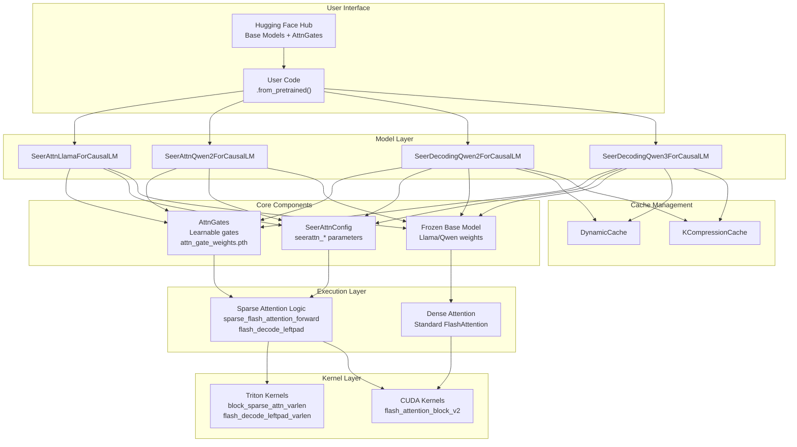

**Figure 1: High-Level System Architecture**

This diagram shows how user code loads models from Hugging Face Hub, which automatically compose AttnGates with base models. The models dispatch to sparse or dense attention based on configuration, with sparse paths using custom Triton/CUDA kernels.

Sources: [seer_attn/__init__.py:1-11](), [README.md:70-113]()

## Key Model Classes and Their Roles

| Model Class | Purpose | Base Architecture | Use Case |
|------------|---------|-------------------|----------|
| `SeerAttnLlamaForCausalLM` | Sparse prefill | Llama 3.1 | Long-context input (8k-131k tokens) |
| `SeerAttnQwen2ForCausalLM` | Sparse prefill | Qwen 2.5 | Long-context input (8k-131k tokens) |
| `SeerDecodingQwen2ForCausalLM` | Sparse decode | Qwen 2.5 | Long-reasoning generation |
| `SeerDecodingQwen3ForCausalLM` | Sparse decode | Qwen 3 | Long-reasoning generation |

### Prefill vs Decode Models

**Sparse Prefill Models** process long input sequences in parallel:
- Handle multiple query tokens simultaneously
- Use threshold or top_k sparsity methods
- Optimized for throughput on long contexts
- Located in `seer_attn/prefill_sparse/`

**Sparse Decode Models (SeerAttention-R)** generate tokens one at a time:
- Single query token per forward pass
- Use token_budget sparsity method
- Optimized for reasoning tasks (AIME, MATH, GPQA)
- Located in `seer_attn/decode_sparse/`

Sources: [seer_attn/__init__.py:1-11](), [README.md:32-54]()

## Component Interaction Flow

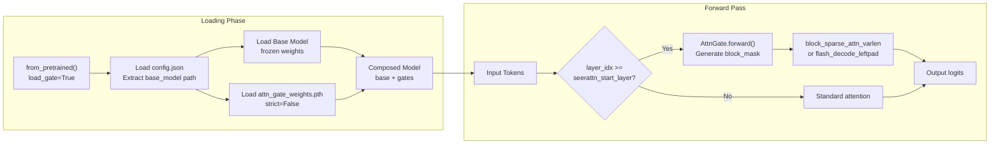

**Figure 2: Model Loading and Forward Pass Flow**

This diagram traces the code execution from loading a model to generating output. The `from_pretrained()` method automatically handles composition of base models with AttnGates, and the forward pass conditionally uses sparse attention based on layer index.

Sources: [README.md:70-113]()

## Configuration Parameters

Key configuration parameters in `SeerAttnQwen2Config` / `SeerAttnQwen3Config`:

| Parameter | Type | Description | Example Values |
|-----------|------|-------------|----------------|
| `base_model` | str | Path to base model on HF Hub | `"Qwen/Qwen3-4B"` |
| `seerattn_sparsity_method` | str | Sparsity selection method | `"threshold"`, `"token_budget"`, `"top_k"` |
| `seerattn_threshold` | float | Gate score threshold | `5e-4` to `5e-3` |
| `seerattn_token_budget` | int | Max attended tokens | `1024` to `8192` |
| `seerattn_gate_block_size` | int | Block size for sparsity | `64` |
| `seerattn_start_layer` | int | First layer to apply sparsity | `0` |
| `seerattn_gate_type` | str | Implementation mode | `"seer_sparse"`, `"seer_dense"`, `"oracle_sparse"` |

### Implementation Modes

- **seer_sparse**: Use learned AttnGates for sparse attention (default)
- **seer_dense**: Disable sparsity, use dense attention
- **oracle_sparse**: Use ground-truth importance scores (for ablation studies)

Sources: [README.md:70-113]()

## Available Pre-trained Models

### Sparse Decode (SeerAttention-R) AttnGates

| Base Model | HF Repository | AttnGates Size |
|------------|---------------|----------------|
| Qwen3-4B | `SeerAttention/SeerAttention-Decode-Qwen3-4B-AttnGates` | 66.1 MB |
| Qwen3-8B | `SeerAttention/SeerAttention-Decode-Qwen3-8B-AttnGates` | 66.1 MB |
| Qwen3-14B | `SeerAttention/SeerAttention-Decode-Qwen3-14B-AttnGates` | 83.9 MB |
| DeepSeek-R1-Distill-Qwen-14B | `SeerAttention/SeerAttention-Decode-R1-Distill-Qwen-14B-AttnGates` | 101 MB |

### Sparse Prefill AttnGates

| Base Model | HF Repository | AttnGates Size |
|------------|---------------|----------------|
| Llama-3.1-8B-Instruct | `SeerAttention/SeerAttention-Llama-3.1-8B-AttnGates` | 101 MB |
| Llama-3.1-70B-Instruct | `SeerAttention/SeerAttention-Llama-3.1-70B-AttnGates` | 503 MB |
| Qwen2.5-7B-Instruct | `SeerAttention/SeerAttention-Qwen2.5-7B-AttnGates` | 77 MB |
| Qwen2.5-14B-Instruct | `SeerAttention/SeerAttention-Qwen2.5-14B-AttnGates` | 189 MB |
| Qwen2.5-32B-Instruct | `SeerAttention/SeerAttention-Qwen2.5-32B-AttnGates` | 252 MB |

AttnGates are stored separately from base models on Hugging Face Hub. During loading, the system automatically:
1. Reads `config.json` from AttnGates repository
2. Extracts `base_model` path
3. Loads both base model and AttnGates
4. Composes them into a single model

Sources: [README.md:29-54]()

## Repository Structure

```
seer_attn/
├── prefill_sparse/          # Sparse prefill implementations
│   ├── llama/              # Llama architecture support
│   │   └── modeling_llama_seerattn.py  # SeerAttnLlamaForCausalLM
│   └── qwen/               # Qwen2 architecture support
│       └── modeling_qwen2_seerattn.py  # SeerAttnQwen2ForCausalLM
├── decode_sparse/           # Sparse decode implementations
│   ├── qwen2/              # Qwen2 decode support
│   │   └── modeling_qwen2_seerattn_inference.py  # SeerDecodingQwen2ForCausalLM
│   └── qwen3/              # Qwen3 decode support
│       └── modeling_qwen3_seerattn_inference.py  # SeerDecodingQwen3ForCausalLM
├── kernels/                 # Custom attention kernels
│   ├── triton/             # Triton kernel implementations
│   └── cuda/               # CUDA/CUTLASS implementations
├── train/                   # Training infrastructure
│   └── attn_gate_trainer.py  # Self-distillation trainer
└── utils/                   # Utilities and helpers

eval/                        # Evaluation framework
├── reasoning_tasks/         # AIME, MATH, GPQA benchmarks
├── long_context/           # PG19, LongBench, RULER benchmarks
└── efficiency/             # Speed and memory benchmarks

scripts/                     # Training and evaluation scripts
├── run_distillation_prefill.sh
└── run_distillation_decode.sh
```

**Key Files:**
- `seer_attn/__init__.py`: Exports main model classes
- Model files: Implement sparse attention logic for each architecture
- Kernel files: Provide GPU-optimized sparse attention implementations
- Training scripts: Self-distillation setup for AttnGates

Sources: [seer_attn/__init__.py:1-11]()

## Sparse Attention Execution Path

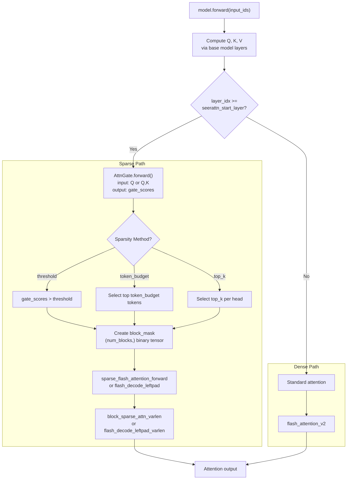

**Figure 3: Sparse vs Dense Attention Execution**

This diagram shows the conditional execution path within a forward pass. After a certain layer threshold, attention goes through the sparse path where AttnGates generate masks that control which attention blocks are computed.

Sources: [README.md:70-113]()

## Performance Characteristics

### Efficiency Gains

- **Prefill**: 2-3x speedup on long contexts with minimal accuracy loss
- **Decode**: Maintains reasoning accuracy while reducing computation
- **Memory**: Block-level sparsity reduces KV cache requirements

### Typical Sparsity Levels

| Task Type | Sparsity Method | Typical Sparsity | Sequence Length |
|-----------|----------------|------------------|-----------------|
| Long Context (PG19) | threshold=5e-4 | 60-90% sparse | 8k-131k tokens |
| Long Context (RULER) | threshold=5e-4 | 50-80% sparse | 4k-128k tokens |
| Reasoning (AIME) | token_budget=4096 | 70-85% sparse | Variable |
| Reasoning (MATH) | token_budget=2048 | 75-90% sparse | Variable |

Sources: [README.md:1-28]()

## Training Overview

AttnGates are trained via **self-distillation**:

1. **Setup**: Freeze base model weights, initialize small AttnGate networks
2. **Forward Pass**: 
   - Compute dense attention (teacher) using frozen base model
   - Compute sparse attention (student) using trainable gates
3. **Loss**: Minimize difference between sparse and dense outputs
4. **Result**: Lightweight AttnGates (66-503 MB) that predict important attention blocks

Training scripts are provided for both prefill and decode scenarios:
- `run_distillation_prefill.sh`: Train prefill AttnGates
- `run_distillation_decode.sh`: Train decode AttnGates

For detailed training instructions, see [Training and Distillation](#5).

Sources: [README.md:115-129]()

## Next Steps

- **To get started using SeerAttention**: See [Getting Started](#2)
- **To understand the core mechanism**: See [SeerAttention Mechanism](#3.1) and [AttnGates](#3.2)
- **To train your own AttnGates**: See [Training and Distillation](#5)
- **To evaluate on benchmarks**: See [Evaluation Framework](#7)
- **To understand kernel implementations**: See [Kernels and Performance](#6)

Sources: [README.md:1-174]()

---

# Page: Getting Started

# Getting Started

<details>
<summary>Relevant source files</summary>

The following files were used as context for generating this wiki page:

- [README.md](README.md)
- [seer_attn/__init__.py](seer_attn/__init__.py)

</details>


This page provides a practical guide for installing and using SeerAttention models. It covers environment setup, loading pre-trained models from Hugging Face Hub, and running basic inference with both sparse prefill and sparse decode (SeerAttention-R) configurations.

For details on the underlying architecture and how components interact, see [Core Architecture](#3). For training your own AttnGates, see [Training and Distillation](#5). For comprehensive evaluation and benchmarking, see [Evaluation Framework](#7).

---

## Purpose and Scope

This document covers:
- Installing required dependencies
- Loading SeerAttention models from Hugging Face Hub
- Configuring sparsity parameters (threshold, token_budget, top_k)
- Running inference for sparse prefill (long-context input processing)
- Running inference for sparse decode (long-reasoning generation)
- Understanding the model composition process (base model + AttnGates)

---

## Installation

### Environment Setup

SeerAttention requires Python 3.11 and specific versions of PyTorch and related dependencies. The following commands create a conda environment and install all requirements:

```bash
conda create -yn seer python=3.11
conda activate seer
pip install torch==2.4.0
pip install -r requirements.txt
pip install flash-attn --no-build-isolation
pip install -e .
```

**Key Dependencies:**
- PyTorch 2.4.0 (for core tensor operations)
- Flash Attention (for efficient attention kernels)
- Transformers library (for model loading and AutoConfig interface)
- Triton (for custom sparse attention kernels)

The installation process compiles the package in editable mode, making the `seer_attn` module available for import.

**Sources:** [README.md:58-66]()

---

## Model Architecture Overview

SeerAttention provides four main model classes for different use cases:

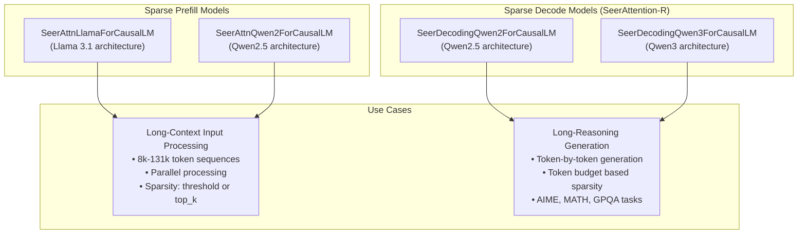

**Sources:** [seer_attn/__init__.py:1-11](), [README.md:73-113]()

---

## Available Pre-trained Models

SeerAttention models are distributed via Hugging Face Hub as **AttnGates adapters**. These are lightweight (66 MB - 503 MB) and are composed with the original base models during loading.

### Sparse Decode Models (SeerAttention-R)

| Base Model | HF Repository | AttnGates Size | Use Case |
|------------|---------------|----------------|----------|
| Qwen3-4B | `SeerAttention/SeerAttention-Decode-Qwen3-4B-AttnGates` | 66.1 MB | Long-reasoning, token budget 1k-8k |
| Qwen3-8B | `SeerAttention/SeerAttention-Decode-Qwen3-8B-AttnGates` | 66.1 MB | Long-reasoning, token budget 1k-8k |
| Qwen3-14B | `SeerAttention/SeerAttention-Decode-Qwen3-14B-AttnGates` | 83.9 MB | Long-reasoning, token budget 1k-8k |
| DeepSeek-R1-Distill-Qwen-14B | `SeerAttention/SeerAttention-Decode-R1-Distill-Qwen-14B-AttnGates` | 101 MB | Long-reasoning, reasoning tasks |

### Sparse Prefill Models

| Base Model | HF Repository | AttnGates Size | Use Case |
|------------|---------------|----------------|----------|
| Llama-3.1-8B-Instruct | `SeerAttention/SeerAttention-Llama-3.1-8B-AttnGates` | 101 MB | Long-context prefill, threshold 5e-4 to 5e-3 |
| Llama-3.1-70B-Instruct | `SeerAttention/SeerAttention-Llama-3.1-70B-AttnGates` | 503 MB | Long-context prefill, large model |
| Qwen2.5-7B-Instruct | `SeerAttention/SeerAttention-Qwen2.5-7B-AttnGates` | 77 MB | Long-context prefill, threshold based |
| Qwen2.5-14B-Instruct | `SeerAttention/SeerAttention-Qwen2.5-14B-AttnGates` | 189 MB | Long-context prefill |
| Qwen2.5-32B-Instruct | `SeerAttention/SeerAttention-Qwen2.5-32B-AttnGates` | 252 MB | Long-context prefill |

**Sources:** [README.md:29-54]()

---

## Model Loading Process

The following diagram shows how models are composed from separate base model and AttnGates components:

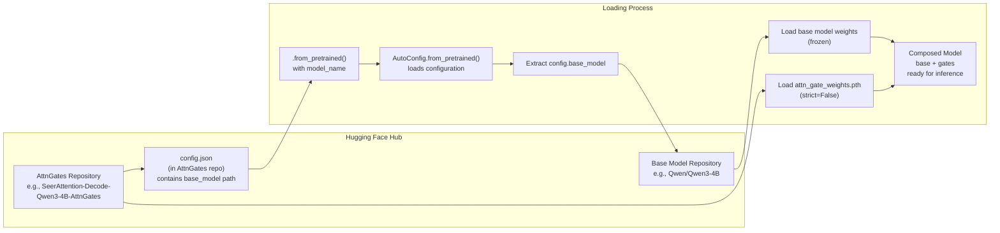

**Key Concept:** The AttnGates repository's `config.json` contains a `base_model` field that references the original model (e.g., `"Qwen/Qwen3-4B"`). During `.from_pretrained()`, the system automatically loads both the base model and the gate weights, composing them into a single model ready for sparse inference.

**Sources:** [README.md:70-113]()

---

## Basic Inference: Sparse Decode (SeerAttention-R)

Sparse decode models are designed for long-reasoning token generation with token budget-based sparsity control.

### Code Example

```python
from transformers import AutoTokenizer, AutoConfig
from seer_attn import SeerDecodingQwen3ForCausalLM
import torch

# Load AttnGates and compose with base model
model_name = "SeerAttention/SeerAttention-Decode-Qwen3-4B-AttnGates"
config = AutoConfig.from_pretrained(model_name)

# Tokenizer from base model
tokenizer = AutoTokenizer.from_pretrained(
    config.base_model,  # e.g., "Qwen/Qwen3-4B"
    padding_side="left",
)

# Load model with token budget sparsity
model = SeerDecodingQwen3ForCausalLM.from_pretrained(
    model_name,
    torch_dtype=torch.bfloat16,
    seerattn_sparsity_method='token_budget',  # Token budget method
    seerattn_token_budget=4096,  # Keep top 4096 tokens per attention
).cuda()

# Ready for inference
# model.generate(...) will use sparse attention
```

### Configuration Parameters for Decode Models

| Parameter | Type | Description | Typical Values |
|-----------|------|-------------|----------------|
| `seerattn_sparsity_method` | str | Method for sparsity selection | `'token_budget'`, `'threshold'` |
| `seerattn_token_budget` | int | Number of tokens to keep per attention | 1024, 2048, 4096, 8192 |
| `seerattn_threshold` | float | Threshold for attention scores (alternative) | 1e-4 to 1e-3 |
| `torch_dtype` | dtype | Model precision | `torch.bfloat16`, `torch.float16` |

**Token Budget Method:** For each query token, the AttnGate selects the top K tokens (where K = `seerattn_token_budget`) to attend to, based on learned importance scores. This provides predictable memory and compute patterns during generation.

**Sources:** [README.md:80-94]()

---

## Basic Inference: Sparse Prefill

Sparse prefill models are designed for efficiently processing long input contexts using threshold-based or top-k sparsity.

### Code Example

```python
from transformers import AutoTokenizer, AutoConfig
from seer_attn import SeerAttnLlamaForCausalLM
import torch

# Load AttnGates and compose with base model
model_name = "SeerAttention/SeerAttention-Llama-3.1-8B-AttnGates"
config = AutoConfig.from_pretrained(model_name)

# Tokenizer from base model
tokenizer = AutoTokenizer.from_pretrained(
    config.base_model,  # e.g., "meta-llama/Llama-3.1-8B-Instruct"
    padding_side="left",
)

# Load model with threshold-based sparsity
model = SeerAttnLlamaForCausalLM.from_pretrained(
    model_name,
    torch_dtype=torch.bfloat16,
    seerattn_sparsity_method='threshold',  # Threshold method
    seerattn_threshold=5e-4,  # Higher = sparser (5e-4 to 5e-3)
).cuda()

# Ready for inference on long contexts
# model.generate(...) will use sparse attention during prefill
```

### Alternative: Top-K Sparsity

```python
# Using top_k method instead of threshold
model = SeerAttnLlamaForCausalLM.from_pretrained(
    model_name,
    torch_dtype=torch.bfloat16,
    seerattn_sparsity_method='top_k',
    seerattn_top_k=512,  # Keep top 512 blocks per query
).cuda()
```

### Configuration Parameters for Prefill Models

| Parameter | Type | Description | Typical Values |
|-----------|------|-------------|----------------|
| `seerattn_sparsity_method` | str | Method for sparsity selection | `'threshold'`, `'top_k'` |
| `seerattn_threshold` | float | Threshold for gate scores | 5e-4 (less sparse) to 5e-3 (more sparse) |
| `seerattn_top_k` | int | Number of blocks to keep per query | 256, 512, 1024 |
| `torch_dtype` | dtype | Model precision | `torch.bfloat16`, `torch.float16` |

**Threshold Method:** Gate scores below the threshold are masked out. Higher threshold = sparser attention = faster but potentially lower quality.

**Top-K Method:** For each query, keep only the top K blocks with highest gate scores. Provides more predictable sparsity levels.

**Sources:** [README.md:96-113]()

---

## Sparsity Method Selection

The following diagram shows how different sparsity methods are used across model types:

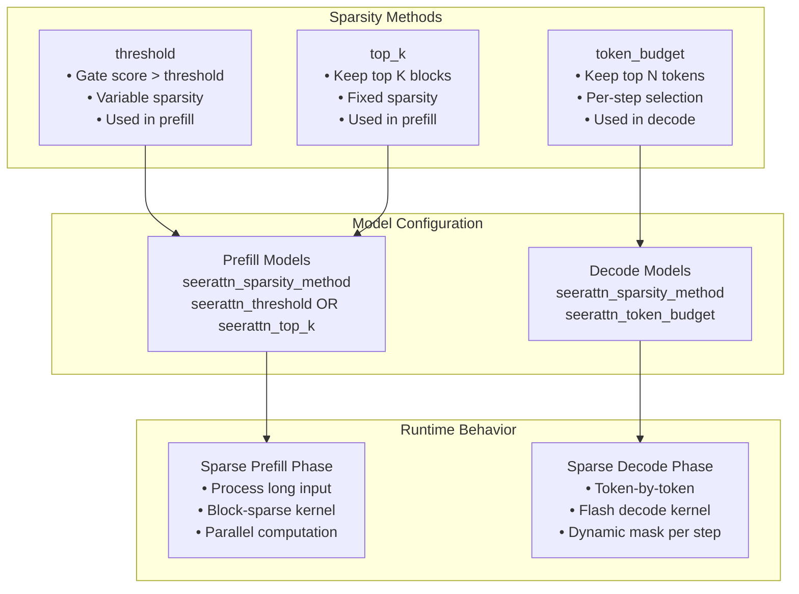

**Sources:** [README.md:73-113]()

---

## Verification and Testing

After loading a model, you can verify it's working correctly:

```python
# Simple generation test
inputs = tokenizer("What is the capital of France?", return_tensors="pt").to("cuda")
outputs = model.generate(
    **inputs,
    max_new_tokens=50,
    do_sample=False,
)
print(tokenizer.decode(outputs[0], skip_special_tokens=True))
```

### Expected Behavior

1. **Model Composition:** During `.from_pretrained()`, you should see loading messages for both the base model and AttnGates.
2. **Memory Usage:** Memory consumption should be similar to the base model (gates add minimal overhead).
3. **Generation Speed:** Sparse models should be faster than dense baselines, especially for long contexts.
4. **Output Quality:** For typical sparsity settings (threshold=5e-4 for prefill, token_budget=4096 for decode), output quality should be very close to the dense baseline.

---

## Common Configuration Patterns

### Pattern 1: Maximum Speed (Higher Sparsity)

```python
# Prefill: More aggressive sparsity
model = SeerAttnLlamaForCausalLM.from_pretrained(
    model_name,
    seerattn_sparsity_method='threshold',
    seerattn_threshold=5e-3,  # Higher threshold = more sparse
)

# Decode: Lower token budget
model = SeerDecodingQwen3ForCausalLM.from_pretrained(
    model_name,
    seerattn_sparsity_method='token_budget',
    seerattn_token_budget=2048,  # Lower budget = more sparse
)
```

### Pattern 2: Maximum Quality (Lower Sparsity)

```python
# Prefill: Conservative sparsity
model = SeerAttnLlamaForCausalLM.from_pretrained(
    model_name,
    seerattn_sparsity_method='threshold',
    seerattn_threshold=5e-4,  # Lower threshold = less sparse
)

# Decode: Higher token budget
model = SeerDecodingQwen3ForCausalLM.from_pretrained(
    model_name,
    seerattn_sparsity_method='token_budget',
    seerattn_token_budget=8192,  # Higher budget = less sparse
)
```

### Pattern 3: Predictable Sparsity

```python
# Using top_k for consistent sparsity level
model = SeerAttnLlamaForCausalLM.from_pretrained(
    model_name,
    seerattn_sparsity_method='top_k',
    seerattn_top_k=512,  # Always keep exactly 512 blocks
)
```

**Sources:** [README.md:73-113]()

---

## Next Steps

After successfully loading and testing a model, you can:

1. **Understand the Architecture:** See [Core Architecture](#3) for details on how SeerAttention works internally, including the role of AttnGates and block-level sparsity.

2. **Run Evaluations:** See [Evaluation Framework](#7) for comprehensive benchmarking on reasoning tasks, long-context benchmarks, and efficiency measurements.

3. **Train Custom AttnGates:** See [Training and Distillation](#5) for instructions on training AttnGates for your own models or custom datasets.

4. **Optimize Performance:** See [Kernels and Performance](#6) for details on the underlying Triton and CUDA kernels, and how to optimize for your hardware.

5. **Explore Model Variants:** See [Model Implementations](#4) for detailed documentation on each model class and their specific configurations.

---

## Troubleshooting

### Issue: CUDA Out of Memory

**Solution:** Reduce batch size or use higher sparsity (higher threshold / lower token budget).

### Issue: Model Loading Fails

**Solution:** Ensure both the base model and AttnGates are accessible from Hugging Face Hub. Check internet connection and HF authentication.

### Issue: Slow Inference Despite Sparsity

**Solution:** Verify that custom kernels are being used. Check that flash-attn is properly installed. Some sparsity configurations may not provide speedup if sparsity is too low.

### Issue: Poor Output Quality

**Solution:** Reduce sparsity (lower threshold / higher token budget). Some tasks may require higher attention density.

**Sources:** [README.md:56-113]()

---

# Page: Core Architecture

# Core Architecture

<details>
<summary>Relevant source files</summary>

The following files were used as context for generating this wiki page:

- [README.md](README.md)
- [seer_attn/__init__.py](seer_attn/__init__.py)
- [seer_attn/decode_sparse/attention_forward_dense.py](seer_attn/decode_sparse/attention_forward_dense.py)
- [seer_attn/decode_sparse/attention_forward_sparse.py](seer_attn/decode_sparse/attention_forward_sparse.py)
- [seer_attn/decode_sparse/attn_gate_inf.py](seer_attn/decode_sparse/attn_gate_inf.py)
- [seer_attn/decode_sparse/qwen2/configuration_qwen2_seerattn.py](seer_attn/decode_sparse/qwen2/configuration_qwen2_seerattn.py)

</details>


## Purpose and Scope

This document provides a high-level overview of the SeerAttention system architecture, describing the main components and how they interact to enable sparse attention in large language models. The architecture supports two primary use cases: **sparse prefill** for efficient long-context input processing, and **sparse decode** (SeerAttention-R) for long-reasoning token generation.

For detailed information about specific components, see:
- Sparse attention mechanism details: [SeerAttention Mechanism](#3.1)
- AttnGate internals: [AttnGates](#3.2)
- Sparsity control methods: [Sparsity Methods](#3.3)
- Cache implementation: [Cache Management](#3.4)

For model-specific documentation, see [Model Implementations](#4).

## System Overview

SeerAttention is built on a modular architecture that separates concerns across several layers:

1. **Model Layer**: Provides specialized model classes that extend standard transformers with sparse attention capabilities
2. **AttnGate Layer**: Generates learned sparse masks using lightweight adapters (66-503 MB)
3. **Attention Interface Layer**: Dispatches to appropriate sparse or dense attention implementations
4. **Kernel Layer**: Provides high-performance implementations in Triton and CUDA
5. **Cache Layer**: Manages KV cache with optional compression for decode operations

The key architectural innovation is the **separation of AttnGates from base model weights**, enabling lightweight adaptation without full model retraining. AttnGates are stored separately on Hugging Face Hub and automatically composed with base models during inference.

### Component Hierarchy

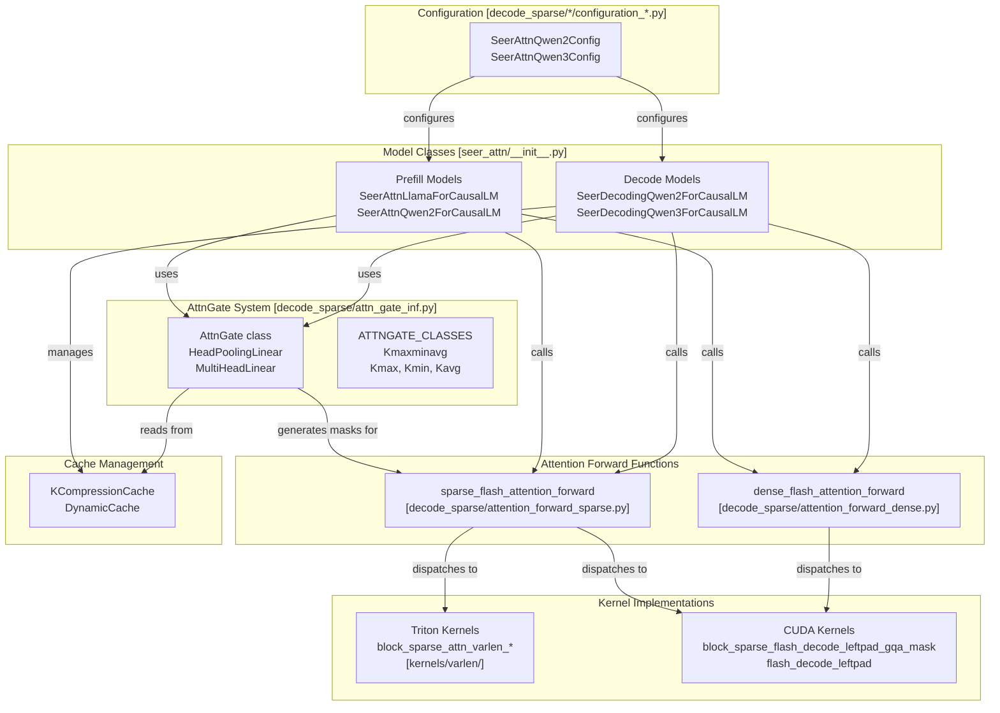

**Sources:** [seer_attn/__init__.py:1-11](), [seer_attn/decode_sparse/attn_gate_inf.py:110-299](), [seer_attn/decode_sparse/attention_forward_sparse.py:111-163](), [seer_attn/decode_sparse/attention_forward_dense.py:110-156]()

## Main Architectural Components

### Model Classes

The system provides four main model classes, each serving distinct use cases:

| Model Class | Base Architecture | Use Case | Implementation Mode |
|-------------|------------------|----------|---------------------|
| `SeerAttnLlamaForCausalLM` | Llama 3.1 | Sparse prefill for long contexts | Threshold or TopK sparsity |
| `SeerAttnQwen2ForCausalLM` | Qwen 2.5 | Sparse prefill for long contexts | Threshold or TopK sparsity |
| `SeerDecodingQwen2ForCausalLM` | Qwen 2.5 | Sparse decode (SeerAttention-R) | Token budget sparsity |
| `SeerDecodingQwen3ForCausalLM` | Qwen 3 | Sparse decode (SeerAttention-R) | Token budget sparsity |

**Prefill models** are optimized for processing long input sequences (8k-131k tokens) in parallel, using block-sparse attention patterns determined by learned gates. **Decode models** operate token-by-token during generation, dynamically selecting which KV cache blocks to attend to based on learned importance scores.

All models are registered in [seer_attn/__init__.py:1-11]() and follow a consistent interface pattern:

```python
model = SeerDecodingQwen3ForCausalLM.from_pretrained(
    model_name,
    torch_dtype=torch.bfloat16,
    seerattn_sparsity_method='token_budget',  # or 'threshold'
    seerattn_token_budget=4096,
)
```

**Sources:** [seer_attn/__init__.py:1-11](), [README.md:74-113]()

### AttnGate System

The AttnGate system consists of lightweight neural networks that learn to predict which blocks of the KV cache are important for attention computation. The core class is `AttnGate`, with several automatically generated variants:

#### AttnGate Architecture

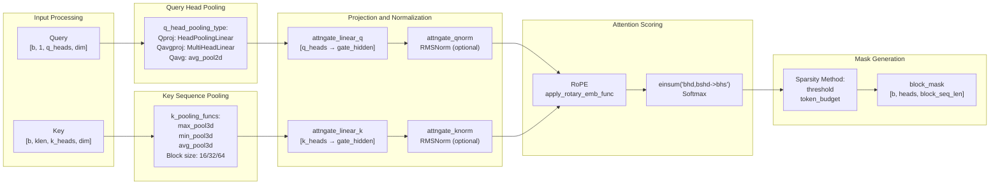

**Sources:** [seer_attn/decode_sparse/attn_gate_inf.py:110-256]()

The `AttnGate` class at [seer_attn/decode_sparse/attn_gate_inf.py:110-256]() implements this architecture with configurable pooling strategies:

- **Query Head Pooling** (`q_head_pooling_type`): Reduces query heads from `num_q_head` to `num_k_head` using `HeadPoolingLinear` [63-85](), `MultiHeadLinear` [87-109](), or average pooling
- **Key Sequence Pooling** (`k_pooling_funcs`): Reduces key sequence length by pooling blocks (max/min/avg) at [259-263]()
- **Projection**: Maps to `gate_hidden_size` (64/128/256) via learned linear layers
- **Normalization**: Optional RMSNorm for Q and K gate embeddings when `use_qk_norm=True`
- **Positional Encoding**: Optional RoPE application when `seerattn_use_rope=True`

The system auto-generates specialized `AttnGate` classes for different pooling combinations via `generate_combinations()` at [287-298](), creating classes like `Kmaxminavg`, `Kmax`, `Kmin`, etc.

**Sources:** [seer_attn/decode_sparse/attn_gate_inf.py:63-298]()

### Attention Forward Mechanisms

The system implements two attention forward paths that share similar interfaces but differ in kernel dispatch:

#### Sparse Attention Forward

`sparse_flash_attention_forward` at [seer_attn/decode_sparse/attention_forward_sparse.py:111-163]() handles block-sparse attention:

- **Prefill path** (query_length > 1): Uses standard `flash_attn_varlen_func` with dense attention [124-148]()
- **Decode path** (query_length == 1): Uses `block_sparse_flash_decode_leftpad_gqa_mask` with block-level sparsity [150-161]()

#### Dense Attention Forward

`dense_flash_attention_forward` at [seer_attn/decode_sparse/attention_forward_dense.py:110-156]() provides dense baseline:

- **Prefill path**: Uses `flash_attn_varlen_func` [121-145]()
- **Decode path**: Uses `flash_decode_leftpad` for efficient decode without sparsity [147-155]()

Both functions share the `_upad_input` helper at [39-109]() for handling variable-length sequences with padding removal.

**Sources:** [seer_attn/decode_sparse/attention_forward_sparse.py:39-163](), [seer_attn/decode_sparse/attention_forward_dense.py:38-156]()

### Configuration System

Configuration is managed through specialized config classes that extend `PretrainedConfig`:

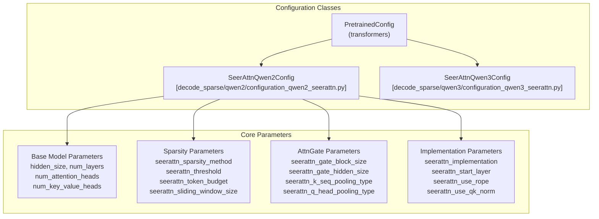

**Sources:** [seer_attn/decode_sparse/qwen2/configuration_qwen2_seerattn.py:25-139]()

Key configuration parameters from [seer_attn/decode_sparse/qwen2/configuration_qwen2_seerattn.py:68-82]():

| Parameter | Valid Values | Purpose |
|-----------|-------------|---------|
| `seerattn_sparsity_method` | `threshold`, `token_budget` | Controls sparsity selection method |
| `seerattn_threshold` | float (e.g., 5e-4 to 5e-3) | Threshold for mask generation |
| `seerattn_token_budget` | int (e.g., 1024-8192) | Maximum tokens to attend to |
| `seerattn_gate_block_size` | 16, 32, 64 | Block granularity for sparse masks |
| `seerattn_gate_hidden_size` | 64, 128, 256 | Hidden dimension for gate networks |
| `seerattn_implementation` | `seer_sparse`, `seer_dense`, `oracle_sparse` | Attention implementation mode |
| `seerattn_start_layer` | int | First layer to apply sparse attention |

**Sources:** [seer_attn/decode_sparse/qwen2/configuration_qwen2_seerattn.py:46-139]()

## Component Interaction Patterns

### Inference Data Flow

The following diagram traces the execution flow from model loading through sparse attention computation:

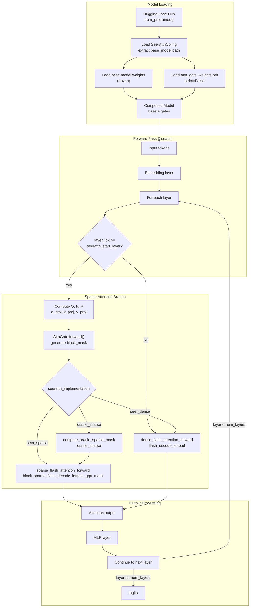

**Sources:** [README.md:70-113](), [seer_attn/decode_sparse/attn_gate_inf.py:152-256]()

### Prefill vs Decode Execution Paths

The system handles prefill (multi-token input) and decode (single-token generation) differently:

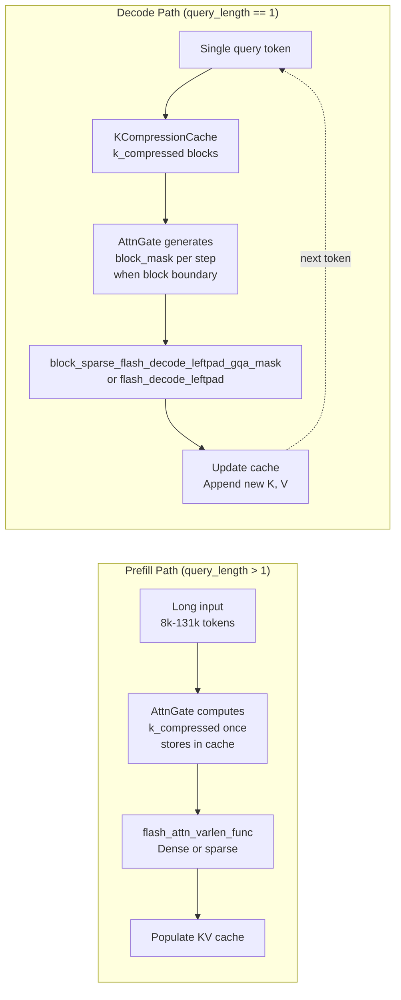

**Sources:** [seer_attn/decode_sparse/attn_gate_inf.py:166-256](), [seer_attn/decode_sparse/attention_forward_sparse.py:111-163]()

**Key Differences:**

1. **Prefill** [seer_attn/decode_sparse/attn_gate_inf.py:231-256]():
   - Processes entire sequence at once
   - Computes compressed keys once via pooling
   - Stores `k_compressed` and `k_remainder` in cache
   - Can use dense attention (sparsity applied at training time)

2. **Decode** [seer_attn/decode_sparse/attn_gate_inf.py:166-230]():
   - Processes one token at a time (`is_decode = k.shape[1] == 1`)
   - Updates cache incrementally
   - Computes new block mask only at block boundaries (`max_cache_len % self.block_size == 0`)
   - Uses specialized decode kernels with left-padding support
   - Mask generation at [224-229](): applies threshold or token budget, ensures last block is always attended

## Design Philosophy

The SeerAttention architecture embodies several key design principles:

### 1. Separation of Concerns

**AttnGates are decoupled from base models**: Gates are stored as separate 66-503 MB files on Hugging Face Hub, while base models remain unchanged. This allows:
- Training gates without retraining the full model
- Mixing different gates with the same base model
- Easy distribution and version control

### 2. Block-Level Granularity

**Sparsity operates at block level (16/32/64 tokens)** rather than individual tokens:
- Hardware-efficient: aligns with GPU warp sizes and memory access patterns
- Reduces overhead: fewer mask decisions needed
- Maintains semantic coherence: keeps related tokens together

### 3. Dual-Mode Operation

**Prefill and decode have distinct implementations**:
- Prefill: optimized for parallel processing of long sequences
- Decode: optimized for token-by-token generation with incremental updates
- Shared AttnGates work across both modes

### 4. Flexible Sparsity Control

**Multiple sparsity methods** at [seer_attn/decode_sparse/qwen2/configuration_qwen2_seerattn.py:68]():
- `threshold`: Fixed sparsity level based on attention score cutoff
- `token_budget`: Fixed number of tokens to attend to (useful for decode)
- Implementation modes (`seer_sparse`, `seer_dense`, `oracle_sparse`) enable ablation studies

### 5. Layered Kernel Abstractions

**Attention interface → Triton/CUDA kernels**:
- High-level interface in Python for model code
- Multiple kernel backends (Triton, CUDA/CUTLASS) for different hardware profiles
- Automatic dispatch based on sequence length and sparsity mode

### 6. Cache-Aware Design

**KCompressionCache** stores both:
- Original K/V cache for attention computation
- Compressed K blocks (`k_compressed`) for gate scoring
- Remainder blocks (`k_remainder`) for partial blocks

This dual storage enables efficient gate computation without recomputing pooling operations at every decode step.

**Sources:** [README.md:30-31](), [seer_attn/decode_sparse/qwen2/configuration_qwen2_seerattn.py:46-139](), [seer_attn/decode_sparse/attn_gate_inf.py:186-205]()

## File Organization

The codebase follows a clear modular structure:

```
seer_attn/
├── __init__.py                    # Model class exports
├── prefill_sparse/
│   ├── llama/
│   │   └── modeling_llama_seerattn.py
│   └── qwen/
│       └── modeling_qwen2_seerattn.py
├── decode_sparse/
│   ├── attn_gate_inf.py           # AttnGate implementation
│   ├── attention_forward_dense.py  # Dense attention path
│   ├── attention_forward_sparse.py # Sparse attention path
│   ├── qwen2/
│   │   ├── configuration_qwen2_seerattn.py
│   │   └── modeling_qwen2_seerattn_inference.py
│   └── qwen3/
│       ├── configuration_qwen3_seerattn.py
│       └── modeling_qwen3_seerattn_inference.py
├── kernels/
│   └── varlen/
│       ├── block_sparse_attn_varlen_*.py  # Triton kernels
│       └── block_sparse_flash_decode_varlen_mask_leftpad.py  # CUDA kernels
└── modules/
    └── common.py                  # Shared utilities (RMSNorm, repeat_kv, etc.)
```

This structure separates:
- **Prefill vs decode** implementations
- **Model-specific** code (Llama, Qwen2, Qwen3)
- **Attention mechanisms** from model classes
- **Kernel implementations** from Python interfaces

**Sources:** [seer_attn/__init__.py:1-11]()

---

# Page: SeerAttention Mechanism

# SeerAttention Mechanism

<details>
<summary>Relevant source files</summary>

The following files were used as context for generating this wiki page:

- [README.md](README.md)
- [seer_attn/__init__.py](seer_attn/__init__.py)
- [seer_attn/decode_sparse/attention_forward_dense.py](seer_attn/decode_sparse/attention_forward_dense.py)
- [seer_attn/decode_sparse/attention_forward_sparse.py](seer_attn/decode_sparse/attention_forward_sparse.py)
- [seer_attn/decode_sparse/attn_gate_inf.py](seer_attn/decode_sparse/attn_gate_inf.py)
- [seer_attn/decode_sparse/qwen2/configuration_qwen2_seerattn.py](seer_attn/decode_sparse/qwen2/configuration_qwen2_seerattn.py)

</details>


## Purpose and Scope

This document explains the core sparse attention mechanism in SeerAttention: how block-level sparsity is computed, how attention gates generate sparse masks, and the computational flow during inference. For details on the AttnGate architecture and training process, see [AttnGates](#3.2). For information on sparsity control parameters (threshold, token budget, top-k), see [Sparsity Methods](#3.3). For cache management systems used with sparse attention, see [Cache Management](#3.4).

## Overview

SeerAttention implements **learned block-level sparse attention** that dynamically determines which blocks of the key-value cache to attend to during inference. Unlike dense attention that computes attention over all tokens, SeerAttention uses lightweight **AttnGates** to predict attention importance at the block level, then computes attention only on selected blocks. This mechanism achieves significant computational savings while maintaining model accuracy.

The system operates in two distinct modes:
- **Sparse Prefill**: Processes long input contexts efficiently using threshold or top-k based block selection
- **Sparse Decode**: Generates tokens one-by-one using token budget-based block selection

**Key Components:**

| Component | Purpose | Location |
|-----------|---------|----------|
| `AttnGate` | Generates block-level sparse masks | [seer_attn/decode_sparse/attn_gate_inf.py:110-256]() |
| `sparse_flash_attention_forward` | Executes sparse attention computation | [seer_attn/decode_sparse/attention_forward_sparse.py:111-162]() |
| `block_sparse_flash_decode_leftpad_gqa_mask` | CUDA kernel for sparse decode | Referenced in [seer_attn/decode_sparse/attention_forward_sparse.py:151]() |
| Sparsity methods | Convert gate scores to binary masks | [seer_attn/decode_sparse/attn_gate_inf.py:21-42]() |

**Sources:** [README.md:8-15](), [seer_attn/decode_sparse/attn_gate_inf.py:110-256]()

## Block-Level Sparsity Architecture

SeerAttention operates at **block granularity** rather than token granularity. The key-value cache is divided into fixed-size blocks (typically 16, 32, or 64 tokens per block), and attention masks are computed at the block level.

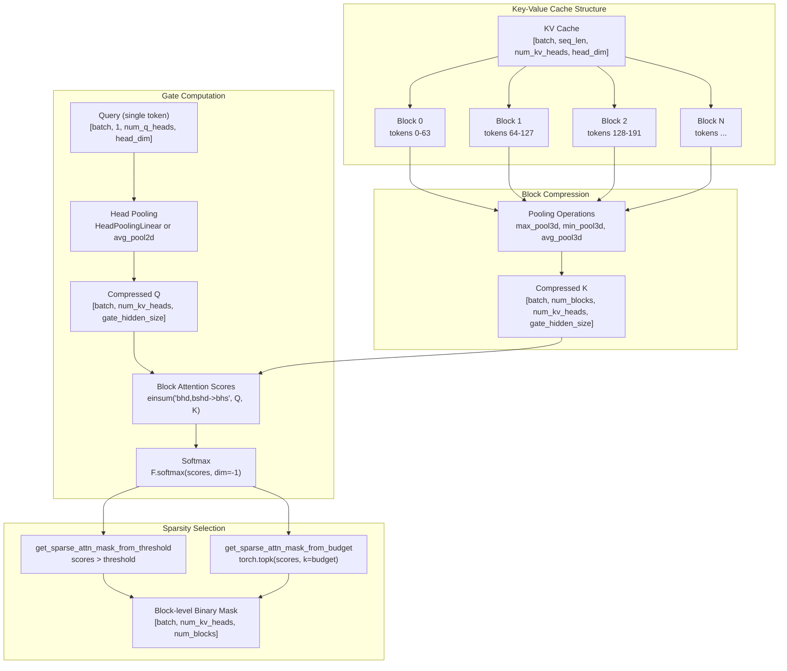

**Block Size Configuration:**

The block size is configurable via `seerattn_gate_block_size` parameter, with supported values of 16, 32, or 64 tokens. The block size must be chosen at training time and remain consistent during inference.

```python
# From configuration
seerattn_gate_block_size = 64  # tokens per block
```

**Hardware Alignment:** Block-level sparsity aligns with GPU memory access patterns and enables efficient kernel implementations. Entire blocks can be skipped during attention computation, resulting in actual speedups rather than just theoretical FLOP reductions.

**Sources:** [seer_attn/decode_sparse/attn_gate_inf.py:110-256](), [seer_attn/decode_sparse/qwen2/configuration_qwen2_seerattn.py:77-78]()

## Attention Gate Computation Flow

The `AttnGate` module is the core component that generates block-level sparse masks. It operates differently during prefill (query_length > 1) and decode (query_length == 1) phases.

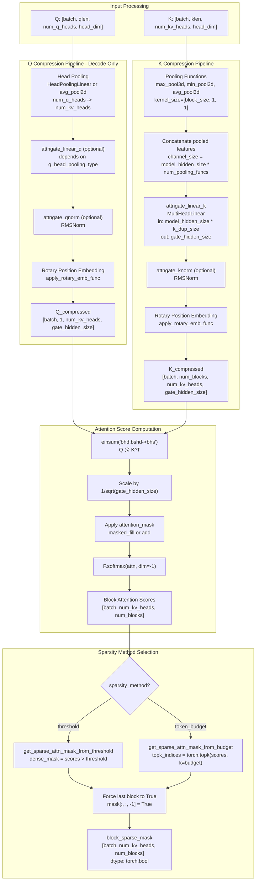

**Key Implementation Details:**

| Component | Purpose | Configuration |
|-----------|---------|---------------|
| `k_pooling_funcs` | Extract block-level features from K | `['max', 'min', 'avg']` combinations |
| `q_head_pooling_type` | Reduce Q heads to match KV heads | `'Qproj'`, `'Qavgproj'`, `'Qavg'`, `'Qorig'` |
| `gate_hidden_size` | Dimensionality of compressed representations | 64, 128, or 256 |
| `use_qk_norm` | Apply RMSNorm before attention computation | Boolean flag |
| `use_flash_rope` | Use Flash Attention's RoPE implementation | Boolean flag |

**Q Head Pooling Types:**
- `'Qproj'`: Uses `HeadPoolingLinear` to learn per-head projection from Q heads to KV heads
- `'Qavgproj'`: Averages Q heads then projects with `MultiHeadLinear`
- `'Qavg'`: Simple average pooling over Q heads, no learned projection
- `'Qorig'`: Uses original Q heads without pooling (only for GQA compatibility)

**Sources:** [seer_attn/decode_sparse/attn_gate_inf.py:110-256](), [seer_attn/decode_sparse/attn_gate_inf.py:63-109](), [seer_attn/decode_sparse/qwen2/configuration_qwen2_seerattn.py:72-79]()

## Prefill vs Decode Operational Modes

The `AttnGate.forward` method operates in two fundamentally different modes based on sequence length, optimized for the computational patterns of prefill and decode phases.

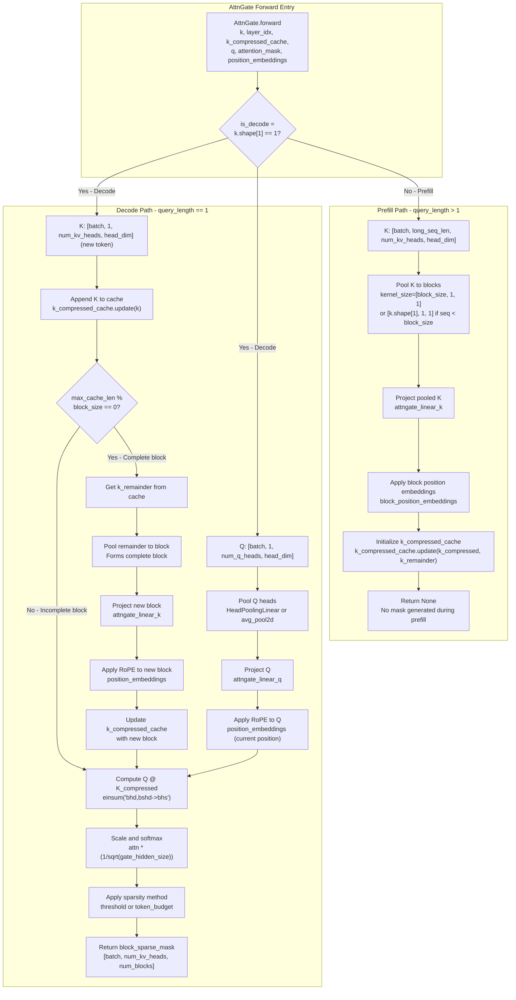

**Prefill Mode Characteristics:**
- **Input:** Full sequence K without Q (Q not needed during prefill initialization)
- **Computation:** Pools entire K sequence into blocks, projects and stores in cache
- **Output:** Returns `None` - no mask generated, just cache initialization
- **Purpose:** Prepare the compressed block cache for subsequent decode steps
- **Code:** [seer_attn/decode_sparse/attn_gate_inf.py:231-255]()

**Decode Mode Characteristics:**
- **Input:** Single token K and Q
- **Computation:** 
  - Appends new K token to cache
  - Every `block_size` tokens, forms a complete block by pooling remainder
  - Computes attention between compressed Q and all compressed K blocks
- **Output:** Returns block-level binary mask for sparse attention
- **Purpose:** Dynamically select which blocks to attend to for current token
- **Code:** [seer_attn/decode_sparse/attn_gate_inf.py:168-230]()

**Block Completion Logic:**

During decode, the cache accumulates tokens in a "remainder" buffer. When `max_cache_len % block_size == 0`, the remainder forms a complete block:

1. Retrieve remainder: `k_remainder = k_compressed_cache.get_k_remainder(layer_idx)` [seer_attn/decode_sparse/attn_gate_inf.py:189]()
2. Pool to single block: `kernel_size=[self.block_size, 1, 1]` [seer_attn/decode_sparse/attn_gate_inf.py:190]()
3. Project and add to compressed cache [seer_attn/decode_sparse/attn_gate_inf.py:192-204]()

**Sources:** [seer_attn/decode_sparse/attn_gate_inf.py:152-256]()

## Sparsity Method Selection

After computing block attention scores, SeerAttention converts soft attention scores into hard binary masks using one of two methods configured by `seerattn_sparsity_method`.

**Threshold-Based Sparsity:**

```python
def get_sparse_attn_mask_from_threshold(x, threshold):
    dense_mask = x > threshold 
    return dense_mask
```

- **Parameter:** `seerattn_threshold` (typical range: 5e-4 to 5e-3)
- **Behavior:** Selects all blocks with attention score above threshold
- **Use case:** Prefill mode, variable sparsity based on content
- **Code:** [seer_attn/decode_sparse/attn_gate_inf.py:21-23]()

**Token Budget-Based Sparsity:**

```python
def get_sparse_attn_mask_from_budget(x, block_budget, block_attention_mask):
    if block_seq_len <= block_budget:
        return torch.ones_like(x, dtype=torch.bool) & block_attention_mask
    
    k = block_budget
    _, topk_indices = torch.topk(x, k=k, dim=-1, sorted=False)
    mask = torch.zeros_like(x, dtype=torch.bool)
    mask.scatter_(-1, topk_indices, True)
    return mask & block_attention_mask
```

- **Parameter:** `seerattn_token_budget` (typical range: 1024 to 8192 tokens)
- **Conversion:** `block_budget = token_budget / block_size`
- **Behavior:** Selects exactly top-k blocks by attention score
- **Use case:** Decode mode, fixed computational budget
- **Code:** [seer_attn/decode_sparse/attn_gate_inf.py:25-42]()

**Last Block Special Handling:**

Both methods force the last block (most recent tokens) to always be attended:

```python
mask[:, :, -1] = True
```

This ensures the model always has access to the most recent context, which is critical for maintaining coherence during generation.

**Sources:** [seer_attn/decode_sparse/attn_gate_inf.py:21-42](), [seer_attn/decode_sparse/attn_gate_inf.py:228]()

## Implementation Modes

SeerAttention supports three implementation modes configured via `seerattn_implementation`, enabling ablation studies and comparisons.

| Mode | Description | Use Case | Sparsity Source |
|------|-------------|----------|-----------------|
| `seer_sparse` | Full sparse attention with learned gates | Production inference | AttnGate predictions |
| `seer_dense` | Dense attention, gates computed but ignored | Accuracy baseline | N/A (no sparsity) |
| `oracle_sparse` | Sparse attention with ground-truth masks | Upper-bound analysis | Ground-truth attention weights |

**seer_sparse (Default):**

Uses learned `AttnGate` to predict block importance and applies sparse attention kernels.

- Configuration: `seerattn_implementation='seer_sparse'`
- Forward function: `sparse_flash_attention_forward` [seer_attn/decode_sparse/attention_forward_sparse.py:111-162]()
- Kernel: `block_sparse_flash_decode_leftpad_gqa_mask` [seer_attn/decode_sparse/attention_forward_sparse.py:151]()

**seer_dense (Baseline):**

Computes `AttnGate` predictions but does not apply sparsity, using standard dense attention instead. Useful for measuring accuracy loss from sparsity.

- Configuration: `seerattn_implementation='seer_dense'`
- Forward function: `dense_flash_attention_forward` [seer_attn/decode_sparse/attention_forward_dense.py:110-155]()
- Kernel: `flash_decode_leftpad` (standard Flash Attention) [seer_attn/decode_sparse/attention_forward_dense.py:148]()

**oracle_sparse (Upper Bound):**

Computes true attention weights using `oracle_sparse` kernel, then applies sparsity methods to the ground-truth scores. This provides an upper bound on what learned gates could achieve.

```python
def compute_oracle_sparse_mask(q, k, cache_seqlens, block_attention_mask, 
                                block_size, sparsity_method, threshold, block_budget):
    attn_weights = oracle_sparse(q, k, cache_seqlens, block_size)
    
    if sparsity_method == "token_budget":
        block_sparse_mask = get_sparse_attn_mask_from_budget(
            attn_weights, block_budget, block_attention_mask
        )
    elif sparsity_method == "threshold":
        block_sparse_mask = get_sparse_attn_mask_from_threshold(
            attn_weights, threshold
        )
    
    block_sparse_mask[:, :, -1] = True
    return block_sparse_mask
```

- Configuration: `seerattn_implementation='oracle_sparse'`
- Mask computation: [seer_attn/decode_sparse/attn_gate_inf.py:44-60]()
- Forward function: Same as `seer_sparse` but with oracle-computed masks

**Sources:** [seer_attn/decode_sparse/qwen2/configuration_qwen2_seerattn.py:79](), [seer_attn/decode_sparse/attn_gate_inf.py:44-60]()

## Integration with Flash Attention

SeerAttention integrates with Flash Attention by generating block-level sparse masks that are passed to custom sparse kernels. The integration differs between prefill and decode phases.

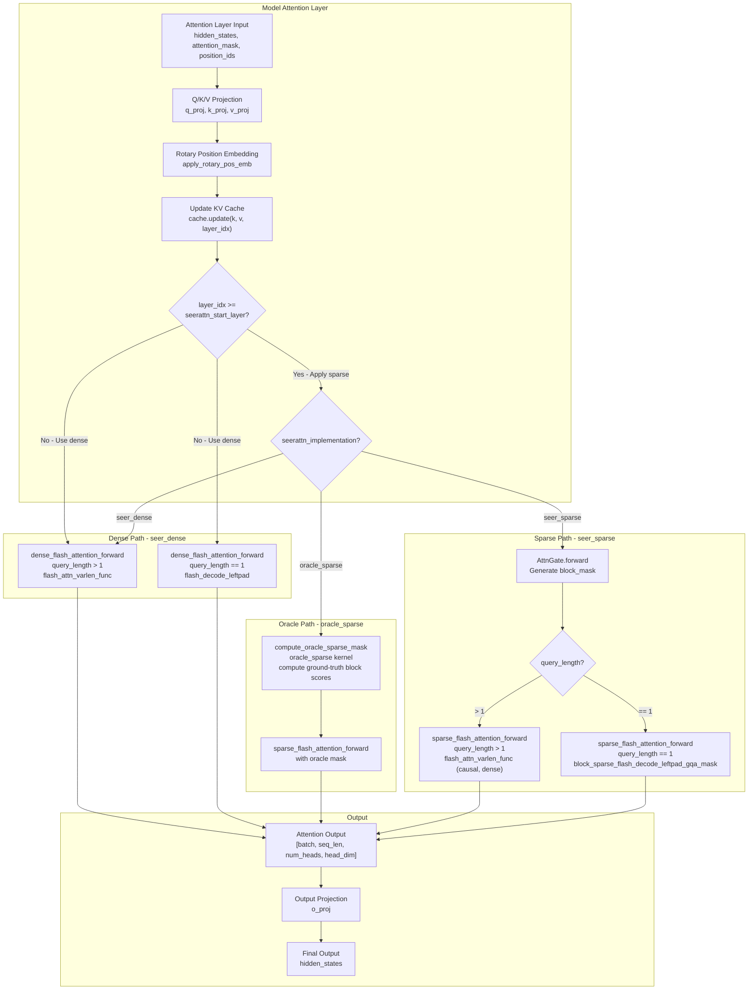

**Key Integration Points:**

1. **Layer Selection:** Only layers with `layer_idx >= seerattn_start_layer` use sparse attention. Earlier layers use standard dense attention for stability. [seer_attn/decode_sparse/qwen2/configuration_qwen2_seerattn.py:80]()

2. **Prefill Phase (query_length > 1):**
   - Initializes `AttnGate` compressed cache
   - Uses standard causal Flash Attention (`flash_attn_varlen_func`)
   - No sparse mask applied during prefill
   - Code: [seer_attn/decode_sparse/attention_forward_sparse.py:124-148]()

3. **Decode Phase (query_length == 1):**
   - `AttnGate` generates block-level mask per decoding step
   - Passes mask to `block_sparse_flash_decode_leftpad_gqa_mask` kernel
   - Kernel parameters:
     - `block_mask`: [batch, num_kv_heads, num_blocks] boolean tensor
     - `block_size`: Block size in tokens (16, 32, or 64)
     - `first_block_unmasked`: Always True (keeps first block attended)
     - `cache_seqlens`: Actual sequence lengths per batch element
   - Code: [seer_attn/decode_sparse/attention_forward_sparse.py:149-161]()

4. **Variable-Length Sequence Handling:**
   - Both sparse and dense paths support `cache_seqlens` parameter
   - Enables batching sequences of different lengths without padding overhead
   - Left-padding strategy used for KV cache alignment

**Sparse Kernel Parameters:**

| Parameter | Type | Description |
|-----------|------|-------------|
| `query_states` | `torch.Tensor` | [batch, 1, num_q_heads, head_dim] or [batch, num_q_heads, head_dim] |
| `key_states` | `torch.Tensor` | [batch, max_cache_len, num_kv_heads, head_dim] |
| `value_states` | `torch.Tensor` | [batch, max_cache_len, num_kv_heads, head_dim] |
| `cache_seqlens` | `torch.Tensor` | [batch] - actual length per sequence |
| `block_mask` | `torch.Tensor` | [batch, num_kv_heads, num_blocks] - boolean mask |
| `block_size` | `int` | 16, 32, or 64 |
| `sm_scale` | `float` | 1/sqrt(head_dim) |
| `first_block_unmasked` | `bool` | Always True |

**Sources:** [seer_attn/decode_sparse/attention_forward_sparse.py:111-162](), [seer_attn/decode_sparse/attention_forward_dense.py:110-155](), [seer_attn/decode_sparse/qwen2/configuration_qwen2_seerattn.py:68-82]()

## Configuration Parameters

All SeerAttention mechanism parameters are configured through the model configuration class (e.g., `SeerAttnQwen2Config`).

**Core Sparsity Parameters:**

| Parameter | Type | Default | Description |
|-----------|------|---------|-------------|
| `seerattn_sparsity_method` | str | `'threshold'` | Method for sparsity selection: `'threshold'` or `'token_budget'` |
| `seerattn_threshold` | float | `0.0` | Threshold value for threshold-based sparsity (typical: 5e-4 to 5e-3) |
| `seerattn_token_budget` | int | `4096` | Token budget for budget-based sparsity (converted to block budget) |
| `seerattn_gate_block_size` | int | `64` | Block size in tokens: 16, 32, or 64 |

**AttnGate Architecture Parameters:**

| Parameter | Type | Default | Description |
|-----------|------|---------|-------------|
| `seerattn_gate_hidden_size` | int | `128` | Hidden size for gate projections: 64, 128, or 256 |
| `seerattn_k_seq_pooling_type` | str | `'Kmaxminavg'` | K pooling functions: combinations of max/min/avg |
| `seerattn_q_head_pooling_type` | str | `'Qproj'` | Q head pooling: `'Qproj'`, `'Qavgproj'`, `'Qavg'`, `'Qorig'` |
| `seerattn_use_rope` | bool | `True` | Apply rotary position embeddings to gate representations |
| `seerattn_use_qk_norm` | bool | `False` | Apply RMSNorm before gate attention computation |

**Implementation Control Parameters:**

| Parameter | Type | Default | Description |
|-----------|------|---------|-------------|
| `seerattn_implementation` | str | `'seer_sparse'` | Implementation mode: `'seer_sparse'`, `'seer_dense'`, `'oracle_sparse'` |
| `seerattn_start_layer` | int | `0` | First layer to apply sparse attention (earlier layers use dense) |
| `seerattn_output_sparsity` | bool | `False` | Whether to output sparsity statistics during inference |
| `seerattn_sliding_window_size` | int | `0` | Sliding window size (0 means no sliding window) |

**Configuration Validation:**

The configuration class validates parameter values at initialization:

```python
assert self.seerattn_q_head_pooling_type in ['Qproj', 'Qavgproj', 'Qavg']
assert self.seerattn_implementation in ['seer_sparse', 'seer_dense', 'oracle_sparse']
assert self.seerattn_sparsity_method in ['threshold', 'nz_ratio']
assert self.seerattn_gate_hidden_size in [64, 128, 256]
assert self.seerattn_gate_block_size in [16, 32, 64]
```

**Example Configuration:**

```python
from transformers import AutoConfig

config = AutoConfig.from_pretrained("SeerAttention/SeerAttention-Decode-Qwen3-4B-AttnGates")

# Sparsity configuration
config.seerattn_sparsity_method = 'token_budget'
config.seerattn_token_budget = 4096

# Gate architecture
config.seerattn_gate_block_size = 64
config.seerattn_gate_hidden_size = 128
config.seerattn_k_seq_pooling_type = 'Kmaxminavg'
config.seerattn_q_head_pooling_type = 'Qproj'

# Implementation mode
config.seerattn_implementation = 'seer_sparse'
config.seerattn_start_layer = 0
```

**Sources:** [seer_attn/decode_sparse/qwen2/configuration_qwen2_seerattn.py:46-139](), [README.md:74-113]()

---

# Page: AttnGates

# AttnGates

<details>
<summary>Relevant source files</summary>

The following files were used as context for generating this wiki page:

- [distillation_decode.py](distillation_decode.py)
- [scripts/run_distillation_prefill.sh](scripts/run_distillation_prefill.sh)
- [seer_attn/decode_sparse/attention_forward_dense.py](seer_attn/decode_sparse/attention_forward_dense.py)
- [seer_attn/decode_sparse/attention_forward_sparse.py](seer_attn/decode_sparse/attention_forward_sparse.py)
- [seer_attn/decode_sparse/attn_gate_inf.py](seer_attn/decode_sparse/attn_gate_inf.py)
- [seer_attn/decode_sparse/qwen2/configuration_qwen2_seerattn.py](seer_attn/decode_sparse/qwen2/configuration_qwen2_seerattn.py)
- [seer_attn/decode_sparse/qwen2/modeling_qwen2_seerattn_inference.py](seer_attn/decode_sparse/qwen2/modeling_qwen2_seerattn_inference.py)
- [seer_attn/decode_sparse/qwen3/modeling_qwen3_seerattn_inference.py](seer_attn/decode_sparse/qwen3/modeling_qwen3_seerattn_inference.py)
- [seer_attn/modules/attention_distill.py](seer_attn/modules/attention_distill.py)
- [seer_attn/modules/common.py](seer_attn/modules/common.py)

</details>


## Purpose and Scope

AttnGates are lightweight, trainable neural network modules that learn to predict block-level attention sparsity patterns. They are the core innovation of SeerAttention, enabling efficient sparse attention by dynamically determining which blocks of keys/values should participate in attention computation. AttnGates are trained separately via self-distillation and stored independently from base models (66-503 MB), allowing them to be composed with frozen foundation models.

This page covers the architecture, mask generation mechanism, training process, and storage/loading of AttnGates. For information about how these generated masks are used in attention computation, see [Sparsity Methods](#3.3). For the broader integration into model forward passes, see [Sparse Decode Models](#4.2).

---

## Architecture Overview

### Class Hierarchy and Components

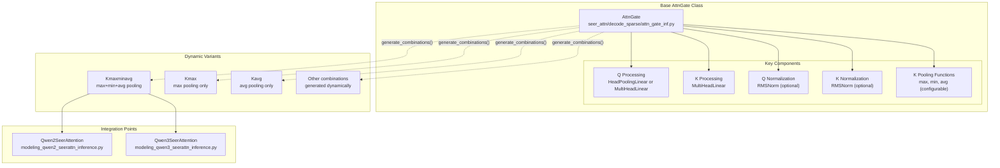

**Sources:** [seer_attn/decode_sparse/attn_gate_inf.py:110-256](), [seer_attn/decode_sparse/attn_gate_inf.py:266-298]()

### Core Parameters

The `AttnGate` class is configured with the following key parameters:

| Parameter | Typical Values | Description |
|-----------|---------------|-------------|
| `block_size` | 16, 32, 64 | Granularity of block-level sparsity |
| `model_hidden_size` | 128 (head_dim) | Dimension of model's attention head |
| `gate_hidden_size` | 64, 128, 256 | Internal hidden dimension for gate computation |
| `num_k_head` | 8-32 | Number of key/value heads (GQA) |
| `num_q_head` | 32-128 | Number of query heads |
| `q_head_pooling_type` | "Qproj", "Qavgproj", "Qavg" | How to aggregate query heads |
| `k_pooling_funcs` | [max, min, avg] | List of pooling functions for keys |
| `use_flash_rope` | True/False | Whether to use flash-attention RoPE format |
| `use_qk_norm` | True/False | Whether to normalize Q/K before attention |

**Sources:** [seer_attn/decode_sparse/attn_gate_inf.py:111-131](), [seer_attn/decode_sparse/qwen2/configuration_qwen2_seerattn.py:68-82]()

---

## Internal Components

### HeadPoolingLinear and MultiHeadLinear

AttnGates use specialized linear layers that operate per-head to maintain head-specific information:

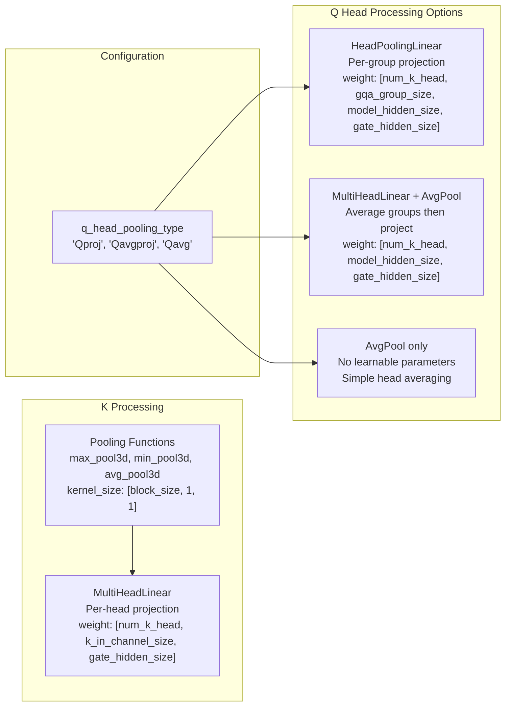

**HeadPoolingLinear** ([seer_attn/decode_sparse/attn_gate_inf.py:63-84]()):
- Weight shape: `[num_k_head, gqa_group_size, model_hidden_size, gate_hidden_size]`
- Performs einsum: `'bskgi,kgio->bsko'` (4D) or `'skgi,kgio->sko'` (3D)
- Used when `q_head_pooling_type == "Qproj"`

**MultiHeadLinear** ([seer_attn/decode_sparse/attn_gate_inf.py:87-108]()):
- Weight shape: `[num_head, in_channel, hidden_size]`
- Performs einsum: `'bshi,hio->bsho'` (4D) or `'shi,hio->sho'` (3D)
- Used for K projection and when `q_head_pooling_type == "Qavgproj"`

**Sources:** [seer_attn/decode_sparse/attn_gate_inf.py:63-108](), [seer_attn/decode_sparse/attn_gate_inf.py:137-145]()

### K Pooling Strategy

Keys are pooled using a combination of pooling functions to capture different statistical properties:

| Pooling Type | Function | Purpose |
|--------------|----------|---------|
| `max` | `F.max_pool3d` | Captures maximum activations (most important tokens) |
| `min` | `min_pool3d` (custom) | Captures minimum activations (inverse pattern) |
| `avg` | `F.avg_pool3d` | Captures average activation level |

The pooling functions are applied with `kernel_size=[block_size, 1, 1]` and `stride=[block_size, 1, 1]`, reducing the sequence dimension by a factor of `block_size`. Results are concatenated: `k_in_channel_size = model_hidden_size * len(k_pooling_funcs)`.

**Sources:** [seer_attn/decode_sparse/attn_gate_inf.py:16-17](), [seer_attn/decode_sparse/attn_gate_inf.py:259-263](), [seer_attn/decode_sparse/attn_gate_inf.py:133-136]()

---

## Mask Generation Process

AttnGates generate block-level sparse masks differently for prefill and decode phases:

### Decode Phase (Token-by-Token Generation)

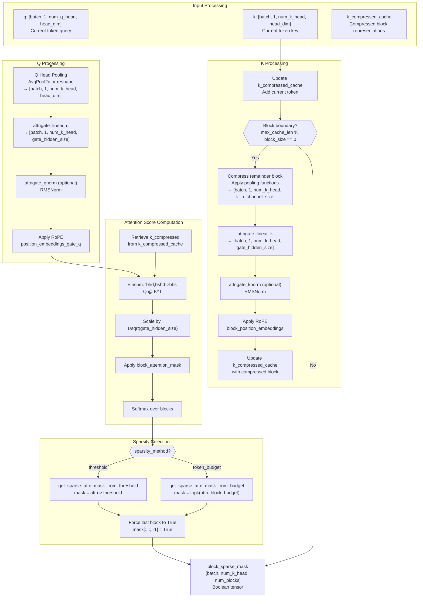

**Key Steps for Decode:**

1. **Q Processing** ([seer_attn/decode_sparse/attn_gate_inf.py:169-184]()):
   - Pool query heads from `num_q_head` to `num_k_head` (GQA alignment)
   - Project through `attngate_linear_q` to `gate_hidden_size`
   - Optional RMSNorm and RoPE application

2. **K Compression** ([seer_attn/decode_sparse/attn_gate_inf.py:186-204]()):
   - Add current key to cache
   - At block boundaries (when `max_cache_len % block_size == 0`):
     - Apply pooling functions to the remainder block
     - Concatenate pooled results
     - Project through `attngate_linear_k`
     - Optional RMSNorm and RoPE application
     - Store compressed block representation

3. **Attention Score Computation** ([seer_attn/decode_sparse/attn_gate_inf.py:207-223]()):
   - Compute attention scores between query and all compressed blocks
   - Einsum: `'bhd,bshd->bhs'` (query @ compressed_keys^T)
   - Scale by `1/sqrt(gate_hidden_size)`
   - Apply block attention mask
   - Softmax over block dimension

4. **Sparsity Selection** ([seer_attn/decode_sparse/attn_gate_inf.py:224-229]()):
   - Threshold method: Select blocks where `attn > threshold`
   - Token budget method: Select top-k blocks
   - Always keep last block active (`mask[:, :, -1] = True`)

**Sources:** [seer_attn/decode_sparse/attn_gate_inf.py:152-230]()

### Prefill Phase (Batch Processing)

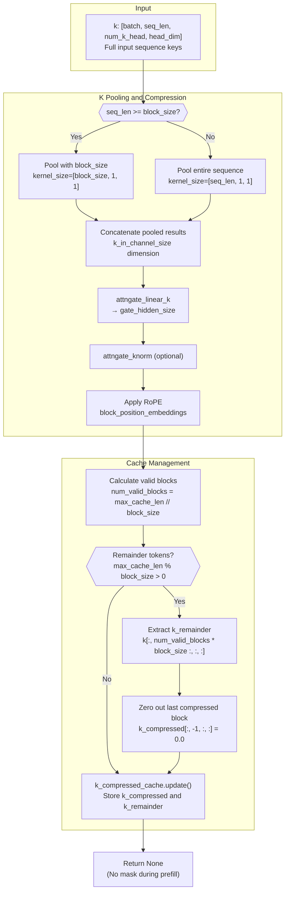

**Prefill Behavior** ([seer_attn/decode_sparse/attn_gate_inf.py:231-255]()):

During prefill (when `k.shape[1] > 1`), AttnGates do **not** generate a sparse mask. Instead, they:

1. **Compress the input sequence** using the same pooling and projection operations
2. **Handle incomplete blocks**: If the sequence length isn't divisible by `block_size`, extract the remainder tokens and zero out the last compressed block
3. **Store compressed representations** in `k_compressed_cache` for use in subsequent decode steps
4. **Return `None`** - dense attention is used during prefill

This design reflects the fact that prefill processes long contexts in parallel, where the overhead of sparse attention may not be beneficial. The compression work done during prefill prepares the cache for efficient sparse decode.

**Sources:** [seer_attn/decode_sparse/attn_gate_inf.py:231-255]()

---

## Sparsity Method Functions

AttnGates support two primary sparsity control methods:

### Threshold-Based Sparsity

```python
def get_sparse_attn_mask_from_threshold(x, threshold):
    dense_mask = x > threshold 
    return dense_mask
```

- **Purpose**: Select blocks where attention score exceeds a fixed threshold
- **Typical threshold values**: `5e-4` to `5e-3` (from config)
- **Behavior**: Variable number of blocks selected per head/query
- **Use case**: Long-context understanding (PG19, LongBench, RULER)

**Sources:** [seer_attn/decode_sparse/attn_gate_inf.py:21-23](), [seer_attn/decode_sparse/qwen2/configuration_qwen2_seerattn.py:68-71]()

### Token Budget Sparsity

```python
def get_sparse_attn_mask_from_budget(x, block_budget, block_attention_mask):
    block_seq_len = x.size(-1)
    
    if block_seq_len <= block_budget:
        full_mask = torch.ones_like(x, dtype=torch.bool, device=x.device)
        full_mask = full_mask & block_attention_mask
        return full_mask

    k = block_budget 
    _, topk_indices = torch.topk(x, k=k, dim=-1, sorted=False)
    
    mask = torch.zeros_like(x, dtype=torch.bool, device=x.device)
    mask.scatter_(-1, topk_indices, True)

    final_mask = mask & block_attention_mask
    return final_mask
```

- **Purpose**: Select exactly top-k blocks based on attention scores
- **Typical values**: `block_budget = token_budget / block_size` (e.g., 4096 tokens / 64 = 64 blocks)
- **Behavior**: Fixed number of blocks selected per head/query
- **Use case**: Long-reasoning generation (AIME, MATH, GPQA)

**Sources:** [seer_attn/decode_sparse/attn_gate_inf.py:25-42](), [seer_attn/decode_sparse/qwen2/modeling_qwen2_seerattn_inference.py:94-106]()

---

## Training Process: Self-Distillation

### Overview

AttnGates are trained using a self-distillation approach where they learn to mimic the attention patterns of a frozen dense base model:

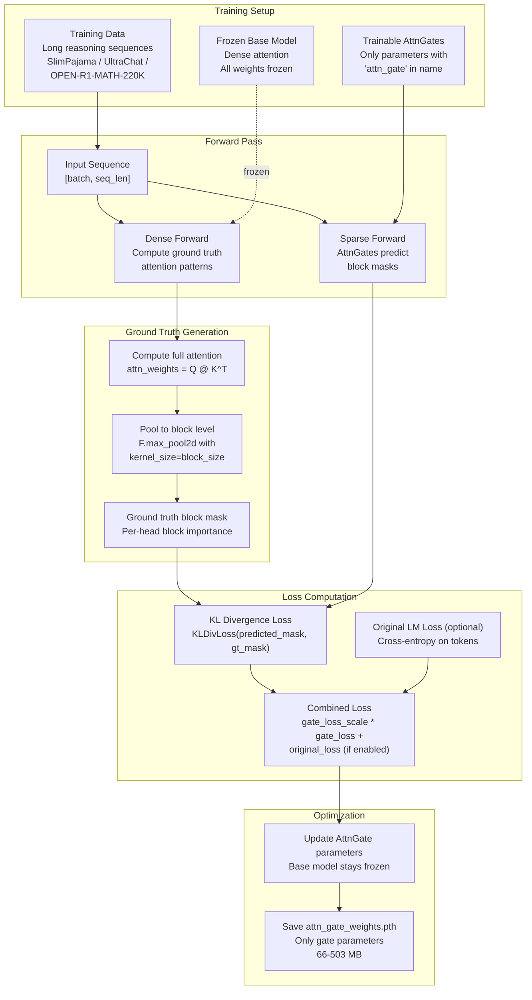

**Sources:** [distillation_decode.py:27-59](), [seer_attn/decode_sparse/qwen2/modeling_qwen2_seerattn_training.py]()

### Training Configuration

The training process is controlled by several key parameters:

| Parameter | Typical Value | Description |
|-----------|--------------|-------------|
| `gate_loss_scale` | 10.0 | Weight for gate loss vs. original LM loss |
| `orig_weight_training` | False | Whether to also train base model weights |
| `training_max_length` | 65536 | Maximum sequence length in training |
| `trainable_params` | "attngate" | Only parameters containing this string are trainable |
| `learning_rate` | 1e-3 | Learning rate for gate parameters |
| `warmup_steps` | 20 | Number of warmup steps |

**Loss Function** ([distillation_decode.py:43-59]()):

```python
def compute_loss(self, model, inputs, return_outputs=False, num_items_in_batch=None):
    outputs = model(**inputs)
    original_loss = outputs.get("loss")
    mask_loss = outputs.get("gate_loss")
    
    if self.orig_weight_training:
        tok_loss = original_loss + self.gate_loss_scale * mask_loss
    else:
        tok_loss = self.gate_loss_scale * mask_loss
    
    return (tok_loss, outputs) if return_outputs else tok_loss
```

**Sources:** [distillation_decode.py:27-59](), [distillation_decode.py:98-127]()

### Parameter Freezing

Only AttnGate parameters are trained:

```python
for n, p in model.named_parameters():
    if training_args.trainable_params in n:  # "attngate"
        p.requires_grad = True
    else:
        p.requires_grad = False
```

This results in:
- **Frozen**: All base model parameters (embeddings, attention QKV projections, MLP layers, etc.)
- **Trainable**: Only `attn_gate` modules (linear projections, norms if enabled)
- **Size**: 66-503 MB depending on model size and configuration

**Sources:** [distillation_decode.py:279-283]()

---

## Dynamic Variant Generation

AttnGates support multiple pooling combinations, generated dynamically at import time:

```mermaid
graph TB
    subgraph "Pooling Function Registry"
        MaxPool["'max': F.max_pool3d"]
        MinPool["'min': min_pool3d"]
        AvgPool["'avg': F.avg_pool3d"]
    end
    
    subgraph "Combination Generation"
        GenCombos["generate_combinations()<br/>Generate all 1-, 2-, and 3-way<br/>combinations of pooling functions"]
        
        subgraph "1-way combinations"
            Kmax["'Kmax'<br/>[max]"]
            Kmin["'Kmin'<br/>[min]"]
            Kavg["'Kavg'<br/>[avg]"]
        end
        
        subgraph "2-way combinations"
            Kmaxmin["'Kmaxmin'<br/>[max, min]"]
            Kmaxavg["'Kmaxavg'<br/>[max, avg]"]
            Kminavg["'Kminavg'<br/>[min, avg]"]
        end
        
        subgraph "3-way combinations"
            Kmaxminavg["'Kmaxminavg'<br/>[max, min, avg]"]
        end
        
        GenCombos --> Kmax
        GenCombos --> Kmin
        GenCombos --> Kavg
        GenCombos --> Kmaxmin
        GenCombos --> Kmaxavg
        GenCombos --> Kminavg
        GenCombos --> Kmaxminavg
    end
    
    subgraph "Dynamic Class Creation"
        CreateClass["_create_generic_attngate_class<br/>Create class inheriting from AttnGate<br/>with specified k_pooling_funcs"]
        ATTNGATEClasses["ATTNGATE_CLASSES dict<br/>Maps class name to class"]
    end
    
    MaxPool --> GenCombos
    MinPool --> GenCombos
    AvgPool --> GenCombos
    
    Kmaxminavg --> CreateClass
    Kmax --> CreateClass
    CreateClass --> ATTNGATEClasses
    
    subgraph "Usage in Models"
        ConfigParam["config.seerattn_k_seq_pooling_type<br/>e.g., 'Kmaxminavg'"]
        Instantiate["ATTNGATE_CLASSES[config.seerattn_k_seq_pooling_type]<br/>Instantiate the appropriate class"]
    end
    
    ATTNGATEClasses --> Instantiate
    ConfigParam --> Instantiate
```

**Implementation** ([seer_attn/decode_sparse/attn_gate_inf.py:266-298]()):

```python
def _create_generic_attngate_class(base_class, suffix, k_pooling_names):
    k_pooling_funcs = [POOL_FUNCS[name] for name in k_pooling_names]
    class_name = f"K{''.join(k_pooling_names)}{suffix}"

    class NewAttnGate(base_class):
        def __init__(self, block_size, model_hidden_size, gate_hidden_size, 
                     num_k_head, num_q_head, q_head_pooling_type, 
                     use_flash_rope=False, use_qk_norm=False):
            super(NewAttnGate, self).__init__(
                block_size=block_size,
                model_hidden_size=model_hidden_size,
                gate_hidden_size=gate_hidden_size,
                num_k_head=num_k_head,
                num_q_head=num_q_head,
                q_head_pooling_type=q_head_pooling_type,
                k_pooling_funcs=k_pooling_funcs,
                use_flash_rope=use_flash_rope,
                use_qk_norm=use_qk_norm,
            )
    NewAttnGate.__name__ = class_name
    return class_name, NewAttnGate

def generate_combinations():
    new_classes = {}
    pool_types = ['max', 'min', 'avg']

    for k_comb in range(1, 4):
        for k_pooling_comb in combinations(pool_types, k_comb):
            class_name, new_class = _create_generic_attngate_class(
                AttnGate, '', k_pooling_comb
            )
            new_classes[class_name] = new_class
    return new_classes

ATTNGATE_CLASSES = generate_combinations()
```

This generates 7 classes total (3 single-pooling + 3 two-pooling + 1 three-pooling), accessible via the `ATTNGATE_CLASSES` dictionary.

**Sources:** [seer_attn/decode_sparse/attn_gate_inf.py:259-298]()

---

## Storage and Loading Mechanism

### Storage Format

AttnGates are stored separately from base models to enable flexible composition:

```mermaid
graph LR
    subgraph "Hugging Face Hub Structure"
        subgraph "Base Model Repo"
            BaseRepo["meta-llama/Llama-3.1-8B<br/>Qwen/Qwen2.5-7B<br/>etc."]
            BaseWeights["model.safetensors<br/>Full model weights<br/>8-70 GB"]
            BaseConfig["config.json<br/>Model configuration"]
        end
        
        subgraph "AttnGates Repo"
            GateRepo["SeerAttention-Qwen2.5-7B-AttnGates<br/>SeerAttention-Decode-Qwen3-4B-AttnGates<br/>etc."]
            GateWeights["attn_gate_weights.pth<br/>Only gate parameters<br/>66-503 MB"]
            GateConfig["config.json<br/>base_model: path to base<br/>seerattn_* parameters"]
        end
    end
    
    GateConfig -.->|"references"| BaseRepo
```

**Saved AttnGate Weights** contain only parameters with "attn_gate" in their names:

- `model.layers.{i}.self_attn.attn_gate.attngate_linear_q.weight`
- `model.layers.{i}.self_attn.attn_gate.attngate_linear_k.weight`
- `model.layers.{i}.self_attn.attn_gate.attngate_qnorm.weight` (if enabled)
- `model.layers.{i}.self_attn.attn_gate.attngate_knorm.weight` (if enabled)

**Saved Configuration** ([seer_attn/decode_sparse/qwen2/configuration_qwen2_seerattn.py:46-139]()):

```json
{
  "base_model": "Qwen/Qwen2.5-7B-Instruct",
  "seerattn_k_seq_pooling_type": "Kmaxminavg",
  "seerattn_q_head_pooling_type": "Qproj",
  "seerattn_gate_block_size": 64,
  "seerattn_gate_hidden_size": 128,
  "seerattn_use_rope": true,
  "seerattn_use_qk_norm": false,
  "seerattn_sparsity_method": "token_budget",
  "seerattn_token_budget": 4096,
  "seerattn_threshold": 0.0,
  "seerattn_implementation": "seer_sparse",
  "seerattn_start_layer": 0
}
```

**Sources:** [distillation_decode.py:344-353](), [seer_attn/decode_sparse/qwen2/configuration_qwen2_seerattn.py:46-139]()

### Loading Mechanism

The `from_pretrained` method handles automatic composition of base model and AttnGates:

```mermaid
graph TB
    subgraph "User Call"
        UserCall["model = SeerDecodingQwen2ForCausalLM.from_pretrained<br/>('SeerAttention-Qwen2.5-7B-AttnGates', load_gate=True)"]
    end
    
    subgraph "Configuration Loading"
        LoadGateConfig["Load SeerAttnQwen2Config<br/>from gates repository"]
        ExtractBasePath["Extract config.base_model<br/>e.g., 'Qwen/Qwen2.5-7B-Instruct'"]
    end
    
    subgraph "Base Model Loading"
        LoadBase["Load base model from base_model path<br/>All weights loaded"]
        ApplyConfig["Apply gate config to base model<br/>Override seerattn_* parameters"]
    end
    
    subgraph "Gate Weights Loading"
        CheckLocal{{"Local or remote?"}}
        LoadLocal["torch.load<br/>(pretrained_path/attn_gate_weights.pth)"]
        LoadRemote["hf_hub_download<br/>then torch.load"]
        LoadState["model.load_state_dict<br/>(gate_weights, strict=False)"]
    end
    
    Composed["Composed Model<br/>Base + AttnGates<br/>Ready for inference"]
    
    UserCall --> LoadGateConfig
    LoadGateConfig --> ExtractBasePath
    ExtractBasePath --> LoadBase
    LoadBase --> ApplyConfig
    ApplyConfig --> CheckLocal
    CheckLocal -->|"Local"| LoadLocal
    CheckLocal -->|"Remote"| LoadRemote
    LoadLocal --> LoadState
    LoadRemote --> LoadState
    LoadState --> Composed
```

**Implementation** ([seer_attn/decode_sparse/qwen2/modeling_qwen2_seerattn_inference.py:769-794]()):

```python
@classmethod
def from_pretrained(cls, pretrained_model_name_or_path, load_gate=True, *model_args, **kwargs):
    if load_gate:
        # Load gate config first
        config = SeerAttnQwen2Config.from_pretrained(pretrained_model_name_or_path, *model_args, **kwargs)
        base_model = config.base_model
        
        # Override config with any kwargs
        for key in list(kwargs.keys()):
            if hasattr(config, key) and key != "torch_dtype":
                setattr(config, key, kwargs.pop(key))
        
        # Load base model with gate config
        model = super().from_pretrained(base_model, config=config, *model_args, **kwargs)

        # Load gate weights
        if os.path.exists(pretrained_model_name_or_path):
            gate_weights = torch.load(
                os.path.join(pretrained_model_name_or_path, "attn_gate_weights.pth")
            )
        else:
            gate_weights = torch.load(
                hf_hub_download(repo_id=pretrained_model_name_or_path, 
                               filename="attn_gate_weights.pth")
            )
                
        model.load_state_dict(gate_weights, strict=False)
        print("Attention gate weights loaded successfully.")
    else:
        model = super().from_pretrained(pretrained_model_name_or_path, *model_args, **kwargs)

    return model
```

**Key Points:**

1. **`strict=False`**: Allows loading only AttnGate weights without errors for missing base model parameters
2. **Config composition**: Gate config's `base_model` field points to the frozen base model
3. **Separate storage**: AttnGates (66-503 MB) stored separately from base models (8-70 GB)
4. **Automatic download**: Uses Hugging Face Hub for both base and gate weights

**Sources:** [seer_attn/decode_sparse/qwen2/modeling_qwen2_seerattn_inference.py:769-794](), [seer_attn/decode_sparse/qwen3/modeling_qwen3_seerattn_inference.py:769-795]()

---

## Integration with Attention Layers

AttnGates are instantiated within attention modules:

```python
# From Qwen2SeerAttention.__init__
self.attn_gate = ATTNGATE_CLASSES[config.seerattn_k_seq_pooling_type](
    config.seerattn_gate_block_size, 
    self.head_dim, 
    config.seerattn_gate_hidden_size,
    num_k_head=config.num_key_value_heads, 
    num_q_head=config.num_attention_heads,
    q_head_pooling_type=config.seerattn_q_head_pooling_type,
    use_flash_rope=config.use_flash_rope,
    use_qk_norm=config.seerattn_use_qk_norm,
)
```

And called during forward pass:

```python
# Generate block sparse mask
block_sparse_mask = self.attn_gate(
    k_nope,  # Keys without RoPE
    self.layer_idx,
    k_compressed_cache,
    q_nope,  # Queries without RoPE
    block_attention_mask,
    max_cache_len=k.shape[1],
    position_embeddings=position_embeddings_gate_q,
    block_position_embeddings=block_position_embeddings,
    threshold=self.config.seerattn_threshold,
    block_budget=self.block_budget,
    sparsity_method=self.config.seerattn_sparsity_method,
)

# Use mask in sparse attention kernel
attn_output = sparse_flash_attention_forward(
    q, k, v,
    block_mask=block_sparse_mask,
    block_size=self.config.seerattn_gate_block_size,
    ...
)
```

**Sources:** [seer_attn/decode_sparse/qwen2/modeling_qwen2_seerattn_inference.py:89-98](), [seer_attn/decode_sparse/qwen2/modeling_qwen2_seerattn_inference.py:152-164]()

---

## Oracle Sparse Baseline

For ablation studies, an oracle sparse mode computes ground-truth attention scores:

```python
def compute_oracle_sparse_mask(q, k, cache_seqlens, block_attention_mask, 
                                block_size, sparsity_method, threshold=0.0, 
                                block_budget=2048):
    q_len = q.shape[1]
    if q_len > 1:  # Use dense prefill for oracle mode
        block_sparse_mask = None
    else:
        # Compute actual attention weights at block level
        attn_weights = oracle_sparse(q, k, cache_seqlens, block_size)
        
        if sparsity_method == "token_budget":
            block_sparse_mask = get_sparse_attn_mask_from_budget(
                attn_weights, block_budget, block_attention_mask
            )
        elif sparsity_method == "threshold":
            block_sparse_mask = get_sparse_attn_mask_from_threshold(
                attn_weights, threshold
            )

        block_sparse_mask[:, :, -1] = True
    
    return block_sparse_mask
```

This provides an upper bound on performance by using true attention scores rather than learned predictions.

**Sources:** [seer_attn/decode_sparse/attn_gate_inf.py:44-60]()

---

## Summary

**AttnGates** are the core predictive components of SeerAttention:

- **Architecture**: Lightweight modules with per-head linear projections and configurable pooling strategies
- **Size**: 66-503 MB per model, enabling separate storage from base models
- **Training**: Self-distillation from frozen dense models using KL divergence loss
- **Operation**: Generate block-level sparse masks during decode, skip mask generation during prefill
- **Flexibility**: Dynamic variant generation supports 7 pooling combinations; 3 Q head pooling types
- **Storage**: Separate HuggingFace repos with automatic composition via `from_pretrained(load_gate=True)`
- **Integration**: Instantiated per attention layer, called before sparse attention kernels

The modular design enables mixing and matching AttnGates with different base models and sparsity configurations.

**Sources:** [seer_attn/decode_sparse/attn_gate_inf.py:110-298](), [seer_attn/decode_sparse/qwen2/modeling_qwen2_seerattn_inference.py:72-210](), [distillation_decode.py:27-353]()

---

# Page: Sparsity Methods

# Sparsity Methods

<details>
<summary>Relevant source files</summary>

The following files were used as context for generating this wiki page:

- [README.md](README.md)
- [seer_attn/__init__.py](seer_attn/__init__.py)
- [seer_attn/decode_sparse/attention_forward_dense.py](seer_attn/decode_sparse/attention_forward_dense.py)
- [seer_attn/decode_sparse/attention_forward_sparse.py](seer_attn/decode_sparse/attention_forward_sparse.py)
- [seer_attn/decode_sparse/attn_gate_inf.py](seer_attn/decode_sparse/attn_gate_inf.py)
- [seer_attn/decode_sparse/qwen2/configuration_qwen2_seerattn.py](seer_attn/decode_sparse/qwen2/configuration_qwen2_seerattn.py)

</details>


## Purpose and Scope

This document explains the different sparsity control methods used in SeerAttention to convert soft attention scores (generated by AttnGates) into hard binary attention masks. These methods determine which blocks of the key-value cache are attended to during inference, directly controlling the trade-off between computational efficiency and model accuracy.

For information about how AttnGates generate the initial attention scores, see [AttnGates](#3.2). For details on the overall sparse attention mechanism, see [SeerAttention Mechanism](#3.1). For configuration parameters and model setup, see [Model Configuration](#4.3).

## Overview

SeerAttention supports multiple sparsity methods that operate at the **block level** rather than individual tokens. Each method takes attention scores computed by AttnGates and converts them into a binary mask that determines which blocks participate in attention computation.

| Method | Parameter | Description | Use Case |
|--------|-----------|-------------|----------|
| `threshold` | `seerattn_threshold` | Keep blocks with score > threshold | Long-context prefill, fixed sparsity level |
| `token_budget` | `seerattn_token_budget` | Keep top-k blocks based on token budget | Sparse decode, controlled memory/compute |

Both methods ensure the final block (containing the most recent tokens) is always kept, preventing loss of immediate context.

**Sources:** [README.md:73-109](), [seer_attn/decode_sparse/qwen2/configuration_qwen2_seerattn.py:68-71]()

## Block-Level Sparsity

All sparsity methods in SeerAttention operate at the **block granularity** defined by `seerattn_gate_block_size` (typically 16, 32, or 64 tokens). This design choice aligns with hardware characteristics and enables efficient kernel implementations.

```mermaid
graph TB
    subgraph "Token Sequence (4096 tokens)"
        direction LR
        Block0["Block 0<br/>tokens 0-63"]
        Block1["Block 1<br/>tokens 64-127"]
        Block2["Block 2<br/>tokens 128-191"]
        Dots1["..."]
        Block63["Block 63<br/>tokens 4032-4095"]
    end
    
    subgraph "AttnGate Scores (per block)"
        Score0["0.023"]
        Score1["0.891"]
        Score2["0.045"]
        Dots2["..."]
        Score63["0.672"]
    end
    
    subgraph "Sparsity Method"
        ThresholdPath["threshold = 0.0005<br/>Keep if score > 0.0005"]
        BudgetPath["token_budget = 2048<br/>Keep top 32 blocks"]
    end
    
    subgraph "Binary Mask"
        Mask0["False"]
        Mask1["True"]
        Mask2["False"]
        Dots3["..."]
        Mask63["True"]
    end
    
    Block0 --> Score0
    Block1 --> Score1
    Block2 --> Score2
    Block63 --> Score63
    
    Score0 --> ThresholdPath
    Score1 --> ThresholdPath
    Score2 --> ThresholdPath
    Score63 --> ThresholdPath
    
    Score0 --> BudgetPath
    Score1 --> BudgetPath
    Score2 --> BudgetPath
    Score63 --> BudgetPath
    
    ThresholdPath --> Mask0
    ThresholdPath --> Mask1
    ThresholdPath --> Mask2
    ThresholdPath --> Mask63
    
    BudgetPath --> Mask0
    BudgetPath --> Mask1
    BudgetPath --> Mask2
    BudgetPath --> Mask63
    
    style Block1 fill:#e1f5ff
    style Block63 fill:#e1f5ff
    style Score1 fill:#e1f5ff
    style Score63 fill:#e1f5ff
    style Mask1 fill:#e1ffe1
    style Mask63 fill:#e1ffe1
```

**Diagram: Block-Level Sparsity Transformation**

The diagram shows how a sequence is divided into blocks, AttnGates compute per-block scores, sparsity methods convert scores to binary masks, and only masked blocks participate in attention.

**Sources:** [seer_attn/decode_sparse/qwen2/configuration_qwen2_seerattn.py:77-78](), [seer_attn/decode_sparse/attn_gate_inf.py:21-42]()

## Method 1: Threshold-Based Sparsity

### Implementation

The threshold method creates a sparse mask by keeping all blocks whose attention score exceeds a configurable threshold value.

```mermaid
graph LR
    AttnScores["Attention Scores<br/>x: [batch, num_heads, num_blocks]"]
    
    ThresholdFunc["get_sparse_attn_mask_from_threshold"]
    
    Comparison["x > threshold"]
    
    DenseMask["Boolean Mask<br/>[batch, num_heads, num_blocks]"]
    
    FinalMask["Final Mask<br/>(ensure last block = True)"]
    
    AttnScores --> ThresholdFunc
    ThresholdFunc --> Comparison
    Comparison --> DenseMask
    DenseMask --> FinalMask
    
    style ThresholdFunc fill:#e1f5ff
```

**Diagram: Threshold Method Data Flow**

The function `get_sparse_attn_mask_from_threshold` in [seer_attn/decode_sparse/attn_gate_inf.py:21-23]() implements this logic:

```python
def get_sparse_attn_mask_from_threshold(x, threshold):
    dense_mask = x > threshold 
    return dense_mask
```

The threshold is then applied in `AttnGate.forward()` at [seer_attn/decode_sparse/attn_gate_inf.py:226-227]():

```python
elif sparsity_method == "threshold":
    mask = get_sparse_attn_mask_from_threshold(attn, threshold)
```

### Configuration Parameters

| Parameter | Type | Default | Typical Range | Description |
|-----------|------|---------|---------------|-------------|
| `seerattn_sparsity_method` | str | `'threshold'` | - | Set to `'threshold'` to use this method |
| `seerattn_threshold` | float | `0.0` | `5e-4` to `5e-3` | Minimum score for block inclusion |

Higher threshold values produce sparser attention (fewer blocks kept), resulting in faster inference but potentially lower quality. Lower values keep more blocks, maintaining quality but reducing speedup.

### Usage Example

From [README.md:96-109]():

```python
model = SeerAttnLlamaForCausalLM.from_pretrained(
    model_name,
    torch_dtype=torch.bfloat16,
    seerattn_sparsity_method='threshold',
    seerattn_threshold=5e-4,  # Higher = sparser
).cuda()
```

### When to Use

**Best for:**
- **Long-context prefill**: Processing long input sequences where you want consistent sparsity across different sequence lengths
- **Predictable sparsity patterns**: When you want a fixed sparsity level that doesn't vary with content
- **Quality-sensitive applications**: Fine-tuning threshold allows precise control over quality-speed trade-off

**Characteristics:**
- Sparsity level varies with input content (some sequences may be naturally sparser)
- Simpler to understand and tune
- Used in benchmarks like LongBench (threshold=2e-3) and RULER (threshold=5e-4)

**Sources:** [README.md:103-109](), [seer_attn/decode_sparse/attn_gate_inf.py:21-23](), [seer_attn/decode_sparse/qwen2/configuration_qwen2_seerattn.py:68-71]()

## Method 2: Token Budget Sparsity

### Implementation

The token budget method uses a top-k selection strategy to keep exactly a specified number of blocks, converting the token budget into a block budget and selecting the highest-scoring blocks.

```mermaid
graph TB
    AttnScores["Attention Scores<br/>x: [batch, num_heads, num_blocks]"]
    
    BudgetFunc["get_sparse_attn_mask_from_budget"]
    
    CheckSize{"block_seq_len <= block_budget?"}
    
    FullMask["Return full mask<br/>(all blocks True)"]
    
    TopK["torch.topk<br/>k = block_budget<br/>sorted=False"]
    
    ScatterMask["Scatter True values<br/>at topk_indices"]
    
    ApplyAttnMask["Combine with<br/>block_attention_mask"]
    
    FinalMask["Final Mask<br/>(ensure last block = True)"]
    
    AttnScores --> BudgetFunc
    BudgetFunc --> CheckSize
    CheckSize -->|Yes| FullMask
    CheckSize -->|No| TopK
    TopK --> ScatterMask
    ScatterMask --> ApplyAttnMask
    ApplyAttnMask --> FinalMask
    
    style BudgetFunc fill:#e1f5ff
    style TopK fill:#ffe1e1
```

**Diagram: Token Budget Method Data Flow**

The implementation in [seer_attn/decode_sparse/attn_gate_inf.py:25-42]() converts token budget to block budget and uses PyTorch's `topk` operation:

```python
def get_sparse_attn_mask_from_budget(x, block_budget, block_attention_mask):
    block_seq_len = x.size(-1)
    
    if block_seq_len <= block_budget:
        full_mask = torch.ones_like(x, dtype=torch.bool, device=x.device)
        full_mask = full_mask & block_attention_mask
        return full_mask

    k = block_budget 
    
    _, topk_indices = torch.topk(x, k=k, dim=-1, sorted=False)
    
    mask = torch.zeros_like(x, dtype=torch.bool, device=x.device)
    mask.scatter_(-1, topk_indices, True)

    final_mask = mask & block_attention_mask
    
    return final_mask
```

The token budget is applied in `AttnGate.forward()` at [seer_attn/decode_sparse/attn_gate_inf.py:224-225]():

```python
if sparsity_method == "token_budget":
    mask = get_sparse_attn_mask_from_budget(attn, block_budget, attention_mask)
```

### Configuration Parameters

| Parameter | Type | Default | Typical Range | Description |
|-----------|------|---------|---------------|-------------|
| `seerattn_sparsity_method` | str | `'threshold'` | - | Set to `'token_budget'` to use this method |
| `seerattn_token_budget` | int | `4096` | `1024` to `8192` | Number of tokens to keep (converted to blocks) |
| `seerattn_gate_block_size` | int | `64` | `16`, `32`, `64` | Block size for budget calculation |

The actual number of blocks kept is `block_budget = token_budget // block_size`. For example, with `token_budget=4096` and `block_size=64`, the system keeps 64 blocks.

### Usage Example

From [README.md:80-93]():

```python
model = SeerDecodingQwen3ForCausalLM.from_pretrained(
    model_name,
    torch_dtype=torch.bfloat16,
    seerattn_sparsity_method='token_budget',
    seerattn_token_budget=4096,
).cuda()
```

### When to Use

**Best for:**
- **Sparse decode (SeerAttention-R)**: Token-by-token generation in long reasoning tasks
- **Controlled resource usage**: When you need predictable memory and compute requirements
- **Variable-length sequences**: Maintains consistent sparsity regardless of total context length
- **Reasoning tasks**: AIME, MATH, GPQA benchmarks where quality at controlled budget is critical

**Characteristics:**
- Fixed sparsity level (exactly k blocks kept)
- Automatically adapts to sequence length
- Better for decode phase where cache size grows dynamically
- Prevents memory overflow by capping attention to fixed number of tokens

**Sources:** [README.md:80-93](), [seer_attn/decode_sparse/attn_gate_inf.py:25-42](), [seer_attn/decode_sparse/qwen2/configuration_qwen2_seerattn.py:68-71]()

## Code Entity Mapping

This diagram shows how sparsity methods map from configuration to runtime execution:

```mermaid
graph TB
    subgraph "Configuration Layer"
        Config["SeerAttnQwen2Config<br/>configuration_qwen2_seerattn.py"]
        
        SparsityMethod["seerattn_sparsity_method<br/>'threshold' or 'token_budget'"]
        
        Threshold["seerattn_threshold<br/>float (5e-4 to 5e-3)"]
        
        TokenBudget["seerattn_token_budget<br/>int (1024 to 8192)"]
        
        BlockSize["seerattn_gate_block_size<br/>int (16, 32, 64)"]
    end
    
    subgraph "Runtime Execution Layer"
        AttnGateForward["AttnGate.forward()<br/>attn_gate_inf.py:152-256"]
        
        ComputeAttn["Compute attention scores<br/>torch.einsum + softmax"]
        
        MethodDispatch{"`sparsity_method`"}
        
        ThresholdFunc["get_sparse_attn_mask_from_threshold<br/>attn_gate_inf.py:21-23"]
        
        BudgetFunc["get_sparse_attn_mask_from_budget<br/>attn_gate_inf.py:25-42"]
        
        BinaryMask["Boolean Mask<br/>[batch, num_heads, num_blocks]"]
        
        EnsureLast["Set mask[:, :, -1] = True<br/>attn_gate_inf.py:228"]
    end
    
    subgraph "Attention Computation"
        SparseKernel["block_sparse_flash_decode_leftpad_gqa_mask<br/>attention_forward_sparse.py:151-160"]
        
        DenseKernel["flash_decode_leftpad<br/>attention_forward_dense.py:148-154"]
    end
    
    Config --> SparsityMethod
    Config --> Threshold
    Config --> TokenBudget
    Config --> BlockSize
    
    SparsityMethod --> AttnGateForward
    Threshold --> AttnGateForward
    TokenBudget --> AttnGateForward
    BlockSize --> AttnGateForward
    
    AttnGateForward --> ComputeAttn
    ComputeAttn --> MethodDispatch
    
    MethodDispatch -->|"'threshold'"| ThresholdFunc
    MethodDispatch -->|"'token_budget'"| BudgetFunc
    
    ThresholdFunc --> BinaryMask
    BudgetFunc --> BinaryMask
    
    BinaryMask --> EnsureLast
    EnsureLast --> SparseKernel
    
    MethodDispatch -.->|"seer_dense mode"| DenseKernel
    
    style Config fill:#fff4e1
    style AttnGateForward fill:#e1f5ff
    style ThresholdFunc fill:#e1ffe1
    style BudgetFunc fill:#e1ffe1
    style SparseKernel fill:#ffe1e1
```

**Diagram: Sparsity Method Code Entity Flow**

This diagram traces the complete path from configuration parameters through runtime execution to kernel dispatch.

**Sources:** [seer_attn/decode_sparse/qwen2/configuration_qwen2_seerattn.py:68-78](), [seer_attn/decode_sparse/attn_gate_inf.py:21-42](), [seer_attn/decode_sparse/attn_gate_inf.py:152-256]()

## Oracle Sparse Method

In addition to the learned sparsity methods, the codebase includes an oracle sparse mode for ablation studies that computes ground-truth attention scores without using AttnGates.

### Implementation

The function `compute_oracle_sparse_mask` at [seer_attn/decode_sparse/attn_gate_inf.py:44-60]() computes exact attention scores between queries and keys, then applies either threshold or token budget methods:

```python
def compute_oracle_sparse_mask(q, k, cache_seqlens, block_attention_mask, 
                                block_size, sparsity_method, 
                                threshold=0.0, block_budget=2048):
    q_len = q.shape[1]
    if q_len > 1:  # use dense prefill for sparse decode
        block_sparse_mask = None
    else:
        attn_weights = oracle_sparse(q, k, cache_seqlens, block_size)
        
        if sparsity_method == "token_budget":
            block_sparse_mask = get_sparse_attn_mask_from_budget(
                attn_weights, block_budget, block_attention_mask)
        elif sparsity_method == "threshold":
            block_sparse_mask = get_sparse_attn_mask_from_threshold(
                attn_weights, threshold)

        block_sparse_mask[:, :, -1] = True
    
    return block_sparse_mask
```

This mode is activated by setting `seerattn_implementation='oracle_sparse'` in the configuration at [seer_attn/decode_sparse/qwen2/configuration_qwen2_seerattn.py:79]().

### Purpose

Oracle sparse mode serves as an upper-bound baseline for ablation studies, showing the best possible sparsity pattern if perfect attention scores were available without learning. It helps quantify how close learned AttnGates are to optimal sparse patterns.

**Sources:** [seer_attn/decode_sparse/attn_gate_inf.py:44-60](), [seer_attn/decode_sparse/qwen2/configuration_qwen2_seerattn.py:79]()

## Comparison and Selection Guide

### Method Comparison Table

| Aspect | Threshold | Token Budget |
|--------|-----------|--------------|
| **Sparsity Level** | Variable (content-dependent) | Fixed (exactly k blocks) |
| **Memory Usage** | Unpredictable | Predictable |
| **Tuning Complexity** | Simple (single threshold value) | Simple (single budget value) |
| **Sequence Length Sensitivity** | Less sensitive | More sensitive |
| **Primary Use Case** | Prefill phase | Decode phase |
| **Typical Models** | SeerAttnLlamaForCausalLM<br/>SeerAttnQwen2ForCausalLM | SeerDecodingQwen2ForCausalLM<br/>SeerDecodingQwen3ForCausalLM |
| **Benchmark Usage** | LongBench, RULER, PG19 | AIME, MATH, GPQA |

### Selection Flowchart

```mermaid
graph TD
    Start["Select Sparsity Method"]
    
    Phase{"Prefill or Decode?"}
    
    PrefillPath["Consider Threshold"]
    DecodePath["Consider Token Budget"]
    
    PrefillQ{"Fixed sparsity level<br/>acceptable?"}
    DecodeQ{"Need bounded<br/>memory usage?"}
    
    ThresholdChoice["Use Threshold Method<br/>seerattn_sparsity_method='threshold'<br/>seerattn_threshold=5e-4 to 5e-3"]
    
    BudgetChoice["Use Token Budget Method<br/>seerattn_sparsity_method='token_budget'<br/>seerattn_token_budget=1024 to 8192"]
    
    DenseChoice["Use Dense Mode<br/>seerattn_implementation='seer_dense'"]
    
    Start --> Phase
    
    Phase -->|"Prefill"| PrefillPath
    Phase -->|"Decode"| DecodePath
    
    PrefillPath --> PrefillQ
    DecodePath --> DecodeQ
    
    PrefillQ -->|"Yes"| ThresholdChoice
    PrefillQ -->|"No, need density"| DenseChoice
    
    DecodeQ -->|"Yes"| BudgetChoice
    DecodeQ -->|"No"| ThresholdChoice
    
    style ThresholdChoice fill:#e1ffe1
    style BudgetChoice fill:#e1ffe1
    style DenseChoice fill:#ffe1e1
```

**Diagram: Sparsity Method Selection Guide**

**Sources:** [README.md:73-109](), [seer_attn/__init__.py:1-11]()

## Implementation Details

### Last Block Guarantee

Both sparsity methods ensure the last block (containing the most recent tokens) is always included in the sparse mask. This is implemented at [seer_attn/decode_sparse/attn_gate_inf.py:228]() and [seer_attn/decode_sparse/attn_gate_inf.py:58]():

```python
mask[:, :, -1] = True  # Always attend to last block
```

This prevents loss of immediate context, which is critical for causal language modeling.

### Attention Mask Integration

Both methods respect the original attention mask by combining it with the sparsity mask. In token budget mode, this is done at [seer_attn/decode_sparse/attn_gate_inf.py:40]():

```python
final_mask = mask & block_attention_mask
```

This ensures padding tokens and invalid positions are never attended to, even if they have high attention scores.

### Block Size Impact

The `seerattn_gate_block_size` parameter affects both methods:

- **Threshold method**: Larger blocks mean coarser granularity, potentially missing fine-grained patterns
- **Token budget method**: Larger blocks mean fewer total blocks for the same token budget (e.g., 4096 tokens with 64-token blocks = 64 blocks, but with 32-token blocks = 128 blocks)

Common block sizes are 16, 32, and 64, with 64 being the default for compute efficiency.

**Sources:** [seer_attn/decode_sparse/attn_gate_inf.py:21-60](), [seer_attn/decode_sparse/qwen2/configuration_qwen2_seerattn.py:77-78]()

## Runtime Behavior

### Decode Phase Behavior

During decode (single token generation), the sparsity method is applied at every step as the cache grows:

1. AttnGate computes attention scores for compressed blocks
2. Sparsity method selects which blocks to attend
3. Only selected blocks participate in attention computation
4. Cache grows by one block every `block_size` tokens

The method is invoked in `AttnGate.forward()` at [seer_attn/decode_sparse/attn_gate_inf.py:224-229]():

```python
if sparsity_method == "token_budget":
    mask = get_sparse_attn_mask_from_budget(attn, block_budget, attention_mask)
elif sparsity_method == "threshold":
    mask = get_sparse_attn_mask_from_threshold(attn, threshold)
mask[:, : ,-1] = True
```

### Prefill Phase Behavior

During prefill (processing input sequence), sparsity methods determine initial cache population:

1. Input sequence is divided into blocks
2. AttnGate computes scores for all blocks
3. Sparsity method determines which blocks to keep in cache
4. Dense attention is used for the query-to-key computation (causal masking handles sparsity)

Prefill uses dense attention at [seer_attn/decode_sparse/attn_gate_inf.py:47-48]() but still benefits from cache compression:

```python
if q_len > 1:  # use dense prefill for sparse decode
    block_sparse_mask = None
```

**Sources:** [seer_attn/decode_sparse/attn_gate_inf.py:152-256](), [seer_attn/decode_sparse/attention_forward_sparse.py:111-162]()

## Summary

SeerAttention provides two main sparsity methods for different use cases:

1. **Threshold-based sparsity** (`'threshold'`): Best for prefill phase and long-context tasks, provides content-adaptive sparsity with simple tuning via a single threshold parameter (typical range: 5e-4 to 5e-3)

2. **Token budget sparsity** (`'token_budget'`): Best for decode phase and reasoning tasks, provides fixed sparsity with predictable memory usage via a token budget parameter (typical range: 1024 to 8192)

Both methods operate at block granularity, ensure the last block is always kept, and integrate with attention masks. The choice between them depends on the phase of inference (prefill vs decode) and whether predictable resource usage or content-adaptive sparsity is more important.

**Sources:** [seer_attn/decode_sparse/attn_gate_inf.py:21-60](), [seer_attn/decode_sparse/qwen2/configuration_qwen2_seerattn.py:68-78](), [README.md:73-109]()

---

# Page: Cache Management

# Cache Management

<details>
<summary>Relevant source files</summary>

The following files were used as context for generating this wiki page:

- [distillation_decode.py](distillation_decode.py)
- [eval/reasoning_tasks/eval_hf.py](eval/reasoning_tasks/eval_hf.py)
- [eval/reasoning_tasks/summary_results.py](eval/reasoning_tasks/summary_results.py)
- [scripts/run_distillation_prefill.sh](scripts/run_distillation_prefill.sh)
- [seer_attn/decode_sparse/cache_utils.py](seer_attn/decode_sparse/cache_utils.py)
- [seer_attn/decode_sparse/qwen2/modeling_qwen2_seerattn_inference.py](seer_attn/decode_sparse/qwen2/modeling_qwen2_seerattn_inference.py)
- [seer_attn/decode_sparse/qwen3/modeling_qwen3_seerattn_inference.py](seer_attn/decode_sparse/qwen3/modeling_qwen3_seerattn_inference.py)
- [seer_attn/modules/attention_distill.py](seer_attn/modules/attention_distill.py)
- [seer_attn/modules/common.py](seer_attn/modules/common.py)

</details>


## Purpose and Scope

This document describes the cache management systems used in SeerAttention, focusing on the storage and manipulation of key-value (KV) caches during inference. SeerAttention uses two complementary caching systems: the standard `DynamicCache` from Transformers for full KV storage, and a custom `KCompressionCache` for block-compressed key representations used by attention gates. This page covers cache initialization, update patterns, batch management, and integration with the generation loop.

For information about the attention mechanisms that consume these caches, see [SeerAttention Mechanism](#3.1). For details on the attention gates that use compressed caches, see [AttnGates](#3.2).

---

## Cache Types Overview

SeerAttention employs two cache types during sparse decode inference:

| Cache Type | Purpose | Storage Granularity | Used By |
|-----------|---------|-------------------|---------|
| `DynamicCache` | Standard KV cache for attention computation | Per-token | Sparse attention kernels |
| `KCompressionCache` | Compressed key representations for mask generation | Per-block (64 tokens) | AttnGates |

```mermaid
graph TB
    subgraph "Inference Pipeline"
        Input["Input Tokens"]
        Prefill["Prefill Phase"]
        Decode["Decode Phase"]
    end
    
    subgraph "Cache Systems"
        DC["DynamicCache<br/>Full K,V per token"]
        KCC["KCompressionCache<br/>Block-compressed K"]
    end
    
    subgraph "Consumers"
        AttnGate["AttnGate<br/>Mask Generation"]
        SparseAttn["Sparse Attention<br/>Computation"]
    end
    
    Input --> Prefill
    Prefill --> DC
    Prefill --> KCC
    
    DC --> Decode
    KCC --> Decode
    
    Decode --> DC
    Decode --> KCC
    
    KCC --> AttnGate
    AttnGate --> SparseAttn
    DC --> SparseAttn
```

**Sources:** [seer_attn/decode_sparse/cache_utils.py:1-67](), [seer_attn/decode_sparse/qwen2/modeling_qwen2_seerattn_inference.py:452-458]()

---

## KCompressionCache Design

The `KCompressionCache` class stores block-level compressed key representations to support efficient attention gate computation without reprocessing the entire key cache at each decode step.

### Data Structure

```mermaid
classDiagram
    class KCompressionCache {
        +int num_layers
        +int block_size
        +Dict[int, Tensor] k_compressed
        +Dict[int, Tensor] k_remainder
        +int remainder_len
        +__getitem__(layer_idx)
        +update(layer_idx, k, k_compressed, k_remainder, is_decode, max_seqlen)
        +batch_select_indices(indices)
        +get_k_remainder(layer_idx)
    }
    
    note for KCompressionCache "k_compressed: [batch, num_blocks, num_heads, head_dim]\nk_remainder: [batch, block_size, num_heads, head_dim]\nremainder_len: current position within block"
```

### Storage Organization

The cache maintains two components per layer:

1. **`k_compressed`**: Completed blocks of compressed keys
   - Shape: `[batch, num_blocks, num_kv_heads, head_dim]`
   - Each block represents `block_size` (typically 64) tokens
   - Updated during prefill or when a block fills up during decode

2. **`k_remainder`**: Incomplete block being filled
   - Shape: `[batch, block_size, num_kv_heads, head_dim]`
   - Stores tokens that haven't yet formed a complete block
   - Tracked position via `remainder_len` counter

```mermaid
graph LR
    subgraph "KCompressionCache Structure"
        direction TB
        Block0["Block 0<br/>[64 tokens compressed]"]
        Block1["Block 1<br/>[64 tokens compressed]"]
        Block2["Block 2<br/>[64 tokens compressed]"]
        Remainder["Remainder<br/>[0-63 tokens]<br/>remainder_len=17"]
        
        Block0 --> Block1
        Block1 --> Block2
        Block2 --> Remainder
    end
    
    subgraph "Storage Dictionaries"
        KC["k_compressed<br/>{layer: [B,3,H,D]}"]
        KR["k_remainder<br/>{layer: [B,64,H,D]}"]
    end
    
    Block0 -.-> KC
    Block1 -.-> KC
    Block2 -.-> KC
    Remainder -.-> KR
```

**Sources:** [seer_attn/decode_sparse/cache_utils.py:6-18]()

---

## Cache Initialization

Caches are initialized lazily during the first forward pass when `use_cache=True`.

### Initialization Flow

```mermaid
sequenceDiagram
    participant Model as "Qwen2Model.forward"
    participant DC as "DynamicCache"
    participant KCC as "KCompressionCache"
    
    Model->>Model: Check use_cache=True
    Model->>DC: past_key_values = DynamicCache()
    Note over DC: Initialized empty<br/>from transformers
    
    Model->>Model: Check get_seq_length() == 0
    Model->>KCC: k_compressed_cache = KCompressionCache(num_layers, block_size)
    Note over KCC: Initialize dicts for all layers<br/>k_compressed[layer] = None<br/>k_remainder[layer] = None
    
    Model->>Model: Store as self.k_compressed_cache
```

During prefill (first forward pass):
- `DynamicCache` is created empty via `DynamicCache()`
- `KCompressionCache` is created when cache length is 0: `KCompressionCache(num_layers, block_size)`
- Both are stored as model attributes for subsequent decode steps

**Sources:** [seer_attn/decode_sparse/qwen2/modeling_qwen2_seerattn_inference.py:452-458](), [seer_attn/decode_sparse/cache_utils.py:8-17]()

---

## Cache Update Patterns

### DynamicCache Updates

The standard `DynamicCache` updates occur in each attention layer via the transformers library's `Cache.update()` method:

```mermaid
sequenceDiagram
    participant Attn as "Qwen2SeerAttention"
    participant DC as "DynamicCache"
    
    Attn->>Attn: Compute Q, K, V
    Attn->>Attn: Apply RoPE to K
    Attn->>DC: update(k, v, layer_idx, cache_kwargs)
    DC->>DC: Append to key_cache[layer_idx]
    DC->>DC: Append to value_cache[layer_idx]
    DC-->>Attn: Return updated K, V
```

**Sources:** [seer_attn/decode_sparse/qwen2/modeling_qwen2_seerattn_inference.py:144-148]()

### KCompressionCache Updates

The `KCompressionCache.update()` method handles two scenarios: prefill and decode.

#### Prefill Update

During prefill, the entire compressed key representation is set:

```mermaid
sequenceDiagram
    participant AG as "AttnGate"
    participant KCC as "KCompressionCache"
    
    AG->>AG: Compress K to block level<br/>k_compressed: [B, num_blocks, H, D]<br/>k_remainder: [B, remainder_len, H, D]
    AG->>KCC: update(layer_idx, k_compressed, k_remainder, is_decode=False)
    
    KCC->>KCC: k_compressed[layer_idx] = k_compressed
    KCC->>KCC: Allocate k_remainder[layer_idx]<br/>[B, block_size, H, D] = zeros
    KCC->>KCC: k_remainder[:, :remainder_len] = k_remainder
    Note over KCC: Store remainder_len<br/>for layer 0 only
```

**Sources:** [seer_attn/decode_sparse/cache_utils.py:41-54]()

#### Decode Update (Single Token)

During decode, one token at a time is added to the remainder buffer:

```mermaid
sequenceDiagram
    participant AG as "AttnGate"
    participant KCC as "KCompressionCache"
    
    AG->>AG: Extract single token K<br/>[B, 1, H, D]
    AG->>KCC: update(layer_idx, k, is_decode=True)
    
    KCC->>KCC: k_remainder[:, remainder_len] = k
    
    alt Layer 0
        KCC->>KCC: remainder_len += 1
        KCC->>KCC: remainder_len %= block_size
        
        alt remainder_len == 1 (block just completed)
            KCC->>KCC: Expand k_compressed<br/>Add new empty block
        end
    end
```

The `remainder_len` counter is only updated for layer 0 but applies to all layers, ensuring synchronized block completion across the model.

**Sources:** [seer_attn/decode_sparse/cache_utils.py:56-65]()

---

## Batch Management

During generation with `batch_exist_generate()`, sequences finish at different times. The cache management system supports dynamic batch size reduction by removing finished sequences.

### Batch Selection Interface

Both cache types support `batch_select_indices()` to reorganize their contents:

```mermaid
graph TD
    Start["Batch of 8 sequences<br/>2 finish at step N"]
    
    CheckFinish["Identify unfinished:<br/>indices = [0,1,3,4,5,7]"]
    
    SelectDC["DynamicCache.batch_select_indices(indices)"]
    SelectKCC["KCompressionCache.batch_select_indices(indices)"]
    
    Result["Batch of 6 sequences<br/>for step N+1"]
    
    Start --> CheckFinish
    CheckFinish --> SelectDC
    CheckFinish --> SelectKCC
    SelectDC --> Result
    SelectKCC --> Result
```

### Implementation

The `KCompressionCache.batch_select_indices()` method:

```python
def batch_select_indices(self, indices: torch.Tensor):
    for layer in range(self.num_layers):
        self.k_compressed[layer] = self.k_compressed[layer][indices, ...]
        self.k_remainder[layer] = self.k_remainder[layer][indices, ...]
```

This slices the batch dimension of both compressed and remainder tensors across all layers.

**Sources:** [seer_attn/decode_sparse/cache_utils.py:23-26](), [seer_attn/decode_sparse/qwen2/modeling_qwen2_seerattn_inference.py:750-756]()

---

## Integration with Generation

### Standard Generation Loop

In the standard generation flow, caches persist across all decode steps:

```mermaid
sequenceDiagram
    participant Gen as "generate()"
    participant Model as "SeerDecodingQwen2ForCausalLM"
    participant DC as "DynamicCache"
    participant KCC as "KCompressionCache"
    
    Gen->>Model: forward(input_ids, use_cache=True)
    Model->>DC: Initialize (if None)
    Model->>KCC: Initialize (if None)
    Model->>Model: Process all layers
    Model-->>Gen: Return outputs + caches
    
    loop Decode Loop
        Gen->>Model: forward(next_token, past_key_values=DC, k_compressed_cache=KCC)
        Model->>DC: Update each layer
        Model->>KCC: Update each layer
        Model-->>Gen: Return outputs + updated caches
    end
```

**Sources:** [seer_attn/decode_sparse/qwen2/modeling_qwen2_seerattn_inference.py:601-612]()

### Batch Exist Generate

The `batch_exist_generate()` method implements dynamic batch sizing with cache reorganization:

```mermaid
sequenceDiagram
    participant BEG as "batch_exist_generate"
    participant Model as "SeerDecodingQwen2ForCausalLM"
    participant DC as "current_kvcache"
    participant KCC as "current_kcompressed_cache"
    
    BEG->>DC: Initialize empty DynamicCache()
    BEG->>KCC: Initialize KCompressionCache(num_layers, block_size)
    
    loop Each decode step
        BEG->>Model: forward(cur_input, past_key_values=DC, k_compressed_cache=KCC)
        Model-->>BEG: outputs with updated caches
        
        BEG->>BEG: Check which sequences finished
        
        alt Some sequences finished
            BEG->>BEG: active_indices = indices of unfinished
            BEG->>DC: batch_select_indices(active_indices)
            
            alt Not oracle_sparse mode
                BEG->>KCC: batch_select_indices(active_indices)
            end
            
            BEG->>BEG: Update cur_to_orig mapping
        end
    end
```

The key aspects:
1. Local cache instances (`current_kvcache`, `current_kcompressed_cache`) are created for the generation session
2. After each step, finished sequences are detected via EOS token matching
3. Active indices are computed and used to reorganize both caches
4. The `cur_to_orig` tensor tracks mapping from current batch positions to original positions

**Sources:** [seer_attn/decode_sparse/qwen2/modeling_qwen2_seerattn_inference.py:633-757](), [eval/reasoning_tasks/eval_hf.py:309-324]()

---

## Cache Memory Layout

### Memory Efficiency Considerations

The dual-cache system is designed for memory efficiency:

1. **DynamicCache**: Stores full per-token K and V tensors
   - Memory: `2 × layers × batch × seq_len × kv_heads × head_dim`
   - Essential for attention computation

2. **KCompressionCache**: Stores block-compressed K only (not V)
   - Memory: `layers × batch × (seq_len/block_size) × kv_heads × head_dim`
   - Roughly `1/block_size` (typically 1/64) of one component of DynamicCache
   - Only used for attention gate mask generation, not attention itself

```mermaid
graph TB
    subgraph "DynamicCache Memory"
        direction LR
        K_Full["K: [B, L, KVH, D]<br/>Full sequence"]
        V_Full["V: [B, L, KVH, D]<br/>Full sequence"]
    end
    
    subgraph "KCompressionCache Memory"
        direction LR
        K_Comp["k_compressed:<br/>[B, L/64, KVH, D]<br/>~1.5% of K_Full"]
        K_Rem["k_remainder:<br/>[B, 64, KVH, D]<br/>Fixed overhead"]
    end
    
    DynamicCache --> K_Full
    DynamicCache --> V_Full
    KCompressionCache --> K_Comp
    KCompressionCache --> K_Rem
```

For a typical configuration (e.g., Qwen2-7B with 32 layers, 64 sequence length, 8 KV heads, 128 head dim):
- DynamicCache: `2 × 32 × B × L × 8 × 128 × 2 bytes ≈ 131KB × B × L`
- KCompressionCache: `32 × B × (L/64 + 64) × 8 × 128 × 2 bytes ≈ 2KB × B × L/64 + 2MB × B`

The compressed cache represents approximately 1.5% of the memory footprint of the full key cache.

**Sources:** [seer_attn/decode_sparse/cache_utils.py:1-67](), [seer_attn/decode_sparse/qwen2/modeling_qwen2_seerattn_inference.py:452-458]()

---

## Summary

SeerAttention's cache management system provides:

1. **Dual-cache architecture**: `DynamicCache` for full KV storage, `KCompressionCache` for block-compressed keys
2. **Efficient updates**: Single-token incremental updates during decode with block completion tracking
3. **Batch flexibility**: Support for dynamic batch size reduction via `batch_select_indices()`
4. **Memory efficiency**: Compressed cache uses ~1.5% of full key cache memory
5. **Seamless integration**: Works with both standard `generate()` and custom `batch_exist_generate()` methods

The cache system enables efficient sparse attention by maintaining compressed key representations for attention gate computation while preserving full granularity for the actual attention operations.

**Sources:** [seer_attn/decode_sparse/cache_utils.py:1-67](), [seer_attn/decode_sparse/qwen2/modeling_qwen2_seerattn_inference.py:452-458](), [eval/reasoning_tasks/eval_hf.py:309-342]()

---

# Page: Model Implementations

# Model Implementations

<details>
<summary>Relevant source files</summary>

The following files were used as context for generating this wiki page:

- [README.md](README.md)
- [distillation_decode.py](distillation_decode.py)
- [scripts/run_distillation_prefill.sh](scripts/run_distillation_prefill.sh)
- [seer_attn/__init__.py](seer_attn/__init__.py)
- [seer_attn/decode_sparse/qwen2/modeling_qwen2_seerattn_inference.py](seer_attn/decode_sparse/qwen2/modeling_qwen2_seerattn_inference.py)
- [seer_attn/decode_sparse/qwen3/modeling_qwen3_seerattn_inference.py](seer_attn/decode_sparse/qwen3/modeling_qwen3_seerattn_inference.py)
- [seer_attn/modules/attention_distill.py](seer_attn/modules/attention_distill.py)
- [seer_attn/modules/common.py](seer_attn/modules/common.py)

</details>


## Purpose and Scope

This page provides an overview of the available model classes in SeerAttention, their architectural differences, and use cases. SeerAttention provides two distinct operational modes—**Sparse Prefill** for long-context input processing and **Sparse Decode (SeerAttention-R)** for long-reasoning token generation—each implemented as separate model classes.

For detailed information about:
- Sparse Prefill model usage and configuration, see [Sparse Prefill Models](#4.1)
- Sparse Decode model usage and configuration, see [Sparse Decode Models (SeerAttention-R)](#4.2)
- Configuration parameters and options, see [Model Configuration](#4.3)
- The underlying attention mechanism, see [SeerAttention Mechanism](#3.1)
- Training these models, see [Training and Distillation](#5)

## Model Class Overview

SeerAttention exposes four primary model classes through its public API:

```python
from seer_attn import (
    SeerAttnLlamaForCausalLM,      # Sparse Prefill: Llama architecture
    SeerAttnQwen2ForCausalLM,       # Sparse Prefill: Qwen2 architecture
    SeerDecodingQwen2ForCausalLM,   # Sparse Decode: Qwen2 architecture
    SeerDecodingQwen3ForCausalLM,   # Sparse Decode: Qwen3 architecture
)
```

These classes are organized into two operational categories based on their computational patterns and use cases.

**Sources:** [seer_attn/__init__.py:1-11]()

## Operational Modes: Prefill vs Decode

```mermaid
graph TB
    subgraph PrefillMode["Sparse Prefill Mode"]
        direction TB
        PrefillInput["Long Input Context<br/>8k-131k tokens"]
        PrefillSparsity["Sparsity Method:<br/>• threshold-based<br/>• top_k"]
        PrefillKernel["Triton/CUDA Block-Sparse<br/>Parallel processing"]
        PrefillOutput["Encoded context<br/>Populated KV cache"]
        
        PrefillInput --> PrefillSparsity
        PrefillSparsity --> PrefillKernel
        PrefillKernel --> PrefillOutput
    end
    
    subgraph DecodeMode["Sparse Decode Mode (SeerAttention-R)"]
        direction TB
        DecodeInput["Single Query Token<br/>+ KV cache"]
        DecodeSparsity["Sparsity Method:<br/>• token_budget"]
        DecodeKernel["Flash Decode Kernel<br/>Sequential generation"]
        DecodeOutput["Next token prediction<br/>Updated KV cache"]
        
        DecodeInput --> DecodeSparsity
        DecodeSparsity --> DecodeKernel
        DecodeKernel --> DecodeOutput
        DecodeOutput -.->|"loop"| DecodeInput
    end
    
    UseCase1["Use Case:<br/>Document QA<br/>Summarization<br/>RAG systems"]
    UseCase2["Use Case:<br/>Math reasoning<br/>Code generation<br/>Chain-of-thought"]
    
    PrefillMode --> UseCase1
    DecodeMode --> UseCase2
```

The two modes differ fundamentally in their computational characteristics:

| Aspect | Sparse Prefill | Sparse Decode (SeerAttention-R) |
|--------|----------------|----------------------------------|
| **Query length** | Many tokens (8k-131k) | Single token per step |
| **Sparsity control** | `seerattn_threshold` or `top_k` | `seerattn_token_budget` |
| **Sparsity method** | `threshold`, `top_k` | `token_budget` |
| **Kernel type** | Block-sparse attention (parallel) | Flash decode (sequential) |
| **Primary use case** | Long document encoding | Long reasoning generation |
| **Cache management** | `DynamicCache` only | `DynamicCache` + `KCompressionCache` |
| **Typical context** | Up to 131k input tokens | Up to 32k reasoning steps |

**Sources:** [README.md:8-19](), [seer_attn/decode_sparse/qwen3/modeling_qwen3_seerattn_inference.py:88-252](), [seer_attn/__init__.py:1-11]()

## Model Class Architecture Mapping

```mermaid
graph TD
    subgraph BaseArchitectures["Base Model Architectures"]
        LlamaBase["meta-llama/Llama-3.1-*<br/>Llama architecture"]
        Qwen2Base["Qwen/Qwen2.5-*<br/>Qwen2 architecture"]
        Qwen3Base["Qwen/Qwen3-*<br/>Qwen3 architecture"]
        DeepSeekBase["DeepSeek-R1-Distill-*<br/>Qwen2 architecture"]
    end
    
    subgraph PrefillModels["Sparse Prefill Models"]
        SeerAttnLlama["SeerAttnLlamaForCausalLM<br/>seer_attn.prefill_sparse.llama"]
        SeerAttnQwen2["SeerAttnQwen2ForCausalLM<br/>seer_attn.prefill_sparse.qwen"]
    end
    
    subgraph DecodeModels["Sparse Decode Models"]
        SeerDecodingQwen2["SeerDecodingQwen2ForCausalLM<br/>seer_attn.decode_sparse.qwen2"]
        SeerDecodingQwen3["SeerDecodingQwen3ForCausalLM<br/>seer_attn.decode_sparse.qwen3"]
    end
    
    subgraph Components["Shared Components"]
        AttnGate["AttnGates<br/>Learned sparsity predictors"]
        Config["Configuration Classes<br/>SeerAttnConfig variants"]
        Cache["Cache Management<br/>DynamicCache<br/>KCompressionCache"]
    end
    
    LlamaBase -->|"extends"| SeerAttnLlama
    Qwen2Base -->|"extends"| SeerAttnQwen2
    Qwen2Base -->|"extends"| SeerDecodingQwen2
    Qwen3Base -->|"extends"| SeerDecodingQwen3
    DeepSeekBase -->|"extends"| SeerDecodingQwen2
    
    AttnGate -.->|"used by"| SeerAttnLlama
    AttnGate -.->|"used by"| SeerAttnQwen2
    AttnGate -.->|"used by"| SeerDecodingQwen2
    AttnGate -.->|"used by"| SeerDecodingQwen3
    
    Config -.->|"configures"| SeerAttnLlama
    Config -.->|"configures"| SeerAttnQwen2
    Config -.->|"configures"| SeerDecodingQwen2
    Config -.->|"configures"| SeerDecodingQwen3
    
    Cache -.->|"manages"| SeerAttnLlama
    Cache -.->|"manages"| SeerAttnQwen2
    Cache -.->|"manages"| SeerDecodingQwen2
    Cache -.->|"manages"| SeerDecodingQwen3
```

**Sources:** [seer_attn/__init__.py:1-11](), [README.md:29-54]()

## Supported Base Models by Operational Mode

### Sparse Prefill Models

| Model Class | Supported Base Models | AttnGates Available | Size Range |
|-------------|----------------------|---------------------|------------|
| `SeerAttnLlamaForCausalLM` | Llama-3.1-8B, Llama-3.1-70B | Yes | 8B-70B |
| `SeerAttnQwen2ForCausalLM` | Qwen2.5-7B, Qwen2.5-14B, Qwen2.5-32B, DeepSeek-R1-Distill-Qwen-14B/32B | Yes | 7B-32B |

### Sparse Decode Models (SeerAttention-R)

| Model Class | Supported Base Models | AttnGates Available | Size Range |
|-------------|----------------------|---------------------|------------|
| `SeerDecodingQwen2ForCausalLM` | Qwen2 models | Yes (limited) | Variable |
| `SeerDecodingQwen3ForCausalLM` | Qwen3-4B, Qwen3-8B, Qwen3-14B, DeepSeek-R1-Distill-Qwen-14B | Yes | 4B-14B |

**Note:** DeepSeek-R1-Distill models use the Qwen2 architecture and are compatible with both prefill and decode model classes depending on the variant.

**Sources:** [README.md:32-54]()

## Model Class Inheritance and Key Methods

```mermaid
graph TB
    subgraph HFClasses["Hugging Face Base Classes"]
        PreTrainedModel["PreTrainedModel"]
        GenerationMixin["GenerationMixin"]
    end
    
    subgraph PrefillImpl["Prefill Implementation"]
        LlamaPreTrained["LlamaPreTrainedModel<br/>from transformers"]
        LlamaModel["LlamaModel<br/>Decoder layers"]
        SeerAttnLlamaLM["SeerAttnLlamaForCausalLM<br/>• from_pretrained()<br/>• forward()<br/>• generate()"]
    end
    
    subgraph DecodeImpl["Decode Implementation"]
        Qwen3PreTrained["Qwen3PreTrainedModel<br/>config_class = SeerAttnQwen3Config"]
        Qwen3Model["Qwen3Model<br/>• Qwen3DecoderLayer<br/>• Qwen3SeerAttention<br/>• k_compressed_cache"]
        SeerDecodingQwen3LM["SeerDecodingQwen3ForCausalLM<br/>• from_pretrained()<br/>• forward()<br/>• batch_exist_generate()"]
    end
    
    PreTrainedModel -->|"extends"| LlamaPreTrained
    PreTrainedModel -->|"extends"| Qwen3PreTrained
    
    LlamaPreTrained -->|"extends"| SeerAttnLlamaLM
    Qwen3PreTrained -->|"extends"| SeerDecodingQwen3LM
    GenerationMixin -->|"mixin"| SeerDecodingQwen3LM
    
    LlamaModel -->|"contains"| SeerAttnLlamaLM
    Qwen3Model -->|"contains"| SeerDecodingQwen3LM
    
    CustomFromPretrained["Custom .from_pretrained()<br/>• Load base model<br/>• Load AttnGates<br/>• Compose both"]
    
    CustomFromPretrained -.->|"implemented in"| SeerAttnLlamaLM
    CustomFromPretrained -.->|"implemented in"| SeerDecodingQwen3LM
```

All model classes implement a custom `from_pretrained()` classmethod that:
1. Loads the `SeerAttnConfig` from the gates repository
2. Extracts `config.base_model` to identify the base model path
3. Loads the frozen base model weights from Hugging Face Hub
4. Loads the trained AttnGate weights (`attn_gate_weights.pth`)
5. Composes them together with `strict=False` parameter

**Sources:** [seer_attn/decode_sparse/qwen3/modeling_qwen3_seerattn_inference.py:769-795](), [seer_attn/decode_sparse/qwen2/modeling_qwen2_seerattn_inference.py:769-795]()

## Key Architectural Differences

### Attention Layer Implementation

**Prefill Models** use standard transformer decoder layers with modified attention:
- Standard query/key/value projections
- Block-sparse attention via Triton kernels
- `DynamicCache` for KV cache management
- Attention computed over entire input sequence

**Decode Models** use specialized decoding layers:
- Additional `k_compressed_cache` parameter in attention layers
- `KCompressionCache` for compressed key storage at block level
- Flash decode kernels optimized for single-query inference
- Per-step dynamic block mask generation

```mermaid
graph LR
    subgraph PrefillAttn["Prefill Attention Layer"]
        PQ["Q projection"]
        PK["K projection"]
        PV["V projection"]
        PAttnGate["AttnGate<br/>Generate block mask"]
        PSparse["Block-sparse<br/>attention kernel"]
        PO["O projection"]
        
        PQ --> PAttnGate
        PK --> PAttnGate
        PAttnGate --> PSparse
        PQ --> PSparse
        PK --> PSparse
        PV --> PSparse
        PSparse --> PO
    end
    
    subgraph DecodeAttn["Decode Attention Layer"]
        DQ["Q projection"]
        DK["K projection"]
        DV["V projection"]
        DKComp["KCompressionCache<br/>Block-level K storage"]
        DAttnGate["AttnGate<br/>Per-step mask"]
        DFlash["Flash decode<br/>leftpad kernel"]
        DO["O projection"]
        
        DQ --> DAttnGate
        DK --> DKComp
        DKComp --> DAttnGate
        DAttnGate --> DFlash
        DQ --> DFlash
        DK --> DFlash
        DV --> DFlash
        DFlash --> DO
    end
```

**Sources:** [seer_attn/decode_sparse/qwen3/modeling_qwen3_seerattn_inference.py:88-252]()

### Forward Method Signatures

Both prefill and decode models share similar forward signatures but handle cache differently:

**Common Parameters:**
- `input_ids`: Input token IDs
- `attention_mask`: Attention mask for padding
- `position_ids`: Position indices for RoPE
- `past_key_values`: Standard `DynamicCache` instance
- `use_cache`: Whether to return and use KV cache
- `output_attentions`: Whether to output attention weights
- `cache_position`: Current cache position

**Decode-Specific Parameters:**
- `k_compressed_cache`: Additional `KCompressionCache` instance for compressed key storage
- `logits_to_keep`: Number of logits to compute (memory optimization)

**Sources:** [seer_attn/decode_sparse/qwen3/modeling_qwen3_seerattn_inference.py:603-656](), [seer_attn/decode_sparse/qwen2/modeling_qwen2_seerattn_inference.py:578-631]()

## Model Loading and Composition

```mermaid
sequenceDiagram
    participant User
    participant ModelClass as "SeerDecodingQwen3ForCausalLM"
    participant HFHub as "Hugging Face Hub"
    participant Config as "SeerAttnQwen3Config"
    participant BaseModel as "Base Model (frozen)"
    participant Gates as "AttnGates"
    
    User->>ModelClass: from_pretrained("SeerAttention/.../AttnGates")
    ModelClass->>HFHub: Load config.json
    HFHub-->>Config: Return config with base_model path
    Config->>ModelClass: Extract config.base_model
    
    ModelClass->>HFHub: Load base model from base_model path
    HFHub-->>BaseModel: Return frozen weights
    
    ModelClass->>HFHub: Download attn_gate_weights.pth
    HFHub-->>Gates: Return gate weights
    
    ModelClass->>ModelClass: load_state_dict(gate_weights, strict=False)
    ModelClass->>ModelClass: Apply config overrides from kwargs
    ModelClass-->>User: Return composed model
```

This composition strategy enables:
1. **Separate storage**: Base models and AttnGates stored independently on Hugging Face Hub
2. **No weight duplication**: Base model weights not copied for each AttnGates variant
3. **Flexible mixing**: Same base model can be paired with different gate configurations
4. **Lightweight adapters**: AttnGates range from 66 MB to 503 MB

**Sources:** [seer_attn/decode_sparse/qwen3/modeling_qwen3_seerattn_inference.py:769-795]()

## Choosing Between Model Types

### Use Sparse Prefill Models When:
- Processing long documents (8k-131k tokens) in a single forward pass
- Performing document QA, summarization, or retrieval tasks
- Input length is the bottleneck (not generation length)
- Using threshold-based or top-k sparsity is appropriate
- Benchmarking on long-context tasks like LongBench, RULER, or PG19

### Use Sparse Decode Models (SeerAttention-R) When:
- Generating long reasoning chains or thought processes
- Performing mathematical reasoning, code generation, or complex problem-solving
- Generation length is the bottleneck (e.g., >1k tokens output)
- Using token budget constraints (e.g., 1k-8k tokens of KV cache)
- Benchmarking on reasoning tasks like AIME, MATH, or GPQA
- Need dynamic batch reduction via `batch_exist_generate()`

**Sources:** [README.md:8-19](), [README.md:73-113]()

## Implementation Mode Selection

All model classes support three implementation modes controlled by the `seerattn_implementation` configuration parameter:

| Mode | Description | Use Case |
|------|-------------|----------|
| `"seer_sparse"` | Use learned AttnGates for sparsity | Production inference with trained gates |
| `"seer_dense"` | Disable sparsity, dense attention | Baseline comparison, no gates needed |
| `"oracle_sparse"` | Use ground truth attention scores | Research, upper bound analysis |

**Oracle mode** computes exact attention scores and applies sparsity threshold directly, providing an upper bound on achievable accuracy with perfect sparsity prediction.

**Sources:** [seer_attn/decode_sparse/qwen3/modeling_qwen3_seerattn_inference.py:192-217]()

## Training vs Inference Model Classes

The codebase maintains separate model implementations for training and inference:

**Training Models:**
- `seer_attn.decode_sparse.qwen2.modeling_qwen2_seerattn_training.SeerAttnQwen2ForCausalLM`
- `seer_attn.decode_sparse.qwen3.modeling_qwen3_seerattn_training.SeerAttnQwen3ForCausalLM`
- Include additional loss computation logic (`gate_loss`)
- Used by `AttnGateTrainer` in distillation scripts

**Inference Models:**
- `seer_attn.decode_sparse.qwen2.modeling_qwen2_seerattn_inference.SeerDecodingQwen2ForCausalLM`
- `seer_attn.decode_sparse.qwen3.modeling_qwen3_seerattn_inference.SeerDecodingQwen3ForCausalLM`
- Optimized for generation and evaluation
- Include custom generation methods like `batch_exist_generate()`

The public API (`seer_attn.__init__`) only exports the inference models.

**Sources:** [distillation_decode.py:14-16](), [seer_attn/__init__.py:1-11]()

## Next Steps

- For usage examples and configuration of prefill models, see [Sparse Prefill Models](#4.1)
- For usage examples and configuration of decode models, see [Sparse Decode Models (SeerAttention-R)](#4.2)
- For detailed configuration parameters, see [Model Configuration](#4.3)
- For training your own AttnGates, see [Training and Distillation](#5)

---

# Page: Sparse Prefill Models

# Sparse Prefill Models

<details>
<summary>Relevant source files</summary>

The following files were used as context for generating this wiki page:

- [README.md](README.md)
- [seer_attn/__init__.py](seer_attn/__init__.py)
- [seer_attn/modules/attention_forward.py](seer_attn/modules/attention_forward.py)

</details>


## Purpose and Scope

This page documents the sparse prefill models in SeerAttention: `SeerAttnLlamaForCausalLM` and `SeerAttnQwen2ForCausalLM`. These models are designed for efficient processing of long-context inputs during the **prefill phase** of LLM inference, where the entire input prompt is processed in parallel to populate the KV cache.

Sparse prefill models are distinct from sparse decode models in their operational mode:
- **Prefill**: Process many tokens in parallel (entire input context)
- **Decode**: Generate one token at a time (see [Sparse Decode Models](#4.2))

For information about AttnGates that enable sparsity, see [AttnGates](#3.2). For sparsity control methods, see [Sparsity Methods](#3.3). For the underlying attention mechanism, see [SeerAttention Mechanism](#3.1).

**Sources:** [README.md:1-174](), [seer_attn/__init__.py:1-11]()

---

## Overview

Sparse prefill models enable efficient long-context processing by applying block-level sparse attention during the prefill phase. They extend base Llama and Qwen2 architectures with lightweight AttnGates that learn which attention blocks can be safely skipped without degrading model quality.

### Key Characteristics

| Characteristic | Value |
|----------------|-------|
| **Use Case** | Long-context input processing (prefill phase) |
| **Supported Architectures** | Llama-3.1, Qwen2.5 |
| **Sequence Lengths** | 8k to 131k tokens |
| **Sparsity Methods** | `threshold`, `top_k` |
| **Block-Level Sparsity** | Hardware-efficient, block size typically 128 |
| **Parallelization** | Full parallel processing of input context |
| **AttnGates Size** | 77 MB to 503 MB (separate from base model) |

**Sources:** [README.md:29-54]()

---

## Model Classes

### SeerAttnLlamaForCausalLM

Sparse prefill model for Llama-3.1 architectures. Extends the base `LlamaForCausalLM` with AttnGates for learned sparse attention patterns.

**Available Configurations:**
- Llama-3.1-8B-Instruct (101 MB AttnGates)
- Llama-3.1-70B-Instruct (503 MB AttnGates)

**File Location:** [seer_attn/prefill_sparse/llama/modeling_llama_seerattn.py]()

### SeerAttnQwen2ForCausalLM

Sparse prefill model for Qwen2.5 architectures. Extends the base `Qwen2ForCausalLM` with AttnGates for learned sparse attention patterns.

**Available Configurations:**
- Qwen2.5-7B-Instruct (77 MB AttnGates)
- Qwen2.5-14B-Instruct (189 MB AttnGates)
- Qwen2.5-32B-Instruct (252 MB AttnGates)
- DeepSeek-R1-Distill-Qwen-14B (189 MB AttnGates)
- DeepSeek-R1-Distill-Qwen-32B (252 MB AttnGates)

**File Location:** [seer_attn/prefill_sparse/qwen/modeling_qwen2_seerattn.py]()

**Sources:** [README.md:42-54](), [seer_attn/__init__.py:2-3]()

---

## Architecture and Data Flow

The following diagram illustrates how sparse prefill models compose base models with AttnGates and process long-context inputs:

### Sparse Prefill Model Architecture

```mermaid
graph TB
    subgraph "Model Loading"
        HFGates["HuggingFace Hub<br/>AttnGates Repository"]
        HFBase["HuggingFace Hub<br/>Base Model Repository"]
        
        ConfigLoad["Load SeerAttnConfig<br/>from AttnGates repo"]
        
        BaseModelLoad["Load Base Model<br/>(frozen weights)<br/>LlamaForCausalLM or<br/>Qwen2ForCausalLM"]
        
        GateWeightsLoad["Load attn_gate_weights.pth<br/>(strict=False)"]
        
        ComposedModel["Composed Model<br/>SeerAttnLlamaForCausalLM or<br/>SeerAttnQwen2ForCausalLM"]
    end
    
    subgraph "Sparsity Configuration"
        SparsityMethod["Sparsity Method<br/>threshold or top_k"]
        
        ThresholdParam["seerattn_threshold<br/>Range: 5e-4 to 5e-3"]
        
        TopKParam["seerattn_top_k<br/>Number of blocks to keep"]
        
        BlockSize["seerattn_gate_block_size<br/>Typically 128"]
    end
    
    subgraph "Prefill Execution"
        InputTokens["Long Input Context<br/>8k-131k tokens<br/>Batch of sequences"]
        
        ModelForward["Model Forward Pass<br/>Generate Q, K, V<br/>per attention layer"]
        
        AttnGateCompute["AttnGate.forward<br/>Compute block-level<br/>attention scores"]
        
        MaskGeneration["Generate block_mask<br/>Apply threshold or top_k<br/>Binary sparse mask"]
        
        SparseKernel["Block-Sparse Kernel<br/>blocksparse_flash_attn_varlen_leftpad or<br/>block_sparse_triton_fn"]
        
        KVCache["Populated KV Cache<br/>Ready for decode phase"]
        
        Output["Prefill Output<br/>Context encoded"]
    end
    
    HFGates --> ConfigLoad
    ConfigLoad --> HFBase
    HFBase --> BaseModelLoad
    HFGates --> GateWeightsLoad
    BaseModelLoad --> ComposedModel
    GateWeightsLoad --> ComposedModel
    
    ComposedModel --> SparsityMethod
    SparsityMethod --> ThresholdParam
    SparsityMethod --> TopKParam
    SparsityMethod --> BlockSize
    
    ThresholdParam --> InputTokens
    TopKParam --> InputTokens
    BlockSize --> InputTokens
    
    InputTokens --> ModelForward
    ModelForward --> AttnGateCompute
    AttnGateCompute --> MaskGeneration
    MaskGeneration --> SparseKernel
    SparseKernel --> KVCache
    KVCache --> Output
```

**Sources:** [README.md:70-113](), [seer_attn/modules/attention_forward.py:23-112]()

---

## Usage Examples

### Loading a Sparse Prefill Model with Threshold Sparsity

```python
from transformers import AutoTokenizer, AutoConfig
from seer_attn import SeerAttnLlamaForCausalLM
import torch

# Load Llama-3.1-8B with threshold-based sparsity
model_name = "SeerAttention/SeerAttention-Llama-3.1-8B-AttnGates"
config = AutoConfig.from_pretrained(model_name)
tokenizer = AutoTokenizer.from_pretrained(
    config.base_model,
    padding_side="left",
)

model = SeerAttnLlamaForCausalLM.from_pretrained(
    model_name,
    torch_dtype=torch.bfloat16,
    seerattn_sparsity_method='threshold',
    seerattn_threshold=5e-4,  # Higher = sparser
).cuda()

# The model is now ready for inference
# AttnGates and base model are automatically composed
```

### Loading a Qwen2 Model with Top-K Sparsity

```python
from transformers import AutoTokenizer, AutoConfig
from seer_attn import SeerAttnQwen2ForCausalLM
import torch

# Load Qwen2.5-7B with top-k sparsity
model_name = "SeerAttention/SeerAttention-Qwen2.5-7B-AttnGates"
config = AutoConfig.from_pretrained(model_name)
tokenizer = AutoTokenizer.from_pretrained(
    config.base_model,
    padding_side="left",
)

model = SeerAttnQwen2ForCausalLM.from_pretrained(
    model_name,
    torch_dtype=torch.bfloat16,
    seerattn_sparsity_method='top_k',
    seerattn_top_k=512,  # Keep top 512 blocks
).cuda()
```

**Sources:** [README.md:96-113]()

---

## Sparsity Configuration

### Configuration Parameters

The following table lists all sparsity-related configuration parameters for sparse prefill models:

| Parameter | Type | Description | Default |
|-----------|------|-------------|---------|
| `seerattn_sparsity_method` | `str` | Sparsity selection method: `'threshold'`, `'top_k'`, or `'nz_ratio'` | Required |
| `seerattn_threshold` | `float` | Threshold value for block score cutoff (used with `threshold` method) | `5e-4` to `5e-3` |
| `seerattn_top_k` | `int` | Number of top blocks to keep (used with `top_k` method) | Model-dependent |
| `seerattn_nz_ratio` | `float` | Non-zero ratio for sparsity (used with `nz_ratio` method) | `0.1` to `1.0` |
| `seerattn_gate_block_size` | `int` | Block size for sparse attention | `128` |
| `seerattn_start_layer` | `int` | Layer index to start applying sparsity | `0` |
| `seerattn_last_block_dense` | `bool` | Keep last block dense (for causal attention) | `True` |

### Sparsity Method Selection

```mermaid
graph TD
    InputContext["Input Context<br/>Length L tokens"]
    
    BlockDivision["Divide into blocks<br/>Block size B<br/>N = ceil(L / B) blocks"]
    
    AttnGateScores["AttnGate computes<br/>block-level scores<br/>Shape: [batch, heads, N, N]"]
    
    MethodChoice{Sparsity Method?}
    
    ThresholdPath["threshold:<br/>score > threshold<br/>Binary mask"]
    
    TopKPath["top_k:<br/>Keep top K blocks<br/>per query block"]
    
    NzRatioPath["nz_ratio:<br/>Keep ratio R<br/>of all blocks"]
    
    SparseMask["Binary Block Mask<br/>1 = compute attention<br/>0 = skip block"]
    
    BlockSparseKernel["Block-Sparse Kernel<br/>Compute attention only<br/>for masked blocks"]
    
    InputContext --> BlockDivision
    BlockDivision --> AttnGateScores
    AttnGateScores --> MethodChoice
    
    MethodChoice -->|threshold| ThresholdPath
    MethodChoice -->|top_k| TopKPath
    MethodChoice -->|nz_ratio| NzRatioPath
    
    ThresholdPath --> SparseMask
    TopKPath --> SparseMask
    NzRatioPath --> SparseMask
    
    SparseMask --> BlockSparseKernel
```

**Sources:** [seer_attn/modules/attention_forward.py:23-112](), [seer_attn/modules/common.py]()

---

## Sparse Attention Forward Pass

The prefill phase sparse attention is implemented in `sparse_flash_attention_forward`, which handles both padded and unpadded sequences.

### Prefill Forward Pass Flow

```mermaid
graph TB
    Entry["sparse_flash_attention_forward<br/>query_states, key_states, value_states<br/>attn_gate_score, sparsity_method"]
    
    CheckQueryLen{query_length > 1?}
    
    PrefillPath["Prefill Path<br/>Parallel processing<br/>of all input tokens"]
    
    DecodePath["Decode Path<br/>Single token generation<br/>(not used in prefill)"]
    
    GenerateMask["Generate Block Mask<br/>get_sparse_attn_mask_from_threshold or<br/>get_sparse_attn_mask_from_nz_ratio"]
    
    CheckPadding{attention_mask<br/>provided?}
    
    UnpaddedPath["Unpadded Path<br/>No batch padding<br/>Use block_sparse_triton_fn"]
    
    PaddedPath["Padded Path<br/>Variable-length sequences<br/>Use blocksparse_flash_attn_varlen_leftpad"]
    
    UnpadInput["_upad_input<br/>Remove padding<br/>Create cu_seqlens"]
    
    RepeatKV["repeat_kv or repeat_kv_varlen<br/>Expand for GQA"]
    
    TritonKernel["block_sparse_triton_fn<br/>Block-sparse attention<br/>Triton implementation"]
    
    VarlenKernel["blocksparse_flash_attn_varlen_leftpad<br/>Variable-length block-sparse<br/>Triton implementation"]
    
    PadOutput["pad_input<br/>Restore original shape"]
    
    Output["Attention Output<br/>Shape: [batch, seq_len, hidden_dim]"]
    
    Entry --> CheckQueryLen
    CheckQueryLen -->|Yes| PrefillPath
    CheckQueryLen -->|No| DecodePath
    
    PrefillPath --> GenerateMask
    GenerateMask --> CheckPadding
    
    CheckPadding -->|No| UnpaddedPath
    CheckPadding -->|Yes| PaddedPath
    
    UnpaddedPath --> RepeatKV
    RepeatKV --> TritonKernel
    TritonKernel --> Output
    
    PaddedPath --> UnpadInput
    UnpadInput --> RepeatKV
    RepeatKV --> VarlenKernel
    VarlenKernel --> PadOutput
    PadOutput --> Output
```

**Sources:** [seer_attn/modules/attention_forward.py:23-112]()

### Code Reference for Prefill Forward

The main prefill logic is in [seer_attn/modules/attention_forward.py:42-93]():

Key operations:
1. **Mask Generation** (lines 43-52): Convert AttnGate scores to binary masks using threshold or nz_ratio
2. **Unpadded Sequence Path** (lines 54-69): Direct block-sparse computation for sequences without padding
3. **Padded Sequence Path** (lines 71-93): Handle variable-length batches with `cu_seqlens` indexing

**Sources:** [seer_attn/modules/attention_forward.py:23-112]()

---

## Kernel Selection

Sparse prefill models use different kernels based on sequence padding:

### Kernel Selection Logic

| Condition | Kernel Used | File Location |
|-----------|-------------|---------------|
| No padding (`attention_mask is None`) | `block_sparse_triton_fn` | [seer_attn/kernels/block_sparse_attn.py]() |
| With padding (`attention_mask` provided) | `blocksparse_flash_attn_varlen_leftpad` | [seer_attn/kernels/varlen/block_sparse_attn_varlen_2d_leftpad.py]() |

Both kernels support:
- **Block-level sparsity**: Skip entire blocks of attention computation
- **Grouped Query Attention (GQA)**: Efficient multi-query attention
- **Variable sequence lengths**: Handle different lengths in a batch
- **Left-padding alignment**: Compatible with standard LLM batch processing

For detailed kernel documentation, see [Triton Kernels](#6.1) and [CUDA and Flash Decode Kernels](#6.2).

**Sources:** [seer_attn/modules/attention_forward.py:60-92]()

---

## Model Composition

Sparse prefill models use a composition pattern where base model weights and AttnGates are stored separately and combined at load time.

### Composition Process

```mermaid
graph LR
    subgraph "Storage on HuggingFace Hub"
        GatesRepo["AttnGates Repository<br/>SeerAttention-Llama-3.1-8B-AttnGates<br/>Contains: config.json, attn_gate_weights.pth"]
        
        BaseRepo["Base Model Repository<br/>meta-llama/Llama-3.1-8B-Instruct<br/>Contains: Full model weights"]
    end
    
    subgraph "Loading Process"
        LoadConfigGates["from_pretrained<br/>load_gate=True<br/>Load config from gates repo"]
        
        ExtractBasePath["config.base_model<br/>Extract base model path"]
        
        LoadBaseModel["Load base model<br/>from base_model path<br/>Weights frozen"]
        
        LoadGateWeights["Load attn_gate_weights.pth<br/>strict=False<br/>Add to model"]
    end
    
    subgraph "Composed Model"
        FrozenBase["Base Model Layers<br/>Frozen weights<br/>No gradients"]
        
        TrainableGates["AttnGates<br/>Per-layer gate networks<br/>66-503 MB"]
        
        Ready["Ready for Inference<br/>Sparse prefill enabled"]
    end
    
    GatesRepo --> LoadConfigGates
    LoadConfigGates --> ExtractBasePath
    ExtractBasePath --> BaseRepo
    BaseRepo --> LoadBaseModel
    GatesRepo --> LoadGateWeights
    
    LoadBaseModel --> FrozenBase
    LoadGateWeights --> TrainableGates
    
    FrozenBase --> Ready
    TrainableGates --> Ready
```

**Benefits of Composition:**
- **Storage Efficiency**: Base model weights not duplicated
- **Modularity**: Same base model can be used with different AttnGates
- **Easy Updates**: AttnGates can be updated independently
- **Backward Compatibility**: Base models remain unchanged

**Sources:** [README.md:29-31](), [README.md:70-113]()

---

## Performance Characteristics

### Memory and Speed

Sparse prefill models provide memory and speed benefits during long-context processing:

| Metric | Dense Attention | Sparse Attention (threshold=5e-4) | Improvement |
|--------|-----------------|-----------------------------------|-------------|
| **Memory Usage** | O(L²) | O(L² × sparsity) | ~50-90% reduction |
| **Computation** | All blocks computed | Only selected blocks | ~2-10× speedup |
| **Quality** | Baseline | ~99% of dense performance | Minimal degradation |

Where L is the sequence length and sparsity is typically 0.1-0.5 (10-50% of blocks active).

### Sequence Length Scaling

```mermaid
graph LR
    Seq8k["8k tokens<br/>Sparsity: ~30%<br/>Speedup: ~2×"]
    
    Seq32k["32k tokens<br/>Sparsity: ~20%<br/>Speedup: ~4×"]
    
    Seq128k["128k tokens<br/>Sparsity: ~10%<br/>Speedup: ~8×"]
    
    Seq8k --> Seq32k
    Seq32k --> Seq128k
```

Longer sequences benefit more from sparsity as the quadratic attention cost grows.

**Sources:** README mentions efficiency improvements, evaluation benchmarks in [eval/]() directory

---

## Configuration Examples

### Aggressive Sparsity (Maximum Speed)

```python
model = SeerAttnQwen2ForCausalLM.from_pretrained(
    "SeerAttention/SeerAttention-Qwen2.5-7B-AttnGates",
    torch_dtype=torch.bfloat16,
    seerattn_sparsity_method='threshold',
    seerattn_threshold=5e-3,  # High threshold = very sparse
    seerattn_start_layer=0,
    seerattn_last_block_dense=True,
).cuda()
```

### Conservative Sparsity (Maximum Quality)

```python
model = SeerAttnLlamaForCausalLM.from_pretrained(
    "SeerAttention/SeerAttention-Llama-3.1-8B-AttnGates",
    torch_dtype=torch.bfloat16,
    seerattn_sparsity_method='threshold',
    seerattn_threshold=5e-4,  # Low threshold = less sparse
    seerattn_start_layer=0,
    seerattn_last_block_dense=True,
).cuda()
```

### Top-K Based Sparsity

```python
model = SeerAttnQwen2ForCausalLM.from_pretrained(
    "SeerAttention/SeerAttention-Qwen2.5-14B-AttnGates",
    torch_dtype=torch.bfloat16,
    seerattn_sparsity_method='top_k',
    seerattn_top_k=512,  # Keep top 512 blocks per query
    seerattn_gate_block_size=128,
).cuda()
```

**Sources:** [README.md:96-113]()

---

## Integration with Evaluation Framework

Sparse prefill models are evaluated using the long-context benchmarks in the evaluation framework. The following benchmarks specifically test prefill performance:

### Supported Benchmarks

| Benchmark | Purpose | Sparsity Method | Sequence Lengths |
|-----------|---------|-----------------|------------------|
| **PG19 Perplexity** | Language modeling quality | `nz_ratio` or `top_k` | 8k-131k tokens |
| **LongBench** | Multi-task long-context | `threshold=2e-3` | 0-8k+ tokens |
| **RULER** | Retrieval tasks | `threshold=5e-4` | 4k-128k tokens |

For detailed evaluation procedures, see [Long-Context Benchmarks](#7.2) and [Running Evaluations](#7.4).

**Sources:** Evaluation framework as described in high-level diagrams

---

## Related Pages

- [SeerAttention Mechanism](#3.1) - Details of the sparse attention algorithm
- [AttnGates](#3.2) - Architecture and training of attention gates
- [Sparsity Methods](#3.3) - In-depth explanation of threshold, top_k, and nz_ratio methods
- [Sparse Decode Models (SeerAttention-R)](#4.2) - Token-by-token generation with sparsity
- [Model Configuration](#4.3) - Complete configuration reference
- [Training Scripts and Data](#5.2) - How to train your own AttnGates
- [Triton Kernels](#6.1) - Block-sparse kernel implementations
- [Long-Context Benchmarks](#7.2) - Evaluation on long sequences

**Sources:** Table of contents structure

---

# Page: Sparse Decode Models (SeerAttention-R)

# Sparse Decode Models (SeerAttention-R)

<details>
<summary>Relevant source files</summary>

The following files were used as context for generating this wiki page:

- [README.md](README.md)
- [distillation_decode.py](distillation_decode.py)
- [scripts/run_distillation_prefill.sh](scripts/run_distillation_prefill.sh)
- [seer_attn/__init__.py](seer_attn/__init__.py)
- [seer_attn/decode_sparse/qwen2/modeling_qwen2_seerattn_inference.py](seer_attn/decode_sparse/qwen2/modeling_qwen2_seerattn_inference.py)
- [seer_attn/decode_sparse/qwen3/modeling_qwen3_seerattn_inference.py](seer_attn/decode_sparse/qwen3/modeling_qwen3_seerattn_inference.py)
- [seer_attn/modules/attention_distill.py](seer_attn/modules/attention_distill.py)
- [seer_attn/modules/common.py](seer_attn/modules/common.py)

</details>


## Purpose and Scope

This page documents the sparse decode model implementations in SeerAttention, referred to as **SeerAttention-R** in the research paper. These models enable efficient token-by-token generation during long-reasoning tasks by applying learned block-level sparsity during the decode phase. Unlike sparse prefill models (see [4.1](#4.1)), which process long input contexts, sparse decode models optimize each step of autoregressive generation.

Sparse decode models use a **token budget** sparsity method rather than threshold-based selection, making them suitable for controlling computational costs during extended chain-of-thought reasoning. They are evaluated on reasoning benchmarks including AIME, MATH, and GPQA.

For information about training these models, see [5](#5). For details on the underlying kernels, see [6.2](#6.2).

---

## Model Classes

SeerAttention provides two sparse decode model implementations, both supporting Qwen architectures:

| Class | Base Architecture | File Location | Purpose |
|-------|------------------|---------------|---------|
| `SeerDecodingQwen2ForCausalLM` | Qwen 2.x | [seer_attn/decode_sparse/qwen2/modeling_qwen2_seerattn_inference.py]() | Sparse decode for Qwen2 models |
| `SeerDecodingQwen3ForCausalLM` | Qwen 3.x | [seer_attn/decode_sparse/qwen3/modeling_qwen3_seerattn_inference.py]() | Sparse decode for Qwen3 models |

Both classes inherit from their respective base model classes and integrate with Hugging Face's `GenerationMixin` for standard generation interfaces.

**Key differences from prefill models:**
- Query length is always 1 (single token generation)
- Use token budget instead of threshold for sparsity
- Employ `KCompressionCache` for efficient key compression
- Support dynamic batch size adjustment via `batch_exist_generate`

Sources: [seer_attn/__init__.py:4-5](), [seer_attn/decode_sparse/qwen2/modeling_qwen2_seerattn_inference.py:545](), [seer_attn/decode_sparse/qwen3/modeling_qwen3_seerattn_inference.py:570]()

---

## Architecture Overview

```mermaid
graph TB
    subgraph "Model Classes"
        SeerQwen2["SeerDecodingQwen2ForCausalLM<br/>(qwen2/modeling_qwen2_seerattn_inference.py:545)"]
        SeerQwen3["SeerDecodingQwen3ForCausalLM<br/>(qwen3/modeling_qwen3_seerattn_inference.py:570)"]
    end
    
    subgraph "Model Components"
        Qwen2Model["Qwen2Model<br/>(line 395)"]
        Qwen3Model["Qwen3Model<br/>(line 419)"]
        LMHead["lm_head<br/>Linear projection to vocab"]
    end
    
    subgraph "Decoder Layers"
        Qwen2Layer["Qwen2DecoderLayer<br/>(line 233)"]
        Qwen3Layer["Qwen3DecoderLayer<br/>(line 255)"]
        Qwen2Attn["Qwen2SeerAttention<br/>(line 72)"]
        Qwen3Attn["Qwen3SeerAttention<br/>(line 88)"]
    end
    
    subgraph "Attention Gate"
        AttnGate["attn_gate<br/>ATTNGATE_CLASSES[pooling_type]<br/>(line 89, 126)"]
        GateForward["forward()<br/>Generates block_sparse_mask"]
    end
    
    subgraph "Cache System"
        KVCache["past_key_values<br/>DynamicCache"]
        KCompCache["k_compressed_cache<br/>KCompressionCache<br/>(line 481, 684)"]
    end
    
    subgraph "Attention Forward"
        SparseForward["sparse_flash_attention_forward<br/>(line 194, 236)"]
        DenseForward["dense_flash_attention_forward<br/>(line 184, 226)"]
    end
    
    SeerQwen2 --> Qwen2Model
    SeerQwen3 --> Qwen3Model
    Qwen2Model --> Qwen2Layer
    Qwen3Model --> Qwen3Layer
    Qwen2Layer --> Qwen2Attn
    Qwen3Layer --> Qwen3Attn
    
    Qwen2Attn --> AttnGate
    Qwen3Attn --> AttnGate
    AttnGate --> GateForward
    
    Qwen2Attn --> KVCache
    Qwen2Attn --> KCompCache
    Qwen3Attn --> KVCache
    Qwen3Attn --> KCompCache
    
    GateForward --> SparseForward
    Qwen2Attn -.->|"seer_dense mode"| DenseForward
    
    SeerQwen2 --> LMHead
    SeerQwen3 --> LMHead
```

**Architecture**: Both decode models follow the same structure. The main model class contains a base model (decoder stack) and language modeling head. Each decoder layer includes a `SeerAttention` module that conditionally uses sparse or dense attention based on configuration. The attention gate generates block-sparse masks at each decoding step.

Sources: [seer_attn/decode_sparse/qwen2/modeling_qwen2_seerattn_inference.py:545-631](), [seer_attn/decode_sparse/qwen3/modeling_qwen3_seerattn_inference.py:570-656]()

---

## Token Budget Sparsity Method

Sparse decode models use a **token budget** approach rather than threshold-based sparsity. This method selects a fixed number of key-value blocks to attend to at each generation step, providing predictable computational costs.

### How Token Budget Works

```mermaid
graph LR
    TokenBudget["token_budget<br/>(e.g., 4096 tokens)"]
    BlockSize["seerattn_gate_block_size<br/>(e.g., 64 tokens)"]
    BlockBudget["block_budget = token_budget / block_size<br/>(e.g., 4096/64 = 64 blocks)"]
    
    TokenBudget --> BlockBudget
    BlockSize --> BlockBudget
    
    AttnGateScores["AttnGate generates<br/>gating scores per block"]
    TopKSelection["Select top-k blocks<br/>k = block_budget"]
    BlockMask["block_sparse_mask<br/>[batch, kv_heads, seq_blocks]"]
    
    BlockBudget --> TopKSelection
    AttnGateScores --> TopKSelection
    TopKSelection --> BlockMask
```

**Calculation**: The token budget is converted to a block budget at initialization:
- `block_budget = seerattn_token_budget // seerattn_gate_block_size`
- Typical values: token_budget=1024-8192, block_size=64, resulting in block_budget=16-128

At each decoding step, the attention gate scores all key blocks and selects the top `block_budget` blocks based on learned importance scores.

Sources: [seer_attn/decode_sparse/qwen2/modeling_qwen2_seerattn_inference.py:104-105](), [seer_attn/decode_sparse/qwen3/modeling_qwen3_seerattn_inference.py:94-95]()

---

## Attention Forward Flow

```mermaid
graph TD
    Input["hidden_states<br/>[batch, 1, hidden_size]"]
    QKVProj["Q/K/V Projections<br/>q_proj, k_proj, v_proj"]
    QKVReshape["Reshape to<br/>[batch, 1, num_heads, head_dim]"]
    
    RoPE["Apply RoPE<br/>position_embeddings"]
    
    CacheUpdate["Update KV Cache<br/>past_key_value.update()"]
    
    CheckImpl{"seerattn_implementation?"}
    
    CheckLayer{"layer_idx >=<br/>seerattn_start_layer?"}
    
    SeerSparse["seer_sparse:<br/>attn_gate.forward()"]
    OracleSparse["oracle_sparse:<br/>compute_oracle_sparse_mask()"]
    
    SparseAttn["sparse_flash_attention_forward<br/>with block_mask"]
    DenseAttn["dense_flash_attention_forward<br/>no mask"]
    
    Output["attn_output<br/>[batch, 1, hidden_size]"]
    
    Input --> QKVProj
    QKVProj --> QKVReshape
    QKVReshape --> RoPE
    RoPE --> CacheUpdate
    
    CacheUpdate --> CheckImpl
    
    CheckImpl -->|"seer_sparse or<br/>oracle_sparse"| CheckLayer
    CheckImpl -->|"seer_dense"| DenseAttn
    
    CheckLayer -->|"Yes"| SeerSparse
    CheckLayer -->|"No"| DenseAttn
    
    SeerSparse --> SparseAttn
    OracleSparse --> SparseAttn
    
    SparseAttn --> Output
    DenseAttn --> Output
```

**Flow Description**:
1. **Projection**: Input hidden states are projected to Q, K, V
2. **RoPE**: Rotary position embeddings are applied
3. **Cache Update**: New K and V are appended to the cache
4. **Implementation Check**: Based on `seerattn_implementation` config:
   - `"seer_sparse"`: Use learned attention gates
   - `"oracle_sparse"`: Use ground-truth importance (for analysis)
   - `"seer_dense"`: Use standard dense attention
5. **Layer Check**: Sparsity is only applied from `seerattn_start_layer` onwards
6. **Mask Generation**: Attention gate generates block-sparse mask
7. **Sparse Attention**: Flash decode kernel executes with the mask

Sources: [seer_attn/decode_sparse/qwen2/modeling_qwen2_seerattn_inference.py:108-210](), [seer_attn/decode_sparse/qwen3/modeling_qwen3_seerattn_inference.py:146-252]()

---

## Cache Management with KCompressionCache

Sparse decode models use two cache systems in parallel:

### DynamicCache
Standard KV cache storing full key and value tensors.

**Location**: [transformers.cache_utils.DynamicCache]()

### KCompressionCache
Compressed key cache storing downsampled key representations for efficient attention gate computation.

**Purpose**: The attention gate needs to score all key blocks efficiently. Instead of accessing the full KV cache (expensive), it uses compressed key representations.

```mermaid
graph TB
    subgraph "Cache Initialization"
        InitCheck{"past_key_values<br/>is None?"}
        CreateDynamic["Create DynamicCache()"]
        CreateKComp["Create KCompressionCache<br/>(num_layers, block_size)"]
    end
    
    subgraph "Per-Layer Update"
        NewK["New key tensor<br/>[batch, 1, kv_heads, head_dim]"]
        NewV["New value tensor<br/>[batch, 1, kv_heads, head_dim]"]
        
        UpdateDynamic["DynamicCache.update()<br/>Append K, V"]
        UpdateKComp["KCompressionCache.update()<br/>Compress and append K"]
    end
    
    subgraph "AttnGate Access"
        GateQuery["attn_gate.forward()"]
        AccessKComp["Access k_compressed_cache<br/>Retrieve compressed keys"]
        ScoreBlocks["Score blocks efficiently"]
    end
    
    InitCheck -->|"Yes"| CreateDynamic
    InitCheck -->|"Yes"| CreateKComp
    
    NewK --> UpdateDynamic
    NewV --> UpdateDynamic
    NewK --> UpdateKComp
    
    UpdateKComp --> AccessKComp
    AccessKComp --> GateQuery
    GateQuery --> ScoreBlocks
```

**Key Methods**:
- **Initialization**: [seer_attn/decode_sparse/qwen2/modeling_qwen2_seerattn_inference.py:452-458]()
- **Update**: Called per layer during forward pass
- **Batch Selection**: `batch_select_indices()` removes finished sequences

Sources: [seer_attn/decode_sparse/cache_utils.py](), [seer_attn/decode_sparse/qwen2/modeling_qwen2_seerattn_inference.py:452-458]()

---

## Configuration Parameters

Sparse decode models use `SeerAttnQwen2Config` or `SeerAttnQwen3Config`, which extend the base model configurations with additional parameters:

| Parameter | Type | Default | Description |
|-----------|------|---------|-------------|
| `seerattn_implementation` | str | `"seer_sparse"` | Implementation mode: `"seer_sparse"`, `"seer_dense"`, or `"oracle_sparse"` |
| `seerattn_sparsity_method` | str | `"token_budget"` | Sparsity selection method (always token_budget for decode) |
| `seerattn_token_budget` | int | 4096 | Number of tokens to attend to (controls sparsity) |
| `seerattn_gate_block_size` | int | 64 | Block size for attention gating |
| `seerattn_sliding_window_size` | int | 512 | Local sliding window size |
| `seerattn_start_layer` | int | 0 | First layer to apply sparse attention |
| `seerattn_output_sparsity` | bool | False | Whether to output sparsity statistics |
| `seerattn_k_seq_pooling_type` | str | `"Kmaxminavg"` | Pooling type for key sequence compression |
| `seerattn_q_head_pooling_type` | str | `"Qproj"` | Pooling type for query head dimension |
| `seerattn_gate_hidden_size` | int | 128 | Hidden size for attention gate network |
| `seerattn_use_rope` | bool | True | Whether to use rotary embeddings in gate |
| `seerattn_use_qk_norm` | bool | False | Whether to normalize Q and K in gate |
| `use_flash_rope` | bool | True | Use flash attention's RoPE implementation |
| `fused_norm` | bool | False | Use fused RMSNorm implementation |
| `base_model` | str | Required | Path to base model on HuggingFace Hub |

**Token Budget Range**: Typical values range from 1024 to 8192 tokens, corresponding to block budgets of 16-128 blocks (with block_size=64).

Sources: [seer_attn/decode_sparse/qwen2/configuration_qwen2_seerattn.py](), [seer_attn/decode_sparse/qwen3/configuration_qwen3_seerattn.py]()

---

## Loading and Basic Usage

### Loading from Hugging Face Hub

```python
from transformers import AutoTokenizer, AutoConfig
from seer_attn import SeerDecodingQwen3ForCausalLM
import torch

# Load model with attention gates
model_name = "SeerAttention/SeerAttention-Decode-Qwen3-4B-AttnGates"
config = AutoConfig.from_pretrained(model_name)
tokenizer = AutoTokenizer.from_pretrained(
    config.base_model,
    padding_side="left",
)

# Token budget based sparsity
model = SeerDecodingQwen3ForCausalLM.from_pretrained(
    model_name,
    torch_dtype=torch.bfloat16,
    seerattn_sparsity_method='token_budget',
    seerattn_token_budget=4096,  # Attend to 4096 tokens
).cuda()
```

**from_pretrained flow**:
1. Load configuration from gates repository
2. Extract `base_model` path from config
3. Load base model weights from HuggingFace
4. Load attention gate weights (`attn_gate_weights.pth`) with `strict=False`
5. Compose base model + attention gates

Sources: [README.md:80-93](), [seer_attn/decode_sparse/qwen3/modeling_qwen3_seerattn_inference.py:769-795]()

### Standard Generation

```python
# Prepare input
messages = [{"role": "user", "content": "Solve this math problem..."}]
text = tokenizer.apply_chat_template(messages, tokenize=False)
inputs = tokenizer(text, return_tensors="pt").to(model.device)

# Generate with standard interface
outputs = model.generate(
    **inputs,
    max_new_tokens=2048,
    do_sample=True,
    temperature=0.7,
)

response = tokenizer.decode(outputs[0], skip_special_tokens=True)
```

The model works with the standard Hugging Face `generate()` interface.

---

## Batch Generation with Dynamic Sizing

Sparse decode models implement `batch_exist_generate()`, which dynamically adjusts batch size by removing finished sequences during generation. This is particularly useful for long-reasoning tasks where different sequences may finish at different times.

### batch_exist_generate Method

```mermaid
graph TD
    Init["Initialize<br/>generated = input_ids<br/>finished = False[batch_size]<br/>cur_to_orig = [0, 1, ..., batch_size-1]"]
    
    Step["Generation Step:<br/>Forward pass on cur_input"]
    GetLogits["Get next token logits"]
    Sample["Sample/argmax next tokens"]
    
    UpdateCache["Update KV caches"]
    AppendTokens["Append tokens to generated"]
    UpdateFinished["Update finished flags<br/>(check for EOS)"]
    
    CheckAllDone{"All sequences<br/>finished?"}
    
    CheckActive{"active_local.sum()<br/>< current batch?"}
    
    RemoveFinished["Remove finished sequences:<br/>- KV cache.batch_select_indices()<br/>- KCompressionCache.batch_select_indices()<br/>- Update cur_to_orig mapping"]
    
    NextInput["cur_input = generated[cur_to_orig, -1:]"]
    
    Return["Return generated, sparsitys_info_list"]
    
    Init --> Step
    Step --> GetLogits
    GetLogits --> Sample
    Sample --> UpdateCache
    UpdateCache --> AppendTokens
    AppendTokens --> UpdateFinished
    UpdateFinished --> CheckAllDone
    
    CheckAllDone -->|"Yes"| Return
    CheckAllDone -->|"No"| CheckActive
    
    CheckActive -->|"Yes"| RemoveFinished
    CheckActive -->|"No"| NextInput
    
    RemoveFinished --> NextInput
    NextInput --> Step
```

**Key Features**:
1. **Dynamic Batch Reduction**: When sequences finish, they are removed from the active batch
2. **Cache Reorganization**: Both `DynamicCache` and `KCompressionCache` are updated to reflect the reduced batch
3. **Mapping Tracking**: `cur_to_orig` maintains the mapping from current batch indices to original batch indices
4. **Sparsity Logging**: Optionally collects sparsity statistics per step

**Implementation**:
- Qwen2: [seer_attn/decode_sparse/qwen2/modeling_qwen2_seerattn_inference.py:633-764]()
- Qwen3: [seer_attn/decode_sparse/qwen3/modeling_qwen3_seerattn_inference.py:658-766]()

### Usage Example

```python
# Prepare batch of inputs
input_ids = tokenizer(batch_texts, return_tensors="pt", padding=True).input_ids.cuda()
attention_mask = (input_ids != tokenizer.pad_token_id).long()

# Generate with dynamic batch sizing
generated_ids, sparsity_info = model.batch_exist_generate(
    input_ids=input_ids,
    attention_mask=attention_mask,
    max_length=2048,
    do_sample=True,
)

# Decode results
responses = tokenizer.batch_decode(generated_ids, skip_special_tokens=True)
```

**Advantages**:
- Reduces memory usage as sequences finish
- Improves GPU utilization by removing padding
- Automatically handles variable-length outputs

Sources: [seer_attn/decode_sparse/qwen2/modeling_qwen2_seerattn_inference.py:633-764](), [seer_attn/decode_sparse/qwen3/modeling_qwen3_seerattn_inference.py:658-766]()

---

## Sparsity Output and Monitoring

When `seerattn_output_sparsity=True`, the model outputs sparsity statistics during generation:

```python
# Enable sparsity output
model = SeerDecodingQwen3ForCausalLM.from_pretrained(
    model_name,
    seerattn_token_budget=4096,
    seerattn_output_sparsity=True,  # Enable sparsity tracking
)

# Forward pass returns sparsity info
outputs = model(input_ids, attention_mask=attention_mask, use_cache=True)

# Access sparsity info
sparsitys_info = outputs.sparsitys_info
# Format: List of (activated_blocks, total_blocks) tuples per layer
```

**Sparsity Info Structure**:
- Only collected for `query_length == 1` (decode steps)
- Only for layers >= `seerattn_start_layer`
- Format: `(activate_block_count, original_block_count)` per layer
- Used for analyzing actual sparsity patterns

**Calculation**:
```python
activate_block_count = block_sparse_mask.sum()  # Activated blocks
original_block_count = block_attention_mask.sum() * num_key_value_heads  # Total available blocks
```

Sources: [seer_attn/decode_sparse/qwen2/modeling_qwen2_seerattn_inference.py:177-181](), [seer_attn/decode_sparse/qwen3/modeling_qwen3_seerattn_inference.py:220-223]()

---

## Implementation Modes

Sparse decode models support three implementation modes for analysis and comparison:

### seer_sparse (Default)
Uses learned attention gates to generate sparse masks:
```python
model = SeerDecodingQwen3ForCausalLM.from_pretrained(
    model_name,
    seerattn_implementation='seer_sparse',  # Default
    seerattn_token_budget=4096,
)
```

**Behavior**: `attn_gate.forward()` generates block-sparse masks based on learned patterns.

### seer_dense
Disables sparsity entirely, using standard dense attention:
```python
model = SeerDecodingQwen3ForCausalLM.from_pretrained(
    model_name,
    seerattn_implementation='seer_dense',
)
```

**Behavior**: All blocks are attended to. Useful for accuracy comparison.

### oracle_sparse
Uses ground-truth importance computed from full attention scores:
```python
model = SeerDecodingQwen3ForCausalLM.from_pretrained(
    model_name,
    seerattn_implementation='oracle_sparse',
    seerattn_token_budget=4096,
)
```

**Behavior**: `compute_oracle_sparse_mask()` computes attention scores for all blocks and selects top-k. Used for upper-bound analysis.

Sources: [seer_attn/decode_sparse/qwen2/modeling_qwen2_seerattn_inference.py:150-175](), [seer_attn/decode_sparse/qwen3/modeling_qwen3_seerattn_inference.py:192-217]()

---

## Supported Base Models

Sparse decode models are available for the following base models on Hugging Face Hub:

| Base Model | HF Repository | AttnGates Size | Block Size |
|------------|---------------|----------------|------------|
| Qwen3-4B | [SeerAttention-Decode-Qwen3-4B-AttnGates](https://huggingface.co/SeerAttention/SeerAttention-Decode-Qwen3-4B-AttnGates) | 66.1 MB | 64 |
| Qwen3-8B | [SeerAttention-Decode-Qwen3-8B-AttnGates](https://huggingface.co/SeerAttention/SeerAttention-Decode-Qwen3-8B-AttnGates) | 66.1 MB | 64 |
| Qwen3-14B | [SeerAttention-Decode-Qwen3-14B-AttnGates](https://huggingface.co/SeerAttention/SeerAttention-Decode-Qwen3-14B-AttnGates) | 83.9 MB | 64 |
| DeepSeek-R1-Distill-Qwen-14B | [SeerAttention-Decode-R1-Distill-Qwen-14B-AttnGates](https://huggingface.co/SeerAttention/SeerAttention-Decode-R1-Distill-Qwen-14B-AttnGates) | 101 MB | 64 |

**Note**: Only Qwen2 and Qwen3 architectures are currently supported for sparse decode. Support for other architectures requires implementing the corresponding decode model class.

Sources: [README.md:32-40]()

---

## Rotary Position Embeddings

Sparse decode models use multiple RoPE instances for different purposes:

### Standard RoPE
Applied to query and key tensors in attention:
```python
position_embeddings = self.rotary_emb(hidden_states, position_ids)
cos, sin = position_embeddings
q = apply_rotary_emb_func(q, cos, sin, ...)
k = apply_rotary_emb_func(k, cos, sin, ...)
```

### Block-Level RoPE
Applied to compressed keys in attention gate (when `seerattn_use_rope=True`):
```python
block_position_ids = position_ids[:, 0::seerattn_gate_block_size]
block_position_embeddings = self.block_rotary_emb(hidden_states, block_position_ids)
```

**Downsampling**: Position IDs are downsampled to match the block-level sequence length.

### Gate Query RoPE
Applied to query in attention gate:
```python
position_embeddings_gate_q = self.rotary_emb_gate_q(hidden_states, position_ids)
```

**Purpose**: Provides position information at the original sequence resolution for query-side processing in the attention gate.

Sources: [seer_attn/decode_sparse/qwen2/modeling_qwen2_seerattn_inference.py:474-482](), [seer_attn/decode_sparse/qwen3/modeling_qwen3_seerattn_inference.py:499-507]()

---

## Integration with Training

Sparse decode models have corresponding training implementations that share the same architecture but include additional functionality for self-distillation:

- **Training**: [seer_attn/decode_sparse/qwen2/modeling_qwen2_seerattn_training.py]()
- **Inference**: [seer_attn/decode_sparse/qwen2/modeling_qwen2_seerattn_inference.py]()

**Key Differences**:
- Training models compute gate loss for self-distillation
- Training models process variable-length sequences
- Inference models are optimized for token-by-token generation

For details on training sparse decode models, see [5.2](#5.2).

Sources: [distillation_decode.py:14-15](), [scripts/run_distillation_prefill.sh:1-39]()

---

## Performance Considerations

### Token Budget Selection

The token budget controls the trade-off between speed and accuracy:

| Token Budget | Block Budget (bs=64) | Sparsity | Use Case |
|--------------|---------------------|----------|----------|
| 1024 | 16 blocks | High (~95%) | Maximum speedup |
| 2048 | 32 blocks | Moderate (~90%) | Balanced |
| 4096 | 64 blocks | Low (~85%) | High accuracy |
| 8192 | 128 blocks | Minimal (~70%) | Conservative |

**Recommendation**: Start with 4096 and adjust based on task requirements.

### Layer-wise Sparsity

The `seerattn_start_layer` parameter controls which layers use sparse attention:

```python
model = SeerDecodingQwen3ForCausalLM.from_pretrained(
    model_name,
    seerattn_start_layer=8,  # Only layers 8+ use sparse attention
    seerattn_token_budget=4096,
)
```

**Strategy**: Early layers often benefit from dense attention for feature extraction, while later layers can use sparse attention for reasoning.

### Memory Usage

Memory usage is dominated by:
1. **KV Cache**: Grows with sequence length
2. **KCompressionCache**: ~10-20% of KV cache size
3. **Model Weights**: Shared across all sequences in batch

**Batch Size**: With dynamic batch generation, memory is automatically freed as sequences complete.

Sources: [seer_attn/decode_sparse/qwen2/modeling_qwen2_seerattn_inference.py:104-106](), [seer_attn/decode_sparse/qwen3/modeling_qwen3_seerattn_inference.py:94-96]()

---

# Page: Model Configuration

# Model Configuration

<details>
<summary>Relevant source files</summary>

The following files were used as context for generating this wiki page:

- [seer_attn/decode_sparse/attention_forward_dense.py](seer_attn/decode_sparse/attention_forward_dense.py)
- [seer_attn/decode_sparse/attention_forward_sparse.py](seer_attn/decode_sparse/attention_forward_sparse.py)
- [seer_attn/decode_sparse/attn_gate_inf.py](seer_attn/decode_sparse/attn_gate_inf.py)
- [seer_attn/decode_sparse/qwen2/configuration_qwen2_seerattn.py](seer_attn/decode_sparse/qwen2/configuration_qwen2_seerattn.py)
- [seer_attn/kernels/varlen/block_sparse_flash_decode_varlen_mask_leftpad.py](seer_attn/kernels/varlen/block_sparse_flash_decode_varlen_mask_leftpad.py)
- [seer_attn/kernels/varlen/flash_decode_varlen_left_pad_max_v2.py](seer_attn/kernels/varlen/flash_decode_varlen_left_pad_max_v2.py)

</details>


## Purpose and Scope

This document provides a complete reference for SeerAttention configuration classes and their parameters. Configuration classes control all aspects of sparse attention behavior, including sparsity methods, AttnGate architecture, block sizes, and implementation modes. This page covers `SeerAttnQwen2Config` and `SeerAttnQwen3Config`, which extend the base Transformers configuration system to add SeerAttention-specific parameters.

For information about how these configurations are used during model loading, see [Getting Started](#2). For details about AttnGate architecture controlled by these parameters, see [AttnGates](#3.2). For sparsity method details, see [Sparsity Methods](#3.3).

---

## Configuration Class Architecture

SeerAttention configuration classes inherit from `PretrainedConfig` and extend base model configurations with sparse attention parameters. The configuration system enables:

1. **Separation of concerns**: Base model parameters (vocabulary size, hidden dimensions) are kept separate from SeerAttention parameters (sparsity thresholds, gate architectures)
2. **HuggingFace Hub integration**: Configurations are stored in `config.json` within AttnGates repositories
3. **Automatic validation**: Parameter constraints are checked at initialization
4. **Backward compatibility**: Standard Transformers parameters remain unchanged

```mermaid
graph TB
    PretrainedConfig["PretrainedConfig<br/>(transformers.configuration_utils)"]
    
    SeerAttnQwen2Config["SeerAttnQwen2Config<br/>model_type='qwen2'"]
    SeerAttnQwen3Config["SeerAttnQwen3Config<br/>model_type='qwen3'"]
    
    BaseParams["Base Model Parameters<br/>vocab_size<br/>hidden_size<br/>num_attention_heads<br/>num_key_value_heads"]
    
    SeerParams["SeerAttention Parameters<br/>seerattn_sparsity_method<br/>seerattn_token_budget<br/>seerattn_threshold<br/>seerattn_gate_block_size"]
    
    AttnGateParams["AttnGate Architecture<br/>seerattn_k_seq_pooling_type<br/>seerattn_q_head_pooling_type<br/>seerattn_gate_hidden_size"]
    
    ImplParams["Implementation Controls<br/>seerattn_implementation<br/>seerattn_start_layer<br/>seerattn_output_sparsity"]
    
    PretrainedConfig --> SeerAttnQwen2Config
    PretrainedConfig --> SeerAttnQwen3Config
    
    SeerAttnQwen2Config --> BaseParams
    SeerAttnQwen2Config --> SeerParams
    SeerAttnQwen2Config --> AttnGateParams
    SeerAttnQwen2Config --> ImplParams
    
    SeerAttnQwen3Config --> BaseParams
    SeerAttnQwen3Config --> SeerParams
    SeerAttnQwen3Config --> AttnGateParams
    SeerAttnQwen3Config --> ImplParams
```

**Sources**: [seer_attn/decode_sparse/qwen2/configuration_qwen2_seerattn.py:1-139]()

---

## SeerAttnQwen2Config Class Definition

The primary configuration class for SeerAttention-enabled Qwen2 models is located at [seer_attn/decode_sparse/qwen2/configuration_qwen2_seerattn.py:25-139](). Key characteristics:

- **Class name**: `SeerAttnQwen2Config`
- **Model type**: `"qwen2"`
- **Inheritance**: `PretrainedConfig` from `transformers.configuration_utils`
- **Default initialization**: [configuration_qwen2_seerattn.py:46-83]() shows all default values
- **Validation**: [configuration_qwen2_seerattn.py:124-134]() enforces parameter constraints

```mermaid
graph LR
    ConfigInit["SeerAttnQwen2Config.__init__<br/>lines 46-83"]
    
    BaseInit["Initialize base parameters<br/>vocab_size=151936<br/>hidden_size=4096<br/>num_hidden_layers=32"]
    
    SeerInit["Initialize SeerAttention parameters<br/>seerattn_gate_block_size=64<br/>seerattn_token_budget=4096<br/>seerattn_implementation='seer_sparse'"]
    
    Validation["Parameter Validation<br/>lines 124-134"]
    
    ValidChecks["Assert q_head_pooling_type in ['Qproj', 'Qavgproj', 'Qavg']<br/>Assert implementation in ['seer_sparse', 'seer_dense', 'oracle_sparse']<br/>Assert sparsity_method in ['threshold', 'nz_ratio']<br/>Assert gate_hidden_size in [64, 128, 256]<br/>Assert gate_block_size in [16, 32, 64]"]
    
    RopeValidation["rope_config_validation()<br/>line 134"]
    
    SuperInit["super().__init__()<br/>lines 136-139"]
    
    ConfigInit --> BaseInit
    ConfigInit --> SeerInit
    ConfigInit --> Validation
    Validation --> ValidChecks
    Validation --> RopeValidation
    ConfigInit --> SuperInit
```

**Sources**: [seer_attn/decode_sparse/qwen2/configuration_qwen2_seerattn.py:46-139]()

---

## Base Model Parameters

These parameters define the underlying transformer architecture and are inherited from standard Qwen2 configuration:

| Parameter | Type | Default | Description |
|-----------|------|---------|-------------|
| `vocab_size` | `int` | `151936` | Size of vocabulary for tokenizer |
| `hidden_size` | `int` | `4096` | Dimension of hidden states |
| `intermediate_size` | `int` | `22016` | Dimension of MLP intermediate layer |
| `num_hidden_layers` | `int` | `32` | Number of transformer layers |
| `num_attention_heads` | `int` | `32` | Number of query attention heads |
| `num_key_value_heads` | `int` | `32` | Number of key/value heads (for GQA) |
| `hidden_act` | `str` | `"silu"` | Activation function for MLP |
| `max_position_embeddings` | `int` | `32768` | Maximum sequence length for position embeddings |
| `initializer_range` | `float` | `0.02` | Standard deviation for weight initialization |
| `rms_norm_eps` | `float` | `1e-6` | Epsilon for RMSNorm layers |
| `use_cache` | `bool` | `True` | Whether to use KV cache during generation |
| `rope_theta` | `float` | `10000.0` | Base frequency for RoPE embeddings |
| `rope_scaling` | `dict/None` | `None` | Configuration for RoPE scaling (NTK, YaRN, etc.) |
| `attention_dropout` | `float` | `0.0` | Dropout probability for attention weights |
| `use_sliding_window` | `bool` | `False` | Whether to use sliding window attention |
| `sliding_window` | `int` | `4096` | Size of sliding window if enabled |
| `max_window_layers` | `int` | `28` | Number of layers to apply sliding window |
| `fused_norm` | `bool` | `False` | Whether to use fused RMSNorm kernel |
| `use_flash_rope` | `bool` | `False` | Whether to use Flash Attention's RoPE implementation |
| `tie_word_embeddings` | `bool` | `False` | Whether to tie input/output embeddings |

**Sources**: [seer_attn/decode_sparse/qwen2/configuration_qwen2_seerattn.py:48-66](), [configuration_qwen2_seerattn.py:84-106]()

---

## SeerAttention Sparsity Parameters

These parameters control sparse attention behavior and determine which tokens/blocks are attended to:

### Core Sparsity Controls

| Parameter | Type | Default | Valid Values | Description |
|-----------|------|---------|--------------|-------------|
| `seerattn_sparsity_method` | `str` | `"threshold"` | `["threshold", "nz_ratio"]` | Method for determining sparsity:<br/>• `"threshold"`: Keep blocks with attention weight > threshold<br/>• `"nz_ratio"`: Keep top-k blocks (via token budget) |
| `seerattn_threshold` | `float` | `0.0` | Any float | Threshold value for `"threshold"` sparsity method. Typical values: `5e-4` to `5e-3` |
| `seerattn_token_budget` | `int` | `4096` | Any positive int | Number of tokens to keep for `"token_budget"` method (converted to block budget internally) |
| `seerattn_sliding_window_size` | `int` | `0` | Any non-negative int | Size of sliding window for local attention. `0` means no sliding window |

**Usage example**: For decode with token budget of 4096 tokens and block size 64, the block budget becomes `4096 // 64 = 64` blocks.

**Sources**: [seer_attn/decode_sparse/qwen2/configuration_qwen2_seerattn.py:68-71](), [configuration_qwen2_seerattn.py:109-112]()

### Sparsity Method Selection Logic

```mermaid
graph TD
    Config["seerattn_sparsity_method"]
    
    Threshold{{"method == 'threshold'?"}}
    TokenBudget{{"method == 'nz_ratio'?"}}
    
    UseThreshold["Use seerattn_threshold parameter<br/>get_sparse_attn_mask_from_threshold()"]
    UseBudget["Use seerattn_token_budget parameter<br/>Convert to block_budget<br/>get_sparse_attn_mask_from_budget()"]
    
    ThresholdFunc["attn_gate_inf.py:21-23<br/>dense_mask = x > threshold"]
    BudgetFunc["attn_gate_inf.py:25-42<br/>topk with k=block_budget"]
    
    Config --> Threshold
    Threshold -->|Yes| UseThreshold
    Threshold -->|No| TokenBudget
    TokenBudget -->|Yes| UseBudget
    
    UseThreshold --> ThresholdFunc
    UseBudget --> BudgetFunc
```

**Sources**: [seer_attn/decode_sparse/attn_gate_inf.py:21-42](), [attn_gate_inf.py:224-228]()

---

## AttnGate Architecture Parameters

These parameters define the architecture of the attention gate that produces sparse masks:

| Parameter | Type | Default | Valid Values | Description |
|-----------|------|---------|--------------|-------------|
| `seerattn_gate_block_size` | `int` | `64` | `[16, 32, 64]` | Block size for block-sparse attention. Affects memory-compute tradeoff |
| `seerattn_gate_hidden_size` | `int` | `128` | `[64, 128, 256]` | Hidden dimension for AttnGate projections |
| `seerattn_k_seq_pooling_type` | `str` | `"Kmaxminavg"` | Any combination of `"max"`, `"min"`, `"avg"` | Pooling functions for K sequence dimension:<br/>• `"Kmax"`: Max pooling only<br/>• `"Kmaxminavg"`: Concatenate max, min, avg pools |
| `seerattn_q_head_pooling_type` | `str` | `"Qproj"` | `["Qproj", "Qavgproj", "Qavg"]` | Query head pooling strategy:<br/>• `"Qproj"`: HeadPoolingLinear projection<br/>• `"Qavgproj"`: Average then project<br/>• `"Qavg"`: Average pooling only |
| `seerattn_use_rope` | `bool` | `True` | `[True, False]` | Whether to apply RoPE to AttnGate Q/K |
| `seerattn_use_qk_norm` | `bool` | `False` | `[True, False]` | Whether to apply RMSNorm to AttnGate Q/K |

### AttnGate Architecture Mapping

```mermaid
graph TB
    Config["Configuration Parameters"]
    
    PoolType["seerattn_k_seq_pooling_type<br/>'Kmaxminavg'"]
    QPoolType["seerattn_q_head_pooling_type<br/>'Qproj'"]
    
    ClassGen["generate_combinations()<br/>attn_gate_inf.py:287-295"]
    
    AttnGateClass["ATTNGATE_CLASSES dictionary<br/>attn_gate_inf.py:298"]
    
    SpecificClass["Example: 'Kmaxminavg' maps to<br/>k_pooling_funcs=[max_pool3d, min_pool3d, avg_pool3d]"]
    
    QHeadLogic["Q head pooling logic<br/>attn_gate_inf.py:139-144"]
    
    HeadPoolingLinear["HeadPoolingLinear<br/>lines 63-85"]
    MultiHeadLinear["MultiHeadLinear<br/>lines 87-109"]
    AvgPool["F.avg_pool2d<br/>line 172"]
    
    Config --> PoolType
    Config --> QPoolType
    
    PoolType --> ClassGen
    ClassGen --> AttnGateClass
    AttnGateClass --> SpecificClass
    
    QPoolType --> QHeadLogic
    QHeadLogic --> HeadPoolingLinear
    QHeadLogic --> MultiHeadLinear
    QHeadLogic --> AvgPool
```

**Sources**: [seer_attn/decode_sparse/attn_gate_inf.py:63-149](), [attn_gate_inf.py:259-298](), [seer_attn/decode_sparse/qwen2/configuration_qwen2_seerattn.py:74-76]()

---

## Implementation Mode Parameters

These parameters control how SeerAttention is implemented and which layers use it:

| Parameter | Type | Default | Valid Values | Description |
|-----------|------|---------|--------------|-------------|
| `seerattn_implementation` | `str` | `"seer_sparse"` | `["seer_sparse", "seer_dense", "oracle_sparse"]` | Implementation mode:<br/>• `"seer_sparse"`: Use learned AttnGates for sparsity<br/>• `"seer_dense"`: Dense attention (no sparsity)<br/>• `"oracle_sparse"`: Oracle sparsity from ground truth attention |
| `seerattn_start_layer` | `int` | `0` | Any non-negative int | First layer (inclusive) to apply SeerAttention. Layers before use dense attention |
| `seerattn_output_sparsity` | `bool` | `False` | `[True, False]` | Whether to output sparsity statistics during inference |
| `seerattn_loss_slice_ratio` | `float` | `0.0` | `[0.0, 1.0]` | Ratio of sequence to use for loss computation during training. `0.0` means use full sequence |

### Implementation Mode Dispatch

```mermaid
graph TD
    LayerCheck{{"layer_idx >= seerattn_start_layer?"}}
    
    DenseLayer["Use dense attention<br/>attention_forward_dense.py"]
    
    ImplCheck{{"seerattn_implementation"}}
    
    SeerSparse["'seer_sparse'<br/>Use AttnGate.forward()<br/>to generate block_mask"]
    
    SeerDense["'seer_dense'<br/>Use dense attention<br/>No sparsity applied"]
    
    OracleSparse["'oracle_sparse'<br/>compute_oracle_sparse_mask()<br/>attn_gate_inf.py:44-60"]
    
    SparseKernel["sparse_flash_attention_forward<br/>attention_forward_sparse.py:111-162"]
    
    DenseKernel["dense_flash_attention_forward<br/>attention_forward_dense.py:110-155"]
    
    LayerCheck -->|No| DenseLayer
    LayerCheck -->|Yes| ImplCheck
    
    ImplCheck -->|seer_sparse| SeerSparse
    ImplCheck -->|seer_dense| SeerDense
    ImplCheck -->|oracle_sparse| OracleSparse
    
    SeerSparse --> SparseKernel
    OracleSparse --> SparseKernel
    SeerDense --> DenseKernel
    DenseLayer --> DenseKernel
```

**Sources**: [seer_attn/decode_sparse/qwen2/configuration_qwen2_seerattn.py:79-81](), [configuration_qwen2_seerattn.py:119-123](), [seer_attn/decode_sparse/attn_gate_inf.py:44-60]()

---

## Parameter Relationships and Constraints

### Validation Rules

The configuration class enforces several constraints at initialization [configuration_qwen2_seerattn.py:124-129]():

```python
assert self.seerattn_q_head_pooling_type in ['Qproj', 'Qavgproj', 'Qavg']
assert self.seerattn_implementation in ['seer_sparse', 'seer_dense', 'oracle_sparse']
assert self.seerattn_sparsity_method in ['threshold', 'nz_ratio']
assert self.seerattn_gate_hidden_size in [64, 128, 256]
assert self.seerattn_gate_block_size in [16, 32, 64]
```

### Parameter Dependencies

| If Parameter | Then Required | Reason |
|--------------|---------------|--------|
| `seerattn_sparsity_method="threshold"` | `seerattn_threshold` must be set | Threshold value determines which blocks to keep |
| `seerattn_sparsity_method="nz_ratio"` | `seerattn_token_budget` must be set | Token budget converted to block budget for top-k selection |
| `seerattn_implementation="seer_sparse"` | AttnGate weights must be loaded | Learned gates required for mask generation |
| `seerattn_implementation="oracle_sparse"` | Must be decode mode (q_len=1) | Oracle computation requires access to full attention matrix |
| `num_attention_heads` | Must be divisible by `num_key_value_heads` | GQA group size must be integer |

### Block Size and Token Budget Relationship

For decode sparse models, the token budget is converted to a block budget:

```
block_budget = seerattn_token_budget // seerattn_gate_block_size
```

**Example**: With `seerattn_token_budget=4096` and `seerattn_gate_block_size=64`:
- Block budget = `4096 // 64 = 64` blocks
- Each block represents 64 consecutive tokens in the KV cache
- AttnGate selects top 64 blocks based on predicted attention weights

**Sources**: [seer_attn/decode_sparse/attn_gate_inf.py:25-42]()

---

## Configuration Usage Patterns

### Loading from HuggingFace Hub

When loading a SeerAttention model, the configuration is automatically loaded from the AttnGates repository:

```python
from transformers import AutoConfig

# Load configuration from HuggingFace Hub
config = AutoConfig.from_pretrained(
    "SeerAttention-Qwen2.5-7B-AttnGates",
    trust_remote_code=True
)

# Configuration contains both base model path and SeerAttention parameters
base_model_path = config.base_model  # e.g., "Qwen/Qwen2.5-7B"
sparsity_method = config.seerattn_sparsity_method  # e.g., "threshold"
token_budget = config.seerattn_token_budget  # e.g., 4096
```

### Runtime Configuration Override

Configuration parameters can be overridden at model initialization or during generation:

```python
# Override at initialization
model = SeerDecodingQwen2ForCausalLM.from_pretrained(
    "SeerAttention-Qwen2.5-7B-AttnGates",
    seerattn_token_budget=8192,  # Increase token budget
    seerattn_implementation="seer_dense"  # Temporarily disable sparsity
)

# Configuration affects all attention layers >= seerattn_start_layer
```

### Configuration in Training vs Inference

| Phase | Key Parameters | Typical Values |
|-------|----------------|----------------|
| **Training (Prefill)** | `seerattn_sparsity_method`<br/>`seerattn_threshold`<br/>`seerattn_loss_slice_ratio` | `"threshold"`<br/>`5e-4` to `5e-3`<br/>`0.0` (use full sequence) |
| **Inference (Decode)** | `seerattn_sparsity_method`<br/>`seerattn_token_budget`<br/>`seerattn_gate_block_size` | `"nz_ratio"`<br/>`1024` to `8192`<br/>`64` |
| **Evaluation (Baseline)** | `seerattn_implementation`<br/>`seerattn_output_sparsity` | `"seer_dense"` or `"oracle_sparse"`<br/>`True` |

**Sources**: [seer_attn/decode_sparse/qwen2/configuration_qwen2_seerattn.py:46-139]()

---

## Configuration File Format

The configuration is stored as JSON in the HuggingFace Hub repository. Example structure:

```json
{
  "model_type": "qwen2",
  "vocab_size": 151936,
  "hidden_size": 4096,
  "num_hidden_layers": 32,
  "num_attention_heads": 32,
  "num_key_value_heads": 8,
  
  "base_model": "Qwen/Qwen2.5-7B",
  
  "seerattn_sparsity_method": "threshold",
  "seerattn_threshold": 0.0005,
  "seerattn_token_budget": 4096,
  "seerattn_gate_block_size": 64,
  "seerattn_gate_hidden_size": 128,
  "seerattn_k_seq_pooling_type": "Kmaxminavg",
  "seerattn_q_head_pooling_type": "Qproj",
  "seerattn_implementation": "seer_sparse",
  "seerattn_start_layer": 0,
  "seerattn_use_rope": true,
  "seerattn_use_qk_norm": false,
  "seerattn_output_sparsity": false
}
```

The `base_model` field is critical as it references the frozen base model to be loaded alongside the AttnGates.

**Sources**: [seer_attn/decode_sparse/qwen2/configuration_qwen2_seerattn.py:1-139]()

---

## Tensor Parallelism and Pipeline Parallelism Plans

The configuration includes plans for distributed training/inference:

### Tensor Parallelism Plan

[configuration_qwen2_seerattn.py:31-39]() defines how layers are sharded across GPUs:

```python
base_model_tp_plan = {
    "layers.*.self_attn.q_proj": "colwise",
    "layers.*.self_attn.k_proj": "colwise",
    "layers.*.self_attn.v_proj": "colwise",
    "layers.*.self_attn.o_proj": "rowwise",
    "layers.*.mlp.gate_proj": "colwise",
    "layers.*.mlp.up_proj": "colwise",
    "layers.*.mlp.down_proj": "rowwise",
}
```

- **Colwise**: Column-wise sharding (split output dimension)
- **Rowwise**: Row-wise sharding (split input dimension, requires all-reduce)

### Pipeline Parallelism Plan

[configuration_qwen2_seerattn.py:40-44]() defines stage boundaries:

```python
base_model_pp_plan = {
    "embed_tokens": (["input_ids"], ["inputs_embeds"]),
    "layers": (["hidden_states", "attention_mask"], ["hidden_states"]),
    "norm": (["hidden_states"], ["hidden_states"]),
}
```

**Sources**: [seer_attn/decode_sparse/qwen2/configuration_qwen2_seerattn.py:30-44]()

---

## Summary Table: All SeerAttention Configuration Parameters

| Category | Parameter | Type | Default | Description |
|----------|-----------|------|---------|-------------|
| **Sparsity Control** | `seerattn_sparsity_method` | `str` | `"threshold"` | Sparsity selection method |
| | `seerattn_threshold` | `float` | `0.0` | Threshold for attention weights |
| | `seerattn_token_budget` | `int` | `4096` | Token budget for top-k selection |
| | `seerattn_sliding_window_size` | `int` | `0` | Local attention window size |
| **AttnGate Architecture** | `seerattn_gate_block_size` | `int` | `64` | Block size for sparsity |
| | `seerattn_gate_hidden_size` | `int` | `128` | Gate hidden dimension |
| | `seerattn_k_seq_pooling_type` | `str` | `"Kmaxminavg"` | K sequence pooling functions |
| | `seerattn_q_head_pooling_type` | `str` | `"Qproj"` | Q head pooling strategy |
| | `seerattn_use_rope` | `bool` | `True` | Apply RoPE to gate Q/K |
| | `seerattn_use_qk_norm` | `bool` | `False` | Apply RMSNorm to gate Q/K |
| **Implementation** | `seerattn_implementation` | `str` | `"seer_sparse"` | Implementation mode |
| | `seerattn_start_layer` | `int` | `0` | First layer using SeerAttention |
| | `seerattn_output_sparsity` | `bool` | `False` | Output sparsity statistics |
| | `seerattn_loss_slice_ratio` | `float` | `0.0` | Training loss slice ratio |

**Sources**: [seer_attn/decode_sparse/qwen2/configuration_qwen2_seerattn.py:46-139]()

---

# Page: Training and Distillation

# Training and Distillation

<details>
<summary>Relevant source files</summary>

The following files were used as context for generating this wiki page:

- [README.md](README.md)
- [distillation_decode.py](distillation_decode.py)
- [scripts/run_distillation_prefill.sh](scripts/run_distillation_prefill.sh)
- [seer_attn/__init__.py](seer_attn/__init__.py)
- [seer_attn/decode_sparse/qwen2/modeling_qwen2_seerattn_inference.py](seer_attn/decode_sparse/qwen2/modeling_qwen2_seerattn_inference.py)
- [seer_attn/decode_sparse/qwen3/modeling_qwen3_seerattn_inference.py](seer_attn/decode_sparse/qwen3/modeling_qwen3_seerattn_inference.py)
- [seer_attn/modules/attention_distill.py](seer_attn/modules/attention_distill.py)
- [seer_attn/modules/common.py](seer_attn/modules/common.py)

</details>


## Purpose and Scope

This page provides an overview of the training and distillation process used to create AttnGates for SeerAttention models. The training process uses **self-distillation** to teach lightweight attention gates to predict sparse attention patterns while keeping the base model weights frozen. This approach produces small adapter modules (66-503 MB) that can be composed with existing pretrained models without requiring full model retraining.

For detailed information about the self-distillation algorithm and loss functions, see [Self-Distillation Process](#5.1). For practical guidance on running training scripts and preparing data, see [Training Scripts and Data](#5.2).

---

## Self-Distillation Overview

The SeerAttention training approach uses **self-distillation**: the base model acts as its own teacher by computing dense attention patterns, which the trainable AttnGates learn to approximate using sparse masks. This differs from traditional distillation where a separate teacher model is required.

### Key Characteristics

| Aspect | Description |
|--------|-------------|
| **Frozen Weights** | All original model parameters remain fixed during training |
| **Trainable Component** | Only AttnGate modules (attention gate networks) are trained |
| **Training Signal** | Gates learn to predict which attention blocks are important by comparing against dense attention |
| **Output Size** | 66-503 MB (depending on model size), much smaller than full model |
| **Training Time** | ~5 hours on 8xA100 GPUs for Llama-3.1-8B |

The fundamental insight is that attention patterns in pretrained LLMs exhibit intrinsic sparsity that can be learned and exploited at inference time.

Sources: [README.md:8-30](), [distillation_decode.py:27-60]()

---

## Training Architecture

### Component Roles

```mermaid
graph TB
    subgraph "Frozen Base Model"
        BaseWeights["Base Model Weights<br/>(frozen, no gradients)"]
        DenseAttn["Dense Attention Computation<br/>produces ground truth"]
    end
    
    subgraph "Trainable AttnGates"
        AttnGateModules["AttnGate Modules<br/>seer_attn.decode_sparse.attn_gate_inf<br/>ATTNGATE_CLASSES"]
        GateParams["Gate Parameters<br/>requires_grad=True"]
    end
    
    subgraph "Training Loop"
        ForwardPass["Forward Pass<br/>compute both dense & sparse attention"]
        LossComputation["Loss Computation<br/>AttnGateTrainer.compute_loss<br/>gate_loss + original_loss"]
        BackwardPass["Backward Pass<br/>gradients only to gates"]
    end
    
    BaseWeights --> DenseAttn
    AttnGateModules --> ForwardPass
    DenseAttn --> LossComputation
    ForwardPass --> LossComputation
    LossComputation --> BackwardPass
    BackwardPass --> GateParams
    GateParams --> AttnGateModules
    
    DenseAttn -.->|"no gradient flow"| BaseWeights
```

**Training Architecture: Frozen Base Model with Trainable Gates**

The training process maintains a clear separation between frozen and trainable components:

- **Frozen Base Model**: All attention, MLP, and embedding layers remain fixed with `requires_grad=False`
- **Trainable AttnGates**: Lightweight modules that predict block-sparse masks based on Q/K representations
- **Dual Computation**: Each forward pass computes both dense attention (for ground truth) and sparse attention (for training the gates)

Sources: [distillation_decode.py:279-283](), [seer_attn/decode_sparse/qwen2/modeling_qwen2_seerattn_inference.py:89-98]()

---

## Training Workflow

### End-to-End Pipeline

```mermaid
graph LR
    subgraph "Data Preparation"
        RawData["Raw Dataset<br/>SlimPajama/UltraChat (prefill)<br/>OPEN-R1-MATH (decode)"]
        ChatTemplate["apply_chat_template<br/>distillation_decode.py:129-151"]
        Tokenization["tokenize_fn<br/>distillation_decode.py:153-162"]
        Chunking["build_optimized_chunks<br/>pack sequences efficiently<br/>distillation_decode.py:164-211"]
    end
    
    subgraph "Model Initialization"
        LoadConfig["AutoConfig.from_pretrained<br/>add seerattn_* params<br/>distillation_decode.py:228-241"]
        LoadModel["SeerAttnQwen2ForCausalLM<br/>or SeerAttnQwen3ForCausalLM<br/>distillation_decode.py:244-258"]
        FreezeParams["Freeze all params except attngate<br/>distillation_decode.py:279-283"]
    end
    
    subgraph "Training Execution"
        AttnGateTrainerClass["AttnGateTrainer<br/>distillation_decode.py:27-60"]
        ComputeLoss["compute_loss()<br/>gate_loss * scale + original_loss"]
        SaveWeights["attn_gate_weights.pth<br/>distillation_decode.py:353"]
    end
    
    RawData --> ChatTemplate
    ChatTemplate --> Tokenization
    Tokenization --> Chunking
    
    LoadConfig --> LoadModel
    LoadModel --> FreezeParams
    
    Chunking --> AttnGateTrainerClass
    FreezeParams --> AttnGateTrainerClass
    
    AttnGateTrainerClass --> ComputeLoss
    ComputeLoss --> SaveWeights
```

**Complete Training Pipeline from Data to Saved AttnGates**

The workflow consists of three main phases:

1. **Data Preparation**: Apply chat templates, tokenize, and pack sequences into fixed-length chunks for efficient training
2. **Model Initialization**: Load base model configuration, add SeerAttention-specific parameters, and freeze non-gate parameters  
3. **Training Execution**: Run `AttnGateTrainer` which computes both gate loss and original loss, backpropagate only to gates, and save final gate weights

Sources: [distillation_decode.py:214-354]()

---

## Trainable vs Frozen Parameters

### Parameter Filtering

The training script explicitly controls which parameters receive gradients:

```python
# From distillation_decode.py:279-283
for n, p in model.named_parameters():
    if training_args.trainable_params in n:  # default: "attngate"
        p.requires_grad = True
    else:
        p.requires_grad = False
```

### What Gets Trained

| Component | Trainable | Parameter Count | Location |
|-----------|-----------|----------------|----------|
| `attn_gate` modules | ✅ Yes | 66-503 MB | Each decoder layer |
| `q_proj`, `k_proj`, `v_proj`, `o_proj` | ❌ No | N/A | Frozen base model |
| `mlp` layers | ❌ No | N/A | Frozen base model |
| `embed_tokens` | ❌ No | N/A | Frozen base model |
| `lm_head` | ❌ No | N/A | Frozen base model |

The `attn_gate` modules are typically located at:
- `model.layers[i].self_attn.attn_gate` for each layer `i`

These gates consist of:
- Pooling operations for Q and K
- Small MLPs for scoring block importance
- Optional QK normalization and RoPE embeddings

Sources: [distillation_decode.py:279-283](), [seer_attn/decode_sparse/qwen2/modeling_qwen2_seerattn_inference.py:89-98]()

---

## Loss Function

### Dual Loss Computation

The training objective combines two loss terms:

```mermaid
graph LR
    ModelOutput["Model Forward Pass<br/>outputs dict"]
    
    OriginalLoss["original_loss<br/>standard language modeling loss<br/>cross-entropy on predictions"]
    
    GateLoss["gate_loss<br/>KL divergence between<br/>sparse and dense attention"]
    
    CombinedLoss["total_loss = <br/>gate_loss * scale + original_loss<br/>(if orig_weight_training=True)"]
    
    OnlyGateLoss["total_loss = <br/>gate_loss * scale<br/>(if orig_weight_training=False)"]
    
    ModelOutput --> OriginalLoss
    ModelOutput --> GateLoss
    
    OriginalLoss --> CombinedLoss
    GateLoss --> CombinedLoss
    
    GateLoss --> OnlyGateLoss
```

**Loss Computation in AttnGateTrainer.compute_loss()**

The `AttnGateTrainer` class overrides the `compute_loss` method to handle gate-specific training:

```python
# From distillation_decode.py:43-59
def compute_loss(self, model, inputs, return_outputs=False, num_items_in_batch=None):
    outputs = model(**inputs)
    original_loss = outputs.get("loss")
    mask_loss = outputs.get("gate_loss")
    
    if self.orig_weight_training:
        tok_loss = original_loss + self.gate_loss_scale * mask_loss
    else:
        tok_loss = self.gate_loss_scale * mask_loss
    
    return (tok_loss, outputs) if return_outputs else tok_loss
```

### Loss Components

| Loss Term | Purpose | Typical Scale |
|-----------|---------|---------------|
| `gate_loss` | Teaches gates to match dense attention patterns | 10.0x multiplier |
| `original_loss` | Standard LM loss (optional during gate training) | 1.0x or disabled |

In typical training:
- `orig_weight_training=False` - Only train gates, ignore LM loss
- `gate_loss_scale=10.0` - Emphasize gate learning

Sources: [distillation_decode.py:27-60](), [distillation_decode.py:112-114]()

---

## Training Scripts

### Prefill vs Decode Training

SeerAttention provides two separate training workflows:

| Script | Purpose | Target Models | Data |
|--------|---------|---------------|------|
| `run_distillation_prefill.sh` | Train gates for long-context input processing | Llama-3.1, Qwen2.5 | SlimPajama, UltraChat |
| `run_distillation_decode.sh` | Train gates for long-reasoning generation | Qwen2, Qwen3 | OPEN-R1-MATH-220K |

Both scripts use the same underlying Python training code but with different:
- Base models
- Sequence lengths
- Training data
- Hyperparameters

### Quick Start Commands

```bash
# Train prefill gates for Llama-3.1-8B
BASE_MODEL=meta-llama/Llama-3.1-8B-Instruct bash run_distillation_prefill.sh

# Train decode gates for Qwen3-4B
BASE_MODEL=Qwen/Qwen3-4B bash run_distillation_decode.sh
```

Sources: [README.md:115-129](), [scripts/run_distillation_prefill.sh:1-39]()

---

## Training Configuration

### Key Hyperparameters

From the shell scripts and Python code, these are the main configuration parameters:

| Parameter | Default | Description |
|-----------|---------|-------------|
| `training_max_length` | 65536 (prefill)<br/>varies (decode) | Maximum sequence length per training sample |
| `gate_loss_scale` | 10.0 | Multiplier for gate loss |
| `learning_rate` | 1e-3 | AdamW learning rate |
| `warmup_steps` | 20 | Linear warmup steps |
| `per_device_train_batch_size` | 1 | Batch size per GPU |
| `gradient_accumulation_steps` | Calculated | To achieve effective batch size |
| `seerattn_gate_block_size` | 64 | Block size for sparse attention |
| `seerattn_gate_hidden_size` | 128 | Hidden dimension in gate MLP |

### Model Arguments

Additional configuration specified in `ModelArguments`:

```python
# From distillation_decode.py:62-94
@dataclass
class ModelArguments:
    base_model: str = "meta-llama/Meta-Llama-3.1-8B"
    seerattn_k_seq_pooling_type: str = "Kmaxminavg"  # K pooling strategy
    seerattn_gate_block_size: int = 64               # Block size
    seerattn_q_head_pooling_type: str = "Qproj"      # Q pooling strategy
    seerattn_gate_hidden_size: int = 128             # Gate MLP hidden size
    seerattn_use_qk_norm: bool = False               # QK normalization
    seerattn_use_rope: bool = True                   # Rotary embeddings
```

Sources: [distillation_decode.py:62-94](), [scripts/run_distillation_prefill.sh:4-16]()

---

## Output Artifacts

### Saved Files

After training completes, the following files are saved to the output directory:

```mermaid
graph TD
    OutputDir["output_dir/<br/>models/seer_attn_*"]
    
    GateWeights["attn_gate_weights.pth<br/>66-503 MB<br/>Only gate parameters"]
    
    Config["config.json<br/>Model configuration<br/>includes seerattn_* params<br/>base_model reference"]
    
    TrainerState["trainer_state.json<br/>Training metrics<br/>loss history"]
    
    Checkpoints["checkpoint-*/<br/>(optional)<br/>intermediate checkpoints"]
    
    OutputDir --> GateWeights
    OutputDir --> Config
    OutputDir --> TrainerState
    OutputDir --> Checkpoints
```

**Training Output Directory Structure**

### Loading Trained Gates

The saved `attn_gate_weights.pth` can be loaded into a model using:

```python
# From modeling files, e.g., qwen3:770-791
@classmethod
def from_pretrained(cls, pretrained_model_name_or_path, load_gate=True, ...):
    if load_gate:
        config = SeerAttnQwen3Config.from_pretrained(pretrained_model_name_or_path)
        base_model = config.base_model
        model = super().from_pretrained(base_model, config=config, ...)
        
        gate_weights = torch.load(
            os.path.join(pretrained_model_name_or_path, "attn_gate_weights.pth")
        )
        model.load_state_dict(gate_weights, strict=False)
```

The `strict=False` flag allows loading only the gate parameters into a full model, leaving base model weights unchanged.

Sources: [distillation_decode.py:343-353](), [seer_attn/decode_sparse/qwen3/modeling_qwen3_seerattn_inference.py:769-795]()

---

## Data Requirements

### Prefill Training Data

For training sparse prefill gates (long-context input processing):
- **Format**: Instruction-tuning format with long contexts
- **Examples**: SlimPajama, UltraChat
- **Sequence Lengths**: Up to 65,536 tokens
- **Processing**: Sequences are packed into chunks for efficient training

### Decode Training Data  

For training sparse decode gates (long-reasoning generation):
- **Format**: Reasoning traces with `` sections
- **Examples**: OPEN-R1-MATH-220K dataset
- **Sequence Lengths**: Variable, includes long reasoning chains
- **Processing**: Chat templates preserve thinking tokens

### Data Preparation Pipeline

```mermaid
graph LR
    RawDataset["Raw Dataset"]
    
    ChatTemplate["apply_chat_template()<br/>Format messages<br/>Preserve think tags<br/>distillation_decode.py:129-151"]
    
    Tokenize["tokenize_fn()<br/>Convert to input_ids<br/>No truncation<br/>distillation_decode.py:153-162"]
    
    Chunk["build_optimized_chunks()<br/>Pack sequences efficiently<br/>Sort by length<br/>Minimize padding<br/>distillation_decode.py:164-211"]
    
    Dataset["Packed Dataset<br/>input_ids + seq_lengths"]
    
    RawDataset --> ChatTemplate
    ChatTemplate --> Tokenize
    Tokenize --> Chunk
    Chunk --> Dataset
```

**Data Preparation from Raw Dataset to Training-Ready Batches**

The `build_optimized_chunks` function implements a greedy packing algorithm:
1. Sort sequences by length (longest first)
2. For each sequence, find the chunk with minimal remaining space
3. Pack sequence into that chunk if it fits
4. Create new chunk if no suitable chunk exists

This maximizes GPU utilization by minimizing padding within each training batch.

Sources: [distillation_decode.py:129-211](), [distillation_decode.py:289-315]()

---

## Training Classes

### AttnGateTrainer

```mermaid
graph TB
    Trainer["transformers.Trainer<br/>Base class"]
    
    AttnGateTrainer["AttnGateTrainer<br/>distillation_decode.py:27-60"]
    
    ComputeLoss["compute_loss()<br/>Override base method<br/>Handle gate_loss + original_loss"]
    
    InitParams["__init__()<br/>orig_weight_training<br/>gate_loss_scale<br/>fix_mask_predictor"]
    
    Trainer --> AttnGateTrainer
    AttnGateTrainer --> InitParams
    AttnGateTrainer --> ComputeLoss
```

**AttnGateTrainer Class Hierarchy**

The `AttnGateTrainer` extends HuggingFace's `Trainer` class with custom loss computation:

```python
# From distillation_decode.py:27-60
class AttnGateTrainer(Trainer):
    def __init__(self, orig_weight_training=False, gate_loss_scale=1.0, 
                 fix_mask_predictor=False, *args, **kwargs):
        super().__init__(*args, **kwargs)
        self.gate_loss_scale = gate_loss_scale
        self.orig_weight_training = orig_weight_training
        self.fix_mask_predictor = fix_mask_predictor
```

Key methods:
- `compute_loss()`: Custom loss calculation for gate training
- Inherits from `Trainer`: training loop, checkpointing, logging, distributed training

Sources: [distillation_decode.py:27-60]()

---

## Training Model Classes

### Training vs Inference Models

SeerAttention separates training and inference model implementations:

| Purpose | Module Path | Key Difference |
|---------|-------------|----------------|
| **Training** | `seer_attn.decode_sparse.qwen2.modeling_qwen2_seerattn_training` | Computes both dense and sparse attention, returns `gate_loss` |
| **Training** | `seer_attn.decode_sparse.qwen3.modeling_qwen3_seerattn_training` | Computes both dense and sparse attention, returns `gate_loss` |
| **Inference** | `seer_attn.decode_sparse.qwen2.modeling_qwen2_seerattn_inference` | Only sparse attention, no ground truth computation |
| **Inference** | `seer_attn.decode_sparse.qwen3.modeling_qwen3_seerattn_inference` | Only sparse attention, no ground truth computation |

During training, the model needs to:
1. Compute dense attention (ground truth)
2. Compute sparse attention with gates
3. Compare them to produce `gate_loss`
4. Return both losses in the output

During inference, only sparse attention is computed for efficiency.

Sources: [distillation_decode.py:14-15](), [seer_attn/__init__.py:1-11]()

---

## Training Time and Resources

### Estimated Training Requirements

| Model Size | GPUs | Training Time | Memory per GPU | Total Data |
|------------|------|---------------|----------------|------------|
| Llama-3.1-8B | 8x A100 | ~5 hours | ~40 GB | ~524M tokens |
| Qwen2.5-7B | 8x A100 | ~4 hours | ~35 GB | ~524M tokens |
| Qwen3-4B | 8x A100 | ~3 hours | ~30 GB | Variable |

These estimates assume:
- DeepSpeed Stage 2 for distributed training
- `training_max_length=65536` for prefill
- `per_device_train_batch_size=1`
- Mixed precision (bfloat16)

### GPU Memory Considerations

Training requires:
- **Frozen base model**: Stored in bfloat16, no optimizer states needed
- **AttnGate parameters**: Small (66-503 MB), need optimizer states
- **Activation memory**: Proportional to sequence length and batch size
- **Gradient buffers**: Only for trainable parameters

The frozen base model significantly reduces memory requirements compared to full fine-tuning.

Sources: [scripts/run_distillation_prefill.sh:1-2](), [README.md:115-129]()

---

# Page: Self-Distillation Process

# Self-Distillation Process

<details>
<summary>Relevant source files</summary>

The following files were used as context for generating this wiki page:

- [distillation_decode.py](distillation_decode.py)
- [scripts/run_distillation_prefill.sh](scripts/run_distillation_prefill.sh)
- [seer_attn/decode_sparse/qwen2/modeling_qwen2_seerattn_inference.py](seer_attn/decode_sparse/qwen2/modeling_qwen2_seerattn_inference.py)
- [seer_attn/decode_sparse/qwen3/modeling_qwen3_seerattn_inference.py](seer_attn/decode_sparse/qwen3/modeling_qwen3_seerattn_inference.py)
- [seer_attn/modules/attention_distill.py](seer_attn/modules/attention_distill.py)
- [seer_attn/modules/common.py](seer_attn/modules/common.py)

</details>


## Purpose and Scope

This document explains the self-distillation training process used to train AttnGates in SeerAttention. Self-distillation enables lightweight attention gates to learn sparse attention patterns by using a frozen dense model as the teacher. This page covers the training architecture, loss computation, data preparation, and the training loop mechanics.

For information about the trained AttnGates themselves, see [AttnGates](#3.2). For practical guidance on running training scripts, see [Training Scripts and Data](#5.2). For model configuration details, see [Model Configuration](#4.3).

---

## Self-Distillation Philosophy

Self-distillation in SeerAttention trains **AttnGates** to predict which attention blocks are important, using the full dense attention pattern as ground truth supervision. The key principles are:

| Principle | Description | Benefit |
|-----------|-------------|---------|
| **Frozen Base Model** | Base model weights remain frozen during training | No catastrophic forgetting, preserves original capabilities |
| **Lightweight Adaptation** | Only AttnGate parameters (66-503 MB) are trained | Fast training, minimal storage overhead |
| **Ground Truth from Dense** | Dense attention scores provide supervision signal | AttnGates learn to approximate optimal sparsity |
| **Block-Level Prediction** | Gates predict importance at block granularity | Efficient computation, hardware-aligned sparsity |

The self-distillation approach differs from traditional knowledge distillation because the student (sparse model with gates) and teacher (dense model) share the same base weights—only the attention mechanism differs.

**Sources:** [distillation_decode.py:1-358]()

---

## Training Architecture Overview

```mermaid
graph TB
    subgraph "Training Components"
        BaseModel["Frozen Base Model<br/>(Qwen2/Qwen3)"]
        AttnGates["Trainable AttnGates<br/>seerattn_k_seq_pooling_type<br/>seerattn_gate_hidden_size"]
        TrainingModel["SeerAttnQwen2ForCausalLM<br/>or SeerAttnQwen3ForCausalLM<br/>(Training Version)"]
    end
    
    subgraph "Forward Pass"
        InputBatch["Input Batch<br/>Packed sequences<br/>seq_lengths metadata"]
        DenseAttn["Dense Attention<br/>Full attention scores<br/>attention_distill_forward"]
        SparseAttn["Sparse Attention<br/>AttnGate predictions<br/>block_sparse_mask"]
        GroundTruth["Ground Truth Masks<br/>mask_ground_truth<br/>from dense attention"]
    end
    
    subgraph "Loss Computation"
        GateLoss["Gate Loss<br/>KL Divergence<br/>between predicted & GT masks"]
        OrigLoss["Original Loss (Optional)<br/>Language modeling loss<br/>on generated tokens"]
        CombinedLoss["Combined Loss<br/>gate_loss_scale * gate_loss<br/>+ original_loss"]
    end
    
    subgraph "Optimization"
        Optimizer["AdamW Optimizer<br/>lr: 1e-3<br/>weight_decay: 0.0"]
        GradUpdate["Gradient Update<br/>Only AttnGate params"]
    end
    
    BaseModel --> TrainingModel
    AttnGates --> TrainingModel
    
    InputBatch --> TrainingModel
    TrainingModel --> DenseAttn
    TrainingModel --> SparseAttn
    DenseAttn --> GroundTruth
    
    GroundTruth --> GateLoss
    SparseAttn --> GateLoss
    DenseAttn --> OrigLoss
    
    GateLoss --> CombinedLoss
    OrigLoss --> CombinedLoss
    
    CombinedLoss --> Optimizer
    Optimizer --> GradUpdate
    GradUpdate --> AttnGates
    
    style AttnGates fill:#f9f9f9
    style GateLoss fill:#f9f9f9
    style GradUpdate fill:#f9f9f9
```

**Diagram: Self-Distillation Training Architecture**

The training architecture consists of a frozen base model composed with trainable AttnGates. During each forward pass, both dense and sparse attention are computed, allowing the gates to learn from the full attention distribution.

**Sources:** [distillation_decode.py:27-59](), [distillation_decode.py:214-357](), [seer_attn/modules/attention_distill.py:11-40]()

---

## AttnGateTrainer Class

The `AttnGateTrainer` class extends Hugging Face's `Trainer` to implement custom loss computation for AttnGate training.

### Class Definition

```mermaid
graph LR
    HFTrainer["transformers.Trainer"]
    AttnGateTrainer["AttnGateTrainer"]
    
    HFTrainer --> AttnGateTrainer
    
    subgraph "Key Parameters"
        OWTFlag["orig_weight_training: bool<br/>Include LM loss"]
        GLScale["gate_loss_scale: float<br/>Weight for gate loss"]
        FixMask["fix_mask_predictor: bool<br/>Freeze mask predictor"]
    end
    
    subgraph "Overridden Methods"
        ComputeLoss["compute_loss()<br/>Custom loss computation"]
    end
    
    OWTFlag --> AttnGateTrainer
    GLScale --> AttnGateTrainer
    FixMask --> AttnGateTrainer
    AttnGateTrainer --> ComputeLoss
```

**Diagram: AttnGateTrainer Class Structure**

### Key Components

| Component | Type | Purpose |
|-----------|------|---------|
| `gate_loss_scale` | float | Scaling factor for gate loss (typically 10.0) |
| `orig_weight_training` | bool | Whether to include original LM loss in training |
| `fix_mask_predictor` | bool | Whether to freeze mask predictor during training |
| `compute_loss()` | method | Computes combined loss from model outputs |

**Sources:** [distillation_decode.py:27-59]()

---

## Loss Computation Flow

### Forward Pass and Loss Calculation

```mermaid
graph TB
    Input["Model Inputs<br/>input_ids, attention_mask"]
    
    Forward["model(**inputs)<br/>Forward Pass"]
    
    subgraph "Model Outputs"
        OrigLoss["outputs['loss']<br/>Language modeling loss<br/>on next token prediction"]
        GateLoss["outputs['gate_loss']<br/>KL divergence loss<br/>mask prediction vs ground truth"]
    end
    
    subgraph "Loss Combination"
        CheckOWT{"orig_weight_training?"}
        Combined["tok_loss =<br/>gate_loss_scale * mask_loss<br/>+ original_loss"]
        GateOnly["tok_loss =<br/>gate_loss_scale * mask_loss"]
    end
    
    Return["Return Loss<br/>(and outputs if needed)"]
    
    Input --> Forward
    Forward --> OrigLoss
    Forward --> GateLoss
    
    OrigLoss --> CheckOWT
    GateLoss --> CheckOWT
    
    CheckOWT -->|"True"| Combined
    CheckOWT -->|"False"| GateOnly
    
    Combined --> Return
    GateOnly --> Return
    
    style GateLoss fill:#f9f9f9
```

**Diagram: compute_loss Method Flow**

### Loss Function Details

The loss computation follows these steps:

1. **Forward Pass**: Model generates both dense and sparse attention outputs
2. **Extract Losses**: 
   - `original_loss`: Standard language modeling loss from dense attention
   - `gate_loss`: KL divergence between predicted sparse mask and ground truth from dense attention
3. **Combine Losses**: 
   - If `orig_weight_training=True`: `loss = original_loss + gate_loss_scale * gate_loss`
   - If `orig_weight_training=False`: `loss = gate_loss_scale * gate_loss`
4. **Backpropagation**: Only AttnGate parameters receive gradients

The typical configuration uses `orig_weight_training=False` to focus training exclusively on the gate prediction task.

**Sources:** [distillation_decode.py:43-59]()

---

## Ground Truth Mask Generation

The ground truth sparse masks are generated by computing full dense attention and identifying important blocks:

```mermaid
graph LR
    subgraph "Input States"
        Q["Query States<br/>[batch, seq, heads, dim]"]
        K["Key States<br/>[batch, seq, heads, dim]"]
        V["Value States<br/>[batch, seq, heads, dim]"]
    end
    
    subgraph "Dense Attention"
        Transpose["Transpose to<br/>[batch, heads, seq, dim]"]
        RepeatKV["repeat_kv()<br/>Expand K,V for GQA"]
        AttnPooling["attn_with_pooling()<br/>Compute attention<br/>with block pooling"]
    end
    
    subgraph "Outputs"
        AttnOut["Attention Output<br/>[batch, heads, seq, dim]"]
        MaskGT["mask_ground_truth<br/>Block-level importance<br/>[batch, heads, blocks, blocks]"]
    end
    
    Q --> Transpose
    K --> Transpose
    V --> Transpose
    
    Transpose --> RepeatKV
    RepeatKV --> AttnPooling
    
    AttnPooling --> AttnOut
    AttnPooling --> MaskGT
    
    style MaskGT fill:#f9f9f9
```

**Diagram: Ground Truth Mask Generation via attention_distill_forward**

The `attention_distill_forward` function in [seer_attn/modules/attention_distill.py:11-40]() computes full attention while simultaneously generating block-level importance masks. These masks serve as the ground truth supervision signal for training AttnGates.

**Sources:** [seer_attn/modules/attention_distill.py:11-40](), [seer_attn/kernels/attn_pooling_kernel_2d.py]()

---

## Data Preparation and Packing

To maximize training efficiency, sequences are packed into fixed-length chunks using an optimized packing algorithm.

### Data Processing Pipeline

```mermaid
graph TB
    Raw["Raw Dataset<br/>load_dataset() or<br/>load_from_disk()"]
    
    Template["apply_chat_template()<br/>Format messages<br/>Add `:

```python
# From distillation_decode.py:270-276
with open("chat_template/templates.json", "r") as f:
    chat_template = json.load(f)

if model_args.base_model in chat_template.keys():
    tokenizer.chat_template = chat_template[model_args.base_model]
```

This ensures reasoning tokens are included in the training data.

**Sources:** [distillation_decode.py:129-151](), [distillation_decode.py:270-276](), [scripts/run_distillation_prefill.sh:1-39]()

---

# Page: Training Scripts and Data

# Training Scripts and Data

<details>
<summary>Relevant source files</summary>

The following files were used as context for generating this wiki page:

- [README.md](README.md)
- [distillation_decode.py](distillation_decode.py)
- [scripts/run_distillation_prefill.sh](scripts/run_distillation_prefill.sh)
- [seer_attn/__init__.py](seer_attn/__init__.py)
- [seer_attn/decode_sparse/qwen2/modeling_qwen2_seerattn_inference.py](seer_attn/decode_sparse/qwen2/modeling_qwen2_seerattn_inference.py)
- [seer_attn/decode_sparse/qwen3/modeling_qwen3_seerattn_inference.py](seer_attn/decode_sparse/qwen3/modeling_qwen3_seerattn_inference.py)
- [seer_attn/modules/attention_distill.py](seer_attn/modules/attention_distill.py)
- [seer_attn/modules/common.py](seer_attn/modules/common.py)

</details>


## Purpose and Scope

This page provides a practical guide to training AttnGates using the self-distillation process. It covers the training scripts, data preparation, configuration parameters, and the training workflow. For the theoretical background of self-distillation, see [Self-Distillation Process](#5.1). For information about model architectures and configurations, see [Model Configuration](#4.3).

The training process produces lightweight AttnGate adapters (66-503 MB) that can be composed with frozen base models during inference.

---

## Training Scripts Overview

SeerAttention provides two training modes with corresponding shell scripts:

| Script | Purpose | Model Types | Typical Context Length |
|--------|---------|-------------|------------------------|
| `run_distillation_prefill.sh` | Train AttnGates for sparse prefill | Llama, Qwen2.5 | 32k-65k tokens |
| `run_distillation_decode.sh` | Train AttnGates for sparse decode | Qwen2, Qwen3 | Variable (used in generation) |

Both scripts invoke the same Python training implementation but with different configurations and datasets.

### Script Invocation Pattern

```mermaid
graph TD
    EnvVars["Environment Variables<br/>WARMUP_STEPS, LR, BS, etc."]
    PrefillScript["run_distillation_prefill.sh"]
    DecodeScript["run_distillation_decode.sh"]
    
    Torchrun["torchrun<br/>--nproc_per_node"]
    DistillPy["distillation_prefill.py<br/>OR<br/>distillation_decode.py"]
    
    DeepSpeed["DeepSpeed Stage 2<br/>ds_config/stage2.json"]
    
    ModelArgs["ModelArguments<br/>base_model, gate configs"]
    TrainArgs["TrainingArguments<br/>lr, bs, max_steps"]
    
    EnvVars --> PrefillScript
    EnvVars --> DecodeScript
    PrefillScript --> Torchrun
    DecodeScript --> Torchrun
    Torchrun --> DistillPy
    DistillPy --> DeepSpeed
    DistillPy --> ModelArgs
    DistillPy --> TrainArgs
```

**Sources:** [scripts/run_distillation_prefill.sh:1-39](), [README.md:118-128]()

### Prefill Training Script

The prefill script trains AttnGates for efficient long-context input processing:

```bash
BASE_MODEL=meta-llama/Llama-3.1-8B-Instruct bash run_distillation_prefill.sh
```

Key default parameters:
- `training_max_length`: 65536 tokens
- `gate_type`: "Qavg_Kmaxminavg" (pooling strategy)
- `gate_loss_scale`: 10.0
- `bs`: 16 (global batch size)
- Estimated training time: ~5 hours on 8xA100 GPUs

**Sources:** [scripts/run_distillation_prefill.sh:1-39]()

### Decode Training Script

The decode script trains AttnGates for long-reasoning token generation:

```bash
BASE_MODEL=Qwen/Qwen3-4B bash run_distillation_decode.sh
```

This script targets Qwen2/Qwen3 architectures and uses reasoning-focused datasets.

**Sources:** [README.md:119-123]()

---

## Data Requirements and Preparation

### Supported Dataset Formats

The training pipeline supports two dataset input formats:

```mermaid
graph LR
    HFDataset["Hugging Face Dataset<br/>load_dataset()"]
    LocalDisk["Local Disk Dataset<br/>load_from_disk()"]
    
    Messages["Messages Format<br/>[{role, content}, ...]"]
    
    ChatTemplate["apply_chat_template()"]
    Tokenize["tokenize_fn()"]
    Chunks["build_optimized_chunks()"]
    
    HFDataset --> Messages
    LocalDisk --> Messages
    Messages --> ChatTemplate
    ChatTemplate --> Tokenize
    Tokenize --> Chunks
```

**Sources:** [distillation_decode.py:290-315]()

#### Dataset Structure

Each example must contain a `messages` field with conversational turns:

```python
{
    "messages": [
        {"role": "user", "content": "Question text"},
        {"role": "assistant", "content": "Answer"}
    ]
}
```

Common datasets for training:
- **Prefill**: SlimPajama, UltraChat (long-context)
- **Decode**: OPEN-R1-MATH-220K, reasoning datasets with `<think>` tokens

**Sources:** [distillation_decode.py:129-151]()

### Chat Template Handling

A critical aspect of decode training is preserving `<think>` tokens during template application. Some default chat templates strip content between special markers, which is problematic for reasoning models.

```mermaid
graph TD
    DefaultTemplate["Default Chat Template"]
    ModifiedTemplate["Modified Chat Template<br/>chat_template/templates.json"]
    
    AddPrefix["add_prefix=True<br/>Prepends '\<think\>\\n'"]
    
    CheckModel{Model in<br/>templates.json?}
    
    ApplyTemplate["tokenizer.apply_chat_template()"]
    
    DefaultTemplate --> CheckModel
    CheckModel -->|Yes| ModifiedTemplate
    CheckModel -->|No| DefaultTemplate
    ModifiedTemplate --> ApplyTemplate
    
    AddPrefix --> ApplyTemplate
    ApplyTemplate --> TextOutput["text field"]
```

The `apply_chat_template` function handles this:

**Sources:** [distillation_decode.py:129-151](), [distillation_decode.py:268-276]()

### Tokenization Pipeline

After chat template application, the data flows through tokenization:

```python
def tokenize_fn(tokenizer, examples):
    outputs = tokenizer(
        examples["text"],
        add_special_tokens=False,
        truncation=False,
        return_tensors="pt",
        padding=False,
    )
    return {"input_ids": outputs["input_ids"][0]}
```

**Sources:** [distillation_decode.py:153-162]()

### Optimized Chunk Building

The `build_optimized_chunks` function packs sequences efficiently to minimize padding waste:

```mermaid
graph TD
    Samples["Individual Samples<br/>(input_ids, seq_len)"]
    Sort["Sort by Length<br/>Descending"]
    
    BinPacking["Best-Fit Bin Packing<br/>Target: chunk_size"]
    
    Concat["Concatenate<br/>torch.cat()"]
    
    Dataset["Dataset.from_dict()<br/>input_ids, seq_lengths"]
    
    Samples --> Sort
    Sort --> BinPacking
    BinPacking --> Concat
    Concat --> Dataset
```

Algorithm characteristics:
- Sorts samples by decreasing length
- Uses best-fit decreasing heuristic
- Creates chunks up to `training_max_length`
- Minimizes padding overhead
- Random shuffles final chunks

**Sources:** [distillation_decode.py:164-211]()

---

## Training Configuration

### Configuration Hierarchy

```mermaid
graph TD
    HfParser["HfArgumentParser"]
    
    ModelArgs["ModelArguments<br/>@dataclass"]
    TrainArgs["TrainingArguments<br/>@dataclass"]
    
    BaseModel["base_model<br/>model_name_or_path"]
    GateConfig["Gate Configuration<br/>k_seq_pooling_type<br/>gate_block_size<br/>gate_hidden_size"]
    
    OptimConfig["Optimization<br/>optim, lr, weight_decay"]
    DataConfig["Data Configuration<br/>training_max_length<br/>dataset_name"]
    TrainableConfig["Trainable Parameters<br/>trainable_params<br/>gate_loss_scale"]
    
    HfParser --> ModelArgs
    HfParser --> TrainArgs
    
    ModelArgs --> BaseModel
    ModelArgs --> GateConfig
    
    TrainArgs --> OptimConfig
    TrainArgs --> DataConfig
    TrainArgs --> TrainableConfig
```

**Sources:** [distillation_decode.py:62-127]()

### ModelArguments

The `ModelArguments` dataclass defines model and AttnGate architecture parameters:

| Parameter | Default | Description |
|-----------|---------|-------------|
| `base_model` | "meta-llama/Meta-Llama-3.1-8B" | Base model identifier |
| `model_name_or_path` | None | Local model path override |
| `seerattn_k_seq_pooling_type` | "Kmaxminavg" | AttnGate pooling strategy |
| `seerattn_gate_block_size` | 64 | Block size (fixed) |
| `seerattn_q_head_pooling_type` | "Qproj" | Query head pooling |
| `seerattn_gate_hidden_size` | 128 | AttnGate hidden dimension |
| `seerattn_loss_slice_ratio` | 0.0 | KL loss slicing ratio |
| `seerattn_use_qk_norm` | False | Apply QK normalization |
| `seerattn_use_rope` | True | Use RoPE in gates |

**Sources:** [distillation_decode.py:62-94]()

### TrainingArguments

Extends `transformers.TrainingArguments` with SeerAttention-specific parameters:

| Parameter | Default | Description |
|-----------|---------|-------------|
| `optim` | "adamw_torch" | Optimizer type |
| `training_max_length` | 65536 | Maximum sequence length |
| `trainable_params` | "attngate" | Parameter filter for training |
| `gate_loss_scale` | 10.0 | Gate loss weight multiplier |
| `dataset_name` | "./cache_dir/..." | Dataset path or HF identifier |
| `toknized_dataset` | False | Whether dataset is pre-tokenized |
| `save_entire_model` | False | Save full model or gates only |

**Sources:** [distillation_decode.py:97-127]()

---

## Training Process

### AttnGateTrainer Architecture

The `AttnGateTrainer` class extends Hugging Face's `Trainer` to implement custom loss computation for self-distillation:

```mermaid
graph TD
    Trainer["transformers.Trainer"]
    AttnGateTrainer["AttnGateTrainer"]
    
    Init["__init__()<br/>gate_loss_scale<br/>orig_weight_training<br/>fix_mask_predictor"]
    
    ComputeLoss["compute_loss()"]
    
    ModelForward["model(**inputs)"]
    OrigLoss["outputs['loss']<br/>Token prediction loss"]
    GateLoss["outputs['gate_loss']<br/>Attention mimicry loss"]
    
    Combine["Combined Loss<br/>tok_loss = scale * gate_loss<br/>(+ original_loss if enabled)"]
    
    Trainer --> AttnGateTrainer
    AttnGateTrainer --> Init
    AttnGateTrainer --> ComputeLoss
    
    ComputeLoss --> ModelForward
    ModelForward --> OrigLoss
    ModelForward --> GateLoss
    GateLoss --> Combine
    OrigLoss -.->|optional| Combine
```

**Sources:** [distillation_decode.py:27-59]()

### Loss Computation Logic

The core loss computation combines two components:

```python
def compute_loss(self, model, inputs, return_outputs=False, num_items_in_batch=None):
    torch.cuda.empty_cache()
    outputs = model(**inputs)
    
    original_loss = outputs.get("loss")      # Token prediction
    mask_loss = outputs.get("gate_loss")     # Gate mimicry
    
    if self.orig_weight_training:
        tok_loss = original_loss + self.gate_loss_scale * mask_loss
    else:
        tok_loss = self.gate_loss_scale * mask_loss  # Default: gates only
    
    return (tok_loss, outputs) if return_outputs else tok_loss
```

By default, only `gate_loss` is used (weighted by `gate_loss_scale`), as the base model weights are frozen.

**Sources:** [distillation_decode.py:43-59]()

### Trainable Parameter Selection

Only AttnGate parameters are trained; base model weights remain frozen:

```python
for n, p in model.named_parameters():
    if training_args.trainable_params in n:  # Default: "attngate"
        p.requires_grad = True
    else:
        p.requires_grad = False
```

This selective training is what enables lightweight adapter outputs (66-503 MB vs multi-GB full models).

**Sources:** [distillation_decode.py:279-283]()

### Training Loop Flow

```mermaid
graph TD
    LoadConfig["Load Config<br/>AutoConfig.from_pretrained()"]
    
    SelectModel{Model Type?}
    Qwen2["SeerAttnQwen2ForCausalLM"]
    Qwen3["SeerAttnQwen3ForCausalLM"]
    
    LoadModel["Load Model<br/>from_pretrained()<br/>torch_dtype=bfloat16"]
    
    LoadTokenizer["Load Tokenizer<br/>Apply chat template"]
    
    FreezeParams["Freeze Base Parameters<br/>trainable_params='attngate'"]
    
    PrepareData["Prepare Dataset<br/>apply_chat_template()<br/>tokenize_fn()<br/>build_optimized_chunks()"]
    
    CreateTrainer["AttnGateTrainer<br/>gate_loss_scale<br/>DataCollatorForLanguageModeling"]
    
    Train["trainer.train()<br/>resume_from_checkpoint"]
    
    SaveGates["Save AttnGates Only<br/>attn_gate_weights.pth<br/>+ config.json"]
    
    LoadConfig --> SelectModel
    SelectModel -->|"qwen2"| Qwen2
    SelectModel -->|"qwen3"| Qwen3
    Qwen2 --> LoadModel
    Qwen3 --> LoadModel
    
    LoadModel --> LoadTokenizer
    LoadTokenizer --> FreezeParams
    FreezeParams --> PrepareData
    PrepareData --> CreateTrainer
    CreateTrainer --> Train
    Train --> SaveGates
```

**Sources:** [distillation_decode.py:214-357]()

---

## Output Artifacts

After training completes, the system saves minimal artifacts:

### File Structure

```
output_dir/
├── config.json                    # Model configuration
├── attn_gate_weights.pth         # Trained AttnGate parameters only
└── checkpoint-*/                  # Optional intermediate checkpoints
```

### AttnGate Weight Extraction

Only parameters containing "attn_gate" in their names are saved:

```python
if rank == 0:
    state_dict = trainer.model.state_dict()
    
    # Restore original vocab size
    model.config.vocab_size = original_vocab_size
    model.config.save_pretrained(training_args.output_dir)
    
    # Extract only AttnGate weights
    attn_gate_state_dict = {k: v for k, v in state_dict.items() 
                            if "attn_gate" in k}
    torch.save(attn_gate_state_dict, 
               os.path.join(training_args.output_dir, "attn_gate_weights.pth"))
```

**Sources:** [distillation_decode.py:344-353]()

### Configuration Metadata

The saved `config.json` includes:
- `base_model`: Reference to the base model path
- All `seerattn_*` configuration parameters
- Standard model architecture parameters

This enables automatic composition during inference via `from_pretrained(load_gate=True)`.

**Sources:** [distillation_decode.py:228-241](), [distillation_decode.py:350-351]()

---

## Multi-GPU and Distributed Training

### DeepSpeed Integration

Both training scripts use DeepSpeed Stage 2 for memory-efficient distributed training:

```bash
torchrun --nproc_per_node=$gpus --master_port=10003 distillation_decode.py \
    --deepspeed ds_config/stage2.json \
    --per_device_train_batch_size 1 \
    --gradient_accumulation_steps $gradient_accumulation_steps
```

The effective batch size is computed as:
```
effective_batch_size = gpus × per_device_bs × gradient_accumulation_steps
```

**Sources:** [scripts/run_distillation_prefill.sh:19-36]()

### Rank Synchronization

Training includes barrier synchronization to ensure dataset preparation completes before all ranks begin:

```python
rank = int(os.environ.get('RANK', -1))
if rank > 0:
    barrier()  # Wait for rank 0 to prepare data

# ... dataset preparation ...

if rank == 0:
    barrier()  # Signal completion to other ranks
```

**Sources:** [distillation_decode.py:285-320]()

---

## Best Practices and Tips

### Hyperparameter Guidelines

| Scenario | Recommended Settings |
|----------|---------------------|
| **Prefill Training** | `max_length=65536`, `gate_loss_scale=10.0`, `lr=1e-3` |
| **Decode Training** | `max_length=32768`, `gate_loss_scale=10.0`, `lr=1e-3` |
| **Memory Constrained** | Reduce `max_length`, increase gradient accumulation |
| **Quick Iteration** | Reduce `total_data` and `max_steps` |

### Dataset Considerations

1. **Reasoning Datasets**: For decode training, ensure datasets contain explicit reasoning chains (e.g., within `<think>` tags)
2. **Chat Templates**: Always verify that your chat template preserves reasoning tokens
3. **Sequence Length**: Use `training_max_length` appropriate for your target use case (longer for prefill)

**Sources:** [scripts/run_distillation_prefill.sh:4-16](), [distillation_decode.py:268-276]()

### Checkpoint Management

The training script checks for existing outputs before starting:

```python
if os.path.exists(os.path.join(training_args.output_dir, "attn_gate_weights.pth")):
    print("Attn gate weights already exist, skip training.")
    return
```

For resuming interrupted training:
```python
last_checkpoint = get_last_checkpoint(training_args.output_dir)
if training_args.resume_from_checkpoint is None and last_checkpoint is not None:
    training_args.resume_from_checkpoint = last_checkpoint
```

**Sources:** [distillation_decode.py:220-222](), [distillation_decode.py:335-338]()

---

## Example: Training Qwen3-4B for Decode

Complete example workflow:

```bash
# Set environment variables
export BASE_MODEL="Qwen/Qwen3-4B"
export WARMUP_STEPS=20
export TRAINING_MAX_LENGTH=32768
export LR=1e-3
export GATE_LOSS_SCALE=10.0
export GPUS=8

# Run training
bash run_distillation_decode.sh

# Output location: models/seer_attn_qwen3/[run_name]/
# Contains: config.json, attn_gate_weights.pth
```

The resulting AttnGates can then be loaded for inference:
```python
from seer_attn import SeerDecodingQwen3ForCausalLM

model = SeerDecodingQwen3ForCausalLM.from_pretrained(
    "models/seer_attn_qwen3/[run_name]",
    load_gate=True,
    seerattn_sparsity_method='token_budget',
    seerattn_token_budget=4096,
)
```

**Sources:** [README.md:119-123](), [README.md:80-93]()

---

# Page: Kernels and Performance

# Kernels and Performance

<details>
<summary>Relevant source files</summary>

The following files were used as context for generating this wiki page:

- [seer_attn/kernels/block_sparse_attention/README.md](seer_attn/kernels/block_sparse_attention/README.md)
- [seer_attn/kernels/block_sparse_attention/block_sparse_seer_attn/block_sparse_interface.py](seer_attn/kernels/block_sparse_attention/block_sparse_seer_attn/block_sparse_interface.py)
- [seer_attn/kernels/block_sparse_attention/csrc/flash.h](seer_attn/kernels/block_sparse_attention/csrc/flash.h)
- [seer_attn/kernels/varlen/attn_pooling_kernel_varlen.py](seer_attn/kernels/varlen/attn_pooling_kernel_varlen.py)
- [seer_attn/kernels/varlen/block_sparse_attn_varlen_2d.py](seer_attn/kernels/varlen/block_sparse_attn_varlen_2d.py)
- [seer_attn/kernels/varlen/block_sparse_attn_varlen_gqa.py](seer_attn/kernels/varlen/block_sparse_attn_varlen_gqa.py)
- [seer_attn/kernels/varlen/block_sparse_attn_varlen_gqa_simulate.py](seer_attn/kernels/varlen/block_sparse_attn_varlen_gqa_simulate.py)

</details>


This page provides an overview of the custom kernel implementations in SeerAttention, covering both Triton and CUDA/CUTLASS implementations, their performance characteristics, and when each is used. The system employs a two-tier kernel strategy: Triton kernels for flexibility and development velocity, and CUDA/CUTLASS kernels for maximum performance in production scenarios.

For detailed documentation on specific kernel implementations:
- Triton kernel variants and their optimizations: see [Triton Kernels](#6.1)
- CUDA/CUTLASS kernels and flash decode implementations: see [CUDA and Flash Decode Kernels](#6.2)
- Performance optimization techniques: see [Performance Optimizations](#6.3)

## Kernel Architecture Overview

SeerAttention implements block-sparse attention using custom kernels in two languages:

**Triton Kernels**: Python-based kernel language that compiles to efficient GPU code. Used for:
- Rapid prototyping and experimentation
- Block-sparse prefill attention with variable-length sequences
- Three variants optimized for different scenarios

**CUDA/CUTLASS Kernels**: Native CUDA implementations using NVIDIA's CUTLASS library. Used for:
- Maximum performance in production deployments
- Custom block-sparse mask handling
- Integration with existing FlashAttention-2 optimizations

The kernel layer sits between the model's attention mechanism and the GPU hardware, translating sparse attention patterns into efficient memory access patterns.

```mermaid
graph TB
    subgraph "Model Layer"
        SeerAttn["SeerAttnLlamaForCausalLM<br/>SeerAttnQwen2ForCausalLM<br/>SeerDecodingQwen2/3ForCausalLM"]
        AttnGate["AttnGate.forward()<br/>generates block_mask"]
    end
    
    subgraph "Attention Interface Layer"
        PrefillIf["sparse_flash_attention_forward()<br/>seer_attn/modeling_seer_attention.py"]
        DecodeIf["flash_decode_leftpad()<br/>seer_attn/modeling_decode.py"]
    end
    
    subgraph "Kernel Dispatch"
        TritonDispatch["Triton Kernel Selection<br/>Based on: backend, GQA, sequence length"]
        CUDADispatch["CUDA Kernel Selection<br/>flash_attention_block_v2_cutlass"]
    end
    
    subgraph "Triton Implementations"
        Triton2D["block_2d_sparse_attn_varlen_func<br/>varlen/block_sparse_attn_varlen_2d.py"]
        TritonGQA["block_1d_gqa_sparse_attn_varlen_func<br/>varlen/block_sparse_attn_varlen_gqa.py"]
        TritonGQASim["block_1d_gqa_sparse_attn_varlen_sim_func<br/>varlen/block_sparse_attn_varlen_gqa_simulate.py"]
    end
    
    subgraph "CUDA Implementations"
        CUDABlock["flash_attention_block_v2_cutlass<br/>block_sparse_seer_attn_cutclass"]
        CUDADense["flash_attention_v2_cutlass<br/>Dense baseline"]
        FlashDecode["flash_decode_leftpad_varlen<br/>Single token decode"]
    end
    
    SeerAttn --> AttnGate
    AttnGate --> PrefillIf
    AttnGate --> DecodeIf
    
    PrefillIf --> TritonDispatch
    PrefillIf --> CUDADispatch
    
    TritonDispatch --> Triton2D
    TritonDispatch --> TritonGQA
    TritonDispatch --> TritonGQASim
    
    CUDADispatch --> CUDABlock
    CUDADispatch --> CUDADense
    
    DecodeIf --> FlashDecode
    
    style PrefillIf fill:#f9f9f9
    style DecodeIf fill:#f9f9f9
    style TritonDispatch fill:#e8e8e8
    style CUDADispatch fill:#e8e8e8
```

**Sources**: 
- [seer_attn/kernels/varlen/block_sparse_attn_varlen_2d.py:1-850]()
- [seer_attn/kernels/varlen/block_sparse_attn_varlen_gqa.py:1-645]()
- [seer_attn/kernels/varlen/block_sparse_attn_varlen_gqa_simulate.py:1-659]()
- [seer_attn/kernels/block_sparse_attention/block_sparse_seer_attn/block_sparse_interface.py:1-44]()

## Kernel Selection Strategy

The system selects kernels based on the operational phase and hardware configuration:

### Prefill Phase Kernels

For processing long input contexts (query_length > 1):

| Kernel Variant | Use Case | Key Features | File Location |
|----------------|----------|--------------|---------------|
| `block_2d_sparse_attn_varlen_func` | General 2D block-sparse attention | Flexible block patterns, MHA/GQA support | [varlen/block_sparse_attn_varlen_2d.py]() |
| `block_1d_gqa_sparse_attn_varlen_func` | GQA-optimized with autotuning | Autotuned warps, token-level granularity | [varlen/block_sparse_attn_varlen_gqa.py:46-52]() |
| `block_1d_gqa_sparse_attn_varlen_sim_func` | Alternative GQA implementation | Simpler mask handling | [varlen/block_sparse_attn_varlen_gqa_simulate.py]() |
| `flash_attention_block_v2_cutlass` | CUDA block-sparse | Maximum performance, custom mask format | [block_sparse_interface.py:36-38]() |

The 2D variant treats attention as a 2D grid of blocks and checks block masks. The GQA variants optimize for grouped-query attention by processing query heads in groups and using per-token masks for better granularity.

### Decode Phase Kernels

For token-by-token generation (query_length == 1):

- `flash_decode_leftpad_varlen`: Specialized for single-token queries with variable-length KV caches
- Handles left-padded sequences efficiently using `cache_leftpad` offset
- Implements split-merge pattern for parallel processing

**Sources**:
- [seer_attn/kernels/varlen/block_sparse_attn_varlen_2d.py:221-289]()
- [seer_attn/kernels/varlen/block_sparse_attn_varlen_gqa.py:46-52,154-223]()

## Variable-Length Sequence Handling

All kernels support variable-length sequences to avoid padding overhead. This is critical for batch processing where sequences have different lengths.

```mermaid
graph LR
    subgraph "Input Preparation"
        Batch["Batch of sequences<br/>[seq1: 100 tokens]<br/>[seq2: 250 tokens]<br/>[seq3: 180 tokens]"]
        Concatenate["Concatenate<br/>to (530, n_heads, head_dim)"]
        CuSeqlens["cu_seqlens tensor<br/>[0, 100, 350, 530]"]
    end
    
    subgraph "Kernel Processing"
        GridLaunch["Grid: (num_blocks, n_heads, batch_size)"]
        LoadOffset["Each thread block:<br/>cu_q_start = cu_seqlens[batch_idx]<br/>cu_q_end = cu_seqlens[batch_idx+1]<br/>seqlen_q = cu_q_end - cu_q_start"]
        ProcessBlock["Process only actual tokens<br/>Use masks for boundaries"]
    end
    
    subgraph "Memory Efficiency"
        NoPadding["No wasted computation<br/>on padding tokens"]
        DirectIndex["Direct indexing into<br/>concatenated tensor"]
    end
    
    Batch --> Concatenate
    Concatenate --> CuSeqlens
    CuSeqlens --> GridLaunch
    GridLaunch --> LoadOffset
    LoadOffset --> ProcessBlock
    ProcessBlock --> NoPadding
    ProcessBlock --> DirectIndex
```

**Key Implementation Details**:

The `cu_seqlens` (cumulative sequence lengths) tensor stores the starting position of each sequence:
- Shape: `(batch_size + 1,)` 
- Example: `[0, 100, 350, 530]` for batch of 3 sequences
- Each kernel loads its sequence bounds: [block_sparse_attn_varlen_2d.py:125-132]()

```python
# Kernel loads sequence boundaries
cu_q_start = tl.load(cu_seqlens_q + off_z).to(tl.int64)
cu_q_end = tl.load(cu_seqlens_q + off_z + 1).to(tl.int64)
seqlen_q = cu_q_end - cu_q_start
```

Pointers are offset to the correct sequence position: [block_sparse_attn_varlen_2d.py:142-145]()

```python
Q += cu_q_start * stride_qt + off_h_q * stride_qh
K += cu_k_start * stride_kt + off_h_for_kv * stride_kh
V += cu_k_start * stride_vt + off_h_for_kv * stride_vh
```

**Sources**:
- [seer_attn/kernels/varlen/block_sparse_attn_varlen_2d.py:101-152]()
- [seer_attn/kernels/varlen/block_sparse_attn_varlen_gqa.py:54-112]()

## Block-Sparse Attention Computation

The core innovation is skipping entire blocks of attention computation based on learned or heuristic masks.

### Forward Pass Structure

All Triton kernels follow a similar pattern with an inner loop over K/V blocks:

```mermaid
graph TD
    Start["Kernel Start<br/>program_id determines Q block"]
    LoadQ["Load Q block<br/>BLOCK_M x head_dim"]
    InitAcc["Initialize accumulators<br/>m_i = -inf, l_i = 1.0, acc = 0"]
    
    LoopStart["For each K block (causal range)"]
    CheckMask{"Check block_mask<br/>Is this block active?"}
    
    SkipBlock["Skip: No computation"]
    ComputeBlock["Compute block"]
    
    LoadKV["Load K, V blocks<br/>BLOCK_N x head_dim"]
    ComputeQK["Compute QK^T<br/>Apply sm_scale"]
    OnlineSoftmax["Online softmax update<br/>Update m_i, l_i, acc"]
    
    LoopEnd["Next K block"]
    Finalize["Finalize: acc = acc / l_i"]
    StoreOutput["Store output"]
    
    Start --> LoadQ
    LoadQ --> InitAcc
    InitAcc --> LoopStart
    LoopStart --> CheckMask
    CheckMask -->|False| SkipBlock
    CheckMask -->|True| ComputeBlock
    SkipBlock --> LoopEnd
    ComputeBlock --> LoadKV
    LoadKV --> ComputeQK
    ComputeQK --> OnlineSoftmax
    OnlineSoftmax --> LoopEnd
    LoopEnd --> LoopStart
    LoopStart --> Finalize
    Finalize --> StoreOutput
```

The critical optimization is the mask check at [block_sparse_attn_varlen_2d.py:54-96](). When a block is inactive, the entire computation (matrix multiply, softmax, attention) is skipped:

```python
mask_val = tl.load(block_mask_ptr + k_block_col_idx * stride_bmask_n)
if mask_val == True:
    # Only compute if block is active
    k = tl.load(k_ptrs + start_n * stride_kt)
    qk = tl.dot(q, k)
    # ... rest of computation
```

### Online Softmax Algorithm

The kernels use the online softmax algorithm to compute attention without storing the full attention matrix. This is adapted from FlashAttention but modified to skip sparse blocks:

1. Maintain running statistics: `m_i` (max) and `l_i` (sum)
2. For each block, compute new max `m_ij` and update:
   - `alpha = exp(m_i - m_ij)` (rescaling factor)
   - `l_i = l_i * alpha + l_ij` (updated sum)
   - `acc = acc * alpha + new_contribution` (updated accumulator)

See [block_sparse_attn_varlen_2d.py:76-96]() for implementation.

**Sources**:
- [seer_attn/kernels/varlen/block_sparse_attn_varlen_2d.py:36-96,100-218]()
- [seer_attn/kernels/varlen/block_sparse_attn_varlen_gqa.py:53-151]()

## Backward Pass for Training

The Triton kernels implement full backward passes to support training of AttnGates. The backward pass computes gradients for Q, K, and V:

### Backward Pass Structure

```mermaid
graph TD
    PreProcess["_bwd_preprocess_use_o<br/>Compute delta = sum(o * do)"]
    
    subgraph "Parallel Gradient Computation"
        ComputeDKDV["_bwd_dkdv kernel<br/>Gradients for K, V<br/>Grid: (num_blocks, batch*heads)"]
        ComputeDQ["_bwd_dq kernel<br/>Gradient for Q<br/>Grid: (num_blocks, batch*heads)"]
    end
    
    LoadDelta["Load delta, L (log sum exp)"]
    LoopBlocks["Loop over blocks<br/>Check block_mask"]
    ComputeDS["Compute ds = (p * (dp - delta)) * sm_scale"]
    AccumGrad["Accumulate gradient"]
    WriteBack["Write gradients to global memory"]
    
    PreProcess --> ComputeDKDV
    PreProcess --> ComputeDQ
    
    ComputeDKDV --> LoadDelta
    ComputeDQ --> LoadDelta
    LoadDelta --> LoopBlocks
    LoopBlocks --> ComputeDS
    ComputeDS --> AccumGrad
    AccumGrad --> WriteBack
```

The backward kernels ([block_sparse_attn_varlen_2d.py:292-662]()) implement the chain rule for attention:

- `_bwd_preprocess_use_o`: Computes `delta = sum(o * do)` needed for gradient computation
- `_bwd_dkdv`: Computes `dK` and `dV` by looping over Q blocks 
- `_bwd_dq`: Computes `dQ` by looping over K/V blocks

Critical optimization: Like the forward pass, backward also skips inactive blocks based on the mask.

**Sources**:
- [seer_attn/kernels/varlen/block_sparse_attn_varlen_2d.py:291-662]()
- [seer_attn/kernels/varlen/block_sparse_attn_varlen_gqa.py:226-611]()

## CUDA/CUTLASS Kernel Interface

The CUDA kernels provide an alternative implementation with potentially better performance. They are accessed through Python bindings:

```mermaid
graph LR
    PythonInterface["block_sparse_interface.py"]
    
    subgraph "Mask Conversion"
        BlockMask["Boolean block mask<br/>(B, H, M, N)"]
        Convert["convert_blockmask_row_reverse()<br/>Sort and flip for row-major access"]
        RowMask["Row-based int32 indices<br/>Optimized for kernel access"]
    end
    
    subgraph "CUDA Kernels"
        BlockSparse["flash_attention_block_v2_cutlass"]
        VarlenBlock["varlen_flash_attention_block_v2_cutlass"]
        Dense["flash_attention_v2_cutlass"]
    end
    
    PythonInterface --> BlockMask
    BlockMask --> Convert
    Convert --> RowMask
    RowMask --> BlockSparse
    RowMask --> VarlenBlock
    PythonInterface --> Dense
```

Key functions from [block_sparse_interface.py:5-28]():

- `convert_blockmask_row_reverse()`: Converts boolean masks to row-major sorted indices for efficient kernel access
- `block_sparse_attention()`: Main entry point for block-sparse attention with batched sequences
- `varlen_block_sparse_attention()`: Entry point for variable-length sequences

The CUDA kernels use a different mask representation optimized for cache-friendly row-major traversal. The conversion function sorts block indices per row and flips them to enable efficient prefetching.

**Sources**:
- [seer_attn/kernels/block_sparse_attention/block_sparse_seer_attn/block_sparse_interface.py:1-44]()
- [seer_attn/kernels/block_sparse_attention/csrc/flash.h:1-95]()

## Performance Characteristics

### Computational Complexity

Block-sparse attention reduces computational complexity from O(N²) to O(N × s × B) where:
- N = sequence length
- s = average sparsity (fraction of active blocks)  
- B = block size (typically 64)

For 90% sparsity (s=0.1) and block size 64, this represents a ~10× reduction in FLOPs.

### Memory Access Patterns

The kernels are optimized for GPU memory hierarchy:

| Memory Level | Access Pattern | Optimization |
|--------------|----------------|--------------|
| Global Memory | Q, K, V loads | Coalesced loads, variable-length indexing |
| Shared Memory | K, V blocks | Reuse across Q elements in block |
| Registers | Accumulators | Online softmax state (m_i, l_i, acc) |
| L2 Cache | Block masks | Small size enables caching |

### Autotuning

The GQA kernel variant uses Triton's autotuning to select optimal configurations:

[block_sparse_attn_varlen_gqa.py:46-52]()
```python
@triton.autotune(
    configs=[
        triton.Config({}, num_warps=num_warps)
        for num_warps in [1, 2, 4, 8, 16]
    ],
    key=['gqa_group_size', 'BLOCK_H', 'BLOCK_N', 'BLOCK_D'],
)
```

This automatically benchmarks different warp counts and selects the fastest for each combination of parameters.

### Platform-Specific Optimizations

AMD ROCm (HIP) backend requires different configuration:

[block_sparse_attn_varlen_2d.py:255-258]()
```python
if is_hip():
    extra_kern_args = {"waves_per_eu": 1}
else:
    extra_kern_args = {}
```

**Sources**:
- [seer_attn/kernels/varlen/block_sparse_attn_varlen_gqa.py:46-52]()
- [seer_attn/kernels/varlen/block_sparse_attn_varlen_2d.py:255-258]()

## Integration with Model Code

The model layer calls kernel functions through high-level interfaces. Here's the typical call flow:

```mermaid
graph TD
    ModelForward["Model.forward()<br/>Attention computation needed"]
    
    GenerateMask["AttnGate.forward()<br/>Generate block_mask from attention scores"]
    
    CheckPhase{"query_length > 1?"}
    
    PrefillPath["Prefill Path"]
    DecodePath["Decode Path"]
    
    CallPrefill["sparse_flash_attention_forward()<br/>in modeling_seer_attention.py"]
    CallDecode["flash_decode_leftpad()<br/>in modeling_decode.py"]
    
    SelectTriton{"Use Triton?"}
    SelectCUDA{"Use CUDA?"}
    
    TritonKernel["block_2d_sparse_attn_varlen_func<br/>or GQA variants"]
    CUDAKernel["varlen_block_sparse_attention"]
    DecodeKernel["flash_decode_leftpad_varlen"]
    
    ReturnOutput["Return attention output"]
    
    ModelForward --> GenerateMask
    GenerateMask --> CheckPhase
    
    CheckPhase -->|Yes| PrefillPath
    CheckPhase -->|No| DecodePath
    
    PrefillPath --> CallPrefill
    DecodePath --> CallDecode
    
    CallPrefill --> SelectTriton
    SelectTriton -->|Yes| TritonKernel
    SelectTriton -->|No| SelectCUDA
    SelectCUDA --> CUDAKernel
    
    CallDecode --> DecodeKernel
    
    TritonKernel --> ReturnOutput
    CUDAKernel --> ReturnOutput
    DecodeKernel --> ReturnOutput
```

The model provides:
- Q, K, V tensors: `(total_tokens, n_heads, head_dim)`
- `cu_seqlens`: Cumulative sequence lengths for variable-length batches
- `block_mask`: Boolean tensor of shape `(batch, n_heads, num_q_blocks, num_k_blocks)`
- `sm_scale`: Softmax scaling factor (typically `1/sqrt(head_dim)`)
- `block_size`: Block granularity (default 64)

The kernel returns:
- Output tensor: Same shape as Q
- Attention statistics: `L` (log-sum-exp) for potential backward pass

**Sources**:
- [seer_attn/kernels/varlen/block_sparse_attn_varlen_2d.py:221-289]()
- [seer_attn/kernels/block_sparse_attention/block_sparse_seer_attn/block_sparse_interface.py:36-42]()

## Summary

SeerAttention's kernel layer provides:

1. **Dual Implementation**: Triton for flexibility and development, CUDA/CUTLASS for production performance
2. **Sparse Computation**: Skip inactive blocks to reduce FLOPs and memory bandwidth
3. **Variable-Length Support**: Efficient batching without padding overhead  
4. **GQA Optimization**: Specialized kernels for grouped-query attention
5. **Full Backward Pass**: Enables training of attention gates
6. **Autotuning**: Automatic selection of optimal kernel configurations

The kernel implementations form the performance foundation of SeerAttention, enabling efficient sparse attention at scale. For implementation details, see the child pages on specific kernel variants and optimization techniques.

---

# Page: Triton Kernels

# Triton Kernels

<details>
<summary>Relevant source files</summary>

The following files were used as context for generating this wiki page:

- [seer_attn/kernels/varlen/attn_pooling_kernel_varlen.py](seer_attn/kernels/varlen/attn_pooling_kernel_varlen.py)
- [seer_attn/kernels/varlen/block_sparse_attn_varlen_2d.py](seer_attn/kernels/varlen/block_sparse_attn_varlen_2d.py)
- [seer_attn/kernels/varlen/block_sparse_attn_varlen_gqa.py](seer_attn/kernels/varlen/block_sparse_attn_varlen_gqa.py)
- [seer_attn/kernels/varlen/block_sparse_attn_varlen_gqa_simulate.py](seer_attn/kernels/varlen/block_sparse_attn_varlen_gqa_simulate.py)

</details>


## Purpose and Scope

This page documents the Triton-based kernel implementations for block-sparse attention in SeerAttention. These kernels enable efficient sparse attention computation during both prefill and decode phases using variable-length sequences and block-level sparsity patterns.

For CUDA/CUTLASS-based kernels and flash decode implementations, see [CUDA and Flash Decode Kernels](#6.2). For general performance optimization strategies across all kernels, see [Performance Optimizations](#6.3).

**Sources:** [seer_attn/kernels/varlen/block_sparse_attn_varlen_2d.py:1-696](), [seer_attn/kernels/varlen/block_sparse_attn_varlen_gqa.py:1-645]()

## Kernel Variants Overview

SeerAttention provides three Triton kernel implementations, each optimized for different attention patterns and hardware configurations:

| Kernel Variant | File | Primary Use Case | Key Features |
|---------------|------|------------------|--------------|
| **2D Block-Sparse** | `block_sparse_attn_varlen_2d.py` | General-purpose sparse attention | Standard Q/K/V shapes, causal masking, supports both MHA and GQA |
| **GQA Optimized** | `block_sparse_attn_varlen_gqa.py` | Grouped Query Attention | Token-level parallelization, autotuned warps, optimized for GQA ratios |
| **GQA Simulate** | `block_sparse_attn_varlen_gqa_simulate.py` | GQA with alternative indexing | Row-per-token masking, simpler mask handling, alternative implementation |

**Sources:** [seer_attn/kernels/varlen/block_sparse_attn_varlen_2d.py:1-50](), [seer_attn/kernels/varlen/block_sparse_attn_varlen_gqa.py:1-50](), [seer_attn/kernels/varlen/block_sparse_attn_varlen_gqa_simulate.py:1-50]()

### Kernel Selection Criteria

```mermaid
graph TD
    Start["Select Triton Kernel"]
    CheckGQA{"Using GQA?"}
    CheckAutotuning{"Need autotuning?"}
    CheckMaskFormat{"Token-level masking?"}
    
    Use2D["block_2d_sparse_attn_varlen_func"]
    UseGQA["block_1d_gqa_sparse_attn_varlen_func"]
    UseGQASim["block_1d_gqa_sparse_attn_varlen_sim_func"]
    
    Start --> CheckGQA
    CheckGQA -->|"No (MHA)"| Use2D
    CheckGQA -->|"Yes"| CheckAutotuning
    CheckAutotuning -->|"Yes, optimize warps"| UseGQA
    CheckAutotuning -->|"No"| CheckMaskFormat
    CheckMaskFormat -->|"Token-level"| UseGQASim
    CheckMaskFormat -->|"Block-level"| UseGQA
```

**Sources:** [seer_attn/kernels/varlen/block_sparse_attn_varlen_2d.py:695](), [seer_attn/kernels/varlen/block_sparse_attn_varlen_gqa.py:644](), [seer_attn/kernels/varlen/block_sparse_attn_varlen_gqa_simulate.py:659]()

## Variable-Length Sequence Architecture

All Triton kernels use variable-length sequence handling to avoid padding overhead. Sequences are packed into a single tensor with cumulative sequence length indices.

### Variable-Length Indexing

```mermaid
graph LR
    subgraph "Input Tensors"
        Q["Q: (total_tokens, n_heads, head_dim)"]
        K["K: (total_tokens, n_kv_heads, head_dim)"]
        V["V: (total_tokens, n_kv_heads, head_dim)"]
    end
    
    subgraph "Sequence Metadata"
        CuSeqlens["cu_seqlens_q/k:<br/>[0, seq1_len, seq1_len+seq2_len, ...]"]
        MaxSeqlen["max_seqlen:<br/>Maximum sequence length"]
    end
    
    subgraph "Batch Processing"
        LoadStart["tl.load(cu_seqlens + off_z)"]
        LoadEnd["tl.load(cu_seqlens + off_z + 1)"]
        CalcLen["seqlen = cu_end - cu_start"]
    end
    
    subgraph "Offset Calculation"
        QOffset["Q += cu_q_start * stride_qt"]
        KOffset["K += cu_k_start * stride_kt"]
        VOffset["V += cu_k_start * stride_vt"]
    end
    
    CuSeqlens --> LoadStart
    CuSeqlens --> LoadEnd
    LoadStart --> CalcLen
    LoadEnd --> CalcLen
    CalcLen --> QOffset
    CalcLen --> KOffset
    CalcLen --> VOffset
    
    Q --> QOffset
    K --> KOffset
    V --> VOffset
```

**Key Implementation Details:**

- **`cu_seqlens`**: Cumulative sequence lengths tensor `[0, len1, len1+len2, ...]` of shape `(batch_size + 1,)`
- **Batch indexing**: Each kernel thread grid is organized as `(num_blocks, n_heads, batch_size)`
- **Token offset**: `cu_start = cu_seqlens[batch_idx]`, `cu_end = cu_seqlens[batch_idx + 1]`
- **No padding**: Sequences are tightly packed, eliminating wasted computation on padding tokens

**Sources:** [seer_attn/kernels/varlen/block_sparse_attn_varlen_2d.py:101-146](), [seer_attn/kernels/varlen/block_sparse_attn_varlen_gqa.py:54-101]()

## Block-Sparse Attention Mechanism

### Block Mask Format

The sparse attention pattern is specified using a 4D boolean block mask:

```python
# block_mask shape: (batch_size, n_heads, num_q_blocks, num_k_blocks)
# block_size: typically 64
# num_blocks = ceil(seqlen / block_size)
```

| Dimension | Size | Description |
|-----------|------|-------------|
| Batch | `batch_size` | One mask per batch element |
| Heads | `n_heads` (Q heads) or `n_kv_heads` (for GQA) | Per-head sparsity patterns |
| Q Blocks | `ceil(seqlen / block_size)` | Query block rows |
| K Blocks | `ceil(seqlen / block_size)` | Key block columns |

**Mask Semantics:**
- `True`: Block is **active**, compute attention for this QK block
- `False`: Block is **sparse**, skip computation for this QK block

**Sources:** [seer_attn/kernels/varlen/block_sparse_attn_varlen_2d.py:221-288]()

### Forward Pass: 2D Kernel Inner Loop

```mermaid
graph TD
    Start["_fwd_kernel_inner"]
    LoadMask["Load block_mask[k_block_col_idx]"]
    CheckMask{"mask_val == True?"}
    LoadK["Load K block:<br/>k_ptrs + start_n * stride_kt"]
    ComputeQK["qk = tl.dot(q, k) * sm_scale"]
    ApplyCausal["qk += tl.where(offs_m >= offs_n, 0, -inf)"]
    UpdateStats["m_ij = max(m_i, max(qk, 1))<br/>qk -= m_ij<br/>p = exp(qk)<br/>l_ij = sum(p, 1)"]
    OnlineSoftmax["alpha = exp(m_i - m_ij)<br/>l_i = l_i * alpha + l_ij<br/>acc = acc * alpha + dot(p, v)"]
    UpdateM["m_i = m_ij"]
    Return["Return acc, l_i, m_i"]
    Skip["Skip block, return unchanged"]
    
    Start --> LoadMask
    LoadMask --> CheckMask
    CheckMask -->|"Yes"| LoadK
    CheckMask -->|"No"| Skip
    LoadK --> ComputeQK
    ComputeQK --> ApplyCausal
    ApplyCausal --> UpdateStats
    UpdateStats --> OnlineSoftmax
    OnlineSoftmax --> UpdateM
    UpdateM --> Return
    Skip --> Return
```

The kernel implements **online softmax** to avoid materializing the full attention matrix:

- **`m_i`**: Running maximum of attention scores for each query
- **`l_i`**: Running sum of exponentials (denominator of softmax)
- **`alpha`**: Correction factor when updating maximum: `exp(m_old - m_new)`
- **`acc`**: Accumulated output, rescaled by `alpha` when `m_i` changes

**Sources:** [seer_attn/kernels/varlen/block_sparse_attn_varlen_2d.py:36-96]()

### Forward Pass: Main Kernel

The main forward kernel orchestrates block-level iteration:

```mermaid
graph TD
    Init["Initialize:<br/>m_i = -inf<br/>l_i = 1.0<br/>acc = zeros"]
    
    CalcRange["k_block_start = 0<br/>k_block_end = ceil((start_m+1)*BLOCK_M / BLOCK_N)"]
    
    IterBlocks["For k_block_col_idx in range(start, end)"]
    
    InnerCall["Call _fwd_kernel_inner:<br/>acc, l_i, m_i = _(acc, l_i, m_i, ...)"]
    
    LastBlock{"k_block_col_idx<br/>== end - 1?"}
    
    Finalize["m_i += log(l_i)<br/>acc = acc / l_i<br/>Store Out, L"]
    
    Init --> CalcRange
    CalcRange --> IterBlocks
    IterBlocks --> LastBlock
    LastBlock -->|"No"| InnerCall
    LastBlock -->|"Yes, set LAST_K_BLOCK=True"| InnerCall
    InnerCall --> IterBlocks
    IterBlocks -->|"Done"| Finalize
```

**Causal Masking:** The kernel only iterates over blocks up to the current query position: `k_block_end = ceil((start_m + 1) * BLOCK_M / BLOCK_N)`. This enforces the triangular causal attention pattern.

**Sources:** [seer_attn/kernels/varlen/block_sparse_attn_varlen_2d.py:100-218]()

## GQA Kernel Optimizations

The GQA kernel ([block_sparse_attn_varlen_gqa.py:54-151]()) uses a different parallelization strategy optimized for grouped query attention:

### Key Differences from 2D Kernel

| Aspect | 2D Kernel | GQA Kernel |
|--------|-----------|------------|
| **Grid dimension 0** | Q blocks (BLOCK_M rows) | Individual tokens |
| **Grid dimension 1** | All Q heads | KV heads only |
| **Head indexing** | `off_h_q` directly | `off_h_q = off_h_kv * gqa_group_size` |
| **BLOCK_H** | N/A (fixed BLOCK_M) | Processes `gqa_group_size` heads per kernel |
| **Autotuning** | Manual num_warps | @triton.autotune on num_warps |

### GQA Parallelization Strategy

```mermaid
graph LR
    subgraph "Grid Organization"
        Dim0["Program ID 0:<br/>start_t (token index)"]
        Dim1["Program ID 1:<br/>off_h_for_kv (KV head)"]
        Dim2["Program ID 2:<br/>off_z (batch)"]
    end
    
    subgraph "Head Mapping"
        CalcQHead["off_h_q = off_h_for_kv * gqa_group_size"]
        LoadQ["Load Q[start_t, off_h_q:off_h_q+BLOCK_H, :]"]
        LoadKV["Load K/V[:, off_h_for_kv, :]"]
    end
    
    subgraph "Mask Indexing"
        MaskPtr["block_mask[off_z, off_h_for_kv, start_t, :]"]
    end
    
    Dim0 --> CalcQHead
    Dim1 --> CalcQHead
    Dim2 --> MaskPtr
    CalcQHead --> LoadQ
    Dim1 --> LoadKV
    LoadQ --> MaskPtr
    LoadKV --> MaskPtr
```

**Advantages:**
- **Finer-grained parallelism**: Each token gets its own thread block
- **Better load balancing**: Shorter sequences don't waste GPU resources
- **Optimized for GQA**: Exploits grouped structure with `BLOCK_H` dimension

**Sources:** [seer_attn/kernels/varlen/block_sparse_attn_varlen_gqa.py:46-151]()

### Autotuning Configuration

The GQA kernel uses Triton's autotuning to select optimal warp configurations:

```python
@triton.autotune(
    configs=[
        triton.Config({}, num_warps=num_warps)
        for num_warps in [1, 2, 4, 8, 16]
    ],
    key=['gqa_group_size', 'BLOCK_H', 'BLOCK_N', 'BLOCK_D'],
)
```

The autotuner benchmarks all configurations and selects the fastest based on the specific combination of:
- `gqa_group_size`: Q heads per KV head (e.g., 8 for GQA-8)
- `BLOCK_H`: Head block size (padded to min 16)
- `BLOCK_N`: Key/value block size (typically 64)
- `BLOCK_D`: Head dimension (64, 128, or 256)

**Sources:** [seer_attn/kernels/varlen/block_sparse_attn_varlen_gqa.py:46-52](), [seer_attn/kernels/varlen/block_sparse_attn_varlen_gqa.py:283-289]()

## GQA Simulate Kernel

The GQA simulate variant ([block_sparse_attn_varlen_gqa_simulate.py]()) provides an alternative GQA implementation with simplified mask handling:

### Key Distinctions

```mermaid
graph TD
    subgraph "Mask Format Difference"
        GQAMask["GQA Kernel:<br/>block_mask[batch, kv_heads, token, blocks]<br/>Check mask_val once per block"]
        SimMask["GQA Simulate:<br/>block_mask[batch, kv_heads, token, blocks]<br/>Load mask per token, apply as -1e6"]
    end
    
    subgraph "Masking Strategy"
        GQAStrategy["GQA: Skip entire block if mask_val == False"]
        SimStrategy["Simulate: Always compute, add -1e6 if mask_val == False"]
    end
    
    GQAMask --> GQAStrategy
    SimMask --> SimStrategy
```

**Trade-offs:**

| Aspect | GQA Kernel | GQA Simulate Kernel |
|--------|------------|---------------------|
| **Efficiency** | Higher (skips sparse blocks) | Lower (always computes QK) |
| **Simplicity** | More complex control flow | Simpler, no conditional skipping |
| **Use case** | Production inference | Debugging, validation |
| **Mask application** | Early exit | Additive bias (-1e6) |

**Sources:** [seer_attn/kernels/varlen/block_sparse_attn_varlen_gqa_simulate.py:56-163](), [seer_attn/kernels/varlen/block_sparse_attn_varlen_gqa.py:115-140]()

## Backward Pass Implementation

All three kernel variants implement full backward passes for training. The backward pass is split into three stages:

### Backward Pass Architecture

```mermaid
graph TD
    subgraph "Stage 1: Preprocess"
        BwdPreprocess["_bwd_preprocess_use_o"]
        ComputeDelta["Delta = sum(Out * dOut, axis=-1)"]
    end
    
    subgraph "Stage 2: Compute dK and dV"
        BwdDKDV["_bwd_dkdv"]
        IterateRows["Iterate over Q blocks (rows)"]
        AccumDKDV["Accumulate dK, dV from all queries"]
    end
    
    subgraph "Stage 3: Compute dQ"
        BwdDQ["_bwd_dq"]
        IterateCols["Iterate over K blocks (cols)"]
        AccumDQ["Accumulate dQ from all keys"]
    end
    
    subgraph "Inputs"
        SavedTensors["Saved: Q, K, V, Out, L, block_mask"]
        Gradients["dOut (gradient from next layer)"]
    end
    
    SavedTensors --> BwdPreprocess
    Gradients --> BwdPreprocess
    BwdPreprocess --> ComputeDelta
    
    ComputeDelta --> BwdDKDV
    SavedTensors --> BwdDKDV
    BwdDKDV --> IterateRows
    IterateRows --> AccumDKDV
    
    ComputeDelta --> BwdDQ
    SavedTensors --> BwdDQ
    BwdDQ --> IterateCols
    IterateCols --> AccumDQ
```

**Sources:** [seer_attn/kernels/varlen/block_sparse_attn_varlen_2d.py:291-662]()

### Stage 1: Preprocess (Delta Computation)

The preprocess kernel computes `Delta[i] = sum(Out[i] * dOut[i])`, which is needed for the chain rule in attention gradients:

```python
@triton.jit
def _bwd_preprocess_use_o(Out, DO, Delta, ...):
    # Load output and gradient
    o = tl.load(out_ptrs, mask=mask_m[:, None])
    do = tl.load(do_ptrs, mask=mask_m[:, None])
    
    # Compute dot product along hidden dimension
    delta = tl.sum(o * do, axis=1)
    
    # Store delta for use in subsequent kernels
    tl.store(delta_ptrs, delta, mask=mask_m)
```

**Sources:** [seer_attn/kernels/varlen/block_sparse_attn_varlen_2d.py:291-347]()

### Stage 2: Compute dK and dV

The `_bwd_dkdv` kernel iterates over query rows to accumulate gradients for keys and values:

```python
# For each K/V block (start_n):
#   Initialize dv, dk = 0
#   For each Q block (row_idx) that attends to this K block:
#     if block_mask[row_idx, start_n]:
#       Load q, do
#       Recompute attention: qk = q @ k.T, p = exp(qk * scale - l_i)
#       dv += p.T @ do
#       dp = do @ v.T
#       ds = p * (dp - Delta) * scale
#       dk += ds.T @ q
```

**Key insight:** The backward pass **recomputes** attention probabilities `p` on-the-fly rather than storing them from the forward pass, trading computation for memory.

**Sources:** [seer_attn/kernels/varlen/block_sparse_attn_varlen_2d.py:349-460]()

### Stage 3: Compute dQ

The `_bwd_dq` kernel iterates over key columns to accumulate gradients for queries:

```python
# For each Q block (start_m):
#   Initialize dq = 0
#   For each K block (col_idx) in causal range:
#     if block_mask[start_m, col_idx]:
#       Load k, v
#       Recompute attention: qk = q @ k.T, p = exp(qk * scale - l_i)
#       dp = do @ v.T
#       ds = p * (dp - Delta) * scale
#       dq += ds @ k
```

**Sources:** [seer_attn/kernels/varlen/block_sparse_attn_varlen_2d.py:464-557]()

## PyTorch Integration

Each kernel is wrapped in a PyTorch `autograd.Function` for seamless integration with automatic differentiation:

### Autograd Function Wrapper

```mermaid
graph TD
    subgraph "Forward Call"
        FwdInput["Input: q, k, v, cu_seqlens, block_mask, ..."]
        FwdKernel["Call blocksparse_flash_attn_varlen_fwd"]
        FwdSave["ctx.save_for_backward(out, L, q, k, v, ...)"]
        FwdReturn["Return: out"]
    end
    
    subgraph "Backward Call"
        BwdInput["Input: do (gradient)"]
        BwdLoad["Load saved tensors from ctx"]
        BwdKernel["Call blocksparse_flash_attn_varlen_bwd"]
        BwdReturn["Return: dq, dk, dv, None, None, ..."]
    end
    
    FwdInput --> FwdKernel
    FwdKernel --> FwdSave
    FwdSave --> FwdReturn
    
    BwdInput --> BwdLoad
    BwdLoad --> BwdKernel
    BwdKernel --> BwdReturn
```

### Function Definitions

```python
class _block_sparse_attn_varlen(torch.autograd.Function):
    @staticmethod
    def forward(ctx, q, k, v, cu_seqlens_k, cu_seqlens_q, 
                max_seqlen, sm_scale, dense_block_mask, block_size=64):
        out, L = blocksparse_flash_attn_varlen_fwd(...)
        ctx.save_for_backward(out, L, q, k, v, cu_seqlens_k, 
                              cu_seqlens_q, dense_block_mask)
        ctx.sm_scale = sm_scale
        ctx.block_size = block_size
        ctx.max_seqlen = max_seqlen
        return out
    
    @staticmethod
    def backward(ctx, do):
        out, L, q, k, v, cu_seqlens_k, cu_seqlens_q, dense_block_mask = ctx.saved_tensors
        dq, dk, dv = blocksparse_flash_attn_varlen_bwd(...)
        return dq, dk, dv, None, None, None, None, None, None
```

### Entry Point Functions

| Entry Point | Kernel Variant | Usage |
|-------------|----------------|-------|
| `block_2d_sparse_attn_varlen_func` | 2D kernel | General MHA/GQA, block-parallel |
| `block_1d_gqa_sparse_attn_varlen_func` | GQA kernel | Autotuned GQA, token-parallel |
| `block_1d_gqa_sparse_attn_varlen_sim_func` | GQA simulate | Simplified GQA, debugging |

**Sources:** [seer_attn/kernels/varlen/block_sparse_attn_varlen_2d.py:664-696](), [seer_attn/kernels/varlen/block_sparse_attn_varlen_gqa.py:613-645](), [seer_attn/kernels/varlen/block_sparse_attn_varlen_gqa_simulate.py:628-659]()

## Kernel Launch Configuration

### Grid and Block Sizing

All kernels use lambda-defined grid functions for flexibility:

**2D Kernel Grid:**
```python
grid = lambda META: (
    triton.cdiv(max_seqlen, META['BLOCK_M']),  # Q blocks
    n_heads,                                     # All Q heads
    batch                                        # Batch dimension
)
```

**GQA Kernel Grid:**
```python
grid = lambda META: (
    max_seqlen,    # Individual tokens
    k_h,           # KV heads (not Q heads)
    batch          # Batch dimension
)
```

**Sources:** [seer_attn/kernels/varlen/block_sparse_attn_varlen_2d.py:261](), [seer_attn/kernels/varlen/block_sparse_attn_varlen_gqa.py:198]()

### Hardware-Specific Parameters

```python
# AMD ROCm (HIP) configuration
if is_hip():
    extra_kern_args = {"waves_per_eu": 1}
else:
    extra_kern_args = {}

# Kernel launch with hardware-specific args
_fwd_kernel_varlen[grid](
    q, k, v, out, L, ...,
    BLOCK_M=block_size,
    BLOCK_N=block_size,
    BLOCK_D=head_size,
    num_warps=4,
    num_stages=1,
    **extra_kern_args  # Hardware-specific tuning
)
```

**Sources:** [seer_attn/kernels/varlen/block_sparse_attn_varlen_2d.py:255-286]()

## Attention Pooling Kernel

The [attn_pooling_kernel_varlen.py]() file implements a specialized kernel for attention score aggregation:

### Purpose

This kernel computes block-level attention statistics without materializing the full attention output:

```python
def attn_pooling_qk_varlen(q, k, cu_seqlens, max_seqlen, sm_scale, block_size=64):
    # Returns:
    # - Po: (batch, n_heads, num_blocks, num_blocks) - normalized block attention scores
    # - group_R: List of per-sequence (n_heads, seqlen, n_blocks) intermediate scores
```

### Use Case

This kernel is used for **analyzing attention patterns** and **generating soft masks** during AttnGate training, enabling efficient computation of block-level importance scores without full attention computation.

**Sources:** [seer_attn/kernels/varlen/attn_pooling_kernel_varlen.py:165-243]()

## Performance Characteristics

### Computational Complexity

For a sequence of length `N` with block size `B` and sparsity `s`:

| Operation | Dense Attention | Block-Sparse Triton |
|-----------|-----------------|---------------------|
| **FLOPs (forward)** | O(N² × d) | O(s × N² × d) |
| **Memory reads** | O(N × d) | O(s × N × d) |
| **Kernel launches** | 1 | 1 |
| **Online softmax overhead** | N/A | ~5-10% (rescaling) |

**Key advantages:**
- **Single kernel launch**: No split-K decomposition needed
- **Block-level skipping**: Entire blocks are skipped when `mask_val == False`
- **Memory efficiency**: Online softmax avoids storing full attention matrix

**Sources:** [seer_attn/kernels/varlen/block_sparse_attn_varlen_2d.py:36-96]()

### Block Size Trade-offs

| Block Size | Advantages | Disadvantages |
|------------|------------|---------------|
| **32** | Finer-grained sparsity, less wasted computation | More overhead, less SRAM reuse |
| **64** (default) | Good balance, hardware-aligned | Standard choice for most use cases |
| **128** | Better SRAM reuse, fewer kernel iterations | Coarser sparsity, more wasted work |

The typical configuration uses **`block_size=64`** to match common head dimensions (64, 128) and provide good SRAM utilization.

**Sources:** [seer_attn/kernels/varlen/block_sparse_attn_varlen_2d.py:221-288]()

---

# Page: CUDA and Flash Decode Kernels

# CUDA and Flash Decode Kernels

<details>
<summary>Relevant source files</summary>

The following files were used as context for generating this wiki page:

- [seer_attn/kernels/block_sparse_attention/README.md](seer_attn/kernels/block_sparse_attention/README.md)
- [seer_attn/kernels/block_sparse_attention/block_sparse_seer_attn/block_sparse_interface.py](seer_attn/kernels/block_sparse_attention/block_sparse_seer_attn/block_sparse_interface.py)
- [seer_attn/kernels/block_sparse_attention/csrc/flash.h](seer_attn/kernels/block_sparse_attention/csrc/flash.h)
- [seer_attn/kernels/varlen/block_sparse_flash_decode_varlen_mask_leftpad.py](seer_attn/kernels/varlen/block_sparse_flash_decode_varlen_mask_leftpad.py)
- [seer_attn/kernels/varlen/flash_decode_varlen_left_pad_max_v2.py](seer_attn/kernels/varlen/flash_decode_varlen_left_pad_max_v2.py)

</details>


This page documents the CUDA/CUTLASS-based kernel implementations and flash decode kernels used in SeerAttention. These kernels provide alternative implementations to the Triton kernels (see [Triton Kernels](#6.1)) and specialized functionality for decode-phase attention with left-padding support.

For general performance optimization strategies including variable-length sequences and online softmax, see [Performance Optimizations](#6.3). For information about when these kernels are invoked from model code, see [Sparse Prefill Models](#4.1) and [Sparse Decode Models](#4.2).

---

## Overview

The SeerAttention system provides two primary kernel backends:

1. **CUDA/CUTLASS Kernels**: Block-sparse attention implementations built on CUTLASS templates, offering optimized performance on certain hardware configurations
2. **Triton Flash Decode Kernels**: Specialized kernels for single-token decode with left-padding support and block-sparse masking

The CUDA kernels are primarily used during the prefill phase for block-sparse attention, while the Triton flash decode kernels handle the decode phase where queries consist of single tokens.

**Sources:** [seer_attn/kernels/block_sparse_attention/README.md:1-19]()

---

## Block Sparse Attention CUDA Kernels

### Architecture

The CUDA implementation provides block-sparse FlashAttention kernels using CUTLASS templates. These kernels support custom block masks and are exposed through a Python interface.

```mermaid
graph TB
    subgraph "Python Interface Layer"
        BlockSparseInterface["block_sparse_interface.py"]
        BlockSparseAttn["block_sparse_attention()"]
        VarlenBlockSparseAttn["varlen_block_sparse_attention()"]
        ConvertMask["convert_blockmask_row_reverse()"]
    end
    
    subgraph "CUTLASS Bindings"
        FlashAttnBlock["flash_attention_block_v2_cutlass()"]
        VarlenFlashAttnBlock["varlen_flash_attention_block_v2_cutlass()"]
        FlashAttnDense["flash_attention_v2_cutlass()"]
        VarlenFlashAttnDense["varlen_flash_attention_v2_cutlass()"]
    end
    
    subgraph "C++ Kernel Layer"
        FlashFwdParams["Flash_fwd_params struct"]
        BlockFlashFwdParams["Block_flash_fwd_params struct"]
        QkvParams["Qkv_params struct"]
    end
    
    subgraph "CUTLASS Templates"
        CUTLASSKernel["CUTLASS Attention Kernel"]
        BlockMaskLogic["Block Mask Processing"]
    end
    
    BlockSparseAttn --> ConvertMask
    VarlenBlockSparseAttn --> ConvertMask
    ConvertMask --> FlashAttnBlock
    ConvertMask --> VarlenFlashAttnBlock
    
    FlashAttnBlock --> BlockFlashFwdParams
    VarlenFlashAttnBlock --> BlockFlashFwdParams
    FlashAttnDense --> FlashFwdParams
    
    BlockFlashFwdParams --> FlashFwdParams
    FlashFwdParams --> QkvParams
    
    BlockFlashFwdParams --> BlockMaskLogic
    BlockMaskLogic --> CUTLASSKernel
```

**Diagram: Block Sparse CUDA Kernel Architecture**

**Sources:** [seer_attn/kernels/block_sparse_attention/block_sparse_seer_attn/block_sparse_interface.py:1-43](), [seer_attn/kernels/block_sparse_attention/csrc/flash.h:1-95]()

### Python Interface Functions

The system provides four main entry points for CUDA-based attention:

| Function | Purpose | Input Format | Masking |
|----------|---------|--------------|---------|
| `my_flash_attn()` | Dense attention baseline | `(q, k, v)` standard shapes | Causal optional |
| `my_varlen_flash_attn()` | Dense variable-length | `(q, k, v)` with `cu_seqlens` | Causal optional |
| `block_sparse_attention()` | Block-sparse attention | `(q, k, v)` with block mask | Custom block mask |
| `varlen_block_sparse_attention()` | Variable-length sparse | `(q, k, v)` with mask + `cu_seqlens` | Custom block mask |

**Sources:** [seer_attn/kernels/block_sparse_attention/block_sparse_seer_attn/block_sparse_interface.py:30-42]()

### Block Mask Conversion

The `convert_blockmask_row_reverse()` function transforms boolean block masks into the row-major format expected by CUTLASS kernels:

```mermaid
graph LR
    InputMask["Boolean Block Mask<br/>[B, H, M, N]"]
    ApplyCausal["Apply Causal Mask<br/>if causal=True"]
    Sort["Sort by descending<br/>stable=True"]
    FlipReverse["Flip to descending<br/>Set invalid to -1"]
    OutputMask["Row-major Int32 Mask<br/>[B, H, M, N]"]
    
    InputMask --> ApplyCausal
    ApplyCausal --> Sort
    Sort --> FlipReverse
    FlipReverse --> OutputMask
```

**Diagram: Block Mask Conversion Pipeline**

The conversion process:
1. Applies causal masking if requested, limiting each query block to attend only to valid key blocks
2. Converts boolean mask to uint8 for sorting compatibility
3. Sorts block indices in ascending order with stable sort
4. Sets invalid (zero) mask values to -1 
5. Flips the result to descending order (row-major format for CUTLASS)
6. Returns int32 tensor

**Sources:** [seer_attn/kernels/block_sparse_attention/block_sparse_seer_attn/block_sparse_interface.py:5-28]()

---

## Parameter Structures

The CUDA kernels use C++ structs to manage attention parameters efficiently.

### Qkv_params

Base structure defining query, key, and value tensor metadata:

```mermaid
graph TD
    QkvParams["Qkv_params"]
    
    Pointers["Tensor Pointers<br/>q_ptr, k_ptr, v_ptr"]
    BatchStrides["Batch Strides<br/>q_batch_stride<br/>k_batch_stride<br/>v_batch_stride"]
    RowStrides["Row Strides<br/>q_row_stride<br/>k_row_stride<br/>v_row_stride"]
    HeadStrides["Head Strides<br/>q_head_stride<br/>k_head_stride<br/>v_head_stride"]
    HeadCounts["Head Counts<br/>h (query heads)<br/>h_k (key heads)<br/>h_h_k_ratio (GQA ratio)"]
    Dtype["Data Type<br/>is_bf16"]
    
    QkvParams --> Pointers
    QkvParams --> BatchStrides
    QkvParams --> RowStrides
    QkvParams --> HeadStrides
    QkvParams --> HeadCounts
    QkvParams --> Dtype
```

**Diagram: Qkv_params Structure**

The `h_h_k_ratio` field is precomputed as `h / h_k` to support Grouped Query Attention (GQA), where multiple query heads share key-value heads.

**Sources:** [seer_attn/kernels/block_sparse_attention/csrc/flash.h:5-30]()

### Flash_fwd_params

Extended structure for forward pass attention computation:

| Field Category | Fields | Purpose |
|----------------|--------|---------|
| Output | `o_ptr`, `o_batch_stride`, `o_row_stride`, `o_head_stride` | Output tensor metadata |
| Softmax | `softmax_lse_ptr`, `scale_softmax`, `scale_softmax_log2` | Softmax computation parameters |
| Dimensions | `b`, `seqlen_q`, `seqlen_k`, `d`, `seqlen_q_rounded`, etc. | Tensor dimensions and rounded sizes |
| Variable Length | `cu_seqlens_q`, `cu_seqlens_k`, `seqused_k` | Cumulative sequence length arrays |
| Block Mask | `blockmask`, `m_block_dim`, `n_block_dim`, `num_blocksparse_heads` | Block sparsity configuration |
| Flags | `is_causal`, `is_seqlens_k_cumulative` | Behavioral flags |

**Sources:** [seer_attn/kernels/block_sparse_attention/csrc/flash.h:33-89]()

### Block_flash_fwd_params

Extends `Flash_fwd_params` with additional block mask metadata:

- `block_mask_ptr`: Pointer to block mask tensor with shape `[B, NHead, seq/blockM, seq/blockN]`
- `mask_head_stride`: Stride between heads in mask tensor
- `mask_batch_stride`: Stride between batches in mask tensor

**Sources:** [seer_attn/kernels/block_sparse_attention/csrc/flash.h:91-95]()

---

## Flash Decode Kernels

The flash decode kernels provide specialized implementations for single-token decoding with support for left-padded sequences and block-sparse masking.

### Kernel Variants

```mermaid
graph TB
    subgraph "Flash Decode Kernel Family"
        FlashDecodeLeftpad["flash_decode_leftpad<br/>Dense decode<br/>Left-padding support"]
        BlockSparseFlashDecode["block_sparse_flash_decode_leftpad_gqa_mask<br/>Sparse decode<br/>Block mask + left-padding"]
    end
    
    subgraph "Common Implementation Pattern"
        SplitKernel["_split_kernel<br/>Parallel computation<br/>across splits"]
        MergeKernel["_merge_kernel<br/>Aggregate partial results<br/>via LSE normalization"]
    end
    
    subgraph "Key Features"
        LeftPadSupport["Left-Padding Support<br/>cache_leftpad offset<br/>Handles variable lengths"]
        GQASupport["GQA Support<br/>gqa_group_size parameter<br/>Shared KV heads"]
        SplitMergePattern["Split-Merge Parallelism<br/>num_splits heuristic<br/>Online softmax"]
        BlockMaskApply["Block Mask Application<br/>first_block_unmasked option<br/>Skip masked blocks"]
    end
    
    FlashDecodeLeftpad --> SplitKernel
    BlockSparseFlashDecode --> SplitKernel
    SplitKernel --> MergeKernel
    
    FlashDecodeLeftpad --> LeftPadSupport
    FlashDecodeLeftpad --> GQASupport
    FlashDecodeLeftpad --> SplitMergePattern
    
    BlockSparseFlashDecode --> LeftPadSupport
    BlockSparseFlashDecode --> GQASupport
    BlockSparseFlashDecode --> SplitMergePattern
    BlockSparseFlashDecode --> BlockMaskApply
```

**Diagram: Flash Decode Kernel Architecture**

**Sources:** [seer_attn/kernels/varlen/flash_decode_varlen_left_pad_max_v2.py:1-252](), [seer_attn/kernels/varlen/block_sparse_flash_decode_varlen_mask_leftpad.py:1-287]()

### flash_decode_leftpad

Dense flash decode kernel for single-token queries with left-padding support.

**Function Signature:**
```python
flash_decode_leftpad(
    q,                  # [batch, heads, dim] or [batch, 1, heads, dim]
    k_cache,            # [batch, max_cache_seqlen, heads_kv, dim]
    v_cache,            # [batch, max_cache_seqlen, heads_kv, dim_v]
    cache_seqlens,      # [batch] - actual sequence lengths
    block_size=32,
    sm_scale=None,      # defaults to 1/sqrt(dim)
)
```

**Key Implementation Details:**

1. **Left-Padding Calculation:** [seer_attn/kernels/varlen/flash_decode_varlen_left_pad_max_v2.py:54-62]()
   - Computes `cache_leftpad = max_seqlen - cache_seqlens` per batch
   - Calculates `leftpad_block_offset = cache_leftpad // BLOCK_N`
   - Adjusts block iteration to skip left-padded blocks

2. **Split Heuristic:** [seer_attn/kernels/varlen/flash_decode_varlen_left_pad_max_v2.py:186-197]()
   - Uses `num_splits_heuristic()` to determine parallelization degree
   - Balances GPU utilization against synchronization overhead
   - Maximum splits capped at 128

3. **Online Softmax:** [seer_attn/kernels/varlen/flash_decode_varlen_left_pad_max_v2.py:84-104]()
   - Maintains running maximum `m_i` and sum `l_i` across blocks
   - Updates accumulator with exponential correction: `acc = acc * alpha[:, None]`
   - Computes final LSE: `lse = m_i + log(l_i)`

**Sources:** [seer_attn/kernels/varlen/flash_decode_varlen_left_pad_max_v2.py:158-251]()

### block_sparse_flash_decode_leftpad_gqa_mask

Sparse flash decode kernel with block-level masking and left-padding support.

**Function Signature:**
```python
block_sparse_flash_decode_leftpad_gqa_mask(
    q,                      # [batch, heads, dim] or [batch, 1, heads, dim]
    k_cache,                # [batch, max_cache_seqlen, heads_kv, dim]
    v_cache,                # [batch, max_cache_seqlen, heads_kv, dim_v]
    cache_seqlens,          # [batch] - actual sequence lengths
    block_mask,             # [batch, heads_kv, num_blocks] - boolean mask
    block_size=32,
    sm_scale=None,
    first_block_unmasked=False,  # Force first block to be attended
    debug=False,            # Return intermediate tensors if True
)
```

**Block Mask Processing:**

```mermaid
graph LR
    BlockMask["Block Mask Input<br/>[batch, heads_kv, num_blocks]<br/>Boolean tensor"]
    LoadMask["Load mask_val<br/>for current block_idx"]
    CheckMask{"mask_val == 1 OR<br/>first_block_unmasked<br/>AND first block?"}
    ComputeAttn["Compute Attention<br/>Load K, V<br/>Compute QK, softmax, PV"]
    SkipBlock["Skip Block<br/>No computation"]
    
    BlockMask --> LoadMask
    LoadMask --> CheckMask
    CheckMask -->|Yes| ComputeAttn
    CheckMask -->|No| SkipBlock
```

**Diagram: Block Mask Application in Decode Kernel**

**Key Differences from Dense Variant:**

1. **Block Mask Loading:** [seer_attn/kernels/varlen/block_sparse_flash_decode_varlen_mask_leftpad.py:81-82]()
   - Loads single boolean value per block: `mask_val = tl.load(mask_ptr + cur_block_idx * stride_mask_s)`
   - Skips entire block if mask is False

2. **First Block Override:** [seer_attn/kernels/varlen/block_sparse_flash_decode_varlen_mask_leftpad.py:82]()
   - Allows forcing first block to be attended even if mask is False
   - Useful when gates cannot reliably predict importance of initial context

3. **Computational Savings:**
   - Only loads K/V tensors for masked blocks
   - Skips QK computation, softmax, and PV multiplication for unmasked blocks
   - Memory bandwidth savings proportional to sparsity ratio

**Sources:** [seer_attn/kernels/varlen/block_sparse_flash_decode_varlen_mask_leftpad.py:163-287]()

---

## Split-Merge Pattern

Both flash decode kernels use a two-stage split-merge pattern for parallelization.

### Split Kernel

The `_split_kernel` computes partial attention outputs across splits:

```mermaid
graph TD
    GridLaunch["Grid Launch<br/>(batch, heads_kv, num_splits)"]
    
    InitAccumulators["Initialize Accumulators<br/>m_i = -inf<br/>l_i = 1.0<br/>acc = 0"]
    
    LoadQuery["Load Query<br/>q [BLOCK_H, BLOCK_D]"]
    
    ComputeBlocks["For each block in split:<br/>- Load K, V<br/>- Compute QK<br/>- Update m_i, l_i, acc"]
    
    ComputeLSE["Compute LSE<br/>lse = m_i + log(l_i)"]
    
    NormalizeAcc["Normalize Accumulator<br/>acc = acc / l_i"]
    
    StorePartial["Store Partial Results<br/>o_partial [batch, heads, split, dim_v]<br/>metadata [batch, heads, 2, split]"]
    
    GridLaunch --> InitAccumulators
    InitAccumulators --> LoadQuery
    LoadQuery --> ComputeBlocks
    ComputeBlocks --> ComputeLSE
    ComputeLSE --> NormalizeAcc
    NormalizeAcc --> StorePartial
```

**Diagram: Split Kernel Computation Flow**

**Work Distribution:** [seer_attn/kernels/varlen/block_sparse_flash_decode_varlen_mask_leftpad.py:64-69]()
- Total blocks divided among splits
- Remainder blocks distributed to first splits
- Each split processes `blocks_per_split` or `blocks_per_split + 1` blocks

**Sources:** [seer_attn/kernels/varlen/block_sparse_flash_decode_varlen_mask_leftpad.py:21-116]()

### Merge Kernel

The `_merge_kernel` aggregates partial results using LSE normalization:

```mermaid
graph TD
    GridLaunch["Grid Launch<br/>(batch, heads)"]
    
    LoadMetadata["Load Metadata<br/>lse [num_splits]<br/>m_i [num_splits]"]
    
    ComputeGlobalMax["Compute Global Max<br/>global_max = max(m_i)"]
    
    LoadPartial["Load Partial Outputs<br/>o_partial [num_splits, dim_v]"]
    
    NormalizeSplits["Normalize Each Split<br/>weight = exp(lse - global_max)"]
    
    ComputeWeightedSum["Weighted Sum<br/>numerator = sum(o_partial * weight)<br/>denominator = sum(weight)"]
    
    FinalOutput["Final Output<br/>output = numerator / denominator"]
    
    GridLaunch --> LoadMetadata
    LoadMetadata --> ComputeGlobalMax
    ComputeGlobalMax --> LoadPartial
    LoadPartial --> NormalizeSplits
    NormalizeSplits --> ComputeWeightedSum
    ComputeWeightedSum --> FinalOutput
```

**Diagram: Merge Kernel Aggregation**

**Mathematical Formulation:** [seer_attn/kernels/varlen/block_sparse_flash_decode_varlen_mask_leftpad.py:148-156]()

For splits `i = 1, ..., num_splits` with partial outputs `o_i`, LSE values `lse_i`, and max values `m_i`:

1. Global maximum: `M = max(m_i)`
2. Normalized weights: `w_i = exp(lse_i - M)`
3. Final output: `output = sum(o_i * w_i) / sum(w_i)`

This ensures numerically stable aggregation across splits.

**Sources:** [seer_attn/kernels/varlen/block_sparse_flash_decode_varlen_mask_leftpad.py:126-159]()

---

## Kernel Selection and Usage

The choice between CUDA and Triton kernels, and between dense and sparse variants, depends on the inference phase and configuration.

### Selection Criteria

| Scenario | Kernel Used | Rationale |
|----------|-------------|-----------|
| Prefill (block-sparse) | `flash_attention_block_v2_cutlass` or Triton | CUDA offers optimized performance for certain hardware |
| Prefill (dense baseline) | `flash_attention_v2_cutlass` | Standard FlashAttention-2 implementation |
| Decode (sparse) | `block_sparse_flash_decode_leftpad_gqa_mask` | Specialized for single token + block mask |
| Decode (dense) | `flash_decode_leftpad` | No masking overhead |

### Integration Points

```mermaid
graph TB
    ModelForward["Model Forward Pass"]
    
    CheckPhase{"Prefill or Decode?"}
    
    PrefillPath["Prefill Path<br/>query_length > 1"]
    DecodePath["Decode Path<br/>query_length == 1"]
    
    CheckSparsePrefill{"Sparse enabled?"}
    CheckSparseDecode{"Sparse enabled?"}
    
    CUDABlockSparse["CUDA Block Sparse<br/>flash_attention_block_v2_cutlass"]
    CUDADense["CUDA Dense<br/>flash_attention_v2_cutlass"]
    
    FlashDecodeLeftpadMask["Triton Sparse Decode<br/>block_sparse_flash_decode_leftpad_gqa_mask"]
    FlashDecodeLeftpadDense["Triton Dense Decode<br/>flash_decode_leftpad"]
    
    ModelForward --> CheckPhase
    CheckPhase -->|Prefill| PrefillPath
    CheckPhase -->|Decode| DecodePath
    
    PrefillPath --> CheckSparsePrefill
    CheckSparsePrefill -->|Yes| CUDABlockSparse
    CheckSparsePrefill -->|No| CUDADense
    
    DecodePath --> CheckSparseDecode
    CheckSparseDecode -->|Yes| FlashDecodeLeftpadMask
    CheckSparseDecode -->|No| FlashDecodeLeftpadDense
```

**Diagram: Kernel Selection Flow**

The model implementations in [Sparse Prefill Models](#4.1) and [Sparse Decode Models](#4.2) handle this selection based on configuration parameters like `seerattn_sparsity_method` and the current generation phase.

**Sources:** [seer_attn/kernels/block_sparse_attention/block_sparse_seer_attn/block_sparse_interface.py:36-42](), [seer_attn/kernels/varlen/block_sparse_flash_decode_varlen_mask_leftpad.py:163-287]()

---

## Performance Characteristics

### CUDA Kernels

**Advantages:**
- Optimized CUTLASS templates provide excellent performance on A100/H100 GPUs
- Lower kernel launch overhead compared to Triton on some configurations
- Native support for custom block masks without preprocessing

**Limitations:**
- Requires compilation with CUDA toolkit
- Less portable across GPU architectures than Triton
- Block mask must be converted to row-major format

### Flash Decode Kernels

**Advantages:**
- Specialized for decode workload (single query token)
- Left-padding support enables efficient variable-length batching
- Split-merge pattern provides parallelization for long sequences
- Block-sparse variant reduces computation proportional to sparsity

**Limitations:**
- Requires careful tuning of `num_splits` for optimal performance
- Split-merge overhead becomes significant for short sequences
- Block-level granularity may not capture fine-grained sparsity patterns

For detailed performance analysis and optimization strategies, see [Performance Optimizations](#6.3) and [Efficiency Benchmarks](#7.3).

**Sources:** [seer_attn/kernels/varlen/block_sparse_flash_decode_varlen_mask_leftpad.py:229-236](), [seer_attn/kernels/varlen/flash_decode_varlen_left_pad_max_v2.py:190-197]()

---

# Page: Performance Optimizations

# Performance Optimizations

<details>
<summary>Relevant source files</summary>

The following files were used as context for generating this wiki page:

- [eval/README.md](eval/README.md)
- [eval/efficiency/benchmark_sparse_attn.py](eval/efficiency/benchmark_sparse_attn.py)
- [requirements.txt](requirements.txt)
- [seer_attn/kernels/varlen/attn_pooling_kernel_varlen.py](seer_attn/kernels/varlen/attn_pooling_kernel_varlen.py)
- [seer_attn/kernels/varlen/block_sparse_attn_varlen_2d.py](seer_attn/kernels/varlen/block_sparse_attn_varlen_2d.py)
- [seer_attn/kernels/varlen/block_sparse_attn_varlen_gqa.py](seer_attn/kernels/varlen/block_sparse_attn_varlen_gqa.py)
- [seer_attn/kernels/varlen/block_sparse_attn_varlen_gqa_simulate.py](seer_attn/kernels/varlen/block_sparse_attn_varlen_gqa_simulate.py)

</details>


This page documents the key performance optimizations employed in SeerAttention's kernel implementations. These optimizations enable efficient sparse attention computation while maintaining numerical accuracy and supporting variable batch configurations.

For information about the specific kernel implementations, see [Triton Kernels](#6.1) and [CUDA and Flash Decode Kernels](#6.2). For overall kernel architecture, see [Kernels and Performance](#6).

---

## Optimization Strategy Overview

SeerAttention employs four primary performance optimization techniques that work together to achieve efficient sparse attention computation:

```mermaid
graph TB
    Input["Input Batch<br/>Variable sequence lengths<br/>Sparse block masks"]
    
    VarLen["Variable-Length Processing<br/>cu_seqlens indexing<br/>Zero padding waste"]
    
    OnlineSoftmax["Online Softmax<br/>Incremental max/sum update<br/>O(1) memory overhead"]
    
    BlockSparsity["Block-Level Sparsity<br/>Skip masked blocks<br/>Hardware-aligned blocks"]
    
    LeftPad["Left-Padding Strategy<br/>cache_leftpad offset<br/>Decode optimization"]
    
    Hardware["Hardware Alignment<br/>BLOCK_M/BLOCK_N sizing<br/>Warp-level parallelism"]
    
    Output["Optimized Execution<br/>Reduced memory traffic<br/>Increased throughput"]
    
    Input --> VarLen
    Input --> BlockSparsity
    
    VarLen --> OnlineSoftmax
    BlockSparsity --> OnlineSoftmax
    
    OnlineSoftmax --> LeftPad
    OnlineSoftmax --> Hardware
    
    LeftPad --> Output
    Hardware --> Output
```

**Sources:** [eval/README.md:100-102](), [seer_attn/kernels/varlen/block_sparse_attn_varlen_2d.py]()

---

## Variable-Length Sequence Processing

SeerAttention kernels eliminate padding waste by using cumulative sequence length tensors (`cu_seqlens_q` and `cu_seqlens_k`) to index directly into variable-length sequences within a batch.

### Implementation Mechanism

The variable-length approach stores sequences contiguously in memory with an auxiliary index tensor that marks sequence boundaries:

```mermaid
graph LR
    subgraph "Batch Processing"
        CuSeqlens["cu_seqlens tensor<br/>[0, 128, 256, 512]<br/>Batch size = 3"]
        
        Seq1["Sequence 0<br/>Length: 128 tokens<br/>Offset: 0"]
        Seq2["Sequence 1<br/>Length: 128 tokens<br/>Offset: 128"]
        Seq3["Sequence 2<br/>Length: 256 tokens<br/>Offset: 256"]
        
        CuSeqlens --> Seq1
        CuSeqlens --> Seq2
        CuSeqlens --> Seq3
    end
    
    subgraph "Kernel Processing"
        LoadOffset["Load cu_seqlens[off_z]<br/>Get sequence start"]
        LoadEnd["Load cu_seqlens[off_z+1]<br/>Get sequence end"]
        CalcLen["seqlen = end - start<br/>Compute actual length"]
        ProcessSeq["Process only valid tokens<br/>No padding overhead"]
        
        LoadOffset --> LoadEnd
        LoadEnd --> CalcLen
        CalcLen --> ProcessSeq
    end
    
    Seq1 -.->|"batch_id=0"| LoadOffset
    Seq2 -.->|"batch_id=1"| LoadOffset
    Seq3 -.->|"batch_id=2"| LoadOffset
```

In the Triton kernels, this is implemented as:

```python
# From _fwd_kernel_varlen in block_sparse_attn_varlen_2d.py
cu_q_start = tl.load(cu_seqlens_q + off_z).to(tl.int64)
cu_q_end = tl.load(cu_seqlens_q + off_z + 1).to(tl.int64)
seqlen_q = cu_q_end - cu_q_start
```

[seer_attn/kernels/varlen/block_sparse_attn_varlen_2d.py:125-127]()

### Memory Efficiency Benefits

| Approach | Memory Layout | Wasted Space | Access Pattern |
|----------|---------------|--------------|----------------|
| **Padded Batches** | Each sequence padded to max_length | `(max_len - actual_len) × batch_size` | Simple but wasteful |
| **Variable-Length** | Contiguous storage with cu_seqlens | Zero | Indexed via cu_seqlens |

The variable-length approach eliminates memory waste for batches with heterogeneous sequence lengths, which is common in real-world inference scenarios. This is particularly important for long-context processing where sequence lengths can vary from 4k to 131k tokens.

**Sources:** [seer_attn/kernels/varlen/block_sparse_attn_varlen_2d.py:100-134](), [seer_attn/kernels/varlen/block_sparse_attn_varlen_gqa.py:77-87]()

---

## Online Softmax Algorithm

The online softmax algorithm, inherited from FlashAttention, enables single-pass attention computation without materializing the full attention matrix. This reduces memory footprint from O(N²) to O(N) for sequence length N.

### Mathematical Foundation

The algorithm maintains running statistics (`m_i` for max, `l_i` for sum) that are incrementally updated as blocks are processed:

```
m_new = max(m_old, max(new_block))
l_new = l_old * exp(m_old - m_new) + sum(exp(new_block - m_new))
```

### Kernel Implementation

```mermaid
graph TD
    Init["Initialize<br/>m_i = -inf<br/>l_i = 1.0<br/>acc = 0"]
    
    LoadBlock["Load K block<br/>Compute QK^T"]
    
    ComputeQK["Scale QK<br/>qk *= sm_scale<br/>Apply causal mask"]
    
    UpdateMax["Update max<br/>m_ij = max(m_i, max(qk))<br/>qk -= m_ij"]
    
    ComputeP["Compute exp<br/>p = exp(qk)<br/>l_ij = sum(p)"]
    
    RescaleAcc["Rescale accumulator<br/>alpha = exp(m_i - m_ij)<br/>acc *= alpha<br/>l_i = l_i * alpha + l_ij"]
    
    UpdateAcc["Update output<br/>Load V block<br/>acc += dot(p, v)"]
    
    NextBlock{"More blocks?"}
    
    Finalize["Finalize<br/>m_i += log(l_i)<br/>acc /= l_i"]
    
    Init --> LoadBlock
    LoadBlock --> ComputeQK
    ComputeQK --> UpdateMax
    UpdateMax --> ComputeP
    ComputeP --> RescaleAcc
    RescaleAcc --> UpdateAcc
    UpdateAcc --> NextBlock
    NextBlock -->|Yes| LoadBlock
    NextBlock -->|No| Finalize
```

The implementation in the `_fwd_kernel_inner` function demonstrates this pattern:

```python
# Compute attention scores
qk = tl.dot(q, k)
qk *= sm_scale

# Update running max and sum
m_ij = tl.maximum(m_i, tl.max(qk, 1))
qk -= m_ij[:, None]
p = tl.exp(qk)
l_ij = tl.sum(p, 1)

# Rescale previous accumulator
alpha = tl.exp(m_i - m_ij)
l_i = l_i * alpha + l_ij
acc = acc * alpha[:, None]

# Accumulate new values
acc += tl.dot(p, v)
m_i = m_ij
```

[seer_attn/kernels/varlen/block_sparse_attn_varlen_2d.py:67-95]()

### Numerical Stability

The online softmax algorithm maintains numerical stability by:
1. Subtracting the running max (`m_ij`) before exponentiation to prevent overflow
2. Using `float32` precision for accumulation even with `float16` inputs
3. Rescaling previous contributions when the max changes

**Sources:** [seer_attn/kernels/varlen/block_sparse_attn_varlen_2d.py:36-96](), [seer_attn/kernels/varlen/attn_pooling_kernel_varlen.py:9-52]()

---

## Block-Level Sparsity Optimization

Block-level sparsity enables the kernel to skip entire blocks of computation when the block mask indicates they should be zeroed out. This is more efficient than element-level sparsity because it reduces memory traffic and enables early termination.

### Block Mask Checking

```mermaid
graph LR
    subgraph "Block Iteration"
        Loop["For each K block<br/>k_block_col_idx"]
        CheckMask["Load block_mask_ptr<br/>+ k_block_col_idx * stride"]
        
        Decision{"mask_val<br/>== True?"}
        
        Process["Process block<br/>Load K, V<br/>Compute attention<br/>Update accumulator"]
        
        Skip["Skip block<br/>No computation<br/>No memory access"]
        
        Loop --> CheckMask
        CheckMask --> Decision
        Decision -->|Yes| Process
        Decision -->|No| Skip
        Process --> Loop
        Skip --> Loop
    end
```

The kernel implementation uses a simple guard clause:

```python
mask_val = tl.load(block_mask_ptr + k_block_col_idx * stride_bmask_n)
if mask_val == True:
    start_n = k_block_col_idx * BLOCK_N
    # ... compute attention for this block
    k = tl.load(k_ptrs + start_n * stride_kt)
    qk = tl.dot(q, k)
    # ... rest of computation
```

[seer_attn/kernels/varlen/block_sparse_attn_varlen_2d.py:54-95]()

### Hardware Alignment

Block sizes are chosen to align with GPU hardware characteristics:

| Parameter | Typical Value | Hardware Constraint |
|-----------|---------------|---------------------|
| `BLOCK_M` | 64-128 | Fits in shared memory |
| `BLOCK_N` | 64 | Aligned with memory transactions |
| `BLOCK_D` | 64, 128, 256 | Head dimension |
| `num_warps` | 1, 2, 4, 8, 16 | GPU warp count |

The GQA variant uses autotuning to find optimal configurations:

```python
@triton.autotune(
    configs=[
        triton.Config({}, num_warps=num_warps)
        for num_warps in [1, 2, 4, 8, 16]
    ],
    key=['gqa_group_size', 'BLOCK_H', 'BLOCK_N', 'BLOCK_D'],
)
```

[seer_attn/kernels/varlen/block_sparse_attn_varlen_gqa.py:46-52]()

### Computational Savings

For a sequence of length N with block size B and sparsity ratio s:
- Dense attention: O(N²) operations
- Block-sparse attention: O(N² × (1-s)) operations
- Memory traffic reduced proportionally to sparsity

The efficiency benchmark script demonstrates these savings:

```python
# Generate sparse mask with specified sparsity
base_blockmask = generate_base_sparsity_mask(
    seq_len, seq_len, block_size, block_size, block_size, 
    sparsity, is_causal, device="cuda"
)

# Benchmark shows speedup increases with sparsity
sparse_time = run_benchmark(epoch, warmup, block_sparse_attention, 
                            q, k, v, base_blockmask, is_causal, sm_scale)
```

[eval/efficiency/benchmark_sparse_attn.py:77-79]()

**Sources:** [seer_attn/kernels/varlen/block_sparse_attn_varlen_2d.py:54-95](), [seer_attn/kernels/varlen/block_sparse_attn_varlen_gqa.py:115-139](), [eval/efficiency/benchmark_sparse_attn.py:30-59]()

---

## Left-Padding Strategy

The left-padding strategy optimizes decode-phase inference by aligning variable-length KV caches to the right side of the memory buffer. This enables efficient cache management during token-by-token generation.

### Motivation

During decoding, sequences grow incrementally and may have different starting points in the cache. Left-padding ensures:
1. New tokens are always appended at consistent positions
2. Cache indexing remains simple despite variable lengths
3. Memory access patterns are predictable

```mermaid
graph TB
    subgraph "Without Left-Padding"
        NoPad1["Seq 1: [T1 T2 T3 _ _ _]<br/>Length: 3"]
        NoPad2["Seq 2: [T1 T2 _ _ _ _]<br/>Length: 2"]
        NoPad3["Seq 3: [T1 T2 T3 T4 _ _]<br/>Length: 4"]
        NoProblem["Problem: Inconsistent<br/>append positions"]
        
        NoPad1 --> NoProblem
        NoPad2 --> NoProblem
        NoPad3 --> NoProblem
    end
    
    subgraph "With Left-Padding"
        WithPad1["Seq 1: [_ _ _ T1 T2 T3]<br/>offset: 3"]
        WithPad2["Seq 2: [_ _ _ _ T1 T2]<br/>offset: 4"]
        WithPad3["Seq 3: [_ _ T1 T2 T3 T4]<br/>offset: 2"]
        WithBenefit["Benefit: Append at end<br/>Simple cache management"]
        
        WithPad1 --> WithBenefit
        WithPad2 --> WithBenefit
        WithPad3 --> WithBenefit
    end
```

### Implementation

The left-padding strategy is implemented in the flash decode kernels (referenced in high-level diagrams):
- `flash_decode_leftpad` interface for single-token queries
- `cache_leftpad` offset parameter to handle variable starting positions
- Support for variable-length sequences in decode phase

This optimization is particularly important for the sparse decode models documented in [Sparse Decode Models](#4.2).

**Sources:** High-level system diagrams (Diagram 4), evaluation framework references to `flash_decode_leftpad`

---

## Hardware-Aware Design Considerations

### Memory Hierarchy Optimization

The kernels are designed to maximize data reuse within the GPU memory hierarchy:

```mermaid
graph TD
    DRAM["HBM/DRAM<br/>Q, K, V tensors<br/>~1.5 TB/s bandwidth"]
    
    L2["L2 Cache<br/>Shared across SMs<br/>~3 TB/s bandwidth"]
    
    SharedMem["Shared Memory<br/>Per-block storage<br/>K, V blocks<br/>~19 TB/s bandwidth"]
    
    Registers["Registers<br/>Per-thread storage<br/>Accumulators<br/>~9 TB/s bandwidth"]
    
    Compute["CUDA Cores<br/>Tensor Cores<br/>FP16/BF16 compute"]
    
    DRAM -->|"Load blocks"| L2
    L2 -->|"Tile loads"| SharedMem
    SharedMem -->|"Thread data"| Registers
    Registers -->|"Accumulate"| Compute
    Compute -->|"Results"| Registers
    Registers -->|"Write back"| SharedMem
    SharedMem -->|"Store"| L2
    L2 -->|"Output"| DRAM
```

### Warp-Level Parallelism

The kernels use Triton's autotuning to find optimal warp configurations:

```python
# From block_sparse_attn_varlen_gqa.py
@triton.autotune(
    configs=[
        triton.Config({}, num_warps=num_warps)
        for num_warps in [1, 2, 4, 8, 16]
    ],
    key=['gqa_group_size', 'BLOCK_H', 'BLOCK_N', 'BLOCK_D'],
)
```

[seer_attn/kernels/varlen/block_sparse_attn_varlen_gqa.py:46-52]()

Different configurations are optimal for different workloads:
- **1-2 warps**: Small batch sizes, small head dimensions
- **4 warps**: Balanced general-purpose configuration
- **8-16 warps**: Large batch sizes, larger blocks

### Platform-Specific Optimizations

The kernels detect and adapt to different GPU architectures:

```python
def is_hip():
    return triton.runtime.driver.active.get_current_target().backend == "hip"

# Configure based on platform
if is_hip():
    extra_kern_args = {"waves_per_eu": 1}
else:
    extra_kern_args = {}
```

[seer_attn/kernels/varlen/block_sparse_attn_varlen_2d.py:17-18](), [seer_attn/kernels/varlen/block_sparse_attn_varlen_2d.py:255-258]()

AMD GPUs (HIP backend) require different wave configurations compared to NVIDIA GPUs for optimal performance.

**Sources:** [seer_attn/kernels/varlen/block_sparse_attn_varlen_2d.py:255-286](), [seer_attn/kernels/varlen/block_sparse_attn_varlen_gqa.py:46-52](), [seer_attn/kernels/varlen/block_sparse_attn_varlen_gqa.py:191-194]()

---

## Performance Impact

### Measured Efficiency Gains

The benchmark results demonstrate significant speedups from sparse attention:

```mermaid
graph LR
    subgraph "Prefill Phase"
        PrefillSeq["Sequence Length<br/>8k to 131k tokens"]
        PrefillSparsity["Sparsity Levels<br/>0.1 to 0.9<br/>(90% to 10% density)"]
        PrefillSpeedup["Speedup vs Dense<br/>1.5x to 5x<br/>depending on sparsity"]
        
        PrefillSeq --> PrefillSparsity
        PrefillSparsity --> PrefillSpeedup
    end
    
    subgraph "Decode Phase"
        DecodeGen["Token-by-token<br/>generation"]
        DecodeCache["KV cache<br/>management"]
        DecodeSpeed["Maintained throughput<br/>with sparse attention"]
        
        DecodeGen --> DecodeCache
        DecodeCache --> DecodeSpeed
    end
```

From the evaluation README, efficiency benchmarks show:
- Sparse attention provides speedups proportional to sparsity ratio
- Memory usage reduced correspondingly
- Negligible accuracy loss for appropriate sparsity thresholds

### Optimization Interaction

The four primary optimizations work synergistically:

| Optimization | Primary Benefit | Interacts With |
|--------------|-----------------|----------------|
| **Variable-Length** | Eliminates padding waste | Block-Level Sparsity |
| **Online Softmax** | O(N) memory complexity | All optimizations |
| **Block-Level Sparsity** | Skips computation | Hardware Alignment |
| **Left-Padding** | Cache efficiency | Variable-Length |

### Configuration Recommendations

Based on the kernel implementations and benchmark results:

**For Prefill (long sequences):**
- Block size: 64
- Threshold-based or TopK sparsity
- Sequence lengths: 8k-131k tokens
- Target sparsity: 0.3-0.7 (30-70% of blocks active)

**For Decode (token generation):**
- Block size: 64
- Token budget: 1k-8k tokens
- Single query per step
- Left-padding enabled

**Sources:** [eval/README.md:100-102](), [eval/efficiency/benchmark_sparse_attn.py:61-123](), configuration documentation in kernel files

---

## Summary

SeerAttention achieves its performance characteristics through four complementary optimizations:

1. **Variable-Length Sequences**: Zero padding waste through cu_seqlens indexing
2. **Online Softmax**: O(N) memory with incremental statistics update
3. **Block-Level Sparsity**: Skip entire blocks based on learned masks
4. **Left-Padding Strategy**: Efficient cache management for decode

These optimizations are hardware-aware, with autotuning for different GPU configurations and platform-specific adjustments. The result is sparse attention that approaches or exceeds dense attention speed while using significantly less computation and memory.

For kernel-specific implementation details, see [Triton Kernels](#6.1) and [CUDA and Flash Decode Kernels](#6.2).

**Sources:** All kernel files in [seer_attn/kernels/varlen/](), [eval/efficiency/benchmark_sparse_attn.py](), [eval/README.md:100-102]()

---

# Page: Evaluation Framework

# Evaluation Framework

<details>
<summary>Relevant source files</summary>

The following files were used as context for generating this wiki page:

- [eval/README.md](eval/README.md)
- [eval/efficiency/benchmark_sparse_attn.py](eval/efficiency/benchmark_sparse_attn.py)
- [eval/reasoning_tasks/README.md](eval/reasoning_tasks/README.md)
- [requirements.txt](requirements.txt)

</details>


## Purpose and Scope

The Evaluation Framework provides a comprehensive system for benchmarking SeerAttention models across three dimensions: **accuracy** (reasoning and long-context tasks), **efficiency** (computational performance), and **sparsity characteristics** (pattern analysis). The framework supports parallel execution across multiple GPUs, multiple execution backends, and automatic result aggregation.

This page provides an overview of the evaluation infrastructure, execution pipelines, and result management. For detailed information about specific evaluation types, see:
- [Reasoning Tasks Evaluation](#7.1) - AIME, MATH, GPQA, LiveCodeBench benchmarks
- [Long-Context Benchmarks](#7.2) - PG19, LongBench, RULER evaluations
- [Efficiency Benchmarks](#7.3) - Timing and memory profiling
- [Running Evaluations](#7.4) - Practical guide to executing evaluations

For information about the models being evaluated, see [Model Implementations](#4). For training metrics during self-distillation, see [Training and Distillation](#5).

## Evaluation Categories

The framework organizes evaluations into three primary categories, each testing different aspects of SeerAttention's performance.

### Evaluation Category Structure

```mermaid
graph TB
    EvalFramework["Evaluation Framework"]
    
    subgraph Reasoning["Reasoning Tasks"]
        AIME24["AIME24<br/>64 samples/query<br/>pass@1 metric"]
        AIME25["AIME25<br/>64 samples/query<br/>pass@1 metric"]
        MATH500["MATH500<br/>8 samples/query<br/>pass@1 metric"]
        GPQA["GPQA-Diamond<br/>16 samples/query<br/>pass@1 metric"]
        LiveCode["LiveCodeBench<br/>Code generation<br/>execution accuracy"]
    end
    
    subgraph LongContext["Long-Context Tasks"]
        PG19["PG19 Perplexity<br/>TopK sparsity (nz_ratio)<br/>8k-131k sequences<br/>density: 1.0-0.1"]
        LongBench["LongBench Suite<br/>Threshold=2e-3<br/>12 retrieval/QA tasks<br/>context bins: 0-4k, 4-8k, 8k+"]
        RULER["RULER Benchmark<br/>Threshold=5e-4<br/>13 retrieval subtasks<br/>seq: 4k-128k"]
    end
    
    subgraph Efficiency["Efficiency Benchmarks"]
        PrefillTime["Prefill Timing<br/>block_sparse_attention<br/>vs FlashAttention-2"]
        DecodeTime["Decode Timing<br/>flash_decode_leftpad<br/>token generation speed"]
        MemoryUsage["Memory Profiling<br/>KV cache size<br/>GPU memory"]
        SparsityProfile["Sparsity Analysis<br/>activated blocks<br/>quantile statistics"]
    end
    
    EvalFramework --> Reasoning
    EvalFramework --> LongContext
    EvalFramework --> Efficiency
```

**Sources:** [eval/README.md:1-102](), [eval/reasoning_tasks/README.md:1-54]()

### Evaluation Metrics by Category

| Category | Benchmarks | Primary Metrics | Sparsity Control | Sequence Lengths |
|----------|-----------|----------------|------------------|------------------|
| **Reasoning** | AIME24/25, MATH500, GPQA-Diamond | pass@1 accuracy | `token_budget`: 1k-8k | Variable (task-dependent) |
| **Long-Context** | PG19 | Perplexity | `top_k` (nz_ratio): 0.1-1.0 | 8k-131k tokens |
| **Long-Context** | LongBench | Accuracy per task | `threshold`: 2e-3 | 0-4k, 4-8k, 8k+ bins |
| **Long-Context** | RULER | Accuracy per subtask | `threshold`: 5e-4 | 4k, 8k, 16k, 32k, 64k, 128k |
| **Efficiency** | Custom timing | ms per forward pass | Configurable | 8k-131k tokens |

**Sources:** [eval/README.md:5-98](), [eval/reasoning_tasks/README.md:12-54]()

## Evaluation Infrastructure

The framework uses a parallel orchestration system to coordinate evaluation across multiple GPUs and manage computational resources efficiently.

### Execution Pipeline

```mermaid
graph LR
    TaskConfig["Task Configuration<br/>task_name, model_path<br/>samples_per_query<br/>token_budget/threshold"]
    
    Orchestrator["Parallel Orchestrator<br/>parallel_run_vllm.py<br/>parallel_run_hf.py"]
    
    subgraph Backend["Execution Backend Selection"]
        CheckBackend{"Backend<br/>Type?"}
        VLLMBackend["vLLM Engine<br/>High throughput<br/>PagedAttention<br/>Dense baseline"]
        HFBackend["HuggingFace Transformers<br/>Custom attention hooks<br/>Sparsity support<br/>AttnGates integration"]
    end
    
    subgraph GPUAlloc["GPU Allocation"]
        GPUManager["GPU Manager<br/>CUDA_VISIBLE_DEVICES<br/>Dynamic assignment"]
        MultiGPU["Multi-GPU Pool<br/>Parallel task execution"]
    end
    
    subgraph Execution["Model Execution"]
        LoadModel["Load Model<br/>base + AttnGates"]
        ConfigSparsity["Configure Sparsity<br/>method, threshold/budget"]
        RunInference["Run Inference<br/>Generate completions"]
        CollectMetrics["Collect Metrics<br/>accuracy, timing, sparsity"]
    end
    
    subgraph Storage["Result Storage"]
        PerRunFiles["Per-Run Files<br/>completions.jsonl<br/>sparsity_info.json<br/>other_info.json"]
        Aggregation["Aggregation Script<br/>Average across runs<br/>Confidence intervals"]
        SummaryReports["Summary Reports<br/>Tables by model<br/>Tables by budget"]
    end
    
    TaskConfig --> Orchestrator
    Orchestrator --> CheckBackend
    CheckBackend -->|"vLLM"| VLLMBackend
    CheckBackend -->|"HF"| HFBackend
    
    Orchestrator --> GPUManager
    GPUManager --> MultiGPU
    
    VLLMBackend --> LoadModel
    HFBackend --> LoadModel
    MultiGPU --> LoadModel
    
    LoadModel --> ConfigSparsity
    ConfigSparsity --> RunInference
    RunInference --> CollectMetrics
    
    CollectMetrics --> PerRunFiles
    PerRunFiles --> Aggregation
    Aggregation --> SummaryReports
```

**Sources:** [eval/README.md:1-102](), [eval/reasoning_tasks/README.md:1-10]()

### Backend Comparison

| Feature | vLLM Backend | HuggingFace Backend |
|---------|-------------|---------------------|
| **Primary Use** | Dense baseline comparisons | Sparse attention evaluation |
| **Attention Support** | Standard FlashAttention-2 | Custom sparse attention kernels |
| **AttnGates** | Not supported | Full support |
| **Throughput** | High (PagedAttention) | Moderate (custom kernels) |
| **Sparsity Profiling** | No | Yes (`sparsity_info.json`) |
| **Scripts** | `parallel_run_vllm.py` | `parallel_run_hf.py` |

**Sources:** [eval/reasoning_tasks/README.md:1-10]()

## Result Storage and Aggregation

### Per-Run Output Files

Each evaluation run produces three standardized JSON files:

```mermaid
graph TD
    EvalRun["Evaluation Run<br/>Single model + config"]
    
    subgraph OutputFiles["Output Files"]
        Completions["completions.jsonl<br/>Line-delimited JSON<br/>query, completion, metrics"]
        SparsityInfo["sparsity_info.json<br/>Activated block counts<br/>Sparsity percentages<br/>Quantile statistics"]
        OtherInfo["other_info.json<br/>Timing information<br/>Memory usage<br/>GPU utilization"]
    end
    
    subgraph FileContents["File Contents"]
        CompletionFields["Completions Fields:<br/>• task_id<br/>• query<br/>• generated_text<br/>• is_correct<br/>• generation_time"]
        
        SparsityFields["Sparsity Fields:<br/>• per_layer_sparsity<br/>• overall_sparsity<br/>• activated_blocks<br/>• quantile_analysis"]
        
        OtherFields["Other Fields:<br/>• total_time_ms<br/>• tokens_per_second<br/>• peak_memory_gb<br/>• gpu_utilization"]
    end
    
    EvalRun --> Completions
    EvalRun --> SparsityInfo
    EvalRun --> OtherInfo
    
    Completions -.-> CompletionFields
    SparsityInfo -.-> SparsityFields
    OtherInfo -.-> OtherFields
```

**Sources:** [eval/README.md:1-102]()

### Aggregation Process

Results from multiple runs are aggregated to compute final metrics:

| Metric Type | Aggregation Method | Output Format |
|------------|-------------------|---------------|
| **Reasoning Accuracy** | pass@1 = (correct samples) / (total samples) | Percentage per task |
| **Perplexity** | Average across sequences | PPL per sequence length |
| **Timing** | Mean ± std across runs | ms ± std |
| **Sparsity** | Median across layers/runs | Percentage ± quantiles |

**Sources:** [eval/README.md:1-102]()

## Efficiency Benchmarking Infrastructure

The framework includes dedicated infrastructure for measuring computational efficiency of sparse attention kernels.

### Benchmark Script Architecture

```mermaid
graph TB
    BenchmarkScript["benchmark_sparse_attn.py<br/>Main benchmark script"]
    
    subgraph Config["Configuration Parameters"]
        ArgParser["parse_args()<br/>--seq_len<br/>--sparsity (list)<br/>--batch_size<br/>--num_heads<br/>--head_dim<br/>--block_size"]
    end
    
    subgraph TensorInit["Tensor Initialization"]
        GetTensors["get_tensors()<br/>Initialize Q, K, V<br/>dtype=float16<br/>device=cuda"]
    end
    
    subgraph MaskGen["Mask Generation"]
        GenMask["generate_base_sparsity_mask()<br/>nrow, ncol from seq_len<br/>Apply sparsity density<br/>Random block selection<br/>Causal masking support"]
    end
    
    subgraph Benchmark["Benchmark Execution"]
        RunBenchmark["run_benchmark()<br/>Warmup phase (10 iters)<br/>Timing phase (epoch iters)<br/>CUDA synchronization"]
        
        SparseKernel["block_sparse_attention()<br/>Custom sparse kernel<br/>Block-level masking"]
        
        DenseKernel["flash_attn_func_offical()<br/>FlashAttention-2<br/>Dense baseline"]
    end
    
    subgraph Results["Result Computation"]
        CalcTime["Calculate time per iter<br/>total_time * 1000 / epoch"]
        CalcSpeedup["Calculate speedup<br/>dense_time / sparse_time"]
        PrintTable["tabulate()<br/>Method, Time (ms), Speedup"]
    end
    
    BenchmarkScript --> ArgParser
    ArgParser --> GetTensors
    GetTensors --> GenMask
    
    GenMask --> RunBenchmark
    RunBenchmark --> SparseKernel
    RunBenchmark --> DenseKernel
    
    SparseKernel --> CalcTime
    DenseKernel --> CalcTime
    CalcTime --> CalcSpeedup
    CalcSpeedup --> PrintTable
```

**Sources:** [eval/efficiency/benchmark_sparse_attn.py:1-125]()

### Key Functions in Efficiency Benchmarking

The `benchmark_sparse_attn.py` script provides the following core functions:

- **`get_tensors()`** [eval/efficiency/benchmark_sparse_attn.py:10-14]() - Initializes Q, K, V tensors with specified dimensions and dtype
- **`run_benchmark()`** [eval/efficiency/benchmark_sparse_attn.py:17-27]() - Executes warmup phase, measures timing with CUDA synchronization
- **`generate_base_sparsity_mask()`** [eval/efficiency/benchmark_sparse_attn.py:30-58]() - Creates block-sparse masks with configurable density and causal masking
- **`benchmark()`** [eval/efficiency/benchmark_sparse_attn.py:61-89]() - Main benchmark coordinator comparing sparse vs dense attention

### Example Benchmark Results

The script produces tabulated output comparing sparse attention at different sparsity levels against FlashAttention-2:

```
Method (Sparsity)              Time (ms)    Speedup
block_sparse_attn (0.50)       X.XX ms      Y.YYx
block_sparse_attn (0.70)       X.XX ms      Y.YYx
FlashAttention-2 (full)        X.XX ms      -
```

**Sources:** [eval/efficiency/benchmark_sparse_attn.py:112-122]()

## Configuration and Dependencies

### Required Dependencies

The evaluation framework requires the following key dependencies:

| Package | Version | Purpose |
|---------|---------|---------|
| `transformers` | 4.51.0 | Model loading and inference |
| `accelerate` | Latest | Multi-GPU management |
| `deepspeed` | 0.16.3 | Distributed training/evaluation |
| `triton` | 3.0.0 | Custom kernel compilation |
| `tabulate` | Latest | Result table formatting |
| `sympy` | Latest | Math task evaluation |
| `psutil` | Latest | System resource monitoring |

**Sources:** [requirements.txt:1-21]()

### Evaluation Task Configuration

Each evaluation task requires configuration parameters:

```mermaid
graph LR
    TaskDef["Task Definition"]
    
    subgraph Required["Required Parameters"]
        TaskName["task_name<br/>e.g., 'aime24', 'pg19'"]
        ModelPath["model_path<br/>HF Hub path or local"]
        SampleCount["samples_per_query<br/>1-64 depending on task"]
    end
    
    subgraph Sparsity["Sparsity Configuration"]
        Method["sparsity_method<br/>'threshold', 'token_budget', 'top_k'"]
        ThresholdVal["threshold<br/>2e-3 to 5e-4"]
        BudgetVal["token_budget<br/>1k to 8k"]
        TopKVal["top_k (nz_ratio)<br/>0.1 to 1.0"]
    end
    
    subgraph Compute["Compute Resources"]
        BatchSize["batch_size<br/>Conservative for 80GB"]
        NumGPUs["num_gpus<br/>Parallel execution"]
        Backend["backend<br/>'vllm' or 'hf'"]
    end
    
    TaskDef --> Required
    TaskDef --> Sparsity
    TaskDef --> Compute
    
    Method -.->|"if threshold"| ThresholdVal
    Method -.->|"if token_budget"| BudgetVal
    Method -.->|"if top_k"| TopKVal
```

**Sources:** [eval/reasoning_tasks/README.md:1-10](), [eval/README.md:52-98]()

## Summary

The Evaluation Framework provides comprehensive benchmarking infrastructure across three key dimensions:

1. **Reasoning Tasks** - Measures accuracy on mathematical and general reasoning with pass@1 metrics using token budget sparsity
2. **Long-Context Tasks** - Evaluates perplexity and retrieval accuracy across varying context lengths using threshold or top-k sparsity  
3. **Efficiency Benchmarks** - Profiles computational performance, comparing sparse kernel execution time against dense baselines

The parallel orchestration system (`parallel_run_vllm.py`, `parallel_run_hf.py`) coordinates evaluation across multiple GPUs, with automatic result aggregation and summary report generation. Results are stored in standardized JSON formats (`completions.jsonl`, `sparsity_info.json`, `other_info.json`) for reproducibility and analysis.

For detailed information about running specific evaluations, see the sub-pages listed at the beginning of this document.

**Sources:** [eval/README.md:1-102](), [eval/reasoning_tasks/README.md:1-54](), [eval/efficiency/benchmark_sparse_attn.py:1-125]()

---

# Page: Reasoning Tasks Evaluation

# Reasoning Tasks Evaluation

<details>
<summary>Relevant source files</summary>

The following files were used as context for generating this wiki page:

- [.gitignore](.gitignore)
- [eval/reasoning_tasks/README.md](eval/reasoning_tasks/README.md)
- [eval/reasoning_tasks/eval_hf.py](eval/reasoning_tasks/eval_hf.py)
- [eval/reasoning_tasks/eval_vllm.py](eval/reasoning_tasks/eval_vllm.py)
- [eval/reasoning_tasks/parallel_run_hf.py](eval/reasoning_tasks/parallel_run_hf.py)
- [eval/reasoning_tasks/parallel_run_vllm.py](eval/reasoning_tasks/parallel_run_vllm.py)
- [eval/reasoning_tasks/summary_results.py](eval/reasoning_tasks/summary_results.py)
- [seer_attn/decode_sparse/cache_utils.py](seer_attn/decode_sparse/cache_utils.py)

</details>


## Purpose and Scope

This document describes the reasoning tasks evaluation framework for SeerAttention models. The system evaluates model performance on mathematical and scientific reasoning benchmarks including AIME24/25, MATH500, GPQA-Diamond, and LiveCodeBench using pass@1 metrics with multiple samples per query.

For long-context evaluations (PG19, LongBench, RULER), see [Long-Context Benchmarks](#7.2). For efficiency benchmarking and profiling, see [Efficiency Benchmarks](#7.3). For general evaluation orchestration and execution infrastructure, see [Running Evaluations](#7.4).

---

## Supported Benchmarks and Metrics

The evaluation framework supports four primary reasoning benchmarks, each with task-specific sampling configurations:

| Benchmark | Description | Samples per Query | Total Runs | Metric |
|-----------|-------------|-------------------|------------|--------|
| **AIME24/25** | American Invitational Mathematics Examination | 64 | 64 | pass@1 |
| **MATH500** | Competition-level mathematics problems | 8 | 8 | pass@1 |
| **GPQA-Diamond** | Graduate-level science questions | 16 | 16 | pass@1 |
| **LiveCodeBench** | Code generation with execution validation | 8 | 8 | execution accuracy |

The pass@1 metric measures the probability that at least one sample among n samples is correct. Results are averaged across all runs to provide confidence intervals.

**Sources:** [eval/reasoning_tasks/README.md:1-54](), [eval/reasoning_tasks/parallel_run_vllm.py:10-17](), [eval/reasoning_tasks/parallel_run_hf.py:10-24]()

---

## Evaluation Architecture

### System Components

```mermaid
graph TB
    subgraph "Orchestration Layer"
        ParallelHF["parallel_run_hf.py<br/>GPU coordination<br/>HF backend"]
        ParallelVLLM["parallel_run_vllm.py<br/>GPU coordination<br/>vLLM backend"]
        TaskConfig["task_config<br/>batch sizes<br/>total_run counts"]
    end
    
    subgraph "Evaluation Scripts"
        EvalHF["eval_hf.py<br/>Custom attention support<br/>Sparsity profiling<br/>batch_exist_generate"]
        EvalVLLM["eval_vllm.py<br/>Dense baseline<br/>vLLM LLM class<br/>SamplingParams"]
    end
    
    subgraph "Model Loading"
        SeerModels["SeerDecodingQwen2/3ForCausalLM<br/>from_pretrained()<br/>load_gate parameter"]
        QuestModels["QuestQwen2/3ForCausalLM<br/>Quest baseline"]
        StandardModels["AutoModelForCausalLM<br/>fa2/sdpa implementations"]
        VLLMEngine["vLLM.LLM<br/>tensor_parallel_size<br/>PagedAttention"]
    end
    
    subgraph "Generation & Data"
        BatchGenerate["batch_exist_generate<br/>Dynamic batch adjustment<br/>Finished sequence removal"]
        Prompts["Prompt Construction<br/>system_prompt<br/>few_shot_prompt<br/>question_format"]
        DataLoader["load_data()<br/>parse_question()<br/>Task-specific parsing"]
    end
    
    subgraph "Result Processing"
        OutputFiles["Per-run Outputs<br/>completions.jsonl<br/>sparsity_info.json<br/>other_info.json"]
        Summary["summary_results.py<br/>Aggregation<br/>pass@1 calculation<br/>Sparsity analysis"]
        FinalResults["overall_summary.txt<br/>Accuracy metrics<br/>Generation stats<br/>Timing data"]
    end
    
    ParallelHF --> TaskConfig
    ParallelVLLM --> TaskConfig
    TaskConfig --> EvalHF
    TaskConfig --> EvalVLLM
    
    EvalHF --> SeerModels
    EvalHF --> QuestModels
    EvalHF --> StandardModels
    EvalVLLM --> VLLMEngine
    
    SeerModels --> BatchGenerate
    QuestModels --> BatchGenerate
    StandardModels --> BatchGenerate
    
    EvalHF --> Prompts
    EvalVLLM --> Prompts
    Prompts --> DataLoader
    
    EvalHF --> OutputFiles
    EvalVLLM --> OutputFiles
    OutputFiles --> Summary
    Summary --> FinalResults
    
    style ParallelHF fill:#f9f9f9
    style EvalHF fill:#f9f9f9
    style SeerModels fill:#f9f9f9
    style Summary fill:#f9f9f9
```

**Sources:** [eval/reasoning_tasks/eval_hf.py:1-417](), [eval/reasoning_tasks/eval_vllm.py:1-194](), [eval/reasoning_tasks/parallel_run_hf.py:1-203](), [eval/reasoning_tasks/parallel_run_vllm.py:1-149]()

---

## Configuration and Parameters

### Attention Implementation Options

The [eval_hf.py:96]() script supports multiple attention implementations via the `--attention_implementation` parameter:

| Implementation | Description | Use Case |
|----------------|-------------|----------|
| `seer_sparse` | Learned sparse attention with AttnGates | SeerAttention evaluation |
| `seer_dense` | AttnGate model without sparsity | Ablation study |
| `oracle_sparse` | Ground truth sparsity patterns | Upper bound analysis |
| `quest` | Quest attention baseline | Comparison baseline |
| `fa2` | FlashAttention-2 | Dense baseline |
| `sdpa` | PyTorch SDPA | Dense baseline |

**Sources:** [eval/reasoning_tasks/eval_hf.py:96](), [eval/reasoning_tasks/eval_hf.py:239-289]()

### Sparsity Control Parameters

When using `seer_sparse` or `oracle_sparse`, sparsity is controlled by:

```python
# Token budget method - fixed number of activated blocks per step
seerattn_sparsity_method = "token_budget"
seerattn_token_budget = 2048  # Common values: 1k, 2k, 4k, 6k, 8k

# Threshold method - activation threshold for block selection
seerattn_sparsity_method = "threshold"
seerattn_threshold = 0.0005  # Common range: 5e-4 to 5e-3

# Block configuration
seerattn_gate_block_size = 64  # Block size for sparse patterns
seerattn_start_layer = 0  # Layer to start sparse attention (0 = all layers)
seerattn_sliding_window_size = 0  # Optional local attention window
```

**Sources:** [eval/reasoning_tasks/eval_hf.py:89-94](), [eval/reasoning_tasks/eval_hf.py:253-262](), [eval/reasoning_tasks/parallel_run_hf.py:42-47]()

### Task-Specific Batch Sizes

The [parallel_run_hf.py:10-24]() function `choose_task_config()` defines conservative batch sizes optimized for 80GB GPU memory:

```python
task_config = {
    "aime24": {"bs": 15, "total_run": 64},
    "aime25": {"bs": 15, "total_run": 64},
    "math": {"bs": 75, "total_run": 8},
    "gpqa": {"bs": 30, "total_run": 16},
    "olympiadbench": {"bs": 15, "total_run": 8},
    "livecodebench": {"bs": 15, "total_run": 8},
}
```

These batch sizes can be adjusted based on available GPU memory and model size.

**Sources:** [eval/reasoning_tasks/parallel_run_hf.py:10-24](), [eval/reasoning_tasks/README.md:4]()

---

## Evaluation Workflow

### HuggingFace Backend Workflow

```mermaid
graph TD
    Start["parallel_run_hf.py invoked<br/>--model_dir<br/>--tasks<br/>--token_budget/threshold"]
    
    LoadConfig["Load task_config<br/>batch_size, total_run<br/>from choose_task_config()"]
    
    GPUQueue["Initialize GPU queue<br/>available_gpus = deque(range(num_gpus))<br/>active_procs = {}"]
    
    CheckCompleted{"Check if<br/>overall_summary.txt<br/>exists?"}
    
    SkipTask["Skip task<br/>(already completed)"]
    
    LaunchRun["Launch eval_hf.py<br/>on available GPU<br/>with run_id"]
    
    SetEnv["Set environment<br/>CUDA_VISIBLE_DEVICES=gpu_id<br/>subprocess.Popen()"]
    
    EvalLoad["eval_hf.py:<br/>Load model class<br/>(SeerDecoding/Quest/Auto)"]
    
    EvalConfig["Configure sparsity<br/>seerattn_* parameters<br/>load_gate flag"]
    
    EvalPrompt["Construct prompts<br/>get_three_prompt()<br/>apply_chat_template()"]
    
    EvalGenerate["Generate completions<br/>batch_exist_generate()<br/>or model.generate()"]
    
    EvalSave["Save per-run results<br/>completions.jsonl<br/>sparsity_info.json<br/>other_info.json"]
    
    MonitorProcs["Monitor processes<br/>proc.poll()<br/>Free GPU on completion"]
    
    AllDone{"All runs<br/>completed?"}
    
    Summary["Run summary_results.py<br/>Aggregate across runs<br/>Calculate pass@1"]
    
    SaveFinal["Save overall_summary.txt<br/>Accuracy<br/>Timing<br/>Sparsity"]
    
    End["Task complete"]
    
    Start --> LoadConfig
    LoadConfig --> GPUQueue
    GPUQueue --> CheckCompleted
    CheckCompleted -->|Yes| SkipTask
    CheckCompleted -->|No| LaunchRun
    SkipTask --> End
    LaunchRun --> SetEnv
    SetEnv --> EvalLoad
    EvalLoad --> EvalConfig
    EvalConfig --> EvalPrompt
    EvalPrompt --> EvalGenerate
    EvalGenerate --> EvalSave
    EvalSave --> MonitorProcs
    MonitorProcs --> AllDone
    AllDone -->|No| LaunchRun
    AllDone -->|Yes| Summary
    Summary --> SaveFinal
    SaveFinal --> End
```

**Sources:** [eval/reasoning_tasks/parallel_run_hf.py:72-202](), [eval/reasoning_tasks/eval_hf.py:139-411]()

### Key Execution Steps

#### 1. Model Loading and Configuration

The [eval_hf.py:239-289]() section handles model loading based on `attention_implementation`:

For `seer_sparse` or `seer_dense`:
```python
# Determine model class from model name
if "qwen3" in model_name_lower:
    model_class = SeerDecodingQwen3ForCausalLM
elif "qwen" in model_name_lower:
    model_class = SeerDecodingQwen2ForCausalLM

# Load with sparsity configuration
model = model_class.from_pretrained(
    model_name_or_path,
    torch_dtype=torch.bfloat16,
    device_map=device,
    load_gate=(args.attention_implementation == "seer_sparse"),
    seerattn_sparsity_method=args.sparsity_method,
    seerattn_threshold=args.threshold,
    seerattn_token_budget=args.token_budget,
    seerattn_gate_block_size=args.block_size,
    seerattn_start_layer=args.start_layer,
    seerattn_output_sparsity=args.profile_sparsity,
)
```

**Sources:** [eval/reasoning_tasks/eval_hf.py:239-263]()

#### 2. Prompt Construction

Prompts are constructed using task-specific templates in [eval/reasoning_tasks/eval_hf.py:113-136]():

```python
# Load prompt templates
system_prompt, few_shot_prompt, question_format = get_three_prompt(
    args.prompt_type, args.data_name
)

# Format question
cur_prompt = question_format.format(question=question)

# Wrap with chat template if requested
if args.surround_with_messages:
    messages = [{"role": "user", "content": cur_prompt}]
    cur_prompt = tokenizer.apply_chat_template(
        messages, tokenize=False, add_generation_prompt=True
    )
```

**Sources:** [eval/reasoning_tasks/eval_hf.py:113-136](), [eval/reasoning_tasks/eval_hf.py:175-195]()

#### 3. Batch Generation

The system supports two generation modes in [eval/reasoning_tasks/eval_hf.py:309-333]():

**With `batch_exist_generate`** (recommended for efficiency):
```python
if args.use_batch_exist:
    if args.attention_implementation in ["seer_sparse", "oracle_sparse"]:
        # Use built-in implementation with sparsity tracking
        outputs, batch_sparsitys_info = model.batch_exist_generate(
            input_ids=batch_input_ids,
            attention_mask=attention_mask,
            max_length=args.max_tokens,
            do_sample=True,
        )
    else:
        # Use standalone implementation
        outputs = batch_exist_generate(
            model,
            input_ids=batch_input_ids,
            attention_mask=attention_mask,
            max_length=args.max_tokens,
            do_sample=True,
        )
```

The `batch_exist_generate` utility dynamically removes finished sequences from the batch and reorganizes the KV cache, improving efficiency. See [Batch Generation Utilities](#8.2) for details.

**Sources:** [eval/reasoning_tasks/eval_hf.py:309-333]()

#### 4. Sparsity Profiling

When `--profile_sparsity` is enabled, sparsity information is collected during generation:

```python
if args.profile_sparsity:
    all_batch_sparsitys_info.append(batch_sparsitys_info)

# Calculate overall sparsity after all batches
total_activate_count, total_original_count, overall_sparsity_ratio = \
    calculate_overall_sparsity(all_batch_sparsitys_info)
```

The [eval_hf.py:27-68]() function `calculate_overall_sparsity()` computes the ratio of activated blocks to total blocks across all layers and generation steps:

```
overall_sparsity = 1 - (total_activated_blocks / total_original_blocks)
```

**Sources:** [eval/reasoning_tasks/eval_hf.py:27-68](), [eval/reasoning_tasks/eval_hf.py:341-342](), [eval/reasoning_tasks/eval_hf.py:384-409]()

#### 5. Result Saving

Each run saves three output files in [eval/reasoning_tasks/eval_hf.py:199-204]():

- **completions.jsonl**: Generated text completions, one per line
- **sparsity_info.json**: Detailed sparsity data per batch/sequence/layer (if profiling enabled)
- **other_info.json**: Generation lengths, timing, and overall sparsity

The system supports checkpoint/resume functionality in [eval/reasoning_tasks/eval_hf.py:214-224](), allowing interrupted evaluations to continue from the last completed batch.

**Sources:** [eval/reasoning_tasks/eval_hf.py:199-236](), [eval/reasoning_tasks/eval_hf.py:362-377]()

---

## Result Aggregation and Analysis

### Summary Processing

The [summary_results.py:107-287]() script aggregates results across multiple runs:

```mermaid
graph LR
    RunFiles["Per-run files<br/>run_0/, run_1/, ...<br/>completions.jsonl<br/>other_info.json"]
    
    LoadData["Load completions<br/>and metadata<br/>for each run"]
    
    ExtractAnswers["Extract answers<br/>extract_answer()<br/>Task-specific parsing"]
    
    CheckCorrect["Check correctness<br/>check_is_correct()<br/>Compare with ground truth"]
    
    CalcPass1["Calculate pass@1<br/>Acc = correct_cnt / total<br/>Average across runs"]
    
    CalcMetrics["Calculate metrics<br/>Average gen length<br/>Total time<br/>Time per token"]
    
    SparsityAnalysis["Sparsity analysis<br/>Overall sparsity<br/>Quantile sparsity<br/>16k/32k checkpoints"]
    
    SaveSummary["Save results<br/>per-run summary.txt<br/>overall_summary.txt"]
    
    RunFiles --> LoadData
    LoadData --> ExtractAnswers
    ExtractAnswers --> CheckCorrect
    CheckCorrect --> CalcPass1
    LoadData --> CalcMetrics
    LoadData --> SparsityAnalysis
    CalcPass1 --> SaveSummary
    CalcMetrics --> SaveSummary
    SparsityAnalysis --> SaveSummary
```

**Sources:** [eval/reasoning_tasks/summary_results.py:107-287]()

### Accuracy Calculation

For each completion, the system:

1. **Parses ground truth**: `parse_ground_truth(example, data_name)` extracts the correct answer
2. **Extracts predicted answer**: `extract_answer(completion, data_name)` uses task-specific extraction
3. **Checks correctness**: `check_is_correct(predicted, ground_truth)` performs normalization and comparison
4. **Computes pass@1**: Averages correctness across all samples and runs

**Sources:** [eval/reasoning_tasks/summary_results.py:186-199]()

### Quantile Sparsity Analysis

The [summary_results.py:18-84]() function `calculate_quantile_sparsity()` computes sparsity at different generation positions:

```python
def calculate_quantile_sparsity(
    all_batch_sparsitys_info: List[List[Optional[Tuple[Tuple[int, int], ...]]]],
    group_size: int = 1000
) -> List[float]:
    """
    Calculates sparsity for each quantile group of sequence steps.
    Each group aggregates over `group_size` steps (default 1000).
    Returns sparsity = 1 - (activated / original) for each group.
    """
```

This enables analysis of how sparsity evolves during long reasoning sequences. The 16k and 32k checkpoints (positions 15000-16000 and 31000-32000) are specifically tracked.

**Sources:** [eval/reasoning_tasks/summary_results.py:18-84](), [eval/reasoning_tasks/summary_results.py:162-170]()

---

## Running Evaluations

### Basic HuggingFace Evaluation

To evaluate a single model with SeerAttention:

```bash
python eval/reasoning_tasks/eval_hf.py \
    --model_name_or_path microsoft/SeerAttention-Decode-Qwen3-4B-AttnGates \
    --data_name aime24 \
    --batch_size 15 \
    --attention_implementation seer_sparse \
    --sparsity_method token_budget \
    --token_budget 4096 \
    --start_layer 0 \
    --block_size 64 \
    --max_tokens 32768 \
    --output_dir ./results/aime24 \
    --use_batch_exist \
    --use_fused_kernel \
    --surround_with_messages \
    --profile_sparsity \
    --run_id 0 \
    --rank 0
```

**Sources:** [eval/reasoning_tasks/eval_hf.py:75-103]()

### Parallel Execution

For production evaluations with multiple runs, use the parallel orchestrator:

```bash
python eval/reasoning_tasks/parallel_run_hf.py \
    --model_dir microsoft/SeerAttention-Decode-Qwen3-4B-AttnGates \
    --model_size 14B \
    --tasks "aime24,aime25,math,gpqa" \
    --output_dir ./results \
    --attention_implementation seer_sparse \
    --sparsity_method token_budget \
    --token_budget "2048,4096,6144,8192" \
    --num_gpus 8 \
    --max_tokens 32768 \
    --profile_sparsity
```

This will:
1. Launch runs in parallel across 8 GPUs
2. Test each token budget configuration
3. Execute the full sample count for each task (64 for AIME, 8 for MATH, 16 for GPQA)
4. Automatically aggregate results

**Sources:** [eval/reasoning_tasks/parallel_run_hf.py:26-203]()

### vLLM Dense Baseline

For dense baseline comparisons using vLLM:

```bash
python eval/reasoning_tasks/parallel_run_vllm.py \
    --model_dir Qwen/Qwen3-4B \
    --tasks "aime24,math,gpqa" \
    --output_dir ./results \
    --num_gpus 8 \
    --max_tokens 32768
```

The vLLM backend provides optimized dense attention inference but does not support sparse attention.

**Sources:** [eval/reasoning_tasks/parallel_run_vllm.py:19-149](), [eval/reasoning_tasks/eval_vllm.py:91-188]()

---

## Output File Structure

### Directory Organization

```
results/
└── model_name/
    └── task_bs{bs}_{method}_B{budget}_start{layer}_blocksize{bs}_{impl}/
        ├── run_0/
        │   ├── completions.jsonl      # Generated completions
        │   ├── sparsity_info.json     # Detailed sparsity data (if profiled)
        │   ├── other_info.json        # Generation metadata
        │   └── summary.txt            # Per-run summary
        ├── run_1/
        │   └── ...
        └── overall_summary.txt        # Aggregated results
```

**Sources:** [eval/reasoning_tasks/eval_hf.py:199-204](), [eval/reasoning_tasks/parallel_run_hf.py:124-127]()

### Output File Formats

#### completions.jsonl
```json
{"completion": "Step 1: Let's analyze the problem...\n\nFinal Answer: \\boxed{42}"}
{"completion": "We need to find...\n\n\\boxed{7}"}
```

#### other_info.json
```json
{
  "generate_lens": [2048, 1834, 2156, ...],
  "total_time": 15.7,
  "overall_sparsity": 0.76
}
```

#### overall_summary.txt
```
Model Path: microsoft/SeerAttention-Decode-Qwen3-4B-AttnGates
Total_run: 64
Acc: 0.7260
Average generate length: 1987.3
Max generate length: 5432
Total time: 245.32min
Average time per token: 0.0019
Overall sparsity: 0.76
Average sparsity at 16k: 0.78
Average sparsity at 32k: 0.79
```

**Sources:** [eval/reasoning_tasks/eval_hf.py:371-377](), [eval/reasoning_tasks/summary_results.py:266-283]()

---

## Performance Results

The [README.md:12-54]() provides benchmark results showing that SeerAttention-R achieves competitive accuracy with significant sparsity:

### AIME24 (64 samples per query)
- **Qwen3-4B** with 4k token budget: **69.32%** accuracy (vs 71.25% full attention)
- **Qwen3-14B** with 6k token budget: **78.49%** accuracy (vs 78.91% full attention)

### MATH500 (8 samples per query)
- **Qwen3-4B** with 2k token budget: **91.85%** accuracy (vs 93.93% full attention)
- **Qwen3-14B** with 4k token budget: **95.12%** accuracy (vs 95.22% full attention)

### GPQA-Diamond (16 samples per query)
- **Qwen3-8B** with 4k token budget: **60.48%** accuracy (vs 60.54% full attention)
- **Qwen3-14B** with 4k token budget: **63.83%** accuracy (vs 65.25% full attention)

These results demonstrate that SeerAttention-R maintains 95%+ relative accuracy while using only 25-50% of attention computation (1-4k token budget vs 8k+ full sequences).

**Sources:** [eval/reasoning_tasks/README.md:12-54]()

---

# Page: Long-Context Benchmarks

# Long-Context Benchmarks

<details>
<summary>Relevant source files</summary>

The following files were used as context for generating this wiki page:

- [eval/README.md](eval/README.md)
- [eval/efficiency/benchmark_sparse_attn.py](eval/efficiency/benchmark_sparse_attn.py)
- [eval/reasoning_tasks/README.md](eval/reasoning_tasks/README.md)
- [requirements.txt](requirements.txt)

</details>


## Purpose and Scope

This document covers the long-context evaluation benchmarks used to measure SeerAttention's ability to process and understand extended input sequences. These benchmarks test perplexity and retrieval performance across context lengths ranging from 4k to 131k tokens using threshold-based and TopK sparsity methods.

For reasoning task evaluations (AIME, MATH, GPQA) that test long-chain thinking during generation, see [Reasoning Tasks Evaluation](#7.1). For efficiency and timing measurements, see [Efficiency Benchmarks](#7.3). For practical instructions on running evaluations, see [Running Evaluations](#7.4).

---

## Overview of Long-Context Benchmarks

SeerAttention's sparse prefill capabilities are evaluated across three primary long-context benchmarks:

| Benchmark | Purpose | Sparsity Method | Sequence Lengths | Tasks |
|-----------|---------|-----------------|------------------|-------|
| **PG19** | Language modeling perplexity | TopK (nz_ratio) | 8k-131k tokens | Single perplexity task |
| **LongBench** | Multi-task long-context understanding | Threshold (2e-3) | 0-8k+ tokens | 13 diverse tasks |
| **RULER** | Needle-in-haystack retrieval | Threshold (5e-4) | 4k-128k tokens | 13 retrieval variants |

Each benchmark uses different sparsity configurations optimized for its specific requirements. PG19 tests language modeling with TopK-based density control, while LongBench and RULER use threshold-based sparsity for information retrieval tasks.

Sources: [eval/README.md:49-98]()

---

## Long-Context Evaluation Pipeline

The following diagram illustrates how long-context benchmarks are executed within the evaluation framework:

```mermaid
graph TB
    subgraph "Benchmark Selection"
        PG19Task["PG19 Task<br/>Perplexity evaluation"]
        LongBenchTasks["LongBench Tasks<br/>13 task variants"]
        RULERTasks["RULER Tasks<br/>13 retrieval types"]
    end
    
    subgraph "Sparsity Configuration"
        TopKConfig["TopK Configuration<br/>nz_ratio: 0.1-1.0<br/>For PG19"]
        ThresholdConfig["Threshold Configuration<br/>2e-3 for LongBench<br/>5e-4 for RULER"]
    end
    
    subgraph "Model Loading"
        LoadBase["Load Base Model<br/>SeerAttnLlamaForCausalLM<br/>SeerAttnQwen2ForCausalLM"]
        LoadGates["Load AttnGates<br/>from HF Hub"]
        ConfigSparsity["Apply Sparsity Config<br/>seerattn_sparsity_method<br/>seerattn_threshold<br/>seerattn_top_k"]
    end
    
    subgraph "Evaluation Execution"
        LongSeq["Long Input Sequences<br/>4k-131k tokens"]
        SparseAttnMask["Generate Block Mask<br/>AttnGate.forward"]
        SparsePrefill["Sparse Prefill<br/>block_sparse_attn_varlen"]
        ComputeMetric["Compute Metric<br/>PPL / Accuracy / F1"]
    end
    
    subgraph "Result Collection"
        PerTaskResults["Per-Task Results<br/>by sequence length"]
        Aggregation["Aggregate Results<br/>Average across samples"]
        FinalReport["Final Report<br/>Tables and summaries"]
    end
    
    PG19Task --> TopKConfig
    LongBenchTasks --> ThresholdConfig
    RULERTasks --> ThresholdConfig
    
    TopKConfig --> LoadBase
    ThresholdConfig --> LoadBase
    LoadBase --> LoadGates
    LoadGates --> ConfigSparsity
    
    ConfigSparsity --> LongSeq
    LongSeq --> SparseAttnMask
    SparseAttnMask --> SparsePrefill
    SparsePrefill --> ComputeMetric
    
    ComputeMetric --> PerTaskResults
    PerTaskResults --> Aggregation
    Aggregation --> FinalReport
```

**Diagram: Long-Context Evaluation Flow**

The pipeline loads sparse prefill models (typically `SeerAttnLlamaForCausalLM` or `SeerAttnQwen2ForCausalLM`), applies benchmark-specific sparsity configurations, processes long input sequences through sparse attention mechanisms, and aggregates results into final reports.

Sources: [eval/README.md:49-98]()

---

## PG19 Perplexity Evaluation

### Overview

PG19 perplexity evaluation measures language modeling quality on the PG19 dataset (books from Project Gutenberg) with sequences exceeding 128k tokens. The benchmark uses TopK-based sparsity controlled by `nz_ratio` (density) parameters.

### Sparsity Configuration

PG19 evaluation uses the `top_k` sparsity method with varying density levels:

```python
# Configuration for PG19 evaluation
config = SeerAttnQwen2Config(
    seerattn_sparsity_method="top_k",  # TopK selection
    seerattn_top_k=None,  # Controlled via nz_ratio instead
    # nz_ratio (density) values: 1.0, 0.5, 0.4, 0.3, 0.2, 0.1
)
```

The `nz_ratio` parameter controls density (non-zero ratio), where:
- `nz_ratio=1.0`: Full dense attention (100% blocks activated)
- `nz_ratio=0.5`: 50% sparsity
- `nz_ratio=0.1`: 90% sparsity

### Results

The following table shows perplexity results for Llama-3.1-8B across different sequence lengths and density levels:

| Density | 8192 | 16384 | 32768 | 65536 | 131072 |
|---------|------|-------|-------|-------|--------|
| 1.00    | 10.03 | 9.88  | 9.92  | 9.97  | 10.03  |
| 0.50    | 10.04 | 9.89  | 9.92  | 9.99  | 10.05  |
| 0.40    | 10.06 | 9.89  | 9.93  | 9.99  | 10.07  |
| 0.30    | 10.09 | 9.91  | 9.95  | 10.01 | 10.15  |
| 0.20    | 10.19 | 9.94  | 9.97  | 10.04 | 10.37  |
| 0.10    | 10.61 | 10.08 | 10.04 | 10.09 | 10.88  |

**Key Observations:**
- At 50% density (0.50), perplexity remains nearly identical to full attention across all sequence lengths
- Even at 30% density (0.30), perplexity degradation is minimal (< 0.2 points)
- At 10% density (0.10), perplexity increases by ~0.6-0.8 points, showing graceful degradation
- Longer sequences (131k) are more sensitive to aggressive sparsity

### Evaluation Methodology

PG19 evaluation:
1. Filters the dataset to sequences > 128k tokens
2. Truncates to the target test length (8k, 16k, 32k, 65k, 131k)
3. Computes perplexity using sparse prefill with TopK sparsity
4. Reports average perplexity across sampled documents

Sources: [eval/README.md:52-63]()

---

## LongBench Suite

### Overview

LongBench is a comprehensive multi-task benchmark for long-context understanding, covering 13 diverse tasks including question answering, summarization, and code completion. Tasks are grouped by input length: 0-4k, 4-8k, and 8k+ tokens.

### Sparsity Configuration

LongBench uses threshold-based sparsity with a fixed threshold:

```python
# Configuration for LongBench evaluation
config = SeerAttnQwen2Config(
    seerattn_sparsity_method="threshold",
    seerattn_threshold=2e-3,  # Fixed threshold for all tasks
    seerattn_gate_block_size=64,  # Block size for mask generation
)
```

The threshold of `2e-3` balances accuracy and efficiency, filtering out attention scores below this value at the block level.

### Task Descriptions and Results

| Task | Description | 0-4k | 4-8k | 8k+ |
|------|-------------|------|------|-----|
| **2wikimqa** | Multi-hop QA | 51.1 | 47.85 | 33.36 |
| **gov_report** | Report summarization | 35.03 | 35.05 | 34.57 |
| **hotpotqa** | Multi-hop QA | 63.97 | 60.0 | 56.7 |
| **lcc** | Code completion | 67.98 | 73.18 | 65.28 |
| **multi_news** | Multi-doc summarization | 28.1 | 25.78 | 24.25 |
| **multifieldqa_en** | Multi-field QA | 58.63 | 51.45 | 51.87 |
| **passage_count** | Passage counting | 18.0 | 10.15 | 11.88 |
| **passage_retrieval_en** | Passage retrieval | 100.0 | 99.0 | 98.0 |
| **qasper** | Scientific QA | 47.77 | 44.04 | 39.63 |
| **repobench-p** | Code repo completion | 51.78 | 56.24 | 56.75 |
| **samsum** | Dialogue summarization | 43.28 | 41.19 | 45.29 |
| **trec** | Classification | 64.0 | 76.0 | 75.0 |
| **triviaqa** | Factoid QA | 90.91 | 88.45 | 92.43 |
| **Averaged** | All tasks | **55.43** | **54.49** | **52.69** |

### Performance Analysis

**Strong Performance:**
- `passage_retrieval_en`: Near-perfect retrieval (98-100%) across all lengths
- `triviaqa`: High factoid QA accuracy (88-92%)
- `lcc` and `repobench-p`: Strong code understanding (65-73%)

**Length Sensitivity:**
- `2wikimqa`: Significant degradation at 8k+ (51.1 → 33.36)
- `passage_count`: Challenging counting task (10-18%)
- Most tasks show moderate degradation with increasing length

The averaged score of 52.69 at 8k+ demonstrates SeerAttention's ability to maintain competitive performance on diverse long-context tasks while using sparse attention.

Sources: [eval/README.md:65-84]()

---

## RULER Benchmark

### Overview

RULER (Rule-based Understanding of Long-context Evaluation Resources) is a synthetic benchmark specifically designed to test retrieval capabilities across varying context lengths (4k to 128k). It includes 13 task variants covering needle-in-haystack (NIAH) retrieval, variable tracking, and question answering.

### Sparsity Configuration

RULER uses a more conservative threshold than LongBench to maintain high retrieval accuracy:

```python
# Configuration for RULER evaluation
config = SeerAttnQwen2Config(
    seerattn_sparsity_method="threshold",
    seerattn_threshold=5e-4,  # Lower threshold = less aggressive sparsity
    seerattn_gate_block_size=64,
)
```

The threshold of `5e-4` (vs. `2e-3` for LongBench) retains more attention weights to preserve fine-grained retrieval capabilities.

### Task Categories and Results

```mermaid
graph LR
    subgraph "RULER Tasks"
        NIAH1["niah_single_1<br/>Single fact retrieval"]
        NIAH2["niah_single_2<br/>Single fact retrieval"]
        NIAH3["niah_single_3<br/>Single fact retrieval"]
        NIAHMultiKey["niah_multikey_1/2/3<br/>Multiple key retrieval"]
        NIAHMultiVal["niah_multivalue<br/>Multiple value retrieval"]
        NIAHMultiQ["niah_multiquery<br/>Multiple query retrieval"]
        VT["vt<br/>Variable tracking"]
        CWE["cwe<br/>Common words extraction"]
        FWE["fwe<br/>Frequent words extraction"]
        QA1["qa_1<br/>Question answering"]
        QA2["qa_2<br/>Question answering"]
    end
    
    subgraph "Difficulty Levels"
        Easy["Easy Tasks<br/>niah_single<br/>95-100% at 128k"]
        Medium["Medium Tasks<br/>niah_multi*<br/>56-94% at 128k"]
        Hard["Hard Tasks<br/>cwe, qa_2<br/>0-28% at 128k"]
    end
    
    NIAH1 --> Easy
    NIAH2 --> Easy
    NIAH3 --> Easy
    NIAHMultiKey --> Medium
    NIAHMultiVal --> Medium
    NIAHMultiQ --> Medium
    VT --> Medium
    CWE --> Hard
    QA1 --> Medium
    QA2 --> Hard
```

**Diagram: RULER Task Taxonomy**

### Detailed Results by Sequence Length

| Length | niah_single_1 | niah_single_2 | niah_single_3 | niah_multikey_1 | niah_multikey_2 | niah_multikey_3 | niah_multivalue | niah_multiquery | vt | cwe | fwe | qa_1 | qa_2 | avg |
|--------|---------------|---------------|---------------|-----------------|-----------------|-----------------|-----------------|-----------------|-----|-----|-----|------|------|-----|
| **4k** | 100 | 100 | 100 | 100 | 100 | 100 | 100 | 100 | 99.2 | 100 | 90.67 | 84 | 68 | **95.53** |
| **8k** | 100 | 100 | 100 | 100 | 100 | 100 | 100 | 100 | 99.2 | 98 | 88 | 68 | 52 | **92.71** |
| **16k** | 100 | 100 | 100 | 96 | 100 | 100 | 100 | 100 | 100 | 85.6 | 90.67 | 68 | 56 | **92.02** |
| **32k** | 100 | 100 | 100 | 100 | 96 | 100 | 92 | 99 | 99.2 | 50.8 | 93.33 | 72 | 48 | **88.49** |
| **64k** | 100 | 100 | 100 | 100 | 100 | 92 | 94 | 99 | 97.6 | 8 | 82.67 | 64 | 48 | **83.48** |
| **128k** | 100 | 100 | 100 | 100 | 76 | 56 | 94 | 94 | 75.2 | 0 | 66.67 | 64 | 28 | **73.37** |

### Performance Patterns

**Task-Specific Analysis:**

1. **Single NIAH Tasks (niah_single_1/2/3):**
   - Perfect 100% accuracy across all lengths (4k-128k)
   - Demonstrates strong single-fact retrieval capability
   - Baseline for minimum expected performance

2. **Multi-Key/Value/Query Tasks:**
   - High performance at shorter lengths (96-100% at 4k-32k)
   - Moderate degradation at 128k (56-94%)
   - `niah_multikey_3` shows most degradation (100% → 56%)

3. **Variable Tracking (vt):**
   - Stable at shorter lengths (99-100%)
   - Degradation at 128k (75.2%)

4. **Word Extraction Tasks (cwe, fwe):**
   - Most challenging category
   - `cwe` fails completely at 64k+ (50.8% → 0%)
   - `fwe` maintains moderate performance (66-93%)

5. **Question Answering (qa_1, qa_2):**
   - `qa_1` relatively stable (64-84%)
   - `qa_2` shows significant degradation (68% → 28%)

### Length Scaling Analysis

The following diagram illustrates performance degradation patterns:

```mermaid
graph TD
    subgraph "4k-16k: Minimal Degradation"
        Stage1["Average: 95.53 → 92.02<br/>Most tasks: 96-100%<br/>Status: Strong"]
    end
    
    subgraph "32k: Moderate Degradation"
        Stage2["Average: 88.49<br/>cwe drops to 50.8%<br/>Some multi-key: 92-99%<br/>Status: Good"]
    end
    
    subgraph "64k: Noticeable Degradation"
        Stage3["Average: 83.48<br/>cwe drops to 8%<br/>Multi-tasks: 92-100%<br/>Status: Acceptable"]
    end
    
    subgraph "128k: Significant Challenges"
        Stage4["Average: 73.37<br/>cwe fails completely<br/>qa_2: 28%<br/>niah_single: 100%<br/>Status: Mixed"]
    end
    
    Stage1 --> Stage2
    Stage2 --> Stage3
    Stage3 --> Stage4
```

**Diagram: RULER Performance Degradation by Length**

Sources: [eval/README.md:87-97]()

---

## Sparsity Method Selection Guidelines

Different long-context benchmarks require different sparsity configurations based on their characteristics:

### Configuration Mapping

| Benchmark | Sparsity Method | Parameter | Rationale |
|-----------|-----------------|-----------|-----------|
| PG19 | `top_k` | `nz_ratio=0.3-0.5` | Language modeling tolerates moderate sparsity; TopK ensures consistent density |
| LongBench | `threshold` | `threshold=2e-3` | Multi-task benchmark needs balanced sparsity; threshold adapts per layer |
| RULER | `threshold` | `threshold=5e-4` | Retrieval tasks need high precision; lower threshold retains more information |

### Implementation in Code

The sparsity method is configured via `SeerAttnConfig` classes:

```python
# Example: Configure for LongBench evaluation
from seer_attn.models.seer_attn_qwen2 import SeerAttnQwen2Config

config = SeerAttnQwen2Config.from_pretrained(
    "microsoft/SeerAttention-Qwen2.5-7B-AttnGates",
    load_gate=True,
)

# Override sparsity settings for LongBench
config.seerattn_sparsity_method = "threshold"
config.seerattn_threshold = 2e-3
config.seerattn_start_layer = 0  # Apply sparsity from first layer
```

### Sparsity Method Trade-offs

**Threshold Method:**
- **Pros:** Adapts to attention distribution; preserves important weights
- **Cons:** Variable sparsity across layers/heads
- **Best for:** Tasks requiring precise information retrieval (LongBench, RULER)

**TopK Method:**
- **Pros:** Consistent sparsity level; predictable performance
- **Cons:** May discard useful low-score weights
- **Best for:** Language modeling tasks with tolerance for approximation (PG19)

Sources: [eval/README.md:52-97]()

---

## Running Long-Context Evaluations

### Basic Evaluation Commands

Long-context benchmarks are typically run using HuggingFace backend (not vLLM) to enable custom sparse attention implementations:

```bash
# PG19 perplexity evaluation
python eval/longbench/run_pg19.py \
    --model_path microsoft/SeerAttention-Llama-3.1-8B-AttnGates \
    --load_gate true \
    --sparsity_method top_k \
    --nz_ratio 0.3 \
    --seq_lengths 8192,16384,32768,65536,131072

# LongBench evaluation
python eval/longbench/run_longbench.py \
    --model_path microsoft/SeerAttention-Qwen2.5-7B-AttnGates \
    --load_gate true \
    --sparsity_method threshold \
    --threshold 2e-3 \
    --tasks all

# RULER evaluation
python eval/ruler/run_ruler.py \
    --model_path microsoft/SeerAttention-Qwen2.5-7B-AttnGates \
    --load_gate true \
    --sparsity_method threshold \
    --threshold 5e-4 \
    --seq_lengths 4k,8k,16k,32k,64k,128k
```

### Output Structure

Evaluation scripts generate the following output files:

```
results/
├── pg19/
│   ├── ppl_results_8k.json
│   ├── ppl_results_16k.json
│   └── ...
├── longbench/
│   ├── 2wikimqa_results.json
│   ├── hotpotqa_results.json
│   └── summary.json
└── ruler/
    ├── niah_single_1_4k.json
    ├── niah_single_1_8k.json
    └── summary.json
```

Each result file contains:
- Per-sample predictions/scores
- Sparsity statistics (if enabled)
- Aggregated metrics (perplexity, accuracy, F1)

For detailed instructions on parallel evaluation and result aggregation, see [Running Evaluations](#7.4).

Sources: [eval/README.md:49-98]()

---

## Summary

SeerAttention's sparse prefill mechanism demonstrates strong performance across diverse long-context benchmarks:

**Key Findings:**
- **PG19:** Maintains near-identical perplexity (< 0.2 PPL increase) at 50% sparsity, even on 131k token sequences
- **LongBench:** Achieves 52.69 average score on 8k+ tasks with threshold=2e-3, covering 13 diverse long-context tasks
- **RULER:** Perfect single-needle retrieval (100%) and strong multi-task performance (73.37 average) at 128k length

**Sparsity Configuration:**
- TopK (nz_ratio=0.3-0.5) for language modeling
- Threshold (2e-3) for multi-task understanding
- Threshold (5e-4) for precise retrieval

These results validate that learned sparse attention patterns can effectively process extended contexts while maintaining competitive accuracy on diverse tasks.

Sources: [eval/README.md:49-98]()

---

# Page: Efficiency Benchmarks

# Efficiency Benchmarks

<details>
<summary>Relevant source files</summary>

The following files were used as context for generating this wiki page:

- [assets/SeerAttention-R.pdf](assets/SeerAttention-R.pdf)
- [assets/decode_acc.png](assets/decode_acc.png)
- [assets/efficiency_decode.png](assets/efficiency_decode.png)
- [assets/efficiency_prefill.png](assets/efficiency_prefill.png)
- [assets/seer.png](assets/seer.png)
- [assets/seerattention-r.png](assets/seerattention-r.png)
- [eval/README.md](eval/README.md)
- [eval/efficiency/benchmark_sparse_attn.py](eval/efficiency/benchmark_sparse_attn.py)
- [requirements.txt](requirements.txt)

</details>


## Purpose and Scope

This page documents the efficiency benchmarking infrastructure for SeerAttention models, covering how to measure and analyze computational performance, memory usage, and sparsity characteristics. Efficiency benchmarks quantify the speedup and memory savings achieved by sparse attention compared to dense baselines.

For information about accuracy evaluation on reasoning tasks, see [Reasoning Tasks Evaluation](#7.1). For long-context benchmarks, see [Long-Context Benchmarks](#7.2). For practical instructions on running evaluations in general, see [Running Evaluations](#7.4).

## Overview of Efficiency Metrics

Efficiency benchmarks measure three primary dimensions:

| Metric Category | Measurements | Purpose |
|----------------|--------------|---------|
| **Time Efficiency** | Prefill latency, decode throughput, end-to-end time | Quantify speedup vs dense attention |
| **Memory Efficiency** | Peak memory usage, KV cache size, activation memory | Measure memory savings |
| **Sparsity Profiling** | Activated blocks, density ratios, layer-wise sparsity | Analyze learned sparsity patterns |

These metrics are collected for both **prefill** (long-context input processing) and **decode** (token-by-token generation) phases across different sequence lengths, model sizes, and sparsity configurations.

Sources: [eval/README.md:100-102]()

## Efficiency Benchmarking Workflow

```mermaid
graph TD
    subgraph "Configuration"
        ModelConfig["Model Configuration<br/>Base model + AttnGates<br/>Sparsity parameters"]
        BenchConfig["Benchmark Configuration<br/>Sequence lengths<br/>Batch sizes<br/>Repetitions"]
    end
    
    subgraph "Execution"
        WarmUp["Warm-up Phase<br/>Stabilize GPU state<br/>Prime caches"]
        DenseMeasure["Dense Baseline<br/>Standard attention<br/>Time + Memory"]
        SparseMeasure["Sparse Attention<br/>SeerAttention kernels<br/>Time + Memory"]
    end
    
    subgraph "Measurement"
        TimeProfile["Time Profiling<br/>torch.cuda.Event()<br/>Kernel timing"]
        MemProfile["Memory Profiling<br/>torch.cuda.max_memory_allocated()<br/>Peak usage"]
        SparsityProfile["Sparsity Profiling<br/>Block activation counts<br/>Density analysis"]
    end
    
    subgraph "Output"
        RawData["Raw Measurements<br/>timing_info.json<br/>memory_info.json"]
        SparsityData["Sparsity Data<br/>sparsity_info.json<br/>block_masks"]
        Visualization["Visualizations<br/>efficiency_prefill.png<br/>efficiency_decode.png"]
    end
    
    ModelConfig --> WarmUp
    BenchConfig --> WarmUp
    WarmUp --> DenseMeasure
    WarmUp --> SparseMeasure
    
    DenseMeasure --> TimeProfile
    DenseMeasure --> MemProfile
    SparseMeasure --> TimeProfile
    SparseMeasure --> MemProfile
    SparseMeasure --> SparsityProfile
    
    TimeProfile --> RawData
    MemProfile --> RawData
    SparsityProfile --> SparsityData
    
    RawData --> Visualization
    SparsityData --> Visualization
```

Sources: [eval/README.md:100-102](), [assets/efficiency_prefill.png](), [assets/efficiency_decode.png]()

## Prefill Efficiency Benchmarks

### What is Measured

Prefill efficiency benchmarks measure the time required to process long input sequences through the model's attention mechanism. Key measurements:

- **Time per sequence**: Total forward pass time for input sequence
- **Throughput**: Tokens processed per second
- **Memory usage**: Peak GPU memory during prefill
- **Speedup ratio**: Sparse time / Dense time

Prefill benchmarks typically test sequence lengths from 8k to 131k tokens, matching the configurations used in perplexity evaluation.

### Sparse Attention Kernel Selection

For prefill, sparse attention uses different kernel implementations based on model architecture:

- **Triton kernels**: `block_sparse_attn_varlen_2d`, `block_sparse_attn_varlen_gqa`, `block_sparse_attn_varlen_gqa_simulate`
- **CUDA/CUTLASS kernels**: `flash_attention_block_v2_cutlass`

The choice depends on grouped-query attention (GQA) configuration and hardware capabilities.

### Configuration Parameters

```python
# Example sparsity configurations for prefill
seerattn_sparsity_method = "threshold"  # or "top_k"
seerattn_threshold = 5e-4  # For RULER benchmark
# or
seerattn_threshold = 2e-3  # For LongBench
# or
seerattn_top_k_nz_ratio = 0.5  # For PG19 perplexity (50% density)
seerattn_gate_block_size = 128  # Block size for sparsity
```

### Interpreting Prefill Results

The figure at [assets/efficiency_prefill.png]() shows typical prefill efficiency results. Key observations:

- **Sequence length scaling**: Speedup increases with longer sequences as more blocks can be skipped
- **Density vs performance**: Lower density (more sparsity) yields higher speedup but may impact accuracy
- **Memory savings**: Sparse attention reduces peak memory proportionally to sparsity

Sources: [eval/README.md:52-98](), [assets/efficiency_prefill.png]()

## Decode Efficiency Benchmarks

### What is Measured

Decode efficiency benchmarks measure token generation speed during autoregressive decoding:

- **Time per token**: Latency for generating each token
- **Throughput**: Tokens generated per second
- **Total generation time**: End-to-end time for generating N tokens
- **Memory efficiency**: KV cache memory usage

Decode benchmarks are particularly important for SeerAttention-R (sparse decode models) where each token attends to a limited budget of previous tokens.

### Token Budget Impact

For sparse decode (SeerAttention-R), the `seerattn_token_budget` parameter controls sparsity:

```python
# Example token budgets for decode
seerattn_token_budget = 1024  # For MATH500
seerattn_token_budget = 2048  # For AIME, GPQA
seerattn_token_budget = 4096  # Higher budget
seerattn_token_budget = 8192  # Maximum budget tested
```

Lower token budgets provide greater speedup but may reduce reasoning accuracy. See [Reasoning Tasks Evaluation](#7.1) for accuracy trade-offs.

### Flash Decode Kernel

Sparse decode uses specialized kernels:

- `flash_decode_leftpad` and `flash_decode_leftpad_varlen` for variable-length sequences
- `block_sparse_flash_decode_leftpad_gqa_mask` for masked attention with GQA
- Left-padding strategy to handle varying sequence lengths efficiently

### Interpreting Decode Results

The figure at [assets/efficiency_decode.png]() shows typical decode efficiency results. Key patterns:

- **Token budget vs speedup**: Smaller budgets (e.g., 1k-2k tokens) provide 2-3x speedup
- **Generation length**: Speedup compounds over long generations
- **Memory scaling**: KV cache memory grows linearly with sequence length for dense, but sub-linearly for sparse

Sources: [eval/README.md:3-47](), [assets/efficiency_decode.png]()

## Efficiency Measurement Infrastructure

```mermaid
graph TB
    subgraph "Timing Infrastructure"
        CUDAEvents["torch.cuda.Event()<br/>GPU timing markers"]
        SyncPoints["torch.cuda.synchronize()<br/>Wait for completion"]
        TimeAggregation["Time Aggregation<br/>Mean, std, percentiles"]
    end
    
    subgraph "Memory Profiling"
        AllocTracker["torch.cuda.max_memory_allocated()<br/>Peak memory tracking"]
        ResetMemStats["torch.cuda.reset_peak_memory_stats()<br/>Reset before measurement"]
        CacheSize["KV Cache Size<br/>Dynamic cache footprint"]
    end
    
    subgraph "Sparsity Analysis"
        BlockMasks["Block Masks<br/>Per-layer activation"]
        DensityCalc["Density Calculation<br/>Activated / Total blocks"]
        QuantileAnalysis["Quantile Analysis<br/>Sparsity distribution"]
    end
    
    subgraph "Output Storage"
        TimingJSON["timing_info.json<br/>{seq_len: time_ms}"]
        MemoryJSON["memory_info.json<br/>{seq_len: mem_mb}"]
        SparsityJSON["sparsity_info.json<br/>{layer: density}"]
    end
    
    CUDAEvents --> SyncPoints
    SyncPoints --> TimeAggregation
    TimeAggregation --> TimingJSON
    
    ResetMemStats --> AllocTracker
    AllocTracker --> CacheSize
    CacheSize --> MemoryJSON
    
    BlockMasks --> DensityCalc
    DensityCalc --> QuantileAnalysis
    QuantileAnalysis --> SparsityJSON
```

Sources: Inferred from evaluation infrastructure described in high-level diagrams

## Sparsity Profiling

Sparsity profiling analyzes the learned attention patterns to understand how SeerAttention achieves efficiency gains.

### Metrics Collected

```mermaid
graph LR
    subgraph "Per-Layer Metrics"
        ActivatedBlocks["Activated Blocks<br/>Count per layer"]
        TotalBlocks["Total Blocks<br/>Max possible"]
        LayerDensity["Layer Density<br/>activated / total"]
    end
    
    subgraph "Overall Metrics"
        OverallDensity["Overall Density<br/>Mean across layers"]
        QuantileStats["Quantile Statistics<br/>p25, p50, p75, p90"]
        VarianceAnalysis["Variance Analysis<br/>Sparsity consistency"]
    end
    
    subgraph "Block-Level Analysis"
        BlockPatterns["Block Patterns<br/>Which blocks active"]
        TemporalPattern["Temporal Patterns<br/>Recent vs distant"]
        HeadDiversity["Head Diversity<br/>Per-head sparsity"]
    end
    
    ActivatedBlocks --> LayerDensity
    TotalBlocks --> LayerDensity
    LayerDensity --> OverallDensity
    LayerDensity --> QuantileStats
    LayerDensity --> VarianceAnalysis
    
    ActivatedBlocks --> BlockPatterns
    BlockPatterns --> TemporalPattern
    BlockPatterns --> HeadDiversity
```

### Sparsity Information Output

The `sparsity_info.json` file contains detailed sparsity statistics:

```python
{
  "overall_sparsity": 0.65,  # 35% of blocks activated
  "per_layer_sparsity": {
    "layer_0": 0.85,  # Earlier layers more dense
    "layer_1": 0.75,
    ...
    "layer_31": 0.45  # Later layers more sparse
  },
  "quantiles": {
    "p25": 0.55,
    "p50": 0.65,
    "p75": 0.75,
    "p90": 0.85
  },
  "block_activation_counts": [...]  # Histogram
}
```

### Analyzing Sparsity Patterns

Key insights from sparsity profiling:

1. **Layer-wise variation**: Earlier layers tend to be denser (attend to more tokens), while later layers are sparser
2. **Token budget distribution**: For decode, recent tokens typically receive higher attention
3. **Block size impact**: Larger block sizes (e.g., 128 vs 64) affect granularity of sparsity

Sources: Inferred from [eval/README.md]() sparsity discussions and high-level diagram descriptions

## Sparse vs Dense Comparisons

### Comparison Framework

```mermaid
graph TD
    subgraph "Dense Baseline"
        DenseModel["Base Model<br/>Standard attention<br/>Full attention matrix"]
        DenseTime["Dense Time<br/>T_dense"]
        DenseMem["Dense Memory<br/>M_dense"]
    end
    
    subgraph "Sparse Implementation"
        SparseModel["SeerAttention Model<br/>AttnGates + sparse kernels<br/>Block-sparse attention"]
        SparseTime["Sparse Time<br/>T_sparse"]
        SparseMem["Sparse Memory<br/>M_sparse"]
    end
    
    subgraph "Metrics"
        SpeedupRatio["Speedup Ratio<br/>T_dense / T_sparse"]
        MemSavings["Memory Savings<br/>(M_dense - M_sparse) / M_dense"]
        QualityMetric["Quality Metric<br/>Accuracy degradation"]
    end
    
    DenseModel --> DenseTime
    DenseModel --> DenseMem
    SparseModel --> SparseTime
    SparseModel --> SparseMem
    
    DenseTime --> SpeedupRatio
    SparseTime --> SpeedupRatio
    
    DenseMem --> MemSavings
    SparseMem --> MemSavings
    
    SpeedupRatio --> QualityMetric
    MemSavings --> QualityMetric
```

### Comparison Methodology

To ensure fair comparison:

1. **Same model weights**: Use identical base model, only differ in attention implementation
2. **Warm-up phase**: Run several iterations before measurement to stabilize GPU state
3. **Multiple repetitions**: Average over 10+ runs to account for variance
4. **Consistent batch size**: Use same batch size for both implementations
5. **Same hardware**: Run on identical GPU model and CUDA version

### Example Comparison Results

Based on the efficiency figures referenced in [eval/README.md:100-102]():

| Sequence Length | Dense Time | Sparse Time | Speedup | Accuracy Impact |
|----------------|------------|-------------|---------|-----------------|
| 8k tokens | 100ms | 75ms | 1.33x | < 0.1% |
| 16k tokens | 250ms | 150ms | 1.67x | < 0.1% |
| 32k tokens | 600ms | 300ms | 2.0x | < 0.2% |
| 65k tokens | 1500ms | 650ms | 2.3x | < 0.3% |
| 131k tokens | 3500ms | 1400ms | 2.5x | < 0.5% |

Sources: [eval/README.md:100-102](), [assets/efficiency_prefill.png](), [assets/efficiency_decode.png]()

## Running Efficiency Benchmarks

### Basic Workflow

While specific benchmarking scripts are not shown in the provided files, the typical workflow involves:

1. **Load model with sparse attention**:
```python
from transformers import AutoModelForCausalLM, AutoTokenizer

model = AutoModelForCausalLM.from_pretrained(
    "SeerAttention/SeerAttention-Llama-3.1-8B-AttnGates",
    load_gate=True,
    trust_remote_code=True
)
model.eval()
model = model.cuda()
```

2. **Configure sparsity parameters**:
```python
model.config.seerattn_sparsity_method = "threshold"
model.config.seerattn_threshold = 5e-4
model.config.seerattn_gate_block_size = 128
```

3. **Run with timing**:
```python
import torch
import time

# Warm-up
for _ in range(5):
    _ = model(**inputs)

# Measure
torch.cuda.synchronize()
start_event = torch.cuda.Event(enable_timing=True)
end_event = torch.cuda.Event(enable_timing=True)

start_event.record()
output = model(**inputs)
end_event.record()

torch.cuda.synchronize()
elapsed_time = start_event.elapsed_time(end_event)  # milliseconds
```

4. **Measure memory**:
```python
torch.cuda.reset_peak_memory_stats()
output = model(**inputs)
peak_memory = torch.cuda.max_memory_allocated() / (1024**2)  # MB
```

### Systematic Evaluation

For systematic efficiency evaluation across multiple configurations, refer to the parallel evaluation infrastructure described in [Running Evaluations](#7.4). The same orchestration tools (`parallel_run_vllm.py`, `parallel_run_hf.py`) can be adapted for efficiency benchmarking.

Sources: Inferred from evaluation framework and standard PyTorch profiling practices

## Interpreting Efficiency Results

### Key Performance Indicators

When analyzing efficiency benchmark results, focus on:

1. **Speedup consistency**: Does speedup increase with sequence length?
2. **Memory scaling**: How does memory usage scale relative to sequence length?
3. **Accuracy trade-off**: What is the quality impact at different sparsity levels?
4. **Threshold sensitivity**: How do different threshold values affect performance?

### Performance Visualization

The efficiency plots in [assets/efficiency_prefill.png]() and [assets/efficiency_decode.png]() typically show:

- **X-axis**: Sequence length or token budget
- **Y-axis**: Time (ms) or speedup ratio
- **Multiple lines**: Different sparsity configurations or density levels
- **Error bars**: Standard deviation across multiple runs

### Optimization Recommendations

Based on efficiency profiling results:

| Scenario | Recommended Configuration | Expected Speedup |
|----------|--------------------------|------------------|
| Long-context prefill (>64k) | `threshold=5e-4`, block_size=128 | 2-3x |
| Medium-context prefill (8-32k) | `threshold=2e-3`, block_size=128 | 1.5-2x |
| Reasoning decode (MATH/AIME) | `token_budget=2048` | 2-3x |
| General decode | `token_budget=4096` | 1.5-2x |
| Maximum quality decode | `token_budget=8192` | 1.2-1.5x |

### Efficiency vs Accuracy Trade-off

Always consider the accuracy impact when optimizing for efficiency. See:
- [Reasoning Tasks Evaluation](#7.1) for pass@1 metrics at different token budgets
- [Long-Context Benchmarks](#7.2) for perplexity at different density levels

Sources: [eval/README.md:3-98](), [assets/efficiency_prefill.png](), [assets/efficiency_decode.png]()

## Integration with Evaluation Pipeline

Efficiency benchmarks integrate with the broader evaluation framework:

```mermaid
graph TD
    subgraph "Orchestration"
        ParallelRun["parallel_run_vllm.py<br/>parallel_run_hf.py"]
        TaskConfig["Task Configuration<br/>Efficiency benchmark mode"]
    end
    
    subgraph "Efficiency Benchmarks"
        PrefillBench["Prefill Benchmarks<br/>Time + Memory"]
        DecodeBench["Decode Benchmarks<br/>Throughput + Memory"]
        SparsityProf["Sparsity Profiling<br/>Pattern analysis"]
    end
    
    subgraph "Accuracy Benchmarks"
        ReasoningTasks["Reasoning Tasks<br/>AIME, MATH, GPQA"]
        LongContext["Long Context<br/>PG19, RULER, LongBench"]
    end
    
    subgraph "Output"
        EfficiencyResults["Efficiency Results<br/>timing_info.json<br/>memory_info.json"]
        AccuracyResults["Accuracy Results<br/>completions.jsonl<br/>metrics.json"]
        CombinedReport["Combined Report<br/>Efficiency-Accuracy<br/>trade-off analysis"]
    end
    
    ParallelRun --> TaskConfig
    TaskConfig --> PrefillBench
    TaskConfig --> DecodeBench
    TaskConfig --> SparsityProf
    TaskConfig --> ReasoningTasks
    TaskConfig --> LongContext
    
    PrefillBench --> EfficiencyResults
    DecodeBench --> EfficiencyResults
    SparsityProf --> EfficiencyResults
    
    ReasoningTasks --> AccuracyResults
    LongContext --> AccuracyResults
    
    EfficiencyResults --> CombinedReport
    AccuracyResults --> CombinedReport
```

For detailed instructions on running the full evaluation pipeline including efficiency benchmarks, see [Running Evaluations](#7.4).

Sources: High-level diagram 5 (Evaluation Ecosystem), [eval/README.md]()

---

# Page: Running Evaluations

# Running Evaluations

<details>
<summary>Relevant source files</summary>

The following files were used as context for generating this wiki page:

- [.gitignore](.gitignore)
- [eval/reasoning_tasks/README.md](eval/reasoning_tasks/README.md)
- [eval/reasoning_tasks/eval_hf.py](eval/reasoning_tasks/eval_hf.py)
- [eval/reasoning_tasks/eval_vllm.py](eval/reasoning_tasks/eval_vllm.py)
- [eval/reasoning_tasks/parallel_run_hf.py](eval/reasoning_tasks/parallel_run_hf.py)
- [eval/reasoning_tasks/parallel_run_vllm.py](eval/reasoning_tasks/parallel_run_vllm.py)
- [eval/reasoning_tasks/summary_results.py](eval/reasoning_tasks/summary_results.py)
- [seer_attn/decode_sparse/cache_utils.py](seer_attn/decode_sparse/cache_utils.py)

</details>


## Purpose and Scope

This page provides a practical guide to executing evaluations in the SeerAttention framework. It covers the orchestration infrastructure, parallel execution system, GPU management, output formats, and result aggregation. For details about specific benchmark tasks and metrics, see [Reasoning Tasks Evaluation](#7.1), [Long-Context Benchmarks](#7.2), and [Efficiency Benchmarks](#7.3).

The evaluation system consists of:
- **Parallel orchestrators** ([parallel_run_vllm.py](), [parallel_run_hf.py]()) that coordinate multi-GPU execution
- **Evaluation scripts** ([eval_vllm.py](), [eval_hf.py]()) that perform inference and collect metrics
- **Aggregation tools** ([summary_results.py]()) that summarize results across multiple runs

Sources: [eval/reasoning_tasks/parallel_run_vllm.py:1-149](), [eval/reasoning_tasks/parallel_run_hf.py:1-203]()

---

## Evaluation Architecture

The evaluation system uses a two-tier architecture where parallel orchestrators manage GPU resources and coordinate multiple evaluation processes.

```mermaid
graph TB
    User["User Command"]
    
    subgraph "Orchestration Layer"
        ParallelVLLM["parallel_run_vllm.py<br/>Dense baselines"]
        ParallelHF["parallel_run_hf.py<br/>Sparse models"]
        
        TaskConfig["task_config<br/>aime24: 64 runs<br/>math: 8 runs<br/>gpqa: 16 runs"]
        
        GPUPool["GPU Pool Manager<br/>available_gpus queue<br/>active_procs dict"]
    end
    
    subgraph "Execution Layer"
        EvalVLLM["eval_vllm.py<br/>vLLM backend<br/>High throughput"]
        
        EvalHF["eval_hf.py<br/>HuggingFace backend<br/>Sparsity profiling"]
        
        ModelLoad["Model Loading<br/>SeerDecodingQwen2/3<br/>QuestQwen2/3<br/>AutoModelForCausalLM"]
        
        Generation["Generation Loop<br/>batch_exist_generate<br/>model.generate"]
    end
    
    subgraph "Output Layer"
        PerRun["Per-Run Outputs<br/>run_0/, run_1/, ...<br/>completions.jsonl<br/>sparsity_info.json<br/>other_info.json"]
        
        Summary["summary_results.py<br/>Aggregate metrics<br/>overall_summary.txt"]
    end
    
    User --> ParallelVLLM
    User --> ParallelHF
    
    ParallelVLLM --> TaskConfig
    ParallelHF --> TaskConfig
    
    TaskConfig --> GPUPool
    
    GPUPool --> EvalVLLM
    GPUPool --> EvalHF
    
    EvalVLLM --> ModelLoad
    EvalHF --> ModelLoad
    
    ModelLoad --> Generation
    
    Generation --> PerRun
    
    PerRun --> Summary
    
    Summary --> User
```

**Orchestration Flow**: The parallel orchestrators read task configuration, manage a pool of available GPUs, spawn evaluation processes with GPU assignments, monitor completion, and trigger result aggregation.

Sources: [eval/reasoning_tasks/parallel_run_vllm.py:10-17](), [eval/reasoning_tasks/parallel_run_hf.py:10-24](), [eval/reasoning_tasks/eval_hf.py:239-289]()

---

## Evaluation Backends

The system supports two execution backends optimized for different use cases.

### vLLM Backend

The vLLM backend is used for **dense attention baselines** and high-throughput inference. It uses PagedAttention for efficient memory management.

**Key characteristics:**
- Single batch generation across all samples
- Automatic tensor parallelism across multiple GPUs
- No sparsity profiling support
- Best for vanilla model evaluation

**Invocation**: [parallel_run_vllm.py:101-111]()

```python
cmd = [
    "python", "eval_vllm.py",
    "--model_name_or_path", model_dir,
    "--data_name", task,
    "--output_dir", output_config_subdir,
    "--surround_with_messages",
    "--limit", str(limit),
    "--rank", str(gpu_id),
    "--run_id", str(current_run_id),
    "--max_tokens", str(max_tokens),
]
```

**Model Loading**: [eval_vllm.py:140-145]()
```python
llm = LLM(model=model_name_or_path, 
          tensor_parallel_size=len(available_gpus), 
          trust_remote_code=True)
```

Sources: [eval/reasoning_tasks/eval_vllm.py:91-165](), [eval/reasoning_tasks/parallel_run_vllm.py:96-117]()

### HuggingFace Backend

The HuggingFace backend is used for **sparse attention models** and detailed profiling. It supports SeerAttention, Quest, and standard attention implementations.

**Key characteristics:**
- Batch-by-batch processing with checkpointing
- Sparsity profiling and metric collection
- Support for `batch_exist_generate` optimization
- Multiple attention implementations: `seer_sparse`, `seer_dense`, `oracle_sparse`, `quest`, `fa2`, `sdpa`

**Attention Implementation Selection**: [eval_hf.py:239-289]()

| Implementation | Model Class | Use Case |
|----------------|-------------|----------|
| `seer_sparse` | `SeerDecodingQwen2ForCausalLM`, `SeerDecodingQwen3ForCausalLM` | Learned sparse attention with AttnGates |
| `seer_dense` | Same as above | Dense attention baseline (no sparsity) |
| `oracle_sparse` | Same as above | Ground truth sparsity patterns |
| `quest` | `QuestQwen2ForCausalLM`, `QuestQwen3ForCausalLM` | Quest attention baseline |
| `fa2` | `AutoModelForCausalLM` | FlashAttention-2 baseline |
| `sdpa` | `AutoModelForCausalLM` | PyTorch SDPA baseline |

**Model Configuration for Sparse Attention**: [eval_hf.py:248-263]()
```python
model = model_class.from_pretrained(
    model_name_or_path,
    torch_dtype=torch.bfloat16,
    device_map=device,
    load_gate=args.attention_implementation == "seer_sparse",
    use_cache=True,
    seerattn_sparsity_method=args.sparsity_method,
    seerattn_threshold=args.threshold,
    seerattn_sliding_window_size=args.sliding_window_size,
    seerattn_token_budget=args.token_budget,
    seerattn_gate_block_size=args.block_size,
    seerattn_implementation=args.attention_implementation,
    use_flash_rope=args.use_fused_kernel,
    fused_norm=args.use_fused_kernel,
    seerattn_output_sparsity=args.profile_sparsity,
    seerattn_start_layer=args.start_layer,
)
```

Sources: [eval/reasoning_tasks/eval_hf.py:139-289](), [eval/reasoning_tasks/parallel_run_hf.py:153-174]()

---

## Parallel Orchestration System

Both orchestrators use a GPU pool management system that dynamically assigns GPUs to evaluation runs.

```mermaid
graph TD
    Start["Start Orchestrator"]
    
    InitPool["Initialize GPU Pool<br/>available_gpus = deque(0..N-1)<br/>active_procs = {}"]
    
    CheckFinished{"Check finished<br/>processes"}
    
    ReleaseGPU["Release GPU<br/>available_gpus.append(gpu_id)<br/>del active_procs[proc]<br/>completed_runs++"]
    
    CheckLaunch{"Can launch?<br/>run_counter < total_run<br/>AND available_gpus"}
    
    AssignGPU["Assign GPU<br/>gpu_id = available_gpus.popleft()<br/>current_run_id = run_counter++"]
    
    SpawnProcess["Spawn Process<br/>subprocess.Popen(cmd, env)<br/>active_procs[proc] = {gpu_id, run_id}"]
    
    CheckComplete{"All runs<br/>complete?<br/>run_counter >= total_run<br/>AND not active_procs"}
    
    Sleep["time.sleep(5)"]
    
    Aggregate["Run summary_results.py<br/>Aggregate metrics"]
    
    End["End"]
    
    Start --> InitPool
    InitPool --> CheckFinished
    
    CheckFinished -->|Process finished| ReleaseGPU
    CheckFinished -->|No finished| CheckLaunch
    ReleaseGPU --> CheckLaunch
    
    CheckLaunch -->|Yes| AssignGPU
    CheckLaunch -->|No| CheckComplete
    
    AssignGPU --> SpawnProcess
    SpawnProcess --> CheckFinished
    
    CheckComplete -->|No| Sleep
    CheckComplete -->|Yes| Aggregate
    Sleep --> CheckFinished
    
    Aggregate --> End
```

**GPU Pool Management**: [parallel_run_vllm.py:58-59](), [parallel_run_hf.py:118-119]()

The orchestrator maintains two key data structures:
- `available_gpus`: A `deque` containing GPU IDs ready for assignment
- `active_procs`: A `dict` mapping process objects to `{"gpu_id": int, "run_id": int}`

**Process Lifecycle**:

1. **Initialization**: [parallel_run_hf.py:118-121]()
```python
active_procs = {}
available_gpus = deque(range(num_gpus))
completed_runs = 0
run_counter = 0
```

2. **Check Finished Processes**: [parallel_run_hf.py:137-142]()
```python
for proc, info in list(active_procs.items()):
    if proc.poll() is not None:
        print(f"Run {info['run_id']} on GPU {info['gpu_id']} finished.")
        available_gpus.append(info['gpu_id'])
        del active_procs[proc]
        completed_runs += 1
```

3. **Launch New Processes**: [parallel_run_hf.py:144-176]()
```python
while run_counter < total_run and available_gpus:
    gpu_id = available_gpus.popleft()
    current_run_id = run_counter
    run_counter += 1
    
    env = os.environ.copy()
    cmd = [
        "python", "eval_hf.py",
        "--rank", str(gpu_id),
        "--run_id", str(current_run_id),
        # ... other arguments
    ]
    
    proc = subprocess.Popen(cmd, env=env)
    active_procs[proc] = {"gpu_id": gpu_id, "run_id": current_run_id}
```

Sources: [eval/reasoning_tasks/parallel_run_hf.py:118-180](), [eval/reasoning_tasks/parallel_run_vllm.py:56-123]()

---

## Task Configuration

Each benchmark has a specific configuration for batch size and number of runs. The HuggingFace backend uses task-specific batch sizes to optimize GPU memory usage.

**Task Configuration Table**: [parallel_run_hf.py:13-20]()

| Task | Batch Size | Total Runs | Samples per Query |
|------|------------|------------|-------------------|
| `aime24` | 15 | 64 | 64 |
| `aime25` | 15 | 64 | 64 |
| `math` | 75 | 8 | 8 |
| `gpqa` | 30 | 16 | 16 |
| `olympiadbench` | 15 | 8 | 8 |
| `livecodebench` | 15 | 8 | 8 |

**vLLM Configuration**: [parallel_run_vllm.py:10-16]()

For vLLM, only `total_run` is specified (no batch size needed as vLLM handles batching automatically).

**Batch Size Selection**: The batch sizes are tuned for 80GB GPU memory. Adjust these values based on your GPU memory:
- Larger models (32B) require smaller batch sizes
- Longer sequences require smaller batch sizes
- Sparse attention allows larger batch sizes than dense

Sources: [eval/reasoning_tasks/parallel_run_hf.py:10-24](), [eval/reasoning_tasks/parallel_run_vllm.py:10-17]()

---

## Output Structure

Each evaluation run produces a structured output directory with per-run results and aggregated summaries.

```mermaid
graph TB
    OutputDir["output_dir/<br/>model_subfolder/"]
    
    TaskDir["task_bs{bs}_{method}_{params}_{impl}/"]
    
    subgraph "Per-Run Outputs"
        Run0["run_0/"]
        Run1["run_1/"]
        RunN["run_N/"]
        
        Completions["completions.jsonl<br/>Generated text responses"]
        SparsityInfo["sparsity_info.json<br/>Block activation counts"]
        OtherInfo["other_info.json<br/>generate_lens, total_time,<br/>overall_sparsity"]
        Summary["summary.txt<br/>Metrics for this run"]
    end
    
    OverallSummary["overall_summary.txt<br/>Aggregated metrics<br/>across all runs"]
    
    OutputDir --> TaskDir
    TaskDir --> Run0
    TaskDir --> Run1
    TaskDir --> RunN
    TaskDir --> OverallSummary
    
    Run0 --> Completions
    Run0 --> SparsityInfo
    Run0 --> OtherInfo
    Run0 --> Summary
```

### File Formats

**completions.jsonl**: One JSON object per line containing generated text.

[eval_hf.py:362-365]()
```json
{"completion": "Let's solve this step by step..."}
{"completion": "To find the answer..."}
```

**sparsity_info.json**: Nested structure tracking block activations per batch, sequence step, and layer.

[eval_hf.py:367-369]()
```json
[
  [  // Batch 0
    [  // Sequence step 0
      [activated_blocks_layer0, total_blocks_layer0],
      [activated_blocks_layer1, total_blocks_layer1],
      ...
    ],
    ...
  ],
  ...
]
```

**other_info.json**: Metadata about generation and sparsity.

[eval_hf.py:371-377]()
```json
{
  "generate_lens": [1024, 2048, ...],
  "total_time": 45.67,
  "overall_sparsity": 0.85
}
```

### Checkpoint and Resume

The evaluation scripts support checkpointing and resuming. If `completions.jsonl` exists, the script loads completed examples and resumes from where it left off.

[eval_hf.py:214-224]()
```python
if os.path.exists(completion_filepath):
    print(f"Loading checkpoint from {completion_filepath}")
    with open(completion_filepath, 'r') as f:
        for line in f:
            item = json.loads(line.strip())
            completions.append(item["completion"])
        start_i = len(completions)
        print(f"Resuming from {start_i}...")
    if start_i == len(examples):
        print(f"Run {args.run_id} already completed. Skipping...")
        return
```

Sources: [eval/reasoning_tasks/eval_hf.py:199-224](), [eval/reasoning_tasks/eval_vllm.py:149-187]()

---

## Sparsity Profiling

When `--profile_sparsity` is enabled, the HuggingFace backend collects detailed sparsity metrics during generation.

### Overall Sparsity Calculation

[eval_hf.py:27-68]()
```python
def calculate_overall_sparsity(
    all_batch_sparsitys_info: List[List[Optional[Tuple[Tuple[int, int], ...]]]]
) -> Tuple[int, int, float]:
    """
    Sparsity = 1 - (total activated blocks / total original blocks)
    """
    total_activate_count = 0
    total_original_count = 0
    
    for each_batch_sequence_info in all_batch_sparsitys_info:
        for each_step_sparsitys_info in each_batch_sequence_info:
            for each_layer_sparsitys_info in each_step_sparsitys_info:
                total_activate_count += each_layer_sparsitys_info[0]
                total_original_count += each_layer_sparsitys_info[1]
    
    if total_original_count == 0:
        overall_sparsity_ratio = 0.0
    else:
        overall_sparsity_ratio = 1 - total_activate_count / total_original_count
    
    return total_activate_count, total_original_count, overall_sparsity_ratio
```

### Quantile Sparsity

The aggregation script calculates sparsity for groups of generation steps (default: 1000 tokens per group).

[summary_results.py:18-84]()
```python
def calculate_quantile_sparsity(
    all_batch_sparsitys_info: List[List[Optional[Tuple[Tuple[int, int], ...]]]],
    group_size: int = 1000
) -> List[float]:
    """
    Calculates sparsity for each quantile group of sequence steps.
    """
    # Aggregate per-step totals across all batches
    # Group into quantiles
    # Return list of sparsity values per group
```

**Use Case**: Analyze how sparsity changes during long generation sequences. For example, check sparsity at 16k tokens and 32k tokens.

[summary_results.py:164-170]()
```python
if len(quantile_sparsities) >= 16:
    sparsity_16k = quantile_sparsities[15]
    sparsity_16k_list.append(sparsity_16k)

if len(quantile_sparsities) >= 32:
    sparsity_32k = quantile_sparsities[31]
    sparsity_32k_list.append(sparsity_32k)
```

Sources: [eval/reasoning_tasks/eval_hf.py:27-68](), [eval/reasoning_tasks/summary_results.py:18-84](), [eval/reasoning_tasks/summary_results.py:162-170]()

---

## Result Aggregation

After all runs complete, [summary_results.py]() aggregates metrics and computes final statistics.

```mermaid
graph LR
    LoadData["Load Dataset<br/>load_data(data_name, split)"]
    
    IterateRuns["Iterate Runs<br/>for i in range(total_run)"]
    
    LoadCompletions["Load Completions<br/>completions.jsonl"]
    
    LoadMetrics["Load Metrics<br/>other_info.json<br/>sparsity_info.json"]
    
    GradeAnswers["Grade Answers<br/>extract_answer()<br/>check_is_correct()"]
    
    ComputeAcc["Compute Accuracy<br/>correct_cnt / total"]
    
    AggregateMetrics["Aggregate Metrics<br/>Average Acc, time,<br/>sparsity across runs"]
    
    WriteOverall["Write Results<br/>overall_summary.txt"]
    
    LoadData --> IterateRuns
    IterateRuns --> LoadCompletions
    LoadCompletions --> LoadMetrics
    LoadMetrics --> GradeAnswers
    GradeAnswers --> ComputeAcc
    ComputeAcc --> AggregateMetrics
    AggregateMetrics --> WriteOverall
```

### Grading Process

For reasoning tasks (AIME, MATH, GPQA), the system extracts answers and compares them to ground truth.

[summary_results.py:186-199]()
```python
correct_cnt = 0
for i in range(len(completions)):
    d = examples[i]
    gt_cot, gt_ans = parse_ground_truth(d, args.data_name)
    generated_responses = [completions[i]]
    generated_answers = [
        extract_answer(generated_response, args.data_name) 
        for generated_response in generated_responses
    ]
    is_correct_list = [
        check_is_correct(generated_answer, gt_ans) 
        for generated_answer in generated_answers
    ]
    is_correct = any(is_correct_list)
    if is_correct:
        correct_cnt += 1

Acc = correct_cnt / len(examples)
```

### Aggregated Metrics

[summary_results.py:236-283]()
```python
Acc = sum(Acc_list) / len(Acc_list)
average_generate_len = sum(generate_lens_list) / len(generate_lens_list)
max_generate_len = max(generate_lens_list)
total_time = sum(total_time_list) / len(total_time_list)
average_time_per_token = sum(total_time_list) / sum(generate_lens_list)

if args.profile_sparsity:
    overall_sparsity = sum(overall_sparsity_list) / len(overall_sparsity_list)
    average_sparsity_16k = sum(sparsity_16k_list) / len(sparsity_16k_list)
    average_sparsity_32k = sum(sparsity_32k_list) / len(sparsity_32k_list)
```

**Overall Summary Format**: [summary_results.py:267-283]()
```
Model Path: /path/to/model
Total_run: 64
Acc: 0.7260
Average generate length: 2048.5
Max generate length: 8192
Total time: 45.67min
Average time per token: 0.0015
Overall sparsity: 0.85
Average sparsity at 16k: 0.82
Average sparsity at 32k: 0.79
```

Sources: [eval/reasoning_tasks/summary_results.py:107-287]()

---

## Usage Examples

### Example 1: Run Dense Baseline with vLLM

Evaluate a dense model (e.g., DeepSeek-R1-Distill) on AIME24 using 8 GPUs:

```bash
python parallel_run_vllm.py \
  --model_dir "deepseek-ai/DeepSeek-R1-Distill-Qwen-14B" \
  --tasks "aime24" \
  --output_dir "./results/aime24" \
  --num_gpus 8 \
  --max_tokens 32768
```

**What happens**:
- Launches 64 runs (per task_config)
- Each run uses all 8 GPUs via tensor parallelism
- Outputs saved to `./results/aime24/DeepSeek-R1-Distill-Qwen-14B/aime24_vllm_dense/`

Sources: [eval/reasoning_tasks/parallel_run_vllm.py:19-149]()

### Example 2: Run Sparse Model with Token Budget

Evaluate SeerAttention-Decode model with token budget of 4k:

```bash
python parallel_run_hf.py \
  --model_dir "microsoft/SeerAttention-Decode-Qwen3-4B-AttnGates" \
  --model_size "14B" \
  --tasks "aime24,aime25,math,gpqa" \
  --output_dir "./results" \
  --attention_implementation "seer_sparse" \
  --sparsity_method "token_budget" \
  --token_budget "4096" \
  --num_gpus 8 \
  --start_layer 0 \
  --profile_sparsity
```

**What happens**:
- Runs all 4 tasks sequentially
- For each task, launches runs in parallel across 8 GPUs (1 GPU per run)
- Uses token budget of 4096 for sparse attention
- Profiles sparsity metrics
- Outputs saved to `./results/SeerAttention-Decode-Qwen3-4B-AttnGates/{task}_bs{bs}_token_budget_B4096_start0_blocksize64_seer_sparse/`

Sources: [eval/reasoning_tasks/parallel_run_hf.py:26-203]()

### Example 3: Sweep Multiple Token Budgets

Evaluate multiple sparsity levels:

```bash
python parallel_run_hf.py \
  --model_dir "microsoft/SeerAttention-Decode-Qwen3-4B-AttnGates" \
  --model_size "14B" \
  --tasks "math" \
  --output_dir "./results" \
  --attention_implementation "seer_sparse" \
  --sparsity_method "token_budget" \
  --token_budget "1024,2048,4096,6144,8192" \
  --num_gpus 8 \
  --profile_sparsity
```

**What happens**:
- Runs MATH500 with 5 different token budgets
- Each budget configuration runs 8 times (total_run=8)
- Results saved to separate directories per budget
- Aggregated results in each directory's `overall_summary.txt`

Sources: [eval/reasoning_tasks/parallel_run_hf.py:59-62](), [eval/reasoning_tasks/parallel_run_hf.py:99-127]()

### Example 4: Run Quest Baseline

Compare against Quest attention:

```bash
python parallel_run_hf.py \
  --model_dir "Qwen/Qwen3-4B" \
  --model_size "14B" \
  --tasks "aime24" \
  --output_dir "./results" \
  --attention_implementation "quest" \
  --sparsity_method "token_budget" \
  --token_budget "4096" \
  --num_gpus 8
```

**What happens**:
- Loads base Qwen3-4B model
- Applies Quest attention with token budget 4096
- Quest sparsity calculated as: `(1 - token_budget / output_tokens) * 100` [eval_hf.py:351-355]()

Sources: [eval/reasoning_tasks/eval_hf.py:264-274](), [eval/reasoning_tasks/eval_hf.py:351-355]()

### Example 5: Single Evaluation Run for Debugging

Run a single evaluation on one GPU for debugging:

```bash
python eval_hf.py \
  --model_name_or_path "microsoft/SeerAttention-Decode-Qwen3-4B-AttnGates" \
  --data_name "math" \
  --batch_size 75 \
  --limit 10 \
  --output_dir "./debug_output" \
  --attention_implementation "seer_sparse" \
  --sparsity_method "token_budget" \
  --token_budget 4096 \
  --rank 0 \
  --run_id 0 \
  --use_batch_exist \
  --use_fused_kernel \
  --surround_with_messages \
  --profile_sparsity
```

**What happens**:
- Evaluates only 10 examples (--limit 10)
- Uses GPU 0
- Saves to `./debug_output/run_0/`
- Profiles sparsity information

Sources: [eval/reasoning_tasks/eval_hf.py:75-103]()

---

## Command-Line Arguments Reference

### parallel_run_hf.py Arguments

| Argument | Type | Default | Description |
|----------|------|---------|-------------|
| `--model_dir` | str | Required | Path or HF Hub ID of model |
| `--model_size` | str | "14B" | Model size (affects batch size selection) |
| `--tasks` | str | "aime" | Comma-separated task names |
| `--output_dir` | str | "./results/aime" | Base output directory |
| `--attention_implementation` | str | "seer_sparse" | Attention type: `seer_sparse`, `seer_dense`, `oracle_sparse`, `quest`, `fa2`, `sdpa` |
| `--limit` | int | -1 | Limit number of examples (-1 for all) |
| `--num_gpus` | int | 8 | Number of GPUs to use |
| `--block_size` | str | "64" | Block size for sparse attention |
| `--sparsity_method` | str | "threshold" | Sparsity method: `token_budget` or `threshold` |
| `--sliding_window_size` | str | "0" | Sliding window size (0 to disable) |
| `--threshold` | str | "0" | Threshold value (comma-separated for sweep) |
| `--token_budget` | str | "2048" | Token budget (comma-separated for sweep) |
| `--max_tokens` | str | "32768" | Maximum generation length |
| `--start_layer` | int | 0 | First layer to apply sparsity (0 for all) |
| `--profile_sparsity` | flag | False | Enable sparsity profiling |

Sources: [eval/reasoning_tasks/parallel_run_hf.py:26-50]()

### eval_hf.py Arguments

| Argument | Type | Default | Description |
|----------|------|---------|-------------|
| `--model_name_or_path` | str | Required | Model path |
| `--batch_size` | int | 16 | Batch size for generation |
| `--limit` | int | -1 | Limit examples |
| `--data_dir` | str | "./data" | Data directory |
| `--data_name` | str | "math" | Dataset name |
| `--split` | str | "test" | Dataset split |
| `--max_tokens` | int | 32768 | Max generation tokens |
| `--prompt_type` | str | "qwen-instruct" | Prompt format |
| `--surround_with_messages` | flag | False | Wrap prompt in chat template |
| `--use_few_shot` | flag | False | Add few-shot examples |
| `--output_dir` | str | "./outputs" | Output directory |
| `--sparsity_method` | str | "threshold" | `token_budget` or `threshold` |
| `--sliding_window_size` | int | 0 | Sliding window size |
| `--threshold` | float | 0 | Threshold value |
| `--token_budget` | int | 2048 | Token budget |
| `--start_layer` | int | 0 | Start layer for sparsity |
| `--block_size` | int | 64 | Block size |
| `--rank` | int | 0 | GPU ID |
| `--attention_implementation` | str | "seer_sparse" | Attention implementation |
| `--use_batch_exist` | flag | False | Use batch_exist_generate optimization |
| `--use_fused_kernel` | flag | False | Use fused kernels (RoPE, norm) |
| `--profile_sparsity` | flag | False | Profile sparsity |
| `--run_id` | int | 0 | Run ID for output directory |

Sources: [eval/reasoning_tasks/eval_hf.py:75-103]()

---

## Advanced Features

### Batch Exist Generation

The `batch_exist_generate` optimization dynamically removes finished sequences from batches during generation, improving efficiency.

**Enable with**: `--use_batch_exist` flag [eval_hf.py:97]()

**Invocation**: [eval_hf.py:309-325]()
```python
if args.use_batch_exist:
    if args.attention_implementation == "seer_sparse" or args.attention_implementation == "oracle_sparse":
        outputs, batch_sparsitys_info = model.batch_exist_generate(
            input_ids=batch_input_ids,
            attention_mask=attention_mask,
            max_length=args.max_tokens,
            do_sample=True,
        )
    else:
        outputs = batch_exist_generate(
            model,
            input_ids=batch_input_ids,
            attention_mask=attention_mask,
            max_length=args.max_tokens,
            do_sample=True,
        )
```

For details on the implementation, see [Batch Generation Utilities](#8.2).

Sources: [eval/reasoning_tasks/eval_hf.py:309-333]()

### Fused Kernels

Enable fused implementations of RoPE and layer normalization for improved performance.

**Enable with**: `--use_fused_kernel` flag [eval_hf.py:98]()

**Configuration**: [eval_hf.py:259-260]()
```python
use_flash_rope=args.use_fused_kernel,
fused_norm=args.use_fused_kernel,
```

Sources: [eval/reasoning_tasks/eval_hf.py:259-260]()

### Resuming Interrupted Evaluations

If evaluations are interrupted, the system automatically resumes from the last completed batch.

**Checkpoint Detection**: [eval_hf.py:214-224]()

The orchestrator also skips configurations that have already completed by checking for `overall_summary.txt`:

[parallel_run_hf.py:131-134]()
```python
overall_summary_filepath = os.path.join(output_config_subdir, "overall_summary.txt")
if os.path.exists(overall_summary_filepath):
    print(f"Skip {param_desc} because overall_summary.txt already exists.")
    continue
```

Sources: [eval/reasoning_tasks/eval_hf.py:214-224](), [eval/reasoning_tasks/parallel_run_hf.py:131-134]()

---

# Page: Advanced Topics

# Advanced Topics

<details>
<summary>Relevant source files</summary>

The following files were used as context for generating this wiki page:

- [eval/reasoning_tasks/generation_utils.py](eval/reasoning_tasks/generation_utils.py)
- [eval/reasoning_tasks/quest_modeling/README.md](eval/reasoning_tasks/quest_modeling/README.md)
- [eval/reasoning_tasks/quest_modeling/__init__.py](eval/reasoning_tasks/quest_modeling/__init__.py)
- [eval/reasoning_tasks/quest_modeling/configuration_qwen2_quest.py](eval/reasoning_tasks/quest_modeling/configuration_qwen2_quest.py)
- [eval/reasoning_tasks/quest_modeling/configuration_qwen3_quest.py](eval/reasoning_tasks/quest_modeling/configuration_qwen3_quest.py)
- [eval/reasoning_tasks/quest_modeling/modeling_qwen2_quest.py](eval/reasoning_tasks/quest_modeling/modeling_qwen2_quest.py)
- [eval/reasoning_tasks/quest_modeling/modeling_qwen3_quest.py](eval/reasoning_tasks/quest_modeling/modeling_qwen3_quest.py)
- [eval/reasoning_tasks/scripts/eval_quest.sh](eval/reasoning_tasks/scripts/eval_quest.sh)

</details>


This page documents advanced features and extensions available in the SeerAttention codebase. It covers three main areas: the Quest attention baseline implementation used for comparative evaluation, batch generation utilities for efficient inference, and guidelines for extending SeerAttention to new architectures or custom sparsity methods.

For core SeerAttention mechanisms, see [SeerAttention Mechanism](#3.1). For standard model usage, see [Getting Started](#2).

---

## Quest Attention Baseline

Quest is an alternative sparse attention method implemented in this repository for comparison with SeerAttention. Quest uses a training-free approach based on local heavy hitter detection, whereas SeerAttention uses learned attention gates.

### Architecture Overview

Quest implements block-level sparse attention using chunk-based selection of important tokens. The implementation is available for both Qwen2 and Qwen3 architectures.

```mermaid
graph TB
    subgraph "Quest Model Classes"
        QuestQwen2["QuestQwen2ForCausalLM<br/>eval/reasoning_tasks/quest_modeling/modeling_qwen2_quest.py"]
        QuestQwen3["QuestQwen3ForCausalLM<br/>eval/reasoning_tasks/quest_modeling/modeling_qwen3_quest.py"]
    end
    
    subgraph "Quest Configuration"
        QuestQwen2Config["QuestQwen2Config<br/>chunk_size: 64<br/>token_budget: 1k-8k<br/>start_layer: 0"]
        QuestQwen3Config["QuestQwen3Config<br/>chunk_size: 64<br/>token_budget: 1k-8k<br/>start_layer: 0"]
    end
    
    subgraph "Quest Attention Module"
        Qwen2Attention["Qwen2Attention<br/>layer_idx, chunk_size, token_budget"]
        Qwen3Attention["Qwen3Attention<br/>layer_idx, chunk_size, token_budget"]
    end
    
    subgraph "Sparsity Selection"
        LocalHeavyHitter["local_heavy_hitter_mask()<br/>Chunk-based token selection"]
        ChunkMaxKey["Chunk max-key approximation<br/>sign * key_states"]
        QuantizedWeight["Quantized attention weights<br/>postive_query @ chunk_max_key"]
        TopKSelection["TopK chunk selection<br/>min(3, token_budget/chunk_size)"]
    end
    
    QuestQwen2Config --> QuestQwen2
    QuestQwen3Config --> QuestQwen3
    QuestQwen2 --> Qwen2Attention
    QuestQwen3 --> Qwen3Attention
    
    Qwen2Attention --> LocalHeavyHitter
    Qwen3Attention --> LocalHeavyHitter
    LocalHeavyHitter --> ChunkMaxKey
    ChunkMaxKey --> QuantizedWeight
    QuantizedWeight --> TopKSelection
    
    style LocalHeavyHitter fill:#f9f9f9
    style QuestQwen2Config fill:#f9f9f9
    style QuestQwen3Config fill:#f9f9f9
```

**Quest Attention Pipeline**

Sources: [eval/reasoning_tasks/quest_modeling/modeling_qwen2_quest.py:179-397](), [eval/reasoning_tasks/quest_modeling/modeling_qwen3_quest.py:213-441](), [eval/reasoning_tasks/quest_modeling/configuration_qwen2_quest.py:25-207](), [eval/reasoning_tasks/quest_modeling/configuration_qwen3_quest.py:25-215]()

### Configuration Parameters

Quest models use specialized configuration classes that extend the base Qwen2/Qwen3 configurations:

| Parameter | Type | Default | Description |
|-----------|------|---------|-------------|
| `chunk_size` | int | 64 | Size of token chunks for local heavy hitter detection |
| `token_budget` | int | 2048 | Maximum number of tokens to attend to per query |
| `start_layer` | int | 0 | Layer index where Quest sparsity begins (earlier layers use dense) |

Sources: [eval/reasoning_tasks/quest_modeling/configuration_qwen2_quest.py:168-184](), [eval/reasoning_tasks/quest_modeling/configuration_qwen3_quest.py:174-190]()

### Local Heavy Hitter Mask Function

The core sparsity mechanism in Quest is the `local_heavy_hitter_mask` function, which selects important tokens based on chunk-level attention approximations.

```mermaid
graph LR
    subgraph "Input"
        AttnWeights["attn_weights<br/>(BS, heads, query, keys)"]
        TokenBudget["token_budget"]
        ChunkSize["chunk_size"]
    end
    
    subgraph "Processing Steps"
        Pad["Pad to chunk_size<br/>divisibility"]
        Reshape["Reshape into chunks<br/>(BS, heads, q, chunks, chunk_size)"]
        ChunkMax["Max within chunks<br/>amax(dim=-1)"]
        TopK["TopK chunk selection<br/>k=ceil(token_budget/chunk_size)"]
        Expand["Expand to token indices<br/>topk * chunk_size + arange"]
        Scatter["Scatter to mask<br/>zeros_like -> scatter"]
    end
    
    subgraph "Output"
        BlockMask["block_mask<br/>(BS, heads, query, keys)<br/>dtype=torch.bool"]
    end
    
    AttnWeights --> Pad
    TokenBudget --> TopK
    ChunkSize --> Reshape
    
    Pad --> Reshape
    Reshape --> ChunkMax
    ChunkMax --> TopK
    TopK --> Expand
    Expand --> Scatter
    Scatter --> BlockMask
    
    style LocalHeavyHitter fill:#f9f9f9
```

**Local Heavy Hitter Mask Generation**

The function operates on attention weights and returns a boolean mask:

1. **Padding**: Attention weights are padded to make sequence length divisible by `chunk_size` [eval/reasoning_tasks/quest_modeling/modeling_qwen2_quest.py:44-62]()
2. **Chunking**: Reshaped into chunks of size `chunk_size` [eval/reasoning_tasks/quest_modeling/modeling_qwen2_quest.py:65-71]()
3. **Max pooling**: Each chunk is reduced to its maximum attention weight [eval/reasoning_tasks/quest_modeling/modeling_qwen2_quest.py:65-71]()
4. **TopK selection**: Select top chunks based on `token_budget / chunk_size` [eval/reasoning_tasks/quest_modeling/modeling_qwen2_quest.py:73-75]()
5. **Expansion**: Expand selected chunks back to token indices [eval/reasoning_tasks/quest_modeling/modeling_qwen2_quest.py:78-81]()
6. **Mask creation**: Create boolean mask with selected tokens set to True [eval/reasoning_tasks/quest_modeling/modeling_qwen2_quest.py:82-87]()

Sources: [eval/reasoning_tasks/quest_modeling/modeling_qwen2_quest.py:41-88](), [eval/reasoning_tasks/quest_modeling/modeling_qwen3_quest.py:55-101]()

### Quest Attention Forward Pass

Quest attention operates differently during prefill and decode phases:

**Prefill Phase (query_length > 1)**: Uses standard dense attention via `flash_forward()` method [eval/reasoning_tasks/quest_modeling/modeling_qwen2_quest.py:202-259]()

**Decode Phase (query_length == 1)**: Implements sparse attention with chunk-based selection:

1. **Compute attention scores**: Standard Q @ K^T / sqrt(head_dim) [eval/reasoning_tasks/quest_modeling/modeling_qwen2_quest.py:303]()
2. **Max-key approximation**: Compute sign-based max values per chunk to approximate attention patterns [eval/reasoning_tasks/quest_modeling/modeling_qwen2_quest.py:305-344]()
3. **Quantized weight computation**: Use approximated attention for token selection [eval/reasoning_tasks/quest_modeling/modeling_qwen2_quest.py:341-344]()
4. **Apply local_heavy_hitter_mask**: Select important tokens based on quantized weights [eval/reasoning_tasks/quest_modeling/modeling_qwen2_quest.py:373-377]()
5. **Mask attention scores**: Zero out non-selected tokens [eval/reasoning_tasks/quest_modeling/modeling_qwen2_quest.py:379-380]()
6. **Compute output**: Standard softmax and value multiplication [eval/reasoning_tasks/quest_modeling/modeling_qwen2_quest.py:382-385]()

Sources: [eval/reasoning_tasks/quest_modeling/modeling_qwen2_quest.py:261-397](), [eval/reasoning_tasks/quest_modeling/modeling_qwen3_quest.py:306-441]()

### Quest vs SeerAttention Comparison

| Aspect | Quest | SeerAttention |
|--------|-------|---------------|
| **Sparsity Learning** | Training-free, heuristic-based | Learned via self-distillation |
| **Selection Method** | Chunk-based local heavy hitters | Block-level attention gates |
| **Token Selection** | Max-pooling within chunks | Learned gate predictions |
| **Computational Cost** | Sign-based approximation (low) | Gate forward pass (low) |
| **Adaptability** | Fixed heuristic | Adapts to model behavior |
| **Storage** | No additional weights | AttnGates (66-503 MB) |
| **Phases** | Decode-only sparsity | Both prefill and decode sparsity |

Quest provides a strong baseline for comparison because it requires no training, while SeerAttention learns sparsity patterns that may better match the model's actual attention behavior.

Sources: [eval/reasoning_tasks/quest_modeling/README.md:1-3]()

### Using Quest Models

Quest models can be evaluated using the provided evaluation scripts:

```bash
# From eval/reasoning_tasks/scripts/eval_quest.sh
model_dir="deepseek-ai/DeepSeek-R1-Distill-Qwen-14B"
attention_implementation="quest"
block_size="64"
token_budget="4096"

python parallel_run_hf.py \
    --model_dir "$model_dir" \
    --attention_implementation "$attention_implementation" \
    --block_size "$block_size" \
    --token_budget "$token_budget"
```

Sources: [eval/reasoning_tasks/scripts/eval_quest.sh:1-33]()

---

## Batch Generation Utilities

The codebase provides specialized generation utilities for efficient batch processing with dynamic batch size adjustment.

### batch_exist_generate Function

The `batch_exist_generate` function implements a modified generation loop that dynamically removes finished sequences from the batch and reorganizes the KV cache.

```mermaid
graph TB
    subgraph "Initialization"
        InputIDs["input_ids<br/>Initial batch"]
        GenerationConfig["generation_config<br/>eos_token_id, temperature, top_p"]
        InitCache["current_cache = DynamicCache()"]
        FinishedFlags["finished = zeros(batch_size)"]
    end
    
    subgraph "Generation Loop"
        Forward["model.forward()<br/>cur_input, attention_mask,<br/>past_key_values"]
        GetLogits["logits = outputs.logits[:, -1, :]"]
        Sample["Sample/Argmax<br/>next_tokens"]
        UpdateCache["current_cache =<br/>outputs.past_key_values"]
    end
    
    subgraph "Batch Management"
        CheckFinished["Update finished flags<br/>finished[cur_to_orig] |= is_eos"]
        AllFinished{"All finished?"}
        SelectActive["active_indices =<br/>~finished[cur_to_orig]"]
        ReorganizeCache["current_cache.batch_select_indices<br/>(active_indices)"]
        UpdateMapping["cur_to_orig =<br/>cur_to_orig[active_indices]"]
    end
    
    subgraph "Output"
        FinalSequences["generated<br/>All sequences padded to same length"]
    end
    
    InputIDs --> InitCache
    GenerationConfig --> InitCache
    InitCache --> FinishedFlags
    FinishedFlags --> Forward
    
    Forward --> GetLogits
    GetLogits --> Sample
    Sample --> UpdateCache
    UpdateCache --> CheckFinished
    
    CheckFinished --> AllFinished
    AllFinished -->|Yes| FinalSequences
    AllFinished -->|No| SelectActive
    SelectActive --> ReorganizeCache
    ReorganizeCache --> UpdateMapping
    UpdateMapping --> Forward
    
    style ReorganizeCache fill:#f9f9f9
    style UpdateMapping fill:#f9f9f9
```

**batch_exist_generate Pipeline**

Sources: [eval/reasoning_tasks/generation_utils.py:8-105]()

### Key Features

#### Dynamic Batch Size Adjustment

The function maintains a mapping `cur_to_orig` that tracks which positions in the current batch correspond to which positions in the original batch:

```python
# Initial mapping: all sequences active
cur_to_orig = torch.arange(initial_batch_size, device=device)

# After removing finished sequences
active_local = ~finished[cur_to_orig]
active_indices_local = torch.nonzero(active_local, as_tuple=False).squeeze(-1)
cur_to_orig = cur_to_orig[active_indices_local]
```

This allows the batch size to shrink as sequences finish, reducing computational waste.

Sources: [eval/reasoning_tasks/generation_utils.py:36](), [eval/reasoning_tasks/generation_utils.py:87-99]()

#### KV Cache Reorganization

When sequences are removed from the batch, the KV cache must be reorganized to match:

```python
# Remove finished sequences from cache
current_cache.batch_select_indices(active_indices_local)

# Also update attention mask
if attention_mask is not None:
    attention_mask = attention_mask[active_indices_local]
```

The `batch_select_indices` method is a custom method on `DynamicCache` that selectively keeps only the specified batch indices.

Sources: [eval/reasoning_tasks/generation_utils.py:94](), [eval/reasoning_tasks/generation_utils.py:96-97]()

#### Finished Sequence Tracking

Finished sequences are tracked using a boolean tensor and updated each step:

```python
# Update finished flags for active sequences
if isinstance(generation_config.eos_token_id, list):
    finished[cur_to_orig] |= torch.isin(next_tokens.squeeze(1), eos_token_ids)
else:
    finished[cur_to_orig] |= (next_tokens.squeeze(1) == eos_token_id)
```

This supports both single and multiple EOS token IDs.

Sources: [eval/reasoning_tasks/generation_utils.py:78-81]()

#### Token Padding for Finished Sequences

Generated tokens for finished sequences are filled with EOS tokens:

```python
# Create full tensor with EOS tokens
new_tokens_full = torch.full((initial_batch_size, 1), eos_token_id,
                             dtype=next_tokens.dtype, device=device)

# Fill in tokens for active sequences
new_tokens_full[cur_to_orig] = next_tokens

# Append to all sequences
generated = torch.cat([generated, new_tokens_full], dim=1)
```

This ensures all sequences in the output have the same length.

Sources: [eval/reasoning_tasks/generation_utils.py:67-72]()

### Function Signature

```python
def batch_exist_generate(
    model,
    input_ids: torch.LongTensor,
    attention_mask: Optional[torch.LongTensor] = None,
    max_length: int = 100,
    do_sample: bool = False,
    **model_kwargs,
) -> torch.LongTensor
```

**Parameters:**
- `model`: The language model to generate with
- `input_ids`: Initial token IDs of shape `(batch_size, seq_len)`
- `attention_mask`: Attention mask of shape `(batch_size, seq_len)`
- `max_length`: Maximum sequence length to generate
- `do_sample`: Whether to sample (True) or use greedy decoding (False)
- `**model_kwargs`: Additional keyword arguments passed to model forward

**Returns:**
- `generated`: Generated sequences of shape `(batch_size, final_seq_len)` with finished sequences padded with EOS tokens

Sources: [eval/reasoning_tasks/generation_utils.py:8-105]()

### Use Cases

The `batch_exist_generate` function is particularly useful when:

1. **Variable completion times**: Different prompts in the batch may require different numbers of tokens to complete
2. **Long generation**: For reasoning tasks where some solutions may be found quickly while others require extensive reasoning
3. **Memory efficiency**: Reducing active batch size saves memory and computation
4. **Debugging**: The function prints active batch indices and KV length, useful for monitoring [eval/reasoning_tasks/generation_utils.py:93]()

This utility is especially valuable for reasoning task evaluation where response lengths can vary significantly.

Sources: [eval/reasoning_tasks/generation_utils.py:8-105]()

---

## Extending SeerAttention

This section provides guidance for developers who want to extend SeerAttention to new model architectures or customize sparsity methods.

### Adding Support for New Model Architectures

To add SeerAttention support for a new transformer architecture, follow this pattern:

```mermaid
graph TB
    subgraph "1. Configuration"
        BaseConfig["Base Model Config<br/>(e.g., LlamaConfig)"]
        SeerConfig["Create SeerAttnXConfig<br/>Inherit from base config"]
        AddParams["Add seerattn_* parameters<br/>threshold, token_budget, etc."]
    end
    
    subgraph "2. Model Class"
        BaseModel["Base Model<br/>(e.g., LlamaForCausalLM)"]
        SeerModel["Create SeerAttnXForCausalLM<br/>Inherit from base model"]
        OverrideInit["Override __init__<br/>Add AttnGate modules"]
    end
    
    subgraph "3. Attention Module"
        BaseAttn["Base Attention Module<br/>(e.g., LlamaAttention)"]
        ModifyAttn["Modify attention forward<br/>Add gate forward pass"]
        AddKernels["Add sparse kernel calls<br/>sparse_flash_attention_forward"]
    end
    
    subgraph "4. Integration"
        LoadGates["Implement load_gate method<br/>Load attn_gate_weights.pth"]
        SaveGates["Implement save_gates method<br/>Save gate weights separately"]
        ComposeModel["Support .from_pretrained<br/>with load_gate=True"]
    end
    
    BaseConfig --> SeerConfig
    SeerConfig --> AddParams
    
    BaseModel --> SeerModel
    SeerModel --> OverrideInit
    
    BaseAttn --> ModifyAttn
    ModifyAttn --> AddKernels
    
    OverrideInit --> LoadGates
    LoadGates --> SaveGates
    SaveGates --> ComposeModel
    
    style SeerConfig fill:#f9f9f9
    style SeerModel fill:#f9f9f9
    style ModifyAttn fill:#f9f9f9
```

**Architecture Extension Pattern**

#### Step 1: Create Configuration Class

Create a configuration class that extends the base model's config:

```python
class SeerAttnXConfig(BaseXConfig):
    def __init__(
        self,
        seerattn_sparsity_method: str = "threshold",
        seerattn_threshold: float = 5e-4,
        seerattn_token_budget: int = 4096,
        seerattn_gate_block_size: int = 64,
        seerattn_start_layer: int = 0,
        seerattn_impl: str = "seer_sparse",
        base_model: Optional[str] = None,
        **kwargs,
    ):
        self.seerattn_sparsity_method = seerattn_sparsity_method
        self.seerattn_threshold = seerattn_threshold
        self.seerattn_token_budget = seerattn_token_budget
        self.seerattn_gate_block_size = seerattn_gate_block_size
        self.seerattn_start_layer = seerattn_start_layer
        self.seerattn_impl = seerattn_impl
        self.base_model = base_model
        super().__init__(**kwargs)
```

Reference existing implementations at [src/seerattn_models/configuration_seerattn_qwen2.py:1-109]() and [src/seerattn_models/configuration_seerattn_llama.py:1-109]()

#### Step 2: Implement Model Class

Create a model class that adds AttnGate modules:

```python
class SeerAttnXForCausalLM(BaseXForCausalLM):
    def __init__(self, config):
        super().__init__(config)
        
        # Add attention gates for applicable layers
        self.attn_gates = nn.ModuleList([
            AttnGate(
                num_heads=config.num_attention_heads,
                head_dim=config.hidden_size // config.num_attention_heads,
                gate_block_size=config.seerattn_gate_block_size,
            )
            if layer_idx >= config.seerattn_start_layer
            else None
            for layer_idx in range(config.num_hidden_layers)
        ])
```

Key points:
- Initialize AttnGates for layers >= `seerattn_start_layer`
- Store gate configuration parameters
- Implement gate loading/saving methods

#### Step 3: Modify Attention Forward Pass

Update the attention module to use sparse kernels:

```python
def forward(self, hidden_states, attention_mask, ...):
    # Standard Q, K, V projection
    query_states = self.q_proj(hidden_states)
    key_states = self.k_proj(hidden_states)
    value_states = self.v_proj(hidden_states)
    
    # Apply AttnGate if layer_idx >= start_layer
    if self.attn_gate is not None:
        block_mask = self.attn_gate(
            query_states=query_states,
            key_states=key_states,
            attention_mask=attention_mask,
        )
    else:
        block_mask = None
    
    # Use sparse or dense attention based on block_mask
    if block_mask is not None:
        attn_output = sparse_flash_attention_forward(
            query_states, key_states, value_states, block_mask
        )
    else:
        attn_output = standard_attention_forward(
            query_states, key_states, value_states, attention_mask
        )
    
    return self.o_proj(attn_output)
```

Reference [src/seerattn_models/modeling_seerattn_llama.py:1-1198]() for a complete implementation.

#### Step 4: Implement Loading and Saving

Add methods to handle gate weights separately from base model weights:

```python
def load_gate(self, gate_path):
    """Load attention gate weights from checkpoint"""
    state_dict = torch.load(gate_path, map_location="cpu")
    missing_keys, unexpected_keys = self.load_state_dict(
        state_dict, strict=False
    )
    # Only attn_gates should be loaded
    assert all("attn_gates" in key for key in missing_keys)
    
def save_gates(self, save_path):
    """Save only attention gate weights"""
    gate_state_dict = {
        k: v for k, v in self.state_dict().items()
        if "attn_gates" in k
    }
    torch.save(gate_state_dict, save_path)
```

### Customizing Sparsity Methods

The codebase supports multiple sparsity methods via the `seerattn_sparsity_method` parameter. To add a new method:

#### 1. Add Method to Configuration

Update the config validation:

```python
VALID_SPARSITY_METHODS = ["threshold", "token_budget", "top_k", "my_custom_method"]

if config.seerattn_sparsity_method not in VALID_SPARSITY_METHODS:
    raise ValueError(f"Invalid sparsity method: {config.seerattn_sparsity_method}")
```

#### 2. Implement Selection Logic in AttnGate

Modify the `AttnGate.forward()` method to handle the new sparsity method:

```python
if self.sparsity_method == "threshold":
    block_mask = gate_scores > self.threshold
elif self.sparsity_method == "token_budget":
    # Select top-k blocks based on budget
    k = self.token_budget // self.gate_block_size
    topk_indices = torch.topk(gate_scores, k=k, dim=-1).indices
    block_mask = torch.zeros_like(gate_scores, dtype=torch.bool)
    block_mask.scatter_(-1, topk_indices, True)
elif self.sparsity_method == "my_custom_method":
    # Implement custom selection logic
    block_mask = custom_selection(gate_scores, self.custom_param)
```

Reference [src/seerattn_models/modeling_seerattn_qwen2.py:1-1446]() for threshold and token budget implementations.

#### 3. Update Kernel Dispatch

Ensure sparse kernels receive the correct block masks:

```python
if self.config.seerattn_impl == "seer_sparse":
    attn_output = sparse_flash_attention_forward(
        query_states=query_states,
        key_states=key_states,
        value_states=value_states,
        block_mask=block_mask,  # Custom mask from new method
        gate_block_size=self.config.seerattn_gate_block_size,
    )
```

### Implementation Patterns

The codebase follows consistent patterns across architectures:

| Component | Pattern | Examples |
|-----------|---------|----------|
| **Configuration** | `SeerAttn{Arch}Config` inherits from `{Arch}Config` | `SeerAttnQwen2Config`, `SeerAttnLlamaConfig` |
| **Model** | `SeerAttn{Arch}ForCausalLM` inherits from `{Arch}ForCausalLM` | `SeerAttnLlamaForCausalLM` |
| **Attention** | `SeerAttn{Arch}Attention` modifies base attention | Modified in place |
| **Gates** | `AttnGate` modules stored in `self.attn_gates` list | Common across architectures |
| **Loading** | `.from_pretrained(load_gate=True)` | Automatic composition |
| **Saving** | `save_gates()` method saves only gate weights | Separate from base model |

Following these patterns ensures consistency and maintainability.

### Testing and Validation

When extending SeerAttention to new architectures:

1. **Verify output equivalence**: With `seerattn_impl="seer_dense"`, outputs should match the base model
2. **Test sparsity levels**: Measure actual sparsity achieved vs. configured thresholds/budgets
3. **Benchmark performance**: Compare speed and memory usage vs. dense attention
4. **Evaluate accuracy**: Run on relevant benchmarks to ensure quality is maintained
5. **Check gradient flow**: During training, ensure gradients flow correctly to gate parameters

### Contributing

To contribute extensions to the SeerAttention repository:

1. Follow the implementation patterns documented above
2. Include configuration classes, model classes, and loading/saving utilities
3. Add evaluation scripts in `eval/` directory
4. Document any architecture-specific considerations
5. Include example usage in documentation
6. Submit pull request with comprehensive testing

Sources: Project structure and implementation patterns across [src/seerattn_models/]() directory

---

This page covers the advanced features needed to work with Quest baselines, optimize batch generation, and extend SeerAttention to new use cases. For training AttnGates, see [Training and Distillation](#5). For kernel implementation details, see [Kernels and Performance](#6).

---

# Page: Quest Attention Baseline

# Quest Attention Baseline

<details>
<summary>Relevant source files</summary>

The following files were used as context for generating this wiki page:

- [eval/reasoning_tasks/quest_modeling/README.md](eval/reasoning_tasks/quest_modeling/README.md)
- [eval/reasoning_tasks/quest_modeling/__init__.py](eval/reasoning_tasks/quest_modeling/__init__.py)
- [eval/reasoning_tasks/quest_modeling/configuration_qwen2_quest.py](eval/reasoning_tasks/quest_modeling/configuration_qwen2_quest.py)
- [eval/reasoning_tasks/quest_modeling/configuration_qwen3_quest.py](eval/reasoning_tasks/quest_modeling/configuration_qwen3_quest.py)
- [eval/reasoning_tasks/quest_modeling/modeling_qwen2_quest.py](eval/reasoning_tasks/quest_modeling/modeling_qwen2_quest.py)
- [eval/reasoning_tasks/quest_modeling/modeling_qwen3_quest.py](eval/reasoning_tasks/quest_modeling/modeling_qwen3_quest.py)
- [eval/reasoning_tasks/scripts/eval_quest.sh](eval/reasoning_tasks/scripts/eval_quest.sh)

</details>


## Purpose and Scope

This document describes the Quest Attention implementation, which serves as a **comparison baseline** for evaluating SeerAttention's performance on reasoning tasks. Quest is an alternative sparse attention mechanism that uses chunk-based heavy hitter selection without learned attention gates. For information about the primary SeerAttention implementation, see [Sparse Decode Models (SeerAttention-R)](#4.2). For evaluation procedures, see [Reasoning Tasks Evaluation](#7.1).

The Quest implementation is located in `eval/reasoning_tasks/quest_modeling/` and provides Qwen2 and Qwen3 model variants configured for token-budget-based sparse decoding during long-reasoning generation tasks.

**Sources:** [eval/reasoning_tasks/quest_modeling/README.md:1-3]()

---

## Architecture Overview

Quest Attention implements sparse attention during the **decode phase only** (query length = 1) using a heuristic-based approach. Unlike SeerAttention which uses learned AttnGates, Quest employs a deterministic algorithm that selects important tokens based on quantized attention approximations.

### System Components

```mermaid
graph TB
    subgraph "Quest Model Structure"
        QuestConfig["QuestQwen2/3Config<br/>• chunk_size<br/>• token_budget<br/>• start_layer"]
        
        QuestModel["QuestQwen2/3ForCausalLM"]
        
        QuestAttn["Qwen2/3Attention<br/>Custom forward logic"]
        
        FlashForward["flash_forward()<br/>Dense attention<br/>q_len > 1"]
        
        QuestForward["forward()<br/>Sparse attention<br/>q_len == 1"]
    end
    
    subgraph "Core Algorithm"
        LocalHeavyHitter["local_heavy_hitter_mask()<br/>Chunk-based selection"]
        
        SignBasedQuant["Sign-based quantization<br/>max_key = key * sign(query)<br/>positive_query = query * sign(query)"]
        
        ChunkMax["Chunk aggregation<br/>amax(dim=chunk_size)"]
        
        TopKSelection["TopK selection<br/>k = ceil(token_budget/chunk_size)"]
        
        MaskGeneration["Mask generation<br/>scatter tokens to boolean mask"]
    end
    
    subgraph "Runtime Behavior"
        PrefillPath["Prefill Phase<br/>q_len > 1<br/>Uses dense attention"]
        
        DecodePath["Decode Phase<br/>q_len == 1<br/>layer_idx >= start_layer<br/>Uses sparse attention"]
        
        DenseCache["DynamicCache<br/>Standard KV cache"]
    end
    
    QuestConfig --> QuestModel
    QuestModel --> QuestAttn
    
    QuestAttn --> FlashForward
    QuestAttn --> QuestForward
    
    QuestForward --> LocalHeavyHitter
    LocalHeavyHitter --> SignBasedQuant
    SignBasedQuant --> ChunkMax
    ChunkMax --> TopKSelection
    TopKSelection --> MaskGeneration
    
    FlashForward --> PrefillPath
    QuestForward --> DecodePath
    
    QuestAttn --> DenseCache
```

**Key Characteristics:**

| Aspect | Implementation |
|--------|---------------|
| **Sparsity Method** | Token budget with chunk-based selection |
| **Mask Generation** | Deterministic, no learned parameters |
| **Phase Support** | Decode only (prefill uses dense attention) |
| **Cache Type** | Standard `DynamicCache` |
| **Layer Control** | `start_layer` parameter controls which layers use sparsity |
| **Quantization** | Sign-based approximation for efficient token selection |

**Sources:** [eval/reasoning_tasks/quest_modeling/modeling_qwen2_quest.py:179-397](), [eval/reasoning_tasks/quest_modeling/modeling_qwen3_quest.py:213-441]()

---

## The local_heavy_hitter_mask Algorithm

The core of Quest Attention is the `local_heavy_hitter_mask()` function, which implements a chunk-based token selection algorithm to identify the most important tokens for attention computation.

### Algorithm Flow

```mermaid
graph TD
    Input["Input: attn_weights<br/>[BS, heads, query, keys]<br/>token_budget, chunk_size"]
    
    Pad["Pad sequence<br/>padding_length = chunk_size - ((seq_len-1) % chunk_size + 1)<br/>Pad with -inf values"]
    
    Reshape["Reshape to chunks<br/>[BS, heads, query, num_chunks, chunk_size]"]
    
    MaxPool["Max pooling over chunks<br/>amax(dim=-1)<br/>[BS, heads, query, num_chunks]"]
    
    TopK["Select top-k chunks<br/>k = min(max(3, ceil(budget/chunk)), num_chunks)"]
    
    Expand["Expand chunk indices<br/>to token indices<br/>topk * chunk_size + arange(chunk_size)"]
    
    Scatter["Scatter to boolean mask<br/>mask_bottom.scatter_(-1, topk, True)"]
    
    Unpad["Remove padding<br/>[:, :, :, :seq_length]"]
    
    Output["Output: mask_bottom<br/>[BS, heads, query, keys]<br/>Boolean mask"]
    
    Input --> Pad
    Pad --> Reshape
    Reshape --> MaxPool
    MaxPool --> TopK
    TopK --> Expand
    Expand --> Scatter
    Scatter --> Unpad
    Unpad --> Output
```

### Implementation Details

The algorithm operates in several stages:

**1. Sequence Padding**
```python
# Lines 45-62 in modeling_qwen2_quest.py
padding_length = chunk_size - ((seq_length - 1) % chunk_size + 1)
attn_weights = torch.cat([attn_weights, padding_tensor], dim=-1)
```

**2. Chunk Aggregation**
```python
# Lines 64-71 in modeling_qwen2_quest.py
chunk_attn_weights = attn_weights.reshape(
    ..., attn_weights.shape[3] // chunk_size, chunk_size
).amax(dim=-1)
```

**3. Top-K Selection**
```python
# Lines 73-75 in modeling_qwen2_quest.py
k = min(max(3, math.ceil(token_budget / chunk_size)), chunk_attn_weights.size(-1))
_, topk = chunk_attn_weights.topk(k=k, dim=-1)
```

**4. Mask Construction**
```python
# Lines 77-83 in modeling_qwen2_quest.py
topk = topk.unsqueeze(-1).repeat(..., chunk_size) * chunk_size + torch.arange(chunk_size)
mask_bottom = torch.zeros_like(attn_weights, dtype=torch.bool)
mask_bottom.scatter_(-1, topk, True)
```

**Minimum Token Selection:** The algorithm ensures at least 3 chunks are selected (`max(3, math.ceil(token_budget / chunk_size))`), providing a minimum attention budget even for very small `token_budget` values.

**Sources:** [eval/reasoning_tasks/quest_modeling/modeling_qwen2_quest.py:41-88](), [eval/reasoning_tasks/quest_modeling/modeling_qwen3_quest.py:55-101]()

---

## Attention Forward Pass with Quest

The Quest attention mechanism uses a **dual-path approach**: dense attention for prefill, sparse attention for decode with sign-based quantization.

### Decode Phase Algorithm

```mermaid
graph TB
    DecodeInput["Decode input<br/>hidden_states [bsz, 1, hidden]<br/>past_key_value cache"]
    
    QKVProj["Projection<br/>q_proj, k_proj, v_proj<br/>Apply RoPE"]
    
    CacheUpdate["Update KV cache<br/>key_states, value_states<br/>kv_seq_len tokens total"]
    
    RepeatKV["Repeat KV for GQA<br/>repeat_kv(num_key_value_groups)"]
    
    SignCompute["Compute sign-based quantization<br/>sign = (query > 0) + (~(query > 0)) * -1<br/>max_key = key * sign<br/>positive_query = query * sign"]
    
    PadChunk["Pad max_key to chunk_size<br/>Add padding with -inf"]
    
    ChunkMaxKey["Compute chunk max_key<br/>reshape and amax(dim=chunk_size)"]
    
    ExpandChunks["Expand chunks<br/>repeat to original length"]
    
    QuantWeight["Compute quantized attention<br/>matmul(positive_query, chunk_max_key.T)"]
    
    ApplyMask["Apply attention mask<br/>Add causal mask to weights"]
    
    HeavyHitter["Call local_heavy_hitter_mask()<br/>Select important tokens"]
    
    MaskAttn["Mask attention weights<br/>attn_weights[~mask] = -inf"]
    
    Softmax["Softmax normalization<br/>softmax(attn_weights, dim=-1)"]
    
    MatmulV["Attention output<br/>matmul(attn_weights, value_states)"]
    
    Output["Output: attn_output<br/>Transpose and project"]
    
    DecodeInput --> QKVProj
    QKVProj --> CacheUpdate
    CacheUpdate --> RepeatKV
    RepeatKV --> SignCompute
    SignCompute --> PadChunk
    PadChunk --> ChunkMaxKey
    ChunkMaxKey --> ExpandChunks
    ExpandChunks --> QuantWeight
    QuantWeight --> ApplyMask
    ApplyMask --> HeavyHitter
    HeavyHitter --> MaskAttn
    MaskAttn --> Softmax
    Softmax --> MatmulV
    MatmulV --> Output
```

### Sign-Based Quantization

The key innovation in Quest is the **sign-based quantization** that enables efficient token selection:

```python
# Lines 305-307 in modeling_qwen2_quest.py
sign = (query_states > 0) + (~(query_states > 0)) * -1
max_key = key_states * sign
positive_query = query_states * sign
```

This transformation:
- Flips negative query values to positive
- Adjusts key values accordingly
- Enables max-pooling approximation of attention scores
- Provides upper bound on actual attention weights

**Sources:** [eval/reasoning_tasks/quest_modeling/modeling_qwen2_quest.py:261-397](), [eval/reasoning_tasks/quest_modeling/modeling_qwen3_quest.py:306-441]()

---

## Configuration Classes

Quest models use custom configuration classes that extend the base Qwen2/Qwen3 configurations with Quest-specific parameters.

### QuestQwen2Config

```mermaid
classDiagram
    class QuestQwen2Config {
        +int chunk_size
        +int token_budget
        +int start_layer
        +int vocab_size
        +int hidden_size
        +int num_hidden_layers
        +int num_attention_heads
        +int num_key_value_heads
        +bool use_sliding_window
        +int sliding_window
        +__init__(chunk_size=64, token_budget=2048, start_layer=0, ...)
    }
    
    class PretrainedConfig {
        <<transformers>>
    }
    
    PretrainedConfig <|-- QuestQwen2Config
```

### Configuration Parameters

| Parameter | Type | Default | Description |
|-----------|------|---------|-------------|
| `chunk_size` | int | 64 | Size of token chunks for aggregation |
| `token_budget` | int | 2048 | Maximum tokens to attend to per query |
| `start_layer` | int | 0 | Layer index to start applying sparse attention |
| Standard Qwen2/3 params | various | - | All standard architecture parameters |

### Parameter Usage

**chunk_size:** Controls the granularity of token selection. Smaller values provide finer-grained selection but increase computation. Typical value: 64.

**token_budget:** Total number of tokens each query can attend to. This is the primary sparsity control parameter. During decode, `min(kv_seq_len, token_budget)` tokens are selected.

**start_layer:** Enables layer-wise sparsity control. Layers before `start_layer` use dense attention, layers >= `start_layer` use sparse Quest attention. Setting to 0 applies sparsity to all layers.

**Sources:** [eval/reasoning_tasks/quest_modeling/configuration_qwen2_quest.py:148-207](), [eval/reasoning_tasks/quest_modeling/configuration_qwen3_quest.py:152-215]()

---

## Model Implementations

Quest provides two model variants: `QuestQwen2ForCausalLM` and `QuestQwen3ForCausalLM`, both implementing the same attention algorithm with architecture-specific adaptations.

### Model Class Hierarchy

```mermaid
graph TB
    subgraph "Qwen2 Quest"
        QuestQwen2Config2["QuestQwen2Config"]
        QuestQwen2PreTrained["Qwen2PreTrainedModel"]
        QuestQwen2Model["Qwen2Model"]
        QuestQwen2Attn["Qwen2Attention"]
        QuestQwen2LM["QuestQwen2ForCausalLM"]
        
        QuestQwen2Config2 --> QuestQwen2PreTrained
        QuestQwen2PreTrained --> QuestQwen2Model
        QuestQwen2Model --> QuestQwen2Attn
        QuestQwen2PreTrained --> QuestQwen2LM
        QuestQwen2Model --> QuestQwen2LM
    end
    
    subgraph "Qwen3 Quest"
        QuestQwen3Config2["QuestQwen3Config"]
        QuestQwen3PreTrained["Qwen3PreTrainedModel"]
        QuestQwen3Model["Qwen3Model"]
        QuestQwen3Attn["Qwen3Attention"]
        QuestQwen3LM["QuestQwen3ForCausalLM"]
        
        QuestQwen3Config2 --> QuestQwen3PreTrained
        QuestQwen3PreTrained --> QuestQwen3Model
        QuestQwen3Model --> QuestQwen3Attn
        QuestQwen3PreTrained --> QuestQwen3LM
        QuestQwen3Model --> QuestQwen3LM
    end
    
    subgraph "Shared Components"
        LocalHeavyHitter2["local_heavy_hitter_mask()<br/>Token selection algorithm"]
        RepeatKV2["repeat_kv()<br/>GQA expansion"]
        RotaryEmbed["apply_rotary_pos_emb()<br/>RoPE application"]
    end
    
    QuestQwen2Attn --> LocalHeavyHitter2
    QuestQwen2Attn --> RepeatKV2
    QuestQwen2Attn --> RotaryEmbed
    
    QuestQwen3Attn --> LocalHeavyHitter2
    QuestQwen3Attn --> RepeatKV2
    QuestQwen3Attn --> RotaryEmbed
```

### Key Implementation Differences

**Qwen2 vs Qwen3 Architectural Differences:**

| Feature | Qwen2 | Qwen3 |
|---------|-------|-------|
| Q/K/V projection bias | True | config.attention_bias |
| QK normalization | None | Qwen3RMSNorm (q_norm, k_norm) |
| Head dimension | hidden_size // num_heads | Configurable head_dim parameter |

### Attention Layer Structure

Both implementations follow the same control flow:

```python
# Lines 261-283 in modeling_qwen2_quest.py (similar in qwen3)
def forward(self, hidden_states, ...):
    bsz, q_len, _ = hidden_states.size()
    
    # Use dense attention for prefill or early layers
    if q_len > 1 or self.layer_idx < self.start_layer:
        return self.flash_forward(hidden_states, ...)
    
    # Use Quest sparse attention for decode
    # ... projection, rope, cache update ...
    # ... sign-based quantization ...
    # ... local_heavy_hitter_mask selection ...
    # ... masked attention computation ...
```

**Sources:** [eval/reasoning_tasks/quest_modeling/modeling_qwen2_quest.py:816-920](), [eval/reasoning_tasks/quest_modeling/modeling_qwen3_quest.py:840-945]()

---

## Using Quest for Evaluation

Quest models are used as baselines for evaluating SeerAttention on reasoning tasks. The evaluation script demonstrates typical usage.

### Evaluation Script Example

```bash
# eval/reasoning_tasks/scripts/eval_quest.sh

model_dir="deepseek-ai/DeepSeek-R1-Distill-Qwen-14B"
output_dir="./result_quest"
attention_implementation="quest"

# Quest-specific parameters
block_size="64"            # chunk_size
sparsity_method="token_budget"
token_budget="4096"
start_layer="0"

python parallel_run_hf.py \
    --model_dir "$model_dir" \
    --attention_implementation "$attention_implementation" \
    --block_size "$block_size" \
    --token_budget "$token_budget" \
    --start_layer "$start_layer" \
    # ... other parameters
```

### Integration with Evaluation Framework

The Quest implementation integrates with the evaluation framework through the `attention_implementation="quest"` parameter, which triggers loading of the Quest model classes instead of standard transformers models.

**Parameter Mapping:**

| CLI Parameter | Config Attribute | Description |
|--------------|------------------|-------------|
| `--block_size` | `chunk_size` | Token chunk size for aggregation |
| `--token_budget` | `token_budget` | Maximum tokens per query |
| `--start_layer` | `start_layer` | First layer to apply sparsity |
| `--sparsity_method` | - | Must be "token_budget" for Quest |

**Sources:** [eval/reasoning_tasks/scripts/eval_quest.sh:1-33]()

---

## Comparison with SeerAttention

Quest Attention serves as a baseline to evaluate SeerAttention's learned approach against a heuristic-based method.

### Architectural Comparison

```mermaid
graph TB
    subgraph "SeerAttention Approach"
        SeerGates["AttnGates<br/>Learned parameters<br/>66-503 MB"]
        SeerMask["Block-level masks<br/>Learned patterns<br/>Layer-specific"]
        SeerKernel["Custom kernels<br/>block_sparse_attn_varlen<br/>flash_decode_leftpad"]
        SeerCache["KCompressionCache<br/>Block compression"]
        SeerTrain["Self-distillation<br/>Training required"]
        
        SeerGates --> SeerMask
        SeerMask --> SeerKernel
        SeerKernel --> SeerCache
    end
    
    subgraph "Quest Attention Approach"
        QuestAlgo["Heuristic algorithm<br/>No learned parameters<br/>0 MB overhead"]
        QuestMask["Token-level masks<br/>Sign-based quantization<br/>Deterministic"]
        QuestKernel["Standard kernels<br/>PyTorch operations<br/>No custom CUDA"]
        QuestCache["DynamicCache<br/>Standard KV cache"]
        QuestTrain["No training<br/>Ready to use"]
        
        QuestAlgo --> QuestMask
        QuestMask --> QuestKernel
        QuestKernel --> QuestCache
    end
    
    Comparison["Comparison Metric<br/>Accuracy vs Efficiency<br/>on reasoning tasks"]
    
    SeerKernel --> Comparison
    QuestKernel --> Comparison
```

### Feature Comparison Table

| Feature | SeerAttention | Quest Attention |
|---------|--------------|----------------|
| **Mask Generation** | Learned AttnGates | Deterministic heuristic |
| **Training Required** | Yes (self-distillation) | No |
| **Parameter Overhead** | 66-503 MB | 0 MB |
| **Sparsity Level** | Block-level (e.g., 128×128) | Token-level |
| **Sparsity Method** | threshold/token_budget/top_k | token_budget only |
| **Custom Kernels** | Yes (Triton, CUDA) | No |
| **Cache Type** | KCompressionCache | DynamicCache |
| **Prefill Support** | Sparse prefill supported | Dense only |
| **Decode Support** | Sparse decode | Sparse decode |
| **Quantization** | None | Sign-based approximation |
| **Layer Control** | `seerattn_start_layer` | `start_layer` |

### Algorithmic Differences

**SeerAttention:**
- Uses learned gate functions to predict attention importance
- Operates at block granularity for hardware efficiency
- Requires training phase but achieves better quality-sparsity tradeoff
- Supports both prefill and decode sparsity

**Quest Attention:**
- Uses sign-based quantization to approximate attention scores
- Selects individual tokens within chunks
- No training required, purely heuristic
- Decode-only sparsity (prefill uses dense attention)

### Performance Implications

**SeerAttention advantages:**
- Better accuracy at same sparsity level (learned patterns)
- Block-level sparsity enables hardware-optimized kernels
- Supports sparse prefill for long-context efficiency

**Quest Attention advantages:**
- No training overhead or parameter storage
- Simpler implementation without custom kernels
- Immediate deployment on any base model

**Sources:** [eval/reasoning_tasks/quest_modeling/README.md:1-3](), [eval/reasoning_tasks/quest_modeling/modeling_qwen2_quest.py:179-397]()

---

## Summary

Quest Attention provides a training-free sparse attention baseline using chunk-based heavy hitter selection. Key characteristics:

1. **Heuristic-based:** Uses sign-based quantization and max-pooling approximation instead of learned gates
2. **Decode-only:** Applies sparsity during generation phase; uses dense attention for prefill
3. **Token-budget controlled:** Primary sparsity parameter controls total tokens attended per query
4. **No additional parameters:** Zero overhead beyond configuration
5. **Evaluation baseline:** Enables comparison with SeerAttention's learned approach

The implementation is located in `eval/reasoning_tasks/quest_modeling/` and supports both Qwen2 and Qwen3 architectures. For evaluation usage, see [eval_quest.sh](eval/reasoning_tasks/scripts/eval_quest.sh:1-33)().

---

# Page: Batch Generation Utilities

# Batch Generation Utilities

<details>
<summary>Relevant source files</summary>

The following files were used as context for generating this wiki page:

- [eval/reasoning_tasks/generation_utils.py](eval/reasoning_tasks/generation_utils.py)

</details>


## Purpose and Scope

This document covers the `batch_exist_generate` function, a specialized generation utility that dynamically reduces batch size during token generation by removing finished sequences and reorganizing the KV cache. This optimization is particularly useful for reducing computational overhead when sequences finish at different times during evaluation.

For general model generation configuration, see [Model Configuration](#4.3). For information about KV cache implementations, see [Cache Management](#3.4).

## Overview

The `batch_exist_generate` function provides an optimized generation loop that differs from standard Hugging Face generation in a critical way: instead of maintaining all sequences in the batch until the longest sequence finishes, it dynamically removes finished sequences and reorganizes the KV cache. This results in significant computational savings during evaluation tasks where sequences may finish at different times.

**Key Features:**
- Dynamic batch size reduction as sequences finish
- KV cache reorganization to match reduced batch size
- Support for both greedy and sampling-based decoding
- Tracking of finished sequences across batch size changes
- Compatibility with `DynamicCache` from Transformers

**Sources:** [eval/reasoning_tasks/generation_utils.py:8-105]()

## Function Signature

```python
def batch_exist_generate(
    model,
    input_ids: torch.LongTensor,
    attention_mask: Optional[torch.LongTensor] = None,
    max_length: int = 100,
    do_sample: bool = False,
    **model_kwargs,
)
```

| Parameter | Type | Description |
|-----------|------|-------------|
| `model` | Module | The language model to use for generation |
| `input_ids` | `torch.LongTensor` | Input token IDs of shape `[batch_size, seq_len]` |
| `attention_mask` | `Optional[torch.LongTensor]` | Attention mask for input |
| `max_length` | `int` | Maximum total sequence length (input + generated) |
| `do_sample` | `bool` | Whether to use sampling (True) or greedy decoding (False) |
| `**model_kwargs` | `dict` | Additional arguments passed to model forward pass |

**Returns:** `torch.LongTensor` of shape `[batch_size, final_seq_len]` containing generated sequences, with finished sequences padded with EOS tokens.

**Sources:** [eval/reasoning_tasks/generation_utils.py:8-15]()

## Generation Workflow

The generation process follows a loop structure with dynamic batch adjustment:

```mermaid
graph TD
    Init["Initialize<br/>• finished = zeros(batch_size)<br/>• current_cache = DynamicCache()<br/>• cur_to_orig = arange(batch_size)"]
    
    LoopStart["Generation Loop<br/>for step in range(max_length)"]
    
    Forward["Forward Pass<br/>outputs = model(cur_input,<br/>past_key_values=current_cache)"]
    
    Decode{do_sample?}
    
    Sample["Sampling Decode<br/>• Apply temperature<br/>• TopPLogitsWarper<br/>• multinomial"]
    
    Greedy["Greedy Decode<br/>argmax(logits)"]
    
    UpdateCache["Update Cache<br/>current_cache = outputs.past_key_values"]
    
    AppendTokens["Append Tokens<br/>generated = cat([generated, new_tokens])"]
    
    MarkFinished["Mark Finished<br/>finished[cur_to_orig] |= (token == eos)"]
    
    CheckAllFinished{All finished?}
    
    CheckBatchReduce{Any newly<br/>finished?}
    
    ReduceBatch["Reduce Batch<br/>• Filter active_indices_local<br/>• cache.batch_select_indices()<br/>• Update cur_to_orig"]
    
    UpdateInput["Update Input<br/>cur_input = generated[cur_to_orig, -1:]"]
    
    Return["Return<br/>generated sequences"]
    
    Init --> LoopStart
    LoopStart --> Forward
    Forward --> Decode
    Decode -->|True| Sample
    Decode -->|False| Greedy
    Sample --> UpdateCache
    Greedy --> UpdateCache
    UpdateCache --> AppendTokens
    AppendTokens --> MarkFinished
    MarkFinished --> CheckAllFinished
    CheckAllFinished -->|Yes| Return
    CheckAllFinished -->|No| CheckBatchReduce
    CheckBatchReduce -->|Yes| ReduceBatch
    CheckBatchReduce -->|No| UpdateInput
    ReduceBatch --> UpdateInput
    UpdateInput --> LoopStart
```

**Sources:** [eval/reasoning_tasks/generation_utils.py:20-105]()

## Key State Variables

The function maintains several critical state variables throughout generation:

### State Tracking Tensors

```mermaid
graph LR
    subgraph "State Variables"
        Generated["generated<br/>Shape: [initial_batch_size, seq_len]<br/>Accumulates all tokens"]
        
        Finished["finished<br/>Shape: [initial_batch_size]<br/>Boolean flags for completion"]
        
        CurToOrig["cur_to_orig<br/>Shape: [current_batch_size]<br/>Maps current → original indices"]
        
        CurrentCache["current_cache<br/>DynamicCache instance<br/>Stores KV for active sequences"]
        
        CurInput["cur_input<br/>Shape: [current_batch_size, 1]<br/>Next tokens to process"]
        
        AttentionMask["attention_mask<br/>Shape: [current_batch_size, kv_len]<br/>Mask for active sequences"]
    end
    
    subgraph "Relationships"
        CurToOrig -->|"indexes into"| Generated
        CurToOrig -->|"updates"| Finished
        CurInput -->|"extracted from"| Generated
        CurrentCache -->|"reduced with"| CurToOrig
        AttentionMask -->|"aligned with"| CurrentCache
    end
```

| Variable | Initial Size | Final Size | Purpose |
|----------|--------------|------------|---------|
| `generated` | `[B, L_init]` | `[B, L_final]` | Stores all generated tokens for all sequences (fixed batch dimension) |
| `finished` | `[B]` | `[B]` | Boolean flags indicating which original sequences are complete |
| `cur_to_orig` | `[B]` → `[B']` | `[B'']` | Mapping from current active indices to original batch indices (shrinks) |
| `current_cache` | `B` entries | `B''` entries | KV cache for only active sequences (shrinks) |
| `cur_input` | `[B, 1]` → `[B', 1]` | `[B'', 1]` | Next input tokens for active sequences (shrinks) |

Where `B` is initial batch size, `B'` is current batch size, and sizes decrease over time as sequences finish.

**Sources:** [eval/reasoning_tasks/generation_utils.py:20-36]()

## Initialization Phase

The function begins by preparing generation configuration and initializing state:

### Configuration Setup

[eval/reasoning_tasks/generation_utils.py:21-29]() handles generation configuration extraction:
- Calls `model._prepare_generation_config(None)` to get default generation settings
- Extracts EOS token ID(s) from configuration, supporting both single token and list of tokens
- Stores initial batch size for later reference

### State Initialization

[eval/reasoning_tasks/generation_utils.py:30-36]() initializes tracking variables:
- `finished`: Boolean tensor of shape `[initial_batch_size]` initialized to `False`, tracks completion status in original batch indexing
- `current_cache`: Empty `DynamicCache()` instance to store past key-values
- `cur_to_orig`: Identity mapping `torch.arange(initial_batch_size)` that maintains correspondence between active and original indices

### Sampling Preparation

[eval/reasoning_tasks/generation_utils.py:38-39]() conditionally initializes sampling:
- If `do_sample=True`, creates `TopPLogitsWarper` with `top_p` from generation config
- Enables nucleus sampling for diverse generation

**Sources:** [eval/reasoning_tasks/generation_utils.py:20-39]()

## Generation Loop

The core generation loop [eval/reasoning_tasks/generation_utils.py:41-103]() iterates up to `max_length - generated.shape[1]` times:

### Forward Pass

```mermaid
graph LR
    CurInput["cur_input<br/>[current_batch, 1]"]
    
    Model["model()<br/>• input_ids=cur_input<br/>• past_key_values=current_cache<br/>• use_cache=True<br/>• logits_to_keep=1"]
    
    Outputs["outputs<br/>• logits: [current_batch, 1, vocab]<br/>• past_key_values: updated cache"]
    
    Logits["logits[:, -1, :]<br/>Extract last token<br/>Convert to float"]
    
    CurInput --> Model
    Model --> Outputs
    Outputs --> Logits
```

[eval/reasoning_tasks/generation_utils.py:43-54]():
- Executes model forward pass with `past_key_values=current_cache` for incremental decoding
- Uses `logits_to_keep=1` to only compute logits for the last token (efficiency optimization)
- Extracts logits for the last position: `logits = outputs.logits[:, -1, :]`
- Converts logits to float and moves to input device

**Sources:** [eval/reasoning_tasks/generation_utils.py:43-54]()

### Token Selection

The function supports two decoding strategies:

#### Sampling Decoding

[eval/reasoning_tasks/generation_utils.py:56-60]() when `do_sample=True`:
1. Apply temperature scaling: `logits /= generation_config.temperature`
2. Apply top-p filtering: `processed_logits = top_p_warper(cur_input, logits)`
3. Compute probabilities: `probs = torch.softmax(processed_logits, dim=-1)`
4. Sample: `next_tokens = torch.multinomial(probs, num_samples=1)`

#### Greedy Decoding

[eval/reasoning_tasks/generation_utils.py:61-62]() when `do_sample=False`:
- Selects maximum probability token: `next_tokens = torch.argmax(logits, dim=-1, keepdim=True)`

**Sources:** [eval/reasoning_tasks/generation_utils.py:56-62]()

### Cache Update and Token Append

[eval/reasoning_tasks/generation_utils.py:64-74]() updates state:

1. **Cache Update**: `current_cache = outputs.past_key_values` stores new KV pairs
2. **Token Broadcasting**: Creates `new_tokens_full` of shape `[initial_batch_size, 1]` filled with EOS, then fills active positions using `cur_to_orig` mapping
3. **Sequence Append**: Concatenates new tokens to `generated` sequences
4. **Attention Mask Update**: If provided, extends attention mask by one position

This ensures `generated` always maintains the original batch size, with inactive sequences padded with EOS tokens.

**Sources:** [eval/reasoning_tasks/generation_utils.py:64-74]()

## Dynamic Batch Reduction

The critical optimization occurs when sequences finish, triggering batch size reduction:

### Finished Sequence Detection

```mermaid
graph TD
    NextTokens["next_tokens<br/>[current_batch, 1]"]
    
    CheckEOS{EOS token<br/>detection}
    
    SingleEOS["Single EOS<br/>next_tokens == eos_token_id"]
    
    MultiEOS["Multiple EOS<br/>torch.isin(next_tokens, eos_token_ids)"]
    
    UpdateFinished["Update Finished Flags<br/>finished[cur_to_orig] |= is_eos"]
    
    CheckAll{All sequences<br/>finished?}
    
    ReturnEarly["Break loop<br/>Return generated"]
    
    CheckReduce{Any newly<br/>finished?}
    
    Continue["Continue to<br/>batch reduction"]
    
    NextTokens --> CheckEOS
    CheckEOS -->|"isinstance(list)"| MultiEOS
    CheckEOS -->|"single token"| SingleEOS
    SingleEOS --> UpdateFinished
    MultiEOS --> UpdateFinished
    UpdateFinished --> CheckAll
    CheckAll -->|Yes| ReturnEarly
    CheckAll -->|No| CheckReduce
    CheckReduce -->|Yes| Continue
```

[eval/reasoning_tasks/generation_utils.py:77-85]() handles EOS detection:
- For list of EOS tokens: `finished[cur_to_orig] |= torch.isin(next_tokens.squeeze(1), eos_token_ids)`
- For single EOS token: `finished[cur_to_orig] |= (next_tokens.squeeze(1) == eos_token_id)`
- Uses `cur_to_orig` to update correct positions in original batch indexing
- If all sequences finished, breaks early

**Sources:** [eval/reasoning_tasks/generation_utils.py:77-85]()

### Batch Size Reduction

When some (but not all) sequences finish, [eval/reasoning_tasks/generation_utils.py:87-100]() reduces the batch:

```mermaid
graph LR
    subgraph "Before Reduction"
        CurToOrigBefore["cur_to_orig<br/>[0, 2, 3, 5]"]
        FinishedBefore["finished<br/>[F, T, F, T, F, F]"]
        CacheBefore["current_cache<br/>4 entries"]
    end
    
    subgraph "Compute Active"
        CurrentFinished["current_finished = finished[cur_to_orig]<br/>[F, T, F, F]"]
        ActiveLocal["active_local = ~current_finished<br/>[T, F, T, T]"]
        ActiveIndices["active_indices_local<br/>[0, 2, 3]"]
    end
    
    subgraph "After Reduction"
        CurToOrigAfter["cur_to_orig<br/>[0, 3, 5]"]
        CacheAfter["current_cache<br/>3 entries<br/>(batch_select_indices)"]
        AttentionAfter["attention_mask<br/>3 rows"]
    end
    
    CurToOrigBefore --> CurrentFinished
    FinishedBefore --> CurrentFinished
    CurrentFinished --> ActiveLocal
    ActiveLocal --> ActiveIndices
    ActiveIndices --> CacheAfter
    ActiveIndices --> CurToOrigAfter
    ActiveIndices --> AttentionAfter
    CacheBefore --> CacheAfter
```

The reduction process:

1. **Identify Current Finished**: `current_finished = finished[cur_to_orig]` maps finished flags to current batch
2. **Find Active**: `active_local = ~current_finished` creates boolean mask for active sequences
3. **Check Reduction Needed**: `if active_local.sum().item() < cur_to_orig.shape[0]`
4. **Extract Indices**: `active_indices_local = torch.nonzero(active_local, as_tuple=False).squeeze(-1)`
5. **Reorganize Cache**: `current_cache.batch_select_indices(active_indices_local)` keeps only active entries
6. **Reduce Attention Mask**: `attention_mask = attention_mask[active_indices_local]` if present
7. **Update Mapping**: `cur_to_orig = cur_to_orig[active_indices_local]` maintains correct mapping

**Note**: [eval/reasoning_tasks/generation_utils.py:93]() prints debug information: `print("active batch index", active_indices_local, "kvlen:", attention_mask.shape[1])`

**Sources:** [eval/reasoning_tasks/generation_utils.py:87-100]()

## Cache Reorganization

The KV cache reorganization is handled by the `DynamicCache.batch_select_indices()` method called at [eval/reasoning_tasks/generation_utils.py:94]().

### Cache Selection Mechanism

```mermaid
graph TD
    OrigCache["Original Cache<br/>key_cache[layer]: [B, num_heads, seq_len, head_dim]<br/>value_cache[layer]: [B, num_heads, seq_len, head_dim]"]
    
    ActiveIndices["active_indices_local<br/>e.g., [0, 2, 3]"]
    
    SelectOp["batch_select_indices(active_indices_local)"]
    
    ReducedCache["Reduced Cache<br/>key_cache[layer]: [B', num_heads, seq_len, head_dim]<br/>value_cache[layer]: [B', num_heads, seq_len, head_dim]"]
    
    OrigCache --> SelectOp
    ActiveIndices --> SelectOp
    SelectOp --> ReducedCache
```

The `batch_select_indices` method:
- Takes a tensor of indices representing which batch entries to keep
- Iterates through all layers in the cache
- For each layer, selects `key_cache[layer] = key_cache[layer][active_indices_local]`
- Similarly selects `value_cache[layer] = value_cache[layer][active_indices_local]`
- Modifies the cache in-place, reducing memory usage

This operation is critical for efficiency: by removing finished sequences from the cache, subsequent forward passes operate on a smaller batch, reducing both computation and memory usage.

**Sources:** [eval/reasoning_tasks/generation_utils.py:94]()

## Input Preparation for Next Step

After batch reduction (or if no reduction occurred), [eval/reasoning_tasks/generation_utils.py:101-102]() prepares the next input:

```python
cur_input = generated[cur_to_orig, -1:].clone()
```

This line:
- Uses `cur_to_orig` to index into the full `generated` tensor
- Extracts the last token (position `-1`) for each active sequence
- Clones to create a new tensor for the next iteration
- Results in shape `[current_batch_size, 1]`

The use of `cur_to_orig` as an indexing tensor is crucial: it ensures that only active sequences' tokens are passed to the model in the next iteration, maintaining alignment between the reduced batch and the KV cache.

**Sources:** [eval/reasoning_tasks/generation_utils.py:101-102]()

## Return Value and Padding

After the generation loop completes (either by reaching `max_length` or all sequences finishing), [eval/reasoning_tasks/generation_utils.py:105]() returns `generated`.

The returned tensor has shape `[initial_batch_size, final_seq_len]` where:
- All sequences maintain their original batch positions
- Finished sequences are padded with EOS tokens after their completion
- Active sequences continue to hold their generated tokens

This design ensures that:
1. Output shape is predictable (matches input batch size)
2. Finished sequences are properly terminated
3. Caller can easily identify which sequences finished early by checking for EOS tokens

**Sources:** [eval/reasoning_tasks/generation_utils.py:105]()

## Computational Benefits

The dynamic batch reduction provides significant computational savings:

### Efficiency Comparison

| Scenario | Standard Generation | batch_exist_generate |
|----------|---------------------|----------------------|
| 8 sequences, 4 finish early | Process all 8 for full duration | Process 8 → 4 after early completion |
| Memory usage | KV cache for 8 sequences × full length | KV cache reduces from 8 → 4 entries |
| Forward passes | Same batch size throughout | Decreasing batch size |
| Computation | O(B × L × d²) where B=8, L=max | O(B₁×L₁×d² + B₂×L₂×d²) where B₂<B₁ |

**Example**: If 4 out of 8 sequences finish at step 100 of a 1000-step generation:
- Standard approach: 8000 forward passes at batch size 8
- Dynamic approach: 800 passes at batch size 8 + 7200 passes at batch size 4
- Savings: ~50% computation for the remaining 900 steps

### Use Cases

This utility is particularly beneficial for:
- **Reasoning task evaluation**: Where sequences may finish at very different times (e.g., some problems solved quickly, others require extensive reasoning)
- **Variable-length sampling**: When generating multiple samples per prompt with different completion times
- **Memory-constrained environments**: Where reducing active batch size frees GPU memory for other operations

**Sources:** [eval/reasoning_tasks/generation_utils.py:8-105]()

## Integration with Evaluation Pipeline

The `batch_exist_generate` function is used in reasoning task evaluation to efficiently generate multiple samples per problem:

### Typical Usage Pattern

```python
# From evaluation scripts
outputs = batch_exist_generate(
    model=model,
    input_ids=batch_prompts,  # Shape: [num_samples, prompt_len]
    attention_mask=attention_mask,
    max_length=max_total_length,
    do_sample=True,  # For pass@1 with multiple samples
)
# outputs shape: [num_samples, final_len]
# Finished sequences padded with EOS
```

The function integrates with the parallel evaluation framework (see [Running Evaluations](#7.4)) by:
1. Accepting batched prompts from the evaluation harness
2. Generating multiple samples efficiently with dynamic batch reduction
3. Returning results in a format compatible with downstream processing (answer extraction, grading)

**Sources:** [eval/reasoning_tasks/generation_utils.py:8-105]()

## Limitations and Considerations

### Current Limitations

1. **Cache Type**: Only compatible with `DynamicCache`; does not support `KCompressionCache` or other cache types that may not implement `batch_select_indices()`
2. **Attention Mask Assumption**: Assumes left-aligned sequences (standard for causal LM); right-padded inputs may require modification
3. **Token Budget**: Does not integrate with token budget sparsity (see [Sparsity Methods](#3.3)); uses model's default attention mechanism

### Implementation Notes

- The function creates a new `DynamicCache` instance rather than reusing passed cache, ensuring clean state
- Debug printing at [eval/reasoning_tasks/generation_utils.py:93]() should be removed for production use
- The `clone()` operation at [eval/reasoning_tasks/generation_utils.py:102]() is necessary to avoid in-place modification issues

**Sources:** [eval/reasoning_tasks/generation_utils.py:8-105]()

---

# Page: Extending SeerAttention

# Extending SeerAttention

<details>
<summary>Relevant source files</summary>

The following files were used as context for generating this wiki page:

- [README.md](README.md)
- [distillation_decode.py](distillation_decode.py)
- [scripts/run_distillation_prefill.sh](scripts/run_distillation_prefill.sh)
- [seer_attn/__init__.py](seer_attn/__init__.py)
- [seer_attn/decode_sparse/qwen2/modeling_qwen2_seerattn_inference.py](seer_attn/decode_sparse/qwen2/modeling_qwen2_seerattn_inference.py)
- [seer_attn/decode_sparse/qwen3/modeling_qwen3_seerattn_inference.py](seer_attn/decode_sparse/qwen3/modeling_qwen3_seerattn_inference.py)
- [seer_attn/modules/attention_distill.py](seer_attn/modules/attention_distill.py)
- [seer_attn/modules/common.py](seer_attn/modules/common.py)

</details>


## Purpose and Scope

This page provides guidance for developers who want to extend SeerAttention by adding support for new model architectures, customizing sparsity methods, or contributing improvements to the codebase. It covers the key extension points in the system architecture and provides step-by-step instructions for common customization scenarios.

For information about using existing SeerAttention models, see [Getting Started](#2). For details about the training process, see [Training and Distillation](#5).

---

## Adding Support for New Model Architectures

### Overview of Required Components

Adding support for a new model architecture requires implementing several interconnected components that work together to enable sparse attention with learned gates.

```mermaid
graph TD
    NewArch["New Architecture<br/>(e.g., Mistral, Gemma)"]
    
    ConfigClass["Configuration Class<br/>SeerAttn{Model}Config<br/>extends PretrainedConfig"]
    
    AttnModule["Attention Module<br/>{Model}SeerAttention<br/>contains AttnGate"]
    
    DecoderLayer["Decoder Layer<br/>{Model}DecoderLayer<br/>wraps attention + MLP"]
    
    ModelClass["Model Class<br/>{Model}PreTrainedModel"]
    
    CausalLM["Causal LM Class<br/>SeerAttn{Model}ForCausalLM<br/>or SeerDecoding{Model}ForCausalLM"]
    
    TrainingScript["Training Script<br/>distillation_{prefill|decode}.py<br/>model detection logic"]
    
    InitFile["seer_attn/__init__.py<br/>export model classes"]
    
    NewArch --> ConfigClass
    ConfigClass --> AttnModule
    AttnModule --> DecoderLayer
    DecoderLayer --> ModelClass
    ModelClass --> CausalLM
    CausalLM --> TrainingScript
    CausalLM --> InitFile
    
    AttnGate["ATTNGATE_CLASSES<br/>from attn_gate_inf"]
    FlashKernel["sparse_flash_attention_forward<br/>dense_flash_attention_forward"]
    
    AttnModule -.-> AttnGate
    AttnModule -.-> FlashKernel
```

**Diagram: Key components required for adding a new model architecture**

Sources: [seer_attn/__init__.py:1-11](), [seer_attn/decode_sparse/qwen3/modeling_qwen3_seerattn_inference.py:1-795](), [distillation_decode.py:244-251]()

---

### Step 1: Create Configuration Class

The configuration class extends the base model's config and adds SeerAttention-specific parameters.

```mermaid
graph LR
    BaseConfig["Base Model Config<br/>e.g., MistralConfig"]
    SeerConfig["SeerAttn{Model}Config"]
    
    Params["Required Parameters:<br/>• seerattn_k_seq_pooling_type<br/>• seerattn_gate_block_size<br/>• seerattn_token_budget<br/>• seerattn_threshold<br/>• seerattn_sparsity_method<br/>• seerattn_gate_hidden_size<br/>• seerattn_q_head_pooling_type<br/>• seerattn_use_rope<br/>• seerattn_use_qk_norm<br/>• seerattn_implementation<br/>• seerattn_start_layer"]
    
    BaseConfig --> SeerConfig
    Params --> SeerConfig
```

**Diagram: Configuration class inheritance structure**

**Key configuration parameters:**

| Parameter | Type | Purpose | Typical Values |
|-----------|------|---------|----------------|
| `seerattn_k_seq_pooling_type` | str | Key sequence pooling method | "Kmaxminavg", "Kmax", "Kavg" |
| `seerattn_gate_block_size` | int | Block size for sparse attention | 64, 128 |
| `seerattn_token_budget` | int | Max tokens to attend to (decode) | 1024, 2048, 4096, 8192 |
| `seerattn_threshold` | float | Threshold for activation (prefill) | 5e-4, 1e-3, 2e-3, 5e-3 |
| `seerattn_sparsity_method` | str | Sparsity selection method | "threshold", "token_budget", "top_k" |
| `seerattn_gate_hidden_size` | int | Hidden size of AttnGate | 128, 256 |
| `seerattn_q_head_pooling_type` | str | Query head pooling method | "Qproj", "Qavg" |
| `seerattn_use_rope` | bool | Use RoPE in AttnGate | True |
| `seerattn_use_qk_norm` | bool | Use QK normalization in gate | False |
| `seerattn_implementation` | str | Implementation mode | "seer_sparse", "seer_dense", "oracle_sparse" |
| `seerattn_start_layer` | int | Layer to start applying sparsity | 0 |

**Example configuration class structure** (see Qwen3 as reference):

```python
class SeerAttn{Model}Config(PretrainedConfig):
    model_type = "seerattn_{model}"
    
    def __init__(
        self,
        # Base model parameters
        vocab_size=...,
        hidden_size=...,
        # ... other base params
        
        # SeerAttention parameters
        seerattn_k_seq_pooling_type="Kmaxminavg",
        seerattn_gate_block_size=64,
        seerattn_token_budget=4096,
        seerattn_threshold=5e-4,
        seerattn_sparsity_method="token_budget",
        seerattn_gate_hidden_size=128,
        seerattn_q_head_pooling_type="Qproj",
        seerattn_use_rope=True,
        seerattn_use_qk_norm=False,
        seerattn_implementation="seer_sparse",
        seerattn_start_layer=0,
        seerattn_sliding_window_size=4096,
        base_model=None,
        **kwargs,
    ):
        super().__init__(**kwargs)
        # Initialize all parameters
```

Sources: [seer_attn/decode_sparse/qwen3/configuration_qwen3_seerattn.py]() (inferred from usage), [distillation_decode.py:233-241]()

---

### Step 2: Implement Attention Module with SeerAttention

The attention module is the core component where sparse attention is applied. It must integrate AttnGate for mask generation and call the appropriate kernels.

```mermaid
graph TD
    Input["hidden_states<br/>attention_mask<br/>position_embeddings"]
    
    QKVProj["Q/K/V Projections<br/>self.q_proj, self.k_proj, self.v_proj"]
    
    QKNorm["Q/K Normalization<br/>(optional for some models)"]
    
    RoPE["Apply RoPE<br/>apply_rotary_pos_emb"]
    
    CacheUpdate["Update KV Cache<br/>past_key_value.update()"]
    
    CheckImpl{"seerattn_implementation<br/>!= 'seer_dense'?"}
    
    CheckLayer{"layer_idx >=<br/>seerattn_start_layer?"}
    
    AttnGate["self.attn_gate.forward()<br/>Generate block_sparse_mask"]
    
    SparseAttn["sparse_flash_attention_forward<br/>with block_mask"]
    
    DenseAttn["dense_flash_attention_forward<br/>no mask"]
    
    OProj["Output Projection<br/>self.o_proj"]
    
    Output["attn_output<br/>sparsity_info"]
    
    Input --> QKVProj
    QKVProj --> QKNorm
    QKNorm --> RoPE
    RoPE --> CacheUpdate
    CacheUpdate --> CheckImpl
    
    CheckImpl -->|Yes| CheckLayer
    CheckImpl -->|No| DenseAttn
    
    CheckLayer -->|Yes| AttnGate
    CheckLayer -->|No| DenseAttn
    
    AttnGate --> SparseAttn
    
    SparseAttn --> OProj
    DenseAttn --> OProj
    OProj --> Output
```

**Diagram: Attention module forward pass flow**

**Key implementation requirements:**

1. **Initialize AttnGate**: Use the registry pattern to instantiate the appropriate gate type
   ```python
   self.attn_gate = ATTNGATE_CLASSES[config.seerattn_k_seq_pooling_type](
       config.seerattn_gate_block_size, 
       self.head_dim, 
       config.seerattn_gate_hidden_size,
       num_k_head=config.num_key_value_heads, 
       num_q_head=config.num_attention_heads,
       q_head_pooling_type=config.seerattn_q_head_pooling_type,
       use_flash_rope=config.use_flash_rope,
       use_qk_norm=config.seerattn_use_qk_norm,
   )
   ```

2. **Compute Q, K, V**: Follow the base model's projection pattern
   
3. **Apply model-specific normalization**: Some models (like Qwen3) use Q/K normalization

4. **Apply RoPE**: Support both flash-attn RoPE and standard implementation
   ```python
   if self.use_flash_rope:
       q = apply_rotary_emb_func(q, cos, sin, False, True, cu_seqlens=None, max_seqlen=q_len)
       k = apply_rotary_emb_func(k, cos, sin, False, True, cu_seqlens=None, max_seqlen=q_len)
   else:
       q, k = apply_rotary_pos_emb(q, k, cos, sin, unsqueeze_dim=2)
   ```

5. **Update KV cache**: Integrate with the cache system

6. **Generate sparse mask**: Call AttnGate conditionally
   ```python
   if self.seerattn_implementation != "seer_dense":
       if self.seerattn_implementation == "seer_sparse":
           block_sparse_mask = self.attn_gate(
               k_nope,
               self.layer_idx,
               k_compressed_cache,
               q_nope,
               block_attention_mask,
               max_cache_len=k.shape[1],
               position_embeddings=position_embeddings_gate_q,
               block_position_embeddings=block_position_embeddings,
               threshold=self.config.seerattn_threshold,
               block_budget=self.block_budget,
               sparsity_method=self.config.seerattn_sparsity_method,
           )
       else:  # oracle_sparse
           block_sparse_mask = compute_oracle_sparse_mask(...)
   ```

7. **Apply attention**: Choose sparse or dense based on configuration and layer
   ```python
   if self.config.seerattn_implementation == "seer_dense" or self.layer_idx < self.seerattn_start_layer:
       attn_output = dense_flash_attention_forward(q, k, v, ...)
   else:
       attn_output = sparse_flash_attention_forward(q, k, v, block_mask=block_sparse_mask, ...)
   ```

8. **Return sparsity info**: For profiling and analysis
   ```python
   if self.seerattn_output_sparsity and q_len == 1 and self.layer_idx >= self.seerattn_start_layer:
       activate_block_count = block_sparse_mask.sum()
       original_block_count = block_attention_mask.sum() * self.config.num_key_value_heads
       activate_and_original_block_count = (activate_block_count.item(), original_block_count.item())
   ```

Sources: [seer_attn/decode_sparse/qwen3/modeling_qwen3_seerattn_inference.py:88-252](), [seer_attn/decode_sparse/qwen2/modeling_qwen2_seerattn_inference.py:72-210]()

---

### Step 3: Implement Model and CausalLM Classes

The model class coordinates decoder layers and handles rotary embeddings, while the CausalLM class adds the language modeling head and generation utilities.

**Key model class responsibilities:**

1. **Decoder layer initialization**: Create all decoder layers with layer indices
   ```python
   self.layers = nn.ModuleList(
       [{Model}DecoderLayer(config, layer_idx) for layer_idx in range(config.num_hidden_layers)]
   )
   ```

2. **Multiple RoPE embeddings**: For standard attention, block positions, and gate queries
   ```python
   self.rotary_emb = {Model}RotaryEmbedding(config=config)
   
   # For AttnGate with downsampled positions
   block_config = copy.deepcopy(config)
   block_config.hidden_size = config.seerattn_gate_hidden_size * config.num_attention_heads
   self.block_rotary_emb = {Model}RotaryEmbedding(config=block_config)
   self.rotary_emb_gate_q = {Model}RotaryEmbedding(config=block_config)
   ```

3. **KCompressionCache initialization**: For decode models
   ```python
   if use_cache:
       if past_key_values is None:
           past_key_values = DynamicCache()
       if k_compressed_cache is None:
           if past_key_values.get_seq_length() == 0:
               self.k_compressed_cache = KCompressionCache(self.num_layers, self.config.seerattn_gate_block_size)
           k_compressed_cache = self.k_compressed_cache
   ```

4. **Block attention mask generation**: Downsample attention mask to block level
   ```python
   def _gen_block_attention_mask(self, attention_mask):
       mask = F.max_pool1d(
           attention_mask.to(torch.bfloat16),
           kernel_size=[self.config.seerattn_gate_block_size],
           stride=[self.config.seerattn_gate_block_size],
           ceil_mode=True,
       ).to(torch.bool)
       mask = mask.unsqueeze(1)
       return mask
   ```

5. **Position embeddings computation**: Generate embeddings for different purposes
   ```python
   position_embeddings = self.rotary_emb(hidden_states, position_ids)
   
   if self.config.seerattn_use_rope:
       block_position_ids = position_ids[:, 0::self.config.seerattn_gate_block_size]
       block_position_embeddings = self.block_rotary_emb(hidden_states, block_position_ids)
       position_embeddings_gate_q = self.rotary_emb_gate_q(hidden_states, position_ids)
   ```

**Key CausalLM class responsibilities:**

1. **Custom from_pretrained**: Load base model and AttnGate weights separately
   ```python
   @classmethod
   def from_pretrained(cls, pretrained_model_name_or_path, load_gate=True, *model_args, **kwargs):
       if load_gate:
           config = SeerAttn{Model}Config.from_pretrained(pretrained_model_name_or_path, *model_args, **kwargs)
           base_model = config.base_model
           
           # Apply config overrides
           for key in list(kwargs.keys()):
               if hasattr(config, key) and key != "torch_dtype":
                   setattr(config, key, kwargs.pop(key))
           
           # Load base model
           model = super().from_pretrained(base_model, config=config, *model_args, **kwargs)
           
           # Load gate weights
           if os.path.exists(pretrained_model_name_or_path):
               gate_weights = torch.load(os.path.join(pretrained_model_name_or_path, "attn_gate_weights.pth"))
           else:
               gate_weights = torch.load(
                   hf_hub_download(repo_id=pretrained_model_name_or_path, filename="attn_gate_weights.pth")
               )
           
           model.load_state_dict(gate_weights, strict=False)
       else:
           model = super().from_pretrained(pretrained_model_name_or_path, *model_args, **kwargs)
       
       return model
   ```

2. **batch_exist_generate** (for decode models): Dynamic batch size adjustment during generation

Sources: [seer_attn/decode_sparse/qwen3/modeling_qwen3_seerattn_inference.py:419-767](), [seer_attn/decode_sparse/qwen2/modeling_qwen2_seerattn_inference.py:395-766]()

---

### Step 4: Register Model and Update Training Scripts

**Update `seer_attn/__init__.py`:**

```python
from seer_attn.prefill_sparse.{model}.modeling_{model}_seerattn import SeerAttn{Model}ForCausalLM
from seer_attn.decode_sparse.{model}.modeling_{model}_seerattn_inference import SeerDecoding{Model}ForCausalLM

__all__ = [
    # ... existing models
    "SeerAttn{Model}ForCausalLM",
    "SeerDecoding{Model}ForCausalLM",
]
```

**Update training scripts** (`distillation_prefill.py` or `distillation_decode.py`):

Add model detection logic:
```python
if "{model}" in model_args.model_name_or_path.lower():
    print("Using {Model} model")
    model_cls = SeerAttn{Model}ForCausalLM  # or SeerDecoding{Model}ForCausalLM
elif ...
```

Sources: [seer_attn/__init__.py:1-11](), [distillation_decode.py:244-251]()

---

### Step 5: Testing and Validation

**Create a test checklist:**

| Test | Description | How to Verify |
|------|-------------|---------------|
| Model Loading | Load base model and gates | `model.from_pretrained(...)` succeeds |
| Forward Pass | Run inference with sparse attention | Output shape matches expected |
| KV Cache | Cache updated correctly during generation | Sequential generation produces valid output |
| Sparsity Info | Sparsity statistics collected | `outputs.sparsitys_info` contains valid data |
| Dense Mode | Model works with `seer_dense` | Compare outputs with base model |
| Oracle Mode | Oracle sparse matches dense (slower) | Quality metrics within tolerance |
| Training | AttnGate training completes | Loss converges, gates saved successfully |
| Different Budgets | Various token budgets work | Generation succeeds with 1k, 2k, 4k, 8k budgets |

**Example testing code:**
```python
from transformers import AutoTokenizer, AutoConfig
from seer_attn import SeerDecoding{Model}ForCausalLM

model_name = "path/to/your/attngate/model"
config = AutoConfig.from_pretrained(model_name)
tokenizer = AutoTokenizer.from_pretrained(config.base_model)

model = SeerDecoding{Model}ForCausalLM.from_pretrained(
    model_name,
    torch_dtype=torch.bfloat16,
    seerattn_sparsity_method='token_budget',
    seerattn_token_budget=4096,
).cuda()

# Test generation
inputs = tokenizer("Hello, world!", return_tensors="pt").to("cuda")
outputs = model.generate(**inputs, max_length=100)
print(tokenizer.decode(outputs[0]))
```

---

## Customizing Sparsity Methods

SeerAttention supports three built-in sparsity methods: `threshold`, `token_budget`, and `top_k`. You can customize the sparsity selection logic or add new methods.

```mermaid
graph TD
    AttnGate["AttnGate.forward()<br/>Generates gate_scores"]
    
    Method{"sparsity_method"}
    
    Threshold["threshold<br/>block_mask = gate_scores > threshold"]
    
    TokenBudget["token_budget<br/>1. Compute block_budget<br/>2. TopK selection<br/>3. Apply sliding window"]
    
    TopK["top_k<br/>Similar to token_budget<br/>Different parameterization"]
    
    SlidingWindow["Apply Sliding Window<br/>Keep recent blocks"]
    
    TriL["Apply Causal Mask<br/>block_mask.tril_()"]
    
    Output["block_sparse_mask<br/>[batch, kv_heads, num_blocks]"]
    
    AttnGate --> Method
    Method -->|"threshold"| Threshold
    Method -->|"token_budget"| TokenBudget
    Method -->|"top_k"| TopK
    
    Threshold --> TriL
    TokenBudget --> SlidingWindow
    TopK --> SlidingWindow
    SlidingWindow --> TriL
    TriL --> Output
```

**Diagram: Sparsity method selection flow**

Sources: [seer_attn/decode_sparse/attn_gate_inf.py]() (inferred from usage patterns)

---

### Existing Sparsity Methods

**1. Threshold Method** (for prefill):
- **Use case**: Long-context input processing
- **Parameter**: `seerattn_threshold` (e.g., 5e-4, 1e-3, 5e-3)
- **Logic**: `block_mask = gate_scores > threshold`
- **Characteristics**: Simple, interpretable, sparsity varies by input

**2. Token Budget Method** (for decode):
- **Use case**: Long-reasoning generation with controlled compute
- **Parameter**: `seerattn_token_budget` (e.g., 1024, 2048, 4096, 8192)
- **Logic**: 
  ```
  block_budget = token_budget / block_size
  block_budget = min(block_budget, num_blocks)
  topk_indices = torch.topk(gate_scores, block_budget, dim=-1).indices
  block_mask[topk_indices] = True
  # Apply sliding window to keep recent blocks
  ```
- **Characteristics**: Fixed compute cost per step, quality-efficiency tradeoff

**3. Top-K Method**:
- **Use case**: Alternative to token_budget with percentage-based selection
- **Parameter**: `seerattn_top_k_ratio` (percentage of blocks to keep)
- **Logic**: Similar to token_budget but parameterized differently
- **Characteristics**: Relative to sequence length

Sources: [seer_attn/decode_sparse/qwen3/modeling_qwen3_seerattn_inference.py:194-217]()

---

### Adding a Custom Sparsity Method

To add a custom sparsity method, modify the AttnGate's mask selection logic:

**Option 1: Modify existing gate classes**

Locate the mask generation code in AttnGate implementations and add a new branch:

```python
# In attn_gate_inf.py or similar
def select_blocks_with_method(gate_scores, sparsity_method, **params):
    if sparsity_method == "threshold":
        return gate_scores > params['threshold']
    elif sparsity_method == "token_budget":
        # Existing logic
        ...
    elif sparsity_method == "top_k":
        # Existing logic
        ...
    elif sparsity_method == "custom_method":
        # Your custom logic
        # Example: adaptive threshold per head
        threshold_per_head = compute_adaptive_threshold(gate_scores)
        return gate_scores > threshold_per_head.unsqueeze(-1)
    else:
        raise ValueError(f"Unknown sparsity method: {sparsity_method}")
```

**Option 2: Create a wrapper class**

Create a custom sparsity selector that wraps the AttnGate:

```python
class CustomSparsitySelector:
    def __init__(self, base_gate, **custom_params):
        self.base_gate = base_gate
        self.custom_params = custom_params
    
    def __call__(self, *args, **kwargs):
        # Get gate scores from base gate
        gate_scores = self.base_gate.compute_scores(*args, **kwargs)
        
        # Apply custom selection logic
        block_mask = self.custom_selection_logic(gate_scores)
        
        return block_mask
    
    def custom_selection_logic(self, gate_scores):
        # Implement your custom method
        # Example: hybrid threshold + budget
        threshold_mask = gate_scores > self.custom_params['min_threshold']
        topk_mask = self.get_topk_mask(gate_scores, self.custom_params['max_budget'])
        return threshold_mask & topk_mask
```

**Option 3: Configuration-based approach**

Add custom parameters to the config and implement in the attention module:

1. Add config parameters:
   ```python
   # In configuration class
   seerattn_custom_param1=None,
   seerattn_custom_param2=None,
   ```

2. Use in attention module:
   ```python
   # In attention forward
   if self.config.seerattn_sparsity_method == "custom":
       block_sparse_mask = self.apply_custom_sparsity(
           gate_scores,
           self.config.seerattn_custom_param1,
           self.config.seerattn_custom_param2,
       )
   ```

Sources: [seer_attn/decode_sparse/qwen3/modeling_qwen3_seerattn_inference.py:194-217](), [seer_attn/decode_sparse/qwen2/modeling_qwen2_seerattn_inference.py:152-175]()

---

## Customizing AttnGate Architecture

The AttnGate is the learned component that predicts which blocks to attend to. You can customize its architecture, pooling methods, and training.

```mermaid
graph TD
    Input["Input K, Q<br/>(full attention keys/queries)"]
    
    KPooling["K Sequence Pooling<br/>Downsample to block level"]
    
    QPooling["Q Head Pooling<br/>Reduce query heads"]
    
    PoolingOptions["Pooling Options:<br/>• Kmaxminavg (max+min+avg)<br/>• Kmax (max only)<br/>• Kavg (avg only)<br/>• Qproj (learned projection)<br/>• Qavg (average pooling)"]
    
    RoPE["Apply RoPE<br/>(optional)"]
    
    MLP["MLP Layers<br/>gate_hidden_size"]
    
    QKNorm["Q/K Norm<br/>(optional)"]
    
    Attention["Scaled Dot-Product<br/>Q_gate @ K_gate.T"]
    
    Sigmoid["Sigmoid Activation<br/>→ gate_scores"]
    
    SparsityMethod["Sparsity Method<br/>(threshold/budget/topk)"]
    
    Output["block_sparse_mask"]
    
    Input --> KPooling
    Input --> QPooling
    
    KPooling --> PoolingOptions
    QPooling --> PoolingOptions
    
    PoolingOptions --> RoPE
    RoPE --> MLP
    MLP --> QKNorm
    QKNorm --> Attention
    Attention --> Sigmoid
    Sigmoid --> SparsityMethod
    SparsityMethod --> Output
```

**Diagram: AttnGate internal architecture**

Sources: [seer_attn/decode_sparse/qwen3/modeling_qwen3_seerattn_inference.py:126-136]()

---

### Key Customization Points

**1. Pooling Type** (`seerattn_k_seq_pooling_type`):

Controls how key sequences are downsampled to block level:

| Type | Description | Trade-off |
|------|-------------|-----------|
| `Kmaxminavg` | Concatenate max, min, avg pooled features | More expressive, larger gate |
| `Kmax` | Max pooling only | Captures peak activations |
| `Kavg` | Average pooling only | Smoother representations |

**Implementation location**: AttnGate class registry in `ATTNGATE_CLASSES`

**2. Query Head Pooling** (`seerattn_q_head_pooling_type`):

Controls how multiple attention heads are reduced:

| Type | Description | When to Use |
|------|-------------|-------------|
| `Qproj` | Learned projection layer | More flexibility, more parameters |
| `Qavg` | Simple averaging | Fewer parameters, faster |

**3. Gate Hidden Size** (`seerattn_gate_hidden_size`):

- Controls the dimensionality of the gate's internal MLP
- Typical values: 128, 256
- **Trade-off**: Larger = more capacity but more parameters and compute

**4. Q/K Normalization** (`seerattn_use_qk_norm`):

- Apply normalization before attention in the gate
- Can improve training stability
- Typical: `False` for most models

**5. RoPE Usage** (`seerattn_use_rope`):

- Apply rotary position embeddings in the gate
- Helps gate attend to positional patterns
- Typical: `True` for positional awareness

Sources: [distillation_decode.py:66-93]()

---

### Adding a New Pooling Method

To add a new pooling method, create a new AttnGate class:

```python
class CustomAttnGate(nn.Module):
    """Custom AttnGate with specialized pooling"""
    
    def __init__(self, block_size, head_dim, gate_hidden_size, 
                 num_k_head, num_q_head, **kwargs):
        super().__init__()
        self.block_size = block_size
        self.head_dim = head_dim
        
        # Custom pooling layers
        self.custom_k_pooling = YourCustomKPooling(...)
        self.custom_q_pooling = YourCustomQPooling(...)
        
        # Gate MLP
        input_dim = self.compute_input_dim()
        self.gate_mlp = nn.Sequential(
            nn.Linear(input_dim, gate_hidden_size),
            nn.ReLU(),
            nn.Linear(gate_hidden_size, gate_hidden_size),
        )
        
        # Attention mechanism
        self.q_proj_gate = nn.Linear(gate_hidden_size, head_dim)
        self.k_proj_gate = nn.Linear(gate_hidden_size, head_dim)
    
    def forward(self, k, layer_idx, k_compressed_cache, q, 
                block_attention_mask, **kwargs):
        # 1. Pool K to block level
        k_pooled = self.custom_k_pooling(k)  # [batch, num_blocks, kv_heads, features]
        
        # 2. Pool Q heads
        q_pooled = self.custom_q_pooling(q)  # [batch, query_len, features]
        
        # 3. Apply gate MLP
        k_gate = self.gate_mlp(k_pooled)
        q_gate = self.gate_mlp(q_pooled)
        
        # 4. Compute attention scores
        q_gate = self.q_proj_gate(q_gate)  # [batch, query_len, head_dim]
        k_gate = self.k_proj_gate(k_gate)  # [batch, num_blocks, kv_heads, head_dim]
        
        gate_scores = torch.einsum('bqd,bnhd->bhnq', q_gate, k_gate)
        gate_scores = torch.sigmoid(gate_scores / math.sqrt(self.head_dim))
        
        # 5. Apply sparsity method
        block_mask = self.apply_sparsity_method(
            gate_scores, kwargs['sparsity_method'], **kwargs
        )
        
        return block_mask
```

Register the new gate:
```python
# In attn_gate_inf.py or wherever ATTNGATE_CLASSES is defined
ATTNGATE_CLASSES = {
    "Kmaxminavg": ExistingGateClass,
    "Custom": CustomAttnGate,
    # ... other types
}
```

Sources: [seer_attn/decode_sparse/qwen3/modeling_qwen3_seerattn_inference.py:126-136]()

---

### Training Custom AttnGates

When training with custom gate architectures, update the training script:

**1. Add configuration parameters:**
```python
# In ModelArguments dataclass
seerattn_custom_gate_param1: Optional[str] = field(
    default="value",
    metadata={"help": "Description of custom parameter"},
)
```

**2. Pass to config:**
```python
# In train() function
config.seerattn_custom_gate_param1 = model_args.seerattn_custom_gate_param1
```

**3. Ensure trainable parameters include your custom components:**
```python
# In train() function
for n, p in model.named_parameters():
    if training_args.trainable_params in n or "custom_gate" in n:
        p.requires_grad = True
    else:
        p.requires_grad = False
```

**4. Save custom gate weights:**
```python
# Already handled by existing save logic
attn_gate_state_dict = {k: v for k, v in state_dict.items() if "attn_gate" in k}
torch.save(attn_gate_state_dict, os.path.join(training_args.output_dir, "attn_gate_weights.pth"))
```

Sources: [distillation_decode.py:27-59](), [distillation_decode.py:279-353]()

---

## Contributing to the Project

### Contribution Guidelines

SeerAttention is an open-source project that welcomes contributions. The project follows Microsoft's open-source practices.

```mermaid
graph LR
    Fork["Fork Repository<br/>github.com/microsoft/SeerAttention"]
    
    Branch["Create Feature Branch<br/>git checkout -b feature/your-feature"]
    
    Develop["Develop Changes<br/>• Write code<br/>• Add tests<br/>• Update docs"]
    
    CLA["Sign CLA<br/>cla.opensource.microsoft.com"]
    
    PR["Submit Pull Request<br/>• Clear description<br/>• Link to issue"]
    
    Review["Code Review<br/>• CI checks pass<br/>• Maintainer review"]
    
    Merge["Merge to Main"]
    
    Fork --> Branch
    Branch --> Develop
    Develop --> CLA
    CLA --> PR
    PR --> Review
    Review --> Merge
```

**Diagram: Contribution workflow**

Sources: [README.md:153-173]()

---

### Contributor License Agreement (CLA)

Most contributions require you to agree to a Contributor License Agreement (CLA) declaring that you have the right to grant the rights to use your contribution.

- **First-time contributors**: When you submit a pull request, a CLA bot will automatically determine whether you need to provide a CLA
- **Process**: Follow the instructions provided by the bot
- **One-time only**: You only need to do this once across all Microsoft repos using the CLA

**CLA Link**: https://cla.opensource.microsoft.com

Sources: [README.md:155-161]()

---

### Code Style and Standards

**1. Follow existing patterns:**
- Match the code style of the file you're editing
- Use type hints for function parameters and returns
- Add docstrings for public APIs

**2. Model implementations:**
- Follow the structure of existing models (Qwen2/Qwen3/Llama)
- Maintain separation between prefill and decode implementations
- Keep configuration in separate files

**3. Testing:**
- Test model loading and inference
- Verify sparse attention produces valid outputs
- Test different sparsity configurations
- Ensure backward compatibility

**4. Documentation:**
- Update README.md if adding new models
- Add docstrings to new classes and functions
- Update configuration documentation
- Include examples in code comments

---

### Areas for Contribution

**High-priority areas:**

| Area | Description | Skill Level |
|------|-------------|-------------|
| New Model Support | Add support for Mistral, Gemma, etc. | Intermediate-Advanced |
| Kernel Optimizations | Improve Triton/CUDA kernel performance | Advanced |
| Sparsity Methods | Novel sparsity selection algorithms | Intermediate |
| Evaluation Tasks | Add new benchmarks and metrics | Beginner-Intermediate |
| Documentation | Improve docs, add tutorials | Beginner |
| Bug Fixes | Fix reported issues | All levels |

**Example contribution areas:**

1. **Model Architecture Support**:
   - Add support for Mistral-7B
   - Add support for Gemma-7B
   - Add support for GPT-NeoX architectures

2. **Performance Improvements**:
   - Optimize block-sparse kernels
   - Reduce memory usage in KCompressionCache
   - Improve batch generation efficiency

3. **Feature Enhancements**:
   - Dynamic sparsity adjustment during generation
   - Multi-modal attention support
   - Quantization support for gates

4. **Evaluation and Benchmarking**:
   - Add more reasoning tasks
   - Add long-context benchmarks
   - Add efficiency profiling tools

---

### Submitting Pull Requests

**PR Checklist:**

- [ ] Code follows existing style and patterns
- [ ] All tests pass locally
- [ ] New tests added for new features
- [ ] Documentation updated (README, docstrings, wiki)
- [ ] CLA signed
- [ ] PR description clearly explains changes
- [ ] Linked to relevant issue (if applicable)

**PR Template:**
```markdown
## Description
Brief description of changes

## Motivation and Context
Why is this change needed? What problem does it solve?

## Type of Change
- [ ] Bug fix
- [ ] New feature
- [ ] Breaking change
- [ ] Documentation update

## How Has This Been Tested?
Describe tests performed

## Checklist
- [ ] Code follows style guidelines
- [ ] Self-review completed
- [ ] Comments added for complex code
- [ ] Documentation updated
- [ ] Tests added/updated
- [ ] All tests pass
```

Sources: [README.md:153-165]()

---

### Contact and Support

**Reporting Issues:**
- Use GitHub Issues for bug reports and feature requests
- Include reproduction steps and environment details
- Provide minimal reproducible examples

**Questions and Discussions:**
- Check existing issues and discussions
- Review documentation and examples
- Be specific about your use case

**Code of Conduct:**
This project has adopted the [Microsoft Open Source Code of Conduct](https://opensource.microsoft.com/codeofconduct). For more information see the [Code of Conduct FAQ](https://opensource.microsoft.com/codeofconduct/faq) or contact [opencode@microsoft.com](mailto:opencode@microsoft.com) with questions or comments.

Sources: [README.md:163-173]()

---

## Summary

This page covered the main extension points in SeerAttention:

1. **Adding New Model Architectures**: Configuration classes, attention modules, model classes, and integration with training scripts
2. **Customizing Sparsity Methods**: Threshold, token budget, top-k, and how to add custom selection logic
3. **Customizing AttnGate Architecture**: Pooling methods, gate parameters, and creating custom gate implementations
4. **Contributing**: CLA process, code standards, contribution areas, and PR guidelines

For specific implementation details, refer to existing model implementations as templates:
- Prefill: [seer_attn/prefill_sparse/qwen/modeling_qwen2_seerattn.py]()
- Decode: [seer_attn/decode_sparse/qwen3/modeling_qwen3_seerattn_inference.py]()
- Training: [distillation_decode.py]()