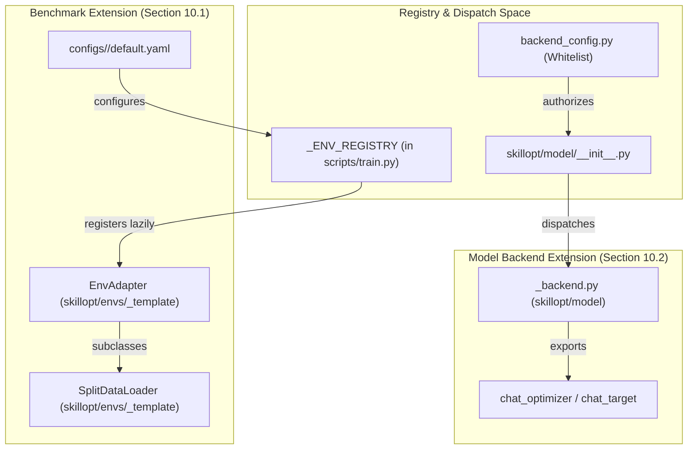
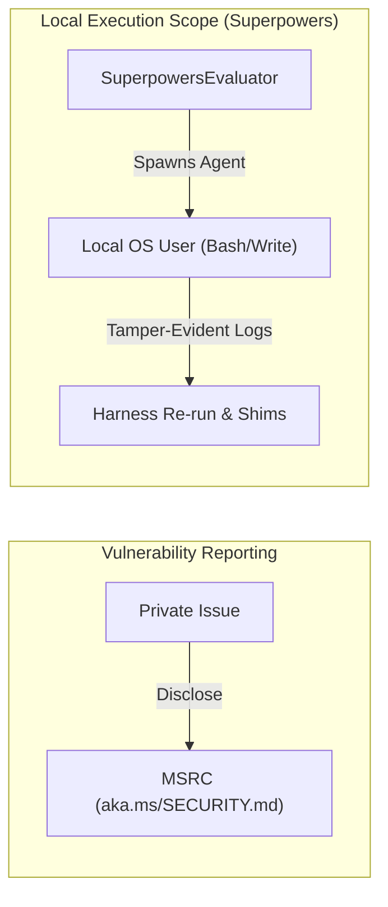

<!-- source: DeepWiki mcp.deepwiki.com · repo microsoft/SkillOpt · page 10 Contributing and Security · fetched 2026-10-26 -->

# Contributing and Security

<details>
<summary>Relevant source files</summary>

The following files were used as context for generating this wiki page:

- [CONTRIBUTING.md](CONTRIBUTING.md)
- [SECURITY.md](SECURITY.md)
- [docs/contributing.md](docs/contributing.md)
- [docs/review_guidelines.md](docs/review_guidelines.md)
- [docs/superpowers/SECURITY.md](docs/superpowers/SECURITY.md)
- [mkdocs.yml](mkdocs.yml)
- [scripts/smoke_superpowers.sh](scripts/smoke_superpowers.sh)
- [skillopt_sleep/adapters/__init__.py](skillopt_sleep/adapters/__init__.py)
- [skillopt_sleep/adapters/superpowers.py](skillopt_sleep/adapters/superpowers.py)
- [tests/test_superpowers_scenarios.py](tests/test_superpowers_scenarios.py)

</details>


This page provides guidelines for developers wishing to contribute to the SkillOpt project, review code changes, and outlines protocols for reporting security vulnerabilities. SkillOpt is designed to be extensible, allowing researchers to integrate new benchmarks, model backends, and agent evaluation adapters.

For detailed guides, see the child pages:
- **[Adding a New Benchmark](#10.1)** — Step-by-step implementation guide using `skillopt/envs/_template/` [CONTRIBUTING.md:18-21]().
- **[Adding a New Model Backend](#10.2)** — Function-based module contract, required exports, and configuration registration [CONTRIBUTING.md:23-28]().
- **[Testing, Packaging, and CI](#10.3)** — Test suite organization, packaging entry points, and CI workflows [CONTRIBUTING.md:10]().

---

## Contributing to SkillOpt

SkillOpt welcomes contributions of all kinds, including bug reports, documentation improvements, new benchmarks, and model backends [docs/contributing.md:3-4]().

### Development Setup
To set up a local development environment, clone the repository and install the package with development and documentation dependencies [CONTRIBUTING.md:7-11]():

```bash
git clone https://github.com/microsoft/SkillOpt.git
cd SkillOpt
python -m pip install -e ".[dev,docs]"
```
Sources: [CONTRIBUTING.md:7-11](), [docs/contributing.md:5-11]()

### Ways to Contribute
- **Bug Reports**: Open a GitHub issue containing reproduction steps, expected versus actual behavior, and a sanitized configuration file [docs/contributing.md:15-23]().
- **New Benchmark**: Implement a `SplitDataLoader` and an `EnvAdapter` following the template at `skillopt/envs/_template/`, register the environment lazily in `scripts/train.py` and `scripts/eval_only.py`, and add focused tests [docs/contributing.md:24-38](). For details, see **[Adding a New Benchmark](#10.1)**.
- **New Model Backend**: Implement a backend module in `skillopt/model/<name>_backend.py` exporting optimizer and target chat functions, whitelist it in `backend_config.py`, and configure routing in `common.py` [docs/contributing.md:39-52](). For details, see **[Adding a New Model Backend](#10.2)**.
- **Documentation**: Preview local documentation changes built with MkDocs Material using `python -m mkdocs serve` [CONTRIBUTING.md:29-32](), [docs/contributing.md:54-60]().

### Code Review Guidelines
Contributors and reviewers should consult the code review checklist in `docs/review_guidelines.md` [docs/review_guidelines.md:1-6](). Key review items include verifying third-party dependency contracts, confirming error fallbacks fail closed, enforcing structural redaction of sensitive credentials, and isolating test/eval data from training loops [docs/review_guidelines.md:14-51]().

### Extension Architecture
The following diagram maps natural language extension concepts to their underlying code entity namespaces and registry modules.

**SkillOpt Extension Architecture**

Sources: [docs/contributing.md:24-52](), [docs/guide/new-benchmark.md:13-28](), [skillopt/envs/_template/env_template.py:17-22]()

---

## Security

Microsoft takes the security of its software products and services seriously.

### Reporting Vulnerabilities
**Please do not report security vulnerabilities through public GitHub issues [SECURITY.md:8-9]().**

If you discover a potential security issue, report it to the Microsoft Security Response Center (MSRC) as outlined in [https://aka.ms/SECURITY.md](https://aka.ms/SECURITY.md) [SECURITY.md:10-14]().

### Security Scope and Trust Boundaries
Certain evaluation adapters—such as the Superpowers evaluation harness (`skillopt_sleep/adapters/superpowers.py`)—evaluate candidate skills by executing code within a local workspace user session [skillopt_sleep/adapters/superpowers.py:12-16](). 

- **Trusted Candidates Only**: Evaluation adapters like Superpowers are designed for locally-authored, trusted candidate skills. They do not provide an OS-level isolation boundary against hostile model-generated code [docs/superpowers/SECURITY.md:3-10]().
- **Credential Isolation**: Host credentials (`~/.claude/credentials.json`) are excluded by default and only exposed if `SKILLOPT_HOST_AUTH=1` is explicitly set [docs/superpowers/SECURITY.md:22-24]().
- **Fail-Closed Behavior**: Unauthenticated runs fail immediately (`NO_AUTH`) rather than proceeding without credentials [docs/superpowers/SECURITY.md:25-26]().

**Security Disclosure and Execution Boundaries**

Sources: [SECURITY.md:8-14](), [docs/superpowers/SECURITY.md:3-16](), [skillopt_sleep/adapters/superpowers.py:12-16]()

---

## Child Pages
- **[Adding a New Benchmark](#10.1)** — Step-by-step guide using `skillopt/envs/_template`: DataLoader and EnvAdapter subclasses, registration, YAML config, first training run [CONTRIBUTING.md:18-21]().
- **[Adding a New Model Backend](#10.2)** — Function-based module interface, required exports, registration in `common.py` and `backend_config.py`, and using `openai_compatible` as a shortcut [CONTRIBUTING.md:23-28]().
- **[Testing, Packaging, and CI](#10.3)** — The `tests/` suite organization and fixtures, pyproject packaging/entry points, GitHub Actions `ci.yml`, dependabot, and how to run live vs offline tests [CONTRIBUTING.md:10]().

---

