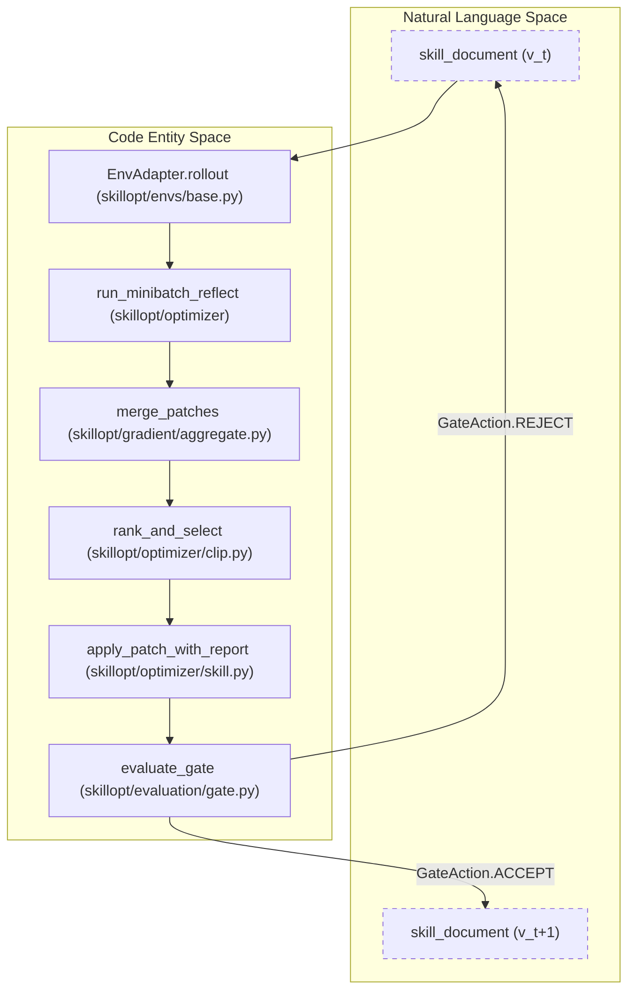
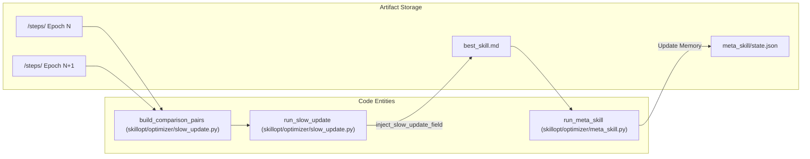

<!-- source: DeepWiki mcp.deepwiki.com · repo microsoft/SkillOpt · page 2 Core Training Pipeline · fetched 2026-10-26 -->

# Core Training Pipeline

Relevant source files

The following files were used as context for generating this wiki page:

- [configs/_base_/default.yaml](configs/_base_/default.yaml)
- [docs/guide/configuration.md](docs/guide/configuration.md)
- [docs/guide/dl-analogy.md](docs/guide/dl-analogy.md)
- [docs/guide/first-experiment.md](docs/guide/first-experiment.md)
- [docs/guide/skill-document.md](docs/guide/skill-document.md)
- [docs/guide/training-loop.md](docs/guide/training-loop.md)
- [docs/index.md](docs/index.md)
- [docs/reference/config.md](docs/reference/config.md)
- [skillopt/config.py](skillopt/config.py)
- [skillopt/engine/trainer.py](skillopt/engine/trainer.py)

The purpose of this page is to provide a high-level overview of the six-stage per-step ReflACT loop and the two epoch-boundary mechanisms implemented in the core training engine. 

As a PARENT page, this section introduces each stage and epoch-boundary mechanism, summarizing their roles and linking to dedicated child pages for deep technical details.

Sources: `[skillopt/engine/trainer.py:1-13]()`

---

## Pipeline Architecture

The pipeline is orchestrated by the `ReflACT` trainer (`[skillopt/engine/trainer.py:1-13]()`), which coordinates execution between the target model (representing the weights being optimized) and the optimizer model (computing textual gradients).

### Diagram: ReflACT Step Loop Pipeline

Sources: `[skillopt/engine/trainer.py:1-13]()`, `[skillopt/evaluation/gate.py:27-60]()`

---

## Per-Step Stages

### 1. Rollout Stage
The target model executes tasks using the current skill document, recording execution trajectories and yielding scored results (`RolloutResult`). 
* For details, see [Rollout Stage](#2.1).

Sources: `[skillopt/engine/trainer.py:4]()`, `[skillopt/envs/base.py]()`

### 2. Reflect Stage (Gradient Computation)
The optimizer model analyzes failure and success minibatches to produce structured edit patches via dedicated analyst prompts and parallel worker configurations (`[skillopt/engine/trainer.py:28-34]`).
* For details, see [Reflect Stage (Gradient Computation)](#2.2).

Sources: `[skillopt/engine/trainer.py:5]()`, `[skillopt/optimizer/]`

### 3. Aggregate, Select, and Update Stages
Performs hierarchical patch merging (`[skillopt/engine/trainer.py:28]()`), LLM-driven edit ranking and budget clipping (`[skillopt/engine/trainer.py:30]()`), and applies the resulting edits to the skill document under different update modes (`[skillopt/engine/trainer.py:34]()`).
* For details, see [Aggregate, Select, and Update Stages](#2.3).

Sources: `[skillopt/engine/trainer.py:28-34]()`, `[skillopt/optimizer/clip.py:1-30]()`

### 4. Validation Gate
Evaluates candidate skills on the held-out selection split to decide whether to accept or reject updates, leveraging `GateResult` objects and score comparisons (`[skillopt/evaluation/gate.py:27-60]()`).
* For details, see [Validation Gate](#2.4).

Sources: `[skillopt/engine/trainer.py:27]`, `[skillopt/evaluation/gate.py:27-60]()`

---

## Epoch-Boundary Mechanisms

### Diagram: Epoch-Boundary Data Flow Architecture

Sources: `[skillopt/engine/trainer.py:29-53]`, `[skillopt/optimizer/slow_update.py:1-53]()`

### Slow Update and Meta Skill
At epoch boundaries, the training loop runs longitudinal evaluations and updates cross-epoch memory structures:
* **Slow Update**: Conducts longitudinal comparisons across epochs and injects protected guidance blocks (`[skillopt/engine/trainer.py:46-53]()`).
* **Meta Skill**: Maintains a cross-epoch strategy memory for the optimizer (`[skillopt/engine/trainer.py:29]()`).
* For details, see [Epoch-Boundary Mechanisms: Slow Update and Meta Skill](#2.5).

Sources: `[skillopt/engine/trainer.py:29-53]()`, `[skillopt/optimizer/slow_update.py]()`, `[skillopt/optimizer/meta_skill.py]()`

---

## Summary of Core Types

| Stage | Input Type | Output Type | Primary Code Module |
| :--- | :--- | :--- | :--- |
| **Rollout** | `BatchSpec` | `RolloutResult` | `[skillopt/envs/base.py]()` |
| **Reflect** | `RolloutResult` (Minibatch) | `RawPatch` | `[skillopt/engine/trainer.py]()` |
| **Aggregate** | `list[dict]` (Raw Patches) | `Patch` | `[skillopt/gradient/aggregate.py]()` |
| **Select** | `Patch` (Merged) | `Patch` (Clipped) | `[skillopt/optimizer/clip.py]()` |
| **Update** | `Patch` + Skill Markdown | Candidate Skill Markdown | `[skillopt/optimizer/skill.py]()` |
| **Gate** | Candidate Skill Markdown | `GateResult` | `[skillopt/evaluation/gate.py]()` |

Sources: `[skillopt/engine/trainer.py:1-60]()`, `[skillopt/evaluation/gate.py:27-60]()`

---

