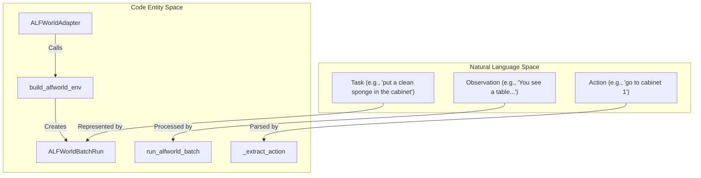
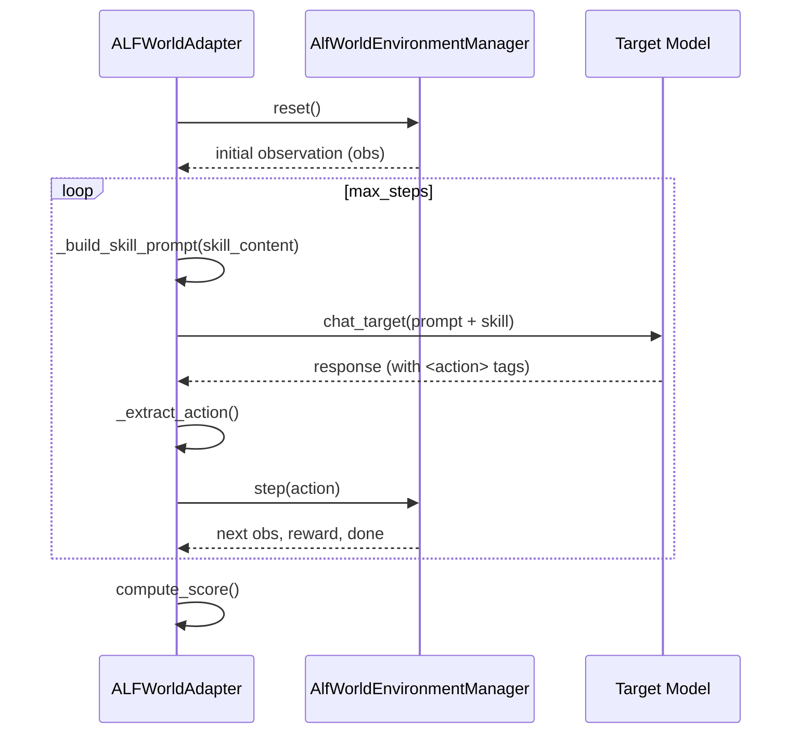

<!-- source: DeepWiki mcp.deepwiki.com · repo microsoft/SkillOpt · page 4.3 ALFWorld Adapter · fetched 2026-10-26 -->

# ALFWorld Adapter

Relevant source files

The following files were used as context for generating this wiki page:

- [configs/alfworld/default.yaml](configs/alfworld/default.yaml)
- [configs/livemathematicianbench/default.yaml](configs/livemathematicianbench/default.yaml)
- [data/alfworld_path_split/split_manifest.json](data/alfworld_path_split/split_manifest.json)
- [data/alfworld_path_split/test/items.json](data/alfworld_path_split/test/items.json)
- [data/alfworld_path_split/train/items.json](data/alfworld_path_split/train/items.json)
- [data/alfworld_path_split/val/items.json](data/alfworld_path_split/val/items.json)
- [data/docvqa_id_split/split_manifest.json](data/docvqa_id_split/split_manifest.json)
- [data/docvqa_id_split/test/items.json](data/docvqa_id_split/test/items.json)
- [skillopt/envs/alfworld/adapter.py](skillopt/envs/alfworld/adapter.py)
- [skillopt/envs/alfworld/rollout.py](skillopt/envs/alfworld/rollout.py)
- [skillopt/envs/docvqa/adapter.py](skillopt/envs/docvqa/adapter.py)
- [skillopt/envs/docvqa/rollout.py](skillopt/envs/docvqa/rollout.py)
- [skillopt/envs/livemathematicianbench/adapter.py](skillopt/envs/livemathematicianbench/adapter.py)
- [skillopt/envs/livemathematicianbench/rollout.py](skillopt/envs/livemathematicianbench/rollout.py)
- [skillopt/envs/officeqa/adapter.py](skillopt/envs/officeqa/adapter.py)
- [skillopt/envs/officeqa/rollout.py](skillopt/envs/officeqa/rollout.py)
- [skillopt/envs/officeqa/tool_runtime.py](skillopt/envs/officeqa/tool_runtime.py)
- [skillopt/envs/searchqa/adapter.py](skillopt/envs/searchqa/adapter.py)
- [tests/test_alfworld_paths.py](tests/test_alfworld_paths.py)

The ALFWorld adapter integrates the [ALFWorld](https://alfworld.github.io) embodied-agent environment into the SkillOpt training loop. It manages a simulator-based environment where an agent must perform high-level household tasks (e.g., "pick and place," "clean then place") using natural language interactions. The adapter handles complex simulator setup, Ray-based parallelism, and sophisticated trajectory parsing for the reflection stage.

### Environment Architecture

The adapter uses a lazy-loading mechanism to handle the heavy resource requirements of the ALFWorld simulator. Instead of keeping all simulators active, it uses `ALFWorldBatchRun` to describe batches that are materialized during rollout chunks.

#### Key Entities
*   **`ALFWorldAdapter`**: The primary interface implementing the `EnvAdapter` abstraction [skillopt/envs/alfworld/adapter.py:47-85]().
*   **`ALFWorldBatchRun`**: A lazy batch descriptor that prevents memory exhaustion by deferring simulator instantiation [skillopt/envs/alfworld/adapter.py:24-45]().
*   **`ALFWorldDataLoader`**: Manages dataset splits and task sampling [skillopt/envs/alfworld/adapter.py:94-104]().
*   **`AlfWorldEnvironmentManager`**: A vendored wrapper that manages parallel simulator instances using Ray [skillopt/envs/alfworld/rollout.py:112-142]().

#### Natural Language to Code Mapping
The following diagram illustrates how environment concepts are mapped to code entities within the adapter.

**ALFWorld Entity Mapping**

Sources: [skillopt/envs/alfworld/adapter.py:24-45](), [skillopt/envs/alfworld/adapter.py:47-85](), [skillopt/envs/alfworld/rollout.py:38-40](), [skillopt/envs/alfworld/rollout.py:88-142](), [skillopt/envs/alfworld/rollout.py:148-179]()

---

### Simulator Setup and Parallelism

ALFWorld requires a specific data structure and simulator setup. The adapter relies on an environment variable `ALFWORLD_DATA` to resolve game files [skillopt/envs/alfworld/rollout.py:66-76]().

#### Path Resolution
The helper `_resolve_alfworld_gamefile` handles absolute and relative paths to game files, ensuring the simulator can locate the `.tw-pddl` files regardless of the working directory [skillopt/envs/alfworld/rollout.py:66-76](). This logic is verified by dedicated path resolution tests [tests/test_alfworld_paths.py:6-33]().

#### Rollout Execution Flow
1.  **Environment Initialization**: `build_alfworld_env` initializes the `AlfWorldEnvironmentManager` with a specific number of parallel environments (`env_num`) and a dataset split [skillopt/envs/alfworld/rollout.py:88-142]().
2.  **Skill Injection**: Before each step, the current skill document is formatted via `_build_skill_prompt` and prepended to the agent's prompt context [skillopt/envs/alfworld/rollout.py:48-58]().
3.  **Parallel API Calls**: The adapter executes rollout steps across active environment indices [skillopt/envs/alfworld/rollout.py:208-213]().
4.  **Action Parsing**: The model response is expected to contain actions wrapped in `<action>` tags, which are extracted using `_extract_action` [skillopt/envs/alfworld/rollout.py:38-40]().

**Rollout Data Flow**

Sources: [skillopt/envs/alfworld/rollout.py:48-58](), [skillopt/envs/alfworld/rollout.py:88-180](), [skillopt/envs/alfworld/rollout.py:208-213]()

---

### Task Types and Data Management

ALFWorld supports several distinct task categories defined in `TASKS` [skillopt/envs/alfworld/rollout.py:19-26](). The adapter tracks these to provide context during the reflection stage.

| Task Type | Description |
| :--- | :--- |
| `pick_and_place` | Locate an object and move it to a destination. |
| `pick_two_obj_and_place` | Locate two objects and move them both. |
| `look_at_obj_in_light` | Find an object and bring it to a light source. |
| `pick_heat_then_place_in_recep` | Heat an object before placing it. |
| `pick_cool_then_place_in_recep` | Cool an object before placing it. |
| `pick_clean_then_place_in_recep` | Wash an object before placing it. |

Sources: [skillopt/envs/alfworld/rollout.py:19-26]()

#### Reference Knowledge Injection
During the reflection stage, the adapter builds a "reference bundle" from `traj_data.json` files found in the dataset via `_load_traj_data` and `_build_reference_bundle` [skillopt/envs/alfworld/adapter.py:111-125](), [skillopt/envs/alfworld/adapter.py:159-194](). This bundle includes:
*   **Human Task Descriptions**: Natural language descriptions of the goal [skillopt/envs/alfworld/adapter.py:165-168]().
*   **High-Level Steps**: Human-annotated sub-goals [skillopt/envs/alfworld/adapter.py:169-172]().
*   **PDDL Plans**: Symbolic planner actions formatted into readable text via `_format_high_pddl` [skillopt/envs/alfworld/adapter.py:142-157]().

Sources: [skillopt/envs/alfworld/adapter.py:111-194]()

---

### Batch Descriptor (`ALFWorldBatchRun`)

The `ALFWorldBatchRun` class is a specialized container that implements the iterator protocol. It allows the SkillOpt rollout stages to handle large evaluation sets by materializing them in chunks rather than loading thousands of simulator instances into memory [skillopt/envs/alfworld/adapter.py:24-45]().

**Key Fields:**
*   `env_num`: Number of environments in this batch [skillopt/envs/alfworld/adapter.py:31]().
*   `eval_dataset`: The split name [skillopt/envs/alfworld/adapter.py:32]().
*   `specific_gamefiles`: A list of specific ALFWorld `.json` game files to run [skillopt/envs/alfworld/adapter.py:36]().

Sources: [skillopt/envs/alfworld/adapter.py:24-45]()

### Configuration Parameters

The ALFWorld environment is configured via `configs/alfworld/default.yaml`.

| Parameter | Default | Description |
| :--- | :--- | :--- |
| `max_steps` | 50 | Maximum interaction turns per episode [configs/alfworld/default.yaml:25](). |
| `workers` | 8 | Number of parallel Ray workers for the simulator [configs/alfworld/default.yaml:27](). |
| `max_api_workers` | 8 | Maximum concurrent LLM API calls [configs/alfworld/default.yaml:28](). |
| `minibatch_size` | 8 | Number of trajectories analyzed together during reflection [configs/alfworld/default.yaml:8](). |
| `learning_rate` | 4 | Textual learning rate (edit budget) for the optimizer [configs/alfworld/default.yaml:12](). |

Sources: [configs/alfworld/default.yaml:1-29]()

---

