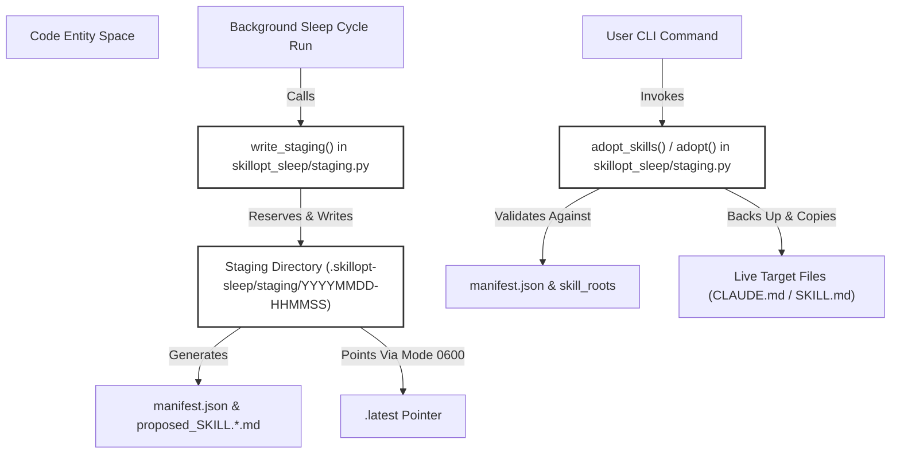
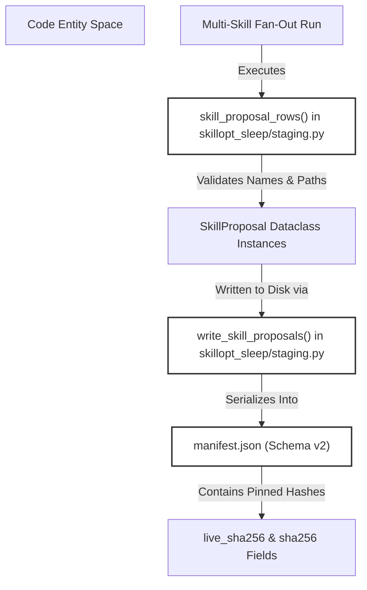

<!-- source: DeepWiki mcp.deepwiki.com · repo microsoft/SkillOpt · extra page Staging, Adoption, and Evidence Logging · fetched 2026-10-26 -->

# Staging, Adoption, and Evidence Logging

<details>
<summary>Relevant source files</summary>

The following files were used as context for generating this wiki page:

- [docs/sleep/multi-skill-staging.md](docs/sleep/multi-skill-staging.md)
- [skillopt_sleep/evidence.py](skillopt_sleep/evidence.py)
- [skillopt_sleep/staging.py](skillopt_sleep/staging.py)
- [tests/test_sleep_adopt_skill_subset.py](tests/test_sleep_adopt_skill_subset.py)
- [tests/test_sleep_evidence.py](tests/test_sleep_evidence.py)
- [tests/test_sleep_scheduler_safety.py](tests/test_sleep_scheduler_safety.py)
- [tests/test_sleep_staging_fanout.py](tests/test_sleep_staging_fanout.py)

</details>


The purpose of this page is to document the "Dreams safety contract" implemented within the `skillopt_sleep` engine. The sleep optimization cycle never directly mutates a user's live `CLAUDE.md`, `SKILL.md`, or vendor-specific agent instructions. Instead, it relies on a strict isolation pipeline: writing proposals and diagnostic artifacts into isolated staging directories, executing robust secret redaction passes, validating file boundaries, recording a complete causal trail in `evidence.jsonl`, and performing explicit, transactional skill adoption via a write-ahead log (WAL) and ledger structure.

---

## 1. The Dreams Safety Contract and Staging Architecture

Under the Dreams safety contract, background optimization runs are isolated from production files. The system writes candidate skill documents, managed memory updates, full textual reports, and raw evidentiary data into a timestamped staging directory located under `.skillopt-sleep/staging/`. 

The staging engine reserves unique directory names atomically, preventing race conditions when multiple background jobs or parallel invocations execute. Published staging nights are indexed via a private, mode-`0600` `.latest` pointer file. The staging manager validates that all candidate paths conform to absolute normalization constraints and reside strictly within designated skill roots before any write occurs.



*Sources: [skillopt_sleep/staging.py:1-7](), [docs/sleep/multi-skill-staging.md:3-35]()*, [tests/test_sleep_adopt_skill_subset.py:55-90]()

---

## 2. Secret Redaction Engine

Because sleep optimization harnesses parse raw shell transcripts, diagnostic error logs, and model interactions, sensitive credentials may inadvertently appear in context. To prevent credential leakage into persisted staging artifacts, diagnostics, and evidence logs, `skillopt_sleep/staging.py` implements a comprehensive redaction pipeline.

The redaction engine executes a series of regular expressions targeting common API keys (such as OpenAI keys, AWS keys, GitHub tokens, Slack tokens, Google keys, and raw JSON Web Tokens), authorization headers, connection-string passwords (`Password=`, `Pwd=`, `PWD=`), and structured dictionary assignments where keys match credential-bearing suffixes (`_secret`, `_token`, `passwd`, `apikey`).

```text
Input Text / Transcript
        │
        ▼
   [ _SECRET_PATTERNS Match ] ──► (OpenAI, AWS, GitHub, JWT, Auth Headers)
        │
        ▼
   [ _JSON_SECRET_ASSIGNMENT ] ──► (JSON keys: api_key, password, token)
        │
        ▼
   [ _is_secret_mapping_key ] ──► (Dictionary key inspection for credential suffixes)
        │
        ▼
Sanitized String / Persisted Staging Artifact
```

The redaction pass occurs prior to length truncation. This ensures that structured secrets (such as multi-line PEM blocks or authorization headers) are not truncated midway through their value, which could leave a portion of the secret unmasked in the prefix while stripping the closing boundary marker.

*Sources: [skillopt_sleep/staging.py:27-192](), [skillopt_sleep/evidence.py:43-71]()*, [tests/test_sleep_evidence.py:35-65]()

---

## 3. Manifests and Multi-Skill Fan-Out (`manifest.json`)

When multi-skill fan-out is enabled, a single consolidation night can process multiple hinted skill groups simultaneously. Each accepted group produces an independent proposal file (`proposed_SKILL.<name>.md`) alongside managed legacy targets (`proposed_SKILL.md` and `proposed_CLAUDE.md`).

These artifacts are cataloged in `manifest.json` under `schema_version: 2`. The manifest records authoritative pinning data:
- `sha256`: The cryptographic hash of the exact staged proposal bytes.
- `live_sha256`: The baseline raw-byte hash of the live file before optimization began (or an empty string if the file did not exist).
- `live_realpath`: The canonical filesystem destination path resolved via `os.path.realpath`.
- `skill_roots`: The list of permitted absolute directory roots enclosing valid target files.



The validation layer rejects proposal names and live paths that differ only by case, normalize to unsafe traversal sequences (such as `../`), use illegal Windows filename characters, or point to files outside the recorded skill roots. This prevents a compromised manifest from being retargeted onto arbitrary system files.

*Sources: [skillopt_sleep/staging.py:1-200](), [docs/sleep/multi-skill-staging.md:21-125](), [tests/test_sleep_staging_fanout.py:44-152]()*, [tests/test_sleep_adopt_skill_subset.py:92-165]()

---

## 4. Adoption WAL, Ledger, and Exclusive Locks

Promotion of staged proposals to live project paths is handled by explicit adoption functions (`adopt()` and `adopt_skills()`). Users select promotion subsets through CLI options (`--skill NAME`, `--all-skills`, or `--legacy`) or programmatic Python calls.

```text
CLI / API Request
        │
        ▼
   adopt_skills(staging_dir, skill_names)
        │
        ▼
   Load & Verify manifest.json (Schema Check & Root Containment)
        │
        ▼
   Acquire Exclusive Lock & Check live_sha256 Drift
        │
        ▼
   Create Backup Copy of Live Target File
        │
        ▼
   Atomic File Overwrite (Proposed Byte Stream -> Live SKILL.md)
        │
        ▼
   Return Adoption Receipt
```

### Safety and Transactional Guarantees
1. **Drift Protection**: Before overwriting any live file, the adoption engine verifies that the current live file's SHA-256 hash matches `live_sha256` recorded in the manifest. If the live file was modified externally after the sleep session commenced, adoption fails closed to prevent overwriting user changes.
2. **Confined Roots**: Each target path is re-checked against the absolute `skill_roots` stored in the manifest to ensure traversal attacks or manual JSON tampering cannot redirect the write.
3. **Backup Generation**: Prior to replacement, existing live files are backed up locally, allowing immediate recovery in the event of administrative cancellation or system interruption.

*Sources: [skillopt_sleep/staging.py:201-450](), [docs/sleep/multi-skill-staging.md:132-168](), [tests/test_sleep_adopt_skill_subset.py:55-174]()

---

## 5. Evidentiary Chain Logging (`evidence.jsonl`)

While aggregate reports and diagnostics state *what* a sleep cycle decided, the per-night `evidence.jsonl` log records *why* by capturing the complete causal chain.

The `EvidenceLog` class in `skillopt_sleep/evidence.py` provides an append-only, thread-safe JSONL logging facility designed for parallel task execution (such as threaded replay batches).

### Key Architectural Characteristics
- **Thread Safety**: Access to file appends and internal sequence counters (`_seq`) is protected by a reentrant `threading.Lock`.
- **Sanitization Pipeline**: Every persisted dictionary value, prompt string, or model response passes through `redact_secrets()` and truncation limits (`max_chars`) prior to JSON serialization.
- **Resilience**: File write exceptions are caught and suppressed, ensuring that logging failures never disrupt or crash an ongoing sleep optimization night.
- **Phase Tagging**: The active execution phase (e.g., `baseline_val`, `train`, `gate_trial:skill`, `final_val`) is injected into records via `set_phase()`, allowing consumers to trace the exact chronological sequence of optimization events.

```python
# Example structural record format in evidence.jsonl
{
  "ts": "2026-08-15T01:30:00",
  "seq": 42,
  "stage": "replay",
  "event": "model_call",
  "phase": "baseline_val",
  "prompt": "[REDACTED] ...",
  "response": "..."
}
```

*Sources: [skillopt_sleep/evidence.py:43-143](), [tests/test_sleep_evidence.py:35-155]()*, [docs/sleep/multi-skill-staging.md:53-65]()

---

