# Page: Overview

# Overview

<details>
<summary>Relevant source files</summary>

The following files were used as context for generating this wiki page:

- [README.md](README.md)
- [main.py](main.py)

</details>


This document provides an introduction to the STemGNN (Spectral Temporal Graph Neural Network) repository, explaining the system's purpose, core concepts, and architectural components. For detailed installation instructions, see [Installation](#2.1). For complete command-line reference, see [Command-Line Interface](#3.1). For architectural deep dives, see [System Architecture](#4).

## Purpose and Scope

The STemGNN repository implements a neural network architecture for **multivariate time-series forecasting**. The system takes multiple time-series sequences (e.g., traffic flow measurements from multiple sensors, power consumption from multiple households) and predicts future values across all sequences simultaneously while learning the relationships between them.

The repository provides a complete end-to-end solution including data loading, model training, evaluation, and inference capabilities.

**Sources:** [README.md:1-4](), [README.md:37-39]()

## What is Multivariate Time-Series Forecasting

Multivariate time-series forecasting predicts future values for multiple related time-series sequences. Unlike univariate forecasting (predicting one sequence), multivariate forecasting:

- **Handles multiple nodes**: Each node represents a distinct time-series (e.g., a traffic sensor, a power meter)
- **Learns inter-node relationships**: The system discovers how nodes influence each other
- **Produces simultaneous predictions**: Forecasts future values for all nodes together

### Input-Output Structure

| Component | Shape | Description |
|-----------|-------|-------------|
| Input Data | `T × N` | `T` timestamps, `N` nodes (no header) |
| Window Size | `window_size` | Number of historical time steps used for prediction |
| Prediction Horizon | `horizon` | Number of future time steps to predict |
| Output Predictions | `horizon × N` | Future values for all N nodes |

**Sources:** [README.md:37-39](), [main.py:13-14]()

## Core System Components

The STemGNN system consists of five primary components that work together to enable multivariate forecasting:

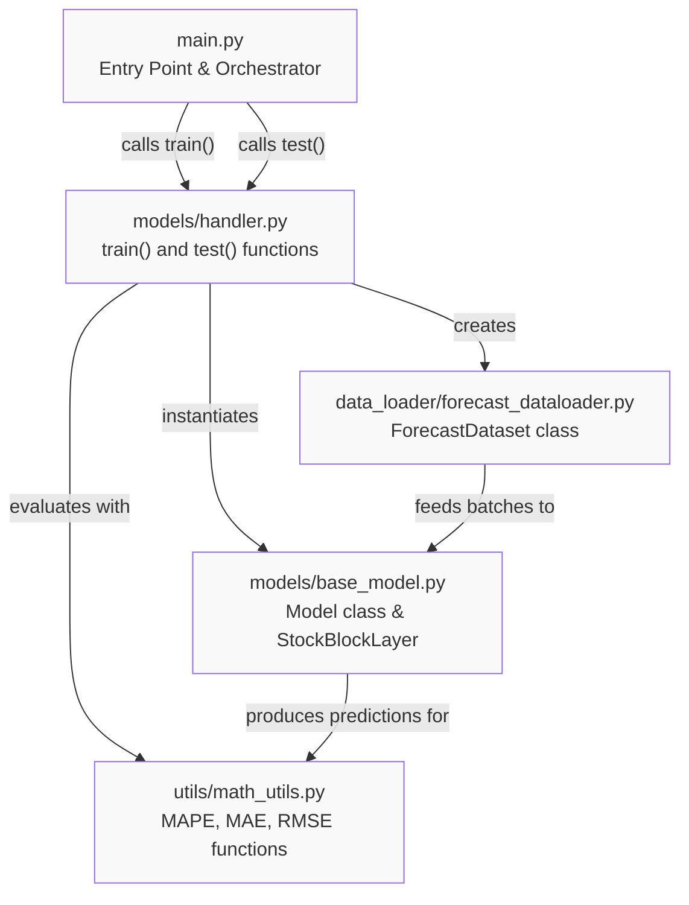

### Component Responsibilities

| Component | File Path | Key Classes/Functions | Responsibility |
|-----------|-----------|----------------------|----------------|
| Entry Point | `main.py` | N/A (script) | Argument parsing, data splitting, orchestration |
| Lifecycle Manager | `models/handler.py` | `train()`, `test()` | Training loops, model persistence, evaluation orchestration |
| Neural Architecture | `models/base_model.py` | `Model`, `StockBlockLayer`, `GLU` | Graph learning, spectral processing, predictions |
| Data Pipeline | `data_loader/forecast_dataloader.py` | `ForecastDataset` | Data loading, normalization, windowing |
| Evaluation | `utils/math_utils.py` | `evaluate()` | Metric computation (MAPE, MAE, RMSE) |

**Sources:** [main.py:1-68](), High-level system architecture diagrams (Diagram 1)

## System Workflow

The following diagram shows how data flows through the system during training and evaluation:

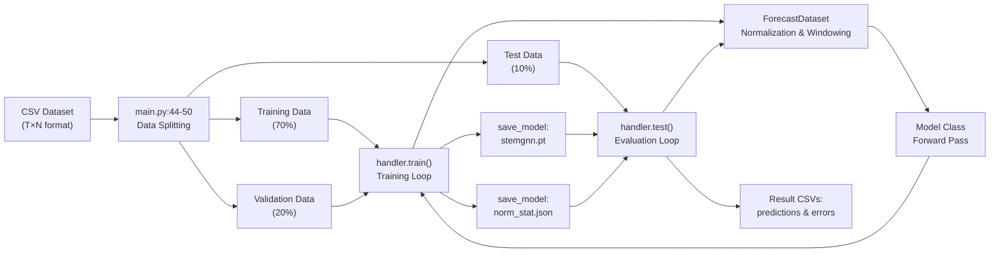

**Sources:** [main.py:44-50](), [main.py:54-67](), High-level system architecture diagrams (Diagram 2)

## Key Features

### 1. Spectral Temporal Graph Learning

The neural architecture combines three powerful techniques:

- **Graph Structure Learning**: Automatically discovers relationships between nodes using self-attention mechanisms
- **Spectral Processing**: Processes time-series in the frequency domain using Fast Fourier Transform (FFT)
- **Temporal Modeling**: Captures temporal dependencies through stacked layers with Gated Linear Units (GLU)

The `Model` class in [models/base_model.py]() implements these capabilities through `StockBlockLayer` components that perform graph convolution followed by spectral sequence processing.

### 2. Flexible Normalization

Two normalization methods are supported via the `norm_method` parameter:

| Method | Formula | Use Case |
|--------|---------|----------|
| `z_score` | `(x - μ) / σ` | Default, handles varying scales |
| `min_max` | `(x - min) / (max - min)` | When data has known bounds |

Normalization statistics are persisted in `norm_stat.json` to ensure consistent preprocessing during evaluation.

### 3. Multiple Dataset Support

The system supports various multivariate time-series datasets:

| Dataset Type | Examples | Node Count Range | Typical Window/Horizon |
|--------------|----------|------------------|------------------------|
| Traffic Flow/Speed | PEMS03, PEMS04, PEMS07, PEMS08, METR-LA, PEMS-BAY | 170-358 | 12/3 |
| Energy | Solar, Electricity | 137+ | 12/3 |
| Physiological | ECG5000 | 140 | 12/3 |
| Epidemiological | COVID-19 | 25 | 28/28 |

**Sources:** [README.md:22-36](), [README.md:71-81](), [main.py:24]()

## Command-Line Arguments

The system is configured entirely through command-line arguments parsed in [main.py:9-33](). Key parameters include:

```python
# Core configuration
--dataset        # Name of CSV file (without extension)
--train          # Enable training (default: True)
--evaluate       # Enable evaluation (default: True)

# Data parameters
--window_size    # Historical steps for prediction (default: 12)
--horizon        # Future steps to predict (default: 3)
--train_length   # Proportion for training (default: 7)
--valid_length   # Proportion for validation (default: 2)
--test_length    # Proportion for testing (default: 1)

# Training parameters
--epoch          # Number of training epochs (default: 50)
--lr             # Learning rate (default: 1e-4)
--batch_size     # Batch size (default: 32)
--norm_method    # 'z_score' or 'min_max' (default: 'z_score')

# Model architecture
--multi_layer    # Number of StockBlockLayers (default: 5)
--dropout_rate   # Dropout probability (default: 0.5)
```

For complete parameter documentation, see [Command-Line Interface](#3.1).

**Sources:** [main.py:9-31](), [README.md:49-68]()

## Execution Modes

The system supports two primary execution modes controlled by the `--train` and `--evaluate` flags:

### Training Mode

When `--train True` is specified, the system:

1. Creates `ForecastDataset` instances for training and validation data
2. Instantiates the `Model` neural network
3. Executes the training loop in `handler.train()`
4. Performs periodic validation
5. Saves the best model to `stemgnn.pt`
6. Saves normalization statistics to `norm_stat.json`

### Evaluation Mode

When `--evaluate True` is specified, the system:

1. Loads the trained model from `stemgnn.pt`
2. Loads normalization statistics from `norm_stat.json`
3. Creates a `ForecastDataset` for test data
4. Executes inference via `handler.test()`
5. Computes MAPE, MAE, and RMSE metrics
6. Saves prediction results to CSV files

Both modes can run independently or sequentially in a single execution.

**Sources:** [main.py:54-68](), High-level system architecture diagrams (Diagram 3)

## Performance Metrics

The system evaluates model performance using three metrics implemented in `utils/math_utils.py`:

| Metric | Full Name | Formula | Interpretation |
|--------|-----------|---------|----------------|
| **MAE** | Mean Absolute Error | `mean(\|y_true - y_pred\|)` | Average magnitude of errors |
| **RMSE** | Root Mean Squared Error | `sqrt(mean((y_true - y_pred)²))` | Penalizes large errors more |
| **MAPE** | Mean Absolute Percentage Error | `mean(\|y_true - y_pred\| / \|y_true\|) × 100` | Relative error percentage |

Lower values indicate better performance for all three metrics.

**Sources:** [README.md:84-101](), High-level system architecture diagrams (Diagram 2, Diagram 5)

## Typical Results

The following table shows representative performance achieved on benchmark datasets:

**Traffic Datasets (horizon: 3 steps)**

| Dataset | Nodes | MAE | RMSE | MAPE (%) |
|---------|-------|-----|------|----------|
| METR-LA | 207 | 2.56 | 5.06 | 6.46 |
| PEMS-BAY | 325 | 1.23 | 2.48 | 2.63 |
| PEMS03 | 358 | 14.32 | 21.64 | 16.24 |
| PEMS04 | 307 | 20.24 | 32.15 | 10.03 |
| PEMS07 | 228 | 2.14 | 4.01 | 5.01 |
| PEMS08 | 170 | 15.83 | 24.93 | 9.26 |

**COVID-19 Dataset (horizon: 28 steps)**

| Dataset | Nodes | MAE | RMSE | MAPE (%) |
|---------|-------|-----|------|----------|
| COVID-19 | 25 | 662.24 | 1023.19 | 19.3 |

**Sources:** [README.md:84-101]()

## Code-to-Concept Mapping

The following diagram maps high-level concepts to their concrete implementations in the codebase:

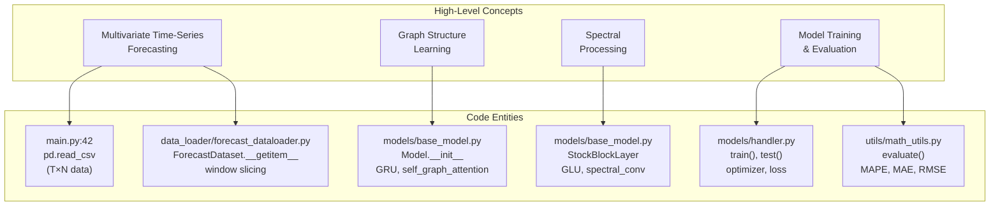

**Sources:** [main.py:42](), High-level system architecture diagrams (Diagram 1, Diagram 4)

## Output Artifacts

Each training and evaluation run produces the following artifacts in the `output/<dataset>/` directory structure:

### Training Outputs (`output/<dataset>/train/`)

| Artifact | Filename | Contents |
|----------|----------|----------|
| Model checkpoint | `stemgnn.pt` | Trained model parameters (state_dict) |
| Normalization stats | `norm_stat.json` | Mean/std (z_score) or min/max (min_max) |

### Evaluation Outputs (`output/<dataset>/test/`)

| Artifact | Filename | Contents |
|----------|----------|----------|
| Predictions | Various CSV files | Model predictions for test data |
| Metrics | Logged to console | MAPE, MAE, RMSE values |

**Sources:** [main.py:36-41]()

## Quick Example

To train and evaluate on the provided ECG dataset:

```bash
python main.py --train True --evaluate True --dataset ECG_data
```

This command:
1. Loads [dataset/ECG_data.csv]() (5000 timestamps × 140 nodes)
2. Splits data into 70% training, 20% validation, 10% testing
3. Trains a `Model` with 5 `StockBlockLayer` components
4. Evaluates on test data and reports MAPE, MAE, RMSE
5. Saves results to `output/ECG_data/`

For more examples and detailed usage, see [Quick Start](#2.2) and [Training Models](#3.2).

**Sources:** [README.md:39](), [main.py:12]()

## System Requirements

The system requires:

- **OS**: Ubuntu 18.04.2 LTS (recommended)
- **Python**: 3.7
- **Key Dependencies**: PyTorch, pandas, numpy, scipy (see [requirements.txt]())

For installation instructions, see [Installation](#2.1). For detailed dependency information, see [Dependencies](#6.2).

**Sources:** [README.md:6-20]()

## Next Steps

- **To get started**: See [Getting Started](#2) for installation and quick start guides
- **To understand the architecture**: See [System Architecture](#4) for detailed component documentation
- **To train models**: See [Training Models](#3.2) for workflow details
- **To work with custom datasets**: See [Working with Datasets](#3.4) for format specifications
- **To extend the system**: See [Development Guide](#6) for contribution guidelines

---

# Page: Getting Started

# Getting Started

<details>
<summary>Relevant source files</summary>

The following files were used as context for generating this wiki page:

- [README.md](README.md)
- [main.py](main.py)
- [requirements.txt](requirements.txt)

</details>


This document provides an overview of the setup process and initial execution workflow for the STemGNN system. It covers the prerequisites, system requirements, and high-level execution flow to help users prepare their environment and run their first training and evaluation session.

For detailed installation instructions, see [Installation](#2.1). For a minimal working example with step-by-step commands, see [Quick Start](#2.2). For comprehensive usage documentation, see [User Guide](#3).

## Prerequisites

The STemGNN system requires Python 3.7 and several scientific computing dependencies. The system is designed to run on both CPU and GPU (CUDA-enabled) devices.

**Recommended Environment:**

| Component | Specification |
|-----------|---------------|
| Operating System | Ubuntu 18.04.2 LTS |
| Python Version | 3.7 |
| Virtual Environment | python3.7-venv |
| Package Manager | pip 20.1.1 or higher |
| setuptools | 41.2.0 or higher |

**Core Dependencies:**

| Package | Version | Purpose |
|---------|---------|---------|
| `torch` | 1.7.1 | Neural network framework |
| `numpy` | 1.19.5 | Numerical computation |
| `pandas` | 1.1.5 | Data loading and manipulation |
| `scipy` | 1.5.4 | Scientific computing utilities |

Sources: [README.md:8-20](), [requirements.txt:1-5]()

## Repository Structure

After cloning the repository, the following directory structure is used:

```
StemGNN/
├── main.py                           # Entry point and orchestrator
├── requirements.txt                  # Python dependencies
├── dataset/                          # Input data directory
│   ├── ECG_data.csv                 # Sample dataset (5000×140)
│   └── <custom>.csv                 # User datasets (T×N format)
├── models/
│   ├── handler.py                   # Training and evaluation functions
│   └── base_model.py                # Neural network architecture
├── data_loader/
│   └── forecast_dataloader.py       # Data preprocessing and windowing
├── utils/
│   └── math_utils.py                # Evaluation metrics
└── output/
    └── <dataset_name>/
        ├── train/                   # Training outputs
        │   ├── norm_stat.json       # Normalization statistics
        │   └── best_model.pt        # Trained model checkpoint
        └── test/                    # Evaluation outputs
            └── result.csv           # Prediction results
```

The system automatically creates `output/` subdirectories based on the dataset name specified in command-line arguments.

Sources: [main.py:35-41](), [README.md:39]()

## Execution Workflow

The following diagram shows the high-level workflow from setup to evaluation:

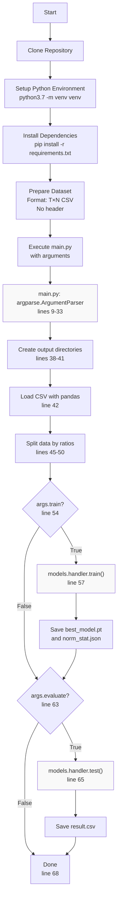

**Workflow Stages:**

1. **Environment Setup**: Create virtual environment and install dependencies from `requirements.txt`
2. **Data Preparation**: Format dataset as T×N CSV file without headers, place in `dataset/` directory
3. **Execution**: Run `main.py` with appropriate command-line arguments
4. **Training** (if `--train True`): Invokes `train()` from [models/handler.py](), saves model to `output/<dataset>/train/`
5. **Evaluation** (if `--evaluate True`): Invokes `test()` from [models/handler.py](), saves results to `output/<dataset>/test/`

Sources: [main.py:1-68](), [README.md:15-20, 43-47]()

## Command-Line Interface

The system is executed through `main.py` with command-line arguments. The argument parser is initialized at [main.py:9]() and defines all configuration parameters.

**Basic Command Structure:**

```bash
python main.py --train <bool> --evaluate <bool> --dataset <name> [options]
```

**Essential Arguments:**

| Argument | Type | Default | Description |
|----------|------|---------|-------------|
| `--train` | bool | True | Enable training phase |
| `--evaluate` | bool | True | Enable evaluation phase |
| `--dataset` | str | 'ECG_data' | Dataset filename (without .csv extension) |
| `--window_size` | int | 12 | Length of input sliding window |
| `--horizon` | int | 3 | Number of future steps to predict |
| `--device` | str | 'cpu' | Execution device ('cpu' or 'cuda:x') |

For complete parameter documentation, see [Command-Line Interface](#3.1).

Sources: [main.py:9-30](), [README.md:49-68]()

## Data Requirements

Input datasets must conform to the following specification:

**CSV Format Requirements:**
- **No header row**: The CSV must contain only numerical data
- **Shape**: T×N where T = number of timestamps, N = number of nodes (variables)
- **Location**: Place files in `dataset/` directory
- **Naming**: Specify filename without extension in `--dataset` argument

**Example:**
```
# dataset/ECG_data.csv
# Shape: 5000 rows × 140 columns
# No header, comma-separated values
0.123,0.456,0.789,...
0.234,0.567,0.890,...
...
```

The system includes a sample dataset `ECG_data.csv` (5000×140) for testing.

Sources: [README.md:37-39]()

## Data Splitting

The system automatically splits loaded data into train/validation/test sets based on ratio arguments:

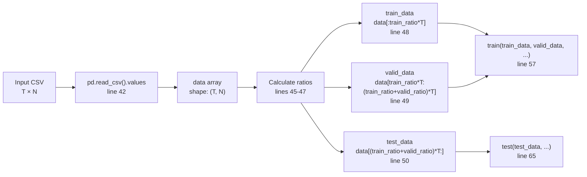

**Default Split Ratios:**
- `--train_length 7`: Training portion
- `--valid_length 2`: Validation portion  
- `--test_length 1`: Testing portion
- Actual ratios: 7/10, 2/10, 1/10 of total data

The split is performed sequentially (no shuffling), which is appropriate for time-series data.

Sources: [main.py:45-50]()

## Output Artifacts

After execution, the following artifacts are generated:

**Training Outputs** (`output/<dataset>/train/`):
- `norm_stat.json`: Normalization statistics (mean, std or min, max) for inference reproducibility
- `best_model.pt`: PyTorch checkpoint containing trained model weights

**Evaluation Outputs** (`output/<dataset>/test/`):
- `result.csv`: Prediction results with metrics
- Performance metrics printed to console (MAPE, MAE, RMSE)

The system automatically creates these directories if they don't exist [main.py:38-41]().

Sources: [main.py:36-41]()

## Execution Flow Mapping

This diagram maps the execution stages to specific code entities:

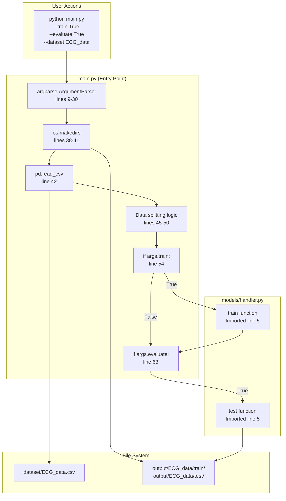

**Key Code Entities:**
- Entry point: `if __name__ == '__main__':` at [main.py:53]()
- Argument parsing: `parser = argparse.ArgumentParser()` at [main.py:9]()
- Training invocation: `train(train_data, valid_data, args, result_train_file)` at [main.py:57]()
- Evaluation invocation: `test(test_data, args, result_train_file, result_test_file)` at [main.py:65]()

Sources: [main.py:1-68]()

## Next Steps

After understanding the execution workflow:

1. **For installation**: Proceed to [Installation](#2.1) for detailed environment setup instructions
2. **For first run**: See [Quick Start](#2.2) for a complete minimal example
3. **For customization**: Review [Command-Line Interface](#3.1) for all configuration options
4. **For custom datasets**: See [Working with Datasets](#3.4) for format specifications and preprocessing
5. **For architecture details**: See [System Architecture](#4) for implementation internals

## Minimal Example

For reference, the most basic execution command using the included sample dataset:

```bash
# Activate virtual environment
source venv/bin/activate

# Train and evaluate on sample ECG dataset
python main.py

# This uses all defaults:
# --train True --evaluate True --dataset ECG_data
# --window_size 12 --horizon 3 --epoch 50
# --device cpu --norm_method z_score
```

This command will:
1. Load `dataset/ECG_data.csv` (5000×140)
2. Split data 7:2:1 into train/valid/test
3. Train for 50 epochs with validation
4. Save model to `output/ECG_data/train/best_model.pt`
5. Evaluate on test set
6. Save results to `output/ECG_data/test/result.csv`
7. Print timing and metrics to console

Sources: [main.py:10-26](), [README.md:39]()

---

# Page: Installation

# Installation

<details>
<summary>Relevant source files</summary>

The following files were used as context for generating this wiki page:

- [README.md](README.md)
- [requirements.txt](requirements.txt)

</details>


This page details the steps required to install STemGNN and set up the Python environment for training and evaluating models. This covers operating system requirements, Python version requirements, virtual environment creation, and dependency installation.

For information about running your first training session after installation, see [Quick Start](#2.2). For detailed documentation of each dependency's role in the system, see [Dependencies](#6.2).

---

## System Requirements

The STemGNN codebase has been verified to work on the following configuration:

| Component | Requirement |
|-----------|-------------|
| Operating System | Ubuntu 18.04.2 LTS (recommended) |
| Python Version | Python 3.7 |
| Package Manager | pip 20.1.1 |
| Setup Tools | setuptools 41.2.0 |

**Sources:** [README.md:8-13]()

### Python 3.7 Installation

If Python 3.7 is not installed on your system, follow the installation instructions for Ubuntu 18.04:

```bash
# Installation steps available at:
# https://linuxize.com/post/how-to-install-python-3-7-on-ubuntu-18-04/
```

After Python 3.7 is installed, install the virtual environment package:

```bash
sudo apt install python3.7-venv
```

**Sources:** [README.md:11-13]()

---

## Installation Process Overview

The following diagram illustrates the complete installation workflow from system preparation through dependency installation:

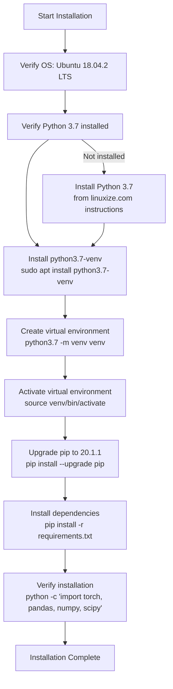

**Sources:** [README.md:13-20]()

---

## Step-by-Step Installation

### Step 1: Create Virtual Environment

Navigate to the repository root directory and create a Python 3.7 virtual environment:

```bash
python3.7 -m venv venv
```

This command creates a directory named `venv` containing an isolated Python environment. Using `virtualenv` is recommended to avoid conflicts with system-wide Python packages.

**Sources:** [README.md:16]()

### Step 2: Activate Virtual Environment

Activate the virtual environment using:

```bash
source venv/bin/activate
```

After activation, your shell prompt should be prefixed with `(venv)` indicating the virtual environment is active. All subsequent Python and pip commands will use the isolated environment.

**Sources:** [README.md:17]()

### Step 3: Upgrade pip

Upgrade pip to the verified version:

```bash
pip install --upgrade pip
```

This ensures pip version 20.1.1 is installed, which has been verified to work correctly with all dependencies.

**Sources:** [README.md:18]()

### Step 4: Install Dependencies

Install all required Python packages from the requirements file:

```bash
pip install -r requirements.txt
```

This command reads [requirements.txt]() and installs the following packages with their pinned versions:

**Sources:** [README.md:19]()

---

## Dependency Specifications

The [requirements.txt:1-4]() file specifies four core dependencies with exact version pins:

| Package | Version | Primary Purpose in STemGNN |
|---------|---------|---------------------------|
| `numpy` | 1.19.5 | Array operations, numerical computations in model layers |
| `scipy` | 1.5.4 | Sparse matrix operations, Laplacian computation for graph structure |
| `pandas` | 1.1.5 | CSV data loading, time series data manipulation |
| `torch` | 1.7.1 | Deep learning framework, neural network implementation |

**Sources:** [requirements.txt:1-4]()

### Dependency Relationships in System Architecture

The following diagram shows how each dependency is utilized across the codebase:

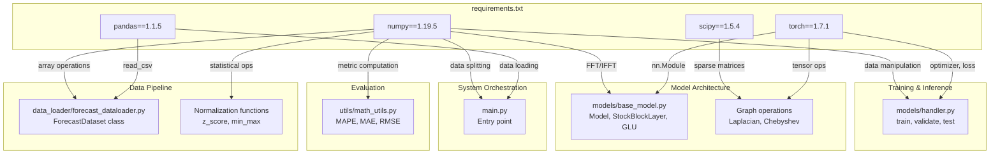

**Sources:** [requirements.txt:1-4](), [README.md:13-20]()

---

## Verification

After installation, verify that all dependencies are correctly installed by attempting to import them:

```bash
python -c "import torch; import pandas; import numpy; import scipy; print('All dependencies successfully imported')"
```

If the command executes without errors and prints the success message, the installation is complete.

### Checking Installed Versions

To verify the exact versions installed:

```bash
pip list | grep -E "(numpy|scipy|pandas|torch)"
```

Expected output should match:
```
numpy    1.19.5
pandas   1.1.5
scipy    1.5.4
torch    1.7.1
```

---

## Post-Installation Structure

After completing the installation steps, your repository directory structure should include the virtual environment:

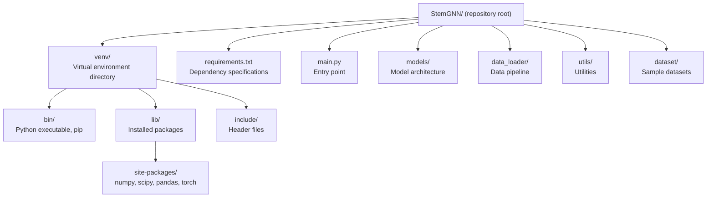

**Sources:** [README.md:13-20]()

---

## Troubleshooting Common Issues

### Issue: `python3.7: command not found`

**Solution:** Python 3.7 is not installed. Follow the installation instructions linked in the System Requirements section above.

### Issue: `pip: command not found` after activation

**Solution:** The virtual environment may not have been created correctly. Delete the `venv` directory and repeat Step 1.

### Issue: Version mismatch for installed packages

**Solution:** Ensure pip is upgraded to version 20.1.1 before installing requirements:
```bash
pip install --upgrade pip==20.1.1
pip install -r requirements.txt
```

### Issue: PyTorch installation fails

**Solution:** PyTorch 1.7.1 may require specific system libraries. Ensure you have the appropriate CUDA version if using GPU, or use CPU-only version. The [requirements.txt:4]() specifies `torch==1.7.1` which defaults to CPU on most systems.

**Sources:** [README.md:13-20]()

---

## Next Steps

After successful installation, proceed to [Quick Start](#2.2) to run your first training session on the provided ECG dataset. For understanding all available command-line options, see [Command-Line Interface](#3.1). To use custom datasets, refer to [Working with Datasets](#3.4).

---

# Page: Quick Start

# Quick Start

<details>
<summary>Relevant source files</summary>

The following files were used as context for generating this wiki page:

- [README.md](README.md)
- [dataset/ECG_data.csv](dataset/ECG_data.csv)
- [main.py](main.py)

</details>


This page provides a minimal working example to get you running training and evaluation with STemGNN immediately. It covers the basic command-line execution, what happens during runtime, and what outputs to expect.

For detailed explanations of all command-line options, see [Command-Line Interface](#3.1). For in-depth training and evaluation workflows, see [Training Models](#3.2) and [Evaluating Models](#3.3). For installation prerequisites, see [Installation](#2.1).

---

## Basic Execution

The simplest way to run STemGNN is with the default configuration on the provided ECG dataset:

```bash
python main.py
```

This single command will:
1. Load the ECG_data.csv dataset (5000 timestamps × 140 nodes)
2. Split data into train/validation/test sets (7:2:1 ratio)
3. Train the STemGNN model for 50 epochs
4. Evaluate the trained model on the test set
5. Save results to the `output/ECG_data/` directory

**Sources:** [README.md:39-39](), [main.py:12-26]()

---

## Default Configuration

When running without arguments, `main.py` uses these default parameters:

| Parameter | Default Value | Description |
|-----------|--------------|-------------|
| `--train` | `True` | Enable training phase |
| `--evaluate` | `True` | Enable evaluation phase |
| `--dataset` | `ECG_data` | Dataset filename (without .csv) |
| `--window_size` | `12` | Length of input sliding window |
| `--horizon` | `3` | Number of future timesteps to predict |
| `--train_length` | `7` | Relative length of training data |
| `--valid_length` | `2` | Relative length of validation data |
| `--test_length` | `1` | Relative length of test data |
| `--epoch` | `50` | Number of training epochs |
| `--lr` | `0.0001` | Learning rate for optimizer |
| `--multi_layer` | `5` | Number of StockBlockLayer stacks |
| `--device` | `cpu` | Computation device |
| `--batch_size` | `32` | Training batch size |
| `--norm_method` | `z_score` | Normalization method |

**Sources:** [main.py:9-30]()

---

## Execution Flow Diagram

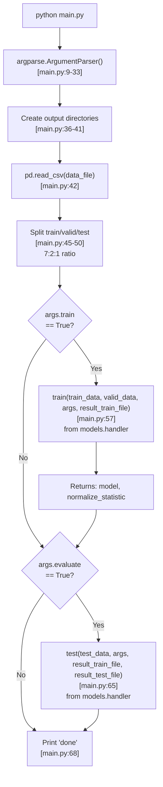

**Execution Flow with Actual Code Entities**

This diagram shows the execution path through `main.py` with references to actual functions and line numbers. The `train()` and `test()` functions are imported from `models.handler` and orchestrate the machine learning lifecycle.

**Sources:** [main.py:1-68](), [main.py:5]()

---

## Output Directory Structure

Running `python main.py` creates the following directory structure:

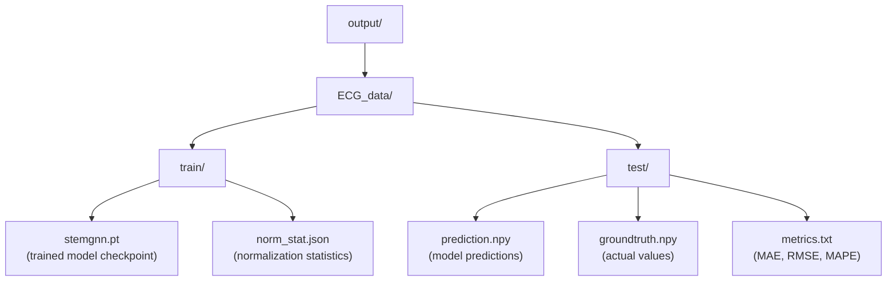

**Output Files Generated During Execution**

The `output/` directory is organized by dataset name. The `train/` subdirectory contains model artifacts, while `test/` contains evaluation results.

**Sources:** [main.py:36-41]()

---

## Understanding the Output

### Training Output

During training, you will see periodic validation metrics printed to the console:

```
Training configs: Namespace(train=True, evaluate=True, dataset='ECG_data', ...)
epoch 1, validate loss: 0.8234
epoch 2, validate loss: 0.7891
...
epoch 50, validate loss: 0.3421
Training took 15.3 minutes
```

The training phase saves:
- **stemgnn.pt**: PyTorch model checkpoint containing trained weights
- **norm_stat.json**: Normalization statistics (mean/std or min/max) required for inference

**Sources:** [main.py:54-59]()

### Evaluation Output

After training completes, evaluation runs automatically:

```
Evaluation took 2.1 minutes
done
```

The evaluation phase creates three files in `output/ECG_data/test/`:
- **prediction.npy**: Model's predicted values (NumPy array)
- **groundtruth.npy**: Actual test set values (NumPy array)
- **metrics.txt**: Performance metrics (MAE, RMSE, MAPE)

**Sources:** [main.py:63-68]()

---

## Data Flow Through the System

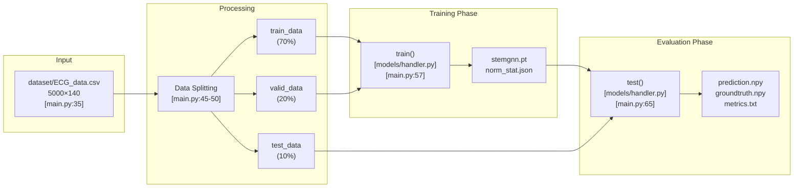

**Complete Data Flow from CSV to Results**

This diagram shows how data flows from the input CSV file through splitting, training, and evaluation, mapping to specific code locations in `main.py`.

**Sources:** [main.py:35-68]()

---

## Customizing the Quick Start

### Running with a Different Dataset

To use a custom dataset (must be in `dataset/` directory):

```bash
python main.py --dataset your_data --n_route 100 --window_size 12 --horizon 3
```

Where:
- `your_data` is the filename without `.csv` extension
- `n_route` is the number of nodes (columns) in your CSV
- `window_size` and `horizon` define the forecasting window

**Note:** Your CSV must have shape `T×N` (timestamps × nodes) with no header row.

**Sources:** [README.md:37-37](), [main.py:12]()

### Running Only Training or Evaluation

To train without evaluating:

```bash
python main.py --train True --evaluate False
```

To evaluate a previously trained model:

```bash
python main.py --train False --evaluate True
```

**Sources:** [main.py:10-11](), [main.py:54-67]()

### Using GPU

If CUDA is available, specify the device:

```bash
python main.py --device cuda:0
```

**Sources:** [main.py:21]()

---

## Verifying Successful Execution

After running `python main.py`, verify success by checking:

1. **Training completed**: Look for the message `Training took X minutes`
2. **Files created**: Verify `output/ECG_data/train/stemgnn.pt` exists
3. **Evaluation completed**: Look for the message `Evaluation took X minutes`
4. **Metrics computed**: Check `output/ECG_data/test/metrics.txt` exists
5. **Final message**: See `done` printed to console

**Sources:** [main.py:59](), [main.py:67](), [main.py:68]()

---

## Quick Start Command Reference

| Use Case | Command |
|----------|---------|
| Basic training and evaluation | `python main.py` |
| Custom dataset | `python main.py --dataset PEMS07 --n_route 228` |
| GPU training | `python main.py --device cuda:0` |
| More epochs | `python main.py --epoch 100` |
| Different data split | `python main.py --train_length 8 --valid_length 1 --test_length 1` |
| Only training | `python main.py --train True --evaluate False` |
| Only evaluation | `python main.py --train False --evaluate True` |
| Early stopping | `python main.py --early_stop True` |

**Sources:** [main.py:9-30](), [README.md:45-47]()

---

## Next Steps

After successfully running the quick start:

- **Explore all configuration options**: See [Command-Line Interface](#3.1) for complete parameter documentation
- **Understand training details**: Read [Training Models](#3.2) for optimization, learning rate scheduling, and early stopping
- **Learn about evaluation metrics**: See [Evaluating Models](#3.3) for MAPE, MAE, and RMSE calculations
- **Use your own data**: Review [Working with Datasets](#3.4) for dataset format requirements
- **Understand the architecture**: See [Neural Network Architecture](#4.3) for model internals

**Sources:** [README.md:43-68]()

---

# Page: User Guide

# User Guide

<details>
<summary>Relevant source files</summary>

The following files were used as context for generating this wiki page:

- [README.md](README.md)
- [main.py](main.py)

</details>


## Purpose and Scope

This user guide provides comprehensive documentation for operating the STemGNN system. It covers all command-line options, typical workflows, and practical usage patterns for training and evaluating spectral temporal graph neural networks on multivariate time-series data.

For installation and initial setup instructions, see [Getting Started](#2). For detailed technical explanations of the system architecture and internal components, see [System Architecture](#4). For complete parameter reference and API documentation, see [Reference](#5).

This guide is organized into specialized subsections covering the command-line interface ([CLI](#3.1)), training procedures ([Training Models](#3.2)), evaluation procedures ([Evaluating Models](#3.3)), dataset management ([Working with Datasets](#3.4)), and normalization methods ([Normalization Methods](#3.5)).

Sources: [README.md:1-103](), [main.py:1-68]()

---

## System Invocation

The STemGNN system is invoked through the `main.py` entry point. All operations are controlled via command-line arguments that configure the training and evaluation pipelines. The system operates in three primary modes:

1. **Training only**: Creates a trained model from input data
2. **Evaluation only**: Tests a pre-trained model on test data
3. **Training + Evaluation**: Complete end-to-end workflow

### Basic Invocation Pattern

```bash
python main.py \
    --train <True|False> \
    --evaluate <True|False> \
    --dataset <dataset_name> \
    --window_size <int> \
    --horizon <int> \
    --norm_method <z_score|min_max>
```

The system automatically:
- Creates output directories under `output/<dataset>/train/` and `output/<dataset>/test/`
- Splits data into training, validation, and test sets based on specified ratios
- Saves trained models as `stemgnn.pt`
- Saves normalization statistics as `norm_stat.json`
- Generates prediction and error CSV files

Sources: [main.py:9-51](), [README.md:43-68]()

---

## Workflow Overview

The following diagram illustrates how user commands flow through the system's execution pipeline:

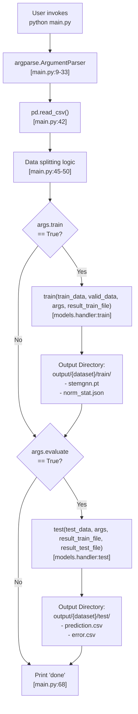

Sources: [main.py:9-68](), [README.md:43-46]()

---

## Data Splitting Strategy

The system divides input data into three non-overlapping segments based on user-specified length parameters. The default configuration uses a 7:2:1 ratio for training, validation, and testing respectively.

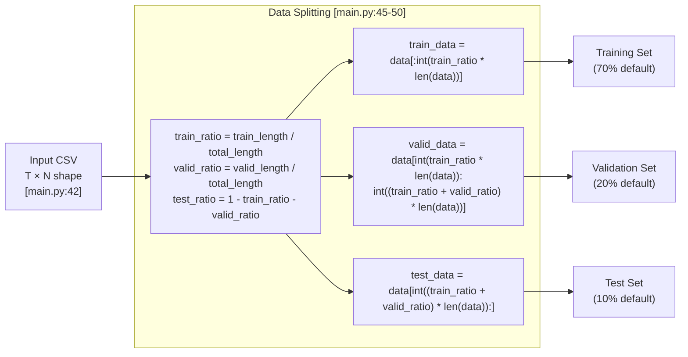

| Parameter | Purpose | Default | Controls |
|-----------|---------|---------|----------|
| `train_length` | Training set size weight | 7 | Portion of data used for optimization |
| `valid_length` | Validation set size weight | 2 | Portion of data used for hyperparameter tuning |
| `test_length` | Test set size weight | 1 | Portion of data used for final evaluation |

The system performs splitting chronologically, preserving temporal order. The first `train_ratio` portion becomes training data, the next `valid_ratio` becomes validation data, and the remainder becomes test data.

Sources: [main.py:15-17](), [main.py:45-50](), [README.md:58-60]()

---

## Common Usage Patterns

### Pattern 1: Training and Evaluation on Provided Dataset

The simplest invocation uses default parameters with the included ECG dataset:

```bash
python main.py
```

This executes with defaults:
- Dataset: `ECG_data.csv` (5000 timestamps × 140 nodes)
- Training enabled, evaluation enabled
- Window size: 12, horizon: 3
- Normalization: z-score
- Data split: 7:2:1 ratio

Sources: [main.py:10-24](), [README.md:39]()

### Pattern 2: Training Only with Custom Parameters

To train a model without immediate evaluation:

```bash
python main.py \
    --train True \
    --evaluate False \
    --dataset PeMS07 \
    --window_size 12 \
    --horizon 3 \
    --epoch 100 \
    --lr 1e-4 \
    --batch_size 64
```

This produces:
- `output/PeMS07/train/stemgnn.pt` - Trained model checkpoint
- `output/PeMS07/train/norm_stat.json` - Normalization statistics

Sources: [main.py:54-59](), [README.md:46-47]()

### Pattern 3: Evaluation of Pre-Trained Model

To evaluate an existing model without retraining:

```bash
python main.py \
    --train False \
    --evaluate True \
    --dataset PeMS07
```

Requirements:
- `output/PeMS07/train/stemgnn.pt` must exist
- `output/PeMS07/train/norm_stat.json` must exist
- Other parameters must match those used during training

Sources: [main.py:63-67]()

---

## Parameter Categories

The system accepts parameters in four functional categories:

### Execution Control Parameters

| Parameter | Type | Default | Description |
|-----------|------|---------|-------------|
| `train` | bool | True | Enable training phase |
| `evaluate` | bool | True | Enable evaluation phase |
| `device` | str | 'cpu' | Computation device ('cpu' or 'cuda:x') |

### Dataset Configuration Parameters

| Parameter | Type | Default | Description |
|-----------|------|---------|-------------|
| `dataset` | str | 'ECG_data' | Base name of CSV file in dataset/ directory |
| `window_size` | int | 12 | Length of input sliding window |
| `horizon` | int | 3 | Number of future steps to predict |
| `train_length` | float | 7 | Training set size weight |
| `valid_length` | float | 2 | Validation set size weight |
| `test_length` | float | 1 | Test set size weight |
| `norm_method` | str | 'z_score' | Normalization method ('z_score' or 'min_max') |

### Training Hyperparameters

| Parameter | Type | Default | Description |
|-----------|------|---------|-------------|
| `epoch` | int | 50 | Number of training epochs |
| `lr` | float | 1e-4 | Learning rate |
| `batch_size` | int | 32 | Training batch size |
| `optimizer` | str | 'RMSProp' | Optimizer algorithm |
| `validate_freq` | int | 1 | Validation frequency (epochs) |
| `early_stop` | bool | False | Enable early stopping |
| `exponential_decay_step` | int | 5 | Learning rate decay step |
| `decay_rate` | float | 0.5 | Learning rate decay rate |

### Model Architecture Parameters

| Parameter | Type | Default | Description |
|-----------|------|---------|-------------|
| `multi_layer` | int | 5 | Number of StockBlockLayers (controls model depth) |
| `dropout_rate` | float | 0.5 | Dropout probability |
| `leakyrelu_rate` | float | 0.2 | LeakyReLU negative slope |

Sources: [main.py:9-30](), [README.md:51-68]()

---

## File System Organization

The system follows a consistent directory structure for all operations:

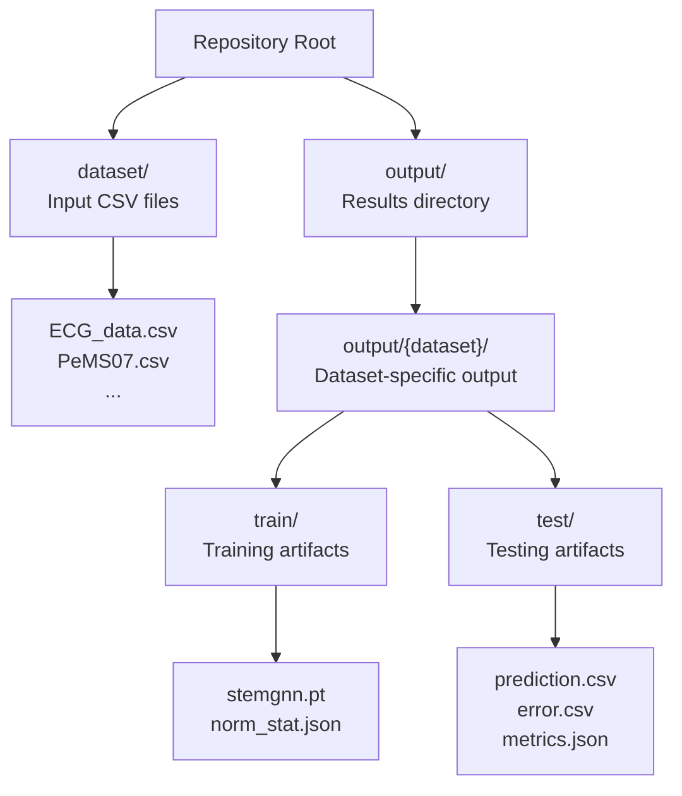

### Directory Creation

The system automatically creates output directories if they do not exist:

```python
# From main.py:36-41
result_train_file = os.path.join('output', args.dataset, 'train')
result_test_file = os.path.join('output', args.dataset, 'test')
if not os.path.exists(result_train_file):
    os.makedirs(result_train_file)
if not os.path.exists(result_test_file):
    os.makedirs(result_test_file)
```

Sources: [main.py:35-41]()

---

## Execution Timing

The system reports execution time for both training and evaluation phases:

| Phase | Timing Measurement | Output Format |
|-------|-------------------|---------------|
| Training | Start: before `train()` call<br/>End: after `train()` returns | "Training took X minutes" |
| Evaluation | Start: before `test()` call<br/>End: after `test()` returns | "Evaluation took X minutes" |

Example output:
```
Training configs: Namespace(train=True, evaluate=True, ...)
Training took 45.3 minutes
Evaluation took 2.1 minutes
done
```

Sources: [main.py:56-67]()

---

## Error Handling

The system implements keyboard interrupt handling during training to allow graceful early termination:

```python
# From main.py:55-62
try:
    before_train = datetime.now().timestamp()
    _, normalize_statistic = train(train_data, valid_data, args, result_train_file)
    after_train = datetime.now().timestamp()
    print(f'Training took {(after_train - before_train) / 60} minutes')
except KeyboardInterrupt:
    print('-' * 99)
    print('Exiting from training early')
```

When Ctrl+C is pressed during training, the system prints a separator line and exits cleanly without raising an exception. Partial training results may not be saved depending on when the interrupt occurs.

Sources: [main.py:55-62]()

---

## Subsection Overview

This user guide is organized into the following detailed subsections:

- **[Command-Line Interface](#3.1)**: Complete reference for all command-line arguments including detailed descriptions, value constraints, and usage examples for each parameter.

- **[Training Models](#3.2)**: Detailed explanation of the training pipeline including data preparation, model initialization, optimization loop, learning rate scheduling, validation, early stopping, and checkpoint saving.

- **[Evaluating Models](#3.3)**: Complete guide to model evaluation including loading pre-trained models, inference procedures, metric calculation (MAPE, MAE, RMSE), and result interpretation.

- **[Working with Datasets](#3.4)**: Comprehensive documentation of dataset requirements including file format specifications (T×N shape, no header), supported datasets, data preparation procedures, and instructions for using custom datasets.

- **[Normalization Methods](#3.5)**: In-depth explanation of z-score and min-max normalization methods, mathematical formulations, when to use each method, and how normalization affects model performance.

Each subsection provides focused, detailed information about its specific topic. Refer to the appropriate subsection for comprehensive coverage of each area.

Sources: [README.md:1-103](), [main.py:1-68]()

---

# Page: Command-Line Interface

# Command-Line Interface

<details>
<summary>Relevant source files</summary>

The following files were used as context for generating this wiki page:

- [README.md](README.md)
- [main.py](main.py)

</details>


## Purpose and Scope

This document provides comprehensive documentation for the command-line interface of the STemGNN system. The CLI is the primary method for interacting with the system, controlling training, evaluation, and all model configuration through command-line arguments.

For information about the training workflow enabled by these arguments, see [Training Models](#3.2). For evaluation procedures, see [Evaluating Models](#3.3). For dataset-specific configurations, see [Working with Datasets](#3.4).

**Sources:** [main.py:1-68](), [README.md:43-68]()

## Entry Point

The system's entry point is `main.py`, which uses Python's `argparse` module to define and parse command-line arguments. The parser is instantiated at [main.py:9]() and all arguments are registered from [main.py:10-30]().

```bash
python main.py --train True --evaluate True --dataset ECG_data
```

After parsing, arguments are passed to the training and evaluation handlers that orchestrate the system's execution flow.

**Sources:** [main.py:9-34]()

## Argument Processing Flow

The following diagram shows how command-line arguments flow from the CLI through the system to their respective consumers:

**Diagram: CLI Argument Flow to System Components**

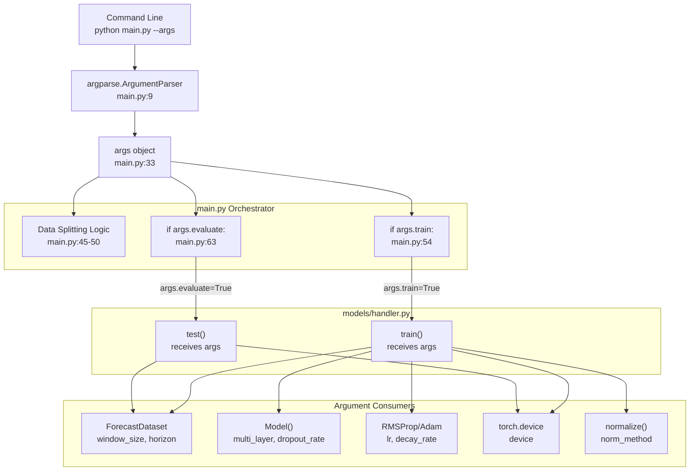

**Sources:** [main.py:9-68]()

## Argument Categories

### Control Flags

Arguments that control which phases of the pipeline execute:

| Argument | Type | Default | Description |
|----------|------|---------|-------------|
| `--train` | `bool` | `True` | Enable training phase. When `False`, skips training and only performs evaluation if `--evaluate` is `True` |
| `--evaluate` | `bool` | `True` | Enable evaluation phase. Loads trained model from `result_train_file` and evaluates on test data |

These flags are checked at [main.py:54]() and [main.py:63]() to conditionally execute training and evaluation.

**Sources:** [main.py:10-11](), [main.py:54-67](), [README.md:53-54]()

### Data Configuration

Arguments that define dataset characteristics and temporal split parameters:

| Argument | Type | Default | Description |
|----------|------|---------|-------------|
| `--dataset` | `str` | `'ECG_data'` | Base name of the CSV file (without `.csv` extension) in the `dataset/` directory |
| `--window_size` | `int` | `12` | Length of the sliding window for input sequences (number of historical timesteps) |
| `--horizon` | `int` | `3` | Number of future timesteps to predict |
| `--train_length` | `float` | `7` | Relative length of training data in the data split ratio |
| `--valid_length` | `float` | `2` | Relative length of validation data in the data split ratio |
| `--test_length` | `float` | `1` | Relative length of test data in the data split ratio |

The data split ratios are computed at [main.py:45-50]() as:
- `train_ratio = train_length / (train_length + valid_length + test_length)`
- `valid_ratio = valid_length / (train_length + valid_length + test_length)`
- `test_ratio = 1 - train_ratio - valid_ratio`

**Sources:** [main.py:12-17](), [main.py:45-50](), [README.md:55-60]()

### Training Hyperparameters

Arguments that control the optimization process:

| Argument | Type | Default | Description |
|----------|------|---------|-------------|
| `--epoch` | `int` | `50` | Maximum number of training epochs |
| `--lr` | `float` | `1e-4` | Initial learning rate for the optimizer |
| `--batch_size` | `int` | `32` | Batch size for mini-batch gradient descent |
| `--optimizer` | `str` | `'RMSProp'` | Optimizer algorithm (options: `'RMSProp'`, `'Adam'`) |
| `--validate_freq` | `int` | `1` | Validation frequency in epochs (validate every N epochs) |
| `--early_stop` | `bool` | `False` | Enable early stopping based on validation performance |

**Sources:** [main.py:18-26](), [README.md:61-68]()

### Learning Rate Scheduling

Arguments that control exponential learning rate decay:

| Argument | Type | Default | Description |
|----------|------|---------|-------------|
| `--exponential_decay_step` | `int` | `5` | Number of epochs between learning rate decay steps |
| `--decay_rate` | `float` | `0.5` | Multiplicative factor for learning rate decay |

The learning rate is updated as: `lr = lr * decay_rate` every `exponential_decay_step` epochs.

**Sources:** [main.py:27-28]()

### Model Architecture

Arguments that define the neural network structure:

| Argument | Type | Default | Description |
|----------|------|---------|-------------|
| `--multi_layer` | `int` | `5` | Number of `StockBlockLayer` instances stacked in the model (controls depth) |
| `--dropout_rate` | `float` | `0.5` | Dropout probability applied in GLU units for regularization |
| `--leakyrelu_rate` | `int` | `0.2` | Negative slope coefficient for LeakyReLU activation functions |

The `multi_layer` parameter is referred to as `stack_cnt` in the model architecture documentation. See [Neural Network Architecture](#4.3) for details.

**Sources:** [main.py:20](), [main.py:29-30](), [README.md:63]()

### Normalization

Argument controlling data normalization strategy:

| Argument | Type | Default | Description |
|----------|------|---------|-------------|
| `--norm_method` | `str` | `'z_score'` | Normalization method. Options: `'z_score'` (zero mean, unit variance) or `'min_max'` (scale to [0,1]) |

Normalization is applied by the `ForecastDataset` class. See [Normalization Methods](#3.5) for detailed comparison.

**Sources:** [main.py:24](), [README.md:67]()

### Hardware Configuration

Argument specifying compute device:

| Argument | Type | Default | Description |
|----------|------|---------|-------------|
| `--device` | `str` | `'cpu'` | PyTorch device specification. Options: `'cpu'`, `'cuda:0'`, `'cuda:1'`, etc. |

The device string is passed directly to `torch.device()`. Multiple GPUs can be specified via `CUDA_VISIBLE_DEVICES` environment variable at [main.py:3]().

**Sources:** [main.py:21](), [README.md:64]()

## Argument-to-Code Entity Mapping

The following diagram shows how CLI arguments map to specific code entities and their usage locations:

**Diagram: CLI Arguments to Code Entities**

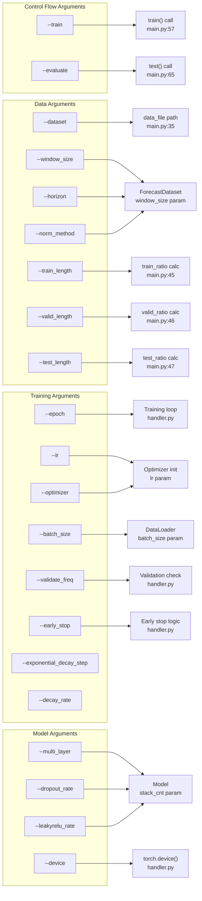

**Sources:** [main.py:10-68]()

## Complete Parameter Reference Table

The following table provides a complete reference of all CLI parameters with their specifications:

| Argument | Type | Default | Valid Values | Line Reference |
|----------|------|---------|--------------|----------------|
| `--train` | `bool` | `True` | `True`, `False` | [main.py:10]() |
| `--evaluate` | `bool` | `True` | `True`, `False` | [main.py:11]() |
| `--dataset` | `str` | `'ECG_data'` | Any CSV filename (without extension) | [main.py:12]() |
| `--window_size` | `int` | `12` | Positive integer | [main.py:13]() |
| `--horizon` | `int` | `3` | Positive integer | [main.py:14]() |
| `--train_length` | `float` | `7` | Positive number | [main.py:15]() |
| `--valid_length` | `float` | `2` | Positive number | [main.py:16]() |
| `--test_length` | `float` | `1` | Positive number | [main.py:17]() |
| `--epoch` | `int` | `50` | Positive integer | [main.py:18]() |
| `--lr` | `float` | `1e-4` | Positive float (typically 1e-5 to 1e-2) | [main.py:19]() |
| `--multi_layer` | `int` | `5` | Positive integer | [main.py:20]() |
| `--device` | `str` | `'cpu'` | `'cpu'`, `'cuda:0'`, `'cuda:1'`, etc. | [main.py:21]() |
| `--validate_freq` | `int` | `1` | Positive integer | [main.py:22]() |
| `--batch_size` | `int` | `32` | Positive integer | [main.py:23]() |
| `--norm_method` | `str` | `'z_score'` | `'z_score'`, `'min_max'` | [main.py:24]() |
| `--optimizer` | `str` | `'RMSProp'` | `'RMSProp'`, `'Adam'` | [main.py:25]() |
| `--early_stop` | `bool` | `False` | `True`, `False` | [main.py:26]() |
| `--exponential_decay_step` | `int` | `5` | Positive integer | [main.py:27]() |
| `--decay_rate` | `float` | `0.5` | Float in (0, 1) | [main.py:28]() |
| `--dropout_rate` | `float` | `0.5` | Float in [0, 1] | [main.py:29]() |
| `--leakyrelu_rate` | `int` | `0.2` | Note: type is `int` but should be float | [main.py:30]() |

**Note:** There is a type inconsistency at [main.py:30]() where `leakyrelu_rate` is declared as `int` but should be `float` since it's used as a coefficient.

**Sources:** [main.py:10-30]()

## Usage Examples

### Basic Training and Evaluation

Minimal command using all defaults:

```bash
python main.py
```

This executes with:
- Training enabled on `dataset/ECG_data.csv`
- Default window size of 12, horizon of 3
- Default 7:2:1 train/valid/test split
- 50 epochs with learning rate 1e-4
- CPU execution

**Sources:** [README.md:39](), [main.py:10-30]()

### Custom Dataset with Configuration

Training on a custom dataset with specific hyperparameters:

```bash
python main.py \
  --dataset PeMS07 \
  --window_size 12 \
  --horizon 3 \
  --train_length 7 \
  --validate_length 2 \
  --test_length 1 \
  --norm_method z_score
```

This loads `dataset/PeMS07.csv` and applies z-score normalization with a 7:2:1 data split.

**Sources:** [README.md:46-47]()

### GPU Training with Custom Architecture

Training on GPU with deeper model:

```bash
python main.py \
  --dataset METR-LA \
  --device cuda:0 \
  --multi_layer 8 \
  --batch_size 64 \
  --epoch 100 \
  --lr 1e-3
```

This uses GPU 0, stacks 8 `StockBlockLayer` instances, and trains for 100 epochs with larger batch size.

**Sources:** [main.py:20-23]()

### Evaluation Only

Running evaluation on a previously trained model:

```bash
python main.py \
  --train False \
  --evaluate True \
  --dataset ECG_data
```

This skips training ([main.py:54-59]() is bypassed) and only executes the test phase ([main.py:63-67]()), loading the model checkpoint from `output/ECG_data/train/`.

**Sources:** [main.py:54-67]()

### Advanced Learning Rate Configuration

Training with aggressive learning rate decay and early stopping:

```bash
python main.py \
  --dataset COVID-19 \
  --window_size 28 \
  --horizon 28 \
  --lr 1e-3 \
  --exponential_decay_step 3 \
  --decay_rate 0.7 \
  --early_stop True \
  --validate_freq 1
```

This validates every epoch, decays learning rate by 0.7 every 3 epochs, and stops early if validation performance plateaus.

**Sources:** [main.py:27-28](), [README.md:80]()

### Dataset-Specific Configurations

The README provides recommended configurations for various datasets:

| Dataset | Command |
|---------|---------|
| METR-LA | `python main.py --dataset METR-LA --n_route 207 --window_size 12 --horizon 3 --norm_method z_score` |
| PEMS-BAY | `python main.py --dataset PEMS-BAY --n_route 325 --window_size 12 --horizon 3 --norm_method z_score` |
| COVID-19 | `python main.py --dataset COVID-19 --window_size 28 --horizon 28 --norm_method z_score` |

**Note:** The `--n_route` parameter appears in the README but is not defined in the argparse configuration at [main.py:9-30](). This parameter likely represents the number of nodes and may be inferred from the dataset shape.

**Sources:** [README.md:72-81]()

## Output Directory Structure

Arguments control the output directory structure created at [main.py:36-41]():

```
output/
└── {dataset}/
    ├── train/
    │   ├── stemgnn.pt          # Model checkpoint
    │   ├── norm_stat.json      # Normalization statistics
    │   └── result_train.csv    # Training results
    └── test/
        └── result_test.csv     # Test predictions and metrics
```

- `result_train_file`: `output/{dataset}/train/` created at [main.py:36]()
- `result_test_file`: `output/{dataset}/test/` created at [main.py:37]()

**Sources:** [main.py:36-41]()

## Argument Validation

The system performs minimal validation at the CLI level. Most validation occurs downstream:

- **File existence**: Dataset file existence is validated implicitly by `pd.read_csv()` at [main.py:42]()
- **Device validity**: Device string validity is checked by PyTorch when creating `torch.device()`
- **Numeric constraints**: No explicit bounds checking; invalid values may cause runtime errors

For robust operation, ensure:
- Dataset CSV files exist in the `dataset/` directory
- Data split ratios sum to a positive value
- `window_size` < total data length
- `horizon` is reasonable for the forecasting task

**Sources:** [main.py:35-42]()

## Environment Configuration

Additional configuration beyond CLI arguments:

**CUDA Device Selection**: The environment variable `CUDA_VISIBLE_DEVICES` is set at [main.py:3]() to `'0,1'`, making GPUs 0 and 1 visible. This is hardcoded and should be modified in the source code if different GPU configuration is needed.

**Random Seed**: A fixed random seed is set at [main.py:52]() via `torch.manual_seed(0)` for reproducibility.

**Sources:** [main.py:3](), [main.py:52]()

---

# Page: Training Models

# Training Models

<details>
<summary>Relevant source files</summary>

The following files were used as context for generating this wiki page:

- [README.md](README.md)
- [main.py](main.py)
- [models/handler.py](models/handler.py)

</details>


This page explains the training process for STemGNN models, including data splitting, normalization, optimization loops, validation, and model persistence. This documentation covers the complete training workflow from data preparation through model checkpointing.

For information about command-line arguments and configuration options, see [Command-Line Interface](#3.1). For details about evaluation metrics and testing, see [Evaluating Models](#3.3). For normalization method details, see [Normalization Methods](#3.5).

---

## Training Workflow Overview

The training process is orchestrated by the `train()` function in [models/handler.py:103-191]() and invoked from [main.py:54-59](). The workflow consists of data preparation, iterative optimization with periodic validation, and model persistence.

```mermaid
flowchart TD
    Start["Training Invoked<br/>main.py:57"]
    Split["Data Split<br/>main.py:45-50<br/>train/valid/test"]
    CallTrain["train() function<br/>handler.py:103"]
    
    ComputeStats["Compute Normalization<br/>Statistics<br/>handler.py:112-124"]
    SaveStats["Save norm_stat.json<br/>handler.py:123-124"]
    
    CreateModel["Instantiate Model<br/>handler.py:105"]
    CreateOptim["Create Optimizer<br/>handler.py:126-130"]
    CreateLR["Create LR Scheduler<br/>handler.py:130"]
    
    CreateDatasets["Create ForecastDataset<br/>handler.py:132-138"]
    CreateLoaders["Create DataLoaders<br/>handler.py:136-138"]
    
    EpochLoop{"For epoch in<br/>range(args.epoch)<br/>handler.py:152"}
    
    TrainMode["model.train()<br/>handler.py:154"]
    BatchLoop["Batch Loop<br/>handler.py:157-166"]
    Forward["Forward Pass<br/>handler.py:161"]
    Loss["Compute MSE Loss<br/>handler.py:162"]
    Backward["loss.backward()<br/>handler.py:164"]
    OptimStep["my_optim.step()<br/>handler.py:165"]
    
    SaveEpoch["save_model(epoch)<br/>handler.py:169"]
    
    LRCheck{"epoch % decay_step?<br/>handler.py:170"}
    LRStep["lr_scheduler.step()<br/>handler.py:171"]
    
    ValidCheck{"epoch % validate_freq?<br/>handler.py:172"}
    ValidCall["validate()<br/>handler.py:176-178"]
    CheckBest{"MAE improved?<br/>handler.py:179-184"}
    SaveBest["save_model()<br/>(best model)<br/>handler.py:187"]
    
    EarlyCheck{"Early stop?<br/>handler.py:189"}
    
    End["Return metrics<br/>handler.py:191"]
    
    Start --> Split
    Split --> CallTrain
    CallTrain --> ComputeStats
    ComputeStats --> SaveStats
    SaveStats --> CreateModel
    CreateModel --> CreateOptim
    CreateOptim --> CreateLR
    CreateLR --> CreateDatasets
    CreateDatasets --> CreateLoaders
    CreateLoaders --> EpochLoop
    
    EpochLoop -->|continue| TrainMode
    TrainMode --> BatchLoop
    BatchLoop --> Forward
    Forward --> Loss
    Loss --> Backward
    Backward --> OptimStep
    OptimStep --> SaveEpoch
    
    SaveEpoch --> LRCheck
    LRCheck -->|yes| LRStep
    LRCheck -->|no| ValidCheck
    LRStep --> ValidCheck
    
    ValidCheck -->|yes| ValidCall
    ValidCheck -->|no| EpochLoop
    ValidCall --> CheckBest
    CheckBest -->|yes| SaveBest
    CheckBest -->|no| EarlyCheck
    SaveBest --> EarlyCheck
    
    EarlyCheck -->|stop| End
    EarlyCheck -->|continue| EpochLoop
    EpochLoop -->|done| End
```

**Sources:** [main.py:54-59](), [models/handler.py:103-191]()

---

## Data Splitting

Before training begins, the dataset is split into training, validation, and test sets using ratio-based splitting in [main.py:45-50](). The split is performed sequentially on the time-series data to preserve temporal ordering.

### Split Ratios

The split ratios are controlled by three parameters:

| Parameter | Default | Description |
|-----------|---------|-------------|
| `train_length` | 7 | Proportional length of training data |
| `valid_length` | 2 | Proportional length of validation data |
| `test_length` | 1 | Proportional length of test data |

The actual ratios are computed as:

```
train_ratio = train_length / (train_length + valid_length + test_length)
valid_ratio = valid_length / (train_length + valid_length + test_length)
test_ratio = 1 - train_ratio - valid_ratio
```

With defaults (7:2:1), this yields a 70% / 20% / 10% split.

### Split Implementation

The data is split using array slicing:

```
train_data = data[:int(train_ratio * len(data))]
valid_data = data[int(train_ratio * len(data)):int((train_ratio + valid_ratio) * len(data))]
test_data = data[int((train_ratio + valid_ratio) * len(data)):]
```

Only `train_data` and `valid_data` are passed to the `train()` function. The `test_data` is reserved for final evaluation.

**Sources:** [main.py:45-50](), [main.py:57]()

---

## Normalization Statistics

Normalization statistics are computed from the training data only and stored for later use during validation and testing. This ensures that the model is evaluated using the same normalization as training.

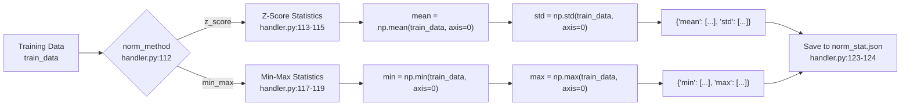

### Statistics Storage

The normalization statistics are saved to `norm_stat.json` in the output directory [models/handler.py:123-124](). This JSON file is loaded during evaluation to ensure consistent normalization.

**Z-Score Statistics Format:**
```json
{
  "mean": [value1, value2, ...],
  "std": [value1, value2, ...]
}
```

**Min-Max Statistics Format:**
```json
{
  "min": [value1, value2, ...],
  "max": [value1, value2, ...]
}
```

Each list contains one value per node in the multivariate time series.

**Sources:** [models/handler.py:112-124]()

---

## Model and Optimizer Initialization

### Model Creation

The model is instantiated at [models/handler.py:105]() with the following signature:

```
model = Model(node_cnt, 2, args.window_size, args.multi_layer, horizon=args.horizon)
```

Where:
- `node_cnt` = number of nodes (time series variables)
- `2` = input dimension (hardcoded)
- `args.window_size` = lookback window size
- `args.multi_layer` = number of stacked layers (default: 5)
- `horizon` = prediction horizon

The model is moved to the specified device (CPU or CUDA) using `model.to(args.device)` [models/handler.py:106]().

### Optimizer Configuration

Two optimizer options are supported [models/handler.py:126-129]():

| Optimizer | Implementation | Parameters |
|-----------|----------------|------------|
| `RMSProp` (default) | `torch.optim.RMSprop` | `lr=args.lr`, `eps=1e-08` |
| `Adam` | `torch.optim.Adam` | `lr=args.lr`, `betas=(0.9, 0.999)` |

The learning rate (`args.lr`) defaults to `1e-4` [main.py:19]().

### Learning Rate Scheduler

An exponential learning rate scheduler is created [models/handler.py:130]():

```
my_lr_scheduler = torch.optim.lr_scheduler.ExponentialLR(optimizer=my_optim, gamma=args.decay_rate)
```

The scheduler is invoked every `exponential_decay_step` epochs (default: 5) [main.py:27](), multiplying the learning rate by `decay_rate` (default: 0.5) [main.py:28]().

**Sources:** [models/handler.py:105-106](), [models/handler.py:126-130](), [main.py:19](), [main.py:27-28]()

---

## Dataset and DataLoader Creation

Training and validation data are wrapped in `ForecastDataset` objects [models/handler.py:132-135]():

```
train_set = ForecastDataset(train_data, window_size=args.window_size, horizon=args.horizon,
                            normalize_method=args.norm_method, norm_statistic=normalize_statistic)
valid_set = ForecastDataset(valid_data, window_size=args.window_size, horizon=args.horizon,
                            normalize_method=args.norm_method, norm_statistic=normalize_statistic)
```

The datasets are then wrapped in PyTorch `DataLoader` objects [models/handler.py:136-138]():

| DataLoader | Batch Size | Drop Last | Shuffle | Workers |
|------------|-----------|-----------|---------|---------|
| `train_loader` | `args.batch_size` | False | True | 0 |
| `valid_loader` | `args.batch_size` | - | False | 0 |

The training loader shuffles batches for better generalization, while the validation loader maintains order for consistent evaluation.

**Sources:** [models/handler.py:132-138]()

---

## Training Loop

The main training loop iterates for `args.epoch` epochs (default: 50) [main.py:18](), performing forward passes, loss computation, and backpropagation.

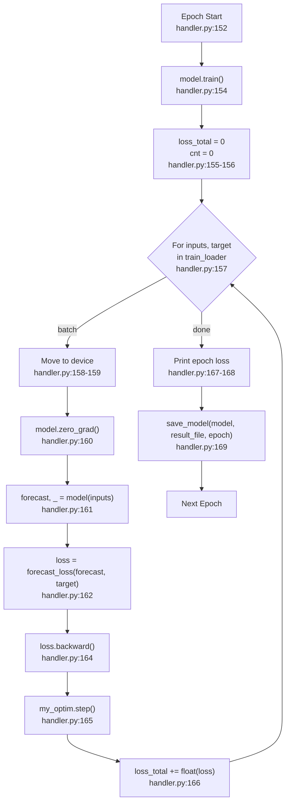

### Loss Function

The training uses Mean Squared Error (MSE) loss [models/handler.py:140]():

```
forecast_loss = nn.MSELoss(reduction='mean').to(args.device)
```

The loss is computed between the model's forecast and the target values [models/handler.py:162]().

### Batch Processing

For each batch [models/handler.py:157-166]():

1. **Move to device:** Input and target tensors are moved to the specified device
2. **Zero gradients:** `model.zero_grad()` clears previous gradients
3. **Forward pass:** `forecast, _ = model(inputs)` generates predictions (the second return value is the attention matrix, which is ignored during training)
4. **Compute loss:** MSE between forecast and target
5. **Backward pass:** `loss.backward()` computes gradients
6. **Optimizer step:** `my_optim.step()` updates model parameters

**Sources:** [models/handler.py:140](), [models/handler.py:152-168]()

---

## Validation During Training

Validation is performed periodically during training to monitor model performance on unseen data. The frequency is controlled by `validate_freq` (default: 1 epoch) [main.py:22]().

```mermaid
flowchart TD
    ValidCheck{"(epoch + 1) % validate_freq == 0<br/>handler.py:172"}
    
    CallValidate["validate(model, valid_loader, ...)<br/>handler.py:176-178"]
    
    GetMetrics["performance_metrics = {...}<br/>Contains mae, mape, rmse"]
    
    CompareMAE{"best_validate_mae > mae?<br/>handler.py:179"}
    
    UpdateBest["best_validate_mae = mae<br/>validate_score_non_decrease_count = 0<br/>is_best_for_now = True<br/>handler.py:180-182"]
    
    IncrementCount["validate_score_non_decrease_count += 1<br/>handler.py:184"]
    
    CheckSave{"is_best_for_now?<br/>handler.py:186"}
    
    SaveBest["save_model(model, result_file)<br/>(no epoch suffix)<br/>handler.py:187"]
    
    Continue["Continue training"]
    
    ValidCheck -->|yes| CallValidate
    ValidCheck -->|no| Continue
    
    CallValidate --> GetMetrics
    GetMetrics --> CompareMAE
    
    CompareMAE -->|yes| UpdateBest
    CompareMAE -->|no| IncrementCount
    
    UpdateBest --> CheckSave
    IncrementCount --> Continue
    
    CheckSave -->|yes| SaveBest
    CheckSave -->|no| Continue
    SaveBest --> Continue
```

### Validation Metrics

The `validate()` function returns a dictionary of metrics [models/handler.py:99-100]():

```python
{
    'mae': float,           # Mean Absolute Error
    'mae_node': np.array,   # MAE per node
    'mape': float,          # Mean Absolute Percentage Error
    'mape_node': np.array,  # MAPE per node
    'rmse': float,          # Root Mean Squared Error
    'rmse_node': np.array   # RMSE per node
}
```

### Best Model Tracking

The system tracks the best model based on validation MAE [models/handler.py:179-187]():

- If the current MAE is lower than `best_validate_mae`, the model is saved without an epoch suffix (as `_stemgnn.pt`)
- This becomes the model used for final evaluation
- The `validate_score_non_decrease_count` tracks consecutive epochs without improvement for early stopping

**Sources:** [models/handler.py:172-187](), [main.py:22]()

---

## Learning Rate Scheduling

The learning rate is decayed exponentially at regular intervals [models/handler.py:170-171]():

```python
if (epoch+1) % args.exponential_decay_step == 0:
    my_lr_scheduler.step()
```

### Scheduling Parameters

| Parameter | Default | Description |
|-----------|---------|-------------|
| `exponential_decay_step` | 5 | Epochs between LR decay |
| `decay_rate` | 0.5 | Multiplicative decay factor |

For example, with default settings:
- Initial LR: `1e-4`
- After epoch 5: `1e-4 * 0.5 = 5e-5`
- After epoch 10: `5e-5 * 0.5 = 2.5e-5`
- And so on...

This helps the model converge by reducing the learning rate as training progresses.

**Sources:** [models/handler.py:170-171](), [main.py:27-28]()

---

## Model Persistence

The training process saves models at multiple checkpoints:

### Per-Epoch Checkpoints

After each epoch, the model is saved with an epoch suffix [models/handler.py:169]():

```python
save_model(model, result_file, epoch)
```

This creates files like: `0_stemgnn.pt`, `1_stemgnn.pt`, `2_stemgnn.pt`, etc.

### Best Model Checkpoint

When validation MAE improves, the model is saved without an epoch suffix [models/handler.py:187]():

```python
save_model(model, result_file)  # No epoch parameter
```

This creates: `_stemgnn.pt`

### Save Implementation

The `save_model()` function [models/handler.py:16-24]():

1. Creates the model directory if it doesn't exist
2. Constructs the filename: `{epoch}_stemgnn.pt` or `_stemgnn.pt`
3. Serializes the entire model using `torch.save(model, f)`

The saved file contains the complete model architecture and trained weights, allowing it to be loaded without reconstructing the model manually.

**Sources:** [models/handler.py:16-24](), [models/handler.py:169](), [models/handler.py:187]()

---

## Early Stopping

Early stopping prevents overfitting by terminating training when validation performance stops improving.

### Configuration

Early stopping is controlled by two parameters:

| Parameter | Default | Description |
|-----------|---------|-------------|
| `early_stop` | False | Enable early stopping |
| `early_stop_step` | Not set | Patience (epochs without improvement) |

### Implementation

The early stopping logic [models/handler.py:189-190]():

```python
if args.early_stop and validate_score_non_decrease_count >= args.early_stop_step:
    break
```

The training loop exits when the validation MAE hasn't improved for `early_stop_step` consecutive validation checks.

**Note:** The `early_stop_step` parameter is referenced in the code but not defined in the argument parser [main.py:9-30](), so users must add it manually if they want to use early stopping with a custom patience value.

**Sources:** [models/handler.py:149-150](), [models/handler.py:183-190](), [main.py:26]()

---

## Training Outputs

The training process produces several outputs in the result directory:

### Output Files

| File | Description | Created By |
|------|-------------|------------|
| `norm_stat.json` | Normalization statistics (mean/std or min/max) | [handler.py:123-124]() |
| `{epoch}_stemgnn.pt` | Per-epoch model checkpoints | [handler.py:169]() |
| `_stemgnn.pt` | Best model (lowest validation MAE) | [handler.py:187]() |
| `target.csv` | Validation targets (first forecast step) | [handler.py:92]() |
| `predict.csv` | Validation predictions (first forecast step) | [handler.py:93]() |
| `predict_abs_error.csv` | Absolute errors | [handler.py:94-95]() |
| `predict_ape.csv` | Absolute percentage errors | [handler.py:96-97]() |

### Directory Structure

For a dataset named `ECG_data`, the output structure is:

```
output/
└── ECG_data/
    └── train/
        ├── norm_stat.json
        ├── _stemgnn.pt
        ├── 0_stemgnn.pt
        ├── 1_stemgnn.pt
        ├── ...
        ├── target.csv
        ├── predict.csv
        ├── predict_abs_error.csv
        └── predict_ape.csv
```

The directory is created by [main.py:36-39]() before training begins.

**Sources:** [models/handler.py:85-97](), [models/handler.py:123-124](), [models/handler.py:169](), [models/handler.py:187](), [main.py:36-39]()

---

## Training Duration Tracking

The training duration is tracked and reported using timestamps [main.py:56-59]():

```python
before_train = datetime.now().timestamp()
_, normalize_statistic = train(train_data, valid_data, args, result_train_file)
after_train = datetime.now().timestamp()
print(f'Training took {(after_train - before_train) / 60} minutes')
```

This provides users with feedback on training time, which can vary significantly based on dataset size, model complexity, and hardware.

**Sources:** [main.py:56-59]()

---

## Training Summary Table

The following table summarizes key training components and their locations:

| Component | File | Function/Lines | Purpose |
|-----------|------|----------------|---------|
| Training orchestration | `main.py` | [54-59]() | Invoke training, track duration |
| Data splitting | `main.py` | [45-50]() | Split into train/valid/test |
| Main training loop | `models/handler.py` | `train()` [103-191]() | Complete training workflow |
| Normalization stats | `models/handler.py` | [112-124]() | Compute and save statistics |
| Model initialization | `models/handler.py` | [105-106]() | Create and move to device |
| Optimizer setup | `models/handler.py` | [126-129]() | RMSProp or Adam |
| LR scheduler | `models/handler.py` | [130](), [170-171]() | Exponential decay |
| Dataset creation | `models/handler.py` | [132-135]() | ForecastDataset wrapper |
| DataLoader creation | `models/handler.py` | [136-138]() | Batch loading |
| Loss function | `models/handler.py` | [140]() | MSE loss |
| Epoch loop | `models/handler.py` | [152-191]() | Training iterations |
| Batch processing | `models/handler.py` | [157-166]() | Forward/backward passes |
| Validation | `models/handler.py` | [172-178]() | Periodic evaluation |
| Best model tracking | `models/handler.py` | [179-187]() | Save best checkpoint |
| Early stopping | `models/handler.py` | [189-190]() | Terminate if no improvement |
| Model saving | `models/handler.py` | `save_model()` [16-24]() | Serialize model to disk |

**Sources:** [main.py](), [models/handler.py]()

---

# Page: Evaluating Models

# Evaluating Models

<details>
<summary>Relevant source files</summary>

The following files were used as context for generating this wiki page:

- [README.md](README.md)
- [main.py](main.py)
- [models/handler.py](models/handler.py)
- [utils/math_utils.py](utils/math_utils.py)

</details>


## Purpose and Scope

This page explains the model evaluation process in StemGNN, including how to run evaluation on test data, what metrics are calculated, and how to interpret the results. Evaluation is the process of measuring a trained model's forecasting performance on held-out test data.

For information about training models, see [Training Models](#3.2). For technical details about the metric implementations, see [Evaluation Metrics](#4.5). For expected performance benchmarks, see [Supported Datasets](#5.2).

---

## Overview

Model evaluation in StemGNN consists of three main steps:

1. **Loading** a trained model checkpoint and normalization statistics
2. **Inference** on test data to generate predictions
3. **Metric Calculation** comparing predictions against ground truth

The evaluation process is independent of training and can be run at any time using a saved model checkpoint.

**Sources:** [main.py:63-67](), [models/handler.py:194-207]()

---

## Running Evaluation

### Command-Line Execution

To evaluate a trained model, set the `--evaluate` flag to `True`:

```bash
python main.py --evaluate True --dataset ECG_data --train False
```

The evaluation process will:
- Load the trained model from `output/<dataset>/train/_stemgnn.pt`
- Load normalization statistics from `output/<dataset>/train/norm_stat.json`
- Run inference on test data
- Calculate and print performance metrics
- Save prediction results to `output/<dataset>/test/`

### Key Parameters

| Parameter | Purpose | Default |
|-----------|---------|---------|
| `--evaluate` | Enable evaluation | `True` |
| `--train` | Whether to train before evaluating | `True` |
| `--dataset` | Name of dataset CSV file | `ECG_data` |
| `--window_size` | Input window size | `12` |
| `--horizon` | Prediction horizon | `3` |
| `--batch_size` | Batch size for inference | `32` |
| `--norm_method` | Normalization method used during training | `z_score` |

**Note:** The evaluation parameters (`window_size`, `horizon`, `norm_method`) must match those used during training.

**Sources:** [main.py:10-11](), [main.py:63-67](), [README.md:41-46]()

---

## Evaluation Workflow

### High-Level Flow

```mermaid
flowchart TD
    Start["main.py: Evaluation Entry Point"] --> CheckFlag{"args.evaluate == True?"}
    CheckFlag -->|No| End["Skip evaluation"]
    CheckFlag -->|Yes| TestFunc["handler.test()"]
    
    TestFunc --> LoadStats["Load norm_stat.json<br/>from result_train_file"]
    LoadStats --> LoadModel["load_model()<br/>Load _stemgnn.pt checkpoint"]
    LoadModel --> CreateDS["ForecastDataset<br/>test_data with normalization"]
    CreateDS --> DataLoader["torch_data.DataLoader<br/>batch_size, shuffle=False"]
    DataLoader --> Validate["validate()<br/>Run inference and calculate metrics"]
    
    Validate --> InferenceCall["inference()<br/>Generate predictions"]
    InferenceCall --> Denorm["de_normalized()<br/>Convert predictions to original scale"]
    Denorm --> EvalMetrics["evaluate()<br/>Calculate MAPE, MAE, RMSE"]
    EvalMetrics --> SaveResults["Save prediction CSVs<br/>to result_test_file"]
    SaveResults --> PrintMetrics["Print performance metrics"]
    PrintMetrics --> End
    
    style TestFunc fill:#ffe1e1
    style Validate fill:#fff4e1
    style InferenceCall fill:#e1f5ff
    style EvalMetrics fill:#e1ffe1
```

**Diagram: Evaluation Execution Flow**

**Sources:** [main.py:63-67](), [models/handler.py:194-207](), [models/handler.py:67-101]()

---

## Code Entity Mapping

### Function Call Hierarchy

```mermaid
graph TB
    MainPy["main.py:__main__<br/>lines 63-67"] --> TestFunc["handler.test()<br/>lines 194-207"]
    
    TestFunc --> LoadModelFunc["handler.load_model()<br/>lines 27-38"]
    TestFunc --> ForecastDS["ForecastDataset<br/>data_loader/forecast_dataloader.py"]
    TestFunc --> ValidateFunc["handler.validate()<br/>lines 67-101"]
    
    ValidateFunc --> InferFunc["handler.inference()<br/>lines 41-64"]
    ValidateFunc --> DenormFunc["de_normalized()<br/>data_loader/forecast_dataloader.py"]
    ValidateFunc --> EvalFunc["math_utils.evaluate()<br/>lines 59-74"]
    
    InferFunc --> ModelForward["model.forward()<br/>base_model.py"]
    
    EvalFunc --> MAPE["MAPE()<br/>lines 24-34"]
    EvalFunc --> MAE["MAE()<br/>lines 48-56"]
    EvalFunc --> RMSE["RMSE()<br/>lines 37-45"]
    
    style MainPy fill:#e1f5ff
    style TestFunc fill:#ffe1e1
    style ValidateFunc fill:#fff4e1
    style InferFunc fill:#e1ffe1
    style EvalFunc fill:#f0e1ff
```

**Diagram: Code Entity Relationships in Evaluation**

**Sources:** [main.py:63-67](), [models/handler.py:194-207](), [models/handler.py:67-101](), [models/handler.py:41-64](), [utils/math_utils.py:59-74]()

---

## Inference Process

The `inference()` function generates predictions using an autoregressive approach:

### Autoregressive Forecasting

1. **Initial Input:** The model receives a window of historical data (size `window_size`)
2. **Iterative Prediction:** The model predicts multiple future steps iteratively:
   - Predict next time step(s)
   - Shift the input window: remove oldest values, append predictions
   - Repeat until `horizon` steps are predicted
3. **Output:** Full forecast of shape `[batch, horizon, nodes]`

### Implementation Details

The inference loop at [models/handler.py:49-61]():

```python
while step < horizon:
    forecast_result, a = model(inputs)
    # Update input window with predictions
    inputs[:, :window_size - len_model_output, :] = inputs[:, len_model_output:window_size, :].clone()
    inputs[:, window_size - len_model_output:, :] = forecast_result.clone()
    # Accumulate forecast steps
    forecast_steps[:, step:min(horizon - step, len_model_output) + step, :] = ...
    step += min(horizon - step, len_model_output)
```

**Key characteristics:**
- Model runs in evaluation mode: `model.eval()` [models/handler.py:44]()
- No gradient computation: `with torch.no_grad()` [models/handler.py:45]()
- Predictions are detached and moved to CPU for storage [models/handler.py:60]()

**Sources:** [models/handler.py:41-64]()

---

## Metrics Calculation

### Supported Metrics

StemGNN calculates three standard forecasting metrics:

| Metric | Function | Formula | Purpose |
|--------|----------|---------|---------|
| **MAPE** | `MAPE()` | Mean Absolute Percentage Error | Measures relative error as percentage |
| **MAE** | `MAE()` | Mean Absolute Error | Measures average absolute error in original units |
| **RMSE** | `RMSE()` | Root Mean Squared Error | Penalizes large errors more than MAE |

### Calculation Workflow

```mermaid
flowchart LR
    subgraph Input["Input Data"]
        Target["target<br/>[batch, horizon, nodes]"]
        Forecast["forecast<br/>[batch, horizon, nodes]"]
    end
    
    subgraph Denormalization["Scale Transformation"]
        TargetNorm["target_norm<br/>(normalized)"]
        ForecastNorm["forecast_norm<br/>(normalized)"]
        Denorm["de_normalized()<br/>using statistic"]
        TargetRaw["target<br/>(original scale)"]
        ForecastRaw["forecast<br/>(original scale)"]
    end
    
    subgraph Evaluation["Metric Calculation"]
        EvalCall["evaluate(target, forecast)"]
        MAPECalc["MAPE()<br/>Percentage error"]
        MAECalc["MAE()<br/>Absolute error"]
        RMSECalc["RMSE()<br/>Squared error"]
    end
    
    subgraph Output["Outputs"]
        ScoreGlobal["Global: (MAPE, MAE, RMSE)"]
        ScoreByNode["By node: (MAPE, MAE, RMSE)<br/>per time series"]
    end
    
    Target --> TargetNorm
    Forecast --> ForecastNorm
    TargetNorm --> Denorm
    ForecastNorm --> Denorm
    Denorm --> TargetRaw
    Denorm --> ForecastRaw
    
    TargetRaw --> EvalCall
    ForecastRaw --> EvalCall
    EvalCall --> MAPECalc
    EvalCall --> MAECalc
    EvalCall --> RMSECalc
    MAPECalc --> ScoreGlobal
    MAECalc --> ScoreGlobal
    RMSECalc --> ScoreGlobal
    
    EvalCall --> ScoreByNode
```

**Diagram: Metric Calculation Pipeline**

**Sources:** [models/handler.py:67-101](), [utils/math_utils.py:59-74]()

### Aggregation Options

The `evaluate()` function supports different aggregation strategies via the `by_node` and `by_step` parameters:

- **Default** (`by_node=False`, `by_step=False`): Aggregate over all dimensions → single score
- **By node** (`by_node=True`): Calculate metrics separately for each time series → array of length `nodes`
- **By step** (`by_step=True`): Calculate metrics separately for each forecast step → array of length `horizon`
- **Both** (`by_node=True`, `by_step=True`): Calculate metrics for each node and step → matrix `[horizon, nodes]`

**Sources:** [utils/math_utils.py:59-74](), [models/handler.py:79]()

### MAPE Implementation Details

The MAPE function includes special handling to prevent numerical instability:

1. **Epsilon addition:** Adds `1e-5` to denominator to avoid division by zero [utils/math_utils.py:32]()
2. **Capping:** Clips MAPE values at 5 (500%) to prevent outliers from dominating [utils/math_utils.py:33]()

An alternative `masked_MAPE()` function is available that uses NumPy masked arrays to properly handle zero ground truth values [utils/math_utils.py:4-21]().

**Sources:** [utils/math_utils.py:24-34](), [utils/math_utils.py:4-21]()

---

## Output Files

### Generated Files

The evaluation process saves results to `output/<dataset>/test/`:

| File | Content | Shape | Description |
|------|---------|-------|-------------|
| `target.csv` | Ground truth values | `[samples, nodes]` | Actual values at first forecast step |
| `predict.csv` | Model predictions | `[samples, nodes]` | Predicted values at first forecast step |
| `predict_abs_error.csv` | Absolute errors | `[samples, nodes]` | `|predict - target|` |
| `predict_ape.csv` | Percentage errors | `[samples, nodes]` | `|predict - target| / |target|` |

**Note:** Only the first forecast step (`step_to_print = 0`) is saved to files [models/handler.py:88]().

### File Generation Logic

The output files are generated in the `validate()` function at [models/handler.py:85-97]():

```python
if result_file:
    step_to_print = 0
    forcasting_2d = forecast[:, step_to_print, :]
    forcasting_2d_target = target[:, step_to_print, :]
    
    np.savetxt(f'{result_file}/target.csv', forcasting_2d_target, delimiter=",")
    np.savetxt(f'{result_file}/predict.csv', forcasting_2d, delimiter=",")
    np.savetxt(f'{result_file}/predict_abs_error.csv', 
               np.abs(forcasting_2d - forcasting_2d_target), delimiter=",")
    np.savetxt(f'{result_file}/predict_ape.csv',
               np.abs((forcasting_2d - forcasting_2d_target) / forcasting_2d_target), delimiter=",")
```

**Sources:** [models/handler.py:85-97]()

---

## Result Interpretation

### Console Output

During evaluation, the system prints two sets of metrics:

```
NORM: MAPE 12.345678%; MAE 0.123456789; RMSE 0.123456789.
RAW : MAPE 6.456789%; MAE 2.567890123; RMSE 5.067890123.
Performance on test set: MAPE: 6.46 | MAE: 2.57 | RMSE: 5.07
```

- **NORM metrics:** Calculated on normalized data (z-score or min-max scaled)
- **RAW metrics:** Calculated on denormalized data (original scale) - **these are the reported results**

**Sources:** [models/handler.py:83-84](), [models/handler.py:207]()

### Metric Interpretation

| Metric | Unit | Interpretation | Lower is Better |
|--------|------|----------------|-----------------|
| **MAPE** | Percentage (%) | Average percentage deviation from true values | ✓ |
| **MAE** | Original data units | Average absolute deviation | ✓ |
| **RMSE** | Original data units | Root mean squared deviation (penalizes outliers) | ✓ |

**Example:** For traffic speed forecasting:
- MAE = 2.56 means the model's predictions are off by 2.56 mph on average
- MAPE = 6.46% means predictions deviate by 6.46% from actual values on average
- RMSE = 5.06 indicates the typical magnitude of errors, with larger weight on big mistakes

### Benchmark Comparison

The README provides reference results for various datasets. For example, on METR-LA with horizon=3:

| Metric | Expected Value |
|--------|---------------|
| MAE | 2.56 |
| RMSE | 5.06 |
| MAPE | 6.46% |

Compare your evaluation results against these benchmarks to assess model performance.

**Sources:** [README.md:82-101](), [models/handler.py:83-84]()

---

## Evaluation Without Training

To evaluate an existing model without retraining:

```bash
python main.py --train False --evaluate True --dataset ECG_data
```

This workflow:
1. Skips the training phase [main.py:54-62]()
2. Proceeds directly to evaluation [main.py:63-67]()
3. Loads the saved model checkpoint from `output/<dataset>/train/`
4. Requires that training was previously completed for this dataset

**Error conditions:**
- If `norm_stat.json` doesn't exist, the system will fail at [models/handler.py:195-196]()
- If `_stemgnn.pt` doesn't exist, `load_model()` returns `None` [models/handler.py:34-38]()

**Sources:** [main.py:54-67](), [models/handler.py:194-207](), [models/handler.py:27-38]()

---

## Advanced: Per-Node Metrics

The `validate()` function calculates metrics both globally and per-node:

```python
score = evaluate(target, forecast)  # Global metrics
score_by_node = evaluate(target, forecast, by_node=True)  # Per-node metrics
```

The per-node metrics are stored in the returned dictionary:
- `mae_node`: MAE for each time series
- `mape_node`: MAPE for each time series  
- `rmse_node`: RMSE for each time series

These enable identification of which time series are harder to predict and analysis of spatial patterns in forecasting performance.

**Sources:** [models/handler.py:78-79](), [models/handler.py:99-100]()

---

## Summary

The evaluation process in StemGNN:

1. **Loads** trained model and normalization statistics
2. **Generates** predictions using autoregressive inference
3. **Denormalizes** predictions and targets to original scale
4. **Calculates** MAPE, MAE, and RMSE metrics
5. **Saves** prediction results and error analysis to CSV files
6. **Reports** performance metrics to console

The `test()` function orchestrates this workflow, delegating to `validate()` for inference and metric calculation, which in turn uses `inference()` for prediction generation and `evaluate()` for metric computation.

**Sources:** [models/handler.py:194-207](), [models/handler.py:67-101](), [models/handler.py:41-64](), [utils/math_utils.py:59-74]()

---

# Page: Working with Datasets

# Working with Datasets

<details>
<summary>Relevant source files</summary>

The following files were used as context for generating this wiki page:

- [README.md](README.md)
- [data_loader/forecast_dataloader.py](data_loader/forecast_dataloader.py)
- [dataset/ECG_data.csv](dataset/ECG_data.csv)
- [dataset/PeMS07.csv](dataset/PeMS07.csv)

</details>


This page explains the dataset requirements, format specifications, and procedures for using custom datasets with STemGNN. It covers the expected data structure, how data is loaded and preprocessed, and the configuration parameters that control dataset handling.

For information about normalization methods (z-score vs min-max), see [Normalization Methods](#3.5). For details on command-line arguments for specifying datasets, see [Command-Line Interface](#3.1). For the complete list of supported datasets with expected results, see [Supported Datasets](#5.2).

---

## Dataset Format Requirements

STemGNN requires datasets in a specific CSV format to ensure proper processing through the data pipeline.

### Basic Structure

All input datasets must follow these requirements:

| Requirement | Description | Example |
|------------|-------------|---------|
| **Format** | CSV file | `my_dataset.csv` |
| **Shape** | `T × N` where T = timestamps, N = nodes | 5000 rows × 140 columns |
| **Header** | **No header row** | First row must be data, not column names |
| **Values** | Numeric (float or integer) | `3.6908442, 0.71141435, -2.1140915, ...` |
| **Missing Values** | Handled via forward/backward fill | Automatically processed |

**Shape Convention**: The CSV file should have `T` rows (time steps) and `N` columns (nodes/variables). Each row represents one timestamp, and each column represents one node/variable in the multivariate time series.

```
# Correct format (no header):
3.6908442,0.71141435,-2.1140915,-4.1410068
-1.3481323,-3.9960376,-4.2267496,-4.2511874
1.0242946,-0.59031419,-1.9169491,-2.8069890
...

# Incorrect format (has header):
node1,node2,node3,node4          <- DO NOT INCLUDE
3.6908442,0.71141435,-2.1140915,-4.1410068
```

Sources: [README.md:37](), [data_loader/forecast_dataloader.py:41-54]()

---

## Data Loading and Processing Pipeline

### Overview

The following diagram shows how raw CSV data flows through the STemGNN system from disk to model input:

```mermaid
flowchart TB
    CSV["CSV File<br/>(T × N shape, no header)"]
    
    subgraph MainPy["main.py orchestration"]
        LoadCSV["pd.read_csv()<br/>Load raw data"]
        Split["Split data:<br/>train/valid/test<br/>(7:2:1 ratio)"]
    end
    
    subgraph DataLoader["data_loader/forecast_dataloader.py"]
        FD["ForecastDataset class<br/>__init__()"]
        FillNA["df.fillna()<br/>Forward/backward fill<br/>missing values"]
        Norm["normalized()<br/>Apply norm_method:<br/>z_score or min_max"]
        Window["get_x_end_idx()<br/>Create sliding windows<br/>size = window_size"]
        GetItem["__getitem__()<br/>Return (x, y) pairs<br/>x: input, y: target"]
    end
    
    subgraph ModelInput["Model Training"]
        DataLoader_["PyTorch DataLoader<br/>Batch creation"]
        Model["STemGNN Model<br/>Forward pass"]
    end
    
    CSV --> LoadCSV
    LoadCSV --> Split
    Split --> FD
    FD --> FillNA
    FillNA --> Norm
    Norm --> Window
    Window --> GetItem
    GetItem --> DataLoader_
    DataLoader_ --> Model
```

Sources: [main.py](), [data_loader/forecast_dataloader.py:41-74]()

### ForecastDataset Class

The `ForecastDataset` class in `data_loader/forecast_dataloader.py` is the core component for data handling:

```mermaid
classDiagram
    class ForecastDataset {
        +window_size: int
        +horizon: int
        +interval: int
        +normalize_method: str
        +norm_statistic: dict
        +data: ndarray
        +df_length: int
        +x_end_idx: list
        
        +__init__(df, window_size, horizon, normalize_method, norm_statistic, interval)
        +__getitem__(index) tuple~Tensor~
        +__len__() int
        +get_x_end_idx() list
    }
    
    class PyTorchDataset {
        <<interface>>
    }
    
    PyTorchDataset <|-- ForecastDataset
```

**Key responsibilities:**
- **Missing value handling**: Forward-fill then backward-fill to handle NaN values [data_loader/forecast_dataloader.py:49]()
- **Normalization**: Apply z-score or min-max normalization [data_loader/forecast_dataloader.py:54]()
- **Sliding windows**: Create overlapping windows of size `window_size` [data_loader/forecast_dataloader.py:68-73]()
- **Sample generation**: Return (input, target) pairs where input is `window_size` timesteps and target is next `horizon` timesteps [data_loader/forecast_dataloader.py:56-63]()

Sources: [data_loader/forecast_dataloader.py:41-74]()

### Sliding Window Mechanism

The dataset uses a sliding window approach to create training samples:

```mermaid
graph LR
    subgraph "Time Series Data (T timesteps)"
        T1["t=0"]
        T2["t=1"]
        T3["..."]
        T4["t=11"]
        T5["t=12"]
        T6["t=13"]
        T7["t=14"]
        T8["..."]
    end
    
    subgraph "Sample 1"
        Input1["Input Window<br/>t=0 to t=11<br/>(window_size=12)"]
        Target1["Target<br/>t=12 to t=14<br/>(horizon=3)"]
    end
    
    subgraph "Sample 2"
        Input2["Input Window<br/>t=1 to t=12<br/>(window_size=12)"]
        Target2["Target<br/>t=13 to t=15<br/>(horizon=3)"]
    end
    
    T1 -.-> Input1
    T5 -.-> Target1
    T2 -.-> Input2
    T6 -.-> Target2
```

**Parameters:**
- `window_size`: Length of input sequence (default: 12)
- `horizon`: Length of prediction sequence (default: 3)
- `interval`: Step size between consecutive samples (default: 1)

The number of samples created is: `(T - window_size - horizon + 1) / interval`

Sources: [data_loader/forecast_dataloader.py:68-73](), [README.md:46-47]()

---

## Provided Example Dataset

The repository includes a preprocessed sample dataset for immediate testing:

| Property | Value |
|----------|-------|
| **File** | `dataset/ECG_data.csv` |
| **Shape** | 5000 timesteps × 140 nodes |
| **Domain** | ECG (electrocardiogram) time series |
| **Source** | Cleaned version of ECG5000 dataset |
| **Purpose** | Reproduction and testing convenience |

**Quick Start**: Run `python main.py` without arguments to train on this dataset using default parameters.

Sources: [README.md:39](), [dataset/ECG_data.csv]()

---

## Public Dataset Sources

The following table lists datasets mentioned in the original paper and README:

| Dataset | Domain | Nodes | Source URL | Data Type |
|---------|--------|-------|------------|-----------|
| **PEMS03** | Traffic flow | 358 | [PeMS District 3](http://pems.dot.ca.gov/?dnode=Clearinghouse&type=station_5min&district_id=3&submit=Submit) | 5-minute aggregated flow |
| **PEMS04** | Traffic speed | 307 | [PeMS District 4](http://pems.dot.ca.gov/?dnode=Clearinghouse&type=station_5min&district_id=4&submit=Submit) | 5-minute aggregated speed |
| **PEMS07** | Traffic flow | 228 | [PeMS District 7](http://pems.dot.ca.gov/?dnode=Clearinghouse&type=station_5min&district_id=7&submit=Submit) | 5-minute aggregated flow |
| **PEMS08** | Traffic flow | 170 | [PeMS District 8](http://pems.dot.ca.gov/?dnode=Clearinghouse&type=station_5min&district_id=8&submit=Submit) | 5-minute aggregated flow |
| **METR-LA** | Traffic speed | 207 | [DCRNN GitHub](https://github.com/liyaguang/DCRNN) | Speed sensors |
| **PEMS-BAY** | Traffic speed | 325 | [DCRNN GitHub](https://github.com/liyaguang/DCRNN) | Speed sensors |
| **Solar** | Solar power | 137 | [NREL Database](https://www.nrel.gov/grid/solar-power-data.html) | Alabama (Eastern States) |
| **Electricity** | Power consumption | Variable | [UCI Repository](https://archive.ics.uci.edu/ml/datasets/ElectricityLoadDiagrams20112014) | Load diagrams |
| **ECG5000** | ECG signals | 140 | [Time Series Classification](http://www.timeseriesclassification.com/description.php?Dataset=ECG5000) | ECG readings |
| **COVID-19** | Pandemic data | 25 | [JHU CSSE](https://github.com/CSSEGISandData/COVID-19/tree/master) | Daily confirmed cases |

**Important**: These datasets require preprocessing before use. The raw data from the URLs needs to be cleaned, formatted, and shaped according to the requirements (T×N, no header, CSV format).

Sources: [README.md:22-35]()

### Dataset-Specific Preprocessing Notes

**COVID-19 Dataset**:
- File: `csse_covid_19_data/csse_covid_19_time_series/time_series_covid19_confirmed_global.csv`
- Transform: Calculate daily newly confirmed cases from cumulative data
- Period: 1/22/2020 to 5/10/2020
- Countries: 25 selected countries including US, Canada, Mexico, Russia, UK, Italy, Germany, France, etc.

**Solar Dataset**:
- Files: Multiple 5-minute CSV files for Alabama region
- Transform: Merge 137 time series into single CSV
- Action: Delete header and index columns

**Electricity Dataset**:
- Transform: Delete header and index from downloaded file

Sources: [README.md:34-36]()

---

## Preparing Custom Datasets

### Step-by-Step Process

```mermaid
flowchart TD
    Start["Collect Raw Data"]
    
    Clean["Data Cleaning:<br/>- Handle missing values<br/>- Remove outliers<br/>- Ensure numeric format"]
    
    Reshape["Reshape to T×N:<br/>- Rows = timestamps<br/>- Columns = nodes/variables<br/>- Chronological order"]
    
    RemoveHeader["Remove Header Row:<br/>- Delete column names<br/>- First row must be data"]
    
    SaveCSV["Save as CSV:<br/>- No index column<br/>- Comma-separated<br/>- Plain text encoding"]
    
    Verify["Verify Format:<br/>- Check shape with pandas<br/>- Confirm no header<br/>- Test with pd.read_csv()"]
    
    Configure["Configure Parameters:<br/>--dataset filename.csv<br/>--n_route N<br/>--window_size W<br/>--horizon H"]
    
    Start --> Clean
    Clean --> Reshape
    Reshape --> RemoveHeader
    RemoveHeader --> SaveCSV
    SaveCSV --> Verify
    Verify --> Configure
```

Sources: [README.md:37-47](), [data_loader/forecast_dataloader.py:41-49]()

### Example: Creating a Custom Dataset

**Scenario**: You have temperature sensor readings from 50 locations collected every hour for 1000 hours.

**Python preprocessing script:**
```python
import pandas as pd
import numpy as np

# 1. Load your raw data (assume it has headers and datetime index)
df = pd.read_csv('raw_temperature_data.csv', index_col=0)
# Shape: (1000 rows with datetime index, 50 columns with sensor names)

# 2. Remove any non-numeric columns
df = df.select_dtypes(include=[np.number])

# 3. Handle missing values (will also be done by ForecastDataset, but good practice)
df = df.fillna(method='ffill').fillna(method='bfill')

# 4. Save without header and without index
df.to_csv('temperature_1000x50.csv', header=False, index=False)

# 5. Verify
test = pd.read_csv('temperature_1000x50.csv', header=None)
print(f"Shape: {test.shape}")  # Should print: Shape: (1000, 50)
print(f"Data types: {test.dtypes.unique()}")  # Should be numeric
```

**Command to train:**
```bash
python main.py \
    --train True \
    --evaluate True \
    --dataset temperature_1000x50.csv \
    --n_route 50 \
    --window_size 24 \
    --horizon 6 \
    --norm_method z_score
```

Sources: [data_loader/forecast_dataloader.py:48-49](), [README.md:46-47]()

### Common Issues and Solutions

| Issue | Symptom | Solution |
|-------|---------|----------|
| **Header present** | First row treated as data | Remove header row: `df.to_csv(file, header=False)` |
| **Index column included** | Extra column in data | Remove index: `df.to_csv(file, index=False)` |
| **Wrong shape orientation** | N×T instead of T×N | Transpose: `df = df.T` before saving |
| **Non-numeric values** | ValueError during training | Convert or drop non-numeric columns |
| **Inconsistent delimiters** | Parse errors | Ensure comma-separated: `df.to_csv(file, sep=',')` |
| **Wrong file path** | FileNotFoundError | Place in `dataset/` directory or use absolute path |

Sources: [README.md:37](), [data_loader/forecast_dataloader.py:48-49]()

---

## Configuration Parameters

### Dataset-Related Parameters

The following command-line arguments control dataset handling:

```mermaid
graph TD
    subgraph "File & Structure"
        Dataset["--dataset<br/>CSV filename<br/>Default: ECG_data.csv"]
        NRoute["--n_route<br/>Number of nodes (N)<br/>Default: 140"]
    end
    
    subgraph "Temporal Parameters"
        Window["--window_size<br/>Input sequence length<br/>Default: 12"]
        Horizon["--horizon<br/>Prediction length<br/>Default: 3"]
    end
    
    subgraph "Data Splitting"
        TrainLen["--train_length<br/>Training ratio<br/>Default: 7"]
        ValidLen["--validate_length<br/>Validation ratio<br/>Default: 2"]
        TestLen["--test_length<br/>Test ratio<br/>Default: 1"]
    end
    
    subgraph "Preprocessing"
        NormMethod["--norm_method<br/>z_score or min_max<br/>Default: z_score"]
    end
```

### Parameter Details

| Parameter | Type | Description | Example |
|-----------|------|-------------|---------|
| `--dataset` | string | CSV filename (relative to working directory or in `dataset/`) | `--dataset my_data.csv` |
| `--n_route` | int | Number of nodes/variables (N) in the dataset | `--n_route 50` |
| `--window_size` | int | Length of input sequence for prediction | `--window_size 12` |
| `--horizon` | int | Number of future timesteps to predict | `--horizon 3` |
| `--train_length` | int | Relative length for training split | `--train_length 7` |
| `--validate_length` | int | Relative length for validation split | `--validate_length 2` |
| `--test_length` | int | Relative length for test split | `--test_length 1` |
| `--norm_method` | string | Normalization method: `z_score` or `min_max` | `--norm_method z_score` |

**Data Splitting**: The ratio `train_length:validate_length:test_length` determines how the temporal data is split. Default `7:2:1` means 70% training, 20% validation, 10% testing.

Sources: [README.md:49-68](), [main.py]()

### Configuration Examples

**Example 1: Standard traffic forecasting**
```bash
python main.py \
    --dataset PEMS07.csv \
    --n_route 228 \
    --window_size 12 \
    --horizon 3 \
    --norm_method z_score \
    --train_length 7 \
    --validate_length 2 \
    --test_length 1
```

**Example 2: Long-term COVID-19 prediction**
```bash
python main.py \
    --dataset covid19.csv \
    --n_route 25 \
    --window_size 28 \
    --horizon 28 \
    --norm_method z_score
```

**Example 3: Custom sensor network**
```bash
python main.py \
    --dataset sensors_500x100.csv \
    --n_route 100 \
    --window_size 24 \
    --horizon 6 \
    --norm_method min_max \
    --train_length 8 \
    --validate_length 1 \
    --test_length 1
```

Sources: [README.md:46-47, 71-81]()

---

## Data Flow in Code

This diagram connects the natural language concepts to actual code entities:

```mermaid
flowchart TB
    subgraph UserInput["User Input"]
        CLI["Command Line Arguments<br/>--dataset file.csv<br/>--n_route N<br/>--window_size W<br/>--horizon H"]
    end
    
    subgraph MainScript["main.py"]
        Parser["argparse.ArgumentParser<br/>Parse arguments"]
        LoadDF["pd.read_csv(dataset)<br/>Load CSV into DataFrame"]
        SplitData["train/valid/test split<br/>Based on ratios"]
    end
    
    subgraph DataLoaderModule["data_loader/forecast_dataloader.py"]
        FDInit["ForecastDataset.__init__()<br/>lines 42-54"]
        FillNA2["pd.DataFrame.fillna()<br/>line 49"]
        Normalize["normalized() function<br/>lines 7-22"]
        Windowing["get_x_end_idx()<br/>lines 68-73"]
        GetItem2["__getitem__()<br/>lines 56-63<br/>Returns torch tensors"]
    end
    
    subgraph PyTorch["PyTorch DataLoader"]
        TorchDL["torch.utils.data.DataLoader<br/>Batching & shuffling"]
    end
    
    subgraph Handler["models/handler.py"]
        Train["train() function<br/>Iterates over batches"]
    end
    
    CLI --> Parser
    Parser --> LoadDF
    LoadDF --> SplitData
    SplitData --> FDInit
    FDInit --> FillNA2
    FillNA2 --> Normalize
    Normalize --> Windowing
    Windowing --> GetItem2
    GetItem2 --> TorchDL
    TorchDL --> Train
```

**Key code locations:**
- CSV loading: [main.py]() - Uses `pandas.read_csv()`
- Data splitting: [main.py]() - Splits DataFrame by ratio
- Dataset class: [data_loader/forecast_dataloader.py:41-74]()
- Missing value handling: [data_loader/forecast_dataloader.py:49]()
- Normalization: [data_loader/forecast_dataloader.py:7-38]()
- Windowing: [data_loader/forecast_dataloader.py:68-73]()
- Batch iteration: [models/handler.py]() - Uses PyTorch DataLoader

Sources: [main.py](), [data_loader/forecast_dataloader.py:1-74](), [models/handler.py]()

---

## Recommended Dataset Configurations

Based on the paper results and README examples:

| Dataset | n_route | window_size | horizon | norm_method | Purpose |
|---------|---------|-------------|---------|-------------|---------|
| METR-LA | 207 | 12 | 3 | z_score | Traffic speed forecasting |
| PEMS-BAY | 325 | 12 | 3 | z_score | Traffic speed forecasting |
| PEMS03 | 358 | 12 | 3 | z_score | Traffic flow forecasting |
| PEMS04 | 307 | 12 | 3 | z_score | Traffic speed forecasting |
| PEMS07 | 228 | 12 | 3 | z_score | Traffic flow forecasting |
| PEMS08 | 170 | 12 | 3 | z_score | Traffic flow forecasting |
| COVID-19 | 25 | 28 | 28 | z_score | Pandemic forecasting |
| ECG_data | 140 | 12 | 3 | z_score | ECG signal analysis |

**Note**: These configurations have been tested and produce the results reported in [README.md:82-102](). Use them as starting points for similar problems.

Sources: [README.md:71-81]()

---

## Validation Checklist

Before running training, verify your dataset meets all requirements:

- [ ] CSV file format with comma separators
- [ ] Shape is T×N (timestamps as rows, nodes as columns)
- [ ] No header row (first row is data)
- [ ] No index column
- [ ] All values are numeric (integers or floats)
- [ ] File is accessible from working directory or in `dataset/` folder
- [ ] `--n_route` parameter matches number of columns (N)
- [ ] `window_size + horizon` is less than total timestamps (T)
- [ ] Data has chronological temporal ordering

**Quick verification script:**
```python
import pandas as pd

# Load without header
df = pd.read_csv('your_dataset.csv', header=None)

print(f"Shape: {df.shape}")  # Should be (T, N)
print(f"Data types: {df.dtypes.unique()}")  # Should be numeric
print(f"Missing values: {df.isna().sum().sum()}")  # Can be non-zero (will be filled)
print(f"First row sample: {df.iloc[0, :5].values}")  # Check it's data, not names
```

Sources: [README.md:37](), [data_loader/forecast_dataloader.py:41-54]()

---

# Page: Normalization Methods

# Normalization Methods

<details>
<summary>Relevant source files</summary>

The following files were used as context for generating this wiki page:

- [README.md](README.md)
- [data_loader/forecast_dataloader.py](data_loader/forecast_dataloader.py)

</details>


## Purpose and Scope

This document explains the normalization methods available in STemGNN and their implementation in the data preprocessing pipeline. Normalization transforms raw time-series data to a standardized scale before feeding it to the neural network, which is essential for stable training and convergence.

This page covers the two supported normalization methods (`z_score` and `min_max`), their mathematical formulations, implementation details, and guidance on method selection. For information about the broader data loading pipeline and dataset windowing, see [Data Pipeline](#4.4). For dataset format requirements, see [Working with Datasets](#3.4).

---

## Overview

STemGNN applies normalization during data preprocessing to ensure that different time series with varying scales can be processed together effectively. The system supports two normalization strategies, both implemented in the `normalized()` and `de_normalized()` functions.

### Normalization in the Data Pipeline

```mermaid
flowchart LR
    RawData["Raw CSV Data<br/>(T × N)"]
    CalcStats["Calculate Statistics<br/>normalized()"]
    NormData["Normalized Data<br/>[0,1] or ~N(0,1)"]
    SaveStats["Save Statistics<br/>norm_stat.json"]
    Dataset["ForecastDataset<br/>Creates windows"]
    
    RawData --> CalcStats
    CalcStats --> NormData
    CalcStats --> SaveStats
    NormData --> Dataset
    
    subgraph TrainPhase["Training Phase"]
        CalcStats
        SaveStats
    end
    
    subgraph TestPhase["Evaluation Phase"]
        LoadStats["Load Statistics<br/>norm_stat.json"]
        ApplyNorm["Apply Normalization<br/>with loaded stats"]
        Denorm["De-normalize<br/>Predictions<br/>de_normalized()"]
    end
    
    SaveStats -.->|"reused"| LoadStats
    LoadStats --> ApplyNorm
    ApplyNorm --> Denorm
```

**Diagram 1: Normalization Flow in Training and Evaluation**

Sources: [data_loader/forecast_dataloader.py:7-22](), [data_loader/forecast_dataloader.py:25-38]()

The normalization process occurs in two phases:
- **Training**: Statistics are computed from training data and saved to `norm_stat.json`
- **Evaluation**: Saved statistics are loaded and applied to test data to ensure consistent scaling

---

## Z-Score Normalization

Z-score normalization (also called standardization) transforms data to have zero mean and unit variance. This method is recommended for most datasets and is the default in STemGNN.

### Mathematical Definition

For each node (column) in the time series:

```
z = (x - μ) / σ
```

Where:
- `x` is the raw value
- `μ` is the mean across all timestamps
- `σ` is the standard deviation across all timestamps

### Implementation

```mermaid
graph TB
    Input["Input Data<br/>shape: (T, N)"]
    CalcMean["Calculate Mean<br/>np.mean(data, axis=0)"]
    CalcStd["Calculate Std<br/>np.std(data, axis=0)"]
    HandleZero["Handle Zero Std<br/>std = 1 if std == 0"]
    Transform["Transform<br/>(data - mean) / std"]
    Output["Normalized Data<br/>~N(0, 1) per node"]
    
    Input --> CalcMean
    Input --> CalcStd
    CalcMean --> Transform
    CalcStd --> HandleZero
    HandleZero --> Transform
    Transform --> Output
```

**Diagram 2: Z-Score Normalization Process**

The implementation in [data_loader/forecast_dataloader.py:14-22]() computes statistics along axis 0 (temporal axis), producing per-node statistics:

| Step | Operation | Code Reference |
|------|-----------|----------------|
| 1. Compute mean | `mean = np.mean(data, axis=0)` | Line 16 |
| 2. Compute std | `std = np.std(data, axis=0)` | Line 16 |
| 3. Handle zero std | `std = [1 if i == 0 else i for i in std]` | Line 19 |
| 4. Normalize | `data = (data - mean) / std` | Line 20 |

**Zero Standard Deviation Handling**: If a node has constant values (std = 0), the standard deviation is set to 1 to avoid division by zero. This effectively leaves that node's values unchanged.

### Denormalization

The inverse transformation reconstructs original values:

```
x = z × σ + μ
```

Implementation: [data_loader/forecast_dataloader.py:31-37]()

Sources: [data_loader/forecast_dataloader.py:14-22](), [data_loader/forecast_dataloader.py:31-37]()

---

## Min-Max Normalization

Min-max normalization scales data to the range [0, 1] by using the minimum and maximum values observed in the training data.

### Mathematical Definition

For each node:

```
x_norm = (x - min) / (max - min)
```

Where:
- `x` is the raw value
- `min` is the minimum value across all timestamps
- `max` is the maximum value across all timestamps

### Implementation

```mermaid
graph TB
    Input["Input Data<br/>shape: (T, N)"]
    CalcMin["Calculate Min<br/>np.min(data, axis=0)"]
    CalcMax["Calculate Max<br/>np.max(data, axis=0)"]
    Scale["Calculate Scale<br/>(max - min) + 1e-5"]
    Transform["Transform<br/>(data - min) / scale"]
    Clip["Clip to [0, 1]<br/>np.clip(data, 0.0, 1.0)"]
    Output["Normalized Data<br/>range: [0, 1]"]
    
    Input --> CalcMin
    Input --> CalcMax
    CalcMin --> Scale
    CalcMax --> Scale
    Scale --> Transform
    Transform --> Clip
    Clip --> Output
```

**Diagram 3: Min-Max Normalization Process**

The implementation in [data_loader/forecast_dataloader.py:8-13]() includes numerical stability measures:

| Step | Operation | Code Reference |
|------|-----------|----------------|
| 1. Compute min | `min = np.min(data, axis=0)` | Line 10 |
| 2. Compute max | `max = np.max(data, axis=0)` | Line 10 |
| 3. Calculate scale | `scale = max - min + 1e-5` | Line 11 |
| 4. Normalize | `data = (data - min) / scale` | Line 12 |
| 5. Clip | `np.clip(data, 0.0, 1.0)` | Line 13 |

**Numerical Stability**: A small epsilon (1e-5) is added to the scale to prevent division by zero when max equals min. The clipping operation ensures all values remain in [0, 1] even with floating-point rounding errors.

### Denormalization

The inverse transformation:

```
x = x_norm × (max - min) + min
```

Note: The denormalization uses epsilon of 1e-8 instead of 1e-5 ([data_loader/forecast_dataloader.py:29]()), which is sufficient since we're not dividing by this value.

Sources: [data_loader/forecast_dataloader.py:8-13](), [data_loader/forecast_dataloader.py:26-30]()

---

## Implementation Details

### Function Signatures

The `normalized()` function handles both normalization methods:

```python
def normalized(data, normalize_method, norm_statistic=None):
    """
    Parameters:
        data: numpy array of shape (T, N)
        normalize_method: 'z_score' or 'min_max'
        norm_statistic: dict with pre-computed statistics (optional)
    
    Returns:
        (normalized_data, norm_statistic)
    """
```

The `de_normalized()` function reverses the transformation:

```python
def de_normalized(data, normalize_method, norm_statistic):
    """
    Parameters:
        data: normalized numpy array
        normalize_method: 'z_score' or 'min_max'
        norm_statistic: dict with statistics from training
    
    Returns:
        denormalized_data
    """
```

Sources: [data_loader/forecast_dataloader.py:7-22](), [data_loader/forecast_dataloader.py:25-38]()

### Integration with ForecastDataset

The `ForecastDataset` class applies normalization during initialization:

```mermaid
graph LR
    Init["ForecastDataset.__init__()"]
    LoadData["Load DataFrame"]
    FillNA["Handle Missing Values<br/>fillna()"]
    CheckNorm{"normalize_method<br/>is not None?"}
    ApplyNorm["self.data, _ =<br/>normalized(self.data,<br/>normalize_method,<br/>norm_statistic)"]
    CreateWindows["Create Sliding Windows"]
    
    Init --> LoadData
    LoadData --> FillNA
    FillNA --> CheckNorm
    CheckNorm -->|"Yes"| ApplyNorm
    CheckNorm -->|"No"| CreateWindows
    ApplyNorm --> CreateWindows
```

**Diagram 4: Normalization in ForecastDataset Initialization**

Key points:
- Normalization is applied once during dataset initialization [data_loader/forecast_dataloader.py:53-54]()
- If `norm_statistic` is provided (during evaluation), those statistics are used
- If `norm_statistic` is None (during training), statistics are computed from the data
- All subsequent window creation operates on normalized data

Sources: [data_loader/forecast_dataloader.py:41-54]()

---

## Statistics Dictionary Structure

Both normalization methods store statistics in a dictionary that is serialized to JSON for persistence between training and evaluation.

### Z-Score Statistics

```python
norm_statistic = {
    'mean': np.array([...]),  # shape: (N,)
    'std': np.array([...])    # shape: (N,)
}
```

### Min-Max Statistics

```python
norm_statistic = {
    'max': np.array([...]),   # shape: (N,)
    'min': np.array([...])    # shape: (N,)
}
```

Where `N` is the number of nodes in the dataset. Each array contains per-node statistics computed across the temporal dimension.

Sources: [data_loader/forecast_dataloader.py:10](), [data_loader/forecast_dataloader.py:16]()

---

## Choosing a Normalization Method

### Comparison Table

| Criterion | Z-Score | Min-Max |
|-----------|---------|---------|
| **Output Range** | Unbounded (~N(0,1)) | [0, 1] |
| **Outlier Sensitivity** | Robust (uses mean/std) | Sensitive (uses min/max) |
| **Recommended Use** | General purpose, default choice | When bounded output is required |
| **Command-Line Argument** | `--norm_method z_score` | `--norm_method min_max` |

### Recommendations

**Use Z-Score when:**
- Working with traffic forecasting datasets (METR-LA, PEMS, etc.)
- Data contains outliers that should not dominate the scaling
- Following the recommended configurations in Table 1 of [README.md:71-81]()

**Use Min-Max when:**
- Input data is already bounded (e.g., percentages, probabilities)
- You need output values strictly in [0, 1] for interpretability
- Training data is representative and contains no extreme outliers

### Default Configuration

All datasets in the official experiments use `z_score` normalization ([README.md:72-80]()):

| Dataset | Normalization Method |
|---------|---------------------|
| METR-LA | z_score |
| PEMS-BAY | z_score |
| PEMS03 | z_score |
| PEMS04 | z_score |
| PEMS07 | z_score |
| PEMS08 | z_score |
| COVID-19 | z_score |

Sources: [README.md:67](), [README.md:71-81]()

---

## Practical Usage

### Command-Line Interface

Specify the normalization method using the `--norm_method` argument:

```bash
# Using z-score (default)
python main.py --train True --evaluate True --dataset data.csv --norm_method z_score

# Using min-max
python main.py --train True --evaluate True --dataset data.csv --norm_method min_max
```

For complete command-line documentation, see [Command-Line Interface](#3.1).

### Persistence Workflow

```mermaid
sequenceDiagram
    participant Main as main.py
    participant Handler as handler.py
    participant Dataset as ForecastDataset
    participant File as norm_stat.json
    
    Note over Main,Dataset: Training Phase
    Main->>Handler: train(normalize_method='z_score')
    Handler->>Dataset: __init__(norm_statistic=None)
    Dataset->>Dataset: normalized(data, 'z_score', None)
    Note over Dataset: Compute statistics from data
    Dataset-->>Handler: Return norm_statistic
    Handler->>File: Save norm_statistic to JSON
    
    Note over Main,File: Evaluation Phase
    Main->>File: Load norm_stat.json
    File-->>Main: norm_statistic dict
    Main->>Handler: test(norm_statistic=loaded_stats)
    Handler->>Dataset: __init__(norm_statistic=loaded_stats)
    Dataset->>Dataset: normalized(data, 'z_score', loaded_stats)
    Note over Dataset: Use provided statistics
```

**Diagram 5: Normalization Statistics Lifecycle**

During training:
1. `normalized()` is called with `norm_statistic=None`
2. Statistics are computed from training data
3. Statistics are saved to `norm_stat.json` by the handler

During evaluation:
1. Statistics are loaded from `norm_stat.json`
2. `normalized()` is called with the loaded statistics
3. Test data is normalized using training statistics (critical for consistency)
4. Predictions are denormalized using the same statistics

Sources: [data_loader/forecast_dataloader.py:7-22](), [data_loader/forecast_dataloader.py:53-54]()

---

## Edge Cases and Numerical Stability

### Zero Standard Deviation

When a node has constant values (σ = 0), the z-score implementation sets σ = 1 to avoid division by zero [data_loader/forecast_dataloader.py:19]():

```python
std = [1 if i == 0 else i for i in std]
```

This means constant-valued nodes remain unchanged after normalization.

### Zero Range (Min = Max)

When a node has constant values in min-max normalization, the epsilon (1e-5) prevents division by zero [data_loader/forecast_dataloader.py:11]():

```python
scale = norm_statistic['max'] - norm_statistic['min'] + 1e-5
```

The result will be close to 0 (depending on whether values equal min or max).

### Clipping in Min-Max

The `np.clip()` operation ensures all values remain in [0, 1] even with floating-point arithmetic errors [data_loader/forecast_dataloader.py:13]():

```python
data = np.clip(data, 0.0, 1.0)
```

### Missing Values

Missing values are handled before normalization by the `ForecastDataset` using forward-fill and backward-fill [data_loader/forecast_dataloader.py:49]():

```python
df = df.fillna(method='ffill', limit=len(df)).fillna(method='bfill', limit=len(df)).values
```

Sources: [data_loader/forecast_dataloader.py:11](), [data_loader/forecast_dataloader.py:13](), [data_loader/forecast_dataloader.py:19](), [data_loader/forecast_dataloader.py:49]()

---

## Summary

Normalization is essential for STemGNN's performance:

- **Z-score normalization** (default) is recommended for most use cases and is used across all official experiments
- **Min-max normalization** is available for specialized cases requiring bounded outputs
- Normalization statistics are computed from training data and persisted to ensure consistent scaling during evaluation
- The implementation includes safeguards for numerical stability and edge cases

For training workflows that use normalization, see [Training Models](#3.2). For evaluation procedures that load normalization statistics, see [Evaluating Models](#3.3).

---

# Page: System Architecture

# System Architecture

<details>
<summary>Relevant source files</summary>

The following files were used as context for generating this wiki page:

- [data_loader/forecast_dataloader.py](data_loader/forecast_dataloader.py)
- [main.py](main.py)
- [models/base_model.py](models/base_model.py)
- [models/handler.py](models/handler.py)

</details>


This document provides a high-level overview of the STemGNN system architecture, describing the major components, their relationships, and how data flows through the system during training and evaluation. This page focuses on the overall structure and interactions between components.

For detailed information about specific subsystems, see:
- Main entry point orchestration: [Main Entry Point](#4.1)
- Training and validation loops: [Model Lifecycle Manager](#4.2)
- Neural network implementation: [Neural Network Architecture](#4.3)
- Data loading and preprocessing: [Data Pipeline](#4.4)
- Performance metrics: [Evaluation Metrics](#4.5)

## Layered Architecture Overview

The STemGNN system is organized as a four-layer architecture with clear separation of concerns. Each layer has specific responsibilities and communicates through well-defined interfaces.

```mermaid
graph TB
    subgraph Interface["Interface Layer"]
        CLI["Command-Line Interface<br/>main.py<br/>Argument parsing, configuration"]
    end
    
    subgraph Orchestration["Orchestration Layer"]
        MainOrch["Main Orchestrator<br/>main.py:53-68<br/>Data splitting, workflow control"]
    end
    
    subgraph Application["Application Layer"]
        TrainFunc["train()<br/>models/handler.py:103-191<br/>Training loop, optimization"]
        TestFunc["test()<br/>models/handler.py:194-207<br/>Model evaluation"]
        ValidateFunc["validate()<br/>models/handler.py:67-100<br/>Performance validation"]
        InferenceFunc["inference()<br/>models/handler.py:41-64<br/>Multi-step forecasting"]
    end
    
    subgraph Model["Model Layer"]
        ModelClass["Model class<br/>models/base_model.py:78-179<br/>Neural network architecture"]
        StockBlock["StockBlockLayer class<br/>models/base_model.py:16-75<br/>Spectral processing"]
        GLUClass["GLU class<br/>models/base_model.py:6-13<br/>Gated activation"]
    end
    
    subgraph Data["Data Layer"]
        ForecastDS["ForecastDataset class<br/>data_loader/forecast_dataloader.py:41-73<br/>PyTorch Dataset"]
        NormFunc["normalized()<br/>data_loader/forecast_dataloader.py:7-22<br/>Data normalization"]
        DenormFunc["de_normalized()<br/>data_loader/forecast_dataloader.py:25-38<br/>Denormalization"]
    end
    
    subgraph Utils["Utilities Layer"]
        EvalFunc["evaluate()<br/>utils/math_utils.py<br/>MAPE, MAE, RMSE"]
    end
    
    CLI --> MainOrch
    MainOrch --> TrainFunc
    MainOrch --> TestFunc
    TrainFunc --> ValidateFunc
    TestFunc --> ValidateFunc
    ValidateFunc --> InferenceFunc
    TrainFunc --> ModelClass
    InferenceFunc --> ModelClass
    ModelClass --> StockBlock
    StockBlock --> GLUClass
    TrainFunc --> ForecastDS
    ValidateFunc --> ForecastDS
    ForecastDS --> NormFunc
    ValidateFunc --> DenormFunc
    ValidateFunc --> EvalFunc
```

**Sources:** [main.py:1-68](), [models/handler.py:1-207](), [models/base_model.py:1-180](), [data_loader/forecast_dataloader.py:1-74]()

## Core Component Relationships

The system's components interact through a clearly defined dependency graph. The following diagram maps natural language concepts to their concrete implementations in the codebase.

```mermaid
graph LR
    subgraph EntryPoint["Entry Point"]
        ArgParser["argparse.ArgumentParser<br/>main.py:9"]
        ArgsNamespace["args namespace<br/>main.py:33"]
    end
    
    subgraph DataManagement["Data Management"]
        PandasDF["pandas.read_csv()<br/>main.py:42"]
        TrainData["train_data<br/>main.py:48"]
        ValidData["valid_data<br/>main.py:49"]
        TestData["test_data<br/>main.py:50"]
    end
    
    subgraph ModelLifecycle["Model Lifecycle"]
        TrainHandler["train() function<br/>models/handler.py:103"]
        TestHandler["test() function<br/>models/handler.py:194"]
        SaveModel["save_model()<br/>models/handler.py:16-24"]
        LoadModel["load_model()<br/>models/handler.py:27-38"]
    end
    
    subgraph NeuralNet["Neural Network"]
        ModelInstance["Model instance<br/>models/handler.py:105"]
        TorchOptim["torch.optim.RMSprop<br/>models/handler.py:127"]
        LRScheduler["ExponentialLR<br/>models/handler.py:130"]
        MSELoss["nn.MSELoss<br/>models/handler.py:140"]
    end
    
    subgraph DataPipeline["Data Pipeline"]
        TrainDataset["ForecastDataset(train)<br/>models/handler.py:132"]
        ValidDataset["ForecastDataset(valid)<br/>models/handler.py:134"]
        TestDataset["ForecastDataset(test)<br/>models/handler.py:199"]
        TrainLoader["DataLoader(train)<br/>models/handler.py:136"]
        ValidLoader["DataLoader(valid)<br/>models/handler.py:138"]
        TestLoader["DataLoader(test)<br/>models/handler.py:201"]
    end
    
    subgraph Persistence["Persistence"]
        ModelFile["_stemgnn.pt<br/>models/handler.py:22"]
        NormStatFile["norm_stat.json<br/>models/handler.py:123"]
        ResultsCSV["predict.csv, target.csv<br/>models/handler.py:92-97"]
    end
    
    ArgParser --> ArgsNamespace
    PandasDF --> TrainData
    PandasDF --> ValidData
    PandasDF --> TestData
    
    ArgsNamespace --> TrainHandler
    TrainData --> TrainHandler
    ValidData --> TrainHandler
    TestData --> TestHandler
    
    TrainHandler --> ModelInstance
    TrainHandler --> TorchOptim
    TrainHandler --> LRScheduler
    TrainHandler --> MSELoss
    TrainHandler --> TrainDataset
    TrainHandler --> ValidDataset
    TrainDataset --> TrainLoader
    ValidDataset --> ValidLoader
    TestDataset --> TestLoader
    
    TrainHandler --> SaveModel
    TestHandler --> LoadModel
    SaveModel --> ModelFile
    TrainHandler --> NormStatFile
    TestHandler --> NormStatFile
    TestHandler --> ResultsCSV
```

**Sources:** [main.py:9-68](), [models/handler.py:16-207]()

## Data Flow Through the System

Data flows through multiple transformation stages from raw CSV input to final predictions. This diagram shows the complete pipeline with actual function and class names from the codebase.

```mermaid
flowchart TD
    subgraph Input["Input Stage"]
        CSVFile["CSV File<br/>dataset/*.csv"]
        ReadCSV["pd.read_csv()<br/>main.py:42"]
        RawData["data: numpy array<br/>main.py:42"]
    end
    
    subgraph Split["Data Splitting Stage"]
        SplitLogic["Ratio calculation<br/>main.py:45-47"]
        TrainSplit["train_data = data[:split1]<br/>main.py:48"]
        ValidSplit["valid_data = data[split1:split2]<br/>main.py:49"]
        TestSplit["test_data = data[split2:]<br/>main.py:50"]
    end
    
    subgraph Normalization["Normalization Stage"]
        ComputeStats["Compute mean/std or min/max<br/>models/handler.py:112-119"]
        SaveStats["Save to norm_stat.json<br/>models/handler.py:123"]
        NormalizeData["normalized() function<br/>data_loader/forecast_dataloader.py:7-22"]
    end
    
    subgraph Windowing["Windowing Stage"]
        ForecastDSInit["ForecastDataset.__init__()<br/>data_loader/forecast_dataloader.py:42-54"]
        GetXEndIdx["get_x_end_idx()<br/>data_loader/forecast_dataloader.py:68-73"]
        GetItem["__getitem__(index)<br/>data_loader/forecast_dataloader.py:56-63"]
    end
    
    subgraph Batching["Batching Stage"]
        DataLoader["torch.utils.data.DataLoader<br/>models/handler.py:136-138"]
        BatchTensor["Batched tensors<br/>(batch_size, window_size, nodes)"]
    end
    
    subgraph Forward["Forward Pass Stage"]
        ModelForward["model.forward(x)<br/>models/base_model.py:167-179"]
        GraphLearning["latent_correlation_layer()<br/>models/base_model.py:136-149"]
        StockBlocks["StockBlockLayer.forward()<br/>models/base_model.py:61-75"]
        Predictions["forecast output<br/>(batch_size, horizon, nodes)"]
    end
    
    subgraph Evaluation["Evaluation Stage"]
        InferenceLoop["inference() loop<br/>models/handler.py:41-64"]
        Denormalize["de_normalized()<br/>data_loader/forecast_dataloader.py:25-38"]
        EvalMetrics["evaluate() function<br/>utils/math_utils.py"]
        Results["MAPE, MAE, RMSE scores"]
    end
    
    CSVFile --> ReadCSV
    ReadCSV --> RawData
    RawData --> SplitLogic
    SplitLogic --> TrainSplit
    SplitLogic --> ValidSplit
    SplitLogic --> TestSplit
    
    TrainSplit --> ComputeStats
    ComputeStats --> SaveStats
    ComputeStats --> NormalizeData
    
    NormalizeData --> ForecastDSInit
    ForecastDSInit --> GetXEndIdx
    GetXEndIdx --> GetItem
    GetItem --> DataLoader
    DataLoader --> BatchTensor
    
    BatchTensor --> ModelForward
    ModelForward --> GraphLearning
    GraphLearning --> StockBlocks
    StockBlocks --> Predictions
    
    Predictions --> InferenceLoop
    InferenceLoop --> Denormalize
    Denormalize --> EvalMetrics
    EvalMetrics --> Results
```

**Sources:** [main.py:35-50](), [models/handler.py:41-191](), [data_loader/forecast_dataloader.py:7-73](), [models/base_model.py:136-179]()

## Execution Flow State Machine

The system operates as a state machine controlled by command-line flags. This diagram shows the complete execution flow with actual code references.

```mermaid
stateDiagram-v2
    [*] --> ParseArguments: python main.py
    
    ParseArguments: Parse command-line args<br/>argparse.ArgumentParser<br/>main.py:9-33
    
    ParseArguments --> CreateDirectories
    
    CreateDirectories: Create output directories<br/>os.makedirs()<br/>main.py:38-41
    
    CreateDirectories --> LoadCSV
    
    LoadCSV: Load dataset<br/>pd.read_csv()<br/>main.py:42
    
    LoadCSV --> SplitData
    
    SplitData: Split into train/valid/test<br/>Using ratio parameters<br/>main.py:44-50
    
    SplitData --> CheckTrainFlag
    
    state CheckTrainFlag <<choice>>
    CheckTrainFlag --> TrainingPhase: args.train == True
    CheckTrainFlag --> CheckEvalFlag: args.train == False
    
    state TrainingPhase {
        [*] --> InitializeModel: Model(node_cnt, 2, ...)<br/>models/handler.py:105
        InitializeModel --> ComputeNormStats: Calculate mean/std<br/>models/handler.py:112-124
        ComputeNormStats --> CreateDatasets: ForecastDataset instances<br/>models/handler.py:132-138
        CreateDatasets --> SetupOptimizer: RMSProp or Adam<br/>models/handler.py:126-130
        SetupOptimizer --> EpochLoop: for epoch in range(args.epoch)<br/>models/handler.py:152
        
        state EpochLoop {
            [*] --> TrainMode: model.train()<br/>models/handler.py:154
            TrainMode --> ForwardPass: forecast, _ = model(inputs)<br/>models/handler.py:161
            ForwardPass --> ComputeLoss: MSELoss(forecast, target)<br/>models/handler.py:162
            ComputeLoss --> Backward: loss.backward()<br/>models/handler.py:164
            Backward --> OptimizerStep: my_optim.step()<br/>models/handler.py:165
            OptimizerStep --> SaveCheckpoint: save_model(model, ...)<br/>models/handler.py:169
            SaveCheckpoint --> CheckValidation
            
            state CheckValidation <<choice>>
            CheckValidation --> Validate: epoch % validate_freq == 0<br/>models/handler.py:172
            CheckValidation --> CheckEarlyStop: else
            
            Validate --> CallValidateFunc: validate(model, valid_loader, ...)<br/>models/handler.py:176-178
            CallValidateFunc --> CompareBestMAE: Check if MAE improved<br/>models/handler.py:179-187
            CompareBestMAE --> CheckEarlyStop
            
            state CheckEarlyStop <<choice>>
            CheckEarlyStop --> [*]: Early stop triggered<br/>models/handler.py:189
            CheckEarlyStop --> TrainMode: Continue training
        }
        
        EpochLoop --> [*]: Training complete
    }
    
    TrainingPhase --> CheckEvalFlag
    
    state CheckEvalFlag <<choice>>
    CheckEvalFlag --> TestingPhase: args.evaluate == True
    CheckEvalFlag --> Done: args.evaluate == False
    
    state TestingPhase {
        [*] --> LoadNormStats: Load norm_stat.json<br/>models/handler.py:195-196
        LoadNormStats --> LoadTrainedModel: load_model(result_train_file)<br/>models/handler.py:197
        LoadTrainedModel --> CreateTestDataset: ForecastDataset(test_data, ...)<br/>models/handler.py:199-200
        CreateTestDataset --> CreateTestLoader: DataLoader(test_set, ...)<br/>models/handler.py:201-202
        CreateTestLoader --> CallValidate: validate(model, test_loader, ...)<br/>models/handler.py:203-205
        CallValidate --> SavePredictions: Save predict.csv, target.csv<br/>models/handler.py:92-97
        SavePredictions --> PrintResults: Print MAPE, MAE, RMSE<br/>models/handler.py:206-207
        PrintResults --> [*]
    }
    
    TestingPhase --> Done
    Done --> [*]: Print "done"<br/>main.py:68
```

**Sources:** [main.py:9-68](), [models/handler.py:103-207]()

## Component Responsibility Matrix

The following table summarizes the responsibilities of each major component and maps them to their code locations:

| Component | Primary Responsibility | Key Functions/Classes | File Location |
|-----------|------------------------|----------------------|---------------|
| **CLI Parser** | Parse command-line arguments, provide configuration | `argparse.ArgumentParser` | [main.py:9-33]() |
| **Data Splitter** | Split raw data into train/valid/test sets | Direct array slicing logic | [main.py:44-50]() |
| **Training Orchestrator** | Coordinate training workflow, manage lifecycle | `train()` function | [models/handler.py:103-191]() |
| **Testing Orchestrator** | Coordinate evaluation workflow | `test()` function | [models/handler.py:194-207]() |
| **Validation Engine** | Run inference and compute metrics | `validate()` function | [models/handler.py:67-100]() |
| **Inference Engine** | Multi-step forecasting with auto-regression | `inference()` function | [models/handler.py:41-64]() |
| **Model Persistence** | Save and load trained models | `save_model()`, `load_model()` | [models/handler.py:16-38]() |
| **Neural Network** | STemGNN architecture implementation | `Model` class | [models/base_model.py:78-179]() |
| **Spectral Processing** | Graph convolution and spectral transforms | `StockBlockLayer` class | [models/base_model.py:16-75]() |
| **Gated Activation** | Gated Linear Unit implementation | `GLU` class | [models/base_model.py:6-13]() |
| **Dataset Abstraction** | PyTorch Dataset for time series windows | `ForecastDataset` class | [data_loader/forecast_dataloader.py:41-73]() |
| **Normalization** | Z-score and min-max normalization | `normalized()`, `de_normalized()` | [data_loader/forecast_dataloader.py:7-38]() |
| **Metrics Calculation** | Compute MAPE, MAE, RMSE | `evaluate()` function | Referenced in [models/handler.py:13]() |

**Sources:** [main.py:1-68](), [models/handler.py:1-207](), [models/base_model.py:1-180](), [data_loader/forecast_dataloader.py:1-74]()

## Model Architecture Hierarchy

The neural network implementation follows a hierarchical structure where each layer builds upon lower-level components.

```mermaid
graph TD
    subgraph ModelClass["Model Class (base_model.py:78-179)"]
        ModelInit["__init__()<br/>Initialize components<br/>line 79-104"]
        ModelForward["forward(x)<br/>Main forward pass<br/>line 167-179"]
        
        LatentCorr["latent_correlation_layer(x)<br/>Graph structure learning<br/>line 136-149"]
        SelfAttn["self_graph_attention(input)<br/>Compute attention matrix<br/>line 151-162"]
        GetLaplacian["get_laplacian(graph, normalize)<br/>Compute graph Laplacian<br/>line 106-119"]
        ChebPoly["cheb_polynomial(laplacian)<br/>Chebyshev approximation<br/>line 121-134"]
    end
    
    subgraph StockBlockClass["StockBlockLayer Class (base_model.py:16-75)"]
        SBLInit["__init__()<br/>Initialize weights, GLUs<br/>line 17-44"]
        SBLForward["forward(x, mul_L)<br/>Process through layer<br/>line 61-75"]
        SpeSeqCell["spe_seq_cell(input)<br/>Spectral sequence processing<br/>line 46-59"]
    end
    
    subgraph GLUClass["GLU Class (base_model.py:6-13)"]
        GLUInit["__init__()<br/>Linear transformations<br/>line 7-10"]
        GLUForward["forward(x)<br/>Gated activation<br/>line 12-13"]
    end
    
    subgraph TorchComponents["PyTorch Components"]
        GRULayer["nn.GRU<br/>line 92"]
        FCLayer["nn.Sequential<br/>line 97-101"]
        LeakyReLU["nn.LeakyReLU<br/>line 102"]
        Dropout["nn.Dropout<br/>line 103"]
    end
    
    ModelInit --> GRULayer
    ModelInit --> FCLayer
    ModelInit --> LeakyReLU
    ModelInit --> Dropout
    ModelInit --> SBLInit
    
    ModelForward --> LatentCorr
    LatentCorr --> GRULayer
    LatentCorr --> SelfAttn
    SelfAttn --> GetLaplacian
    GetLaplacian --> ChebPoly
    
    ModelForward --> SBLForward
    SBLForward --> SpeSeqCell
    SpeSeqCell --> GLUForward
    
    SBLInit --> GLUInit
```

**Sources:** [models/base_model.py:1-180]()

## File System and Package Structure

The codebase follows a standard Python package structure with clear module separation:

```
StemGNN/
├── main.py                           # Entry point, orchestration
├── dataset/                          # Data storage
│   ├── ECG_data.csv                 # Sample dataset
│   └── PeMS07.csv                   # Sample dataset
├── models/                          # Neural network models
│   ├── __init__.py                 # Package marker
│   ├── base_model.py               # Model, StockBlockLayer, GLU classes
│   └── handler.py                  # train(), test(), validate(), inference()
├── data_loader/                     # Data preprocessing
│   ├── __init__.py                 # Package marker
│   └── forecast_dataloader.py      # ForecastDataset, normalization functions
├── utils/                           # Utility functions
│   ├── __init__.py                 # Package marker
│   └── math_utils.py               # evaluate() function for metrics
└── output/                          # Generated during runtime
    └── {dataset_name}/
        ├── train/
        │   ├── _stemgnn.pt         # Trained model checkpoint
        │   └── norm_stat.json      # Normalization statistics
        └── test/
            ├── predict.csv          # Predictions
            ├── target.csv           # Ground truth
            ├── predict_abs_error.csv # Absolute errors
            └── predict_ape.csv      # Absolute percentage errors
```

**Sources:** [main.py:35-41](), [models/handler.py:16-24](), [models/handler.py:92-97](), [models/handler.py:123]()

## Key Design Patterns

The system implements several software design patterns that contribute to its modularity and maintainability:

### Separation of Concerns
- **Interface Layer** ([main.py:9-33]()): Handles user interaction and configuration
- **Orchestration Layer** ([main.py:53-68]()): Controls workflow and delegates to subsystems
- **Application Layer** ([models/handler.py]()): Implements ML operations
- **Model Layer** ([models/base_model.py]()): Pure neural network logic
- **Data Layer** ([data_loader/forecast_dataloader.py]()): Data abstraction

### Factory Pattern
The system creates datasets and models based on configuration:
- `ForecastDataset` instantiation with different parameters for train/valid/test ([models/handler.py:132-138](), [models/handler.py:199-200]())
- Model instantiation with configuration-driven architecture ([models/handler.py:105]())

### Strategy Pattern
Normalization methods are selected at runtime:
- `z_score` or `min_max` normalization ([models/handler.py:112-119]())
- Optimizer selection: `RMSProp` or `Adam` ([models/handler.py:126-129]())

### Template Method Pattern
The training loop follows a template with customizable steps:
- Fixed structure: initialization → epoch loop → validation → early stopping
- Customizable: validation frequency, learning rate scheduling, early stopping criteria
- Implementation in [models/handler.py:152-190]()

**Sources:** [main.py:9-68](), [models/handler.py:103-191](), [data_loader/forecast_dataloader.py:41-73]()

## Dependencies Between Subsystems

The following diagram shows the import dependencies between modules, illustrating the coupling structure:

```mermaid
graph LR
    subgraph External["External Libraries"]
        Torch["torch<br/>PyTorch framework"]
        Pandas["pandas<br/>Data loading"]
        Numpy["numpy<br/>Numerical operations"]
    end
    
    subgraph MainModule["main.py"]
        MainPy["main module"]
    end
    
    subgraph ModelsPackage["models/"]
        Handler["handler.py<br/>Line 6: import torch<br/>Line 4: from data_loader.forecast_dataloader<br/>Line 5: from models.base_model<br/>Line 13: from utils.math_utils"]
        BaseModel["base_model.py<br/>Line 1: import torch<br/>Line 2: import torch.nn"]
    end
    
    subgraph DataPackage["data_loader/"]
        DataLoader["forecast_dataloader.py<br/>Line 1: import torch.utils.data<br/>Line 2: import numpy<br/>Line 4: import pandas"]
    end
    
    subgraph UtilsPackage["utils/"]
        MathUtils["math_utils.py<br/>Metrics implementation"]
    end
    
    MainPy --> Handler
    MainPy --> Torch
    MainPy --> Pandas
    
    Handler --> BaseModel
    Handler --> DataLoader
    Handler --> MathUtils
    Handler --> Torch
    
    BaseModel --> Torch
    
    DataLoader --> Torch
    DataLoader --> Numpy
    DataLoader --> Pandas
    
    MathUtils --> Numpy
```

**Sources:** [main.py:1-8](), [models/handler.py:1-13](), [models/base_model.py:1-3](), [data_loader/forecast_dataloader.py:1-4]()

## Workflow Summary

The complete system workflow can be summarized in these stages:

1. **Configuration Stage** ([main.py:9-33]()): Parse command-line arguments into `args` namespace
2. **Data Loading Stage** ([main.py:35-50]()): Load CSV and split into train/valid/test arrays
3. **Training Stage** ([models/handler.py:103-191]()):
   - Initialize `Model` instance
   - Compute normalization statistics
   - Create `ForecastDataset` instances
   - Run optimization loop with periodic validation
   - Save best model to `_stemgnn.pt`
4. **Testing Stage** ([models/handler.py:194-207]()):
   - Load trained model from `_stemgnn.pt`
   - Load normalization stats from `norm_stat.json`
   - Run inference on test data
   - Compute and save evaluation metrics
5. **Output Stage**: Save predictions, errors, and metrics to CSV files

Each stage is independent and can be executed separately by setting appropriate command-line flags (`--train` and `--evaluate`).

**Sources:** [main.py:53-68](), [models/handler.py:103-207]()

---

# Page: Main Entry Point

# Main Entry Point

<details>
<summary>Relevant source files</summary>

The following files were used as context for generating this wiki page:

- [README.md](README.md)
- [main.py](main.py)

</details>


## Purpose and Scope

This page provides a detailed technical explanation of [`main.py`](main.py:1-68)(), the primary entry point for the STemGNN system. It covers argument parsing, data loading, train/test data splitting, output directory management, and orchestration of training and evaluation workflows.

For information about the training and evaluation implementations that `main.py` delegates to, see [Model Lifecycle Manager](#4.2). For details about command-line usage from a user perspective, see [Command-Line Interface](#3.1).

## Overview

[`main.py`](main.py:1-68)() serves as the system orchestrator with an importance score of 38.64. It performs the following responsibilities:

1. Parses command-line arguments using `argparse`
2. Loads CSV dataset files
3. Splits data into training, validation, and test sets based on configurable ratios
4. Creates output directory structure
5. Conditionally invokes training and evaluation functions from `models.handler`
6. Tracks and reports execution time for each phase

The file is intentionally minimal (68 lines), delegating actual machine learning operations to the handler module while maintaining control over the overall workflow.

**Sources:** [`main.py:1-68`](main.py:1-68)()

## File Structure and Imports

```mermaid
graph TB
    subgraph "main.py Imports"
        OS["os"]
        TORCH["torch"]
        DT["datetime.datetime"]
        ARGPARSE["argparse.ArgumentParser"]
        PANDAS["pandas"]
        HANDLER["models.handler<br/>{train, test}"]
    end
    
    subgraph "Environment Setup"
        ENV["CUDA_VISIBLE_DEVICES='0,1'"]
    end
    
    subgraph "Core Logic"
        PARSE["Argument Parsing"]
        SPLIT["Data Splitting"]
        TRAIN["Training Invocation"]
        EVAL["Evaluation Invocation"]
    end
    
    ARGPARSE --> PARSE
    PANDAS --> SPLIT
    OS --> PARSE
    TORCH --> TRAIN
    HANDLER --> TRAIN
    HANDLER --> EVAL
    DT --> TRAIN
    DT --> EVAL
```

The file begins with environment configuration [`main.py:3`](main.py:3)() that sets `CUDA_VISIBLE_DEVICES` to control GPU visibility. Key imports include:

- **`models.handler`**: Provides `train()` and `test()` functions for ML operations
- **`argparse`**: Command-line argument parsing
- **`pandas`**: CSV data loading
- **`torch`**: Sets random seed for reproducibility
- **`datetime`**: Execution time tracking

**Sources:** [`main.py:1-7`](main.py:1-7)()

## Argument Parser Configuration

The argument parser is configured with 17 parameters that control all aspects of system behavior:

```mermaid
graph LR
    subgraph "parser = argparse.ArgumentParser()"
        PARSER["ArgumentParser<br/>Instance"]
    end
    
    subgraph "Workflow Control"
        TRAIN_FLAG["--train<br/>bool, default=True"]
        EVAL_FLAG["--evaluate<br/>bool, default=True"]
    end
    
    subgraph "Data Configuration"
        DATASET["--dataset<br/>str, default='ECG_data'"]
        WINDOW["--window_size<br/>int, default=12"]
        HORIZON["--horizon<br/>int, default=3"]
    end
    
    subgraph "Data Splitting"
        TRAIN_LEN["--train_length<br/>float, default=7"]
        VALID_LEN["--valid_length<br/>float, default=2"]
        TEST_LEN["--test_length<br/>float, default=1"]
    end
    
    subgraph "Training Parameters"
        EPOCH["--epoch<br/>int, default=50"]
        LR["--lr<br/>float, default=1e-4"]
        BATCH["--batch_size<br/>int, default=32"]
        OPTIMIZER["--optimizer<br/>str, default='RMSProp'"]
    end
    
    subgraph "Model Architecture"
        MULTI["--multi_layer<br/>int, default=5"]
        DROPOUT["--dropout_rate<br/>float, default=0.5"]
        LEAKY["--leakyrelu_rate<br/>int, default=0.2"]
    end
    
    subgraph "Other"
        DEVICE["--device<br/>str, default='cpu'"]
        NORM["--norm_method<br/>str, default='z_score'"]
        VALID_FREQ["--validate_freq<br/>int, default=1"]
        EARLY["--early_stop<br/>bool, default=False"]
        DECAY_STEP["--exponential_decay_step<br/>int, default=5"]
        DECAY_RATE["--decay_rate<br/>float, default=0.5"]
    end
    
    PARSER --> TRAIN_FLAG
    PARSER --> EVAL_FLAG
    PARSER --> DATASET
    PARSER --> WINDOW
    PARSER --> HORIZON
    PARSER --> TRAIN_LEN
    PARSER --> VALID_LEN
    PARSER --> TEST_LEN
    PARSER --> EPOCH
    PARSER --> LR
    PARSER --> BATCH
    PARSER --> OPTIMIZER
    PARSER --> MULTI
    PARSER --> DROPOUT
    PARSER --> LEAKY
    PARSER --> DEVICE
    PARSER --> NORM
    PARSER --> VALID_FREQ
    PARSER --> EARLY
    PARSER --> DECAY_STEP
    PARSER --> DECAY_RATE
```

### Complete Argument Reference

| Argument | Type | Default | Line | Purpose |
|----------|------|---------|------|---------|
| `train` | bool | True | 10 | Enable/disable training phase |
| `evaluate` | bool | True | 11 | Enable/disable evaluation phase |
| `dataset` | str | 'ECG_data' | 12 | Dataset filename (without .csv extension) |
| `window_size` | int | 12 | 13 | Length of input sliding window |
| `horizon` | int | 3 | 14 | Prediction horizon (timesteps ahead) |
| `train_length` | float | 7 | 15 | Relative length of training set |
| `valid_length` | float | 2 | 16 | Relative length of validation set |
| `test_length` | float | 1 | 17 | Relative length of test set |
| `epoch` | int | 50 | 18 | Number of training epochs |
| `lr` | float | 1e-4 | 19 | Initial learning rate |
| `multi_layer` | int | 5 | 20 | Number of StockBlockLayers in model |
| `device` | str | 'cpu' | 21 | Compute device ('cpu' or 'cuda:x') |
| `validate_freq` | int | 1 | 22 | Validation frequency (in epochs) |
| `batch_size` | int | 32 | 23 | Training batch size |
| `norm_method` | str | 'z_score' | 24 | Normalization method ('z_score' or 'min_max') |
| `optimizer` | str | 'RMSProp' | 25 | Optimizer type |
| `early_stop` | bool | False | 26 | Enable early stopping |
| `exponential_decay_step` | int | 5 | 27 | Learning rate decay step size |
| `decay_rate` | float | 0.5 | 28 | Learning rate decay multiplier |
| `dropout_rate` | float | 0.5 | 29 | Dropout probability |
| `leakyrelu_rate` | float | 0.2 | 30 | LeakyReLU negative slope |

The parsed arguments are stored in the `args` namespace object [`main.py:33`](main.py:33)() and passed to downstream functions.

**Sources:** [`main.py:9-34`](main.py:9-34)()

## Data Loading and Path Configuration

After argument parsing, `main.py` constructs file paths and creates necessary directories:

```mermaid
graph TD
    ARGS["args.dataset<br/>'ECG_data'"] --> DATAFILE["data_file<br/>dataset/ECG_data.csv"]
    ARGS --> TRAINDIR["result_train_file<br/>output/ECG_data/train"]
    ARGS --> TESTDIR["result_test_file<br/>output/ECG_data/test"]
    
    TRAINDIR --> CHECK1{"Directory<br/>exists?"}
    TESTDIR --> CHECK2{"Directory<br/>exists?"}
    
    CHECK1 -->|No| CREATE1["os.makedirs()"]
    CHECK2 -->|No| CREATE2["os.makedirs()"]
    
    DATAFILE --> LOAD["pd.read_csv()<br/>.values"]
    LOAD --> DATA["data<br/>numpy array<br/>shape: T × N"]
```

The path construction logic [`main.py:35-41`](main.py:35-41)():

1. **Data file path**: `os.path.join('dataset', args.dataset + '.csv')` - constructs the input CSV path
2. **Train output directory**: `os.path.join('output', args.dataset, 'train')` - stores training artifacts
3. **Test output directory**: `os.path.join('output', args.dataset, 'test')` - stores evaluation results

Directory creation is conditional - only creates if not already existing. The CSV data is loaded using `pandas.read_csv()` and immediately converted to a NumPy array with `.values` [`main.py:42`](main.py:42)().

**Sources:** [`main.py:35-42`](main.py:35-42)()

## Data Splitting Logic

The data splitting mechanism uses ratio-based partitioning to create three disjoint sets:

```mermaid
graph TB
    subgraph "Input Configuration"
        TL["train_length = 7"]
        VL["valid_length = 2"]
        TEL["test_length = 1"]
        TOTAL["total = 7 + 2 + 1 = 10"]
    end
    
    subgraph "Ratio Calculation"
        TR["train_ratio = 7/10 = 0.7"]
        VR["valid_ratio = 2/10 = 0.2"]
        TER["test_ratio = 0.1"]
    end
    
    subgraph "Data Array T × N"
        DATA["data<br/>Total timesteps: T"]
    end
    
    subgraph "Index Calculation"
        IDX1["train_end = int(0.7 × T)"]
        IDX2["valid_end = int(0.9 × T)"]
    end
    
    subgraph "Split Result"
        TRAIN["train_data<br/>data[0:train_end]"]
        VALID["valid_data<br/>data[train_end:valid_end]"]
        TEST["test_data<br/>data[valid_end:T]"]
    end
    
    TL --> TOTAL
    VL --> TOTAL
    TEL --> TOTAL
    TOTAL --> TR
    TOTAL --> VR
    TOTAL --> TER
    
    TR --> IDX1
    TR --> IDX2
    VR --> IDX2
    
    DATA --> TRAIN
    DATA --> VALID
    DATA --> TEST
    
    IDX1 -.-> TRAIN
    IDX1 -.-> VALID
    IDX2 -.-> VALID
    IDX2 -.-> TEST
```

### Splitting Implementation

The splitting algorithm [`main.py:44-50`](main.py:44-50)() operates as follows:

1. **Compute ratios**: Each length parameter is divided by the total sum
   ```
   train_ratio = train_length / (train_length + valid_length + test_length)
   valid_ratio = valid_length / (train_length + valid_length + test_length)
   test_ratio = 1 - train_ratio - valid_ratio
   ```

2. **Calculate split indices**: Multiply ratios by total data length
   ```
   train_end_idx = int(train_ratio × len(data))
   valid_end_idx = int((train_ratio + valid_ratio) × len(data))
   ```

3. **Slice arrays**: Use Python array slicing to create three subsets
   ```
   train_data = data[:train_end_idx]
   valid_data = data[train_end_idx:valid_end_idx]
   test_data = data[valid_end_idx:]
   ```

**Key characteristics:**
- **Sequential splitting**: Data is split in temporal order (no shuffling)
- **Configurable ratios**: Default 7:2:1 can be adjusted via command-line
- **Integer truncation**: Uses `int()` which may cause minor ratio deviations
- **No overlap**: Sets are strictly disjoint

**Sources:** [`main.py:44-50`](main.py:44-50)()

## Execution Flow and Conditional Logic

The main execution block implements a state machine with conditional branching based on the `--train` and `--evaluate` flags:

```mermaid
stateDiagram-v2
    [*] --> SetSeed: torch.manual_seed(0)
    SetSeed --> CheckMain: if __name__ == '__main__'
    
    CheckMain --> CheckTrain: args.train?
    
    state CheckTrain <<choice>>
    CheckTrain --> TrainingBlock: True
    CheckTrain --> CheckEval: False
    
    state TrainingBlock {
        [*] --> RecordTime1: before_train = datetime.now().timestamp()
        RecordTime1 --> CallTrain: train(train_data, valid_data, args, result_train_file)
        CallTrain --> RecordTime2: after_train = datetime.now().timestamp()
        RecordTime2 --> PrintTime1: print training duration
        PrintTime1 --> [*]
        
        CallTrain --> CatchKeyboard: KeyboardInterrupt?
        CatchKeyboard --> PrintExit: print 'Exiting from training early'
        PrintExit --> [*]
    }
    
    TrainingBlock --> CheckEval
    
    state CheckEval <<choice>>
    CheckEval --> TestingBlock: args.evaluate = True
    CheckEval --> Done: False
    
    state TestingBlock {
        [*] --> RecordTime3: before_evaluation = datetime.now().timestamp()
        RecordTime3 --> CallTest: test(test_data, args, result_train_file, result_test_file)
        CallTest --> RecordTime4: after_evaluation = datetime.now().timestamp()
        RecordTime4 --> PrintTime2: print evaluation duration
        PrintTime2 --> [*]
    }
    
    TestingBlock --> Done
    Done --> PrintDone: print('done')
    PrintDone --> [*]
```

### Main Execution Block

The main execution block [`main.py:52-68`](main.py:52-68)() contains:

1. **Random seed initialization** [`main.py:52`](main.py:52)(): 
   ```
   torch.manual_seed(0)
   ```
   Ensures reproducibility across runs.

2. **Name guard** [`main.py:53`](main.py:53)():
   ```
   if __name__ == '__main__':
   ```
   Prevents execution when imported as a module.

3. **Training phase** [`main.py:54-62`](main.py:54-62)():
   - Checks `args.train` flag
   - Wraps training in try-except to handle `KeyboardInterrupt`
   - Records timestamps before and after training
   - Calls `train()` from `models.handler` with `train_data`, `valid_data`, `args`, and `result_train_file`
   - Returns model and `normalize_statistic` (though only the latter is captured)
   - Prints training duration in minutes

4. **Evaluation phase** [`main.py:63-67`](main.py:63-67)():
   - Checks `args.evaluate` flag independently of training
   - Records timestamps before and after evaluation
   - Calls `test()` from `models.handler` with `test_data`, `args`, `result_train_file`, and `result_test_file`
   - Prints evaluation duration in minutes

5. **Completion** [`main.py:68`](main.py:68)(): Prints 'done' when all phases complete

**Sources:** [`main.py:52-68`](main.py:52-68)()

## Integration with Model Lifecycle Manager

`main.py` delegates all machine learning operations to the handler module:

```mermaid
graph LR
    subgraph "main.py"
        MAIN_TRAIN["Training Phase<br/>main.py:54-62"]
        MAIN_TEST["Evaluation Phase<br/>main.py:63-67"]
        TRAINDATA["train_data"]
        VALIDDATA["valid_data"]
        TESTDATA["test_data"]
        ARGS["args"]
        TRAINDIR["result_train_file"]
        TESTDIR["result_test_file"]
    end
    
    subgraph "models/handler.py"
        HANDLER_TRAIN["train()<br/>function"]
        HANDLER_TEST["test()<br/>function"]
    end
    
    TRAINDATA --> HANDLER_TRAIN
    VALIDDATA --> HANDLER_TRAIN
    ARGS --> HANDLER_TRAIN
    TRAINDIR --> HANDLER_TRAIN
    
    TESTDATA --> HANDLER_TEST
    ARGS --> HANDLER_TEST
    TRAINDIR --> HANDLER_TEST
    TESTDIR --> HANDLER_TEST
    
    MAIN_TRAIN --> HANDLER_TRAIN
    MAIN_TEST --> HANDLER_TEST
    
    HANDLER_TRAIN -.->|Returns| NORMALIZE["(model, normalize_statistic)"]
    HANDLER_TEST -.->|Returns| NOTHING["None"]
```

### Training Function Call

The training invocation [`main.py:57`](main.py:57)():
```
_, normalize_statistic = train(train_data, valid_data, args, result_train_file)
```

**Parameters:**
- `train_data`: NumPy array of training samples (T_train × N)
- `valid_data`: NumPy array of validation samples (T_valid × N)
- `args`: Parsed argument namespace containing all configuration
- `result_train_file`: Path to output directory for training artifacts

**Returns:**
- Model object (unused, discarded with `_`)
- `normalize_statistic`: Dictionary containing normalization parameters (unused in current implementation)

### Test Function Call

The evaluation invocation [`main.py:65`](main.py:65)():
```
test(test_data, args, result_train_file, result_test_file)
```

**Parameters:**
- `test_data`: NumPy array of test samples (T_test × N)
- `args`: Same argument namespace from training
- `result_train_file`: Path where training artifacts (model checkpoint) are stored
- `result_test_file`: Path to output directory for evaluation results

**Returns:** None (results written to files)

**Note:** The `test()` function expects a pre-trained model checkpoint to exist in `result_train_file`, enabling independent evaluation without retraining.

**Sources:** [`main.py:5`](main.py:5)(), [`main.py:57`](main.py:57)(), [`main.py:65`](main.py:65)()

## Error Handling and Graceful Termination

The training phase includes keyboard interrupt handling [`main.py:55-62`](main.py:55-62)():

```mermaid
graph TD
    TRY["try:<br/>Training execution"]
    TRAIN["train() function call"]
    SUCCESS["Normal completion<br/>Print duration"]
    CATCH["except KeyboardInterrupt:"]
    PRINT["Print separator line<br/>Print 'Exiting from training early'"]
    CONTINUE["Continue to evaluation<br/>if args.evaluate = True"]
    
    TRY --> TRAIN
    TRAIN -->|Success| SUCCESS
    TRAIN -->|Ctrl+C| CATCH
    CATCH --> PRINT
    SUCCESS --> CONTINUE
    PRINT --> CONTINUE
```

**Behavior:**
- **Normal completion**: Prints training duration and proceeds to evaluation
- **Keyboard interrupt** (Ctrl+C): Prints a 99-character separator line and exit message, then continues to evaluation phase if enabled
- **No system exit**: The interrupt is caught but doesn't terminate the program, allowing evaluation to run with any partially trained model

This design allows users to interrupt long training runs while still performing evaluation on the current model state.

**Sources:** [`main.py:55-62`](main.py:55-62)()

## Environment Configuration

The file sets GPU visibility at the module level [`main.py:3`](main.py:3)():

```python
os.environ['CUDA_VISIBLE_DEVICES'] = '0,1'
```

**Purpose:** Restricts CUDA operations to GPUs 0 and 1, limiting the devices PyTorch can access.

**Implications:**
- This is a global setting affecting the entire Python process
- Set before any PyTorch operations occur
- Users can modify this line or override via environment variable before running
- When `args.device = 'cpu'`, this setting has no effect
- When `args.device = 'cuda:2'`, this would cause an error (device 2 is not visible)

**Sources:** [`main.py:3`](main.py:3)()

## Summary of File Operations

### Input Files
| File Path Pattern | Purpose | Read Location |
|------------------|---------|---------------|
| `dataset/{dataset}.csv` | Raw time-series data | [`main.py:42`](main.py:42)() |

### Output Files/Directories
| Path Pattern | Purpose | Created Location |
|-------------|---------|------------------|
| `output/{dataset}/train/` | Training artifacts (model checkpoint, normalization stats) | [`main.py:38-39`](main.py:38-39)() |
| `output/{dataset}/test/` | Evaluation results (predictions, metrics) | [`main.py:40-41`](main.py:40-41)() |

**Note:** The specific files written within these directories are managed by `models.handler.train()` and `models.handler.test()` functions. See [Model Lifecycle Manager](#4.2) for details.

**Sources:** [`main.py:35-41`](main.py:35-41)()

---

# Page: Model Lifecycle Manager

# Model Lifecycle Manager

<details>
<summary>Relevant source files</summary>

The following files were used as context for generating this wiki page:

- [main.py](main.py)
- [models/handler.py](models/handler.py)

</details>


## Purpose and Scope

The Model Lifecycle Manager is the central component responsible for orchestrating all machine learning operations in the STemGNN system. Implemented in [models/handler.py:1-207](), this module manages the complete lifecycle of neural network models including training, validation, testing, inference, and persistence.

This document covers the training loops, model checkpointing, validation procedures, and inference mechanisms. For details about the neural network architecture itself, see [Neural Network Architecture](#4.3). For information about data preprocessing and loading, see [Data Pipeline](#4.4). For evaluation metrics implementation, see [Evaluation Metrics](#4.5).

**Sources:** [models/handler.py:1-207](), high-level system diagrams

---

## Overview of Responsibilities

The Model Lifecycle Manager provides five core capabilities organized into distinct functional areas:

| Responsibility | Functions | Primary Purpose |
|----------------|-----------|-----------------|
| **Model Persistence** | `save_model()`, `load_model()` | Serialize and restore trained models |
| **Inference** | `inference()` | Generate multi-step forecasts using autoregressive approach |
| **Validation** | `validate()` | Evaluate model performance on validation/test sets |
| **Training** | `train()` | Execute complete training procedure with optimization |
| **Testing** | `test()` | Load trained model and evaluate on held-out test data |

All functions accept configuration arguments passed from the main orchestrator in [main.py:33]() and coordinate with the data loader [data_loader/forecast_dataloader.py](), neural network [models/base_model.py](), and evaluation utilities [utils/math_utils.py]().

**Sources:** [models/handler.py:1-207](), [main.py:1-68]()

---

## Model Persistence

### Save and Load Mechanisms

The system provides simple file-based model persistence using PyTorch's serialization:

```mermaid
graph LR
    subgraph "save_model()"
        SM1["model: Model"] --> SM2["Serialize with<br/>torch.save()"]
        SM2 --> SM3["Write to<br/>{epoch}_stemgnn.pt"]
    end
    
    subgraph "load_model()"
        LM1["Read from<br/>{epoch}_stemgnn.pt"] --> LM2["Deserialize with<br/>torch.load()"]
        LM2 --> LM3["model: Model"]
    end
    
    SM3 -.->|"File system"| LM1
```

#### save_model Function

[models/handler.py:16-24]() implements model checkpoint saving:

- **Parameters:**
  - `model`: The trained `Model` instance to save
  - `model_dir`: Directory path for saving checkpoints
  - `epoch`: Optional epoch number to include in filename
- **Behavior:** Creates directory if needed, saves entire model object to `{epoch}_stemgnn.pt` or `_stemgnn.pt` if epoch is None
- **Usage:** Called after each training epoch and when best validation performance is achieved

#### load_model Function

[models/handler.py:27-38]() implements model checkpoint loading:

- **Parameters:**
  - `model_dir`: Directory path containing checkpoints
  - `epoch`: Optional epoch number to load specific checkpoint
- **Return:** Loaded `Model` instance or `None` if file doesn't exist
- **Usage:** Called by `test()` function to restore best model for evaluation

**Sources:** [models/handler.py:16-38]()

---

## Inference Engine

### Autoregressive Multi-Step Forecasting

The `inference()` function [models/handler.py:41-64]() implements the core prediction mechanism using an autoregressive approach for multi-horizon forecasting:

```mermaid
sequenceDiagram
    participant DL as "DataLoader"
    participant IF as "inference()"
    participant M as "Model"
    participant OUT as "Output Arrays"
    
    DL->>IF: "Batch: (inputs, targets)"
    IF->>IF: "Initialize forecast_steps<br/>[batch × horizon × nodes]"
    loop "step < horizon"
        IF->>M: "Forward pass: model(inputs)"
        M-->>IF: "forecast_result, attention"
        IF->>IF: "Shift input window:<br/>Remove oldest timesteps"
        IF->>IF: "Append predictions:<br/>Use as new inputs"
        IF->>IF: "Store forecast_steps[step]"
    end
    IF->>OUT: "Concatenate all batches"
    OUT-->>IF: "forecast_norm, target_norm"
```

#### Key Implementation Details

**Function Signature:**
```python
def inference(model, dataloader, device, node_cnt, window_size, horizon)
```

**Algorithm:** [models/handler.py:41-64]()

1. **Initialization:** Set model to eval mode, disable gradients with `torch.no_grad()`
2. **Batch Processing:** Iterate through dataloader batches
3. **Autoregressive Loop:** For each step until horizon is reached:
   - Forward pass through model to get next predictions
   - Shift input window: remove oldest predictions [models/handler.py:56-57]()
   - Append new predictions to input window [models/handler.py:58]()
   - Store predictions in output array [models/handler.py:59-60]()
4. **Accumulation:** Collect forecasts and targets from all batches
5. **Return:** Concatenated arrays of shape `[num_samples, horizon, node_cnt]`

**Input Window Management:** The autoregressive approach maintains a sliding window of size `window_size`. After each prediction, the window is updated by removing the oldest timesteps and appending the newly predicted values, allowing the model to forecast multiple steps ahead iteratively.

**Sources:** [models/handler.py:41-64]()

---

## Validation and Evaluation

### validate Function

The `validate()` function [models/handler.py:67-100]() performs comprehensive model evaluation with denormalization and metric computation:

```mermaid
graph TB
    V1["validate()"] --> V2["inference()<br/>Get predictions"]
    V2 --> V3{"normalize_method<br/>& statistic?"}
    V3 -->|"Yes"| V4["de_normalized()<br/>Restore original scale"]
    V3 -->|"No"| V5["Use normalized values"]
    V4 --> V6["evaluate()<br/>Compute metrics"]
    V5 --> V6
    V6 --> V7["Print NORM scores<br/>(MAPE, MAE, RMSE)"]
    V6 --> V8["Print RAW scores<br/>(MAPE, MAE, RMSE)"]
    V6 --> V9{"result_file?"}
    V9 -->|"Yes"| V10["Save predictions to CSV:<br/>target.csv<br/>predict.csv<br/>predict_abs_error.csv<br/>predict_ape.csv"]
    V9 -->|"No"| V11["Return metrics dict"]
    V10 --> V11
```

#### Parameters and Behavior

**Function Signature:**
```python
def validate(model, dataloader, device, normalize_method, statistic,
             node_cnt, window_size, horizon, result_file=None)
```

**Processing Steps:** [models/handler.py:67-100]()

1. **Inference:** Call `inference()` to generate predictions [models/handler.py:71-72]()
2. **Denormalization:** If normalization was applied during training, restore original scale using `de_normalized()` [models/handler.py:73-77]()
3. **Metric Calculation:**
   - Compute overall metrics: MAPE, MAE, RMSE [models/handler.py:78]()
   - Compute per-node metrics: MAPE, MAE, RMSE [models/handler.py:79]()
   - Evaluate both normalized and denormalized predictions [models/handler.py:82-84]()
4. **Output Generation:**
   - Print normalized and raw metric scores to console
   - If `result_file` is provided, save detailed predictions to CSV files [models/handler.py:85-97]()
5. **Return:** Dictionary containing MAE, MAPE, RMSE (overall and per-node) [models/handler.py:99-100]()

#### Output Files

When `result_file` is specified, four CSV files are generated [models/handler.py:92-97]():

| File | Content | Shape |
|------|---------|-------|
| `target.csv` | Ground truth values at first forecast step | `[num_samples, node_cnt]` |
| `predict.csv` | Model predictions at first forecast step | `[num_samples, node_cnt]` |
| `predict_abs_error.csv` | Absolute error per sample and node | `[num_samples, node_cnt]` |
| `predict_ape.csv` | Absolute percentage error per sample and node | `[num_samples, node_cnt]` |

**Sources:** [models/handler.py:67-100](), [data_loader/forecast_dataloader.py:4](), [utils/math_utils.py:13]()

---

## Training Loop

### train Function

The `train()` function [models/handler.py:103-191]() implements the complete training procedure including model initialization, optimization, learning rate scheduling, validation, and early stopping:

```mermaid
graph TB
    T1["train(train_data,<br/>valid_data, args)"] --> T2["Initialize Model<br/>from base_model.py"]
    T2 --> T3["Compute normalization<br/>statistics (mean/std or min/max)"]
    T3 --> T4["Save norm_stat.json"]
    T4 --> T5["Create optimizer<br/>(RMSProp or Adam)"]
    T5 --> T6["Create LR scheduler<br/>(ExponentialLR)"]
    T6 --> T7["Create ForecastDataset<br/>instances"]
    T7 --> T8["Create DataLoaders"]
    T8 --> T9["Initialize MSELoss"]
    T9 --> T10["Print total parameters"]
    T10 --> T11["Training Loop<br/>for epoch in range(args.epoch)"]
    
    T11 --> T12["Set model.train()"]
    T12 --> T13["Iterate train_loader batches"]
    T13 --> T14["Forward pass: model(inputs)"]
    T14 --> T15["Compute loss: MSELoss"]
    T15 --> T16["Backward pass: loss.backward()"]
    T16 --> T17["Optimizer step"]
    T17 --> T18{"More batches?"}
    T18 -->|"Yes"| T13
    T18 -->|"No"| T19["Print epoch loss"]
    T19 --> T20["save_model(epoch)"]
    T20 --> T21{"epoch % decay_step == 0?"}
    T21 -->|"Yes"| T22["LR scheduler step"]
    T21 -->|"No"| T23{"epoch % validate_freq == 0?"}
    T22 --> T23
    T23 -->|"Yes"| T24["Call validate() on valid_data"]
    T23 -->|"No"| T25{"More epochs?"}
    T24 --> T26{"mae < best_validate_mae?"}
    T26 -->|"Yes"| T27["Update best_validate_mae<br/>save_model() as best<br/>Reset non-decrease count"]
    T26 -->|"No"| T28["Increment non-decrease count"]
    T27 --> T29{"early_stop &<br/>count >= threshold?"}
    T28 --> T29
    T29 -->|"Yes"| T30["Break training loop"]
    T29 -->|"No"| T25
    T25 -->|"Yes"| T11
    T25 -->|"No"| T31["Return metrics and<br/>normalize_statistic"]
    T30 --> T31
```

### Initialization Phase

[models/handler.py:104-147]() sets up all components required for training:

1. **Model Creation:** Instantiate `Model` with node count, input dimensions, window size, layer count, and horizon [models/handler.py:105-106]()
2. **Normalization Statistics:** Compute and save mean/std (z-score) or min/max statistics from training data [models/handler.py:112-124]()
3. **Optimizer Selection:** Create RMSProp or Adam optimizer based on `args.optimizer` [models/handler.py:126-129]()
4. **Learning Rate Scheduler:** Configure exponential decay with `gamma=args.decay_rate` [models/handler.py:130]()
5. **Dataset Creation:** Instantiate `ForecastDataset` objects for training and validation [models/handler.py:132-135]()
6. **DataLoader Setup:** Create PyTorch DataLoaders with batch size and shuffling [models/handler.py:136-138]()
7. **Loss Function:** Initialize MSELoss for forecast error [models/handler.py:140]()

### Training Iteration

[models/handler.py:152-191]() implements the main training loop:

**Per-Epoch Operations:**

| Step | Code Reference | Description |
|------|----------------|-------------|
| Set train mode | [models/handler.py:154]() | Enable gradient computation and dropout |
| Batch iteration | [models/handler.py:157-166]() | Forward pass, loss computation, backpropagation |
| Save checkpoint | [models/handler.py:169]() | Save model after each epoch |
| LR decay | [models/handler.py:170-171]() | Apply learning rate decay every `exponential_decay_step` epochs |
| Validation | [models/handler.py:172-178]() | Run validation every `validate_freq` epochs |
| Best model tracking | [models/handler.py:179-187]() | Save best model based on validation MAE |
| Early stopping | [models/handler.py:189-190]() | Terminate if validation performance plateaus |

### Optimization Details

**Gradient Descent:** [models/handler.py:157-166]()
- Zero gradients with `model.zero_grad()`
- Forward pass: `forecast, _ = model(inputs)`
- Compute MSE loss between forecast and target
- Backpropagate: `loss.backward()`
- Update parameters: `my_optim.step()`

**Learning Rate Schedule:** Exponential decay applied every `args.exponential_decay_step` epochs [models/handler.py:170-171]()
- New LR = Old LR × `args.decay_rate`
- Default: decay by 0.5 every 5 epochs

**Best Model Selection:** Tracks validation MAE [models/handler.py:179-187]()
- If current MAE < best MAE: save model without epoch suffix
- Otherwise: increment non-decrease counter for early stopping

**Sources:** [models/handler.py:103-191](), [models/base_model.py:5](), [data_loader/forecast_dataloader.py:4]()

---

## Testing

### test Function

The `test()` function [models/handler.py:194-207]() performs evaluation on held-out test data using a previously trained model:

```mermaid
graph LR
    TEST1["test(test_data, args,<br/>result_train_file,<br/>result_test_file)"] --> TEST2["Load norm_stat.json<br/>from training"]
    TEST2 --> TEST3["load_model()<br/>Restore best model"]
    TEST3 --> TEST4["Create ForecastDataset<br/>for test_data"]
    TEST4 --> TEST5["Create test DataLoader"]
    TEST5 --> TEST6["Call validate()<br/>on test_loader"]
    TEST6 --> TEST7["Print final performance:<br/>MAPE, MAE, RMSE"]
```

#### Implementation Details

**Function Signature:**
```python
def test(test_data, args, result_train_file, result_test_file)
```

**Procedure:** [models/handler.py:194-207]()

1. **Load Normalization Stats:** Read `norm_stat.json` from training output directory [models/handler.py:195-196]()
2. **Load Model:** Restore best model checkpoint from training directory [models/handler.py:197]()
3. **Create Test Dataset:** Initialize `ForecastDataset` with test data and normalization stats [models/handler.py:199-200]()
4. **Create DataLoader:** Wrap dataset in PyTorch DataLoader [models/handler.py:201-202]()
5. **Run Validation:** Call `validate()` function to compute metrics [models/handler.py:203-205]()
6. **Print Results:** Display final test performance to console [models/handler.py:206-207]()

**Key Design Decision:** The `test()` function reuses the `validate()` function for consistency, ensuring identical evaluation logic across validation and testing phases. The only differences are the data being evaluated and the output directories for saving predictions.

**Sources:** [models/handler.py:194-207]()

---

## Integration with System Components

### Component Dependencies

The Model Lifecycle Manager serves as the integration hub between multiple system components:

```mermaid
graph TB
    MAIN["main.py<br/>Orchestrator"] -->|"Calls train()"| TRAIN["handler.train()"]
    MAIN -->|"Calls test()"| TEST["handler.test()"]
    
    TRAIN --> MODEL["base_model.Model<br/>Neural Network"]
    TRAIN --> DATASET["forecast_dataloader<br/>.ForecastDataset"]
    TRAIN --> OPTIMIZER["torch.optim<br/>RMSProp/Adam"]
    TRAIN --> LOSS["torch.nn.MSELoss"]
    TRAIN --> VAL["handler.validate()"]
    
    VAL --> INF["handler.inference()"]
    VAL --> DENORM["forecast_dataloader<br/>.de_normalized()"]
    VAL --> METRICS["math_utils.evaluate()"]
    
    INF --> MODEL
    
    TEST --> LOAD["handler.load_model()"]
    TEST --> DATASET
    TEST --> VAL
    
    TRAIN --> SAVE["handler.save_model()"]
    
    SAVE --> DISK[("File System<br/>*.pt checkpoints<br/>norm_stat.json")]
    LOAD --> DISK
    TRAIN --> DISK
    TEST --> DISK
```

### Data Flow Summary

| Source | Function | Destination | Data Type |
|--------|----------|-------------|-----------|
| `main.py` | `train()` | Training data, validation data, args | NumPy arrays, argparse.Namespace |
| `train()` | `ForecastDataset` | Normalized windowed samples | PyTorch Dataset |
| `ForecastDataset` | `DataLoader` | Batched tensors | PyTorch tensors |
| `DataLoader` | `Model` | Input windows | Tensor [batch, window_size, nodes] |
| `Model` | Loss function | Predictions, attention | Tensor [batch, horizon, nodes] |
| `validate()` | `evaluate()` | Denormalized forecasts and targets | NumPy arrays |
| `evaluate()` | Console/Files | Performance metrics | Dict of floats |

**Sources:** [models/handler.py:1-207](), [main.py:54-67](), [models/base_model.py](), [data_loader/forecast_dataloader.py](), [utils/math_utils.py]()

---

## Configuration Parameters

The Model Lifecycle Manager accepts configuration through the `args` parameter, which contains parsed command-line arguments from [main.py:9-30](). Key parameters affecting model lifecycle:

### Training Configuration

| Parameter | Type | Default | Used In | Purpose |
|-----------|------|---------|---------|---------|
| `epoch` | int | 50 | `train()` | Maximum training epochs |
| `lr` | float | 1e-4 | `train()` | Initial learning rate |
| `optimizer` | str | 'RMSProp' | `train()` | Optimizer selection |
| `batch_size` | int | 32 | `train()`, `test()` | Batch size for DataLoader |
| `validate_freq` | int | 1 | `train()` | Validation frequency (epochs) |
| `early_stop` | bool | False | `train()` | Enable early stopping |
| `exponential_decay_step` | int | 5 | `train()` | LR decay frequency (epochs) |
| `decay_rate` | float | 0.5 | `train()` | LR decay multiplier |

### Model Architecture Configuration

| Parameter | Type | Default | Used In | Purpose |
|-----------|------|---------|---------|---------|
| `multi_layer` | int | 5 | `train()` | Number of StockBlockLayers |
| `window_size` | int | 12 | All functions | Input sequence length |
| `horizon` | int | 3 | All functions | Forecast horizon |
| `dropout_rate` | float | 0.5 | `Model` init | Dropout probability |
| `leakyrelu_rate` | float | 0.2 | `Model` init | LeakyReLU slope |

### Data Processing Configuration

| Parameter | Type | Default | Used In | Purpose |
|-----------|------|---------|---------|---------|
| `norm_method` | str | 'z_score' | `train()`, `test()` | Normalization method |
| `device` | str | 'cpu' | All functions | Computation device (cpu/cuda) |

**Sources:** [models/handler.py:103-207](), [main.py:9-30]()

---

## Error Handling

The Model Lifecycle Manager implements defensive checks for common error conditions:

### Training Errors

**Empty Dataset Detection:** [models/handler.py:107-110]()
```python
if len(train_data) == 0:
    raise Exception('Cannot organize enough training data')
if len(valid_data) == 0:
    raise Exception('Cannot organize enough validation data')
```

**Blank Inference Results:** [models/handler.py:54-55]()
```python
if len_model_output == 0:
    raise Exception('Get blank inference result')
```

### Graceful Degradation

**Missing Model Files:** The `load_model()` function returns `None` if checkpoint file doesn't exist [models/handler.py:34-35](), allowing the caller to handle the absence gracefully.

**Missing Result Directory:** Both `save_model()` and `validate()` create output directories if they don't exist [models/handler.py:19-20](), [models/handler.py:86-87](), preventing write failures.

**Sources:** [models/handler.py:16-207]()

---

# Page: Neural Network Architecture

# Neural Network Architecture

<details>
<summary>Relevant source files</summary>

The following files were used as context for generating this wiki page:

- [models/base_model.py](models/base_model.py)
- [models/handler.py](models/handler.py)

</details>


## Purpose and Scope

This page provides an in-depth technical overview of the STemGNN (Spectral Temporal Graph Neural Network) model architecture implemented in [`models/base_model.py`](). The document covers the overall model structure, the relationship between major components, and how data flows through the network during forward propagation.

For detailed explanations of specific subsystems, see:
- **Graph learning mechanisms** (self-attention, Laplacian computation, Chebyshev polynomials): [Graph Learning Components](#4.3.1)
- **Internal structure of StockBlockLayer** (spectral sequence cells, GLU processing): [StockBlockLayer](#4.3.2)
- **Model instantiation and training lifecycle**: [Model Lifecycle Manager](#4.2)
- **Configuration parameters**: [Configuration Parameters](#5.1)

## Overview

The STemGNN model is a deep learning architecture for multivariate time-series forecasting that combines graph neural networks with spectral processing. The model learns both spatial relationships between time series (via graph structure learning) and temporal patterns (via spectral sequence processing in the frequency domain).

The architecture is implemented in three main classes:
- `Model` - The top-level model orchestrating graph learning and stacked layers
- `StockBlockLayer` - The core processing block performing spectral convolutions
- `GLU` - Gated Linear Unit activation for non-linear transformations

Sources: [`models/base_model.py:1-180`]()

## Model Class Hierarchy

```mermaid
classDiagram
    class Model {
        +int unit
        +int stack_cnt
        +int time_step
        +int horizon
        +Parameter weight_key
        +Parameter weight_query
        +GRU GRU
        +ModuleList stock_block
        +Sequential fc
        +forward(x) tuple
        +latent_correlation_layer(x) tuple
        +self_graph_attention(input) Tensor
        +get_laplacian(graph, normalize) Tensor
        +cheb_polynomial(laplacian) Tensor
    }
    
    class StockBlockLayer {
        +int time_step
        +int unit
        +int stack_cnt
        +int multi
        +Parameter weight
        +Linear forecast
        +Linear forecast_result
        +Linear backcast
        +ModuleList GLUs
        +forward(x, mul_L) tuple
        +spe_seq_cell(input) Tensor
    }
    
    class GLU {
        +Linear linear_left
        +Linear linear_right
        +forward(x) Tensor
    }
    
    Model *-- "stack_cnt" StockBlockLayer : contains
    StockBlockLayer *-- "6" GLU : contains
    Model --> GRU : uses
```

**Diagram: Class Structure in base_model.py**

This diagram shows the three primary classes and their relationships. The `Model` class contains multiple `StockBlockLayer` instances (determined by `stack_cnt` parameter), and each `StockBlockLayer` contains 6 `GLU` units for spectral processing.

Sources: [`models/base_model.py:6-180`]()

## Model Instantiation

The model is instantiated in the training pipeline with the following signature:

```python
Model(node_cnt, 2, args.window_size, args.multi_layer, horizon=args.horizon)
```

| Parameter | Source | Purpose | Typical Value |
|-----------|--------|---------|---------------|
| `units` | `node_cnt` from data | Number of nodes/time series | Dataset-dependent (e.g., 140 for ECG) |
| `stack_cnt` | Hard-coded | Number of stacked StockBlockLayers | 2 |
| `time_step` | `args.window_size` | Input sequence length | 12 |
| `multi_layer` | `args.multi_layer` | Spectral expansion multiplier | 5 |
| `horizon` | `args.horizon` | Output forecast length | 3 |

Sources: [`models/handler.py:105`](), [`models/base_model.py:78-104`]()

## Overall Architecture Flow

```mermaid
graph TB
    Input["Input Tensor<br/>[batch, nodes, time_step]"]
    
    subgraph GraphLearning["Graph Structure Learning<br/>Model.latent_correlation_layer()"]
        GRU["GRU Layer<br/>Model.GRU<br/>[nodes, batch, time_step] → [nodes, batch, unit]"]
        SelfAttn["Self-Graph Attention<br/>Model.self_graph_attention()<br/>Compute attention matrix"]
        Laplacian["Laplacian Matrix<br/>Model.get_laplacian()<br/>Normalized graph Laplacian"]
        Cheb["Chebyshev Polynomials<br/>Model.cheb_polynomial()<br/>Multi-order [K+1, N, N]"]
    end
    
    subgraph StackedLayers["Stacked Processing Layers"]
        SB0["StockBlockLayer[0]<br/>stack_cnt=0"]
        SB1["StockBlockLayer[1]<br/>stack_cnt=1"]
    end
    
    subgraph Output["Output Processing"]
        Add["Element-wise Addition<br/>result[0] + result[1]"]
        FC["Fully Connected<br/>Model.fc<br/>[time_step] → [horizon]"]
    end
    
    FinalOutput["Output<br/>[batch, horizon, nodes]<br/>+ Attention Matrix"]
    
    Input --> GRU
    GRU --> SelfAttn
    SelfAttn --> Laplacian
    Laplacian --> Cheb
    
    Input --> SB0
    Cheb --> SB0
    Cheb --> SB1
    SB0 --> SB1
    
    SB0 --> Add
    SB1 --> Add
    Add --> FC
    FC --> FinalOutput
    SelfAttn --> FinalOutput

    style GraphLearning fill:#f9f9f9
    style StackedLayers fill:#f9f9f9
    style Output fill:#f9f9f9
```

**Diagram: High-Level Model Forward Pass**

The forward pass consists of three main stages:
1. **Graph Structure Learning**: Discovers spatial relationships between nodes
2. **Stacked Processing**: Applies spectral convolutions through StockBlockLayers
3. **Output Generation**: Combines layer outputs and projects to forecast horizon

Sources: [`models/base_model.py:167-179`]()

## Model Forward Pass Implementation

The forward method coordinates the entire inference process:

```python
def forward(self, x):
    mul_L, attention = self.latent_correlation_layer(x)
    X = x.unsqueeze(1).permute(0, 1, 3, 2).contiguous()
    result = []
    for stack_i in range(self.stack_cnt):
        forecast, X = self.stock_block[stack_i](X, mul_L)
        result.append(forecast)
    forecast = result[0] + result[1]
    forecast = self.fc(forecast)
    if forecast.size()[-1] == 1:
        return forecast.unsqueeze(1).squeeze(-1), attention
    else:
        return forecast.permute(0, 2, 1).contiguous(), attention
```

### Step-by-Step Execution

1. **Graph Learning** [`models/base_model.py:168`](): Computes multi-order Laplacian (`mul_L`) and attention matrix
2. **Reshape Input** [`models/base_model.py:169`](): Transforms input from `[batch, nodes, time_step]` to `[batch, 1, time_step, nodes]`
3. **Sequential Block Processing** [`models/base_model.py:171-173`](): Each StockBlockLayer processes the data and passes transformed features to the next
4. **Aggregation** [`models/base_model.py:174`](): Sums outputs from both layers
5. **Temporal Projection** [`models/base_model.py:175`](): Maps from `time_step` to `horizon` using fully connected layers
6. **Output Formatting** [`models/base_model.py:176-179`](): Reshapes to `[batch, horizon, nodes]` or `[batch, nodes, horizon]` depending on horizon size

Sources: [`models/base_model.py:167-179`]()

## Data Shape Transformations

```mermaid
graph LR
    S1["Input<br/>[B, N, T]<br/>B=batch<br/>N=nodes<br/>T=time_step"]
    
    S2["After GRU<br/>[T, B, N]<br/>→<br/>[B, T, N]<br/>→<br/>[B, N, unit]"]
    
    S3["After reshape<br/>[B, 1, T, N]"]
    
    S4["StockBlock input<br/>[B, K+1, input_ch, N, T]<br/>K=Chebyshev order"]
    
    S5["StockBlock output<br/>[B, N, T]"]
    
    S6["Final output<br/>[B, horizon, N]"]
    
    S1 -->|"GRU processing"| S2
    S2 -->|"Attention computation"| S2
    S1 -->|"unsqueeze + permute"| S3
    S3 -->|"matmul with mul_L"| S4
    S4 -->|"spectral processing"| S5
    S5 -->|"accumulate + FC"| S6
```

**Diagram: Tensor Shape Transformations Through Model**

This diagram illustrates how tensor dimensions change as data flows through the model. Understanding these transformations is critical for debugging and extending the architecture.

Sources: [`models/base_model.py:136-179`]()

## Key Components Summary

### GLU (Gated Linear Unit)

The `GLU` class implements gated activation combining linear transformations with sigmoid gating:

```
output = linear_left(x) ⊙ σ(linear_right(x))
```

Where `⊙` denotes element-wise multiplication and `σ` is the sigmoid function.

| Component | Input Dim | Output Dim | Purpose |
|-----------|-----------|------------|---------|
| `linear_left` | `input_channel` | `output_channel` | Left transformation |
| `linear_right` | `input_channel` | `output_channel` | Gating signal |

Sources: [`models/base_model.py:6-13`]()

### StockBlockLayer

Each `StockBlockLayer` performs:
1. **Graph Convolution**: Multiplies input with Chebyshev polynomial matrices
2. **Spectral Sequence Processing**: Transforms to frequency domain (FFT), applies GLU units, transforms back (IFFT)
3. **Forecast/Backcast Generation**: Produces predictions and residual signals

Key parameters:
- `weight`: Learnable tensor `[1, K+1, 1, time_step*multi, multi*time_step]` for graph convolution
- `forecast`: Projects spectral features to forecast
- `backcast` (only in first layer): Generates residual for next layer

Sources: [`models/base_model.py:16-75`]()

### Model (Top-Level)

The `Model` class orchestrates:
- **Graph Structure Learning**: Attention-based discovery of node relationships
- **Laplacian Computation**: Normalized graph Laplacian matrix
- **Chebyshev Approximation**: Multi-order polynomial approximation for efficient graph convolution
- **Layer Stacking**: Sequential processing through `stack_cnt` StockBlockLayers
- **Output Projection**: Temporal forecasting via fully connected layers

Key learnable parameters:
- `weight_key`, `weight_query`: Self-attention parameters `[unit, 1]`
- `GRU`: Temporal feature extraction `[time_step → unit]`
- `stock_block`: List of StockBlockLayer modules
- `fc`: Output projection `[time_step → time_step → horizon]`

Sources: [`models/base_model.py:78-104`]()

## Parameter Initialization

```mermaid
graph TB
    subgraph Initialization["Model Parameter Initialization"]
        WK["weight_key<br/>Xavier uniform<br/>gain=1.414"]
        WQ["weight_query<br/>Xavier uniform<br/>gain=1.414"]
        SBW["StockBlockLayer.weight<br/>Xavier normal"]
    end
    
    subgraph Others["Standard Initialization"]
        GRUParams["GRU parameters<br/>PyTorch defaults"]
        LinearParams["Linear layers<br/>PyTorch defaults"]
    end
    
    Init["Model.__init__()"] --> WK
    Init --> WQ
    Init --> SBW
    Init --> GRUParams
    Init --> LinearParams
```

**Diagram: Parameter Initialization Scheme**

Critical parameters use Xavier initialization to ensure proper gradient flow:
- Attention weights: [`models/base_model.py:89-91`]()
- Graph convolution weights: [`models/base_model.py:26`]()

Sources: [`models/base_model.py:23-26`](), [`models/base_model.py:88-91`]()

## Integration with Training Pipeline

The model integrates with the training system through the `handler.py` interface:

| Operation | Handler Function | Model Usage |
|-----------|------------------|-------------|
| **Instantiation** | `train()` line 105 | `Model(node_cnt, 2, window_size, multi_layer, horizon)` |
| **Forward pass** | `train()` line 161 | `forecast, _ = model(inputs)` |
| **Inference** | `inference()` line 52 | `forecast_result, a = model(inputs)` |
| **Validation** | `validate()` line 71 | Calls `inference()` |
| **Persistence** | `save_model()` / `load_model()` | `torch.save(model)` / `torch.load()` |

The handler abstracts away training logistics (batching, optimization, metrics) while the model focuses solely on the forward computation graph.

Sources: [`models/handler.py:41-64`](), [`models/handler.py:103-191`]()

## Model Output

The forward pass returns a tuple:

```python
(forecast, attention)
```

| Output | Shape | Description |
|--------|-------|-------------|
| `forecast` | `[batch, horizon, nodes]` (if horizon > 1)<br/>or `[batch, nodes]` (if horizon = 1) | Predicted future values |
| `attention` | `[batch, nodes, nodes]` | Learned attention/adjacency matrix representing spatial relationships |

The attention matrix provides interpretability, showing which nodes the model considers related during graph structure learning.

Sources: [`models/base_model.py:177-179`]()

## Model Size and Complexity

During training initialization, the total number of trainable parameters is computed and logged:

```python
total_params = 0
for name, parameter in model.named_parameters():
    if not parameter.requires_grad: continue
    param = parameter.numel()
    total_params += param
print(f"Total Trainable Params: {total_params}")
```

The parameter count depends on:
- **Number of nodes** (`units`): Affects attention parameters and GRU size
- **Time window** (`time_step`): Affects linear layer dimensions
- **Multi-layer expansion** (`multi_layer`): Multiplies spectral processing dimensions
- **Number of stacked blocks** (`stack_cnt`): Multiplies StockBlockLayer parameters

Sources: [`models/handler.py:142-147`]()

## Device Management

The model supports GPU acceleration with explicit device placement:

```python
model.to(args.device)
```

During inference, input tensors are moved to the model's device:

```python
inputs = inputs.to(device)
target = target.to(device)
```

All internal operations inherit the device from model parameters, ensuring consistent computation location.

Sources: [`models/base_model.py:104`](), [`models/handler.py:106`](), [`models/handler.py:47-48`]()

## Autoregressive Forecasting

For multi-step forecasting beyond the model's direct horizon, the inference function implements an autoregressive scheme:

```mermaid
graph LR
    I1["Initial Window<br/>[..., t-11:t]"] --> P1["Predict<br/>t+1:t+h"]
    P1 --> U1["Update Window<br/>shift left, append predictions"]
    U1 --> P2["Predict<br/>t+h+1:t+2h"]
    P2 --> U2["Update Window"]
    U2 --> P3["Continue until<br/>horizon reached"]
```

**Diagram: Autoregressive Multi-Step Forecasting**

The implementation shifts the input window and appends predictions iteratively:

```python
while step < horizon:
    forecast_result, a = model(inputs)
    len_model_output = forecast_result.size()[1]
    inputs[:, :window_size - len_model_output, :] = inputs[:, len_model_output:window_size, :].clone()
    inputs[:, window_size - len_model_output:, :] = forecast_result.clone()
    forecast_steps[:, step:min(horizon - step, len_model_output) + step, :] = \
        forecast_result[:, :min(horizon - step, len_model_output), :].detach().cpu().numpy()
    step += min(horizon - step, len_model_output)
```

This allows forecasting arbitrarily long horizons using a model trained with a shorter output length.

Sources: [`models/handler.py:49-61`]()

---

**Page Summary**: This page documented the overall STemGNN neural network architecture, covering the `Model`, `StockBlockLayer`, and `GLU` classes, their relationships, data flow, and integration with the training pipeline. For implementation details of graph learning and spectral processing, refer to the subsection pages [4.3.1](#4.3.1) and [4.3.2](#4.3.2).

---

# Page: Graph Learning Components

# Graph Learning Components

<details>
<summary>Relevant source files</summary>

The following files were used as context for generating this wiki page:

- [models/base_model.py](models/base_model.py)

</details>


## Purpose and Scope

This document explains the graph learning components in the STemGNN architecture, specifically the mechanisms that automatically discover relationships between nodes (time series) in multivariate time-series data. These components transform raw temporal data into a learned graph structure that captures latent correlations.

This page covers:
- Temporal feature extraction using GRU
- Self-attention mechanism for learning node relationships
- Graph Laplacian computation
- Chebyshev polynomial approximation for multi-order graph convolutions

For information about how these learned graph structures are used in the spectral processing pipeline, see [StockBlockLayer](#4.3.2). For the overall neural network architecture, see [Neural Network Architecture](#4.3).

---

## Overview

The graph learning components in STemGNN address a fundamental challenge: given multiple time series without predefined relationships, how can the model automatically discover which series influence each other? Rather than requiring a pre-specified graph structure, STemGNN learns the graph directly from data using self-attention.

The process follows this pipeline:

```mermaid
graph LR
    A["Input Time Series<br/>batch × nodes × time_step"] --> B["GRU<br/>Temporal Feature Extraction"]
    B --> C["self_graph_attention()<br/>Compute Attention Matrix"]
    C --> D["latent_correlation_layer()<br/>Symmetrize & Normalize"]
    D --> E["get_laplacian()<br/>Graph Laplacian"]
    E --> F["cheb_polynomial()<br/>Multi-order Approximation"]
    F --> G["mul_L<br/>K × N × N<br/>Used in StockBlockLayer"]
    D --> H["attention<br/>N × N<br/>Learned Graph Structure"]
```

**Sources:** [models/base_model.py:78-180]()

---

## Component Architecture

### Model Initialization

The `Model` class initializes learnable parameters for the graph learning process:

| Parameter | Shape | Purpose |
|-----------|-------|---------|
| `weight_key` | `(unit, 1)` | Learnable weight for computing attention keys |
| `weight_query` | `(unit, 1)` | Learnable weight for computing attention queries |
| `GRU` | `(time_step, unit)` | Temporal feature extractor |

**Sources:** [models/base_model.py:88-92]()

---

## Temporal Feature Extraction

Before computing relationships between nodes, the model extracts temporal features using a GRU layer. This transforms raw time series values into learned representations that capture temporal patterns.

```mermaid
graph TB
    subgraph Input
        X["x<br/>batch × nodes × time_step"]
    end
    
    subgraph GRU["GRU Layer (self.GRU)"]
        P["Permute: (2,0,1)<br/>time_step × batch × nodes"]
        G["GRU Forward Pass<br/>Extract temporal patterns"]
        P2["Permute: (1,0,2)<br/>batch × nodes × unit"]
    end
    
    subgraph Output
        F["input<br/>batch × nodes × unit<br/>Temporal features"]
    end
    
    X --> P
    P --> G
    G --> P2
    P2 --> F
```

The GRU processes each time step sequentially, producing a `unit`-dimensional feature vector for each node. These features encode temporal dynamics and serve as input to the attention mechanism.

**Sources:** [models/base_model.py:137-138]()

---

## Self-Attention Mechanism

The self-attention mechanism learns which nodes have strong relationships by computing pairwise attention scores.

### Computation Flow

```mermaid
graph TB
    subgraph Input
        IN["input<br/>batch × nodes × unit"]
    end
    
    subgraph Transform["Linear Transformations"]
        K["key = input × weight_key<br/>batch × nodes × 1"]
        Q["query = input × weight_query<br/>batch × nodes × 1"]
    end
    
    subgraph Combine["Pairwise Combination"]
        R1["key.repeat(1,1,N)<br/>Broadcast keys"]
        R2["query.repeat(1,N,1)<br/>Broadcast queries"]
        ADD["key_broadcast + query_broadcast<br/>batch × (N×N) × 1"]
        RESHAPE["Reshape to batch × N × N"]
    end
    
    subgraph Activation
        LR["LeakyReLU<br/>Non-linear activation"]
        SM["Softmax(dim=2)<br/>Normalize per row"]
        DR["Dropout<br/>Regularization"]
    end
    
    subgraph Output
        ATT["attention<br/>batch × N × N<br/>Attention matrix"]
    end
    
    IN --> Transform
    K --> R1
    Q --> R2
    R1 --> ADD
    R2 --> ADD
    ADD --> RESHAPE
    RESHAPE --> LR
    LR --> SM
    SM --> DR
    DR --> ATT
```

### Implementation Details

The attention score between node `i` and node `j` is computed as:

```
attention[i,j] = softmax(LeakyReLU(key[i] + query[j]))
```

This creates a weighted adjacency matrix where high values indicate strong learned relationships.

| Step | Operation | Code Reference |
|------|-----------|----------------|
| 1. Permute input | `input.permute(0, 2, 1)` | [models/base_model.py:152]() |
| 2. Compute keys | `torch.matmul(input, self.weight_key)` | [models/base_model.py:154]() |
| 3. Compute queries | `torch.matmul(input, self.weight_query)` | [models/base_model.py:155]() |
| 4. Broadcast and combine | `key.repeat(...) + query.repeat(...)` | [models/base_model.py:156]() |
| 5. Apply activation | `self.leakyrelu(data)` | [models/base_model.py:159]() |
| 6. Normalize | `F.softmax(data, dim=2)` | [models/base_model.py:160]() |
| 7. Regularize | `self.dropout(attention)` | [models/base_model.py:161]() |

**Sources:** [models/base_model.py:151-162]()

---

## Graph Laplacian Computation

The attention matrix is converted into a graph Laplacian, a fundamental representation in graph signal processing that enables spectral graph convolutions.

### Laplacian Construction Pipeline

```mermaid
graph TB
    subgraph AttentionProcessing["latent_correlation_layer()"]
        A1["Compute self_graph_attention()<br/>batch × N × N"]
        A2["Average over batch<br/>torch.mean(attention, dim=0)<br/>N × N"]
        A3["Symmetrize<br/>0.5 × (attention + attention.T)<br/>Ensure undirected graph"]
    end
    
    subgraph DegreeComputation
        D1["Compute degree<br/>degree = torch.sum(attention, dim=1)<br/>N-dimensional vector"]
        D2["Degree matrix<br/>degree_l = torch.diag(degree)<br/>N × N diagonal matrix"]
    end
    
    subgraph Normalization
        N1["Inverse sqrt diagonal<br/>D^(-1/2) = diag(1/sqrt(degree))<br/>N × N"]
        N2["Normalized Laplacian<br/>L = D^(-1/2) × (D - A) × D^(-1/2)<br/>N × N"]
    end
    
    subgraph Output
        LAP["laplacian<br/>N × N<br/>Normalized graph Laplacian"]
    end
    
    A1 --> A2
    A2 --> A3
    A3 --> D1
    D1 --> D2
    D1 --> N1
    D2 --> N2
    A3 --> N2
    N1 --> N2
    N2 --> LAP
```

### Normalized vs Unnormalized Laplacian

The `get_laplacian` method supports both normalized and unnormalized Laplacians:

| Type | Formula | When to Use |
|------|---------|-------------|
| **Normalized** | `L = I - D^(-1/2) × A × D^(-1/2)` | Default; better for graphs with varying node degrees |
| **Unnormalized** | `L = D - A` | Simpler but sensitive to degree distribution |

Where:
- `A` is the adjacency (attention) matrix
- `D` is the diagonal degree matrix
- `I` is the identity matrix

**Implementation:**

```
if normalize:
    D = torch.diag(torch.sum(graph, dim=-1) ** (-1/2))
    L = I - D × graph × D
else:
    D = torch.diag(torch.sum(graph, dim=-1))
    L = D - graph
```

**Sources:** [models/base_model.py:106-119](), [models/base_model.py:136-149]()

---

## Chebyshev Polynomial Approximation

Graph convolutions require computing functions of the Laplacian matrix. Direct computation is expensive, so STemGNN uses Chebyshev polynomial approximation to efficiently approximate multi-hop graph operations.

### Mathematical Background

Chebyshev polynomials provide a recursive approximation:
- `T_0(L) = 0` (identity, no propagation)
- `T_1(L) = L` (1-hop neighbors)
- `T_2(L) = 2L × T_1(L) - T_0(L)` (2-hop neighbors)
- `T_3(L) = 2L × T_2(L) - T_1(L)` (3-hop neighbors)

### Implementation

```mermaid
graph TB
    subgraph Input
        L["laplacian<br/>N × N"]
    end
    
    subgraph Initialization
        L_exp["Expand dims<br/>1 × N × N"]
        T0["first_laplacian = zeros<br/>1 × N × N<br/>Order 0"]
        T1["second_laplacian = L<br/>1 × N × N<br/>Order 1"]
    end
    
    subgraph Recursion
        T2["third_laplacian<br/>= 2×L×T1 - T0<br/>Order 2"]
        T3["forth_laplacian<br/>= 2×L×T2 - T1<br/>Order 3"]
    end
    
    subgraph Output
        CAT["torch.cat([T0, T1, T2, T3], dim=0)<br/>4 × N × N<br/>Multi-order Laplacian"]
    end
    
    L --> L_exp
    L_exp --> T0
    L_exp --> T1
    T0 --> T2
    T1 --> T2
    L_exp --> T2
    T1 --> T3
    T2 --> T3
    L_exp --> T3
    T0 --> CAT
    T1 --> CAT
    T2 --> CAT
    T3 --> CAT
```

### Order Interpretation

| Order | Matrix | Captures |
|-------|--------|----------|
| 0 | Zeros | Node's own features (self-loop) |
| 1 | `L` | Direct neighbor information |
| 2 | `2L² - I` | 2-hop neighborhood |
| 3 | `2L³ - L` | 3-hop neighborhood |

The stacked result `mul_L` has shape `[4, N, N]`, providing multi-scale graph information that captures both local and global graph structure.

**Sources:** [models/base_model.py:121-134]()

---

## Integration with Forward Pass

The graph learning components integrate into the model's forward pass as follows:

```mermaid
graph TB
    subgraph ForwardMethod["Model.forward(x)"]
        START["Input x<br/>batch × nodes × time_step"]
        LLC["mul_L, attention = latent_correlation_layer(x)"]
        RESHAPE["X = x.unsqueeze(1).permute(0,1,3,2)"]
        
        subgraph StackLoop["For each StockBlockLayer"]
            SB["forecast, X = stock_block[i](X, mul_L)"]
        end
        
        COMBINE["Combine forecasts"]
        FC["Final FC layer"]
        OUT["Return forecast, attention"]
    end
    
    START --> LLC
    LLC --> RESHAPE
    RESHAPE --> SB
    SB --> COMBINE
    COMBINE --> FC
    FC --> OUT
```

### Data Flow Summary

1. **Input**: Raw time series `(batch, nodes, time_step)`
2. **Graph Learning**: `latent_correlation_layer()` produces:
   - `mul_L`: Multi-order Laplacian `(4, N, N)` for graph convolutions
   - `attention`: Learned adjacency matrix `(N, N)` for interpretability
3. **Processing**: Each `StockBlockLayer` uses `mul_L` for graph-aware feature extraction
4. **Output**: Forecasts and the attention matrix

**Sources:** [models/base_model.py:167-179]()

---

## Key Method Reference

### `latent_correlation_layer(x)`

**Purpose:** Orchestrates the entire graph learning pipeline.

**Input:** 
- `x`: Time series data `(batch, nodes, time_step)`

**Output:**
- `mul_L`: Multi-order Chebyshev Laplacian `(4, N, N)`
- `attention`: Learned attention matrix `(N, N)`

**Process:**
1. Extract temporal features via GRU
2. Compute self-attention scores
3. Average over batch and symmetrize
4. Compute normalized Laplacian
5. Generate Chebyshev polynomials

**Sources:** [models/base_model.py:136-149]()

### `self_graph_attention(input)`

**Purpose:** Compute pairwise attention scores between all nodes.

**Input:**
- `input`: Temporal features `(batch, nodes, unit)`

**Output:**
- `attention`: Attention matrix `(batch, N, N)`

**Sources:** [models/base_model.py:151-162]()

### `get_laplacian(graph, normalize)`

**Purpose:** Convert adjacency matrix to graph Laplacian.

**Parameters:**
- `graph`: Adjacency matrix `(N, N)`
- `normalize`: Boolean flag for normalization

**Output:**
- `L`: Graph Laplacian `(N, N)`

**Sources:** [models/base_model.py:106-119]()

### `cheb_polynomial(laplacian)`

**Purpose:** Compute Chebyshev polynomial approximation of graph filters.

**Input:**
- `laplacian`: Graph Laplacian `(N, N)`

**Output:**
- `multi_order_laplacian`: Stacked polynomials `(4, N, N)`

**Sources:** [models/base_model.py:121-134]()

---

## Configuration Parameters

Graph learning behavior is influenced by these model hyperparameters:

| Parameter | Type | Default | Impact on Graph Learning |
|-----------|------|---------|--------------------------|
| `units` | int | Varies by dataset | Dimensionality of GRU hidden state |
| `leaky_rate` | float | 0.2 | Slope for LeakyReLU in attention |
| `dropout_rate` | float | 0.5 | Regularization strength for attention |

These parameters are set during `Model` initialization and affect the expressiveness and regularization of the learned graph structure.

**Sources:** [models/base_model.py:79-80](), [models/base_model.py:102-103]()

---

## Summary

The graph learning components automatically discover latent relationships in multivariate time series through:

1. **GRU-based temporal feature extraction** that captures temporal patterns
2. **Self-attention mechanism** that computes pairwise node relationships
3. **Laplacian computation** that converts attention into a graph structure
4. **Chebyshev approximation** that enables efficient multi-hop graph operations

The resulting multi-order Laplacian `mul_L` and attention matrix `attention` are then used by the StockBlockLayer components (see [StockBlockLayer](#4.3.2)) for spectral graph convolution operations.

**Sources:** [models/base_model.py:78-180]()

---

# Page: StockBlockLayer

# StockBlockLayer

<details>
<summary>Relevant source files</summary>

The following files were used as context for generating this wiki page:

- [models/base_model.py](models/base_model.py)

</details>


## Purpose and Scope

This document details the `StockBlockLayer` class, which is the core building block of the STemGNN neural network architecture. The `StockBlockLayer` implements spectral-temporal feature extraction through graph convolution and frequency-domain processing using Gated Linear Units (GLUs). Multiple `StockBlockLayer` instances are stacked to form the complete forecasting model.

For information about the graph learning components that generate the input to `StockBlockLayer`, see [Graph Learning Components](#4.3.1). For the overall neural network architecture, see [Neural Network Architecture](#4.3).

---

## Architecture Overview

The `StockBlockLayer` is defined in [models/base_model.py:16-75]() and serves as a spectral-temporal processing unit that combines graph convolution with frequency-domain transformations. Each layer contains:

- **Graph convolution weights** for multi-order Chebyshev polynomial filtering
- **Spectral sequence cell** for FFT-based temporal processing
- **Six GLU units** organized in three pairs for gated activation
- **Forecast and backcast linear projections** for output generation

### StockBlockLayer Construction Parameters

| Parameter | Type | Description |
|-----------|------|-------------|
| `time_step` | int | Number of input time steps (window size) |
| `unit` | int | Hidden unit dimension |
| `multi_layer` | int | Multiplier for feature expansion |
| `stack_cnt` | int | Stack position index (0 for first layer) |

**Sources:** [models/base_model.py:17-21]()

---

## Component Architecture Diagram

```mermaid
graph TB
    subgraph StockBlockLayer["StockBlockLayer Class"]
        subgraph Parameters["Learnable Parameters"]
            WEIGHT["self.weight<br/>Tensor[1, K+1, 1, T×M, T×M]<br/>Graph convolution kernel"]
            FORECAST_W["self.forecast<br/>Linear(T×M, T×M)"]
            FORECAST_R["self.forecast_result<br/>Linear(T×M, T)"]
            BACKCAST_W["self.backcast<br/>Linear(T×M, T)<br/>(only if stack_cnt==0)"]
            BACKCAST_SC["self.backcast_short_cut<br/>Linear(T, T)"]
        end
        
        subgraph GLUStack["GLU Module Stack"]
            GLU0A["GLUs[0]<br/>GLU(T×4, T×4M)"]
            GLU0B["GLUs[1]<br/>GLU(T×4, T×4M)"]
            GLU1A["GLUs[2]<br/>GLU(T×4M, T×4M)"]
            GLU1B["GLUs[3]<br/>GLU(T×4M, T×4M)"]
            GLU2A["GLUs[4]<br/>GLU(T×4M, T×4M)"]
            GLU2B["GLUs[5]<br/>GLU(T×4M, T×4M)"]
        end
        
        subgraph Methods["Core Methods"]
            SPE_SEQ["spe_seq_cell(input)<br/>Spectral sequence processing<br/>FFT → GLU → IFFT"]
            FORWARD["forward(x, mul_L)<br/>Graph conv → spectral → forecast"]
        end
    end
    
    WEIGHT -.->|"used in"| FORWARD
    FORECAST_W -.->|"used in"| FORWARD
    FORECAST_R -.->|"used in"| FORWARD
    BACKCAST_W -.->|"used in"| FORWARD
    BACKCAST_SC -.->|"used in"| FORWARD
    
    GLU0A -.->|"used in"| SPE_SEQ
    GLU0B -.->|"used in"| SPE_SEQ
    GLU1A -.->|"used in"| SPE_SEQ
    GLU1B -.->|"used in"| SPE_SEQ
    GLU2A -.->|"used in"| SPE_SEQ
    GLU2B -.->|"used in"| SPE_SEQ
    
    SPE_SEQ -->|"called by"| FORWARD
```

**Sources:** [models/base_model.py:16-75]()

---

## Gated Linear Unit (GLU)

The `GLU` class implements a gated activation mechanism that controls information flow through the network. It is defined in [models/base_model.py:6-13]().

### GLU Architecture

```mermaid
graph LR
    INPUT["Input x<br/>[batch, nodes, features]"]
    
    LEFT["self.linear_left<br/>Linear(input_channel,<br/>output_channel)"]
    RIGHT["self.linear_right<br/>Linear(input_channel,<br/>output_channel)"]
    
    SIGMOID["torch.sigmoid"]
    MUL["torch.mul<br/>(element-wise)"]
    
    OUTPUT["Output<br/>[batch, nodes, output_channel]"]
    
    INPUT --> LEFT
    INPUT --> RIGHT
    RIGHT --> SIGMOID
    LEFT --> MUL
    SIGMOID --> MUL
    MUL --> OUTPUT
```

The GLU computes:
```
output = linear_left(x) ⊙ σ(linear_right(x))
```
where ⊙ is element-wise multiplication and σ is the sigmoid function.

**Sources:** [models/base_model.py:6-13]()

---

## Spectral Sequence Cell

The `spe_seq_cell` method in [models/base_model.py:46-59]() implements the core spectral processing pipeline. It transforms the input into the frequency domain, applies gated transformations, and converts back to the time domain.

### Spectral Sequence Cell Processing Pipeline

```mermaid
flowchart TB
    INPUT["Input<br/>[batch, K, channel, nodes, time_step]"]
    RESHAPE1["Reshape<br/>[batch, K×channel, nodes, time_step]"]
    
    FFT["torch.rfft<br/>Real FFT Transform<br/>→ [batch, K×C, N, T, 2]"]
    
    SPLIT["Split Complex<br/>real = [..., 0]<br/>img = [..., 1]"]
    
    PERMUTE["Permute & Reshape<br/>[batch, nodes, K×C×T]"]
    
    subgraph GLU_PROCESS["GLU Processing (3 stages)"]
        STAGE1["Stage 1:<br/>GLUs[0] on real<br/>GLUs[1] on img<br/>T×4 → T×4M"]
        STAGE2["Stage 2:<br/>GLUs[2] on real<br/>GLUs[3] on img<br/>T×4M → T×4M"]
        STAGE3["Stage 3:<br/>GLUs[4] on real<br/>GLUs[5] on img<br/>T×4M → T×4M"]
        
        STAGE1 --> STAGE2
        STAGE2 --> STAGE3
    end
    
    RESHAPE2["Reshape & Permute<br/>[batch, 4, nodes, T×M]"]
    
    COMBINE["Combine Complex<br/>Stack real and img"]
    
    IFFT["torch.irfft<br/>Inverse FFT<br/>→ [batch, 4, nodes, T×M]"]
    
    OUTPUT["Output<br/>[batch, 4, nodes, T×M]"]
    
    INPUT --> RESHAPE1
    RESHAPE1 --> FFT
    FFT --> SPLIT
    SPLIT --> PERMUTE
    PERMUTE --> GLU_PROCESS
    GLU_PROCESS --> RESHAPE2
    RESHAPE2 --> COMBINE
    COMBINE --> IFFT
    IFFT --> OUTPUT
```

### Spectral Processing Details

| Step | Operation | Code Reference | Input Shape | Output Shape |
|------|-----------|----------------|-------------|--------------|
| 1. Reshape | View as 4D tensor | [line 48]() | [B, K, C, N, T] | [B, K×C, N, T] |
| 2. FFT | Real FFT transform | [line 49]() | [B, K×C, N, T] | [B, K×C, N, T, 2] |
| 3. Split | Separate real/imaginary | [lines 50-51]() | [B, K×C, N, T, 2] | 2 × [B, N, K×C×T] |
| 4. GLU Stage 1 | First pair of GLUs | [lines 52-54]() | [B, N, T×4] | [B, N, T×4M] |
| 5. GLU Stage 2 | Second pair of GLUs | [lines 52-54]() | [B, N, T×4M] | [B, N, T×4M] |
| 6. GLU Stage 3 | Third pair of GLUs | [lines 52-54]() | [B, N, T×4M] | [B, N, T×4M] |
| 7. Reshape | Back to 4D | [lines 55-56]() | [B, N, T×4M] | [B, 4, N, T×M] |
| 8. Recombine | Stack real/imaginary | [line 57]() | 2 × [B, 4, N, T×M] | [B, 4, N, T×M, 2] |
| 9. IFFT | Inverse FFT | [line 58]() | [B, 4, N, T×M, 2] | [B, 4, N, T×M] |

**Key Insight:** The spectral sequence cell processes real and imaginary components separately through parallel GLU chains, allowing the network to learn complex frequency-domain transformations while maintaining phase information.

**Sources:** [models/base_model.py:46-59]()

---

## Forward Pass

The `forward` method in [models/base_model.py:61-75]() orchestrates the complete processing pipeline of the `StockBlockLayer`.

### Forward Pass Data Flow

```mermaid
flowchart TD
    INPUT_X["Input x<br/>[batch, nodes, time_step]"]
    INPUT_L["Input mul_L<br/>Multi-order Laplacian<br/>[K, nodes, nodes]"]
    
    UNSQUEEZE["Unsqueeze Dimensions<br/>x: [B, 1, N, T]<br/>mul_L: [1, K, N, N]"]
    
    GRAPH_CONV["Graph Convolution<br/>torch.matmul(mul_L, x)<br/>→ [B, K, N, T]"]
    
    SPE_CELL["spe_seq_cell(gfted)<br/>Spectral processing<br/>→ [B, 4, N, T×M]"]
    
    UNSQUEEZE2["Unsqueeze<br/>→ [B, 4, 1, N, T×M]"]
    
    WEIGHTED["Matrix Multiply<br/>torch.matmul(·, self.weight)<br/>→ [B, 4, 1, N, T×M]"]
    
    SUM["Sum over K dimension<br/>torch.sum(·, dim=1)<br/>→ [B, 1, N, T×M]"]
    
    FORECAST_PATH["Forecast Branch:<br/>sigmoid(self.forecast(·))<br/>→ self.forecast_result(·)<br/>→ [B, N, T]"]
    
    BACKCAST_PATH["Backcast Branch<br/>(if stack_cnt == 0):<br/>sigmoid(self.backcast(·) - shortcut)<br/>→ [B, N, T]"]
    
    OUTPUT["Output:<br/>(forecast, backcast)"]
    
    INPUT_X --> UNSQUEEZE
    INPUT_L --> UNSQUEEZE
    UNSQUEEZE --> GRAPH_CONV
    GRAPH_CONV --> SPE_CELL
    SPE_CELL --> UNSQUEEZE2
    UNSQUEEZE2 --> WEIGHTED
    WEIGHTED --> SUM
    SUM --> FORECAST_PATH
    SUM --> BACKCAST_PATH
    FORECAST_PATH --> OUTPUT
    BACKCAST_PATH --> OUTPUT
```

### Forward Pass Code Mapping

| Code Line | Operation | Purpose |
|-----------|-----------|---------|
| [62-63]() | `mul_L.unsqueeze(1)`, `x.unsqueeze(1)` | Add batch dimension for broadcasting |
| [64]() | `torch.matmul(mul_L, x)` | Apply graph convolution with Chebyshev polynomials |
| [65]() | `self.spe_seq_cell(gfted)` | Transform to frequency domain and apply GLUs |
| [66]() | `torch.matmul(gconv_input, self.weight)` | Apply learnable graph convolution weights |
| [67]() | `torch.sum(igfted, dim=1)` | Aggregate across polynomial orders |
| [68-69]() | `self.forecast(...)`, `self.forecast_result(...)` | Generate forecast output |
| [70-73]() | `self.backcast(...)` (conditional) | Generate backcast residual for first layer |
| [75]() | Return tuple | Output forecast and optional backcast |

**Sources:** [models/base_model.py:61-75]()

---

## Integration with Model Class

The `Model` class in [models/base_model.py:78-179]() instantiates multiple `StockBlockLayer` instances and stacks them sequentially.

### StockBlockLayer Instantiation in Model

```mermaid
graph TB
    MODEL["Model.__init__<br/>(units, stack_cnt, time_step,<br/>multi_layer, horizon, ...)"]
    
    MODULELIST["self.stock_block<br/>nn.ModuleList()"]
    
    LAYER0["StockBlockLayer<br/>(time_step, unit, multi_layer,<br/>stack_cnt=0)"]
    LAYER1["StockBlockLayer<br/>(time_step, unit, multi_layer,<br/>stack_cnt=1)"]
    LAYERN["StockBlockLayer<br/>(time_step, unit, multi_layer,<br/>stack_cnt=N-1)"]
    
    FORWARD["Model.forward(x)"]
    LOOP["For stack_i in range(stack_cnt):<br/>forecast, X = stock_block[stack_i](X, mul_L)"]
    AGGREGATE["result[0] + result[1]<br/>Sum forecasts from layers"]
    FC["self.fc(forecast)<br/>Final projection to horizon"]
    
    MODEL --> MODULELIST
    MODULELIST --> LAYER0
    MODULELIST --> LAYER1
    MODULELIST --> LAYERN
    
    FORWARD --> LOOP
    LOOP -->|"calls each"| LAYER0
    LOOP -->|"calls each"| LAYER1
    LOOP -->|"calls each"| LAYERN
    LOOP --> AGGREGATE
    AGGREGATE --> FC
```

### Stack Configuration

The `stack_cnt` parameter determines how many `StockBlockLayer` instances are created. From [models/base_model.py:94-96]():

```python
self.stock_block.extend(
    [StockBlockLayer(self.time_step, self.unit, self.multi_layer, stack_cnt=i) 
     for i in range(self.stack_cnt)])
```

**Key Behavior:** Only the first layer (where `stack_cnt=0`) generates a backcast output, which serves as a residual connection. Subsequent layers only produce forecasts.

**Sources:** [models/base_model.py:94-96](), [models/base_model.py:171-175]()

---

## Parameter Initialization

The `StockBlockLayer` initializes its learnable parameters using Xavier normalization for stable training.

### Weight Tensor Structure

The primary learnable parameter is `self.weight` defined in [models/base_model.py:23-26]():

```
Shape: [1, K+1, 1, time_step × multi_layer, time_step × multi_layer]
```

Where:
- **1**: Batch dimension placeholder
- **K+1**: Number of Chebyshev polynomial orders (K=3, so K+1=4)
- **1**: Channel dimension
- **time_step × multi_layer**: Input feature dimension
- **time_step × multi_layer**: Output feature dimension

This weight tensor is initialized with Xavier normalization via `nn.init.xavier_normal_(self.weight)` at [line 26]().

### GLU Initialization Pattern

The six GLU units are initialized with progressively expanding dimensions at [models/base_model.py:35-44]():

| GLU Pair | Input Channels | Output Channels | Purpose |
|----------|---------------|-----------------|---------|
| GLUs[0], GLUs[1] | `time_step × 4` | `time_step × 4M` | Initial expansion |
| GLUs[2], GLUs[3] | `time_step × 4M` | `time_step × 4M` | Middle processing |
| GLUs[4], GLUs[5] | `time_step × 4M` | `time_step × 4M` | Final refinement |

Where `M = multi_layer` (typically 5 based on default configurations), and `output_channel = 4 × multi_layer`.

**Sources:** [models/base_model.py:23-44]()

---

## Summary

The `StockBlockLayer` is a sophisticated neural network module that combines:

1. **Graph Convolution**: Multi-order Chebyshev polynomial filtering using the learned graph Laplacian
2. **Spectral Processing**: FFT-based transformation to frequency domain
3. **Gated Activation**: Six GLU units for controlled information flow
4. **Dual Outputs**: Forecast predictions and (optionally) backcast residuals

This architecture enables the network to capture both spatial (graph-based) and temporal (spectral) dependencies in multivariate time series data, making it particularly effective for forecasting tasks with complex inter-variable relationships.

**Sources:** [models/base_model.py:6-75]()

---

# Page: Data Pipeline

# Data Pipeline

<details>
<summary>Relevant source files</summary>

The following files were used as context for generating this wiki page:

- [data_loader/forecast_dataloader.py](data_loader/forecast_dataloader.py)
- [models/handler.py](models/handler.py)

</details>


## Purpose and Scope

This document describes the data pipeline implementation in STemGNN, covering data loading, preprocessing, normalization, and windowing mechanisms. The pipeline is responsible for transforming raw time-series CSV data into batched PyTorch tensors suitable for model training and inference.

For information about training and validation workflows that consume this pipeline, see [Model Lifecycle Manager](#4.2). For details on evaluation metrics applied to pipeline outputs, see [Evaluation Metrics](#4.5). For dataset format specifications and examples, see [Working with Datasets](#3.4).

---

## Overview

The data pipeline is implemented primarily in [data_loader/forecast_dataloader.py]() and centers around the `ForecastDataset` class, which extends `torch.utils.data.Dataset`. The pipeline performs four main operations:

1. **Data Loading**: Reading raw time-series data from NumPy arrays or pandas DataFrames
2. **Missing Value Handling**: Forward-fill and backward-fill imputation
3. **Normalization**: Z-score or min-max scaling applied to the entire dataset
4. **Windowing**: Creating sliding windows of historical data paired with future prediction targets

```mermaid
flowchart TB
    RawData["Raw Time Series Data<br/>(numpy array or DataFrame)"]
    MissingHandle["Missing Value Handler<br/>fillna(method='ffill')<br/>fillna(method='bfill')"]
    NormData["Normalization<br/>normalized(data, method, stats)"]
    WindowGen["Sliding Window Generator<br/>get_x_end_idx()"]
    Dataset["ForecastDataset Instance<br/>PyTorch Dataset"]
    DataLoader["DataLoader<br/>Batched Tensors"]
    
    RawData --> MissingHandle
    MissingHandle --> NormData
    NormData --> WindowGen
    WindowGen --> Dataset
    Dataset --> DataLoader
    
    NormStats["norm_statistic<br/>(mean/std or min/max)"]
    NormData -.-> NormStats
```

**Diagram: Data Pipeline Flow from Raw Data to Batched Tensors**

Sources: [data_loader/forecast_dataloader.py:1-74]()

---

## ForecastDataset Class

The `ForecastDataset` class is the core component of the data pipeline, implementing PyTorch's `Dataset` interface.

### Class Structure

```mermaid
classDiagram
    class ForecastDataset {
        +window_size: int
        +horizon: int
        +interval: int
        +normalize_method: str
        +norm_statistic: dict
        +data: ndarray
        +df_length: int
        +x_end_idx: list
        +__init__(df, window_size, horizon, normalize_method, norm_statistic, interval)
        +__getitem__(index) tuple
        +__len__() int
        +get_x_end_idx() list
    }
    
    class Dataset {
        <<PyTorch>>
        +__getitem__(index)
        +__len__()
    }
    
    ForecastDataset --|> Dataset
```

**Diagram: ForecastDataset Class Structure**

### Constructor Parameters

The `ForecastDataset` constructor [data_loader/forecast_dataloader.py:42-54]() accepts the following parameters:

| Parameter | Type | Description |
|-----------|------|-------------|
| `df` | ndarray/DataFrame | Raw time-series data with shape `(timesteps, nodes)` |
| `window_size` | int | Number of historical timesteps used as input (default: 12) |
| `horizon` | int | Number of future timesteps to predict (default: 3) |
| `normalize_method` | str | Normalization method: `'z_score'`, `'min_max'`, or `None` |
| `norm_statistic` | dict | Pre-computed normalization statistics (mean/std or min/max) |
| `interval` | int | Sampling interval for sliding windows (default: 1) |

Sources: [data_loader/forecast_dataloader.py:42-54]()

---

## Missing Value Handling

The pipeline automatically handles missing values using pandas forward-fill and backward-fill methods [data_loader/forecast_dataloader.py:48-49]():

```python
df = pd.DataFrame(df)
df = df.fillna(method='ffill', limit=len(df)).fillna(method='bfill', limit=len(df)).values
```

This two-stage approach ensures:
1. **Forward Fill**: Propagates the last valid observation forward
2. **Backward Fill**: Fills remaining gaps at the beginning by propagating backward

The `limit=len(df)` parameter allows the fill to extend across the entire time series, ensuring no `NaN` values remain.

Sources: [data_loader/forecast_dataloader.py:48-49]()

---

## Normalization Methods

The pipeline supports two normalization methods implemented in the `normalized()` and `de_normalized()` functions. Normalization is essential for stable neural network training.

### Z-Score Normalization

The z-score method [data_loader/forecast_dataloader.py:14-22]() standardizes data to have zero mean and unit variance:

```
normalized_value = (value - mean) / std
```

**Computation**: For training data, statistics are computed as:
```python
mean = np.mean(train_data, axis=0)
std = np.std(train_data, axis=0)
```

**Special Case**: When `std == 0`, it is replaced with `1` to avoid division by zero [data_loader/forecast_dataloader.py:19]().

### Min-Max Normalization

The min-max method [data_loader/forecast_dataloader.py:8-13]() scales data to the range `[0, 1]`:

```
normalized_value = (value - min) / (max - min + 1e-5)
```

**Computation**: For training data:
```python
min_val = np.min(train_data, axis=0)
max_val = np.max(train_data, axis=0)
```

**Numerical Stability**: A small epsilon `1e-5` is added to prevent division by zero, and values are clipped to `[0, 1]` [data_loader/forecast_dataloader.py:11-13]().

### Denormalization

The `de_normalized()` function [data_loader/forecast_dataloader.py:25-38]() reverses the normalization for evaluation and result interpretation:

- **Z-Score**: `original_value = normalized_value * std + mean`
- **Min-Max**: `original_value = normalized_value * (max - min) + min`

```mermaid
flowchart LR
    subgraph Training["Training Phase"]
        TrainData["Training Data"]
        ComputeStats["Compute Statistics<br/>mean/std or min/max"]
        SaveStats["Save to norm_stat.json"]
        TrainData --> ComputeStats
        ComputeStats --> SaveStats
    end
    
    subgraph Usage["Normalization Usage"]
        RawInput["Raw Data"]
        Normalize["normalized()<br/>Apply scaling"]
        ModelInput["Normalized Tensors"]
        RawInput --> Normalize
        Normalize --> ModelInput
    end
    
    subgraph Evaluation["Denormalization"]
        ModelOutput["Model Predictions<br/>(normalized)"]
        Denormalize["de_normalized()<br/>Inverse scaling"]
        RawOutput["Original Scale"]
        ModelOutput --> Denormalize
        Denormalize --> RawOutput
    end
    
    ComputeStats -.->|statistics| Normalize
    ComputeStats -.->|statistics| Denormalize
```

**Diagram: Normalization Lifecycle in the Pipeline**

Sources: [data_loader/forecast_dataloader.py:7-38](), [models/handler.py:112-124]()

---

## Sliding Window Mechanism

The sliding window mechanism creates overlapping sequences for time-series forecasting. Each window consists of:
- **Input Window**: `window_size` historical timesteps
- **Target Window**: `horizon` future timesteps to predict

### Window Index Generation

The `get_x_end_idx()` method [data_loader/forecast_dataloader.py:68-73]() computes valid window ending indices:

```python
x_index_set = range(self.window_size, self.df_length - self.horizon + 1)
x_end_idx = [x_index_set[j * self.interval] for j in range((len(x_index_set)) // self.interval)]
```

**Logic**:
1. Valid ending indices start at `window_size` (to have enough history)
2. Must stop at `df_length - horizon + 1` (to have enough future data)
3. `interval` parameter controls sampling density (default: 1 means no skipping)

### Data Retrieval

The `__getitem__()` method [data_loader/forecast_dataloader.py:56-63]() extracts window pairs:

```python
hi = self.x_end_idx[index]
lo = hi - self.window_size
train_data = self.data[lo: hi]
target_data = self.data[hi:hi + self.horizon]
```

```mermaid
graph LR
    subgraph TimeSeriesData["Time Series Data Array"]
        T0["t₀"]
        T1["t₁"]
        T2["..."]
        T3["t_lo"]
        T4["..."]
        T5["t_hi-1"]
        T6["t_hi"]
        T7["..."]
        T8["t_hi+horizon-1"]
        T9["..."]
        
        T0 --- T1 --- T2 --- T3 --- T4 --- T5 --- T6 --- T7 --- T8 --- T9
    end
    
    subgraph Window["Sliding Window"]
        Input["Input Window<br/>[lo : hi]<br/>window_size timesteps"]
        Target["Target Window<br/>[hi : hi+horizon]<br/>horizon timesteps"]
    end
    
    T3 -.->|lo = hi - window_size| Input
    T5 -.->|hi-1| Input
    T6 -.->|hi| Target
    T8 -.->|hi+horizon-1| Target
```

**Diagram: Sliding Window Extraction from Time Series**

### Example

For a dataset with 100 timesteps, `window_size=12`, `horizon=3`, `interval=1`:

| Attribute | Value | Explanation |
|-----------|-------|-------------|
| `df_length` | 100 | Total timesteps in dataset |
| `window_size` | 12 | Input sequence length |
| `horizon` | 3 | Prediction horizon |
| `x_index_set` | range(12, 98) | Valid ending indices: [12, 13, ..., 97] |
| `x_end_idx` | [12, 13, ..., 97] | 86 windows total |
| Sample 0 | Input: [0:12], Target: [12:15] | First window |
| Sample 1 | Input: [1:13], Target: [13:16] | Shifted by `interval` |

Sources: [data_loader/forecast_dataloader.py:56-73]()

---

## Integration with Model Training

The data pipeline integrates into the training workflow through the `train()` function in [models/handler.py]().

### Training Data Preparation

```mermaid
flowchart TB
    SplitData["Split Data<br/>train_data, valid_data<br/>(from main.py)"]
    ComputeStats["Compute Normalization Stats<br/>handler.py:112-124"]
    SaveStats["Save norm_stat.json<br/>handler.py:123-124"]
    CreateTrainDS["Create ForecastDataset<br/>train_set = ForecastDataset(...)<br/>handler.py:132-133"]
    CreateValidDS["Create ForecastDataset<br/>valid_set = ForecastDataset(...)<br/>handler.py:134-135"]
    CreateTrainDL["Create DataLoader<br/>train_loader<br/>handler.py:136-137"]
    CreateValidDL["Create DataLoader<br/>valid_loader<br/>handler.py:138"]
    Training["Training Loop<br/>handler.py:157-169"]
    Validation["Validation<br/>handler.py:176-178"]
    
    SplitData --> ComputeStats
    ComputeStats --> SaveStats
    ComputeStats --> CreateTrainDS
    ComputeStats --> CreateValidDS
    CreateTrainDS --> CreateTrainDL
    CreateValidDS --> CreateValidDL
    CreateTrainDL --> Training
    CreateValidDL --> Validation
```

**Diagram: Data Pipeline Integration in Training Workflow**

### Code Flow

1. **Compute Normalization Statistics** [models/handler.py:112-124]():
   - Statistics computed on **training data only** to prevent data leakage
   - Saved to `norm_stat.json` for later use in testing

2. **Create Dataset Instances** [models/handler.py:132-135]():
   ```python
   train_set = ForecastDataset(train_data, window_size=args.window_size, 
                                horizon=args.horizon,
                                normalize_method=args.norm_method, 
                                norm_statistic=normalize_statistic)
   valid_set = ForecastDataset(valid_data, window_size=args.window_size, 
                                horizon=args.horizon,
                                normalize_method=args.norm_method, 
                                norm_statistic=normalize_statistic)
   ```
   - Both datasets use the **same normalization statistics** from training data

3. **Create DataLoaders** [models/handler.py:136-138]():
   ```python
   train_loader = torch_data.DataLoader(train_set, batch_size=args.batch_size, 
                                        drop_last=False, shuffle=True, num_workers=0)
   valid_loader = torch_data.DataLoader(valid_set, batch_size=args.batch_size, 
                                        shuffle=False, num_workers=0)
   ```
   - Training loader shuffles data
   - Validation loader maintains sequential order

Sources: [models/handler.py:103-138]()

---

## Testing Data Preparation

During testing, the pipeline loads previously saved normalization statistics to ensure consistency.

### Test Workflow

```mermaid
flowchart TB
    LoadStats["Load norm_stat.json<br/>handler.py:195-196"]
    LoadModel["Load Trained Model<br/>handler.py:197"]
    CreateTestDS["Create ForecastDataset<br/>test_set<br/>handler.py:199-200"]
    CreateTestDL["Create DataLoader<br/>test_loader<br/>handler.py:201-202"]
    RunValidate["Run validate()<br/>handler.py:203-205"]
    Denorm["Denormalize Results<br/>validate():74-76"]
    Evaluate["Compute Metrics<br/>evaluate()"]
    
    LoadStats --> CreateTestDS
    LoadModel --> RunValidate
    CreateTestDS --> CreateTestDL
    CreateTestDL --> RunValidate
    RunValidate --> Denorm
    Denorm --> Evaluate
```

**Diagram: Data Pipeline in Test Phase**

### Key Points

- **No Statistics Recomputation**: Test phase loads `norm_stat.json` from training [models/handler.py:195-196]()
- **Same Preprocessing**: Test data undergoes identical normalization using training statistics
- **Denormalization**: Results are denormalized before metric calculation [models/handler.py:74-76]()

Sources: [models/handler.py:194-207](), [models/handler.py:67-78]()

---

## Data Shape Transformations

Understanding tensor shapes throughout the pipeline is critical for debugging and extension.

### Shape Evolution Table

| Stage | Shape | Description |
|-------|-------|-------------|
| Raw CSV | `(timesteps, nodes)` | Original time-series data |
| After Missing Value Handling | `(timesteps, nodes)` | Same shape, NaNs filled |
| After Normalization | `(timesteps, nodes)` | Same shape, values scaled |
| Single Window Input | `(window_size, nodes)` | One training sample input |
| Single Window Target | `(horizon, nodes)` | One training sample target |
| Batched Input | `(batch_size, window_size, nodes)` | DataLoader output |
| Batched Target | `(batch_size, horizon, nodes)` | DataLoader output |

### Conversion in `__getitem__()`

[data_loader/forecast_dataloader.py:56-63]() converts NumPy arrays to PyTorch tensors:

```python
x = torch.from_numpy(train_data).type(torch.float)
y = torch.from_numpy(target_data).type(torch.float)
```

- Input `x`: shape `(window_size, nodes)`
- Target `y`: shape `(horizon, nodes)`
- DataLoader automatically stacks into batches: `(batch_size, window_size, nodes)`

Sources: [data_loader/forecast_dataloader.py:56-63]()

---

## Normalization Statistics Persistence

The pipeline ensures reproducibility by persisting normalization statistics.

### Statistics Format

The `norm_stat.json` file contains:

**Z-Score Method**:
```json
{
  "mean": [0.123, 0.456, ...],
  "std": [1.234, 2.345, ...]
}
```

**Min-Max Method**:
```json
{
  "min": [0.0, 1.0, ...],
  "max": [100.0, 200.0, ...]
}
```

### Save and Load Operations

**Saving** [models/handler.py:122-124]():
```python
if normalize_statistic is not None:
    with open(os.path.join(result_file, 'norm_stat.json'), 'w') as f:
        json.dump(normalize_statistic, f)
```

**Loading** [models/handler.py:195-196]():
```python
with open(os.path.join(result_train_file, 'norm_stat.json'),'r') as f:
    normalize_statistic = json.load(f)
```

### Usage Pattern

```mermaid
flowchart LR
    subgraph Training["Training Phase"]
        CompStats["Compute from<br/>training data"]
        SaveJSON["Save to<br/>norm_stat.json"]
        UseTrainNorm["Use for train/valid<br/>normalization"]
        CompStats --> SaveJSON
        CompStats --> UseTrainNorm
    end
    
    subgraph Testing["Testing Phase"]
        LoadJSON["Load from<br/>norm_stat.json"]
        UseTestNorm["Use for test<br/>normalization"]
        UseDenorm["Use for<br/>denormalization"]
        LoadJSON --> UseTestNorm
        LoadJSON --> UseDenorm
    end
    
    SaveJSON -.->|persist| LoadJSON
```

**Diagram: Normalization Statistics Lifecycle**

Sources: [models/handler.py:112-124](), [models/handler.py:195-196]()

---

## Error Handling and Edge Cases

The pipeline handles several edge cases to ensure robustness.

### Zero Standard Deviation

When a feature has constant values (zero standard deviation), the pipeline sets `std = 1` [data_loader/forecast_dataloader.py:19]():

```python
std = [1 if i == 0 else i for i in std]
```

This prevents division by zero while keeping the normalized value at zero (since `mean` equals the constant value).

### Insufficient Data

The training function validates data availability [models/handler.py:107-110]():

```python
if len(train_data) == 0:
    raise Exception('Cannot organize enough training data')
if len(valid_data) == 0:
    raise Exception('Cannot organize enough validation data')
```

### Missing Values

The forward-fill and backward-fill strategy [data_loader/forecast_dataloader.py:49]() handles:
- Missing values in the middle: Forward-filled from previous valid value
- Missing values at start: Backward-filled from next valid value
- All values missing: Would fail (requires at least one valid value)

### Numerical Stability

- Min-max epsilon: `1e-5` added to denominator [data_loader/forecast_dataloader.py:11]()
- Clipping: Values clipped to `[0, 1]` after min-max normalization [data_loader/forecast_dataloader.py:13]()
- Denormalization epsilon: `1e-8` used [data_loader/forecast_dataloader.py:29]()

Sources: [data_loader/forecast_dataloader.py:7-54](), [models/handler.py:107-110]()

---

## Summary

The data pipeline consists of the following key components:

| Component | Location | Responsibility |
|-----------|----------|----------------|
| `ForecastDataset` | [data_loader/forecast_dataloader.py:41-73]() | PyTorch Dataset implementation |
| `normalized()` | [data_loader/forecast_dataloader.py:7-22]() | Apply normalization transformations |
| `de_normalized()` | [data_loader/forecast_dataloader.py:25-38]() | Reverse normalization transformations |
| Training Integration | [models/handler.py:103-191]() | Create datasets and loaders for training |
| Testing Integration | [models/handler.py:194-207]() | Load statistics and create test dataset |

The pipeline ensures:
- **Consistency**: Same normalization statistics used across train/valid/test
- **Reproducibility**: Statistics persisted to `norm_stat.json`
- **Flexibility**: Supports multiple normalization methods
- **Robustness**: Handles missing values and edge cases
- **Efficiency**: PyTorch-native implementation with batching support

Sources: [data_loader/forecast_dataloader.py:1-74](), [models/handler.py:1-207]()

---

# Page: Evaluation Metrics

# Evaluation Metrics

<details>
<summary>Relevant source files</summary>

The following files were used as context for generating this wiki page:

- [models/handler.py](models/handler.py)
- [utils/math_utils.py](utils/math_utils.py)

</details>


## Purpose and Scope

This document details the evaluation metric implementations used to assess model performance in the STemGNN system. It covers the three primary metrics (MAPE, MAE, RMSE), their mathematical definitions, implementation details, aggregation options, and integration with the validation pipeline.

For information about using these metrics during model evaluation workflows, see [Evaluating Models](#3.3). For the broader model lifecycle management context, see [Model Lifecycle Manager](#4.2).

---

## Overview

The STemGNN system uses three standard regression metrics to evaluate forecasting performance:

| Metric | Full Name | Purpose | Range |
|--------|-----------|---------|-------|
| **MAPE** | Mean Absolute Percentage Error | Measures relative prediction error | [0%, ∞) |
| **MAE** | Mean Absolute Error | Measures average absolute deviation | [0, ∞) |
| **RMSE** | Root Mean Squared Error | Measures standard deviation of errors, penalizes large errors more | [0, ∞) |

All metric implementations are located in [utils/math_utils.py:1-75]() and called from [models/handler.py:78-100]().

---

## Metric Implementations

### MAPE (Mean Absolute Percentage Error)

The system provides two MAPE implementations with different handling of zero values in ground truth.

#### Standard MAPE Function

[utils/math_utils.py:24-34]() implements the standard MAPE calculation:

```python
MAPE = |predicted - actual| / (|actual| + 1e-5)
```

**Key implementation details:**
- Adds small epsilon (1e-5) to denominator to avoid division by zero
- Clips values above 5.0 to prevent outliers from dominating the metric
- Returns mean across specified axis

**Mathematical formula:**
```
MAPE = mean(|v_ - v| / (|v| + ε))
where ε = 1e-5, clipped to maximum of 5.0
```

#### Masked MAPE Function

[utils/math_utils.py:4-21]() implements a masked version that properly handles true zero values:

**Behavior:**
- Identifies positions where ground truth equals zero: `mask = (v == 0)`
- Uses NumPy's masked array to exclude these positions from calculation
- Returns NaN for dimensions where all values are masked
- No clipping applied (unlike standard MAPE)

**Use case:** The masked version is available but not currently used in the main validation pipeline. The standard `MAPE()` function is used throughout [models/handler.py]().

```mermaid
graph TB
    Input["Input Arrays<br/>v (ground truth)<br/>v_ (predictions)"]
    
    CheckZero{"Zero values<br/>in v?"}
    
    StandardPath["Standard MAPE:<br/>Add epsilon 1e-5<br/>Clip to max 5.0"]
    
    MaskedPath["Masked MAPE:<br/>Create mask array<br/>Exclude zeros<br/>No clipping"]
    
    StandardResult["MAPE value<br/>(float)"]
    MaskedResult["MAPE value<br/>(float or NaN)"]
    
    Input --> CheckZero
    CheckZero -->|"Use MAPE()"| StandardPath
    CheckZero -->|"Use masked_MAPE()"| MaskedPath
    StandardPath --> StandardResult
    MaskedPath --> MaskedResult
```

**Sources:** [utils/math_utils.py:4-34]()

### MAE (Mean Absolute Error)

[utils/math_utils.py:48-56]() implements MAE calculation:

```python
MAE = mean(|predicted - actual|)
```

**Mathematical formula:**
```
MAE = mean(|v_ - v|)
```

**Characteristics:**
- Simple absolute difference averaging
- Same unit as the original data
- Not sensitive to scale (unlike RMSE)
- Treats all errors equally regardless of magnitude

### RMSE (Root Mean Squared Error)

[utils/math_utils.py:37-45]() implements RMSE calculation:

```python
RMSE = sqrt(mean((predicted - actual)²))
```

**Mathematical formula:**
```
RMSE = sqrt(mean((v_ - v)²))
```

**Characteristics:**
- Penalizes large errors more heavily than MAE
- Same unit as the original data
- More sensitive to outliers than MAE
- Commonly used in time-series forecasting

**Sources:** [utils/math_utils.py:37-56]()

---

## The evaluate() Function

The `evaluate()` function [utils/math_utils.py:59-74]() provides a unified interface for computing all three metrics with flexible aggregation options.

### Function Signature

```python
def evaluate(y, y_hat, by_step=False, by_node=False)
```

### Input Format

Both `y` and `y_hat` must be 3D NumPy arrays with shape:
```
[count, time_step, node]
```

Where:
- **count**: Number of samples in the dataset
- **time_step**: Forecast horizon (number of future steps)
- **node**: Number of nodes/variables in the multivariate series

### Aggregation Modes

The function supports four aggregation modes based on the boolean flags:

| `by_step` | `by_node` | Aggregation Behavior | Output Shape | Use Case |
|-----------|-----------|---------------------|--------------|----------|
| `False` | `False` | Global average across all dimensions | Single scalar per metric | Overall model performance |
| `True` | `False` | Average per time step | `[time_step]` per metric | Performance by forecast horizon |
| `False` | `True` | Average per node | `[node]` per metric | Performance by variable/location |
| `True` | `True` | Per time step and node | `[time_step, node]` per metric | Detailed error analysis |

### Return Value

The function returns a tuple of three values:
```python
(MAPE_result, MAE_result, RMSE_result)
```

Each result can be:
- A scalar (when both flags are False)
- A 1D array (when exactly one flag is True)
- A 2D array (when both flags are True)

```mermaid
graph LR
    Input["evaluate()<br/>y, y_hat<br/>[count, time_step, node]"]
    
    CheckFlags{"Aggregation<br/>flags?"}
    
    Global["by_step=False<br/>by_node=False<br/><br/>axis=None"]
    ByStep["by_step=True<br/>by_node=False<br/><br/>axis=(0,2)"]
    ByNode["by_step=False<br/>by_node=True<br/><br/>axis=(0,1)"]
    Both["by_step=True<br/>by_node=True<br/><br/>axis=0"]
    
    CalcMAPE["MAPE(y, y_hat, axis)"]
    CalcMAE["MAE(y, y_hat, axis)"]
    CalcRMSE["RMSE(y, y_hat, axis)"]
    
    Output["Return:<br/>(mape, mae, rmse)"]
    
    Input --> CheckFlags
    CheckFlags --> Global
    CheckFlags --> ByStep
    CheckFlags --> ByNode
    CheckFlags --> Both
    
    Global --> CalcMAPE
    ByStep --> CalcMAPE
    ByNode --> CalcMAPE
    Both --> CalcMAPE
    
    CalcMAPE --> CalcMAE
    CalcMAE --> CalcRMSE
    CalcRMSE --> Output
```

**Sources:** [utils/math_utils.py:59-74]()

---

## Integration with Validation Pipeline

### Validation Flow

The `validate()` function in [models/handler.py:67-100]() orchestrates the complete evaluation process:

```mermaid
flowchart TD
    Start["validate() entry<br/>models/handler.py:67"]
    
    Inference["inference()<br/>Generate predictions<br/>handler.py:41-64"]
    
    Denorm{"Normalization<br/>applied?"}
    
    DenormData["de_normalized()<br/>Convert normalized predictions<br/>back to original scale<br/>forecast_dataloader.py"]
    
    SkipDenorm["Use normalized values<br/>directly"]
    
    EvalNorm["evaluate(target_norm,<br/>forecast_norm)<br/>Metrics on normalized data"]
    
    EvalRaw["evaluate(target, forecast)<br/>Metrics on original scale"]
    
    EvalByNode["evaluate(target, forecast,<br/>by_node=True)<br/>Per-node metrics"]
    
    Print["Print both NORM and RAW<br/>metrics to console<br/>handler.py:83-84"]
    
    SaveResults["Optional: Save predictions<br/>and errors to CSV files<br/>handler.py:85-97"]
    
    ReturnDict["Return dictionary:<br/>mae, mae_node,<br/>mape, mape_node,<br/>rmse, rmse_node<br/>handler.py:99-100"]
    
    Start --> Inference
    Inference --> Denorm
    Denorm -->|"normalize_method<br/>and statistic"| DenormData
    Denorm -->|"None"| SkipDenorm
    DenormData --> EvalNorm
    SkipDenorm --> EvalNorm
    DenormData --> EvalRaw
    SkipDenorm --> EvalRaw
    EvalRaw --> EvalByNode
    EvalNorm --> Print
    EvalRaw --> Print
    EvalByNode --> Print
    Print --> SaveResults
    SaveResults --> ReturnDict
```

**Sources:** [models/handler.py:67-100]()

### Dual Metric Calculation: Normalized vs Raw

The validation pipeline computes metrics on **both** normalized and denormalized data:

**1. Normalized Metrics [models/handler.py:82-83]()**
```python
score_norm = evaluate(target_norm, forecast_norm)
print(f'NORM: MAPE {score_norm[0]:7.9%}; MAE {score_norm[1]:7.9f}; RMSE {score_norm[2]:7.9f}.')
```

**Purpose:**
- Evaluates model performance in the transformed space where training occurred
- All features are on similar scales (z-score or min-max normalized)
- Useful for comparing training vs validation loss

**2. Raw Metrics [models/handler.py:84]()**
```python
print(f'RAW : MAPE {score[0]:7.9%}; MAE {score[1]:7.9f}; RMSE {score[2]:7.9f}.')
```

**Purpose:**
- Evaluates predictions on the original data scale
- Provides interpretable error magnitudes in real-world units
- Used for model selection and final reporting

### Global and Per-Node Metrics

The system computes both global and per-node metrics:

```python
# Global metrics (averaged across all dimensions)
score = evaluate(target, forecast)

# Per-node metrics (averaged across samples and time steps)
score_by_node = evaluate(target, forecast, by_node=True)
```

**Return structure [models/handler.py:99-100]():**
```python
dict(
    mae=score[1],           # Scalar: global MAE
    mae_node=score_by_node[1],  # Array[node]: MAE per node
    mape=score[0],          # Scalar: global MAPE
    mape_node=score_by_node[0],  # Array[node]: MAPE per node
    rmse=score[2],          # Scalar: global RMSE
    rmse_node=score_by_node[2]   # Array[node]: RMSE per node
)
```

**Sources:** [models/handler.py:78-100]()

---

## Metric Usage in Training

### During Training Loop

The `train()` function [models/handler.py:103-191]() uses validation metrics for:

1. **Model Selection [models/handler.py:179-187]()**
   - Tracks best MAE on validation set
   - Saves model when validation MAE improves
   - Updates `best_validate_mae` variable

2. **Early Stopping [models/handler.py:189-190]()**
   - Monitors `validate_score_non_decrease_count`
   - Stops training if MAE doesn't improve for `args.early_stop_step` validation cycles

```python
if best_validate_mae > performance_metrics['mae']:
    best_validate_mae = performance_metrics['mae']
    is_best_for_now = True
    validate_score_non_decrease_count = 0
else:
    validate_score_non_decrease_count += 1
```

### Validation Frequency

Validation is performed periodically based on `args.validate_freq` [models/handler.py:172]():

```python
if (epoch + 1) % args.validate_freq == 0:
    performance_metrics = validate(model, valid_loader, ...)
```

**Default behavior:**
- Validation runs every `validate_freq` epochs
- Each validation computes all metrics (MAPE, MAE, RMSE)
- Only MAE is used for model selection (not MAPE or RMSE)

**Sources:** [models/handler.py:172-190]()

---

## Result Output Files

When the `result_file` parameter is provided, the validation function saves detailed predictions and errors to CSV files [models/handler.py:85-97]():

### Saved Files

| File Name | Content | Shape |
|-----------|---------|-------|
| `target.csv` | Ground truth values at step 0 | `[count, node]` |
| `predict.csv` | Predicted values at step 0 | `[count, node]` |
| `predict_abs_error.csv` | Absolute errors: `|predicted - actual|` | `[count, node]` |
| `predict_ape.csv` | Absolute percentage errors: `|predicted - actual| / actual` | `[count, node]` |

**Note:** Only the first forecast step (`step_to_print = 0`) is saved to files, even when horizon > 1.

### Example Output Format

For a dataset with 100 samples and 10 nodes:
```
target.csv:        100 rows × 10 columns
predict.csv:       100 rows × 10 columns
predict_abs_error.csv:  100 rows × 10 columns
predict_ape.csv:   100 rows × 10 columns
```

**Sources:** [models/handler.py:85-97]()

---

## Metric Computation Architecture

```mermaid
graph TB
    subgraph "Data Generation"
        Model["Model.forward()<br/>base_model.py"]
        Inference["inference()<br/>handler.py:41-64<br/>Multi-step forecasting"]
    end
    
    subgraph "Data Transformation"
        Denorm["de_normalized()<br/>forecast_dataloader.py<br/>Inverse normalization"]
    end
    
    subgraph "Metric Calculation - math_utils.py"
        Evaluate["evaluate()<br/>lines 59-74<br/>Aggregation coordinator"]
        
        MAPE["MAPE()<br/>lines 24-34<br/>Percentage error"]
        MAE["MAE()<br/>lines 48-56<br/>Absolute error"]
        RMSE["RMSE()<br/>lines 37-45<br/>Root mean squared"]
    end
    
    subgraph "Usage Context"
        Validate["validate()<br/>handler.py:67-100<br/>Orchestrates evaluation"]
        Train["train()<br/>handler.py:103-191<br/>Model selection"]
        Test["test()<br/>handler.py:194-207<br/>Final evaluation"]
    end
    
    Model --> Inference
    Inference -->|"normalized<br/>predictions"| Denorm
    Inference -->|"normalized<br/>predictions"| Evaluate
    Denorm -->|"raw scale<br/>predictions"| Evaluate
    
    Evaluate --> MAPE
    Evaluate --> MAE
    Evaluate --> RMSE
    
    MAPE --> Validate
    MAE --> Validate
    RMSE --> Validate
    
    Validate --> Train
    Validate --> Test
```

**Sources:** [utils/math_utils.py:1-75](), [models/handler.py:41-207]()

---

## Implementation Notes

### Numerical Stability

1. **MAPE epsilon addition [utils/math_utils.py:32]():**
   - Prevents division by zero
   - Value: `1e-5`
   - Applied before division

2. **MAPE clipping [utils/math_utils.py:33]():**
   - Clips percentage errors to maximum of 5.0 (500%)
   - Prevents extreme outliers from dominating the metric
   - Applied after percentage calculation

### Data Type Handling

All metric functions explicitly cast results to `np.float64` for consistency [utils/math_utils.py:21,34,45,56]():

```python
return np.mean(mape, axis).astype(np.float64)
return np.mean(np.abs(v_ - v), axis).astype(np.float64)
return np.sqrt(np.mean((v_ - v) ** 2, axis)).astype(np.float64)
```

### Axis Parameter

The `axis` parameter in NumPy aggregations can take multiple forms:
- `None`: Aggregate over all dimensions (scalar output)
- Single integer: Aggregate over one dimension
- Tuple of integers: Aggregate over multiple dimensions

Example from [utils/math_utils.py:72]():
```python
# Aggregate over samples (0) and nodes (2), keep time_step dimension
MAPE(y, y_hat, axis=(0, 2))
```

**Sources:** [utils/math_utils.py:1-75]()

---

## Summary

The evaluation metrics system provides:

- **Three standard metrics**: MAPE, MAE, RMSE
- **Flexible aggregation**: Global, by time step, by node, or both
- **Dual evaluation**: Both normalized and raw scale metrics
- **Model selection**: Uses MAE for choosing best model
- **Early stopping**: Monitors MAE for convergence
- **Detailed output**: CSV files with predictions and errors

The system prioritizes MAE as the primary metric for model selection while computing all three metrics for comprehensive performance assessment.

**Sources:** [utils/math_utils.py:1-75](), [models/handler.py:67-207]()

---

# Page: Reference

# Reference

<details>
<summary>Relevant source files</summary>

The following files were used as context for generating this wiki page:

- [README.md](README.md)
- [main.py](main.py)

</details>


This page provides technical reference material for the STemGNN system, including configuration parameters, dataset specifications, file formats, and performance benchmarks. This is intended as a quick lookup guide for developers and users who need precise technical details.

For complete documentation of individual parameters, see [Configuration Parameters](#5.1). For detailed dataset characteristics and usage, see [Supported Datasets](#5.2). For API documentation of classes and functions, see [API Reference](#5.3).

## Parameter Quick Reference

The following table summarizes all command-line parameters accepted by [main.py:9-30]():

| Parameter | Type | Default | Description |
|-----------|------|---------|-------------|
| `--train` | bool | True | Enable training phase |
| `--evaluate` | bool | True | Enable evaluation/testing phase |
| `--dataset` | str | 'ECG_data' | Dataset filename (without .csv extension) |
| `--window_size` | int | 12 | Length of input sliding window |
| `--horizon` | int | 3 | Prediction horizon (future timesteps) |
| `--train_length` | float | 7 | Training data ratio |
| `--valid_length` | float | 2 | Validation data ratio |
| `--test_length` | float | 1 | Testing data ratio |
| `--epoch` | int | 50 | Number of training epochs |
| `--lr` | float | 1e-4 | Learning rate |
| `--multi_layer` | int | 5 | Number of StockBlockLayers (controls depth) |
| `--device` | str | 'cpu' | Computing device ('cpu' or 'cuda:x') |
| `--validate_freq` | int | 1 | Validation frequency (epochs) |
| `--batch_size` | int | 32 | Training batch size |
| `--norm_method` | str | 'z_score' | Normalization method ('z_score' or 'min_max') |
| `--optimizer` | str | 'RMSProp' | Optimizer type |
| `--early_stop` | bool | False | Enable early stopping |
| `--exponential_decay_step` | int | 5 | Learning rate decay step size |
| `--decay_rate` | float | 0.5 | Learning rate decay multiplier |
| `--dropout_rate` | float | 0.5 | Dropout probability |
| `--leakyrelu_rate` | int | 0.2 | LeakyReLU negative slope |

**Sources:** [main.py:9-30](), [README.md:49-68]()

## Command-Line Argument Flow

```mermaid
graph TB
    CLI["Command Line<br/>python main.py --args"]
    
    subgraph "main.py"
        PARSER["argparse.ArgumentParser()<br/>[main.py:9]"]
        ARGS["args namespace<br/>[main.py:33]"]
    end
    
    subgraph "Data Path Construction"
        DATAFILE["data_file<br/>dataset/{args.dataset}.csv<br/>[main.py:35]"]
        TRAINDIR["result_train_file<br/>output/{dataset}/train<br/>[main.py:36]"]
        TESTDIR["result_test_file<br/>output/{dataset}/test<br/>[main.py:37]"]
    end
    
    subgraph "Data Loading & Splitting"
        LOAD["pd.read_csv(data_file)<br/>[main.py:42]"]
        SPLIT["train_data, valid_data, test_data<br/>[main.py:45-50]"]
    end
    
    subgraph "Execution Functions"
        TRAIN["train(train_data, valid_data, args, result_train_file)<br/>[main.py:57]"]
        TEST["test(test_data, args, result_train_file, result_test_file)<br/>[main.py:65]"]
    end
    
    CLI --> PARSER
    PARSER --> ARGS
    ARGS --> DATAFILE
    ARGS --> TRAINDIR
    ARGS --> TESTDIR
    DATAFILE --> LOAD
    LOAD --> SPLIT
    SPLIT --> TRAIN
    SPLIT --> TEST
    ARGS --> TRAIN
    ARGS --> TEST
    TRAINDIR --> TRAIN
    TRAINDIR --> TEST
    TESTDIR --> TEST
```

**Sources:** [main.py:1-68]()

## File System Structure

The system uses a specific directory layout for organizing inputs, outputs, and model artifacts:

```mermaid
graph TB
    ROOT["Project Root"]
    
    subgraph "Input Directory"
        DATASET_DIR["dataset/"]
        ECG["ECG_data.csv<br/>5000 × 140"]
        PEMS["PeMS07.csv"]
        CUSTOM["custom_data.csv"]
    end
    
    subgraph "Output Directory Structure"
        OUTPUT_DIR["output/"]
        DS_DIR["output/{dataset_name}/"]
        TRAIN_DIR["output/{dataset_name}/train/"]
        TEST_DIR["output/{dataset_name}/test/"]
    end
    
    subgraph "Model Artifacts [train/]"
        MODEL["stemgnn.pt<br/>trained model checkpoint"]
        NORM_STAT["norm_stat.json<br/>normalization statistics"]
        TRAIN_PRED["train_predict.csv<br/>training predictions"]
        TRAIN_TRUE["train_true.csv<br/>training ground truth"]
    end
    
    subgraph "Evaluation Results [test/]"
        TEST_PRED["test_predict.csv<br/>test predictions"]
        TEST_TRUE["test_true.csv<br/>test ground truth"]
        METRICS["performance_metrics.txt<br/>MAE, RMSE, MAPE"]
    end
    
    ROOT --> DATASET_DIR
    ROOT --> OUTPUT_DIR
    DATASET_DIR --> ECG
    DATASET_DIR --> PEMS
    DATASET_DIR --> CUSTOM
    OUTPUT_DIR --> DS_DIR
    DS_DIR --> TRAIN_DIR
    DS_DIR --> TEST_DIR
    TRAIN_DIR --> MODEL
    TRAIN_DIR --> NORM_STAT
    TRAIN_DIR --> TRAIN_PRED
    TRAIN_DIR --> TRAIN_TRUE
    TEST_DIR --> TEST_PRED
    TEST_DIR --> TEST_TRUE
    TEST_DIR --> METRICS
```

**Sources:** [main.py:35-41](), [README.md:39]()

## Dataset Format Specification

### CSV File Requirements

The input CSV file must conform to the following specification:

| Property | Requirement |
|----------|-------------|
| **File Format** | CSV (Comma-Separated Values) |
| **Header** | **No header row** |
| **Shape** | `T × N` where T = timestamps, N = nodes |
| **Data Type** | Numeric (float or int) |
| **Missing Values** | Not supported (must be preprocessed) |
| **Ordering** | Rows are chronological timesteps |

**Example structure for 5 timesteps, 3 nodes:**
```
1.2,3.4,5.6
2.3,4.5,6.7
3.4,5.6,7.8
4.5,6.7,8.9
5.6,7.8,9.0
```

**Sources:** [README.md:37-39]()

### Data Split Ratios

The system splits data chronologically based on ratio parameters:

```mermaid
graph LR
    FULL["Full Dataset<br/>T timesteps"]
    
    TRAIN["Training Data<br/>train_length / total<br/>[main.py:48]"]
    VALID["Validation Data<br/>valid_length / total<br/>[main.py:49]"]
    TEST["Test Data<br/>test_length / total<br/>[main.py:50]"]
    
    FULL --> TRAIN
    TRAIN --> VALID
    VALID --> TEST
    
    NOTE1["Default: 7:2:1 ratio<br/>train_length=7<br/>valid_length=2<br/>test_length=1"]
```

**Sources:** [main.py:45-50](), [README.md:46]()

## Normalization Statistics Format

The `norm_stat.json` file stores normalization parameters for reproducible inference:

**Z-Score normalization (`norm_method='z_score'`):**
```json
{
  "mean": [<mean values per node>],
  "std": [<standard deviation per node>]
}
```

**Min-Max normalization (`norm_method='min_max'`):**
```json
{
  "min": [<minimum values per node>],
  "max": [<maximum values per node>]
}
```

These statistics are computed during training and applied during evaluation to ensure consistent scaling.

**Sources:** [main.py:57](), [README.md:67]()

## Recommended Dataset Configurations

The following configurations have been validated for specific datasets:

| Dataset | node_cnt | window_size | horizon | norm_method | Notes |
|---------|----------|-------------|---------|-------------|-------|
| METR-LA | 207 | 12 | 3 | z_score | Traffic speed forecasting |
| PEMS-BAY | 325 | 12 | 3 | z_score | Traffic speed forecasting |
| PEMS03 | 358 | 12 | 3 | z_score | Traffic flow forecasting |
| PEMS04 | 307 | 12 | 3 | z_score | Traffic speed forecasting |
| PEMS07 | 228 | 12 | 3 | z_score | Traffic flow forecasting |
| PEMS08 | 170 | 12 | 3 | z_score | Traffic flow forecasting |
| COVID-19 | 25 | 28 | 28 | z_score | Long-horizon forecasting |
| ECG_data | 140 | 12 | 3 | z_score | Provided sample dataset |

**Sources:** [README.md:71-81]()

## Performance Benchmarks

### Short-Term Forecasting (3-step horizon)

| Dataset | MAE | RMSE | MAPE (%) |
|---------|-----|------|----------|
| METR-LA | 2.56 | 5.06 | 6.46 |
| PEMS-BAY | 1.23 | 2.48 | 2.63 |
| PEMS03 | 14.32 | 21.64 | 16.24 |
| PEMS04 | 20.24 | 32.15 | 10.03 |
| PEMS07 | 2.14 | 4.01 | 5.01 |
| PEMS08 | 15.83 | 24.93 | 9.26 |

### Long-Term Forecasting (28-step horizon)

| Dataset | MAE | RMSE | MAPE (%) |
|---------|-----|------|----------|
| COVID-19 | 662.24 | 1023.19 | 19.3 |

These metrics are computed using the implementations in `utils/math_utils.py` and represent model performance on held-out test data.

**Sources:** [README.md:82-102]()

## Model Artifact Details

### Model Checkpoint (`stemgnn.pt`)

PyTorch state dictionary containing:
- Model architecture parameters (`state_dict`)
- Optimizer state (if saved)
- Training metadata

Loaded using: `torch.load('output/{dataset}/train/stemgnn.pt')`

### Prediction Output Files

**Format:** CSV files with shape `T × N`
- `train_predict.csv`: Model predictions on training data
- `train_true.csv`: Ground truth for training data
- `test_predict.csv`: Model predictions on test data
- `test_true.csv`: Ground truth for test data

These files can be directly compared for error analysis or visualization.

**Sources:** [main.py:36-37]()

## Execution Mode Matrix

The system supports four execution modes based on `--train` and `--evaluate` flags:

| --train | --evaluate | Behavior |
|---------|------------|----------|
| True | True | Train model, save artifacts, then evaluate on test set |
| True | False | Train model only, save artifacts |
| False | True | Load existing model from `result_train_file`, evaluate on test set |
| False | False | No operation (prints "done") |

The most common workflow is `--train True --evaluate True` (default), which performs end-to-end training and testing.

**Sources:** [main.py:54-68]()

## Data Flow Through Parameters

```mermaid
graph TB
    subgraph "Input Parameters"
        DATASET["--dataset<br/>'ECG_data'"]
        WINDOW["--window_size<br/>12"]
        HORIZON["--horizon<br/>3"]
        NORM["--norm_method<br/>'z_score'"]
    end
    
    subgraph "Computed Values [main.py:35-50]"
        PATH["data_file =<br/>dataset/ECG_data.csv"]
        RATIO["train_ratio = 0.7<br/>valid_ratio = 0.2<br/>test_ratio = 0.1"]
    end
    
    subgraph "Data Processing"
        LOAD["pd.read_csv(data_file)<br/>shape: T × N"]
        SPLIT["Chronological split<br/>train_data[0:0.7T]<br/>valid_data[0.7T:0.9T]<br/>test_data[0.9T:T]"]
    end
    
    subgraph "ForecastDataset Construction"
        WINDOWS["Sliding windows<br/>length = window_size<br/>target = horizon"]
        NORMALIZE["Apply norm_method<br/>z_score or min_max"]
    end
    
    subgraph "Model Training/Inference"
        BATCH["Batch creation<br/>batch_size samples"]
        FORWARD["Model forward pass<br/>input: window_size<br/>output: horizon"]
    end
    
    DATASET --> PATH
    PATH --> LOAD
    LOAD --> SPLIT
    SPLIT --> WINDOWS
    WINDOW --> WINDOWS
    HORIZON --> WINDOWS
    WINDOWS --> NORMALIZE
    NORM --> NORMALIZE
    NORMALIZE --> BATCH
    BATCH --> FORWARD
```

**Sources:** [main.py:9-50]()

## Environment Variables

The system sets CUDA device visibility at [main.py:3]():

```python
os.environ['CUDA_VISIBLE_DEVICES'] = '0,1'
```

This restricts visible GPUs to devices 0 and 1. Users can modify this or use the `--device` parameter to select specific devices.

**Sources:** [main.py:3]()

## Random Seed

For reproducibility, the system sets PyTorch's random seed at [main.py:52]():

```python
torch.manual_seed(0)
```

This ensures deterministic behavior across runs when using CPU. GPU operations may still have non-deterministic behavior depending on CUDA configuration.

**Sources:** [main.py:52]()

## Timing Measurements

The system measures and reports execution time for both training and evaluation phases:

```python
# Training time measurement [main.py:56-59]
before_train = datetime.now().timestamp()
_, normalize_statistic = train(...)
after_train = datetime.now().timestamp()
print(f'Training took {(after_train - before_train) / 60} minutes')

# Evaluation time measurement [main.py:64-67]
before_evaluation = datetime.now().timestamp()
test(...)
after_evaluation = datetime.now().timestamp()
print(f'Evaluation took {(after_evaluation - before_evaluation) / 60} minutes')
```

Times are reported in minutes to the console.

**Sources:** [main.py:56-67]()

---

# Page: Configuration Parameters

# Configuration Parameters

<details>
<summary>Relevant source files</summary>

The following files were used as context for generating this wiki page:

- [README.md](README.md)
- [main.py](main.py)

</details>


## Purpose and Scope

This page provides a complete reference for all configuration parameters available in the STemGNN system. These parameters control every aspect of the training and evaluation pipeline, from data processing to model architecture and optimization. All parameters are exposed through command-line arguments in the main entry point.

For information about how to use these parameters in practice, see [Command-Line Interface](#3.1). For examples of parameter combinations for specific datasets, see [Supported Datasets](#5.2). For details about the training and evaluation workflows these parameters control, see [Training Models](#3.2) and [Evaluating Models](#3.3).

**Sources:** [main.py:9-30](), [README.md:49-68]()

---

## Parameter Categories

The configuration parameters are organized into six functional categories:

```mermaid
graph TB
    subgraph CLI["Command-Line Interface<br/>main.py"]
        PARSER["argparse.ArgumentParser"]
    end
    
    subgraph CONTROL["Control Parameters"]
        TRAIN["--train"]
        EVAL["--evaluate"]
        EARLY["--early_stop"]
    end
    
    subgraph DATA["Data Parameters"]
        DATASET["--dataset"]
        WINDOW["--window_size"]
        HORIZON["--horizon"]
        TRAINLEN["--train_length"]
        VALIDLEN["--valid_length"]
        TESTLEN["--test_length"]
        NORM["--norm_method"]
    end
    
    subgraph MODEL["Model Architecture"]
        MULTI["--multi_layer"]
        DROPOUT["--dropout_rate"]
        LEAKY["--leakyrelu_rate"]
    end
    
    subgraph TRAINING["Training Parameters"]
        EPOCH["--epoch"]
        LR["--lr"]
        BATCH["--batch_size"]
        OPT["--optimizer"]
        EXPSTEP["--exponential_decay_step"]
        DECAY["--decay_rate"]
    end
    
    subgraph SYSTEM["System Parameters"]
        DEVICE["--device"]
        VALIDFREQ["--validate_freq"]
    end
    
    PARSER --> CONTROL
    PARSER --> DATA
    PARSER --> MODEL
    PARSER --> TRAINING
    PARSER --> SYSTEM
    
    style CLI fill:#f9f9f9
    style CONTROL fill:#f9f9f9
    style DATA fill:#f9f9f9
    style MODEL fill:#f9f9f9
    style TRAINING fill:#f9f9f9
    style SYSTEM fill:#f9f9f9
```

**Sources:** [main.py:9-30]()

---

## Complete Parameter Reference

### Control Parameters

These parameters control the execution flow of the system.

| Parameter | Type | Default | Description | Code Location |
|-----------|------|---------|-------------|---------------|
| `--train` | `bool` | `True` | Enable training phase. When `True`, executes the training loop with the training and validation datasets. | [main.py:10]() |
| `--evaluate` | `bool` | `True` | Enable evaluation phase. When `True`, loads trained model and evaluates on test dataset. | [main.py:11]() |
| `--early_stop` | `bool` | `False` | Enable early stopping during training. Stops training if validation performance does not improve. | [main.py:26]() |

**Sources:** [main.py:10-11,26](), [README.md:53-54,68]()

---

### Data Parameters

These parameters define the dataset and its preprocessing.

| Parameter | Type | Default | Description | Code Location |
|-----------|------|---------|-------------|---------------|
| `--dataset` | `str` | `'ECG_data'` | Name of the CSV file (without `.csv` extension) in the `dataset/` directory to use for training/evaluation. | [main.py:12]() |
| `--window_size` | `int` | `12` | Length of the sliding window for input sequences. Number of historical time steps used to predict future values. | [main.py:13]() |
| `--horizon` | `int` | `3` | Prediction horizon. Number of future time steps to forecast. | [main.py:14]() |
| `--train_length` | `float` | `7` | Relative length of training data in the train/valid/test split ratio. | [main.py:15]() |
| `--valid_length` | `float` | `2` | Relative length of validation data in the train/valid/test split ratio. | [main.py:16]() |
| `--test_length` | `float` | `1` | Relative length of test data in the train/valid/test split ratio. | [main.py:17]() |
| `--norm_method` | `str` | `'z_score'` | Normalization method for input data. Valid values: `'z_score'` or `'min_max'`. | [main.py:24]() |

**Data Split Calculation:** The actual split ratios are computed as `train_ratio = train_length / (train_length + valid_length + test_length)`, and similarly for validation and test. This allows flexible specification without requiring ratios to sum to 1.0.

**Sources:** [main.py:12-17,24](), [main.py:45-50](), [README.md:55-60,67]()

---

### Model Architecture Parameters

These parameters control the neural network architecture.

| Parameter | Type | Default | Description | Code Location |
|-----------|------|---------|-------------|---------------|
| `--multi_layer` | `int` | `5` | Number of stacked `StockBlockLayer` instances in the model. Controls the depth of the network and number of hidden layers. Higher values increase model capacity. | [main.py:20]() |
| `--dropout_rate` | `float` | `0.5` | Dropout rate applied in the model for regularization. Range: [0.0, 1.0]. | [main.py:29]() |
| `--leakyrelu_rate` | `int` | `0.2` | Negative slope coefficient for LeakyReLU activation functions. | [main.py:30]() |

**Note:** The `multi_layer` parameter is documented in the README as a "hyper parameter of STemGNN which controls the parameter number of hidden layers."

**Sources:** [main.py:20,29-30](), [README.md:63]()

---

### Training Parameters

These parameters control the optimization process.

| Parameter | Type | Default | Description | Code Location |
|-----------|------|---------|-------------|---------------|
| `--epoch` | `int` | `50` | Total number of training epochs. One epoch processes the entire training dataset. | [main.py:18]() |
| `--lr` | `float` | `1e-4` | Learning rate for the optimizer. Controls the step size during gradient descent. | [main.py:19]() |
| `--batch_size` | `int` | `32` | Number of samples in each training batch. | [main.py:23]() |
| `--optimizer` | `str` | `'RMSProp'` | Optimizer algorithm to use for training. Default is RMSProp. | [main.py:25]() |
| `--exponential_decay_step` | `int` | `5` | Number of epochs between learning rate decay applications. | [main.py:27]() |
| `--decay_rate` | `float` | `0.5` | Multiplicative factor for learning rate decay. New LR = current LR × decay_rate. | [main.py:28]() |

**Learning Rate Schedule:** The learning rate is decayed exponentially every `exponential_decay_step` epochs by multiplying with `decay_rate`.

**Sources:** [main.py:18-19,23,25,27-28](), [README.md:61-62,66]()

---

### System Parameters

These parameters control system-level behavior and resource usage.

| Parameter | Type | Default | Description | Code Location |
|-----------|------|---------|-------------|---------------|
| `--device` | `str` | `'cpu'` | Computational device to use. Valid values: `'cpu'` or `'cuda:x'` where x is GPU index. | [main.py:21]() |
| `--validate_freq` | `int` | `1` | Frequency of validation in epochs. Model is validated every `validate_freq` epochs during training. | [main.py:22]() |

**Sources:** [main.py:21-22](), [README.md:64-65]()

---

## Parameter Flow Through System

The following diagram shows how parameters flow from the command-line through the system components:

```mermaid
graph LR
    subgraph Input["User Input"]
        CMD["python main.py<br/>--dataset ECG_data<br/>--epoch 50<br/>..."]
    end
    
    subgraph Parse["Parsing<br/>main.py:9-33"]
        PARSER["argparse.ArgumentParser"]
        ARGS["args object"]
    end
    
    subgraph Split["Data Splitting<br/>main.py:45-50"]
        RATIO["Compute ratios<br/>train_ratio, valid_ratio, test_ratio"]
        SPLIT["Split data<br/>train_data, valid_data, test_data"]
    end
    
    subgraph Train["Training<br/>models/handler.py"]
        TRAINF["train() function<br/>receives args object"]
        DATASET_T["ForecastDataset<br/>uses window_size, horizon"]
        MODEL["Model instantiation<br/>uses multi_layer, dropout_rate"]
        OPT_LOOP["Optimization loop<br/>uses epoch, lr, batch_size"]
        VAL["Validation<br/>uses validate_freq"]
    end
    
    subgraph Test["Evaluation<br/>models/handler.py"]
        TESTF["test() function<br/>receives args object"]
        DATASET_E["ForecastDataset<br/>uses window_size, horizon"]
        INFER["Inference<br/>uses device"]
    end
    
    CMD --> PARSER
    PARSER --> ARGS
    ARGS --> RATIO
    RATIO --> SPLIT
    
    SPLIT --> TRAINF
    ARGS --> TRAINF
    TRAINF --> DATASET_T
    TRAINF --> MODEL
    TRAINF --> OPT_LOOP
    TRAINF --> VAL
    
    SPLIT --> TESTF
    ARGS --> TESTF
    TESTF --> DATASET_E
    TESTF --> INFER
```

**Key Observations:**

1. **Single Parse Point:** All parameters are parsed once in [main.py:9-33]() and stored in the `args` object.
2. **Data Split Dependencies:** The `train_length`, `valid_length`, and `test_length` parameters are used exclusively for data splitting in [main.py:45-50]().
3. **Args Pass-Through:** The entire `args` object is passed to both `train()` and `test()` functions in [models/handler.py](), where individual parameters are extracted as needed.
4. **Multi-Component Usage:** Some parameters like `window_size` and `horizon` are used by multiple components (data loader, model architecture).

**Sources:** [main.py:9-50](), [main.py:54-68]()

---

## Parameter Usage by Component

This table shows which components consume each parameter:

| Parameter | main.py | handler.py | base_model.py | forecast_dataloader.py |
|-----------|---------|------------|---------------|------------------------|
| `train` | ✓ | | | |
| `evaluate` | ✓ | | | |
| `dataset` | ✓ | | | |
| `window_size` | | ✓ | | ✓ |
| `horizon` | | ✓ | ✓ | ✓ |
| `train_length` | ✓ | | | |
| `valid_length` | ✓ | | | |
| `test_length` | ✓ | | | |
| `epoch` | | ✓ | | |
| `lr` | | ✓ | | |
| `multi_layer` | | ✓ | ✓ | |
| `device` | | ✓ | ✓ | |
| `validate_freq` | | ✓ | | |
| `batch_size` | | ✓ | | |
| `norm_method` | | ✓ | | ✓ |
| `optimizer` | | ✓ | | |
| `early_stop` | | ✓ | | |
| `exponential_decay_step` | | ✓ | | |
| `decay_rate` | | ✓ | | |
| `dropout_rate` | | ✓ | ✓ | |
| `leakyrelu_rate` | | ✓ | ✓ | |

**Sources:** [main.py](), System Architecture Diagrams

---

## Dataset-Specific Parameter Configurations

The following table, extracted from the README documentation, shows recommended parameter values for different datasets:

| Dataset | `--train` | `--evaluate` | `--n_route` (nodes) | `--window_size` | `--horizon` | `--norm_method` |
|---------|-----------|--------------|---------------------|-----------------|-------------|-----------------|
| METR-LA | `True` | `True` | 207 | 12 | 3 | `z_score` |
| PEMS-BAY | `True` | `True` | 325 | 12 | 3 | `z_score` |
| PEMS03 | `True` | `True` | 358 | 12 | 3 | `z_score` |
| PEMS04 | `True` | `True` | 307 | 12 | 3 | `z_score` |
| PEMS07 | `True` | `True` | 228 | 12 | 3 | `z_score` |
| PEMS08 | `True` | `True` | 170 | 12 | 3 | `z_score` |
| COVID-19 | `True` | `True` | 25 | 28 | 28 | `z_score` |

**Note:** The `n_route` parameter (number of nodes) is not explicitly defined in the argument parser but is documented in the README as a required parameter. The actual node count is inferred from the dataset shape.

**Key Patterns:**
- Most traffic datasets use `window_size=12` and `horizon=3`
- COVID-19 dataset uses longer sequences: `window_size=28`, `horizon=28`
- All datasets use `z_score` normalization

**Sources:** [README.md:71-81]()

---

## Parameter Type Reference

```mermaid
graph TB
    subgraph Boolean["Boolean Parameters"]
        B1["--train<br/>default: True"]
        B2["--evaluate<br/>default: True"]
        B3["--early_stop<br/>default: False"]
    end
    
    subgraph String["String Parameters"]
        S1["--dataset<br/>default: 'ECG_data'"]
        S2["--norm_method<br/>default: 'z_score'"]
        S3["--optimizer<br/>default: 'RMSProp'"]
        S4["--device<br/>default: 'cpu'"]
    end
    
    subgraph Integer["Integer Parameters"]
        I1["--window_size<br/>default: 12"]
        I2["--horizon<br/>default: 3"]
        I3["--epoch<br/>default: 50"]
        I4["--multi_layer<br/>default: 5"]
        I5["--validate_freq<br/>default: 1"]
        I6["--batch_size<br/>default: 32"]
        I7["--exponential_decay_step<br/>default: 5"]
        I8["--leakyrelu_rate<br/>default: 0.2"]
    end
    
    subgraph Float["Float Parameters"]
        F1["--train_length<br/>default: 7"]
        F2["--valid_length<br/>default: 2"]
        F3["--test_length<br/>default: 1"]
        F4["--lr<br/>default: 1e-4"]
        F5["--decay_rate<br/>default: 0.5"]
        F6["--dropout_rate<br/>default: 0.5"]
    end
```

**Type Constraints:**

- **Boolean:** Must be `True` or `False`
- **String:** 
  - `dataset`: Any filename without extension in `dataset/` directory
  - `norm_method`: Must be `'z_score'` or `'min_max'`
  - `optimizer`: Optimizer name (typically `'RMSProp'`)
  - `device`: `'cpu'` or `'cuda:X'` where X is GPU index
- **Integer:** Positive integers only
- **Float:** 
  - Rates (dropout, decay, leaky): Range [0.0, 1.0]
  - Learning rate: Typically small positive values (e.g., 1e-4 to 1e-2)
  - Data lengths: Positive values representing relative proportions

**Sources:** [main.py:9-30]()

---

## Default Configuration

When running `python main.py` without arguments, the system uses the following default configuration:

```
--train True
--evaluate True
--dataset ECG_data
--window_size 12
--horizon 3
--train_length 7
--valid_length 2
--test_length 1
--epoch 50
--lr 1e-4
--multi_layer 5
--device cpu
--validate_freq 1
--batch_size 32
--norm_method z_score
--optimizer RMSProp
--early_stop False
--exponential_decay_step 5
--decay_rate 0.5
--dropout_rate 0.5
--leakyrelu_rate 0.2
```

This default configuration is designed to work with the provided ECG_data.csv sample dataset and can complete training on a CPU in reasonable time.

**Sources:** [main.py:10-30](), [README.md:39]()

---

## Parameter Validation

The system performs minimal parameter validation at the argparse level. Most validation occurs implicitly during execution:

1. **File Existence:** The dataset file must exist at `dataset/{dataset}.csv` (checked in [main.py:35]())
2. **Device Availability:** CUDA device must be available if specified (runtime error otherwise)
3. **Normalization Method:** Must be one of the valid methods supported by the data loader
4. **Data Split:** The split lengths must allow at least some data in each split

**No explicit validation occurs for:**
- Range constraints on numeric parameters
- Compatibility between parameters (e.g., `window_size` vs. dataset length)
- Model architecture constraints

Users must ensure parameter values are sensible for their use case.

**Sources:** [main.py:35-42]()

---

## Output Directory Configuration

While not a command-line parameter, output directories are constructed from the `dataset` parameter:

```python
result_train_file = os.path.join('output', args.dataset, 'train')
result_test_file = os.path.join('output', args.dataset, 'test')
```

This creates the directory structure:
```
output/
└── {dataset_name}/
    ├── train/
    │   ├── norm_stat.json
    │   └── {model_name}.pt
    └── test/
        └── (evaluation results)
```

**Sources:** [main.py:36-41]()

---

# Page: Supported Datasets

# Supported Datasets

<details>
<summary>Relevant source files</summary>

The following files were used as context for generating this wiki page:

- [README.md](README.md)
- [dataset/ECG_data.csv](dataset/ECG_data.csv)
- [dataset/PeMS07.csv](dataset/PeMS07.csv)

</details>


This page provides a comprehensive reference of all datasets officially supported by STemGNN, including their characteristics, configuration parameters, and expected performance metrics. This information is essential for reproducing published results and for understanding how to format custom datasets for use with the model.

For information about how datasets are loaded and preprocessed, see [Data Pipeline](#4.4). For details on normalization methods applied to datasets, see [Normalization Methods](#3.5). For command-line parameters used when training on specific datasets, see [Configuration Parameters](#5.1).

---

## Dataset Format Requirements

All datasets used with STemGNN must conform to a specific CSV format to be properly loaded by the `ForecastDataset` class.

### Format Specification

**File Format:** CSV (Comma-Separated Values)

**Required Structure:**
- **No header row** - The CSV file must contain only numeric data
- **Shape:** `T × N` where:
  - `T` = Total number of timestamps (rows)
  - `N` = Number of nodes/variables (columns)
- **Data Type:** Float values representing time series measurements
- **Missing Values:** Not explicitly handled; preprocessing required before use

**Example Structure:**
```
3.6908442, 0.71141435, -2.1140915, -4.1410067, ...
-1.3481323, -3.9960376, -4.2267496, -4.2511874, ...
1.0242946, -0.59031419, -1.9169491, -2.8069889, ...
```

Sources: [README.md:37-38]()

### Data Flow Pipeline

```mermaid
graph LR
    subgraph "Input Layer"
        CSV["Raw CSV File<br/>(T × N shape)<br/>No header"]
    end
    
    subgraph "data_loader/forecast_dataloader.py"
        READ["Read CSV<br/>pd.read_csv()"]
        VALIDATE["Shape Validation<br/>(T, N) dimensions"]
        SPLIT["Train/Valid/Test Split<br/>train_length:validate_length:test_length"]
        NORM["Normalization<br/>z_score or min_max"]
        WINDOW["Sliding Window Creation<br/>window_size × horizon"]
        DATASET["ForecastDataset<br/>PyTorch Dataset"]
    end
    
    subgraph "models/handler.py"
        TRAIN["train() function"]
        VALIDATE_FN["validate() function"]
        TEST["test() function"]
    end
    
    CSV --> READ
    READ --> VALIDATE
    VALIDATE --> SPLIT
    SPLIT --> NORM
    NORM --> WINDOW
    WINDOW --> DATASET
    DATASET --> TRAIN
    DATASET --> VALIDATE_FN
    DATASET --> TEST
```

Sources: [README.md:37-39](), [data_loader/forecast_dataloader.py]()

---

## Officially Supported Datasets

The following datasets have been tested and validated with STemGNN. Each dataset represents a different multivariate time-series forecasting problem.

### Dataset Catalog

| Dataset | Domain | Source | Nodes (N) | Task |
|---------|--------|--------|-----------|------|
| **PEMS03** | Traffic | [PeMS District 3](http://pems.dot.ca.gov/?dnode=Clearinghouse&type=station_5min&district_id=3&submit=Submit) | 358 | Traffic flow forecasting |
| **PEMS04** | Traffic | [PeMS District 4](http://pems.dot.ca.gov/?dnode=Clearinghouse&type=station_5min&district_id=4&submit=Submit) | 307 | Traffic speed forecasting |
| **PEMS07** | Traffic | [PeMS District 7](http://pems.dot.ca.gov/?dnode=Clearinghouse&type=station_5min&district_id=7&submit=Submit) | 228 | Traffic flow forecasting |
| **PEMS08** | Traffic | [PeMS District 8](http://pems.dot.ca.gov/?dnode=Clearinghouse&type=station_5min&district_id=8&submit=Submit) | 170 | Traffic flow forecasting |
| **METR-LA** | Traffic | [DCRNN Repository](https://github.com/liyaguang/DCRNN) | 207 | Traffic speed forecasting |
| **PEMS-BAY** | Traffic | [DCRNN Repository](https://github.com/liyaguang/DCRNN) | 325 | Traffic speed forecasting |
| **Solar** | Energy | [NREL Solar Power Data](https://www.nrel.gov/grid/solar-power-data.html) | 137 | Solar power forecasting |
| **Electricity** | Energy | [UCI Repository](https://archive.ics.uci.edu/ml/datasets/ElectricityLoadDiagrams20112014) | Variable | Electricity load forecasting |
| **ECG5000** | Healthcare | [Time Series Classification](http://www.timeseriesclassification.com/description.php?Dataset=ECG5000) | 140 | ECG signal analysis |
| **COVID-19** | Epidemiology | [JHU CSSE Repository](https://github.com/CSSEGISandData/COVID-19/tree/master) | 25 | Infection count forecasting |

Sources: [README.md:24-34]()

### Data Source Details

**PeMS Datasets (PEMS03/04/07/08):**
- Use traffic flow tables for PEMS03, PEMS07, PEMS08
- Use traffic speed tables for PEMS04
- Raw data requires extraction and preprocessing from 5-minute interval files

**Solar Dataset:**
- Alabama (Eastern States) region
- Merged from 5-minute CSV files
- 137 time series total

**Electricity Dataset:**
- Header and index rows must be deleted from raw download

**COVID-19 Dataset:**
- Source file: `csse_covid_19_data/csse_covid_19_time_series/time_series_covid19_confirmed_global.csv`
- Calculated as daily newly confirmed infected people
- Date range: 1/22/2020 to 5/10/2020
- 25 countries: US, Canada, Mexico, Russia, UK, Italy, Germany, France, Belarus, Brazil, Peru, Ecuador, Chile, India, Turkey, Saudi Arabia, Pakistan, Iran, Singapore, Qatar, Bangladesh, Arab, China, Japan, Korea

Sources: [README.md:34-35]()

---

## Dataset Configuration Parameters

Each dataset requires specific configuration parameters for optimal performance. These parameters are passed as command-line arguments to `main.py`.

### Configuration Mapping

```mermaid
graph TB
    subgraph "Command-Line Arguments"
        DATASET["--dataset<br/>CSV filename"]
        NODES["--n_route<br/>Number of nodes"]
        WINDOW["--window_size<br/>Input sequence length"]
        HORIZON["--horizon<br/>Prediction length"]
        NORM["--norm_method<br/>z_score or min_max"]
        SPLIT["--train_length<br/>--validate_length<br/>--test_length"]
    end
    
    subgraph "main.py"
        PARSE["Argument Parsing<br/>argparse"]
        LOAD["Data Loading<br/>pd.read_csv()"]
    end
    
    subgraph "data_loader/forecast_dataloader.py"
        CONSTRUCTOR["ForecastDataset<br/>__init__()"]
        PROCESS["Data Processing<br/>normalize() + windowing"]
    end
    
    DATASET --> PARSE
    NODES --> PARSE
    WINDOW --> PARSE
    HORIZON --> PARSE
    NORM --> PARSE
    SPLIT --> PARSE
    
    PARSE --> LOAD
    LOAD --> CONSTRUCTOR
    CONSTRUCTOR --> PROCESS
```

Sources: [README.md:49-68](), [main.py]()

### Standard Configuration Table

The following table shows the recommended configuration for each officially supported dataset:

| Dataset | n_route | window_size | horizon | norm_method | train_length | validate_length | test_length |
|---------|---------|-------------|---------|-------------|--------------|-----------------|-------------|
| **METR-LA** | 207 | 12 | 3 | z_score | 7 | 2 | 1 |
| **PEMS-BAY** | 325 | 12 | 3 | z_score | 7 | 2 | 1 |
| **PEMS03** | 358 | 12 | 3 | z_score | 7 | 2 | 1 |
| **PEMS04** | 307 | 12 | 3 | z_score | 7 | 2 | 1 |
| **PEMS07** | 228 | 12 | 3 | z_score | 7 | 2 | 1 |
| **PEMS08** | 170 | 12 | 3 | z_score | 7 | 2 | 1 |
| **COVID-19** | 25 | 28 | 28 | z_score | 7 | 2 | 1 |

**Parameter Definitions:**
- `n_route`: Number of nodes/variables in the multivariate time series
- `window_size`: Length of historical window used for prediction (input sequence length)
- `horizon`: Number of future time steps to predict
- `norm_method`: Normalization strategy (`z_score` for zero-mean unit-variance, `min_max` for [0,1] scaling)
- `train_length`: Proportion of data for training (ratio)
- `validate_length`: Proportion of data for validation (ratio)
- `test_length`: Proportion of data for testing (ratio)

**Note:** The default split ratio is 7:2:1 (70% train, 20% validation, 10% test).

Sources: [README.md:71-81]()

---

## Provided Example Dataset

### ECG_data.csv

A preprocessed ECG5000 dataset is included in the repository for immediate use and reproduction testing.

**Location:** `dataset/ECG_data.csv`

**Specifications:**
- **Shape:** 5000 × 140
  - 5000 timestamps (rows)
  - 140 nodes (columns)
- **Format:** CSV with no header
- **Preprocessing:** Already cleaned and formatted for STemGNN
- **Purpose:** Quick start and validation without complex data preprocessing

**Quick Start Command:**
```bash
python main.py --train True --evaluate True \
    --dataset ECG_data.csv \
    --n_route 140 \
    --window_size 12 \
    --horizon 3
```

This dataset serves as the default example and requires no additional preprocessing steps.

Sources: [README.md:37-39](), [dataset/ECG_data.csv:1]()

### ECG Dataset Structure

```mermaid
graph LR
    subgraph "dataset/ECG_data.csv"
        FILE["5000 rows × 140 columns<br/>Time series data"]
    end
    
    subgraph "Temporal Dimension"
        T1["Row 1: t=1"]
        T2["Row 2: t=2"]
        TDOTS["..."]
        T5000["Row 5000: t=5000"]
    end
    
    subgraph "Spatial Dimension"
        N1["Col 1: Node 1"]
        N2["Col 2: Node 2"]
        NDOTS["..."]
        N140["Col 140: Node 140"]
    end
    
    FILE --> T1
    FILE --> T2
    FILE --> TDOTS
    FILE --> T5000
    
    T1 --> N1
    T1 --> N2
    T1 --> NDOTS
    T1 --> N140
```

Sources: [dataset/ECG_data.csv:1-10]()

---

## Performance Benchmarks

The following tables show expected performance metrics when using the recommended configurations. These results can be used to validate your implementation and compare against published results.

### Short-Term Forecasting (Horizon: 3 steps)

Performance metrics for traffic datasets with 3-step-ahead prediction:

| Dataset | MAE ↓ | RMSE ↓ | MAPE (%) ↓ | Notes |
|---------|-------|--------|------------|-------|
| **METR-LA** | 2.56 | 5.06 | 6.46 | Traffic speed forecasting |
| **PEMS-BAY** | 1.23 | 2.48 | 2.63 | Traffic speed forecasting |
| **PEMS03** | 14.32 | 21.64 | 16.24 | Traffic flow forecasting |
| **PEMS04** | 20.24 | 32.15 | 10.03 | Traffic speed forecasting |
| **PEMS07** | 2.14 | 4.01 | 5.01 | Traffic flow forecasting |
| **PEMS08** | 15.83 | 24.93 | 9.26 | Traffic flow forecasting |

**Metric Definitions:**
- **MAE** (Mean Absolute Error): Average absolute difference between predictions and ground truth
- **RMSE** (Root Mean Square Error): Square root of average squared differences
- **MAPE** (Mean Absolute Percentage Error): Average percentage error relative to ground truth

Sources: [README.md:86-96]()

### Long-Term Forecasting (Horizon: 28 steps)

Performance metrics for COVID-19 dataset with 28-step-ahead prediction:

| Dataset | MAE ↓ | RMSE ↓ | MAPE (%) ↓ | Notes |
|---------|-------|--------|------------|-------|
| **COVID-19** | 662.24 | 1023.19 | 19.3 | Daily new infections |

The COVID-19 dataset uses a significantly longer prediction horizon (28 days) compared to traffic datasets (3 time steps), reflecting the different temporal dynamics of epidemic forecasting.

Sources: [README.md:97-102]()

### Performance Evaluation Pipeline

```mermaid
graph LR
    subgraph "Testing Phase"
        TESTDATA["Test Dataset<br/>ForecastDataset"]
        MODEL["Trained Model<br/>stemgnn.pt"]
        NORM["Normalization Stats<br/>norm_stat.json"]
    end
    
    subgraph "models/handler.py"
        VALIDATE["validate() function"]
        DENORM["Inverse Normalization"]
        PREDICT["Model Predictions"]
    end
    
    subgraph "utils/math_utils.py"
        MAPE["evaluation.MAPE()"]
        MAE["evaluation.MAE()"]
        RMSE["evaluation.RMSE()"]
    end
    
    subgraph "Output"
        RESULTS["Performance Metrics<br/>CSV results"]
    end
    
    TESTDATA --> VALIDATE
    MODEL --> PREDICT
    NORM --> DENORM
    VALIDATE --> PREDICT
    PREDICT --> DENORM
    
    DENORM --> MAPE
    DENORM --> MAE
    DENORM --> RMSE
    
    MAPE --> RESULTS
    MAE --> RESULTS
    RMSE --> RESULTS
```

Sources: [README.md:86-102](), [models/handler.py](), [utils/math_utils.py]()

---

## Using Custom Datasets

To use your own dataset with STemGNN, follow these preparation steps:

### Data Preprocessing Requirements

1. **Format Conversion:**
   - Convert your data to CSV format
   - Remove any header rows
   - Ensure the file contains only numeric values
   - Organize as `T × N` matrix (timestamps × nodes)

2. **Data Cleaning:**
   - Handle missing values (interpolation or removal)
   - Remove outliers if necessary
   - Ensure consistent time intervals
   - Verify data type compatibility (float values)

3. **File Organization:**
   - Place CSV file in an accessible directory
   - Note the exact path for the `--dataset` parameter

### Example Command for Custom Dataset

```bash
python main.py \
    --train True \
    --evaluate True \
    --dataset path/to/your_data.csv \
    --output_dir ./output \
    --n_route <number_of_variables> \
    --window_size 12 \
    --horizon 3 \
    --norm_method z_score \
    --train_length 7 \
    --validate_length 2 \
    --test_length 1
```

**Critical Parameters to Set:**
- `--dataset`: Path to your CSV file
- `--n_route`: Must match the number of columns in your CSV
- `--window_size`: Length of input sequence (adjust based on temporal dynamics)
- `--horizon`: Prediction horizon (adjust based on forecasting needs)

Sources: [README.md:43-47]()

### Parameter Tuning Guidelines

**Window Size Selection:**
- Short-term patterns: `window_size = 12` (e.g., hourly data for half-day patterns)
- Long-term patterns: `window_size = 28` or higher (e.g., daily data for monthly patterns)
- Rule of thumb: Window should capture at least one complete cycle of your data's periodicity

**Horizon Selection:**
- Depends on application requirements
- Shorter horizons (3-6) generally yield better accuracy
- Longer horizons (24-28) suitable for planning applications

**Normalization Method:**
- `z_score`: Recommended for most datasets, especially with varying scales
- `min_max`: Use when data has known bounded ranges

**Data Split Ratios:**
- Default `7:2:1` works well for most datasets
- Increase training proportion for smaller datasets
- Ensure validation set is large enough for meaningful early stopping

Sources: [README.md:46-68]()

---

## Dataset Preprocessing Notes

### Traffic Datasets (PEMS, METR-LA, PEMS-BAY)

**Raw Data Characteristics:**
- Provided in 5-minute intervals
- Multiple sensor stations across highway networks
- Requires selection of appropriate measurement type (flow vs. speed)

**Preprocessing Steps:**
1. Select measurement type (traffic flow or speed)
2. Aggregate sensor readings if necessary
3. Handle missing sensor data
4. Remove timestamps with incomplete readings
5. Format as `T × N` CSV

### Solar Dataset

**Raw Data Characteristics:**
- 5-minute resolution solar power measurements
- Multiple time series from different locations
- Alabama Eastern States region

**Preprocessing Steps:**
1. Merge individual 5-minute CSV files
2. Align timestamps across all 137 time series
3. Handle missing measurements
4. Format as `T × N` CSV

### COVID-19 Dataset

**Raw Data Characteristics:**
- Cumulative confirmed cases
- Daily reporting with potential delays/corrections

**Preprocessing Steps:**
1. Extract `time_series_covid19_confirmed_global.csv`
2. Calculate daily new cases (first difference of cumulative)
3. Select 25 target countries
4. Handle negative values from data corrections
5. Format as `T × N` CSV with 25 columns

Sources: [README.md:34-35]()

---

## Validation and Testing

After preparing your dataset, validate it before training:

1. **Shape Verification:**
   ```python
   import pandas as pd
   data = pd.read_csv('your_data.csv', header=None)
   print(f"Shape: {data.shape}")  # Should be (T, N)
   print(f"Data types: {data.dtypes.unique()}")  # Should be numeric
   ```

2. **Value Range Check:**
   ```python
   print(f"Min: {data.min().min()}")
   print(f"Max: {data.max().max()}")
   print(f"NaN count: {data.isna().sum().sum()}")
   ```

3. **Test Run:**
   Start with a small number of epochs to verify the pipeline works:
   ```bash
   python main.py --train True --dataset your_data.csv \
       --n_route <N> --epoch 2
   ```

Sources: [data_loader/forecast_dataloader.py]()

---

# Page: API Reference

# API Reference

<details>
<summary>Relevant source files</summary>

The following files were used as context for generating this wiki page:

- [data_loader/forecast_dataloader.py](data_loader/forecast_dataloader.py)
- [models/handler.py](models/handler.py)
- [utils/math_utils.py](utils/math_utils.py)

</details>


This page documents the public API of key classes and functions in the STemGNN codebase. Developers extending the system or integrating it into other projects should use these interfaces. This covers the three main modules: model lifecycle management, data pipeline, and evaluation metrics.

For configuration parameters and command-line options, see [Configuration Parameters](#5.1). For dataset format specifications, see [Supported Datasets](#5.2).

---

## Overview of API Modules

The STemGNN public API is organized into three primary modules, each serving distinct responsibilities in the machine learning pipeline:

```mermaid
graph TB
    subgraph Handler["models/handler.py"]
        TRAIN["train()"]
        TEST["test()"]
        VALIDATE["validate()"]
        INFERENCE["inference()"]
        SAVE["save_model()"]
        LOAD["load_model()"]
    end
    
    subgraph DataLoader["data_loader/forecast_dataloader.py"]
        FD["ForecastDataset"]
        NORM["normalized()"]
        DENORM["de_normalized()"]
    end
    
    subgraph MathUtils["utils/math_utils.py"]
        EVAL["evaluate()"]
        MAPE_F["MAPE()"]
        MAE_F["MAE()"]
        RMSE_F["RMSE()"]
        MASKED["masked_MAPE()"]
    end
    
    TRAIN -->|creates| FD
    TRAIN -->|uses| NORM
    TEST -->|creates| FD
    TEST -->|loads via| LOAD
    VALIDATE -->|calls| INFERENCE
    VALIDATE -->|uses| DENORM
    VALIDATE -->|calls| EVAL
    EVAL -->|uses| MAPE_F
    EVAL -->|uses| MAE_F
    EVAL -->|uses| RMSE_F
    TRAIN -->|saves via| SAVE
```

**Sources:** [models/handler.py:1-207](), [data_loader/forecast_dataloader.py:1-74](), [utils/math_utils.py:1-75]()

---

## Model Lifecycle Management

Module: `models/handler.py`

This module provides high-level functions for training, validation, testing, and model persistence. These functions orchestrate the entire machine learning workflow.

### Training API

#### `train(train_data, valid_data, args, result_file)`

Primary training function that orchestrates the complete training loop including optimization, validation, and early stopping.

**Parameters:**

| Parameter | Type | Description |
|-----------|------|-------------|
| `train_data` | `np.ndarray` | Training dataset with shape `[time_steps, nodes]` |
| `valid_data` | `np.ndarray` | Validation dataset with same shape as `train_data` |
| `args` | `argparse.Namespace` | Configuration object containing hyperparameters (see table below) |
| `result_file` | `str` | Directory path for saving model checkpoints and statistics |

**Key `args` Attributes:**

| Attribute | Type | Purpose |
|-----------|------|---------|
| `args.window_size` | `int` | Input sequence length |
| `args.horizon` | `int` | Forecast horizon |
| `args.multi_layer` | `int` | Number of stacked layers in model |
| `args.device` | `torch.device` | Device for computation (CPU/GPU) |
| `args.norm_method` | `str` | Normalization method: `'z_score'` or `'min_max'` |
| `args.optimizer` | `str` | Optimizer type: `'Adam'` or `'RMSProp'` |
| `args.lr` | `float` | Initial learning rate |
| `args.decay_rate` | `float` | Exponential decay rate for learning rate |
| `args.batch_size` | `int` | Batch size for training |
| `args.epoch` | `int` | Maximum number of epochs |
| `args.validate_freq` | `int` | Validation frequency (every N epochs) |
| `args.early_stop` | `bool` | Enable early stopping |
| `args.early_stop_step` | `int` | Patience for early stopping |
| `args.exponential_decay_step` | `int` | Apply LR decay every N epochs |

**Returns:**

- `performance_metrics` (`dict`): Dictionary with keys `'mae'`, `'mape'`, `'rmse'`, `'mae_node'`, `'mape_node'`, `'rmse_node'`
- `normalize_statistic` (`dict`): Normalization statistics saved to `norm_stat.json`

**Side Effects:**

- Creates model checkpoints at `{result_file}/{epoch}_stemgnn.pt`
- Saves best model at `{result_file}/_stemgnn.pt`
- Writes `norm_stat.json` containing normalization statistics

**Implementation Details:**

- Instantiates `Model` from [models/base_model.py:105]()
- Creates `ForecastDataset` instances for train/validation splits
- Uses MSE loss for optimization
- Performs periodic validation and saves best model based on MAE
- Supports early stopping based on validation performance

**Sources:** [models/handler.py:103-191]()

---

#### `test(test_data, args, result_train_file, result_test_file)`

Evaluates a trained model on test data.

**Parameters:**

| Parameter | Type | Description |
|-----------|------|-------------|
| `test_data` | `np.ndarray` | Test dataset with shape `[time_steps, nodes]` |
| `args` | `argparse.Namespace` | Configuration object (must match training config) |
| `result_train_file` | `str` | Directory containing trained model and `norm_stat.json` |
| `result_test_file` | `str` | Directory for saving test predictions and errors |

**Returns:**

None. Prints performance metrics to stdout.

**Side Effects:**

- Saves test predictions to `{result_test_file}/predict.csv`
- Saves ground truth to `{result_test_file}/target.csv`
- Saves absolute errors to `{result_test_file}/predict_abs_error.csv`
- Saves APE to `{result_test_file}/predict_ape.csv`

**Sources:** [models/handler.py:194-207]()

---

### Validation and Inference API

#### `validate(model, dataloader, device, normalize_method, statistic, node_cnt, window_size, horizon, result_file=None)`

Validates model performance by running inference and computing metrics.

**Parameters:**

| Parameter | Type | Description |
|-----------|------|-------------|
| `model` | `torch.nn.Module` | Trained STemGNN model instance |
| `dataloader` | `torch.utils.data.DataLoader` | DataLoader for validation/test data |
| `device` | `torch.device` | Device for computation |
| `normalize_method` | `str` | Normalization method used during training |
| `statistic` | `dict` | Normalization statistics from training |
| `node_cnt` | `int` | Number of nodes in time series |
| `window_size` | `int` | Input sequence length |
| `horizon` | `int` | Forecast horizon |
| `result_file` | `str` (optional) | Directory for saving predictions |

**Returns:**

`dict` with keys:
- `'mae'`: Mean Absolute Error across all nodes
- `'mape'`: Mean Absolute Percentage Error across all nodes
- `'rmse'`: Root Mean Squared Error across all nodes
- `'mae_node'`: Per-node MAE array
- `'mape_node'`: Per-node MAPE array
- `'rmse_node'`: Per-node RMSE array

**Sources:** [models/handler.py:67-100]()

---

#### `inference(model, dataloader, device, node_cnt, window_size, horizon)`

Low-level inference function for generating multi-step forecasts.

**Parameters:**

| Parameter | Type | Description |
|-----------|------|-------------|
| `model` | `torch.nn.Module` | Model in evaluation mode |
| `dataloader` | `torch.utils.data.DataLoader` | Data to forecast |
| `device` | `torch.device` | Computation device |
| `node_cnt` | `int` | Number of nodes |
| `window_size` | `int` | Input window size |
| `horizon` | `int` | Steps to forecast |

**Returns:**

- `forecast` (`np.ndarray`): Predictions with shape `[batch_size, horizon, node_cnt]`
- `target` (`np.ndarray`): Ground truth with same shape

**Algorithm:**

Uses iterative forecasting where model predictions are fed back as input for subsequent steps until the full horizon is covered.

**Sources:** [models/handler.py:41-64]()

---

### Model Persistence API

```mermaid
graph LR
    SAVE["save_model(model, model_dir, epoch)"]
    LOAD["load_model(model_dir, epoch)"]
    FILE[("File: {epoch}_stemgnn.pt")]
    
    SAVE -->|"torch.save()"| FILE
    FILE -->|"torch.load()"| LOAD
```

#### `save_model(model, model_dir, epoch=None)`

Saves a model to disk.

**Parameters:**

| Parameter | Type | Description |
|-----------|------|-------------|
| `model` | `torch.nn.Module` | Model to save |
| `model_dir` | `str` | Directory for saving |
| `epoch` | `int` (optional) | Epoch number for filename |

**File Naming:**

- With epoch: `{model_dir}/{epoch}_stemgnn.pt`
- Without epoch: `{model_dir}/_stemgnn.pt` (best model)

**Sources:** [models/handler.py:16-24]()

---

#### `load_model(model_dir, epoch=None)`

Loads a saved model from disk.

**Parameters:**

| Parameter | Type | Description |
|-----------|------|-------------|
| `model_dir` | `str` | Directory containing model |
| `epoch` | `int` (optional) | Epoch number to load |

**Returns:**

- `torch.nn.Module` or `None` if file doesn't exist

**Sources:** [models/handler.py:27-38]()

---

## Data Pipeline API

Module: `data_loader/forecast_dataloader.py`

Provides dataset handling and normalization utilities for time series forecasting.

### ForecastDataset Class

PyTorch `Dataset` implementation for time series forecasting with sliding windows.

#### Constructor

```python
ForecastDataset(df, window_size, horizon, normalize_method=None, norm_statistic=None, interval=1)
```

**Parameters:**

| Parameter | Type | Description |
|-----------|------|-------------|
| `df` | `np.ndarray` or `pd.DataFrame` | Time series data with shape `[time_steps, nodes]` |
| `window_size` | `int` | Input sequence length |
| `horizon` | `int` | Forecast horizon length |
| `normalize_method` | `str` (optional) | `'z_score'` or `'min_max'` |
| `norm_statistic` | `dict` (optional) | Pre-computed statistics for normalization |
| `interval` | `int` | Sampling interval for sliding windows (default: 1) |

**Attributes:**

| Attribute | Type | Description |
|-----------|------|-------------|
| `self.data` | `np.ndarray` | Normalized time series data |
| `self.df_length` | `int` | Length of time series |
| `self.x_end_idx` | `list` | Valid end indices for windows |

**Sources:** [data_loader/forecast_dataloader.py:41-54]()

---

#### `__getitem__(index)`

Returns a single training sample.

**Returns:**

- `x` (`torch.Tensor`): Input sequence with shape `[window_size, nodes]`
- `y` (`torch.Tensor`): Target sequence with shape `[horizon, nodes]`

**Sources:** [data_loader/forecast_dataloader.py:56-63]()

---

#### `__len__()`

Returns the total number of samples.

**Returns:**

`int`: Number of valid sliding windows

**Sources:** [data_loader/forecast_dataloader.py:65-66]()

---

#### `get_x_end_idx()`

Computes valid end indices for sliding windows.

**Logic:**

- Windows must fit within `[window_size, df_length - horizon + 1]`
- Samples every `interval` time steps

**Returns:**

`list[int]`: End indices for each window

**Sources:** [data_loader/forecast_dataloader.py:68-73]()

---

### Normalization Functions

```mermaid
graph LR
    RAW["Raw Data"]
    NORM["normalized(data, method, statistic)"]
    NORMALIZED["Normalized Data"]
    DENORM["de_normalized(data, method, statistic)"]
    RESTORED["Restored Data"]
    
    RAW -->|"Forward"| NORM
    NORM --> NORMALIZED
    NORMALIZED -->|"Inverse"| DENORM
    DENORM --> RESTORED
    
    NORM -.->|"returns"| STAT["statistic dict"]
    STAT -.->|"required by"| DENORM
```

#### `normalized(data, normalize_method, norm_statistic=None)`

Normalizes time series data.

**Parameters:**

| Parameter | Type | Description |
|-----------|------|-------------|
| `data` | `np.ndarray` | Raw time series data |
| `normalize_method` | `str` | `'z_score'` or `'min_max'` |
| `norm_statistic` | `dict` (optional) | Pre-computed statistics |

**Returns:**

- `data` (`np.ndarray`): Normalized data
- `norm_statistic` (`dict`): Statistics dictionary

**Normalization Methods:**

| Method | Statistics | Formula |
|--------|-----------|---------|
| `'z_score'` | `mean`, `std` | `(x - mean) / std` |
| `'min_max'` | `min`, `max` | `(x - min) / (max - min)` |

**Special Cases:**

- Zero standard deviation handled by replacing with 1
- Min-max clipped to `[0.0, 1.0]`
- Small epsilon (`1e-5`) added to prevent division by zero

**Sources:** [data_loader/forecast_dataloader.py:7-22]()

---

#### `de_normalized(data, normalize_method, norm_statistic)`

Reverses normalization to restore original scale.

**Parameters:**

| Parameter | Type | Description |
|-----------|------|-------------|
| `data` | `np.ndarray` | Normalized data |
| `normalize_method` | `str` | `'z_score'` or `'min_max'` |
| `norm_statistic` | `dict` | Statistics from normalization |

**Returns:**

`np.ndarray`: Data in original scale

**Inverse Formulas:**

| Method | Formula |
|--------|---------|
| `'z_score'` | `x * std + mean` |
| `'min_max'` | `x * (max - min) + min` |

**Sources:** [data_loader/forecast_dataloader.py:25-38]()

---

## Evaluation Metrics API

Module: `utils/math_utils.py`

Provides metrics for evaluating forecast accuracy.

### Core Evaluation Function

#### `evaluate(y, y_hat, by_step=False, by_node=False)`

Unified evaluation function computing multiple metrics.

**Parameters:**

| Parameter | Type | Description |
|-----------|------|-------------|
| `y` | `np.ndarray` | Ground truth with shape `[samples, time_steps, nodes]` |
| `y_hat` | `np.ndarray` | Predictions with same shape |
| `by_step` | `bool` | Compute metrics per time step |
| `by_node` | `bool` | Compute metrics per node |

**Returns:**

Tuple of `(MAPE, MAE, RMSE)` where each element is:
- `float`: If both flags are `False` (aggregate metrics)
- `np.ndarray` shape `[time_steps, nodes]`: If both flags are `True`
- `np.ndarray` shape `[time_steps]`: If `by_step=True`, `by_node=False`
- `np.ndarray` shape `[nodes]`: If `by_node=True`, `by_step=False`

**Aggregation Logic:**

```mermaid
graph TB
    INPUT["evaluate(y, y_hat, by_step, by_node)"]
    
    CASE1["by_step=False<br/>by_node=False"]
    CASE2["by_step=True<br/>by_node=True"]
    CASE3["by_step=True<br/>by_node=False"]
    CASE4["by_step=False<br/>by_node=True"]
    
    OUT1["Single scalar<br/>per metric"]
    OUT2["Array [time_steps, nodes]<br/>per metric"]
    OUT3["Array [time_steps]<br/>per metric"]
    OUT4["Array [nodes]<br/>per metric"]
    
    INPUT --> CASE1
    INPUT --> CASE2
    INPUT --> CASE3
    INPUT --> CASE4
    
    CASE1 -->|"axis=None"| OUT1
    CASE2 -->|"axis=0"| OUT2
    CASE3 -->|"axis=(0,2)"| OUT3
    CASE4 -->|"axis=(0,1)"| OUT4
```

**Sources:** [utils/math_utils.py:59-74]()

---

### Individual Metric Functions

#### `MAPE(v, v_, axis=None)`

Mean Absolute Percentage Error with capping.

**Formula:**

```
MAPE = mean(|v_ - v| / (|v| + 1e-5))
```

**Capping:** Values exceeding 5.0 are clipped to 5.0 to handle outliers.

**Parameters:**

| Parameter | Type | Description |
|-----------|------|-------------|
| `v` | `np.ndarray` | Ground truth |
| `v_` | `np.ndarray` | Predictions |
| `axis` | `int` or `tuple` (optional) | Aggregation axis |

**Returns:**

`np.ndarray` or `float`: MAPE value(s)

**Sources:** [utils/math_utils.py:24-34]()

---

#### `MAE(v, v_, axis=None)`

Mean Absolute Error.

**Formula:**

```
MAE = mean(|v_ - v|)
```

**Sources:** [utils/math_utils.py:48-56]()

---

#### `RMSE(v, v_, axis=None)`

Root Mean Squared Error.

**Formula:**

```
RMSE = sqrt(mean((v_ - v)^2))
```

**Sources:** [utils/math_utils.py:37-45]()

---

#### `masked_MAPE(v, v_, axis=None)`

MAPE with masking for zero ground truth values.

**Behavior:**

- Masks divisions where `v == 0` using `np.ma.masked_array`
- Returns `np.nan` for fully masked results
- More robust than standard MAPE for sparse or zero-heavy data

**Sources:** [utils/math_utils.py:4-21]()

---

## API Usage Patterns

### Training Workflow

```mermaid
sequenceDiagram
    participant User
    participant train
    participant ForecastDataset
    participant Model
    participant validate
    participant evaluate
    
    User->>train: train(train_data, valid_data, args, result_file)
    train->>ForecastDataset: Create train_set
    train->>ForecastDataset: Create valid_set
    train->>Model: Instantiate Model(node_cnt, ...)
    
    loop Each Epoch
        train->>Model: Forward pass (training)
        train->>Model: Backward pass
        
        alt Validation Epoch
            train->>validate: validate(model, valid_loader, ...)
            validate->>Model: inference()
            validate->>evaluate: evaluate(target, forecast)
            evaluate-->>validate: metrics
            validate-->>train: performance_metrics
        end
    end
    
    train->>User: Return metrics, statistics
```

**Sources:** [models/handler.py:103-191]()

---

### Evaluation Workflow

```mermaid
sequenceDiagram
    participant User
    participant test
    participant load_model
    participant ForecastDataset
    participant validate
    participant inference
    participant evaluate
    
    User->>test: test(test_data, args, result_train_file, result_test_file)
    test->>load_model: load_model(result_train_file)
    load_model-->>test: model
    test->>ForecastDataset: Create test_set
    test->>validate: validate(model, test_loader, ...)
    validate->>inference: inference(model, dataloader, ...)
    inference-->>validate: forecast_norm, target_norm
    validate->>validate: de_normalized()
    validate->>evaluate: evaluate(target, forecast)
    evaluate-->>validate: metrics
    validate-->>test: performance_metrics
    test->>User: Print and save results
```

**Sources:** [models/handler.py:194-207](), [models/handler.py:67-100](), [models/handler.py:41-64]()

---

## API Reference Summary Table

| Module | Component | Type | Primary Use Case |
|--------|-----------|------|------------------|
| `models.handler` | `train()` | Function | End-to-end model training |
| `models.handler` | `test()` | Function | Model evaluation on test set |
| `models.handler` | `validate()` | Function | Compute validation metrics |
| `models.handler` | `inference()` | Function | Multi-step forecasting |
| `models.handler` | `save_model()` | Function | Model checkpoint persistence |
| `models.handler` | `load_model()` | Function | Model checkpoint loading |
| `data_loader.forecast_dataloader` | `ForecastDataset` | Class | PyTorch Dataset for time series |
| `data_loader.forecast_dataloader` | `normalized()` | Function | Data normalization |
| `data_loader.forecast_dataloader` | `de_normalized()` | Function | Inverse normalization |
| `utils.math_utils` | `evaluate()` | Function | Unified metric computation |
| `utils.math_utils` | `MAPE()` | Function | Percentage error metric |
| `utils.math_utils` | `MAE()` | Function | Absolute error metric |
| `utils.math_utils` | `RMSE()` | Function | Root mean squared error |
| `utils.math_utils` | `masked_MAPE()` | Function | Robust MAPE for sparse data |

**Sources:** [models/handler.py:1-207](), [data_loader/forecast_dataloader.py:1-74](), [utils/math_utils.py:1-75]()

---

# Page: Development Guide

# Development Guide

<details>
<summary>Relevant source files</summary>

The following files were used as context for generating this wiki page:

- [.gitignore](.gitignore)
- [SECURITY.md](SECURITY.md)
- [requirements.txt](requirements.txt)

</details>


This guide provides technical information for developers who want to contribute to, extend, or modify the STemGNN codebase. It covers the repository structure, development workflow, extension points, dependencies, and contribution guidelines.

For detailed user-level documentation on running the system, see [User Guide](#3). For technical details on the architecture, see [System Architecture](#4).

## Purpose and Scope

This page provides an overview of development concepts. Detailed information is available in:
- [Project Structure](#6.1) - detailed repository organization and file purposes
- [Dependencies](#6.2) - complete dependency analysis
- [Contributing](#6.3) - security policies and contribution procedures

Sources: [SECURITY.md:1-42]()

---

## Development Environment Setup

### Prerequisites

The codebase requires Python with specific package versions. A development environment should include:

| Component | Version | Purpose |
|-----------|---------|---------|
| Python | 3.7+ | Runtime environment |
| numpy | 1.19.5 | Numerical computations |
| scipy | 1.5.4 | Scientific computing |
| pandas | 1.1.5 | Data manipulation |
| torch | 1.7.1 | Deep learning framework |

### Environment Isolation

The `.gitignore` configuration excludes common Python environment directories:

- Virtual environments: `.env`, `.venv`, `env/`, `venv/`, `ENV/`
- Build artifacts: `build/`, `dist/`, `*.egg-info/`
- Python cache: `__pycache__/`, `*.pyc`
- Output data: `output/`
- IDE configurations: `.idea/`

This ensures that local development artifacts do not pollute the repository.

Sources: [requirements.txt:1-5](), [.gitignore:1-41]()

---

## Repository Structure Overview

### Directory Organization

```mermaid
graph TB
    ROOT["Repository Root"]
    
    MODELS["models/<br/>Neural network implementations"]
    DATALOADER["data_loader/<br/>Dataset handling"]
    UTILS["utils/<br/>Utility functions"]
    DATASETS["dataset/<br/>Sample data files"]
    
    MAIN["main.py<br/>Entry point and orchestration"]
    HANDLER["models/handler.py<br/>Training/testing logic"]
    BASE["models/base_model.py<br/>STemGNN architecture"]
    LOADER["data_loader/forecast_dataloader.py<br/>ForecastDataset class"]
    MATH["utils/math_utils.py<br/>Metrics: MAPE, MAE, RMSE"]
    
    REQ["requirements.txt<br/>Dependencies"]
    GIT[".gitignore<br/>VCS exclusions"]
    SEC["SECURITY.md<br/>Security policy"]
    README["README.md<br/>User documentation"]
    
    ROOT --> MODELS
    ROOT --> DATALOADER
    ROOT --> UTILS
    ROOT --> DATASETS
    ROOT --> MAIN
    ROOT --> REQ
    ROOT --> GIT
    ROOT --> SEC
    ROOT --> README
    
    MODELS --> HANDLER
    MODELS --> BASE
    DATALOADER --> LOADER
    UTILS --> MATH
```

### Key Development Files

| File Path | Purpose | Typical Modifications |
|-----------|---------|----------------------|
| `main.py` | System entry point | Add new command-line arguments |
| `models/handler.py` | Training/testing orchestration | Modify training loop, add callbacks |
| `models/base_model.py` | Neural network architecture | Extend model, add layers |
| `data_loader/forecast_dataloader.py` | Data pipeline | Support new data formats |
| `utils/math_utils.py` | Evaluation metrics | Add custom metrics |
| `requirements.txt` | Python dependencies | Add/update packages |

For detailed file-by-file documentation, see [Project Structure](#6.1).

Sources: [.gitignore:1-41](), [requirements.txt:1-5]()

---

## Development Workflow

### Code Modification Flow

```mermaid
stateDiagram-v2
    [*] --> CloneRepo: "git clone repository"
    
    CloneRepo --> SetupEnv: "Create virtual environment"
    SetupEnv --> InstallDeps: "pip install -r requirements.txt"
    
    InstallDeps --> IdentifyTarget: "Identify modification target"
    
    state IdentifyTarget <<choice>>
    IdentifyTarget --> ModifyMain: "Change CLI/orchestration"
    IdentifyTarget --> ModifyHandler: "Change training logic"
    IdentifyTarget --> ModifyModel: "Change architecture"
    IdentifyTarget --> ModifyData: "Change data pipeline"
    IdentifyTarget --> ModifyMetrics: "Change evaluation"
    
    state ModifyMain {
        [*] --> EditMainPy: "Edit main.py"
        EditMainPy --> AddArgs: "Add argparse arguments"
        AddArgs --> UpdateFlow: "Update execution flow"
        UpdateFlow --> [*]
    }
    
    state ModifyHandler {
        [*] --> EditHandler: "Edit models/handler.py"
        EditHandler --> ModifyTrain: "Modify train() function"
        EditHandler --> ModifyValidate: "Modify validate() function"
        EditHandler --> ModifyTest: "Modify test() function"
        ModifyTest --> [*]
    }
    
    state ModifyModel {
        [*] --> EditBase: "Edit models/base_model.py"
        EditBase --> ModifyModel_class: "Modify Model class"
        EditBase --> ModifyStockBlock: "Modify StockBlockLayer"
        EditBase --> ModifyGLU: "Modify GLU class"
        ModifyGLU --> [*]
    }
    
    state ModifyData {
        [*] --> EditLoader: "Edit data_loader/forecast_dataloader.py"
        EditLoader --> ModifyDataset: "Modify ForecastDataset"
        EditLoader --> ModifyNorm: "Modify normalization"
        ModifyNorm --> [*]
    }
    
    state ModifyMetrics {
        [*] --> EditMath: "Edit utils/math_utils.py"
        EditMath --> AddMetric: "Add metric function"
        AddMetric --> UpdateEval: "Update evaluation_metric()"
        UpdateEval --> [*]
    }
    
    ModifyMain --> TestChanges
    ModifyHandler --> TestChanges
    ModifyModel --> TestChanges
    ModifyData --> TestChanges
    ModifyMetrics --> TestChanges
    
    TestChanges --> RunTrain: "python main.py --train"
    RunTrain --> VerifyOutput: "Check output/ directory"
    VerifyOutput --> PassCheck
    
    state PassCheck <<choice>>
    PassCheck --> CommitChanges: "Tests pass"
    PassCheck --> IdentifyTarget: "Tests fail - iterate"
    
    CommitChanges --> [*]: "Submit changes"
```

### Testing Modifications

After making changes, validate them using the existing datasets:

```bash
# Test training pipeline
python main.py --train --dataset ECG_data.csv --norm_method z_score --epoch 5

# Test evaluation pipeline
python main.py --evaluate --dataset ECG_data.csv --norm_method z_score
```

Check that the `output/` directory contains:
- `norm_stat.json` - normalization statistics
- `stemgnn.pt` - model checkpoint
- Result CSVs with predictions and metrics

Sources: [.gitignore:39]()

---

## Common Extension Points

### Adding Custom Models

To add a new neural network architecture:

1. Create a new model class in `models/base_model.py` or a new file
2. Implement the `forward()` method with the same signature as the `Model` class
3. Update `models/handler.py` to instantiate your model
4. Ensure output shape matches `(batch_size, horizon, num_nodes)`

### Adding Custom Metrics

To add evaluation metrics:

1. Implement the metric function in `utils/math_utils.py`
2. Follow the signature pattern: `def metric_name(y_true, y_pred, mask=None)`
3. Handle masked calculations for sparse data
4. Add the metric to the `evaluation_metric()` function aggregation

### Adding Custom Datasets

To support new data formats:

1. Modify `data_loader/forecast_dataloader.py`
2. Extend the `ForecastDataset.__init__()` to parse your format
3. Ensure output shape: `(num_samples, num_nodes, time_steps)`
4. Update normalization logic if needed

### Adding Command-Line Options

To add new configuration options:

1. Add argument in `main.py` using `parser.add_argument()`
2. Pass the argument to relevant functions in `models/handler.py`
3. Update the model or data pipeline to use the new parameter
4. Document the parameter in the README

Sources: None (derived from architecture diagrams)

---

## Code Entity Reference Map

### Main Execution Components

```mermaid
graph LR
    subgraph "main.py"
        main_func["main() function"]
        argparse_config["argparse.ArgumentParser"]
        split_logic["Data splitting: train/valid/test"]
    end
    
    subgraph "models/handler.py"
        train_func["train() function<br/>Training loop with optimizer"]
        validate_func["validate() function<br/>Inference + metrics"]
        test_func["test() function<br/>Load model + evaluate"]
    end
    
    subgraph "models/base_model.py"
        Model_class["Model class<br/>Main neural network"]
        StockBlockLayer_class["StockBlockLayer class<br/>Feature processing"]
        GLU_class["GLU class<br/>Gated Linear Unit"]
    end
    
    subgraph "data_loader/forecast_dataloader.py"
        ForecastDataset_class["ForecastDataset class<br/>PyTorch Dataset"]
        normalization_funcs["normalization functions<br/>z_score, min_max"]
    end
    
    subgraph "utils/math_utils.py"
        evaluation_metric_func["evaluation_metric() function<br/>Aggregate metrics"]
        MAPE_func["MAPE() function"]
        MAE_func["MAE() function"]
        RMSE_func["RMSE() function"]
    end
    
    main_func -->|"calls"| train_func
    main_func -->|"calls"| test_func
    train_func -->|"instantiates"| Model_class
    train_func -->|"creates"| ForecastDataset_class
    validate_func -->|"calls"| evaluation_metric_func
    Model_class -->|"contains"| StockBlockLayer_class
    StockBlockLayer_class -->|"uses"| GLU_class
    evaluation_metric_func -->|"calls"| MAPE_func
    evaluation_metric_func -->|"calls"| MAE_func
    evaluation_metric_func -->|"calls"| RMSE_func
```

### Class and Function Responsibilities

| Code Entity | Location | Responsibility |
|-------------|----------|----------------|
| `main()` | `main.py` | Parse arguments, split data, orchestrate train/test |
| `train()` | `models/handler.py` | Training loop, optimization, model saving |
| `validate()` | `models/handler.py` | Run inference and compute metrics |
| `test()` | `models/handler.py` | Load saved model and evaluate on test set |
| `Model` | `models/base_model.py` | STemGNN neural network implementation |
| `StockBlockLayer` | `models/base_model.py` | Graph convolution + spectral processing |
| `GLU` | `models/base_model.py` | Gated activation unit |
| `ForecastDataset` | `data_loader/forecast_dataloader.py` | PyTorch Dataset with sliding windows |
| `evaluation_metric()` | `utils/math_utils.py` | Aggregate MAPE, MAE, RMSE |

Sources: Derived from architecture diagrams

---

## Dependency Management

### Core Dependencies

The system has four critical dependencies specified in `requirements.txt`:

1. **numpy 1.19.5** - Array operations, numerical computations
2. **scipy 1.5.4** - FFT operations for spectral processing, sparse matrix operations
3. **pandas 1.1.5** - CSV loading, DataFrame operations in data pipeline
4. **torch 1.7.1** - Neural network framework, GPU acceleration, automatic differentiation

### Version Constraints

The specific versions are pinned to ensure reproducibility:
- Prevents dependency conflicts
- Ensures consistent results across environments
- Matches the development and testing environment

When updating dependencies:
1. Test thoroughly with multiple datasets
2. Verify numerical stability (metrics should remain consistent)
3. Check GPU compatibility if using CUDA
4. Update version numbers in `requirements.txt`

For detailed dependency analysis, see [Dependencies](#6.2).

Sources: [requirements.txt:1-5]()

---

## Security and Contribution Guidelines

### Security Policy

Microsoft maintains a formal security policy for this repository. Key points:

**DO NOT report security vulnerabilities through public GitHub issues.**

Instead:
- Report to Microsoft Security Response Center (MSRC)
- Use https://msrc.microsoft.com/create-report
- Or email secure@microsoft.com
- Expect response within 24 hours

When reporting, include:
- Issue type (buffer overflow, injection, etc.)
- Full source file paths
- Source code location (tag/branch/commit)
- Reproduction steps
- Proof-of-concept if available
- Impact assessment

### Contribution Process

While specific contribution guidelines are not provided in the available files, standard practices apply:

1. **Fork and Branch** - Create a feature branch from the main branch
2. **Follow Code Style** - Match existing code formatting and structure
3. **Test Changes** - Validate with provided datasets
4. **Document** - Update README.md if adding features
5. **Submit PR** - Provide clear description of changes

### File Exclusions

When contributing, ensure your changes do not include:
- Virtual environment directories (`.venv`, `env/`, etc.)
- Python cache files (`__pycache__/`, `*.pyc`)
- IDE configurations (`.idea/`)
- Output data (`output/`)
- Test files (`test.py`)

These are automatically excluded via `.gitignore`.

For complete contribution guidelines, see [Contributing](#6.3).

Sources: [SECURITY.md:1-42](), [.gitignore:1-41]()

---

## Development Best Practices

### Code Organization Principles

The codebase follows a modular architecture with clear separation of concerns:

| Principle | Implementation | Benefit |
|-----------|----------------|---------|
| **Separation of Concerns** | Distinct modules for orchestration, model, data, metrics | Easy to modify individual components |
| **Single Responsibility** | Each file has one primary purpose | Simplified debugging and testing |
| **Dependency Injection** | Configuration passed as arguments | Flexible parameterization |
| **Persistence** | Save model + normalization stats | Reproducible evaluation |

### Extending the System

When extending the codebase:

1. **Preserve Interfaces** - Maintain function signatures for backward compatibility
2. **Add Parameters** - Use optional arguments with sensible defaults
3. **Document Changes** - Update docstrings and README
4. **Test Incrementally** - Validate each component independently
5. **Follow Patterns** - Match existing code style and structure

### Common Pitfalls

- **Breaking Tensor Shapes** - Always verify output shapes match expectations
- **Normalization Mismatch** - Ensure training and evaluation use same normalization stats
- **Device Mismatch** - Keep all tensors on the same device (CPU/GPU)
- **Path Dependencies** - Use relative paths for dataset files
- **Memory Leaks** - Clear gradients and detach tensors when necessary

Sources: Derived from architecture analysis

---

## Quick Reference

### Key File Paths

```
microsoft/StemGNN/
├── main.py                              # Entry point
├── requirements.txt                      # Dependencies
├── models/
│   ├── handler.py                       # Training/testing orchestration
│   └── base_model.py                    # STemGNN architecture
├── data_loader/
│   └── forecast_dataloader.py           # ForecastDataset class
├── utils/
│   └── math_utils.py                    # Metrics: MAPE, MAE, RMSE
├── dataset/                             # Sample datasets
├── output/                              # Generated artifacts
│   ├── norm_stat.json                   # Normalization stats
│   ├── stemgnn.pt                       # Model checkpoint
│   └── *.csv                            # Results
└── SECURITY.md                          # Security policy
```

### Development Commands

```bash
# Set up environment
python -m venv venv
source venv/bin/activate  # or venv\Scripts\activate on Windows
pip install -r requirements.txt

# Run training
python main.py --train --dataset ECG_data.csv --epoch 10

# Run evaluation
python main.py --evaluate --dataset ECG_data.csv

# Quick test (5 epochs)
python main.py --train --dataset ECG_data.csv --epoch 5 --early_stop

# Clean output
rm -rf output/*
```

### Modification Checklist

When making changes:
- [ ] Code follows existing patterns
- [ ] Function signatures preserved or extended with optional parameters
- [ ] Changes tested with at least one dataset
- [ ] Output files generated correctly in `output/` directory
- [ ] No sensitive files committed (check `.gitignore`)
- [ ] Documentation updated if adding features
- [ ] Security issues reported privately (not via public issues)

Sources: [.gitignore:1-41](), [requirements.txt:1-5](), [SECURITY.md:1-42]()

---

# Page: Project Structure

# Project Structure

<details>
<summary>Relevant source files</summary>

The following files were used as context for generating this wiki page:

- [.gitignore](.gitignore)
- [data_loader/__init__.py](data_loader/__init__.py)
- [models/__init__.py](models/__init__.py)
- [utils/__init__.py](utils/__init__.py)

</details>


This page documents the organization of the STemGNN repository, including its directory layout, package structure, and the purpose of each file. This information is essential for developers who want to understand the codebase organization, navigate the code effectively, or contribute new features.

For information about specific components and their implementations, see:
- Main entry point details: [Main Entry Point](#4.1)
- Model architecture details: [Neural Network Architecture](#4.3)
- Data pipeline implementation: [Data Pipeline](#4.4)
- API documentation: [API Reference](#5.3)

## Repository Layout

The STemGNN repository follows a modular Python package structure with clear separation between models, data loading, utilities, and the main orchestrator.

```mermaid
graph TB
    ROOT["Repository Root<br/>(StemGNN)"]
    
    ROOT --> MAIN["main.py<br/>Entry point orchestrator"]
    ROOT --> README["README.md<br/>User documentation"]
    ROOT --> REQUIREMENTS["requirements.txt<br/>Python dependencies"]
    ROOT --> SECURITY["SECURITY.md<br/>Security policy"]
    ROOT --> GITIGNORE[".gitignore<br/>VCS exclusions"]
    
    ROOT --> MODELS_DIR["models/<br/>Neural network package"]
    ROOT --> DATALOADER_DIR["data_loader/<br/>Data pipeline package"]
    ROOT --> UTILS_DIR["utils/<br/>Utilities package"]
    ROOT --> OUTPUT_DIR["output/<br/>Generated artifacts"]
    
    MODELS_DIR --> MODELS_INIT["__init__.py"]
    MODELS_DIR --> BASE_MODEL["base_model.py<br/>Model class"]
    MODELS_DIR --> HANDLER["handler.py<br/>train/test/validate"]
    
    DATALOADER_DIR --> DL_INIT["__init__.py"]
    DATALOADER_DIR --> FORECAST_DL["forecast_dataloader.py<br/>ForecastDataset"]
    
    UTILS_DIR --> UTILS_INIT["__init__.py"]
    UTILS_DIR --> MATH_UTILS["math_utils.py<br/>MAPE/MAE/RMSE"]
    
    OUTPUT_DIR --> MODEL_FILES["*.pt<br/>Trained models"]
    OUTPUT_DIR --> NORM_STATS["norm_stat.json<br/>Normalization params"]
    OUTPUT_DIR --> RESULTS["*.csv<br/>Predictions/errors"]
    
    style ROOT fill:#f9f9f9
    style MODELS_DIR fill:#f0f0f0
    style DATALOADER_DIR fill:#f0f0f0
    style UTILS_DIR fill:#f0f0f0
    style OUTPUT_DIR fill:#e8e8e8
```

**Sources:** [.gitignore:1-41](), repository structure from diagrams

## Directory Structure

The repository consists of four main directories plus several top-level files:

| Directory/File | Type | Purpose |
|---------------|------|---------|
| `models/` | Package | Contains neural network architecture and training/testing logic |
| `data_loader/` | Package | Handles data loading, normalization, and windowing |
| `utils/` | Package | Provides evaluation metrics and helper functions |
| `output/` | Runtime | Stores trained models, normalization statistics, and results |
| `main.py` | Executable | Entry point and system orchestrator |
| `requirements.txt` | Config | Python package dependencies |
| `README.md` | Documentation | User guide and setup instructions |
| `SECURITY.md` | Documentation | Security vulnerability reporting policy |
| `.gitignore` | Config | Version control exclusions |

**Sources:** [.gitignore:1-41](), repository analysis from diagrams

## Python Package Structure

The codebase is organized into three Python packages, each marked by an `__init__.py` file:

```mermaid
graph LR
    subgraph "models package"
        MODELS_INIT["models/__init__.py<br/>Package marker"]
        BASE["models/base_model.py<br/>Model class<br/>StockBlockLayer class<br/>GLU class"]
        HANDLER["models/handler.py<br/>train()<br/>validate()<br/>test()"]
    end
    
    subgraph "data_loader package"
        DL_INIT["data_loader/__init__.py<br/>Package marker"]
        FORECAST["data_loader/forecast_dataloader.py<br/>ForecastDataset class<br/>normalization functions"]
    end
    
    subgraph "utils package"
        UTILS_INIT["utils/__init__.py<br/>Package marker"]
        MATH["utils/math_utils.py<br/>evaluation_metric()<br/>masked_mae()<br/>masked_mape()"]
    end
    
    MAIN["main.py"] --> HANDLER
    HANDLER --> BASE
    HANDLER --> FORECAST
    HANDLER --> MATH
```

**Sources:** [models/__init__.py:1](), [data_loader/__init__.py:1](), [utils/__init__.py:1](), diagram analysis

### Package Initialization Files

Each package contains an `__init__.py` file that marks it as a Python package:

- [models/__init__.py:1]() - Empty file, marks `models/` as a package
- [data_loader/__init__.py:1]() - Empty file, marks `data_loader/` as a package  
- [utils/__init__.py:1]() - Empty file, marks `utils/` as a package

These files are required for Python to recognize the directories as importable packages, enabling statements like `from models.handler import train` in the codebase.

**Sources:** [models/__init__.py:1](), [data_loader/__init__.py:1](), [utils/__init__.py:1]()

## Core Components by Directory

### models/ - Neural Network Package

Contains all neural network architecture and model lifecycle management code:

| File | Key Classes/Functions | Purpose |
|------|---------------------|---------|
| `base_model.py` | `Model`, `StockBlockLayer`, `GLU` | Defines the STemGNN architecture with graph learning and spectral processing |
| `handler.py` | `train()`, `validate()`, `test()` | Manages training loops, validation, inference, and model persistence |

The `Model` class in `base_model.py` implements the core neural architecture, including:
- Graph structure learning via self-attention
- Laplacian computation and Chebyshev polynomials
- Stacked `StockBlockLayer` instances for feature processing
- Gated Linear Units (GLU) for activation

The `handler.py` module provides the interface between `main.py` and the neural network, handling:
- Training loop with optimizer and learning rate scheduling
- Periodic validation during training
- Model checkpoint saving and loading
- Test inference on held-out data

**Sources:** Diagram analysis of models package from system architecture

### data_loader/ - Data Pipeline Package

Contains data loading and preprocessing functionality:

| File | Key Classes/Functions | Purpose |
|------|---------------------|---------|
| `forecast_dataloader.py` | `ForecastDataset`, normalization functions | Implements PyTorch Dataset for time-series windowing and normalization |

The `ForecastDataset` class:
- Loads CSV files containing time-series data
- Applies z-score or min-max normalization
- Creates sliding windows with configurable window size and prediction horizon
- Returns batched tensors for PyTorch DataLoader

Normalization functions persist statistics to `norm_stat.json` for consistent denormalization during inference.

**Sources:** Diagram analysis of data_loader package from system architecture

### utils/ - Utilities Package

Contains evaluation metrics and helper functions:

| File | Key Functions | Purpose |
|------|--------------|---------|
| `math_utils.py` | `evaluation_metric()`, `masked_mae()`, `masked_mape()`, `masked_rmse()` | Calculates forecast accuracy metrics with optional masking |

Implements three standard time-series forecasting metrics:
- **MAE** (Mean Absolute Error): Average absolute difference between predictions and ground truth
- **MAPE** (Mean Absolute Percentage Error): Percentage-based error metric
- **RMSE** (Root Mean Squared Error): Square root of mean squared errors

The "masked" variants exclude specific values (e.g., zeros) from metric calculation, useful for sparse datasets.

**Sources:** Diagram analysis of utils package from system architecture

## Top-Level Files

### main.py - System Orchestrator

The primary entry point that coordinates all system components:

```mermaid
flowchart TD
    MAIN["main.py"]
    
    MAIN --> PARSE["Argument parsing<br/>dataset, normalize,<br/>epochs, batch_size, etc."]
    MAIN --> DIRS["Create output<br/>directory structure"]
    MAIN --> LOAD["Load CSV dataset<br/>from dataset path"]
    MAIN --> SPLIT["Split into train/<br/>valid/test sets<br/>7:2:1 ratio"]
    
    SPLIT --> BRANCH{"args.train?"}
    BRANCH -->|True| TRAIN_CALL["Call handler.train()"]
    BRANCH -->|False| EVAL_BRANCH
    
    TRAIN_CALL --> EVAL_BRANCH{"args.evaluate?"}
    EVAL_BRANCH -->|True| TEST_CALL["Call handler.test()"]
    EVAL_BRANCH -->|False| DONE["Print 'done'"]
    TEST_CALL --> DONE
```

The orchestrator's responsibilities include:
1. Parsing command-line arguments
2. Setting up output directories
3. Loading and splitting data
4. Conditionally invoking training or evaluation
5. Managing the overall execution flow

**Sources:** Diagram analysis of main.py execution flow

### requirements.txt - Dependency Specification

Specifies the Python packages required to run the system. Key dependencies include:

- `torch` - PyTorch deep learning framework
- `pandas` - Data manipulation and CSV reading
- `numpy` - Numerical computing
- `scipy` - Scientific computing (used for FFT operations)

For detailed information about dependencies, see [Dependencies](#6.2).

**Sources:** Diagram analysis showing requirements.txt importance

### Configuration and Documentation Files

| File | Purpose |
|------|---------|
| `README.md` | Primary user documentation with setup instructions and usage examples |
| `SECURITY.md` | Security vulnerability reporting procedures and contact information |
| `.gitignore` | Specifies files and directories to exclude from version control |

**Sources:** [.gitignore:1-41](), diagram analysis

## Version Control Exclusions

The `.gitignore` file excludes several categories of files from version control:

### Python Artifacts
```
__pycache__/
*.py[cod]
*$py.class
```
Excludes compiled Python bytecode and cache directories.

**Sources:** [.gitignore:1-3]()

### Build and Distribution
```
build/
dist/
*.egg-info/
```
Excludes packaging and distribution artifacts generated during builds.

**Sources:** [.gitignore:7-24]()

### Virtual Environments
```
.env
.venv
env/
venv/
ENV/
```
Excludes Python virtual environment directories, which should be created locally by each developer.

**Sources:** [.gitignore:26-33]()

### Project-Specific Exclusions
```
output/
.idea/
test.py
```
Excludes:
- `output/` - Runtime-generated artifacts (models, results, statistics)
- `.idea/` - IDE configuration files
- `test.py` - Local testing scripts

**Sources:** [.gitignore:39-41]()

## Generated Artifacts

During execution, the system creates an `output/` directory containing runtime artifacts:

```mermaid
graph TB
    OUTPUT["output/ directory<br/>(gitignored)"]
    
    OUTPUT --> MODELS["Model Checkpoints"]
    OUTPUT --> STATS["Normalization Stats"]
    OUTPUT --> RESULTS["Result Files"]
    
    MODELS --> MODEL_PT["stemgnn.pt<br/>Trained model weights<br/>PyTorch state dict"]
    
    STATS --> NORM_JSON["norm_stat.json<br/>Mean/std or min/max<br/>per variable"]
    
    RESULTS --> PRED_CSV["prediction.csv<br/>Model forecasts"]
    RESULTS --> ERROR_CSV["error.csv<br/>Forecast errors"]
    RESULTS --> TRUTH_CSV["truth.csv<br/>Ground truth values"]
```

**Sources:** [.gitignore:39](), diagram analysis of outputs

### Model Checkpoints

- **Filename pattern:** `{dataset}_{normalize}_{epochs}_{predstep}.pt`
- **Content:** PyTorch state dictionary containing trained model weights
- **Generated by:** `handler.py` during training
- **Used by:** `handler.py` during evaluation/inference

### Normalization Statistics

- **Filename:** `norm_stat.json`
- **Content:** JSON object with mean/std (z-score) or min/max values per variable
- **Purpose:** Enables denormalization of predictions back to original scale
- **Generated by:** `data_loader/forecast_dataloader.py` during first data load

### Result Files

During evaluation, the system generates three CSV files:
- **prediction.csv** - Model forecasts
- **error.csv** - Difference between predictions and ground truth
- **truth.csv** - Actual values from the test set

These files enable detailed analysis of model performance across time steps and variables.

**Sources:** Diagram analysis of evaluation outputs

## Import Structure

The following diagram shows how modules import from each other:

```mermaid
graph TD
    MAIN["main.py<br/>Entry point"]
    HANDLER["models/handler.py<br/>Model lifecycle"]
    BASE["models/base_model.py<br/>Neural network"]
    FORECAST["data_loader/forecast_dataloader.py<br/>Dataset class"]
    MATH["utils/math_utils.py<br/>Metrics"]
    
    MAIN -->|"imports handler"| HANDLER
    HANDLER -->|"imports Model"| BASE
    HANDLER -->|"imports ForecastDataset"| FORECAST
    HANDLER -->|"imports evaluation_metric"| MATH
    
    BASE -->|"uses torch"| TORCH["torch<br/>PyTorch"]
    FORECAST -->|"uses pandas, numpy"| PANDAS["pandas, numpy<br/>Data libraries"]
    MATH -->|"uses numpy"| NUMPY["numpy<br/>Numerical computing"]
    
    HANDLER -->|"uses torch"| TORCH
```

The dependency flow is hierarchical:
1. `main.py` imports only from `models.handler`
2. `handler.py` imports from all other internal packages
3. Core implementation files (`base_model.py`, `forecast_dataloader.py`, `math_utils.py`) depend only on external libraries

This structure maintains clear separation of concerns with minimal coupling between components.

**Sources:** System architecture diagram analysis

## File Purpose Reference

For quick reference, here is a complete mapping of files to their primary purposes:

| File Path | Primary Classes/Functions | Importance Score | Purpose |
|-----------|-------------------------|------------------|---------|
| `README.md` | N/A | 39.77 | User documentation and setup guide |
| `main.py` | `main()` | 38.64 | System orchestrator and entry point |
| `models/handler.py` | `train()`, `validate()`, `test()` | 14.78 | Model lifecycle management |
| `models/base_model.py` | `Model`, `StockBlockLayer`, `GLU` | 8.85 | STemGNN neural architecture |
| `data_loader/forecast_dataloader.py` | `ForecastDataset` | 8.07 | Data loading and preprocessing |
| `utils/math_utils.py` | `evaluation_metric()` | 7.95 | Evaluation metrics |
| `requirements.txt` | N/A | 5.97 | Dependency specifications |
| `.gitignore` | N/A | 4.96 | VCS exclusions |
| `SECURITY.md` | N/A | 3.55 | Security policy |
| Sample datasets | N/A | ~2-3 | Example data for testing |
| `*/__init__.py` | N/A | ~0.5 | Python package markers |

Importance scores indicate the relative centrality of each file to the system's operation, with higher scores representing more critical components.

**Sources:** Diagram analysis of component importance

---

# Page: Dependencies

# Dependencies

<details>
<summary>Relevant source files</summary>

The following files were used as context for generating this wiki page:

- [requirements.txt](requirements.txt)

</details>


This page documents the external Python packages required by StemGNN, their purposes, version constraints, and relationships to system components. For installation instructions, see [Installation](#2.1). For general project structure, see [Project Structure](#6.1).

## Overview

StemGNN has a minimal dependency footprint consisting of four core packages. All dependencies are specified in [requirements.txt:1-4]() with pinned versions to ensure reproducibility.

| Package | Version | Primary Purpose | Key Components Using It |
|---------|---------|-----------------|-------------------------|
| `numpy` | 1.19.5 | Numerical array operations | All components |
| `scipy` | 1.5.4 | Scientific computing, sparse matrices | Graph operations in model |
| `pandas` | 1.1.5 | Data loading and CSV processing | Data pipeline |
| `torch` | 1.7.1 | Deep learning framework | Model architecture, training |

**Sources:** [requirements.txt:1-4]()

## Dependency Architecture

The following diagram shows how system components depend on external packages:

```mermaid
graph TB
    subgraph "External Dependencies"
        NUMPY["numpy==1.19.5"]
        SCIPY["scipy==1.5.4"]
        PANDAS["pandas==1.1.5"]
        TORCH["torch==1.7.1"]
    end
    
    subgraph "StemGNN Components"
        MAIN["main.py<br/>Data splitting orchestration"]
        HANDLER["models/handler.py<br/>Training/validation loops"]
        MODEL["models/base_model.py<br/>Neural network architecture"]
        LOADER["data_loader/forecast_dataloader.py<br/>Dataset preprocessing"]
        MATH["utils/math_utils.py<br/>Evaluation metrics"]
    end
    
    MAIN --> NUMPY
    MAIN --> PANDAS
    
    HANDLER --> TORCH
    HANDLER --> NUMPY
    
    MODEL --> TORCH
    MODEL --> NUMPY
    MODEL --> SCIPY
    
    LOADER --> TORCH
    LOADER --> NUMPY
    LOADER --> PANDAS
    
    MATH --> NUMPY
```

**Diagram:** Component-to-dependency mapping showing which external packages each system component requires.

**Sources:** [requirements.txt:1-4](), architecture diagrams from context

## Core Dependencies

### PyTorch (torch==1.7.1)

PyTorch is the deep learning framework that powers the entire neural network implementation.

**Primary Uses:**
- **Neural network layers**: `torch.nn.Linear`, `torch.nn.GRU`, `torch.nn.Conv1d` in `models/base_model.py`
- **Model training**: Optimizers (`torch.optim.Adam`), loss functions, gradient computation in `models/handler.py`
- **Tensor operations**: All matrix multiplications, activations, and transformations
- **Data loading**: `torch.utils.data.Dataset`, `torch.utils.data.DataLoader` in `data_loader/forecast_dataloader.py`
- **Device management**: CPU/GPU tensor placement

**Key Classes Using PyTorch:**
- `Model` class (neural network)
- `StockBlockLayer` class (model component)
- `GLU` class (gated linear unit)
- `ForecastDataset` class (data pipeline)
- `train()` function (optimization loop)
- `validate()` function (inference)

**Sources:** [requirements.txt:4](), architecture diagrams

### NumPy (numpy==1.19.5)

NumPy provides fundamental array operations and is used throughout the codebase for numerical computations.

**Primary Uses:**
- **Data manipulation**: Array slicing, reshaping, concatenation in `main.py` for data splitting
- **Normalization statistics**: Computing mean, std, min, max in `data_loader/forecast_dataloader.py`
- **Metric calculations**: Array operations for MAPE, MAE, RMSE in `utils/math_utils.py`
- **Preprocessing**: Window sliding, masking operations
- **Bridge to PyTorch**: Converting between NumPy arrays and PyTorch tensors

**Key Operations:**
- `numpy.mean()`, `numpy.std()` for z-score normalization
- `numpy.min()`, `numpy.max()` for min-max normalization
- `numpy.isnan()` for masked metric calculations
- `numpy.array()` for data structure conversions

**Sources:** [requirements.txt:1](), architecture diagrams

### Pandas (pandas==1.1.5)

Pandas handles CSV file I/O and tabular data processing in the data pipeline.

**Primary Uses:**
- **CSV loading**: Reading dataset files in `main.py`
- **Data inspection**: Examining dataset shape and structure
- **Type conversion**: Converting DataFrames to NumPy arrays for processing
- **Result saving**: Writing predictions and metrics to CSV files (implied from test phase)

**Key Operations:**
- `pandas.read_csv()` for loading datasets like `ECG_data.csv`, `PeMS07.csv`
- DataFrame to NumPy conversion via `.values` attribute
- Data shape inspection via `.shape` attribute

**Sources:** [requirements.txt:3](), architecture diagrams

### SciPy (scipy==1.5.4)

SciPy provides scientific computing functions, particularly for graph operations.

**Primary Uses:**
- **Graph representations**: Sparse matrix operations for adjacency matrices
- **Spectral graph theory**: Laplacian computation and decomposition in `models/base_model.py`
- **Efficient computations**: Sparse matrix multiplication for large graphs

**Expected Usage Context:**
- Chebyshev polynomial computation for graph convolution
- Normalized Laplacian matrix construction
- Eigenvalue/eigenvector operations for spectral methods

**Sources:** [requirements.txt:2](), architecture diagrams (Graph Learning Components)

## Dependency Interaction Flow

This diagram illustrates how dependencies interact during typical execution phases:

```mermaid
graph LR
    subgraph "Data Loading Phase"
        CSV["CSV File"]
        PD["pandas.read_csv()"]
        DF["DataFrame"]
        NP1["numpy.array()"]
        ARR["NumPy Array"]
    end
    
    subgraph "Preprocessing Phase"
        NORM["numpy.mean()<br/>numpy.std()"]
        SLIDE["Array Slicing<br/>numpy operations"]
        TENSOR["torch.tensor()"]
        DS["torch.utils.data.Dataset"]
    end
    
    subgraph "Training Phase"
        DL["torch.utils.data.DataLoader"]
        MODEL_FWD["Model.forward()<br/>torch.nn layers"]
        LOSS["Loss Computation<br/>torch operations"]
        BACKWARD["loss.backward()<br/>torch.autograd"]
        OPT["optimizer.step()<br/>torch.optim.Adam"]
    end
    
    subgraph "Evaluation Phase"
        PRED["torch.Tensor predictions"]
        NP2["tensor.cpu().numpy()"]
        METRICS["MAPE/MAE/RMSE<br/>numpy operations"]
    end
    
    CSV --> PD
    PD --> DF
    DF --> NP1
    NP1 --> ARR
    ARR --> NORM
    ARR --> SLIDE
    NORM --> TENSOR
    SLIDE --> TENSOR
    TENSOR --> DS
    DS --> DL
    DL --> MODEL_FWD
    MODEL_FWD --> LOSS
    LOSS --> BACKWARD
    BACKWARD --> OPT
    MODEL_FWD --> PRED
    PRED --> NP2
    NP2 --> METRICS
```

**Diagram:** Data flow through dependencies across execution phases, showing how data transforms between package types.

**Sources:** [requirements.txt:1-4](), Diagram 2 from context (Data Flow Pipeline)

## Version Constraints

All dependencies use exact version pinning (`==`) rather than minimum versions (`>=`) or compatible releases (`~=`).

### Rationale for Version Pinning

| Aspect | Reason |
|--------|--------|
| **Reproducibility** | Ensures identical behavior across different environments and over time |
| **Stability** | Avoids breaking changes from automatic updates |
| **Research Validation** | Critical for reproducing published experimental results |
| **PyTorch Compatibility** | Different PyTorch versions have incompatible APIs and numerical differences |

### Version Selection Rationale

**PyTorch 1.7.1** (Released December 2020):
- Mature stable release with comprehensive deep learning features
- Good balance between modern functionality and stability
- Compatible with both CPU and CUDA 10.2/11.0 for GPU acceleration
- Includes necessary operations for spectral graph neural networks

**NumPy 1.19.5** (Released January 2021):
- Last version before major 1.20.0 release that introduced breaking changes
- Stable and well-tested for numerical computations
- Compatible with PyTorch 1.7.1 tensor interoperability

**Pandas 1.1.5** (Released December 2020):
- Contemporary release with NumPy 1.19.x
- Provides all necessary CSV I/O and DataFrame operations
- No breaking API changes from later versions needed by this codebase

**SciPy 1.5.4** (Released August 2020):
- Compatible with NumPy 1.19.x
- Contains all required sparse matrix and spectral graph operations
- Stable version without known numerical issues

**Sources:** [requirements.txt:1-4]()

## Dependency Hierarchy

The following diagram shows the internal dependency relationships between packages:

```mermaid
graph TB
    TORCH["torch 1.7.1"]
    NUMPY["numpy 1.19.5"]
    SCIPY["scipy 1.5.4"]
    PANDAS["pandas 1.1.5"]
    
    TORCH -.->|"depends on"| NUMPY
    SCIPY -.->|"depends on"| NUMPY
    PANDAS -.->|"depends on"| NUMPY
    
    STEMGNN["StemGNN Application"]
    
    STEMGNN --> TORCH
    STEMGNN --> PANDAS
    STEMGNN --> NUMPY
    STEMGNN --> SCIPY
```

**Diagram:** Package dependency hierarchy showing that PyTorch, SciPy, and Pandas all depend on NumPy as their common foundation.

**Sources:** [requirements.txt:1-4](), standard Python package dependencies

## Component-Specific Usage

### models/base_model.py

| Dependency | Specific Uses |
|------------|---------------|
| `torch` | `nn.Module`, `nn.Linear`, `nn.GRU`, `nn.Parameter`, `nn.functional`, autograd operations |
| `numpy` | Array reshaping, matrix operations passed to torch tensors |
| `scipy` | Sparse matrices for graph adjacency, Laplacian matrix operations |

**Sources:** Architecture diagrams (Diagram 4)

### models/handler.py

| Dependency | Specific Uses |
|------------|---------------|
| `torch` | `optim.Adam`, `nn.MSELoss`, model state dict operations, device management |
| `numpy` | Converting predictions to arrays for metric computation |

**Sources:** Architecture diagrams (Diagram 1, Diagram 2)

### data_loader/forecast_dataloader.py

| Dependency | Specific Uses |
|------------|---------------|
| `torch` | `Dataset` base class, `from_numpy()` tensor conversion |
| `pandas` | DataFrame operations (implied from CSV loading) |
| `numpy` | Sliding window creation, normalization statistics, array slicing |

**Sources:** Architecture diagrams (Diagram 2)

### utils/math_utils.py

| Dependency | Specific Uses |
|------------|---------------|
| `numpy` | `isnan()` for masked metrics, array arithmetic for MAPE/MAE/RMSE, `mean()` aggregation |

**Sources:** Architecture diagrams (Diagram 1, Diagram 2)

### main.py

| Dependency | Specific Uses |
|------------|---------------|
| `pandas` | `read_csv()` for dataset loading |
| `numpy` | Array slicing for train/valid/test splitting (7:2:1 ratio) |

**Sources:** Architecture diagrams (Diagram 1, Diagram 3)

## Installation Notes

The pinned versions require Python 3.6-3.8 (PyTorch 1.7.1 does not support Python 3.9+).

**Installation command:**
```bash
pip install -r requirements.txt
```

For detailed installation instructions including Python environment setup and troubleshooting, see [Installation](#2.1).

**Important:** Installing a different PyTorch version may cause:
- API incompatibilities with `nn.Module` subclasses
- Different numerical results affecting reproducibility
- CUDA version mismatches for GPU execution

**Sources:** [requirements.txt:1-4]()

## Missing Dependencies

Notable packages **not** included in dependencies:

| Package | Why Not Needed |
|---------|----------------|
| `matplotlib`, `seaborn` | No visualization code in repository |
| `scikit-learn` | No sklearn models or preprocessing used |
| `tensorboard` | No experiment tracking implemented |
| `pytest` | No unit tests in repository |

This minimal dependency set keeps the codebase lightweight and focused on core forecasting functionality.

**Sources:** [requirements.txt:1-4]()

---

# Page: Contributing

# Contributing

<details>
<summary>Relevant source files</summary>

The following files were used as context for generating this wiki page:

- [.gitignore](.gitignore)
- [SECURITY.md](SECURITY.md)

</details>


This document provides guidelines for contributing to the STemGNN codebase, including security vulnerability reporting, development workflows, and code standards. For information about the project structure and organization, see [Project Structure](#6.1). For details about dependencies and their roles, see [Dependencies](#6.2).

## Purpose and Scope

This page covers:
- Security vulnerability reporting procedures
- Development environment setup for contributors
- Version control practices and ignored files
- Contribution workflow and pull request guidelines
- Code standards and testing expectations

## Security Vulnerability Reporting

Microsoft takes security seriously for all repositories under Microsoft GitHub organizations. **Do not report security vulnerabilities through public GitHub issues.**

### Reporting Process

```mermaid
flowchart TB
    Discovery["Discover Security Vulnerability"]
    Choice{"Choose Reporting Method"}
    WebForm["Submit via MSRC Web Portal<br/>https://msrc.microsoft.com/create-report"]
    Email["Email to secure@microsoft.com<br/>(Optional: encrypt with PGP key)"]
    Response["Receive Response<br/>(within 24 hours)"]
    Followup{"Response<br/>Received?"}
    Escalate["Follow up via email"]
    Triage["Microsoft triages report<br/>Coordinated Vulnerability Disclosure"]
    
    Discovery --> Choice
    Choice --> WebForm
    Choice --> Email
    WebForm --> Response
    Email --> Response
    Response --> Followup
    Followup -->|No| Escalate
    Escalate --> Response
    Followup -->|Yes| Triage
    
    style Discovery fill:#f9f9f9
    style Triage fill:#f9f9f9
```

**Sources:** [SECURITY.md:1-42]()

### Required Information for Security Reports

When reporting a security vulnerability, include as much of the following information as possible:

| Information Type | Description |
|-----------------|-------------|
| **Issue Type** | Buffer overflow, SQL injection, cross-site scripting, etc. |
| **Source Files** | Full paths of source file(s) related to the issue |
| **Location** | Tag/branch/commit or direct URL of affected code |
| **Configuration** | Any special configuration required to reproduce |
| **Reproduction Steps** | Step-by-step instructions to reproduce the issue |
| **Proof-of-Concept** | Exploit code (if possible) |
| **Impact Assessment** | How an attacker might exploit the issue |

Complete reports contribute to higher bug bounty awards under the [Microsoft Bug Bounty Program](https://aka.ms/opensource/security/bounty).

**Sources:** [SECURITY.md:19-31]()

### Communication Policy

- **Preferred Language:** English
- **Disclosure Policy:** Microsoft follows [Coordinated Vulnerability Disclosure](https://aka.ms/opensource/security/cvd)
- **Response Time:** Within 24 hours for initial acknowledgment

**Sources:** [SECURITY.md:33-40]()

## Version Control Practices

### Ignored Files and Directories

The project uses `.gitignore` to exclude build artifacts, temporary files, and environment-specific configurations from version control. Contributors should be aware of these exclusions when setting up development environments.

#### Build and Distribution Artifacts

```mermaid
graph TB
    subgraph "Python Build Artifacts"
        PYCACHE["__pycache__/"]
        PYC["*.py[cod]"]
        PYCLASS["*$py.class"]
    end
    
    subgraph "Distribution Files"
        BUILD["build/"]
        DIST["dist/"]
        EGGS[".eggs/<br/>*.egg-info/<br/>*.egg"]
        WHEELS["wheels/<br/>pip-wheel-metadata/"]
    end
    
    subgraph "Virtual Environments"
        VENV[".env<br/>.venv<br/>env/<br/>venv/<br/>ENV/"]
    end
    
    subgraph "Project-Specific"
        OUTPUT["output/"]
        IDEA[".idea/"]
        TEST["test.py"]
    end
    
    PYCACHE -.->|excluded from| VCS[Version Control]
    PYC -.->|excluded from| VCS
    PYCLASS -.->|excluded from| VCS
    BUILD -.->|excluded from| VCS
    DIST -.->|excluded from| VCS
    EGGS -.->|excluded from| VCS
    WHEELS -.->|excluded from| VCS
    VENV -.->|excluded from| VCS
    OUTPUT -.->|excluded from| VCS
    IDEA -.->|excluded from| VCS
    TEST -.->|excluded from| VCS
```

**Sources:** [.gitignore:1-41]()

#### Excluded File Categories

| Category | Patterns | Purpose |
|----------|----------|---------|
| **Python Bytecode** | `__pycache__/`, `*.pyc`, `*.pyo`, `*.pyd` | Compiled Python files generated at runtime |
| **Distribution** | `build/`, `dist/`, `*.egg-info/`, `wheels/` | Package distribution artifacts from `setup.py` |
| **Virtual Environments** | `.env`, `venv/`, `ENV/`, `.venv` | Python virtual environment directories |
| **IDE Configuration** | `.idea/` | JetBrains IDE project settings |
| **Project Output** | `output/` | Generated results, checkpoints, and predictions |
| **Test Files** | `test.py` | Ad-hoc test scripts not part of official test suite |

**Sources:** [.gitignore:1-41]()

### Important Notes for Contributors

1. **Never commit** files matching these patterns
2. **The `output/` directory** ([.gitignore:39]()) is excluded because it contains:
   - Model checkpoints (`save/stemgnn.pt`)
   - Normalization statistics (`save/norm_stat.json`)
   - Prediction results and error analyses
3. **Test files** should be added to a proper test directory, not as `test.py` at the root
4. **Virtual environments** should be created inside the project directory but will be automatically ignored

**Sources:** [.gitignore:39-41]()

## Contribution Workflow

```mermaid
flowchart LR
    Fork["Fork Repository<br/>github.com/microsoft/StemGNN"]
    Clone["Clone Fork Locally<br/>git clone"]
    Setup["Setup Environment<br/>See Installation Guide"]
    Branch["Create Feature Branch<br/>git checkout -b feature-name"]
    
    subgraph Development["Development Cycle"]
        Code["Write Code"]
        Test["Run Tests<br/>Train/Evaluate"]
        Lint["Check Standards"]
    end
    
    Commit["Commit Changes<br/>git commit"]
    Push["Push to Fork<br/>git push origin feature-name"]
    PR["Create Pull Request<br/>to microsoft/StemGNN"]
    Review["Code Review"]
    Merge["Merge"]
    
    Fork --> Clone
    Clone --> Setup
    Setup --> Branch
    Branch --> Development
    Development --> Commit
    Commit --> Push
    Push --> PR
    PR --> Review
    Review -->|Changes Requested| Development
    Review -->|Approved| Merge
```

**Sources:** Based on standard GitHub contribution workflow

## Development Environment Setup

### Prerequisites

Contributors should ensure their development environment matches the project requirements. See [Installation](#2.1) for detailed setup instructions and [Dependencies](#6.2) for dependency explanations.

### Recommended Development Setup

| Component | Recommendation |
|-----------|----------------|
| **Python Version** | 3.6+ (specified in `requirements.txt`) |
| **Virtual Environment** | Use `venv` or `conda` to isolate dependencies |
| **IDE** | Any Python IDE (PyCharm, VSCode, etc.) |
| **Git** | Version 2.0+ for version control |

### Initial Setup Steps

1. **Clone the repository** to your local machine
2. **Create a virtual environment**:
   ```bash
   python -m venv venv
   source venv/bin/activate  # On Windows: venv\Scripts\activate
   ```
3. **Install dependencies** from `requirements.txt`:
   ```bash
   pip install -r requirements.txt
   ```
4. **Verify installation** by running a quick test:
   ```bash
   python main.py --train --dataset ECG_data --epochs 2
   ```

**Sources:** [requirements.txt]() (referenced), [.gitignore:26-33]() (virtual environment patterns)

## Code Standards and Testing

### File Organization

Contributors should maintain the existing project structure when adding new code:

```mermaid
graph TB
    Root["Repository Root"]
    
    Root --> Main["main.py<br/>Entry point"]
    Root --> Models["models/<br/>Neural network code"]
    Root --> DataLoader["data_loader/<br/>Data processing"]
    Root --> Utils["utils/<br/>Utility functions"]
    Root --> Dataset["dataset/<br/>Sample datasets"]
    
    Models --> Handler["handler.py<br/>Train/test/validate"]
    Models --> BaseModel["base_model.py<br/>Model architecture"]
    
    DataLoader --> ForecastLoader["forecast_dataloader.py<br/>ForecastDataset class"]
    
    Utils --> MathUtils["math_utils.py<br/>Evaluation metrics"]
    
    Dataset --> ECG["ECG_data.csv"]
    Dataset --> PeMS["PeMS07.csv"]
```

**Sources:** See [Project Structure](#6.1) for complete details

### Testing Expectations

Contributors should test their changes using the existing evaluation framework:

1. **Train on sample datasets**:
   - Verify training runs without errors on `ECG_data` and `PeMS07`
   - Check that model checkpoints are saved correctly

2. **Evaluate metrics**:
   - Ensure `MAPE`, `MAE`, and `RMSE` calculations in [utils/math_utils.py]() remain accurate
   - Test with both `z-score` and `min_max` normalization methods

3. **Data pipeline**:
   - Test with different `window_size` and `horizon` values
   - Verify `ForecastDataset` handles edge cases correctly

**Sources:** See [Training Models](#3.2), [Evaluating Models](#3.3), and [Evaluation Metrics](#4.5)

### Code Style Guidelines

While the project does not specify explicit style guidelines, contributors should:

- **Follow existing patterns** in the codebase
- **Use meaningful variable names** (e.g., `mul_L` for Laplacian multiplication, `stack_cnt` for layer count)
- **Document complex logic**, especially in the neural network architecture
- **Maintain consistency** with existing function signatures and class interfaces

## Pull Request Guidelines

### Before Submitting

- [ ] Code runs without errors on sample datasets
- [ ] No new files match `.gitignore` patterns are committed
- [ ] Changes are tested with both training and evaluation modes
- [ ] Code follows existing patterns in the repository
- [ ] Virtual environment files are not included

### Pull Request Content

| Section | Content |
|---------|---------|
| **Title** | Clear, concise description of changes |
| **Description** | Detailed explanation of what changed and why |
| **Testing** | How changes were tested |
| **Breaking Changes** | Any backward-incompatible changes |
| **Related Issues** | Links to GitHub issues addressed |

### Review Process

```mermaid
stateDiagram-v2
    [*] --> Submitted: "Create PR"
    
    Submitted --> UnderReview: "Reviewer assigned"
    UnderReview --> ChangesRequested: "Issues found"
    UnderReview --> Approved: "Looks good"
    
    ChangesRequested --> Updated: "Contributor makes changes"
    Updated --> UnderReview: "Re-review requested"
    
    Approved --> Merged: "Merge to main"
    Merged --> [*]
    
    note right of ChangesRequested
        Common requests:
        - Fix test failures
        - Update documentation
        - Refactor code
        - Add comments
    end note
```

**Sources:** Based on standard GitHub PR workflow

## Areas for Contribution

Contributors may want to focus on:

| Area | Description | Relevant Files |
|------|-------------|----------------|
| **New Datasets** | Add support for additional time-series datasets | [data_loader/forecast_dataloader.py]() |
| **Model Improvements** | Enhance neural architecture or training procedures | [models/base_model.py](), [models/handler.py]() |
| **Evaluation Metrics** | Add new metrics or improve existing calculations | [utils/math_utils.py]() |
| **Documentation** | Improve README, add examples, or clarify usage | [README.md]() |
| **Performance** | Optimize training speed or memory usage | [models/handler.py](), [models/base_model.py]() |
| **Visualization** | Add prediction visualization or attention analysis | New files in `utils/` |

**Sources:** Based on system architecture from [System Architecture](#4)

## Getting Help

For questions about:
- **Installation or setup:** See [Installation](#2.1)
- **Using the system:** See [User Guide](#3)
- **Architecture details:** See [System Architecture](#4)
- **API reference:** See [API Reference](#5.3)
- **Security issues:** Follow the reporting process above

---

**Important:** Always check the latest version of `SECURITY.md` in the repository for the most current security reporting procedures, as Microsoft's security policies may be updated.

**Sources:** [SECURITY.md:1-42](), [.gitignore:1-41]()