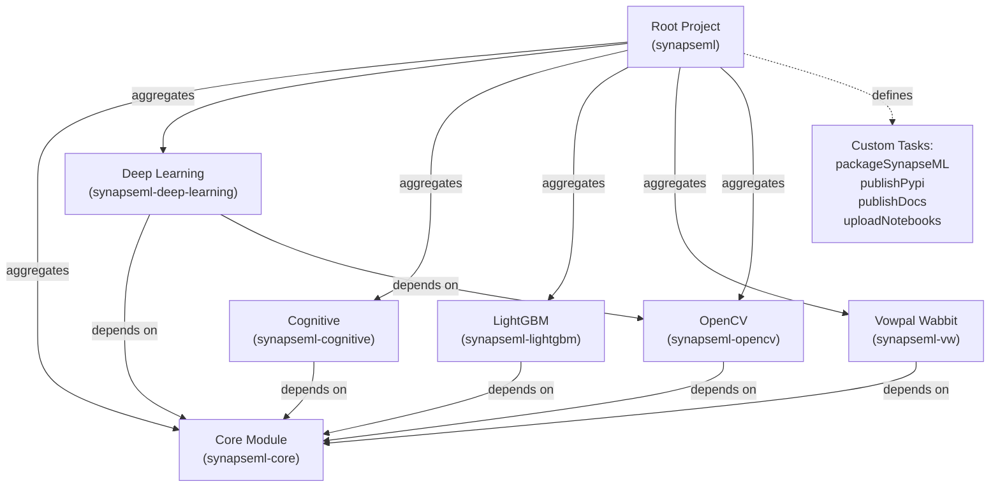
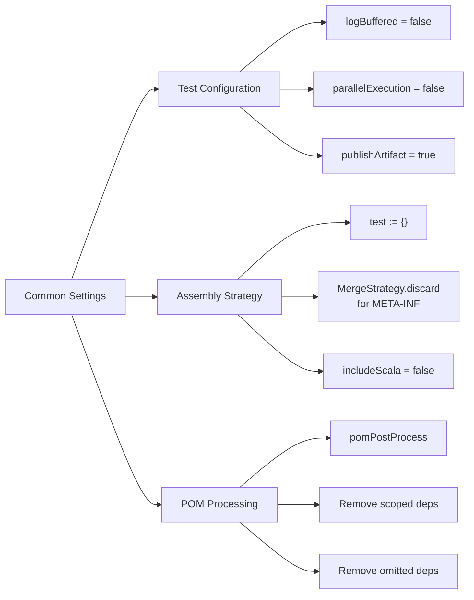
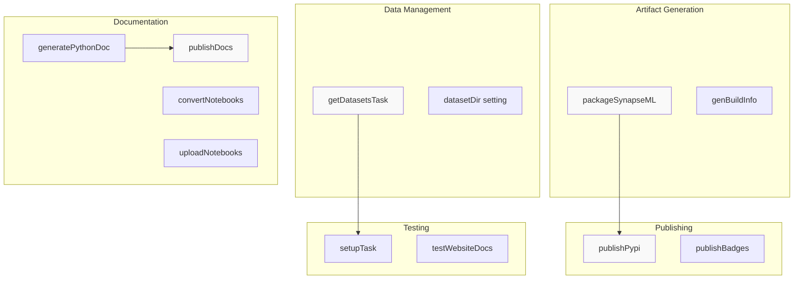
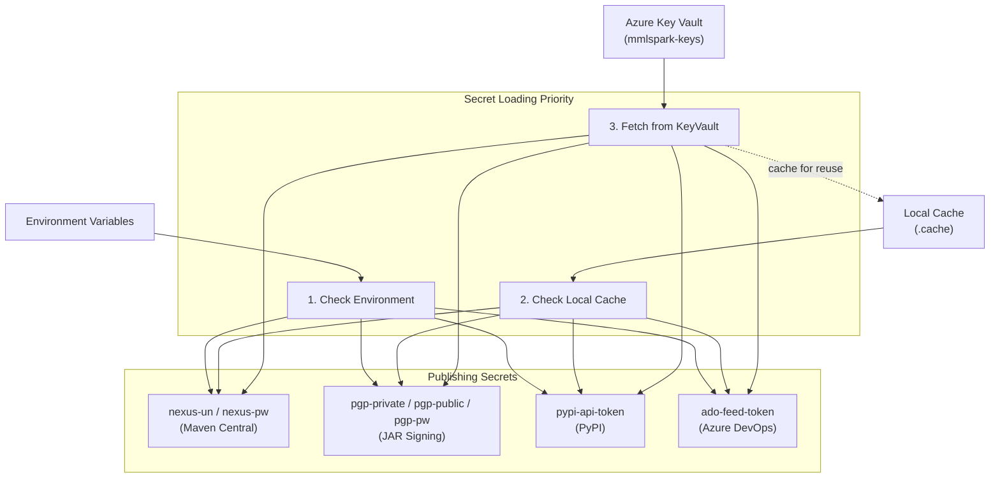
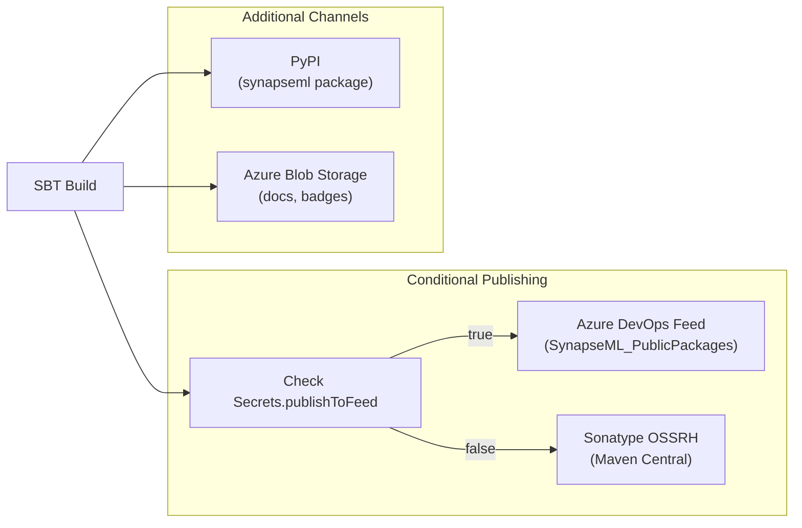
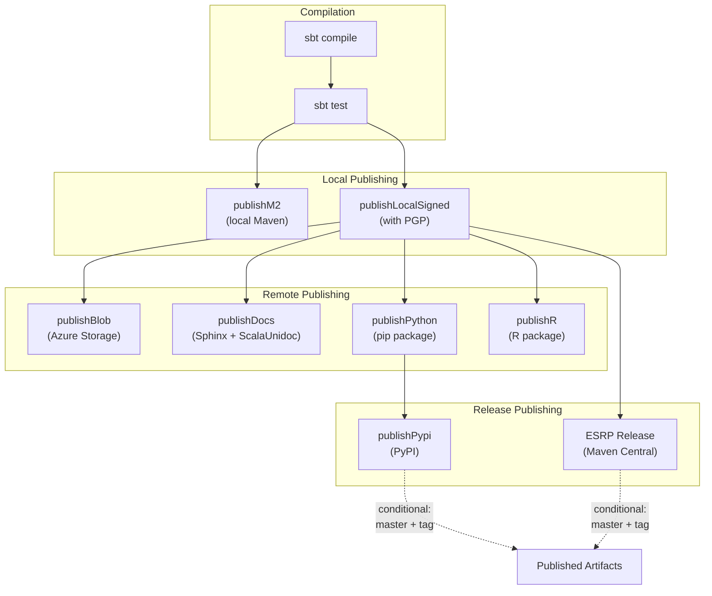

<!-- source: DeepWiki mcp.deepwiki.com · repo microsoft/SynapseML · page 3.2 Build System · fetched 2026-10-26 -->

# Build System

<details>
<summary>Relevant source files</summary>

The following files were used as context for generating this wiki page:

- [.gitignore](.gitignore)
- [build.sbt](build.sbt)
- [deep-learning/src/test/python/synapsemltest/dl/conftest.py](deep-learning/src/test/python/synapsemltest/dl/conftest.py)
- [environment.yml](environment.yml)
- [pipeline.yaml](pipeline.yaml)
- [project/PublishPlugin.scala](project/PublishPlugin.scala)
- [project/Secrets.scala](project/Secrets.scala)
- [sonatype.sbt](sonatype.sbt)
- [templates/codecov.yml](templates/codecov.yml)
- [templates/conda.yml](templates/conda.yml)
- [templates/kv.yml](templates/kv.yml)
- [tools/esrp/prepare_jar.py](tools/esrp/prepare_jar.py)

</details>


## Purpose and Scope

This document describes the SBT-based build system that compiles, packages, and publishes SynapseML artifacts. The build system manages a multi-module Scala project structure, handles cross-platform dependencies, defines custom build tasks for artifact generation, and integrates with the publishing pipeline.

For information about the CI/CD orchestration that invokes these build tasks, see [CI/CD Pipeline](#3.1). For details on how Python, R, and .NET bindings are generated from Scala code, see [Multi-Language SDK Generation](#3.3). For information about how the resulting artifacts are distributed, see [Installation and Distribution](#8.1).

## Project Structure

SynapseML uses a modular SBT project structure with six core modules that can be compiled and tested independently. The root project aggregates all modules and provides cross-cutting tasks.



**Project Definitions:**

The project structure is defined in [build.sbt:267-344]():

- **core** ([build.sbt:267-280]()): Base module with `synapseml-core` artifact name, includes BuildInfo plugin for metadata
- **deepLearning** ([build.sbt:282-292]()): Depends on core and opencv, includes ONNX and GPU support
- **lightgbm** ([build.sbt:294-299]()): Microsoft LightGBM gradient boosting integration
- **vw** ([build.sbt:301-306]()): Vowpal Wabbit online learning integration
- **cognitive** ([build.sbt:308-317]()): Azure Cognitive Services wrappers, includes speech SDK
- **opencv** ([build.sbt:319-324]()): Image processing with OpenCV bindings
- **root** ([build.sbt:326-344]()): Aggregates all modules, provides unified tasks, disables CodegenPlugin

Sources: [build.sbt:267-344]()

## Build Configuration

### Version and Scala Configuration

The build system targets Spark 3.5.0 and Scala 2.12.17:

| Configuration | Value |
|---------------|-------|
| Spark Version | `3.5.0` ([build.sbt:10]()) |
| Scala Version | `2.12.17` ([build.sbt:13]()) |
| Organization | `com.microsoft.azure` ([build.sbt:12]()) |
| Scala Major | `2.12` ([build.sbt:15]()) |

### Dependency Management

Dependencies are organized into core Spark dependencies and extra utilities. Exclusions prevent conflicts with Spark's bundled libraries.

**Exclusion Rules** ([build.sbt:17-21]()):
- `spark-tags` - Test dependency conflicts
- `scalatest` - Test framework conflicts  
- `breeze` - Scala numerical library conflicts

**Core Dependencies** ([build.sbt:23-30]()):
```scala
spark-core, spark-mllib, spark-avro (compile scope)
spark-tags (test scope only)
hadoop-bare-naked-local-fs, scalatest (test scope)
```

**Extra Dependencies** ([build.sbt:31-42]()):
- HTTP clients: `httpclient5`, `httpmime`
- Serialization: `spray-json`
- Utilities: `commons-lang`, `jsch`
- ML: `isolation-forest_3.5.0` (with extensive exclusions to prevent version conflicts)

All extra dependencies apply the exclusion rules via `.map(d => d excludeAll (excludes: _*))` ([build.sbt:42]()).

Sources: [build.sbt:10-43]()

### Common Settings

All projects share common settings defined in [build.sbt:250-264]():



**Key Settings:**
- **Test Configuration**: Serial execution, buffered logging disabled, test artifacts published
- **Assembly Strategy**: Discards META-INF to avoid conflicts, excludes Scala runtime
- **POM Customization**: Custom function `pomPostFunc` ([build.sbt:50-68]()) removes dependencies with scope tags and omitted dependencies from published POM files

Sources: [build.sbt:250-264](), [build.sbt:45-68]()

## Custom Build Tasks

The build system defines numerous custom SBT tasks for specialized operations. These tasks orchestrate artifact generation, documentation, and publishing.



### Dataset Management

**getDatasetsTask** ([build.sbt:72-89]()):
- Downloads test dataset (`datasets-2023-04-03.tgz`) from Azure Blob Storage
- URL: `https://mmlspark.blob.core.windows.net/installers/$datasetName`
- Extracts to `target/datasets/` directory
- Idempotent: only downloads if not already present
- **datasetDir** setting ([build.sbt:75-79]()): Computed relative to artifact path, used by BuildInfo

### Build Information Generation

**genBuildInfo** ([build.sbt:91-105]()):
- Generates `target/Build.md` with documentation links and artifact information
- Includes versioned URLs to Scala and Python documentation
- Combines output from `blobArtifactInfo` task
- Uploaded as build summary via `##vso[task.uploadsummary]` ([pipeline.yaml:115]())

### Python Packaging

**packageSynapseML** ([build.sbt:132-185]()):
- Orchestrates complete Python package creation
- Task sequence ([build.sbt:176-179]()):
  1. `packagePython` for all modules (in compile scope)
  2. `mergePyCode` to consolidate Python files
- Generates `setup.py` dynamically ([build.sbt:134-174]()) with:
  - Package name: `synapseml`
  - Version: Pythonized from SBT version
  - Namespace packages: `synapse.ml.*`
  - Classifiers for PyPI
- Builds wheel using `packagePythonWheelCmd` ([build.sbt:184]())
- Output: `${name}-${pythonizedVersion}-py2.py3-none-any.whl` in `target/generated/package/python/`

**publishPypi** ([build.sbt:187-197]()):
- Depends on `packageSynapseML`
- Uses `twine upload` with `--skip-existing` flag
- Authenticates with `__token__` username and `PYPI-API-TOKEN` secret
- Only executes when `SYNAPSEML_ENABLE_PUBLISH=true` (via Secrets validation)

### Documentation Generation

**generatePythonDoc** ([build.sbt:120-129]()):
- Installs pip packages for all modules
- Merges Python code to unified directory (`target/generated/src/python/synapse/`)
- Creates `__init__.py` files for package structure
- Runs `sphinx-apidoc` to generate RST files
- Builds HTML docs with `sphinx-build` to `target/generated/doc/pyspark/`

**publishDocs** ([build.sbt:199-220]()):
- Sequential execution: `generatePythonDoc` → `unidoc` (Scala docs)
- Copies Scala docs from `target/unidoc` to `target/generated/doc/scala/`
- Creates index.html with links to both pyspark/ and scala/
- Uploads to Azure Blob Storage with `uploadToBlob` function
- Blob container: `docs`, path: `${version}/`

**convertNotebooks** ([build.sbt:355-359]()):
- Installs docgen tool from `tools/docgen` as editable package
- Runs `tools/docgen/docgen/__main__.py` to convert Jupyter notebooks to Markdown
- Used by website build process (see [Documentation System](#7))

**uploadNotebooks** ([build.sbt:243-248]()):
- Uploads `docs/` folder to Azure Blob Storage
- Blob container: `docs`, path: `${version}/`
- Notebooks become available for consumption by documentation system

### Publishing Utilities

**publishBadges** ([build.sbt:222-241]()):
- Generates SVG badges using shields.io API
- Uploads to Blob Storage with cache-control headers for immediate updates
- Example: `master_version3.svg` with current version
- Only runs on master branch: `condition: and(succeeded(), eq(variables.isMaster, true))` ([pipeline.yaml:133]())

### Setup and Testing

**setupTask** ([build.sbt:346-353]()):
- Convenience task for IntelliJ/IDE setup
- Compiles all projects in both Compile and Test configurations
- Downloads test datasets via `getDatasetsTask`
- Invoked during local development setup

**testWebsiteDocs** ([build.sbt:361-367]()):
- Tests code blocks in `website/docs/documentation/` Markdown files
- Runs `website/doctest.py` with current version as argument
- Used by CI/CD pipeline to validate documentation examples

Sources: [build.sbt:72-367]()

## Task Execution Flow

The following diagram shows how tasks are invoked during the CI/CD pipeline:

```mermaid
graph TB
    subgraph "Style Job"
        style_sbt["sbt scalastyle"]
        style_black["black --check"]
    end
    
    subgraph "Publish Job"
        pub_package["sbt packagePython<br/>uploadNotebooks"]
        pub_publish["sbt publishBlob<br/>publishDocs<br/>publishR<br/>publishPython"]
        pub_buildinfo["sbt genBuildInfo"]
        pub_signed["sbt publishLocalSigned"]
        pub_esrp["python prepare_jar.py"]
        pub_badges["sbt publishBadges"]
    end
    
    subgraph "E2E Job"
        e2e_test["sbt testOnly<br/>(TEST-CLASS)"]
    end
    
    subgraph "Unit Tests"
        unit_setup["sbt setup"]
        unit_test["sbt coverage testOnly"]
        unit_coverage["sbt coverageReport"]
    end
    
    subgraph "Python Tests"
        py_deps["sbt getDatasets<br/>installPipPackage<br/>publishM2"]
        py_test["sbt testPython"]
        py_coverage["sbt coverageReport"]
    end
    
    subgraph "R Tests"
        r_setup["sbt setup codegen<br/>publishM2"]
        r_test["sbt testR"]
        r_coverage["sbt coverageReport"]
    end
    
    subgraph "Website Tests"
        web_setup["sbt setup"]
        web_test["sbt testWebsiteDocs"]
        web_coverage["sbt coverageReport"]
    end
    
    subgraph "Website Deploy"
        web_convert["sbt convertNotebooks"]
        web_build["yarn build"]
        web_deploy["yarn deploy"]
    end
    
    subgraph "Release Job"
        rel_pypi["sbt publishPypi"]
        rel_maven["sbt publishLocalSigned<br/>prepare_jar.py"]
        rel_esrp["ESRP Release"]
    end
    
    pub_package --> pub_publish
    pub_publish --> pub_buildinfo
    pub_buildinfo --> pub_signed
    pub_signed --> pub_esrp
    
    py_deps --> py_test
    py_test --> py_coverage
    
    r_setup --> r_test
    r_test --> r_coverage
    
    unit_setup --> unit_test
    unit_test --> unit_coverage
    
    web_setup --> web_test
    web_test --> web_coverage
    
    web_convert --> web_build
    web_build --> web_deploy
    
    style pub_package fill:#f9f9f9
    style e2e_test fill:#f9f9f9
    style unit_test fill:#f9f9f9
    style py_test fill:#f9f9f9
    style r_test fill:#f9f9f9
```



Sources: [pipeline.yaml:87-773](), [build.sbt:72-367]()

## Secret Management for Publishing

The build system integrates with Azure Key Vault to securely manage publishing credentials. Secrets are cached locally to reduce Key Vault queries and improve build performance.



### Secret Configuration

The `Secrets` object ([project/Secrets.scala:13-194]()) provides a centralized secret management system:

**Environment Variables** ([project/Secrets.scala:179-193]()):
- `NEXUS-UN` / `NEXUS-PW`: Maven Central / Sonatype credentials
- `PGP-PRIVATE` / `PGP-PUBLIC` / `PGP-PW`: PGP signing keys and passphrase
- `PYPI-API-TOKEN`: PyPI upload token
- `ADO-FEED-TOKEN`: Azure DevOps feed authentication
- `SYNAPSEML_ENABLE_PUBLISH`: Master switch to enable publishing operations ([project/Secrets.scala:17-19]())

**Key Vault Integration** ([project/Secrets.scala:50-65]()):
- Vault name: `mmlspark-keys` ([project/Secrets.scala:14]())
- Subscription: `e342c2c0-f844-4b18-9208-52c8c234c30e` ([project/Secrets.scala:15]())
- Uses `az keyvault secret show` command via `exec` helper ([project/Secrets.scala:21-35]())
- Parses JSON response to extract secret value
- Falls back to empty string if Key Vault unavailable

**Caching Strategy** ([project/Secrets.scala:67-143]()):
- Cache directory: `.cache/` in project root ([project/Secrets.scala:67-74]())
- Priority order ([project/Secrets.scala:130-138]()):
  1. Environment variable (set by CI/CD pipeline from Key Vault task)
  2. Local cached file (avoids Key Vault queries during development)
  3. Fetch from Key Vault (and cache result)
- PGP secrets are Base64-encoded and decoded before use ([project/Secrets.scala:140-142]())
- PGP files created as `.asc` files in cache ([project/Secrets.scala:96-108]())
- `refreshCachedSecrets()` ([project/Secrets.scala:147-150]()): Force re-fetch all secrets (used when Key Vault values change)

**Publishing Control** ([project/Secrets.scala:152-166]()):
- `getSecret`: Returns empty string if `SYNAPSEML_ENABLE_PUBLISH != true`
- `getPgpSecretFile`: Returns empty File if publishing disabled
- Prevents accidental secret fetches during normal builds

### PGP Signing Configuration

JAR signing uses PGP keys for Maven Central requirements ([sonatype.sbt:34-36]()):

```scala
pgpPassphrase := Some(Secrets.pgpPassword.toCharArray)
pgpSecretRing := Secrets.pgpPrivateFile  // .cache/pgp-private.asc
pgpPublicRing := Secrets.pgpPublicFile   // .cache/pgp-public.asc
```

The `publishLocalSigned` task signs all JARs before publishing. For releases, an additional ESRP (Enterprise Software Release Process) signing step occurs ([pipeline.yaml:339-353]()) via the `tools/esrp/prepare_jar.py` script.

Sources: [project/Secrets.scala:13-194](), [sonatype.sbt:29-46](), [pipeline.yaml:304-353]()

## Publishing Configuration

SynapseML publishes artifacts to two destinations based on configuration:



### Maven Publishing

**Sonatype / Maven Central** ([sonatype.sbt:1-46]()):
- Project hosting: GitHub (Azure/SynapseML) ([sonatype.sbt:3-4]())
- Developers: 6 core maintainers defined ([sonatype.sbt:12-25]())
- License: MIT ([sonatype.sbt:27]())
- Credentials: Nexus username/password from Key Vault ([sonatype.sbt:29-32]())
- Bundle publishing: `sonatypePublishToBundle.value` ([sonatype.sbt:42]())
- Snapshot versioning: `dynverSonatypeSnapshots := true` ([sonatype.sbt:45]())
- Version separator: `-` instead of `+` ([sonatype.sbt:46]())

**Azure DevOps Feed** ([sonatype.sbt:38-40](), [build.sbt:339-342]()):
- Feed URL: `https://msdata.pkgs.visualstudio.com/A365/_packaging/SynapseML_PublicPackages/maven/v1`
- Credentials: ADO feed token from Key Vault
- Used when `Secrets.publishToFeed == true`
- Enables internal Microsoft consumption before Maven Central release

**POM Customization** ([build.sbt:50-68]()):
The `pomPostFunc` transforms the POM XML to:
- Remove `<extraDependencyAttributes>` elements
- Comment out dependencies with `<scope>` tags (test, provided, etc.)
- Comment out excluded dependencies (`spark-core`, `spark-mllib`, `org.scala-lang`)
- Preserves groupId, artifactId, version as XML comments for traceability

### Python Publishing

**PyPI** ([build.sbt:187-197]()):
- Package name: `synapseml`
- Uses `twine upload` with `__token__` authentication
- `--skip-existing` flag prevents re-upload errors
- Conditional on `SYNAPSEML_ENABLE_PUBLISH=true` and version tag
- Invoked by Release job: ([pipeline.yaml:309-323]())

### ESRP Signing for Release

For official releases (master branch + version tag), JARs undergo ESRP signing:

**Preparation** ([tools/esrp/prepare_jar.py:1-80]()):
- Flattens Ivy local repository structure: `~/.ivy2/local/com.microsoft.azure/`
- Moves all JARs to second-level folders (removes nested structure)
- Renames JARs to include full version: `{name}_2.12-{version}{suffix}`
- Example: `synapseml-core_2.12.jar` → `synapseml-core_2.12-1.0.0.jar`

**ESRP Release Task** ([pipeline.yaml:339-353]()):
- Service connection: `SynapseML-ESRP-Service-Connection`
- Key vault: `esrp-kv-ame`
- Content type: `maven`
- Folder: `/home/vsts/.ivy2/local/com.microsoft.azure/`
- Owners/Approvers: Microsoft email addresses
- Main publisher: `synapseml`
- Only runs when: `and(eq(variables.isMaster, true), startsWith(variables['tag'], 'v'))`

Sources: [sonatype.sbt:1-46](), [build.sbt:50-68](), [build.sbt:187-197](), [tools/esrp/prepare_jar.py:1-80](), [pipeline.yaml:309-353]()

## Build Artifacts

The build system produces multiple artifact types for different consumption scenarios:

| Artifact Type | Task | Output Location | Description |
|---------------|------|-----------------|-------------|
| **Scala JARs** | `publishLocalSigned` | `~/.ivy2/local/com.microsoft.azure/` | Signed JARs for Maven |
| **Python Wheel** | `packageSynapseML` | `target/generated/package/python/` | Universal wheel (py2.py3-none-any) |
| **Python Docs** | `generatePythonDoc` | `target/generated/doc/pyspark/` | Sphinx HTML documentation |
| **Scala Docs** | `unidoc` | `target/unidoc/` → `target/generated/doc/scala/` | ScalaUnidoc API docs |
| **R Package** | `publishR` | Uploaded to Blob Storage | R bindings package |
| **Notebooks** | `uploadNotebooks` | Azure Blob Storage (`docs` container) | Example Jupyter notebooks |
| **Badges** | `publishBadges` | Azure Blob Storage (`icons` container) | Version badges (SVG) |
| **Build Info** | `genBuildInfo` | `target/Build.md` | Version and documentation links |

### Artifact Publishing Flow



### Artifact Naming Conventions

**JARs:**
- Pattern: `{artifact-name}_2.12-{version}.jar`
- Example: `synapseml-core_2.12-1.0.4.jar`
- Includes source JARs: `{artifact-name}_2.12-{version}-sources.jar`
- Includes doc JARs: `{artifact-name}_2.12-{version}-javadoc.jar`

**Python Wheel:**
- Pattern: `synapseml-{version}-py2.py3-none-any.whl`
- Version conversion: `1.0.4` → `1.0.4` (no transformation needed)
- Universal wheel: compatible with Python 2 and 3, any platform

**Documentation:**
- Scala: `https://mmlspark.blob.core.windows.net/docs/{version}/scala/index.html`
- Python: `https://mmlspark.blob.core.windows.net/docs/{version}/pyspark/index.html`

Sources: [build.sbt:132-241](), [pipeline.yaml:87-353]()

## Integration with CI/CD Pipeline

The build system is invoked at multiple points in the CI/CD pipeline. The pipeline uses Azure DevOps tasks that call SBT commands.

### Build Triggers

**Pipeline Triggers** ([pipeline.yaml:4-43]()):
- **PR/Push**: Triggers on master, spark3.3, spark3.5 branches
- **Excluded Paths**: README, contributor docs, CODEOWNERS (non-code changes)
- **Scheduled**: Daily midnight build (cron: `0 0 * * *`)
- **Manual**: Parameters for Synapse E2E tests

### Environment Setup

**Conda Environment** ([templates/conda.yml:1-42]()):
- Cached at: `/usr/share/miniconda/envs` ([pipeline.yaml:60]())
- Cache key: `conda | "$(Agent.OS)" | environment.yml`
- Restored from cache if environment.yml unchanged
- Created with: `conda env create -f environment.yml` with 30-minute timeout and retry
- Includes Python 3.11.8, R 4.1.1, PyTorch 2.1.0, and all test dependencies ([environment.yml:1-58]())
- Pre-cleans disk space by removing Android and Google Cloud SDKs ([templates/conda.yml:18-28]())

**Key Vault Access** ([templates/kv.yml:1-7]()):
- Task: `AzureKeyVault@2`
- Vault: `mmlspark-keys`
- Loads all secrets as pipeline variables
- Used by Publish, E2E, Python/R/Unit test jobs

### Job-Specific Build Invocations

**Style Job** ([pipeline.yaml:66-84]()):
```bash
sbt scalastyle test:scalastyle
black --diff --color . && black --check -q .
```

**Publish Job** ([pipeline.yaml:87-135]()):
```bash
sbt packagePython uploadNotebooks
sbt -DskipCodegen=true publishBlob publishDocs publishR publishPython
sbt genBuildInfo
sbt -DskipCodegen=true publishLocalSigned
python tools/esrp/prepare_jar.py
sbt publishBadges  # conditional: master only
```

**Unit Tests Job** ([pipeline.yaml:614-772]()):
```bash
sbt setup
sbt coverage "testOnly com.microsoft.azure.synapse.ml.{PACKAGE}.**"
sbt coverageReport
```

**Python Tests Job** ([pipeline.yaml:357-443]()):
```bash
sbt coverage getDatasets installPipPackage publishM2
sbt {FLAGS} "project {PACKAGE}" coverage testPython
sbt coverageReport
```

**R Tests Job** ([pipeline.yaml:446-518]()):
```bash
sbt setup
sbt codegen
sbt publishM2
sbt -DskipCodegen=true "project {PACKAGE}" coverage testR
sbt coverageReport
```

**E2E Tests Job** ([pipeline.yaml:138-181]()):
```bash
sbt "testOnly {TEST-CLASS}"
```
Where TEST-CLASS is one of:
- `com.microsoft.azure.synapse.ml.nbtest.DatabricksCPUTests`
- `com.microsoft.azure.synapse.ml.nbtest.DatabricksGPUTests`

**Website Jobs** ([pipeline.yaml:528-611]()):
```bash
# Test samples
sbt setup
sbt coverage testWebsiteDocs
sbt coverageReport

# Deploy
sbt convertNotebooks
yarn install && cd website && yarn && yarn build
GIT_USER="${GH_NAME}" yarn deploy  # master only
```

**Release Job** ([pipeline.yaml:259-353]()):
```bash
sbt publishPypi  # conditional: master + tag
sbt publishLocalSigned  # conditional: master + tag
python tools/esrp/prepare_jar.py
# ESRP Release task
```

Sources: [pipeline.yaml:4-773](), [templates/conda.yml:1-42](), [templates/kv.yml:1-7](), [environment.yml:1-58]()

## Build Performance Optimizations

The build system includes several optimizations for faster builds:

**Ivy Cache** (commented out):
- Lines like `#- template: templates/ivy_cache.yml` appear throughout ([pipeline.yaml:92](), [160](), [384](), [534](), [728]())
- Previously cached Ivy dependencies, currently disabled
- Would cache `~/.ivy2/cache/` to speed up dependency resolution

**Conda Cache** ([templates/conda.yml:7-16]()):
- Caches entire Conda environment directory
- Key based on OS and environment.yml hash
- Restores in ~1 minute vs 20+ minutes to create
- Cache hit variable: `CONDA_CACHE_RESTORED`

**Parallel Test Execution**:
- Unit tests run with 30+ parallel test packages ([pipeline.yaml:621-726]())
- Python tests split into 7 packages ([pipeline.yaml:365-382]())
- R tests split into 6 packages ([pipeline.yaml:454-465]())
- LightGBM split into 6 test suites due to execution time ([pipeline.yaml:697-714]())

**Retry Mechanisms**:
- SBT setup: 3 retries with 5-minute timeout each ([pipeline.yaml:742]())
- Conda creation: 2 attempts with 30-minute timeout ([templates/conda.yml:32]())
- Python tests: 3 attempts ([pipeline.yaml:425-427]())
- R tests: 3 retry attempts ([pipeline.yaml:492]())
- Flaky test packages: automatic retry on failure ([pipeline.yaml:755]())

**Skip Codegen**:
- `-DskipCodegen=true` flag used in Publish and R tests ([pipeline.yaml:113](), [116](), [502]())
- Skips regeneration of Python/R wrappers when not needed
- Reduces build time by several minutes

Sources: [pipeline.yaml:66-773](), [templates/conda.yml:1-42]()

---

