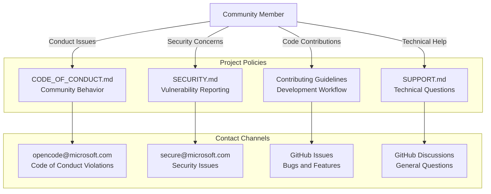
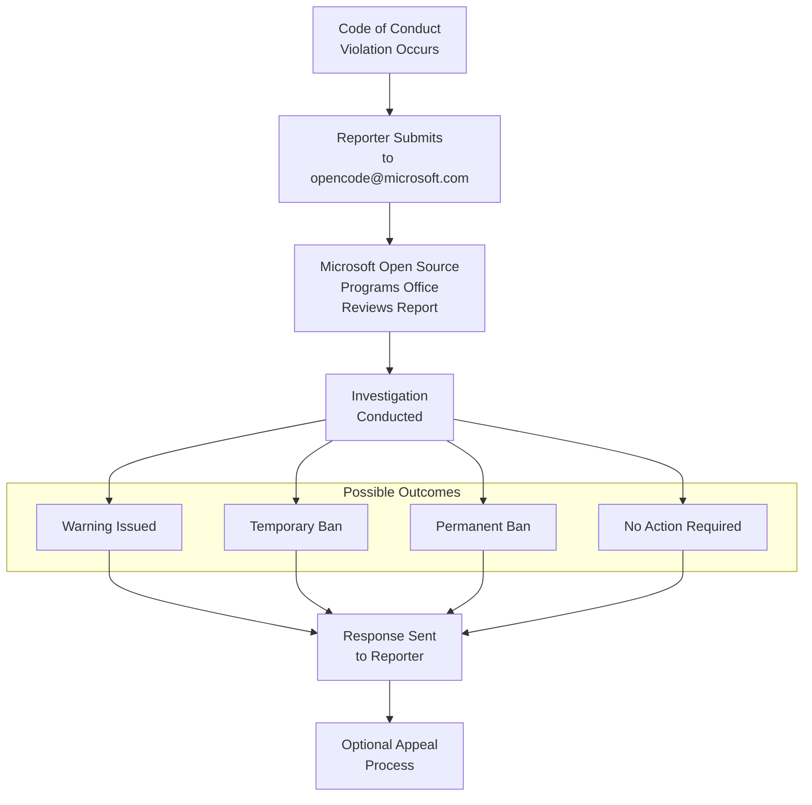
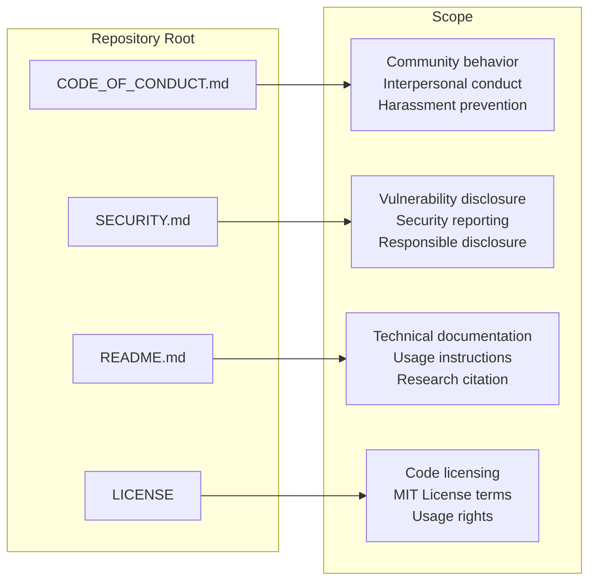
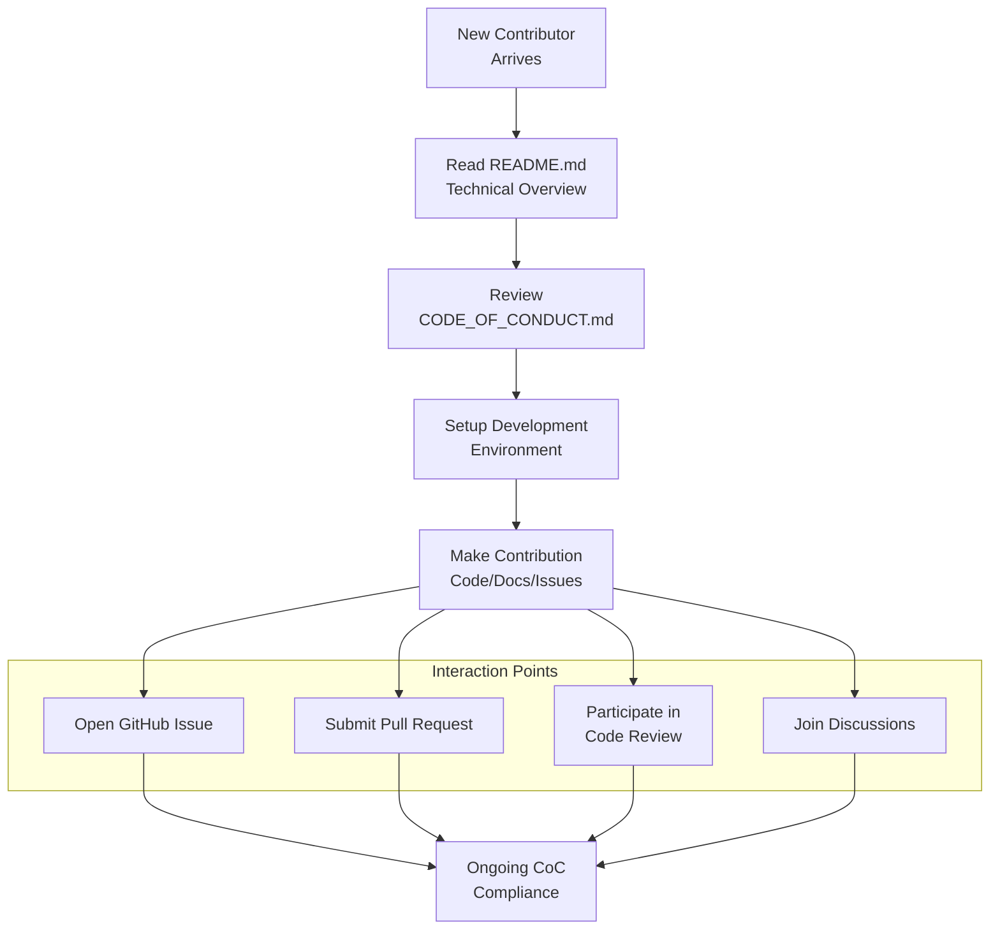

<!-- source: DeepWiki mcp.deepwiki.com · repo microsoft/Text2Grad · page 10.1 Code of Conduct · fetched 2026-10-26 -->

# Code of Conduct

Relevant source files

The following files were used as context for generating this wiki page:

- [CODE_OF_CONDUCT.md](CODE_OF_CONDUCT.md)

## Purpose and Scope

This document describes the community guidelines and expected behavior for all contributors, maintainers, and participants in the Text2Grad project. The Text2Grad project has adopted the Microsoft Open Source Code of Conduct to ensure a welcoming and inclusive environment for all community members.

For information about reporting security vulnerabilities, see [Security Policy](#10.2). For general contribution guidelines and development workflow, see [Getting Support](#10.3).

**Sources:** [CODE_OF_CONDUCT.md:1-10]()

---

## Microsoft Open Source Code of Conduct

The Text2Grad project follows the [Microsoft Open Source Code of Conduct](https://opensource.microsoft.com/codeofconduct), which applies to all interactions within the project including:

- GitHub issues and pull requests
- Code reviews and technical discussions
- Documentation contributions
- Community forums and communication channels
- Project events and meetings

The Microsoft Open Source Code of Conduct provides a framework for creating a respectful, professional, and harassment-free environment for everyone, regardless of age, body size, disability, ethnicity, gender identity and expression, level of experience, nationality, personal appearance, race, religion, or sexual identity and orientation.

**Sources:** [CODE_OF_CONDUCT.md:3]()

---

## Governance Structure

The following diagram illustrates how the Code of Conduct integrates with other project policies and where to direct different types of concerns:

**Purpose:** This diagram shows the relationship between different project policies and the appropriate channels for different types of concerns. Code of Conduct issues are handled separately from technical contributions and security reports.

**Sources:** [CODE_OF_CONDUCT.md:1-10]()

---

## Expected Behavior

While the full Microsoft Open Source Code of Conduct provides comprehensive guidelines, key expectations for Text2Grad community members include:

### Professional Communication
- Use welcoming and inclusive language
- Provide constructive feedback on code, documentation, and ideas
- Focus on what is best for the project and community
- Show empathy and respect toward other community members

### Technical Collaboration
- Respect different viewpoints and experiences
- Accept constructive criticism gracefully
- Acknowledge contributions from others
- Collaborate transparently and openly

### Community Standards
- Avoid discriminatory or harassing language and behavior
- Maintain professional boundaries
- Respect privacy and confidentiality
- Be mindful of project resources and maintainer time

**Sources:** [CODE_OF_CONDUCT.md:3]()

---

## Reporting Process

The following diagram shows the workflow for reporting and addressing Code of Conduct violations:

**Purpose:** This diagram illustrates the reporting and resolution workflow for Code of Conduct violations, showing the progression from incident report through investigation to outcome.

**Sources:** [CODE_OF_CONDUCT.md:9]()

---

## How to Report Violations

If you witness or experience behavior that violates the Code of Conduct:

### 1. Email Contact
Send detailed information to **opencode@microsoft.com** including:
- Description of the incident
- Date and time of occurrence
- Location (GitHub issue, PR, discussion, etc.)
- Names/usernames of individuals involved
- Any supporting evidence (screenshots, links, etc.)
- Your contact information for follow-up

### 2. Confidentiality
All reports are treated confidentially by the Microsoft Open Source Programs Office. Reporter identity is protected unless disclosure is required by law or explicitly authorized by the reporter.

### 3. Response Time
The Microsoft team will acknowledge receipt of reports and provide updates on the investigation process. Response times vary based on complexity, but initial acknowledgment typically occurs within 2-3 business days.

### 4. No Retaliation
The project prohibits retaliation against individuals who report Code of Conduct violations in good faith. Retaliation is itself a Code of Conduct violation.

**Sources:** [CODE_OF_CONDUCT.md:9]()

---

## Enforcement Actions

The Microsoft Open Source Programs Office may take various enforcement actions depending on the severity and frequency of violations:

| Enforcement Level | Typical Actions | Duration |
|-------------------|----------------|----------|
| **Warning** | Private written warning; explanation of violation | N/A |
| **Temporary Ban** | Suspension from project participation (issues, PRs, discussions) | 30-90 days typical |
| **Permanent Ban** | Permanent removal from all project spaces and future participation | Indefinite |
| **No Action** | Determination that behavior did not violate Code of Conduct | N/A |

Enforcement decisions consider:
- Severity of the violation
- Impact on community members
- Intent (deliberate vs. unintentional)
- Previous violations or warnings
- Context and circumstances

**Sources:** [CODE_OF_CONDUCT.md:3]()

---

## Relationship to Repository Policies

The Code of Conduct exists alongside other repository governance documents:

**Purpose:** This diagram clarifies the distinct scope of each repository policy document, showing that Code of Conduct addresses community behavior while other documents handle technical, legal, and security concerns.

**Sources:** [CODE_OF_CONDUCT.md:1-10]()

---

## Resources and Additional Information

### Official Resources

The following resources provide additional context and details:

| Resource | URL | Description |
|----------|-----|-------------|
| **Microsoft Open Source Code of Conduct** | https://opensource.microsoft.com/codeofconduct/ | Full text of the Code of Conduct |
| **Microsoft Code of Conduct FAQ** | https://opensource.microsoft.com/codeofconduct/faq/ | Frequently asked questions and clarifications |
| **Contact Email** | opencode@microsoft.com | Direct contact for reports and questions |

**Sources:** [CODE_OF_CONDUCT.md:7-9]()

### Related Documentation

For other project policies and guidelines, see:
- [Security Policy](#10.2) - How to report security vulnerabilities
- [Getting Support](#10.3) - Technical questions and community engagement
- [License](#10.4) - MIT License terms and usage rights

---

## Scope of Application

The Code of Conduct applies to:

### Project Spaces
- GitHub repository (microsoft/Text2Grad)
- Issue tracker and pull requests
- Code review comments
- GitHub Discussions
- Project documentation (wiki, README, etc.)
- Commit messages and code comments

### Community Spaces
- Project-related social media
- Project events and conferences
- Mailing lists or forums (if established)
- Direct communication between community members about project matters

### Representation
- Using official project email addresses
- Acting as an appointed representative
- Representing the project at events
- Posting via official project social media accounts

**Sources:** [CODE_OF_CONDUCT.md:3]()

---

## Questions and Clarifications

### For Code of Conduct Questions
If you have questions about the Code of Conduct, its application, or specific scenarios:
- Email: **opencode@microsoft.com**
- Review: [Microsoft Code of Conduct FAQ](https://opensource.microsoft.com/codeofconduct/faq)

### For Technical Questions
For technical questions about Text2Grad usage, implementation, or contribution:
- See: [Getting Support](#10.3) for appropriate channels
- GitHub Issues: For bug reports and feature requests
- GitHub Discussions: For general questions and community engagement

### For Security Concerns
For security vulnerabilities or security-related conduct issues:
- See: [Security Policy](#10.2) for responsible disclosure process
- Email: secure@microsoft.com (security issues only)

**Sources:** [CODE_OF_CONDUCT.md:9]()

---

## Integration with Contribution Workflow

The following diagram shows how Code of Conduct awareness integrates into the typical contribution workflow:

**Purpose:** This diagram illustrates where Code of Conduct awareness fits into the contributor onboarding process and ongoing participation in the project.

**Sources:** [CODE_OF_CONDUCT.md:1-10]()

---

## Summary

The Text2Grad project is committed to maintaining a welcoming, inclusive, and professional environment for all contributors. By adopting the Microsoft Open Source Code of Conduct, the project establishes clear expectations for community behavior and provides a transparent process for addressing violations.

Key points:
- **Policy**: Text2Grad follows the Microsoft Open Source Code of Conduct
- **Contact**: Report violations to opencode@microsoft.com
- **Resources**: Full documentation and FAQ available at https://opensource.microsoft.com/codeofconduct/
- **Scope**: Applies to all project spaces and community interactions
- **Enforcement**: Microsoft Open Source Programs Office handles investigations and enforcement

For specific questions or to report violations, contact **opencode@microsoft.com**.

**Sources:** [CODE_OF_CONDUCT.md:1-10]()

---

