# Page: Home

# Home

<details>
<summary>Relevant source files</summary>

The following files were used as context for generating this wiki page:

- [README.md](README.md)

</details>


## Purpose and Scope

This wiki documents the Text2Grad system, a reinforcement learning framework that converts natural language feedback into fine-grained gradient signals for language model optimization. Text2Grad operates on span-level and word-level feedback rather than scalar rewards, enabling precise, interpretable model improvements across code generation, question answering, and summarization tasks.

This page provides an overview of the system architecture and its three-component pipeline. For installation instructions, see [Installation](#2.1). For detailed component documentation, see [System Architecture](#3). For task-specific workflows, see [Task-Specific Guides](#7).

**Sources:** [README.md:1-52]()

---

## System Overview

Text2Grad is a research framework for training language models using natural language feedback. Traditional RLHF (Reinforcement Learning from Human Feedback) assigns scalar rewards to entire generated sequences, losing fine-grained information about which specific parts of the output are good or problematic. Text2Grad addresses this by:

1. **Annotating** natural language feedback with specific token spans
2. **Training reward models** to predict word-level scores and generate critiques
3. **Optimizing policies** using span-level gradients through PPO

The system is task-agnostic and supports three domains:
- **Code Generation** (KodCode dataset) - evaluated on HumanEval+ and MBPP+
- **Question Answering** (UltraFeedback dataset) - evaluated on MT-Bench and ARC-C
- **Summarization** (SLF5K dataset) - evaluated with ROUGE, BERTScore, and GPT-4

**Sources:** [README.md:33-38](), [README.md:53-62]()

---

## Three-Component Architecture

### Architecture Diagram: Core Components and File Structure

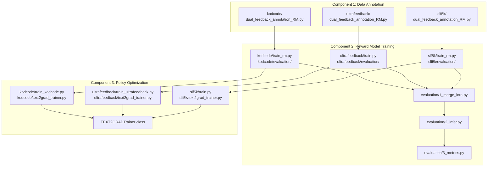

**Sources:** [README.md:127-145]()

### Component Descriptions

| Component | Directory | Key Files | Purpose |
|-----------|-----------|-----------|---------|
| **Data Annotation** | `rm_data_anno/` | `dual_feedback_annotation_RM.py` | Converts raw natural language feedback into structured dual-feedback format with span annotations |
| **Reward Model** | `nl_reward_model/` | `train_rm.py`, `train.py`, evaluation scripts | Trains models to predict word-level scores and generate critiques from annotated data |
| **Policy Optimization** | `nl_gradient_policy_optimization/` | `train_*.py`, `text2grad_trainer.py` | Implements PPO training with `TEXT2GRADTrainer` using reward model feedback |

**Sources:** [README.md:127-145](), [README.md:147-218]()

---

## Data Flow and Key Classes

### System Data Flow Diagram

```mermaid
graph LR
    subgraph Input["Input Data"]
        DS_K["KodCode-Light-RL-10K"]
        DS_U["ultrafeedback_binarized"]
        DS_S["SLF5K"]
    end
    
    subgraph Annotation["Annotation Scripts"]
        ANNO["dual_feedback_annotation_RM.py<br/>generate_annotated_data()"]
    end
    
    subgraph RMTraining["RM Training"]
        QAC["QACDataset class<br/>__getitem__()"]
        DS_TRAIN["DeepSpeed with ZeRO-3<br/>train_rm.py main()"]
        LORA["LoraConfig<br/>r=16, alpha=32"]
    end
    
    subgraph RMInfer["RM Inference"]
        VLLM["vllm.LLM pipeline<br/>2_infer.py"]
        PARSE["parse_response()<br/>extract spans/scores"]
    end
    
    subgraph PolicyOpt["Policy Optimization"]
        T2G["TEXT2GRADTrainer<br/>step()"]
        GEN["generate()<br/>policy responses"]
        REWARD["get_reward_from_rm()<br/>fuzzy matching"]
        REMATCH["rematch_scores()<br/>token alignment"]
        PPO["ppo_update()<br/>clipped objective"]
    end
    
    DS_K --> ANNO
    DS_U --> ANNO
    DS_S --> ANNO
    
    ANNO --> QAC
    QAC --> DS_TRAIN
    LORA --> DS_TRAIN
    
    DS_TRAIN --> VLLM
    VLLM --> PARSE
    
    PARSE --> T2G
    T2G --> GEN
    GEN --> REWARD
    REWARD --> REMATCH
    REMATCH --> PPO
    PPO --> T2G
```

**Sources:** [README.md:94-122](), [README.md:147-218](), [README.md:220-273]()

### Core Class Abstractions

The system is built around several key abstractions:

| Class/Function | Location | Purpose |
|----------------|----------|---------|
| `QACDataset` | `nl_reward_model/*/train*.py` | Tokenizes and formats question-answer-critique triples for reward model training |
| `TEXT2GRADTrainer` | `nl_gradient_policy_optimization/*/text2grad_trainer.py` | Extends TRL's PPO trainer with span-level reward processing |
| `PPOConfig` | Configuration object | Defines hyperparameters for PPO training (learning rate, KL penalty, batch sizes) |
| `LoraConfig` | From PEFT library | Configures parameter-efficient fine-tuning (rank, alpha, target modules) |
| `parse_response()` | `nl_reward_model/*/evaluation/2_infer.py` | Extracts structured feedback from LLM JSON outputs with fallback parsing |
| `rematch_scores()` | `nl_gradient_policy_optimization/*/text2grad_trainer.py` | Aligns word-level scores to token-level rewards for gradient computation |

**Sources:** [README.md:220-273]()

---

## Multi-Task Support

Text2Grad follows a parallel pipeline structure where each task domain has its own data processing, reward model, and policy optimization components, but all share the same underlying abstractions.

### Task-Specific Pipeline Structure

```mermaid
graph TB
    subgraph KodCode["Code Generation (KodCode)"]
        K_DATA["KodCode-Light-RL-10K<br/>question + solution + test"]
        K_ANNO["rm_data_anno/kodcode/<br/>dual_feedback_annotation_RM.py"]
        K_RM["nl_reward_model/kodcode/<br/>train_rm.py"]
        K_PPO["nl_gradient_policy_optimization/kodcode/<br/>train_kodcode.py + text2grad_trainer.py"]
        K_EVAL["EvalPlus benchmarks<br/>HumanEval+, MBPP+"]
        
        K_DATA --> K_ANNO
        K_ANNO --> K_RM
        K_RM --> K_PPO
        K_PPO --> K_EVAL
    end
    
    subgraph UltraFeedback["Question Answering (UltraFeedback)"]
        U_DATA["ultrafeedback_binarized<br/>prompt + chosen + rejected"]
        U_ANNO["rm_data_anno/ultrafeedback/<br/>dual_feedback_annotation_RM.py"]
        U_RM["nl_reward_model/ultrafeedback/<br/>train.py"]
        U_PPO["nl_gradient_policy_optimization/ultrafeedback/<br/>train_ultrafeedback.py + text2grad_trainer.py"]
        U_EVAL["MT-Bench, ARC-C<br/>AlpacaEval 2.0"]
        
        U_DATA --> U_ANNO
        U_ANNO --> U_RM
        U_RM --> U_PPO
        U_PPO --> U_EVAL
    end
    
    subgraph SLF5K["Summarization (SLF5K)"]
        S_DATA["SLF5K<br/>post + generated_summary"]
        S_ANNO["rm_data_anno/slf5k/<br/>dual_feedback_annotation_RM.py"]
        S_RM["nl_reward_model/slf5k/<br/>train_rm.py"]
        S_PPO["nl_gradient_policy_optimization/slf5k/<br/>train.py + text2grad_trainer.py"]
        S_EVAL["ROUGE, BLEU, BERTScore<br/>GPT-4 as judge"]
        
        S_DATA --> S_ANNO
        S_ANNO --> S_RM
        S_RM --> S_PPO
        S_PPO --> S_EVAL
    end
```

**Sources:** [README.md:94-122](), [README.md:127-145]()

### Dataset Formats

Each task uses a specific JSON format for input data:

**KodCode Format:**
```json
{
    "question": "You are given a 0-indexed...",
    "solution": "def function_name():\n    ...",
    "test": "def test_function():\n    assert ...",
    "question_id": "Leetcode_36406_I"
}
```

**UltraFeedback Format:**
```json
{
    "prompt": "In this task...",
    "prompt_id": "333685aaf...",
    "response": [
        {"content": "...", "role": "user"},
        {"content": "...", "role": "assistant"}
    ],
    "is_chosen": true,
    "score": 4.0
}
```

**SLF5K Format:**
```json
{
    "t3_132suw": {
        "Post": "My girlfriend is studying...",
        "generated_summary": "My girlfriend is premed..."
    }
}
```

**Sources:** [README.md:160-217]()

---

## Technology Stack and Dependencies

Text2Grad integrates with the Hugging Face ecosystem and leverages several key libraries:

| Component | Library | Purpose |
|-----------|---------|---------|
| Model Loading | `transformers` | AutoModel, AutoTokenizer for LLM access |
| Parameter-Efficient Tuning | `peft` | LoRA adapters for memory-efficient training |
| Distributed Training | `accelerate`, `deepspeed` | Multi-GPU training with ZeRO optimization |
| PPO Implementation | `trl` | Base PPO trainer extended by `TEXT2GRADTrainer` |
| Fast Inference | `vllm` | Batch inference for reward model evaluation |
| Experiment Tracking | `wandb` | Logging metrics and training progress |
| Code Evaluation | `evalplus` | Functional correctness testing for code generation |

The system uses Llama-3.1-8B-Instruct as the base model for both reward models and policy models, with LoRA adapters (rank=16, alpha=32) for efficient fine-tuning.

**Sources:** [README.md:76-92](), [README.md:220-273]()

---

## Training Workflow

### Standard Training Pipeline

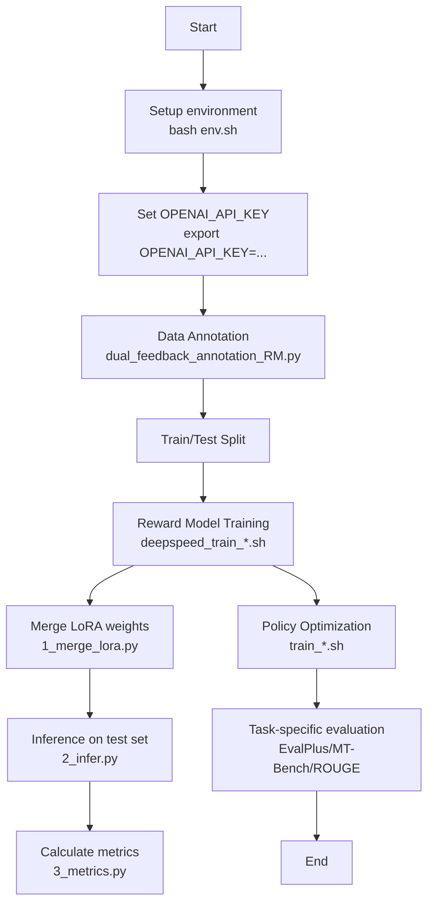

**Sources:** [README.md:147-294]()

### Typical Command Sequence

For code generation (KodCode):

```bash
# 1. Annotate data
cd rm_data_anno/kodcode
python dual_feedback_annotation_RM.py --data_path path/to/kodcode

# 2. Train reward model
cd ../../nl_reward_model/kodcode
bash deepspeed_train_kodcode.sh

# 3. Evaluate reward model
cd evaluation
python 1_merge_lora.py --base_model meta-llama/Llama-3.1-8B-Instruct \
    --lora_model ../ckpt/llama31-8B-kodcode/0_4400 \
    --save_dir ../ckpt/llama31-8B-kodcode/0_4400_merge

python 2_infer.py --model_path ../ckpt/llama31-8B-kodcode/0_4400_merge \
    --dataset_path ../data/KodCode/kodcode_test.json

python 3_metrics.py --input_file inference_results_0_4400.json

# 4. Train policy with NL-gradients
cd ../../../nl_gradient_policy_optimization/kodcode
bash train_kodcode.sh
```

**Sources:** [README.md:147-273](), [README.md:277-293]()

---

## Key Innovation: Span-Level Feedback

The core innovation of Text2Grad is converting natural language feedback into token-level gradient signals. Traditional RLHF assigns a single scalar reward to an entire sequence. Text2Grad instead:

1. **Identifies specific spans** of text that are good (+1), neutral (0), or poor (-1)
2. **Generates natural language critiques** explaining why each span has its score
3. **Uses fuzzy string matching** to locate spans in generated text
4. **Aligns word-level scores to tokens** via the `rematch_scores()` function
5. **Backpropagates token-level rewards** through PPO for fine-grained optimization

This enables the model to learn precisely which parts of its output need improvement, rather than receiving only holistic feedback.

**Sources:** [README.md:33-38](), [README.md:53-62]()

---

## Directory Organization

The repository follows a three-tier structure mirroring the three pipeline components:

```
Text2Grad/
├── rm_data_anno/              # Tier 1: Data annotation
│   ├── kodcode/
│   ├── slf5k/
│   └── ultrafeedback/
│
├── nl_reward_model/           # Tier 2: Reward model training
│   ├── kodcode/
│   │   ├── train_rm.py
│   │   ├── evaluation/
│   │   │   ├── 1_merge_lora.py
│   │   │   ├── 2_infer.py
│   │   │   └── 3_metrics.py
│   ├── slf5k/
│   └── ultrafeedback/
│
└── nl_gradient_policy_optimization/  # Tier 3: Policy training
    ├── kodcode/
    │   ├── train_kodcode.py
    │   └── text2grad_trainer.py
    ├── slf5k/
    └── ultrafeedback/
```

Each task subdirectory contains task-specific training scripts, but all share the same `TEXT2GRADTrainer` abstraction and evaluation methodology.

**Sources:** [README.md:127-145]()

---

## Evaluation and Benchmarks

Text2Grad models are evaluated using domain-appropriate benchmarks:

| Task | Benchmarks | Metrics |
|------|-----------|---------|
| **Code Generation** | HumanEval+, MBPP+ via EvalPlus | Functional correctness (pass@k) |
| **Question Answering** | MT-Bench, ARC-C, AlpacaEval 2.0 | Conversation quality, reasoning accuracy |
| **Summarization** | SLF5K validation set | ROUGE-1/2/L, BLEU, BERTScore, GPT-4 judge |

Reward models are evaluated using:
- **Word-level metrics**: Precision/Recall/F1 for score predictions (-1, 0, +1)
- **Span-overlap metrics**: IoU-based boundary alignment (for UltraFeedback)
- **ROUGE scores**: Textual feedback quality

**Sources:** [README.md:297-353]()

---

## Next Steps

- **Installation**: See [Installation](#2.1) for environment setup
- **Quick Start**: See [Quick Start](#2.2) for a complete walkthrough
- **Architecture Details**: See [System Architecture](#3) for component deep dives
- **Task-Specific Guides**: See [Code Generation](#7.1), [Question Answering](#7.2), or [Summarization](#7.3)
- **API Reference**: See [TEXT2GRADTrainer API](#9.1) for detailed class documentation

**Sources:** [README.md:1-372]()

---

# Page: Getting Started

# Getting Started

<details>
<summary>Relevant source files</summary>

The following files were used as context for generating this wiki page:

- [README.md](README.md)
- [env.sh](env.sh)

</details>


This page provides an overview of the initial setup process and the basic workflow for using Text2Grad. It covers prerequisites, environment setup, and the three-phase pipeline structure. For detailed installation instructions, see [Installation](#2.1). For a complete walkthrough of running the pipeline on a specific task, see [Quick Start](#2.2).

## Prerequisites

Before setting up Text2Grad, ensure you have the following prerequisites:

| Requirement | Details | Purpose |
|------------|---------|---------|
| **Operating System** | Linux (recommended) or macOS | DeepSpeed and distributed training support |
| **Python** | 3.8 or higher (3.10 recommended) | Core runtime environment |
| **Conda** | Miniconda or Anaconda | Environment management |
| **CUDA** | 12.4 or compatible | GPU acceleration for training |
| **GPU Memory** | Minimum 24GB VRAM per GPU | Model training and inference |
| **Disk Space** | 50GB+ available | Models, datasets, and checkpoints |
| **API Keys** | OpenAI API key (optional) | Data annotation and GPT-4 evaluation |
| **Accounts** | Hugging Face account | Model and dataset downloads |
| **Accounts** | Weights & Biases account (optional) | Experiment tracking |

**Sources:** [README.md:1-93](), [env.sh:1-58]()

## Setup Overview

The setup process consists of three main stages: environment preparation, dependency installation, and service authentication.

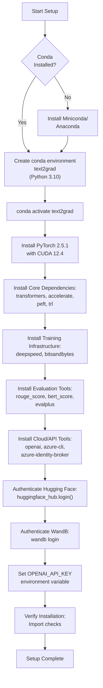

**Setup Workflow**: The diagram shows the complete setup process from environment creation through authentication. The [env.sh:1-58]() script automates most of these steps.

**Sources:** [env.sh:1-58](), [README.md:76-92]()

## Three-Phase Pipeline Structure

Text2Grad follows a three-phase pipeline architecture. Each phase corresponds to specific directories and scripts in the codebase:

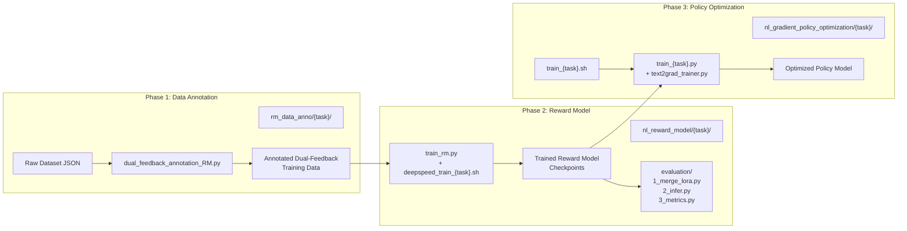

**Pipeline Architecture**: This diagram maps the conceptual three-phase pipeline to actual code locations and scripts. The `{task}` placeholder represents `kodcode`, `ultrafeedback`, or `slf5k`.

**Sources:** [README.md:127-145](), [README.md:149-294]()

## Task-Specific Directory Structure

Each task domain (code generation, question answering, summarization) follows the same directory structure across all three phases:

| Task | Directory Suffix | Dataset | Primary Evaluation |
|------|-----------------|---------|-------------------|
| **Code Generation** | `kodcode/` | KodCode-Light-RL-10K | EvalPlus (HumanEval+, MBPP+) |
| **Question Answering** | `ultrafeedback/` | UltraFeedback-Binarized | MT-Bench, ARC-C, AlpacaEval 2.0 |
| **Summarization** | `slf5k/` | SLF5K | ROUGE, BERTScore, GPT-4 |

**Example paths for KodCode:**
- Data annotation: `rm_data_anno/kodcode/dual_feedback_annotation_RM.py`
- Reward model training: `nl_reward_model/kodcode/train_rm.py`
- Policy optimization: `nl_gradient_policy_optimization/kodcode/train_kodcode.py`

**Sources:** [README.md:127-145](), [README.md:100-123](), [README.md:297-353]()

## Key Dependencies and Their Roles

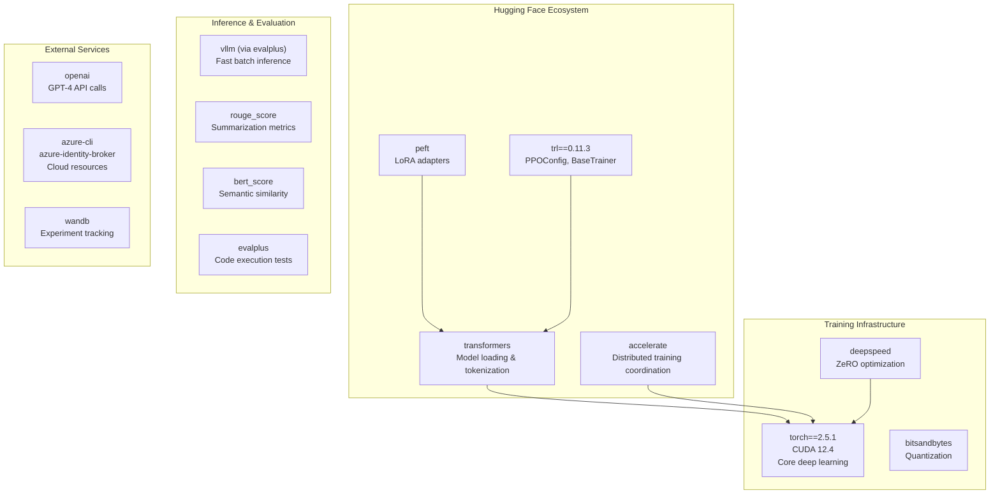

**Dependency Graph**: Shows the hierarchical relationship between key dependencies. Core packages (Hugging Face ecosystem) build on PyTorch, while specialized tools serve specific purposes.

**Sources:** [env.sh:20-49](), [README.md:73-74]()

## Environment Setup Script

The [env.sh:1-58]() script automates the entire setup process. Key sections:

| Script Section | Lines | Purpose |
|---------------|-------|---------|
| Conda environment creation | [env.sh:8-18]() | Creates `text2grad` environment with Python 3.10 |
| PyTorch installation | [env.sh:20-22]() | Installs PyTorch 2.5.1 with CUDA 12.4 support |
| Core packages | [env.sh:24-32]() | Installs transformers, peft, trl, accelerate |
| Evaluation tools | [env.sh:33-35]() | Installs rouge, bert_score, evalplus |
| Cloud/API packages | [env.sh:37-43]() | Installs openai, azure-cli, azure-identity-broker |
| Service authentication | [env.sh:45-55]() | Sets up wandb and huggingface_hub |

**Running the setup:**
```bash
bash env.sh
```

The script will prompt for Weights & Biases login. This is optional and can be skipped by pressing Ctrl+C.

**Sources:** [env.sh:1-58](), [README.md:76-85]()

## Authentication Requirements

Different phases of the pipeline require different authentication tokens:

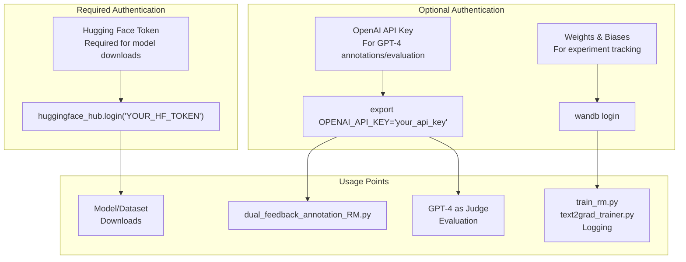

**Authentication Flow**: Shows when each authentication token is used during the pipeline execution.

**Setting OpenAI API key:**
```bash
export OPENAI_API_KEY="your_api_key"
```

**Logging in to Hugging Face:**
```bash
python -c "from huggingface_hub import login; login('YOUR_HF_TOKEN')"
```

**Sources:** [README.md:87-92](), [env.sh:45-55]()

## Verification Steps

After running [env.sh:1-58](), verify the installation:

**1. Check conda environment:**
```bash
conda activate text2grad
python --version  # Should show Python 3.10.x
```

**2. Verify PyTorch and CUDA:**
```bash
python -c "import torch; print(f'PyTorch: {torch.__version__}'); print(f'CUDA Available: {torch.cuda.is_available()}'); print(f'CUDA Version: {torch.version.cuda}')"
```

Expected output:
```
PyTorch: 2.5.1
CUDA Available: True
CUDA Version: 12.4
```

**3. Verify core dependencies:**
```bash
python -c "import transformers, peft, trl, accelerate, deepspeed; print('Core packages OK')"
```

**4. Verify evaluation tools:**
```bash
python -c "import rouge_score, bert_score; print('Evaluation packages OK')"
```

**5. Check GPU availability:**
```bash
nvidia-smi
```

Should display GPU information with available memory.

**Sources:** [env.sh:1-58](), [README.md:76-85]()

## Pipeline Execution Overview

Once setup is complete, the typical workflow for any task follows this sequence:

| Step | Action | Script/Command | Output |
|------|--------|----------------|--------|
| **1** | Annotate raw data | `python dual_feedback_annotation_RM.py` | Dual-feedback training data |
| **2** | Train reward model | `bash deepspeed_train_{task}.sh` | Reward model checkpoints |
| **3** | Evaluate reward model | `python 1_merge_lora.py`<br/>`python 2_infer.py`<br/>`python 3_metrics.py` | Evaluation metrics |
| **4** | Train policy with NL-gradients | `bash train_{task}.sh` | Optimized policy model |
| **5** | Evaluate policy | Task-specific benchmarks | Performance metrics |

**Sources:** [README.md:147-294]()

## Dataset Acquisition

Before running the pipeline, download the appropriate dataset:

**Code Generation (KodCode):**
```bash
# Available at: https://huggingface.co/datasets/KodCode/KodCode-Light-RL-10K
```

**Question Answering (UltraFeedback):**
```bash
# Available at: https://huggingface.co/datasets/HuggingFaceH4/ultrafeedback_binarized
```

**Summarization (SLF5K):**
```bash
# Available at: https://huggingface.co/datasets/JeremyAlain/SLF5K
```

All datasets are downloaded automatically by the scripts if you have authenticated with Hugging Face. See [Input Data Formats](#4.1) for details on expected JSON structures.

**Sources:** [README.md:94-123]()

## Common Setup Issues

| Issue | Symptom | Solution |
|-------|---------|----------|
| **Conda not found** | `env.sh` exits with "Conda not found" | Install Miniconda from https://docs.conda.io/en/latest/miniconda.html |
| **CUDA version mismatch** | `torch.cuda.is_available()` returns `False` | Check NVIDIA driver supports CUDA 12.4: `nvidia-smi` |
| **Out of memory** | Training crashes with OOM | Reduce batch size, enable gradient checkpointing, use ZeRO Stage 3 |
| **Hugging Face authentication** | Cannot download models | Run `huggingface_hub.login()` or set HF_TOKEN environment variable |
| **OpenAI API key** | Annotation scripts fail | Set `export OPENAI_API_KEY="your_api_key"` |
| **DeepSpeed errors** | Training fails to initialize | Check CUDA, PyTorch, and DeepSpeed versions are compatible |

For detailed troubleshooting, see [Error Handling and Logging](#8.2).

**Sources:** [env.sh:1-58](), [README.md:76-92]()

## Next Steps

After completing the setup:

1. **Follow the detailed installation guide:** See [Installation](#2.1) for step-by-step instructions and troubleshooting.

2. **Run the quick start tutorial:** See [Quick Start](#2.2) for a complete walkthrough of the pipeline on one task.

3. **Understand the architecture:** See [System Architecture](#3) to understand how the three components interact.

4. **Choose your task:**
   - Code Generation: See [Code Generation (KodCode)](#7.1)
   - Question Answering: See [Question Answering (UltraFeedback)](#7.2)
   - Summarization: See [Summarization (SLF5K)](#7.3)

5. **Explore advanced topics:** See [Advanced Topics](#8) for multi-GPU configuration, hyperparameter tuning, and memory optimization.

**Sources:** [README.md:1-372]()

---

# Page: Installation

# Installation

<details>
<summary>Relevant source files</summary>

The following files were used as context for generating this wiki page:

- [README.md](README.md)
- [env.sh](env.sh)

</details>


This page provides detailed instructions for setting up the Text2Grad development environment. It covers prerequisite software, dependency installation, and authentication with external services. For information about running your first end-to-end pipeline after installation, see [Quick Start](#2.2).

## Prerequisites

Before beginning installation, ensure the following software is available on your system:

| Requirement | Version | Purpose |
|-------------|---------|---------|
| Conda (Miniconda or Anaconda) | Any recent version | Python environment management |
| Git | Any recent version | Repository cloning and version control |
| CUDA Toolkit | 12.4 or compatible | GPU acceleration for PyTorch |
| NVIDIA GPU | - | Required for training and inference |

The installation script [env.sh:8-17]() checks for conda availability and exits if not found. Ensure conda is in your system PATH before proceeding.

**Sources:** [env.sh:1-18]()

## Installation Workflow

```mermaid
graph TB
    START["User"] --> CLONE["Clone Repository<br/>git clone"]
    CLONE --> CHECK{["conda command<br/>available?"]}
    CHECK -->|No| ERROR["Exit with error<br/>Install Miniconda/Anaconda"]
    CHECK -->|Yes| CREATE["conda create -n text2grad<br/>python=3.10"]
    CREATE --> ACTIVATE["conda activate text2grad"]
    ACTIVATE --> TORCH["Install PyTorch 2.5.1<br/>with CUDA 12.4"]
    TORCH --> CORE["Install Core Packages<br/>trl, transformers, peft,<br/>accelerate, deepspeed"]
    CORE --> ML["Install ML Utilities<br/>scikit-learn, pandas,<br/>numpy==1.26.4"]
    ML --> EVAL["Install Evaluation Tools<br/>rouge, bert_score,<br/>evalplus with vllm"]
    EVAL --> CLOUD["Install Cloud/API Packages<br/>azure-cli, openai,<br/>azure-identity-broker"]
    CLOUD --> WANDB["Install wandb<br/>Prompt for login"]
    WANDB --> HF["Install huggingface_hub<br/>Instructions for login"]
    HF --> COMPLETE["Environment Ready"]
    
    COMPLETE -.-> VERIFY["Verification:<br/>Import checks,<br/>GPU availability"]
```

**Sources:** [README.md:76-85](), [env.sh:1-58]()

## Step-by-Step Installation

### 1. Clone the Repository

```bash
git clone https://github.com/microsoft/Text2Grad
cd Text2Grad
```

The repository URL in [README.md:80]() may differ from the canonical Microsoft repository. Use the appropriate URL for your fork or the official repository.

**Sources:** [README.md:78-81]()

### 2. Run the Installation Script

Execute the environment setup script:

```bash
bash env.sh
```

This script [env.sh:1-58]() performs all installation steps automatically. The following sections detail what each step accomplishes.

**Sources:** [README.md:84](), [env.sh:1-4]()

### 3. Conda Environment Creation

The script creates a conda environment named `text2grad` with Python 3.10:

```bash
conda create -n text2grad python=3.10 -y
```

The environment is activated using [env.sh:13]():

```bash
eval "$(conda shell.bash hook)"
conda activate text2grad
```

If conda is not found, the script exits with an error at [env.sh:16-18]().

**Sources:** [env.sh:8-18]()

### 4. PyTorch Installation

PyTorch 2.5.1 is installed with CUDA 12.4 support from [env.sh:21-22]():

```bash
pip install torch==2.5.1 torchvision==0.20.1 torchaudio==2.5.1 \
    --index-url https://download.pytorch.org/whl/cu124
```

This specific version ensures compatibility with the CUDA kernels used by DeepSpeed and other acceleration libraries.

**Sources:** [env.sh:20-22]()

## Core Dependencies

The following diagram maps each dependency to its role in the Text2Grad system:

```mermaid
graph TB
    subgraph "Training Framework"
        TRL["trl==0.11.3<br/>PPOTrainer, PPOConfig"]
        PEFT["peft<br/>LoRA adapters"]
        TRANS["transformers<br/>AutoModel, AutoTokenizer"]
        ACC["accelerate<br/>Distributed training"]
        DS["deepspeed<br/>ZeRO optimization"]
    end
    
    subgraph "Model Serving"
        VLLM["evalplus[vllm]<br/>Fast inference pipeline"]
        BNB["bitsandbytes<br/>Quantization"]
    end
    
    subgraph "Evaluation Metrics"
        ROUGE["rouge, rouge_score<br/>N-gram overlap"]
        BERT["bert_score<br/>Semantic similarity"]
        EVALPLUS["evalplus<br/>Code execution tests"]
    end
    
    subgraph "Data Processing"
        SKL["scikit-learn<br/>Metrics, utilities"]
        PANDAS["pandas<br/>Data manipulation"]
        NUMPY["numpy==1.26.4<br/>Array operations"]
    end
    
    subgraph "External Services"
        OPENAI["openai<br/>GPT-4 API client"]
        AZURE["azure-cli, azure-identity-broker<br/>Cloud authentication"]
        WANDB["wandb<br/>Experiment tracking"]
        HF["huggingface_hub<br/>Model hub access"]
    end
    
    TRL --> TEXT2GRAD["TEXT2GRADTrainer<br/>nl_gradient_policy_optimization"]
    PEFT --> RM["Reward Model Training<br/>nl_reward_model"]
    DS --> TRAIN["DeepSpeed Training Scripts<br/>deepspeed_train_*.sh"]
    VLLM --> INFER["Inference Scripts<br/>2_infer.py"]
    EVALPLUS --> EVAL["Code Evaluation<br/>HumanEval, MBPP"]
    WANDB --> LOG["Training Logs<br/>Metrics tracking"]
```

**Sources:** [env.sh:25-35](), [env.sh:41-48]()

### Package Installation Details

The core packages are installed in [env.sh:25-35]():

| Package | Version | Installation Note |
|---------|---------|-------------------|
| `trl` | 0.11.3 | Provides `PPOTrainer` base class used by `TEXT2GRADTrainer` |
| `peft` | Latest | Installed with `--no-dependencies` to avoid conflicts |
| `transformers` | Latest | Core library for loading Llama models |
| `numpy` | 1.26.4 | Pinned version for compatibility |
| `accelerate` | Latest | Required for multi-GPU training coordination |
| `bitsandbytes` | Latest | GPU quantization support |
| `deepspeed` | Latest | ZeRO Stage 3 optimization |

The `peft` package is installed with `--no-dependencies` at [env.sh:28]() to prevent version conflicts with other packages that may have stricter dependency requirements.

**Sources:** [env.sh:25-32]()

### Evaluation and Utility Packages

Evaluation tools are installed at [env.sh:33-35]():

```bash
pip install rouge rouge_score
pip install bert_score deepspeed azure-cli
pip install --upgrade "evalplus[vllm] @ git+https://github.com/evalplus/evalplus"
```

- `rouge` and `rouge_score`: Used in [nl_reward_model/*/evaluation/3_metrics.py]() for text similarity
- `bert_score`: Semantic similarity metrics for summarization evaluation
- `evalplus[vllm]`: Code generation evaluation framework with VLLM inference backend, installed from git repository

**Sources:** [env.sh:33-35]()

## External Service Authentication

### OpenAI API Configuration

The OpenAI API is used for GPT-4-based evaluation and data annotation. Configure the API key as an environment variable:

```bash
export OPENAI_API_KEY="your_api_key"
```

This can be added to your shell configuration file (`~/.bashrc`, `~/.zshrc`, etc.) for persistence across sessions. The key is accessed by scripts in [rm_data_anno/]() for dual-feedback annotation.

**Sources:** [README.md:87-92]()

### Weights & Biases Setup

The installation script prompts for WandB login at [env.sh:46-49]():

```bash
pip install wandb
wandb login
```

WandB tracks training metrics in all policy optimization scripts. The login prompt can be skipped with Ctrl+C if you prefer to configure WandB later or disable logging.

To disable WandB logging entirely, set:

```bash
export WANDB_MODE=disabled
```

**Sources:** [env.sh:45-49]()

### Hugging Face Hub Authentication

The Hugging Face Hub provides access to pre-trained models (Llama-3.1-8B-Instruct) and datasets (KodCode, UltraFeedback, SLF5K). The installation script at [env.sh:52-55]() provides instructions:

```bash
pip install huggingface_hub
python -c "from huggingface_hub import login; login('YOUR_HF_TOKEN')"
```

Obtain a token from [https://huggingface.co/settings/tokens](https://huggingface.co/settings/tokens). For some models (particularly Llama variants), you may need to accept license agreements on the model's Hugging Face page before downloading.

**Sources:** [env.sh:51-55]()

### Azure Configuration (Optional)

Azure CLI and identity broker are installed at [env.sh:34]() and [env.sh:43](). These are optional and used only if running on Azure infrastructure:

```bash
pip install azure-cli
pip install azure-identity-broker --upgrade
```

Most users can ignore these packages for local development.

**Sources:** [env.sh:34](), [env.sh:41-43]()

## Post-Installation Verification

After installation completes, verify the environment:

### 1. Activate Environment

```bash
conda activate text2grad
```

Note: The script output at [env.sh:57]() incorrectly references `conda activate ppo`. The correct environment name is `text2grad`.

**Sources:** [env.sh:57]()

### 2. Check PyTorch and CUDA

```python
import torch
print(f"PyTorch version: {torch.__version__}")
print(f"CUDA available: {torch.cuda.is_available()}")
print(f"CUDA version: {torch.version.cuda}")
print(f"GPU count: {torch.cuda.device_count()}")
```

Expected output:
```
PyTorch version: 2.5.1
CUDA available: True
CUDA version: 12.4
GPU count: <number of available GPUs>
```

### 3. Verify Core Imports

```python
# Training framework
from trl import PPOConfig
from peft import LoraConfig
from transformers import AutoModelForCausalLM, AutoTokenizer
from accelerate import Accelerator

# Inference and evaluation  
import vllm
from rouge_score import rouge_scorer
from bert_score import score

# External services
import openai
import wandb
from huggingface_hub import login
```

If any import fails, reinstall the corresponding package.

**Sources:** [env.sh:25-48]()

## Troubleshooting

### Conda Activation Fails

If `conda activate text2grad` fails with "command not found", initialize conda for your shell:

```bash
conda init bash  # or zsh, fish, etc.
# Restart your shell
conda activate text2grad
```

**Sources:** [env.sh:12-14]()

### CUDA Version Mismatch

If your system CUDA version differs from 12.4, install the appropriate PyTorch build:

```bash
# For CUDA 11.8
pip install torch==2.5.1 torchvision==0.20.1 torchaudio==2.5.1 \
    --index-url https://download.pytorch.org/whl/cu118

# For CUDA 12.1
pip install torch==2.5.1 torchvision==0.20.1 torchaudio==2.5.1 \
    --index-url https://download.pytorch.org/whl/cu121
```

Verify compatibility with your GPU driver using `nvidia-smi`.

**Sources:** [env.sh:20-22]()

### DeepSpeed Installation Issues

DeepSpeed requires CUDA development headers. On Ubuntu/Debian:

```bash
sudo apt-get install libcudnn8-dev
```

If build errors persist, install pre-built wheels:

```bash
pip install deepspeed --no-build-isolation
```

### EvalPlus Installation Fails

The EvalPlus installation at [env.sh:35]() uses git installation, which requires git credentials if the repository is private. If this fails:

```bash
pip install evalplus[vllm]
```

This installs from PyPI instead of the git repository.

**Sources:** [env.sh:35]()

### WandB Login Hangs

If the WandB login prompt at [env.sh:49]() hangs, skip it with Ctrl+C and configure later:

```bash
wandb login --relogin
```

Or use an API key directly:

```bash
export WANDB_API_KEY="your_key"
```

**Sources:** [env.sh:46-49]()

## Environment File Structure

After successful installation, the conda environment contains:

```
$CONDA_PREFIX/text2grad/
├── bin/
│   ├── python          # Python 3.10 interpreter
│   ├── deepspeed       # DeepSpeed launcher
│   ├── wandb           # WandB CLI
│   └── ...
├── lib/python3.10/site-packages/
│   ├── torch/          # PyTorch with CUDA 12.4
│   ├── transformers/   # Hugging Face transformers
│   ├── trl/            # TRL with PPOTrainer
│   ├── peft/           # PEFT with LoRA
│   ├── deepspeed/      # DeepSpeed optimization
│   ├── vllm/           # VLLM inference engine
│   └── ...
└── ...
```

**Sources:** [env.sh:1-58]()

## Next Steps

After successful installation:

1. **Test the environment**: Follow the [Quick Start](#2.2) guide to run a minimal training pipeline
2. **Download datasets**: See [Datasets](#-datasets) section in README for links to KodCode, UltraFeedback, and SLF5K
3. **Configure task-specific paths**: Update file paths in training scripts under [nl_gradient_policy_optimization/]()

For detailed information about the system architecture and how components interact, see [System Architecture](#3).

**Sources:** [README.md:1-372]()

---

# Page: Quick Start

# Quick Start

<details>
<summary>Relevant source files</summary>

The following files were used as context for generating this wiki page:

- [README.md](README.md)
- [nl_reward_model/kodcode/train_rm.py](nl_reward_model/kodcode/train_rm.py)

</details>


This guide walks through running the complete Text2Grad pipeline on the **UltraFeedback** question-answering task, from raw data annotation through policy optimization. By the end, you will have trained a reward model and optimized a policy model using natural language gradients.

**Scope**: This page covers the practical steps to run one complete pipeline. For detailed explanations of the architecture, see [System Architecture](#3). For task-specific details on other domains, see [Task-Specific Guides](#7). For installation prerequisites, see [Installation](#2.1).

---

## Pipeline Overview

The Text2Grad system consists of three sequential stages. This quick start executes all three for the UltraFeedback task:

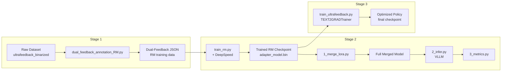

**Sources**: [README.md:147-293]()

---

## Prerequisites

Before starting, ensure you have:
1. Completed the [Installation](#2.1) steps
2. Set your OpenAI API key (used for annotation): `export OPENAI_API_KEY="your_key"`
3. At least 2 GPUs with 30GB+ VRAM for training

**Sources**: [README.md:76-92]()

---

## Stage 1: Data Annotation

### Overview

The annotation stage converts raw UltraFeedback data into dual-feedback format by pairing natural language critiques with specific token spans.

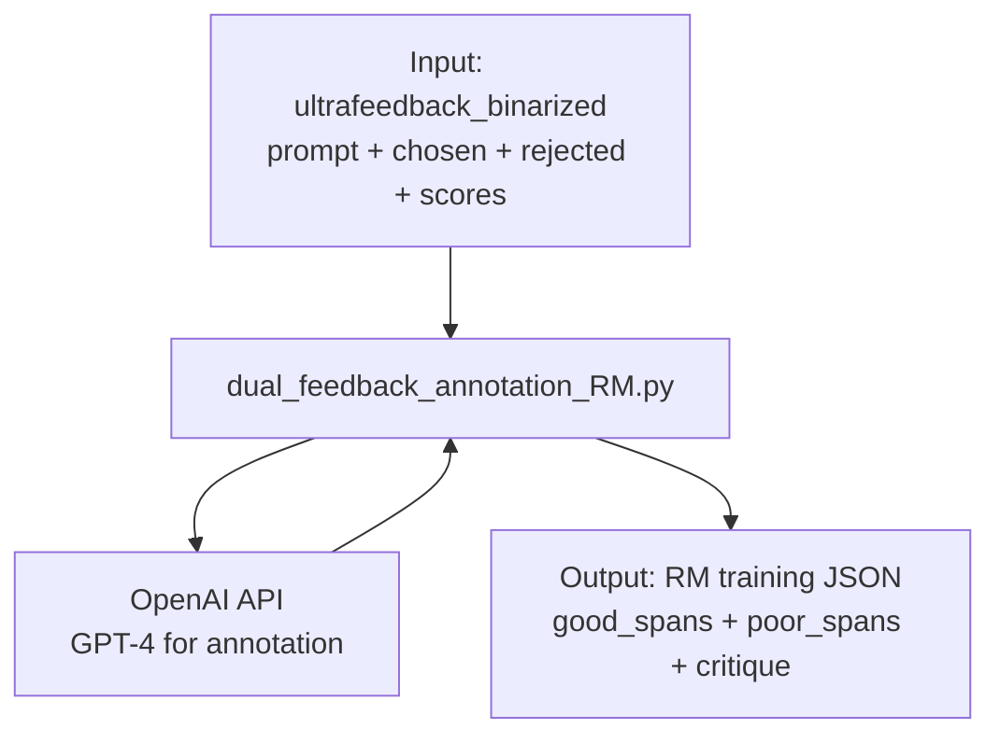

### Input Format

UltraFeedback data contains prompt-response pairs with preference scores. Example structure:

| Field | Description | Type |
|-------|-------------|------|
| `prompt` | User question/instruction | string |
| `response` | List of conversational turns | list[dict] |
| `is_chosen` | Whether this is the preferred response | boolean |
| `score_chosen` | Quality score for chosen response | float |
| `score_rejected` | Quality score for rejected response | float |
| `critique` | Natural language feedback | string |

**Sources**: [README.md:173-196]()

### Running Annotation

```bash
cd rm_data_anno/ultrafeedback
python dual_feedback_annotation_RM.py \
    --data_path path/to/ultrafeedback_binarized.json
```

The script processes each example through the OpenAI API to generate structured annotations. The output file contains:
- `good_spans`: List of text spans that are high-quality
- `poor_spans`: List of text spans that need improvement
- `critique`: Natural language explanation of the feedback

**Expected Runtime**: ~2-4 hours for 10K examples (depends on API rate limits)

**Output Location**: `rm_data_anno/ultrafeedback/annotated_data_RM.json`

**Sources**: [README.md:149-158]()

---

## Stage 2: Reward Model Training

### Overview

The reward model learns to predict span-level rewards and generate explanatory critiques. Training uses LoRA for parameter efficiency and DeepSpeed ZeRO-3 for memory optimization.

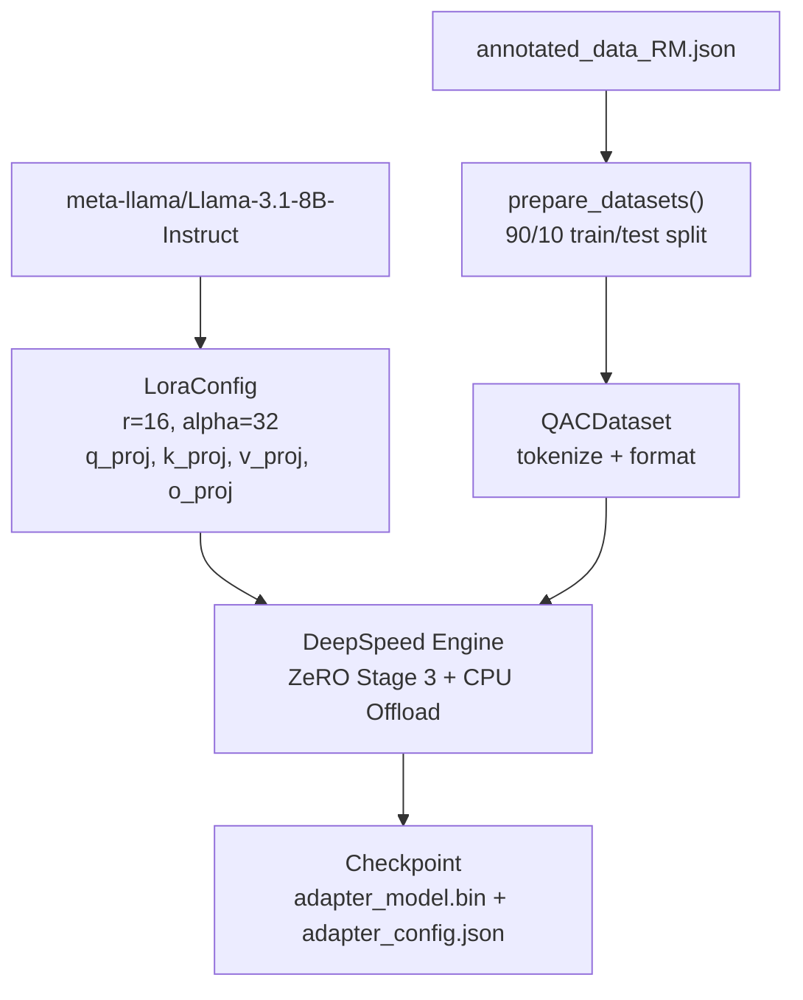

### Training Command

Navigate to the reward model directory and run the training script:

```bash
cd nl_reward_model/ultrafeedback
bash deepspeed_train_ultrafeedback.sh
```

The shell script internally calls `train_rm.py` with DeepSpeed configuration. Key components:

| Component | Implementation | File Reference |
|-----------|---------------|----------------|
| Dataset class | `QACDataset` | [nl_reward_model/kodcode/train_rm.py:22-121]() |
| Data splitting | `prepare_datasets()` | [nl_reward_model/kodcode/train_rm.py:124-156]() |
| LoRA application | `apply_lora()` | [nl_reward_model/kodcode/train_rm.py:183-206]() |
| DeepSpeed config | `get_deepspeed_config()` | [nl_reward_model/kodcode/train_rm.py:209-260]() |
| Training loop | `train()` | [nl_reward_model/kodcode/train_rm.py:325-402]() |

### Key Configuration Parameters

From the training script configuration:

```python
config = {
    "model_name": "meta-llama/Llama-3.1-8B-Instruct",
    "batch_size": 2,
    "epochs": 3,
    "prompt_max_length": 900,
    "max_length": 1250,
}
```

**Expected Runtime**: ~8-12 hours on 2x A100 GPUs for 3 epochs

**Output Location**: `nl_reward_model/ultrafeedback/ckpt/text2grad_ultrafeedback_RM/`

Checkpoints are saved every 400 steps after step 200: `{epoch}_{step}/adapter_model.bin`

**Sources**: [nl_reward_model/kodcode/train_rm.py:1-426](), [README.md:222-233]()

---

## Stage 3: Reward Model Evaluation

### Overview

Evaluation consists of three sequential steps that merge the LoRA adapters, run inference on test data, and calculate metrics.

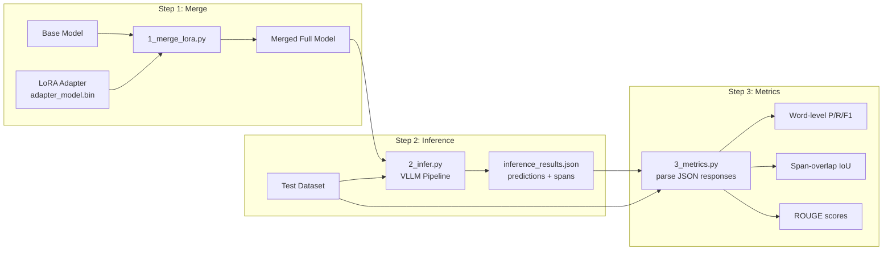

### Step 3.1: Merge LoRA Weights

Combine the trained LoRA adapters with the base model:

```bash
cd nl_reward_model/ultrafeedback/evaluation
python 1_merge_lora.py \
    --base_model "meta-llama/Llama-3.1-8B-Instruct" \
    --lora_model "../ckpt/text2grad_ultrafeedback_RM/0_4400" \
    --save_dir "../ckpt/text2grad_ultrafeedback_RM/0_4400_merge" \
    --merge_and_save True
```

### Step 3.2: Run Inference

Generate predictions on the test dataset using VLLM for efficient batch processing:

```bash
python 2_infer.py \
    --model_path "../ckpt/text2grad_ultrafeedback_RM/0_4400_merge" \
    --dataset_path "../data/ultrafeedback_test.json" \
    --output_file "inference_results_0_4400.json" \
    --batch_size 40 \
    --prompt_max_length 1000 \
    --max_length 1600 \
    --max_new_tokens 350 \
    --gpu_ids "0,1" \
    --gpu_memory "30GiB"
```

**Key Parameters**:
- `batch_size`: Number of examples processed simultaneously (adjust based on GPU memory)
- `gpu_ids`: Comma-separated GPU indices to use
- `gpu_memory`: Memory limit per GPU

**Expected Runtime**: ~1-2 hours for 1K test examples

### Step 3.3: Calculate Metrics

Compute evaluation metrics comparing predictions to ground truth:

```bash
python 3_metrics.py \
    --input_file "inference_results_0_4400.json" \
    --output_file "word_level_evaluation_results.json"
```

The script calculates:

| Metric Type | Measures | Output Fields |
|-------------|----------|---------------|
| Word-level | Precision/Recall/F1 for each score class (-1, 0, +1) | `word_level_metrics` |
| Span-level | IoU-based overlap for contiguous spans | `span_metrics` |
| Text-level | ROUGE-1/2/L for critique quality | `rouge_scores` |

**Sources**: [README.md:236-273]()

---

## Stage 4: Policy Optimization with NL-Gradients

### Overview

The final stage uses the trained reward model to optimize a policy model via PPO with natural language gradients. The `TEXT2GRADTrainer` manages the training loop.

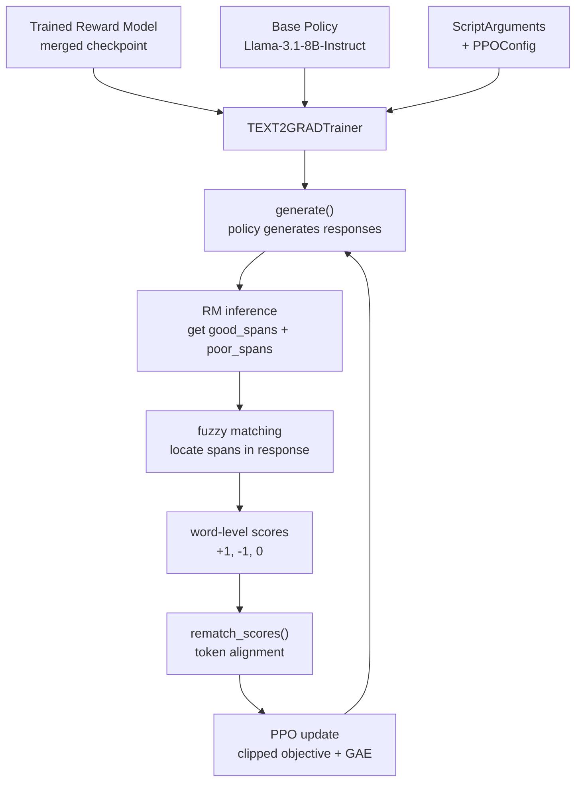

### Training Command

```bash
cd nl_gradient_policy_optimization/ultrafeedback
bash train_ultrafeedback.sh
```

### Core Training Components

The training script uses the following key classes and functions:

| Component | Class/Function | Purpose |
|-----------|----------------|---------|
| Trainer | `TEXT2GRADTrainer` | Main training loop coordinator |
| Config | `PPOConfig` | PPO hyperparameters |
| Arguments | `ScriptArguments` | Paths, model names, generation params |
| Generation | `ppo_trainer.generate()` | Generate responses from policy |
| Reward Extraction | Pipeline in training loop | Extract spans from RM feedback |
| Score Alignment | `rematch_scores()` | Align word scores to tokens |
| PPO Update | `step()` method | Compute advantages and update policy |

### Key Hyperparameters

Typical configuration from training scripts:

```python
# Generation parameters
max_new_tokens = 512
temperature = 0.7
top_p = 0.9

# PPO parameters
learning_rate = 1.41e-5
batch_size = 16
mini_batch_size = 4
gradient_accumulation_steps = 1

# Reward parameters
kl_penalty = "kl"  # KL penalty type
init_kl_coef = 0.05  # Initial KL coefficient
```

**Expected Runtime**: ~24-48 hours for full training depending on dataset size and hardware

**Output Location**: `nl_gradient_policy_optimization/ultrafeedback/ckpt/`

Checkpoints are saved periodically and include:
- `adapter_model.bin`: LoRA adapter weights
- `value_head.bin`: Value network weights
- `optimizer.pt`: Optimizer state for resumption

**Sources**: [README.md:277-293]()

---

## Verification and Next Steps

### Verify Outputs

After completing all stages, you should have:

1. **Annotated Data**: `rm_data_anno/ultrafeedback/annotated_data_RM.json`
2. **Reward Model**: `nl_reward_model/ultrafeedback/ckpt/text2grad_ultrafeedback_RM/{epoch}_{step}_merge/`
3. **Evaluation Metrics**: `nl_reward_model/ultrafeedback/evaluation/word_level_evaluation_results.json`
4. **Optimized Policy**: `nl_gradient_policy_optimization/ultrafeedback/ckpt/final_checkpoint/`

### Check Training Logs

All training runs log to Weights & Biases (WandB). Check your project dashboard for:
- Training loss curves
- Evaluation metrics over time
- Generated examples with feedback
- KL divergence and reward statistics

### Evaluate Final Model

For comprehensive evaluation of the optimized policy, use task-specific benchmarks:

- **MT-Bench**: Multi-turn conversation quality
- **ARC-C**: Reasoning capability
- **AlpacaEval 2.0**: General instruction-following

See [UltraFeedback Evaluation](#7.2.4) for detailed evaluation instructions.

### Explore Other Tasks

Once you've completed the UltraFeedback pipeline, try:
- [Code Generation (KodCode)](#7.1) for code optimization with execution feedback
- [Summarization (SLF5K)](#7.3) for text summarization with word-level annotations

Each task follows the same three-stage pipeline with task-specific data formats and evaluation metrics.

**Sources**: [README.md:297-359]()

---

## Common Issues and Solutions

| Issue | Cause | Solution |
|-------|-------|----------|
| Out of memory during RM training | Large model + batch size | Reduce `batch_size` in config, enable gradient checkpointing |
| Slow annotation | API rate limits | Process in smaller batches, use parallel workers |
| VLLM inference fails | GPU memory fragmentation | Reduce `batch_size` or `gpu_memory` parameter |
| NaN losses during PPO | Learning rate too high | Reduce `learning_rate` or increase `init_kl_coef` |
| Checkpoint not found | Incorrect path | Verify paths match between training and evaluation scripts |

For advanced troubleshooting, see [Error Handling and Logging](#8.2).

**Sources**: General system knowledge from codebase structure

---

# Page: System Architecture

# System Architecture

<details>
<summary>Relevant source files</summary>

The following files were used as context for generating this wiki page:

- [README.md](README.md)

</details>


## Purpose and Scope

This page describes the overall architecture of the Text2Grad system, including its three-component pipeline, component interactions, and directory organization. For detailed information about each component's implementation, see [Three-Component Pipeline](#3.1). For task-specific configurations and workflows, see [Multi-Task Design](#3.2).

The Text2Grad system implements a novel approach to reinforcement learning from human feedback (RLHF) by converting natural language critiques into fine-grained, token-level gradients. Unlike traditional RLHF systems that operate on scalar rewards, Text2Grad maintains span-level feedback throughout the training pipeline.

---

## Architectural Overview

Text2Grad follows a modular, three-stage architecture where each component produces outputs consumed by the next stage. The system supports multiple tasks (code generation, question answering, summarization) through parallel pipelines that share common abstractions.

### Three-Component Pipeline

The system consists of three sequential components:

| Component | Directory | Key Outputs | Consumed By |
|-----------|-----------|-------------|-------------|
| **Data Annotation** | `rm_data_anno/{task}/` | Dual-feedback JSON files with spans and critiques | Reward Model Training |
| **Reward Model** | `nl_reward_model/{task}/` | Trained models that predict span-level rewards | Policy Optimization |
| **Policy Optimization** | `nl_gradient_policy_optimization/{task}/` | Optimized policy models | Downstream evaluation |

Each component is task-agnostic in design but task-specific in instantiation, allowing the same architectural patterns to apply across code generation (KodCode), question answering (UltraFeedback), and summarization (SLF5K).

**Sources:** [README.md:53-62](), [README.md:127-145]()

---

## Component Interaction and Data Flow

### System-Level Component Diagram

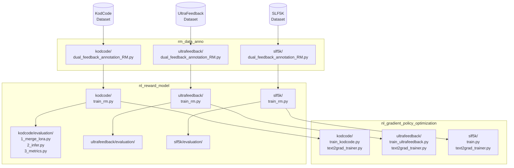

**Diagram: Directory structure showing three parallel task pipelines**

This diagram maps the conceptual three-component architecture to actual directories and files in the codebase. Each task (KodCode, UltraFeedback, SLF5K) has its own isolated pipeline with identical structure but task-specific implementations.

**Sources:** [README.md:127-145](), [README.md:149-218]()

---

### Class and Function-Level Interaction

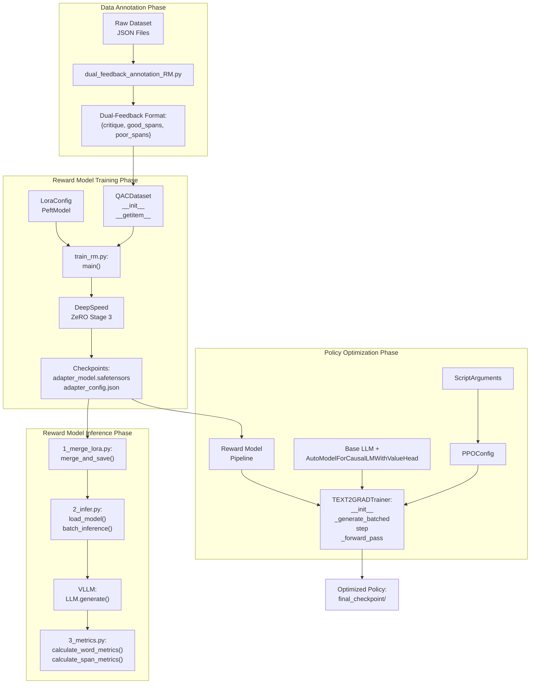

**Diagram: Class-level interactions across all three components**

This diagram bridges natural language concepts to concrete code entities. Key classes include:
- `QACDataset`: Tokenizes and formats question-answer-critique triplets for training
- `TEXT2GRADTrainer`: Extends TRL's `PPOTrainer` with span-level reward processing
- `AutoModelForCausalLMWithValueHead`: Adds value estimation head to base language model
- `PeftModel`: Wraps LoRA adapter functionality

**Sources:** [README.md:221-274](), [README.md:277-293]()

---

## Component Responsibilities

### 1. Data Annotation Pipeline

**Primary Script:** `rm_data_anno/{task}/dual_feedback_annotation_RM.py`

**Responsibility:** Convert raw dataset formats into structured dual-feedback annotations that pair natural language critiques with specific token spans.

**Key Outputs:**
- `critique`: Natural language explanation of quality issues
- `good_spans`: List of token ranges with positive contributions
- `poor_spans`: List of token ranges with negative contributions

The annotation format is consistent across all tasks, enabling the reward model to learn unified feedback generation patterns.

**Sources:** [README.md:149-218]()

### 2. Fine-Grained Reward Model

**Training Script:** `nl_reward_model/{task}/train_rm.py`  
**Dataset Class:** `QACDataset`  
**Inference Scripts:** `nl_reward_model/{task}/evaluation/1_merge_lora.py`, `2_infer.py`, `3_metrics.py`

**Responsibility:** Train models to predict span-level rewards and generate explanatory critiques. The reward model learns from annotated data to identify which parts of generated text are high or low quality.

**Key Capabilities:**
- Generate structured JSON feedback with span annotations
- Predict word-level scores (-1, 0, +1)
- Provide natural language explanations for quality judgments

The reward model uses LoRA for parameter-efficient fine-tuning and DeepSpeed for scalable training on large models.

**Sources:** [README.md:221-274]()

### 3. NL-Gradient Policy Optimization

**Training Scripts:** `nl_gradient_policy_optimization/{task}/train_{task}.py`  
**Core Trainer:** `text2grad_trainer.py` (defines `TEXT2GRADTrainer` class)

**Responsibility:** Optimize policy models using PPO with token-level rewards derived from natural language feedback. The trainer converts span-level feedback into fine-grained gradient signals.

**Key Workflow:**
1. Generate responses using current policy
2. Send responses to reward model for span-level feedback
3. Use fuzzy string matching to locate spans in generated text
4. Convert span scores to token-level rewards via `rematch_scores()`
5. Apply PPO updates with clipped objective function

The `TEXT2GRADTrainer` extends TRL's base `PPOTrainer` with span-aware reward processing.

**Sources:** [README.md:277-293]()

---

## Directory Organization and Task Structure

The codebase follows a three-level hierarchy:

```
Component Level (3 directories)
├── Task Level (3 subdirectories per component)
│   ├── Script Level (training, inference, evaluation scripts)
│   └── Configuration Files (shell scripts, configs)
```

Each task directory contains:

| File Type | Purpose | Examples |
|-----------|---------|----------|
| **Training Scripts** | Main entry points for training | `train_rm.py`, `train_kodcode.py`, `train_ultrafeedback.py` |
| **Shell Scripts** | Launch distributed training | `deepspeed_train_*.sh`, `train_*.sh` |
| **Utility Modules** | Shared functionality | `text2grad_trainer.py`, dataset classes |
| **Evaluation Scripts** | Model assessment | `1_merge_lora.py`, `2_infer.py`, `3_metrics.py` |
| **Data Files** | Task-specific datasets | `kodcode_train.json`, `ultrafeedback_test.json` |

This organization allows:
- **Independent development**: Changes to one task don't affect others
- **Shared abstractions**: Common patterns (LoRA, DeepSpeed, PPO) reused across tasks
- **Parallel execution**: Multiple tasks can be trained simultaneously

**Sources:** [README.md:127-145]()

---

## Key Architectural Decisions

### Parameter-Efficient Fine-Tuning with LoRA

All models use LoRA (Low-Rank Adaptation) for efficient fine-tuning:
- Only adapter weights are trained and saved
- Base models remain frozen, reducing memory requirements
- Adapters can be merged back into base model for deployment

**Configuration:** Typical LoRA config uses `r=16`, `alpha=32`, targeting attention layers.

### DeepSpeed ZeRO Stage 3 Optimization

Training leverages DeepSpeed's ZeRO (Zero Redundancy Optimizer) Stage 3:
- **Parameter partitioning**: Each GPU holds a subset of model parameters
- **Gradient partitioning**: Gradients distributed across devices
- **Optimizer state partitioning**: Optimizer states offloaded to CPU
- **Memory savings**: Enables training 8B parameter models on consumer GPUs

**Invocation:** Training scripts use `deepspeed` launcher with custom ZeRO configs.

### Modular Reward Model Pipeline

The reward model is completely decoupled from policy training:
- Trained independently using supervised learning on annotated data
- Frozen during policy optimization
- Loaded via separate pipeline for inference
- Can be upgraded without retraining policy

This separation allows reward model improvements without restarting expensive policy training.

### Shared TEXT2GRADTrainer Abstraction

All three tasks share the same `TEXT2GRADTrainer` class with task-specific configurations:
- Same PPO update logic across tasks
- Task-specific prompt formatting via configuration
- Unified span matching and token alignment algorithms
- Common checkpointing and logging infrastructure

This reduces code duplication and ensures consistent behavior across tasks.

**Sources:** [README.md:53-75](), [README.md:221-293]()

---

## Component Independence and Interfaces

### Interface 1: Annotation → Reward Model

**Format:** JSON files with structure:
```
{
  "question": <input prompt>,
  "answer": <generated response>,
  "critique": <natural language feedback>,
  "good_spans": [list of positive token ranges],
  "poor_spans": [list of negative token ranges]
}
```

This interface is task-agnostic and consumed by `QACDataset` class.

### Interface 2: Reward Model → Policy Optimizer

**Format:** Structured JSON output from reward model:
```
{
  "critique": <explanation>,
  "good_spans": [list of good phrases],
  "poor_spans": [list of poor phrases]
}
```

The `TEXT2GRADTrainer` parses this output and uses fuzzy string matching to locate spans in generated text, converting them to token-level rewards.

### Interface 3: Policy Optimizer → Evaluation

**Format:** Model checkpoints saved as:
- `adapter_model.safetensors` (LoRA weights)
- `adapter_config.json` (LoRA configuration)
- `value_head.bin` (value function weights)
- `optimizer.pt` (optimizer state for resumption)

These checkpoints can be loaded for inference or merged with base models for deployment.

**Sources:** [README.md:163-216](), [README.md:237-270]()

---

## Scalability and Extensibility

The architecture supports extension in multiple dimensions:

### Adding New Tasks
1. Create directories under each component: `rm_data_anno/{newtask}/`, `nl_reward_model/{newtask}/`, `nl_gradient_policy_optimization/{newtask}/`
2. Implement task-specific annotation script following dual-feedback format
3. Configure `QACDataset` tokenization for task data format
4. Create training script inheriting from `TEXT2GRADTrainer`
5. Define task-specific evaluation metrics

### Upgrading Models
- Reward models can be retrained independently with improved annotations
- Policy models can switch base LLMs by changing `model_name_or_path` in configs
- LoRA adapters are modular and can be swapped without full retraining

### Scaling Training
- DeepSpeed configuration can be adjusted for more GPUs
- Batch sizes and gradient accumulation steps are configurable
- ZeRO stage can be increased (Stage 1 → 2 → 3) for memory optimization

**Sources:** [README.md:65-75](), [README.md:127-145]()

---

# Page: Three-Component Pipeline

# Three-Component Pipeline

<details>
<summary>Relevant source files</summary>

The following files were used as context for generating this wiki page:

- [README.md](README.md)

</details>


## Purpose and Scope

This page provides a detailed technical explanation of the three-component architecture that forms the core of the Text2Grad system. Each component is an independent stage in the pipeline that processes data, trains models, or optimizes policies using natural language feedback as gradient signals.

For task-specific implementation details, see [Multi-Task Design](#3.2). For detailed training procedures, see [Training Reward Models](#5.1) and [PPO Training Loop](#6.2).

---

## Architecture Overview

The Text2Grad system implements a sequential three-stage pipeline where each component feeds into the next. The components are:

1. **Data Annotation Pipeline**: Converts raw natural language feedback into structured dual-feedback format
2. **Fine-Grained Reward Model**: Trains models to predict span-level rewards and generate explanatory critiques
3. **NL-Gradient Policy Optimization**: Uses PPO with token-level rewards derived from natural language feedback

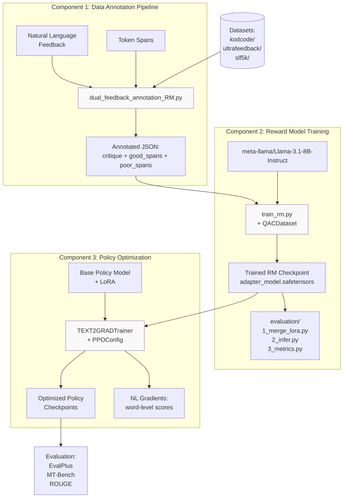

**Sources:** [README.md:1-372]()

---

## Component 1: Data Annotation Pipeline

### Purpose

The data annotation pipeline transforms raw datasets containing natural language feedback into a structured **dual-feedback format** that pairs textual critiques with specific token spans. This format enables fine-grained learning by explicitly marking which parts of a response are good or poor.

### Directory Structure

Each task has its own annotation directory under `rm_data_anno/`:

| Task | Directory | Main Script |
|------|-----------|-------------|
| Code Generation | `rm_data_anno/kodcode/` | `dual_feedback_annotation_RM.py` |
| Question Answering | `rm_data_anno/ultrafeedback/` | `dual_feedback_annotation_RM.py` |
| Summarization | `rm_data_anno/slf5k/` | `dual_feedback_annotation_RM.py` |

### Dual-Feedback Format

The annotation scripts generate JSON data with this structure:

```json
{
    "prompt": "Question or instruction text",
    "response": "Generated response to annotate",
    "critique": "Natural language explanation of issues/strengths",
    "good_spans": [[start_idx, end_idx], ...],
    "poor_spans": [[start_idx, end_idx], ...]
}
```

Each span is a character-level index pair `[start, end]` that identifies a substring in the response. The `critique` field provides natural language explanation, while the spans provide precise localization.

### Code-to-Concept Mapping

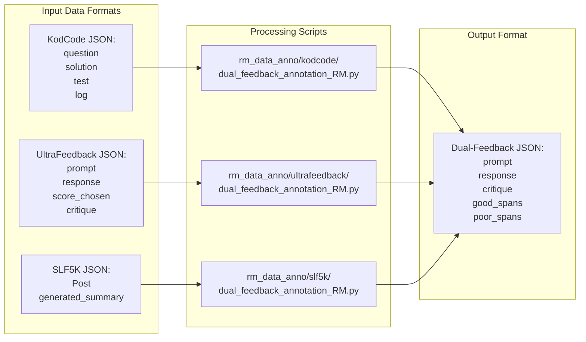

### Usage Example

```bash
cd rm_data_anno/ultrafeedback
python dual_feedback_annotation_RM.py \
    --data_path path/to/ultrafeedback_binarized \
    --output_path annotated_data.json
```

The annotation process is task-specific but produces a unified output format that Component 2 can consume.

**Sources:** [README.md:149-217]()

---

## Component 2: Fine-Grained Reward Model

### Purpose

The reward model component trains a language model to predict span-level rewards and generate explanatory critiques. It learns to identify which parts of a generated response are high-quality (good spans) or problematic (poor spans), providing the foundation for gradient signals in Component 3.

### Training Architecture

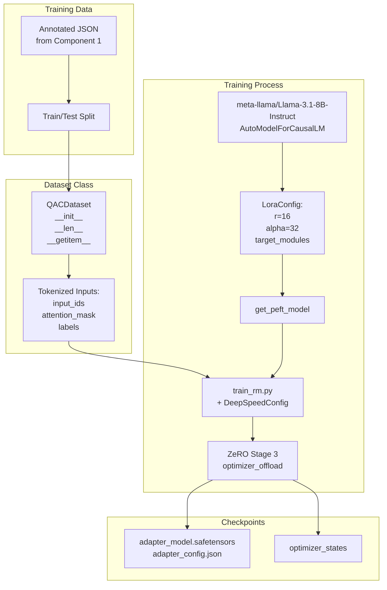

### Key Files and Classes

| Component | File Path | Key Classes/Functions |
|-----------|-----------|----------------------|
| Dataset | Task-specific under `nl_reward_model/{task}/` | `QACDataset` |
| Training | `nl_reward_model/{task}/train_rm.py` | `main()`, `train()` |
| Configuration | Task-specific shell scripts | DeepSpeed config, LoRA config |
| Evaluation | `nl_reward_model/{task}/evaluation/1_merge_lora.py` | `merge_lora_weights()` |
| Inference | `nl_reward_model/{task}/evaluation/2_infer.py` | `run_inference()` |
| Metrics | `nl_reward_model/{task}/evaluation/3_metrics.py` | `calculate_metrics()` |

### Training Commands by Task

| Task | Training Script | Checkpoint Output |
|------|----------------|-------------------|
| KodCode | `nl_reward_model/kodcode/deepspeed_train_kodcode.sh` | `ckpt/llama31-8B-kodcode/` |
| UltraFeedback | `nl_reward_model/ultrafeedback/deepspeed_train_ultrafeedback.sh` | `ckpt/llama31-8B-ultrafeedback/` |
| SLF5K | `nl_reward_model/slf5k/deepspeed_train_slf5k.sh` | `ckpt/llama31-8B-slf5k/` |

### Inference Pipeline

After training, the reward model is used in three steps:

1. **Merge LoRA**: `1_merge_lora.py` combines adapter weights with base model
2. **Batch Inference**: `2_infer.py` generates structured feedback using VLLM pipeline
3. **Compute Metrics**: `3_metrics.py` evaluates word-level and span-level accuracy

The model outputs JSON with the same structure as the training data:

```json
{
    "critique": "The response correctly identifies...",
    "good_spans": [[5, 42], [50, 78]],
    "poor_spans": [[85, 120]]
}
```

**Sources:** [README.md:221-274]()

---

## Component 3: NL-Gradient Policy Optimization

### Purpose

The policy optimization component uses Proximal Policy Optimization (PPO) enhanced with natural language gradients. Instead of scalar rewards, it operates on token-level feedback derived from the reward model's span-level annotations, enabling precise, targeted model improvements.

### Core Classes and Architecture

```mermaid
graph TB
    subgraph Configuration["Configuration Objects"]
        SCRIPT_ARGS["ScriptArguments:<br/>model_name<br/>reward_model_name<br/>learning_rate<br/>batch_size"]
        PPO_CONFIG["PPOConfig:<br/>learning_rate<br/>mini_batch_size<br/>ppo_epochs<br/>kl_penalty"]
        LORA_CFG["LoraConfig:<br/>r=16<br/>alpha=32<br/>lora_dropout"]
    end
    
    subgraph Models["Model Initialization"]
        BASE_POLICY["AutoModelForCausalLM<br/>Base Policy Model"]
        LORA_CFG --> PEFT_POLICY["get_peft_model"]
        BASE_POLICY --> PEFT_POLICY
        PEFT_POLICY --> VALUE["AutoModelForCausalLMWithValueHead"]
        
        RM_CKPT["Reward Model<br/>Checkpoint from Component 2"]
        RM_CKPT --> RM_PIPELINE["pipeline('text-generation')<br/>Frozen Reward Model"]
    end
    
    subgraph Trainer["TEXT2GRADTrainer"]
        VALUE --> INIT["__init__:<br/>Initialize trainer<br/>with policy + config"]
        RM_PIPELINE --> INIT
        PPO_CONFIG --> INIT
        
        INIT --> TRAIN_LOOP["train:<br/>Main training loop"]
        TRAIN_LOOP --> STEP["step:<br/>Single PPO update"]
        STEP --> GEN["generate:<br/>Generate responses"]
        GEN --> REWARD["compute_rewards:<br/>Get NL gradients"]
        REWARD --> UPDATE["ppo_update:<br/>Policy gradient update"]
    end
    
    subgraph Output["Training Output"]
        UPDATE --> CKPT["Checkpoints:<br/>adapter_model<br/>value_head<br/>optimizer_state"]
        UPDATE --> LOGS["WandB Logs:<br/>rewards<br/>loss<br/>kl_divergence"]
    end
```

### TEXT2GRADTrainer Workflow

The `TEXT2GRADTrainer` class extends the TRL library's `BaseTrainer` and implements the natural language gradient mechanism:

1. **Generation**: Policy model generates responses for batch of prompts
2. **RM Inference**: Frozen reward model produces structured feedback (good_spans, poor_spans)
3. **Fuzzy Matching**: Locate identified spans in generated text using string similarity
4. **Word-Level Scoring**: Assign scores (+1, -1, 0) to each word based on span membership
5. **Token Alignment**: Map word-level scores to token-level rewards via `rematch_scores()`
6. **PPO Update**: Compute advantages and update policy using clipped objective

### Key Method Signatures

| Method | Location | Purpose |
|--------|----------|---------|
| `TEXT2GRADTrainer.__init__()` | Task-specific `text2grad_trainer.py` | Initialize trainer with models and config |
| `TEXT2GRADTrainer.step()` | Task-specific `text2grad_trainer.py` | Single PPO training step |
| `compute_rewards()` | Task-specific `text2grad_trainer.py` | Convert NL feedback to token rewards |
| `rematch_scores()` | Task-specific `text2grad_trainer.py` | Align word scores to token positions |
| `batched_forward_pass()` | Task-specific `text2grad_trainer.py` | Compute logprobs and values |

### Training Commands

| Task | Training Script | Main Training File |
|------|----------------|-------------------|
| KodCode | `nl_gradient_policy_optimization/kodcode/train_kodcode.sh` | `train_kodcode.py` |
| UltraFeedback | `nl_gradient_policy_optimization/ultrafeedback/train_ultrafeedback.sh` | `train_ultrafeedback.py` |
| SLF5K | `nl_gradient_policy_optimization/slf5k/train_slf5k.sh` | `train.py` |

Each training script instantiates `TEXT2GRADTrainer` and calls its `train()` method, which internally loops over batches calling `step()`.

**Sources:** [README.md:277-294]()

---

## Data Flow Between Components

### Component Dependencies

```mermaid
graph LR
    subgraph C1["Component 1"]
        A1["dual_feedback_annotation_RM.py"]
        O1["annotated_train.json<br/>annotated_test.json"]
        A1 --> O1
    end
    
    subgraph C2["Component 2"]
        I2["QACDataset loads<br/>annotated JSON"]
        T2["train_rm.py trains model"]
        O2["RM checkpoint:<br/>adapter_model.safetensors"]
        I2 --> T2
        T2 --> O2
    end
    
    subgraph C3["Component 3"]
        I3["Load RM checkpoint<br/>as frozen pipeline"]
        T3["TEXT2GRADTrainer.step:<br/>generate + get rewards<br/>+ ppo_update"]
        O3["Optimized policy<br/>checkpoints"]
        I3 --> T3
        T3 --> O3
    end
    
    O1 -->|"File I/O"| I2
    O2 -->|"Model loading"| I3
    
    style O1 fill:#f9f9f9
    style O2 fill:#f9f9f9
    style O3 fill:#f9f9f9
```

### Information Flow

1. **Component 1 → Component 2**: Annotated JSON files are read by `QACDataset` during reward model training
2. **Component 2 → Component 3**: Trained reward model checkpoint is loaded as a frozen inference pipeline
3. **Component 3 Output**: Optimized policy model used for final evaluation on benchmarks

Each component is **independent** and can be run, debugged, or improved separately:

- Annotation can be re-run with different prompting strategies
- Reward models can be retrained with different architectures or hyperparameters
- Policy optimization can experiment with different PPO variants or reward processing

### Component Independence Benefits

| Aspect | Benefit |
|--------|---------|
| **Modularity** | Each component has its own codebase and can be modified independently |
| **Debugging** | Issues can be isolated to a specific component |
| **Experimentation** | Try different reward models without re-annotating data |
| **Parallelization** | Multiple reward models can be trained simultaneously for different tasks |
| **Reusability** | A single reward model can be used for multiple PPO training runs |

**Sources:** [README.md:53-62](), [README.md:127-145]()

---

## Component Location Reference

### File System Mapping

The three-component architecture maps directly to the repository's directory structure:

```
Text2Grad/
├── rm_data_anno/              # Component 1: Data Annotation
│   ├── kodcode/
│   │   └── dual_feedback_annotation_RM.py
│   ├── ultrafeedback/
│   │   └── dual_feedback_annotation_RM.py
│   └── slf5k/
│       └── dual_feedback_annotation_RM.py
│
├── nl_reward_model/           # Component 2: Reward Model
│   ├── kodcode/
│   │   ├── train_rm.py
│   │   ├── deepspeed_train_kodcode.sh
│   │   └── evaluation/
│   │       ├── 1_merge_lora.py
│   │       ├── 2_infer.py
│   │       └── 3_metrics.py
│   ├── ultrafeedback/
│   │   └── [similar structure]
│   └── slf5k/
│       └── [similar structure]
│
└── nl_gradient_policy_optimization/  # Component 3: Policy Optimization
    ├── kodcode/
    │   ├── train_kodcode.py
    │   ├── text2grad_trainer.py
    │   └── train_kodcode.sh
    ├── ultrafeedback/
    │   ├── train_ultrafeedback.py
    │   ├── text2grad_trainer.py
    │   └── train_ultrafeedback.sh
    └── slf5k/
        ├── train.py
        ├── text2grad_trainer.py
        └── train_slf5k.sh
```

### Common Patterns Across Tasks

While each task (KodCode, UltraFeedback, SLF5K) has task-specific code, they follow identical structural patterns:

| Component | Pattern | Purpose |
|-----------|---------|---------|
| Component 1 | `dual_feedback_annotation_RM.py` in each task dir | Annotation script with task-specific parsing |
| Component 2 | `train_rm.py` + `evaluation/` in each task dir | Training and evaluation with shared logic |
| Component 3 | `train_{task}.py` + `text2grad_trainer.py` | Task-specific trainer extending shared patterns |

This consistency enables developers to understand one task and quickly navigate to others.

**Sources:** [README.md:127-145]()

---

# Page: Multi-Task Design

# Multi-Task Design

<details>
<summary>Relevant source files</summary>

The following files were used as context for generating this wiki page:

- [README.md](README.md)

</details>


## Purpose and Scope

This document explains how Text2Grad implements multi-task support, enabling the same framework to handle Code Generation (KodCode), Question Answering (UltraFeedback), and Summarization (SLF5K) tasks. The design uses a parallel pipeline structure where each task maintains independent implementations while sharing core abstractions and interfaces.

For details on individual task workflows, see [Code Generation (KodCode)](#7.1), [Question Answering (UltraFeedback)](#7.2), and [Summarization (SLF5K)](#7.3). For the overall system architecture, see [Three-Component Pipeline](#3.1).

**Sources:** [README.md:1-372]()

---

## Design Philosophy

Text2Grad follows a **parallel pipeline architecture** where each task domain operates independently but follows an identical three-phase structure. This design enables:

1. **Task-specific optimization** without cross-task interference
2. **Independent development cycles** for each domain
3. **Reusable core components** (trainers, datasets, evaluation logic)
4. **Easy extensibility** for adding new tasks

The framework does not attempt to create a single unified model for all tasks. Instead, it provides a consistent workflow pattern that task-specific implementations follow.

```mermaid
graph TB
    subgraph SharedAbstractions["Shared Abstractions Layer"]
        TRAINER["TEXT2GRADTrainer<br/>(text2grad_trainer.py)"]
        QACDS["QACDataset<br/>(QACDataset class)"]
        PPOCONF["PPOConfig<br/>(TRL library)"]
        DEEPSPEED["DeepSpeed<br/>(ZeRO Stage 3)"]
    end
    
    subgraph KodCode["KodCode Task Pipeline"]
        KC_ANNO["rm_data_anno/kodcode/<br/>dual_feedback_annotation_RM.py"]
        KC_RM["nl_reward_model/kodcode/<br/>train_rm.py"]
        KC_PPO["nl_gradient_policy_optimization/kodcode/<br/>train_kodcode.py"]
        
        KC_ANNO --> KC_RM
        KC_RM --> KC_PPO
    end
    
    subgraph UltraFeedback["UltraFeedback Task Pipeline"]
        UF_ANNO["rm_data_anno/ultrafeedback/<br/>dual_feedback_annotation_RM.py"]
        UF_RM["nl_reward_model/ultrafeedback/<br/>train_rm.py"]
        UF_PPO["nl_gradient_policy_optimization/ultrafeedback/<br/>train_ultrafeedback.py"]
        
        UF_ANNO --> UF_RM
        UF_RM --> UF_PPO
    end
    
    subgraph SLF5K["SLF5K Task Pipeline"]
        SL_ANNO["rm_data_anno/slf5k/<br/>dual_feedback_annotation_RM.py"]
        SL_RM["nl_reward_model/slf5k/<br/>train_rm.py"]
        SL_PPO["nl_gradient_policy_optimization/slf5k/<br/>train.py"]
        
        SL_ANNO --> SL_RM
        SL_RM --> SL_PPO
    end
    
    TRAINER -.->|"instantiated by"| KC_PPO
    TRAINER -.->|"instantiated by"| UF_PPO
    TRAINER -.->|"instantiated by"| SL_PPO
    
    QACDS -.->|"used in"| KC_RM
    QACDS -.->|"used in"| UF_RM
    QACDS -.->|"used in"| SL_RM
    
    PPOCONF -.->|"configured by"| KC_PPO
    PPOCONF -.->|"configured by"| UF_PPO
    PPOCONF -.->|"configured by"| SL_PPO
    
    DEEPSPEED -.->|"used by"| KC_RM
    DEEPSPEED -.->|"used by"| UF_RM
    DEEPSPEED -.->|"used by"| SL_RM
```

**Diagram: Multi-Task Architecture with Shared Abstractions**

This diagram shows how task-specific implementations in three parallel pipelines reuse shared abstractions. The `TEXT2GRADTrainer` class, `QACDataset`, `PPOConfig`, and DeepSpeed infrastructure are common across all tasks, while each task maintains its own training scripts and data processing pipelines.

**Sources:** [README.md:127-145](), [README.md:220-294]()

---

## Directory Organization

The codebase follows a three-level hierarchy: **component → task → implementation**. Each of the three main components (Data Annotation, Reward Model, Policy Optimization) contains subdirectories for each supported task.

### Top-Level Structure

```
Text2Grad/
├── rm_data_anno/                    # Component 1: Data Annotation
│   ├── kodcode/                     # Code generation task
│   ├── slf5k/                       # Summarization task
│   └── ultrafeedback/               # Question answering task
│
├── nl_reward_model/                 # Component 2: Reward Model
│   ├── kodcode/                     # Code generation reward model
│   ├── slf5k/                       # Summarization reward model
│   └── ultrafeedback/               # Question answering reward model
│
└── nl_gradient_policy_optimization/ # Component 3: Policy Optimization
    ├── kodcode/                     # Code generation PPO training
    ├── slf5k/                       # Summarization PPO training
    └── ultrafeedback/               # Question answering PPO training
```

### Task Directory Contents

Each task subdirectory typically contains:

| Component | Typical Files | Purpose |
|-----------|---------------|---------|
| **Data Annotation** | `dual_feedback_annotation_RM.py` | Converts raw task data to dual-feedback format |
| **Reward Model** | `train_rm.py`, `deepspeed_train_*.sh`, `evaluation/` | Trains and evaluates reward models |
| **Policy Optimization** | `train_*.py`, `train_*.sh`, `text2grad_trainer.py` | PPO training with NL-gradients |

**Sources:** [README.md:127-145]()

---

## Shared Abstractions

While tasks operate independently, they share several core abstractions that ensure consistency and reduce code duplication.

### TEXT2GRADTrainer Class

The `TEXT2GRADTrainer` class is the primary shared component for policy optimization across all tasks. Located in `text2grad_trainer.py` within each task's policy optimization directory, it provides:

- PPO training loop implementation
- Reward model integration and inference
- Span-to-token alignment logic
- Value head and advantage computation
- Checkpoint management
- Distributed training coordination

```mermaid
graph LR
    subgraph TrainingScripts["Task Training Scripts"]
        KC_TRAIN["train_kodcode.py"]
        UF_TRAIN["train_ultrafeedback.py"]
        SL_TRAIN["train.py (slf5k)"]
    end
    
    subgraph TEXT2GRADTrainer["TEXT2GRADTrainer Class"]
        INIT["__init__()<br/>Initialize PPO config"]
        STEP["step()<br/>Main training loop"]
        GEN["generate()<br/>Policy generation"]
        COMPUTE["compute_rewards()<br/>RM inference + span matching"]
        FORWARD["batched_forward_pass()<br/>Policy/value forward"]
        LOSS["loss()<br/>PPO loss computation"]
        UPDATE["_update_policy()<br/>Gradient update"]
    end
    
    KC_TRAIN -->|"instantiates"| INIT
    UF_TRAIN -->|"instantiates"| INIT
    SL_TRAIN -->|"instantiates"| INIT
    
    INIT --> STEP
    STEP --> GEN
    STEP --> COMPUTE
    STEP --> FORWARD
    STEP --> LOSS
    STEP --> UPDATE
```

**Diagram: TEXT2GRADTrainer Integration Pattern**

Each task's training script instantiates `TEXT2GRADTrainer` with task-specific configurations, but the core training logic remains identical.

**Sources:** [README.md:277-294]()

### QACDataset Class

The `QACDataset` class handles data formatting for reward model training. It converts task-specific JSON formats into a unified structure containing:
- `question`: The input prompt or context
- `answer`: The model-generated response
- `critique`: Natural language feedback with span annotations

All three tasks use the same `QACDataset` class, passing different data formats that get normalized during initialization.

**Sources:** [README.md:149-217]()

### Configuration Objects

All tasks use standardized configuration from the TRL library:

- **`PPOConfig`**: Defines learning rate, batch size, KL penalty, generation parameters
- **`LoraConfig`** (from PEFT): Specifies LoRA rank, alpha, target modules
- **DeepSpeed Config**: ZeRO Stage 3 optimization settings

These configurations are instantiated in task-specific training scripts but follow the same schema.

**Sources:** [README.md:220-275]()

---

## Task-Specific Implementations

While sharing abstractions, each task customizes several aspects to match its domain requirements.

### Data Format Differences

Each task processes different input formats during annotation:

| Task | Key Fields | Data Source |
|------|------------|-------------|
| **KodCode** | `question`, `solution`, `test`, `log` | [KodCode-Light-RL-10K](https://huggingface.co/datasets/KodCode/KodCode-Light-RL-10K) |
| **UltraFeedback** | `prompt`, `response`, `score_chosen`, `score_rejected`, `critique` | [UltraFeedback-Binarized](https://huggingface.co/datasets/HuggingFaceH4/ultrafeedback_binarized) |
| **SLF5K** | `Post`, `generated_summary` | [SLF5K](https://huggingface.co/datasets/JeremyAlain/SLF5K) |

The `dual_feedback_annotation_RM.py` script in each task directory handles format-specific parsing and normalization.

**Sources:** [README.md:163-216]()

### Evaluation Benchmarks

Each task uses domain-appropriate evaluation metrics:

```mermaid
graph TB
    subgraph KodCodeEval["KodCode Evaluation"]
        KC_MODEL["Trained Model"]
        KC_EVALPLUS["EvalPlus Framework"]
        KC_HUMANEVAL["HumanEval / HumanEval+"]
        KC_MBPP["MBPP / MBPP+"]
        
        KC_MODEL --> KC_EVALPLUS
        KC_EVALPLUS --> KC_HUMANEVAL
        KC_EVALPLUS --> KC_MBPP
    end
    
    subgraph UltraFeedbackEval["UltraFeedback Evaluation"]
        UF_MODEL["Trained Model"]
        UF_MTBENCH["MT-Bench<br/>(multi-turn conversation)"]
        UF_ARC["ARC-C<br/>(reasoning)"]
        UF_ALPACA["AlpacaEval 2.0<br/>(instruction following)"]
        
        UF_MODEL --> UF_MTBENCH
        UF_MODEL --> UF_ARC
        UF_MODEL --> UF_ALPACA
    end
    
    subgraph SLF5KEval["SLF5K Evaluation"]
        SL_MODEL["Trained Model"]
        SL_ROUGE["ROUGE-1/2/L"]
        SL_BLEU["BLEU"]
        SL_BERT["BERTScore"]
        SL_GPT4["GPT-4 as Judge"]
        
        SL_MODEL --> SL_ROUGE
        SL_MODEL --> SL_BLEU
        SL_MODEL --> SL_BERT
        SL_MODEL --> SL_GPT4
    end
```

**Diagram: Task-Specific Evaluation Benchmarks**

**Sources:** [README.md:297-353]()

### Reward Model Prompt Formatting

Each task formats prompts differently when querying the reward model during PPO training:

- **KodCode**: Includes the programming problem description, generated code solution, and test cases
- **UltraFeedback**: Includes the question prompt and generated answer
- **SLF5K**: Includes the original post and generated summary

The `compute_rewards()` method in `TEXT2GRADTrainer` calls task-specific formatting functions before invoking the reward model.

**Sources:** [README.md:277-294]()

---

## Task Configuration Matrix

The following table summarizes key configuration differences across tasks:

| Configuration | KodCode | UltraFeedback | SLF5K |
|---------------|---------|---------------|-------|
| **Base Model** | Llama-3.1-8B-Instruct | Llama-3.1-8B-Instruct | Llama-3.1-8B-Instruct |
| **LoRA Rank** | 16 | 16 | 16 |
| **LoRA Alpha** | 32 | 32 | 32 |
| **Training Script** | `train_kodcode.py` | `train_ultrafeedback.py` | `train.py` |
| **Launch Script** | `train_kodcode.sh` | `train_ultrafeedback.sh` | `train_slf5k.sh` |
| **Annotation Script** | `dual_feedback_annotation_RM.py` | `dual_feedback_annotation_RM.py` | `dual_feedback_annotation_RM.py` |
| **RM Training Script** | `train_rm.py` | `train_rm.py` | `train_rm.py` |
| **RM Launch Script** | `deepspeed_train_kodcode.sh` | `deepspeed_train_ultrafeedback.sh` | `deepspeed_train_slf5k.sh` |
| **Primary Metric** | Pass@1 (code correctness) | MT-Bench score | ROUGE-L |
| **Evaluation Framework** | EvalPlus | MT-Bench/ARC-C | ROUGE/BERTScore |

**Sources:** [README.md:220-294]()

---

## Workflow Consistency Across Tasks

Despite differences in data formats and evaluation metrics, all tasks follow the identical three-phase workflow:

```mermaid
graph LR
    subgraph Phase1["Phase 1: Annotation"]
        RAW["Raw Dataset<br/>(task-specific format)"]
        ANNO_SCRIPT["dual_feedback_annotation_RM.py"]
        ANNOTATED["Annotated Data<br/>(unified dual-feedback format)"]
        
        RAW --> ANNO_SCRIPT
        ANNO_SCRIPT --> ANNOTATED
    end
    
    subgraph Phase2["Phase 2: Reward Model"]
        ANNOTATED --> TRAIN["train_rm.py<br/>(DeepSpeed training)"]
        TRAIN --> RM_CKPT["Reward Model<br/>Checkpoint"]
        RM_CKPT --> MERGE["1_merge_lora.py"]
        MERGE --> EVAL["2_infer.py<br/>3_metrics.py"]
    end
    
    subgraph Phase3["Phase 3: Policy Optimization"]
        RM_CKPT --> PPO["train_*.py<br/>(TEXT2GRADTrainer)"]
        BASE["Base Policy Model"] --> PPO
        PPO --> POLICY_CKPT["Optimized Policy<br/>Checkpoint"]
        POLICY_CKPT --> BENCH["Task-Specific<br/>Benchmarks"]
    end
```

**Diagram: Universal Three-Phase Workflow**

This workflow consistency means:
1. **Scripts have predictable names**: `dual_feedback_annotation_RM.py`, `train_rm.py`, `train_*.py`
2. **Directory structures are uniform**: `rm_data_anno/{task}/`, `nl_reward_model/{task}/`, `nl_gradient_policy_optimization/{task}/`
3. **Data flows are identical**: Raw → Annotated → RM → Policy → Evaluation

**Sources:** [README.md:147-294]()

---

## Adding New Tasks

The parallel pipeline design makes extending Text2Grad to new tasks straightforward. The process involves:

### 1. Create Task Directories

```bash
# Create directory structure for new task "mytask"
mkdir -p rm_data_anno/mytask
mkdir -p nl_reward_model/mytask
mkdir -p nl_gradient_policy_optimization/mytask
```

### 2. Implement Data Annotation

Create `rm_data_anno/mytask/dual_feedback_annotation_RM.py` that:
- Reads the task-specific raw data format
- Uses LLM API to generate span-level annotations
- Outputs unified dual-feedback JSON format with `question`, `answer`, `critique` fields

Follow the pattern from existing tasks ([rm_data_anno/kodcode/dual_feedback_annotation_RM.py](), [rm_data_anno/ultrafeedback/dual_feedback_annotation_RM.py](), [rm_data_anno/slf5k/dual_feedback_annotation_RM.py]()).

### 3. Configure Reward Model Training

Create `nl_reward_model/mytask/train_rm.py` that:
- Instantiates `QACDataset` with task-specific data path
- Configures LoRA parameters (typically r=16, alpha=32)
- Defines DeepSpeed configuration for ZeRO Stage 3
- Implements task-specific prompt formatting

Create `nl_reward_model/mytask/deepspeed_train_mytask.sh` to launch training.

### 4. Implement Policy Optimization

Create `nl_gradient_policy_optimization/mytask/train_mytask.py` that:
- Instantiates `TEXT2GRADTrainer` with task-specific reward model
- Defines generation parameters (max_length, temperature, etc.)
- Implements reward model prompt formatting for this task
- Configures PPO hyperparameters (learning_rate, KL penalty, etc.)

Copy `text2grad_trainer.py` from an existing task (or symlink to a shared version).

Create `nl_gradient_policy_optimization/mytask/train_mytask.sh` to launch training.

### 5. Define Evaluation Metrics

Create `nl_reward_model/mytask/evaluation/` directory with:
- `1_merge_lora.py`: Merge LoRA adapters with base model
- `2_infer.py`: Run batch inference on test set
- `3_metrics.py`: Compute task-appropriate metrics (word-level, span-level, text-level)

Adapt these scripts from existing task implementations.

### 6. Document Task-Specific Configuration

Update README.md to document:
- Dataset source and format
- Evaluation benchmarks used
- Training commands for all three phases
- Expected performance metrics

**Sources:** [README.md:127-145](), [README.md:147-294]()

---

## Benefits of Multi-Task Design

The parallel pipeline architecture provides several advantages:

### Modularity
Each task is self-contained with its own data processing, training, and evaluation logic. Changes to one task do not affect others.

### Independent Scaling
Tasks can be developed, trained, and evaluated independently. Resource allocation (GPU hours, storage) can be optimized per task.

### Code Reusability
Shared abstractions (`TEXT2GRADTrainer`, `QACDataset`, DeepSpeed config) are written once and reused across all tasks, reducing maintenance burden.

### Experimentation Flexibility
Researchers can experiment with task-specific modifications (custom reward shaping, different architectures) without affecting the broader framework.

### Clear Boundaries
The three-phase structure provides clear boundaries between data processing, reward modeling, and policy optimization, making debugging and profiling easier.

**Sources:** [README.md:1-372]()

---

## Summary

Text2Grad's multi-task design balances **consistency** (shared abstractions, uniform workflows) with **flexibility** (task-specific implementations). The parallel pipeline structure ensures that:

1. **Each task follows the same three-phase workflow**: Annotation → Reward Model → Policy Optimization
2. **Core components are shared**: `TEXT2GRADTrainer`, `QACDataset`, DeepSpeed/LoRA configurations
3. **Task-specific aspects are isolated**: Data formats, evaluation benchmarks, prompt formatting
4. **Extension is straightforward**: Adding new tasks requires implementing the three-phase pipeline with existing abstractions

This design enables Text2Grad to support diverse domains (code, QA, summarization) while maintaining a coherent, maintainable codebase.

**Sources:** [README.md:1-372]()

---

# Page: Data Annotation Pipeline

# Data Annotation Pipeline

<details>
<summary>Relevant source files</summary>

The following files were used as context for generating this wiki page:

- [README.md](README.md)

</details>


## Purpose and Scope

The Data Annotation Pipeline is the first component of the Text2Grad system, responsible for converting raw natural language feedback into structured dual-feedback annotations. This pipeline pairs textual critiques with specific token spans, creating the training data foundation for fine-grained reward models.

This document provides an overview of the annotation architecture, workflow, and multi-task structure. For detailed information about input data formats, see [Input Data Formats](#4.1). For the dual-feedback format specification, see [Dual-Feedback Annotation](#4.2).

**Sources:** [README.md:1-372]()

## System Overview

The Data Annotation Pipeline processes three types of inputs across different tasks:

```mermaid
graph LR
    subgraph "Input Sources"
        KC[("KodCode<br/>Light-RL-10K")]
        UF[("UltraFeedback<br/>Binarized")]
        SL[("SLF5K")]
    end
    
    subgraph "Annotation Scripts"
        KC_SCRIPT["rm_data_anno/kodCode/<br/>dual_feedback_annotation_RM.py"]
        UF_SCRIPT["rm_data_anno/ultrafeedback/<br/>dual_feedback_annotation_RM.py"]
        SL_SCRIPT["rm_data_anno/slf5k/<br/>dual_feedback_annotation_RM.py"]
    end
    
    subgraph "Dual-Feedback Output"
        KC_OUT["Code Annotations:<br/>error spans + feedback"]
        UF_OUT["QA Annotations:<br/>good_spans + poor_spans"]
        SL_OUT["Summary Annotations:<br/>word scores + critique"]
    end
    
    KC --> KC_SCRIPT
    UF --> UF_SCRIPT
    SL --> SL_SCRIPT
    
    KC_SCRIPT --> KC_OUT
    UF_SCRIPT --> UF_OUT
    SL_SCRIPT --> SL_OUT
    
    KC_OUT --> RM_DATA[("Training Data<br/>for Reward Models")]
    UF_OUT --> RM_DATA
    SL_OUT --> RM_DATA
```

**Diagram: Multi-Task Annotation Architecture**

Each task has its own annotation script that processes task-specific data formats into a unified dual-feedback structure. The output serves as training data for task-specific reward models.

**Sources:** [README.md:129-145](), [README.md:149-217]()

## Directory Structure

The annotation pipeline is organized by task domain:

| Directory | Task | Script | Dataset Source |
|-----------|------|--------|----------------|
| `rm_data_anno/kodCode/` | Code Generation | `dual_feedback_annotation_RM.py` | KodCode-Light-RL-10K |
| `rm_data_anno/ultrafeedback/` | Question Answering | `dual_feedback_annotation_RM.py` | UltraFeedback-Binarized |
| `rm_data_anno/slf5k/` | Summarization | `dual_feedback_annotation_RM.py` | SLF5K |

Each directory contains:
- The annotation script (`dual_feedback_annotation_RM.py`)
- Task-specific data processing logic
- Output directory for annotated training data

**Sources:** [README.md:129-145]()

## Annotation Workflow

The following diagram illustrates the complete annotation process from raw data to structured dual-feedback:

```mermaid
graph TB
    subgraph "Input Processing"
        RAW["Raw Dataset JSON"] --> PARSE["Parse Input Format"]
        PARSE --> EXTRACT["Extract Components"]
    end
    
    subgraph "Task-Specific Extraction"
        EXTRACT --> KC_EXT["KodCode:<br/>question + solution<br/>+ test + log"]
        EXTRACT --> UF_EXT["UltraFeedback:<br/>prompt + response<br/>+ score + critique"]
        EXTRACT --> SL_EXT["SLF5K:<br/>post + summary"]
    end
    
    subgraph "Annotation Generation"
        KC_EXT --> KC_ANN["Generate Code Feedback:<br/>identify error spans"]
        UF_EXT --> UF_ANN["Generate QA Feedback:<br/>mark good/poor spans"]
        SL_EXT --> SL_ANN["Generate Summary Feedback:<br/>score word quality"]
    end
    
    subgraph "Dual-Feedback Construction"
        KC_ANN --> DF_KC["Critique Text<br/>+ Span Locations"]
        UF_ANN --> DF_UF["Critique Text<br/>+ good_spans + poor_spans"]
        SL_ANN --> DF_SL["Critique Text<br/>+ Word Scores"]
    end
    
    subgraph "Output"
        DF_KC --> OUT["Annotated JSON Files"]
        DF_UF --> OUT
        DF_SL --> OUT
        OUT --> SPLIT["Train/Test Split"]
    end
```

**Diagram: Annotation Workflow from Raw Data to Dual-Feedback**

The workflow operates in four stages:
1. **Input Processing**: Load and parse raw JSON data according to task-specific format
2. **Component Extraction**: Extract relevant fields (questions, responses, existing feedback)
3. **Annotation Generation**: Apply annotation logic to identify spans and generate critiques
4. **Dual-Feedback Construction**: Combine textual feedback with span-level annotations

**Sources:** [README.md:149-217]()

## Input Data Formats

The pipeline accepts three distinct input formats, each structured for its task domain:

### KodCode Format

```json
{
  "version": "v1.0",
  "style": "instruct",
  "subset": "Leetcode",
  "question_id": "Leetcode_36406_I",
  "question": "You are given a 0-indexed ...",
  "solution": "def max_height_diff_after_removal(heights):\n  ...",
  "test": "def test_max_height_diff_after_removal_all_equal():\n    ...",
  "gpt_pass_trial_num": 2,
  "gpt_difficulty": "hard",
  "gpt_pass_percentage": 0.2,
  "log": "..."
}
```

Key fields:
- `question`: Problem statement
- `solution`: Generated code solution
- `test`: Test cases for validation
- `log`: Execution feedback or error messages

### UltraFeedback Format

```json
{
  "prompt": "In this task, you are given ... \n\nA:",
  "prompt_id": "333685aaf217d34921dac65dbea023fe1180b5c1973dbb6554bc022d74b54e0c",
  "score_chosen": 4.0,
  "score_rejected": 4.0,
  "response": [
    {
      "content": "In this task, you are given ... \n\nA:",
      "role": "user"
    },
    {
      "content": "Could you provide ... ",
      "role": "assistant"
    }
  ],
  "is_chosen": true,
  "score": 4.0,
  "critique": ""
}
```

Key fields:
- `prompt`: Input question
- `response`: Conversation history with role markers
- `score_chosen`/`score_rejected`: Quality ratings
- `critique`: Optional existing feedback text

### SLF5K Format

```json
{
  "t3_132suw": {
    "generated_summary": "My girlfriend is premed and ...",
    "Post": "My girlfriend is studying something she won't ever use ..."
  }
}
```

Key fields:
- Post ID as key (e.g., `t3_132suw`)
- `Post`: Original text to summarize
- `generated_summary`: Model-generated summary

For complete format specifications, see [Input Data Formats](#4.1).

**Sources:** [README.md:163-216]()

## Dual-Feedback Output Structure

The annotation pipeline produces dual-feedback data that combines:

1. **Textual Critique**: Natural language explanation of quality issues or strengths
2. **Span-Level Annotations**: Specific token/word locations marked with quality indicators

```mermaid
graph LR
    subgraph "Dual-Feedback Components"
        CRITIQUE["Textual Critique<br/>(Natural Language)"]
        SPANS["Span Annotations<br/>(Token Locations)"]
    end
    
    subgraph "Alignment"
        CRITIQUE --> ALIGN["Critique-Span<br/>Alignment"]
        SPANS --> ALIGN
    end
    
    subgraph "Task-Specific Variants"
        ALIGN --> KC_FORMAT["KodCode:<br/>error_spans"]
        ALIGN --> UF_FORMAT["UltraFeedback:<br/>good_spans + poor_spans"]
        ALIGN --> SL_FORMAT["SLF5K:<br/>word_scores (-1/0/+1)"]
    end
    
    KC_FORMAT --> TRAINING["Training Data<br/>for Reward Model"]
    UF_FORMAT --> TRAINING
    SL_FORMAT --> TRAINING
```

**Diagram: Dual-Feedback Structure and Task Variants**

The dual-feedback format ensures that every critique is grounded in specific text locations, enabling fine-grained reward model training. Task-specific variants include:

- **KodCode**: Error spans indicating problematic code regions
- **UltraFeedback**: Good spans (positive examples) and poor spans (negative examples)
- **SLF5K**: Word-level scores (-1 for poor, 0 for neutral, +1 for good)

For detailed format specifications, see [Dual-Feedback Annotation](#4.2).

**Sources:** [README.md:55-62]()

## Usage Example

To run the annotation pipeline for UltraFeedback:

```bash
cd rm_data_anno/ultrafeedback
python dual_feedback_annotation_RM.py \
    --data_path path/to/ultrafeedback_data
```

The script processes the input dataset and generates annotated output files in JSON format, ready for reward model training.

**Command-line arguments:**
- `--data_path`: Path to input dataset JSON file
- Additional task-specific parameters may be available (see task-specific scripts)

**Sources:** [README.md:153-158]()

## Integration with Reward Model Training

The annotated data flows directly into the reward model training pipeline:

```mermaid
graph TB
    subgraph "Annotation Output"
        TRAIN_JSON["train_data.json<br/>(Annotated)"]
        TEST_JSON["test_data.json<br/>(Annotated)"]
    end
    
    subgraph "Reward Model Training"
        TRAIN_JSON --> DATASET["QACDataset<br/>(nl_reward_model/*/train_rm.py)"]
        TEST_JSON --> DATASET
        DATASET --> RM_TRAIN["DeepSpeed Training<br/>with LoRA"]
        RM_TRAIN --> RM_CKPT["Reward Model<br/>Checkpoint"]
    end
    
    subgraph "Policy Optimization"
        RM_CKPT --> PPO["TEXT2GRADTrainer<br/>(nl_gradient_policy_optimization)"]
    end
```

**Diagram: Data Flow from Annotation to Policy Training**

The annotated JSON files serve as input to:
1. **Reward Model Training** ([train_rm.py](#5.1)): Learns to predict span-level rewards and generate critiques
2. **Policy Optimization** ([TEXT2GRADTrainer](#6.1)): Uses reward model for fine-grained gradient signals

**Sources:** [README.md:55-62](), [README.md:220-233]()

## Key Characteristics

The Data Annotation Pipeline exhibits several important properties:

| Property | Description |
|----------|-------------|
| **Task-Agnostic Design** | Shared annotation script name (`dual_feedback_annotation_RM.py`) across tasks |
| **Format Flexibility** | Handles diverse input formats (code, QA pairs, summaries) |
| **Structured Output** | Produces consistent dual-feedback format for downstream training |
| **Span-Level Precision** | Maps critiques to specific token/word locations |
| **Train/Test Split** | Generates separate datasets for training and evaluation |

This modular design allows independent development and tuning of annotation logic for each task while maintaining a consistent output interface for reward model training.

**Sources:** [README.md:55-62](), [README.md:129-145]()

## Next Steps

After completing data annotation:

1. **Verify Output**: Inspect generated JSON files for correct dual-feedback structure
2. **Proceed to Reward Model Training**: Use annotated data to train task-specific reward models (see [Training Reward Models](#5.1))
3. **Evaluate Annotation Quality**: Check span alignment and critique relevance

For detailed information about:
- Input format specifications: see [Input Data Formats](#4.1)
- Dual-feedback format details: see [Dual-Feedback Annotation](#4.2)
- Reward model training: see [Training Reward Models](#5.1)

**Sources:** [README.md:1-372]()

---

# Page: Input Data Formats

# Input Data Formats

<details>
<summary>Relevant source files</summary>

The following files were used as context for generating this wiki page:

- [README.md](README.md)
- [nl_reward_model/kodcode/train_rm.py](nl_reward_model/kodcode/train_rm.py)

</details>


## Purpose and Scope

This page documents the expected JSON formats for the three datasets used as input to the Text2Grad data annotation pipeline: **KodCode** (code generation), **UltraFeedback** (question answering), and **SLF5K** (summarization). These formats represent the raw, unannotated data before it is processed by the dual-feedback annotation scripts.

For information about how these raw formats are transformed into dual-feedback annotations with span-level labels, see [Dual-Feedback Annotation](#4.2). For details on specific annotation scripts, see the task-specific guides: [KodCode Dataset Format](#7.1.1), [UltraFeedback Dataset Format](#7.2.1), and [SLF5K Dataset Format](#7.3.1).

**Sources:** [README.md:161-217]()

---

## Overview

The Text2Grad system supports three distinct datasets, each serving a different NLP task domain. Each dataset has its own JSON format tailored to the requirements of its task:

```mermaid
graph LR
    subgraph "Raw Data Sources"
        KC["KodCode<br/>(Code Generation)"]
        UF["UltraFeedback<br/>(Question Answering)"]
        SL["SLF5K<br/>(Summarization)"]
    end
    
    subgraph "Annotation Scripts"
        KC_ANN["rm_data_anno/kodcode/<br/>dual_feedback_annotation_RM.py"]
        UF_ANN["rm_data_anno/ultrafeedback/<br/>dual_feedback_annotation_RM.py"]
        SL_ANN["rm_data_anno/slf5k/<br/>dual_feedback_annotation_RM.py"]
    end
    
    subgraph "Annotated Output"
        DFA["Dual-Feedback Format<br/>(spans + critiques)"]
    end
    
    KC --> KC_ANN
    UF --> UF_ANN
    SL --> SL_ANN
    
    KC_ANN --> DFA
    UF_ANN --> DFA
    SL_ANN --> DFA
```

**Diagram: Raw Data Flow into Annotation Pipeline**

Each dataset format is designed to capture:
- **Task-specific input** (problem statement, prompt, or document)
- **Generated or candidate output** (solution, response, or summary)
- **Metadata** for tracking and evaluation

**Sources:** [README.md:94-145]()

---

## KodCode Format Specification

### Overview

KodCode is a code generation dataset containing programming problems with solutions and test cases. The format is optimized for reinforcement learning on code generation tasks.

**Dataset Sources:**
- [KodCode-Light-RL-10K](https://huggingface.co/datasets/KodCode/KodCode-Light-RL-10K)
- [KodCode-V1-SFT-4o](https://huggingface.co/datasets/KodCode/KodCode-V1-SFT-4o)

### JSON Schema

```mermaid
graph TB
    subgraph "KodCode JSON Structure"
        ROOT["JSON Array"]
        ITEM["Item Object"]
        
        VERSION["version: string"]
        STYLE["style: string"]
        SUBSET["subset: string"]
        QID["question_id: string"]
        QUESTION["question: string"]
        SOLUTION["solution: string"]
        TEST["test: string"]
        TRIAL["gpt_pass_trial_num: int"]
        DIFF["gpt_difficulty: string"]
        PASS["gpt_pass_percentage: float"]
        LOG["log: string"]
        
        ROOT --> ITEM
        ITEM --> VERSION
        ITEM --> STYLE
        ITEM --> SUBSET
        ITEM --> QID
        ITEM --> QUESTION
        ITEM --> SOLUTION
        ITEM --> TEST
        ITEM --> TRIAL
        ITEM --> DIFF
        ITEM --> PASS
        ITEM --> LOG
    end
```

**Diagram: KodCode JSON Structure**

### Field Descriptions

| Field | Type | Description |
|-------|------|-------------|
| `version` | string | Dataset version identifier (e.g., "v1.0") |
| `style` | string | Instruction style format (e.g., "instruct") |
| `subset` | string | Source of the problem (e.g., "Leetcode", "MBPP") |
| `question_id` | string | Unique identifier for the problem (e.g., "Leetcode_36406_I") |
| `question` | string | Natural language description of the programming problem |
| `solution` | string | Python code solution to the problem |
| `test` | string | Test cases as executable Python code with assertions |
| `gpt_pass_trial_num` | integer | Number of GPT attempts to solve the problem |
| `gpt_difficulty` | string | Difficulty rating: "easy", "medium", or "hard" |
| `gpt_pass_percentage` | float | Success rate (0.0 to 1.0) of GPT solutions |
| `log` | string | Additional metadata or execution logs |

### Example

```json
[
    {
        "version": "v1.0",
        "style": "instruct",
        "subset": "Leetcode",
        "question_id": "Leetcode_36406_I",
        "question": "You are given a 0-indexed integer array heights representing the heights of buildings...",
        "solution": "def max_height_diff_after_removal(heights):\n    n = len(heights)\n    ...",
        "test": "def test_max_height_diff_after_removal_all_equal():\n    assert max_height_diff_after_removal([3, 3, 3, 3]) == 0\n...",
        "gpt_pass_trial_num": 2,
        "gpt_difficulty": "hard",
        "gpt_pass_percentage": 0.2,
        "log": "..."
    }
]
```

### Usage in Training

The `QACDataset` class in [nl_reward_model/kodcode/train_rm.py:22-121]() consumes KodCode format data and expects these fields after annotation:
- `question` (from raw format)
- `solution` (from raw format)
- `code_feedback` (added by annotation)
- `wrong_code` (added by annotation)
- `improvement_code` (added by annotation)

**Sources:** [README.md:198-215](), [nl_reward_model/kodcode/train_rm.py:47-54]()

---

## UltraFeedback Format Specification

### Overview

UltraFeedback is a binarized feedback dataset for question answering, containing prompts with chosen and rejected responses. The format supports preference-based reward modeling.

**Dataset Source:**
- [UltraFeedback-Binarized](https://huggingface.co/datasets/HuggingFaceH4/ultrafeedback_binarized)

### JSON Schema

```mermaid
graph TB
    subgraph "UltraFeedback JSON Structure"
        ROOT["JSON Array"]
        ITEM["Item Object"]
        
        PROMPT["prompt: string"]
        PID["prompt_id: string"]
        SC["score_chosen: float"]
        SR["score_rejected: float"]
        RESP["response: array"]
        ISCH["is_chosen: boolean"]
        SCORE["score: float"]
        CRIT["critique: string"]
        
        ROOT --> ITEM
        ITEM --> PROMPT
        ITEM --> PID
        ITEM --> SC
        ITEM --> SR
        ITEM --> RESP
        ITEM --> ISCH
        ITEM --> SCORE
        ITEM --> CRIT
        
        RESP --> MSG1["Message Object 1"]
        RESP --> MSG2["Message Object 2"]
        
        MSG1 --> CONT1["content: string"]
        MSG1 --> ROLE1["role: 'user'"]
        
        MSG2 --> CONT2["content: string"]
        MSG2 --> ROLE2["role: 'assistant'"]
    end
```

**Diagram: UltraFeedback JSON Structure**

### Field Descriptions

| Field | Type | Description |
|-------|------|-------------|
| `prompt` | string | The task instruction or question presented to the model |
| `prompt_id` | string | SHA-256 hash identifier for the prompt |
| `score_chosen` | float | Quality score for the preferred response (1.0-5.0) |
| `score_rejected` | float | Quality score for the rejected response (1.0-5.0) |
| `response` | array | Conversation turns with `role` ("user"/"assistant") and `content` |
| `is_chosen` | boolean | `true` if this is the preferred response, `false` otherwise |
| `score` | float | Overall quality score for this response |
| `critique` | string | Textual feedback (may be empty in raw data, populated by annotation) |

### Example

```json
[
    {
        "prompt": "In this task, you are given a sentence with a missing word...\n\nA:",
        "prompt_id": "333685aaf217d34921dac65dbea023fe1180b5c1973dbb6554bc022d74b54e0c",
        "score_chosen": 4.0,
        "score_rejected": 4.0,
        "response": [
            {
                "content": "In this task, you are given a sentence with a missing word...\n\nA:",
                "role": "user"
            },
            {
                "content": "Could you provide more context or information about the task?",
                "role": "assistant"
            }
        ],
        "is_chosen": true,
        "score": 4.0,
        "critique": ""
    }
]
```

### Key Characteristics

- **Paired Responses**: Each prompt typically has both a `chosen` (`is_chosen: true`) and `rejected` (`is_chosen: false`) response for preference learning
- **Conversational Format**: The `response` array allows multi-turn dialogues, though most entries contain a single user-assistant pair
- **Score Range**: Scores typically range from 1.0 (poor) to 5.0 (excellent)
- **Empty Critiques**: The raw format often has empty `critique` fields, which are populated by the annotation pipeline

**Sources:** [README.md:173-196]()

---

## SLF5K Format Specification

### Overview

SLF5K (Summary-Level Feedback 5K) is a summarization dataset containing Reddit posts with generated summaries. The format is designed for evaluating and improving summary quality.

**Dataset Source:**
- [SLF5K Dataset](https://huggingface.co/datasets/JeremyAlain/SLF5K)

### JSON Schema

```mermaid
graph TB
    subgraph "SLF5K JSON Structure"
        ROOT["JSON Object<br/>(dictionary)"]
        KEY["Post ID Key<br/>(e.g., 't3_132suw')"]
        VALUE["Post Object"]
        
        GEN["generated_summary: string"]
        POST["Post: string"]
        
        ROOT --> KEY
        KEY --> VALUE
        VALUE --> GEN
        VALUE --> POST
    end
```

**Diagram: SLF5K JSON Structure**

### Field Descriptions

| Field | Type | Description |
|-------|------|-------------|
| Post ID (key) | string | Reddit post identifier (e.g., "t3_132suw") |
| `generated_summary` | string | Model-generated summary of the post |
| `Post` | string | Original Reddit post text (source document) |

### Example

```json
{
    "t3_132suw": {
        "generated_summary": "My girlfriend is premed and struggles with difficult coursework. I want to support her but don't know how to help effectively.",
        "Post": "My girlfriend is studying something she won't ever use in her career but it's required for med school. She's struggling with organic chemistry and I want to be supportive..."
    }
}
```

### Key Characteristics

- **Dictionary Structure**: Unlike KodCode and UltraFeedback (arrays), SLF5K uses post IDs as dictionary keys
- **Single Document**: Each entry contains only one document-summary pair
- **Reddit Context**: Post IDs follow Reddit's convention (e.g., "t3_" prefix for submissions)
- **Minimal Metadata**: The format is simpler, focusing on the document and summary without quality scores

**Sources:** [README.md:163-170]()

---

## Format Comparison

### Structural Overview

| Dataset | Root Type | Task | Primary Fields | Metadata Complexity |
|---------|-----------|------|----------------|---------------------|
| **KodCode** | Array | Code Generation | `question`, `solution`, `test` | High (11 fields) |
| **UltraFeedback** | Array | Question Answering | `prompt`, `response`, `score` | Medium (8 fields) |
| **SLF5K** | Dictionary | Summarization | `Post`, `generated_summary` | Low (2 fields) |

### Common Patterns

```mermaid
graph TB
    subgraph "Shared Concepts Across Formats"
        INPUT["Input/Context"]
        OUTPUT["Generated Output"]
        META["Metadata"]
        
        KC_IN["KodCode:<br/>question + test"]
        KC_OUT["KodCode:<br/>solution"]
        KC_META["KodCode:<br/>version, difficulty,<br/>pass_rate, etc."]
        
        UF_IN["UltraFeedback:<br/>prompt"]
        UF_OUT["UltraFeedback:<br/>response content"]
        UF_META["UltraFeedback:<br/>scores, prompt_id"]
        
        SL_IN["SLF5K:<br/>Post"]
        SL_OUT["SLF5K:<br/>generated_summary"]
        SL_META["SLF5K:<br/>post_id only"]
        
        INPUT --> KC_IN
        INPUT --> UF_IN
        INPUT --> SL_IN
        
        OUTPUT --> KC_OUT
        OUTPUT --> UF_OUT
        OUTPUT --> SL_OUT
        
        META --> KC_META
        META --> UF_META
        META --> SL_META
    end
```

**Diagram: Shared Conceptual Structure Across Datasets**

### Distinguishing Features

| Feature | KodCode | UltraFeedback | SLF5K |
|---------|---------|---------------|-------|
| **Executable Content** | ✓ (code + tests) | ✗ | ✗ |
| **Preference Pairs** | ✗ | ✓ (chosen/rejected) | ✗ |
| **Quality Scores** | ✓ (GPT metrics) | ✓ (human scores) | ✗ |
| **Conversational** | ✗ | ✓ (multi-turn) | ✗ |
| **Unique Identifiers** | `question_id` | `prompt_id` | Post ID (key) |

**Sources:** [README.md:163-215]()

---

## Data Flow and Consumption

### Annotation Pipeline Entry Points

Each raw format is consumed by its corresponding annotation script:

```mermaid
graph LR
    subgraph "File Paths and Data Flow"
        KC_RAW["KodCode JSON<br/>(array of problems)"]
        UF_RAW["UltraFeedback JSON<br/>(array of prompts)"]
        SL_RAW["SLF5K JSON<br/>(dict of posts)"]
        
        KC_SCRIPT["rm_data_anno/kodcode/<br/>dual_feedback_annotation_RM.py"]
        UF_SCRIPT["rm_data_anno/ultrafeedback/<br/>dual_feedback_annotation_RM.py"]
        SL_SCRIPT["rm_data_anno/slf5k/<br/>dual_feedback_annotation_RM.py"]
        
        KC_OUT["kodcode_RM.json<br/>(+ code_feedback,<br/>wrong_code,<br/>improvement_code)"]
        UF_OUT["ultrafeedback_RM.json<br/>(+ critique,<br/>good_spans,<br/>poor_spans)"]
        SL_OUT["slf5k_RM.json<br/>(+ feedback,<br/>word_scores)"]
        
        KC_RAW --> KC_SCRIPT
        UF_RAW --> UF_SCRIPT
        SL_RAW --> SL_SCRIPT
        
        KC_SCRIPT --> KC_OUT
        UF_SCRIPT --> UF_OUT
        SL_SCRIPT --> SL_OUT
    end
```

**Diagram: Annotation Scripts and Output Formats**

### Training Pipeline Consumption

After annotation, the data is consumed by `QACDataset` classes in the reward model training scripts:

| Task | Training Script | Dataset Class | Expected Fields |
|------|----------------|---------------|-----------------|
| **KodCode** | `nl_reward_model/kodcode/train_rm.py` | `QACDataset` | `question`, `solution`, `code_feedback`, `wrong_code`, `improvement_code` |
| **UltraFeedback** | `nl_reward_model/ultrafeedback/train_rm.py` | `QACDataset` | `prompt`, `response`, `critique`, `good_spans`, `poor_spans` |
| **SLF5K** | `nl_reward_model/slf5k/train_rm.py` | `QACDataset` | `Post`, `generated_summary`, `feedback`, `word_scores` |

**Sources:** [nl_reward_model/kodcode/train_rm.py:22-121](), [README.md:147-159]()

---

## File Location Conventions

### Raw Dataset Paths

The raw datasets are typically stored in the following locations within each component directory:

```
nl_reward_model/
├── kodcode/
│   └── data/KodCode/
│       └── kodcode_raw.json          # Raw KodCode format
├── ultrafeedback/
│   └── data/ultrafeedback/
│       └── ultrafeedback_raw.json    # Raw UltraFeedback format
└── slf5k/
    └── data/slf5k/
        └── slf5k_raw.json            # Raw SLF5K format
```

### Post-Annotation Paths

After running the annotation scripts in `rm_data_anno/`, the outputs are saved with additional fields:

```
nl_reward_model/
├── kodcode/
│   └── data/KodCode/
│       ├── kodcode_RM.json           # Annotated with feedback
│       ├── kodcode_RM_train.json     # Training split
│       └── kodcode_RM_test.json      # Test split
```

The `prepare_datasets` function in [nl_reward_model/kodcode/train_rm.py:124-156]() handles splitting the annotated data into training and validation sets.

**Sources:** [nl_reward_model/kodcode/train_rm.py:407-418](), [README.md:154-158]()

---

## Data Validation

### Common Validation Requirements

All three formats should satisfy these basic requirements:

1. **Valid JSON**: Files must parse without syntax errors
2. **Non-empty Content**: Input and output fields must contain non-empty strings
3. **Consistent Structure**: All items in an array (KodCode, UltraFeedback) must have the same schema
4. **UTF-8 Encoding**: Files should be UTF-8 encoded to handle special characters

### Task-Specific Validation

**KodCode:**
- `solution` field must contain valid Python code
- `test` field must contain executable test cases with assertions
- `question_id` must be unique within the dataset

**UltraFeedback:**
- `response` array must contain at least one user-assistant pair
- `score_chosen` and `score_rejected` should be in range [1.0, 5.0]
- Each prompt should have both chosen and rejected responses (when used for preference learning)

**SLF5K:**
- Post IDs must be unique keys in the dictionary
- `generated_summary` should be shorter than the `Post` content
- Both fields should be non-empty strings

**Sources:** [nl_reward_model/kodcode/train_rm.py:35-43](), [README.md:163-215]()

---

# Page: Dual-Feedback Annotation

# Dual-Feedback Annotation

<details>
<summary>Relevant source files</summary>

The following files were used as context for generating this wiki page:

- [README.md](README.md)
- [nl_reward_model/kodcode/train_rm.py](nl_reward_model/kodcode/train_rm.py)

</details>


## Purpose and Scope

This document explains the dual-feedback annotation format used throughout Text2Grad. Dual-feedback annotation is a structured data format that pairs natural language critiques with specific token spans or code snippets, enabling fine-grained reward modeling and policy optimization.

For information about the raw input data formats before annotation, see [Input Data Formats](#4.1). For details on how annotated data is used in reward model training, see [Training Reward Models](#5.1).

---

## Overview

Dual-feedback annotation transforms coarse feedback signals into structured data suitable for span-level learning. Unlike traditional RLHF approaches that assign scalar rewards to entire responses, dual-feedback provides two complementary types of information:

1. **Textual Feedback**: Natural language explanations describing quality, errors, or improvements
2. **Span Annotations**: Specific text segments, code snippets, or word positions linked to the feedback

This dual structure allows reward models to learn not just *whether* a response is good or bad, but precisely *which parts* are problematic or excellent, and *why*.

**Diagram: Dual-Feedback Annotation Concept**

```mermaid
graph LR
    subgraph "Input"
        PROMPT["Prompt/Question"]
        RESPONSE["Generated Response"]
        RAW_FB["Raw Feedback"]
    end
    
    subgraph "Dual-Feedback Annotation Process"
        IDENTIFY["Identify Problematic<br/>or Excellent Spans"]
        CRITIQUE["Generate Textual<br/>Critique"]
        LINK["Link Spans to<br/>Feedback"]
    end
    
    subgraph "Output: Dual-Feedback Format"
        TEXT_OUT["Textual Critique:<br/>code_feedback OR<br/>critique"]
        SPANS_OUT["Span Annotations:<br/>wrong_code,<br/>improvement_code OR<br/>good_spans,<br/>poor_spans"]
    end
    
    PROMPT --> IDENTIFY
    RESPONSE --> IDENTIFY
    RAW_FB --> CRITIQUE
    
    IDENTIFY --> LINK
    CRITIQUE --> LINK
    
    LINK --> TEXT_OUT
    LINK --> SPANS_OUT
    
    TEXT_OUT --> RM_INPUT["QACDataset"]
    SPANS_OUT --> RM_INPUT
```

**Sources:** [README.md:33-61](), [nl_reward_model/kodcode/train_rm.py:22-121]()

---

## Dual-Feedback Structure

The dual-feedback format varies by task but follows a common pattern:

| Component | Description | Purpose |
|-----------|-------------|---------|
| **Question/Prompt** | The input instruction or problem | Context for evaluation |
| **Response/Solution** | The model's generated output | The text being evaluated |
| **Textual Feedback** | Natural language critique | Explains overall quality and issues |
| **Positive Spans** | Good/correct segments | Identifies what should be reinforced |
| **Negative Spans** | Problematic segments | Identifies what should be improved |

The specific field names and structures differ across tasks to accommodate domain-specific requirements.

---

## Task-Specific Formats

### KodCode Dual-Feedback Format

For code generation tasks, dual-feedback distinguishes between code that is **incorrect** (bugs/errors) and code that **works but could be improved** (suboptimal patterns).

**Structure:**

```json
{
    "question": "Programming problem description",
    "solution": "def function():\n    # Generated code",
    "code_feedback": "Overall evaluation of correctness, efficiency, readability, and completeness",
    "wrong_code": [
        "code_snippet_with_bug",
        "another_buggy_snippet"
    ],
    "improvement_code": [
        "working_but_suboptimal_snippet",
        "another_improvable_snippet"
    ]
}
```

**Field Definitions:**

- **`code_feedback`**: Single paragraph critique covering correctness, efficiency, readability, and completeness
- **`wrong_code`**: Array of code snippets that cause test failures or contain bugs (empty array if none)
- **`improvement_code`**: Array of code snippets that work correctly but could be optimized or refactored (empty array if none)

**Diagram: KodCode Dual-Feedback Data Flow**

```mermaid
graph TB
    subgraph "Annotation Script"
        ANNO_SCRIPT["rm_data_anno/kodcode/<br/>dual_feedback_annotation_RM.py"]
    end
    
    subgraph "Input: Raw KodCode Data"
        RAW_Q["question"]
        RAW_S["solution"]
        RAW_TEST["test"]
        RAW_LOG["log"]
    end
    
    subgraph "Annotation Process"
        ANALYZE["Analyze Code:<br/>- Correctness<br/>- Efficiency<br/>- Readability"]
        EXTRACT_WRONG["Extract Buggy<br/>Code Snippets"]
        EXTRACT_IMP["Extract Improvable<br/>Code Snippets"]
        GEN_CRITIQUE["Generate code_feedback<br/>Paragraph"]
    end
    
    subgraph "Output: Dual-Feedback Format"
        DF_Q["question"]
        DF_S["solution"]
        DF_FB["code_feedback"]
        DF_WRONG["wrong_code[]"]
        DF_IMP["improvement_code[]"]
    end
    
    RAW_Q --> ANALYZE
    RAW_S --> ANALYZE
    RAW_TEST --> ANALYZE
    RAW_LOG --> ANALYZE
    
    ANALYZE --> EXTRACT_WRONG
    ANALYZE --> EXTRACT_IMP
    ANALYZE --> GEN_CRITIQUE
    
    RAW_Q --> DF_Q
    RAW_S --> DF_S
    GEN_CRITIQUE --> DF_FB
    EXTRACT_WRONG --> DF_WRONG
    EXTRACT_IMP --> DF_IMP
    
    DF_Q --> DATASET["QACDataset"]
    DF_S --> DATASET
    DF_FB --> DATASET
    DF_WRONG --> DATASET
    DF_IMP --> DATASET
```

**Sources:** [README.md:198-216](), [nl_reward_model/kodcode/train_rm.py:47-91]()

---

### UltraFeedback Dual-Feedback Format

For question answering tasks, dual-feedback identifies continuous spans of text that are either high-quality or problematic.

**Structure:**

```json
{
    "prompt": "Question or instruction",
    "response": [
        {"content": "Question text", "role": "user"},
        {"content": "Assistant's response", "role": "assistant"}
    ],
    "critique": "Overall assessment of response quality",
    "good_spans": [
        "well-written segment",
        "another helpful part"
    ],
    "poor_spans": [
        "incorrect or unhelpful segment",
        "another problematic part"
    ],
    "score": 4.0
}
```

**Field Definitions:**

- **`critique`**: Natural language evaluation of the response
- **`good_spans`**: Array of text segments that are factually correct, helpful, or well-articulated
- **`poor_spans`**: Array of text segments that are incorrect, unhelpful, or poorly written
- **`score`**: Overall quality score (typically 1-5 scale)

The span-based annotation allows the reward model to learn spatial awareness, understanding not just what's wrong but where in the response the issues occur.

**Sources:** [README.md:173-196]()

---

### SLF5K Dual-Feedback Format

For summarization tasks, dual-feedback operates at the word level, assigning scores to individual words or tokens.

**Structure:**

```json
{
    "Post": "Original text to summarize",
    "generated_summary": "Model's generated summary",
    "word_scores": {
        "0": -1,
        "1": 0,
        "2": 1,
        "3": 0,
        ...
    },
    "feedback": "Overall critique of summary quality"
}
```

**Field Definitions:**

- **`word_scores`**: Dictionary mapping word indices to scores:
  - `-1`: Incorrect, misleading, or problematic word
  - `0`: Neutral or acceptable word
  - `+1`: Excellent, important, or well-chosen word
- **`feedback`**: Textual explanation of summary strengths and weaknesses

This granular word-level annotation enables precise gradient signals during policy optimization.

**Sources:** [README.md:163-171]()

---

## Key Characteristics

### Granularity Levels

Different tasks require different granularity:

| Task | Granularity | Annotation Units | Scoring Mechanism |
|------|-------------|------------------|-------------------|
| **KodCode** | Snippet-level | Code blocks/lines | Binary (present in wrong_code/improvement_code or not) |
| **UltraFeedback** | Span-level | Text segments | Binary (good_spans vs poor_spans) |
| **SLF5K** | Word-level | Individual words | Ternary (-1, 0, +1) |

### Multi-Dimensional Feedback

Dual-feedback provides multiple dimensions of information:

1. **What**: Textual feedback describes the nature of issues
2. **Where**: Span annotations locate specific problems
3. **Severity**: Categorization (wrong vs improvement) or scores indicate importance

**Diagram: Dual-Feedback Multi-Dimensional Structure**

```mermaid
graph TB
    subgraph "Dual-Feedback Components"
        TEXT["Textual Dimension:<br/>code_feedback,<br/>critique,<br/>feedback"]
        SPATIAL["Spatial Dimension:<br/>wrong_code[],<br/>improvement_code[],<br/>good_spans[],<br/>poor_spans[]"]
        SEVERITY["Severity Dimension:<br/>-1 / 0 / +1,<br/>wrong vs improvement,<br/>good vs poor"]
    end
    
    subgraph "Training Process"
        TEXT --> FORMAT["Format into<br/>Prompt Template"]
        SPATIAL --> FORMAT
        SEVERITY --> FORMAT
        
        FORMAT --> TOKENIZE["Tokenize via<br/>AutoTokenizer"]
        TOKENIZE --> BATCH["Create Batches in<br/>QACDataset"]
    end
    
    subgraph "Model Learning"
        BATCH --> RM["Reward Model<br/>Fine-tuning"]
        RM --> LEARN_WHAT["Learn What:<br/>Critique Generation"]
        RM --> LEARN_WHERE["Learn Where:<br/>Span Identification"]
    end
```

**Sources:** [nl_reward_model/kodcode/train_rm.py:56-85]()

---

## Format Consistency

Despite task-specific variations, all dual-feedback formats share a common structure that the `QACDataset` class can process:

**Diagram: QACDataset Processing Pipeline**

```mermaid
graph LR
    subgraph "JSON Input"
        JSON_ITEM["item = json_data[ind]"]
    end
    
    subgraph "Field Extraction"
        EXTRACT_Q["question = item['question']"]
        EXTRACT_S["solution = item['solution']"]
        EXTRACT_FB["code_feedback = item.get('code_feedback', '')"]
        EXTRACT_W["wrong_code = item.get('wrong_code', [])"]
        EXTRACT_I["improvement_code = item.get('improvement_code', [])"]
    end
    
    subgraph "Template Construction"
        BUILD_PROMPT["Build Prompt:<br/>Problem + Solution +<br/>Instructions"]
        BUILD_ANSWER["Build JSON Answer:<br/>code_feedback,<br/>wrong_code,<br/>improvement_code"]
    end
    
    subgraph "Tokenization"
        TOKENIZE_SRC["Tokenize Prompt:<br/>src_tokens"]
        TOKENIZE_TGT["Tokenize Answer:<br/>tgt_tokens"]
        COMBINE["Combine + Add EOS"]
    end
    
    subgraph "Output"
        IDS["input_ids"]
        MASK["attention_mask"]
        LABELS["labels"]
    end
    
    JSON_ITEM --> EXTRACT_Q
    JSON_ITEM --> EXTRACT_S
    JSON_ITEM --> EXTRACT_FB
    JSON_ITEM --> EXTRACT_W
    JSON_ITEM --> EXTRACT_I
    
    EXTRACT_Q --> BUILD_PROMPT
    EXTRACT_S --> BUILD_PROMPT
    EXTRACT_FB --> BUILD_ANSWER
    EXTRACT_W --> BUILD_ANSWER
    EXTRACT_I --> BUILD_ANSWER
    
    BUILD_PROMPT --> TOKENIZE_SRC
    BUILD_ANSWER --> TOKENIZE_TGT
    
    TOKENIZE_SRC --> COMBINE
    TOKENIZE_TGT --> COMBINE
    
    COMBINE --> IDS
    COMBINE --> MASK
    COMBINE --> LABELS
```

**Sources:** [nl_reward_model/kodcode/train_rm.py:47-121]()

---

## Prompt Template Structure

The `QACDataset` formats dual-feedback data into a structured prompt that teaches the model to generate feedback in JSON format:

### Template Components

1. **Problem Statement**: Presents the original question/prompt
2. **Submitted Solution**: Shows the model's generated response
3. **Evaluation Instructions**: Specifies evaluation criteria (correctness, efficiency, readability, completeness)
4. **Output Format Specification**: Defines the expected JSON structure

**Example Template (KodCode):**

```
Please analyze the following programming problem and solution:

Problem:
{question}

Submitted Solution:
{solution}

---
**Instructions:**
1. Evaluate the code solution based on:
   - **Correctness**: Does it solve the problem without bugs?
   - **Efficiency**: Is the time and space complexity optimal?
   - **Readability**: Is the code clean and well-structured?
   - **Completeness**: Does it handle all edge cases?
2. Identify specific code snippets that:
   - Have errors or bugs (for wrong_code)
   - Work correctly but could be improved (for improvement_code)
3. Provide a concise paragraph summarizing the overall quality of the solution.

---
**Output Format:**
```json
{
    "code_feedback": "...",
    "wrong_code": ["..."],
    "improvement_code": ["..."]
}
```
```

This template structure is consistent across annotation scripts: `rm_data_anno/kodcode/dual_feedback_annotation_RM.py`, `rm_data_anno/ultrafeedback/dual_feedback_annotation_RM.py`, and `rm_data_anno/slf5k/dual_feedback_annotation_RM.py`.

**Sources:** [nl_reward_model/kodcode/train_rm.py:56-85]()

---

## Label Masking Strategy

The `QACDataset` implements a crucial masking strategy to ensure the model learns to generate feedback rather than memorize prompts:

```python
# Compute context length (prompt only)
context_length = len(src_tokens)

# Mask prompt tokens with -100 (ignored in loss calculation)
labels = [-100] * context_length + input_ids[context_length:]
```

This ensures:
- **Input tokens (prompt)**: Masked with `-100`, not included in loss calculation
- **Target tokens (answer)**: Included in loss, model learns to predict dual-feedback

The model is trained to predict the JSON-formatted dual-feedback given the prompt, learning both the textual feedback and span annotations jointly.

**Sources:** [nl_reward_model/kodcode/train_rm.py:107-110]()

---

## Benefits for Downstream Training

Dual-feedback annotation enables several key capabilities in the Text2Grad pipeline:

### 1. Fine-Grained Reward Signals

During policy optimization, dual-feedback is converted to token-level rewards:

- **Wrong code** → `-1` rewards for those tokens
- **Improvement code** → `0` or slight negative rewards
- **Good spans** → `+1` rewards for those tokens
- **Poor spans** → `-1` rewards for those tokens

See [Reward Processing Pipeline](#6.3) for details on conversion.

### 2. Interpretable Learning

The textual feedback provides human-readable explanations that can be:
- Logged for debugging
- Used in few-shot prompting
- Evaluated with text similarity metrics (ROUGE, BERTScore)

See [Evaluation Metrics](#5.5) for metric details.

### 3. Task-Agnostic Framework

Despite format variations, the dual structure (text + spans) allows a unified training pipeline across code generation, QA, and summarization tasks.

**Sources:** [README.md:33-61]()

---

## Annotation Script Locations

Each task has a dedicated annotation script in the `rm_data_anno/` directory:

| Task | Script Path | Input Format | Output Format |
|------|-------------|--------------|---------------|
| **Code Generation** | `rm_data_anno/kodcode/dual_feedback_annotation_RM.py` | Raw KodCode JSON | `code_feedback`, `wrong_code`, `improvement_code` |
| **Question Answering** | `rm_data_anno/ultrafeedback/dual_feedback_annotation_RM.py` | UltraFeedback JSON | `critique`, `good_spans`, `poor_spans` |
| **Summarization** | `rm_data_anno/slf5k/dual_feedback_annotation_RM.py` | SLF5K JSON | `feedback`, `word_scores` |

These scripts typically use LLMs (e.g., GPT-4) to generate high-quality dual-feedback annotations from raw or minimally-annotated data.

**Sources:** [README.md:127-158]()

---

## Summary

Dual-feedback annotation is the foundational data format for Text2Grad. By pairing natural language critiques with precise span annotations, it bridges the gap between coarse scalar rewards and fine-grained gradient signals. The format's flexibility accommodates diverse tasks while maintaining a consistent structure that enables unified model training and evaluation.

**Sources:** [README.md:33-61](), [nl_reward_model/kodcode/train_rm.py:22-121]()

---

# Page: Reward Models

# Reward Models

<details>
<summary>Relevant source files</summary>

The following files were used as context for generating this wiki page:

- [README.md](README.md)
- [nl_reward_model/kodcode/train_rm.py](nl_reward_model/kodcode/train_rm.py)

</details>


## Purpose and Scope

This document provides an overview of the fine-grained reward models in Text2Grad, which form the second component of the three-component pipeline. Reward models predict span-level rewards and generate explanatory critiques, converting natural language feedback into structured annotations that guide policy optimization.

For detailed information about training procedures, see [Training Reward Models](#5.1). For inference and evaluation workflows, see [Reward Model Inference](#5.3) and [Evaluation Metrics](#5.5). For information about how reward models are used during policy training, see [Policy Optimization](#6).

---

## Overview

Reward models in Text2Grad serve as quality assessors that analyze generated text and identify specific spans (words, code snippets, or phrases) that are correct, incorrect, or require improvement. Unlike traditional RLHF reward models that output scalar scores, Text2Grad reward models generate **structured feedback** containing:

1. **Textual critiques**: Natural language explanations of quality
2. **Span-level annotations**: Specific portions of text marked as good or poor
3. **Token-level scores**: Fine-grained assessments aligned with model outputs

This fine-grained feedback enables the policy optimization component to apply targeted gradient updates rather than diffuse, document-level rewards.

**Sources:** [README.md:33-62](), [README.md:221-274]()

---

## System Integration

```mermaid
graph TB
    subgraph "Component 1: Data Annotation"
        ANNO["rm_data_anno/{task}/<br/>dual_feedback_annotation_RM.py"]
        DFA["Annotated Training Data"]
    end
    
    subgraph "Component 2: Reward Model"
        TRAIN["nl_reward_model/{task}/<br/>train_rm.py"]
        QAC["QACDataset"]
        MODEL["Llama-3.1-8B-Instruct<br/>+ LoRA Adapters"]
        CKPT["Model Checkpoints"]
        
        MERGE["evaluation/1_merge_lora.py"]
        INFER["evaluation/2_infer.py"]
        METRICS["evaluation/3_metrics.py"]
    end
    
    subgraph "Component 3: Policy Optimization"
        PPO["nl_gradient_policy_optimization/{task}/<br/>TEXT2GRADTrainer"]
        FEEDBACK["Structured Feedback<br/>good_spans + poor_spans"]
    end
    
    ANNO --> DFA
    DFA --> TRAIN
    TRAIN --> QAC
    QAC --> MODEL
    MODEL --> CKPT
    
    CKPT --> MERGE
    MERGE --> INFER
    INFER --> METRICS
    
    CKPT --> PPO
    PPO --> FEEDBACK
    
    style QAC fill:#f9f9f9
    style MODEL fill:#f9f9f9
    style FEEDBACK fill:#f9f9f9
```

**Figure 1: Reward Model Position in Text2Grad Pipeline**

The reward model bridges the data annotation pipeline and policy optimization. It is trained on dual-feedback annotated data and then deployed during PPO training to provide real-time feedback on policy-generated responses.

**Sources:** [README.md:41-50](), [README.md:127-145]()

---

## Architecture and Components

### Core Training Pipeline

```mermaid
graph TB
    subgraph "Data Processing"
        JSON["JSON Dataset<br/>question, solution, feedback"]
        DATASET["QACDataset.__init__()"]
        GETITEM["QACDataset.__getitem__()"]
        TOKENS["Tokenized Input<br/>input_ids, attention_mask, labels"]
    end
    
    subgraph "Model Setup"
        BASE["AutoModelForCausalLM.from_pretrained()"]
        LORA["apply_lora()<br/>LoraConfig: r=16, alpha=32"]
        PEFT["get_peft_model()"]
    end
    
    subgraph "Training Infrastructure"
        DSCONFIG["get_deepspeed_config()"]
        ZERO3["ZeRO Stage 3<br/>offload_optimizer<br/>offload_param"]
        ENGINE["deepspeed.initialize()"]
    end
    
    subgraph "Training Loop"
        FORWARD["model_engine(input_ids, ...)"]
        LOSS["outputs.loss"]
        BACKWARD["model_engine.backward()"]
        STEP["model_engine.step()"]
        EVAL["evaluate_model()"]
        SAVE["save_checkpoint()"]
    end
    
    JSON --> DATASET
    DATASET --> GETITEM
    GETITEM --> TOKENS
    
    BASE --> LORA
    LORA --> PEFT
    
    DSCONFIG --> ZERO3
    ZERO3 --> ENGINE
    PEFT --> ENGINE
    
    TOKENS --> FORWARD
    FORWARD --> LOSS
    LOSS --> BACKWARD
    BACKWARD --> STEP
    STEP --> EVAL
    EVAL --> SAVE
    SAVE --> FORWARD
    
    style DATASET fill:#f9f9f9
    style LORA fill:#f9f9f9
    style ZERO3 fill:#f9f9f9
```

**Figure 2: Training Pipeline Code Structure**

The training pipeline defined in [nl_reward_model/{task}/train_rm.py]() follows this flow:

1. **Data Processing**: `QACDataset` [nl_reward_model/kodcode/train_rm.py:22-122]() formats question-answer-critique data into tokenized training examples
2. **Model Setup**: `setup_model_and_tokenizer()` [nl_reward_model/kodcode/train_rm.py:159-181]() loads the base model, then `apply_lora()` [nl_reward_model/kodcode/train_rm.py:183-206]() adds parameter-efficient adapters
3. **Training Infrastructure**: `get_deepspeed_config()` [nl_reward_model/kodcode/train_rm.py:209-261]() configures ZeRO-3 optimization for memory efficiency
4. **Training Loop**: The main `train()` function [nl_reward_model/kodcode/train_rm.py:325-403]() orchestrates forward passes, backpropagation, evaluation, and checkpointing

**Sources:** [nl_reward_model/kodcode/train_rm.py:1-427]()

---

## Data Format and Prompting

### QACDataset Structure

The `QACDataset` class implements the core data formatting logic for reward model training. Each task uses the same class structure but with task-specific prompt templates.

| Component | Description | Code Location |
|-----------|-------------|---------------|
| **Initialization** | Loads JSON data, sets tokenizer and length limits | [train_rm.py:25-42]() |
| **Prompt Construction** | Formats question, solution, and instructions into prompt | [train_rm.py:56-85]() |
| **Target Generation** | Constructs JSON-formatted answer with feedback fields | [train_rm.py:87-91]() |
| **Tokenization** | Converts to tokens with proper truncation and padding | [train_rm.py:93-121]() |
| **Label Masking** | Masks prompt tokens (sets to -100) to only train on answer | [train_rm.py:108]() |

**Sources:** [nl_reward_model/kodcode/train_rm.py:22-122]()

---

## Multi-Task Support

Text2Grad reward models are trained separately for each task domain, with task-specific output formats:

### KodCode (Code Generation)

**Output Format:**
```json
{
    "code_feedback": "Textual critique of code quality",
    "wrong_code": ["snippet1", "snippet2"],
    "improvement_code": ["snippet3", "snippet4"]
}
```

**Key Fields:**
- `code_feedback`: Overall assessment paragraph
- `wrong_code`: Code snippets with errors or bugs
- `improvement_code`: Correct code that could be optimized

**Training Path:** `nl_reward_model/kodcode/`

**Sources:** [nl_reward_model/kodcode/train_rm.py:78-84](), [README.md:100-106]()

---

### UltraFeedback (Question Answering)

**Output Format:**
```json
{
    "critique": "Textual feedback on answer quality",
    "good_spans": ["phrase1", "phrase2"],
    "poor_spans": ["phrase3", "phrase4"]
}
```

**Key Fields:**
- `critique`: Natural language evaluation
- `good_spans`: Text segments that are correct/helpful
- `poor_spans`: Text segments that are incorrect/unhelpful

**Training Path:** `nl_reward_model/ultrafeedback/`

**Sources:** [README.md:112-114](), [README.md:173-196]()

---

### SLF5K (Summarization)

**Output Format:**
```json
{
    "feedback": "Assessment of summary quality",
    "word_scores": [-1, 0, 1, 0, -1, ...]
}
```

**Key Fields:**
- `feedback`: Textual critique of summarization
- `word_scores`: Per-word scores (-1: poor, 0: neutral, 1: good)

**Training Path:** `nl_reward_model/slf5k/`

**Sources:** [README.md:120-122](), [README.md:163-171]()

---

## Training Configuration

### LoRA Parameters

Text2Grad uses parameter-efficient fine-tuning via LoRA to reduce memory requirements and training time:

```python
LoraConfig(
    r=16,                # Rank of low-rank decomposition
    lora_alpha=32,       # Scaling factor
    target_modules=["q_proj", "k_proj", "v_proj", "o_proj"],
    lora_dropout=0.1,
    bias="none",
    task_type="CAUSAL_LM"
)
```

Only these adapter layers are trained, while the base Llama-3.1-8B-Instruct model remains frozen. This approach:
- Reduces trainable parameters by ~99%
- Enables training on limited GPU resources
- Maintains base model knowledge
- Allows efficient checkpointing (only adapters saved)

**Sources:** [nl_reward_model/kodcode/train_rm.py:196-204]()

---

### DeepSpeed ZeRO-3 Configuration

Memory optimization is achieved through DeepSpeed ZeRO Stage 3:

```mermaid
graph TB
    subgraph "ZeRO Stage 3 Optimization"
        PARAMS["Model Parameters<br/>Partitioned across GPUs"]
        GRADS["Gradients<br/>Partitioned across GPUs"]
        OPT["Optimizer States<br/>Offloaded to CPU"]
        
        PARAMS --> GPU1["GPU 1"]
        PARAMS --> GPU2["GPU 2"]
        PARAMS --> GPUN["GPU N"]
        
        GRADS --> GPU1
        GRADS --> GPU2
        GRADS --> GPUN
        
        OPT --> CPU["CPU Memory<br/>pin_memory=True"]
    end
    
    subgraph "Configuration Settings"
        OVERLAP["overlap_comm: true"]
        GATHER["stage3_gather_16bit_weights_on_model_save"]
        CONTIG["contiguous_gradients: true"]
    end
    
    OVERLAP -.-> GPU1
    GATHER -.-> PARAMS
    CONTIG -.-> GRADS
    
    style OPT fill:#f9f9f9
    style CPU fill:#f9f9f9
```

**Figure 3: DeepSpeed ZeRO-3 Memory Management**

Key configuration parameters from `get_deepspeed_config()` [nl_reward_model/kodcode/train_rm.py:237-253]():

| Parameter | Value | Purpose |
|-----------|-------|---------|
| `stage` | 3 | Partition parameters, gradients, and optimizer states |
| `offload_optimizer.device` | "cpu" | Move optimizer states to CPU |
| `offload_param.device` | "cpu" | Move inactive parameters to CPU |
| `overlap_comm` | true | Overlap communication with computation |
| `stage3_gather_16bit_weights_on_model_save` | true | Collect weights for checkpoint saving |

**Sources:** [nl_reward_model/kodcode/train_rm.py:209-261]()

---

## Inference Pipeline

### Model Merging and Deployment

```mermaid
graph LR
    BASE["Base Model<br/>Llama-3.1-8B-Instruct"]
    ADAPTER["LoRA Adapters<br/>adapter_model.safetensors"]
    MERGE["1_merge_lora.py<br/>PeftModel.from_pretrained()"]
    FULL["Merged Full Model"]
    VLLM["VLLM Pipeline<br/>LLM class"]
    BATCH["Batch Inference<br/>2_infer.py"]
    OUTPUT["JSON Output<br/>Structured Feedback"]
    
    BASE --> MERGE
    ADAPTER --> MERGE
    MERGE --> FULL
    FULL --> VLLM
    VLLM --> BATCH
    BATCH --> OUTPUT
    
    style MERGE fill:#f9f9f9
    style VLLM fill:#f9f9f9
```

**Figure 4: Inference Deployment Pipeline**

The inference workflow consists of three stages:

1. **Merging** (`evaluation/1_merge_lora.py`): Combines LoRA adapters with base model weights
2. **Inference** (`evaluation/2_infer.py`): Uses VLLM for efficient batch processing
3. **Evaluation** (`evaluation/3_metrics.py`): Computes metrics on generated feedback

**Sources:** [README.md:237-274]()

---

## Integration with Policy Optimization

During PPO training, the reward model serves as a frozen critic that provides feedback on policy-generated responses:

```mermaid
graph TB
    POLICY["Policy Model<br/>Generates Response"]
    FORMAT["Format Prompt<br/>add_instruction_to_feedback()"]
    RM["Reward Model<br/>Text Generation Pipeline"]
    PARSE["Parse JSON Output<br/>extract good_spans, poor_spans"]
    FUZZY["Fuzzy String Matching<br/>fuzzy_match_spans()"]
    SCORES["Word-Level Scores<br/>+1, 0, -1"]
    ALIGN["Token Alignment<br/>rematch_scores()"]
    REWARDS["Token-Level Rewards"]
    PPO["PPO Update"]
    
    POLICY --> FORMAT
    FORMAT --> RM
    RM --> PARSE
    PARSE --> FUZZY
    FUZZY --> SCORES
    SCORES --> ALIGN
    ALIGN --> REWARDS
    REWARDS --> PPO
    
    style RM fill:#f9f9f9
    style PARSE fill:#f9f9f9
    style FUZZY fill:#f9f9f9
```

**Figure 5: Reward Model in PPO Training Loop**

The reward model checkpoint is loaded separately from the policy model and remains frozen during training. It generates feedback that is converted to token-level rewards through a multi-step matching and alignment process.

For detailed information about this integration, see [Reward Processing Pipeline](#6.3) and [Token-Reward Alignment](#6.4).

**Sources:** [README.md:277-294]()

---

## Key Files and Entry Points

### Training Scripts

| Task | Entry Point | Configuration |
|------|-------------|---------------|
| **KodCode** | `nl_reward_model/kodcode/train_rm.py` | `nl_reward_model/kodcode/deepspeed_train_kodcode.sh` |
| **UltraFeedback** | `nl_reward_model/ultrafeedback/train_rm.py` | `nl_reward_model/ultrafeedback/deepspeed_train_ultrafeedback.sh` |
| **SLF5K** | `nl_reward_model/slf5k/train_rm.py` | `nl_reward_model/slf5k/deepspeed_train_slf5k.sh` |

### Evaluation Scripts

Each task directory contains an `evaluation/` subdirectory with:
- `1_merge_lora.py`: Merge LoRA adapters with base model
- `2_infer.py`: Run batch inference on test data
- `3_metrics.py`: Compute evaluation metrics

**Sources:** [README.md:221-234](), [README.md:237-274]()

---

## Design Principles

1. **Task-Specific Specialization**: Each domain (code, QA, summarization) has dedicated models trained on domain-specific feedback formats
2. **Parameter Efficiency**: LoRA enables training 8B models on limited resources
3. **Memory Optimization**: DeepSpeed ZeRO-3 with CPU offloading supports larger batch sizes
4. **Structured Outputs**: JSON format ensures parseable, actionable feedback
5. **Frozen Deployment**: During policy training, reward models provide feedback without updates, ensuring stable learning signals

**Sources:** [README.md:54-75](), [nl_reward_model/kodcode/train_rm.py:183-261]()

---

## Next Steps

- For detailed training procedures and hyperparameters, see [Training Reward Models](#5.1)
- For information about LoRA and DeepSpeed configuration options, see [LoRA and DeepSpeed Configuration](#5.2)
- For inference details including model loading and VLLM usage, see [Reward Model Inference](#5.3)
- For robust parsing strategies that handle malformed outputs, see [Response Parsing Strategies](#5.4)
- For comprehensive evaluation metrics and benchmarks, see [Evaluation Metrics](#5.5)

---

# Page: Training Reward Models

# Training Reward Models

<details>
<summary>Relevant source files</summary>

The following files were used as context for generating this wiki page:

- [nl_reward_model/kodcode/train_rm.py](nl_reward_model/kodcode/train_rm.py)

</details>


## Purpose and Scope

This page documents the process of training fine-grained reward models that predict span-level rewards and generate textual critiques. Reward models are trained via supervised fine-tuning on dual-feedback annotated data (see [Dual-Feedback Annotation](#4.2)) using parameter-efficient LoRA adapters and DeepSpeed optimization.

This page covers the training workflow, dataset formatting, model configuration, and the training loop. For detailed LoRA and DeepSpeed configuration options, see [LoRA and DeepSpeed Configuration](#5.2). For inference and evaluation of trained models, see [Reward Model Inference](#5.3) and [Evaluation Metrics](#5.5).

**Sources:** [nl_reward_model/kodcode/train_rm.py:1-427]()

---

## Training Pipeline Overview

The reward model training process follows a supervised fine-tuning approach where the model learns to generate structured feedback by training on annotated examples. The pipeline operates in several stages:

```mermaid
graph TB
    subgraph "Data Preparation"
        RAW["Raw Annotated JSON<br/>(dataset_file)"]
        SPLIT["prepare_datasets()"]
        TRAIN["Train JSON<br/>(train_dataset_file)"]
        VALID["Valid JSON<br/>(valid_dataset_file)"]
        
        RAW --> SPLIT
        SPLIT --> TRAIN
        SPLIT --> VALID
    end
    
    subgraph "Model Initialization"
        BASE["Base Model<br/>meta-llama/Llama-3.1-8B-Instruct"]
        TOK["AutoTokenizer"]
        MODEL["AutoModelForCausalLM"]
        LORA["apply_lora()<br/>LoraConfig"]
        PEFT["get_peft_model()"]
        
        BASE --> TOK
        BASE --> MODEL
        MODEL --> LORA
        LORA --> PEFT
    end
    
    subgraph "Dataset Loading"
        TRAIN --> QAC_TRAIN["QACDataset<br/>(train)"]
        VALID --> QAC_VALID["QACDataset<br/>(validation)"]
        TOK --> QAC_TRAIN
        TOK --> QAC_VALID
        QAC_TRAIN --> DL_TRAIN["DataLoader<br/>(shuffle=True)"]
        QAC_VALID --> DL_VALID["DataLoader<br/>(shuffle=False)"]
    end
    
    subgraph "Training Loop"
        PEFT --> DS_INIT["deepspeed.initialize()"]
        DS_CONFIG["get_deepspeed_config()"] --> DS_INIT
        DS_INIT --> ENGINE["model_engine"]
        
        ENGINE --> FORWARD["Forward Pass<br/>(input_ids, attention_mask, labels)"]
        DL_TRAIN --> FORWARD
        FORWARD --> LOSS["outputs.loss"]
        LOSS --> BACKWARD["model_engine.backward()"]
        BACKWARD --> STEP["model_engine.step()"]
        
        STEP --> EVAL_CHECK{"%400 steps?"}
        EVAL_CHECK -->|Yes| EVAL_FN["evaluate_model()"]
        DL_VALID --> EVAL_FN
        EVAL_FN --> SAVE["save_checkpoint()"]
        SAVE --> FORWARD
        EVAL_CHECK -->|No| FORWARD
    end
    
    subgraph "Output"
        SAVE --> CKPT["Checkpoint Directory<br/>exp_dir/{epoch}_{step}/<br/>adapter_model.safetensors<br/>adapter_config.json"]
    end
    
    style QAC_TRAIN fill:#f9f9f9
    style ENGINE fill:#f9f9f9
    style CKPT fill:#f9f9f9
```

**Training Flow:**

1. **Data Preparation**: `prepare_datasets()` splits the annotated data into train/validation sets with a configurable ratio (default 90/10)
2. **Model Initialization**: Load base Llama model via `AutoModelForCausalLM` and apply LoRA adapters with `apply_lora()`
3. **Dataset Loading**: `QACDataset` formats examples into model inputs with proper tokenization and masking
4. **Training Loop**: DeepSpeed `model_engine` performs forward/backward passes with periodic evaluation and checkpointing
5. **Output**: LoRA adapter weights saved as `adapter_model.safetensors` with configuration

**Sources:** [nl_reward_model/kodcode/train_rm.py:124-427]()

---

## QACDataset: Data Formatting and Tokenization

The `QACDataset` class transforms dual-feedback annotations into training examples suitable for causal language modeling:

```mermaid
graph TB
    subgraph "Input Data Structure"
        JSON["JSON Item"]
        Q["question<br/>(problem description)"]
        S["solution<br/>(generated code/text)"]
        CF["code_feedback<br/>(textual critique)"]
        WC["wrong_code[]<br/>(error spans)"]
        IC["improvement_code[]<br/>(improvement spans)"]
        
        JSON --> Q
        JSON --> S
        JSON --> CF
        JSON --> WC
        JSON --> IC
    end
    
    subgraph "Prompt Construction"
        Q --> PROMPT["Formatted Prompt<br/>Instructions + Problem + Solution"]
        S --> PROMPT
        PROMPT --> CHAT["Chat Template<br/><|begin_of_text|><|start_header_id|>user<|end_header_id|>"]
    end
    
    subgraph "Target Construction"
        CF --> ANSWER["JSON String<br/>{code_feedback, wrong_code, improvement_code}"]
        WC --> ANSWER
        IC --> ANSWER
        ANSWER --> JSON_DUMPS["json.dumps(indent=2)"]
    end
    
    subgraph "Tokenization"
        CHAT --> SRC_TOK["tokenizer.tokenize()<br/>src_tokens"]
        JSON_DUMPS --> TGT_TOK["tokenizer.tokenize()<br/>tgt_tokens"]
        SRC_TOK --> TRUNC_SRC["Truncate to<br/>prompt_max_length"]
        TGT_TOK --> TRUNC_TGT["Truncate to<br/>answer_max_length"]
        TRUNC_SRC --> CONCAT["tokens = src + tgt + [eos_token]"]
        TRUNC_TGT --> CONCAT
    end
    
    subgraph "Label Masking"
        CONCAT --> IDS["input_ids<br/>convert_tokens_to_ids()"]
        IDS --> LABELS["labels<br/>[-100] * context_length + input_ids[context:]"]
        LABELS --> PAD["Padding<br/>pad_token_id, attention_mask"]
    end
    
    subgraph "Output Batch"
        PAD --> OUT_IDS["input_ids<br/>torch.tensor"]
        PAD --> OUT_MASK["attention_mask<br/>torch.tensor"]
        PAD --> OUT_LABELS["labels<br/>torch.tensor"]
    end
    
    style PROMPT fill:#f9f9f9
    style LABELS fill:#f9f9f9
    style OUT_IDS fill:#f9f9f9
    style OUT_MASK fill:#f9f9f9
    style OUT_LABELS fill:#f9f9f9
```

### Key Implementation Details

**Constructor Parameters** [nl_reward_model/kodcode/train_rm.py:25-42]():
- `json_path`: Path to annotated data file
- `tokenizer`: HuggingFace tokenizer instance
- `prompt_max_length`: Maximum tokens for input prompt (default 900)
- `max_length`: Total sequence length including prompt and response (default 1250)

**Prompt Template** [nl_reward_model/kodcode/train_rm.py:56-85]():
The prompt instructs the model to analyze code solutions across four dimensions: Correctness, Efficiency, Readability, and Completeness. It specifies the exact JSON output format expected.

**Label Masking Strategy** [nl_reward_model/kodcode/train_rm.py:108-114]():
```
labels = [-100] * context_length + input_ids[context_length:]
```
Only the model's generated response is used for loss calculation; the prompt portion is masked with `-100` to exclude it from gradients. This ensures the model learns to generate feedback rather than memorize prompts.

**Sequence Length Management:**
- `answer_max_length = max_length - prompt_max_length - 1` [nl_reward_model/kodcode/train_rm.py:39]()
- Both prompt and answer are truncated if they exceed limits [nl_reward_model/kodcode/train_rm.py:96-101]()
- Padding is applied to reach `max_length` for efficient batching [nl_reward_model/kodcode/train_rm.py:112-115]()

**Sources:** [nl_reward_model/kodcode/train_rm.py:22-122]()

---

## Model Setup and LoRA Application

### Model Initialization

The `setup_model_and_tokenizer()` function loads the base model and configures the tokenizer:

**Tokenizer Configuration** [nl_reward_model/kodcode/train_rm.py:169-174]():
```
tokenizer = AutoTokenizer.from_pretrained(model_name)
if not tokenizer.pad_token:
    tokenizer.pad_token = tokenizer.eos_token
    tokenizer.pad_token_id = tokenizer.eos_token_id
tokenizer.padding_side = "right"
```
Right-side padding is used for causal language modeling to ensure attention masks align correctly with input sequences.

**Model Loading** [nl_reward_model/kodcode/train_rm.py:176-179]():
```
model = AutoModelForCausalLM.from_pretrained(model_name)
model.pad_token_id = tokenizer.eos_token_id
```

### LoRA Configuration

The `apply_lora()` function wraps the base model with LoRA adapters for parameter-efficient fine-tuning:

| Parameter | Value | Purpose |
|-----------|-------|---------|
| `r` | 16 | LoRA rank (dimension of low-rank matrices) |
| `lora_alpha` | 32 | Scaling factor for LoRA updates |
| `target_modules` | `["q_proj", "k_proj", "v_proj", "o_proj"]` | Attention projection layers to adapt |
| `lora_dropout` | 0.1 | Dropout for regularization |
| `bias` | `"none"` | No bias parameters trained |
| `task_type` | `"CAUSAL_LM"` | Causal language modeling task |

**Implementation** [nl_reward_model/kodcode/train_rm.py:183-206]():
```python
lora_config = LoraConfig(...)
model = get_peft_model(model, lora_config)
```

Only the LoRA adapter weights are trainable; base model parameters remain frozen. This dramatically reduces memory requirements and training time while maintaining model quality. See [LoRA and DeepSpeed Configuration](#5.2) for detailed configuration options.

**Sources:** [nl_reward_model/kodcode/train_rm.py:159-206]()

---

## DeepSpeed Training Configuration

The `get_deepspeed_config()` function generates a DeepSpeed configuration dictionary with ZeRO Stage 3 optimization:

```mermaid
graph TB
    subgraph "DeepSpeed Configuration Components"
        CONFIG["get_deepspeed_config()"]
        
        FP16["FP16 Mixed Precision<br/>enabled: True<br/>loss_scale: 0 (dynamic)"]
        OPT["AdamW Optimizer<br/>lr: 2e-5<br/>betas: [0.9, 0.999]<br/>weight_decay: 0.01"]
        ZERO["ZeRO Stage 3<br/>stage: 3"]
        
        CONFIG --> FP16
        CONFIG --> OPT
        CONFIG --> ZERO
    end
    
    subgraph "ZeRO Stage 3 Features"
        ZERO --> OFFLOAD_OPT["Offload Optimizer<br/>device: cpu<br/>pin_memory: True"]
        ZERO --> OFFLOAD_PARAM["Offload Parameters<br/>device: cpu<br/>pin_memory: True"]
        ZERO --> OVERLAP["Communication Overlap<br/>overlap_comm: True"]
        ZERO --> GRAD["Contiguous Gradients<br/>contiguous_gradients: True"]
        ZERO --> GATHER["Gather 16-bit Weights<br/>stage3_gather_16bit_weights_on_model_save: True"]
    end
    
    subgraph "Batch Configuration"
        CONFIG --> TRAIN_BS["train_batch_size<br/>batch_size * num_gpus"]
        CONFIG --> GRAD_ACC["gradient_accumulation_steps: 1"]
        CONFIG --> MICRO_BS["train_micro_batch_size_per_gpu<br/>batch_size"]
    end
    
    subgraph "Training Parameters"
        CONFIG --> CLIP["gradient_clipping: 1.0"]
        CONFIG --> PRINT["steps_per_print: 2000"]
    end
    
    style ZERO fill:#f9f9f9
    style OFFLOAD_OPT fill:#f9f9f9
    style OFFLOAD_PARAM fill:#f9f9f9
```

### ZeRO Stage 3 Optimization

**Memory Offloading** [nl_reward_model/kodcode/train_rm.py:238-246]():
- **Optimizer States**: Offloaded to CPU with pinned memory for fast transfer
- **Parameters**: Offloaded to CPU when not in use
- Enables training large models (8B parameters) on consumer GPUs

**Communication Optimization** [nl_reward_model/kodcode/train_rm.py:247-252]():
- `overlap_comm: True`: Overlap computation with inter-GPU communication
- `contiguous_gradients: True`: Store gradients contiguously for efficient all-reduce
- `sub_group_size: 1e9`: Large sub-group for reduced communication overhead
- `stage3_max_live_parameters: 1e9`: Maximum parameters kept in GPU memory
- `stage3_max_reuse_distance: 1e9`: Distance for parameter reuse optimization

**Model Saving** [nl_reward_model/kodcode/train_rm.py:252]():
- `stage3_gather_16bit_weights_on_model_save: True`: Gather full 16-bit weights for checkpoint saving (required for LoRA adapters)

### FP16 Mixed Precision

[nl_reward_model/kodcode/train_rm.py:221-227]()
- Dynamic loss scaling (`loss_scale: 0`) adjusts automatically to prevent gradient underflow/overflow
- `loss_scale_window: 1000`: Evaluation window for scaling adjustments
- `min_loss_scale: 1`: Minimum scale to prevent numerical instability

**Sources:** [nl_reward_model/kodcode/train_rm.py:209-260]()

---

## Training Loop Implementation

The `train()` function orchestrates the complete training process:

### Initialization Phase

**DeepSpeed Engine Setup** [nl_reward_model/kodcode/train_rm.py:343-350]():
```python
trainable_parameters = [p for p in model.parameters() if p.requires_grad]
model_engine, optimizer, _, _ = deepspeed.initialize(
    model=model,
    model_parameters=trainable_parameters,
    config=ds_config
)
```
Only trainable LoRA parameters are passed to DeepSpeed, reducing memory overhead.

**DataLoader Creation** [nl_reward_model/kodcode/train_rm.py:352-366]():
- Training data: `shuffle=True` for randomization
- Validation data: `shuffle=False` for consistent evaluation

### Training Step

[nl_reward_model/kodcode/train_rm.py:368-402]()

```mermaid
graph TB
    subgraph "Training Iteration"
        BATCH["Get Batch from DataLoader"]
        TO_GPU["Move to GPU<br/>model_engine.local_rank"]
        FORWARD["Forward Pass<br/>outputs = model_engine(...)"]
        LOSS["Extract Loss<br/>outputs.loss"]
        BACKWARD["Backward Pass<br/>model_engine.backward(loss)"]
        STEP["Optimizer Step<br/>model_engine.step()"]
        CACHE_CLR["Clear Cache<br/>get_accelerator().empty_cache()"]
        LOG["Log to WandB<br/>train/loss, epoch, step"]
        
        BATCH --> TO_GPU
        TO_GPU --> FORWARD
        FORWARD --> LOSS
        LOSS --> BACKWARD
        BACKWARD --> STEP
        STEP --> CACHE_CLR
        CACHE_CLR --> LOG
    end
    
    subgraph "Periodic Evaluation"
        LOG --> CHECK{"%400 == 0<br/>step > 200?"}
        CHECK -->|Yes| EVAL_CACHE["Clear Cache"]
        EVAL_CACHE --> EVAL["evaluate_model()<br/>subset_size=200"]
        EVAL --> LOG_EVAL["Log eval/loss<br/>to WandB"]
        LOG_EVAL --> SAVE["save_checkpoint()<br/>epoch, step"]
        SAVE --> RESTORE_CACHE["Clear Cache"]
        RESTORE_CACHE --> TRAIN_MODE["model_engine.train()"]
        CHECK -->|No| BATCH
        TRAIN_MODE --> BATCH
    end
    
    style FORWARD fill:#f9f9f9
    style EVAL fill:#f9f9f9
    style SAVE fill:#f9f9f9
```

**Key Operations:**

1. **Device Placement** [nl_reward_model/kodcode/train_rm.py:371-373](): Tensors moved to `model_engine.local_rank` (GPU ID for current process)

2. **Forward Pass** [nl_reward_model/kodcode/train_rm.py:374-375](): Model computes outputs and loss automatically via `labels` parameter

3. **Backward Pass** [nl_reward_model/kodcode/train_rm.py:377](): `model_engine.backward(loss)` handles gradient computation with DeepSpeed optimizations

4. **Optimizer Step** [nl_reward_model/kodcode/train_rm.py:378](): `model_engine.step()` updates LoRA parameters

5. **Memory Management** [nl_reward_model/kodcode/train_rm.py:380, 389, 400](): `get_accelerator().empty_cache()` clears GPU cache to prevent OOM errors

6. **WandB Logging** [nl_reward_model/kodcode/train_rm.py:382-386](): Train loss, epoch, and step logged for experiment tracking

**Sources:** [nl_reward_model/kodcode/train_rm.py:325-403]()

---

## Evaluation and Checkpointing

### Validation Evaluation

The `evaluate_model()` function performs periodic validation on a random subset:

**Subset Sampling** [nl_reward_model/kodcode/train_rm.py:278-290]():
```python
random_indices = torch.randperm(total_eval_samples)[:subset_size]
eval_subset = torch.utils.data.Subset(eval_dataloader.dataset, random_indices)
eval_subset_loader = DataLoader(eval_subset, batch_size=..., shuffle=True)
```
Default `subset_size=200` balances evaluation quality with training speed. Random sampling ensures diverse coverage across epochs.

**Evaluation Loop** [nl_reward_model/kodcode/train_rm.py:292-304]():
```python
model_engine.eval()
with torch.no_grad():
    for eval_step, batch in tqdm(enumerate(eval_subset_loader), ...):
        outputs = model_engine(input_ids=..., attention_mask=..., labels=...)
        eval_loss = outputs.loss
        eval_losses.append(eval_loss.item())
avg_eval_loss = sum(eval_losses) / len(eval_losses)
```
Model set to `eval()` mode and gradients disabled for efficiency.

### Checkpoint Saving

The `save_checkpoint()` function saves LoRA adapter weights:

**Directory Structure** [nl_reward_model/kodcode/train_rm.py:318-322]():
```
{exp_dir}/{epoch}_{step}/
├── adapter_model.safetensors  (LoRA weights)
├── adapter_config.json        (LoRA configuration)
└── ...
```

**Rank-0 Saving** [nl_reward_model/kodcode/train_rm.py:318]():
```python
if model_engine.local_rank == 0:
    checkpoint_dir = os.path.join(exp_dir, f'{epoch}_{step}')
    model_engine.save_pretrained(checkpoint_dir)
```
Only rank 0 process saves checkpoints to avoid conflicts in distributed training.

**Checkpoint Frequency** [nl_reward_model/kodcode/train_rm.py:388, 402]():
Checkpoints saved every 400 steps (after step 200) following validation evaluation.

**Sources:** [nl_reward_model/kodcode/train_rm.py:263-323, 388-402]()

---

## Configuration Parameters

### Training Configuration Dictionary

The `main()` function defines a configuration dictionary with task-specific parameters:

| Parameter | Type | KodCode Default | Description |
|-----------|------|-----------------|-------------|
| `model_name` | str | `"meta-llama/Llama-3.1-8B-Instruct"` | Base model identifier |
| `dataset_file` | str | `"./data/KodCode/kodcode_RM.json"` | Full annotated dataset path |
| `train_dataset_file` | str | `"./data/KodCode/kodcode_RM_train.json"` | Training split output path |
| `valid_dataset_file` | str | `"./data/KodCode/kodcode_RM_test.json"` | Validation split output path |
| `batch_size` | int | `2` | Batch size per GPU |
| `epochs` | int | `3` | Number of training epochs |
| `prompt_max_length` | int | `900` | Maximum prompt tokens |
| `max_length` | int | `1250` | Total sequence length |
| `exp_dir` | str | `"ckpt/text2grad_kodcode_RM"` | Checkpoint directory |
| `project_name` | str | `"kodcode-RM"` | WandB project name |

**Task-Specific Variations:**

For different tasks, adjust paths and sequence lengths:

| Task | Dataset Path | Prompt Length | Max Length | Notes |
|------|-------------|---------------|------------|-------|
| KodCode | `./data/KodCode/kodcode_RM.json` | 900 | 1250 | Code + tests require longer sequences |
| UltraFeedback | `./data/ultrafeedback/...` | 512-768 | 1024-1536 | QA responses vary in length |
| SLF5K | `./data/SLF5K/...` | 400-600 | 800-1200 | Summaries typically shorter |

**Memory Considerations:**

Larger sequence lengths increase memory usage quadratically (due to attention mechanism). With DeepSpeed ZeRO Stage 3 and batch_size=2, the configuration supports:
- 8B parameter models on 40GB GPUs
- 13B parameter models on 80GB GPUs (with sequence length reductions)

**Sources:** [nl_reward_model/kodcode/train_rm.py:405-423]()

---

## Task-Specific Training Scripts

The same training architecture is replicated across all three tasks with task-specific configurations:

```mermaid
graph TB
    subgraph "Shared Components"
        QAC["QACDataset"]
        SETUP["setup_model_and_tokenizer()"]
        LORA["apply_lora()"]
        DS["get_deepspeed_config()"]
        TRAIN["train()"]
    end
    
    subgraph "KodCode Task"
        KC_SCRIPT["nl_reward_model/kodcode/train_rm.py"]
        KC_CONFIG["Config:<br/>prompt_max_length=900<br/>max_length=1250<br/>dataset: kodcode_RM.json"]
        KC_CKPT["ckpt/text2grad_kodcode_RM/"]
        
        KC_SCRIPT --> KC_CONFIG
        KC_CONFIG --> QAC
        KC_CONFIG --> TRAIN
        TRAIN --> KC_CKPT
    end
    
    subgraph "UltraFeedback Task"
        UF_SCRIPT["nl_reward_model/ultrafeedback/train.py"]
        UF_CONFIG["Config:<br/>prompt_max_length=768<br/>max_length=1536<br/>dataset: ultrafeedback_RM.json"]
        UF_CKPT["ckpt/text2grad_ultrafeedback_RM/"]
        
        UF_SCRIPT --> UF_CONFIG
        UF_CONFIG --> QAC
        UF_CONFIG --> TRAIN
        TRAIN --> UF_CKPT
    end
    
    subgraph "SLF5K Task"
        SL_SCRIPT["nl_reward_model/slf5k/train.py"]
        SL_CONFIG["Config:<br/>prompt_max_length=600<br/>max_length=1200<br/>dataset: slf5k_RM.json"]
        SL_CKPT["ckpt/text2grad_slf5k_RM/"]
        
        SL_SCRIPT --> SL_CONFIG
        SL_CONFIG --> QAC
        SL_CONFIG --> TRAIN
        TRAIN --> SL_CKPT
    end
    
    QAC --> SETUP
    SETUP --> LORA
    LORA --> DS
    
    style QAC fill:#f9f9f9
    style TRAIN fill:#f9f9f9
```

**Shared Architecture:**
All task training scripts use identical class definitions and function signatures, enabling code reuse and consistent behavior across tasks.

**Task Differentiation:**
- **Dataset paths**: Point to task-specific annotated data
- **Sequence lengths**: Tuned based on task characteristics (code vs. text)
- **Checkpoint directories**: Separate storage per task
- **WandB projects**: Independent tracking per task

For task-specific training guides, see:
- [KodCode Reward Model Training](#7.1.2)
- [UltraFeedback Reward Model](#7.2.2)
- [SLF5K Reward Model](#7.3.2)

**Sources:** [nl_reward_model/kodcode/train_rm.py:1-427]()

---

# Page: LoRA and DeepSpeed Configuration

# LoRA and DeepSpeed Configuration

<details>
<summary>Relevant source files</summary>

The following files were used as context for generating this wiki page:

- [nl_reward_model/kodcode/train_rm.py](nl_reward_model/kodcode/train_rm.py)

</details>


## Purpose and Scope

This page documents the parameter-efficient fine-tuning configuration using LoRA (Low-Rank Adaptation) and the memory optimization strategy using DeepSpeed ZeRO Stage 3 for reward model training. These techniques enable training large language models (8B parameters) on consumer-grade GPUs by reducing trainable parameters and partitioning model states across devices.

For the complete reward model training workflow, see [Training Reward Models](#5.1). For inference configuration, see [Reward Model Inference](#5.3).

---

## LoRA Configuration

### Overview

LoRA reduces the number of trainable parameters by injecting trainable rank decomposition matrices into specific layers while keeping the pre-trained weights frozen. Instead of fine-tuning all 8B parameters of Llama-3.1-8B-Instruct, only low-rank adapter weights (~1% of total parameters) are trained.

**Sources:** [nl_reward_model/kodcode/train_rm.py:183-206]()

### Configuration Parameters

The `apply_lora` function configures LoRA with the following parameters:

| Parameter | Default Value | Purpose |
|-----------|---------------|---------|
| `r` | 16 | Rank of the low-rank decomposition matrices (controls capacity) |
| `lora_alpha` | 32 | Scaling factor for LoRA updates (typically 2×r) |
| `target_modules` | `["q_proj", "k_proj", "v_proj", "o_proj"]` | Attention projection layers to apply LoRA |
| `lora_dropout` | 0.1 | Dropout rate for LoRA layers |
| `bias` | `"none"` | Whether to train bias terms |
| `task_type` | `"CAUSAL_LM"` | Model task type for PEFT library |

**Sources:** [nl_reward_model/kodcode/train_rm.py:196-202]()

### LoRA Architecture in Attention Layers

```mermaid
graph TB
    subgraph "Frozen Base Model Layer"
        INPUT["Input Embeddings"]
        Q_PROJ["q_proj<br/>(frozen)"]
        K_PROJ["k_proj<br/>(frozen)"]
        V_PROJ["v_proj<br/>(frozen)"]
        O_PROJ["o_proj<br/>(frozen)"]
        ATTN["Attention<br/>Computation"]
    end
    
    subgraph "LoRA Adapters (r=16)"
        Q_LORA_A["q_lora_A<br/>(d×16)"]
        Q_LORA_B["q_lora_B<br/>(16×d)"]
        K_LORA_A["k_lora_A<br/>(d×16)"]
        K_LORA_B["k_lora_B<br/>(16×d)"]
        V_LORA_A["v_lora_A<br/>(d×16)"]
        V_LORA_B["v_lora_B<br/>(16×d)"]
        O_LORA_A["o_lora_A<br/>(d×16)"]
        O_LORA_B["o_lora_B<br/>(16×d)"]
    end
    
    INPUT --> Q_PROJ
    INPUT --> K_PROJ
    INPUT --> V_PROJ
    
    INPUT --> Q_LORA_A
    Q_LORA_A --> Q_LORA_B
    INPUT --> K_LORA_A
    K_LORA_A --> K_LORA_B
    INPUT --> V_LORA_A
    V_LORA_A --> V_LORA_B
    
    Q_PROJ --> Q_SUM["Q + LoRA_Q × alpha/r"]
    Q_LORA_B --> Q_SUM
    K_PROJ --> K_SUM["K + LoRA_K × alpha/r"]
    K_LORA_B --> K_SUM
    V_PROJ --> V_SUM["V + LoRA_V × alpha/r"]
    V_LORA_B --> V_SUM
    
    Q_SUM --> ATTN
    K_SUM --> ATTN
    V_SUM --> ATTN
    
    ATTN --> O_PROJ
    ATTN --> O_LORA_A
    O_LORA_A --> O_LORA_B
    
    O_PROJ --> OUTPUT["Output + LoRA_O × alpha/r"]
    O_LORA_B --> OUTPUT
```

This diagram shows how LoRA adapters are injected into the four attention projection layers. Each adapter consists of two low-rank matrices (A and B) whose product is added to the frozen projection output, scaled by `lora_alpha / r`.

**Sources:** [nl_reward_model/kodcode/train_rm.py:196-206]()

### Implementation Details

The `apply_lora` function uses the PEFT library to wrap the base model:

```python
lora_config = LoraConfig(
    r=r,
    lora_alpha=lora_alpha,
    target_modules=["q_proj", "k_proj", "v_proj", "o_proj"],
    lora_dropout=dropout,
    bias="none",
    task_type="CAUSAL_LM"
)
model = get_peft_model(model, lora_config)
```

This configuration:
- Freezes all base model parameters
- Adds trainable LoRA adapters to specified modules
- Reduces trainable parameters from ~8B to ~67M (~0.84%)
- Enables training on GPUs with limited memory

**Sources:** [nl_reward_model/kodcode/train_rm.py:196-206]()

---

## DeepSpeed ZeRO Stage 3 Configuration

### Overview

DeepSpeed ZeRO (Zero Redundancy Optimizer) Stage 3 partitions model states (optimizer states, gradients, and parameters) across all available GPUs and offloads them to CPU memory when not in active use. This enables training models that would not fit in GPU memory on a single device.

**Sources:** [nl_reward_model/kodcode/train_rm.py:209-260]()

### ZeRO Optimization Stages

```mermaid
graph LR
    subgraph "Traditional Training"
        GPU1_T["GPU 1:<br/>Full Model<br/>Full Optimizer<br/>Full Gradients"]
        GPU2_T["GPU 2:<br/>Full Model<br/>Full Optimizer<br/>Full Gradients"]
    end
    
    subgraph "ZeRO Stage 1"
        GPU1_Z1["GPU 1:<br/>Full Model<br/>Optimizer Shard 1<br/>Full Gradients"]
        GPU2_Z1["GPU 2:<br/>Full Model<br/>Optimizer Shard 2<br/>Full Gradients"]
    end
    
    subgraph "ZeRO Stage 2"
        GPU1_Z2["GPU 1:<br/>Full Model<br/>Optimizer Shard 1<br/>Gradient Shard 1"]
        GPU2_Z2["GPU 2:<br/>Full Model<br/>Optimizer Shard 2<br/>Gradient Shard 2"]
    end
    
    subgraph "ZeRO Stage 3"
        GPU1_Z3["GPU 1:<br/>Param Shard 1<br/>Optimizer Shard 1<br/>Gradient Shard 1"]
        GPU2_Z3["GPU 2:<br/>Param Shard 2<br/>Optimizer Shard 2<br/>Gradient Shard 2"]
        CPU_Z3["CPU Memory:<br/>Offloaded States"]
    end
    
    GPU1_Z3 -.-> CPU_Z3
    GPU2_Z3 -.-> CPU_Z3
```

Text2Grad uses **Stage 3** to partition all model states and offload to CPU, maximizing memory efficiency.

**Sources:** [nl_reward_model/kodcode/train_rm.py:237-252]()

### Configuration Parameters

The `get_deepspeed_config` function returns a comprehensive DeepSpeed configuration dictionary:

#### Mixed Precision (FP16)

| Parameter | Value | Purpose |
|-----------|-------|---------|
| `enabled` | `True` | Use 16-bit floating point for forward/backward passes |
| `loss_scale` | 0 | Dynamic loss scaling (0 = automatic) |
| `loss_scale_window` | 1000 | Steps to wait before adjusting loss scale |
| `hysteresis` | 2 | Delay factor for loss scale changes |
| `min_loss_scale` | 1 | Minimum loss scale value |

**Sources:** [nl_reward_model/kodcode/train_rm.py:221-226]()

#### Optimizer Configuration

| Parameter | Value | Purpose |
|-----------|-------|---------|
| `type` | `"AdamW"` | Optimizer algorithm |
| `lr` | `2e-5` | Learning rate |
| `betas` | `[0.9, 0.999]` | Adam beta parameters |
| `eps` | `1e-8` | Numerical stability epsilon |
| `weight_decay` | 0.01 | L2 regularization coefficient |

**Sources:** [nl_reward_model/kodcode/train_rm.py:228-235]()

#### ZeRO Stage 3 Configuration

| Parameter | Value | Purpose |
|-----------|-------|---------|
| `stage` | 3 | Partition all model states |
| `offload_optimizer.device` | `"cpu"` | Offload optimizer states to CPU |
| `offload_optimizer.pin_memory` | `True` | Use pinned memory for faster transfers |
| `offload_param.device` | `"cpu"` | Offload parameters to CPU |
| `offload_param.pin_memory` | `True` | Use pinned memory for faster transfers |
| `overlap_comm` | `True` | Overlap communication with computation |
| `contiguous_gradients` | `True` | Allocate contiguous gradient buffers |
| `sub_group_size` | `1e9` | Sub-group size for parameter gathering |
| `stage3_max_live_parameters` | `1e9` | Maximum live parameters on GPU |
| `stage3_max_reuse_distance` | `1e9` | Parameter reuse distance threshold |
| `stage3_gather_16bit_weights_on_model_save` | `True` | Gather FP16 weights for saving |

**Sources:** [nl_reward_model/kodcode/train_rm.py:237-252]()

#### Batch Configuration

| Parameter | Value | Purpose |
|-----------|-------|---------|
| `train_batch_size` | `1 × batch_size × num_gpus` | Total batch size across all GPUs |
| `gradient_accumulation_steps` | 1 | Steps to accumulate gradients |
| `train_micro_batch_size_per_gpu` | `batch_size` | Batch size per GPU |
| `gradient_clipping` | 1.0 | Maximum gradient norm |

**Sources:** [nl_reward_model/kodcode/train_rm.py:254-257]()

### Memory Offloading Strategy

```mermaid
graph TB
    subgraph "GPU Memory"
        FWD["Forward Pass:<br/>Active Parameters"]
        GRAD["Backward Pass:<br/>Active Gradients"]
        OPT["Optimizer Step:<br/>Active States"]
    end
    
    subgraph "CPU Memory (Pinned)"
        PARAM_CPU["Parameter Shards<br/>(other ranks)"]
        GRAD_CPU["Gradient Buffers<br/>(after backward)"]
        OPT_CPU["Optimizer States<br/>(momentum, variance)"]
    end
    
    FWD -->|"Gather<br/>All-Gather"| PARAM_CPU
    PARAM_CPU -->|"Scatter<br/>Reduce-Scatter"| GRAD
    GRAD -->|"Offload"| GRAD_CPU
    GRAD_CPU -->|"Fetch"| OPT
    OPT -->|"Update"| OPT_CPU
    OPT_CPU -->|"Fetch Next"| FWD
```

This diagram shows the data movement pattern during training:
1. **Forward Pass**: Parameters are gathered from CPU to GPU for active layers
2. **Backward Pass**: Gradients are computed and reduced across ranks
3. **Optimizer Step**: Optimizer states are fetched from CPU, parameters updated, then offloaded back

**Sources:** [nl_reward_model/kodcode/train_rm.py:237-252]()

---

## Integration in Training Pipeline

### Initialization Sequence

```mermaid
graph TB
    START["start: main()"]
    
    LOAD_TOK["setup_model_and_tokenizer()<br/>AutoTokenizer.from_pretrained"]
    LOAD_MODEL["AutoModelForCausalLM.from_pretrained<br/>(meta-llama/Llama-3.1-8B-Instruct)"]
    
    APPLY_LORA["apply_lora()<br/>LoraConfig + get_peft_model"]
    
    GET_PARAMS["Extract trainable_parameters<br/>[p for p in model.parameters() if p.requires_grad]"]
    
    DS_CONFIG["get_deepspeed_config()<br/>Create ZeRO Stage 3 config"]
    
    DS_INIT["deepspeed.initialize()<br/>model_engine, optimizer"]
    
    DATASET["QACDataset<br/>Tokenize & format data"]
    
    DATALOADER["DataLoader<br/>Batch data"]
    
    TRAIN_LOOP["Training Loop<br/>model_engine.backward/step"]
    
    START --> LOAD_TOK
    LOAD_TOK --> LOAD_MODEL
    LOAD_MODEL --> APPLY_LORA
    APPLY_LORA --> GET_PARAMS
    GET_PARAMS --> DS_CONFIG
    DS_CONFIG --> DS_INIT
    DS_INIT --> DATASET
    DATASET --> DATALOADER
    DATALOADER --> TRAIN_LOOP
```

This shows the initialization order in the `train` function. LoRA is applied before DeepSpeed initialization, and only trainable parameters (LoRA adapters) are passed to DeepSpeed.

**Sources:** [nl_reward_model/kodcode/train_rm.py:325-403]()

### Code Implementation

The training function integrates both configurations:

```python
# Step 1: Load base model
tokenizer, model = setup_model_and_tokenizer(config["model_name"])

# Step 2: Apply LoRA (reduces trainable params)
model = apply_lora(model)

# Step 3: Extract only trainable parameters
trainable_parameters = [p for p in model.parameters() if p.requires_grad]

# Step 4: Initialize DeepSpeed with LoRA model
ds_config = get_deepspeed_config(config["batch_size"])
model_engine, optimizer, _, _ = deepspeed.initialize(
    model=model,
    model_parameters=trainable_parameters,
    config=ds_config
)
```

**Key Integration Points:**
1. LoRA is applied **before** DeepSpeed initialization
2. Only LoRA adapter parameters (those with `requires_grad=True`) are passed to DeepSpeed
3. DeepSpeed manages the reduced parameter set with ZeRO Stage 3
4. Combined memory savings: LoRA reduces trainable params by ~99%, ZeRO Stage 3 partitions remaining params across GPUs and CPU

**Sources:** [nl_reward_model/kodcode/train_rm.py:340-350]()

### Training Loop Details

```mermaid
graph TB
    BATCH["Get Batch<br/>from DataLoader"]
    
    TO_GPU["Move tensors to GPU<br/>batch.to(model_engine.local_rank)"]
    
    FORWARD["model_engine(input_ids, attention_mask, labels)<br/>Forward pass with gathered params"]
    
    BACKWARD["model_engine.backward(loss)<br/>Compute gradients, reduce-scatter"]
    
    STEP["model_engine.step()<br/>Update LoRA params via optimizer"]
    
    CLEAR["get_accelerator().empty_cache()<br/>Clear GPU cache"]
    
    LOG["wandb.log({'train/loss': loss.item()})<br/>Log metrics"]
    
    EVAL_CHECK{{"step % 400 == 0?"}}
    
    EVAL["evaluate_model()<br/>Compute validation loss"]
    
    SAVE["save_checkpoint()<br/>Save LoRA adapters"]
    
    NEXT["Next Batch"]
    
    BATCH --> TO_GPU
    TO_GPU --> FORWARD
    FORWARD --> BACKWARD
    BACKWARD --> STEP
    STEP --> CLEAR
    CLEAR --> LOG
    LOG --> EVAL_CHECK
    EVAL_CHECK -->|Yes| EVAL
    EVAL_CHECK -->|No| NEXT
    EVAL --> SAVE
    SAVE --> NEXT
    NEXT --> BATCH
```

The training loop uses `model_engine` (DeepSpeed-wrapped model) for all operations:
- `model_engine.backward(loss)`: Handles gradient computation and reduction
- `model_engine.step()`: Applies optimizer updates to LoRA parameters
- `get_accelerator().empty_cache()`: Frees GPU memory after operations

**Sources:** [nl_reward_model/kodcode/train_rm.py:368-402]()

### Checkpoint Saving

Only LoRA adapter weights are saved, not the full model:

```python
def save_checkpoint(model_engine, exp_dir, epoch, step):
    if model_engine.local_rank == 0:
        checkpoint_dir = os.path.join(exp_dir, f'{epoch}_{step}')
        os.makedirs(checkpoint_dir, exist_ok=True)
        model_engine.save_pretrained(checkpoint_dir)
```

This saves:
- `adapter_model.safetensors`: LoRA adapter weights (~130MB)
- `adapter_config.json`: LoRA configuration
- `adapter_model.bin`: Alternative format

The base Llama-3.1-8B-Instruct model is not saved, as it remains frozen.

**Sources:** [nl_reward_model/kodcode/train_rm.py:308-322]()

---

## Memory Benefits

### Parameter Count Comparison

| Configuration | Total Parameters | Trainable Parameters | Memory (Approx) |
|---------------|------------------|----------------------|-----------------|
| Full Fine-tuning | 8.03B | 8.03B | ~32GB (FP16) |
| LoRA Only (r=16) | 8.03B | 67M | ~16GB + optimizer |
| LoRA + ZeRO Stage 3 (1 GPU) | 8.03B | 67M | ~8GB + CPU offload |
| LoRA + ZeRO Stage 3 (4 GPUs) | 8.03B | 67M | ~2GB per GPU + CPU |

### Memory Distribution

```mermaid
graph TB
    subgraph "Full Fine-tuning (32GB GPU)"
        FULL_MODEL["Model: 16GB"]
        FULL_OPT["Optimizer: 12GB"]
        FULL_GRAD["Gradients: 4GB"]
    end
    
    subgraph "LoRA + ZeRO Stage 3 (4 GPUs)"
        GPU1["GPU 1 (2GB):<br/>Param Shard 1/4<br/>Active Computation"]
        GPU2["GPU 2 (2GB):<br/>Param Shard 2/4<br/>Active Computation"]
        GPU3["GPU 3 (2GB):<br/>Param Shard 3/4<br/>Active Computation"]
        GPU4["GPU 4 (2GB):<br/>Param Shard 4/4<br/>Active Computation"]
        CPU["CPU (32GB):<br/>Offloaded States<br/>Optimizer States<br/>Inactive Parameters"]
    end
    
    GPU1 -.-> CPU
    GPU2 -.-> CPU
    GPU3 -.-> CPU
    GPU4 -.-> CPU
```

The combination of LoRA and ZeRO Stage 3 enables training on consumer hardware that would otherwise require expensive multi-GPU clusters.

**Sources:** [nl_reward_model/kodcode/train_rm.py:183-260]()

---

## Configuration Variants

### Task-Specific Configurations

While the core LoRA and DeepSpeed configurations are consistent across tasks, some parameters vary:

| Task | Batch Size | Prompt Max Length | Max Length | Epochs |
|------|------------|-------------------|------------|--------|
| KodCode | 2 | 900 | 1250 | 3 |
| UltraFeedback | 2 | 1024 | 1536 | 3 |
| SLF5K | 2 | 800 | 1200 | 3 |

These values balance memory usage with training throughput for each domain's typical input lengths.

**Sources:** [nl_reward_model/kodcode/train_rm.py:407-418]()

---

## Troubleshooting

### Common Issues

**Out of Memory (OOM) Errors:**
- Reduce `batch_size` in configuration
- Decrease `prompt_max_length` or `max_length`
- Ensure CPU has sufficient RAM for offloading (recommend 32GB+)
- Verify `pin_memory=True` for faster CPU-GPU transfers

**Slow Training:**
- Check `overlap_comm=True` in ZeRO config for communication overlap
- Verify `contiguous_gradients=True` for efficient gradient buffers
- Ensure pinned memory is enabled for offloading
- Monitor CPU-GPU transfer bandwidth

**Checkpoint Loading Issues:**
- Ensure LoRA config matches between training and inference
- Verify base model matches (Llama-3.1-8B-Instruct)
- Check that adapter files exist: `adapter_model.safetensors`, `adapter_config.json`

**Sources:** [nl_reward_model/kodcode/train_rm.py:209-322]()

---

# Page: Reward Model Inference

# Reward Model Inference

<details>
<summary>Relevant source files</summary>

The following files were used as context for generating this wiki page:

- [nl_reward_model/kodcode/evaluation/2_infer.py](nl_reward_model/kodcode/evaluation/2_infer.py)
- [nl_reward_model/slf5k/evaluation/2_infer.py](nl_reward_model/slf5k/evaluation/2_infer.py)
- [nl_reward_model/ultrafeedback/evaluation/2_infer.py](nl_reward_model/ultrafeedback/evaluation/2_infer.py)

</details>


## Purpose and Scope

This page documents the inference process for trained reward models in the Text2Grad system. After a reward model has been trained with LoRA adapters (see [Training Reward Models](#5.1)) and optionally merged (see [LoRA and DeepSpeed Configuration](#5.2)), it must be deployed to generate structured feedback on test data.

The inference pipeline loads the trained model, processes input data in batches, generates JSON-formatted feedback (textual critiques and span annotations), and saves results for evaluation. For information about parsing and handling malformed outputs, see [Response Parsing Strategies](#5.4). For metrics computed on inference results, see [Evaluation Metrics](#5.5).

**Sources:** [nl_reward_model/slf5k/evaluation/2_infer.py:1-288](), [nl_reward_model/ultrafeedback/evaluation/2_infer.py:1-178](), [nl_reward_model/kodcode/evaluation/2_infer.py:1-222]()

## High-Level Inference Architecture

```mermaid
graph TB
    subgraph "Model Loading Phase"
        CKPT["Merged Model<br/>Checkpoint"] --> LOADER{Loading Strategy}
        LOADER -->|"Multi-GPU"| HF_BALANCED["AutoModelForCausalLM<br/>device_map='balanced'"]
        LOADER -->|"VLLM"| VLLM_ENGINE["VLLM LLM<br/>tensor_parallel_size"]
        HF_BALANCED --> MODEL_READY["Model Ready<br/>for Inference"]
        VLLM_ENGINE --> MODEL_READY
    end
    
    subgraph "Batch Processing Phase"
        TEST_DATA["Test Dataset<br/>JSON File"] --> SAMPLER["Data Sampling<br/>random.sample()"]
        SAMPLER --> BATCHER["Batch Generator<br/>batch_size chunks"]
        
        BATCHER --> FORMATTER{Task-Specific<br/>Formatter}
        FORMATTER -->|SLF5K| SLF_PROMPT["prepare_input()<br/>post + summary"]
        FORMATTER -->|UltraFeedback| UF_PROMPT["format_prompt()<br/>prompt + response"]
        FORMATTER -->|KodCode| KC_PROMPT["QACDataset<br/>question + solution"]
        
        SLF_PROMPT --> BATCH_PROMPTS["Batch of<br/>Formatted Prompts"]
        UF_PROMPT --> BATCH_PROMPTS
        KC_PROMPT --> BATCH_PROMPTS
    end
    
    subgraph "Generation Phase"
        MODEL_READY --> GEN_ENGINE{Generation Engine}
        BATCH_PROMPTS --> GEN_ENGINE
        
        GEN_ENGINE -->|"HF Pipeline"| HF_GEN["model.generate()<br/>temperature=0.1-0.7"]
        GEN_ENGINE -->|"VLLM"| VLLM_GEN["llm.generate()<br/>SamplingParams"]
        
        HF_GEN --> RAW_OUTPUT["Raw Model<br/>Outputs"]
        VLLM_GEN --> RAW_OUTPUT
    end
    
    subgraph "Output Processing Phase"
        RAW_OUTPUT --> DECODER["tokenizer.decode()<br/>skip_special_tokens"]
        DECODER --> JSON_EXTRACT["Extract JSON<br/>find '{' to '}'"]
        JSON_EXTRACT --> RESULTS["results list:<br/>prompt + response<br/>+ ground_truth<br/>+ model_output"]
        RESULTS --> SAVE["json.dump()<br/>output_file"]
    end
```

**Diagram: Reward Model Inference Pipeline**

This diagram shows the complete flow from loading a trained model checkpoint to saving inference results. The process is divided into four phases:

1. **Model Loading** - Chooses between standard HuggingFace loading with balanced device mapping or VLLM for optimized inference
2. **Batch Processing** - Samples test data, groups into batches, and applies task-specific prompt formatting
3. **Generation** - Executes batch inference with configured sampling parameters
4. **Output Processing** - Decodes tokens, extracts JSON, and saves structured results

**Sources:** [nl_reward_model/slf5k/evaluation/2_infer.py:61-118](), [nl_reward_model/ultrafeedback/evaluation/2_infer.py:103-176](), [nl_reward_model/kodcode/evaluation/2_infer.py:108-222]()

## Command-Line Interface

All inference scripts share a common argument structure with task-specific defaults:

| Argument | Type | Purpose | SLF5K Default | UltraFeedback Default | KodCode Default |
|----------|------|---------|---------------|----------------------|-----------------|
| `--model_path` | str | Path to merged model | `../ckpt/llama31-8B/0_4800_merge` | `../ckpt/llama31-8B-span2span-v2-nofeedback/0_10000_merge` | `../ckpt/llama31-8B-span2span-v2/0_4000_merge` |
| `--data_path` / `--valid_dataset_file` | str | Test dataset JSON | `../SLF5K_label/validation_critique_processed.json` | `../data/ultrafeedback/RM/test_annotated_v4_concurrent_2step.json` | `../data/KodCode/kodcode_test.json` |
| `--output_path` / `--output_file` | str | Output JSON path | `../QA_FS_EVAL/0_4800_res_span` | `validation_results.json` | `inference_results_0_4000.json` |
| `--batch_size` | int | Inference batch size | 24 | 32 | 40 |
| `--max_new_tokens` | int | Generation token limit | 512 | 300 | 350 |
| `--temperature` | float | Sampling temperature | 0.1 | 0.7 | N/A (greedy) |
| `--gpu_ids` | str | GPU device IDs | `"0,1,2,3"` | `"0,1,2,3,4,5,6,7"` | `"0,1,2,3,4,5"` |
| `--max_samples` | int | Number of test samples | 500 | 1000 | All |
| `--tensor_parallel_size` | int | GPUs for VLLM | N/A | 1 | N/A |

**Sources:** [nl_reward_model/slf5k/evaluation/2_infer.py:42-58](), [nl_reward_model/ultrafeedback/evaluation/2_infer.py:10-23](), [nl_reward_model/kodcode/evaluation/2_infer.py:80-105]()

## Model Loading Strategies

### HuggingFace Standard Loading (SLF5K, KodCode)

```mermaid
graph LR
    START["parse_args()"] --> ENV["Set CUDA_VISIBLE_DEVICES"]
    ENV --> TOK["AutoTokenizer.from_pretrained()"]
    TOK --> PAD_CHECK{pad_token<br/>exists?}
    PAD_CHECK -->|No| SET_PAD["pad_token = eos_token<br/>padding_side = 'right'"]
    PAD_CHECK -->|Yes| MODEL_LOAD
    SET_PAD --> MODEL_LOAD["AutoModelForCausalLM.from_pretrained()"]
    
    MODEL_LOAD --> DTYPE["torch_dtype=float16"]
    DTYPE --> DEVICE_MAP{Multi-GPU?}
    DEVICE_MAP -->|"num_gpus > 1"| BALANCED["device_map='balanced'<br/>max_memory per GPU"]
    DEVICE_MAP -->|"Single GPU"| AUTO["device_map='auto'"]
    BALANCED --> EVAL["model.eval()"]
    AUTO --> EVAL
```

**Diagram: HuggingFace Model Loading Flow**

The `load_and_prepare_model()` function in SLF5K inference and similar logic in KodCode handle model initialization:

**Key Implementation Details:**
- **Tokenizer Setup**: Ensures `pad_token` is set, defaulting to `eos_token` if missing [nl_reward_model/slf5k/evaluation/2_infer.py:61-66]()
- **Padding Side**: Sets `padding_side="right"` for proper batch padding during generation [nl_reward_model/slf5k/evaluation/2_infer.py:66]()
- **Device Mapping**: Uses `device_map="balanced"` to distribute model layers across available GPUs [nl_reward_model/slf5k/evaluation/2_infer.py:70]()
- **Memory Limits**: KodCode optionally specifies `max_memory={i: "30GiB" for i in range(num_gpus)}` to prevent OOM [nl_reward_model/kodcode/evaluation/2_infer.py:128]()
- **Float16 Precision**: All models use `torch_dtype=torch.float16` for memory efficiency [nl_reward_model/slf5k/evaluation/2_infer.py:69]()

**Sources:** [nl_reward_model/slf5k/evaluation/2_infer.py:61-75](), [nl_reward_model/kodcode/evaluation/2_infer.py:115-138]()

### VLLM Optimized Loading (UltraFeedback)

The UltraFeedback inference script uses VLLM for significantly faster batch inference:

```python
model = LLM(
    model=args.model_path,
    tensor_parallel_size=args.tensor_parallel_size,
    dtype="float16",
    trust_remote_code=True,
    max_model_len=8192,    
)

sampling_params = SamplingParams(
    temperature=0.7,
    top_p=0.9,
    max_tokens=args.max_new_tokens,
)
```

**VLLM Configuration:**
- **Tensor Parallelism**: Distributes model across GPUs with `tensor_parallel_size` for larger batch throughput [nl_reward_model/ultrafeedback/evaluation/2_infer.py:111]()
- **Maximum Context Length**: Sets `max_model_len=8192` to handle longer prompts [nl_reward_model/ultrafeedback/evaluation/2_infer.py:114]()
- **Sampling Parameters**: Separates generation config from model initialization [nl_reward_model/ultrafeedback/evaluation/2_infer.py:117-121]()
- **Batched Generation**: VLLM automatically optimizes for high-throughput batch processing

**Sources:** [nl_reward_model/ultrafeedback/evaluation/2_infer.py:103-121]()

## Task-Specific Prompt Formatting

Each task domain requires different input formatting to match the reward model's training distribution.

### SLF5K: Post-Summary Evaluation

```mermaid
graph LR
    INPUT["Test Item:<br/>post<br/>generated_summary"] --> PREPARE["prepare_input()"]
    PREPARE --> JSON_FORMAT["JSON Input Format:<br/>original_post<br/>generated_summary"]
    JSON_FORMAT --> SYSTEM["Add SYSTEM_PROMPT:<br/>scoring rules<br/>output format"]
    SYSTEM --> CHAT["Llama Chat Template:<br/>system | user | assistant"]
    CHAT --> FINAL["Final Prompt String"]
```

**Diagram: SLF5K Prompt Construction**

The `prepare_input()` function formats Reddit post and summary pairs:

```python
def prepare_input(post, summary):
    question = f"""# Input
{{
  "original_post": "{post}",
  "generated_summary": "{summary}"
}}

# Output
Please score each word in generated_summary based on original_post and the feedback of generated_summary, and output the responses as a JSON Dictionary without any extra information:
"""

    prompt = f"<|begin_of_text|><|start_header_id|>system<|end_header_id|>\n{SYSTEM_PROMPT}<|eot_id|><|start_header_id|>user<|end_header_id|>\n{question} \n<|eot_id|><|start_header_id|>assistant<|end_header_id|>\n"
    
    return prompt
```

**Expected Output Format:**
```json
{
  "textual_feedback": "feedback indicating missing, incorrect, or unnecessary content",
  "word_score_list": [
    ("word1", -1),
    ("word2", 0),
    ("word3", 1)
  ]
}
```

**Sources:** [nl_reward_model/slf5k/evaluation/2_infer.py:12-91]()

### UltraFeedback: Span-Level Critique

The `format_prompt()` function creates prompts for identifying good and poor spans:

```python
def format_prompt(user_prompt, assistant_response):
    prompt = f'''Please critique the following response to a user input and provide word-level list of good and poor spans:

---
**User Input**:
{user_prompt}
---

---
**Generated Response**:
{assistant_response}
---

---
**Definitions:**
- **good_spans**: phrases from the response that greatly improve its quality by accurately addressing the user input, providing key information, or capturing the core intent effectively, as explained in 'textual_feedback'. Empty if none apply.
- **poor_spans**: phrases from the response that noticeably harm its quality due to inaccuracy, irrelevance, redundancy, poor wording, or missing critical aspects of the input, as explained in 'textual_feedback'. Empty if none apply.

---
**Instructions:**
1. Evaluate the response based on:
    - **Accuracy**: Does it correctly address the input?
    - **Relevance**: Does it stay on topic?
    - **Clarity**: Is it easy to understand?
    - **Completeness**: Does it cover the input's core needs?
2. Select the most significant phrases for 'good_spans' and 'poor_spans', keeping them impactful, and essence-focused, with brief justifications. Include none if no phrases stand out.

---
**Output Format:**
{{
"good_spans": ["phrase1", "phrase2",...],
"poor_spans": ["phrase1", "phrase2",...]
}}'''

    return f"<|begin_of_text|><|start_header_id|>user<|end_header_id|>\n{prompt}<|eot_id|><|start_header_id|>assistant<|end_header_id|>\n"
```

**Expected Output Format:**
```json
{
  "good_spans": ["accurate phrase", "helpful explanation"],
  "poor_spans": ["incorrect claim", "irrelevant detail"]
}
```

**Sources:** [nl_reward_model/ultrafeedback/evaluation/2_infer.py:25-60]()

### KodCode: Code Quality Analysis

The `QACDataset.__getitem__()` method formats programming problems and solutions:

```python
prompt = f'''Please analyze the following programming problem and solution:

Problem:
{question}

Submitted Solution:
{solution}

---
**Instructions:**
1. Evaluate the code solution based on:
   - **Correctness**: Does it solve the problem without bugs?
   - **Efficiency**: Is the time and space complexity optimal?
   - **Readability**: Is the code clean and well-structured?
   - **Completeness**: Does it handle all edge cases?
2. Identify specific code snippets that:
   - Have errors or bugs (for wrong_code)
   - Work correctly but could be improved (for improvement_code)
3. Provide a concise paragraph summarizing the overall quality of the solution.

---
**Output Format:**
```json
{{
    "code_feedback": "Evaluate the strengths and weaknesses (if any) of the code solution, concisely written in one paragraph.",
    "wrong_code": ["Include only code snippets with errors or bugs causing test failures. Leave as an empty array if no such errors are found."],
    "improvement_code": ["Include only original code snippets in the Submitted Code that work correctly but could be improved. Leave as an empty array if no improvements are needed."]
}}
```
'''
```

**Expected Output Format:**
```json
{
  "code_feedback": "Overall assessment paragraph",
  "wrong_code": ["buggy_snippet_1", "buggy_snippet_2"],
  "improvement_code": ["suboptimal_snippet_1"]
}
```

**Sources:** [nl_reward_model/kodcode/evaluation/2_infer.py:26-62]()

## Batch Inference Execution

### HuggingFace Generation Loop (SLF5K)

```mermaid
graph TB
    DATA["Load Test Data<br/>json.load()"] --> SAMPLE["Random Sampling<br/>random.sample()"]
    SAMPLE --> BATCH_LOOP["for i in range(0, len, batch_size)"]
    
    BATCH_LOOP --> PREP["Prepare Batch Prompts<br/>prepare_input()"]
    PREP --> TOKENIZE["tokenizer(prompts)<br/>padding=True"]
    TOKENIZE --> GENERATE["model.generate()<br/>temperature<br/>max_new_tokens"]
    
    GENERATE --> DECODE["tokenizer.decode()<br/>skip_special_tokens"]
    DECODE --> EXTRACT["extract_textual_feedback()<br/>extract_word_scores()"]
    EXTRACT --> APPEND["Append to results list"]
    APPEND --> CHECK{More<br/>batches?}
    CHECK -->|Yes| BATCH_LOOP
    CHECK -->|No| SAVE["json.dump(results)"]
```

**Diagram: HuggingFace Batch Processing Flow**

The `process_batch()` function handles tokenization and generation:

```python
def process_batch(model, tokenizer, batch_data, max_new_tokens, temperature):
    prompts = [prepare_input(data["post"], data["generated_summary"]) for data in batch_data]
    inputs = tokenizer(prompts, return_tensors="pt", padding=True, truncation=True).to(model.device)

    with torch.no_grad():
        outputs = model.generate(
            **inputs,
            max_new_tokens=max_new_tokens,
            temperature=temperature,
            do_sample=True,
            pad_token_id=tokenizer.pad_token_id
        )

    responses = []
    for i, output in enumerate(outputs):
        input_length = inputs['input_ids'].shape[1]
        response_tokens = output[input_length:]
        response = tokenizer.decode(response_tokens, skip_special_tokens=True).strip()
        responses.append(response)

    return responses
```

**Key Operations:**
- **Batch Preparation**: Converts list of data items to formatted prompts [nl_reward_model/slf5k/evaluation/2_infer.py:95]()
- **Tokenization**: Pads prompts to same length with `padding=True` [nl_reward_model/slf5k/evaluation/2_infer.py:96]()
- **GPU Transfer**: Moves tensors to model device with `.to(model.device)` [nl_reward_model/slf5k/evaluation/2_infer.py:96]()
- **Generation**: Uses `do_sample=True` for stochastic generation [nl_reward_model/slf5k/evaluation/2_infer.py:103]()
- **Decoding**: Extracts only newly generated tokens by slicing from `input_length` [nl_reward_model/slf5k/evaluation/2_infer.py:111-112]()

**Sources:** [nl_reward_model/slf5k/evaluation/2_infer.py:94-118](), [nl_reward_model/slf5k/evaluation/2_infer.py:241-270]()

### VLLM Generation Loop (UltraFeedback)

VLLM provides higher throughput through optimized batching:

```python
for i in tqdm(range(0, len(valid_data), args.batch_size), desc="Processing batches"):
    batch_items = valid_data[i:i+args.batch_size]
    batch_prompts = []
    prompt_ids = []

    for idx, item in enumerate(batch_items):
        user_prompt = item["prompt"]
        assistant_response = item["response"]
        
        input_text = format_prompt(user_prompt, assistant_response)
        batch_prompts.append(input_text)
        prompt_ids.append(i + idx)

    outputs = model.generate(batch_prompts, sampling_params)

    for output, prompt_id in zip(outputs, prompt_ids):
        item = valid_data[prompt_id]
        generated_text = output.outputs[0].text

        assistant_part = generated_text.strip()
        parsed_response = parse_response(assistant_part)

        result = {
            "prompt": item["prompt"],
            "response": item["response"],
            "ground_truth": {
                "good_spans": item.get("good_spans", []),
                "poor_spans": item.get("poor_spans", [])
            },
            "model_output": parsed_response,
            "raw_model_output": assistant_part
        }

        results.append(result)
```

**VLLM Advantages:**
- **Optimized Batching**: Automatically packs sequences for maximum GPU utilization [nl_reward_model/ultrafeedback/evaluation/2_infer.py:145]()
- **Continuous Batching**: Starts processing new requests as soon as earlier ones complete
- **PagedAttention**: Efficient KV cache management reduces memory overhead
- **No Manual Device Management**: VLLM handles tensor placement automatically

**Sources:** [nl_reward_model/ultrafeedback/evaluation/2_infer.py:132-176]()

## Output Structure and Storage

### Result Dictionary Schema

All inference scripts save results as JSON arrays with consistent structure:

**SLF5K Result Format:**
```json
{
  "index": 42,
  "original_post": "Full Reddit post text...",
  "generated_summary": "Model-generated summary...",
  "model_response": "{\n  \"textual_feedback\": \"...\",\n  \"word_score_list\": [...]}"
}
```

**UltraFeedback Result Format:**
```json
{
  "prompt": "User question or instruction...",
  "response": "Model-generated response...",
  "ground_truth": {
    "good_spans": ["accurate phrase", "helpful detail"],
    "poor_spans": ["error", "irrelevant content"]
  },
  "model_output": {
    "good_spans": ["predicted good phrase"],
    "poor_spans": ["predicted poor phrase"]
  },
  "raw_model_output": "Raw JSON string from model..."
}
```

**KodCode Result Format:**
```json
{
  "generated_response": "Full model output with JSON...",
  "improvement_code": ["ground_truth_snippet_1"],
  "wrong_code": ["ground_truth_snippet_2"],
  "feedback": "Ground truth feedback text",
  "generated_improvement_code": ["predicted_snippet_1"],
  "generated_wrong_code": ["predicted_snippet_2"],
  "generated_feedback": "Model-generated feedback text"
}
```

**Sources:** [nl_reward_model/slf5k/evaluation/2_infer.py:265-270](), [nl_reward_model/ultrafeedback/evaluation/2_infer.py:155-166](), [nl_reward_model/kodcode/evaluation/2_infer.py:178-186]()

### File Saving with Error Handling

The SLF5K script demonstrates robust file saving:

```python
try:
    with open(args.output_path, "w") as f:
        json.dump(results, f, indent=2)
    print(f"\n✅ Results saved to: {args.output_path}")
except Exception as e:
    print(f"Error saving results: {str(e)}")
    backup_path = "./evaluation_results_backup.json"
    try:
        with open(backup_path, "w") as f:
            json.dump(results, f, indent=2)
        print(f"Results saved to backup location: {backup_path}")
    except:
        print("Failed to save results to backup location as well.")
```

**Error Handling Features:**
- **Primary Save Attempt**: Tries to write to specified output path [nl_reward_model/slf5k/evaluation/2_infer.py:273-275]()
- **Backup Fallback**: If primary fails, attempts to save to local backup file [nl_reward_model/slf5k/evaluation/2_infer.py:278-282]()
- **Silent Failure**: If both fail, prints error but doesn't crash [nl_reward_model/slf5k/evaluation/2_infer.py:283-284]()

**Sources:** [nl_reward_model/slf5k/evaluation/2_infer.py:272-284]()

## Multi-GPU Inference Configuration

### Device Visibility Management

All scripts use `CUDA_VISIBLE_DEVICES` environment variable to control GPU allocation:

```python
os.environ["CUDA_VISIBLE_DEVICES"] = args.gpu_ids
```

**Configuration Examples:**
- **4 GPUs**: `--gpu_ids "0,1,2,3"` makes only first 4 GPUs visible [nl_reward_model/slf5k/evaluation/2_infer.py:207]()
- **8 GPUs**: `--gpu_ids "0,1,2,3,4,5,6,7"` for large batches [nl_reward_model/ultrafeedback/evaluation/2_infer.py:106]()
- **Non-contiguous**: `--gpu_ids "0,2,4,6"` to skip specific GPUs

**Sources:** [nl_reward_model/slf5k/evaluation/2_infer.py:207](), [nl_reward_model/ultrafeedback/evaluation/2_infer.py:106](), [nl_reward_model/kodcode/evaluation/2_infer.py:111]()

### Device Map Strategies

```mermaid
graph TB
    START["torch.cuda.device_count()"] --> CHECK{num_gpus > 1?}
    
    CHECK -->|Yes| BALANCED["device_map='balanced'"]
    BALANCED --> MEM["max_memory={<br/>0: '30GiB',<br/>1: '30GiB',<br/>...}"]
    MEM --> LOAD_MULTI["Load Model<br/>Distributed Across GPUs"]
    
    CHECK -->|No| AUTO["device_map='auto'"]
    AUTO --> LOAD_SINGLE["Load Model<br/>on Single GPU"]
    
    LOAD_MULTI --> DEVICE_MAP["model.hf_device_map<br/>shows layer placement"]
    LOAD_SINGLE --> DEVICE_MAP
```

**Diagram: Multi-GPU Device Mapping Strategy**

The KodCode script explicitly configures memory limits:

```python
num_gpus = torch.cuda.device_count()
print(f"Number of available GPUs: {num_gpus}")

if num_gpus > 1:
    model = AutoModelForCausalLM.from_pretrained(
        args.model_path,
        device_map="balanced",
        max_memory={i: args.gpu_memory for i in range(num_gpus)},
        torch_dtype=torch.float16
    )
else:
    model = AutoModelForCausalLM.from_pretrained(
        args.model_path,
        device_map="auto",
        torch_dtype=torch.float16
    )

print(f"Model device map: {model.hf_device_map}")
```

**Device Map Options:**
- **`balanced`**: Distributes layers evenly across GPUs by memory size [nl_reward_model/kodcode/evaluation/2_infer.py:127]()
- **`auto`**: HuggingFace automatically determines optimal placement [nl_reward_model/kodcode/evaluation/2_infer.py:134]()
- **`max_memory`**: Specifies memory limit per device to prevent OOM [nl_reward_model/kodcode/evaluation/2_infer.py:128]()

**Sources:** [nl_reward_model/kodcode/evaluation/2_infer.py:121-138]()

## Initial Output Extraction

Before structured parsing (see [Response Parsing Strategies](#5.4)), the raw model output must be extracted from generation results:

### JSON Boundary Detection

All three tasks use similar logic to isolate JSON from surrounding text:

```python
# SLF5K approach
response_dict = json.loads(response)  # Direct parse attempt

# UltraFeedback approach  
json_start = assistant_part.find("{")
json_end = assistant_part.rfind("}") + 1

if json_start >= 0 and json_end > json_start:
    json_str = assistant_part[json_start:json_end]
    try:
        return json.loads(json_str)
    except json.JSONDecodeError:
        return extract_spans_with_regex(assistant_part)

# KodCode approach
json_start = assistant_response.find('{')
json_end = assistant_response.rfind('}') + 1
if json_start != -1 and json_end != -1:
    json_str = assistant_response[json_start:json_end]
    response_dict = json.loads(json_str)
```

**Extraction Strategy:**
1. **Direct Parse**: Attempt `json.loads()` on entire response [nl_reward_model/slf5k/evaluation/2_infer.py:123]()
2. **Boundary Search**: Find first `{` and last `}` to extract JSON substring [nl_reward_model/ultrafeedback/evaluation/2_infer.py:65-66]()
3. **Substring Parse**: Parse extracted JSON string [nl_reward_model/ultrafeedback/evaluation/2_infer.py:71]()
4. **Fallback**: If all fail, use regex-based extraction (documented in [Response Parsing Strategies](#5.4))

**Sources:** [nl_reward_model/slf5k/evaluation/2_infer.py:121-130](), [nl_reward_model/ultrafeedback/evaluation/2_infer.py:62-78](), [nl_reward_model/kodcode/evaluation/2_infer.py:168-172]()

## Debugging and Progress Monitoring

### Real-Time Output Display

All scripts print sample outputs during inference for monitoring:

```python
# SLF5K prints first prediction per batch
print("\n" + "=" * 50)
print(f"BATCH {i // args.batch_size + 1} - FIRST PREDICTION:")
print("-" * 50)
print(f"Original Post: {batch_data[0]['post'][:100]}...")
print(f"Generated Summary: {batch_data[0]['generated_summary']}")
print(f"Model Response: {responses[0][:200]}...")

try:
    word_scores = extract_word_scores(responses[0])
    print("\nWord Scores:")
    for word, score in word_scores[:10]:
        print(f"  • '{word}': {score}")
    if len(word_scores) > 10:
        print(f"  ... and {len(word_scores) - 10} more words")
except Exception as e:
    print(f"Error extracting word scores: {e}")
print("=" * 50)
```

**Monitoring Features:**
- **Batch Identification**: Shows which batch is being processed [nl_reward_model/slf5k/evaluation/2_infer.py:246]()
- **Input Preview**: Truncated original post and summary [nl_reward_model/slf5k/evaluation/2_infer.py:248-249]()
- **Output Preview**: First 200 characters of model response [nl_reward_model/slf5k/evaluation/2_infer.py:250]()
- **Parsed Results**: First 10 word scores to verify extraction [nl_reward_model/slf5k/evaluation/2_infer.py:255-259]()
- **Error Catching**: Continues execution even if parsing fails [nl_reward_model/slf5k/evaluation/2_infer.py:260-261]()

**Sources:** [nl_reward_model/slf5k/evaluation/2_infer.py:245-262](), [nl_reward_model/ultrafeedback/evaluation/2_infer.py:168-171]()

### Progress Bars

Both HuggingFace and VLLM scripts use `tqdm` for batch progress:

```python
# SLF5K
for i in tqdm(range(0, len(sampled_data), args.batch_size)):
    batch_data = sampled_data[i:i + args.batch_size]
    responses = process_batch(model, tokenizer, batch_data, args.max_new_tokens, args.temperature)

# KodCode  
with torch.no_grad():
    for batch_idx, batch in tqdm(enumerate(valid_dataloader), desc="Inferencing"):

# UltraFeedback
for i in tqdm(range(0, len(valid_data), args.batch_size), desc="Processing batches"):
```

**Progress Bar Benefits:**
- **Completion Estimate**: Shows time remaining based on current speed [nl_reward_model/slf5k/evaluation/2_infer.py:241]()
- **Batch Counting**: Displays current/total batches [nl_reward_model/ultrafeedback/evaluation/2_infer.py:132]()
- **Custom Description**: Labels like "Inferencing" or "Processing batches" [nl_reward_model/kodcode/evaluation/2_infer.py:151]()

**Sources:** [nl_reward_model/slf5k/evaluation/2_infer.py:241](), [nl_reward_model/ultrafeedback/evaluation/2_infer.py:132](), [nl_reward_model/kodcode/evaluation/2_infer.py:151]()

## Performance Considerations

### Batch Size Selection

Different tasks use different default batch sizes based on typical sequence lengths:

| Task | Default Batch Size | Rationale |
|------|-------------------|-----------|
| SLF5K | 24 | Short summaries + post excerpts |
| UltraFeedback | 32 | Medium-length Q&A pairs |
| KodCode | 40 | Code solutions vary widely |

**Tuning Recommendations:**
- **Increase batch size** if GPUs have free memory (check with `nvidia-smi`)
- **Decrease batch size** if encountering OOM errors
- **VLLM** can typically handle larger batches than HuggingFace due to optimized memory management

**Sources:** [nl_reward_model/slf5k/evaluation/2_infer.py:53](), [nl_reward_model/ultrafeedback/evaluation/2_infer.py:18](), [nl_reward_model/kodcode/evaluation/2_infer.py:91]()

### Temperature and Sampling

| Task | Temperature | Do Sample | Rationale |
|------|-------------|-----------|-----------|
| SLF5K | 0.1 | True | Low temperature for consistent scoring |
| UltraFeedback | 0.7 | True | Higher diversity for span identification |
| KodCode | N/A | False (greedy) | Deterministic for code analysis |

**Temperature Effects:**
- **Low (0.1)**: Nearly deterministic outputs, minimal variation [nl_reward_model/slf5k/evaluation/2_infer.py:103]()
- **Medium (0.7)**: Balanced diversity and coherence [nl_reward_model/ultrafeedback/evaluation/2_infer.py:118]()
- **High (>1.0)**: More creative but potentially inconsistent outputs

**Sources:** [nl_reward_model/slf5k/evaluation/2_infer.py:102-103](), [nl_reward_model/ultrafeedback/evaluation/2_infer.py:117-120]()

### Memory Optimization

```mermaid
graph TB
    START["Inference Planning"] --> CHECK_MEM["Check GPU Memory<br/>nvidia-smi"]
    CHECK_MEM --> STRAT{Optimization<br/>Strategy}
    
    STRAT -->|"Sufficient Memory"| STANDARD["Standard Config:<br/>batch_size=32-40<br/>float16"]
    
    STRAT -->|"Limited Memory"| REDUCE["Reduce batch_size<br/>--batch_size 8"]
    REDUCE --> MAX_LEN["Reduce max_length<br/>--max_length 4096"]
    
    STRAT -->|"Very Limited"| VLLM_OPT["Use VLLM:<br/>PagedAttention<br/>+ continuous batching"]
    
    STRAT -->|"Multi-GPU"| PARALLEL["Tensor Parallelism:<br/>--tensor_parallel_size N"]
    
    STANDARD --> MONITOR["Monitor with<br/>torch.cuda.memory_summary()"]
    MAX_LEN --> MONITOR
    VLLM_OPT --> MONITOR
    PARALLEL --> MONITOR
```

**Diagram: Memory Optimization Decision Tree**

**Optimization Techniques:**
1. **Float16 Precision**: All scripts use `torch_dtype=torch.float16` to halve memory usage [nl_reward_model/slf5k/evaluation/2_infer.py:69]()
2. **Gradient Disabling**: `torch.no_grad()` context prevents gradient computation [nl_reward_model/slf5k/evaluation/2_infer.py:98]()
3. **Device Mapping**: Distributes model layers across multiple GPUs [nl_reward_model/kodcode/evaluation/2_infer.py:127]()
4. **VLLM PagedAttention**: Efficiently manages KV cache memory [nl_reward_model/ultrafeedback/evaluation/2_infer.py:109-115]()

**Sources:** [nl_reward_model/slf5k/evaluation/2_infer.py:69,98](), [nl_reward_model/kodcode/evaluation/2_infer.py:127-128](), [nl_reward_model/ultrafeedback/evaluation/2_infer.py:109-115]()

---

# Page: Response Parsing Strategies

# Response Parsing Strategies

<details>
<summary>Relevant source files</summary>

The following files were used as context for generating this wiki page:

- [nl_reward_model/slf5k/evaluation/2_infer.py](nl_reward_model/slf5k/evaluation/2_infer.py)
- [nl_reward_model/ultrafeedback/evaluation/2_infer.py](nl_reward_model/ultrafeedback/evaluation/2_infer.py)

</details>


## Purpose and Scope

This document describes the multi-level fallback parsing strategies used to extract structured data from reward model outputs during inference. Since reward models are generative language models, their outputs may be malformed, incomplete, or formatted inconsistently. This page covers the defensive parsing techniques that ensure robust extraction of span annotations, word scores, and textual feedback across different output formats and error conditions.

For information about the inference process that generates these outputs, see [Reward Model Inference](#5.3). For details on how parsed outputs are evaluated, see [Evaluation Metrics](#5.5).

---

## Overview of Parsing Challenges

Reward models are trained to output structured JSON containing span-level annotations and textual feedback. However, generative models frequently produce outputs that deviate from the expected format:

- **Syntax errors**: Mismatched brackets, missing quotes, trailing commas
- **Format variations**: Different key names (`"Score"` vs `"score"`), different data structures (lists vs dictionaries)
- **Incomplete outputs**: Truncated JSON due to token limits
- **Extra text**: Explanatory text before or after the JSON object

The parsing pipeline implements a **defensive multi-level strategy** that attempts multiple extraction methods in order of decreasing precision, ensuring maximum data recovery even from malformed outputs.

**Sources:** [nl_reward_model/slf5k/evaluation/2_infer.py:121-202](), [nl_reward_model/ultrafeedback/evaluation/2_infer.py:62-101]()

---

## Parsing Pipeline Architecture

The parsing system follows a cascading fallback pattern where each level attempts a different extraction strategy:

```mermaid
graph TB
    INPUT["Raw Model Output<br/>(String)"]
    
    L1_TRY["Level 1: Standard JSON Parsing"]
    L1_SUCCESS["Structured Data Extracted"]
    L1_FAIL["JSONDecodeError"]
    
    L2_TRY["Level 2: JSON with Boundary Detection"]
    L2_SUCCESS["JSON Extracted from Substring"]
    L2_FAIL["No Valid JSON Found"]
    
    L3_TRY["Level 3: Regex Pattern Matching"]
    L3_SUCCESS["Data Extracted via Regex"]
    L3_FAIL["Pattern Match Failed"]
    
    L4_TRY["Level 4: Flexible Schema Matching"]
    L4_SUCCESS["Best-Effort Extraction"]
    L4_FAIL["Empty Result/Error Object"]
    
    INPUT --> L1_TRY
    L1_TRY -->|"json.loads() succeeds"| L1_SUCCESS
    L1_TRY -->|"Exception"| L1_FAIL
    
    L1_FAIL --> L2_TRY
    L2_TRY -->|"Finds {...}"| L2_SUCCESS
    L2_TRY -->|"No boundaries"| L2_FAIL
    
    L2_FAIL --> L3_TRY
    L3_TRY -->|"Regex matches"| L3_SUCCESS
    L3_TRY -->|"No matches"| L3_FAIL
    
    L3_FAIL --> L4_TRY
    L4_TRY -->|"Heuristics work"| L4_SUCCESS
    L4_TRY -->|"Total failure"| L4_FAIL
```

**Diagram: Cascading Fallback Parsing Strategy**

**Sources:** [nl_reward_model/slf5k/evaluation/2_infer.py:132-202](), [nl_reward_model/ultrafeedback/evaluation/2_infer.py:62-78]()

---

## Task-Specific Parsing Functions

Different tasks require different output schemas and therefore different parsing strategies:

| Task | Primary Function | Output Schema | Key Fields |
|------|------------------|---------------|------------|
| **SLF5K** | `extract_word_scores` | Word-level scoring | `textual_feedback`, `word_score_list` |
| **SLF5K** | `extract_textual_feedback` | Critique text | `textual_feedback` |
| **UltraFeedback** | `parse_response` | Span identification | `good_spans`, `poor_spans` |
| **UltraFeedback** | `extract_spans_with_regex` | Regex fallback | `good_spans`, `poor_spans` |

**Sources:** [nl_reward_model/slf5k/evaluation/2_infer.py:121-202](), [nl_reward_model/ultrafeedback/evaluation/2_infer.py:62-101]()

---

## SLF5K Parsing Strategy

### Textual Feedback Extraction

The `extract_textual_feedback` function in [nl_reward_model/slf5k/evaluation/2_infer.py:121-129]() implements a two-level strategy:

```mermaid
graph TB
    INPUT["Model Response String"]
    
    PRIMARY["Primary: json.loads()"]
    PRIMARY_SUCCESS["Extract textual_feedback field"]
    PRIMARY_FAIL["JSONDecodeError"]
    
    FALLBACK["Fallback: Regex Search"]
    FALLBACK_PATTERN["Pattern: '\"textual_feedback\"\\s*:\\s*\"([^\"]*)'"]
    FALLBACK_SUCCESS["Extract matched group"]
    FALLBACK_FAIL["Return empty string"]
    
    RESULT["Textual Feedback String"]
    
    INPUT --> PRIMARY
    PRIMARY -->|"Valid JSON"| PRIMARY_SUCCESS
    PRIMARY -->|"Exception"| PRIMARY_FAIL
    
    PRIMARY_FAIL --> FALLBACK
    FALLBACK --> FALLBACK_PATTERN
    FALLBACK_PATTERN -->|"Match found"| FALLBACK_SUCCESS
    FALLBACK_PATTERN -->|"No match"| FALLBACK_FAIL
    
    PRIMARY_SUCCESS --> RESULT
    FALLBACK_SUCCESS --> RESULT
    FALLBACK_FAIL --> RESULT
```

**Diagram: Textual Feedback Extraction Pipeline**

The function gracefully degrades: if full JSON parsing fails, it searches for the `textual_feedback` field specifically using a regex pattern that handles whitespace variations.

**Sources:** [nl_reward_model/slf5k/evaluation/2_infer.py:121-129]()

---

### Word Score List Extraction

The `extract_word_scores` function in [nl_reward_model/slf5k/evaluation/2_infer.py:132-202]() implements the most comprehensive parsing strategy with multiple format handlers:

```mermaid
graph TB
    INPUT["Model Response"]
    
    JSON_PARSE["Try: json.loads()"]
    JSON_SUCCESS["JSON parsed successfully"]
    JSON_FAIL["JSONDecodeError caught"]
    
    GET_LIST["Extract 'word_score_list' field"]
    
    CHECK_TYPE{"Check data type"}
    
    TYPE_STR["Type: String"]
    STR_REGEX["Parse tuples with regex:<br/>\\([\\\"\']?([^\\\"\',]+)[\\\"\']?,\\s*(-?\\d+)\\)"]
    
    TYPE_LIST["Type: List"]
    CHECK_ELEM{"Check element type"}
    
    ELEM_DICT_WS["Dict with 'word'/'score'"]
    ELEM_DICT_WC["Dict with 'word'/'Score' (capital)"]
    ELEM_TUPLE["List/Tuple with 2 elements"]
    
    FALLBACK["Fallback: Deep format detection"]
    FALLBACK_DICT["Flexible key matching:<br/>word/token, score/value"]
    FALLBACK_TUPLE["Extract pairs with type coercion"]
    
    REGEX_PARSE["Regex patterns on raw text"]
    PATTERN1["Pattern 1: Tuple format"]
    PATTERN2["Pattern 2: List format"]
    PATTERN3["Pattern 3: Dict format"]
    JSON_EXTRACT["Search for JSON substring"]
    
    RESULT["List of (word, score) tuples"]
    EMPTY["Empty list"]
    
    INPUT --> JSON_PARSE
    JSON_PARSE -->|"Success"| JSON_SUCCESS
    JSON_PARSE -->|"Exception"| JSON_FAIL
    
    JSON_SUCCESS --> GET_LIST
    GET_LIST --> CHECK_TYPE
    
    CHECK_TYPE -->|"str"| TYPE_STR
    CHECK_TYPE -->|"list"| TYPE_LIST
    
    TYPE_STR --> STR_REGEX --> RESULT
    
    TYPE_LIST --> CHECK_ELEM
    CHECK_ELEM -->|"dict w/ word+score"| ELEM_DICT_WS --> RESULT
    CHECK_ELEM -->|"dict w/ word+Score"| ELEM_DICT_WC --> RESULT
    CHECK_ELEM -->|"list/tuple"| ELEM_TUPLE --> RESULT
    CHECK_ELEM -->|"other"| FALLBACK
    
    FALLBACK --> FALLBACK_DICT --> RESULT
    FALLBACK --> FALLBACK_TUPLE --> RESULT
    
    JSON_FAIL --> REGEX_PARSE
    REGEX_PARSE --> PATTERN1 --> RESULT
    REGEX_PARSE --> PATTERN2 --> RESULT
    REGEX_PARSE --> PATTERN3 --> RESULT
    REGEX_PARSE --> JSON_EXTRACT
    JSON_EXTRACT -->|"Found"| JSON_SUCCESS
    JSON_EXTRACT -->|"Not found"| EMPTY --> RESULT
```

**Diagram: Multi-Stage Word Score Extraction**

**Sources:** [nl_reward_model/slf5k/evaluation/2_infer.py:132-202]()

---

### Format Variation Handling

The function handles multiple data format variations within the `word_score_list` field:

| Format Type | Example | Handling Code Lines |
|-------------|---------|---------------------|
| **String (serialized tuples)** | `"[('word', 1), ('other', -1)]"` | [137-139]() |
| **List of dictionaries (word/score)** | `[{"word": "test", "score": 1}]` | [142-143]() |
| **List of dictionaries (word/Score)** | `[{"word": "test", "Score": 1}]` | [144-145]() |
| **List of tuples** | `[["word", 1], ["other", -1]]` | [146-147]() |
| **Flexible dictionary keys** | `[{"token": "test", "value": 1}]` | [164-175]() |

The fallback section (lines 150-176) implements **heuristic key matching** that searches for keys containing common variations like "word"/"token" and "score"/"value", making the parser resilient to minor schema deviations.

**Sources:** [nl_reward_model/slf5k/evaluation/2_infer.py:137-176]()

---

### Regex Fallback Patterns

When JSON parsing completely fails, the function tries multiple regex patterns in sequence:

```python
patterns = [
    r'\([\"\']?([^\"\',]+)[\"\']?,\s*(-?\d+)\)',           # Tuple format: ("word", 1)
    r'\[[\"\']?([^\"\',]+)[\"\']?,\s*(-?\d+)\]',           # List format: ["word", 1]
    r'{\s*[\"\']?word[\"\']?\s*:\s*[\"\']?([^\"\',]+)[\"\']?\s*,\s*[\"\']?score[\"\']?\s*:\s*(-?\d+)\s*}'  # Dict format
]
```

Each pattern is tested against the raw response text, with the first matching pattern used for extraction. If all patterns fail, the function attempts to locate a JSON substring within the response and recursively parse it (lines 191-199).

**Sources:** [nl_reward_model/slf5k/evaluation/2_infer.py:180-199]()

---

## UltraFeedback Parsing Strategy

### Span Extraction with Boundary Detection

The `parse_response` function in [nl_reward_model/ultrafeedback/evaluation/2_infer.py:62-78]() uses JSON boundary detection as a preprocessing step:

```mermaid
graph TB
    INPUT["Model Response (raw string)"]
    
    FIND_START["Find first '{' character"]
    FIND_END["Find last '}' character"]
    
    CHECK{"Valid boundaries?"}
    
    EXTRACT["Extract substring:<br/>json_str = text[start:end+1]"]
    
    JSON_PARSE["Try: json.loads(json_str)"]
    JSON_SUCCESS["Return parsed dict"]
    JSON_FAIL["JSONDecodeError"]
    
    REGEX_FALLBACK["Call extract_spans_with_regex()"]
    
    ERROR_HANDLER["Exception handler"]
    ERROR_OBJ["Return error object with<br/>raw_response for debugging"]
    
    RESULT["Parsed spans dict"]
    
    INPUT --> FIND_START
    FIND_START --> FIND_END
    FIND_END --> CHECK
    
    CHECK -->|"start >= 0 AND<br/>end > start"| EXTRACT
    CHECK -->|"Invalid"| REGEX_FALLBACK
    
    EXTRACT --> JSON_PARSE
    JSON_PARSE -->|"Success"| JSON_SUCCESS
    JSON_PARSE -->|"Exception"| JSON_FAIL
    
    JSON_FAIL --> REGEX_FALLBACK
    
    JSON_SUCCESS --> RESULT
    REGEX_FALLBACK --> RESULT
    
    ERROR_HANDLER --> ERROR_OBJ --> RESULT
```

**Diagram: UltraFeedback Span Parsing with Boundary Detection**

This approach is more tolerant of extra text around the JSON object, which commonly occurs when models provide explanations before outputting the structured data.

**Sources:** [nl_reward_model/ultrafeedback/evaluation/2_infer.py:62-78]()

---

### Regex Span Extraction

The `extract_spans_with_regex` function in [nl_reward_model/ultrafeedback/evaluation/2_infer.py:80-101]() handles the fallback case by searching for span lists directly in the text:

```mermaid
graph TB
    INPUT["Raw text (no valid JSON)"]
    
    GOOD_PATTERN["Search for good_spans pattern:<br/>'\"good_spans\"\\s*:\\s*\\[(.*?)\\]'"]
    GOOD_EXTRACT["Extract content inside brackets"]
    GOOD_SPANS["Parse individual spans:<br/>(?:\"([^\"]*?)\"|'([^']*?)')"]
    
    POOR_PATTERN["Search for poor_spans pattern:<br/>'\"poor_spans\"\\s*:\\s*\\[(.*?)\\]'"]
    POOR_EXTRACT["Extract content inside brackets"]
    POOR_SPANS["Parse individual spans:<br/>(?:\"([^\"]*?)\"|'([^']*?)')"]
    
    BUILD_DICT["Construct result:<br/>{<br/>  good_spans: [...],<br/>  poor_spans: [...]<br/>}"]
    
    RESULT["Spans dictionary"]
    
    INPUT --> GOOD_PATTERN
    GOOD_PATTERN --> GOOD_EXTRACT
    GOOD_EXTRACT --> GOOD_SPANS
    
    INPUT --> POOR_PATTERN
    POOR_PATTERN --> POOR_EXTRACT
    POOR_EXTRACT --> POOR_SPANS
    
    GOOD_SPANS --> BUILD_DICT
    POOR_SPANS --> BUILD_DICT
    
    BUILD_DICT --> RESULT
```

**Diagram: Regex-Based Span Extraction for UltraFeedback**

The regex patterns use `re.DOTALL` flag (line 83, 91) to match across newlines, and the span extraction pattern handles both double-quoted and single-quoted strings, selecting whichever matched (lines 87-88, 95-96).

**Sources:** [nl_reward_model/ultrafeedback/evaluation/2_infer.py:80-101]()

---

## Integration with Inference Pipeline

The parsing functions are called immediately after model generation to convert raw text outputs into structured data:

```mermaid
graph LR
    MODEL["Model Generate"]
    RAW["Raw Text Output"]
    
    PARSE_FUNC["Parsing Function<br/>(task-specific)"]
    
    STRUCT["Structured Data"]
    ERROR["Error Object"]
    
    SAVE["Save to Results"]
    
    MODEL --> RAW
    RAW --> PARSE_FUNC
    
    PARSE_FUNC -->|"Success"| STRUCT
    PARSE_FUNC -->|"Fallback/Error"| ERROR
    
    STRUCT --> SAVE
    ERROR --> SAVE
```

**Diagram: Parsing Integration in Inference Loop**

In the SLF5K pipeline [nl_reward_model/slf5k/evaluation/2_infer.py:264-270](), each response is processed and stored with:
- Original inputs (post, generated_summary)
- Raw model response
- Index for tracking

In the UltraFeedback pipeline [nl_reward_model/ultrafeedback/evaluation/2_infer.py:155-166](), results include:
- Prompt and response
- Ground truth spans
- Parsed model output
- Raw model output for debugging

Both pipelines preserve raw outputs alongside parsed data, enabling post-hoc debugging and manual inspection of parse failures.

**Sources:** [nl_reward_model/slf5k/evaluation/2_infer.py:264-270](), [nl_reward_model/ultrafeedback/evaluation/2_infer.py:155-166]()

---

## Error Handling and Robustness

### Score Type Coercion

The SLF5K parser includes defensive type handling when extracting scores from various formats:

```python
# From nl_reward_model/slf5k/evaluation/2_infer.py:156-161
score = item[1]
if isinstance(score, str):
    try:
        score = int(score)
    except ValueError:
        score_match = re.search(r'(-?\d+)', score)
        score = int(score_match.group(1)) if score_match else 0
```

This handles cases where scores are:
- Already integers (direct use)
- Numeric strings (`"1"` → `1`)
- Strings with embedded numbers (`"Score: 1"` → `1` via regex)
- Unparseable (default to `0`)

Similar logic exists in lines 169-174 for dictionary-based formats.

**Sources:** [nl_reward_model/slf5k/evaluation/2_infer.py:156-174]()

---

### Debug Logging

Both pipelines include debug output to help diagnose parsing issues:

```python
# SLF5K: Print first prediction per batch
print(f"Model Response: {responses[0][:200]}...")
try:
    word_scores = extract_word_scores(responses[0])
    print("\nWord Scores:")
    for word, score in word_scores[:10]:
        print(f"  • '{word}': {score}")
except Exception as e:
    print(f"Error extracting word scores: {e}")
```

This provides immediate feedback during inference about:
- Whether parsing succeeded
- Sample extracted data
- Exception messages for failures

**Sources:** [nl_reward_model/slf5k/evaluation/2_infer.py:246-262](), [nl_reward_model/ultrafeedback/evaluation/2_infer.py:168-171]()

---

### Empty Result Handling

Both parsers default to empty structures rather than raising exceptions:

| Task | Default on Total Failure |
|------|--------------------------|
| SLF5K `extract_word_scores` | `[]` (empty list) |
| SLF5K `extract_textual_feedback` | `""` (empty string) |
| UltraFeedback `extract_spans_with_regex` | `{"good_spans": [], "poor_spans": []}` |
| UltraFeedback `parse_response` | `{"error": "...", "raw_response": "..."}` |

This allows the inference pipeline to continue processing even when individual samples fail to parse, with empty annotations indicating parse failures in downstream metrics calculation.

**Sources:** [nl_reward_model/slf5k/evaluation/2_infer.py:129, 178, 201](), [nl_reward_model/ultrafeedback/evaluation/2_infer.py:78, 98-101]()

---

## Code Entity Reference

### Key Functions

| Function | File | Lines | Purpose |
|----------|------|-------|---------|
| `extract_word_scores` | `nl_reward_model/slf5k/evaluation/2_infer.py` | 132-202 | Multi-level word score extraction for SLF5K |
| `extract_textual_feedback` | `nl_reward_model/slf5k/evaluation/2_infer.py` | 121-129 | Extract critique text for SLF5K |
| `parse_response` | `nl_reward_model/ultrafeedback/evaluation/2_infer.py` | 62-78 | Main parsing entry point for UltraFeedback |
| `extract_spans_with_regex` | `nl_reward_model/ultrafeedback/evaluation/2_infer.py` | 80-101 | Regex fallback for UltraFeedback spans |

### Integration Points

| Location | Function | Purpose |
|----------|----------|---------|
| [nl_reward_model/slf5k/evaluation/2_infer.py:253]() | `extract_word_scores(responses[0])` | Debug logging of first batch result |
| [nl_reward_model/slf5k/evaluation/2_infer.py:269]() | Store `model_response` | Save raw output to results |
| [nl_reward_model/ultrafeedback/evaluation/2_infer.py:153]() | `parse_response(assistant_part)` | Parse each generated output |
| [nl_reward_model/ultrafeedback/evaluation/2_infer.py:162]() | Store `model_output` and `raw_model_output` | Preserve parsed + raw data |

**Sources:** [nl_reward_model/slf5k/evaluation/2_infer.py:1-288](), [nl_reward_model/ultrafeedback/evaluation/2_infer.py:1-178]()

---

## Best Practices and Recommendations

### When to Use Which Strategy

1. **JSON parsing with boundary detection** (UltraFeedback approach) is best when:
   - Models frequently add explanatory text around JSON
   - JSON is generally well-formed when present
   - Output schema is simple (lists of strings)

2. **Direct JSON parsing with type checking** (SLF5K approach) is best when:
   - Schema is complex with nested structures
   - Multiple format variations exist in training data
   - Need to handle both string and structured list formats

3. **Regex fallback** should always be implemented as it:
   - Recovers data from severely malformed outputs
   - Handles partial JSON objects
   - Maintains inference pipeline continuity

### Debugging Parse Failures

To diagnose parsing issues:

1. Check `raw_model_output` or `model_response` fields in saved results
2. Run the parsing function directly on problematic outputs
3. Add print statements in fallback sections to see which path executes
4. Test regex patterns in isolation using Python's `re` module

**Sources:** All inference files

---

# Page: Evaluation Metrics

# Evaluation Metrics

<details>
<summary>Relevant source files</summary>

The following files were used as context for generating this wiki page:

- [nl_reward_model/kodcode/evaluation/3_metrics.py](nl_reward_model/kodcode/evaluation/3_metrics.py)
- [nl_reward_model/slf5k/evaluation/3_metrics.py](nl_reward_model/slf5k/evaluation/3_metrics.py)
- [nl_reward_model/ultrafeedback/evaluation/3_metrics.py](nl_reward_model/ultrafeedback/evaluation/3_metrics.py)

</details>


## Purpose and Scope

This page documents the evaluation metrics used to assess reward model performance across all three tasks (KodCode, UltraFeedback, SLF5K). These metrics measure how accurately the reward models predict span-level annotations and generate textual feedback compared to ground truth annotations.

For information about inference and output generation, see [Reward Model Inference](#5.3). For output parsing strategies, see [Response Parsing Strategies](#5.4). For task-specific evaluation benchmarks that assess final policy model performance, see the task-specific guides ([KodCode Evaluation](#7.1.4), [UltraFeedback Evaluation](#7.2.4), [SLF5K Evaluation](#7.3.4)).

The metrics are computed by the `3_metrics.py` scripts located in `nl_reward_model/{task}/evaluation/` directories, which process the inference results from `2_infer.py` (see [Reward Model Inference](#5.3)) and calculate precision, recall, F1, and other metrics at multiple granularities.

---

## Metrics Hierarchy

The Text2Grad evaluation system operates at three distinct levels of granularity, each measuring different aspects of reward model quality:

```mermaid
graph TB
    subgraph Input["Input Data"]
        GT["Ground Truth<br/>(from validation data)"]
        PRED["Model Predictions<br/>(from 2_infer.py)"]
    end
    
    subgraph Processing["Metric Calculation"]
        WORD["Word-Level Metrics<br/>calculate_metrics()<br/>calculate_score_metrics()"]
        SPAN["Span-Level Metrics<br/>calculate_span_overlap_metrics()<br/>extract_spans()"]
        TEXT["Text-Level Metrics<br/>calculate_rouge_scores()<br/>calculate_text_similarity()"]
    end
    
    subgraph Output["Evaluation Output"]
        WORD_OUT["Word Scores:<br/>P/R/F1 per score class<br/>(-1, 0, +1)"]
        SPAN_OUT["Span Overlap:<br/>IoU, exact/partial match<br/>good_spans & poor_spans"]
        TEXT_OUT["Textual Quality:<br/>ROUGE-1/2/L<br/>BLEU, BERTScore"]
    end
    
    GT --> WORD
    PRED --> WORD
    GT --> SPAN
    PRED --> SPAN
    GT --> TEXT
    PRED --> TEXT
    
    WORD --> WORD_OUT
    SPAN --> SPAN_OUT
    TEXT --> TEXT_OUT
    
    WORD_OUT --> AGG["Aggregate Metrics<br/>Overall P/R/F1<br/>Average metrics"]
    SPAN_OUT --> AGG
    TEXT_OUT --> AGG
    
    AGG --> JSON["metrics_summary.json"]
```

**Sources:**
- [nl_reward_model/slf5k/evaluation/3_metrics.py:229-253]()
- [nl_reward_model/ultrafeedback/evaluation/3_metrics.py:28-110]()
- [nl_reward_model/ultrafeedback/evaluation/3_metrics.py:143-269]()
- [nl_reward_model/kodcode/evaluation/3_metrics.py:12-73]()

---

## Word-Level Metrics

Word-level metrics treat each word position as a classification task, measuring how accurately the model assigns scores (-1, 0, or +1) to individual words compared to ground truth annotations.

### Score Classification

The evaluation distinguishes three score classes:

| Score | Meaning | Usage |
|-------|---------|-------|
| `+1` | Good/Correct | Words in good spans (accurate, helpful phrases) |
| `0` | Neutral | Words not part of identified spans |
| `-1` | Poor/Incorrect | Words in poor spans (inaccurate, problematic phrases) |

### Precision, Recall, and F1 Calculation

For each score class, metrics are calculated independently:

```mermaid
graph LR
    subgraph Inputs["Word Score Lists"]
        PRED_LIST["predicted_word_scores<br/>[(word, score), ...]"]
        GT_LIST["standard_word_scores<br/>[(word, score), ...]"]
    end
    
    subgraph Alignment["Word Alignment"]
        MATCH["Match words<br/>by position"]
        COMMON["common_words = <br/>pred_dict.keys() ∩ std_dict.keys()"]
    end
    
    subgraph Classification["Per-Score Classification"]
        TP["True Positives<br/>pred==target && gt==target"]
        FP["False Positives<br/>pred==target && gt!=target"]
        FN["False Negatives<br/>gt==target && pred!=target"]
    end
    
    subgraph Metrics["Calculate Metrics"]
        P["Precision = TP / (TP + FP)"]
        R["Recall = TP / (TP + FN)"]
        F1["F1 = 2 * P * R / (P + R)"]
    end
    
    PRED_LIST --> MATCH
    GT_LIST --> MATCH
    MATCH --> COMMON
    COMMON --> TP
    COMMON --> FP
    COMMON --> FN
    TP --> P
    FP --> P
    TP --> R
    FN --> R
    P --> F1
    R --> F1
```

**Implementation Details:**

The `calculate_score_metrics` function implements this logic:

```python
def calculate_score_metrics(predicted_scores, standard_scores, target_score):
    pred_dict = {word: score for word, score in predicted_scores}
    std_dict = {word: score for word, score in standard_scores}
    common_words = set(pred_dict.keys()) & set(std_dict.keys())
    
    true_positives = sum(1 for word in common_words
                        if pred_dict[word] == target_score and std_dict[word] == target_score)
    predicted_positives = sum(1 for score in pred_dict.values() if score == target_score)
    actual_positives = sum(1 for score in std_dict.values() if score == target_score)
```

**Sources:**
- [nl_reward_model/slf5k/evaluation/3_metrics.py:256-276]()
- [nl_reward_model/ultrafeedback/evaluation/3_metrics.py:28-110]()

### Overall Word Metrics

The system calculates both per-score metrics and overall metrics that aggregate across all score classes:

```mermaid
graph TB
    subgraph PerScore["Per-Score Metrics"]
        POS["Positive (+1)<br/>precision, recall, F1"]
        NEU["Neutral (0)<br/>precision, recall, F1"]
        NEG["Negative (-1)<br/>precision, recall, F1"]
    end
    
    subgraph Aggregation["Aggregation Methods"]
        SUM["Sum Method<br/>total_tp = sum(tp_per_score)<br/>total_fp = sum(fp_per_score)<br/>total_fn = sum(fn_per_score)"]
        AVG["Average Method<br/>avg_precision = mean(precision_per_score)<br/>avg_recall = mean(recall_per_score)<br/>avg_f1 = mean(f1_per_score)"]
    end
    
    subgraph Output["Overall Metrics"]
        OVERALL_SUM["overall_metrics<br/>(sum-based)"]
        AVERAGE["average_metrics<br/>(mean-based)"]
    end
    
    POS --> SUM
    NEU --> SUM
    NEG --> SUM
    
    POS --> AVG
    NEU --> AVG
    NEG --> AVG
    
    SUM --> OVERALL_SUM
    AVG --> AVERAGE
```

**Sources:**
- [nl_reward_model/slf5k/evaluation/3_metrics.py:278-334]()
- [nl_reward_model/ultrafeedback/evaluation/3_metrics.py:375-393]()

---

## Span-Level Metrics

Span-level metrics are primarily used for **UltraFeedback** evaluation, where the reward model identifies contiguous regions (spans) of good or poor text. These metrics measure spatial overlap between predicted and ground truth spans.

### Span Extraction

Spans are extracted by identifying contiguous sequences of words with the same score:

```mermaid
graph TB
    subgraph Input["Word Score List"]
        WSL["word_score_list<br/>[(word1, 1), (word2, 1), (word3, 0), (word4, -1), ...]"]
    end
    
    subgraph Extraction["extract_spans() Function"]
        ITERATE["Iterate through<br/>word_score_list"]
        GOOD["score == 1<br/>Add to current_good_span"]
        POOR["score == -1<br/>Add to current_poor_span"]
        NEUTRAL["score == 0<br/>Close any open span"]
    end
    
    subgraph Output["Span Collections"]
        GOOD_SPANS["good_spans = [<br/>  [(idx1, word1), (idx2, word2)],<br/>  [(idx5, word5), (idx6, word6)]<br/>]"]
        POOR_SPANS["poor_spans = [<br/>  [(idx3, word3)],<br/>  [(idx7, word7), (idx8, word8)]<br/>]"]
    end
    
    WSL --> ITERATE
    ITERATE --> GOOD
    ITERATE --> POOR
    ITERATE --> NEUTRAL
    GOOD --> GOOD_SPANS
    POOR --> POOR_SPANS
```

**Sources:**
- [nl_reward_model/ultrafeedback/evaluation/3_metrics.py:154-188]()

### IoU-Based Overlap Metrics

The Intersection over Union (IoU) measures the spatial overlap between predicted and ground truth spans:

```mermaid
graph TB
    subgraph Comparison["Span Comparison"]
        GT_SPAN["Ground Truth Span<br/>gt_indices = {3, 4, 5, 6}"]
        PRED_SPAN["Predicted Span<br/>ex_indices = {4, 5, 6, 7}"]
    end
    
    subgraph Calculation["IoU Calculation"]
        INTER["Intersection<br/>{4, 5, 6}<br/>size = 3"]
        UNION["Union<br/>{3, 4, 5, 6, 7}<br/>size = 5"]
        IOU["IoU = 3 / 5 = 0.6"]
    end
    
    subgraph Classification["Match Classification"]
        EXACT["IoU == 1.0<br/>Exact Match"]
        PARTIAL["0 < IoU < 1.0<br/>Partial Match"]
        NONE["IoU == 0<br/>No Match"]
    end
    
    GT_SPAN --> INTER
    PRED_SPAN --> INTER
    GT_SPAN --> UNION
    PRED_SPAN --> UNION
    INTER --> IOU
    UNION --> IOU
    IOU --> EXACT
    IOU --> PARTIAL
    IOU --> NONE
```

### Span-Level Precision and Recall

For each span type (good_span, poor_span), the system calculates:

| Metric | Definition | Formula |
|--------|------------|---------|
| **Precision** | What fraction of predicted spans overlap with ground truth? | `partial_match / ex_count` |
| **Recall** | What fraction of ground truth spans are detected? | `partial_match / gt_count` |
| **F1** | Harmonic mean of precision and recall | `2 * P * R / (P + R)` |
| **Exact Precision** | Fraction with perfect boundary alignment | `exact_match / ex_count` |
| **Exact Recall** | Fraction of GT spans perfectly matched | `exact_match / gt_count` |
| **Average IoU** | Mean IoU across all matched spans | `mean(ious)` |

**Sources:**
- [nl_reward_model/ultrafeedback/evaluation/3_metrics.py:210-268]()

---

## Text-Level Metrics

Text-level metrics evaluate the quality of textual feedback (critiques) generated by reward models by comparing them to reference feedback using similarity measures.

### ROUGE Scores

ROUGE (Recall-Oriented Understudy for Gisting Evaluation) measures n-gram overlap between generated and reference text:

```mermaid
graph TB
    subgraph Input["Text Inputs"]
        REF["reference_text<br/>(ground truth feedback)"]
        PRED["candidate_text<br/>(generated feedback)"]
    end
    
    subgraph Scorer["rouge_scorer.RougeScorer"]
        R1["ROUGE-1<br/>Unigram overlap"]
        R2["ROUGE-2<br/>Bigram overlap"]
        RL["ROUGE-L<br/>Longest common subsequence"]
    end
    
    subgraph Metrics["ROUGE Metrics"]
        P["Precision<br/>overlap / len(candidate)"]
        R["Recall<br/>overlap / len(reference)"]
        F["F-measure<br/>2 * P * R / (P + R)"]
    end
    
    REF --> R1
    PRED --> R1
    REF --> R2
    PRED --> R2
    REF --> RL
    PRED --> RL
    
    R1 --> P
    R2 --> P
    RL --> P
    R1 --> R
    R2 --> R
    RL --> R
    R1 --> F
    R2 --> F
    RL --> F
```

**Implementation:**

```python
# From calculate_rouge_scores function
scorer = rouge_scorer.RougeScorer(['rouge1', 'rouge2', 'rougeL'], use_stemmer=True)
scores = scorer.score(reference_text, candidate_text)

result = {}
for metric, score in scores.items():
    result[metric] = {
        "precision": score.precision,
        "recall": score.recall,
        "fmeasure": score.fmeasure
    }
```

**Sources:**
- [nl_reward_model/slf5k/evaluation/3_metrics.py:229-253]()
- [nl_reward_model/ultrafeedback/evaluation/3_metrics.py:112-141]()

### Code Similarity Metrics (KodCode)

For KodCode, text-level metrics are replaced by code similarity metrics using `SequenceMatcher`:

```mermaid
graph TB
    subgraph Inputs["Code Inputs"]
        GEN["generated_code<br/>List[str]"]
        REF["reference_code<br/>List[str]"]
    end
    
    subgraph Processing["SequenceMatcher"]
        JOIN["Join lines<br/>gen_text = '\\n'.join(generated)<br/>ref_text = '\\n'.join(reference)"]
        MATCH["SequenceMatcher(None, gen_text, ref_text)<br/>get_matching_blocks()"]
    end
    
    subgraph Calculation["Similarity Calculation"]
        CHARS["matched_chars = sum(block.size)"]
        PREC["precision = matched_chars / len(gen_text)"]
        REC["recall = matched_chars / len(ref_text)"]
        F1["f1 = 2 * prec * rec / (prec + rec)"]
    end
    
    GEN --> JOIN
    REF --> JOIN
    JOIN --> MATCH
    MATCH --> CHARS
    CHARS --> PREC
    CHARS --> REC
    PREC --> F1
    REC --> F1
```

**KodCode evaluates three components:**
- `wrong_code`: Incorrectly generated code snippets
- `improvement_code`: Suggested improvements
- `feedback`: Textual explanations

**Sources:**
- [nl_reward_model/kodcode/evaluation/3_metrics.py:12-73]()
- [nl_reward_model/kodcode/evaluation/3_metrics.py:74-141]()

---

## Metrics Calculation Workflow

The complete metrics calculation pipeline processes inference results and produces comprehensive evaluation reports:

```mermaid
graph TB
    subgraph Load["Data Loading"]
        INFER["inference_results.json<br/>(from 2_infer.py)"]
        VAL["validation_data.json<br/>(ground truth)"]
    end
    
    subgraph Parse["Parsing & Extraction"]
        EXT_PRED["extract_word_scores()<br/>Parse model_response"]
        EXT_GT["extract_standard_word_scores()<br/>Parse ground truth"]
        EXT_FEED["extract_textual_feedback()<br/>Parse feedback text"]
    end
    
    subgraph Calculate["Metric Calculation"]
        WORD_M["Word Metrics<br/>calculate_score_metrics()"]
        SPAN_M["Span Metrics<br/>calculate_span_overlap_metrics()"]
        ROUGE_M["ROUGE Metrics<br/>calculate_rouge_scores()"]
    end
    
    subgraph Aggregate["Aggregation"]
        OVERALL["calculate_overall_metrics()<br/>Sum and average across samples"]
        SUMMARY["Build summary dict:<br/>- overall_metrics<br/>- average_metrics<br/>- overall_span_metrics"]
    end
    
    subgraph Save["Output"]
        JSON_DATA["metrics_data.json<br/>(per-sample metrics)"]
        JSON_SUM["metrics_summary.json<br/>(aggregate metrics)"]
        LOG["word_metrics.log"]
    end
    
    INFER --> EXT_PRED
    VAL --> EXT_GT
    INFER --> EXT_FEED
    VAL --> EXT_FEED
    
    EXT_PRED --> WORD_M
    EXT_GT --> WORD_M
    EXT_PRED --> SPAN_M
    EXT_GT --> SPAN_M
    EXT_FEED --> ROUGE_M
    
    WORD_M --> OVERALL
    SPAN_M --> OVERALL
    ROUGE_M --> OVERALL
    
    OVERALL --> SUMMARY
    SUMMARY --> JSON_DATA
    SUMMARY --> JSON_SUM
    SUMMARY --> LOG
```

**Command-line usage:**

```bash
# SLF5K
python 3_metrics.py \
  --results_path "../Evaluation/0_4800_res_span" \
  --output_path "../Evaluation/0_4800_metrics_span" \
  --data_path "../SLF5K_label/validation_critique_processed.json"

# UltraFeedback
python 3_metrics.py \
  --input "inference_results.json" \
  --output "word_metrics_summary.json"

# KodCode
python 3_metrics.py \
  --input_file "../ckpt/text2grad_kodcode_RM/EVAL/inference_results_0_4400.json" \
  --output_file "word_level_evaluation_results.json"
```

**Sources:**
- [nl_reward_model/slf5k/evaluation/3_metrics.py:336-347]()
- [nl_reward_model/slf5k/evaluation/3_metrics.py:361-488]()
- [nl_reward_model/ultrafeedback/evaluation/3_metrics.py:271-585]()
- [nl_reward_model/kodcode/evaluation/3_metrics.py:143-191]()

---

## Task-Specific Implementation Details

### SLF5K (Summarization) Metrics

**Key characteristics:**
- Word-level scoring only (no span-level metrics)
- ROUGE scores for textual feedback quality
- Emphasis on accurate word classification

**Metric structure:**

```
{
  "rouge_scores": {
    "rouge1": {"precision": ..., "recall": ..., "fmeasure": ...},
    "rouge2": {...},
    "rougeL": {...}
  },
  "word_score_metrics": {
    "score_specific": {
      "-1": {"precision": ..., "recall": ..., "f1": ..., "tp": ..., "fp": ..., "fn": ...},
      "0": {...},
      "1": {...}
    },
    "word_matching": {
      "total_std_words": ...,
      "total_pred_words": ...,
      "missing_words": ...,
      "matching_words": ...
    }
  }
}
```

**Sources:**
- [nl_reward_model/slf5k/evaluation/3_metrics.py:278-334]()
- [nl_reward_model/slf5k/evaluation/3_metrics.py:444-460]()

### UltraFeedback (Question Answering) Metrics

**Key characteristics:**
- Word-level + span-level metrics
- IoU-based span overlap evaluation
- Separate metrics for good_spans and poor_spans
- ROUGE scores for textual feedback

**Metric structure:**

```
{
  "overall_metrics": {
    "positive": {"precision": ..., "recall": ..., "f1": ..., "tp": ..., "fp": ..., "fn": ...},
    "negative": {...},
    "neutral": {...},
    "overall": {...}
  },
  "overall_span_metrics": {
    "good_span": {
      "gt_count": ..., "ex_count": ...,
      "exact_match": ..., "partial_match": ...,
      "precision": ..., "recall": ..., "f1": ...,
      "avg_iou": ...
    },
    "poor_span": {...}
  },
  "average_rouge": {
    "rouge1": {"precision": ..., "recall": ..., "fmeasure": ...},
    "rouge2": {...},
    "rougeL": {...}
  }
}
```

**Sources:**
- [nl_reward_model/ultrafeedback/evaluation/3_metrics.py:375-412]()
- [nl_reward_model/ultrafeedback/evaluation/3_metrics.py:476-485]()

### KodCode (Code Generation) Metrics

**Key characteristics:**
- Code similarity using SequenceMatcher
- Three-component evaluation: wrong_code, improvement_code, feedback
- Character-level matching for code sequences
- Overall metrics averaging all three components

**Metric structure:**

```
{
  "wrong_code": {
    "precision": ...,
    "recall": ...,
    "f1": ...
  },
  "improvement_code": {
    "precision": ...,
    "recall": ...,
    "f1": ...
  },
  "feedback": {
    "precision": ...,
    "recall": ...,
    "f1": ...
  },
  "overall": {
    "precision": ...,
    "recall": ...,
    "f1": ...
  },
  "samples": ...
}
```

**Sources:**
- [nl_reward_model/kodcode/evaluation/3_metrics.py:74-141]()

---

## Defensive Parsing for Metrics

The metrics calculation includes robust extraction strategies to handle malformed model outputs. This is critical because LLM-generated JSON may have syntax errors.

### Multi-Level Extraction Strategy

```mermaid
graph TB
    subgraph Input["Model Response"]
        JSON_STR["JSON string from model"]
    end
    
    subgraph Primary["Primary: JSON Parsing"]
        PARSE["json.loads(response)"]
        SUCCESS{"Success?"}
        EXTRACT["Extract word_score_list"]
    end
    
    subgraph Fallback1["Fallback 1: Regex Patterns"]
        REGEX1["Pattern 1: '(word', score)'"]
        REGEX2["Pattern 2: '[word', score]'"]
        REGEX3["Pattern 3: '{word': 'word', 'score': score}'"]
    end
    
    subgraph Fallback2["Fallback 2: Format Detection"]
        LIST_CHECK["Check list format"]
        DICT_CHECK["Check dict format"]
        TUPLE_CHECK["Check tuple format"]
    end
    
    subgraph Output["Extracted Data"]
        RESULT["List[(word, score), ...]"]
        EMPTY["[] (empty list)"]
    end
    
    JSON_STR --> PARSE
    PARSE --> SUCCESS
    SUCCESS -->|Yes| EXTRACT
    SUCCESS -->|No| REGEX1
    EXTRACT --> RESULT
    
    REGEX1 --> REGEX2
    REGEX2 --> REGEX3
    REGEX3 --> LIST_CHECK
    
    LIST_CHECK --> DICT_CHECK
    DICT_CHECK --> TUPLE_CHECK
    TUPLE_CHECK --> RESULT
    TUPLE_CHECK --> EMPTY
```

**Implementation example from SLF5K:**

```python
def extract_word_scores(response):
    try:
        response_dict = json.loads(response)
        word_score_list = response_dict.get("word_score_list", [])
        
        # Handle string format
        if isinstance(word_score_list, str):
            tuples = re.findall(r'\([\"\']?([^\"\',]+)[\"\']?,\s*(-?\d+)\)', word_score_list)
            return [(word, int(score)) for word, score in tuples]
        # Handle list of dicts
        elif isinstance(word_score_list, list):
            if word_score_list and isinstance(word_score_list[0], dict):
                if "word" in word_score_list[0] and "score" in word_score_list[0]:
                    return [(item["word"], int(item["score"])) for item in word_score_list]
        # ... additional fallback strategies
    except json.JSONDecodeError:
        # Regex fallback patterns
        patterns = [
            r'\([\"\']?([^\"\',]+)[\"\']?,\s*(-?\d+)\)',
            r'\[[\"\']?([^\"\',]+)[\"\']?,\s*(-?\d+)\]',
            r'{\s*[\"\']?word[\"\']?\s*:\s*[\"\']?([^\"\',]+)[\"\']?\s*,\s*[\"\']?score[\"\']?\s*:\s*(-?\d+)\s*}'
        ]
        for pattern in patterns:
            tuples = re.findall(pattern, response)
            if tuples:
                return [(word, int(score)) for word, score in tuples]
    return []
```

**Sources:**
- [nl_reward_model/slf5k/evaluation/3_metrics.py:122-168]()
- [nl_reward_model/slf5k/evaluation/3_metrics.py:170-227]()
- [nl_reward_model/ultrafeedback/evaluation/3_metrics.py:143-269]() (similar patterns for UltraFeedback)

---

## Output Format and Logging

### Console Output

All metrics scripts provide formatted console output for quick inspection:

```
==========================================
📊 EVALUATION METRICS SUMMARY 📊
==========================================

🔍 TEXTUAL FEEDBACK - ROUGE SCORES:
--------------------------------------------------
  ROUGE1:
    • F1: 0.7234
  ROUGE2:
    • F1: 0.5891
  ROUGEL:
    • F1: 0.6723

🔍 WORD SCORE LIST - METRICS:
--------------------------------------------------

  Negative (-1):
    • Precision: 0.8234
    • Recall:    0.7891
    • F1 Score:  0.8058

  Neutral (0):
    • Precision: 0.9123
    • Recall:    0.8967
    • F1 Score:  0.9044

  Positive (1):
    • Precision: 0.8567
    • Recall:    0.8234
    • F1 Score:  0.8397

==========================================
✅ Results saved to: metrics_summary.json
==========================================
```

### JSON Output Structure

The metrics scripts save two JSON files:

1. **`metrics_summary.json`**: Aggregate statistics
2. **`metrics_data.json`**: Per-sample detailed metrics

**Summary structure:**

```json
{
  "total_records": 1000,
  "valid_records": 995,
  "valid_rouge_records": 990,
  "overall_metrics": {
    "positive": {"precision": 0.856, "recall": 0.823, "f1": 0.839, "tp": 2345, "fp": 389, "fn": 507},
    "negative": {"precision": 0.823, "recall": 0.789, "f1": 0.805, "tp": 1823, "fp": 394, "fn": 489},
    "neutral": {"precision": 0.912, "recall": 0.896, "f1": 0.904, "tp": 8234, "fp": 790, "fn": 956},
    "overall": {"precision": 0.897, "recall": 0.869, "f1": 0.883}
  },
  "average_metrics": {...},
  "average_rouge": {...},
  "overall_span_metrics": {...},  // UltraFeedback only
  "average_span_metrics": {...}   // UltraFeedback only
}
```

**Sources:**
- [nl_reward_model/slf5k/evaluation/3_metrics.py:458-487]()
- [nl_reward_model/ultrafeedback/evaluation/3_metrics.py:487-492]()

---

# Page: Policy Optimization

# Policy Optimization

<details>
<summary>Relevant source files</summary>

The following files were used as context for generating this wiki page:

- [README.md](README.md)
- [nl_gradiant_policy_optimization/ultrafeedback/text2grad_trainer.py](nl_gradiant_policy_optimization/ultrafeedback/text2grad_trainer.py)

</details>


This page provides an overview of the Natural Language Gradient Policy Optimization component, which uses the `TEXT2GRADTrainer` class to train language models with fine-grained, token-level feedback derived from natural language critiques. This is the third component in the Text2Grad pipeline, following data annotation (see [Data Annotation Pipeline](#4)) and reward model training (see [Reward Models](#5)).

For detailed implementation of specific aspects, see:
- [TEXT2GRADTrainer Architecture](#6.1) - Class structure and initialization
- [PPO Training Loop](#6.2) - Complete training step implementation
- [Token-Reward Alignment](#6.4) - Fuzzy matching algorithm

## Purpose and Scope

Policy optimization in Text2Grad converts natural language feedback from a trained reward model into token-level gradient signals for Proximal Policy Optimization (PPO). Unlike traditional RLHF which uses scalar rewards for entire sequences, this system assigns individual rewards to each token based on whether it appears in "good spans" or "poor spans" identified by the reward model. The `TEXT2GRADTrainer` class orchestrates this process across multiple PPO epochs, handling reward computation, advantage estimation, and policy updates.

This document covers the high-level architecture, training workflow, and key concepts. Implementation details for specific algorithms are documented in child pages.

## System Architecture

### Component Integration

```mermaid
graph TB
    subgraph "Inputs"
        RM["Trained Reward Model<br/>(frozen checkpoint)"]
        BASE["Base Policy Model<br/>(Llama-3.1-8B-Instruct)"]
        DATA["Training Dataset<br/>(prompts)"]
        CONFIG["PPOConfig<br/>(hyperparameters)"]
    end
    
    subgraph "TEXT2GRADTrainer Initialization"
        INIT["TEXT2GRADTrainer.__init__()<br/>line 138-388"]
        
        LORA["LoRA Adapter<br/>(rank 16, alpha 32)"]
        VHEAD["Value Head<br/>(scalar output)"]
        BASE --> LORA
        LORA --> VHEAD
        VHEAD --> POLICY["Policy Model<br/>(PreTrainedModelWrapper)"]
        
        CONFIG --> INIT
        POLICY --> INIT
        RM --> RM_PIPE["Reward Model Pipeline<br/>(text generation)"]
        RM_PIPE --> INIT
        
        INIT --> OPTIMIZER["DummyOptim<br/>(for DeepSpeed)"]
        INIT --> SCHEDULER["DummyScheduler"]
        INIT --> ACCEL["Accelerator<br/>(distributed training)"]
    end
    
    subgraph "Training Loop"
        STEP["step() method<br/>line 663-1018"]
        DATA --> STEP
        INIT --> STEP
        
        STEP --> GEN["generate()<br/>line 452-530"]
        GEN --> RM_PIPE
        RM_PIPE --> FEEDBACK["Structured Feedback<br/>(good_spans, poor_spans)"]
        FEEDBACK --> REMATCH["rematch_scores()<br/>line 1389-1445"]
        REMATCH --> TOKEN_SCORES["Token-Level Scores<br/>+1, -1, or 0"]
        TOKEN_SCORES --> COMPUTE["compute_rewards()<br/>line 1447-1490"]
        COMPUTE --> ADV["compute_advantages()<br/>line 1507-1551"]
        ADV --> LOSS["loss()<br/>line 1553-1643"]
        LOSS --> UPDATE["PPO Update<br/>train_minibatch()"]
    end
    
    subgraph "Outputs"
        UPDATE --> CKPT["Model Checkpoints<br/>(adapter + value head)"]
        STEP --> METRICS["Training Metrics<br/>(WandB logs)"]
        UPDATE --> OPT_POLICY["Optimized Policy"]
    end
```

**Sources:** [nl_gradiant_policy_optimization/ultrafeedback/text2grad_trainer.py:104-388](), [README.md:277-294]()

### TEXT2GRADTrainer Class Structure

The `TEXT2GRADTrainer` class extends TRL's `BaseTrainer` and implements the core PPO algorithm with natural language gradients:

```mermaid
classDiagram
    class BaseTrainer {
        <<TRL Framework>>
    }
    
    class TEXT2GRADTrainer {
        +config: PPOConfig
        +model: PreTrainedModelWrapper
        +ref_model: PreTrainedModelWrapper
        +tokenizer: PreTrainedTokenizerBase
        +optimizer: DummyOptim
        +accelerator: Accelerator
        +kl_ctl: KLController
        
        +__init__(config, model, ref_model, tokenizer, ...)
        +generate(query_tensor, ...) List~Tensor~
        +step(queries, responses, scores, words) dict
        +batched_forward_pass(model, queries, responses, ...) Tuple
        +train_minibatch(old_logprobs, values, ...) dict
        +rematch_scores(scores, words, all_tokens) List~Tensor~
        +compute_rewards(scores, logprobs, ref_logprobs, ...) Tuple
        +compute_advantages(values, rewards, mask) Tuple
        +loss(old_logprobs, values, logits, ...) Tuple
    }
    
    class PPOConfig {
        +batch_size: int
        +mini_batch_size: int
        +learning_rate: float
        +ppo_epochs: int
        +init_kl_coef: float
        +gamma: float
        +lam: float
        +cliprange: float
        +cliprange_value: float
    }
    
    class PreTrainedModelWrapper {
        +pretrained_model: LlamaForCausalLM
        +v_head: ValueHead
        +forward(input_ids, ...) Tuple
        +generate(input_ids, ...) Tensor
    }
    
    class KLController {
        +value: float
        +update(kl, batch_size)
    }
    
    BaseTrainer <|-- TEXT2GRADTrainer
    TEXT2GRADTrainer --> PPOConfig
    TEXT2GRADTrainer --> PreTrainedModelWrapper
    TEXT2GRADTrainer --> KLController
```

**Sources:** [nl_gradiant_policy_optimization/ultrafeedback/text2grad_trainer.py:104-135](), [nl_gradiant_policy_optimization/ultrafeedback/text2grad_trainer.py:138-388]()

## Training Workflow

### High-Level Training Loop

The training process follows a standard reinforcement learning loop with a critical modification: rewards are computed at the token level rather than as scalar values for entire sequences.

```mermaid
graph TB
    START["Start Training Epoch"]
    
    START --> LOAD["Load Batch from Dataset<br/>(queries: prompts)"]
    
    LOAD --> GENERATE["ppo_trainer.generate()<br/>Generate responses from policy"]
    
    GENERATE --> FORMAT["Format for Reward Model<br/>(question + answer pairs)"]
    
    FORMAT --> RM_INFER["Reward Model Inference<br/>(returns JSON feedback)"]
    
    RM_INFER --> PARSE["Parse Feedback<br/>(extract good_spans, poor_spans)"]
    
    PARSE --> FUZZY["Fuzzy String Matching<br/>(locate spans in response)"]
    
    FUZZY --> WORD_SCORES["Assign Word Scores<br/>(+1: good, -1: poor, 0: neutral)"]
    
    WORD_SCORES --> ALIGN["rematch_scores()<br/>(align words to tokens)"]
    
    ALIGN --> TOKEN_REWARDS["Token-Level Rewards<br/>(one score per token)"]
    
    TOKEN_REWARDS --> FORWARD["batched_forward_pass()<br/>(compute logprobs, values)"]
    
    FORWARD --> KL["Add KL Penalty<br/>(divergence from ref_model)"]
    
    KL --> REWARDS["Final Rewards<br/>(token_score - kl_penalty)"]
    
    REWARDS --> GAE["compute_advantages()<br/>(Generalized Advantage Estimation)"]
    
    GAE --> PPO_EPOCHS{"PPO Epochs<br/>(default: 4)"}
    
    PPO_EPOCHS --> MINI_BATCH["Sample Mini-Batch<br/>(shuffle batch indices)"]
    
    MINI_BATCH --> FORWARD2["Forward Pass<br/>(new logprobs, values)"]
    
    FORWARD2 --> LOSS["loss()<br/>(policy + value loss)"]
    
    LOSS --> BACKWARD["Backward Pass<br/>(compute gradients)"]
    
    BACKWARD --> OPTIMIZER["optimizer.step()<br/>(update parameters)"]
    
    OPTIMIZER --> PPO_CHECK{More<br/>Mini-Batches?}
    
    PPO_CHECK -->|Yes| MINI_BATCH
    PPO_CHECK -->|No| EPOCH_CHECK{More<br/>PPO Epochs?}
    
    EPOCH_CHECK -->|Yes| PPO_EPOCHS
    EPOCH_CHECK -->|No| LOG["Log Metrics<br/>(WandB)"]
    
    LOG --> SAVE{Save<br/>Checkpoint?}
    
    SAVE -->|Yes| CHECKPOINT["Save Adapter + Value Head<br/>+ Optimizer State"]
    SAVE -->|No| NEXT_BATCH{More<br/>Batches?}
    
    CHECKPOINT --> NEXT_BATCH
    NEXT_BATCH -->|Yes| LOAD
    NEXT_BATCH -->|No| END["Training Complete"]
```

**Sources:** [nl_gradiant_policy_optimization/ultrafeedback/text2grad_trainer.py:663-1018]()

### Key Innovation: Token-Level Rewards

Traditional RLHF assigns a single scalar reward to an entire generated sequence. Text2Grad's key innovation is computing rewards at the token level:

| Traditional RLHF | Text2Grad NL-Gradients |
|------------------|------------------------|
| `reward = scalar` (e.g., 0.85) | `rewards = [+1, +1, 0, -1, 0, +1, ...]` |
| Applied uniformly to all tokens | Each token gets individual reward |
| No localization of errors | Pinpoints exact problematic tokens |
| Opaque feedback | Interpretable via natural language |

The process for computing token-level rewards:

1. **Reward Model Output**: JSON with `good_spans` and `poor_spans` lists
   ```json
   {
     "good_spans": ["correctly handles edge case", "efficient algorithm"],
     "poor_spans": ["incorrect variable name", "missing error check"]
   }
   ```

2. **Fuzzy Matching**: Locate these spans in the generated response using string similarity

3. **Word-Level Scoring**: Assign scores to each word
   - Words in `good_spans`: **+1**
   - Words in `poor_spans`: **-1**
   - Other words: **0**

4. **Token Alignment**: Map word scores to tokens via `rematch_scores()` (see [Token-Reward Alignment](#6.4))

5. **KL Penalty**: Subtract KL divergence from reference model to prevent drift

**Sources:** [nl_gradiant_policy_optimization/ultrafeedback/text2grad_trainer.py:780-810](), [nl_gradiant_policy_optimization/ultrafeedback/text2grad_trainer.py:1447-1490]()

## Core Methods

### Initialization

The `__init__` method (lines 138-388) sets up all components needed for training:

| Component | Configuration | Purpose |
|-----------|--------------|---------|
| **Policy Model** | Base LLM + LoRA (r=16) + Value Head | Model being optimized |
| **Reference Model** | Frozen copy or PEFT base | KL penalty computation |
| **Optimizer** | `DummyOptim` wrapper | DeepSpeed compatibility |
| **Accelerator** | Multi-GPU coordination | Distributed training |
| **KL Controller** | Adaptive or Fixed | Controls KL penalty strength |
| **Data Collator** | `DataCollatorForLanguageModeling` | Batch preparation |

**Critical Detail**: When using PEFT/LoRA, `self.ref_model` is set to `None` and the reference logprobs are computed by temporarily disabling the adapter via `self.optional_peft_ctx()`.

**Sources:** [nl_gradiant_policy_optimization/ultrafeedback/text2grad_trainer.py:138-388]()

### Generation

The `generate()` method (lines 452-530) produces responses from the policy model:

```mermaid
graph LR
    QUERY["Query Tensors<br/>(input_ids)"] --> BATCH["Batch Queries<br/>(padding + masking)"]
    BATCH --> MODEL["model.generate()<br/>(unwrapped for generation)"]
    MODEL --> RAW["Raw Generations<br/>(with special tokens)"]
    RAW --> CLEAN["clean_special_tokens()<br/>(remove headers, EOT)"]
    CLEAN --> TRUNCATE["Truncate at EOS<br/>(first eos_token_id)"]
    TRUNCATE --> RESPONSE["Response Tensors<br/>(clean output)"]
```

The cleaning process is critical for subsequent fuzzy matching:
- Removes Llama-3 special tokens: `<|start_header_id|>`, `<|end_header_id|>`, `<|eot_id|>`
- Strips role markers: `assistant`, `human`
- Normalizes whitespace

**Sources:** [nl_gradiant_policy_optimization/ultrafeedback/text2grad_trainer.py:452-612]()

### PPO Step

The `step()` method (lines 663-1018) implements one complete PPO optimization step:

```mermaid
sequenceDiagram
    participant Caller
    participant step
    participant batched_forward_pass
    participant rematch_scores
    participant compute_rewards
    participant compute_advantages
    participant train_minibatch
    
    Caller->>step: queries, responses, scores, words
    
    step->>step: Safety checks
    step->>step: Optional score scaling/clipping
    
    step->>batched_forward_pass: model, queries, responses
    batched_forward_pass-->>step: logprobs, values, masks, tokens
    
    step->>batched_forward_pass: ref_model, queries, responses
    batched_forward_pass-->>step: ref_logprobs
    
    step->>rematch_scores: scores, words, tokens
    rematch_scores-->>step: token_scores (aligned)
    
    step->>compute_rewards: token_scores, logprobs, ref_logprobs
    compute_rewards-->>step: rewards, non_score_reward, kls
    
    step->>compute_advantages: values, rewards, masks
    compute_advantages-->>step: values, advantages, returns
    
    loop PPO Epochs (default: 4)
        loop Mini-Batches
            step->>train_minibatch: old_logprobs, values, advantages, returns
            train_minibatch->>train_minibatch: Forward pass
            train_minibatch->>train_minibatch: Compute loss
            train_minibatch->>train_minibatch: Backward + optimizer step
            train_minibatch-->>step: train_stats
        end
    end
    
    step->>step: Aggregate statistics
    step-->>Caller: stats, loss_p, loss_v, avg_advantages
```

**Key Steps**:
1. **Safety Checking**: Validate batch dimensions and tensor devices
2. **Forward Passes**: Compute logprobs for policy and reference model
3. **Reward Alignment**: Convert word-level scores to token-level rewards
4. **Reward Computation**: Add token scores and KL penalty
5. **Advantage Estimation**: Compute advantages using GAE (γ=0.99, λ=0.95)
6. **Mini-Batch Training**: Multiple PPO epochs over shuffled mini-batches
7. **Statistics**: Aggregate and log training metrics

**Sources:** [nl_gradiant_policy_optimization/ultrafeedback/text2grad_trainer.py:663-1018]()

## Reward Processing Pipeline

The transformation from natural language feedback to token-level rewards is the distinguishing feature of Text2Grad:

```mermaid
graph TB
    subgraph "Reward Model Output"
        RM_JSON["JSON Response<br/>{good_spans: [...], poor_spans: [...]}"]
    end
    
    subgraph "Word-Level Processing"
        RM_JSON --> EXTRACT["Extract Spans<br/>(list of strings)"]
        EXTRACT --> GOOD["Good Spans<br/>['efficient solution', 'clear logic']"]
        EXTRACT --> POOR["Poor Spans<br/>['syntax error', 'wrong variable']"]
    end
    
    subgraph "Fuzzy Matching (assign_token_rewards)"
        GOOD --> FUZZY["Fuzzy String Matching<br/>(locate in response text)"]
        POOR --> FUZZY
        RESPONSE["Generated Response<br/>(word list)"] --> FUZZY
        
        FUZZY --> WORD_SCORES["Word Scores<br/>word_list: [w1, w2, w3, ...]<br/>score_list: [+1, 0, -1, ...]"]
    end
    
    subgraph "Token Alignment (rematch_scores)"
        WORD_SCORES --> TOKENIZE["Tokenize Response<br/>(tokenizer.encode)"]
        TOKENIZE --> TOKEN_LIST["Token List<br/>[t1, t2, t3, ...]"]
        
        TOKEN_LIST --> ALIGN["Align Words to Tokens<br/>(handle multi-token words)"]
        WORD_SCORES --> ALIGN
        
        ALIGN --> TOKEN_SCORES["Token Scores<br/>[+1, +1, 0, -1, 0, ...]"]
    end
    
    subgraph "Reward Computation"
        TOKEN_SCORES --> KL_PEN["Add KL Penalty<br/>reward = score - β * KL"]
        REF_LOGPROBS["Reference Model<br/>Logprobs"] --> KL_PEN
        LOGPROBS["Policy Model<br/>Logprobs"] --> KL_PEN
        
        KL_PEN --> FINAL_REWARDS["Final Token Rewards<br/>(used for PPO update)"]
    end
```

**Key Functions**:
- `rematch_scores()`: Main coordinator (line 1389-1445)
- `assign_token_rewards()`: Fuzzy matching logic (line 1299-1387)
- `compute_rewards()`: Add KL penalty (line 1447-1490)

**Sources:** [nl_gradiant_policy_optimization/ultrafeedback/text2grad_trainer.py:1299-1490]()

## Loss Computation

The `loss()` method (lines 1553-1643) implements the PPO clipped objective:

```mermaid
graph TB
    subgraph "Inputs"
        OLD_LP["old_logprobs<br/>(from initial forward pass)"]
        NEW_LP["logprobs<br/>(from current mini-batch)"]
        ADV["advantages<br/>(from GAE)"]
        RETURNS["returns<br/>(advantages + values)"]
        VALUES["values<br/>(from value head)"]
        VPREDS["vpreds<br/>(current value predictions)"]
    end
    
    subgraph "Policy Loss"
        OLD_LP --> RATIO["ratio = exp(logprobs - old_logprobs)"]
        NEW_LP --> RATIO
        
        RATIO --> CLIP["clipped_ratio = clip(ratio, 1-ε, 1+ε)<br/>(ε = cliprange = 0.2)"]
        
        ADV --> PG1["pg_loss1 = -advantages * ratio"]
        RATIO --> PG1
        
        ADV --> PG2["pg_loss2 = -advantages * clipped_ratio"]
        CLIP --> PG2
        
        PG1 --> PG_LOSS["pg_loss = max(pg_loss1, pg_loss2)<br/>(masked mean)"]
        PG2 --> PG_LOSS
    end
    
    subgraph "Value Loss"
        VPREDS --> VCLIP["vpred_clipped = clip(vpreds, values-δ, values+δ)<br/>(δ = cliprange_value = 0.2)"]
        VALUES --> VCLIP
        
        VPREDS --> VF1["vf_loss1 = (vpreds - returns)²"]
        RETURNS --> VF1
        
        VCLIP --> VF2["vf_loss2 = (vpred_clipped - returns)²"]
        RETURNS --> VF2
        
        VF1 --> VF_LOSS["vf_loss = 0.5 * max(vf_loss1, vf_loss2)<br/>(masked mean)"]
        VF2 --> VF_LOSS
    end
    
    subgraph "Combined Loss"
        PG_LOSS --> TOTAL["total_loss = pg_loss + vf_coef * vf_loss<br/>(vf_coef = 1.0)"]
        VF_LOSS --> TOTAL
    end
```

**PPO Clipping**: The clipping prevents excessively large policy updates by limiting the ratio of new to old probabilities:
- `ratio ∈ [0.8, 1.2]` (with `cliprange=0.2`)
- If advantage is positive (good action), limit how much we can increase probability
- If advantage is negative (bad action), limit how much we can decrease probability

**Value Clipping**: Similarly prevents large value function updates, improving stability.

**Sources:** [nl_gradiant_policy_optimization/ultrafeedback/text2grad_trainer.py:1553-1643]()

## Distributed Training

The `TEXT2GRADTrainer` uses Hugging Face Accelerate for distributed training:

| Component | Implementation | Purpose |
|-----------|---------------|---------|
| **Accelerator** | `accelerate.Accelerator` | Coordinates multi-GPU training |
| **DummyOptim** | Wraps real optimizer | DeepSpeed compatibility |
| **Padding** | `pad_across_processes()` | Ensures consistent tensor shapes |
| **Gathering** | `gather_object()`, `all_reduce()` | Collects statistics from all GPUs |
| **Barriers** | `dist.barrier()` | Synchronizes processes |

**Key Method**: `gather_stats()` (lines 1053-1067) aggregates metrics across GPUs:
```python
for k, v in stats.items():
    if isinstance(v, torch.Tensor):
        dist.all_reduce(v.to(self.accelerator.device), dist.ReduceOp.SUM)
        v /= self.accelerator.num_processes
```

**Sources:** [nl_gradiant_policy_optimization/ultrafeedback/text2grad_trainer.py:187-192](), [nl_gradiant_policy_optimization/ultrafeedback/text2grad_trainer.py:721-748](), [nl_gradiant_policy_optimization/ultrafeedback/text2grad_trainer.py:1053-1067]()

## Task-Specific Training

The `TEXT2GRADTrainer` class is reused across all three tasks with task-specific training scripts:

| Task | Training Script | Dataset | Reward Model |
|------|----------------|---------|--------------|
| **Code Generation** | `nl_gradient_policy_optimization/kodcode/train_kodcode.py` | KodCode-Light-RL-10K | Identifies code errors and correct patterns |
| **Question Answering** | `nl_gradient_policy_optimization/ultrafeedback/train_ultrafeedback.py` | UltraFeedback-Binarized | Evaluates answer quality and relevance |
| **Summarization** | `nl_gradient_policy_optimization/slf5k/train.py` | SLF5K | Assesses summary accuracy and conciseness |

Each training script:
1. Loads task-specific configuration (`ScriptArguments`)
2. Initializes the reward model pipeline
3. Creates dataset with appropriate formatting
4. Instantiates `TEXT2GRADTrainer`
5. Runs training loop with evaluation

**Sources:** [README.md:277-294]()

## Memory Management

The trainer includes extensive memory optimization to handle large models:

```python
# Explicit cache clearing after each operation
if torch.cuda.is_available():
    torch.cuda.empty_cache()

# Delete intermediate tensors
del logprobs, logits, vpreds, model_inputs

# Clear cache periodically during batching
if torch.cuda.is_available() and i % 2 == 1:
    torch.cuda.empty_cache()
```

This is critical because:
- Token-level rewards create large tensors
- Multiple forward passes per step (policy + reference)
- Multiple PPO epochs over same data
- Gradient accumulation for large batches

**Sources:** [nl_gradiant_policy_optimization/ultrafeedback/text2grad_trainer.py:676-677](), [nl_gradiant_policy_optimization/ultrafeedback/text2grad_trainer.py:1104](), [nl_gradiant_policy_optimization/ultrafeedback/text2grad_trainer.py:1209-1210]()

## Configuration

Key `PPOConfig` parameters for policy optimization:

| Parameter | Default | Description |
|-----------|---------|-------------|
| `learning_rate` | 1e-5 | Optimizer learning rate |
| `batch_size` | 4-8 | Number of samples per batch |
| `mini_batch_size` | 1-2 | Mini-batch size for gradient accumulation |
| `ppo_epochs` | 4 | Number of PPO optimization epochs |
| `init_kl_coef` | 0.05-0.2 | Initial KL penalty coefficient |
| `gamma` | 0.99 | Discount factor for rewards |
| `lam` | 0.95 | GAE lambda parameter |
| `cliprange` | 0.2 | PPO clipping parameter |
| `cliprange_value` | 0.2 | Value function clipping parameter |
| `vf_coef` | 1.0 | Value loss coefficient |

**Sources:** [nl_gradiant_policy_optimization/ultrafeedback/text2grad_trainer.py:138-388]()

## Next Steps

For detailed implementation of specific components:
- [TEXT2GRADTrainer Architecture](#6.1) - Detailed class structure and initialization
- [PPO Training Loop](#6.2) - Step-by-step breakdown of training iterations
- [Reward Processing Pipeline](#6.3) - Natural language to reward conversion
- [Token-Reward Alignment](#6.4) - Fuzzy matching algorithm details
- [Forward Pass and Masking](#6.5) - Batched computation and attention masking
- [Loss Calculation and Updates](#6.6) - PPO objective and optimization
- [Checkpoint Management](#6.7) - Saving and loading trained models
- [Distributed Training](#6.8) - Multi-GPU training strategies

For task-specific guides:
- [Code Generation (KodCode)](#7.1.3) - Code generation policy optimization
- [Question Answering (UltraFeedback)](#7.2.3) - QA policy optimization
- [Summarization (SLF5K)](#7.3.3) - Summarization policy optimization

---

# Page: TEXT2GRADTrainer Architecture

# TEXT2GRADTrainer Architecture

<details>
<summary>Relevant source files</summary>

The following files were used as context for generating this wiki page:

- [nl_gradiant_policy_optimization/kodcode/text2grad_trainer.py](nl_gradiant_policy_optimization/kodcode/text2grad_trainer.py)
- [nl_gradiant_policy_optimization/ultrafeedback/text2grad_trainer.py](nl_gradiant_policy_optimization/ultrafeedback/text2grad_trainer.py)

</details>


This page provides a detailed examination of the `TEXT2GRADTrainer` class architecture, including its initialization process, core attributes, and method organization. For information about the complete training loop that uses this trainer, see [PPO Training Loop](#6.2). For details on specific algorithmic components like reward processing and loss calculation, see [Reward Processing Pipeline](#6.3) and [Loss Calculation and Updates](#6.6).

## Class Overview

The `TEXT2GRADTrainer` is a specialized PPO trainer that extends `trl.trainer.BaseTrainer` to implement natural language gradient-based policy optimization. It serves as the central orchestrator for training language models with fine-grained, token-level feedback derived from natural language critiques.

```mermaid
graph TB
    BaseTrainer["BaseTrainer<br/>(trl.trainer)"]
    TEXT2GRADTrainer["TEXT2GRADTrainer"]
    
    BaseTrainer --> TEXT2GRADTrainer
    
    subgraph "Core Responsibilities"
        GEN["Response Generation<br/>generate()"]
        FWD["Forward Pass<br/>batched_forward_pass()"]
        TRAIN["Minibatch Training<br/>train_minibatch()"]
        STEP["PPO Step<br/>step()"]
        REWARD["Reward Processing<br/>compute_rewards()"]
    end
    
    TEXT2GRADTrainer --> GEN
    TEXT2GRADTrainer --> FWD
    TEXT2GRADTrainer --> TRAIN
    TEXT2GRADTrainer --> STEP
    TEXT2GRADTrainer --> REWARD
    
    subgraph "Key Integrations"
        ACC["Accelerator<br/>(accelerate)"]
        TRL["TRL Components<br/>(PPOConfig, models)"]
        DS["DeepSpeed<br/>(ZeRO optimization)"]
        PEFT["PEFT<br/>(LoRA adapters)"]
    end
    
    TEXT2GRADTrainer --> ACC
    TEXT2GRADTrainer --> TRL
    TEXT2GRADTrainer --> DS
    TEXT2GRADTrainer --> PEFT
```

**Sources:** [nl_gradiant_policy_optimization/ultrafeedback/text2grad_trainer.py:104-136](), [nl_gradiant_policy_optimization/kodcode/text2grad_trainer.py:106-138]()

## Initialization Architecture

The `TEXT2GRADTrainer` constructor follows a multi-stage initialization process that sets up the policy model, reference model, optimizer, and distributed training infrastructure.

### Constructor Signature

The trainer accepts the following core components:

| Parameter | Type | Purpose |
|-----------|------|---------|
| `config` | `PPOConfig` | Training hyperparameters and configuration |
| `model` | `PreTrainedModelWrapper` | Policy model with value head |
| `ref_model` | `PreTrainedModelWrapper` (optional) | Reference model for KL penalty |
| `tokenizer` | `PreTrainedTokenizerBase` | Tokenizer for encoding/decoding |
| `dataset` | `Dataset` (optional) | Training dataset |
| `optimizer` | `torch.optim.Optimizer` (optional) | Parameter optimizer |
| `data_collator` | `Callable` (optional) | Batch collation function |
| `num_shared_layers` | `int` (optional) | Layers shared between policy and ref model |
| `lr_scheduler` | `lr_scheduler` (optional) | Learning rate scheduler |

### Initialization Flow

```mermaid
graph TB
    START["__init__ called"]
    
    START --> VALIDATE["Validate Inputs<br/>lines 180-191"]
    VALIDATE --> ACCEL["Initialize Accelerator<br/>lines 187-192"]
    ACCEL --> CONFIG["Configure World Size<br/>lines 194-196"]
    
    CONFIG --> MODEL["Setup Model Components<br/>lines 198-209"]
    MODEL --> REFMODEL["Setup Reference Model<br/>lines 214-232"]
    
    REFMODEL --> TOKEN["Configure Tokenizer<br/>lines 234-238"]
    TOKEN --> DATA["Prepare Dataset/Dataloader<br/>lines 240-261"]
    
    DATA --> OPT["Setup Optimizer<br/>lines 264-341"]
    OPT --> SCHED["Setup LR Scheduler<br/>lines 343-363"]
    
    SCHED --> KL["Initialize KL Controller<br/>lines 302-305"]
    KL --> PREP["Accelerator.prepare()<br/>lines 359-381"]
    
    PREP --> DEVICE["Set Device/Distributed Flags<br/>lines 383-387"]
    DEVICE --> END["Initialization Complete"]
```

**Sources:** [nl_gradiant_policy_optimization/ultrafeedback/text2grad_trainer.py:138-387](), [nl_gradiant_policy_optimization/kodcode/text2grad_trainer.py:140-393]()

### Validation Phase

The initialization begins with strict type checking:

```python
# Validate config type
if not isinstance(config, PPOConfig):
    raise ValueError(f"config must be a PPOConfig, got {type(config)}")
    
# Validate tokenizer type
if not isinstance(tokenizer, (PreTrainedTokenizerBase)):
    raise ValueError(f"tokenizer must be a PreTrainedTokenizerBase, got {type(tokenizer)}")
    
# Validate model architecture
if not isinstance(model, (SUPPORTED_ARCHITECTURES)):
    raise ValueError(f"model must be a PreTrainedModelWrapper, got {type(model)}")
```

These checks ensure type safety before proceeding with initialization.

**Sources:** [nl_gradiant_policy_optimization/ultrafeedback/text2grad_trainer.py:180-185](), [nl_gradiant_policy_optimization/kodcode/text2grad_trainer.py:182-191]()

## Core Attributes

The trainer maintains several categories of attributes that manage different aspects of the training process.

### Model Components

```mermaid
graph LR
    subgraph "Policy Model"
        MODEL["self.model<br/>PreTrainedModelWrapper"]
        PARAMS["self.model_params<br/>Trainable parameters"]
        PEFT_FLAG["self.is_peft_model<br/>bool (True)"]
    end
    
    subgraph "Reference Model"
        REFMODEL["self.ref_model<br/>PreTrainedModelWrapper or None"]
        PEFT_CTX["self.optional_peft_ctx<br/>Context manager"]
    end
    
    subgraph "Model Properties"
        ENC_DEC["self.is_encoder_decoder<br/>bool"]
    end
    
    MODEL --> PARAMS
    MODEL --> PEFT_FLAG
    MODEL --> ENC_DEC
    REFMODEL --> PEFT_CTX
```

- **`self.model`**: The policy model being optimized, includes a value head for V(s) estimation
- **`self.ref_model`**: Reference model for computing KL divergence; set to `None` for PEFT models
- **`self.model_params`**: Filtered iterator of trainable parameters
- **`self.is_peft_model`**: Hardcoded to `True` indicating LoRA adapter usage
- **`self.optional_peft_ctx`**: Context manager for disabling adapters during reference model inference
- **`self.is_encoder_decoder`**: Flag indicating if model is encoder-decoder architecture

**Sources:** [nl_gradiant_policy_optimization/ultrafeedback/text2grad_trainer.py:198-232](), [nl_gradiant_policy_optimization/kodcode/text2grad_trainer.py:203-240]()

### Training Infrastructure

```mermaid
graph TB
    subgraph "Accelerator System"
        ACC["self.accelerator<br/>Accelerator instance"]
        DEVICE["self.current_device<br/>Assigned device"]
        DIST["self.is_distributed<br/>Multi-GPU flag"]
        DS["self.is_deepspeed<br/>DeepSpeed flag"]
    end
    
    subgraph "Optimization"
        OPT["self.optimizer<br/>DummyOptim"]
        SCHED["self.lr_scheduler<br/>DummyScheduler or None"]
        KL["self.kl_ctl<br/>KL Controller"]
    end
    
    subgraph "Data Pipeline"
        DATASET["self.dataset<br/>Dataset or None"]
        DATALOADER["self.dataloader<br/>DataLoader or None"]
        COLLATOR["self.data_collator<br/>DataCollatorForLanguageModeling"]
    end
    
    ACC --> DEVICE
    ACC --> DIST
    ACC --> DS
    
    OPT --> SCHED
```

**Sources:** [nl_gradiant_policy_optimization/ultrafeedback/text2grad_trainer.py:187-387](), [nl_gradiant_policy_optimization/kodcode/text2grad_trainer.py:192-393]()

### Optimizer and Scheduler Setup

The trainer uses `DummyOptim` and `DummyScheduler` from `accelerate.utils` for DeepSpeed compatibility:

```python
# Create DummyOptim for DeepSpeed
self.optimizer = DummyOptim(
    params=filter(lambda p: p.requires_grad, model.parameters()),
    lr=config.learning_rate,
    weight_decay=0.0
)

# Create DummyScheduler if lr_scheduler provided
if lr_scheduler is not None:
    self.lr_scheduler = DummyScheduler(
        self.optimizer,
        total_num_steps=config.total_ppo_epochs * config.batch_size,
        warmup_num_steps=0
    )
```

These "dummy" objects are placeholders that allow `accelerate.prepare()` to properly initialize the actual DeepSpeed optimizers and schedulers based on the DeepSpeed configuration.

**Sources:** [nl_gradiant_policy_optimization/ultrafeedback/text2grad_trainer.py:311-355](), [nl_gradiant_policy_optimization/kodcode/text2grad_trainer.py:319-363]()

### KL Divergence Controller

```python
if self.config.adap_kl_ctrl:
    self.kl_ctl = AdaptiveKLController(
        self.config.init_kl_coef, 
        self.config.target, 
        self.config.horizon
    )
else:
    self.kl_ctl = FixedKLController(self.config.init_kl_coef)
```

The KL controller manages the coefficient for the KL penalty term in the reward function. The adaptive controller adjusts the coefficient based on observed KL divergence, while the fixed controller maintains a constant value.

**Sources:** [nl_gradiant_policy_optimization/ultrafeedback/text2grad_trainer.py:302-305](), [nl_gradiant_policy_optimization/kodcode/text2grad_trainer.py:310-313]()

## Accelerator Integration

The `Accelerator` from HuggingFace's `accelerate` library handles distributed training, mixed precision, and gradient accumulation.

### Accelerator Configuration

```mermaid
graph TB
    CONFIG["PPOConfig"]
    
    ACCEL_INIT["Accelerator Initialization"]
    CONFIG --> ACCEL_INIT
    
    subgraph "Accelerator Parameters"
        LOG["log_with<br/>(tensorboard/wandb)"]
        GRAD["gradient_accumulation_steps"]
        PROJ["project_config<br/>(ProjectConfiguration)"]
        KWARGS["accelerator_kwargs<br/>(device, mixed_precision, etc.)"]
    end
    
    ACCEL_INIT --> LOG
    ACCEL_INIT --> GRAD
    ACCEL_INIT --> PROJ
    ACCEL_INIT --> KWARGS
    
    PREPARE["accelerator.prepare()"]
    
    subgraph "Prepared Components"
        P_MODEL["Wrapped model"]
        P_OPT["Wrapped optimizer"]
        P_SCHED["Wrapped scheduler"]
        P_DATA["Wrapped dataloader"]
    end
    
    ACCEL_INIT --> PREPARE
    PREPARE --> P_MODEL
    PREPARE --> P_OPT
    PREPARE --> P_SCHED
    PREPARE --> P_DATA
```

The `prepare()` call wraps components for distributed training:

```python
if self.lr_scheduler is not None:
    (
        self.model,
        self.optimizer,
        self.lr_scheduler,
        self.dataloader,
    ) = self.accelerator.prepare(
        self.model,
        self.optimizer,
        self.lr_scheduler,
        self.dataloader,
    )
else:
    (
        self.model,
        self.optimizer,
        self.dataloader,
    ) = self.accelerator.prepare(
        self.model,
        self.optimizer,
        self.dataloader,
    )
```

**Sources:** [nl_gradiant_policy_optimization/ultrafeedback/text2grad_trainer.py:359-381](), [nl_gradiant_policy_optimization/kodcode/text2grad_trainer.py:367-389]()

### Distributed Training Configuration

After `prepare()`, the trainer sets distributed training flags:

```python
self.current_device = self.accelerator.device
self.is_distributed = self.accelerator.num_processes > 1
self.is_deepspeed = is_deepspeed_used
```

These flags control behavior throughout the training loop:
- **`current_device`**: Target device for tensor operations
- **`is_distributed`**: Enables cross-GPU padding and statistics gathering
- **`is_deepspeed`**: Enables DeepSpeed-specific optimization paths

**Sources:** [nl_gradiant_policy_optimization/ultrafeedback/text2grad_trainer.py:383-387](), [nl_gradiant_policy_optimization/kodcode/text2grad_trainer.py:391-393]()

## Method Organization

The `TEXT2GRADTrainer` provides methods organized into functional categories.

### Generation Methods

```mermaid
graph TB
    GEN["generate()<br/>Main generation entry point"]
    
    GEN --> BATCH_CHECK{"List of tensors?"}
    
    BATCH_CHECK -->|Yes| GEN_BATCH["_generate_batched()<br/>Batch processing"]
    BATCH_CHECK -->|No| GEN_SINGLE["unwrap_model_for_generation<br/>Single generation"]
    
    GEN_BATCH --> CLEAN["clean_special_tokens()<br/>Post-processing helper"]
    GEN_SINGLE --> CLEAN
    
    subgraph "Generation Parameters"
        QUERY["query_tensor<br/>Input tokens"]
        LENGTH["length_sampler<br/>Optional length control"]
        BS["batch_size<br/>Generation batch size"]
        PROMPT["return_prompt<br/>Include prompt in output"]
        GEN_KWARGS["generation_kwargs<br/>Model.generate() params"]
    end
```

- **`generate()`**: Primary interface for generating responses from queries
- **`_generate_batched()`**: Handles batch generation with padding and special token cleanup
- **`clean_special_tokens()`**: Removes chat template tokens from generated sequences

**Sources:** [nl_gradiant_policy_optimization/ultrafeedback/text2grad_trainer.py:452-612](), [nl_gradiant_policy_optimization/kodcode/text2grad_trainer.py:458-617]()

### Forward Pass Methods

```mermaid
graph LR
    PREP["prepare_model_inputs()<br/>Collate queries + responses"]
    
    FWD["batched_forward_pass()<br/>Compute logprobs, values, masks"]
    
    PREP --> FWD
    
    subgraph "Outputs"
        LOGP["logprobs<br/>Log probabilities"]
        LOGITS["logits<br/>Optional raw logits"]
        VALUES["values<br/>Value head predictions"]
        MASKS["masks<br/>Response region masks"]
        TOKENS["all_tokens<br/>Decoded token strings"]
    end
    
    FWD --> LOGP
    FWD --> LOGITS
    FWD --> VALUES
    FWD --> MASKS
    FWD --> TOKENS
```

- **`prepare_model_inputs()`**: Concatenates queries and responses, creates attention masks
- **`batched_forward_pass()`**: Processes inputs in mini-batches, extracts logprobs and values
- Handles encoder-decoder vs. decoder-only architectures
- Applies sophisticated masking to isolate response tokens (details in [Forward Pass and Masking](#6.5))

**Sources:** [nl_gradiant_policy_optimization/ultrafeedback/text2grad_trainer.py:1069-1224](), [nl_gradiant_policy_optimization/kodcode/text2grad_trainer.py:1073-1230]()

### Training Methods

```mermaid
graph TB
    STEP["step()<br/>Main PPO training step"]
    
    STEP --> SAFETY["_step_safety_checker()<br/>Validate inputs"]
    SAFETY --> REMATCH["rematch_scores()<br/>Align word scores to tokens"]
    REMATCH --> COMPUTE_R["compute_rewards()<br/>Combine scores + KL penalty"]
    COMPUTE_R --> COMPUTE_A["compute_advantages()<br/>GAE computation"]
    
    COMPUTE_A --> LOOP["PPO Epoch Loop"]
    
    LOOP --> MINI["Create mini-batches"]
    MINI --> FWD_TRAIN["batched_forward_pass()<br/>Get current logprobs/values"]
    FWD_TRAIN --> TRAIN_MINI["train_minibatch()"]
    
    subgraph "train_minibatch()"
        LOSS["loss()<br/>Compute PPO + value loss"]
        BACKWARD["accelerator.backward()"]
        CLIP["Gradient clipping"]
        OPT_STEP["optimizer.step()"]
        
        LOSS --> BACKWARD
        BACKWARD --> CLIP
        CLIP --> OPT_STEP
    end
    
    TRAIN_MINI --> LOSS
    
    LOOP --> EARLY{"Early stopping?"}
    EARLY -->|No| MINI
    EARLY -->|Yes| STATS["Record statistics"]
```

**Key Training Methods:**

| Method | Purpose | Key Operations |
|--------|---------|----------------|
| `step()` | Orchestrates full PPO update | Forward passes, reward computation, mini-batch training |
| `train_minibatch()` | Single gradient update | Loss computation, backprop, optimizer step |
| `loss()` | PPO objective calculation | Policy loss (clipped), value loss (clipped), entropy |
| `compute_rewards()` | Token-level reward assembly | Combines word scores with KL penalty |
| `compute_advantages()` | GAE algorithm | Computes advantages and returns for PPO |

**Sources:** [nl_gradiant_policy_optimization/ultrafeedback/text2grad_trainer.py:662-1018](), [nl_gradiant_policy_optimization/ultrafeedback/text2grad_trainer.py:1227-1268](), [nl_gradiant_policy_optimization/ultrafeedback/text2grad_trainer.py:1447-1643]()

### Reward Processing Methods

```mermaid
graph TB
    REMATCH["rematch_scores()<br/>Entry point for alignment"]
    
    REMATCH --> FIND_START["Find assistant response start<br/>Search for header tokens"]
    FIND_START --> EXTRACT["Extract answer tokens/words"]
    
    EXTRACT --> ASSIGN["assign_token_rewards()<br/>Fuzzy matching algorithm"]
    
    subgraph "assign_token_rewards() Logic"
        FILTER["Filter empty words"]
        MATCH_LOOP["Attempt token-to-word matching<br/>(max 5 attempts)"]
        CONCAT["Concatenate tokens, compare to word"]
        SCORE["Assign word score to matched tokens"]
        SPECIAL["Set special char tokens to 0"]
        
        FILTER --> MATCH_LOOP
        MATCH_LOOP --> CONCAT
        CONCAT --> SCORE
        SCORE --> SPECIAL
    end
    
    ASSIGN --> FILTER
    
    subgraph "Outputs"
        TOKEN_SCORES["token_scores<br/>Per-token rewards"]
        SKIP_STATS["total_skip_words_nums<br/>Matching failure rate"]
    end
    
    REMATCH --> TOKEN_SCORES
    REMATCH --> SKIP_STATS
```

The reward processing pipeline converts word-level scores from the reward model into token-level rewards:

1. **`rematch_scores()`**: Main entry point, processes batch of responses
2. **`assign_token_rewards()`**: Fuzzy string matching to align words to tokens
3. Handles tokenization mismatches (e.g., "don't" → ["don", "'", "t"])
4. Tracks matching failures for monitoring

For detailed algorithm explanation, see [Token-Reward Alignment](#6.4).

**Sources:** [nl_gradiant_policy_optimization/ultrafeedback/text2grad_trainer.py:1389-1445](), [nl_gradiant_policy_optimization/ultrafeedback/text2grad_trainer.py:1299-1387]()

### Utility Methods

| Method | Purpose | Location |
|--------|---------|----------|
| `_filter_kwargs()` | Filter kwargs for target function signature | [text2grad_trainer.py:389-399]() |
| `prepare_dataloader()` | Create DataLoader from dataset | [text2grad_trainer.py:401-424]() |
| `_remove_unused_columns()` | Remove columns not needed by model | [text2grad_trainer.py:432-450]() |
| `_early_stop()` | Check KL divergence for early stopping | [text2grad_trainer.py:1020-1051]() |
| `gather_stats()` | Aggregate statistics across GPUs | [text2grad_trainer.py:1053-1067]() |
| `record_step_stats()` | Compute and log training metrics | [text2grad_trainer.py:1645-1694]() |
| `log_stats()` | Log to WandB/TensorBoard | [text2grad_trainer.py:1696-1763]() |
| `_save_pretrained()` | Save model checkpoint | [text2grad_trainer.py:1785-1788]() |

**Sources:** [nl_gradiant_policy_optimization/ultrafeedback/text2grad_trainer.py:389-1788]()

## PEFT and Reference Model Handling

The trainer implements specialized logic for PEFT (Parameter-Efficient Fine-Tuning) models using LoRA adapters.

### PEFT Context Manager

```python
self.optional_peft_ctx = (
    self.accelerator.unwrap_model(self.model).pretrained_model.disable_adapter
    if self.is_peft_model
    else nullcontext
)
```

This context manager is used during reference model forward passes:

```python
with self.optional_peft_ctx():
    ref_logprobs, ref_logits_or_none, _, _, _ = self.batched_forward_pass(
        self.model if self.is_peft_model else self.ref_model,
        queries,
        responses,
        model_inputs,
        return_logits=full_kl_penalty,
    )
```

When `self.is_peft_model` is `True`:
- `self.ref_model` is set to `None`
- Reference model inference uses the same model with adapters disabled
- This provides the base model behavior without loading a separate reference model

**Sources:** [nl_gradiant_policy_optimization/ultrafeedback/text2grad_trainer.py:228-232](), [nl_gradiant_policy_optimization/ultrafeedback/text2grad_trainer.py:766-773]()

## Configuration Dependencies

The trainer's behavior is heavily influenced by the `PPOConfig` object:

```mermaid
graph TB
    CONFIG["PPOConfig"]
    
    subgraph "Training Parameters"
        LR["learning_rate"]
        BS["batch_size<br/>backward_batch_size<br/>mini_batch_size"]
        EPOCHS["ppo_epochs"]
        GRAD["gradient_accumulation_steps"]
    end
    
    subgraph "PPO Hyperparameters"
        GAMMA["gamma<br/>(discount factor)"]
        LAM["lam<br/>(GAE lambda)"]
        CLIP["cliprange<br/>cliprange_value"]
        VF["vf_coef<br/>(value loss coefficient)"]
    end
    
    subgraph "KL Control"
        KL_PENALTY["kl_penalty<br/>(kl/abs/mse/full)"]
        INIT_KL["init_kl_coef"]
        ADAP["adap_kl_ctrl<br/>(adaptive)"]
        TARGET["target<br/>(target KL)"]
    end
    
    subgraph "Optimization"
        MAX_GRAD["max_grad_norm"]
        RATIO["ratio_threshold"]
        EARLY["early_stopping"]
    end
    
    CONFIG --> LR
    CONFIG --> BS
    CONFIG --> EPOCHS
    CONFIG --> GRAD
    CONFIG --> GAMMA
    CONFIG --> LAM
    CONFIG --> CLIP
    CONFIG --> VF
    CONFIG --> KL_PENALTY
    CONFIG --> INIT_KL
    CONFIG --> ADAP
    CONFIG --> TARGET
    CONFIG --> MAX_GRAD
    CONFIG --> RATIO
    CONFIG --> EARLY
```

**Sources:** [nl_gradiant_policy_optimization/ultrafeedback/text2grad_trainer.py:138-176]()

## Task-Specific Variants

The codebase contains two implementations with minor variations:

### UltraFeedback Version
- Located at: `nl_gradiant_policy_optimization/ultrafeedback/text2grad_trainer.py`
- Class name: `TEXT2GRADTrainer` (all caps)
- More verbose debug output in `assign_token_rewards()`
- Column logging: `("query", "response")`

### KodCode Version
- Located at: `nl_gradiant_policy_optimization/kodcode/text2grad_trainer.py`
- Class name: `Text2GradTrainer` (mixed case)
- Cleaner debug output
- Column logging: `("question", "response")`
- Additional whitespace normalization in token cleaning

Both versions implement the same core algorithm with cosmetic differences.

**Sources:** [nl_gradiant_policy_optimization/ultrafeedback/text2grad_trainer.py:104](), [nl_gradiant_policy_optimization/kodcode/text2grad_trainer.py:106](), [nl_gradiant_policy_optimization/ultrafeedback/text2grad_trainer.py:1299-1387](), [nl_gradiant_policy_optimization/kodcode/text2grad_trainer.py:1306-1395]()

## Integration Summary

```mermaid
graph TB
    TRAINER["TEXT2GRADTrainer"]
    
    subgraph "External Dependencies"
        TRL_BASE["trl.trainer.BaseTrainer"]
        TRL_MODEL["trl.models<br/>(PreTrainedModelWrapper)"]
        TRL_CORE["trl.core<br/>(PPODecorators, utilities)"]
        
        ACC["accelerate.Accelerator"]
        ACC_UTILS["accelerate.utils<br/>(DummyOptim, gather_object)"]
        
        TRANSFORMERS["transformers<br/>(tokenizers, data collators)"]
        
        DEEPSPEED["deepspeed<br/>(ZeRO optimization)"]
        
        TORCH["torch<br/>(tensors, autograd)"]
    end
    
    subgraph "Configuration"
        PPO_CFG["PPOConfig"]
        KL_CTRL["KL Controllers<br/>(Adaptive/Fixed)"]
    end
    
    TRAINER --> TRL_BASE
    TRAINER --> TRL_MODEL
    TRAINER --> TRL_CORE
    TRAINER --> ACC
    TRAINER --> ACC_UTILS
    TRAINER --> TRANSFORMERS
    TRAINER --> DEEPSPEED
    TRAINER --> TORCH
    TRAINER --> PPO_CFG
    TRAINER --> KL_CTRL
```

The `TEXT2GRADTrainer` integrates components from multiple libraries:
- **TRL**: Base trainer class, model wrappers, PPO utilities
- **Accelerate**: Distributed training, device management, gradient accumulation
- **Transformers**: Tokenizers, data collators, model loading
- **DeepSpeed**: Memory-efficient training via ZeRO optimization
- **PyTorch**: Core tensor operations and autograd

This modular architecture allows the trainer to leverage best-in-class implementations for each component while focusing on the novel natural language gradient algorithm.

**Sources:** [nl_gradiant_policy_optimization/ultrafeedback/text2grad_trainer.py:1-55](), [nl_gradiant_policy_optimization/kodcode/text2grad_trainer.py:1-56]()

---

# Page: PPO Training Loop

# PPO Training Loop

<details>
<summary>Relevant source files</summary>

The following files were used as context for generating this wiki page:

- [nl_gradiant_policy_optimization/ultrafeedback/text2grad_trainer.py](nl_gradiant_policy_optimization/ultrafeedback/text2grad_trainer.py)
- [nl_gradiant_policy_optimization/ultrafeedback/train_ultrafeedback.py](nl_gradiant_policy_optimization/ultrafeedback/train_ultrafeedback.py)

</details>


This page documents the complete PPO training loop that orchestrates response generation, reward model inference, and policy updates. For details about the `TEXT2GRADTrainer` class structure and initialization, see [TEXT2GRADTrainer Architecture](#6.1). For deep dives into specific components like reward alignment or loss calculation, see [Reward Processing Pipeline](#6.3), [Token-Reward Alignment](#6.4), [Forward Pass and Masking](#6.5), and [Loss Calculation and Updates](#6.6).

## Overview

The PPO training loop implements the core training algorithm that iteratively:
1. Generates responses from the policy model
2. Obtains fine-grained feedback from the reward model
3. Converts feedback to token-level rewards
4. Updates the policy using PPO objectives

The main loop is implemented in task-specific training scripts (e.g., `train_ultrafeedback.py`, `train_kodcode.py`), which orchestrate calls to the `TEXT2GRADTrainer.step()` method. Each iteration processes a batch of queries through generation, reward inference, and optimization.

**Sources:** [nl_gradiant_policy_optimization/ultrafeedback/train_ultrafeedback.py:957-1260]()

## Training Loop Structure

The outer training loop consists of nested epochs and steps. The loop maintains global state including current epoch, step counters, and wandb logging steps for training resumption.

```mermaid
graph TB
    START["Training Start"] --> EPOCH_LOOP["for epoch in range(train_epochs)"]
    EPOCH_LOOP --> CHECK_RESUME{"epoch < cur_epoch?"}
    CHECK_RESUME -->|Yes| EPOCH_LOOP
    CHECK_RESUME -->|No| CREATE_LOG["Create epoch_log_dir"]
    
    CREATE_LOG --> STEP_LOOP["for step, batch in dataloader"]
    STEP_LOOP --> CHECK_STEP{"step <= cur_step?"}
    CHECK_STEP -->|Yes| STEP_LOOP
    CHECK_STEP -->|No| GENERATE["Generate Responses"]
    
    GENERATE --> RM_INFERENCE["Reward Model Inference"]
    RM_INFERENCE --> PARSE["Parse and Process Feedback"]
    PARSE --> VALIDATE{"Validate Samples"}
    
    VALIDATE -->|Too few valid| STEP_LOOP
    VALIDATE -->|Sufficient| PPO_STEP["ppo_trainer.step()"]
    
    PPO_STEP --> LOG_METRICS["Log Metrics to WandB"]
    LOG_METRICS --> CHECKPOINT{"step % save_freq == 0?"}
    
    CHECKPOINT -->|Yes| SAVE["Save Model + Optimizer"]
    CHECKPOINT -->|No| EVAL_CHECK
    SAVE --> EVAL_CHECK{"step % eval_freq == 0?"}
    
    EVAL_CHECK -->|Yes| EVALUATE["Evaluate Accuracy"]
    EVAL_CHECK -->|No| INCREMENT
    EVALUATE --> INCREMENT["wandb_step += 1"]
    
    INCREMENT --> STEP_LOOP
    STEP_LOOP --> EPOCH_LOOP
```

**Key Variables:**
- `cur_epoch`, `cur_step`: Track current training position for resumption [nl_gradiant_policy_optimization/ultrafeedback/train_ultrafeedback.py:35-36]()
- `wandb_step`: Global logging counter across epochs [nl_gradiant_policy_optimization/ultrafeedback/train_ultrafeedback.py:37]()
- `script_args.save_freq`: Checkpoint save interval [nl_gradiant_policy_optimization/ultrafeedback/train_ultrafeedback.py:115]()

**Sources:** [nl_gradiant_policy_optimization/ultrafeedback/train_ultrafeedback.py:957-1260]()

## Response Generation Phase

The generation phase produces model responses for input queries using the policy model's generation capabilities.

```mermaid
graph LR
    BATCH["batch['input_ids']<br/>Query Tensors"] --> GENERATE["ppo_trainer.generate()"]
    GENERATE --> KWARGS["generation_kwargs<br/>temperature=0.6<br/>max_new_tokens=512"]
    KWARGS --> RESPONSE["response_tensors<br/>List[torch.Tensor]"]
    
    RESPONSE --> FIX["check_and_fix_tensor()<br/>Fix EOS tokens"]
    FIX --> DECODE["tokenizer.batch_decode()"]
    DECODE --> CLEAN["Strip 'assistant'<br/>artifacts"]
    CLEAN --> FINAL["batch['response']<br/>List[str]"]
```

The generation process uses the `TEXT2GRADTrainer.generate()` method, which internally calls `_generate_batched()` for efficient batch processing:

| Parameter | Value | Purpose |
|-----------|-------|---------|
| `temperature` | 0.6 | Controls sampling randomness |
| `do_sample` | True | Enables stochastic sampling |
| `top_p` | 1.0 | Nucleus sampling threshold |
| `max_new_tokens` | 512 | Maximum response length |
| `return_prompt` | False | Only return generated tokens |

**Post-processing Steps:**
1. **EOS Token Fixing**: `check_and_fix_tensor()` ensures exactly one EOS token at the end [nl_gradiant_policy_optimization/ultrafeedback/train_ultrafeedback.py:381-388]()
2. **Decoding**: Convert token IDs to text strings [nl_gradiant_policy_optimization/ultrafeedback/train_ultrafeedback.py:985]()
3. **Cleaning**: Strip special tokens like "assistant" [nl_gradiant_policy_optimization/ultrafeedback/train_ultrafeedback.py:986]()

**Sources:** [nl_gradiant_policy_optimization/ultrafeedback/train_ultrafeedback.py:976-987](), [nl_gradiant_policy_optimization/ultrafeedback/text2grad_trainer.py:452-530](), [nl_gradiant_policy_optimization/ultrafeedback/text2grad_trainer.py:532-612]()

## Reward Model Inference and Feedback Extraction

After generation, responses are evaluated by the reward model to obtain fine-grained feedback identifying good and poor spans.

```mermaid
graph TB
    QUERIES["batch['query']<br/>User Prompts"] --> PREPARE["prepare_input_data()"]
    RESPONSES["batch['response']<br/>Generated Text"] --> PREPARE
    
    PREPARE --> FORMAT["Formatted Prompts<br/>with Instructions"]
    FORMAT --> INFERENCE["inference_reward()<br/>reward_model()"]
    
    INFERENCE --> RESULT["result<br/>List[Dict]"]
    RESULT --> ITERATE["for ind, llm_output in result"]
    
    ITERATE --> EXTRACT_TEXT["Extract generated_text<br/>from llm_output[0]"]
    EXTRACT_TEXT --> PARSE["extract_spans_from_reward_model_output()"]
    
    PARSE --> JSON_PARSE{"JSON Parsing"}
    JSON_PARSE -->|Success| STRUCT["textual_feedback<br/>good_spans<br/>poor_spans"]
    JSON_PARSE -->|Fail| REGEX["Regex Extraction"]
    REGEX --> STRUCT
    
    STRUCT --> PROCESS["process_response_with_spans()"]
    PROCESS --> FUZZY["Fuzzy String Matching"]
    FUZZY --> WORD_SCORES["word_score_list<br/>[(word, score), ...]"]
```

### Prompt Formatting

The `prepare_input_data()` function creates structured prompts that instruct the reward model to provide critiques and identify spans:

```
Please critique the following response...

**User Input**: {user_prompt}
**Generated Response**: {assistant_response}

**Definitions:**
- good_spans: phrases that greatly improve quality...
- poor_spans: phrases that noticeably harm quality...

**Output Format:**
{
  "textual_feedback": "...",
  "good_spans": ["phrase1", "phrase2", ...],
  "poor_spans": ["phrase1", "phrase2", ...]
}
```

**Sources:** [nl_gradiant_policy_optimization/ultrafeedback/train_ultrafeedback.py:390-439]()

### Inference Parameters

The reward model uses different generation parameters optimized for producing structured feedback:

| Parameter | Value | Purpose |
|-----------|-------|---------|
| `batch_size` | 32 | Matches training batch size |
| `temperature` | 0.1 | Low temperature for consistent output |
| `min_new_tokens` | 50 | Ensure sufficient feedback |
| `max_new_tokens` | 768 | Allow detailed critiques |

**Sources:** [nl_gradiant_policy_optimization/ultrafeedback/train_ultrafeedback.py:371-379](), [nl_gradiant_policy_optimization/ultrafeedback/train_ultrafeedback.py:759-799]()

### Response Parsing with Fallback

The `extract_spans_from_reward_model_output()` function implements robust parsing with multiple fallback strategies:

1. **Primary**: `load_json_from_string()` with regex JSON extraction [nl_gradiant_policy_optimization/ultrafeedback/train_ultrafeedback.py:710]()
2. **Secondary**: Regex pattern matching for individual fields [nl_gradiant_policy_optimization/ultrafeedback/train_ultrafeedback.py:728-746]()
3. **Fallback**: Return empty spans if parsing completely fails [nl_gradiant_policy_optimization/ultrafeedback/train_ultrafeedback.py:757]()

This defensive parsing is critical because LLM-generated JSON may contain syntax errors or formatting inconsistencies.

**Sources:** [nl_gradiant_policy_optimization/ultrafeedback/train_ultrafeedback.py:699-757]()

## Sample Validation and Synchronization

Before calling `ppo_trainer.step()`, the training loop validates that sufficient samples successfully parsed and ensures multi-GPU synchronization.

```mermaid
graph TB
    SAMPLES["Processed Samples"] --> COUNT["Count valid_samples"]
    COUNT --> MULTI_GPU{"Multi-GPU?"}
    
    MULTI_GPU -->|Yes| GATHER["torch.distributed.all_gather()"]
    GATHER --> MIN["min_valid_samples = min(all_processes)"]
    MIN --> CHECK_MIN{"min >= 8?"}
    
    MULTI_GPU -->|No| CHECK_SINGLE{"valid_samples >= 8?"}
    
    CHECK_MIN -->|No| SKIP["Skip Step<br/>Continue to next batch"]
    CHECK_SINGLE -->|No| SKIP
    
    CHECK_MIN -->|Yes| PROCEED["Proceed to step()"]
    CHECK_SINGLE -->|Yes| PROCEED
```

**Validation Logic:**
- **Minimum Samples**: At least 8 valid samples required per process [nl_gradiant_policy_optimization/ultrafeedback/train_ultrafeedback.py:1118-1124]()
- **Multi-GPU Sync**: All processes must have sufficient samples [nl_gradiant_policy_optimization/ultrafeedback/train_ultrafeedback.py:1110-1120]()
- **Graceful Degradation**: Skip step rather than crash if samples insufficient

**Sources:** [nl_gradiant_policy_optimization/ultrafeedback/train_ultrafeedback.py:1108-1128]()

## PPO Step Execution

The core optimization happens in `TEXT2GRADTrainer.step()`, which orchestrates the PPO algorithm.

```mermaid
graph TB
    INPUTS["final_question_tensors<br/>final_response_tensors<br/>rewards (word-level)<br/>words"] --> STEP["ppo_trainer.step()"]
    
    STEP --> SAFETY["_step_safety_checker()<br/>Validate inputs"]
    SAFETY --> PREPARE["prepare_model_inputs()<br/>Concatenate queries + responses"]
    
    PREPARE --> FWD1["batched_forward_pass(model)<br/>Get logprobs, values, masks"]
    FWD1 --> FWD2["batched_forward_pass(ref_model)<br/>Get ref_logprobs"]
    
    FWD2 --> REMATCH["rematch_scores()<br/>Align word rewards to tokens"]
    REMATCH --> COMPUTE_R["compute_rewards()<br/>Add KL penalty"]
    
    COMPUTE_R --> COMPUTE_A["compute_advantages()<br/>GAE algorithm"]
    COMPUTE_A --> BATCH_DICT["Create batch_dict<br/>with all training data"]
    
    BATCH_DICT --> PPO_EPOCHS["for _ in range(ppo_epochs)"]
    PPO_EPOCHS --> MINIBATCH["for mini_batch in batches"]
    
    MINIBATCH --> FWD3["batched_forward_pass(model)<br/>Get current logprobs"]
    FWD3 --> TRAIN["train_minibatch()<br/>Compute loss, backward, step"]
    
    TRAIN --> COLLECT["Collect statistics"]
    COLLECT --> MINIBATCH
    MINIBATCH --> RECORD["record_step_stats()"]
    
    RECORD --> RETURN["Return stats, loss_p, loss_v, avg_advantages"]
```

**Method Signature:**
```python
def step(
    self,
    queries: List[torch.LongTensor],
    responses: List[torch.LongTensor],
    scores: List[torch.FloatTensor],  # word-level rewards
    words: List[List[str]] = None,
    response_masks: Optional[List[torch.LongTensor]] = None,
    mask_loss: str = "",
)
```

**Key Operations:**

1. **Input Validation**: Ensure tensors are valid and on correct device [nl_gradiant_policy_optimization/ultrafeedback/text2grad_trainer.py:681-683]()
2. **Forward Passes**: Compute logprobs from model and reference model [nl_gradiant_policy_optimization/ultrafeedback/text2grad_trainer.py:754-773]()
3. **Reward Alignment**: Convert word-level rewards to token-level [nl_gradiant_policy_optimization/ultrafeedback/text2grad_trainer.py:780-781]() (detailed in [Token-Reward Alignment](#6.4))
4. **Reward Computation**: Add KL penalty to rewards [nl_gradiant_policy_optimization/ultrafeedback/text2grad_trainer.py:792-801]()
5. **Advantage Estimation**: Compute GAE advantages [nl_gradiant_policy_optimization/ultrafeedback/text2grad_trainer.py:805]() (detailed in [Loss Calculation and Updates](#6.6))
6. **Mini-batch Training**: Multiple epochs over shuffled mini-batches [nl_gradiant_policy_optimization/ultrafeedback/text2grad_trainer.py:855-945]()

**Sources:** [nl_gradiant_policy_optimization/ultrafeedback/text2grad_trainer.py:663-1018]()

## Logging and Metrics

The training loop logs comprehensive metrics to WandB at each step, including loss values, reward statistics, and example token-level rewards.

```mermaid
graph LR
    STEP_RETURN["stats, loss_ps, loss_vs, average_rewards"] --> LOG_LOSS["Log train/loss_advantage<br/>train/loss_value_kl"]
    LOG_LOSS --> REWARD_STATS["Compute reward statistics<br/>mean, max, min, ratios"]
    
    REWARD_STATS --> LOG_REWARDS["Log rewards/*<br/>metrics to WandB"]
    LOG_REWARDS --> HISTOGRAM["Log rewards/distribution<br/>as histogram"]
    
    HISTOGRAM --> EXAMPLES["Select min(3, len(rewards))<br/>examples"]
    EXAMPLES --> TOKEN_TABLES["Create wandb.Table<br/>with token-reward pairs"]
    
    TOKEN_TABLES --> LOG_EXAMPLES["Log examples/example_*<br/>to WandB"]
    LOG_EXAMPLES --> PPO_STATS["ppo_trainer.log_stats()"]
```

### Logged Metrics

**Loss Metrics:**
- `train/loss_advantage`: Policy gradient loss [nl_gradiant_policy_optimization/ultrafeedback/train_ultrafeedback.py:1138]()
- `train/loss_value_kl`: Value function loss [nl_gradiant_policy_optimization/ultrafeedback/train_ultrafeedback.py:1139]()
- `train/average_advantages`: Mean advantage across batch [nl_gradiant_policy_optimization/ultrafeedback/train_ultrafeedback.py:1140]()

**Reward Statistics:**
- `rewards/mean`, `rewards/max`, `rewards/min`: Basic statistics [nl_gradiant_policy_optimization/ultrafeedback/train_ultrafeedback.py:1147-1149]()
- `rewards/positive_ratio`, `rewards/negative_ratio`, `rewards/zero_ratio`: Distribution of reward signs [nl_gradiant_policy_optimization/ultrafeedback/train_ultrafeedback.py:1150-1152]()
- `rewards/distribution`: Histogram visualization [nl_gradiant_policy_optimization/ultrafeedback/train_ultrafeedback.py:1156]()

**Example Logs:**
For the first 3 samples, the loop creates WandB tables showing token-level reward assignments:

```python
token_table = wandb.Table(columns=["token", "reward"])
for token, reward in zip(words[i], rewards[i].tolist()):
    token_table.add_data(token, reward)
```

This provides visibility into how rewards are distributed across generated text.

**Sources:** [nl_gradiant_policy_optimization/ultrafeedback/train_ultrafeedback.py:1138-1171]()

## Checkpoint Saving

Checkpoints are saved at regular intervals defined by `script_args.save_freq`. The saving process is coordinated across distributed processes.

```mermaid
graph TB
    CHECK{"step % save_freq == 0?<br/>and step != 0"} -->|No| CONTINUE["Continue Training"]
    CHECK -->|Yes| MAIN_PROC{"accelerator.is_main_process?"}
    
    MAIN_PROC -->|No| SKIP["Skip save on non-main process"]
    MAIN_PROC -->|Yes| CREATE_DIR["Create save_path<br/>epoch_{epoch}_step_{step}"]
    
    CREATE_DIR --> SAVE_MODEL["ppo_trainer.save_pretrained()"]
    SAVE_MODEL --> SAVE_OPT["Save optimizer.pt<br/>optimizer + lr_scheduler state"]
    
    SAVE_OPT --> VERIFY["Verify expected files exist<br/>adapter_model.safetensors<br/>pytorch_model.bin<br/>optimizer.pt"]
    
    VERIFY --> COMPLETE["Checkpoint saved successfully"]
    
    SAVE_MODEL -.->|Error| ERROR_LOG["Log error to save_error_logs/<br/>Continue training"]
```

**Saved Components:**

| File | Content | Method |
|------|---------|--------|
| `adapter_model.safetensors` | LoRA adapter weights | `save_pretrained()` |
| `pytorch_model.bin` | Value head weights | `save_pretrained()` |
| `optimizer.pt` | Optimizer and scheduler state | `torch.save()` |

**Implementation Details:**
- **Process Coordination**: Only main process saves to avoid conflicts [nl_gradiant_policy_optimization/ultrafeedback/train_ultrafeedback.py:1175]()
- **Error Handling**: Save errors are logged but don't halt training [nl_gradiant_policy_optimization/ultrafeedback/train_ultrafeedback.py:1197-1206]()
- **Verification**: Checks for expected files after save [nl_gradiant_policy_optimization/ultrafeedback/train_ultrafeedback.py:1188-1194]()

**Sources:** [nl_gradiant_policy_optimization/ultrafeedback/train_ultrafeedback.py:1173-1206]()

## Evaluation and Validation

The training loop includes periodic evaluation to assess model quality by comparing generated responses to preferred/rejected examples.

```mermaid
graph TB
    CHECK{"step % eval_freq == 0?<br/>and step != 0"} -->|No| SKIP["Skip evaluation"]
    CHECK -->|Yes| SELECT["Select eval_size = min(20, batch_size)<br/>samples"]
    
    SELECT --> ITERATE["for i in range(eval_size)"]
    ITERATE --> EXTRACT["Extract:<br/>response<br/>chosen_content (response_j)<br/>rejected_content (response_k)"]
    
    EXTRACT --> EVALUATE["evaluate_response_accuracy()"]
    EVALUATE --> SIMILARITY["Calculate similarity:<br/>ROUGE + SequenceMatcher"]
    
    SIMILARITY --> COMPARE{"chosen_similarity > rejected_similarity?"}
    COMPARE -->|Yes| ACC_1["accuracy = 1.0"]
    COMPARE -->|No| ACC_0["accuracy = 0.0"]
    
    ACC_1 --> COLLECT["Collect accuracies"]
    ACC_0 --> COLLECT
    COLLECT --> MEAN["mean_accuracy = sum / len"]
    
    MEAN --> LOG["Log eval/mean_accuracy<br/>eval/accuracies"]
```

### Similarity Calculation

The `evaluate_response_accuracy()` function uses a hybrid similarity metric:

```python
def calculate_similarity(text1, text2):
    # ROUGE scores (F1 for rouge1, rouge2, rougeL)
    rouge_score = (rouge1.f + rouge2.f + rougeL.f) / 3
    
    # Sequence matcher ratio
    seq_score = difflib.SequenceMatcher(None, text1, text2).ratio()
    
    # Average
    final_score = (rouge_score + seq_score) / 2
    return final_score
```

**Evaluation Logic:**
1. Calculate similarity between generated response and chosen example
2. Calculate similarity between generated response and rejected example
3. If `chosen_similarity > rejected_similarity`, accuracy = 1.0, else 0.0
4. Average accuracy across evaluation samples

This binary accuracy metric measures whether the model is moving toward preferred responses.

**Sources:** [nl_gradiant_policy_optimization/ultrafeedback/train_ultrafeedback.py:1208-1233](), [nl_gradiant_policy_optimization/ultrafeedback/train_ultrafeedback.py:884-905](), [nl_gradiant_policy_optimization/ultrafeedback/train_ultrafeedback.py:907-956]()

## Error Handling and Recovery

The training loop implements comprehensive error handling to ensure robustness during long training runs.

```mermaid
graph TB
    TRAIN["Training Step"] --> TRY["try:<br/>Execute step"]
    TRY --> SUCCESS{"Success?"}
    
    SUCCESS -->|Yes| NEXT["Continue to next step"]
    SUCCESS -->|No| CATCH["except Exception as e"]
    
    CATCH --> LOG_ERROR["log_error(error_dir, step, e, context)"]
    LOG_ERROR --> WRITE["Write to error_logs/<br/>error_step_{step}_{timestamp}.txt"]
    
    WRITE --> CONTEXT["Include context:<br/>- epoch, step<br/>- batch_size<br/>- tensor shapes<br/>- full traceback"]
    
    CONTEXT --> CONTINUE["Print error message<br/>Continue to next step"]
```

**Error Categories:**

1. **Sample Processing Errors**: Individual sample parsing failures [nl_gradiant_policy_optimization/ultrafeedback/train_ultrafeedback.py:1090-1104]()
   - Logged to `sample_log` with status="failed"
   - Increment `fail` counter
   - Continue processing remaining samples

2. **Step Execution Errors**: Failures in `ppo_trainer.step()` [nl_gradiant_policy_optimization/ultrafeedback/train_ultrafeedback.py:1237-1254]()
   - Log to `error_logs/` directory
   - Include full context (tensor shapes, batch info)
   - Continue to next step (don't halt training)

3. **Save Errors**: Checkpoint saving failures [nl_gradiant_policy_optimization/ultrafeedback/train_ultrafeedback.py:1197-1206]()
   - Log to `save_error_logs/` directory
   - Continue training (don't lose progress)

**Distributed Error Handling:**
In multi-GPU settings, errors trigger a barrier to synchronize all processes:
```python
if self.is_distributed:
    import torch.distributed as dist
    dist.barrier()
```

This prevents deadlocks when one process encounters an error.

**Sources:** [nl_gradiant_policy_optimization/ultrafeedback/train_ultrafeedback.py:802-819](), [nl_gradiant_policy_optimization/ultrafeedback/train_ultrafeedback.py:1237-1259](), [nl_gradiant_policy_optimization/ultrafeedback/text2grad_trainer.py:1013-1018]()

## Training Resumption

The training loop supports resumption from checkpoints by restoring epoch, step, and optimizer state.

```mermaid
graph TB
    START["Training Start"] --> LOAD_ADAPTER{"base_model_adapter_model?"}
    
    LOAD_ADAPTER -->|Yes| LOAD_WEIGHTS["Load adapter_model.safetensors<br/>Load pytorch_model.bin (v_head)"]
    LOAD_WEIGHTS --> LOAD_OPT{"optimizer.pt exists?"}
    
    LOAD_OPT -->|Yes| RESTORE_OPT["optimizer.load_state_dict()<br/>lr_scheduler.load_state_dict()"]
    LOAD_OPT -->|No| FRESH_OPT["Continue with fresh optimizer"]
    
    RESTORE_OPT --> PARSE_PATH["Parse checkpoint path:<br/>epoch_{epoch}_step_{step}"]
    FRESH_OPT --> PARSE_PATH
    
    PARSE_PATH --> CALC_WANDB["Calculate wandb_step:<br/>epoch * steps_per_epoch + step"]
    CALC_WANDB --> RESUME["Resume training from<br/>epoch, step, wandb_step"]
    
    LOAD_ADAPTER -->|No| FRESH_START["Start from scratch"]
```

**Checkpoint Path Format:**
```
{output_dir}/epoch_{epoch}_step_{step}/
```

**State Restoration:**
1. **Model State**: LoRA adapters and value head [nl_gradiant_policy_optimization/ultrafeedback/train_ultrafeedback.py:227-242]()
2. **Optimizer State**: Optimizer and learning rate scheduler [nl_gradiant_policy_optimization/ultrafeedback/train_ultrafeedback.py:244-258]()
3. **Training Position**: Extract epoch and step from path [nl_gradiant_policy_optimization/ultrafeedback/train_ultrafeedback.py:261-287]()
4. **Logging Counter**: Recalculate `wandb_step` for continuous logging [nl_gradiant_policy_optimization/ultrafeedback/train_ultrafeedback.py:273]()

**Skip Logic:**
```python
if epoch < cur_epoch:
    continue  # Skip completed epochs
if epoch == cur_epoch and step <= cur_step:
    continue  # Skip completed steps in current epoch
```

This allows seamless resumption after interruptions or crashes.

**Sources:** [nl_gradiant_policy_optimization/ultrafeedback/train_ultrafeedback.py:224-292](), [nl_gradiant_policy_optimization/ultrafeedback/train_ultrafeedback.py:958-970]()

---

# Page: Reward Processing Pipeline

# Reward Processing Pipeline

<details>
<summary>Relevant source files</summary>

The following files were used as context for generating this wiki page:

- [nl_gradiant_policy_optimization/slf5k/text2grad_trainer.py](nl_gradiant_policy_optimization/slf5k/text2grad_trainer.py)
- [nl_gradiant_policy_optimization/slf5k/train.py](nl_gradiant_policy_optimization/slf5k/train.py)
- [nl_gradiant_policy_optimization/ultrafeedback/train_ultrafeedback.py](nl_gradiant_policy_optimization/ultrafeedback/train_ultrafeedback.py)

</details>


## Purpose and Scope

This document describes the reward processing pipeline that converts natural language feedback from reward models into word-level numerical rewards for PPO training. The pipeline handles structured JSON output parsing, fuzzy string matching to locate spans in generated text, and assignment of word-level scores (+1 for good spans, -1 for poor spans, 0 for neutral).

For token-level reward alignment after word-level assignment, see [Token-Reward Alignment](#6.4). For the broader PPO training context, see [PPO Training Loop](#6.2).

---

## Pipeline Overview

The reward processing pipeline bridges the gap between human-readable natural language critiques and numerical token-level rewards used in policy gradient optimization. This pipeline is executed after the policy model generates responses but before PPO update steps.

```mermaid
flowchart TB
    subgraph Generation["Policy Generation Phase"]
        GEN["ppo_trainer.generate()"]
        RESP["response_tensors"]
        DECODE["tokenizer.batch_decode()"]
        TEXT["batch['response']"]
    end
    
    subgraph Formatting["Input Preparation"]
        PREP["prepare_input_data()"]
        PROMPT["Formatted Prompts<br/>with user/assistant tags"]
    end
    
    subgraph Inference["Reward Model Inference"]
        RM["inference_reward()<br/>reward_model pipeline"]
        OUTPUT["Raw LLM Output<br/>generated_text"]
    end
    
    subgraph Parsing["Output Parsing"]
        EXTRACT["extract_spans_from_reward_model_output()"]
        JSON["load_json_from_string()"]
        STRUCT["Structured Data:<br/>textual_feedback<br/>good_spans<br/>poor_spans"]
    end
    
    subgraph Matching["Span Matching"]
        CLEAN["clean_spans()"]
        CHECK["check_spans_in_response()"]
        FUZZY["fuzzy_find()"]
        MATCHED["matched_spans dict<br/>(span, (start, end, score))"]
    end
    
    subgraph Assignment["Score Assignment"]
        PROCESS["process_response_with_spans()"]
        WORDSCORES["word_score_list<br/>[(word, score), ...]"]
        TENSOR["torch.tensor(word_rewards)"]
    end
    
    subgraph PPO["PPO Update"]
        STEP["ppo_trainer.step()"]
        REMATCH["rematch_scores()"]
        TOKENS["Token-level rewards"]
    end
    
    GEN --> RESP
    RESP --> DECODE
    DECODE --> TEXT
    TEXT --> PREP
    PREP --> PROMPT
    PROMPT --> RM
    RM --> OUTPUT
    OUTPUT --> EXTRACT
    EXTRACT --> JSON
    JSON --> STRUCT
    STRUCT --> CLEAN
    CLEAN --> CHECK
    CHECK --> FUZZY
    FUZZY --> MATCHED
    MATCHED --> PROCESS
    PROCESS --> WORDSCORES
    WORDSCORES --> TENSOR
    TENSOR --> STEP
    STEP --> REMATCH
    REMATCH --> TOKENS
```

**Sources:**
- [nl_gradiant_policy_optimization/ultrafeedback/train_ultrafeedback.py:976-1136]()
- [nl_gradiant_policy_optimization/slf5k/train.py:756-998]()

---

## Reward Model Output Format

The reward model is expected to generate structured JSON containing textual feedback and span annotations. The format differs slightly between tasks but follows a consistent pattern.

### UltraFeedback Format

For question answering, the reward model outputs:

```json
{
  "textual_feedback": "Summary of key strengths and weaknesses",
  "good_spans": ["phrase1", "phrase2"],
  "poor_spans": ["phrase3", "phrase4"]
}
```

The prompt template instructs the model to identify:
- **good_spans**: Phrases that greatly improve response quality
- **poor_spans**: Phrases that noticeably harm response quality

### SLF5K Format

For summarization, the reward model outputs word-level scores:

```json
{
  "word_score_list": [
    ["word1", 0.5],
    ["word2", -0.3],
    ["word3", 0.8]
  ]
}
```

Each word receives a continuous score, later discretized to -1, 0, or +1.

### Prompt Construction

The `prepare_input_data()` function formats inputs for the reward model using chat templates:

```mermaid
flowchart LR
    subgraph Input
        QUERY["User Query"]
        RESPONSE["Generated Response"]
    end
    
    subgraph Construction["prepare_input_data()"]
        TEMPLATE["Instruction Template<br/>Definitions<br/>Evaluation Criteria"]
        FORMAT["Chat Format:<br/>&lt;|start_header_id|&gt;user<br/>...prompt...<br/>&lt;|start_header_id|&gt;assistant"]
    end
    
    subgraph Output
        PROMPT["Formatted Prompt<br/>for Reward Model"]
    end
    
    QUERY --> TEMPLATE
    RESPONSE --> TEMPLATE
    TEMPLATE --> FORMAT
    FORMAT --> PROMPT
```

**Sources:**
- [nl_gradiant_policy_optimization/ultrafeedback/train_ultrafeedback.py:390-439]() - UltraFeedback prompt
- [nl_gradiant_policy_optimization/slf5k/train.py:492-517]() - SLF5K prompt

---

## JSON Parsing Strategies

The parsing layer implements multiple fallback strategies to handle malformed or incomplete LLM output. This robustness is critical since reward models may generate imperfect JSON.

### Multi-Level Parsing Cascade

```mermaid
flowchart TD
    START["Raw Text Input"]
    
    REGEX["Regex Pattern Matching<br/>Find JSON-like structures"]
    REGTRY["Try json.loads() on each match"]
    REGSUCCESS["Success:<br/>Return parsed dict"]
    
    DIRECT["Direct json.loads()"]
    DIRSUCCESS["Success:<br/>Return parsed dict"]
    
    FALLBACK["Fallback Regex Extraction"]
    PATTERNS["Multiple Patterns:<br/>quoted-colon<br/>word-colon<br/>tuple-notation"]
    EXTRACT["Extract word-score pairs"]
    CONSTRUCT["Construct minimal dict"]
    
    FAIL["Return None"]
    
    START --> REGEX
    REGEX -->|Matches found| REGTRY
    REGTRY -->|Valid JSON| REGSUCCESS
    REGTRY -->|All fail| DIRECT
    REGEX -->|No matches| DIRECT
    
    DIRECT -->|Valid JSON| DIRSUCCESS
    DIRECT -->|Exception| FALLBACK
    
    FALLBACK --> PATTERNS
    PATTERNS --> EXTRACT
    EXTRACT -->|Found pairs| CONSTRUCT
    EXTRACT -->|No pairs| FAIL
```

### Implementation Details

The `load_json_from_string()` function implements this cascade:

| Strategy | Pattern | Example Match |
|----------|---------|---------------|
| Regex JSON | `\{(?:[^{}]\|(?:\{...\}))*\}` | `{"key": "value"}` |
| Direct Parse | N/A | Well-formed JSON string |
| Quote-Colon | `"([^"]+)"\s*:\s*([-+]?\d*\.?\d+)` | `"word": 0.5` |
| Word-Colon | `([a-zA-Z0-9$￥&']+)\s*:\s*([-+]?\d*\.?\d+)` | `word: 0.5` |
| Tuple | `\(([^,]+),\s*([-+]?\d*\.?\d+)\)` | `(word, 0.5)` |

For UltraFeedback, `extract_spans_from_reward_model_output()` first attempts `load_json_from_string()`, then falls back to direct regex extraction for `textual_feedback`, `good_spans`, and `poor_spans` fields.

**Sources:**
- [nl_gradiant_policy_optimization/ultrafeedback/train_ultrafeedback.py:821-882]() - JSON loading with fallback
- [nl_gradiant_policy_optimization/ultrafeedback/train_ultrafeedback.py:699-757]() - Span extraction
- [nl_gradiant_policy_optimization/slf5k/train.py:681-745]() - SLF5K parsing
- [nl_gradiant_policy_optimization/slf5k/train.py:625-678]() - Direct word-score extraction

---

## Fuzzy String Matching

The fuzzy matching algorithm locates identified spans within the generated response text, handling variations in spacing, capitalization, and punctuation.

### Fuzzy Matching Algorithm

The `fuzzy_find()` function implements a multi-strategy approach:

```mermaid
flowchart TD
    START["fuzzy_find(text, pattern, threshold)"]
    
    ADJUST["Adjust threshold<br/>for short patterns<br/>(< 5 chars)"]
    
    EXACT["Try exact string match<br/>text.find(pattern)"]
    EXACTOK["Return (start, end)"]
    
    NORM["Normalize both strings:<br/>lowercase, remove punctuation<br/>collapse whitespace"]
    NORMATCH["Try normalized match"]
    NORMOK["Map back to<br/>original positions"]
    
    CHUNK["Create overlapping chunks<br/>step_size = len(pattern) // 4<br/>chunk_size = len(pattern) * 2"]
    
    DIFFLIB["Use difflib.SequenceMatcher<br/>on each chunk"]
    RATIO["Calculate similarity ratio"]
    
    LONGEST["Check longest matching block<br/>> 70% of pattern length"]
    BOOST["Boost ratio to 0.7"]
    
    BEST["Track best ratio & position"]
    THRESHOLD{"ratio >= threshold?"}
    
    SPLIT["Try pattern splitting<br/>front half / back half"]
    RECURSIVE["Recursive fuzzy_find<br/>with lower threshold"]
    
    FOUND["Return (start, end)"]
    NOTFOUND["Return (-1, -1)"]
    
    START --> ADJUST
    ADJUST --> EXACT
    EXACT -->|Found| EXACTOK
    EXACT -->|Not found| NORM
    
    NORM --> NORMATCH
    NORMATCH -->|Found| NORMOK
    NORMATCH -->|Not found| CHUNK
    
    CHUNK --> DIFFLIB
    DIFFLIB --> RATIO
    RATIO --> LONGEST
    LONGEST -->|Long match| BOOST
    LONGEST -->|Short match| BEST
    BOOST --> BEST
    
    BEST --> THRESHOLD
    THRESHOLD -->|Yes| FOUND
    THRESHOLD -->|No| SPLIT
    
    SPLIT -->|Pattern > 10 chars| RECURSIVE
    RECURSIVE -->|Found| FOUND
    RECURSIVE -->|Not found| NOTFOUND
    SPLIT -->|Pattern <= 10 chars| NOTFOUND
```

### Key Features

1. **Adaptive Thresholding**: Short patterns (< 5 characters) use lower thresholds (0.5-0.6) to account for higher relative variation.

2. **Text Normalization**: The `normalize_text()` function removes punctuation, converts to lowercase, and collapses whitespace for robust matching.

3. **Chunked Comparison**: The algorithm divides text into overlapping chunks to reduce computational complexity from O(n²) to approximately O(n·m) where m is pattern length.

4. **Longest Block Detection**: If the longest matching block exceeds 70% of the pattern length, the overall ratio is boosted, improving recall for partially correct matches.

5. **Recursive Splitting**: For long patterns (> 10 chars), the algorithm tries matching front and back halves independently with reduced thresholds.

### Span Matching Workflow

The `check_spans_in_response()` function orchestrates the matching process:

```mermaid
flowchart LR
    subgraph Input
        RESPONSE["Generated Response"]
        GOOD["good_spans list"]
        POOR["poor_spans list"]
    end
    
    subgraph Processing["check_spans_in_response()"]
        CLEAN["clean_spans()<br/>Remove escape chars<br/>Strip whitespace"]
        
        ITERATE["For each span"]
        
        EXACT["Try exact match"]
        FUZZ["Try fuzzy_find()<br/>thresholds: 0.8, 0.7, 0.6"]
        HALF["Try half-matching<br/>for long spans"]
        
        LOCATE["span_start, span_end"]
        SCORE["Assign score:<br/>+1 for good<br/>-1 for poor"]
    end
    
    subgraph Output
        MATCHED["matched_spans dict<br/>{span: (start, end, score)}"]
        UNMATCHED["unmatched_spans list"]
        FLAG["all_matched boolean"]
    end
    
    RESPONSE --> ITERATE
    GOOD --> CLEAN
    POOR --> CLEAN
    CLEAN --> ITERATE
    
    ITERATE --> EXACT
    EXACT -->|Not found| FUZZ
    FUZZ -->|Not found| HALF
    HALF --> LOCATE
    
    LOCATE --> SCORE
    SCORE --> MATCHED
    
    ITERATE -->|Some failed| UNMATCHED
    MATCHED --> FLAG
    UNMATCHED --> FLAG
```

**Sources:**
- [nl_gradiant_policy_optimization/ultrafeedback/train_ultrafeedback.py:452-532]() - `fuzzy_find()` implementation
- [nl_gradiant_policy_optimization/ultrafeedback/train_ultrafeedback.py:442-450]() - `normalize_text()`
- [nl_gradiant_policy_optimization/ultrafeedback/train_ultrafeedback.py:550-653]() - `check_spans_in_response()`
- [nl_gradiant_policy_optimization/ultrafeedback/train_ultrafeedback.py:534-548]() - `clean_spans()`

---

## Word-Level Score Assignment

After locating spans, the pipeline assigns scores to individual words based on their positions within matched spans.

### Score Assignment Process

The `process_response_with_spans()` function performs word-level scoring:

```mermaid
flowchart TD
    START["process_response_with_spans()"]
    
    SPLIT["Split response into words"]
    INIT["Initialize word_scores<br/>all zeros"]
    
    CALCULATE["Calculate word positions<br/>word_pos = sum(len(w)+1)<br/>for words before current"]
    
    CHECK["For each word position"]
    ITERATE["For each matched span"]
    
    INSIDE{"word_pos in<br/>[span_start, span_end)?"}
    
    ASSIGN["word_scores[i] = span_score<br/>(+1 or -1)"]
    NEXT["Break to next word"]
    
    COMBINE["Zip words with scores:<br/>[(word, score), ...]"]
    
    RETURN["Return word_score_list"]
    
    START --> SPLIT
    SPLIT --> INIT
    INIT --> CALCULATE
    CALCULATE --> CHECK
    CHECK --> ITERATE
    
    ITERATE --> INSIDE
    INSIDE -->|Yes| ASSIGN
    ASSIGN --> NEXT
    INSIDE -->|No| ITERATE
    
    NEXT --> CHECK
    CHECK -->|Done| COMBINE
    COMBINE --> RETURN
```

### Handling Unmatched Spans

When some spans cannot be matched (logged as warnings), the function continues with partially matched results:

1. If no spans matched at all, all words receive a default score of `0.1`
2. If some spans matched, unmatched spans are logged but processing continues
3. Words not within any matched span retain score `0`

### Task-Specific Variations

**UltraFeedback**: Uses binary scores (+1, -1, 0) from good_spans and poor_spans.

**SLF5K**: The `assign_word_rewards()` function processes continuous scores from `word_score_list`:

1. Filters out non-string words and non-numeric scores
2. Cleans word text (removes special characters, normalizes quotes)
3. Returns parallel lists of `word_rewards` and `words`

**Sources:**
- [nl_gradiant_policy_optimization/ultrafeedback/train_ultrafeedback.py:655-697]() - `process_response_with_spans()`
- [nl_gradiant_policy_optimization/slf5k/train.py:381-449]() - `assign_word_rewards()`

---

## Batch Processing and Error Handling

The reward processing pipeline handles batches of responses with comprehensive error handling to ensure training stability.

### Batch Processing Flow

```mermaid
flowchart TD
    subgraph Batch["Batch Loop"]
        ITERATE["For each sample in batch"]
        
        VALIDATE["Validate llm_output format"]
        EXTRACT_TEXT["Extract generated_text"]
        CHECK_LEN["Check text length > 20"]
        
        PARSE["Parse reward model output"]
        PROCESS["Process spans/scores"]
        
        SUCCESS{"Valid rewards<br/>and words?"}
        
        COLLECT["Append to:<br/>rewards list<br/>words list<br/>final_question_tensors<br/>final_response_tensors"]
        
        FAIL["Increment fail counter<br/>Log error"]
    end
    
    subgraph Validation["Post-Processing"]
        COUNT["Count valid samples"]
        THRESHOLD{"valid_samples >= 8?"}
        SKIP["Skip PPO step<br/>Log warning"]
        CONTINUE["Proceed to ppo_trainer.step()"]
    end
    
    ITERATE --> VALIDATE
    VALIDATE -->|Invalid| FAIL
    VALIDATE -->|Valid| EXTRACT_TEXT
    
    EXTRACT_TEXT -->|Empty| FAIL
    EXTRACT_TEXT -->|Valid| CHECK_LEN
    
    CHECK_LEN -->|Too short| FAIL
    CHECK_LEN -->|OK| PARSE
    
    PARSE -->|Failed| FAIL
    PARSE -->|OK| PROCESS
    
    PROCESS --> SUCCESS
    SUCCESS -->|Yes| COLLECT
    SUCCESS -->|No| FAIL
    
    COLLECT --> COUNT
    FAIL --> COUNT
    
    COUNT --> THRESHOLD
    THRESHOLD -->|No| SKIP
    THRESHOLD -->|Yes| CONTINUE
```

### Error Recovery Strategies

The implementation includes multiple layers of error handling:

| Error Type | Detection | Recovery |
|------------|-----------|----------|
| Invalid output format | `isinstance(llm_output, (list, tuple))` check | Skip sample, log warning |
| Empty generated text | Length check on `generated_text` | Skip sample, log warning |
| Parsing failure | Try-catch around JSON parsing | Use fallback regex extraction |
| Span matching failure | `all_matched` flag | Continue with partial matches or default scores |
| Insufficient valid samples | Count check before PPO step | Skip training step entirely |

### Logging and Debugging

Comprehensive logging is implemented at multiple levels:

1. **Sample-level logs**: Individual file per sample with query, response, reward model input/output, and parsing results
2. **Batch summary**: JSON file with counts of successful/failed samples and error details
3. **Step-level metrics**: WandB logging of reward distributions, success rates, and token counts

**Sources:**
- [nl_gradiant_policy_optimization/ultrafeedback/train_ultrafeedback.py:1010-1104]() - Batch processing loop
- [nl_gradiant_policy_optimization/ultrafeedback/train_ultrafeedback.py:1108-1124]() - Valid sample checking
- [nl_gradiant_policy_optimization/slf5k/train.py:800-971]() - SLF5K batch processing with detailed logging
- [nl_gradiant_policy_optimization/slf5k/train.py:598-622]() - `log_error()` helper function

---

## Integration with PPO Training

The reward processing pipeline outputs are consumed by the `TEXT2GRADTrainer.step()` method for PPO updates.

### Data Flow to PPO

```mermaid
flowchart LR
    subgraph Pipeline["Reward Processing"]
        REWARDS["rewards list<br/>List[torch.Tensor]<br/>Word-level scores"]
        WORDS["words list<br/>List[List[str]]<br/>Word strings"]
        QTENSORS["final_question_tensors<br/>List[torch.Tensor]"]
        RTENSORS["final_response_tensors<br/>List[torch.Tensor]"]
    end
    
    subgraph PPO["ppo_trainer.step()"]
        INPUT["Function arguments"]
        REMATCH["rematch_scores()<br/>Align words to tokens"]
        COMPUTE["compute_rewards()<br/>Add KL penalty"]
        ADVANTAGES["compute_advantages()<br/>GAE calculation"]
        UPDATE["PPO loss and update"]
    end
    
    REWARDS --> INPUT
    WORDS --> INPUT
    QTENSORS --> INPUT
    RTENSORS --> INPUT
    
    INPUT --> REMATCH
    REMATCH --> COMPUTE
    COMPUTE --> ADVANTAGES
    ADVANTAGES --> UPDATE
```

### Pre-Processing Steps

Before calling `ppo_trainer.step()`, the training loop performs:

1. **Tensor Conversion**: Word rewards are converted to PyTorch tensors
2. **Batch Updating**: Only successfully processed samples are included in the final batch
3. **Validation**: Minimum sample count enforced (typically 8 for multi-GPU, batch_size/2 for single GPU)

### WandB Metrics Logged

The training loop logs detailed metrics about the reward processing:

```python
wandb.log({
    "rewards/mean": ...,
    "rewards/max": ...,
    "rewards/min": ...,
    "rewards/positive_ratio": ...,  # Fraction of rewards > 0
    "rewards/negative_ratio": ...,  # Fraction of rewards < 0
    "rewards/zero_ratio": ...,      # Fraction of rewards == 0
    "rewards/sample_count": ...,
    "rewards/distribution": wandb.Histogram(...)
})
```

Additionally, per-example token-reward tables are logged for the first few samples to enable qualitative inspection.

**Sources:**
- [nl_gradiant_policy_optimization/ultrafeedback/train_ultrafeedback.py:1130-1136]() - Calling `ppo_trainer.step()`
- [nl_gradiant_policy_optimization/ultrafeedback/train_ultrafeedback.py:1142-1169]() - WandB reward logging
- [nl_gradiant_policy_optimization/slf5k/train.py:989-997]() - SLF5K PPO step call

---

## Code Entity Reference

### Key Functions by File

**train_ultrafeedback.py**:
- `prepare_input_data()` [390-439]() - Format reward model prompts
- `normalize_text()` [442-450]() - Text normalization for matching
- `fuzzy_find()` [452-532]() - Fuzzy string matching algorithm
- `clean_spans()` [534-548]() - Clean span text
- `check_spans_in_response()` [550-653]() - Match all spans in response
- `process_response_with_spans()` [655-697]() - Generate word score list
- `extract_spans_from_reward_model_output()` [699-757]() - Parse reward model JSON
- `inference_reward()` [759-799]() - Run reward model inference
- `load_json_from_string()` [821-882]() - Multi-strategy JSON parsing

**train.py (slf5k)**:
- `assign_word_rewards()` [381-449]() - Process word-level rewards
- `prepare_input_data()` [492-517]() - Format reward model prompts
- `inference_reward()` [520-560]() - Run reward model inference
- `extract_word_scores_directly()` [625-678]() - Direct regex extraction
- `load_json_from_string()` [681-745]() - JSON parsing with fallbacks
- `log_error()` [598-622]() - Error logging helper

### Main Training Loop Integration

Both training scripts follow a similar pattern in their main loops:

1. Generate responses: `ppo_trainer.generate()`
2. Prepare reward model input: `prepare_input_data()`
3. Run inference: `inference_reward()`
4. Parse and process: `extract_*()` → `process_*()` or `assign_word_rewards()`
5. Filter valid samples
6. Update policy: `ppo_trainer.step()`

**Sources:**
- [nl_gradiant_policy_optimization/ultrafeedback/train_ultrafeedback.py:964-1136]()
- [nl_gradiant_policy_optimization/slf5k/train.py:756-998]()

---

# Page: Token-Reward Alignment

# Token-Reward Alignment

<details>
<summary>Relevant source files</summary>

The following files were used as context for generating this wiki page:

- [nl_gradiant_policy_optimization/kodcode/text2grad_trainer.py](nl_gradiant_policy_optimization/kodcode/text2grad_trainer.py)
- [nl_gradiant_policy_optimization/ultrafeedback/text2grad_trainer.py](nl_gradiant_policy_optimization/ultrafeedback/text2grad_trainer.py)

</details>


## Purpose and Scope

Token-Reward Alignment is the process of converting word-level rewards from the reward model into token-level rewards that can be used for PPO training. This is a critical step in the Text2Grad training loop because:

1. The reward model generates feedback at the **word level** (identifying which words are "good" or "poor")
2. The policy model operates at the **token level** (tokenizers split text into subword units)
3. PPO requires **per-token rewards** to compute advantages and update the policy

This page explains the `rematch_scores` and `assign_token_rewards` algorithms that bridge this gap. For information about how word-level rewards are generated from natural language feedback, see [Reward Processing Pipeline](#6.3). For details on how the resulting token-level rewards are used in the forward pass, see [Forward Pass and Masking](#6.5).

---

## The Alignment Challenge

The fundamental challenge is that **words and tokens are not the same**. A tokenizer's behavior depends on its vocabulary and subword splitting strategy:

| Word | Possible Tokenization | Issue |
|------|----------------------|-------|
| `"hello"` | `["hello"]` | 1:1 mapping (ideal case) |
| `"running"` | `["run", "ning"]` | Word split into 2 tokens |
| `"don't"` | `["don", "'", "t"]` | Contractions split into 3+ tokens |
| `"GPT-4"` | `["G", "PT", "-", "4"]` | Multiple tokens per word |

Additionally, the reward model may output scores for words in a slightly different format than they appear in the tokenized sequence due to:
- Case sensitivity differences
- Whitespace normalization  
- Special character handling
- Unicode variations (e.g., different apostrophe types: `'` vs `'` vs `‛`)

The alignment algorithm must handle all these cases robustly to ensure rewards are correctly assigned.

**Sources:** [nl_gradiant_policy_optimization/ultrafeedback/text2grad_trainer.py:1389-1445](), [nl_gradiant_policy_optimization/kodcode/text2grad_trainer.py:1398-1454]()

---

## System Architecture

```mermaid
graph TB
    subgraph "Input"
        RM["Reward Model Output"]
        WORDS["Word-Level Scores:<br/>List[List[str]] words<br/>List[torch.Tensor] scores"]
        TOKENS["Tokenized Response:<br/>all_tokens: List[List[str]]"]
    end
    
    subgraph "rematch_scores"
        NORMALIZE["Normalize to Lowercase"]
        LOCATE["Locate Assistant Response<br/>Find '<|start_header_id|>' pattern"]
        EXTRACT["Extract Response Tokens<br/>answers_tokens"]
        ITERATE["For each sample in batch"]
    end
    
    subgraph "assign_token_rewards"
        FILTER["Filter Empty Words"]
        MATCH["Fuzzy Matching Loop"]
        SLIDING["Try token combinations:<br/>token[i], token[i:i+2], ...<br/>token[i:i+10]"]
        COMPARE["Case-insensitive compare<br/>with current word"]
        ASSIGN["Assign score to matched tokens<br/>Special chars get 0"]
        SKIP["Max 5-6 attempts before<br/>skipping unmatched word"]
    end
    
    subgraph "Output"
        TOKEN_SCORES["Token-Level Scores:<br/>List[List[torch.Tensor]]<br/>aligned with all_tokens"]
        METRICS["Skip word percentage<br/>for monitoring"]
    end
    
    RM --> WORDS
    RM --> TOKENS
    
    WORDS --> NORMALIZE
    TOKENS --> NORMALIZE
    NORMALIZE --> LOCATE
    LOCATE --> EXTRACT
    EXTRACT --> ITERATE
    
    ITERATE --> FILTER
    FILTER --> MATCH
    MATCH --> SLIDING
    SLIDING --> COMPARE
    COMPARE --> ASSIGN
    COMPARE --> SKIP
    ASSIGN --> TOKEN_SCORES
    SKIP --> METRICS
    
    style MATCH fill:#f9f9f9
    style SLIDING fill:#f9f9f9
```

**Diagram: Token-Reward Alignment Pipeline**

The alignment process consists of two main functions working together:

1. **`rematch_scores`** - Orchestrates the alignment process for an entire batch
2. **`assign_token_rewards`** - Performs fuzzy matching for a single sample

**Sources:** [nl_gradiant_policy_optimization/ultrafeedback/text2grad_trainer.py:780-784](), [nl_gradiant_policy_optimization/kodcode/text2grad_trainer.py:784-788]()

---

## The rematch_scores Method

The `rematch_scores` method is the entry point for token-reward alignment. It processes an entire batch of samples and orchestrates the alignment workflow.

### Method Signature

```python
def rematch_scores(
    self, 
    scores: List[torch.Tensor],      # Word-level scores for each sample
    words: List[List[str]],          # Word lists for each sample
    all_tokens: List[List[str]]      # Token lists for each sample
) -> Tuple[
    List[List[torch.Tensor]],        # Token-level scores
    List[List[str]],                 # Answer tokens (extracted)
    List[int],                       # Answer start indices
    List[float]                      # Skip word percentages
]
```

### Algorithm Steps

```mermaid
graph TB
    START["Input: scores, words, all_tokens"]
    
    LOWER1["Convert all words to lowercase"]
    LOWER2["Convert all tokens to lowercase"]
    
    FIND["For each token sequence:<br/>Find assistant response marker"]
    PATTERN["Search for pattern:<br/>'&lt;|start_header_id|&gt;'<br/>'assistant'<br/>'&lt;|end_header_id|&gt;'"]
    INDEX["Record start index of response"]
    
    EXTRACT["Extract response tokens<br/>from start index onward"]
    
    LOOP["For each sample i in batch"]
    CALL["Call assign_token_rewards(<br/>token_list[i],<br/>word_list[i],<br/>score_list[i])"]
    
    PREPEND["Prepend zeros for non-response tokens"]
    COLLECT["Collect token_scores[i]"]
    
    RETURN["Return token_scores,<br/>answer_tokens,<br/>answer_indices,<br/>skip_percentages"]
    
    START --> LOWER1
    LOWER1 --> LOWER2
    LOWER2 --> FIND
    FIND --> PATTERN
    PATTERN --> INDEX
    INDEX --> EXTRACT
    EXTRACT --> LOOP
    LOOP --> CALL
    CALL --> PREPEND
    PREPEND --> COLLECT
    COLLECT --> RETURN
    
    style PATTERN fill:#f9f9f9
    style CALL fill:#f9f9f9
```

**Diagram: rematch_scores Algorithm Flow**

### Key Implementation Details

#### 1. Case Normalization

[nl_gradiant_policy_optimization/ultrafeedback/text2grad_trainer.py:1390-1394]()

```python
for i in range(len(words)):
    words[i] = [word.lower() for word in words[i]]

for i in range(len(all_tokens)):
    all_tokens[i] = [token.lower() for token in all_tokens[i]]
```

All words and tokens are converted to lowercase to enable case-insensitive matching. This prevents mismatches due to capitalization differences.

#### 2. Response Extraction

[nl_gradiant_policy_optimization/ultrafeedback/text2grad_trainer.py:1396-1408]()

The algorithm searches for the Llama 3 chat template pattern to identify where the assistant's response begins:

```python
for sublist in all_tokens:
    found_index = -1
    for i in range(len(sublist) - 2):
        if (sublist[i] == '<|start_header_id|>' and
            sublist[i + 1] == 'assistant' and
            sublist[i + 2] == '<|end_header_id|>'):
            j = i + 3
            while j < len(sublist) and sublist[j] == '':
                j += 1
            found_index = j
            break
    answer_indices_tokens.append(found_index)
```

This ensures that rewards are only applied to the model's generated response, not the prompt.

#### 3. Padding with Zeros

[nl_gradiant_policy_optimization/ultrafeedback/text2grad_trainer.py:1438-1443]()

Tokens before the response start (the prompt) are assigned zero rewards:

```python
token_non_score = [torch.tensor(0., device=score_list[0].device)] * answer_indices_tokens[i]
token_scores.append(token_non_score + token_score)
```

**Sources:** [nl_gradiant_policy_optimization/ultrafeedback/text2grad_trainer.py:1389-1445](), [nl_gradiant_policy_optimization/kodcode/text2grad_trainer.py:1398-1454]()

---

## The assign_token_rewards Algorithm

The `assign_token_rewards` method performs the core fuzzy matching logic for a single sample. It iterates through both token and word lists, attempting to align them despite tokenization mismatches.

### Method Signature

```python
def assign_token_rewards(
    self,
    token_list: List[str],      # Tokens from the response
    word_list: List[str],       # Words from reward model
    score_list: List[torch.Tensor]  # Scores for each word
) -> Tuple[
    List[torch.Tensor],         # Scores for each token
    int                         # Number of skipped words
]
```

### Fuzzy Matching Strategy

```mermaid
graph TB
    START["token_index = 0<br/>word_index = 0<br/>last_match = 0"]
    
    CHECK_WORD["word_index < len(word_list)?"]
    CHECK_TOKEN["token_index < len(token_list)?"]
    
    ATTEMPT["attempts = 0<br/>initial_token_index = token_index"]
    TRY["Try window sizes 1 to 10"]
    CONCAT["Concatenate tokens[token_index:token_index+i]"]
    
    COMPARE["concatenated.lower() ==<br/>word[word_index].lower()?"]
    
    MATCH_YES["Match found!"]
    FILL_ZEROS["Fill zeros from last_match<br/>to token_index"]
    ASSIGN_SCORES["Assign word score to<br/>matched tokens<br/>(0 for special chars)"]
    UPDATE_MATCH["last_match = token_index + num_matched<br/>token_index += num_matched<br/>word_index += 1"]
    
    MATCH_NO["No match"]
    INC_TOKEN["token_index += 1<br/>attempts += 1"]
    CHECK_MAX["attempts >= max_attempts (5-6)?"]
    
    SKIP_WORD["Skip word<br/>total_skip_words_num += 1<br/>word_index += 1<br/>token_index = initial_token_index"]
    
    PAD_END["Pad remaining tokens with 0"]
    RETURN["Return token_score, total_skip_words_num"]
    
    START --> CHECK_WORD
    CHECK_WORD -->|Yes| CHECK_TOKEN
    CHECK_TOKEN -->|Yes| ATTEMPT
    CHECK_WORD -->|No| PAD_END
    CHECK_TOKEN -->|No| PAD_END
    
    ATTEMPT --> TRY
    TRY --> CONCAT
    CONCAT --> COMPARE
    
    COMPARE -->|Yes| MATCH_YES
    MATCH_YES --> FILL_ZEROS
    FILL_ZEROS --> ASSIGN_SCORES
    ASSIGN_SCORES --> UPDATE_MATCH
    UPDATE_MATCH --> CHECK_WORD
    
    COMPARE -->|No| MATCH_NO
    MATCH_NO --> INC_TOKEN
    INC_TOKEN --> CHECK_MAX
    CHECK_MAX -->|No| TRY
    CHECK_MAX -->|Yes| SKIP_WORD
    SKIP_WORD --> CHECK_WORD
    
    PAD_END --> RETURN
    
    style COMPARE fill:#f9f9f9
    style ASSIGN_SCORES fill:#f9f9f9
```

**Diagram: Fuzzy Matching Algorithm**

### Key Implementation Details

#### 1. Word Filtering

[nl_gradiant_policy_optimization/ultrafeedback/text2grad_trainer.py:1313-1321]()

Empty or whitespace-only words are filtered out before matching to avoid alignment issues:

```python
filtered_word_list = []
filtered_score_list = []
for i, word in enumerate(word_list):
    if word.strip():  
        filtered_word_list.append(word)
        filtered_score_list.append(score_list[i])

word_list = filtered_word_list
score_list = filtered_score_list
```

#### 2. Sliding Window Matching

[nl_gradiant_policy_optimization/ultrafeedback/text2grad_trainer.py:1336-1349]()

The algorithm tries increasingly larger token spans (1 to 10 tokens) to match each word:

```python
for i in range(1, min(10, len(token_list) - token_index)):
    actual_tokens = token_list[token_index:token_index + i]
    concatenated_tokens = ''.join(actual_tokens)
    current_word = word_list[word_index].replace("'","'").replace("'","'")
    
    if len(concatenated_tokens) > len(current_word) + 2:
        continue
    
    if concatenated_tokens.lower() == current_word.lower():
        flag_matched = True
        i_matched = i
        wid_matched = word_index
        break
```

This handles cases where words are split across multiple tokens.

#### 3. Unicode Normalization

[nl_gradiant_policy_optimization/ultrafeedback/text2grad_trainer.py:1339]()

Different Unicode apostrophe characters are normalized:

```python
current_word = word_list[word_index].replace("'","'").replace("'","'")
```

This prevents mismatches due to different apostrophe representations.

#### 4. Special Character Handling

[nl_gradiant_policy_optimization/ultrafeedback/text2grad_trainer.py:1300-1304]()

Special tokens and punctuation receive zero rewards:

```python
def is_special_char(token):
    special_chars = ['.', ',', '!', '?', ';', ':', '"', "'", '<|eot_id|>', '/', '&', 
                     '<|start_header_id|>', '<|end_header_id|>']
    return (token in special_chars or token.startswith('<') or
            not any(c.isalnum() for c in token if c not in ['', ' ']))
```

This ensures only meaningful content tokens receive reward signals.

#### 5. Retry Logic

[nl_gradiant_policy_optimization/ultrafeedback/text2grad_trainer.py:1345-1363]()

If no match is found after incrementing `token_index` for `max_attempts` times (5-6 attempts), the word is skipped:

```python
while attempts < max_attempts:
    # ... try matching ...
    if flag_matched:
        break
    else:
        attempts += 1
        token_index += 1
        if token_index == len(token_list):
            break
    
    if attempts >= max_attempts:
        total_skip_words_num += 1
        word_index += 1
        token_index = initial_token_index
        break
```

This prevents infinite loops when alignment is impossible.

**Sources:** [nl_gradiant_policy_optimization/ultrafeedback/text2grad_trainer.py:1299-1387](), [nl_gradiant_policy_optimization/kodcode/text2grad_trainer.py:1306-1395]()

---

## Integration with PPO Training Loop

The token-reward alignment is invoked within the main PPO `step` method after the forward pass:

```mermaid
graph LR
    FWD["batched_forward_pass<br/>Returns all_tokens"]
    ALIGN["rematch_scores<br/>Convert word scores<br/>to token scores"]
    REWARDS["compute_rewards<br/>Add KL penalty<br/>to token scores"]
    ADV["compute_advantages<br/>GAE computation"]
    
    FWD --> ALIGN
    ALIGN --> REWARDS
    REWARDS --> ADV
    
    style ALIGN fill:#f9f9f9
```

**Diagram: Token Alignment in PPO Step**

[nl_gradiant_policy_optimization/ultrafeedback/text2grad_trainer.py:754-784]()

```python
# Forward pass returns tokens
all_logprobs, logits_or_none, values, masks, all_tokens = self.batched_forward_pass(...)

# Align word-level scores to token-level
scores, answers_tokens, answer_indices_tokens, total_skip_words_nums = self.rematch_scores(
    scores, words, all_tokens
)

# Compute token-level rewards (scores + KL penalty)
rewards, non_score_reward, kls = self.compute_rewards(
    scores, all_logprobs, ref_logprobs, masks, all_tokens, words
)
```

After alignment, the token-level scores are combined with KL penalties in `compute_rewards` to produce final per-token rewards for advantage computation.

**Sources:** [nl_gradiant_policy_optimization/ultrafeedback/text2grad_trainer.py:754-805](), [nl_gradiant_policy_optimization/kodcode/text2grad_trainer.py:758-809]()

---

## Monitoring and Diagnostics

### Skip Word Percentage

The alignment algorithm tracks how many words could not be matched and returns this as a metric:

[nl_gradiant_policy_optimization/ultrafeedback/text2grad_trainer.py:962]()

```python
train_stats["skip_word_percentage"] = float(sum(total_skip_words_nums) / len(total_skip_words_nums))
```

This metric is logged to WandB and can indicate:
- **Low values (< 5%)**: Good alignment, minimal data loss
- **High values (> 20%)**: Potential issues with tokenizer mismatch or reward model output format
- **Increasing over time**: Possible distribution shift or reward model degradation

### Debug Logging

The kodcode version includes verbose logging that can be enabled for debugging:

[nl_gradiant_policy_optimization/kodcode/text2grad_trainer.py:1313-1349]()

```python
print("\n=== Starting new matching process ===")
print(f"Token list: {token_list}")
# ...
print(f"Match found! Length: {i}")
# ...
print(f"Failed to match word: {word_list[word_index]} after {max_attempts} attempts")
```

This helps diagnose alignment failures during development.

**Sources:** [nl_gradiant_policy_optimization/ultrafeedback/text2grad_trainer.py:962](), [nl_gradiant_policy_optimization/kodcode/text2grad_trainer.py:1313-1370]()

---

## Edge Cases and Robustness

### Empty or Invalid Inputs

[nl_gradiant_policy_optimization/ultrafeedback/text2grad_trainer.py:1427-1436]()

The algorithm handles edge cases gracefully:

```python
if isinstance(score_list, torch.Tensor) and score_list.dim() == 0:
    # Scalar tensor - assign all zeros
    token_score = [torch.tensor(0., device=default_device)] * len(token_list)
    total_skip_words_num = 0
elif len(score_list) == 0 or answer_indices_tokens[i] == -1:
    # Empty scores or no response found - assign all zeros
    token_score = [torch.tensor(0., device=default_device)] * len(token_list)
    total_skip_words_num = 0
```

### Length Mismatches

[nl_gradiant_policy_optimization/ultrafeedback/text2grad_trainer.py:1383-1386]()

If alignment produces fewer scores than tokens, the remainder is padded with zeros:

```python
if len(token_score) != len(token_list):
    padding_count = len(token_list) - len(token_score)
    token_score.extend([torch.tensor(0., device=score_list[0].device)] * padding_count)
```

### Device Consistency

All tensors are created on the same device as the input scores to avoid device mismatch errors:

[nl_gradiant_policy_optimization/ultrafeedback/text2grad_trainer.py:1326]()

```python
torch.tensor(0., device=score_list[0].device)
```

**Sources:** [nl_gradiant_policy_optimization/ultrafeedback/text2grad_trainer.py:1383-1445](), [nl_gradiant_policy_optimization/kodcode/text2grad_trainer.py:1391-1454]()

---

## Task-Specific Differences

### UltraFeedback vs KodCode

| Aspect | UltraFeedback | KodCode |
|--------|---------------|---------|
| **Max Attempts** | 5 ([line 1309]()) | 6 ([line 1319]()) |
| **Debug Logging** | Minimal (print at match) | Verbose (print process) |
| **Implementation** | [ultrafeedback/text2grad_trainer.py:1299-1445]() | [kodcode/text2grad_trainer.py:1306-1454]() |

The kodcode version allows one extra retry attempt, likely due to more complex tokenization patterns in code (e.g., variable names with underscores, CamelCase splitting).

### SLF5K

The summarization task (SLF5K) uses the same alignment algorithm but typically has higher alignment success rates because summaries contain more natural language with standard word boundaries.

**Sources:** [nl_gradiant_policy_optimization/ultrafeedback/text2grad_trainer.py:1309](), [nl_gradiant_policy_optimization/kodcode/text2grad_trainer.py:1319]()

---

## Performance Considerations

### Time Complexity

For a single sample:
- **Outer loop**: O(W) where W = number of words
- **Inner matching loop**: O(A × T) where A = max_attempts, T = window size (up to 10)
- **Overall**: O(W × A × T) ≈ O(W × 50) for typical values

For a batch of size B with average response length R:
- **Total**: O(B × R × 50)

### Memory Considerations

The algorithm processes samples sequentially within a batch, avoiding large memory overhead. However, it creates:
- Token score lists: O(T) per sample
- Temporary concatenated strings: O(T) during matching

These are released immediately after processing each sample.

### Optimization Opportunities

1. **Caching**: Pre-compute normalized word/token mappings if the same prompts are reused
2. **Parallel Processing**: The batch loop could be parallelized across samples
3. **Early Termination**: Stop trying longer windows once concatenated length exceeds word length + 2

**Sources:** [nl_gradiant_policy_optimization/ultrafeedback/text2grad_trainer.py:1323-1387](), [nl_gradiant_policy_optimization/kodcode/text2grad_trainer.py:1332-1395]()

---

## Summary

Token-Reward Alignment bridges the critical gap between word-level reward signals and token-level policy updates through:

1. **Fuzzy Matching**: Sliding window algorithm that handles tokenization mismatches
2. **Robust Handling**: Gracefully manages edge cases, special characters, and Unicode variations
3. **Monitoring**: Tracks alignment success rate through skip word percentage
4. **Integration**: Seamlessly fits into the PPO training loop between forward pass and reward computation

The implementation in `rematch_scores` and `assign_token_rewards` ensures that Text2Grad can effectively use natural language feedback at the granularity required for gradient-based optimization, despite the inherent mismatch between linguistic words and tokenizer outputs.

**Sources:** [nl_gradiant_policy_optimization/ultrafeedback/text2grad_trainer.py:780-784](), [nl_gradiant_policy_optimization/ultrafeedback/text2grad_trainer.py:1389-1445](), [nl_gradiant_policy_optimization/ultrafeedback/text2grad_trainer.py:1299-1387](), [nl_gradiant_policy_optimization/kodcode/text2grad_trainer.py:784-788](), [nl_gradiant_policy_optimization/kodcode/text2grad_trainer.py:1398-1454](), [nl_gradiant_policy_optimization/kodcode/text2grad_trainer.py:1306-1395]()

---

# Page: Forward Pass and Masking

# Forward Pass and Masking

<details>
<summary>Relevant source files</summary>

The following files were used as context for generating this wiki page:

- [nl_gradiant_policy_optimization/kodcode/text2grad_trainer.py](nl_gradiant_policy_optimization/kodcode/text2grad_trainer.py)
- [nl_gradiant_policy_optimization/ultrafeedback/text2grad_trainer.py](nl_gradiant_policy_optimization/ultrafeedback/text2grad_trainer.py)

</details>


## Purpose and Scope

This page documents the `batched_forward_pass` method in TEXT2GRADTrainer, which performs inference on query-response pairs to compute logprobs, values, and masks for PPO training. The forward pass is critical for both the initial reward calculation phase and the policy update phase of each training step.

For the overall PPO training loop that calls this method, see [PPO Training Loop](#6.2). For how masks are used in loss calculation, see [Loss Calculation and Updates](#6.6).

## Overview

The forward pass in TEXT2GRADTrainer serves two purposes:

1. **Initial Forward Pass**: Compute logprobs and values for generated responses with the current policy and reference policy (with gradients disabled)
2. **Training Forward Pass**: Re-compute logprobs and values during mini-batch updates (with gradients enabled)

The method operates in batches to manage memory constraints, processes tokens to extract string representations, and constructs sophisticated masks that control which tokens contribute to the loss function.

**Sources:** [nl_gradiant_policy_optimization/ultrafeedback/text2grad_trainer.py:1091-1224](), [nl_gradiant_policy_optimization/kodcode/text2grad_trainer.py:1095-1230]()

## Method Signature and Parameters

```python
@PPODecorators.empty_device_cache()
def batched_forward_pass(
    self,
    model: PreTrainedModelWrapper,
    queries: torch.Tensor,
    responses: torch.Tensor,
    model_inputs: dict,
    return_logits: bool = False,
    response_masks: Optional[torch.Tensor] = None,
)
```

### Parameters

| Parameter | Type | Purpose |
|-----------|------|---------|
| `model` | `PreTrainedModelWrapper` | Policy model or reference model to perform forward pass |
| `queries` | `List[torch.Tensor]` | List of query token tensors |
| `responses` | `List[torch.Tensor]` | List of response token tensors |
| `model_inputs` | `dict` | Prepared inputs with `input_ids`, `attention_mask`, etc. |
| `return_logits` | `bool` | Whether to return full logits (needed for "full" KL penalty) |
| `response_masks` | `Optional[torch.Tensor]` | Additional mask to apply to responses |

### Returns

The method returns a tuple of five elements:

1. **logprobs** (`torch.Tensor`): Log probabilities for each token, shape `(batch_size, seq_len-1)`
2. **logits** (`torch.Tensor` or `None`): Full logits if `return_logits=True`, otherwise `None`
3. **values** (`torch.Tensor`): Value head predictions, shape `(batch_size, seq_len-1)`
4. **masks** (`torch.Tensor`): Binary masks indicating trainable tokens, shape `(batch_size, seq_len-1)`
5. **all_tokens** (`List[List[str]]`): Decoded token strings for each sample

**Sources:** [nl_gradiant_policy_optimization/ultrafeedback/text2grad_trainer.py:1091-1103]()

## Batched Forward Pass Pipeline

```mermaid
graph TB
    START["batched_forward_pass called"]
    INIT["Initialize accumulators:<br/>all_logprobs, all_logits,<br/>all_masks, all_values,<br/>all_tokens"]
    
    EVAL["model.eval()"]
    BATCH_LOOP["For each mini-batch<br/>(size = mini_batch_size)"]
    
    SLICE["Slice model_inputs,<br/>queries, responses<br/>for current batch"]
    
    CHECK["Check for empty batches"]
    
    FORWARD["logits, _, values = model(**input_kwargs)"]
    
    DECODE["Decode token IDs to strings:<br/>token_strings = tokenizer.decode(token_id)"]
    
    LOGPROBS["logprobs = logprobs_from_logits(<br/>logits[:, :-1, :], input_ids[:, 1:])"]
    
    MASK_INIT["masks = torch.zeros_like(attention_mask)<br/>masks[:, :-1] = attention_mask[:, 1:]"]
    
    MASK_PUNCT["Mask punctuation tokens:<br/>if token in [',', '.', '?', '!']:<br/>mask[idx] = 0"]
    
    MASK_BOUNDARY["Mask query/response boundaries:<br/>masks[:, :start] = 0<br/>masks[:, end:] = 0"]
    
    MASK_RESPONSE["Apply response_masks if provided:<br/>masks[start:end] *= response_masks[start:end]"]
    
    APPEND["Append to accumulators:<br/>all_logprobs, all_values,<br/>all_masks, all_tokens"]
    
    CLEAR["torch.cuda.empty_cache()<br/>every 2 batches"]
    
    CONCAT["Concatenate all batches:<br/>torch.cat(all_logprobs),<br/>torch.cat(all_masks), etc."]
    
    RETURN["Return (logprobs, logits,<br/>values, masks, all_tokens)"]
    
    START --> INIT
    INIT --> EVAL
    EVAL --> BATCH_LOOP
    BATCH_LOOP --> SLICE
    SLICE --> CHECK
    CHECK -->|"Empty batch"| BATCH_LOOP
    CHECK -->|"Valid batch"| FORWARD
    FORWARD --> DECODE
    DECODE --> LOGPROBS
    LOGPROBS --> MASK_INIT
    MASK_INIT --> MASK_PUNCT
    MASK_PUNCT --> MASK_BOUNDARY
    MASK_BOUNDARY --> MASK_RESPONSE
    MASK_RESPONSE --> APPEND
    APPEND --> CLEAR
    CLEAR --> BATCH_LOOP
    BATCH_LOOP -->|"All batches done"| CONCAT
    CONCAT --> RETURN
```

**Sources:** [nl_gradiant_policy_optimization/ultrafeedback/text2grad_trainer.py:1091-1224]()

## Mask Construction Strategy

The mask construction process applies multiple layers of filtering to determine which tokens should contribute to the loss function. Each layer serves a specific purpose in controlling the training dynamics.

### Mask Construction Layers

```mermaid
graph LR
    subgraph "Input"
        ATT["attention_mask<br/>(from padding)"]
    end
    
    subgraph "Layer 1: Base Mask"
        BASE["masks = zeros_like(attention_mask)<br/>masks[:, :-1] = attention_mask[:, 1:]<br/>(shift for autoregressive prediction)"]
    end
    
    subgraph "Layer 2: Punctuation Filter"
        PUNCT["For each token:<br/>if token in [',', '.', '?', '!']:<br/>mask[idx] = 0"]
    end
    
    subgraph "Layer 3: Boundary Mask"
        BOUND["masks[:, :start] = 0  (query)<br/>masks[:, end:] = 0  (padding)<br/>Handle <|eot_id|> token"]
    end
    
    subgraph "Layer 4: Response Mask (Optional)"
        RESP["if response_masks provided:<br/>masks[start:end] *= response_masks[start:end]"]
    end
    
    subgraph "Output"
        FINAL["Final mask tensor<br/>(binary: 1=train, 0=ignore)"]
    end
    
    ATT --> BASE
    BASE --> PUNCT
    PUNCT --> BOUND
    BOUND --> RESP
    RESP --> FINAL
```

**Sources:** [nl_gradiant_policy_optimization/ultrafeedback/text2grad_trainer.py:1157-1196]()

### Layer 1: Base Mask from Attention

The initial mask is derived from the attention mask, shifted by one position to align with autoregressive prediction:

```python
# Line 1157-1158 in ultrafeedback/text2grad_trainer.py
masks = torch.zeros_like(attention_mask)
masks[:, :-1] = attention_mask[:, 1:]
```

This shift accounts for the fact that logprobs are computed for predicting token `t+1` given tokens `0:t`.

**Sources:** [nl_gradiant_policy_optimization/ultrafeedback/text2grad_trainer.py:1157-1158]()

### Layer 2: Punctuation Masking

Punctuation tokens are explicitly masked to avoid training on these tokens:

```python
# Lines 1164-1171 in ultrafeedback/text2grad_trainer.py
for k in range(len(masks)):
    mask = masks[k]
    tokens = all_tokens[k]
    comma_indices = [i for i, char in enumerate(tokens) 
                     if (char in [',', '.', '?', '!']) and mask[i] == 1]
    for idx in comma_indices:
        mask[idx] = torch.tensor(0., device=mask.device)
    masks[k] = mask
```

This prevents the model from being explicitly rewarded or penalized for punctuation placement, focusing training on semantic content.

**Sources:** [nl_gradiant_policy_optimization/ultrafeedback/text2grad_trainer.py:1164-1171]()

### Layer 3: Query/Response Boundary Masking

The most critical masking operation determines the trainable region within each sequence:

```python
# Lines 1173-1196 in ultrafeedback/text2grad_trainer.py
for j in range(len(query_batch)):
    if self.is_encoder_decoder:
        start = 1  # Decoder sentence starts at index 1
        end = attention_mask[j, :].sum() - 1
    else:
        start = len(query_batch[j]) - 1
        if attention_mask[j, 0] == 0:  # Offset left padding
            start += attention_mask[j, :].nonzero()[0]
        end = start + len(response_batch[j])
        
        # Find <|eot_id|> token if present
        for i in range(start, end):
            if tokens[i] == '<|eot_id|>':
                end = i + 1 if i < len(tokens) - 1 else i
                break
    
    masks[j, :start] = 0  # Mask query
    masks[j, end:] = 0     # Mask padding
```

**Key behaviors:**

- **Query masking**: All tokens before `start` are masked (the original prompt)
- **Response masking**: Only tokens between `start` and `end` are trainable
- **End-of-text handling**: Training stops at `<|eot_id|>` token
- **Encoder-decoder mode**: Different start/end calculation for seq2seq models

**Sources:** [nl_gradiant_policy_optimization/ultrafeedback/text2grad_trainer.py:1173-1196]()

### Layer 4: Optional Response Masks

If `response_masks` parameter is provided, it applies an additional multiplicative mask:

```python
# Lines 1194-1195 in ultrafeedback/text2grad_trainer.py
if response_masks is not None:
    masks[j, start:end] = masks[j, start:end] * response_masks_batch[j][start:end]
```

This allows external logic to specify which specific response tokens should be trainable, enabling fine-grained control over the training process.

**Sources:** [nl_gradiant_policy_optimization/ultrafeedback/text2grad_trainer.py:1182-1196]()

## Token Decoding Process

Token strings are extracted for two purposes:
1. Enable punctuation masking
2. Support reward alignment in `rematch_scores` (see [Token-Reward Alignment](#6.4))

```python
# Lines 1141-1147 in ultrafeedback/text2grad_trainer.py
token_ids = input_kwargs["input_ids"]
token_ids_list = token_ids.tolist()
for sample_token_ids in token_ids_list:
    import re
    tokens = [re.sub(r"[''‛']", "'", self.tokenizer.decode(token_id).strip()) 
              for token_id in sample_token_ids]
    all_tokens.append(tokens)
```

**Character normalization**: Various quote characters are normalized to standard apostrophe (`'`) to improve matching accuracy in downstream processing.

**Sources:** [nl_gradiant_policy_optimization/ultrafeedback/text2grad_trainer.py:1141-1147]()

## Architecture-Specific Handling

The forward pass adapts to both decoder-only (e.g., Llama) and encoder-decoder architectures:

### Decoder-Only Models

```python
# Lines 1153-1158 in ultrafeedback/text2grad_trainer.py
if self.is_encoder_decoder:
    # ... encoder-decoder logic
else:
    input_ids = input_kwargs["input_ids"]
    attention_mask = input_kwargs["attention_mask"]
```

For decoder-only models:
- Query and response are concatenated in `input_ids`
- Single attention mask covers both
- Start position calculated from query length

### Encoder-Decoder Models

```python
# Lines 1149-1152 in ultrafeedback/text2grad_trainer.py
if self.is_encoder_decoder:
    input_ids = input_kwargs["decoder_input_ids"]
    attention_mask = input_kwargs["decoder_attention_mask"]
```

For encoder-decoder models:
- Query goes to encoder, response to decoder
- Separate input IDs and attention masks
- Start position is always 1 (after BOS token)

**Sources:** [nl_gradiant_policy_optimization/ultrafeedback/text2grad_trainer.py:1149-1158]()

## Log Probability Calculation

Log probabilities are computed using the `logprobs_from_logits` utility from TRL:

```python
# Line 1156 in ultrafeedback/text2grad_trainer.py
logprobs = logprobs_from_logits(logits[:, :-1, :], input_ids[:, 1:])
```

This computes the log probability of each token given the previous context:
- `logits[:, :-1, :]`: Logits for positions 0 to T-1
- `input_ids[:, 1:]`: Target tokens at positions 1 to T
- Returns log probabilities for each position

**Sources:** [nl_gradiant_policy_optimization/ultrafeedback/text2grad_trainer.py:1156]()

## Batching Strategy

The method processes inputs in mini-batches to manage GPU memory:

```python
# Lines 1106-1119 in ultrafeedback/text2grad_trainer.py
bs = len(queries)
fbs = self.config.mini_batch_size
all_logprobs = []
# ... other accumulators

model.eval()

if bs == 0:
    raise ValueError("Empty batch received in batched_forward_pass")

for i in range(math.ceil(bs / fbs)):
    input_kwargs = {key: value[i * fbs: (i + 1) * fbs] 
                    for key, value in model_inputs.items()}
    query_batch = queries[i * fbs: (i + 1) * fbs]
    response_batch = responses[i * fbs: (i + 1) * fbs]
```

**Key aspects:**

- **Mini-batch size**: Controlled by `config.mini_batch_size`
- **Model in eval mode**: `model.eval()` disables dropout and batch normalization
- **Empty batch handling**: Skips empty batches with warning
- **Accumulation**: Results stored in lists, concatenated at the end

**Sources:** [nl_gradiant_policy_optimization/ultrafeedback/text2grad_trainer.py:1106-1119]()

## Memory Management

The forward pass includes explicit memory management to prevent OOM errors:

```python
# Lines 1103-1104, 1209-1210 in ultrafeedback/text2grad_trainer.py
if torch.cuda.is_available():
    torch.cuda.empty_cache()

# ... processing ...

if torch.cuda.is_available() and i % 2 == 1:  # Every 2 batches
    torch.cuda.empty_cache()
```

**Memory management strategy:**

1. **Pre-emptive clearing**: Cache cleared at method entry
2. **Periodic clearing**: Cache cleared every 2 mini-batches during iteration
3. **Tensor deletion**: Intermediate tensors explicitly deleted
4. **Final clearing**: Cache cleared before returning

**Sources:** [nl_gradiant_policy_optimization/ultrafeedback/text2grad_trainer.py:1103-1104](), [nl_gradiant_policy_optimization/ultrafeedback/text2grad_trainer.py:1209-1210]()

## Integration with Training Loop

The `batched_forward_pass` method is called at two points in the training loop:

### 1. Initial Forward Pass (No Gradients)

```python
# Line 754-761 in ultrafeedback/text2grad_trainer.py (step method)
with torch.no_grad():
    all_logprobs, logits_or_none, values, masks, all_tokens = self.batched_forward_pass(
        self.model,
        queries,
        responses,
        model_inputs,
        response_masks=response_masks,
        return_logits=full_kl_penalty,
    )
```

This initial pass computes logprobs and values for the current policy to calculate rewards and advantages.

### 2. Reference Model Forward Pass (No Gradients)

```python
# Lines 766-773 in ultrafeedback/text2grad_trainer.py
with self.optional_peft_ctx():
    ref_logprobs, ref_logits_or_none, _, _, _ = self.batched_forward_pass(
        self.model if self.is_peft_model else self.ref_model,
        queries,
        responses,
        model_inputs,
        return_logits=full_kl_penalty,
    )
```

For PEFT models, the base model acts as the reference policy when adapters are disabled.

### 3. Training Forward Pass (With Gradients)

```python
# Lines 884-890 in ultrafeedback/text2grad_trainer.py (inside mini-batch loop)
logprobs, logits, vpreds, _, _ = self.batched_forward_pass(
    self.model,
    mini_batch_dict["queries"],
    mini_batch_dict["responses"],
    model_inputs,
    return_logits=True,
)
```

This pass re-computes logprobs during training to compute gradients for policy updates.

**Sources:** [nl_gradiant_policy_optimization/ultrafeedback/text2grad_trainer.py:754-773](), [nl_gradiant_policy_optimization/ultrafeedback/text2grad_trainer.py:884-890]()

## Mask Usage in Loss Calculation

The masks produced by `batched_forward_pass` control which tokens contribute to the PPO loss:

```python
# Example from loss calculation (see Loss Calculation and Updates page)
pg_loss = masked_mean(torch.max(pg_losses, pg_losses2), mask)
vf_loss = 0.5 * masked_mean(torch.max(vf_losses1, vf_losses2), mask)
```

The `masked_mean` function from TRL applies the mask before averaging, ensuring only response tokens within the valid range affect the loss.

**Sources:** [nl_gradiant_policy_optimization/ultrafeedback/text2grad_trainer.py:1598-1602]()

## Error Handling and Validation

The method includes several validation checks:

```python
# Lines 1116-1126 in ultrafeedback/text2grad_trainer.py
if bs == 0:
    raise ValueError("Empty batch received in batched_forward_pass")

# Lines 1124-1126
if len(query_batch) == 0 or len(response_batch) == 0:
    print(f"Warning: Empty batch at index {i}, skipping")
    continue

# Lines 1132-1137
for k, v in input_kwargs.items():
    if isinstance(v, torch.Tensor) and v.numel() == 0:
        print(f"Warning: Empty tensor for {k} at batch {i}")

# Lines 1138-1143
if logits.numel() == 0:
    print(f"Warning: Empty logits at batch {i}, skipping")
    continue
```

**Validation strategy:**
- Raise exception for completely empty batches
- Skip individual mini-batches that are empty
- Warn about empty tensors but continue processing
- Ensure all_logprobs list is non-empty before concatenation

**Sources:** [nl_gradiant_policy_optimization/ultrafeedback/text2grad_trainer.py:1116-1143]()

## Summary Table: Mask Layers

| Layer | Purpose | Location | Effect |
|-------|---------|----------|--------|
| Base Mask | Align with autoregressive prediction | Lines 1157-1158 | Shift attention mask by 1 position |
| Punctuation Mask | Ignore punctuation tokens | Lines 1164-1171 | Set mask=0 for `,`, `.`, `?`, `!` |
| Boundary Mask | Train only on response | Lines 1173-1196 | Mask query and padding regions |
| Response Mask | Optional fine-grained control | Lines 1194-1195 | Apply external mask to responses |

**Sources:** [nl_gradiant_policy_optimization/ultrafeedback/text2grad_trainer.py:1157-1196]()

---

# Page: Loss Calculation and Updates

# Loss Calculation and Updates

<details>
<summary>Relevant source files</summary>

The following files were used as context for generating this wiki page:

- [nl_gradiant_policy_optimization/kodcode/text2grad_trainer.py](nl_gradiant_policy_optimization/kodcode/text2grad_trainer.py)
- [nl_gradiant_policy_optimization/ultrafeedback/text2grad_trainer.py](nl_gradiant_policy_optimization/ultrafeedback/text2grad_trainer.py)

</details>


## Purpose and Scope

This page documents the loss calculation and gradient update mechanisms in TEXT2GRADTrainer's PPO training loop. It covers Generalized Advantage Estimation (GAE), the PPO clipped objective for policy loss, clipped value function loss, and the gradient update procedure with safety mechanisms.

For information about how rewards are computed from natural language feedback, see [Reward Processing Pipeline](#6.3). For details on the complete training loop that uses these losses, see [PPO Training Loop](#6.2). For how forward passes compute logprobs and values, see [Forward Pass and Masking](#6.5).

---

## Advantage Computation with GAE

The `compute_advantages()` method implements Generalized Advantage Estimation (GAE), which computes advantage estimates and returns for policy gradient updates. GAE balances bias-variance tradeoff in advantage estimation through the λ (lambda) parameter.

### Algorithm Overview

```mermaid
graph TB
    Input["Input:<br/>values, rewards, mask"] --> Mask["Apply mask to<br/>values and rewards"]
    Mask --> Init["Initialize:<br/>lastgaelam = 0<br/>advantages_reversed = []"]
    Init --> Loop["Iterate t from<br/>T-1 to 0<br/>(reverse time)"]
    
    Loop --> NextVal["nextvalues =<br/>values[:, t+1] if t < T-1<br/>else 0.0"]
    NextVal --> Delta["delta =<br/>rewards[:, t] +<br/>gamma * nextvalues -<br/>values[:, t]"]
    Delta --> GAE["lastgaelam =<br/>delta +<br/>gamma * lambda * lastgaelam"]
    GAE --> MaskGAE["lastgaelam =<br/>lastgaelam * mask[:, t]"]
    MaskGAE --> Append["advantages_reversed.append<br/>(lastgaelam)"]
    Append --> CheckDone{More<br/>timesteps?}
    CheckDone -->|Yes| Loop
    CheckDone -->|No| Reverse["Reverse and transpose:<br/>advantages = stack(reversed)"]
    
    Reverse --> Returns["returns =<br/>advantages + values"]
    Returns --> Whiten["Normalize advantages<br/>with masked_whiten()"]
    Whiten --> Detach["Detach advantages<br/>from computation graph"]
    Detach --> Output["Output:<br/>values, advantages, returns"]
    
    style Input fill:#f9f9f9
    style Output fill:#f9f9f9
    style GAE fill:#e8f5e9
```

**Diagram: GAE Computation Flow**

### Implementation Details

The GAE computation uses two key hyperparameters:
- **gamma (γ)**: Discount factor for future rewards, typically 0.99-1.0
- **lambda (λ)**: GAE parameter controlling bias-variance tradeoff, typically 0.95

The temporal difference (TD) error at timestep t is:
```
delta_t = reward_t + gamma * V(s_{t+1}) - V(s_t)
```

The GAE advantage estimate is computed recursively backwards:
```
A_t = delta_t + gamma * lambda * A_{t+1}
```

After computing advantages, they are normalized using `masked_whiten()` which subtracts mean and divides by standard deviation (considering only non-masked positions). This normalization stabilizes training.

**Sources:** [nl_gradiant_policy_optimization/ultrafeedback/text2grad_trainer.py:1507-1551](), [nl_gradiant_policy_optimization/kodcode/text2grad_trainer.py:1516-1557]()

---

## Value Function Loss

The value function loss measures how well the value head predicts returns. TEXT2GRADTrainer uses a **clipped value loss** to prevent excessively large updates.

### Clipped Value Function Objective

```mermaid
graph LR
    VPreds["vpreds<br/>(new value predictions)"] --> Clip["Clip to range:<br/>[values - cliprange_value,<br/>values + cliprange_value]"]
    Values["values<br/>(old value predictions)"] --> Clip
    Clip --> VPredClipped["vpredclipped"]
    
    VPreds --> Loss1["vf_losses1 =<br/>(vpreds - returns)²"]
    VPredClipped --> Loss2["vf_losses2 =<br/>(vpredclipped - returns)²"]
    Returns["returns"] --> Loss1
    Returns --> Loss2
    
    Loss1 --> Max["max(vf_losses1,<br/>vf_losses2)"]
    Loss2 --> Max
    Max --> Mean["masked_mean()"]
    Mask["mask"] --> Mean
    Mean --> VFLoss["vf_loss =<br/>0.5 * masked_mean"]
    
    style VFLoss fill:#e8f5e9
```

**Diagram: Value Function Loss Calculation**

The clipped value loss is computed as:

```
vpredclipped = clip(vpreds, values - ε_v, values + ε_v)
vf_loss = 0.5 * masked_mean(max((vpreds - returns)², (vpredclipped - returns)²))
```

Where:
- `vpreds`: New value predictions from current forward pass
- `values`: Old value predictions from the stored batch
- `returns`: Target values computed as advantages + values
- `ε_v`: Clipping range (`config.cliprange_value`)

The clipping prevents value estimates from changing too drastically in a single update, improving training stability. The `max()` operation means the loss only uses the clipped version when it would result in a larger loss.

**Sources:** [nl_gradiant_policy_optimization/ultrafeedback/text2grad_trainer.py:1582-1592](), [nl_gradiant_policy_optimization/kodcode/text2grad_trainer.py:1583-1592]()

---

## Policy Gradient Loss (PPO Clipped Objective)

The policy loss implements the core PPO clipped objective, which constrains policy updates to prevent destructively large changes.

### PPO Objective Computation

```mermaid
graph TB
    OldLogprobs["old_logprobs<br/>(stored from batch)"] --> Diff["logprob_diff =<br/>logprobs - old_logprobs"]
    Logprobs["logprobs<br/>(new forward pass)"] --> Diff
    Diff --> Clamp["Clamp to [-20, 20]<br/>(numerical stability)"]
    Clamp --> Ratio["ratio = exp(logprob_diff)"]
    
    Ratio --> Loss1["pg_losses =<br/>-advantages * ratio"]
    Ratio --> ClipRatio["clipped_ratio =<br/>clip(ratio,<br/>1-ε, 1+ε)"]
    ClipRatio --> Loss2["pg_losses2 =<br/>-advantages * clipped_ratio"]
    Advantages["advantages"] --> Loss1
    Advantages --> Loss2
    
    Loss1 --> Max["max(pg_losses,<br/>pg_losses2)"]
    Loss2 --> Max
    Max --> Mean["masked_mean()"]
    Mask["mask"] --> Mean
    Mean --> PGLoss["pg_loss"]
    
    style PGLoss fill:#e8f5e9
    style Ratio fill:#fff4e1
```

**Diagram: Policy Gradient Loss with PPO Clipping**

### Mathematical Formulation

The probability ratio measures how much the policy has changed:
```
r_t(θ) = π_θ(a_t|s_t) / π_θ_old(a_t|s_t) = exp(logprob - old_logprob)
```

The clipped objective is:
```
L^CLIP(θ) = -E[min(r_t(θ) * A_t, clip(r_t(θ), 1-ε, 1+ε) * A_t)]
```

Where:
- `r_t(θ)`: Probability ratio between new and old policy
- `A_t`: Advantage estimate
- `ε`: Clipping parameter (`config.cliprange`), typically 0.2

The clipping ensures:
- When advantage is positive (good action), ratio is clipped to [1-ε, 1+ε]
- When advantage is negative (bad action), ratio is clipped symmetrically
- This prevents excessively optimistic updates

The negative sign converts the maximization objective to a minimization loss.

**Sources:** [nl_gradiant_policy_optimization/ultrafeedback/text2grad_trainer.py:1594-1602](), [nl_gradiant_policy_optimization/kodcode/text2grad_trainer.py:1594-1602]()

---

## Combined Loss and Safety Mechanisms

The `loss()` method combines policy and value losses and applies safety checks to prevent training instabilities.

### Loss Combination and Safety

```mermaid
graph TB
    PGLoss["Policy Loss<br/>(pg_loss)"] --> Combine["Combined Loss =<br/>pg_loss +<br/>vf_coef * vf_loss"]
    VFLoss["Value Loss<br/>(vf_loss)"] --> VFScale["Scale by vf_coef<br/>(typically 0.5)"]
    VFScale --> Combine
    
    Combine --> CheckRatio{avg_ratio ><br/>ratio_threshold?}
    Ratio["Compute avg_ratio<br/>from masked_mean(ratio)"] --> CheckRatio
    
    CheckRatio -->|Yes| Zero["Zero out all losses:<br/>pg_loss = 0<br/>vf_loss = 0<br/>loss = 0<br/>(skip batch)"]
    CheckRatio -->|No| FinalLoss["Final Loss"]
    Zero --> FinalLoss
    
    FinalLoss --> Stats["Compute Statistics:<br/>entropy, approxkl,<br/>policykl, clipfrac"]
    Stats --> Return["Return:<br/>pg_loss, vf_loss,<br/>train_stats"]
    
    style FinalLoss fill:#e8f5e9
    style Zero fill:#ffe1e1
```

**Diagram: Loss Combination and Safety Checks**

### Code Entity Mapping

| Component | Code Reference | Purpose |
|-----------|----------------|---------|
| `vf_coef` | `config.vf_coef` | Weight for value loss, typically 0.5 |
| `ratio_threshold` | `config.ratio_threshold` | Maximum allowed avg ratio, typically 10 |
| `cliprange` | `config.cliprange` | Policy clipping ε, typically 0.2 |
| `cliprange_value` | `config.cliprange_value` | Value clipping ε, typically 0.2 |

### Safety Mechanism

The ratio threshold check prevents training collapse:
```python
avg_ratio = masked_mean(ratio, mask).item()
if avg_ratio > self.config.ratio_threshold:
    # Zero out losses to skip this problematic batch
    pg_loss = pg_loss * 0.0
    vf_loss = vf_loss * 0.0
    loss = loss * 0.0
```

This detects when the policy has changed too drastically (ratio >> 1), which can indicate numerical instability or a problematic batch.

**Sources:** [nl_gradiant_policy_optimization/ultrafeedback/text2grad_trainer.py:1604-1613](), [nl_gradiant_policy_optimization/kodcode/text2grad_trainer.py:1604-1613]()

---

## Statistics Computation

The `loss()` method computes extensive statistics for monitoring training health.

### Tracked Statistics

```mermaid
graph LR
    subgraph "Loss Statistics"
        PGLoss["pg_loss"] --> LossDict["loss/policy<br/>loss/value<br/>loss/total"]
        VFLoss["vf_loss"] --> LossDict
    end
    
    subgraph "Policy Statistics"
        Logits["logits"] --> Entropy["entropy"]
        LogProbs["logprobs,<br/>old_logprobs"] --> ApproxKL["approxkl =<br/>0.5*(logprobs - old_logprobs)²"]
        LogProbs --> PolicyKL["policykl =<br/>old_logprobs - logprobs"]
        PGLosses["pg_losses,<br/>pg_losses2"] --> ClipFrac["clipfrac"]
        Advantages["advantages"] --> AdvStats["advantages,<br/>advantages_mean"]
        Ratio["ratio"] --> RatioStat["ratio"]
    end
    
    subgraph "Value Statistics"
        VPreds["vpreds"] --> VPredMean["vpred (mean)"]
        Returns["returns"] --> ReturnStats["mean, var"]
        VPreds --> Error["error =<br/>(vpreds - returns)²"]
        VFLosses["vf_losses1,<br/>vf_losses2"] --> VFClipFrac["clipfrac"]
        Values["values"] --> ValStats["mean, var"]
    end
    
    style LossDict fill:#e8f5e9
    style ApproxKL fill:#fff4e1
    style PolicyKL fill:#fff4e1
```

**Diagram: Statistics Tracked During Loss Calculation**

### Key Metrics

| Metric | Calculation | Interpretation |
|--------|-------------|----------------|
| **entropy** | `masked_mean(entropy_from_logits(logits))` | Policy randomness; decreases during training |
| **approxkl** | `0.5 * masked_mean((logprobs - old_logprobs)²)` | Approximate KL divergence; should stay small |
| **policykl** | `masked_mean(old_logprobs - logprobs)` | Alternative KL estimate |
| **pg_clipfrac** | Fraction of policy losses that used clipping | Indicates constraint saturation |
| **vf_clipfrac** | Fraction of value losses that used clipping | Indicates value constraint saturation |
| **ratio** | Full tensor of probability ratios | Distribution of policy changes |

These statistics are collected in a nested dictionary:
```python
stats = dict(
    loss=dict(policy=pg_loss, value=vf_loss, total=loss),
    policy=dict(entropy=..., approxkl=..., policykl=..., clipfrac=..., 
                advantages=..., advantages_mean=..., ratio=...),
    returns=dict(mean=return_mean, var=return_var),
    val=dict(vpred=..., error=..., clipfrac=..., mean=..., var=...)
)
```

**Sources:** [nl_gradiant_policy_optimization/ultrafeedback/text2grad_trainer.py:1615-1643](), [nl_gradiant_policy_optimization/kodcode/text2grad_trainer.py:1615-1642]()

---

## Gradient Update Procedure

The `train_minibatch()` method orchestrates the complete loss computation and gradient update for a single minibatch.

### Update Flow

```mermaid
graph TB
    Input["Input Minibatch:<br/>old_logprobs, values,<br/>logprobs, logits, vpreds,<br/>mask, advantages, returns"] --> ModelTrain["Set model.train()"]
    
    ModelTrain --> ComputeLoss["Compute losses:<br/>loss_p, loss_v, train_stats<br/>= self.loss(...)"]
    
    ComputeLoss --> CheckMaskLoss{mask_loss<br/>specified?}
    CheckMaskLoss -->|loss_p| UseLossV["loss = loss_v"]
    CheckMaskLoss -->|loss_v| UseLossP["loss = loss_p"]
    CheckMaskLoss -->|No| Combined["loss = loss_p + loss_v"]
    
    UseLossV --> Backward
    UseLossP --> Backward
    Combined --> Backward["Backward Pass:<br/>accelerator.backward(loss)"]
    
    Backward --> CheckClip{config.max_grad_norm<br/>is not None?}
    CheckClip -->|Yes| SyncCheck{accelerator<br/>.sync_gradients?}
    SyncCheck -->|Yes| ClipGrad["Clip gradients:<br/>accelerator.clip_grad_norm_<br/>(model_params, max_grad_norm)"]
    SyncCheck -->|No| OptimizerStep
    CheckClip -->|No| OptimizerStep
    ClipGrad --> OptimizerStep["Optimizer step:<br/>optimizer.step()"]
    
    OptimizerStep --> ZeroGrad["Zero gradients:<br/>optimizer.zero_grad()"]
    ZeroGrad --> Return["Return train_stats,<br/>loss_p.item(),<br/>loss_v.item()"]
    
    style ComputeLoss fill:#e8f5e9
    style Backward fill:#fff4e1
    style ClipGrad fill:#ffe1e1
```

**Diagram: Complete Gradient Update Flow in train_minibatch()**

### Gradient Clipping

Gradient clipping prevents exploding gradients by scaling gradient norms that exceed a threshold:

```python
if self.config.max_grad_norm is not None:
    if self.accelerator.sync_gradients:
        self.accelerator.clip_grad_norm_(self.model_params, self.config.max_grad_norm)
```

The `sync_gradients` check ensures clipping only occurs when gradients are synchronized across devices in distributed training. The `max_grad_norm` is typically set to 0.5-1.0.

### Optional Loss Masking

The `mask_loss` parameter allows training only one loss component:
- `mask_loss="loss_p"`: Train only value loss (mask out policy loss)
- `mask_loss="loss_v"`: Train only policy loss (mask out value loss)
- `mask_loss=""`: Train both losses (normal operation)

This feature is rarely used but can help debug which loss component is causing issues.

**Sources:** [nl_gradiant_policy_optimization/ultrafeedback/text2grad_trainer.py:1227-1268](), [nl_gradiant_policy_optimization/kodcode/text2grad_trainer.py:1233-1274]()

---

## Integration with Training Loop

The loss calculation and updates integrate into the broader PPO training loop as shown below:

```mermaid
graph TB
    subgraph "PPO Epoch Loop"
        Start["For each PPO epoch"] --> Permute["Permute batch indices"]
        Permute --> BackwardBatch["For each backward batch"]
        BackwardBatch --> MiniBatch["For each minibatch"]
        
        MiniBatch --> Forward["batched_forward_pass():<br/>Compute logprobs, logits, vpreds"]
        Forward --> TrainMB["train_minibatch()"]
        
        subgraph "train_minibatch()"
            TMB_Start["Input: old_logprobs, values,<br/>advantages, returns"] --> Loss["loss():<br/>Compute pg_loss, vf_loss"]
            Loss --> Backward["backward(loss)"]
            Backward --> Clip["Clip gradients"]
            Clip --> Step["optimizer.step()"]
            Step --> Zero["optimizer.zero_grad()"]
        end
        
        TrainMB --> TMB_Start
        Zero --> Collect["Collect train_stats"]
        Collect --> CheckEarly{Early stopping<br/>based on KL?}
        CheckEarly -->|Yes| Done["Exit epoch loop"]
        CheckEarly -->|No| NextMB{More<br/>minibatches?}
        NextMB -->|Yes| MiniBatch
        NextMB -->|No| NextBB{More backward<br/>batches?}
        NextBB -->|Yes| BackwardBatch
        NextBB -->|No| NextEpoch{More<br/>epochs?}
        NextEpoch -->|Yes| Start
        NextEpoch -->|No| Done
    end
    
    style Loss fill:#e8f5e9
    style Backward fill:#fff4e1
    style Clip fill:#ffe1e1
```

**Diagram: Loss Calculation Within PPO Training Loop Context**

The loss calculation happens multiple times per training step:
1. **Outer loop**: `ppo_epochs` iterations (typically 4)
2. **Middle loop**: Batch divided into `backward_batch_size` chunks
3. **Inner loop**: Backward batch divided into `mini_batch_size` pieces

For each minibatch:
1. Forward pass computes new logprobs, logits, values
2. `train_minibatch()` called with old and new values
3. `loss()` computes clipped policy and value losses
4. Backward pass computes gradients
5. Gradients clipped if configured
6. Optimizer step updates model parameters
7. Statistics collected for logging

**Sources:** [nl_gradiant_policy_optimization/ultrafeedback/text2grad_trainer.py:855-945](), [nl_gradiant_policy_optimization/kodcode/text2grad_trainer.py:858-947]()

---

## Configuration Parameters

Key hyperparameters controlling loss calculation and updates:

| Parameter | Typical Value | Purpose |
|-----------|---------------|---------|
| `ppo_epochs` | 4 | Number of optimization epochs per batch |
| `mini_batch_size` | 1-4 | Minibatch size for gradient updates |
| `learning_rate` | 1e-6 to 1e-5 | Optimizer learning rate |
| `vf_coef` | 0.5 | Weight for value function loss |
| `cliprange` | 0.2 | PPO policy clipping epsilon |
| `cliprange_value` | 0.2 | Value function clipping epsilon |
| `max_grad_norm` | 0.5-1.0 | Maximum gradient norm for clipping |
| `ratio_threshold` | 10.0 | Safety threshold for probability ratios |
| `gamma` | 0.99-1.0 | Discount factor for GAE |
| `lam` | 0.95 | Lambda parameter for GAE |

These are configured via `PPOConfig` and passed to the TEXT2GRADTrainer constructor. See [TEXT2GRADTrainer Architecture](#6.1) for initialization details.

**Sources:** [nl_gradiant_policy_optimization/ultrafeedback/text2grad_trainer.py:138-175](), [nl_gradiant_policy_optimization/kodcode/text2grad_trainer.py:140-177]()

---

# Page: Checkpoint Management

# Checkpoint Management

<details>
<summary>Relevant source files</summary>

The following files were used as context for generating this wiki page:

- [nl_gradiant_policy_optimization/kodcode/train_kodcode.py](nl_gradiant_policy_optimization/kodcode/train_kodcode.py)
- [nl_gradiant_policy_optimization/ultrafeedback/train_ultrafeedback.py](nl_gradiant_policy_optimization/ultrafeedback/train_ultrafeedback.py)

</details>


This page documents the checkpoint management system used during policy optimization training in Text2Grad. Checkpoint management enables training resumption after interruptions, preserves model and optimizer states, and tracks training progress across epochs and steps.

For information about the overall policy optimization training loop, see [PPO Training Loop](#6.2). For details on the TEXT2GRADTrainer class that orchestrates training, see [TEXT2GRADTrainer Architecture](#6.1).

## Overview

The checkpoint management system handles three critical responsibilities:

1. **Saving checkpoints**: Periodically persisting model weights, optimizer state, and training metadata
2. **Loading checkpoints**: Restoring saved states to resume training from interruption points
3. **State tracking**: Maintaining accurate epoch, step, and WandB logging counters across training sessions

The system is designed for distributed training environments where multiple GPUs may be involved, with special handling to ensure only the main process writes checkpoints while all processes maintain synchronized state.

---

## Checkpoint Components

Each checkpoint directory contains three essential files that collectively represent the complete training state:

| File | Content | Format | Purpose |
|------|---------|--------|---------|
| `adapter_model.safetensors` | LoRA adapter weights | SafeTensors | Parameter-efficient fine-tuning weights for the policy model |
| `pytorch_model.bin` | Value head weights | PyTorch Binary | Value function weights for PPO advantage estimation |
| `optimizer.pt` | Optimizer and scheduler state | PyTorch Binary | Optimizer momentum/variance and learning rate schedule |

The checkpoint directory follows a naming convention: `epoch_{epoch}_step_{step}` which encodes the training position directly in the path.

**Checkpoint File Structure**

```mermaid
graph TB
    subgraph CheckpointDir["checkpoint_dir/epoch_0_step_5/"]
        Adapter["adapter_model.safetensors<br/>(LoRA weights)"]
        VHead["pytorch_model.bin<br/>(Value head)"]
        Opt["optimizer.pt<br/>(Optimizer + Scheduler)"]
    end
    
    subgraph Model["Policy Model State"]
        BaseModel["Base LLM<br/>(frozen)"]
        LoRAWeights["LoRA Adapters<br/>(trainable)"]
        ValueHead["Value Head<br/>(trainable)"]
    end
    
    subgraph Training["Training State"]
        OptimizerState["Optimizer State<br/>(momentum, variance)"]
        SchedulerState["LR Scheduler State<br/>(step count, lr)"]
    end
    
    LoRAWeights -->|"saved to"| Adapter
    ValueHead -->|"saved to"| VHead
    OptimizerState -->|"saved to"| Opt
    SchedulerState -->|"saved to"| Opt
    
    BaseModel -.->|"not saved<br/>(loaded from HF)"| CheckpointDir
```

**Sources:**
- [nl_gradiant_policy_optimization/ultrafeedback/train_ultrafeedback.py:1173-1206]()
- [nl_gradiant_policy_optimization/kodcode/train_kodcode.py:997-1030]()

---

## Checkpoint Saving

Checkpoints are saved periodically during training based on the `save_freq` argument in `ScriptArguments`. The saving process occurs only on the main process in distributed training to avoid race conditions and redundant writes.

### Save Frequency and Conditions

The checkpoint saving logic evaluates at each training step:

```python
if step != 0 and step % script_args.save_freq == 0:
    # Save checkpoint
```

Typical `save_freq` values range from 5 to 20 steps, depending on dataset size and training duration.

### Save Process Flow

```mermaid
graph TB
    StepComplete["Training Step Complete"]
    CheckFreq{"step % save_freq == 0?"}
    CheckMain{"Is Main Process?"}
    CreateDir["Create Save Directory<br/>epoch_{epoch}_step_{step}"]
    SaveAdapter["ppo_trainer.save_pretrained()<br/>→ adapter_model.safetensors<br/>→ pytorch_model.bin"]
    SaveOpt["torch.save()<br/>→ optimizer.pt"]
    Verify["Verify Expected Files Exist"]
    WarnMissing["Log Warning:<br/>Missing Files"]
    Success["Log: All Files Saved"]
    SkipNonMain["Skip: Non-Main Process"]
    Continue["Continue Training"]
    
    StepComplete --> CheckFreq
    CheckFreq -->|"No"| Continue
    CheckFreq -->|"Yes"| CheckMain
    CheckMain -->|"No"| SkipNonMain
    CheckMain -->|"Yes"| CreateDir
    CreateDir --> SaveAdapter
    SaveAdapter --> SaveOpt
    SaveOpt --> Verify
    Verify -->|"Missing"| WarnMissing
    Verify -->|"Complete"| Success
    WarnMissing --> Continue
    Success --> Continue
    SkipNonMain --> Continue
```

**Sources:**
- [nl_gradiant_policy_optimization/ultrafeedback/train_ultrafeedback.py:1173-1206]()
- [nl_gradiant_policy_optimization/kodcode/train_kodcode.py:997-1030]()

### Implementation Details

The save operation uses `ppo_trainer.save_pretrained()` which internally calls PEFT library methods to save LoRA adapters. The optimizer state is saved separately using `torch.save()`:

```python
# Save model adapters and value head
ppo_trainer.save_pretrained(save_path)

# Save optimizer and scheduler state
optimizer_path = os.path.join(save_path, "optimizer.pt")
torch.save({
    'optimizer': optimizer.state_dict(),
    'lr_scheduler': lr_scheduler.state_dict() if lr_scheduler else None,
}, optimizer_path)
```

After saving, the code verifies that all expected files exist:

```python
expected_files = ["adapter_model.safetensors", "pytorch_model.bin", "optimizer.pt"]
missing_files = [f for f in expected_files if not os.path.exists(os.path.join(save_path, f))]
```

**Sources:**
- [nl_gradiant_policy_optimization/ultrafeedback/train_ultrafeedback.py:1179-1194]()
- [nl_gradiant_policy_optimization/kodcode/train_kodcode.py:1003-1018]()

### Error Handling During Save

If an exception occurs during saving, the error is logged to a dedicated error directory without halting training:

```python
except Exception as save_error:
    print(f"Error during model saving: {str(save_error)}")
    error_dir = os.path.join(script_args.output_dir, "save_error_logs")
    os.makedirs(error_dir, exist_ok=True)
    save_error_file = os.path.join(error_dir, f"save_error_epoch_{epoch}_step_{step}.txt")
    # Write detailed error information
```

**Sources:**
- [nl_gradiant_policy_optimization/ultrafeedback/train_ultrafeedback.py:1197-1206]()
- [nl_gradiant_policy_optimization/kodcode/train_kodcode.py:1021-1030]()

---

## Checkpoint Loading and Resumption

When `base_model_adapter_model` is provided in `ScriptArguments`, the training script loads a checkpoint to resume from a previous state. The loading process reconstructs both the model weights and optimizer state.

### Loading Process Architecture

```mermaid
graph TB
    Start["Script Start"]
    CheckArg{"base_model_adapter_model<br/>provided?"}
    LoadAdapter["Load adapter_model.safetensors<br/>using safetensors.torch.load_file()"]
    LoadVHead["Load pytorch_model.bin<br/>using torch.load()"]
    TransformKeys["Transform Adapter Keys:<br/>k → 'pretrained_model.' + k + '.default'"]
    MergeStates["Merge Adapter + VHead<br/>into model.state_dict()"]
    LoadModel["model.load_state_dict()"]
    CheckOpt{"optimizer.pt<br/>exists?"}
    LoadOpt["Load Optimizer State<br/>optimizer.load_state_dict()"]
    LoadSched["Load Scheduler State<br/>lr_scheduler.load_state_dict()"]
    ParsePath["Parse epoch/step from path:<br/>epoch_{N}_step_{M}"]
    CalcWandB["Calculate wandb_step:<br/>epoch * steps_per_epoch + step"]
    FreshOpt["Continue with Fresh Optimizer"]
    InitModel["Initialize Fresh Model<br/>with Base + LoRA"]
    StartTraining["Start/Resume Training"]
    
    Start --> CheckArg
    CheckArg -->|"No"| InitModel
    CheckArg -->|"Yes"| LoadAdapter
    LoadAdapter --> LoadVHead
    LoadVHead --> TransformKeys
    TransformKeys --> MergeStates
    MergeStates --> LoadModel
    LoadModel --> CheckOpt
    CheckOpt -->|"Yes"| LoadOpt
    CheckOpt -->|"No"| FreshOpt
    LoadOpt --> LoadSched
    LoadSched --> ParsePath
    FreshOpt --> ParsePath
    ParsePath --> CalcWandB
    CalcWandB --> StartTraining
    InitModel --> StartTraining
```

**Sources:**
- [nl_gradiant_policy_optimization/ultrafeedback/train_ultrafeedback.py:224-292]()
- [nl_gradiant_policy_optimization/kodcode/train_kodcode.py:208-276]()

### Adapter Weight Transformation

The adapter weights require key transformation before loading because PEFT's internal naming differs from the saved format:

```python
adapter_model_state = safetensors.torch.load_file(
    os.path.join(script_args.base_model_adapter_model, "adapter_model.safetensors"))

# Transform keys to match PEFT's internal structure
new_adapter_model_state = {
    "pretrained_model." + k[:-7] + ".default" + k[-7:]: v
    for k, v in adapter_model_state.items()
}
```

This transformation adds the `pretrained_model.` prefix and inserts `.default` before the weight suffix (e.g., `.weight`, `.bias`).

**Sources:**
- [nl_gradiant_policy_optimization/ultrafeedback/train_ultrafeedback.py:227-235]()
- [nl_gradiant_policy_optimization/kodcode/train_kodcode.py:211-219]()

### Optimizer State Loading

The optimizer state is loaded conditionally with robust error handling:

```python
optimizer_path = os.path.join(script_args.base_model_adapter_model, "optimizer.pt")
if os.path.exists(optimizer_path):
    try:
        optimizer_state = torch.load(optimizer_path, map_location="cuda:1", weights_only=True)
        if not optimizer_state:
            raise ValueError("Empty optimizer state")
        optimizer.load_state_dict(optimizer_state['optimizer'])
        if optimizer_state.get('lr_scheduler') and lr_scheduler:
            lr_scheduler.load_state_dict(optimizer_state['lr_scheduler'])
        print("Successfully loaded optimizer state")
    except Exception as e:
        print(f"Error loading optimizer state: {str(e)}")
        print("Continuing with fresh optimizer")
else:
    print("No optimizer state found, starting with fresh optimizer")
```

If optimizer loading fails, training continues with a freshly initialized optimizer. This design choice prioritizes training continuation over perfect state restoration.

**Sources:**
- [nl_gradiant_policy_optimization/ultrafeedback/train_ultrafeedback.py:244-258]()
- [nl_gradiant_policy_optimization/kodcode/train_kodcode.py:228-243]()

---

## State Tracking and Resumption

The checkpoint management system maintains three global state variables to track training progress:

| Variable | Type | Purpose | Scope |
|----------|------|---------|-------|
| `cur_epoch` | int | Current epoch number | Global module-level |
| `cur_step` | int | Current step within epoch | Global module-level |
| `wandb_step` | int | Global step counter for WandB logging | Global module-level |

These variables are initialized to 0 at script start and updated when loading from a checkpoint.

### Parsing Training Position from Checkpoint Path

The checkpoint path encodes the training position in its name. The system parses this information to restore state:

```python
checkpoint_path = script_args.base_model_adapter_model
path_parts = checkpoint_path.split('/')[-1].split('_')

cur_epoch = int(path_parts[path_parts.index('epoch') + 1])
cur_step = int(path_parts[path_parts.index('step') + 1])
```

For example, path `output/epoch_2_step_15` would set `cur_epoch=2` and `cur_step=15`.

**Sources:**
- [nl_gradiant_policy_optimization/ultrafeedback/train_ultrafeedback.py:261-265]()
- [nl_gradiant_policy_optimization/kodcode/train_kodcode.py:246-250]()

### Calculating WandB Step for Continuous Logging

The `wandb_step` must be calculated to maintain continuous metric logging across training sessions:

```python
batch_size = script_args.batch_size
num_processes = torch.cuda.device_count() 
steps_per_epoch = len(ds) // (batch_size * num_processes)
if len(ds) % (batch_size * num_processes) != 0:
    steps_per_epoch += 1

wandb_step = cur_epoch * steps_per_epoch + cur_step
```

This ensures that WandB metrics continue from the correct global step rather than resetting to 0.

**Sources:**
- [nl_gradiant_policy_optimization/ultrafeedback/train_ultrafeedback.py:267-273]()
- [nl_gradiant_policy_optimization/kodcode/train_kodcode.py:251-257]()

### Training Loop Skip Logic

The training loop uses the restored state to skip already-processed data:

```mermaid
graph TB
    LoopStart["For epoch in train_epochs"]
    CheckEpoch{"epoch < cur_epoch?"}
    SkipEpoch["continue<br/>(skip epoch)"]
    LoopSteps["For step, batch in dataloader"]
    CheckStep{"epoch == cur_epoch<br/>AND<br/>step <= cur_step?"}
    SkipStep["continue<br/>(skip step)"]
    ProcessStep["Process Training Step"]
    
    LoopStart --> CheckEpoch
    CheckEpoch -->|"Yes"| SkipEpoch
    CheckEpoch -->|"No"| LoopSteps
    SkipEpoch --> LoopStart
    LoopSteps --> CheckStep
    CheckStep -->|"Yes"| SkipStep
    CheckStep -->|"No"| ProcessStep
    SkipStep --> LoopSteps
    ProcessStep --> LoopSteps
```

**Implementation:**

```python
for epoch in range(script_args.train_epochs):
    if epoch < cur_epoch:
        continue  # Skip completed epochs
    
    for step, batch in enumerate(ppo_trainer.dataloader):
        if epoch == cur_epoch and step <= cur_step:
            continue  # Skip completed steps in current epoch
        
        # Process training step
```

**Sources:**
- [nl_gradiant_policy_optimization/ultrafeedback/train_ultrafeedback.py:957-970]()
- [nl_gradiant_policy_optimization/kodcode/train_kodcode.py:803-816]()

---

## Distributed Training Considerations

In multi-GPU distributed training, checkpoint management requires special handling to prevent conflicts and ensure consistency.

### Main Process vs. Worker Processes

```mermaid
graph LR
    subgraph MainProcess["Main Process (rank 0)"]
        SaveCkpt["Save Checkpoint Files"]
        VerifyFiles["Verify File Integrity"]
    end
    
    subgraph WorkerProcesses["Worker Processes (rank > 0)"]
        SkipSave["Skip Checkpoint Save"]
        ContinueTrain["Continue Training"]
    end
    
    TrainStep["Training Step Complete"] --> CheckRank{"accelerator.is_main_process?"}
    CheckRank -->|"True"| SaveCkpt
    CheckRank -->|"False"| SkipSave
    SaveCkpt --> VerifyFiles
    VerifyFiles --> Sync["Synchronization Barrier<br/>(implicit)"]
    SkipSave --> Sync
    Sync --> NextStep["Next Training Step"]
```

**Code Implementation:**

```python
if ppo_trainer.accelerator.is_main_process:
    save_path = os.path.join(script_args.output_dir, f"epoch_{epoch}_step_{step}")
    os.makedirs(save_path, exist_ok=True)
    
    print(f"Saving model to {save_path}...")
    ppo_trainer.save_pretrained(save_path)
    # ... save optimizer state ...
else:
    print("Skipping model save on non-main process")
```

**Sources:**
- [nl_gradiant_policy_optimization/ultrafeedback/train_ultrafeedback.py:1175-1196]()
- [nl_gradiant_policy_optimization/kodcode/train_kodcode.py:999-1020]()

### State Synchronization

While only the main process saves files, all processes must maintain synchronized state variables (`cur_epoch`, `cur_step`, `wandb_step`). These are updated identically on all processes during loading:

1. **Loading phase**: All processes load the same checkpoint and parse the same path
2. **Training phase**: All processes skip the same epochs/steps
3. **Saving phase**: Only main process writes, but all processes update their internal counters

This ensures that when training resumes, all processes start from the same logical position.

---

## Error Handling and Recovery

The checkpoint system implements defensive error handling to maintain training stability.

### Checkpoint Loading Errors

If checkpoint loading fails, the system raises a `RuntimeError` to prevent training with incorrect state:

```python
try:
    adapter_model_state = safetensors.torch.load_file(...)
    # ... loading logic ...
except Exception as e:
    print(f"Error loading adapter model: {str(e)}")
    traceback.print_exc()
    raise RuntimeError("Failed to load adapter model")
```

**Sources:**
- [nl_gradiant_policy_optimization/ultrafeedback/train_ultrafeedback.py:289-292]()
- [nl_gradiant_policy_optimization/kodcode/train_kodcode.py:273-276]()

### Checkpoint Saving Errors

Saving errors are logged but do not halt training:

```python
try:
    # Save checkpoint
    ppo_trainer.save_pretrained(save_path)
    torch.save({...}, optimizer_path)
except Exception as save_error:
    print(f"Error during model saving: {str(save_error)}")
    error_dir = os.path.join(script_args.output_dir, "save_error_logs")
    os.makedirs(error_dir, exist_ok=True)
    save_error_file = os.path.join(error_dir, f"save_error_epoch_{epoch}_step_{step}.txt")
    with open(save_error_file, "w") as f:
        f.write(f"Error saving model at epoch {epoch}, step {step}:\n")
        f.write(str(save_error) + "\n\n")
        f.write(traceback.format_exc())
```

This design prioritizes training continuity, allowing the system to attempt another save at the next interval.

**Sources:**
- [nl_gradiant_policy_optimization/ultrafeedback/train_ultrafeedback.py:1197-1206]()
- [nl_gradiant_policy_optimization/kodcode/train_kodcode.py:1021-1030]()

### State Parsing Errors

If epoch/step cannot be parsed from the checkpoint path, the system defaults to starting from scratch:

```python
try:
    checkpoint_path = script_args.base_model_adapter_model
    path_parts = checkpoint_path.split('/')[-1].split('_')
    cur_epoch = int(path_parts[path_parts.index('epoch') + 1])
    cur_step = int(path_parts[path_parts.index('step') + 1])
    # ... calculate wandb_step ...
except Exception as e:
    print(f"Error extracting epoch/step from checkpoint path: {str(e)}")
    print("Starting from epoch 0, step 0")
    cur_epoch = 0
    cur_step = 0
    wandb_step = 0
```

**Sources:**
- [nl_gradiant_policy_optimization/ultrafeedback/train_ultrafeedback.py:282-287]()
- [nl_gradiant_policy_optimization/kodcode/train_kodcode.py:266-271]()

---

## Integration with Training Scripts

### Configuration via ScriptArguments

Checkpoint behavior is configured through `ScriptArguments`:

| Argument | Type | Purpose | Default |
|----------|------|---------|---------|
| `base_model_adapter_model` | str | Path to checkpoint for resumption | "" (empty = no resume) |
| `save_freq` | int | Steps between checkpoint saves | 5 |
| `output_dir` | str | Directory for saving checkpoints | "ckpt/superw_token_ppo" |

**Sources:**
- [nl_gradiant_policy_optimization/ultrafeedback/train_ultrafeedback.py:95-131]()
- [nl_gradiant_policy_optimization/kodcode/train_kodcode.py:78-123]()

### Checkpoint Path Convention

The system follows a strict naming convention for checkpoint directories:

```
{output_dir}/epoch_{epoch}_step_{step}/
├── adapter_model.safetensors
├── pytorch_model.bin
└── optimizer.pt
```

Example paths:
- `ckpt/ultrafeedback/epoch_0_step_5/`
- `ckpt/kodcode/epoch_1_step_20/`

This convention enables automatic state parsing during resumption.

---

## Usage Examples

### Starting Fresh Training

```bash
python train_ultrafeedback.py \
    --base_model_name "meta-llama/Meta-Llama-3.1-8B-Instruct" \
    --reward_model_name "path/to/reward_model" \
    --output_dir "ckpt/experiment_1" \
    --save_freq 10 \
    --train_epochs 3
```

No checkpoint is loaded. Training starts from epoch 0, step 0.

### Resuming from Checkpoint

```bash
python train_ultrafeedback.py \
    --base_model_name "meta-llama/Meta-Llama-3.1-8B-Instruct" \
    --base_model_adapter_model "ckpt/experiment_1/epoch_1_step_15" \
    --reward_model_name "path/to/reward_model" \
    --output_dir "ckpt/experiment_1" \
    --save_freq 10 \
    --train_epochs 3
```

Training resumes from epoch 1, step 15. Previously completed steps are skipped.

**Sources:**
- [nl_gradiant_policy_optimization/ultrafeedback/train_ultrafeedback.py:100-101]()
- [nl_gradiant_policy_optimization/kodcode/train_kodcode.py:83-85]()

---

# Page: Distributed Training

# Distributed Training

<details>
<summary>Relevant source files</summary>

The following files were used as context for generating this wiki page:

- [nl_gradiant_policy_optimization/slf5k/text2grad_trainer.py](nl_gradiant_policy_optimization/slf5k/text2grad_trainer.py)
- [nl_gradiant_policy_optimization/slf5k/train.py](nl_gradiant_policy_optimization/slf5k/train.py)
- [nl_gradiant_policy_optimization/ultrafeedback/text2grad_trainer.py](nl_gradiant_policy_optimization/ultrafeedback/text2grad_trainer.py)

</details>


## Purpose and Scope

This page documents the distributed training implementation in Text2Grad's `TEXT2GRADTrainer`, focusing on multi-GPU and multi-node coordination mechanisms. The system uses HuggingFace Accelerate as the primary abstraction layer with optional DeepSpeed integration for memory optimization.

For training configuration parameters, see [PPO Training Loop](#6.2). For checkpoint management across distributed processes, see [Checkpoint Management](#6.7).

---

## Overview

Text2Grad's distributed training architecture coordinates multiple GPUs/nodes to train policy models efficiently. The implementation handles:

- Process synchronization and communication
- Tensor padding and data distribution
- Statistics aggregation across devices
- DeepSpeed ZeRO optimization compatibility
- Error recovery and early stopping coordination

The core implementation resides in `TEXT2GRADTrainer.__init__()` and related methods across task-specific trainers.

**Sources:** [nl_gradiant_policy_optimization/ultrafeedback/text2grad_trainer.py:104-388](), [nl_gradiant_policy_optimization/slf5k/text2grad_trainer.py:103-286]()

---

## Initialization and Configuration

### Accelerator Setup

The `TEXT2GRADTrainer` initializes distributed training through the Accelerate `Accelerator` object:

```python
self.accelerator = Accelerator(
    log_with=config.log_with,
    gradient_accumulation_steps=config.gradient_accumulation_steps,
    project_config=ProjectConfiguration(**config.project_kwargs),
    **config.accelerator_kwargs,
)
```

**Key Configuration Parameters:**

| Parameter | Purpose | Source |
|-----------|---------|--------|
| `config.world_size` | Total number of processes | Set from `accelerator.num_processes` |
| `config.global_backward_batch_size` | Backward batch size × world_size | Calculated for gradient accumulation |
| `config.global_batch_size` | Batch size × world_size | Total samples processed per step |
| `self.is_distributed` | Flag for multi-GPU mode | True if `num_processes > 1` |

The trainer automatically detects the distributed configuration and sets global batch sizes:

[nl_gradiant_policy_optimization/ultrafeedback/text2grad_trainer.py:187-196]()

**Sources:** [nl_gradiant_policy_optimization/ultrafeedback/text2grad_trainer.py:187-196](), [nl_gradiant_policy_optimization/slf5k/text2grad_trainer.py:130-139]()

---

### DeepSpeed Detection and Integration

**DeepSpeed Detection Flow:**

```mermaid
graph TB
    INIT["TEXT2GRADTrainer.__init__()"]
    CHECK_DS{"Check<br/>accelerator.distributed_type<br/>== 'DEEPSPEED'"}
    CHECK_PLUGIN{"Has<br/>deepspeed_plugin?"}
    SET_FLAG["self.is_deepspeed = True"]
    CREATE_DUMMY["Create DummyOptim<br/>and DummyScheduler"]
    PREPARE["accelerator.prepare()<br/>with DeepSpeed config"]
    NO_DS["self.is_deepspeed = False"]
    
    INIT --> CHECK_DS
    CHECK_DS -->|Yes| CHECK_PLUGIN
    CHECK_DS -->|No| NO_DS
    CHECK_PLUGIN -->|Yes| SET_FLAG
    CHECK_PLUGIN -->|No| NO_DS
    SET_FLAG --> CREATE_DUMMY
    CREATE_DUMMY --> PREPARE
```

The trainer detects DeepSpeed at lines [nl_gradiant_policy_optimization/ultrafeedback/text2grad_trainer.py:307-309]():

```python
is_deepspeed_used = self.accelerator.distributed_type == "DEEPSPEED" and hasattr(
    self.accelerator.state, "deepspeed_plugin"
)
```

When DeepSpeed is detected, the trainer creates `DummyOptim` and `DummyScheduler` wrappers that DeepSpeed requires for its internal optimizer management:

[nl_gradiant_policy_optimization/ultrafeedback/text2grad_trainer.py:311-356]()

**DeepSpeed-Specific Considerations:**

- Uses ZeRO optimization (typically Stage 3) for memory efficiency
- Requires special dummy optimizer/scheduler wrappers
- Handles optimizer state partitioning automatically
- Reference model may need separate DeepSpeed initialization (slf5k implementation)

**Sources:** [nl_gradiant_policy_optimization/ultrafeedback/text2grad_trainer.py:307-388](), [nl_gradiant_policy_optimization/slf5k/text2grad_trainer.py:236-261]()

---

## Model and Optimizer Preparation

### Accelerator.prepare() Workflow

**Preparation Sequence:**

```mermaid
graph LR
    MODEL["self.model<br/>(with LoRA)"]
    OPT["self.optimizer"]
    SCHED["self.lr_scheduler"]
    DL["self.dataloader"]
    
    PREPARE["accelerator.prepare()"]
    
    WRAPPED_MODEL["Distributed Model<br/>(DDP/FSDP/DeepSpeed)"]
    WRAPPED_OPT["Distributed Optimizer"]
    WRAPPED_SCHED["Wrapped Scheduler"]
    WRAPPED_DL["Distributed DataLoader"]
    
    MODEL --> PREPARE
    OPT --> PREPARE
    SCHED --> PREPARE
    DL --> PREPARE
    
    PREPARE --> WRAPPED_MODEL
    PREPARE --> WRAPPED_OPT
    PREPARE --> WRAPPED_SCHED
    PREPARE --> WRAPPED_DL
```

The trainer wraps all training components with `accelerator.prepare()`:

[nl_gradiant_policy_optimization/ultrafeedback/text2grad_trainer.py:359-381]()

This method:
1. Wraps the model in the appropriate distributed wrapper (DDP, FSDP, or DeepSpeed)
2. Distributes optimizer states across devices
3. Ensures the learning rate scheduler is synchronized
4. Creates a distributed-aware dataloader with proper sampling

**Device Assignment:**

After preparation, the trainer determines the current device:

```python
self.current_device = self.accelerator.device
self.is_distributed = self.accelerator.num_processes > 1
```

[nl_gradiant_policy_optimization/ultrafeedback/text2grad_trainer.py:383-385]()

**Sources:** [nl_gradiant_policy_optimization/ultrafeedback/text2grad_trainer.py:359-385](), [nl_gradiant_policy_optimization/slf5k/text2grad_trainer.py:240-262]()

---

## Data Synchronization in Training

### Tensor Padding Across Processes

During the PPO training step, input tensors must have consistent shapes across all GPUs. The trainer handles this with `pad_across_processes()`:

**Padding Flow in step():**

```mermaid
graph TB
    PREPARE["prepare_model_inputs()"]
    CHECK{"is_distributed?"}
    GET_PAD["Determine padding_side<br/>pad_first = (padding_side == 'right')"]
    
    PAD_INPUT["accelerator.pad_across_processes()<br/>input_ids, attention_mask"]
    PAD_DEC{"is_encoder_decoder?"}
    PAD_DECODER["pad_across_processes()<br/>decoder_input_ids,<br/>decoder_attention_mask"]
    FORWARD["batched_forward_pass()"]
    
    PREPARE --> CHECK
    CHECK -->|Yes| GET_PAD
    CHECK -->|No| FORWARD
    GET_PAD --> PAD_INPUT
    PAD_INPUT --> PAD_DEC
    PAD_DEC -->|Yes| PAD_DECODER
    PAD_DEC -->|No| FORWARD
    PAD_DECODER --> FORWARD
```

Implementation at [nl_gradiant_policy_optimization/ultrafeedback/text2grad_trainer.py:721-748]():

```python
if self.is_distributed:
    pad_first = self.tokenizer.padding_side == "right"
    
    model_inputs["input_ids"] = self.accelerator.pad_across_processes(
        model_inputs["input_ids"],
        dim=1,
        pad_index=self.tokenizer.pad_token_id,
        pad_first=pad_first,
    )
    model_inputs["attention_mask"] = self.accelerator.pad_across_processes(
        model_inputs["attention_mask"], dim=1, pad_index=0, pad_first=pad_first
    )
```

**Why Padding is Necessary:**

- Different GPUs may receive batches with varying sequence lengths
- DDP/FSDP require uniform tensor shapes for collective operations
- Padding ensures all processes can proceed with forward/backward passes synchronously

**Sources:** [nl_gradiant_policy_optimization/ultrafeedback/text2grad_trainer.py:721-748](), [nl_gradiant_policy_optimization/slf5k/text2grad_trainer.py:675-699]()

---

## Statistics Gathering and Aggregation

### gather_stats() Method

After each training step, statistics are collected from all processes and aggregated:

**Statistics Aggregation Process:**

```mermaid
graph TB
    LOCAL["Local Statistics<br/>(per-GPU)"]
    BARRIER["torch.distributed.barrier()<br/>Synchronize all processes"]
    LOOP["For each stat tensor"]
    ALLREDUCE["dist.all_reduce()<br/>ReduceOp.SUM"]
    DIVIDE["Divide by<br/>num_processes"]
    GLOBAL["Global Statistics<br/>(averaged)"]
    ERROR["Error handling:<br/>Log and re-raise"]
    
    LOCAL --> BARRIER
    BARRIER --> LOOP
    LOOP --> ALLREDUCE
    ALLREDUCE --> DIVIDE
    DIVIDE -->|Success| GLOBAL
    ALLREDUCE -->|Exception| ERROR
```

Implementation:

[nl_gradiant_policy_optimization/ultrafeedback/text2grad_trainer.py:1053-1067]()

```python
def gather_stats(self, stats):
    import torch.distributed as dist
    
    dist.barrier()  # Synchronize all processes
    
    for k, v in stats.items():
        if isinstance(v, torch.Tensor):
            try:
                dist.all_reduce(v.to(self.accelerator.device), dist.ReduceOp.SUM)
                v /= self.accelerator.num_processes
            except Exception as e:
                print(f"Error in gather_stats for key {k}: {e}")
                raise
            stats[k] = v
    return stats
```

**Key Operations:**

| Operation | Purpose |
|-----------|---------|
| `dist.barrier()` | Ensures all processes reach this point before proceeding |
| `dist.all_reduce()` | Sums tensors across all processes |
| Division by `num_processes` | Computes mean across processes |

**Usage in Training Step:**

[nl_gradiant_policy_optimization/ultrafeedback/text2grad_trainer.py:984-987]()

```python
if self.is_distributed:
    stats = self.gather_stats(stats)
stats = stats_to_np(stats)
```

**Sources:** [nl_gradiant_policy_optimization/ultrafeedback/text2grad_trainer.py:1053-1067](), [nl_gradiant_policy_optimization/slf5k/text2grad_trainer.py:913-933]()

---

## Early Stopping Coordination

### Multi-GPU Early Stop Logic

The `_early_stop()` method ensures all processes agree on whether to stop training early based on KL divergence:

**Early Stopping Decision Flow:**

```mermaid
graph TB
    CHECK_ENABLED{"early_stopping<br/>enabled?"}
    CHECK_DIST{"is_distributed?"}
    
    CHECK_LOCAL["Check if<br/>policykl > 1.5 * target_kl"]
    STOP_LOCAL["Zero gradients<br/>early_stop = True"]
    CONTINUE_LOCAL["early_stop = False"]
    
    BARRIER["dist.barrier()<br/>Synchronize"]
    ALLREDUCE["dist.all_reduce(policykl)<br/>SUM operation"]
    AVG["policykl /= num_processes"]
    CHECK_GLOBAL["Check averaged<br/>policykl > 1.5 * target_kl"]
    STOP_GLOBAL["Zero gradients on all<br/>early_stop = True"]
    CONTINUE_GLOBAL["early_stop = False"]
    
    RETURN["Return early_stop"]
    
    CHECK_ENABLED -->|No| CONTINUE_LOCAL
    CHECK_ENABLED -->|Yes| CHECK_DIST
    
    CHECK_DIST -->|No| CHECK_LOCAL
    CHECK_LOCAL -->|Yes| STOP_LOCAL
    CHECK_LOCAL -->|No| CONTINUE_LOCAL
    
    CHECK_DIST -->|Yes| BARRIER
    BARRIER --> ALLREDUCE
    ALLREDUCE --> AVG
    AVG --> CHECK_GLOBAL
    CHECK_GLOBAL -->|Yes| STOP_GLOBAL
    CHECK_GLOBAL -->|No| CONTINUE_GLOBAL
    
    STOP_LOCAL --> RETURN
    CONTINUE_LOCAL --> RETURN
    STOP_GLOBAL --> RETURN
    CONTINUE_GLOBAL --> RETURN
```

Implementation:

[nl_gradiant_policy_optimization/ultrafeedback/text2grad_trainer.py:1020-1051]()

```python
def _early_stop(self, policykl):
    early_stop = False
    if not self.config.early_stopping:
        return early_stop
    
    if not self.is_distributed and policykl > 1.5 * self.config.target_kl:
        self.optimizer.zero_grad()
        early_stop = True
    elif self.is_distributed:
        import torch.distributed as dist
        
        dist.barrier()
        
        dist.all_reduce(policykl, dist.ReduceOp.SUM)
        policykl /= self.accelerator.num_processes
        
        if policykl > 1.5 * self.config.target_kl:
            self.optimizer.zero_grad()
            early_stop = True
    return early_stop
```

**Critical Aspects:**

1. **Consensus Decision**: All processes must agree on early stopping
2. **Averaged KL**: Uses mean KL divergence across all processes
3. **Synchronized Gradients**: Zeros gradients on all processes when stopping
4. **Barrier Synchronization**: Ensures no process proceeds until all are ready

**Sources:** [nl_gradiant_policy_optimization/ultrafeedback/text2grad_trainer.py:1020-1051](), [nl_gradiant_policy_optimization/slf5k/text2grad_trainer.py:880-911]()

---

## Training Step with Distributed Coordination

### Complete Distributed Step Flow

**End-to-End Training Step Coordination:**

```mermaid
graph TB
    START["step() called"]
    SAFETY["_step_safety_checker()<br/>Move tensors to device"]
    PREPARE["prepare_model_inputs()"]
    
    PAD{"is_distributed?"}
    PAD_SYNC["pad_across_processes()<br/>Synchronize tensor shapes"]
    
    FORWARD["batched_forward_pass()<br/>Compute logprobs, values, masks"]
    REWARDS["compute_rewards()<br/>Local reward computation"]
    ADV["compute_advantages()<br/>GAE computation"]
    
    MINIBATCH["Train minibatches<br/>(may use DeepSpeed)"]
    
    STATS["Calculate local stats"]
    GATHER{"is_distributed?"}
    GATHER_STATS["gather_stats()<br/>Aggregate across processes"]
    
    UPDATE_KL["Update KL controller"]
    LOG["Log statistics"]
    
    START --> SAFETY
    SAFETY --> PREPARE
    PREPARE --> PAD
    PAD -->|Yes| PAD_SYNC
    PAD -->|No| FORWARD
    PAD_SYNC --> FORWARD
    
    FORWARD --> REWARDS
    REWARDS --> ADV
    ADV --> MINIBATCH
    
    MINIBATCH --> STATS
    STATS --> GATHER
    GATHER -->|Yes| GATHER_STATS
    GATHER -->|No| UPDATE_KL
    GATHER_STATS --> UPDATE_KL
    UPDATE_KL --> LOG
```

### DeepSpeed-Specific Training Path

When DeepSpeed is enabled, the minibatch training differs:

[nl_gradiant_policy_optimization/ultrafeedback/text2grad_trainer.py:881-927]()

```python
if hasattr(self, 'is_deepspeed') and self.is_deepspeed:
    model_inputs = {k: mini_batch_dict[k] for k in model_inputs_names}
    
    logprobs, logits, vpreds, _, _ = self.batched_forward_pass(
        self.model,
        mini_batch_dict["queries"],
        mini_batch_dict["responses"],
        model_inputs,
        return_logits=True,
    )
    train_stats, loss_p, loss_v = self.train_minibatch(
        mini_batch_dict["logprobs"],
        mini_batch_dict["values"],
        logprobs,
        logits,
        vpreds,
        mini_batch_dict["masks"],
        mini_batch_dict["advantages"],
        mini_batch_dict["returns"],
        mask_loss
    )
else:
    with self.accelerator.accumulate(self.model):
        # Standard gradient accumulation path
        ...
```

**Key Differences:**

- **DeepSpeed Path**: No explicit `accelerator.accumulate()` context
- **Standard Path**: Uses `accelerator.accumulate()` for gradient accumulation
- Both paths call the same `train_minibatch()` for loss computation and backprop

**Sources:** [nl_gradiant_policy_optimization/ultrafeedback/text2grad_trainer.py:663-1018](), [nl_gradiant_policy_optimization/slf5k/text2grad_trainer.py:615-878]()

---

## Error Handling in Distributed Context

### Distributed Error Recovery

The trainer includes defensive error handling for distributed failures:

[nl_gradiant_policy_optimization/ultrafeedback/text2grad_trainer.py:1013-1018]()

```python
except Exception as e:
    if self.is_distributed:
        import torch.distributed as dist
        dist.barrier()
    print(f"Error in step: {e}")
    raise
```

**Purpose:**

- Prevents deadlocks when one process encounters an error
- `dist.barrier()` ensures all processes are aware of the failure
- Allows for graceful shutdown or error logging across all ranks

### Statistics Gathering Error Handling

In `gather_stats()`, errors during aggregation are caught and reported:

[nl_gradiant_policy_optimization/ultrafeedback/text2grad_trainer.py:1060-1065]()

```python
try:
    dist.all_reduce(v.to(self.accelerator.device), dist.ReduceOp.SUM)
    v /= self.accelerator.num_processes
except Exception as e:
    print(f"Error in gather_stats for key {k}: {e}")
    raise
```

**Sources:** [nl_gradiant_policy_optimization/ultrafeedback/text2grad_trainer.py:1013-1018, 1060-1065]()

---

## Code Entity Reference

**Key Classes and Methods:**

| Entity | Location | Purpose |
|--------|----------|---------|
| `TEXT2GRADTrainer` | text2grad_trainer.py:104 (UF), :96 (slf5k) | Main trainer class with distributed support |
| `Accelerator` | Line 187 (UF), 130 (slf5k) | HuggingFace distributed training abstraction |
| `accelerator.prepare()` | Line 366-371 (UF), 246-252 (slf5k) | Wraps models/optimizers for distributed training |
| `accelerator.pad_across_processes()` | Line 724-732 (UF), 678-686 (slf5k) | Synchronizes tensor shapes across GPUs |
| `gather_stats()` | Line 1053 (UF), 913 (slf5k) | Aggregates statistics using all_reduce |
| `_early_stop()` | Line 1020 (UF), 880 (slf5k) | Coordinates early stopping decisions |
| `DummyOptim` | Line 272, 320, 330 (UF) | DeepSpeed-compatible optimizer wrapper |
| `DummyScheduler` | Line 346 (UF) | DeepSpeed-compatible scheduler wrapper |

**Distributed Training Configuration:**

| Attribute | Type | Set At | Purpose |
|-----------|------|--------|---------|
| `self.is_distributed` | bool | Line 385 (UF), 262 (slf5k) | Flag for multi-GPU mode |
| `self.is_deepspeed` | bool | Line 387 (UF) | Flag for DeepSpeed usage |
| `config.world_size` | int | Line 194 (UF), 137 (slf5k) | Number of processes |
| `config.global_batch_size` | int | Line 196 (UF), 139 (slf5k) | Total batch size across GPUs |
| `self.current_device` | torch.device | Line 383 (UF), 274-281 (slf5k) | Device for current process |

**Sources:** [nl_gradiant_policy_optimization/ultrafeedback/text2grad_trainer.py:104-1068](), [nl_gradiant_policy_optimization/slf5k/text2grad_trainer.py:96-1638]()

---

## Performance Considerations

### Memory Optimization

**Distributed Training Memory Benefits:**

1. **Model Parallelism** (DeepSpeed ZeRO-3):
   - Parameters distributed across GPUs
   - Only active parameters loaded per GPU
   - Reduces per-GPU memory footprint

2. **Data Parallelism** (DDP/FSDP):
   - Each GPU processes different batch samples
   - Effective batch size increases linearly with GPUs
   - Gradient synchronization occurs once per backward pass

3. **Gradient Accumulation**:
   - `config.gradient_accumulation_steps` allows larger effective batch sizes
   - Gradients accumulated locally before synchronization
   - Reduces communication overhead

### Communication Overhead

**Key Synchronization Points:**

| Operation | Frequency | Communication Type |
|-----------|-----------|-------------------|
| Gradient all-reduce | Every backward pass | All-to-all |
| `pad_across_processes()` | Once per step | All-gather |
| `gather_stats()` | Once per step | All-reduce |
| `dist.barrier()` | On early stop, errors | Barrier |

**Optimization Strategies:**

- Use larger `backward_batch_size` to reduce sync frequency
- Enable gradient accumulation to batch communication
- Avoid unnecessary `barrier()` calls in hot paths
- Use efficient tensor padding (right-padding is faster)

**Sources:** [nl_gradiant_policy_optimization/ultrafeedback/text2grad_trainer.py:187-196, 721-748, 1053-1067]()

---

## Debugging Distributed Training

### Common Issues and Solutions

**Problem: Deadlocks during training**

- **Cause**: One process waits at `barrier()` while another is stuck
- **Solution**: Check logs from all ranks, ensure all processes reach sync points
- **Code reference**: [text2grad_trainer.py:1014-1018]() shows barrier in error handling

**Problem: Shape mismatch errors**

- **Cause**: Tensors not padded consistently across processes
- **Solution**: Verify `pad_across_processes()` is called before forward pass
- **Code reference**: [text2grad_trainer.py:721-748]()

**Problem: Statistics are incorrect**

- **Cause**: Forgetting to call `gather_stats()` or improper averaging
- **Solution**: Ensure division by `num_processes` after all_reduce
- **Code reference**: [text2grad_trainer.py:1062]()

### Logging and Monitoring

The trainer logs distributed-specific information:

[nl_gradiant_policy_optimization/ultrafeedback/text2grad_trainer.py:311]()

```python
print(f"Creating DummyOptim for DeepSpeed compatibility (distributed: {self.accelerator.num_processes > 1})")
```

Monitor these key metrics:
- `config.world_size`: Should match expected number of GPUs
- `config.global_batch_size`: Verify correct scaling
- Statistics after `gather_stats()`: Should be averaged across ranks

**Sources:** [nl_gradiant_policy_optimization/ultrafeedback/text2grad_trainer.py:311-356, 984-1018]()

---

# Page: Task-Specific Guides

# Task-Specific Guides

<details>
<summary>Relevant source files</summary>

The following files were used as context for generating this wiki page:

- [README.md](README.md)

</details>


## Purpose and Scope

This section provides an overview of the three task-specific implementations in Text2Grad: Code Generation (KodCode), Question Answering (UltraFeedback), and Summarization (SLF5K). Each task follows the same three-component architecture (Data Annotation → Reward Model → Policy Optimization) but with task-specific configurations, datasets, and evaluation metrics.

This page introduces the common patterns and key differences across tasks. For detailed step-by-step guides on each task, see:
- [Code Generation (KodCode)](#7.1)
- [Question Answering (UltraFeedback)](#7.2)
- [Summarization (SLF5K)](#7.3)

For general architecture information, see [System Architecture](#3) and [Three-Component Pipeline](#3.1).

---

## Task Overview

Text2Grad supports three distinct NLP tasks, each representing a different domain of language model optimization:

| Task | Domain | Dataset | Primary Metric | Challenge |
|------|--------|---------|----------------|-----------|
| **Code Generation** | Programming | KodCode-Light-RL-10K | HumanEval+/MBPP+ Pass@1 | Functional correctness, syntax errors |
| **Question Answering** | Instruction Following | UltraFeedback-Binarized | MT-Bench, ARC-C | Response quality, reasoning |
| **Summarization** | Text Generation | SLF5K | ROUGE, BERTScore, GPT-4 | Factual accuracy, conciseness |

Each task is self-contained with its own directory structure, training scripts, and evaluation pipelines, but all share the same underlying TEXT2GRADTrainer architecture (see [TEXT2GRADTrainer Architecture](#6.1)).

**Sources:** [README.md:94-124](), [README.md:297-353]()

---

## Directory Structure and File Mapping

The following diagram shows how the three tasks map to specific directories and files in the codebase:

```mermaid
graph TB
    subgraph "rm_data_anno/"
        KodCode_Anno["kodCode/dual_feedback_annotation_RM.py"]
        Ultra_Anno["ultrafeedback/dual_feedback_annotation_RM.py"]
        SLF_Anno["slf5k/dual_feedback_annotation_RM.py"]
    end
    
    subgraph "nl_reward_model/"
        KodCode_RM["kodcode/train_rm.py<br/>kodcode/deepspeed_train_kodcode.sh"]
        Ultra_RM["ultrafeedback/train_rm.py<br/>ultrafeedback/deepspeed_train_ultrafeedback.sh"]
        SLF_RM["slf5k/train_rm.py<br/>slf5k/deepspeed_train_slf5k.sh"]
        
        KodCode_Eval["kodcode/evaluation/<br/>1_merge_lora.py<br/>2_infer.py<br/>3_metrics.py"]
        Ultra_Eval["ultrafeedback/evaluation/<br/>1_merge_lora.py<br/>2_infer.py<br/>3_metrics.py"]
        SLF_Eval["slf5k/evaluation/<br/>1_merge_lora.py<br/>2_infer.py<br/>3_metrics.py"]
    end
    
    subgraph "nl_gradient_policy_optimization/"
        KodCode_Train["kodcode/train_kodcode.py<br/>kodcode/train_kodcode.sh<br/>kodcode/text2grad_trainer.py"]
        Ultra_Train["ultrafeedback/train_ultrafeedback.py<br/>ultrafeedback/train_ultrafeedback.sh<br/>ultrafeedback/text2grad_trainer.py"]
        SLF_Train["slf5k/train.py<br/>slf5k/train_slf5k.sh<br/>slf5k/text2grad_trainer.py"]
    end
    
    KodCode_Data["KodCode-Light-RL-10K<br/>HuggingFace Dataset"]
    Ultra_Data["UltraFeedback-Binarized<br/>HuggingFace Dataset"]
    SLF_Data["SLF5K<br/>HuggingFace Dataset"]
    
    KodCode_Data --> KodCode_Anno
    Ultra_Data --> Ultra_Anno
    SLF_Data --> SLF_Anno
    
    KodCode_Anno --> KodCode_RM
    Ultra_Anno --> Ultra_RM
    SLF_Anno --> SLF_RM
    
    KodCode_RM --> KodCode_Eval
    Ultra_RM --> Ultra_Eval
    SLF_RM --> SLF_Eval
    
    KodCode_RM --> KodCode_Train
    Ultra_RM --> Ultra_Train
    SLF_RM --> SLF_Train
```

Each task follows the same three-phase structure but with independent implementations. The `dual_feedback_annotation_RM.py` scripts process task-specific input formats, the `train_rm.py` scripts train domain-specific reward models, and the training scripts in `nl_gradient_policy_optimization/` use the TEXT2GRADTrainer with task-specific configurations.

**Sources:** [README.md:127-145](), [README.md:149-294]()

---

## Common Pipeline Pattern

All three tasks follow an identical execution pattern:

```mermaid
graph LR
    A["1. Data Annotation<br/>dual_feedback_annotation_RM.py"] --> B["2. Reward Model Training<br/>deepspeed_train_{task}.sh"]
    B --> C["3. Model Merging<br/>1_merge_lora.py"]
    C --> D["4. Inference & Metrics<br/>2_infer.py + 3_metrics.py"]
    D --> E["5. Policy Optimization<br/>train_{task}.sh"]
    E --> F["6. Task Evaluation<br/>Task-Specific Benchmarks"]
```

### Phase 1: Data Annotation
- **Script:** `rm_data_anno/{task}/dual_feedback_annotation_RM.py`
- **Input:** Task-specific JSON format (see below)
- **Output:** Dual-feedback annotations with spans and critiques
- **Command:** `python dual_feedback_annotation_RM.py --data_path path/to/data`

### Phase 2: Reward Model Training
- **Script:** `nl_reward_model/{task}/train_rm.py`
- **Launch:** `bash deepspeed_train_{task}.sh`
- **Configuration:** LoRA (r=16, alpha=32), DeepSpeed ZeRO Stage 3
- **Output:** Adapter weights in `ckpt/` directory

### Phase 3: Reward Model Evaluation
- **Scripts:** 
  - `1_merge_lora.py` - Combines LoRA adapters with base model
  - `2_infer.py` - Runs batch inference on test data
  - `3_metrics.py` - Calculates word-level and span-level metrics

### Phase 4: Policy Optimization
- **Script:** `nl_gradient_policy_optimization/{task}/train_{task}.py`
- **Launch:** `bash train_{task}.sh`
- **Trainer:** `text2grad_trainer.py` (task-specific implementation)
- **Output:** Optimized policy model with NL-gradient updates

### Phase 5: Final Evaluation
- **KodCode:** EvalPlus framework (HumanEval+, MBPP+)
- **UltraFeedback:** MT-Bench, ARC-C, AlpacaEval 2.0
- **SLF5K:** ROUGE, BLEU, BERTScore, GPT-4-as-judge

**Sources:** [README.md:147-294]()

---

## Task-Specific Data Formats

Each task requires a specific JSON input format for the annotation pipeline:

### KodCode Input Format
```json
{
    "version": "v1.0",
    "style": "instruct",
    "subset": "Leetcode",
    "question_id": "Leetcode_36406_I",
    "question": "You are given a 0-indexed...",
    "solution": "def max_height_diff_after_removal(heights):\n  ...",
    "test": "def test_max_height_diff_after_removal_all_equal():\n    ...",
    "gpt_pass_trial_num": 2,
    "gpt_difficulty": "hard",
    "gpt_pass_percentage": 0.2,
    "log": "..."
}
```

**Key Fields:**
- `question`: Problem description
- `solution`: Generated code
- `test`: Test cases for validation
- `log`: Execution feedback

### UltraFeedback Input Format
```json
{
    "prompt": "In this task, you are given...",
    "prompt_id": "333685aaf217d34921dac65dbea023fe1180b5c1973dbb6554bc022d74b54e0c",
    "score_chosen": 4.0,
    "score_rejected": 4.0,
    "response": [
        {"content": "...", "role": "user"},
        {"content": "...", "role": "assistant"}
    ],
    "is_chosen": true,
    "score": 4.0,
    "critique": ""
}
```

**Key Fields:**
- `prompt`: User instruction
- `response`: Conversation turns
- `is_chosen`: Binary preference label
- `score_chosen`/`score_rejected`: Quality ratings

### SLF5K Input Format
```json
{
    "t3_132suw": {
        "generated_summary": "My girlfriend is premed and ...",
        "Post": "My girlfriend is studying something she won't ever use ..."
    }
}
```

**Key Fields:**
- `Post`: Original document
- `generated_summary`: Model-generated summary

**Sources:** [README.md:160-217]()

---

## Task-Specific Training Script Mapping

The following diagram maps each task to its specific training entry points and key classes:

```mermaid
graph TB
    subgraph "Code Generation"
        KC_Entry["train_kodcode.py<br/>Entry Point"]
        KC_Trainer["text2grad_trainer.py<br/>TEXT2GRADTrainer"]
        KC_Args["ScriptArguments<br/>model_name<br/>dataset_name<br/>reward_model_name"]
        KC_Dataset["build_dataset()<br/>KodCodeDataCollator"]
        
        KC_Entry --> KC_Args
        KC_Args --> KC_Trainer
        KC_Dataset --> KC_Trainer
    end
    
    subgraph "Question Answering"
        UF_Entry["train_ultrafeedback.py<br/>Entry Point"]
        UF_Trainer["text2grad_trainer.py<br/>TEXT2GRADTrainer"]
        UF_Args["ScriptArguments<br/>model_name<br/>dataset_name<br/>reward_model_name"]
        UF_Dataset["build_dataset()<br/>UltraFeedbackCollator"]
        
        UF_Entry --> UF_Args
        UF_Args --> UF_Trainer
        UF_Dataset --> UF_Trainer
    end
    
    subgraph "Summarization"
        SLF_Entry["train.py<br/>Entry Point"]
        SLF_Trainer["text2grad_trainer.py<br/>TEXT2GRADTrainer"]
        SLF_Args["ScriptArguments<br/>model_name<br/>dataset_name<br/>reward_model_name"]
        SLF_Dataset["build_dataset()<br/>SLF5KCollator"]
        
        SLF_Entry --> SLF_Args
        SLF_Args --> SLF_Trainer
        SLF_Dataset --> SLF_Trainer
    end
    
    SharedBase["trl.PPOConfig<br/>peft.LoraConfig<br/>transformers.AutoModelForCausalLMWithValueHead"]
    
    KC_Trainer --> SharedBase
    UF_Trainer --> SharedBase
    SLF_Trainer --> SharedBase
```

### Script Arguments (`ScriptArguments` class)

Each training script instantiates a `ScriptArguments` dataclass with task-specific values:

| Parameter | KodCode | UltraFeedback | SLF5K |
|-----------|---------|---------------|-------|
| `model_name` | deepseek-ai/deepseek-coder-1.3b-base | meta-llama/Llama-3.1-8B-Instruct | meta-llama/Llama-3.1-8B-Instruct |
| `dataset_name` | KodCode/KodCode-Light-RL-10K | HuggingFaceH4/ultrafeedback_binarized | JeremyAlain/SLF5K |
| `reward_model_name` | path/to/kodcode/reward/model | path/to/ultrafeedback/reward/model | path/to/slf5k/reward/model |
| `output_dir` | ./checkpoints/kodcode | ./checkpoints/ultrafeedback | ./checkpoints/slf5k |

### Common Trainer Interface

All three tasks use the same `TEXT2GRADTrainer` base class with these key methods:
- `step()` - Execute one PPO training step
- `generate()` - Generate responses using the policy model
- `_get_reward()` - Query the reward model for span-level feedback
- `compute_rewards()` - Convert feedback to token-level rewards
- `save_pretrained()` - Save checkpoints

The task-specific implementations differ in:
1. **Prompt formatting** for reward model queries
2. **Data collators** for batch preparation
3. **Generation parameters** (max_new_tokens, temperature)
4. **Evaluation metrics** and benchmarks

**Sources:** [README.md:276-294]()

---

## Key Differences Across Tasks

### Generation Parameters

| Parameter | KodCode | UltraFeedback | SLF5K |
|-----------|---------|---------------|-------|
| `max_new_tokens` | 256-512 | 512-1024 | 128-256 |
| `temperature` | 0.7 | 0.8 | 0.9 |
| `top_p` | 0.9 | 0.9 | 0.95 |
| Reasoning | Code requires precision | Longer explanatory responses | Concise summaries |

### Reward Model Output Format

**KodCode:**
```json
{
    "critique": "The function has a syntax error...",
    "error_spans": ["def max_height_diff", "return result"],
    "correct_spans": ["heights[i]"]
}
```

**UltraFeedback:**
```json
{
    "critique": "Response lacks detail...",
    "good_spans": ["correct explanation", "helpful example"],
    "poor_spans": ["unclear phrasing", "incorrect fact"]
}
```

**SLF5K:**
```json
{
    "critique": "Summary is too verbose...",
    "feedback": "Remove redundant information",
    "word_scores": [-1, 0, 1, 0, -1, ...]
}
```

### Evaluation Metrics

**Code Generation (KodCode):**
- **Primary:** Pass@1, Pass@10 on HumanEval+/MBPP+
- **Secondary:** Syntax error rate, compilation success
- **Tools:** EvalPlus framework with sandboxed execution

**Question Answering (UltraFeedback):**
- **Primary:** MT-Bench score (multi-turn conversation)
- **Secondary:** ARC-C accuracy (reasoning), AlpacaEval 2.0 win rate
- **Metrics:** Span-level precision/recall/F1

**Summarization (SLF5K):**
- **Primary:** ROUGE-1/2/L, BERTScore
- **Secondary:** BLEU, perplexity, GPT-4-as-judge
- **Metrics:** Word-level accuracy, text similarity

**Sources:** [README.md:297-353]()

---

## Workflow Execution Commands

The following table provides the complete command sequence for each task:

| Phase | KodCode | UltraFeedback | SLF5K |
|-------|---------|---------------|-------|
| **Annotation** | `cd rm_data_anno/kodCode && python dual_feedback_annotation_RM.py` | `cd rm_data_anno/ultrafeedback && python dual_feedback_annotation_RM.py` | `cd rm_data_anno/slf5k && python dual_feedback_annotation_RM.py` |
| **RM Training** | `cd nl_reward_model/kodcode && bash deepspeed_train_kodcode.sh` | `cd nl_reward_model/ultrafeedback && bash deepspeed_train_ultrafeedback.sh` | `cd nl_reward_model/slf5k && bash deepspeed_train_slf5k.sh` |
| **RM Merge** | `cd nl_reward_model/kodcode/evaluation && python 1_merge_lora.py` | `cd nl_reward_model/ultrafeedback/evaluation && python 1_merge_lora.py` | `cd nl_reward_model/slf5k/evaluation && python 1_merge_lora.py` |
| **RM Inference** | `python 2_infer.py --model_path ... --dataset_path ...` | `python 2_infer.py --model_path ... --dataset_path ...` | `python 2_infer.py --model_path ... --dataset_path ...` |
| **RM Metrics** | `python 3_metrics.py --input_file ... --output_file ...` | `python 3_metrics.py --input_file ... --output_file ...` | `python 3_metrics.py --input_file ... --output_file ...` |
| **Policy Training** | `cd nl_gradient_policy_optimization/kodcode && bash train_kodcode.sh` | `cd nl_gradient_policy_optimization/ultrafeedback && bash train_ultrafeedback.sh` | `cd nl_gradient_policy_optimization/slf5k && bash train_slf5k.sh` |

### Required Parameters

Each script requires specific parameters. Common parameters across tasks:

```bash
# Reward Model Training (all tasks)
--model_name_or_path "meta-llama/Llama-3.1-8B-Instruct"
--data_path "path/to/annotated/data.json"
--output_dir "./ckpt/{task}-reward-model"
--num_train_epochs 3
--per_device_train_batch_size 4
--learning_rate 5e-5

# Policy Optimization (all tasks)
--model_name "base-model-name"
--dataset_name "dataset-hub-name"
--reward_model_name "path/to/trained/reward/model"
--output_dir "./checkpoints/{task}-policy"
--learning_rate 1e-5
--kl_penalty "kl"
--init_kl_coef 0.2
```

**Sources:** [README.md:222-273]()

---

## Implementation Details by Component

### Data Annotation Scripts

Each `dual_feedback_annotation_RM.py` script:
1. Loads task-specific input JSON
2. Calls OpenAI API to generate critiques
3. Identifies good/poor spans in the text
4. Outputs dual-feedback format for RM training

**Location:** [rm_data_anno/{task}/dual_feedback_annotation_RM.py]()

### Reward Model Training Scripts

Each `train_rm.py` script:
1. Loads annotated data into `QACDataset`
2. Initializes base model with LoRA adapters
3. Configures DeepSpeed with ZeRO Stage 3
4. Trains to predict spans and generate critiques
5. Saves adapter weights to checkpoints

**Location:** [nl_reward_model/{task}/train_rm.py]()

### Policy Optimization Scripts

Each training script (`train_kodcode.py`, `train_ultrafeedback.py`, `train.py`):
1. Initializes `TEXT2GRADTrainer` with policy and reward models
2. Builds dataset with task-specific collator
3. Runs PPO loop with NL-gradient updates
4. Logs to WandB and saves checkpoints
5. Evaluates on validation set periodically

**Location:** [nl_gradient_policy_optimization/{task}/train_{task}.py]()

**Sources:** [README.md:127-294]()

---

## Next Steps

For detailed implementation guides on each task:
- [Code Generation (KodCode)](#7.1) - Complete walkthrough of code generation pipeline
- [Question Answering (UltraFeedback)](#7.2) - Span-based feedback for instruction following
- [Summarization (SLF5K)](#7.3) - Word-level optimization for summarization quality

For understanding the shared components:
- [TEXT2GRADTrainer Architecture](#6.1) - Core trainer implementation
- [Reward Processing Pipeline](#6.3) - How feedback becomes gradients
- [Checkpoint Management](#6.7) - Saving and loading trained models

---

# Page: Code Generation (KodCode)

# Code Generation (KodCode)

<details>
<summary>Relevant source files</summary>

The following files were used as context for generating this wiki page:

- [README.md](README.md)
- [nl_gradiant_policy_optimization/kodcode/train_kodcode.py](nl_gradiant_policy_optimization/kodcode/train_kodcode.py)
- [nl_reward_model/kodcode/evaluation/2_infer.py](nl_reward_model/kodcode/evaluation/2_infer.py)
- [nl_reward_model/kodcode/train_rm.py](nl_reward_model/kodcode/train_rm.py)

</details>


## Purpose and Scope

This page provides a complete guide to using Text2Grad for code generation tasks with the KodCode dataset. It covers the end-to-end workflow from data annotation through reward model training, policy optimization, and evaluation using the EvalPlus benchmark suite.

For detailed information on specific aspects:
- Dataset format specifications: see [KodCode Dataset Format](#7.1.1)
- Reward model training details: see [KodCode Reward Model Training](#7.1.2)
- Policy optimization specifics: see [KodCode Policy Optimization](#7.1.3)
- Evaluation methodologies: see [KodCode Evaluation](#7.1.4)

For general system architecture: see [System Architecture](#3)

---

## Overview

The KodCode pipeline implements Text2Grad's three-component architecture specifically for Python code generation tasks. Unlike traditional RLHF approaches that provide scalar rewards, KodCode delivers **span-level feedback** identifying specific code snippets that contain errors (`wrong_code`) or could be improved (`improvement_code`), along with explanatory critiques (`code_feedback`).

The system evaluates generated code on four dimensions:
- **Correctness**: Absence of bugs and test passage
- **Efficiency**: Time and space complexity optimization
- **Readability**: Code structure and clarity
- **Completeness**: Edge case handling

**Sources:** [README.md:100-106](), [nl_reward_model/kodcode/train_rm.py:64-74]()

---

## KodCode Pipeline Architecture

```mermaid
graph TB
    subgraph "Data Sources"
        LIGHT["KodCode-Light-RL-10K<br/>Dataset"]
        SFT["KodCode-V1-SFT-4o<br/>Dataset"]
    end
    
    subgraph "Data Annotation"
        ANNO["rm_data_anno/kodcode/<br/>dual_feedback_annotation_RM.py"]
        JSON_OUT["Annotated JSON:<br/>{question, solution, test,<br/>code_feedback, wrong_code,<br/>improvement_code}"]
        LIGHT --> ANNO
        ANNO --> JSON_OUT
    end
    
    subgraph "Reward Model Pipeline"
        TRAIN["nl_reward_model/kodcode/<br/>train_rm.py"]
        QACDS["QACDataset<br/>Tokenization & Formatting"]
        LORA["LoRA Configuration<br/>r=16, alpha=32"]
        DS["DeepSpeed ZeRO Stage 3<br/>CPU Offload"]
        CKPT["Checkpoint:<br/>ckpt/text2grad_kodcode_RM/<br/>epoch_step/"]
        
        JSON_OUT --> TRAIN
        TRAIN --> QACDS
        QACDS --> LORA
        LORA --> DS
        DS --> CKPT
    end
    
    subgraph "Inference & Evaluation"
        MERGE["evaluation/1_merge_lora.py<br/>Merge Base + Adapter"]
        INFER["evaluation/2_infer.py<br/>VLLM Batch Inference"]
        METRICS["evaluation/3_metrics.py<br/>Word-Level & Span Metrics"]
        
        CKPT --> MERGE
        MERGE --> INFER
        INFER --> METRICS
    end
    
    subgraph "Policy Optimization"
        PPO_TRAIN["nl_gradient_policy_optimization/<br/>kodcode/train_kodcode.py"]
        T2G["Text2GradTrainer<br/>PPO with NL-Gradients"]
        RM_PIPE["Reward Model Pipeline<br/>inference_reward()"]
        FUZZY["Fuzzy Matching<br/>fuzzy_find()"]
        SPAN_PROC["Span Processing<br/>process_response_with_spans()"]
        
        CKPT --> RM_PIPE
        PPO_TRAIN --> T2G
        T2G --> RM_PIPE
        RM_PIPE --> FUZZY
        FUZZY --> SPAN_PROC
        SPAN_PROC --> T2G
    end
    
    subgraph "Evaluation Benchmarks"
        EVAL["EvalPlus Framework"]
        HE["HumanEval / HumanEval+"]
        MBPP["MBPP / MBPP+"]
        
        T2G --> EVAL
        EVAL --> HE
        EVAL --> MBPP
    end
```

**Diagram: Complete KodCode Pipeline from Data to Evaluation**

**Sources:** [README.md:127-145](), [README.md:220-273](), [README.md:335-343]()

---

## Directory Structure and Key Files

```
nl_reward_model/kodcode/
├── train_rm.py                    # Main training script with QACDataset
├── deepspeed_train_kodcode.sh     # DeepSpeed launch script
├── data/
│   └── KodCode/
│       ├── kodcode_RM.json        # Full annotated dataset
│       ├── kodcode_RM_train.json  # Training split
│       └── kodcode_RM_test.json   # Validation split
├── ckpt/
│   └── text2grad_kodcode_RM/      # Model checkpoints
└── evaluation/
    ├── 1_merge_lora.py            # LoRA weight merging
    ├── 2_infer.py                 # Batch inference script
    └── 3_metrics.py               # Metric calculation

nl_gradient_policy_optimization/kodcode/
├── train_kodcode.py               # PPO training with Text2GradTrainer
├── train_kodcode.sh               # Launch script
├── text2grad_trainer.py           # Core trainer implementation
└── utils.py                       # Helper functions
```

| Component | Purpose | Key Classes/Functions |
|-----------|---------|----------------------|
| `train_rm.py` | Reward model training | `QACDataset`, `train()`, `evaluate_model()` |
| `2_infer.py` | Model inference | `QACDataset`, `main()` |
| `train_kodcode.py` | Policy optimization | `QACDataset`, `prepare_input_data()`, `fuzzy_find()`, `process_response_with_spans()` |
| `text2grad_trainer.py` | PPO training loop | `Text2GradTrainer`, `step()`, `rematch_scores()` |

**Sources:** [README.md:127-145](), [nl_reward_model/kodcode/train_rm.py:1-427](), [nl_gradient_policy_optimization/kodcode/train_kodcode.py:1-1055]()

---

## Data Format and Processing

### Input Data Structure

The KodCode dataset uses a JSON format with the following fields:

```json
{
  "version": "v1.0",
  "style": "instruct",
  "subset": "Leetcode",
  "question_id": "Leetcode_36406_I",
  "question": "You are given a 0-indexed...",
  "solution": "def max_height_diff_after_removal(heights):\n  ...",
  "test": "def test_max_height_diff_after_removal_all_equal():\n    ...",
  "gpt_pass_trial_num": 2,
  "gpt_difficulty": "hard",
  "gpt_pass_percentage": 0.2
}
```

After dual-feedback annotation, additional fields are added:

```json
{
  "code_feedback": "The solution correctly implements...",
  "wrong_code": ["if len(heights) < 2:", "return heights[0] - heights[-1]"],
  "improvement_code": ["heights.sort()", "result = calculate_diff(heights)"]
}
```

**Sources:** [README.md:198-216](), [nl_reward_model/kodcode/train_rm.py:50-54]()

### Prompt Template

The `QACDataset` class formats data into a structured prompt:

```mermaid
graph LR
    Q["Question<br/>(Programming Problem)"]
    S["Solution<br/>(Code Submission)"]
    INST["Instructions<br/>(4 Evaluation Criteria)"]
    FMT["JSON Output Format<br/>(code_feedback, wrong_code,<br/>improvement_code)"]
    
    Q --> PROMPT["Complete Prompt"]
    S --> PROMPT
    INST --> PROMPT
    FMT --> PROMPT
    
    PROMPT --> TOK["Tokenizer"]
    TOK --> IDS["input_ids<br/>attention_mask<br/>labels"]
```

**Diagram: Prompt Construction in QACDataset**

The template is defined in [nl_reward_model/kodcode/train_rm.py:56-85]() and [nl_reward_model/kodcode/evaluation/2_infer.py:32-61]() with identical structure for consistency between training and inference.

**Sources:** [nl_reward_model/kodcode/train_rm.py:47-122](), [nl_reward_model/kodcode/evaluation/2_infer.py:26-77]()

---

## Quick Start Guide

### Step 1: Data Annotation

```bash
cd rm_data_anno/kodcode
python dual_feedback_annotation_RM.py \
    --data_path path/to/kodcode_raw.json \
    --output_path path/to/kodcode_RM.json
```

### Step 2: Train Reward Model

```bash
cd nl_reward_model/kodcode
bash deepspeed_train_kodcode.sh
```

The training script initializes:
- Base model: `meta-llama/Llama-3.1-8B-Instruct`
- LoRA configuration: `r=16`, `lora_alpha=32`
- DeepSpeed ZeRO Stage 3 with CPU offloading
- Batch size: 2 per GPU
- Training for 3 epochs

Configuration is defined in [nl_reward_model/kodcode/train_rm.py:407-418]().

**Sources:** [README.md:223-233](), [nl_reward_model/kodcode/train_rm.py:405-423]()

### Step 3: Evaluate Reward Model

```bash
cd nl_reward_model/kodcode/evaluation

# Merge LoRA weights
python 1_merge_lora.py \
    --base_model "meta-llama/Llama-3.1-8B-Instruct" \
    --lora_model "../ckpt/text2grad_kodcode_RM/0_4400" \
    --save_dir "../ckpt/text2grad_kodcode_RM/0_4400_merge" \
    --merge_and_save True

# Run inference
python 2_infer.py \
    --model_path "../ckpt/text2grad_kodcode_RM/0_4400_merge" \
    --dataset_path "../data/KodCode/kodcode_test.json" \
    --output_file "inference_results_0_4400.json" \
    --batch_size 40 \
    --gpu_ids "0,1"

# Calculate metrics
python 3_metrics.py \
    --input_file "inference_results_0_4400.json" \
    --output_file "word_level_evaluation_results.json"
```

**Sources:** [README.md:237-267](), [nl_reward_model/kodcode/evaluation/2_infer.py:80-105]()

### Step 4: Train Policy with NL-Gradients

```bash
cd nl_gradient_policy_optimization/kodcode
bash train_kodcode.sh
```

Configuration in `ScriptArguments`:
- Base model: Pre-trained or SFT checkpoint
- Reward model: Merged checkpoint from Step 3
- Learning rate: `1e-5` (default)
- Batch size: 32
- PPO epochs: 4
- KL penalty coefficient: 0.2

**Sources:** [README.md:287-293](), [nl_gradient_policy_optimization/kodcode/train_kodcode.py:78-123]()

---

## Core Components and Code Entities

### Reward Model Training Components

```mermaid
graph TB
    subgraph "QACDataset Class"
        INIT["__init__()<br/>Load JSON, set max_length"]
        GETITEM["__getitem__()<br/>Format prompt, tokenize,<br/>create labels"]
        
        INIT --> GETITEM
    end
    
    subgraph "Training Functions"
        SETUP["setup_model_and_tokenizer()<br/>Load Llama-3.1-8B-Instruct"]
        LORA_FN["apply_lora()<br/>LoraConfig with target_modules"]
        DS_CFG["get_deepspeed_config()<br/>ZeRO Stage 3, CPU offload"]
        EVAL_FN["evaluate_model()<br/>Random subset validation"]
        SAVE_FN["save_checkpoint()<br/>Save adapter weights"]
        
        SETUP --> LORA_FN
        LORA_FN --> DS_CFG
    end
    
    subgraph "Training Loop"
        TRAIN["train()<br/>Main training function"]
        FORWARD["model_engine()<br/>Forward pass with labels"]
        BACKWARD["model_engine.backward()<br/>Gradient computation"]
        STEP["model_engine.step()<br/>Optimizer update"]
        
        TRAIN --> FORWARD
        FORWARD --> BACKWARD
        BACKWARD --> STEP
        STEP --> EVAL_FN
        EVAL_FN --> SAVE_FN
    end
```

**Diagram: Reward Model Training Code Flow**

| Function | Location | Purpose |
|----------|----------|---------|
| `QACDataset.__init__()` | [train_rm.py:25-42]() | Initialize dataset with JSON data and tokenizer |
| `QACDataset.__getitem__()` | [train_rm.py:47-122]() | Format data into training examples with labels |
| `prepare_datasets()` | [train_rm.py:124-157]() | Split dataset into train/validation sets |
| `setup_model_and_tokenizer()` | [train_rm.py:159-181]() | Load base Llama model and tokenizer |
| `apply_lora()` | [train_rm.py:183-207]() | Apply LoRA to `q_proj`, `k_proj`, `v_proj`, `o_proj` |
| `get_deepspeed_config()` | [train_rm.py:209-261]() | Configure ZeRO Stage 3 with optimizer offloading |
| `evaluate_model()` | [train_rm.py:263-306]() | Evaluate on 200 random validation samples |
| `save_checkpoint()` | [train_rm.py:308-323]() | Save model checkpoint with `save_pretrained()` |
| `train()` | [train_rm.py:325-403]() | Main training loop with WandB logging |

**Sources:** [nl_reward_model/kodcode/train_rm.py:22-427]()

### Inference Components

The inference pipeline follows this sequence:

```mermaid
graph LR
    LOAD["AutoModelForCausalLM.<br/>from_pretrained()"]
    BATCH["DataLoader<br/>QACDataset"]
    GEN["model.generate()<br/>max_new_tokens=350"]
    PARSE["JSON Parsing<br/>json.loads()"]
    EXTRACT["Extract Fields<br/>code_feedback, wrong_code,<br/>improvement_code"]
    
    LOAD --> BATCH
    BATCH --> GEN
    GEN --> PARSE
    PARSE --> EXTRACT
```

**Diagram: Inference Pipeline in 2_infer.py**

Key inference parameters from [nl_reward_model/kodcode/evaluation/2_infer.py:155-161]():
- `max_new_tokens`: 350
- `pad_token_id`: Set to `eos_token_id`
- Multi-GPU support with `device_map="balanced"`

The parsing logic handles malformed JSON with fallback strategies at [nl_reward_model/kodcode/evaluation/2_infer.py:167-216]().

**Sources:** [nl_reward_model/kodcode/evaluation/2_infer.py:108-222]()

---

## Policy Optimization with Text2Grad

### Code Entity Mapping

```mermaid
graph TB
    subgraph "Main Script: train_kodcode.py"
        ARGS["ScriptArguments<br/>dataclass"]
        CONFIG["PPOConfig<br/>from TRL"]
        LORA_CFG["LoraConfig<br/>r=16, alpha=32"]
        MODEL["AutoModelForCausalLMWithValueHead<br/>from_pretrained()"]
        TRAINER["Text2GradTrainer<br/>Custom PPO implementation"]
        
        ARGS --> CONFIG
        ARGS --> LORA_CFG
        LORA_CFG --> MODEL
        CONFIG --> TRAINER
        MODEL --> TRAINER
    end
    
    subgraph "Reward Processing Pipeline"
        PREP["prepare_input_data()<br/>Extract code blocks"]
        INFER_RM["inference_reward()<br/>Call reward_model pipeline"]
        EXTRACT["extract_spans_from_reward_model_output()<br/>Parse JSON response"]
        FUZZY["fuzzy_find()<br/>Difflib matching"]
        PROC_SPANS["process_response_with_spans()<br/>Generate word scores"]
        
        PREP --> INFER_RM
        INFER_RM --> EXTRACT
        EXTRACT --> FUZZY
        FUZZY --> PROC_SPANS
    end
    
    subgraph "Training Loop"
        GEN["ppo_trainer.generate()<br/>Generate responses"]
        STEP["ppo_trainer.step()<br/>PPO update"]
        SAVE["ppo_trainer.save_pretrained()<br/>Checkpoint saving"]
        
        GEN --> PREP
        PROC_SPANS --> STEP
        STEP --> SAVE
    end
```

**Diagram: Policy Optimization Code Structure**

**Sources:** [nl_gradient_policy_optimization/kodcode/train_kodcode.py:1-1055]()

### Key Functions

#### 1. `prepare_input_data()`

Located at [nl_gradient_policy_optimization/kodcode/train_kodcode.py:378-433](), this function:
- Extracts code blocks from generated responses using regex
- Formats the extracted code into the reward model prompt template
- Returns a list of formatted prompts ready for reward model inference

```python
# Regex patterns used:
r'```(?:python|py)?\n(.*?)```'  # Python code blocks
r'```(?:\w+)?\n(.*?)```'        # Generic code blocks
```

#### 2. `fuzzy_find()`

Located at [nl_gradient_policy_optimization/kodcode/train_kodcode.py:444-512](), implements fuzzy string matching:
- Uses `difflib.SequenceMatcher` for similarity computation
- Normalizes whitespace with `normalize_code_whitespace()`
- Default threshold: 0.8 (configurable)
- Fallback threshold: 0.64 (80% of default)
- Returns start and end positions in the original text

The function handles:
- Exact substring matching (fastest path)
- Anchor-based approximation for short patterns
- Full difflib matching with configurable step size

**Sources:** [nl_gradient_policy_optimization/kodcode/train_kodcode.py:436-512]()

#### 3. `process_response_with_spans()`

Located at [nl_gradient_policy_optimization/kodcode/train_kodcode.py:515-631](), this function:
- Takes generated response, `wrong_code` spans, and `improvement_code` spans
- Uses `fuzzy_find()` to locate each span in the response
- Assigns scores: `-1` for wrong_code, `0.0` for improvement_code, `1.0` for others
- Handles overlapping spans by merging and taking minimum score
- Returns word-level score list: `[(word, score), ...]`

Block-based processing logic:
1. Match and merge overlapping spans
2. Create blocks with assigned scores
3. Map blocks to word positions
4. Assign scores based on word centers

**Sources:** [nl_gradient_policy_optimization/kodcode/train_kodcode.py:515-631]()

#### 4. `extract_spans_from_reward_model_output()`

Located at [nl_gradient_policy_optimization/kodcode/train_kodcode.py:633-682](), provides robust parsing:
- Primary: `load_json_from_string()` with regex-based JSON extraction
- Fallback: Direct `json.loads()`
- Last resort: Regex extraction of individual fields

Returns dictionary:
```python
{
    "code_feedback": str,
    "wrong_code": List[str],
    "improvement_code": List[str]
}
```

**Sources:** [nl_gradient_policy_optimization/kodcode/train_kodcode.py:633-682]()

### Training Loop Structure

The main training loop at [nl_gradient_policy_optimization/kodcode/train_kodcode.py:803-1055]() implements:

```mermaid
graph TB
    START["for epoch in range(train_epochs)"]
    BATCH["for step, batch in dataloader"]
    GEN["response_tensors = ppo_trainer.generate()"]
    DECODE["batch['response'] = tokenizer.batch_decode()"]
    
    PREP["input_datas = prepare_input_data()"]
    INFER["result = inference_reward()"]
    
    LOOP["for ind, llm_output in result"]
    PARSE["parsed_result = extract_spans_from_reward_model_output()"]
    SCORE["score_list = process_response_with_spans()"]
    
    COLLECT["Collect:<br/>rewards, words,<br/>final_question_tensors,<br/>final_response_tensors"]
    
    PPO["stats, loss_ps, loss_vs, avg_rewards<br/>= ppo_trainer.step()"]
    LOG["wandb.log()"]
    SAVE["ppo_trainer.save_pretrained()"]
    
    START --> BATCH
    BATCH --> GEN
    GEN --> DECODE
    DECODE --> PREP
    PREP --> INFER
    INFER --> LOOP
    LOOP --> PARSE
    PARSE --> SCORE
    SCORE --> COLLECT
    COLLECT --> PPO
    PPO --> LOG
    LOG --> SAVE
    SAVE --> BATCH
```

**Diagram: Training Loop Execution Flow**

**Error Handling:**
- Sample-level try-catch blocks at [train_kodcode.py:855-948]()
- Step-level error logging at [train_kodcode.py:1033-1050]()
- Minimum valid samples check (8 samples required) at [train_kodcode.py:952-967]()

**Checkpointing:**
- Saves every `save_freq` steps (default: 5)
- Saves adapter model, value head, optimizer state, and lr_scheduler
- Path format: `{output_dir}/epoch_{epoch}_step_{step}/`
- Implementation at [train_kodcode.py:997-1030]()

**Sources:** [nl_gradient_policy_optimization/kodcode/train_kodcode.py:803-1055]()

---

## Configuration Reference

### ScriptArguments

Defined at [nl_gradient_policy_optimization/kodcode/train_kodcode.py:78-123]():

| Parameter | Default | Purpose |
|-----------|---------|---------|
| `base_model_name` | "" | Path to base LLM |
| `base_model_adapter_model` | "" | Path to adapter checkpoint for resuming |
| `reward_model_name` | "" | Path to trained reward model |
| `learning_rate` | 1e-5 | Optimizer learning rate |
| `batch_size` | 32 | Number of samples per batch |
| `mini_batch_size` | 1 | PPO minibatch size |
| `ppo_epochs` | 4 | Number of PPO update epochs per batch |
| `init_kl_coef` | 0.2 | Initial KL penalty coefficient |
| `adap_kl_ctrl` | True | Use adaptive KL control |
| `save_freq` | 5 | Steps between checkpoints |
| `prompt_max_length` | 1000 | Maximum prompt tokens |
| `answer_max_length` | 500 | Maximum response tokens |

### Generation Parameters

Defined at [nl_gradient_policy_optimization/kodcode/train_kodcode.py:346-354]():

```python
generation_kwargs = {
    "temperature": 0.6,
    "do_sample": True,
    "top_p": 1,
    "top_k": 0,
    "max_new_tokens": 256,
    "pad_token_id": tokenizer.pad_token_id,
    "eos_token_id": tokenizer.eos_token_id,
}
```

### Reward Model Inference Parameters

Defined at [nl_gradient_policy_optimization/kodcode/train_kodcode.py:357-362]():

```python
sent_kwargs = {
    "batch_size": script_args.batch_size,
    "max_new_tokens": 768,
    "pad_token_id": reward_tokenizer.eos_token_id,
    "eos_token_id": reward_tokenizer.eos_token_id,
}
```

**Sources:** [nl_gradient_policy_optimization/kodcode/train_kodcode.py:78-362]()

---

## Evaluation with EvalPlus

The KodCode system is evaluated using the EvalPlus framework, which tests code generation on:

- **HumanEval**: 164 programming problems
- **HumanEval+**: Extended test suite with additional edge cases
- **MBPP**: 974 mostly basic programming problems
- **MBPP+**: Extended MBPP with comprehensive tests

The evaluation measures **functional correctness** by executing generated code against test cases.

For detailed evaluation procedures and metrics, see [KodCode Evaluation](#7.1.4).

**Sources:** [README.md:335-343]()

---

## Integration with Text2Grad Framework

KodCode integrates with the broader Text2Grad system:

```mermaid
graph LR
    subgraph "Shared Components"
        T2G["Text2GradTrainer<br/>(text2grad_trainer.py)"]
        REM["rematch_scores()<br/>Token alignment"]
        PPO_STEP["step()<br/>PPO update"]
    end
    
    subgraph "KodCode-Specific"
        QAC["QACDataset"]
        PREP["prepare_input_data()"]
        FUZZY["fuzzy_find()"]
        PROC["process_response_with_spans()"]
    end
    
    subgraph "Task-Agnostic"
        LORA["LoRA from PEFT"]
        DS["DeepSpeed"]
        WANDB["WandB Logging"]
    end
    
    QAC --> T2G
    PREP --> PROC
    PROC --> T2G
    FUZZY --> PROC
    
    T2G --> REM
    T2G --> PPO_STEP
    
    LORA --> T2G
    DS --> T2G
    T2G --> WANDB
```

**Diagram: KodCode Integration with Shared Framework Components**

The `Text2GradTrainer` class (see [TEXT2GRADTrainer Architecture](#6.1)) provides the core PPO implementation that is reused across all tasks. KodCode-specific logic is primarily in:
- Dataset formatting (`QACDataset`)
- Reward model prompt template
- Code extraction and span matching functions

**Sources:** [nl_gradient_policy_optimization/kodcode/train_kodcode.py:314-323]()

---

# Page: KodCode Dataset Format

# KodCode Dataset Format

<details>
<summary>Relevant source files</summary>

The following files were used as context for generating this wiki page:

- [README.md](README.md)
- [nl_reward_model/kodcode/train_rm.py](nl_reward_model/kodcode/train_rm.py)

</details>


This document specifies the JSON data formats used for the KodCode code generation task within the Text2Grad system. It covers both the raw dataset format from the KodCode-Light-RL-10K dataset and the annotated format produced by the dual-feedback annotation pipeline.

For information about training reward models with this data, see [KodCode Reward Model Training](#7.1.2). For policy optimization using the trained reward model, see [KodCode Policy Optimization](#7.1.3).

---

## Overview

The KodCode dataset exists in two forms within the Text2Grad pipeline:

1. **Raw Dataset Format**: The original format from KodCode-Light-RL-10K, containing programming problems, solutions, and test cases
2. **Annotated Dataset Format**: Enhanced with dual-feedback annotations including textual critiques, error spans, and improvement suggestions

The transformation from raw to annotated format is performed by the data annotation pipeline (see [Data Annotation Pipeline](#4)).

```mermaid
graph LR
    RAW["Raw KodCode Dataset<br/>(KodCode-Light-RL-10K)"] --> ANNO["dual_feedback_annotation_RM.py"]
    ANNO --> ANNOTATED["Annotated Dataset<br/>(kodcode_RM.json)"]
    ANNOTATED --> QAC["QACDataset class"]
    QAC --> TRAIN["Reward Model Training"]
    
    RAW -.->|"Fields:<br/>question, solution, test,<br/>metadata"| RAW
    ANNOTATED -.->|"Adds:<br/>code_feedback,<br/>wrong_code,<br/>improvement_code"| ANNOTATED
```

**Diagram: KodCode Dataset Transformation Pipeline**

Sources: [README.md:198-215](), [nl_reward_model/kodcode/train_rm.py:22-121]()

---

## Raw Dataset Format

The raw KodCode dataset is distributed as a JSON array where each element represents a single programming problem with its solution and metadata.

### Structure

```json
[
    {
        "version": "v1.0",
        "style": "instruct",
        "subset": "Leetcode",
        "question_id": "Leetcode_36406_I",
        "question": "You are given a 0-indexed ...",
        "solution": "def max_height_diff_after_removal(heights):\n  ...",
        "test": "def test_max_height_diff_after_removal_all_equal():\n    assert max_height_diff_after_removal([3, 3, 3, 3]) == 0 ...",
        "gpt_pass_trial_num": 2,
        "gpt_difficulty": "hard",
        "gpt_pass_percentage": 0.2,
        "log": "..."
    }
]
```

### Field Descriptions

| Field | Type | Description |
|-------|------|-------------|
| `version` | string | Dataset version identifier (e.g., "v1.0") |
| `style` | string | Problem presentation style (typically "instruct") |
| `subset` | string | Source of the problem (e.g., "Leetcode", "MBPP") |
| `question_id` | string | Unique identifier for the problem |
| `question` | string | Natural language description of the programming problem |
| `solution` | string | Python code solution to the problem |
| `test` | string | Unit test code to validate the solution |
| `gpt_pass_trial_num` | integer | Number of trials GPT model took to solve |
| `gpt_difficulty` | string | Difficulty classification (e.g., "easy", "medium", "hard") |
| `gpt_pass_percentage` | float | Success rate of GPT model on this problem (0.0-1.0) |
| `log` | string | Additional metadata or execution logs |

Sources: [README.md:198-215]()

---

## Annotated Dataset Format

After dual-feedback annotation, the dataset is augmented with span-level feedback annotations. The annotated format retains all fields from the raw format and adds three critical feedback fields.

### Structure

```json
[
    {
        "version": "v1.0",
        "style": "instruct",
        "subset": "Leetcode",
        "question_id": "Leetcode_36406_I",
        "question": "You are given a 0-indexed ...",
        "solution": "def max_height_diff_after_removal(heights):\n  ...",
        "test": "def test_max_height_diff_after_removal_all_equal():\n    assert max_height_diff_after_removal([3, 3, 3, 3]) == 0 ...",
        "gpt_pass_trial_num": 2,
        "gpt_difficulty": "hard",
        "gpt_pass_percentage": 0.2,
        "log": "...",
        "code_feedback": "The solution correctly implements the algorithm but has inefficient time complexity. The nested loop could be optimized using a more efficient data structure.",
        "wrong_code": [
            "for i in range(len(heights)):\n    for j in range(len(heights)):"
        ],
        "improvement_code": [
            "result = max(heights) - min(heights)"
        ]
    }
]
```

### Annotation Fields

| Field | Type | Description |
|-------|------|-------------|
| `code_feedback` | string | Textual critique evaluating code quality, correctness, efficiency, and completeness. Written as a concise paragraph. |
| `wrong_code` | array of strings | Code snippets containing errors or bugs that cause test failures. Empty array if no errors found. |
| `improvement_code` | array of strings | Original code snippets that work correctly but could be improved for better efficiency, readability, or style. Empty array if no improvements needed. |

Sources: [nl_reward_model/kodcode/train_rm.py:52-54](), [nl_reward_model/kodcode/train_rm.py:79-84]()

---

## Dataset Processing in QACDataset

The `QACDataset` class in [nl_reward_model/kodcode/train_rm.py:22-121]() processes the annotated dataset for reward model training. The class implements the PyTorch `Dataset` interface and handles tokenization, formatting, and padding.

```mermaid
graph TB
    subgraph "QACDataset.__getitem__"
        ITEM["JSON Item"] --> EXTRACT["Extract Fields<br/>(question, solution, code_feedback,<br/>wrong_code, improvement_code)"]
        EXTRACT --> PROMPT["Build Prompt<br/>(lines 56-85)"]
        EXTRACT --> ANSWER["Format Answer as JSON<br/>(lines 87-91)"]
        
        PROMPT --> INPUT["Construct Input Text<br/>with Chat Template<br/>(line 93)"]
        ANSWER --> INPUT
        
        INPUT --> TOK_SRC["Tokenize Prompt<br/>(line 95)"]
        TOK_SRC --> TRUNC_SRC["Truncate to prompt_max_length<br/>(lines 96-97)"]
        
        ANSWER --> TOK_TGT["Tokenize Answer<br/>(line 99)"]
        TOK_TGT --> TRUNC_TGT["Truncate to answer_max_length<br/>(lines 100-101)"]
        
        TRUNC_SRC --> CONCAT["Concatenate Tokens + EOS<br/>(line 103)"]
        TRUNC_TGT --> CONCAT
        
        CONCAT --> IDS["Convert to IDs<br/>(line 106)"]
        IDS --> LABELS["Create Labels<br/>(-100 for prompt, IDs for answer)<br/>(lines 107-108)"]
        
        LABELS --> PAD["Padding<br/>(lines 112-115)"]
        PAD --> RETURN["Return Dict:<br/>input_ids, attention_mask, labels<br/>(lines 117-121)"]
    end
```

**Diagram: QACDataset Processing Flow**

### Key Processing Steps

1. **Field Extraction** ([nl_reward_model/kodcode/train_rm.py:48-54]()): Loads raw fields from JSON, with defaults for annotation fields
2. **Prompt Construction** ([nl_reward_model/kodcode/train_rm.py:56-85]()): Builds structured prompt with instructions and output format specification
3. **Answer Formatting** ([nl_reward_model/kodcode/train_rm.py:87-91]()): Serializes feedback fields as JSON string
4. **Tokenization** ([nl_reward_model/kodcode/train_rm.py:95-101]()): Converts text to tokens with truncation
5. **Label Masking** ([nl_reward_model/kodcode/train_rm.py:107-108]()): Sets prompt tokens to -100 so loss is only computed on answer tokens
6. **Padding** ([nl_reward_model/kodcode/train_rm.py:112-115]()): Pads sequences to `max_length` with attention masks

Sources: [nl_reward_model/kodcode/train_rm.py:22-121]()

---

## Prompt Template

The `QACDataset` class constructs a structured prompt that guides the reward model to generate feedback in the expected JSON format. The template is defined in [nl_reward_model/kodcode/train_rm.py:56-85]().

### Template Structure

```
Please analyze the following programming problem and solution:

Problem:
{question}

Submitted Solution:
{solution}

---
**Instructions:**
1. Evaluate the code solution based on:
   - **Correctness**: Does it solve the problem without bugs?
   - **Efficiency**: Is the time and space complexity optimal?
   - **Readability**: Is the code clean and well-structured?
   - **Completeness**: Does it handle all edge cases?
2. Identify specific code snippets that:
   - Have errors or bugs (for wrong_code)
   - Work correctly but could be improved (for improvement_code)
3. Provide a concise paragraph summarizing the overall quality of the solution.

---
**Output Format:**
```json
{
    "code_feedback": "Evaluate the strengths and weaknesses (if any) of the code solution, concisely written in one paragraph.",
    "wrong_code": ["Include only code snippets with errors or bugs causing test failures. Leave as an empty array if no such errors are found."],
    "improvement_code": ["Include only original code snippets in the Submitted Code that work correctly but could be improved. Leave as an empty array if no improvements are needed."]
}
```
```

The prompt is wrapped in Llama-3.1 chat template format: `<|begin_of_text|><|start_header_id|>user<|end_header_id|>\n{prompt}<|eot_id|><|start_header_id|>assistant<|end_header_id|>\n` ([nl_reward_model/kodcode/train_rm.py:93]()).

Sources: [nl_reward_model/kodcode/train_rm.py:56-93]()

---

## Dataset Splits

The `prepare_datasets` function in [nl_reward_model/kodcode/train_rm.py:124-156]() splits the annotated dataset into training and validation sets.

### Split Configuration

| Parameter | Default | Description |
|-----------|---------|-------------|
| `split_ratio` | 0.9 | Fraction of data used for training |
| `seed` | 42 | Random seed for reproducible splits |

### File Naming Convention

The training pipeline uses the following file naming pattern:

| File Type | Example Path |
|-----------|--------------|
| Full Dataset | `./data/KodCode/kodcode_RM.json` |
| Training Split | `./data/KodCode/kodcode_RM_train.json` |
| Validation Split | `./data/KodCode/kodcode_RM_test.json` |

The function performs random shuffling before splitting and saves both splits to disk.

Sources: [nl_reward_model/kodcode/train_rm.py:124-156](), [nl_reward_model/kodcode/train_rm.py:409-411]()

---

## Tokenization Parameters

The `QACDataset` class accepts tokenization parameters that control sequence length limits:

```mermaid
graph LR
    MAX["max_length"] --> PROMPT_MAX["prompt_max_length"]
    MAX --> ANSWER_MAX["answer_max_length<br/>(max_length - prompt_max_length - 1)"]
    
    PROMPT_MAX --> SRC["Source Token Truncation<br/>(lines 96-97)"]
    ANSWER_MAX --> TGT["Target Token Truncation<br/>(lines 100-101)"]
    
    SRC --> FINAL["Final Sequence Length<br/>(≤ max_length)"]
    TGT --> FINAL
```

**Diagram: Tokenization Length Management**

### Default Parameters

From [nl_reward_model/kodcode/train_rm.py:414-415]():

| Parameter | Value | Purpose |
|-----------|-------|---------|
| `prompt_max_length` | 900 | Maximum tokens for question + solution + instructions |
| `max_length` | 1250 | Maximum total sequence length (prompt + answer + padding) |
| `answer_max_length` | 349 | Derived: `max_length - prompt_max_length - 1` |

The `-1` in the answer length calculation accounts for the EOS token appended at [nl_reward_model/kodcode/train_rm.py:103]().

Sources: [nl_reward_model/kodcode/train_rm.py:25-42](), [nl_reward_model/kodcode/train_rm.py:414-415]()

---

## Example: Complete Data Flow

Here is a complete example showing how a raw dataset entry is transformed and processed:

### Step 1: Raw Entry

```json
{
    "question": "Write a function to calculate factorial.",
    "solution": "def factorial(n):\n    if n == 0:\n        return 1\n    return n * factorial(n-1)",
    "subset": "Leetcode",
    "question_id": "Leetcode_12345"
}
```

### Step 2: After Annotation

```json
{
    "question": "Write a function to calculate factorial.",
    "solution": "def factorial(n):\n    if n == 0:\n        return 1\n    return n * factorial(n-1)",
    "subset": "Leetcode",
    "question_id": "Leetcode_12345",
    "code_feedback": "The recursive solution is correct but lacks handling for negative inputs, which could cause infinite recursion.",
    "wrong_code": [],
    "improvement_code": [
        "if n == 0:"
    ]
}
```

### Step 3: QACDataset Processing

The `__getitem__` method transforms this into:

```python
{
    "input_ids": torch.tensor([...], dtype=torch.long),      # Tokenized prompt + answer
    "attention_mask": torch.tensor([...], dtype=torch.long), # 1 for real tokens, 0 for padding
    "labels": torch.tensor([...], dtype=torch.long)          # -100 for prompt, token IDs for answer
}
```

The labels ensure that loss is only computed on the answer tokens, not the prompt tokens.

Sources: [nl_reward_model/kodcode/train_rm.py:47-121]()

---

## Data Loading in Training

The training script in [nl_reward_model/kodcode/train_rm.py:325-403]() demonstrates complete dataset usage:

```mermaid
graph TB
    CONFIG["Training Config<br/>(lines 407-418)"] --> PREP["prepare_datasets()<br/>(lines 334-338)"]
    PREP --> TRAIN_FILE["kodcode_RM_train.json"]
    PREP --> VALID_FILE["kodcode_RM_test.json"]
    
    TRAIN_FILE --> TRAIN_DS["QACDataset<br/>(train_dataset)<br/>(lines 352-357)"]
    VALID_FILE --> VALID_DS["QACDataset<br/>(valid_dataset)<br/>(lines 360-365)"]
    
    TRAIN_DS --> TRAIN_DL["DataLoader<br/>(train_dataloader)<br/>shuffle=True<br/>(line 358)"]
    VALID_DS --> VALID_DL["DataLoader<br/>(valid_dataloader)<br/>shuffle=False<br/>(line 366)"]
    
    TRAIN_DL --> LOOP["Training Loop<br/>(lines 368-402)"]
    VALID_DL --> EVAL["evaluate_model()<br/>(lines 263-305)"]
    
    LOOP -.->|"Every 400 steps"| EVAL
```

**Diagram: Dataset Loading Pipeline in Training**

### Configuration Values

From [nl_reward_model/kodcode/train_rm.py:407-418]():

| Config Key | Value | Usage |
|------------|-------|-------|
| `dataset_file` | `./data/KodCode/kodcode_RM.json` | Full annotated dataset path |
| `train_dataset_file` | `./data/KodCode/kodcode_RM_train.json` | Training split output path |
| `valid_dataset_file` | `./data/KodCode/kodcode_RM_test.json` | Validation split output path |
| `batch_size` | 2 | Batch size per GPU |
| `prompt_max_length` | 900 | Max tokens for input prompt |
| `max_length` | 1250 | Max total sequence length |

Sources: [nl_reward_model/kodcode/train_rm.py:325-403](), [nl_reward_model/kodcode/train_rm.py:407-418]()

---

## Dataset Sources

The KodCode datasets are publicly available on Hugging Face:

| Dataset | HuggingFace Path | Purpose |
|---------|------------------|---------|
| KodCode-Light-RL-10K | `KodCode/KodCode-Light-RL-10K` | Lightweight RL dataset (10K examples) |
| KodCode-V1-SFT-4o | `KodCode/KodCode-V1-SFT-4o` | Supervised fine-tuning dataset |

The datasets are used in accordance with their respective licenses as noted in [README.md:104-106]().

Sources: [README.md:103-106]()

---

## Related Formats

For information about dataset formats for other tasks in Text2Grad:

- UltraFeedback dataset format: see [UltraFeedback Dataset Format](#7.2.1)
- SLF5K dataset format: see [SLF5K Dataset Format](#7.3.1)
- General dual-feedback annotation format: see [Dual-Feedback Annotation](#4.2)

---

# Page: KodCode Reward Model Training

# KodCode Reward Model Training

<details>
<summary>Relevant source files</summary>

The following files were used as context for generating this wiki page:

- [nl_reward_model/kodcode/train_rm.py](nl_reward_model/kodcode/train_rm.py)

</details>


## Purpose and Scope

This document describes the training process for KodCode reward models, which learn to evaluate Python code solutions and provide structured feedback. The reward model outputs JSON with three fields: `code_feedback` (textual critique), `wrong_code` (code snippets with errors), and `improvement_code` (code snippets that could be improved).

This page covers the training script located at [nl_reward_model/kodcode/train_rm.py:1-427](). For information about KodCode dataset format and annotation, see [7.1.1](#7.1.1). For inference and evaluation of trained models, see [5.3](#5.3) and [5.5](#5.5). For using the trained reward model in policy optimization, see [7.1.3](#7.1.3).

**Sources:** [nl_reward_model/kodcode/train_rm.py:1-427]()

---

## Training Pipeline Overview

```mermaid
graph TB
    subgraph "Data Preparation"
        FULL["kodcode_RM.json<br/>Full Dataset"] --> SPLIT["prepare_datasets()<br/>90/10 Split"]
        SPLIT --> TRAIN["kodcode_RM_train.json"]
        SPLIT --> VALID["kodcode_RM_test.json"]
    end
    
    subgraph "Dataset Loading"
        TRAIN --> TRAIN_DS["QACDataset<br/>train_dataset"]
        VALID --> VALID_DS["QACDataset<br/>valid_dataset"]
        TRAIN_DS --> TRAIN_DL["DataLoader<br/>train_dataloader<br/>batch_size=2, shuffle=True"]
        VALID_DS --> VALID_DL["DataLoader<br/>valid_dataloader<br/>batch_size=2, shuffle=False"]
    end
    
    subgraph "Model Setup"
        BASE["Llama-3.1-8B-Instruct<br/>AutoModelForCausalLM"] --> LORA_APPLY["apply_lora()<br/>r=16, alpha=32"]
        LORA_APPLY --> PEFT["PEFT Model<br/>with LoRA adapters"]
        PEFT --> DS_INIT["deepspeed.initialize()"]
    end
    
    subgraph "Training Loop"
        TRAIN_DL --> FORWARD["Forward Pass<br/>model_engine()"]
        FORWARD --> LOSS["Loss Calculation<br/>outputs.loss"]
        LOSS --> BACKWARD["model_engine.backward()"]
        BACKWARD --> STEP["model_engine.step()"]
        STEP --> LOG["wandb.log()<br/>train/loss"]
        LOG --> EVAL_CHECK{{"step % 400 == 0<br/>and step > 200"}}
        EVAL_CHECK -->|"Yes"| EVAL_RUN["evaluate_model()<br/>200 random samples"]
        EVAL_RUN --> SAVE["save_checkpoint()<br/>epoch_step/"]
        SAVE --> FORWARD
        EVAL_CHECK -->|"No"| FORWARD
    end
    
    subgraph "DeepSpeed Config"
        DS_CONFIG["get_deepspeed_config()<br/>ZeRO Stage 3<br/>FP16 Training<br/>CPU Offload"]
        DS_CONFIG --> DS_INIT
    end
    
    DS_INIT --> MODEL_ENGINE["model_engine<br/>DeepSpeed Engine"]
    MODEL_ENGINE --> FORWARD
    
    VALID_DL --> EVAL_RUN
```

**Diagram: KodCode Reward Model Training Pipeline**

This diagram shows the end-to-end training flow from data preparation through the training loop. The `QACDataset` class formats code questions, solutions, and feedback into training examples. The model uses LoRA for parameter-efficient fine-tuning and DeepSpeed ZeRO Stage 3 for memory-efficient distributed training. Evaluation runs every 400 steps on 200 random validation samples.

**Sources:** [nl_reward_model/kodcode/train_rm.py:124-157](), [nl_reward_model/kodcode/train_rm.py:325-403](), [nl_reward_model/kodcode/train_rm.py:209-260]()

---

## QACDataset: Question-Answer-Critique Format

```mermaid
graph TB
    subgraph "Input JSON Item"
        ITEM["item from json_data"]
        ITEM --> Q["question<br/>Problem description"]
        ITEM --> S["solution<br/>Code submission"]
        ITEM --> CF["code_feedback<br/>Textual critique"]
        ITEM --> WC["wrong_code<br/>Array of error snippets"]
        ITEM --> IC["improvement_code<br/>Array of improvement snippets"]
    end
    
    subgraph "Prompt Construction"
        Q --> PROMPT["Formatted Prompt<br/>Lines 56-85"]
        S --> PROMPT
        PROMPT --> INST["Instructions<br/>Evaluate correctness,<br/>efficiency, readability,<br/>completeness"]
        INST --> FORMAT["Output Format<br/>JSON schema"]
    end
    
    subgraph "Response Construction"
        CF --> JSON_OUT["json.dumps()<br/>Structured Answer"]
        WC --> JSON_OUT
        IC --> JSON_OUT
    end
    
    subgraph "Tokenization"
        PROMPT --> INPUT_TEXT["input_text<br/>with chat template<br/>user/assistant tags"]
        INPUT_TEXT --> SRC_TOK["src_tokens<br/>Truncate to prompt_max_length"]
        JSON_OUT --> TGT_TOK["tgt_tokens<br/>Truncate to answer_max_length"]
        SRC_TOK --> CONCAT["tokens = src + tgt + eos"]
        TGT_TOK --> CONCAT
        CONCAT --> IDS["input_ids<br/>convert_tokens_to_ids()"]
    end
    
    subgraph "Label Masking"
        SRC_TOK --> CONTEXT_LEN["context_length<br/>len(src_tokens)"]
        CONTEXT_LEN --> LABELS["labels<br/>-100 for prompt<br/>input_ids for answer"]
        IDS --> LABELS
    end
    
    subgraph "Padding"
        IDS --> PAD["Pad to max_length<br/>with pad_token_id"]
        LABELS --> PAD_LABELS["Pad labels<br/>with -100"]
        PAD --> ATTN["attention_mask<br/>1 for tokens, 0 for padding"]
    end
    
    subgraph "Output Batch"
        PAD --> BATCH["Batch Dictionary"]
        PAD_LABELS --> BATCH
        ATTN --> BATCH
        BATCH --> RET["input_ids: torch.tensor<br/>attention_mask: torch.tensor<br/>labels: torch.tensor"]
    end
```

**Diagram: QACDataset Data Processing Pipeline**

The `QACDataset` class ([nl_reward_model/kodcode/train_rm.py:22-121]()) converts raw JSON items into training batches. The prompt follows the Llama chat template with `<|begin_of_text|>`, `<|start_header_id|>user`, and `<|start_header_id|>assistant` markers. The ground truth answer is a JSON object with `code_feedback`, `wrong_code`, and `improvement_code` fields.

**Key Implementation Details:**

| Aspect | Implementation | Line Reference |
|--------|----------------|----------------|
| **Prompt Template** | Includes problem description, submitted solution, and evaluation instructions | [56-85]() |
| **Output Format** | JSON with three fields: code_feedback (string), wrong_code (array), improvement_code (array) | [78-84]() |
| **Chat Template** | Llama-3.1 format with user/assistant headers | [93]() |
| **Tokenization** | Separate tokenization of prompt and answer, with truncation | [95-101]() |
| **Label Masking** | Labels set to -100 for prompt tokens (no loss), actual token IDs for answer | [108]() |
| **Padding Strategy** | Right-padding to `max_length` with pad_token_id and -100 for labels | [112-115]() |

**Sources:** [nl_reward_model/kodcode/train_rm.py:22-121]()

---

## Model Setup and LoRA Configuration

The training script uses Llama-3.1-8B-Instruct as the base model with LoRA (Low-Rank Adaptation) for parameter-efficient fine-tuning.

### Model Initialization

The `setup_model_and_tokenizer()` function ([nl_reward_model/kodcode/train_rm.py:159-180]()) performs the following:

1. **Tokenizer Setup**: Loads `AutoTokenizer` from the pretrained model
2. **Padding Token Configuration**: Sets `pad_token` to `eos_token` if not present
3. **Padding Side**: Sets `padding_side = "right"` for causal language modeling
4. **Model Loading**: Loads `AutoModelForCausalLM` from the pretrained checkpoint
5. **Token ID Alignment**: Sets `model.pad_token_id = tokenizer.eos_token_id`

### LoRA Configuration

The `apply_lora()` function ([nl_reward_model/kodcode/train_rm.py:183-206]()) applies LoRA adapters with the following configuration:

| Parameter | Value | Description |
|-----------|-------|-------------|
| `r` | 16 | LoRA rank (dimensionality of low-rank matrices) |
| `lora_alpha` | 32 | Scaling factor for LoRA updates |
| `target_modules` | `["q_proj", "k_proj", "v_proj", "o_proj"]` | Attention projection layers to adapt |
| `lora_dropout` | 0.1 | Dropout rate for LoRA layers |
| `bias` | "none" | No bias terms in LoRA layers |
| `task_type` | "CAUSAL_LM" | Task type for causal language modeling |

**Why LoRA?**
- **Memory Efficiency**: Only trains ~0.5% of parameters instead of full 8B model
- **Faster Training**: Reduced parameter count accelerates training
- **Adapter Portability**: Can save/load only adapter weights (~50MB) instead of full model (16GB)

**Sources:** [nl_reward_model/kodcode/train_rm.py:159-206]()

---

## DeepSpeed ZeRO Stage 3 Configuration

The `get_deepspeed_config()` function ([nl_reward_model/kodcode/train_rm.py:209-260]()) creates a DeepSpeed configuration dictionary optimized for large model training with limited GPU memory.

```mermaid
graph TB
    subgraph "Memory Optimization"
        PARAMS["Model Parameters<br/>8B parameters"] --> ZERO3["ZeRO Stage 3<br/>Partition across GPUs"]
        GRADS["Gradients"] --> ZERO3
        OPT_STATES["Optimizer States<br/>Adam momentum/variance"] --> ZERO3
        
        ZERO3 --> CPU_OFF["CPU Offload<br/>offload_optimizer<br/>offload_param"]
        CPU_OFF --> PIN["Pin Memory<br/>pin_memory=True"]
    end
    
    subgraph "Training Configuration"
        FP16["FP16 Training<br/>Mixed Precision"] --> LOSS_SCALE["Dynamic Loss Scaling<br/>loss_scale=0<br/>Auto-scaling"]
        ADAM["AdamW Optimizer<br/>lr=2e-5<br/>weight_decay=0.01"] --> GRAD_CLIP["Gradient Clipping<br/>max_norm=1.0"]
    end
    
    subgraph "Batch Configuration"
        MICRO["train_micro_batch_size_per_gpu<br/>batch_size per device"] --> GLOBAL["train_batch_size<br/>1 * batch_size * num_gpus"]
        ACC["gradient_accumulation_steps<br/>1 (no accumulation)"] --> GLOBAL
    end
    
    subgraph "Communication Optimization"
        OVERLAP["overlap_comm<br/>Overlap communication<br/>and computation"] --> CONTIG["contiguous_gradients<br/>Reduce fragmentation"]
        SUB_GROUP["sub_group_size=1e9<br/>Large sub-groups"] --> CONTIG
    end
    
    ZERO3 --> STAGE3["stage3_max_live_parameters=1e9<br/>stage3_max_reuse_distance=1e9<br/>stage3_gather_16bit_weights_on_model_save=True"]
```

**Diagram: DeepSpeed ZeRO Stage 3 Memory Optimization Strategy**

### Key Configuration Sections

**1. ZeRO Stage 3 Optimization** ([nl_reward_model/kodcode/train_rm.py:237-253]())
```
"zero_optimization": {
    "stage": 3,
    "offload_optimizer": {"device": "cpu", "pin_memory": True},
    "offload_param": {"device": "cpu", "pin_memory": True},
    "overlap_comm": True,
    "contiguous_gradients": True,
    "sub_group_size": 1e9,
    "stage3_max_live_parameters": 1e9,
    "stage3_max_reuse_distance": 1e9,
    "stage3_gather_16bit_weights_on_model_save": True
}
```

| Parameter | Value | Purpose |
|-----------|-------|---------|
| `stage` | 3 | Partition model parameters, gradients, and optimizer states |
| `offload_optimizer` | CPU with pinned memory | Move optimizer states to CPU RAM |
| `offload_param` | CPU with pinned memory | Move model parameters to CPU when not in use |
| `overlap_comm` | True | Overlap communication with computation for efficiency |
| `contiguous_gradients` | True | Reduce memory fragmentation |
| `stage3_max_live_parameters` | 1e9 | Maximum parameters kept in GPU memory |
| `stage3_gather_16bit_weights_on_model_save` | True | Gather FP16 weights when saving checkpoints |

**2. FP16 Mixed Precision** ([nl_reward_model/kodcode/train_rm.py:221-226]())
```
"fp16": {
    "enabled": True,
    "loss_scale": 0,  # Dynamic loss scaling
    "loss_scale_window": 1000,
    "hysteresis": 2,
    "min_loss_scale": 1
}
```

**3. AdamW Optimizer** ([nl_reward_model/kodcode/train_rm.py:228-236]())
```
"optimizer": {
    "type": "AdamW",
    "params": {
        "lr": 2e-5,
        "betas": [0.9, 0.999],
        "eps": 1e-8,
        "weight_decay": 0.01
    }
}
```

**4. Batch Size Configuration** ([nl_reward_model/kodcode/train_rm.py:254-256]())
- `train_micro_batch_size_per_gpu`: Batch size per GPU (e.g., 2)
- `gradient_accumulation_steps`: 1 (no gradient accumulation)
- `train_batch_size`: `1 * batch_size * torch.cuda.device_count()`

**Sources:** [nl_reward_model/kodcode/train_rm.py:209-260]()

---

## Training Loop Implementation

The main training loop is implemented in the `train()` function ([nl_reward_model/kodcode/train_rm.py:325-403]()).

```mermaid
graph TB
    subgraph "Initialization Phase"
        WANDB["wandb.init()<br/>project='kodcode-RM'"] --> PREP["prepare_datasets()<br/>Split 90/10"]
        PREP --> SETUP["setup_model_and_tokenizer()<br/>Llama-3.1-8B-Instruct"]
        SETUP --> LORA["apply_lora()<br/>Add LoRA adapters"]
        LORA --> PARAMS["Extract trainable_parameters<br/>Only LoRA weights"]
        PARAMS --> DS_INIT["deepspeed.initialize()<br/>Create model_engine"]
        DS_INIT --> CREATE_DL["Create DataLoaders<br/>train_dataloader, valid_dataloader"]
    end
    
    subgraph "Epoch Loop (3 epochs)"
        CREATE_DL --> SET_TRAIN["model_engine.train()"]
        SET_TRAIN --> STEP_LOOP["For each batch in train_dataloader"]
        
        STEP_LOOP --> MOVE["Move batch to GPU<br/>model_engine.local_rank"]
        MOVE --> FORWARD["Forward Pass<br/>outputs = model_engine()"]
        FORWARD --> EXTRACT_LOSS["loss = outputs.loss"]
        
        EXTRACT_LOSS --> BACKWARD["model_engine.backward(loss)"]
        BACKWARD --> OPT_STEP["model_engine.step()"]
        OPT_STEP --> CLEAR_CACHE["get_accelerator().empty_cache()"]
        
        CLEAR_CACHE --> LOG_TRAIN["wandb.log()<br/>train/loss, epoch, step"]
        
        LOG_TRAIN --> CHECK_EVAL{{"step % 400 == 0<br/>and step > 200"}}
        CHECK_EVAL -->|"No"| STEP_LOOP
        CHECK_EVAL -->|"Yes"| CLEAR2["empty_cache()"]
        CLEAR2 --> EVAL["evaluate_model()<br/>200 random samples"]
        EVAL --> LOG_EVAL["wandb.log()<br/>eval/loss"]
        LOG_EVAL --> CLEAR3["empty_cache()"]
        CLEAR3 --> RETRAIN["model_engine.train()"]
        RETRAIN --> CKPT["save_checkpoint()<br/>epoch_step/"]
        CKPT --> STEP_LOOP
    end
```

**Diagram: Training Loop with Periodic Evaluation and Checkpointing**

### Training Step Details

**1. Batch Processing** ([nl_reward_model/kodcode/train_rm.py:370-378]())
```python
for step, batch in tqdm(enumerate(train_dataloader), total=len(train_dataloader)):
    input_ids = batch["input_ids"].to(model_engine.local_rank)
    attention_mask = batch["attention_mask"].to(model_engine.local_rank)
    labels = batch["labels"].to(model_engine.local_rank)
    outputs = model_engine(input_ids=input_ids, attention_mask=attention_mask, labels=labels)
    loss = outputs.loss
    
    model_engine.backward(loss)
    model_engine.step()
```

**2. Memory Management** ([nl_reward_model/kodcode/train_rm.py:380]())
- `get_accelerator().empty_cache()`: Clears GPU cache after each step to prevent memory fragmentation

**3. Logging** ([nl_reward_model/kodcode/train_rm.py:382-386]())
- Logs to Weights & Biases: `train/loss`, `epoch`, `step`

**4. Periodic Evaluation** ([nl_reward_model/kodcode/train_rm.py:388-402]())
- Condition: `step % 400 == 0 and step > 200`
- Calls `evaluate_model()` on 200 random validation samples
- Logs `eval/loss` and `eval/samples` to WandB
- Returns to training mode after evaluation

**Sources:** [nl_reward_model/kodcode/train_rm.py:325-403]()

---

## Evaluation Process

The `evaluate_model()` function ([nl_reward_model/kodcode/train_rm.py:263-305]()) performs validation on a random subset of the validation dataset.

### Evaluation Strategy

| Aspect | Implementation |
|--------|----------------|
| **Subset Size** | 200 samples (fixed) |
| **Sampling Method** | Random permutation: `torch.randperm(total_eval_samples)[:subset_size]` |
| **Subset Creation** | `torch.utils.data.Subset(eval_dataloader.dataset, random_indices)` |
| **Batch Processing** | Uses same batch size as training |
| **Shuffling** | Enabled (`shuffle=True`) |
| **Model Mode** | `model_engine.eval()` with `torch.no_grad()` |

### Evaluation Loop

```python
model_engine.eval()
eval_losses = []

# Create random subset
random_indices = torch.randperm(total_eval_samples)[:subset_size]
eval_subset = torch.utils.data.Subset(eval_dataloader.dataset, random_indices)
eval_subset_loader = DataLoader(eval_subset, batch_size=eval_dataloader.batch_size, shuffle=True)

with torch.no_grad():
    for eval_step, batch in tqdm(enumerate(eval_subset_loader), total=len(eval_subset_loader), desc="Evaluating random subset"):
        input_ids = batch["input_ids"].to(model_engine.local_rank)
        attention_mask = batch["attention_mask"].to(model_engine.local_rank)
        labels = batch["labels"].to(model_engine.local_rank)
        outputs = model_engine(input_ids=input_ids, attention_mask=attention_mask, labels=labels)
        
        eval_loss = outputs.loss
        eval_losses.append(eval_loss.item())

avg_eval_loss = sum(eval_losses) / len(eval_losses)
return avg_eval_loss
```

**Why Random Subset?**
- **Speed**: Evaluating full validation set is time-consuming
- **Memory**: Full validation may not fit in GPU memory
- **Frequency**: Evaluation runs every 400 steps, requiring fast completion
- **Representativeness**: Random sampling provides unbiased loss estimate

**Sources:** [nl_reward_model/kodcode/train_rm.py:263-305]()

---

## Checkpoint Management

The `save_checkpoint()` function ([nl_reward_model/kodcode/train_rm.py:308-322]()) saves model checkpoints during training.

### Checkpoint Structure

```
ckpt/text2grad_kodcode_RM/
├── 0_400/
│   ├── adapter_config.json
│   ├── adapter_model.safetensors
│   └── ... (other files)
├── 0_800/
│   ├── adapter_config.json
│   ├── adapter_model.safetensors
│   └── ...
└── ...
```

### Implementation Details

| Aspect | Implementation | Line Reference |
|--------|----------------|----------------|
| **Directory Format** | `{epoch}_{step}/` (e.g., "0_400", "1_800") | [319]() |
| **Rank Check** | Only rank 0 saves: `if model_engine.local_rank == 0:` | [318]() |
| **Save Method** | `model_engine.save_pretrained(checkpoint_dir)` | [321]() |
| **Content** | LoRA adapter weights (not full model) | [321]() |

**Why Only Rank 0?**
- In distributed training, all ranks have the same model state
- Saving from multiple ranks would create redundant files
- DeepSpeed handles gathering weights from all ranks when saving

**Checkpoint Contents:**
- `adapter_config.json`: LoRA configuration
- `adapter_model.safetensors`: LoRA adapter weights (~50MB)
- **Not included**: Base model weights (loaded separately during inference)

**Sources:** [nl_reward_model/kodcode/train_rm.py:308-322]()

---

## Training Configuration Parameters

The `main()` function ([nl_reward_model/kodcode/train_rm.py:405-423]()) defines the default training configuration.

### Configuration Dictionary

| Parameter | Default Value | Description |
|-----------|---------------|-------------|
| `model_name` | `"meta-llama/Llama-3.1-8B-Instruct"` | Base model from Hugging Face Hub |
| `dataset_file` | `"./data/KodCode/kodcode_RM.json"` | Full dataset before splitting |
| `train_dataset_file` | `"./data/KodCode/kodcode_RM_train.json"` | Training split output path |
| `valid_dataset_file` | `"./data/KodCode/kodcode_RM_test.json"` | Validation split output path |
| `batch_size` | 2 | Batch size per GPU |
| `epochs` | 3 | Number of training epochs |
| `prompt_max_length` | 900 | Maximum tokens for prompt (question + instructions) |
| `max_length` | 1250 | Maximum total sequence length (prompt + answer) |
| `exp_dir` | `"ckpt/text2grad_kodcode_RM"` | Checkpoint directory |
| `project_name` | `"kodcode-RM"` | Weights & Biases project name |

### Computed Parameters

- **Answer Max Length**: `max_length - prompt_max_length - 1 = 349` tokens
- **Global Batch Size**: `1 * batch_size * torch.cuda.device_count()` (e.g., 16 with 8 GPUs)
- **Split Ratio**: 90% training / 10% validation (hardcoded in `prepare_datasets()`)

### Memory Considerations

With the default configuration:
- **Prompt**: 900 tokens
- **Answer**: 349 tokens  
- **Total Sequence**: 1250 tokens
- **Batch Size**: 2 per GPU
- **Estimated GPU Memory**: ~40GB per GPU (with ZeRO Stage 3 and CPU offload)

For GPUs with less memory, consider:
- Reducing `batch_size` to 1
- Reducing `max_length` to 1024 or 896
- Increasing `gradient_accumulation_steps` in DeepSpeed config

**Sources:** [nl_reward_model/kodcode/train_rm.py:405-423]()

---

## Running the Training Script

### Prerequisites

1. **Environment Setup**: See [2.1](#2.1) for installation instructions
2. **Dataset Preparation**: Annotated KodCode data at `./data/KodCode/kodcode_RM.json` (see [7.1.1](#7.1.1))
3. **Hugging Face Access**: Llama-3.1 model requires authentication

### Single-GPU Training

```bash
cd nl_reward_model/kodcode
deepspeed train_rm.py
```

### Multi-GPU Training

```bash
cd nl_reward_model/kodcode
deepspeed --num_gpus=8 train_rm.py
```

### Monitoring Training

The script logs to Weights & Biases with project name `"kodcode-RM"`. Key metrics:
- `train/loss`: Training loss per step
- `eval/loss`: Validation loss (every 400 steps after step 200)
- `eval/samples`: Number of evaluation samples (always 200)

### Training Duration

Approximate training time on 8x A100 GPUs (80GB):
- **Per Epoch**: ~6-8 hours (depends on dataset size)
- **Total (3 epochs)**: ~18-24 hours
- **Checkpoints**: Saved every 400 steps (~every 30-40 minutes)

### Output Files

After training completes:
1. **Checkpoints**: `ckpt/text2grad_kodcode_RM/{epoch}_{step}/`
2. **Split Datasets**: `kodcode_RM_train.json` and `kodcode_RM_test.json`
3. **WandB Logs**: Online dashboard with loss curves and metrics

**Sources:** [nl_reward_model/kodcode/train_rm.py:1-19](), [nl_reward_model/kodcode/train_rm.py:405-427]()

---

## Integration with Pipeline

The trained reward model integrates into the Text2Grad pipeline as follows:

```mermaid
graph LR
    subgraph "This Page: Training"
        ANNO["Annotated Data<br/>kodcode_RM.json"] --> TRAIN["train_rm.py<br/>QACDataset + LoRA + DeepSpeed"]
        TRAIN --> CKPT["Checkpoint<br/>epoch_step/adapter_model"]
    end
    
    subgraph "Next Step: Inference"
        CKPT --> MERGE["1_merge_lora.py<br/>Merge adapter with base"]
        MERGE --> FULL["Full Model<br/>For inference"]
    end
    
    subgraph "Policy Optimization"
        FULL --> RM_PIPE["Reward Model Pipeline<br/>In TEXT2GRADTrainer"]
        RM_PIPE --> FEEDBACK["Generate Feedback<br/>wrong_code, improvement_code"]
        FEEDBACK --> REWARDS["Token-Level Rewards<br/>For PPO training"]
    end
    
    subgraph "Related Pages"
        ANNO -.-> P1["7.1.1<br/>Dataset Format"]
        MERGE -.-> P2["5.3<br/>Inference"]
        RM_PIPE -.-> P3["7.1.3<br/>Policy Optimization"]
        TRAIN -.-> P4["5.2<br/>LoRA & DeepSpeed"]
    end
```

**Diagram: KodCode Reward Model Training in the Text2Grad Pipeline**

**Pipeline Flow:**
1. **Annotation** ([7.1.1](#7.1.1)): Create `kodcode_RM.json` with question, solution, code_feedback, wrong_code, improvement_code
2. **Training** (this page): Train reward model using `train_rm.py` with LoRA and DeepSpeed
3. **Merging** ([5.3](#5.3)): Merge LoRA adapters with base model using `1_merge_lora.py`
4. **Policy Optimization** ([7.1.3](#7.1.3)): Use trained reward model to generate feedback for PPO training

**Sources:** [nl_reward_model/kodcode/train_rm.py:1-427]()

---

# Page: KodCode Policy Optimization

# KodCode Policy Optimization

<details>
<summary>Relevant source files</summary>

The following files were used as context for generating this wiki page:

- [nl_gradiant_policy_optimization/kodcode/text2grad_trainer.py](nl_gradiant_policy_optimization/kodcode/text2grad_trainer.py)
- [nl_gradiant_policy_optimization/kodcode/train_kodcode.py](nl_gradiant_policy_optimization/kodcode/train_kodcode.py)

</details>


This document describes the policy optimization process for code generation models using the Text2Grad framework with the KodCode dataset. It covers the complete workflow from loading trained reward models to running PPO training with natural language gradients on code-specific feedback.

For information about the KodCode dataset structure, see [7.1.1](#7.1.1). For details on training the reward model that powers this optimization, see [7.1.2](#7.1.2). For evaluation of the optimized model, see [7.1.4](#7.1.4).

## Overview

KodCode policy optimization trains a code generation model to improve based on fine-grained feedback about code correctness, efficiency, and quality. Unlike traditional RLHF which uses scalar rewards, this approach:

1. Generates code solutions from the policy model
2. Sends code to a trained reward model for analysis
3. Receives structured feedback identifying wrong code snippets and improvable code snippets
4. Maps these spans back to token-level rewards using fuzzy matching
5. Updates the policy using PPO with token-level gradients

The key innovation is that the reward model provides explanations (`code_feedback`) along with specific code spans (`wrong_code`, `improvement_code`), enabling the policy to learn which specific parts of generated code are problematic.

**Sources:** [nl_gradiant_policy_optimization/kodcode/train_kodcode.py:1-160](), [nl_gradiant_policy_optimization/kodcode/text2grad_trainer.py:106-137]()

## System Components

### Component Architecture

```mermaid
graph TB
    subgraph "Training Script: train_kodcode.py"
        SA[ScriptArguments] --> PPO_CFG[PPOConfig]
        QAC[QACDataset] --> COLLATOR[collator function]
        COLLATOR --> TRAINER
    end
    
    subgraph "Policy Model"
        BASE[AutoModelForCausalLMWithValueHead] --> LORA[LoraConfig<br/>r=16, alpha=32]
        LORA --> ADAPTER[Adapter Weights]
        ADAPTER --> VHEAD[Value Head]
    end
    
    subgraph "Reward Model Pipeline"
        RM[AutoModelForCausalLM<br/>reward_model_name] --> PIPE[pipeline<br/>text-generation]
        RT[reward_tokenizer] --> PIPE
    end
    
    subgraph "Text2GradTrainer"
        TRAINER[Text2GradTrainer] --> GEN[generate method]
        TRAINER --> STEP[step method]
        TRAINER --> BFP[batched_forward_pass]
        TRAINER --> TMB[train_minibatch]
    end
    
    subgraph "Span Processing"
        PREP[prepare_input_data] --> INFER[inference_reward]
        INFER --> EXTRACT[extract_spans_from_reward_model_output]
        EXTRACT --> PROC[process_response_with_spans]
        PROC --> FUZZY[fuzzy_find]
    end
    
    PPO_CFG --> TRAINER
    BASE --> TRAINER
    COLLATOR --> TRAINER
    PIPE --> INFER
    
    GEN --> PREP
    PROC --> STEP
    
    style TRAINER fill:#e8f5e9
    style PIPE fill:#fff4e1
    style FUZZY fill:#ffe1e1
```

**Sources:** [nl_gradiant_policy_optimization/kodcode/train_kodcode.py:78-323](), [nl_gradiant_policy_optimization/kodcode/text2grad_trainer.py:140-323]()

### Key Classes and Functions

| Component | File Location | Purpose |
|-----------|--------------|---------|
| `Text2GradTrainer` | [text2grad_trainer.py:106-1832]() | Core PPO trainer with NL-gradient support |
| `ScriptArguments` | [train_kodcode.py:78-123]() | Hyperparameters for KodCode training |
| `QACDataset` | [train_kodcode.py:33-76]() | Dataset loader for question-answer-code format |
| `prepare_input_data` | [train_kodcode.py:378-433]() | Formats prompts for reward model |
| `fuzzy_find` | [train_kodcode.py:444-512]() | Locates code spans using fuzzy matching |
| `process_response_with_spans` | [train_kodcode.py:515-631]() | Converts spans to word-level scores |
| `extract_spans_from_reward_model_output` | [train_kodcode.py:633-682]() | Parses JSON feedback from reward model |
| `inference_reward` | [train_kodcode.py:684-718]() | Batch inference on reward model |

**Sources:** [nl_gradiant_policy_optimization/kodcode/train_kodcode.py:1-802](), [nl_gradiant_policy_optimization/kodcode/text2grad_trainer.py:1-1832]()

## Configuration and Setup

### Script Arguments

The `ScriptArguments` dataclass defines all training hyperparameters:

```python
@dataclass
class ScriptArguments:
    base_model_name: str              # Base LLM (e.g., "meta-llama/Llama-3.1-8B-Instruct")
    base_model_adapter_model: str     # Path to existing adapter (for resumption)
    reward_model_name: str            # Trained reward model path
    learning_rate: float = 1e-5       # PPO learning rate
    batch_size: int = 32              # Training batch size
    mini_batch_size: int = 1          # PPO mini-batch size
    ppo_epochs: int = 4               # PPO update epochs per batch
    gradient_accumulation_steps: int = 1
    init_kl_coef: float = 0.2         # Initial KL penalty coefficient
    adap_kl_ctrl: bool = True         # Adaptive KL control
    kl_penalty: str = "full"          # KL divergence calculation method
    prompt_max_length: int = 1000     # Max tokens for prompt
    answer_max_length: int = 500      # Max tokens for generated code
    save_freq: int = 5                # Steps between checkpoints
```

**Sources:** [nl_gradiant_policy_optimization/kodcode/train_kodcode.py:78-123]()

### PPO Configuration

The `PPOConfig` object configures the PPO algorithm:

| Parameter | Value | Purpose |
|-----------|-------|---------|
| `vf_coef` | 0.1 | Value function loss coefficient |
| `learning_rate` | 1e-5 | Policy learning rate |
| `batch_size` | 32 | Training batch size |
| `mini_batch_size` | 1 | PPO mini-batch size |
| `ppo_epochs` | 4 | Optimization epochs per batch |
| `init_kl_coef` | 0.2 | Initial KL penalty coefficient |
| `target_kl` | 0.1 | Target KL divergence for early stopping |
| `kl_penalty` | "full" | Full KL divergence computation |

**Sources:** [nl_gradiant_policy_optimization/kodcode/train_kodcode.py:137-156]()

### Model Initialization

```mermaid
graph LR
    subgraph "Policy Model Setup"
        BM["base_model_name"] --> AMLM["AutoModelForCausalLMWithValueHead<br/>.from_pretrained"]
        LC["LoraConfig<br/>r=16, alpha=32<br/>dropout=0.05"] --> AMLM
        AMLM --> MODEL["model<br/>(with value head)"]
    end
    
    subgraph "Optional: Resume from Checkpoint"
        ADAPTER["base_model_adapter_model<br/>adapter_model.safetensors"] --> LOAD["Load adapter state"]
        VHEAD_FILE["pytorch_model.bin"] --> LOAD
        OPT_FILE["optimizer.pt"] --> LOAD_OPT["Load optimizer state"]
        LOAD --> MODEL
        LOAD_OPT --> OPTIMIZER
    end
    
    subgraph "Reward Model Setup"
        RM_NAME["reward_model_name"] --> RM_MODEL["AutoModelForCausalLM<br/>.from_pretrained"]
        RM_MODEL --> PIPELINE["pipeline<br/>text-generation"]
        RT["reward_tokenizer"] --> PIPELINE
    end
    
    MODEL --> TRAINER["Text2GradTrainer"]
    OPTIMIZER --> TRAINER
    PIPELINE --> INFERENCE["inference_reward<br/>function"]
```

The policy model uses LoRA adapters for parameter-efficient training. When resuming from a checkpoint, the system loads:
- Adapter weights from `adapter_model.safetensors`
- Value head weights from `pytorch_model.bin`
- Optimizer state from `optimizer.pt` (optional)

**Sources:** [nl_gradiant_policy_optimization/kodcode/train_kodcode.py:194-277](), [nl_gradiant_policy_optimization/kodcode/train_kodcode.py:331-343]()

## Training Workflow

### Main Training Loop

```mermaid
graph TB
    START["Start Epoch"] --> LOAD_BATCH["Load batch from<br/>QACDataset"]
    LOAD_BATCH --> GEN["ppo_trainer.generate<br/>Generate code responses"]
    
    GEN --> PREP["prepare_input_data<br/>Format prompts for RM"]
    PREP --> RM["inference_reward<br/>Get feedback from RM"]
    
    RM --> PARSE["extract_spans_from_reward_model_output<br/>Parse JSON response"]
    PARSE --> SPANS["process_response_with_spans<br/>Map spans to word scores"]
    
    SPANS --> VALID{"Min 8 valid<br/>samples?"}
    VALID -->|No| SKIP["Skip step"]
    VALID -->|Yes| STEP["ppo_trainer.step<br/>PPO update"]
    
    STEP --> LOG["Log metrics to WandB"]
    LOG --> SAVE{"step % save_freq<br/>== 0?"}
    
    SAVE -->|Yes| CKPT["Save checkpoint:<br/>adapter + value head<br/>+ optimizer"]
    SAVE -->|No| NEXT
    CKPT --> NEXT["Next step"]
    SKIP --> NEXT
    
    NEXT --> CHECK{"More steps<br/>in epoch?"}
    CHECK -->|Yes| LOAD_BATCH
    CHECK -->|No| END["End Epoch"]
    
    style RM fill:#fff4e1
    style STEP fill:#e8f5e9
    style SPANS fill:#ffe1e1
```

**Sources:** [nl_gradiant_policy_optimization/kodcode/train_kodcode.py:803-1055]()

### Generation Configuration

Two separate generation configurations are used:

**Policy Model Generation** (`generation_kwargs`):
```python
{
    "temperature": 0.6,
    "do_sample": True,
    "top_p": 1,
    "top_k": 0,
    "max_new_tokens": 256,
    "pad_token_id": tokenizer.pad_token_id,
    "eos_token_id": tokenizer.eos_token_id,
}
```

**Reward Model Inference** (`sent_kwargs`):
```python
{
    "batch_size": 32,
    "max_new_tokens": 768,
    "pad_token_id": reward_tokenizer.eos_token_id,
    "eos_token_id": reward_tokenizer.eos_token_id,
}
```

**Sources:** [nl_gradiant_policy_optimization/kodcode/train_kodcode.py:346-362]()

## Reward Model Integration

### Prompt Formatting for Reward Model

The `prepare_input_data` function extracts code from model responses and creates structured prompts:

```mermaid
graph TB
    RESP["Generated Response"] --> EXTRACT["Extract code blocks<br/>using regex:<br/>```python...```"]
    EXTRACT --> CLEAN["Clean code:<br/>replace \\n with newline"]
    
    CLEAN --> FORMAT["Format prompt:<br/>Problem + Solution + Instructions"]
    
    FORMAT --> STRUCT["Structured Prompt:<br/>1. Correctness<br/>2. Efficiency<br/>3. Readability<br/>4. Completeness"]
    
    STRUCT --> JSON["Expected JSON Output:<br/>code_feedback<br/>wrong_code[]<br/>improvement_code[]"]
    
    JSON --> FINAL["<|begin_of_text|><|start_header_id|>user<|end_header_id|>...<br/><|eot_id|><|start_header_id|>assistant<|end_header_id|>"]
```

The prompt asks the reward model to:
1. Evaluate code quality across 4 dimensions
2. Identify specific code snippets with errors (`wrong_code`)
3. Identify code snippets that work but could be improved (`improvement_code`)
4. Provide overall feedback (`code_feedback`)

**Sources:** [nl_gradiant_policy_optimization/kodcode/train_kodcode.py:378-433]()

### Reward Model Inference

The `inference_reward` function performs batch inference on the reward model:

```python
def inference_reward(reward_model, input_datas):
    reward_model.model.eval()
    with torch.no_grad():
        results = reward_model(input_datas, **sent_kwargs)
        
        processed_results = []
        for result in results:
            if isinstance(result, (list, tuple)) and len(result) > 0:
                if isinstance(result[0], dict) and 'generated_text' in result[0]:
                    processed_results.append(result)
                else:
                    # Fallback for invalid format
                    processed_results.append([{'generated_text': ''}])
        
        return processed_results
```

Error handling ensures that even if the reward model fails, training continues with empty feedback.

**Sources:** [nl_gradiant_policy_optimization/kodcode/train_kodcode.py:684-718]()

## Span-to-Token Mapping

### Fuzzy Matching Algorithm

The core challenge is matching code spans (strings) from the reward model to token positions in the generated response. The `fuzzy_find` function handles this:

```mermaid
graph TB
    START["fuzzy_find<br/>text, pattern, threshold=0.8"] --> NORM["Normalize whitespace:<br/>re.sub(r'\\s+', ' ')"]
    
    NORM --> EXACT{"Exact match<br/>using find()?"}
    EXACT -->|Yes| RETURN1["Return start, end"]
    
    EXACT -->|No| SHORT{"Pattern < 20 chars?"}
    SHORT -->|Yes| ANCHOR["Try anchor matching:<br/>first 3 words"]
    SHORT -->|No| FUZZY
    
    ANCHOR --> APPROX{"Found anchor?"}
    APPROX -->|Yes| RETURN2["Return approximate<br/>start, end"]
    APPROX -->|No| FUZZY
    
    FUZZY["Fuzzy matching loop:<br/>SequenceMatcher"] --> SLIDING["Slide window across text<br/>step_size = pattern_len // 8"]
    
    SLIDING --> RATIO["Calculate similarity ratio<br/>for each window"]
    RATIO --> BEST{"ratio >= threshold?"}
    
    BEST -->|Yes| RETURN3["Return best match<br/>start, end"]
    BEST -->|No| LOWER{"ratio >= threshold * 0.8?"}
    
    LOWER -->|Yes| RETURN4["Return with warning"]
    LOWER -->|No| FAIL["Return -1, -1"]
```

The algorithm tries multiple strategies:
1. **Exact match**: Direct string search
2. **Anchor matching**: For short patterns, find first few words
3. **Fuzzy matching**: Use `difflib.SequenceMatcher` with sliding window
4. **Lower threshold**: Accept matches above 64% similarity with warning

**Sources:** [nl_gradiant_policy_optimization/kodcode/train_kodcode.py:444-512]()

### Span Processing Pipeline

The `process_response_with_spans` function converts reward model output to word-level scores:

```mermaid
graph TB
    START["process_response_with_spans<br/>response, wrong_code, improvement_code"] --> CLEAN["Filter empty/invalid spans"]
    
    CLEAN --> WRONG_LOOP["For each span in wrong_code"]
    WRONG_LOOP --> FUZZY_W["fuzzy_find<br/>threshold=0.75"]
    FUZZY_W --> MATCH_W{"Match found?"}
    MATCH_W -->|Yes| ADD_W["Add span<br/>start, end, score=-1"]
    MATCH_W -->|No| PARTIAL_W["Try partial match<br/>first 10 words, threshold=0.7"]
    PARTIAL_W --> ADD_W
    
    START --> IMPROVE_LOOP["For each span in improvement_code"]
    IMPROVE_LOOP --> FUZZY_I["fuzzy_find<br/>threshold=0.75"]
    FUZZY_I --> MATCH_I{"Match found?"}
    MATCH_I -->|Yes| ADD_I["Add span<br/>start, end, score=0"]
    MATCH_I -->|No| PARTIAL_I["Try partial match"]
    PARTIAL_I --> ADD_I
    
    ADD_W --> MERGE["Merge overlapping spans:<br/>keep minimum score"]
    ADD_I --> MERGE
    
    MERGE --> BLOCKS["Create blocks:<br/>scored spans + default score=1"]
    BLOCKS --> WORD_MAP["Map blocks to word positions"]
    WORD_MAP --> SCORES["word_scores list"]
```

The function assigns scores:
- **-1**: Words in `wrong_code` spans (errors)
- **0**: Words in `improvement_code` spans (suboptimal)
- **1**: All other words (good)

**Sources:** [nl_gradiant_policy_optimization/kodcode/train_kodcode.py:515-631]()

### Example: Span Matching

Consider a generated response:
```python
def add(a, b):
    return a + b + 1  # Wrong: should not add 1
```

Reward model returns:
```json
{
    "wrong_code": ["return a + b + 1"],
    "improvement_code": []
}
```

Processing:
1. `fuzzy_find` locates "return a + b + 1" at character positions 20-37
2. Response is split into words: ["def", "add(a,", "b):", "return", "a", "+", "b", "+", "1"]
3. Word positions are calculated
4. Words within the span receive score -1
5. Final scores: [1.0, 1.0, 1.0, -1, -1, -1, -1, -1, -1]

**Sources:** [nl_gradiant_policy_optimization/kodcode/train_kodcode.py:515-631]()

## Token-Level Reward Assignment

### Word-to-Token Alignment

The `Text2GradTrainer.rematch_scores` method aligns word-level scores to token-level rewards:

```mermaid
graph TB
    START["rematch_scores<br/>scores, words, all_tokens"] --> LOWER["Convert to lowercase:<br/>words and tokens"]
    
    LOWER --> FIND_ASSIST["Find assistant response start:<br/>locate '<|start_header_id|>assistant<|end_header_id|>'"]
    FIND_ASSIST --> EXTRACT["Extract answer tokens<br/>after assistant header"]
    
    EXTRACT --> LOOP["For each sample in batch"]
    LOOP --> CHECK{"Has valid<br/>score_list?"}
    
    CHECK -->|No| ZEROS["Fill with zeros"]
    CHECK -->|Yes| ASSIGN["assign_token_rewards<br/>token_list, word_list, score_list"]
    
    ASSIGN --> MATCH_LOOP["For each word in word_list"]
    MATCH_LOOP --> CONCAT["Concatenate tokens<br/>try 1 to 10 tokens"]
    
    CONCAT --> COMPARE{"Concatenated == word<br/>case-insensitive?"}
    COMPARE -->|Yes| SCORE["Assign score to tokens"]
    COMPARE -->|No| RETRY["Try next token position<br/>max 6 attempts"]
    
    SCORE --> SPECIAL{"Is special<br/>character?"}
    SPECIAL -->|Yes| ZERO["Score = 0"]
    SPECIAL -->|No| USE["Score = word_score"]
    
    RETRY --> MATCH_LOOP
    ZERO --> MATCH_LOOP
    USE --> MATCH_LOOP
    
    ZEROS --> COMBINE
    SCORE --> COMBINE["Combine with non-answer tokens"]
    COMBINE --> RETURN["Return token_scores"]
```

The algorithm:
1. Locates the assistant response start in the full token sequence
2. Extracts only the generated answer tokens
3. For each word, attempts to match it with 1-10 consecutive tokens
4. Assigns the word's score to all matched tokens
5. Handles special characters by assigning score 0
6. Fills unmatched tokens with score 0

**Sources:** [nl_gradiant_policy_optimization/kodcode/text2grad_trainer.py:1398-1454]()

### Token Reward Integration

```mermaid
graph LR
    subgraph "Word-Level"
        WL["Word List<br/>['return', 'a', '+', 'b']"] --> WS["Word Scores<br/>[-1, -1, -1, -1]"]
    end
    
    subgraph "Token-Level"
        TL["Token List<br/>['return', 'Ġa', 'Ġ+', 'Ġb']"] --> TS["Token Scores<br/>[-1, -1, -1, -1]"]
    end
    
    WS --> MAP["assign_token_rewards<br/>Fuzzy matching"]
    TL --> MAP
    MAP --> TS
    
    TS --> COMPUTE["compute_rewards<br/>Add KL penalty"]
    COMPUTE --> FINAL["Final Rewards<br/>score - kl_penalty"]
```

The final token-level rewards combine:
- **Span-based score**: -1 (error), 0 (improvement), or 1 (good)
- **KL penalty**: `-kl_coef * (logprob - ref_logprob)`

Result: `reward[i] = score[i] - kl_coef * kl[i]`

**Sources:** [nl_gradiant_policy_optimization/kodcode/text2grad_trainer.py:1456-1499]()

## PPO Update Step

### The `step` Method

The `Text2GradTrainer.step` method performs one PPO update:

```mermaid
graph TB
    START["step<br/>queries, responses, scores, words"] --> SAFETY["_step_safety_checker<br/>Validate inputs"]
    
    SAFETY --> FORWARD1["batched_forward_pass<br/>Get logprobs, values, masks"]
    FORWARD1 --> REF["batched_forward_pass<br/>on ref_model (PEFT disabled)<br/>Get ref_logprobs"]
    
    REF --> REMATCH["rematch_scores<br/>Align word scores to tokens"]
    REMATCH --> REWARDS["compute_rewards<br/>rewards = scores - kl_penalty"]
    
    REWARDS --> ADV["compute_advantages<br/>GAE algorithm"]
    ADV --> BATCH["Prepare batch_dict:<br/>logprobs, values, masks,<br/>advantages, returns"]
    
    BATCH --> PPO_LOOP["For ppo_epochs iterations"]
    PPO_LOOP --> SHUFFLE["Shuffle batch indices"]
    SHUFFLE --> BACKWARD_BATCH["For each backward_batch"]
    
    BACKWARD_BATCH --> MINI_BATCH["For each mini_batch"]
    MINI_BATCH --> FORWARD2["batched_forward_pass<br/>Get current logprobs, logits, vpreds"]
    
    FORWARD2 --> LOSS["train_minibatch<br/>Compute PPO loss"]
    LOSS --> UPDATE["accelerator.backward<br/>Gradient update"]
    
    UPDATE --> CLIP["Gradient clipping<br/>max_grad_norm"]
    CLIP --> OPT["optimizer.step<br/>optimizer.zero_grad"]
    
    OPT --> MINI_BATCH
    MINI_BATCH --> BACKWARD_BATCH
    BACKWARD_BATCH --> PPO_LOOP
    
    PPO_LOOP --> STATS["record_step_stats<br/>Collect metrics"]
    STATS --> GATHER{"Distributed?"}
    GATHER -->|Yes| SYNC["gather_stats<br/>All-reduce across GPUs"]
    GATHER -->|No| RETURN
    SYNC --> RETURN["Return stats, losses, advantages"]
    
    style FORWARD1 fill:#e1f5ff
    style LOSS fill:#e8f5e9
    style REMATCH fill:#ffe1e1
```

**Sources:** [nl_gradiant_policy_optimization/kodcode/text2grad_trainer.py:668-1023]()

### Loss Computation

The `train_minibatch` method computes PPO losses:

**Policy Loss** (clipped objective):
```python
ratio = torch.exp(logprobs - old_logprobs)
pg_losses = -advantages * ratio
pg_losses2 = -advantages * torch.clamp(ratio, 1 - cliprange, 1 + cliprange)
pg_loss = masked_mean(torch.max(pg_losses, pg_losses2), mask)
```

**Value Loss** (clipped):
```python
vpredclipped = clip_by_value(vpreds, values - cliprange_value, values + cliprange_value)
vf_losses1 = (vpreds - returns) ** 2
vf_losses2 = (vpredclipped - returns) ** 2
vf_loss = 0.5 * masked_mean(torch.max(vf_losses1, vf_losses2), mask)
```

**Total Loss**:
```python
loss = pg_loss + vf_coef * vf_loss
```

**Sources:** [nl_gradiant_policy_optimization/kodcode/text2grad_trainer.py:1233-1274](), [nl_gradiant_policy_optimization/kodcode/text2grad_trainer.py:1559-1642]()

## Checkpointing and Resumption

### Checkpoint Saving

When `step % save_freq == 0`, the system saves:

1. **Adapter Model**: `adapter_model.safetensors` (LoRA weights)
2. **Value Head**: `pytorch_model.bin` (value function head)
3. **Optimizer State**: `optimizer.pt` (optimizer + lr_scheduler)

```python
save_path = os.path.join(output_dir, f"epoch_{epoch}_step_{step}")
ppo_trainer.save_pretrained(save_path)

# Save optimizer separately
optimizer_path = os.path.join(save_path, "optimizer.pt")
torch.save({
    'optimizer': optimizer.state_dict(),
    'lr_scheduler': lr_scheduler.state_dict() if lr_scheduler else None,
}, optimizer_path)
```

**Sources:** [nl_gradiant_policy_optimization/kodcode/train_kodcode.py:997-1030]()

### Checkpoint Loading

The system can resume from a checkpoint:

```mermaid
graph TB
    START["Load Checkpoint"] --> ADAPTER["Load adapter_model.safetensors"]
    ADAPTER --> VHEAD["Load pytorch_model.bin<br/>value head weights"]
    
    VHEAD --> RENAME["Rename keys:<br/>k -> 'pretrained_model.' + k + '.default'"]
    RENAME --> MERGE["Merge into model state_dict"]
    
    MERGE --> OPT_CHECK{"optimizer.pt<br/>exists?"}
    OPT_CHECK -->|Yes| LOAD_OPT["Load optimizer state"]
    OPT_CHECK -->|No| FRESH["Use fresh optimizer"]
    
    LOAD_OPT --> PARSE["Parse checkpoint path:<br/>Extract epoch and step"]
    FRESH --> PARSE
    
    PARSE --> CALC["Calculate wandb_step:<br/>epoch * steps_per_epoch + step"]
    CALC --> RESUME["Resume training"]
```

**Sources:** [nl_gradiant_policy_optimization/kodcode/train_kodcode.py:208-277]()

## Monitoring and Logging

### WandB Integration

The system logs comprehensive metrics to Weights & Biases:

| Metric Category | Metrics | Source |
|----------------|---------|--------|
| **Loss** | `train/loss_advantage`, `train/loss_value_kl` | PPO losses |
| **Rewards** | `rewards/mean`, `rewards/max`, `rewards/min` | Token rewards |
| **Reward Distribution** | `rewards/positive_ratio`, `rewards/negative_ratio`, `rewards/zero_ratio` | Score statistics |
| **PPO** | `ppo/mean_scores`, `ppo/std_scores`, `ppo/mean_non_score_reward` | PPO metrics |
| **KL** | `objective/kl`, `objective/kl_dist` | KL divergence |
| **Policy** | `policy/entropy`, `policy/approxkl`, `policy/clipfrac` | Policy statistics |
| **Value** | `val/vpred`, `val/error` | Value function |

**Sources:** [nl_gradiant_policy_optimization/kodcode/train_kodcode.py:974-995](), [nl_gradiant_policy_optimization/kodcode/text2grad_trainer.py:1644-1697]()

### Sample Logging

Each batch logs sample information:

```python
batch_log = {
    "timestamp": datetime.datetime.now().strftime("%Y-%m-%d %H:%M:%S"),
    "epoch": epoch,
    "step": step,
    "batch_size": len(batch["question"]),
    "successful_samples": 0,
    "failed_samples": 0,
    "sample_logs": []  # Individual sample details
}
```

For each sample:
- Question (first 100 chars)
- Response (first 100 chars)
- Status (success/failed/error)
- Error message (if applicable)
- Reward counts

**Sources:** [nl_gradiant_policy_optimization/kodcode/train_kodcode.py:844-947]()

## Error Handling

### Multi-Level Error Recovery

```mermaid
graph TB
    START["Process Sample"] --> VALIDATE{"Valid llm_output<br/>format?"}
    VALIDATE -->|No| LOG1["Log: Invalid format<br/>Continue to next sample"]
    
    VALIDATE -->|Yes| CHECK_TEXT{"generated_text<br/>not empty?"}
    CHECK_TEXT -->|No| LOG2["Log: Empty text<br/>Continue to next sample"]
    
    CHECK_TEXT -->|Yes| LENGTH{"Text length<br/>>= 20 chars?"}
    LENGTH -->|No| LOG3["Log: Text too short<br/>Continue to next sample"]
    
    LENGTH -->|Yes| PARSE["extract_spans_from_reward_model_output"]
    PARSE --> PARSED{"Parsed<br/>successfully?"}
    PARSED -->|No| LOG4["Log: Parse failed<br/>Continue to next sample"]
    
    PARSED -->|Yes| PROCESS["process_response_with_spans"]
    PROCESS --> SCORES{"Valid scores<br/>generated?"}
    SCORES -->|No| LOG5["Log: No valid scores<br/>Continue to next sample"]
    
    SCORES -->|Yes| SUCCESS["Add to training batch"]
    
    LOG1 --> CONTINUE["fail += 1"]
    LOG2 --> CONTINUE
    LOG3 --> CONTINUE
    LOG4 --> CONTINUE
    LOG5 --> CONTINUE
    CONTINUE --> NEXT["Next sample"]
    
    SUCCESS --> NEXT
```

The system tolerates individual sample failures and continues training as long as at least 8 valid samples remain in the batch.

**Sources:** [nl_gradiant_policy_optimization/kodcode/train_kodcode.py:854-948]()

### Distributed Training Coordination

When using multiple GPUs, the system ensures all processes have sufficient samples:

```python
if ppo_trainer.accelerator.num_processes > 1:
    valid_samples_tensor = torch.tensor(valid_samples, device=device)
    
    # Gather counts from all processes
    all_valid_samples = [torch.zeros_like(valid_samples_tensor) 
                         for _ in range(num_processes)]
    torch.distributed.all_gather(all_valid_samples, valid_samples_tensor)
    
    min_valid_samples = min([count.item() for count in all_valid_samples])
    
    if min_valid_samples < 8:
        print(f"Warning: Some processes have fewer than 8 valid samples, skipping step")
        continue
```

This prevents deadlocks when different processes have different numbers of valid samples.

**Sources:** [nl_gradiant_policy_optimization/kodcode/train_kodcode.py:951-967]()

## Usage Example

### Basic Training Command

```bash
python nl_gradiant_policy_optimization/kodcode/train_kodcode.py \
    --base_model_name meta-llama/Llama-3.1-8B-Instruct \
    --reward_model_name path/to/trained/reward/model \
    --data_file_path path/to/kodcode/train.json \
    --output_dir ckpt/kodcode_ppo \
    --learning_rate 1e-5 \
    --batch_size 32 \
    --mini_batch_size 1 \
    --ppo_epochs 4 \
    --train_epochs 2 \
    --save_freq 5 \
    --kl_penalty full \
    --init_kl_coef 0.2
```

### Resuming from Checkpoint

```bash
python nl_gradiant_policy_optimization/kodcode/train_kodcode.py \
    --base_model_name meta-llama/Llama-3.1-8B-Instruct \
    --base_model_adapter_model ckpt/kodcode_ppo/epoch_0_step_10 \
    --reward_model_name path/to/trained/reward/model \
    --data_file_path path/to/kodcode/train.json \
    --output_dir ckpt/kodcode_ppo
```

The system automatically:
- Loads adapter and value head weights
- Restores optimizer state
- Calculates the correct epoch and step
- Resumes training from that point

**Sources:** [nl_gradiant_policy_optimization/kodcode/train_kodcode.py:1-160]()

## Key Differences from Generic PPO

### Code-Specific Adaptations

1. **Fuzzy Matching**: Required because code spans may have different whitespace than tokens
2. **Partial Matching**: For long code blocks, matches first N words to locate approximate position
3. **Special Character Handling**: Tokens like `<|eot_id|>` receive score 0
4. **Code Block Extraction**: Uses regex to extract code from markdown formatting
5. **Structured Feedback**: JSON format with separate arrays for wrong and improvable code

### Comparison with UltraFeedback/SLF5K

| Aspect | KodCode | UltraFeedback | SLF5K |
|--------|---------|---------------|-------|
| **Reward Format** | `wrong_code`, `improvement_code` | `good_spans`, `poor_spans` | Word-level scores |
| **Matching Strategy** | Fuzzy (code whitespace) | Direct (text) | Direct (text) |
| **Score Values** | -1, 0, 1 | -1, 0, 1 | -1, 0, 1 |
| **Prompt Format** | Code analysis | QA evaluation | Summary quality |
| **Max Tokens** | 256 (code) | 512 (answers) | 256 (summaries) |

**Sources:** [nl_gradiant_policy_optimization/kodcode/train_kodcode.py:378-631]()

---

**Complete Sources:**
- [nl_gradiant_policy_optimization/kodcode/text2grad_trainer.py:1-1832]()
- [nl_gradiant_policy_optimization/kodcode/train_kodcode.py:1-1055]()

---

# Page: KodCode Evaluation

# KodCode Evaluation

<details>
<summary>Relevant source files</summary>

The following files were used as context for generating this wiki page:

- [README.md](README.md)
- [nl_reward_model/kodcode/evaluation/2_infer.py](nl_reward_model/kodcode/evaluation/2_infer.py)
- [nl_reward_model/kodcode/evaluation/3_metrics.py](nl_reward_model/kodcode/evaluation/3_metrics.py)

</details>


This document describes the evaluation procedures for KodCode models in the Text2Grad system. It covers two distinct evaluation workflows: (1) **Reward Model Evaluation**, which assesses the quality of generated feedback and code span identification, and (2) **Policy Model Evaluation**, which measures the functional correctness of generated code using the EvalPlus framework.

For information about training KodCode reward models, see [KodCode Reward Model Training](#7.1.2). For policy optimization details, see [KodCode Policy Optimization](#7.1.3). For dataset format specifications, see [KodCode Dataset Format](#7.1.1).

**Sources:** [README.md:237-273](), [README.md:334-343]()

---

## Evaluation Types

The KodCode evaluation pipeline consists of two independent evaluation workflows:

| Evaluation Type | Purpose | Primary Metrics | Location |
|----------------|---------|-----------------|----------|
| **Reward Model** | Assess quality of feedback generation and code span identification | Precision, Recall, F1 for code segments and textual feedback | `nl_reward_model/kodcode/evaluation/` |
| **Policy Model** | Measure functional correctness of generated code solutions | Pass@1, Pass@10 on HumanEval+/MBPP+ | EvalPlus framework |

**Sources:** [README.md:237-273](), [README.md:334-343]()

---

## Reward Model Evaluation Workflow

Reward model evaluation follows a three-step pipeline that transforms trained LoRA adapters into evaluation metrics:

```mermaid
graph TB
    subgraph "Step 1: Model Merging"
        LORA["LoRA Checkpoint<br/>(adapter_model.bin)"]
        BASE["Base Model<br/>(Llama-3.1-8B-Instruct)"]
        MERGE["1_merge_lora.py"]
        
        LORA --> MERGE
        BASE --> MERGE
        MERGE --> MERGED["Merged Model<br/>(full weights)"]
    end
    
    subgraph "Step 2: Inference"
        MERGED --> INFER["2_infer.py"]
        TEST["Test Dataset<br/>(kodcode_test.json)"] --> INFER
        
        INFER --> BATCH["Batch Processing<br/>(DataLoader)"]
        BATCH --> GEN["Model.generate()<br/>(max_new_tokens=350)"]
        GEN --> PARSE["JSON Parsing<br/>(with fallback)"]
        PARSE --> RESULTS["inference_results.json"]
    end
    
    subgraph "Step 3: Metrics"
        RESULTS --> METRICS["3_metrics.py"]
        TEST --> METRICS
        
        METRICS --> SEQ["SequenceMatcher<br/>(code similarity)"]
        SEQ --> SCORES["Precision/Recall/F1"]
        SCORES --> FINAL["Evaluation Report<br/>(JSON)"]
    end
```

**Diagram: Three-Step Reward Model Evaluation Pipeline**

The workflow progresses sequentially through model preparation, inference execution, and metric calculation. Each step produces artifacts consumed by the next stage.

**Sources:** [README.md:237-269]()

---

## Step 1: LoRA Merging

The first step combines LoRA adapter weights with the base model to produce a standalone model suitable for inference. This is handled by `1_merge_lora.py`.

### Merge Command

```bash
python 1_merge_lora.py \
    --base_model "meta-llama/Llama-3.1-8B-Instruct" \
    --lora_model "../ckpt/llama31-8B-kodcode/0_4400" \
    --save_dir "../ckpt/llama31-8B-kodcode/0_4400_merge" \
    --merge_and_save True
```

### Key Parameters

| Parameter | Purpose | Example Value |
|-----------|---------|---------------|
| `--base_model` | Hugging Face model identifier or local path | `meta-llama/Llama-3.1-8B-Instruct` |
| `--lora_model` | Path to LoRA checkpoint directory | `../ckpt/llama31-8B-kodcode/0_4400` |
| `--save_dir` | Output directory for merged model | `../ckpt/llama31-8B-kodcode/0_4400_merge` |
| `--merge_and_save` | Whether to save merged weights | `True` |

The merge process loads LoRA adapter matrices and integrates them into the base model's linear layers, producing a full-weight model without LoRA dependencies.

**Sources:** [README.md:244-249]()

---

## Step 2: Inference Pipeline

The inference step generates structured feedback for test examples using the merged reward model. This is implemented in [nl_reward_model/kodcode/evaluation/2_infer.py]().

### Inference Architecture

```mermaid
graph TB
    subgraph "Data Loading"
        JSON["kodcode_test.json"] --> QAC["QACDataset"]
        QAC --> LOADER["DataLoader<br/>(batch_size=40)"]
    end
    
    subgraph "Model Setup"
        MERGED["Merged Model Path"] --> TOKENIZER["AutoTokenizer"]
        MERGED --> MODEL["AutoModelForCausalLM"]
        
        MODEL --> DEVMAP{"Multi-GPU?"}
        DEVMAP -->|Yes| BALANCED["device_map='balanced'<br/>max_memory per GPU"]
        DEVMAP -->|No| AUTO["device_map='auto'"]
    end
    
    subgraph "Generation Loop"
        LOADER --> BATCH["Batch Processing"]
        TOKENIZER --> BATCH
        
        BATCH --> PROMPT["Format Prompt<br/>(question + solution)"]
        PROMPT --> GEN["model.generate()<br/>(max_new_tokens=350)"]
        
        MODEL --> GEN
        
        GEN --> DECODE["Tokenizer.decode()"]
        DECODE --> JSON_PARSE{"JSON Parsing"}
        
        JSON_PARSE -->|Success| STRUCT["Extract Fields"]
        JSON_PARSE -->|Fail| FALLBACK["Empty Fields"]
        
        STRUCT --> RESULT["Append to Results"]
        FALLBACK --> RESULT
    end
    
    RESULT --> OUTPUT["inference_results.json"]
```

**Diagram: Inference Pipeline Data Flow**

**Sources:** [nl_reward_model/kodcode/evaluation/2_infer.py:1-222]()

### QACDataset Class

The `QACDataset` class ([nl_reward_model/kodcode/evaluation/2_infer.py:12-77]()) handles data formatting and tokenization:

**Key Attributes:**
- `prompt_max_length`: Maximum tokens for input prompt (default: 1000)
- `max_length`: Total sequence length including generation buffer (default: 1600)
- `answer_max_length`: Computed as `max_length - prompt_max_length - 1`

**Prompt Format:**

The dataset constructs prompts that instruct the model to analyze code solutions ([nl_reward_model/kodcode/evaluation/2_infer.py:32-61]()):

```
Please analyze the following programming problem and solution:

Problem:
{question}

Submitted Solution:
{solution}

---
**Instructions:**
1. Evaluate the code solution based on:
   - Correctness
   - Efficiency
   - Readability
   - Completeness
2. Identify specific code snippets that:
   - Have errors or bugs (for wrong_code)
   - Work correctly but could be improved (for improvement_code)
3. Provide a concise paragraph summarizing overall quality.

**Output Format:**
{
    "code_feedback": "...",
    "wrong_code": ["..."],
    "improvement_code": ["..."]
}
```

**Tokenization Strategy:**

The `__getitem__` method ([nl_reward_model/kodcode/evaluation/2_infer.py:64-72]()) applies left-padding to enable efficient batch processing:

1. Tokenize input text with special tokens (Llama-3 chat format)
2. Truncate to `max_length` if necessary
3. Apply left-padding with `pad_token_id`
4. Create corresponding attention mask (0 for padding, 1 for content)

**Sources:** [nl_reward_model/kodcode/evaluation/2_infer.py:12-77]()

### Multi-GPU Configuration

The inference script supports distributed inference across multiple GPUs ([nl_reward_model/kodcode/evaluation/2_infer.py:121-136]()):

**Single GPU:**
```python
model = AutoModelForCausalLM.from_pretrained(
    args.model_path,
    device_map="auto",
    torch_dtype=torch.float16
)
```

**Multi-GPU (Balanced):**
```python
model = AutoModelForCausalLM.from_pretrained(
    args.model_path,
    device_map="balanced",
    max_memory={i: "30GiB" for i in range(num_gpus)},
    torch_dtype=torch.float16
)
```

The `device_map="balanced"` strategy distributes model layers evenly across available GPUs, with `max_memory` constraints preventing OOM errors.

**Sources:** [nl_reward_model/kodcode/evaluation/2_infer.py:121-138]()

### Inference Command

```bash
python 2_infer.py \
    --model_path "../ckpt/llama31-8B-kodcode/0_4400_merge" \
    --dataset_path "../data/KodCode/kodcode_test.json" \
    --output_file "inference_results_0_4400.json" \
    --batch_size 40 \
    --prompt_max_length 1000 \
    --max_length 1600 \
    --max_new_tokens 350 \
    --gpu_ids "0,1" \
    --gpu_memory "30GiB"
```

**Command Line Arguments:**

| Argument | Type | Default | Description |
|----------|------|---------|-------------|
| `--model_path` | str | Required | Path to merged model checkpoint |
| `--dataset_path` | str | Required | Path to test JSON file |
| `--output_file` | str | Required | Output path for results |
| `--batch_size` | int | 40 | Number of examples per batch |
| `--prompt_max_length` | int | 1000 | Maximum prompt tokens |
| `--max_length` | int | 1600 | Total sequence length |
| `--max_new_tokens` | int | 350 | Maximum tokens to generate |
| `--gpu_ids` | str | "0,1,2,3,4,5" | Comma-separated GPU IDs |
| `--gpu_memory` | str | "30GiB" | Memory limit per GPU |

**Sources:** [README.md:250-261](), [nl_reward_model/kodcode/evaluation/2_infer.py:80-105]()

### Response Parsing

The inference loop implements defensive JSON parsing with fallback strategies ([nl_reward_model/kodcode/evaluation/2_infer.py:167-216]()):

```mermaid
graph TD
    RESPONSE["Generated Response"] --> FIND_JSON["Find JSON Boundaries<br/>('{' to '}')"]
    
    FIND_JSON --> HAS_JSON{"JSON Found?"}
    
    HAS_JSON -->|Yes| EXTRACT["Extract JSON String"]
    HAS_JSON -->|No| EMPTY["Use Empty Fields"]
    
    EXTRACT --> PARSE["json.loads()"]
    
    PARSE --> SUCCESS{"Parse Success?"}
    
    SUCCESS -->|Yes| GET_FIELDS["Extract Fields:<br/>- code_feedback<br/>- wrong_code<br/>- improvement_code"]
    SUCCESS -->|No| EMPTY
    
    GET_FIELDS --> BUILD["Build Result Dict"]
    EMPTY --> BUILD
    
    BUILD --> APPEND["Append to Results List"]
```

**Diagram: Response Parsing with Fallback Logic**

The parsing strategy handles malformed model outputs gracefully:

1. **Locate JSON boundaries** using `find('{')` and `rfind('}')`
2. **Extract substring** containing potential JSON
3. **Attempt parsing** with `json.loads()`
4. **On failure**, append result with empty lists and strings

This robustness is critical because LLM-generated JSON may contain syntax errors, extra text, or incomplete structures.

**Sources:** [nl_reward_model/kodcode/evaluation/2_infer.py:167-216]()

### Output Format

The inference results are saved as JSON with the following structure per example:

```json
{
  "generated_response": "Full text response from model",
  "improvement_code": ["Reference improvement snippets"],
  "wrong_code": ["Reference wrong code snippets"],
  "feedback": "Reference feedback text",
  "generated_improvement_code": ["Model-generated improvement snippets"],
  "generated_wrong_code": ["Model-generated wrong code snippets"],
  "generated_feedback": "Model-generated feedback text"
}
```

This dual structure (reference + generated) enables direct comparison for metric calculation.

**Sources:** [nl_reward_model/kodcode/evaluation/2_infer.py:178-186]()

---

## Step 3: Metrics Calculation

The metrics script ([nl_reward_model/kodcode/evaluation/3_metrics.py]()) computes evaluation scores by comparing generated outputs against ground truth annotations.

### Metrics Architecture

```mermaid
graph TB
    subgraph "Input"
        RESULTS["inference_results.json"] --> LOAD["load_data()"]
    end
    
    subgraph "Per-Sample Evaluation"
        LOAD --> ITERATE["Iterate Samples"]
        
        ITERATE --> WRONG["Wrong Code<br/>Similarity"]
        ITERATE --> IMP["Improvement Code<br/>Similarity"]
        ITERATE --> FEEDBACK["Textual Feedback<br/>Similarity"]
        
        WRONG --> SEQ_WRONG["SequenceMatcher<br/>(code)"]
        IMP --> SEQ_IMP["SequenceMatcher<br/>(code)"]
        FEEDBACK --> SEQ_FEED["SequenceMatcher<br/>(text)"]
        
        SEQ_WRONG --> METRICS_W["P/R/F1 for<br/>wrong_code"]
        SEQ_IMP --> METRICS_I["P/R/F1 for<br/>improvement_code"]
        SEQ_FEED --> METRICS_F["P/R/F1 for<br/>feedback"]
    end
    
    subgraph "Aggregation"
        METRICS_W --> AVG["Compute Averages"]
        METRICS_I --> AVG
        METRICS_F --> AVG
        
        AVG --> OVERALL["Overall Metrics<br/>(mean of 3 categories)"]
        AVG --> INDIVIDUAL["Individual Category<br/>Metrics"]
    end
    
    OVERALL --> OUTPUT["Evaluation Report JSON"]
    INDIVIDUAL --> OUTPUT
```

**Diagram: Metrics Calculation Workflow**

**Sources:** [nl_reward_model/kodcode/evaluation/3_metrics.py:1-193]()

### Code Similarity Calculation

The `calculate_code_similarity` function ([nl_reward_model/kodcode/evaluation/3_metrics.py:12-43]()) uses `SequenceMatcher` from Python's `difflib` module:

**Algorithm:**

1. **Concatenate lists** of code snippets with newline separators
2. **Apply SequenceMatcher** to find matching character blocks
3. **Sum matched characters** from all matching blocks
4. **Compute metrics:**
   - Precision = matched_chars / len(generated_text)
   - Recall = matched_chars / len(reference_text)
   - F1 = 2 × (precision × recall) / (precision + recall)

**Special Cases:**

| Condition | Precision | Recall | F1 |
|-----------|-----------|--------|-----|
| Both empty | 1.0 | 1.0 | 1.0 |
| Only reference empty | 0.0 | 1.0 | 0.0 |
| Only generated empty | 1.0 | 0.0 | 0.0 |

This approach accounts for order and position of code lines, making it more suitable for code evaluation than simple set-based overlap.

**Sources:** [nl_reward_model/kodcode/evaluation/3_metrics.py:12-43]()

### Text Similarity Calculation

The `calculate_text_similarity` function ([nl_reward_model/kodcode/evaluation/3_metrics.py:45-72]()) applies the same SequenceMatcher logic to textual feedback:

**Implementation:**
- Uses character-level matching (no tokenization)
- Considers order and continuity of text
- Handles edge cases identically to code similarity

This provides a character-level similarity score that captures both vocabulary overlap and structural similarity in the feedback text.

**Sources:** [nl_reward_model/kodcode/evaluation/3_metrics.py:45-72]()

### Aggregate Metrics

The `evaluate_dataset` function ([nl_reward_model/kodcode/evaluation/3_metrics.py:74-141]()) computes dataset-level statistics:

**Per-Category Metrics:**
1. **wrong_code**: Average P/R/F1 across all samples for error detection
2. **improvement_code**: Average P/R/F1 for improvement suggestions
3. **feedback**: Average P/R/F1 for textual feedback quality

**Overall Metric:**
- Computed as the mean of the three category scores for each sample
- Provides a single unified performance indicator

**Output Structure:**

```json
{
  "wrong_code": {
    "precision": 0.xxxx,
    "recall": 0.xxxx,
    "f1": 0.xxxx
  },
  "improvement_code": {
    "precision": 0.xxxx,
    "recall": 0.xxxx,
    "f1": 0.xxxx
  },
  "feedback": {
    "precision": 0.xxxx,
    "recall": 0.xxxx,
    "f1": 0.xxxx
  },
  "overall": {
    "precision": 0.xxxx,
    "recall": 0.xxxx,
    "f1": 0.xxxx
  },
  "samples": 1000
}
```

**Sources:** [nl_reward_model/kodcode/evaluation/3_metrics.py:74-141]()

### Metrics Command

```bash
python 3_metrics.py \
    --input_file "inference_results_0_4400.json" \
    --output_file "word_level_evaluation_results.json"
```

**Command Line Arguments:**

| Argument | Type | Description |
|----------|------|-------------|
| `--input_file` | str | Path to inference results JSON |
| `--output_file` | str | Path for evaluation results output |

**Console Output:**

The script prints detailed results to stdout ([nl_reward_model/kodcode/evaluation/3_metrics.py:164-185]()):

```
Evaluated 1000 samples

Word-Level Evaluation Results:

Wrong Code Detection:
Precision: 0.8234
Recall: 0.7892
F1 Score: 0.8059

Improvement Code Suggestions:
Precision: 0.7654
Recall: 0.7123
F1 Score: 0.7378

Textual Feedback:
Precision: 0.8901
Recall: 0.8567
F1 Score: 0.8731

Overall Performance:
Precision: 0.8263
Recall: 0.7861
F1 Score: 0.8056
```

**Sources:** [README.md:263-267](), [nl_reward_model/kodcode/evaluation/3_metrics.py:143-190]()

---

## Policy Model Evaluation

Policy models optimized with Text2Grad are evaluated on functional correctness using the **EvalPlus framework**, which extends standard code generation benchmarks with additional test cases.

### EvalPlus Benchmarks

The following benchmarks are used for KodCode policy evaluation:

| Benchmark | Description | Task Count | Evaluation Metric |
|-----------|-------------|------------|-------------------|
| **HumanEval** | Hand-written Python programming problems | 164 | Pass@k |
| **HumanEval+** | HumanEval with 80× more test cases | 164 | Pass@k |
| **MBPP** | Mostly Basic Programming Problems | 500+ | Pass@k |
| **MBPP+** | MBPP with additional test cases | 500+ | Pass@k |

**Pass@k Metric:**

Pass@k measures the probability that at least one of k generated solutions passes all test cases:

```
Pass@k = E[1 - (n-c choose k) / (n choose k)]
```

where:
- n = number of samples generated per problem
- c = number of correct samples
- k = threshold (typically 1, 10, or 100)

**Sources:** [README.md:334-343]()

### EvalPlus Framework Integration

```mermaid
graph TB
    subgraph "Model Preparation"
        POLICY["Trained Policy Model<br/>(with LoRA adapters)"] --> MERGE["Merge Adapters<br/>(optional)"]
        MERGE --> READY["Inference-Ready Model"]
    end
    
    subgraph "Generation Phase"
        READY --> EVALPLUS["EvalPlus Framework"]
        BENCH["Benchmark Problems<br/>(HumanEval+/MBPP+)"] --> EVALPLUS
        
        EVALPLUS --> GEN["Generate Solutions<br/>(n samples per problem)"]
        GEN --> CODE["Generated Code<br/>Solutions"]
    end
    
    subgraph "Execution Phase"
        CODE --> EXEC["Execute Against<br/>Test Cases"]
        BENCH --> EXEC
        
        EXEC --> RESULTS["Execution Results<br/>(pass/fail per test)"]
    end
    
    subgraph "Metric Calculation"
        RESULTS --> COUNT["Count Correct<br/>Solutions"]
        COUNT --> PASSK["Compute Pass@k<br/>(k=1,10,100)"]
        PASSK --> REPORT["Evaluation Report"]
    end
```

**Diagram: EvalPlus Evaluation Pipeline for Policy Models**

**Sources:** [README.md:338-343]()

### Evaluation Process

**1. Model Loading:**
Load the trained policy model (either merged full weights or base model + LoRA adapters).

**2. Problem Generation:**
For each benchmark problem:
- Format the problem description
- Generate n candidate solutions (typically n=200 for Pass@100)
- Use sampling with temperature > 0 for diversity

**3. Code Execution:**
- Execute each generated solution against all test cases
- Base test cases + extended EvalPlus test cases
- Capture execution results (pass/fail, errors, timeouts)

**4. Metric Computation:**
- Calculate Pass@1, Pass@10, Pass@100
- Aggregate across all problems in the benchmark
- Compare against baseline models (SFT, PPO)

### Integration with Text2Grad

The evaluation workflow connects to the policy optimization pipeline:

```mermaid
graph LR
    subgraph "Training"
        BASE["Base Model"] --> PPO["Text2Grad PPO<br/>train_kodcode.py"]
        RM["Reward Model"] --> PPO
        PPO --> CKPT["Checkpoint<br/>(with adapters)"]
    end
    
    subgraph "Evaluation"
        CKPT --> EVAL["EvalPlus<br/>Evaluation"]
        EVAL --> METRICS["Pass@k Metrics"]
    end
    
    METRICS -.->|"Hyperparameter<br/>Tuning"| PPO
```

**Diagram: Training-Evaluation Feedback Loop**

Evaluation results inform hyperparameter tuning for:
- Learning rate schedules
- KL penalty coefficients
- Reward scaling factors
- Generation parameters (temperature, top_p)

**Sources:** [README.md:277-294](), [README.md:334-343]()

---

## Interpreting Evaluation Results

### Reward Model Metrics

**High Precision, Low Recall:**
- Model is conservative in identifying errors/improvements
- Generated spans are accurate but incomplete
- May miss subtle issues in code

**Low Precision, High Recall:**
- Model over-identifies issues
- Generates false positives
- May flag correct code as problematic

**Balanced F1 Score:**
- Optimal trade-off between precision and recall
- Indicates robust span identification
- Target: F1 > 0.80 for production use

### Policy Model Metrics

**Pass@1:**
- Measures greedy decoding performance
- Reflects model's confidence in best solution
- Sensitive to temperature=0 generation

**Pass@10:**
- Measures diversity and coverage
- Indicates whether correct solutions exist in top-k samples
- Less sensitive to generation randomness

**Pass@100:**
- Upper bound on model capabilities
- Shows whether model can generate correct solution with sufficient sampling
- Useful for identifying potential vs. consistent performance

### Comparative Benchmarks

Typical performance ranges for KodCode evaluation:

| Model Type | HumanEval+ Pass@1 | MBPP+ Pass@1 | Feedback F1 |
|------------|-------------------|--------------|-------------|
| Base (SFT) | 45-55% | 40-50% | N/A |
| PPO | 50-60% | 45-55% | N/A |
| Text2Grad | 55-65% | 50-60% | 0.75-0.85 |

The reward model feedback quality (F1 score) correlates with downstream policy performance improvements.

**Sources:** [README.md:297-359]()

---

## Summary

KodCode evaluation comprises two complementary workflows:

1. **Reward Model Evaluation** uses a three-step process (merge, infer, metrics) to assess feedback generation quality through precision, recall, and F1 scores for code span identification and textual feedback.

2. **Policy Model Evaluation** leverages the EvalPlus framework to measure functional correctness on HumanEval+/MBPP+ benchmarks using Pass@k metrics.

Key implementation files:
- [nl_reward_model/kodcode/evaluation/2_infer.py]() - Inference pipeline
- [nl_reward_model/kodcode/evaluation/3_metrics.py]() - Metrics calculation
- External: EvalPlus framework for policy evaluation

For complete workflow examples, see [README.md:237-273]().

**Sources:** [README.md:237-343](), [nl_reward_model/kodcode/evaluation/2_infer.py](), [nl_reward_model/kodcode/evaluation/3_metrics.py]()

---

# Page: Question Answering (UltraFeedback)

# Question Answering (UltraFeedback)

<details>
<summary>Relevant source files</summary>

The following files were used as context for generating this wiki page:

- [README.md](README.md)
- [nl_gradiant_policy_optimization/ultrafeedback/train_ultrafeedback.py](nl_gradiant_policy_optimization/ultrafeedback/train_ultrafeedback.py)
- [nl_reward_model/ultrafeedback/evaluation/2_infer.py](nl_reward_model/ultrafeedback/evaluation/2_infer.py)

</details>


## Purpose and Scope

This document provides a comprehensive guide to the Question Answering task implementation using the UltraFeedback dataset in the Text2Grad framework. It covers the complete pipeline from data annotation through reward model training to policy optimization, with a focus on span-level feedback mechanisms for conversational AI models.

For dataset-specific formats, see [UltraFeedback Dataset Format](#7.2.1). For detailed reward model training procedures, see [UltraFeedback Reward Model](#7.2.2). For policy optimization specifics, see [UltraFeedback Policy Optimization](#7.2.3). For evaluation benchmarks, see [UltraFeedback Evaluation](#7.2.4).

## Task Overview

The UltraFeedback task focuses on improving conversational AI models through fine-grained span-level feedback. Unlike traditional RLHF approaches that provide scalar rewards for entire responses, this implementation identifies specific phrases within generated responses as either beneficial (`good_spans`) or problematic (`poor_spans`), enabling targeted improvements.

**Key Characteristics:**

| Aspect | Details |
|--------|---------|
| **Dataset** | HuggingFaceH4/ultrafeedback_binarized |
| **Task Type** | Open-domain question answering and instruction following |
| **Feedback Granularity** | Span-level with phrase identification |
| **Base Models** | Llama-3.1-8B-Instruct |
| **Evaluation Benchmarks** | MT-Bench, ARC-C, AlpacaEval 2.0 |

**Sources:** [README.md:109-114](), [README.md:173-196]()

## Dataset Structure

The UltraFeedback dataset contains user prompts with paired chosen/rejected responses and binary preference scores. The dual-feedback annotation process augments this with span-level annotations.

```mermaid
graph TB
    subgraph "Input Data Structure"
        RAW["UltraFeedback Binarized<br/>Dataset"]
        
        FIELDS["Fields:<br/>- prompt<br/>- prompt_id<br/>- score_chosen<br/>- score_rejected<br/>- response (list of messages)<br/>- is_chosen<br/>- score"]
        
        RAW --> FIELDS
    end
    
    subgraph "Annotated Data Structure"
        ANN["Annotated JSON"]
        
        ANN_FIELDS["Fields:<br/>- question (user prompt)<br/>- response (assistant content)<br/>- critique (textual feedback)<br/>- good_spans (list of phrases)<br/>- poor_spans (list of phrases)<br/>- response_j (chosen messages)<br/>- response_k (rejected messages)"]
        
        ANN --> ANN_FIELDS
    end
    
    FIELDS --> ANN
    
    style RAW fill:#f9f9f9
    style ANN fill:#f9f9f9
```

**Sources:** [README.md:173-196](), [nl_gradiant_policy_optimization/ultrafeedback/train_ultrafeedback.py:39-93]()

## Pipeline Architecture

The UltraFeedback implementation follows the standard three-component Text2Grad architecture with task-specific adaptations.

```mermaid
graph LR
    subgraph "Component 1: Data Annotation"
        DS["ultrafeedback_binarized<br/>Dataset"]
        ANNO["rm_data_anno/ultrafeedback/<br/>dual_feedback_annotation_RM.py"]
        DUAL["Dual-Feedback<br/>Annotated Data<br/>(good_spans + poor_spans)"]
        
        DS --> ANNO
        ANNO --> DUAL
    end
    
    subgraph "Component 2: Reward Model"
        DUAL --> TRAIN["nl_reward_model/ultrafeedback/<br/>train_rm.py"]
        TRAIN --> RM["Reward Model<br/>Llama-3.1-8B-Instruct<br/>+ LoRA adapters"]
        RM --> EVAL["evaluation/<br/>1_merge_lora.py<br/>2_infer.py<br/>3_metrics.py"]
    end
    
    subgraph "Component 3: Policy Optimization"
        RM --> PPO["nl_gradient_policy_optimization/<br/>ultrafeedback/<br/>train_ultrafeedback.py"]
        BASE["Base Policy Model<br/>+ LoRA + Value Head"] --> PPO
        PPO --> OPT["Optimized Model<br/>with Span-Level<br/>Improvements"]
    end
    
    EVAL --> PPO
```

**Sources:** [README.md:131-146](), [README.md:227-233](), [README.md:286-293]()

## Key Code Components

### Training Script: `train_ultrafeedback.py`

The main training script orchestrates the entire PPO training loop with span-based rewards.

```mermaid
graph TB
    subgraph "ScriptArguments Dataclass"
        ARGS["ScriptArguments<br/>[train_ultrafeedback.py:95-130]"]
        
        ARGS_FIELDS["Key Fields:<br/>- base_model_name<br/>- reward_model_name<br/>- data_file_path<br/>- learning_rate<br/>- batch_size<br/>- init_kl_coef<br/>- output_dir"]
        
        ARGS --> ARGS_FIELDS
    end
    
    subgraph "Dataset Class"
        QAC["QACDataset<br/>[train_ultrafeedback.py:39-93]"]
        
        QAC_METHODS["Methods:<br/>- __init__(json_path, tokenizer, ...)<br/>- __getitem__(ind)<br/>- build_dataset(question, response, ...)"]
        
        QAC --> QAC_METHODS
    end
    
    subgraph "Core Trainer"
        TRAINER["TEXT2GRADTrainer<br/>[train_ultrafeedback.py:328-337]"]
        
        TRAINER_CONFIG["Initialized with:<br/>- PPOConfig<br/>- AutoModelForCausalLMWithValueHead<br/>- tokenizer<br/>- dataset<br/>- optimizer<br/>- lr_scheduler"]
        
        TRAINER --> TRAINER_CONFIG
    end
    
    subgraph "Reward Pipeline"
        RM_PIPE["reward_model pipeline<br/>[train_ultrafeedback.py:350-357]"]
        
        RM_FUNCS["Functions:<br/>- prepare_input_data()<br/>- inference_reward()<br/>- extract_spans_from_reward_model_output()<br/>- process_response_with_spans()"]
        
        RM_PIPE --> RM_FUNCS
    end
    
    ARGS_FIELDS --> QAC
    ARGS_FIELDS --> TRAINER
    TRAINER_CONFIG --> RM_PIPE
```

**Sources:** [nl_gradiant_policy_optimization/ultrafeedback/train_ultrafeedback.py:1-337]()

### Dataset Class: `QACDataset`

The `QACDataset` class handles data loading and preprocessing for question-answering-critique format.

**Key Methods:**

| Method | Purpose | Lines |
|--------|---------|-------|
| `__init__` | Loads JSON data and initializes tokenizer parameters | [39-47]() |
| `__getitem__` | Returns a single training example with question, response, and metadata | [52-68]() |
| `build_dataset` | Formats data with Llama-3 chat template and tokenizes | [70-92]() |

The `build_dataset` method applies the specific prompt template:
```
<|begin_of_text|><|start_header_id|>user<|end_header_id|>\n{question}\n<|eot_id|><|start_header_id|>assistant<|end_header_id|>\n
```

**Sources:** [nl_gradiant_policy_optimization/ultrafeedback/train_ultrafeedback.py:39-93]()

## Reward Processing Pipeline

The reward processing pipeline converts natural language feedback from the reward model into token-level rewards through a multi-stage process.

```mermaid
graph TB
    subgraph "Stage 1: Generation"
        GEN["ppo_trainer.generate()<br/>[train_ultrafeedback.py:976-980]"]
        RESP["response_tensors<br/>(List of token tensors)"]
        DECODE["tokenizer.batch_decode()<br/>[train_ultrafeedback.py:985-987]"]
        
        GEN --> RESP
        RESP --> DECODE
    end
    
    subgraph "Stage 2: Reward Model Inference"
        PREP["prepare_input_data()<br/>[train_ultrafeedback.py:390-439]"]
        FORMAT["Formatted prompts with<br/>critique instructions"]
        INF["inference_reward()<br/>[train_ultrafeedback.py:759-799]"]
        
        DECODE --> PREP
        PREP --> FORMAT
        FORMAT --> INF
    end
    
    subgraph "Stage 3: Span Extraction"
        EXTRACT["extract_spans_from_reward_model_output()<br/>[train_ultrafeedback.py:699-757]"]
        SPANS["Extracted:<br/>- textual_feedback<br/>- good_spans (list)<br/>- poor_spans (list)"]
        
        INF --> EXTRACT
        EXTRACT --> SPANS
    end
    
    subgraph "Stage 4: Word Score Assignment"
        PROCESS["process_response_with_spans()<br/>[train_ultrafeedback.py:655-697]"]
        FUZZY["fuzzy_find()<br/>[train_ultrafeedback.py:452-532]"]
        SCORES["word_score_list<br/>[(word, score), ...]<br/>+1: good, -1: poor, 0: neutral"]
        
        SPANS --> PROCESS
        PROCESS --> FUZZY
        FUZZY --> SCORES
    end
    
    subgraph "Stage 5: PPO Step"
        PPO_STEP["ppo_trainer.step()<br/>[train_ultrafeedback.py:1130-1136]"]
        REWARDS["rewards (tensors)<br/>words (lists)<br/>for token alignment"]
        
        SCORES --> REWARDS
        REWARDS --> PPO_STEP
    end
```

**Sources:** [nl_gradiant_policy_optimization/ultrafeedback/train_ultrafeedback.py:390-1136]()

### Prompt Formatting: `prepare_input_data()`

This function creates structured prompts for the reward model that request span-level feedback.

**Key Elements:**

| Element | Purpose |
|---------|---------|
| **User Input** | Original question/prompt from user |
| **Generated Response** | Model's generated answer |
| **Definitions** | Clear explanation of good_spans and poor_spans |
| **Instructions** | Evaluation criteria (accuracy, relevance, clarity, completeness) |
| **Output Format** | JSON schema with textual_feedback, good_spans, poor_spans |

**Template Structure:**
```
Please critique the following response to a user input and provide feedback and word-level score list:
---
**User Input**: {user_prompt}
---
**Generated Response**: {assistant_response}
---
**Definitions:**
- good_spans: phrases that greatly improve quality...
- poor_spans: phrases that noticeably harm quality...
---
**Output Format:**
{
  "textual_feedback": "...",
  "good_spans": ["phrase1", "phrase2",...],
  "poor_spans": ["phrase1", "phrase2",...]
}
```

**Sources:** [nl_gradiant_policy_optimization/ultrafeedback/train_ultrafeedback.py:390-439]()

### Span Matching: `fuzzy_find()` and `check_spans_in_response()`

These functions handle the critical task of locating identified spans within the generated response using fuzzy matching strategies.

```mermaid
graph TB
    subgraph "Span Matching Strategies"
        INPUT["Input:<br/>- text (response)<br/>- pattern (span)<br/>- threshold (0.8)"]
        
        EXACT["Strategy 1:<br/>Exact substring match<br/>text.find(pattern)"]
        
        NORM["Strategy 2:<br/>Normalized match<br/>normalize_text()<br/>[train_ultrafeedback.py:442-450]"]
        
        CHUNK["Strategy 3:<br/>Chunked fuzzy match<br/>difflib.SequenceMatcher<br/>[train_ultrafeedback.py:488-518]"]
        
        SPLIT["Strategy 4:<br/>Split pattern matching<br/>front_part + back_part<br/>[train_ultrafeedback.py:520-531]"]
        
        RESULT["Output:<br/>(start_index, end_index)<br/>or (-1, -1) if no match"]
        
        INPUT --> EXACT
        EXACT -->|"No match"| NORM
        NORM -->|"No match"| CHUNK
        CHUNK -->|"No match"| SPLIT
        EXACT -->|"Match found"| RESULT
        NORM -->|"Match found"| RESULT
        CHUNK -->|"Match found"| RESULT
        SPLIT -->|"Match found"| RESULT
        SPLIT -->|"No match"| RESULT
    end
    
    subgraph "Score Assignment"
        CHECK["check_spans_in_response()<br/>[train_ultrafeedback.py:550-653]"]
        MATCH["matched_spans dict<br/>{span: (start, end, score)}"]
        WORD["Word position calculation<br/>sum(len(w) + 1 for w in words[:i])"]
        SCORE["word_scores list<br/>[0.0] * len(words)"]
        
        CHECK --> MATCH
        MATCH --> WORD
        WORD --> SCORE
    end
    
    RESULT --> CHECK
```

**Fuzzy Matching Features:**

- **Threshold Adjustment:** Lowers threshold for short patterns (< 5 chars) from 0.8 to 0.6
- **Text Normalization:** Removes punctuation, converts to lowercase, normalizes whitespace
- **Chunked Comparison:** Splits long texts into overlapping chunks for efficiency
- **Longest Block Matching:** Identifies longest matching subsequence and boosts similarity if > 70%
- **Progressive Fallback:** Tries multiple thresholds (0.8, 0.7, 0.6) before giving up

**Sources:** [nl_gradiant_policy_optimization/ultrafeedback/train_ultrafeedback.py:442-653]()

### Response Parsing: `extract_spans_from_reward_model_output()`

Extracts structured span information from the reward model's generated text using multiple fallback strategies.

**Parsing Strategies:**

```mermaid
graph TB
    INPUT["Reward Model Output<br/>(raw text)"]
    
    subgraph "Strategy 1: JSON Parsing"
        JSON["load_json_from_string()<br/>[train_ultrafeedback.py:821-882]"]
        REGEX_JSON["Regex pattern:<br/>\{(?:[^{}]|(?:\{...\}))*\}"]
        PARSE["json.loads(match)"]
        
        JSON --> REGEX_JSON
        REGEX_JSON --> PARSE
    end
    
    subgraph "Strategy 2: Field Extraction"
        FIELD_REGEX["Regex patterns:<br/>textual_feedback<br/>good_spans<br/>poor_spans"]
        EXTRACT_FIELDS["re.search() for each field<br/>[train_ultrafeedback.py:728-746]"]
        
        FIELD_REGEX --> EXTRACT_FIELDS
    end
    
    OUTPUT["Parsed Result:<br/>{<br/>  textual_feedback: str,<br/>  good_spans: list,<br/>  poor_spans: list<br/>}"]
    
    INPUT --> JSON
    PARSE -->|"Success"| OUTPUT
    PARSE -->|"JSONDecodeError"| FIELD_REGEX
    EXTRACT_FIELDS --> OUTPUT
```

**Error Handling:**

- Returns `None` if all parsing strategies fail
- Logs warnings for debugging
- Initializes empty lists for missing `good_spans` or `poor_spans`
- Validates that `good_spans` and `poor_spans` are lists

**Sources:** [nl_gradiant_policy_optimization/ultrafeedback/train_ultrafeedback.py:699-757](), [nl_gradiant_policy_optimization/ultrafeedback/train_ultrafeedback.py:821-882]()

## Training Loop Workflow

The main training loop integrates generation, reward calculation, and policy updates with comprehensive error handling and logging.

```mermaid
graph TB
    subgraph "Initialization [train_ultrafeedback.py:207-357]"
        LOAD_DATA["Load QACDataset<br/>from data_file_path"]
        INIT_MODEL["Initialize:<br/>AutoModelForCausalLMWithValueHead<br/>+ LoRA config (r=16, alpha=32)"]
        INIT_RM["Load reward model:<br/>AutoModelForCausalLM<br/>+ text-generation pipeline"]
        INIT_TRAINER["Initialize TEXT2GRADTrainer<br/>with PPOConfig"]
        
        LOAD_DATA --> INIT_MODEL
        INIT_MODEL --> INIT_RM
        INIT_RM --> INIT_TRAINER
    end
    
    subgraph "Training Epoch Loop [train_ultrafeedback.py:957-1260]"
        EPOCH_START["for epoch in range(train_epochs)"]
        BATCH_LOOP["for step, batch in enumerate(dataloader)"]
        
        EPOCH_START --> BATCH_LOOP
    end
    
    subgraph "Per-Batch Processing"
        GEN_RESP["Generate responses<br/>ppo_trainer.generate()"]
        PREP_INPUTS["prepare_input_data()<br/>Format prompts for RM"]
        INFER_RM["inference_reward()<br/>Get span feedback"]
        PARSE_LOOP["For each sample:<br/>- extract_spans<br/>- process_response_with_spans<br/>- build reward tensors"]
        
        BATCH_LOOP --> GEN_RESP
        GEN_RESP --> PREP_INPUTS
        PREP_INPUTS --> INFER_RM
        INFER_RM --> PARSE_LOOP
    end
    
    subgraph "PPO Update"
        GATHER["Multi-GPU validation:<br/>all_gather valid_samples"]
        CHECK_MIN["Check min_valid_samples >= 8"]
        PPO_STEP["ppo_trainer.step()<br/>question_tensors<br/>response_tensors<br/>rewards<br/>words"]
        LOG["wandb.log:<br/>- loss_advantage<br/>- loss_value_kl<br/>- average_advantages<br/>- reward statistics"]
        
        PARSE_LOOP --> GATHER
        GATHER --> CHECK_MIN
        CHECK_MIN -->|"Valid"| PPO_STEP
        CHECK_MIN -->|"Skip"| BATCH_LOOP
        PPO_STEP --> LOG
    end
    
    subgraph "Checkpointing [train_ultrafeedback.py:1173-1206]"
        CHECK_SAVE["if step % save_freq == 0"]
        SAVE_MODEL["ppo_trainer.save_pretrained()<br/>+ adapter_model.safetensors<br/>+ pytorch_model.bin"]
        SAVE_OPT["Save optimizer.pt:<br/>optimizer.state_dict()<br/>lr_scheduler.state_dict()"]
        
        LOG --> CHECK_SAVE
        CHECK_SAVE -->|"Yes"| SAVE_MODEL
        SAVE_MODEL --> SAVE_OPT
        SAVE_OPT --> BATCH_LOOP
        CHECK_SAVE -->|"No"| BATCH_LOOP
    end
    
    subgraph "Validation [train_ultrafeedback.py:1208-1233]"
        EVAL_CHECK["if step % 1 == 0"]
        CALC_ACC["evaluate_response_accuracy()<br/>Compare with chosen/rejected"]
        LOG_ACC["wandb.log:<br/>eval/mean_accuracy"]
        
        LOG --> EVAL_CHECK
        EVAL_CHECK -->|"Yes"| CALC_ACC
        CALC_ACC --> LOG_ACC
        LOG_ACC --> BATCH_LOOP
        EVAL_CHECK -->|"No"| BATCH_LOOP
    end
```

**Sources:** [nl_gradiant_policy_optimization/ultrafeedback/train_ultrafeedback.py:207-1260]()

### Checkpointing and Resume Logic

The training script supports resuming from checkpoints by restoring epoch, step, and optimizer state.

**Checkpoint Structure:**
```
output_dir/
├── epoch_{N}_step_{M}/
│   ├── adapter_model.safetensors    # LoRA adapter weights
│   ├── adapter_config.json          # LoRA configuration
│   ├── pytorch_model.bin            # Value head weights
│   └── optimizer.pt                 # Optimizer + scheduler state
```

**Resume Mechanism:**
- Parses checkpoint directory name to extract `epoch` and `step`
- Calculates `wandb_step` based on dataset size and batch configuration
- Loads optimizer state if available, otherwise continues with fresh optimizer
- Skips completed steps during training loop

**Sources:** [nl_gradiant_policy_optimization/ultrafeedback/train_ultrafeedback.py:224-287](), [nl_gradiant_policy_optimization/ultrafeedback/train_ultrafeedback.py:1173-1206]()

## Inference and Evaluation

### Inference Script: `2_infer.py`

The inference script uses VLLM for efficient batch inference on test data.

```mermaid
graph LR
    subgraph "Inference Pipeline [2_infer.py:103-177]"
        LOAD_MODEL["LLM()<br/>model_path<br/>tensor_parallel_size<br/>dtype=float16<br/>max_model_len=8192"]
        
        LOAD_DATA["Load test JSON<br/>valid_dataset_file"]
        
        BATCH["Batch Processing<br/>for i in range(0, len(data), batch_size)"]
        
        FORMAT["format_prompt()<br/>user_prompt<br/>assistant_response"]
        
        GENERATE["model.generate()<br/>batch_prompts<br/>SamplingParams:<br/>- temperature=0.7<br/>- top_p=0.9<br/>- max_tokens=300"]
        
        PARSE["parse_response()<br/>or extract_spans_with_regex()"]
        
        SAVE["Save results JSON:<br/>- prompt<br/>- response<br/>- ground_truth<br/>- model_output<br/>- raw_model_output"]
        
        LOAD_MODEL --> BATCH
        LOAD_DATA --> BATCH
        BATCH --> FORMAT
        FORMAT --> GENERATE
        GENERATE --> PARSE
        PARSE --> SAVE
    end
```

**Key Parameters:**

| Parameter | Default | Purpose |
|-----------|---------|---------|
| `model_path` | (required) | Path to merged model checkpoint |
| `valid_dataset_file` | (required) | Test dataset JSON path |
| `batch_size` | 32 | Number of samples per batch |
| `max_new_tokens` | 300 | Maximum tokens to generate |
| `num_samples` | 1000 | Number of samples to evaluate (-1 for all) |
| `tensor_parallel_size` | 1 | Number of GPUs for tensor parallelism |

**Sources:** [nl_reward_model/ultrafeedback/evaluation/2_infer.py:1-178]()

### Prompt Format for Inference

The inference script uses a specific prompt template that requests span-level feedback without textual_feedback.

```
Please critique the following response to a user input and provide word-level list of good and poor spans:
---
**User Input**: {user_prompt}
---
**Generated Response**: {assistant_response}
---
**Definitions:**
- good_spans: phrases from the response that greatly improve its quality...
- poor_spans: phrases from the response that noticeably harm its quality...
---
**Instructions:**
1. Evaluate the response based on accuracy, relevance, clarity, completeness
2. Select the most significant phrases for good_spans and poor_spans...
---
**Output Format:**
{
  "good_spans": ["phrase1", "phrase2",...],
  "poor_spans": ["phrase1", "phrase2",...]
}
```

**Key Difference from Training:** The inference prompt omits `textual_feedback` to focus evaluation on span identification accuracy.

**Sources:** [nl_reward_model/ultrafeedback/evaluation/2_infer.py:25-60]()

### Response Parsing Strategies

The inference script employs robust parsing with automatic fallback.

```mermaid
graph TB
    RAW["Raw Model Output"]
    
    subgraph "Primary Strategy"
        FIND_JSON["Find JSON boundaries:<br/>json_start = text.find('{')<br/>json_end = text.rfind('}') + 1"]
        TRY_PARSE["Try json.loads(json_str)"]
    end
    
    subgraph "Fallback Strategy"
        REGEX["extract_spans_with_regex()<br/>[2_infer.py:80-101]"]
        GOOD_PATTERN["good_spans pattern:<br/>\"good_spans\"\s*:\s*\[(.*?)\]"]
        POOR_PATTERN["poor_spans pattern:<br/>\"poor_spans\"\s*:\s*\[(.*?)\]"]
        SPAN_EXTRACT["Extract individual spans:<br/>(?:\"([^\"]*?)\"|'([^']*?)')"]
    end
    
    SUCCESS["Return dict:<br/>{good_spans, poor_spans}"]
    ERROR["Return error dict:<br/>{error, raw_response}"]
    
    RAW --> FIND_JSON
    FIND_JSON --> TRY_PARSE
    TRY_PARSE -->|"JSONDecodeError"| REGEX
    TRY_PARSE -->|"Success"| SUCCESS
    REGEX --> GOOD_PATTERN
    GOOD_PATTERN --> POOR_PATTERN
    POOR_PATTERN --> SPAN_EXTRACT
    SPAN_EXTRACT --> SUCCESS
    SPAN_EXTRACT -->|"Exception"| ERROR
```

**Sources:** [nl_reward_model/ultrafeedback/evaluation/2_infer.py:62-101]()

## Configuration and Hyperparameters

### PPOConfig Settings

The PPO configuration for UltraFeedback uses task-specific settings optimized for conversational models.

| Parameter | Value | Purpose |
|-----------|-------|---------|
| `vf_coef` | 0.1 | Value function loss coefficient |
| `learning_rate` | 1e-5 | Adam optimizer learning rate |
| `batch_size` | 32 | Total batch size across GPUs |
| `mini_batch_size` | 1 | Mini-batch size for PPO updates |
| `gradient_accumulation_steps` | 1 | Steps to accumulate gradients |
| `ppo_epochs` | 4 | Number of PPO epochs per batch |
| `init_kl_coef` | 0.2 | Initial KL divergence penalty coefficient |
| `adap_kl_ctrl` | True | Enable adaptive KL control |
| `target_kl` | 0.1 | Target KL divergence threshold |
| `kl_penalty` | "full" | KL penalty type (full, abs, mse, seqwise_kl) |

**Sources:** [nl_gradiant_policy_optimization/ultrafeedback/train_ultrafeedback.py:145-164]()

### LoRA Configuration

Parameter-efficient fine-tuning is achieved through LoRA adapters.

| Parameter | Value | Description |
|-----------|-------|-------------|
| `r` | 16 | LoRA rank (dimension of low-rank matrices) |
| `lora_alpha` | 32 | LoRA scaling factor (alpha/r = 2.0) |
| `lora_dropout` | 0.05 | Dropout probability for LoRA layers |
| `bias` | "none" | Bias training strategy |
| `task_type` | "CAUSAL_LM" | Model task type |

**Sources:** [nl_gradiant_policy_optimization/ultrafeedback/train_ultrafeedback.py:211-217]()

### Generation Parameters

Two sets of generation parameters are used: one for policy generation and one for reward model inference.

**Policy Model (TEXT2GRADTrainer):**
```python
generation_kwargs = {
    "temperature": 0.6,
    "do_sample": True,
    "top_p": 1,
    "top_k": 0,
    "max_new_tokens": 512,
    "pad_token_id": tokenizer.pad_token_id,
    "eos_token_id": tokenizer.eos_token_id,
}
```

**Reward Model:**
```python
sent_kwargs = {
    "batch_size": script_args.batch_size,
    "do_sample": True,
    "temperature": 0.1,  # Lower for more deterministic critiques
    "min_new_tokens": 50,
    "max_new_tokens": 768,
    "pad_token_id": reward_tokenizer.eos_token_id,
    "eos_token_id": reward_tokenizer.eos_token_id,
}
```

**Sources:** [nl_gradiant_policy_optimization/ultrafeedback/train_ultrafeedback.py:360-379]()

## Distributed Training Support

The UltraFeedback training script supports multi-GPU training through DeepSpeed and Accelerator.

### Multi-Process Coordination

```mermaid
graph TB
    subgraph "Sample Validation [train_ultrafeedback.py:1110-1124]"
        COUNT["Count valid_samples<br/>on local process"]
        TENSOR["Convert to tensor:<br/>torch.tensor(valid_samples)"]
        GATHER["torch.distributed.all_gather()<br/>across all processes"]
        MIN["min_valid_samples =<br/>min([count.item() for count in all_valid_samples])"]
        CHECK["if min_valid_samples < 8:<br/>skip step"]
        
        COUNT --> TENSOR
        TENSOR --> GATHER
        GATHER --> MIN
        MIN --> CHECK
    end
    
    subgraph "Checkpoint Saving [train_ultrafeedback.py:1175-1196]"
        IS_MAIN["if accelerator.is_main_process"]
        SAVE["save_pretrained()<br/>adapter + value_head"]
        SAVE_OPT["save optimizer.pt"]
        SKIP["Non-main processes skip"]
        
        IS_MAIN -->|"True"| SAVE
        SAVE --> SAVE_OPT
        IS_MAIN -->|"False"| SKIP
    end
    
    CHECK --> IS_MAIN
```

**Synchronization Points:**

1. **Sample Count Validation:** Ensures all processes have sufficient valid samples before proceeding with PPO step
2. **Checkpoint Saving:** Only main process writes to disk to avoid conflicts
3. **Metric Gathering:** TEXT2GRADTrainer handles gathering of statistics across processes

**Environment Variables:**
```bash
NCCL_P2P_DISABLE=1
NCCL_P2P_LEVEL=NVL
```

These settings optimize NCCL communication for specific hardware configurations.

**Sources:** [nl_gradiant_policy_optimization/ultrafeedback/train_ultrafeedback.py:966-967](), [nl_gradiant_policy_optimization/ultrafeedback/train_ultrafeedback.py:1110-1124](), [nl_gradiant_policy_optimization/ultrafeedback/train_ultrafeedback.py:1175-1196]()

## Evaluation Metrics and Benchmarks

The UltraFeedback task evaluates optimized models on multiple benchmarks to assess different aspects of conversational capability.

### Benchmark Overview

| Benchmark | Purpose | Metrics |
|-----------|---------|---------|
| **MT-Bench** | Multi-turn conversation quality | GPT-4 judge scores across 8 categories |
| **ARC-C** | Complex reasoning and science QA | Accuracy on challenge set questions |
| **AlpacaEval 2.0** | Instruction following capability | Win rate against reference models |

### In-Training Evaluation

The training script includes continuous evaluation through similarity-based accuracy measurement.

```mermaid
graph LR
    subgraph "Similarity Evaluation [train_ultrafeedback.py:884-956]"
        CALC["calculate_similarity()<br/>text1, text2"]
        
        ROUGE["rouge_scorer.RougeScorer<br/>rouge1, rouge2, rougeL"]
        DIFFLIB["difflib.SequenceMatcher<br/>ratio()"]
        
        AVG["final_score =<br/>(rouge_score + seq_score) / 2"]
        
        CALC --> ROUGE
        CALC --> DIFFLIB
        ROUGE --> AVG
        DIFFLIB --> AVG
    end
    
    subgraph "Accuracy Calculation [train_ultrafeedback.py:907-956]"
        EVAL["evaluate_response_accuracy()<br/>response, chosen, rejected"]
        
        SIM_CHOSEN["similarity(response, chosen_text)"]
        SIM_REJECTED["similarity(response, rejected_text)"]
        
        COMPARE["1.0 if chosen_similarity > rejected_similarity<br/>else 0.0"]
        
        EVAL --> SIM_CHOSEN
        EVAL --> SIM_REJECTED
        SIM_CHOSEN --> COMPARE
        SIM_REJECTED --> COMPARE
    end
    
    AVG --> EVAL
```

**Logged Metrics:**
- `eval/mean_accuracy`: Average binary accuracy over eval samples
- `eval/accuracies`: Individual accuracy scores per sample

**Sources:** [nl_gradiant_policy_optimization/ultrafeedback/train_ultrafeedback.py:884-956](), [nl_gradiant_policy_optimization/ultrafeedback/train_ultrafeedback.py:1208-1233](), [README.md:346-353]()

## Error Handling and Logging

The implementation includes comprehensive error handling and detailed logging for debugging and monitoring.

### Error Logging System

```mermaid
graph TB
    subgraph "Per-Batch Logging [train_ultrafeedback.py:1000-1008]"
        BATCH_LOG["batch_log dict:<br/>- timestamp<br/>- epoch, step<br/>- batch_size<br/>- successful_samples<br/>- failed_samples<br/>- sample_logs list"]
    end
    
    subgraph "Per-Sample Logging [train_ultrafeedback.py:1012-1102]"
        SAMPLE_LOG["sample_log dict:<br/>- index<br/>- query (truncated)<br/>- response (truncated)<br/>- status<br/>- error<br/>- rewards_count<br/>- words_count"]
    end
    
    subgraph "Error Files [train_ultrafeedback.py:802-818]"
        LOG_ERROR["log_error() function"]
        ERROR_FILE["error_step_{step}_{timestamp}.txt:<br/>- Exception type<br/>- Exception message<br/>- Context dict<br/>- Full traceback"]
    end
    
    BATCH_LOG --> SAMPLE_LOG
    SAMPLE_LOG --> LOG_ERROR
    LOG_ERROR --> ERROR_FILE
```

### Common Error Scenarios

| Error Type | Handling Strategy | Location |
|------------|-------------------|----------|
| Invalid `llm_output` format | Skip sample, log warning, increment fail counter | [1020-1027]() |
| Empty `generated_text` | Skip sample, log warning | [1029-1036]() |
| Text too short to parse | Skip sample, log warning | [1041-1047]() |
| Failed span extraction | Skip sample, log parse failure | [1049-1056]() |
| Insufficient valid samples | Skip entire batch, continue to next | [1118-1124]() |
| Save checkpoint failure | Log to separate error file, continue training | [1197-1206]() |

**Sources:** [nl_gradiant_policy_optimization/ultrafeedback/train_ultrafeedback.py:802-818](), [nl_gradiant_policy_optimization/ultrafeedback/train_ultrafeedback.py:1000-1104]()

## WandB Logging and Metrics

The training script logs comprehensive metrics to Weights & Biases for experiment tracking.

### Logged Metrics Categories

**Training Losses:**
- `train/loss_advantage`: PPO policy loss (advantages)
- `train/loss_value_kl`: Combined value function loss and KL penalty
- `train/average_advantages`: Mean advantage values

**Reward Statistics:**
- `rewards/mean`: Average reward across all tokens
- `rewards/max`: Maximum reward value
- `rewards/min`: Minimum reward value
- `rewards/positive_ratio`: Proportion of positive rewards
- `rewards/negative_ratio`: Proportion of negative rewards
- `rewards/zero_ratio`: Proportion of neutral rewards
- `rewards/sample_count`: Total number of reward values
- `rewards/distribution`: Histogram of reward distribution

**Example Logging:**
- `examples/example_{i}/token_rewards`: Table of token-reward pairs
- `examples/example_{i}/query`: Input prompt
- `examples/example_{i}/response`: Generated response
- `examples/example_{i}/avg_reward`: Average reward for the example

**Evaluation:**
- `eval/mean_accuracy`: Mean accuracy compared to chosen/rejected
- `eval/accuracies`: List of individual accuracies

**Sources:** [nl_gradiant_policy_optimization/ultrafeedback/train_ultrafeedback.py:1138-1171](), [nl_gradiant_policy_optimization/ultrafeedback/train_ultrafeedback.py:1228-1231]()

## Summary

The UltraFeedback implementation demonstrates the Text2Grad framework's capability for fine-grained conversational AI optimization. Key technical features include:

1. **Span-Level Feedback:** Identifies specific phrases as good or poor, enabling targeted improvements
2. **Robust Fuzzy Matching:** Multi-strategy span matching handles generation variations
3. **Dual-Feedback Format:** Combines textual critiques with structured span annotations
4. **Comprehensive Error Handling:** Multiple parsing fallbacks and detailed error logging
5. **Multi-GPU Support:** Distributed training with sample synchronization across processes
6. **Continuous Evaluation:** In-training similarity-based accuracy measurement against chosen/rejected pairs

For implementation details on specific components, refer to the child pages: [Dataset Format](#7.2.1), [Reward Model](#7.2.2), [Policy Optimization](#7.2.3), and [Evaluation](#7.2.4).

---

# Page: UltraFeedback Dataset Format

# UltraFeedback Dataset Format

<details>
<summary>Relevant source files</summary>

The following files were used as context for generating this wiki page:

- [README.md](README.md)
- [nl_reward_model/ultrafeedback/evaluation/2_infer.py](nl_reward_model/ultrafeedback/evaluation/2_infer.py)

</details>


This page documents the UltraFeedback dataset format used in the Text2Grad framework for question answering tasks. It covers the raw dataset structure from HuggingFace, the annotated format after dual-feedback annotation, and how the format flows through the reward model and policy optimization pipelines.

For training reward models with this format, see [UltraFeedback Reward Model](#7.2.2). For policy optimization using UltraFeedback data, see [UltraFeedback Policy Optimization](#7.2.3). For general dataset formats across all tasks, see [Input Data Formats](#4.1).

## Raw Dataset Format

The UltraFeedback dataset is sourced from HuggingFace Hub at `HuggingFaceH4/ultrafeedback_binarized`. Each sample in the raw format contains a prompt, response pairs (chosen and rejected), and associated scores.

### JSON Structure

```json
[
    {
        "prompt": "In this task, you are given ... \n\nA:",
        "prompt_id": "333685aaf217d34921dac65dbea023fe1180b5c1973dbb6554bc022d74b54e0c",
        "score_chosen": 4.0,
        "score_rejected": 4.0,
        "response": [
            {
                "content": "In this task, you are given ... \n\nA:",
                "role": "user"
            },
            {
                "content": "Could you provide ... ",
                "role": "assistant"
            }
        ],
        "is_chosen": true,
        "score": 4.0,
        "critique": ""
    }
]
```

**Sources:** [README.md:173-196]()

### Field Descriptions

| Field | Type | Description |
|-------|------|-------------|
| `prompt` | string | The user's input question or instruction |
| `prompt_id` | string | Unique SHA256 hash identifier for the prompt |
| `score_chosen` | float | Quality score for the preferred response (0.0-5.0) |
| `score_rejected` | float | Quality score for the rejected response (0.0-5.0) |
| `response` | array | Conversation history with role-content pairs |
| `is_chosen` | boolean | Whether this response is the preferred one |
| `score` | float | The score for this particular response |
| `critique` | string | Natural language feedback (initially empty in raw data) |

**Sources:** [README.md:173-196]()

## Annotated Dataset Format

After running the dual-feedback annotation pipeline in [rm_data_anno/ultrafeedback/dual_feedback_annotation_RM.py](), the dataset is enriched with span-level annotations and textual feedback.

### Enhanced JSON Structure

```json
[
    {
        "prompt": "In this task, you are given ... \n\nA:",
        "response": "Could you provide more context about the specific requirements?",
        "good_spans": ["provide more context", "specific requirements"],
        "poor_spans": ["Could you"],
        "textual_feedback": "The response appropriately asks for clarification...",
        "score": 4.0
    }
]
```

### Annotation Fields

| Field | Type | Description |
|-------|------|-------------|
| `prompt` | string | User input (unchanged from raw format) |
| `response` | string | Assistant's response text (extracted from conversation) |
| `good_spans` | array[string] | Phrases that improve response quality |
| `poor_spans` | array[string] | Phrases that degrade response quality |
| `textual_feedback` | string | Natural language explanation of quality assessment |
| `score` | float | Overall quality score (preserved from raw data) |

**Sources:** [README.md:173-196](), [nl_reward_model/ultrafeedback/evaluation/2_infer.py:156-164]()

## Format Flow Through Pipeline

```mermaid
graph TB
    subgraph "Raw Data"
        HF["HuggingFace Dataset<br/>ultrafeedback_binarized"]
        RAW["Raw JSON Format<br/>prompt + response + score"]
    end
    
    subgraph "Annotation Phase"
        ANNO["dual_feedback_annotation_RM.py"]
        ANNOJSON["Annotated JSON<br/>+ good_spans<br/>+ poor_spans<br/>+ textual_feedback"]
    end
    
    subgraph "Reward Model Training"
        QACDATA["QACDataset<br/>Tokenization"]
        RMTRAIN["train_rm.py<br/>DeepSpeed Training"]
        CKPT["Model Checkpoint<br/>LoRA Adapters"]
    end
    
    subgraph "Inference & Evaluation"
        INFER["2_infer.py<br/>VLLM Pipeline"]
        PARSE["parse_response()<br/>extract_spans_with_regex()"]
        METRICS["3_metrics.py<br/>Word-Level & Span Metrics"]
    end
    
    subgraph "Policy Optimization"
        PPO["train_ultrafeedback.py<br/>TEXT2GRADTrainer"]
        FORMAT["format_prompt()<br/>for Reward Model"]
        FUZZY["Fuzzy String Matching<br/>Span Localization"]
    end
    
    HF --> RAW
    RAW --> ANNO
    ANNO --> ANNOJSON
    ANNOJSON --> QACDATA
    QACDATA --> RMTRAIN
    RMTRAIN --> CKPT
    
    CKPT --> INFER
    ANNOJSON --> INFER
    INFER --> PARSE
    PARSE --> METRICS
    
    CKPT --> PPO
    PPO --> FORMAT
    FORMAT --> FUZZY
    
    style ANNOJSON fill:#e1f5ff
    style CKPT fill:#fff4e1
    style PARSE fill:#e8f5e9
```

**Diagram: UltraFeedback Data Transformation Pipeline**

This diagram shows how the UltraFeedback format evolves from raw data to training and inference. The annotated format serves as the central format used by both reward model training and policy optimization.

**Sources:** [README.md:127-145](), [nl_reward_model/ultrafeedback/evaluation/2_infer.py:1-178]()

## Prompt Formatting for Inference

The reward model expects a specific prompt format to generate span-level feedback. This formatting is implemented in [nl_reward_model/ultrafeedback/evaluation/2_infer.py:25-60]().

### Prompt Template Structure

```mermaid
graph TB
    INPUT["User Input + Response"]
    
    subgraph "format_prompt() Function"
        HEADER["Header:<br/>Critique Request"]
        USERINPUT["User Input Section:<br/>---<br/>**User Input**:<br/>{user_prompt}<br/>---"]
        RESPONSE["Response Section:<br/>---<br/>**Generated Response**:<br/>{assistant_response}<br/>---"]
        DEFS["Definitions Section:<br/>- good_spans<br/>- poor_spans"]
        INSTR["Instructions:<br/>Evaluation Criteria"]
        FORMAT["Output Format:<br/>JSON Structure"]
    end
    
    OUTPUT["Formatted Prompt<br/><|begin_of_text|>..."]
    
    INPUT --> HEADER
    HEADER --> USERINPUT
    USERINPUT --> RESPONSE
    RESPONSE --> DEFS
    DEFS --> INSTR
    INSTR --> FORMAT
    FORMAT --> OUTPUT
```

**Diagram: Prompt Formatting Template Structure**

**Sources:** [nl_reward_model/ultrafeedback/evaluation/2_infer.py:25-60]()

### Template Components

The prompt template includes these key sections:

1. **Critique Request Header** - Explains the task
2. **User Input Section** - Contains the original question/prompt
3. **Generated Response Section** - Contains the assistant's response
4. **Definitions** - Defines `good_spans` and `poor_spans`
5. **Instructions** - Evaluation criteria (Accuracy, Relevance, Clarity, Completeness)
6. **Output Format** - Expected JSON structure

The template is wrapped with Llama-3.1 chat format tokens: `<|begin_of_text|><|start_header_id|>user<|end_header_id|>...<|eot_id|><|start_header_id|>assistant<|end_header_id|>`

**Sources:** [nl_reward_model/ultrafeedback/evaluation/2_infer.py:25-60]()

## Response Parsing Strategies

The framework implements robust parsing to handle various model output formats, with multiple fallback strategies.

### Parsing Flow

```mermaid
graph TB
    RAW["Raw Model Output<br/>assistant_part"]
    
    subgraph "parse_response() Function"
        JSONEXTRACT["Extract JSON<br/>Find { and }"]
        JSONDECODE["json.loads()<br/>Parse JSON"]
        SUCCESS["Return Parsed<br/>good_spans + poor_spans"]
        FAIL["JSON Parse Failed"]
    end
    
    subgraph "extract_spans_with_regex() Fallback"
        GOODREGEX["Regex Pattern:<br/>\"good_spans\"\\s*:\\s*\\[(.*?)\\]"]
        POORREGEX["Regex Pattern:<br/>\"poor_spans\"\\s*:\\s*\\[(.*?)\\]"]
        SPANEXTRACT["Extract Individual Spans<br/>\"([^\"]*?)\"|'([^']*?)'"]
        FALLBACKRESULT["Return Extracted<br/>good_spans + poor_spans"]
    end
    
    RAW --> JSONEXTRACT
    JSONEXTRACT --> JSONDECODE
    JSONDECODE -->|Success| SUCCESS
    JSONDECODE -->|Failure| FAIL
    FAIL --> GOODREGEX
    GOODREGEX --> POORREGEX
    POORREGEX --> SPANEXTRACT
    SPANEXTRACT --> FALLBACKRESULT
```

**Diagram: Response Parsing with Fallback Strategy**

**Sources:** [nl_reward_model/ultrafeedback/evaluation/2_infer.py:62-101]()

### Parsing Functions

**Primary Parser: `parse_response()`** [nl_reward_model/ultrafeedback/evaluation/2_infer.py:62-78]()
- Locates JSON boundaries using `find("{")` and `rfind("}")` 
- Attempts `json.loads()` on extracted string
- Falls back to regex extraction on failure

**Fallback Parser: `extract_spans_with_regex()`** [nl_reward_model/ultrafeedback/evaluation/2_infer.py:80-101]()
- Uses regex patterns to locate `good_spans` and `poor_spans` arrays
- Extracts individual span strings with pattern `(?:"([^"]*?)"|'([^']*?)')`
- Handles both double and single quoted strings
- Returns structured dictionary even if JSON is malformed

**Sources:** [nl_reward_model/ultrafeedback/evaluation/2_infer.py:62-101]()

## Data Structure Mapping

### Code-to-Format Mapping

| Code Entity | File Location | Format Field(s) |
|------------|---------------|-----------------|
| `format_prompt()` | [nl_reward_model/ultrafeedback/evaluation/2_infer.py:25-60]() | `prompt`, `response` |
| `parse_response()` | [nl_reward_model/ultrafeedback/evaluation/2_infer.py:62-78]() | `good_spans`, `poor_spans` (output) |
| `extract_spans_with_regex()` | [nl_reward_model/ultrafeedback/evaluation/2_infer.py:80-101]() | `good_spans`, `poor_spans` (fallback) |
| `result` dict | [nl_reward_model/ultrafeedback/evaluation/2_infer.py:155-164]() | All fields |
| `ground_truth` dict | [nl_reward_model/ultrafeedback/evaluation/2_infer.py:158-161]() | `good_spans`, `poor_spans` |
| `model_output` dict | [nl_reward_model/ultrafeedback/evaluation/2_infer.py:162]() | Generated spans |

**Sources:** [nl_reward_model/ultrafeedback/evaluation/2_infer.py:25-164]()

## Inference Output Format

After model inference, results are saved with comprehensive metadata for evaluation.

### Output JSON Structure

```json
{
    "prompt": "Original user question...",
    "response": "Assistant's generated response...",
    "ground_truth": {
        "good_spans": ["phrase1", "phrase2"],
        "poor_spans": ["phrase3"]
    },
    "model_output": {
        "good_spans": ["phrase1"],
        "poor_spans": ["phrase3", "phrase4"]
    },
    "raw_model_output": "Complete raw text from model..."
}
```

This output format enables direct comparison between ground truth annotations and model predictions for evaluation metrics computation.

**Sources:** [nl_reward_model/ultrafeedback/evaluation/2_infer.py:155-166]()

## Batch Processing Configuration

The inference pipeline supports batch processing with configurable parameters:

| Parameter | Default | Description |
|-----------|---------|-------------|
| `--batch_size` | 32 | Number of samples processed per batch |
| `--max_new_tokens` | 300 | Maximum tokens to generate per response |
| `--num_samples` | 1000 | Total samples to evaluate (-1 for all) |
| `--tensor_parallel_size` | 1 | GPUs for tensor parallelism |
| `--gpu_ids` | "0,1,2,3,4,5,6,7" | Comma-separated GPU IDs |

Example usage:
```bash
python 2_infer.py \
    --valid_dataset_file "../data/ultrafeedback/RM/test_annotated_v4_concurrent_2step.json" \
    --output_file "validation_results.json" \
    --batch_size 32 \
    --max_new_tokens 300
```

**Sources:** [nl_reward_model/ultrafeedback/evaluation/2_infer.py:10-23](), [nl_reward_model/ultrafeedback/evaluation/2_infer.py:132-145]()

## Format Validation

### Required Fields

**Annotated Dataset (for training):**
- `prompt` (string) - Must not be empty
- `response` (string) - Must not be empty  
- `good_spans` (array) - Can be empty list
- `poor_spans` (array) - Can be empty list

**Raw Dataset (for annotation):**
- `prompt` (string)
- `response` (array with role-content pairs) or direct string
- `score` (float)

### Common Format Issues

1. **Missing Spans**: Empty `good_spans` and `poor_spans` arrays are valid (indicates neutral response)
2. **Malformed JSON**: Handled by regex fallback parser
3. **Tokenization Mismatches**: Spans may not align exactly with tokenizer boundaries
4. **Response Formatting**: Raw `response` field may be array or string depending on source

**Sources:** [nl_reward_model/ultrafeedback/evaluation/2_infer.py:62-101](), [README.md:173-196]()

---

# Page: UltraFeedback Reward Model

# UltraFeedback Reward Model

<details>
<summary>Relevant source files</summary>

The following files were used as context for generating this wiki page:

- [nl_reward_model/slf5k/evaluation/3_metrics.py](nl_reward_model/slf5k/evaluation/3_metrics.py)
- [nl_reward_model/ultrafeedback/evaluation/2_infer.py](nl_reward_model/ultrafeedback/evaluation/2_infer.py)
- [nl_reward_model/ultrafeedback/evaluation/3_metrics.py](nl_reward_model/ultrafeedback/evaluation/3_metrics.py)

</details>


This page describes the training and inference pipeline for reward models in the UltraFeedback task domain. The UltraFeedback reward model learns to evaluate question-answering responses by identifying `good_spans` (high-quality phrases) and `poor_spans` (problematic phrases) within generated text.

For information about the UltraFeedback dataset format and preprocessing, see [UltraFeedback Dataset Format](#7.2.1). For using this reward model in policy optimization, see [UltraFeedback Policy Optimization](#7.2.3). For general reward model training concepts, see [Training Reward Models](#5.1).

## Model Architecture and Configuration

The UltraFeedback reward model is built on `Llama-3.1-8B-Instruct` with LoRA (Low-Rank Adaptation) for parameter-efficient fine-tuning. The model learns to generate structured JSON output containing span-level annotations.

### Base Model Specifications

| Component | Configuration |
|-----------|--------------|
| Base Model | `meta-llama/Llama-3.1-8B-Instruct` |
| Fine-tuning Method | LoRA (via PEFT library) |
| LoRA Rank (r) | 16 |
| LoRA Alpha | 32 |
| Target Modules | Query, Key, Value, Output projections |
| Training Framework | DeepSpeed with ZeRO Stage 3 |
| Precision | FP16 (float16) |

The model is trained to take a prompt-response pair and output:
- `good_spans`: List of string phrases that improve response quality
- `poor_spans`: List of string phrases that harm response quality

### Prompt Format

The model uses the Llama 3.1 chat template with a structured system prompt that defines evaluation criteria:

```mermaid
graph TB
    subgraph "Input Structure"
        UP["User Prompt<br/>(Question)"]
        AR["Assistant Response<br/>(Generated Answer)"]
    end
    
    subgraph "format_prompt()"
        TEMPLATE["Llama 3.1 Template:<br/>|begin_of_text|...|end_header_id|"]
        INSTRUCTIONS["Evaluation Instructions:<br/>- Accuracy<br/>- Relevance<br/>- Clarity<br/>- Completeness"]
        DEFINITIONS["Span Definitions:<br/>- good_spans<br/>- poor_spans"]
    end
    
    subgraph "Expected Output"
        JSON["JSON Format:<br/>{<br/>  good_spans: [...],<br/>  poor_spans: [...]<br/>}"]
    end
    
    UP --> TEMPLATE
    AR --> TEMPLATE
    TEMPLATE --> INSTRUCTIONS
    INSTRUCTIONS --> DEFINITIONS
    DEFINITIONS --> JSON
```

**Sources:** [nl_reward_model/ultrafeedback/evaluation/2_infer.py:25-60]()

## Training Process

The training process follows the standard reward model training pipeline with task-specific data formatting. Training is performed using the scripts in `nl_reward_model/ultrafeedback/`.

### Training Configuration

The training typically uses:
- **Optimizer**: AdamW with DeepSpeed ZeRO Stage 3
- **Batch Size**: Configured based on GPU memory (typically 8-32 per GPU)
- **Learning Rate**: ~2e-5 to 5e-5 for LoRA adapters
- **Epochs**: Monitored with validation loss for early stopping
- **Gradient Checkpointing**: Enabled for memory efficiency
- **Mixed Precision**: FP16 training

### Data Format for Training

Training data consists of prompt-response pairs with ground truth annotations. Each training example contains:

```json
{
  "prompt": "user question or instruction",
  "response": "generated assistant response",
  "good_spans": ["phrase1", "phrase2"],
  "poor_spans": ["phrase3", "phrase4"]
}
```

The `QACDataset` class (referenced in the general training pipeline) tokenizes these examples and formats them according to the Llama 3.1 chat template.

### Checkpoint Organization

Training produces LoRA adapter checkpoints with the following structure:

```
nl_reward_model/ultrafeedback/ckpt/
└── {model_name}/
    └── {step}/
        ├── adapter_config.json
        ├── adapter_model.safetensors (or .bin)
        └── training_args.bin
```

**Sources:** [nl_reward_model/ultrafeedback/evaluation/2_infer.py:12-13]() (references checkpoint paths)

## Model Merging and Deployment

Before inference, LoRA adapters must be merged with the base model to create a standalone deployment model. This is performed by `1_merge_lora.py` (typically located in the evaluation directory).

### Merging Process

```mermaid
graph LR
    subgraph "Input Components"
        BASE["Base Model<br/>Llama-3.1-8B-Instruct"]
        ADAPTER["LoRA Adapters<br/>adapter_model.safetensors"]
        CONFIG["Adapter Config<br/>adapter_config.json"]
    end
    
    subgraph "merge_lora.py"
        LOAD["PeftModel.from_pretrained()"]
        MERGE["model.merge_and_unload()"]
        SAVE["save_pretrained()"]
    end
    
    subgraph "Output"
        FULL["Merged Full Model<br/>{step}_merge/"]
    end
    
    BASE --> LOAD
    ADAPTER --> LOAD
    CONFIG --> LOAD
    LOAD --> MERGE
    MERGE --> SAVE
    SAVE --> FULL
```

The merged model contains all weights in a single model file, eliminating the need for PEFT at inference time and enabling compatibility with optimized inference engines like VLLM.

**Sources:** Diagram 3 from high-level architecture

## Inference Pipeline

Inference uses VLLM (vLLM) for high-throughput batch processing. The pipeline is implemented in `2_infer.py`.

### VLLM Configuration

```python
# Key configuration from 2_infer.py
LLM(
    model=model_path,
    tensor_parallel_size=tensor_parallel_size,  # Multi-GPU parallelism
    dtype="float16",
    trust_remote_code=True,
    max_model_len=8192
)

SamplingParams(
    temperature=0.7,
    top_p=0.9,
    max_tokens=300  # Sufficient for JSON span output
)
```

### Inference Data Flow

```mermaid
graph TB
    subgraph "Input: Test Dataset"
        TEST_JSON["test_annotated_v4_concurrent_2step.json"]
        ITEMS["List of:<br/>{prompt, response, good_spans, poor_spans}"]
    end
    
    subgraph "2_infer.py Main Loop"
        BATCH["Batch Creation<br/>(batch_size=32)"]
        FORMAT["format_prompt()<br/>Add chat template"]
        GENERATE["model.generate()<br/>VLLM batch inference"]
    end
    
    subgraph "Response Processing"
        EXTRACT["Extract generated text<br/>from output.outputs[0].text"]
        PARSE["parse_response()<br/>JSON extraction"]
        FALLBACK["extract_spans_with_regex()<br/>Regex fallback"]
    end
    
    subgraph "Output Storage"
        RESULT["Result JSON:<br/>{prompt, response,<br/>ground_truth, model_output,<br/>raw_model_output}"]
        OUTPUT_FILE["validation_results.json"]
    end
    
    TEST_JSON --> ITEMS
    ITEMS --> BATCH
    BATCH --> FORMAT
    FORMAT --> GENERATE
    GENERATE --> EXTRACT
    EXTRACT --> PARSE
    PARSE -->|Success| RESULT
    PARSE -->|Fail| FALLBACK
    FALLBACK --> RESULT
    RESULT --> OUTPUT_FILE
```

**Sources:** [nl_reward_model/ultrafeedback/evaluation/2_infer.py:103-176]()

### Command-Line Arguments

The inference script accepts the following arguments:

| Argument | Default | Description |
|----------|---------|-------------|
| `--model_path` | `../ckpt/llama31-8B-span2span-v2-nofeedback/0_10000_merge` | Path to merged model |
| `--valid_dataset_file` | `../data/ultrafeedback/RM/test_annotated_v4_concurrent_2step.json` | Test data path |
| `--output_file` | `validation_results.json` | Output JSON file |
| `--batch_size` | `32` | Batch size for inference |
| `--max_new_tokens` | `300` | Maximum tokens to generate |
| `--num_samples` | `1000` | Number of samples to evaluate (-1 for all) |
| `--tensor_parallel_size` | `1` | Number of GPUs for tensor parallelism |
| `--gpu_ids` | `0,1,2,3,4,5,6,7` | Comma-separated GPU IDs |

**Sources:** [nl_reward_model/ultrafeedback/evaluation/2_infer.py:10-23]()

## Response Parsing Strategies

The inference pipeline implements robust parsing with multiple fallback strategies to handle malformed JSON outputs, which are common with LLM generation.

### Primary JSON Parsing

```mermaid
graph TD
    RAW["Raw Model Output<br/>(assistant_part)"]
    FIND_JSON["Find JSON boundaries<br/>json_start = find('{' )<br/>json_end = rfind('}')"]
    EXTRACT["Extract json_str<br/>[json_start:json_end]"]
    PARSE["json.loads(json_str)"]
    
    SUCCESS{{"Success?"}}
    RETURN_JSON["Return parsed dict"]
    
    RAW --> FIND_JSON
    FIND_JSON --> EXTRACT
    EXTRACT --> PARSE
    PARSE --> SUCCESS
    SUCCESS -->|Yes| RETURN_JSON
    SUCCESS -->|No| REGEX["Fallback:<br/>extract_spans_with_regex()"]
    REGEX --> RETURN_REGEX["Return extracted spans"]
```

**Sources:** [nl_reward_model/ultrafeedback/evaluation/2_infer.py:62-78]()

### Regex Fallback Extraction

When JSON parsing fails, the system uses regex patterns to extract spans:

```python
# Pattern for good_spans
good_spans_pattern = r'"good_spans"\s*:\s*\[(.*?)\]'

# Pattern for poor_spans
poor_spans_pattern = r'"poor_spans"\s*:\s*\[(.*?)\]'

# Extract individual span strings (handles both " and ')
span_pattern = r'(?:"([^"]*?)"|\'([^\']*?)\')'
```

This regex-based extraction handles:
- Malformed JSON with missing brackets or quotes
- Mixed quote styles (single and double quotes)
- Extra whitespace or formatting issues
- Incomplete JSON structures

**Sources:** [nl_reward_model/ultrafeedback/evaluation/2_infer.py:80-101]()

### Error Handling

The parsing pipeline wraps all operations in exception handling:

```mermaid
graph TD
    PARSE_ATTEMPT["Parse attempt"]
    TRY_JSON["Try json.loads()"]
    TRY_REGEX["Try regex extraction"]
    
    CATCH_JSON_ERROR{{"JSONDecodeError?"}}
    CATCH_ANY_ERROR{{"Any Exception?"}}
    
    RETURN_ERROR["Return:<br/>{error: message,<br/>raw_response: text}"]
    RETURN_RESULT["Return extracted spans"]
    
    PARSE_ATTEMPT --> TRY_JSON
    TRY_JSON --> CATCH_JSON_ERROR
    CATCH_JSON_ERROR -->|Yes| TRY_REGEX
    CATCH_JSON_ERROR -->|No| RETURN_RESULT
    TRY_REGEX --> RETURN_RESULT
    PARSE_ATTEMPT --> CATCH_ANY_ERROR
    CATCH_ANY_ERROR -->|Yes| RETURN_ERROR
    CATCH_ANY_ERROR -->|No| RETURN_RESULT
```

**Sources:** [nl_reward_model/ultrafeedback/evaluation/2_infer.py:77-78]()

## Output Format

The inference script produces a JSON file containing detailed results for each test sample.

### Output Structure

```json
[
  {
    "prompt": "Original user question",
    "response": "Generated assistant response",
    "ground_truth": {
      "good_spans": ["ground truth good phrase 1", ...],
      "poor_spans": ["ground truth poor phrase 1", ...]
    },
    "model_output": {
      "good_spans": ["predicted good phrase 1", ...],
      "poor_spans": ["predicted poor phrase 1", ...]
    },
    "raw_model_output": "Raw text generated by model"
  },
  ...
]
```

### Key Fields

| Field | Description |
|-------|-------------|
| `prompt` | Original user input/question from test set |
| `response` | Assistant's generated response being evaluated |
| `ground_truth` | Human-annotated spans from the test dataset |
| `model_output` | Model's predicted spans (parsed from generation) |
| `raw_model_output` | Complete unprocessed model output for debugging |

This output format is consumed by the metrics calculation script (`3_metrics.py`) for evaluation. See [UltraFeedback Evaluation](#7.2.4) for details on metric computation.

**Sources:** [nl_reward_model/ultrafeedback/evaluation/2_infer.py:155-166]()

## Evaluation Metrics

The reward model's predictions are evaluated using multiple metrics at different granularities. The metrics script (`3_metrics.py`) computes:

### Word-Level Metrics

Each word in the response receives a score based on span membership:
- **Score +1**: Words in `good_spans`
- **Score -1**: Words in `poor_spans`
- **Score 0**: Neutral words

Precision, recall, and F1 are calculated separately for each score class.

### Span-Level Metrics

Span overlap metrics measure how well predicted spans match ground truth spans:

```mermaid
graph TB
    subgraph "Span Extraction"
        WORD_SCORES["word_score_list:<br/>[(word1, 1), (word2, 1), (word3, -1), ...]"]
        EXTRACT["extract_spans()<br/>Group contiguous same-score words"]
        GOOD_SPANS["good_spans:<br/>List of [indices]"]
        POOR_SPANS["poor_spans:<br/>List of [indices]"]
    end
    
    subgraph "IoU Calculation"
        GT_SPANS["Ground Truth Spans"]
        PRED_SPANS["Predicted Spans"]
        INTERSECTION["Intersection:<br/>Overlapping word indices"]
        UNION["Union:<br/>All word indices"]
        IOU["IoU = |Intersection| / |Union|"]
    end
    
    subgraph "Match Types"
        EXACT["Exact Match:<br/>IoU = 1.0"]
        PARTIAL["Partial Match:<br/>IoU > 0"]
    end
    
    WORD_SCORES --> EXTRACT
    EXTRACT --> GOOD_SPANS
    EXTRACT --> POOR_SPANS
    
    GT_SPANS --> INTERSECTION
    PRED_SPANS --> INTERSECTION
    GT_SPANS --> UNION
    PRED_SPANS --> UNION
    INTERSECTION --> IOU
    UNION --> IOU
    
    IOU --> EXACT
    IOU --> PARTIAL
```

**Span metrics include:**
- **Exact Match Count**: Spans with IoU = 1.0 (perfect boundary alignment)
- **Partial Match Count**: Spans with IoU > 0 (any overlap)
- **Average IoU**: Mean intersection-over-union across all span pairs
- **Precision/Recall/F1**: Based on partial matches

**Sources:** [nl_reward_model/ultrafeedback/evaluation/3_metrics.py:143-269]()

### Computation Flow

```mermaid
graph TB
    subgraph "Input Files"
        INFER_OUT["validation_results.json<br/>(from 2_infer.py)"]
        TEST_DATA["test_annotated_v4_concurrent_2step.json<br/>(ground truth)"]
    end
    
    subgraph "3_metrics.py Processing"
        LOAD["Load both JSON files"]
        ALIGN["Align predictions<br/>with ground truth"]
        
        CALC_WORD["calculate_metrics()<br/>Word-level P/R/F1"]
        CALC_SPAN["calculate_span_overlap_metrics()<br/>Span IoU and matches"]
        CALC_ROUGE["calculate_rouge_scores()<br/>N-gram similarity"]
    end
    
    subgraph "Output Files"
        SUMMARY["word_metrics_summary.json:<br/>Overall statistics"]
        DATA["word_metrics_summary_data.json:<br/>Per-sample details"]
    end
    
    INFER_OUT --> LOAD
    TEST_DATA --> LOAD
    LOAD --> ALIGN
    ALIGN --> CALC_WORD
    ALIGN --> CALC_SPAN
    ALIGN --> CALC_ROUGE
    
    CALC_WORD --> SUMMARY
    CALC_SPAN --> SUMMARY
    CALC_ROUGE --> SUMMARY
    CALC_WORD --> DATA
    CALC_SPAN --> DATA
    CALC_ROUGE --> DATA
```

**Sources:** [nl_reward_model/ultrafeedback/evaluation/3_metrics.py:271-593]()

### Sample Metrics Output

The metrics summary includes:

```json
{
  "overall_metrics": {
    "positive": {"precision": 0.xx, "recall": 0.xx, "f1": 0.xx},
    "negative": {"precision": 0.xx, "recall": 0.xx, "f1": 0.xx},
    "neutral": {"precision": 0.xx, "recall": 0.xx, "f1": 0.xx},
    "overall": {"precision": 0.xx, "recall": 0.xx, "f1": 0.xx}
  },
  "overall_span_metrics": {
    "good_span": {
      "gt_count": 100,
      "ex_count": 95,
      "exact_match": 60,
      "partial_match": 80,
      "precision": 0.xx,
      "recall": 0.xx,
      "f1": 0.xx
    },
    "poor_span": { /* similar structure */ }
  }
}
```

For complete evaluation methodology and benchmarking, see [UltraFeedback Evaluation](#7.2.4).

**Sources:** [nl_reward_model/ultrafeedback/evaluation/3_metrics.py:375-412]()

---

# Page: UltraFeedback Policy Optimization

# UltraFeedback Policy Optimization

<details>
<summary>Relevant source files</summary>

The following files were used as context for generating this wiki page:

- [nl_gradiant_policy_optimization/ultrafeedback/text2grad_trainer.py](nl_gradiant_policy_optimization/ultrafeedback/text2grad_trainer.py)
- [nl_gradiant_policy_optimization/ultrafeedback/train_ultrafeedback.py](nl_gradiant_policy_optimization/ultrafeedback/train_ultrafeedback.py)

</details>


This page documents the policy optimization implementation for the UltraFeedback question-answering task. This component uses the TEXT2GRADTrainer to train language models with span-level natural language gradients derived from reward model feedback identifying good and poor phrases in generated responses.

For dataset format details, see [UltraFeedback Dataset Format](#7.2.1). For reward model training, see [UltraFeedback Reward Model](#7.2.2). For evaluation procedures, see [UltraFeedback Evaluation](#7.2.4). For general policy optimization concepts, see [TEXT2GRADTrainer Architecture](#6.1).

## Overview

The UltraFeedback policy optimization pipeline combines:
- **TEXT2GRADTrainer**: Core PPO trainer with natural language gradient support
- **Reward Model**: Fine-tuned model that generates structured feedback with `good_spans` and `poor_spans`
- **Fuzzy Matching**: Algorithm to locate feedback spans within generated responses
- **Token Alignment**: Mapping from word-level scores to token-level rewards for training

Sources: [nl_gradiant_policy_optimization/ultrafeedback/train_ultrafeedback.py:1-1261]()

## Training Pipeline Architecture

```mermaid
graph TB
    subgraph "Initialization (Lines 95-358)"
        ARGS[ScriptArguments] --> CONFIG[PPOConfig]
        BASE_MODEL[base_model_name] --> LORA[LoraConfig r=16 alpha=32]
        LORA --> POLICY[AutoModelForCausalLMWithValueHead]
        REWARD_PATH[reward_model_name] --> RM_PIPELINE[pipeline text-generation]
        
        DS[QACDataset] --> DATALOADER[DataLoader batch_size]
        POLICY --> TRAINER[TEXT2GRADTrainer]
        CONFIG --> TRAINER
    end
    
    subgraph "Training Loop (Lines 957-1260)"
        BATCH[batch from dataloader] --> GENERATE[ppo_trainer.generate]
        GENERATE --> RESPONSES[response_tensors]
        RESPONSES --> FORMAT[prepare_input_data]
        FORMAT --> REWARD_INFER[inference_reward]
        RM_PIPELINE --> REWARD_INFER
        
        REWARD_INFER --> PARSE[extract_spans_from_reward_model_output]
        PARSE --> GOOD_POOR["good_spans poor_spans"]
        GOOD_POOR --> FUZZY[check_spans_in_response]
        FUZZY --> WORD_SCORES[process_response_with_spans]
        
        WORD_SCORES --> STEP[ppo_trainer.step]
        STEP --> LOSS[loss_ps loss_vs]
        LOSS --> WANDB[wandb.log]
        
        STEP --> SAVE{step % save_freq == 0}
        SAVE -->|Yes| CHECKPOINT[save_pretrained]
    end
    
    subgraph "TEXT2GRADTrainer.step (text2grad_trainer.py:663-1018)"
        QUERIES[queries responses scores words] --> FORWARD[batched_forward_pass]
        FORWARD --> LOGPROBS[all_logprobs values masks]
        LOGPROBS --> REMATCH[rematch_scores]
        REMATCH --> REWARDS[compute_rewards]
        REWARDS --> ADVANTAGES[compute_advantages]
        ADVANTAGES --> MINIBATCH[train_minibatch loop]
        MINIBATCH --> OPTIMIZER[optimizer.step]
    end
```

**Training Flow:**
1. **Initialization**: Load base model with LoRA adapters, create TEXT2GRADTrainer, initialize reward model pipeline
2. **Generation**: Policy model generates responses to queries
3. **Reward Inference**: Reward model analyzes responses and returns structured feedback
4. **Span Processing**: Fuzzy matching locates spans, converts to word-level scores
5. **PPO Update**: TEXT2GRADTrainer aligns scores to tokens and performs policy gradient update
6. **Checkpointing**: Save adapter weights and optimizer state periodically

Sources: [nl_gradiant_policy_optimization/ultrafeedback/train_ultrafeedback.py:95-358](), [nl_gradiant_policy_optimization/ultrafeedback/train_ultrafeedback.py:957-1260](), [nl_gradiant_policy_optimization/ultrafeedback/text2grad_trainer.py:663-1018]()

## Configuration and Initialization

### ScriptArguments

The training script uses `ScriptArguments` dataclass for configuration:

| Parameter | Type | Default | Description |
|-----------|------|---------|-------------|
| `base_model_name` | str | "" | Path to base LLM (e.g., Llama-3.1-8B-Instruct) |
| `base_model_adapter_model` | str | "" | Optional checkpoint to resume from |
| `reward_model_name` | str | "" | Path to trained reward model |
| `learning_rate` | float | 1e-5 | Learning rate for optimizer |
| `batch_size` | int | 32 | Number of samples per batch |
| `mini_batch_size` | int | 1 | Mini-batch size for PPO updates |
| `ppo_epochs` | int | 4 | Number of PPO epochs per batch |
| `init_kl_coef` | float | 0.2 | Initial KL penalty coefficient |
| `save_freq` | int | 5 | Checkpoint saving frequency (steps) |
| `output_dir` | str | "ckpt/superw_token_ppo" | Directory for checkpoints |

Sources: [nl_gradiant_policy_optimization/ultrafeedback/train_ultrafeedback.py:95-130]()

### Model Initialization

```mermaid
graph LR
    subgraph "Policy Model Setup (Lines 211-242)"
        BASE["base_model_name<br/>Llama-3.1-8B-Instruct"] --> LORA_CFG["LoraConfig<br/>r=16 alpha=32<br/>lora_dropout=0.05"]
        LORA_CFG --> VALUE_MODEL["AutoModelForCausalLMWithValueHead<br/>.from_pretrained"]
        VALUE_MODEL --> ADAPTER_LOAD{base_model_adapter_model?}
        ADAPTER_LOAD -->|Yes| SAFETENSORS["safetensors.torch.load_file<br/>adapter_model.safetensors"]
        ADAPTER_LOAD -->|Yes| VHEAD["torch.load<br/>pytorch_model.bin"]
        SAFETENSORS --> STATE_DICT[model.load_state_dict]
        VHEAD --> STATE_DICT
    end
    
    subgraph "Reward Model Setup (Lines 345-357)"
        REWARD_PATH[reward_model_name] --> AUTO_MODEL["AutoModelForCausalLM<br/>.from_pretrained"]
        AUTO_MODEL --> PIPELINE["pipeline text-generation<br/>torch_dtype=float16"]
        REWARD_TOK[reward_tokenizer] --> PIPELINE
    end
```

**Key Implementation Details:**

1. **LoRA Configuration**: Uses rank-16 LoRA adapters with alpha=32 for efficient fine-tuning
2. **Value Head**: `AutoModelForCausalLMWithValueHead` adds value function prediction capability
3. **Checkpoint Loading**: Loads adapter weights from safetensors and value head from pytorch_model.bin
4. **Reward Model**: Separate frozen model in float16 precision for memory efficiency

Sources: [nl_gradiant_policy_optimization/ultrafeedback/train_ultrafeedback.py:211-242](), [nl_gradiant_policy_optimization/ultrafeedback/train_ultrafeedback.py:345-357]()

## Reward Model Prompt Format

The reward model receives specially formatted prompts requesting structured feedback:

```mermaid
graph TB
    subgraph "prepare_input_data Function (Lines 390-439)"
        USER_PROMPT[user_prompt] --> TEMPLATE["Prompt Template:<br/>- User Input<br/>- Generated Response<br/>- Definitions<br/>- Instructions"]
        ASSISTANT_RESP[assistant_response] --> TEMPLATE
        
        TEMPLATE --> DEFINITIONS["Definitions:<br/>good_spans: quality-improving phrases<br/>poor_spans: quality-harming phrases"]
        
        DEFINITIONS --> INSTRUCTIONS["Instructions:<br/>1. Evaluate accuracy, relevance, clarity<br/>2. Select significant phrases<br/>3. Ensure feedback alignment"]
        
        INSTRUCTIONS --> OUTPUT_FORMAT["Output Format:<br/>{<br/>textual_feedback: ...<br/>good_spans: [...]<br/>poor_spans: [...]<br/>}"]
        
        OUTPUT_FORMAT --> FORMATTED["<|begin_of_text|><|start_header_id|>user...<br/><|start_header_id|>assistant<|end_header_id|>"]
    end
```

**Prompt Components:**

- **User Input**: Original question or prompt
- **Generated Response**: Model's generated answer
- **Definitions**: Precise definitions of `good_spans` and `poor_spans`
- **Instructions**: Evaluation criteria (accuracy, relevance, clarity, completeness)
- **Output Format**: JSON structure with textual feedback and span lists

Sources: [nl_gradiant_policy_optimization/ultrafeedback/train_ultrafeedback.py:390-439]()

## Span-Based Reward Processing

```mermaid
graph TB
    subgraph "Reward Model Inference (Lines 759-799)"
        INPUT_DATAS[input_datas] --> RM_CALL["reward_model(**sent_kwargs)<br/>temperature=0.1<br/>max_new_tokens=768"]
        RM_CALL --> RESULTS[results list of dicts]
        RESULTS --> EXTRACT[generated_text field]
    end
    
    subgraph "Span Extraction (Lines 699-757)"
        EXTRACT --> PARSE["extract_spans_from_reward_model_output<br/>load_json_from_string"]
        PARSE --> JSON_TRY{JSON valid?}
        JSON_TRY -->|Yes| PARSED["textual_feedback<br/>good_spans list<br/>poor_spans list"]
        JSON_TRY -->|No| REGEX["Regex patterns:<br/>textual_feedback<br/>good_spans<br/>poor_spans"]
        REGEX --> PARSED
    end
    
    subgraph "Fuzzy Matching (Lines 550-653)"
        PARSED --> CHECK["check_spans_in_response<br/>clean_spans<br/>fuzzy_find threshold=0.7"]
        RESPONSE_TEXT[response text] --> CHECK
        CHECK --> MATCHED["matched_spans dict<br/>{span: (start, end, score)}"]
        CHECK --> UNMATCHED[unmatched_spans list]
    end
    
    subgraph "Word Score Generation (Lines 655-697)"
        MATCHED --> WORD_POS["Calculate word positions<br/>sum(len(w) + 1)"]
        WORD_POS --> ASSIGN["Assign scores:<br/>+1 for good_spans<br/>-1 for poor_spans<br/>0 for neutral"]
        ASSIGN --> WORD_SCORE_LIST["word_score_list<br/>[(word, score), ...]"]
    end
```

**Processing Stages:**

1. **Inference**: Reward model generates JSON with feedback and spans
2. **Parsing**: `extract_spans_from_reward_model_output` uses JSON parsing with regex fallback
3. **Span Cleaning**: Remove escape characters and whitespace from spans
4. **Fuzzy Matching**: Locate spans in response text with approximate string matching
5. **Score Assignment**: Generate word-level scores based on span membership

Sources: [nl_gradiant_policy_optimization/ultrafeedback/train_ultrafeedback.py:655-799]()

## Fuzzy Matching Algorithm

The `fuzzy_find` function implements multi-strategy approximate string matching to handle variations between reward model output and generated text:

```mermaid
graph TB
    subgraph "fuzzy_find Function (Lines 452-532)"
        TEXT[text to search] --> EXACT{Exact match?}
        PATTERN[pattern to find] --> EXACT
        EXACT -->|Yes| RETURN_EXACT[Return start, end]
        
        EXACT -->|No| NORMALIZE["normalize_text:<br/>- Remove punctuation<br/>- Lowercase<br/>- Collapse whitespace"]
        NORMALIZE --> NORM_MATCH{Normalized match?}
        NORM_MATCH -->|Yes| WORD_ALIGN["Count words before match<br/>Approximate character position"]
        WORD_ALIGN --> RETURN_NORM[Return approx_start, end]
        
        NORM_MATCH -->|No| CHUNKING["Sliding window chunks<br/>step_size = len(pattern) // 4"]
        CHUNKING --> SEQ_MATCHER["difflib.SequenceMatcher<br/>Calculate ratio"]
        SEQ_MATCHER --> LONGEST["Check longest matching block<br/>> 70% of pattern"]
        LONGEST --> THRESHOLD{ratio >= threshold?}
        THRESHOLD -->|Yes| RETURN_FUZZY[Return best_start, best_end]
        
        THRESHOLD -->|No| SPLIT["Try front/back halves<br/>Recursive fuzzy_find<br/>threshold - 0.1"]
        SPLIT --> RETURN_SPLIT[Return approximate position]
        
        RETURN_SPLIT -->|All fail| RETURN_FAIL[Return -1, -1]
    end
```

**Matching Strategies:**

1. **Exact Match**: Direct string search using `str.find()`
2. **Normalized Match**: Remove punctuation, lowercase, collapse whitespace
3. **Sequence Matching**: `difflib.SequenceMatcher` with sliding window chunks
4. **Longest Block**: Check if any matching block covers 70%+ of pattern
5. **Split Matching**: Recursively match front/back halves with lower threshold

**Threshold Adjustment**: Patterns shorter than 5 characters use `max(0.5, threshold - 0.2)`

Sources: [nl_gradiant_policy_optimization/ultrafeedback/train_ultrafeedback.py:452-532]()

## Word-to-Token Alignment

The `rematch_scores` and `assign_token_rewards` functions convert word-level scores to token-level rewards:

```mermaid
graph TB
    subgraph "rematch_scores (text2grad_trainer.py:1389-1445)"
        SCORES[scores list] --> LOWER["Convert to lowercase<br/>words[i].lower()"]
        WORDS[words list] --> LOWER
        ALL_TOKENS[all_tokens list] --> LOWER
        
        LOWER --> FIND_ASSISTANT["Search for:<br/><|start_header_id|>assistant<br/><|end_header_id|>"]
        FIND_ASSISTANT --> ANSWER_IDX[answer_indices_tokens]
        ANSWER_IDX --> SLICE[answers_tokens = all_tokens[idx:]]
        
        SLICE --> ASSIGN[assign_token_rewards]
    end
    
    subgraph "assign_token_rewards (text2grad_trainer.py:1299-1387)"
        TOKEN_LIST[token_list] --> FILTER_WORDS["Filter empty words<br/>from word_list"]
        WORD_LIST[word_list] --> FILTER_WORDS
        SCORE_LIST[score_list] --> FILTER_WORDS
        
        FILTER_WORDS --> MATCH_LOOP["For each token position:<br/>Try to match next 1-10 tokens<br/>to current word"]
        MATCH_LOOP --> CONCAT["concatenated_tokens<br/>= ''.join(tokens)"]
        CONCAT --> COMPARE{"tokens.lower() ==<br/>word.lower()?"}
        
        COMPARE -->|Yes| ASSIGN_SCORE["Assign word score<br/>to all matched tokens<br/>Skip special chars"]
        COMPARE -->|No| SKIP["Skip token<br/>Increment attempts<br/>max_attempts=5"]
        
        ASSIGN_SCORE --> TOKEN_SCORE[token_score list]
        SKIP --> UNMATCHED{attempts >= 5?}
        UNMATCHED -->|Yes| SKIP_WORD["Skip word<br/>total_skip_words_num++"]
        SKIP_WORD --> NEXT_WORD[Move to next word]
    end
```

**Alignment Process:**

1. **Lowercase Normalization**: Convert all words and tokens to lowercase
2. **Assistant Marker Search**: Find `<|start_header_id|>assistant<|end_header_id|>` sequence
3. **Token Slicing**: Extract tokens after assistant marker
4. **Word Matching**: Try to match consecutive tokens (1-10) to each word
5. **Score Propagation**: Assign word score to all matched tokens
6. **Special Character Handling**: Assign 0 to punctuation and special tokens
7. **Fallback**: Skip unmatched words after 5 attempts

Sources: [nl_gradiant_policy_optimization/ultrafeedback/text2grad_trainer.py:1299-1445]()

## PPO Training Step

The TEXT2GRADTrainer `step` method orchestrates the complete PPO update:

```mermaid
graph TB
    subgraph "TEXT2GRADTrainer.step (Lines 663-1018)"
        INPUT["queries<br/>responses<br/>scores<br/>words"] --> SAFETY[_step_safety_checker]
        SAFETY --> MODEL_INPUTS[prepare_model_inputs]
        
        MODEL_INPUTS --> FORWARD["batched_forward_pass<br/>model and ref_model"]
        FORWARD --> LOGPROBS["all_logprobs<br/>values<br/>masks<br/>all_tokens"]
        
        LOGPROBS --> REMATCH["rematch_scores<br/>Align word scores to tokens"]
        REMATCH --> TOKEN_SCORES[token_scores aligned]
        
        TOKEN_SCORES --> COMPUTE_REWARDS["compute_rewards<br/>rewards = scores - KL_penalty"]
        COMPUTE_REWARDS --> GAE["compute_advantages<br/>GAE algorithm<br/>gamma=0.99 lam=0.95"]
        
        GAE --> BATCH_DICT["batch_dict:<br/>queries responses<br/>logprobs values<br/>advantages returns"]
        
        BATCH_DICT --> PPO_EPOCHS["for _ in range(ppo_epochs):<br/>Random permutation"]
        PPO_EPOCHS --> MINI_BATCH["Split into mini_batches"]
        
        MINI_BATCH --> TRAIN_MB["train_minibatch:<br/>- Compute new logprobs/values<br/>- Calculate PPO loss<br/>- Backprop and optimizer.step"]
        
        TRAIN_MB --> EARLY_STOP{policy_kl > 1.5 * target_kl?}
        EARLY_STOP -->|Yes| STOP[Break early]
        EARLY_STOP -->|No| CONTINUE[Continue training]
        
        CONTINUE --> STATS[record_step_stats]
        STATS --> LR_SCHEDULE[lr_scheduler.step]
    end
```

**PPO Algorithm Steps:**

1. **Safety Check**: Validate tensor shapes and move to device
2. **Forward Pass**: Compute log probabilities and values for both model and reference
3. **Score Alignment**: Convert word-level rewards to token-level using `rematch_scores`
4. **Reward Computation**: Combine span scores with KL penalty
5. **Advantage Estimation**: Generalized Advantage Estimation (GAE)
6. **Mini-batch Updates**: 
   - Random permutation of batch indices
   - Split into mini-batches
   - Compute new logprobs/values
   - Calculate PPO clipped objective loss
   - Backpropagate and update parameters
7. **Early Stopping**: Stop if KL divergence exceeds 1.5 × target
8. **Statistics**: Record and log training metrics

Sources: [nl_gradiant_policy_optimization/ultrafeedback/text2grad_trainer.py:663-1018]()

## Loss Calculation

The `loss` method computes PPO policy loss and value loss:

```mermaid
graph TB
    subgraph "Loss Calculation (text2grad_trainer.py:1553-1643)"
        OLD_LOGPROBS[old_logprobs] --> RATIO_CALC["ratio = exp(logprobs - old_logprobs)<br/>Clamp diff to [-20, 20]"]
        LOGPROBS[logprobs] --> RATIO_CALC
        
        RATIO_CALC --> PG_LOSS1["-advantages * ratio"]
        RATIO_CALC --> CLIP["clamp(ratio,<br/>1 - cliprange,<br/>1 + cliprange)"]
        CLIP --> PG_LOSS2["-advantages * clipped_ratio"]
        
        PG_LOSS1 --> MAX_PG["max(pg_losses, pg_losses2)"]
        PG_LOSS2 --> MAX_PG
        MAX_PG --> MASK_MEAN_PG["masked_mean(pg_loss, mask)"]
        
        VPREDS[vpreds] --> CLIP_V["clip_by_value<br/>values ± cliprange_value"]
        VALUES[values] --> CLIP_V
        RETURNS[returns] --> VF_LOSS1["(vpreds - returns)^2"]
        RETURNS --> VF_LOSS2["(vpredclipped - returns)^2"]
        CLIP_V --> VF_LOSS2
        
        VF_LOSS1 --> MAX_VF["max(vf_losses1, vf_losses2)"]
        VF_LOSS2 --> MAX_VF
        MAX_VF --> MASK_MEAN_VF["0.5 * masked_mean(vf_loss, mask)"]
        
        MASK_MEAN_PG --> TOTAL["loss = pg_loss + vf_coef * vf_loss"]
        MASK_MEAN_VF --> TOTAL
        
        TOTAL --> RATIO_CHECK{avg_ratio > threshold?}
        RATIO_CHECK -->|Yes| ZERO["loss = 0<br/>Skip batch warning"]
        RATIO_CHECK -->|No| RETURN[Return losses and stats]
    end
```

**Loss Components:**

- **Policy Loss**: PPO clipped objective with ratio clipping at `[1-ε, 1+ε]`
- **Value Loss**: Clipped value function loss with same clipping range
- **Total Loss**: `pg_loss + vf_coef * vf_loss` (vf_coef=0.1 default)
- **Ratio Threshold**: Zero out loss if average ratio exceeds threshold (prevents instability)

**Key Parameters:**
- `cliprange`: 0.2 (default PPO clipping range)
- `cliprange_value`: 0.2 (value function clipping)
- `vf_coef`: 0.1 (value loss coefficient)

Sources: [nl_gradiant_policy_optimization/ultrafeedback/text2grad_trainer.py:1553-1643]()

## Forward Pass and Masking

The `batched_forward_pass` method handles model inference with sophisticated masking:

```mermaid
graph TB
    subgraph "batched_forward_pass (Lines 1091-1224)"
        QUERIES[queries] --> CONCAT["torch.cat([q, r])<br/>for q, r in zip(queries, responses)"]
        RESPONSES[responses] --> CONCAT
        MODEL_INPUTS[model_inputs] --> CONCAT
        
        CONCAT --> BATCH_LOOP["For each mini_batch:<br/>i in range(ceil(bs / fbs))"]
        BATCH_LOOP --> MODEL_CALL["model(**input_kwargs)<br/>Returns logits, _, values"]
        
        MODEL_CALL --> TOKEN_DECODE["tokenizer.decode(token_id)<br/>for each token<br/>Clean apostrophes"]
        TOKEN_DECODE --> LOGPROB["logprobs_from_logits<br/>logits[:, :-1, :]<br/>input_ids[:, 1:]"]
        
        LOGPROB --> MASK_INIT["masks = zeros_like(attention_mask)<br/>masks[:, :-1] = attention_mask[:, 1:]"]
        
        MASK_INIT --> PUNCTUATION["Set mask=0 for:<br/>commas, periods, ?, !"]
        
        PUNCTUATION --> RESPONSE_BOUNDS["For each sample:<br/>start = len(query) - 1<br/>end = start + len(response)"]
        RESPONSE_BOUNDS --> EOT_SEARCH["Search for <|eot_id|><br/>Adjust end position"]
        
        EOT_SEARCH --> ZERO_QUERY["masks[:, :start] = 0"]
        ZERO_QUERY --> ZERO_AFTER["masks[:, end:] = 0"]
        
        ZERO_AFTER --> RESPONSE_MASK{response_masks?}
        RESPONSE_MASK -->|Yes| MULTIPLY["masks *= response_masks"]
        RESPONSE_MASK -->|No| FINAL_MASK[Final masks]
    end
```

**Masking Strategy:**

1. **Initial Mask**: Copy attention mask shifted by 1 position
2. **Punctuation Masking**: Set mask=0 for commas, periods, question marks, exclamation marks
3. **Query Masking**: Zero out all query tokens (start = len(query) - 1)
4. **Response Boundary**: Find end by searching for `<|eot_id|>` token
5. **Post-Response Masking**: Zero out tokens after response end
6. **Optional Response Mask**: Apply additional custom mask if provided

This ensures gradients only affect response tokens that matter for quality.

Sources: [nl_gradiant_policy_optimization/ultrafeedback/text2grad_trainer.py:1091-1224]()

## Checkpoint Management

```mermaid
graph TB
    subgraph "Checkpoint Saving (train_ultrafeedback.py:1173-1206)"
        STEP_CHECK{step % save_freq == 0?} -->|Yes| MAIN_PROCESS{is_main_process?}
        MAIN_PROCESS -->|Yes| CREATE_DIR["save_path = output_dir/<br/>epoch_{epoch}_step_{step}"]
        
        CREATE_DIR --> SAVE_MODEL["ppo_trainer.save_pretrained<br/>Saves adapter_model.safetensors"]
        SAVE_MODEL --> SAVE_OPT["torch.save<br/>optimizer.state_dict()<br/>lr_scheduler.state_dict()"]
        
        SAVE_OPT --> VERIFY["Check for:<br/>- adapter_model.safetensors<br/>- pytorch_model.bin<br/>- optimizer.pt"]
        VERIFY --> LOG_SAVE[Log success or missing files]
    end
    
    subgraph "Checkpoint Loading (Lines 224-292)"
        ADAPTER_PATH[base_model_adapter_model] --> LOAD_ADAPTER["safetensors.torch.load_file<br/>adapter_model.safetensors"]
        LOAD_ADAPTER --> LOAD_VHEAD["torch.load<br/>pytorch_model.bin"]
        
        LOAD_VHEAD --> REMAP["Remap keys:<br/>pretrained_model.*.default.*"]
        REMAP --> UPDATE["model.load_state_dict<br/>strict=False"]
        
        UPDATE --> OPT_EXISTS{optimizer.pt exists?}
        OPT_EXISTS -->|Yes| LOAD_OPT["optimizer.load_state_dict<br/>lr_scheduler.load_state_dict"]
        OPT_EXISTS -->|No| FRESH_OPT[Use fresh optimizer]
        
        LOAD_OPT --> EXTRACT_STEP["Extract epoch and step from:<br/>epoch_{epoch}_step_{step}"]
        EXTRACT_STEP --> CALC_WANDB["wandb_step = epoch * steps_per_epoch + step"]
    end
```

**Checkpoint Components:**

1. **adapter_model.safetensors**: LoRA adapter weights
2. **pytorch_model.bin**: Value head weights
3. **optimizer.pt**: Optimizer and lr_scheduler states

**Loading Process:**

1. Load safetensors adapter weights
2. Load value head from pytorch_model.bin
3. Remap adapter keys to match model structure (`pretrained_model.*.default.*`)
4. Load optimizer/scheduler if available
5. Extract epoch/step from checkpoint path
6. Calculate WandB step for logging continuity

**Saving Frequency**: Controlled by `save_freq` parameter (default: every 5 steps)

Sources: [nl_gradiant_policy_optimization/ultrafeedback/train_ultrafeedback.py:224-292](), [nl_gradiant_policy_optimization/ultrafeedback/train_ultrafeedback.py:1173-1206]()

## Evaluation During Training

The training loop includes periodic evaluation using similarity-based accuracy:

```mermaid
graph TB
    subgraph "Response Accuracy Evaluation (Lines 1208-1233)"
        EVAL_TRIGGER{step % 1 == 0?} -->|Yes| SAMPLE["Sample min(20, batch_size)<br/>responses"]
        
        SAMPLE --> EXTRACT_CONTENT["Extract chosen/rejected content:<br/>- Parse message list<br/>- Find assistant role<br/>- Extract content field"]
        
        EXTRACT_CONTENT --> CALC_SIM["calculate_similarity:<br/>- ROUGE scores (1, 2, L)<br/>- SequenceMatcher ratio<br/>- Average both metrics"]
        
        CALC_SIM --> COMPARE["chosen_similarity vs rejected_similarity"]
        COMPARE --> ACCURACY["accuracy = 1.0 if chosen > rejected<br/>else 0.0"]
        
        ACCURACY --> MEAN["mean_accuracy = sum / count"]
        MEAN --> WANDB_LOG["wandb.log:<br/>eval/mean_accuracy<br/>eval/accuracies"]
    end
    
    subgraph "calculate_similarity (Lines 884-905)"
        TEXT1[text1] --> ROUGE["rouge_scorer.RougeScorer<br/>rouge1, rouge2, rougeL"]
        TEXT2[text2] --> ROUGE
        ROUGE --> ROUGE_SCORE["(rouge1 + rouge2 + rougeL) / 3"]
        
        TEXT1 --> SEQ["difflib.SequenceMatcher"]
        TEXT2 --> SEQ
        SEQ --> SEQ_SCORE["matcher.ratio()"]
        
        ROUGE_SCORE --> AVG["(rouge_score + seq_score) / 2"]
        SEQ_SCORE --> AVG
    end
```

**Evaluation Metrics:**

1. **ROUGE Scores**: N-gram overlap (ROUGE-1, ROUGE-2, ROUGE-L)
2. **Sequence Matching**: Character-level similarity using `difflib.SequenceMatcher`
3. **Combined Score**: Average of ROUGE and sequence matcher scores
4. **Binary Accuracy**: 1.0 if response is more similar to chosen than rejected, else 0.0

**Evaluation Frequency**: Every step (but only on subset of 20 samples for efficiency)

Sources: [nl_gradiant_policy_optimization/ultrafeedback/train_ultrafeedback.py:884-905](), [nl_gradiant_policy_optimization/ultrafeedback/train_ultrafeedback.py:1208-1233]()

## WandB Logging

The training loop logs extensive metrics to Weights & Biases:

| Metric Category | Metrics | Description |
|----------------|---------|-------------|
| **Loss** | `train/loss_advantage`, `train/loss_value_kl` | Policy and value losses |
| **Rewards** | `rewards/mean`, `rewards/max`, `rewards/min` | Span-based reward statistics |
| **Reward Distribution** | `rewards/positive_ratio`, `rewards/negative_ratio`, `rewards/zero_ratio` | Distribution of good/poor/neutral scores |
| **Examples** | `examples/example_{i}/token_rewards` | Token-level reward tables for samples |
| **Evaluation** | `eval/mean_accuracy`, `eval/accuracies` | Similarity-based accuracy metrics |
| **Statistics** | From `ppo_trainer.log_stats` | PPO statistics (KL, entropy, advantages, etc.) |

**Example Logging:**

```python
wandb.log({"train/loss_advantage": loss_ps}, step=wandb_step)
wandb.log({"rewards/distribution": wandb.Histogram(flat_rewards)}, step=wandb_step)
token_table = wandb.Table(columns=["token", "reward"])
for token, reward in zip(words[i], rewards[i].tolist()):
    token_table.add_data(token, reward)
wandb.log({f"examples/example_{i+1}/token_rewards": token_table}, step=wandb_step)
```

Sources: [nl_gradiant_policy_optimization/ultrafeedback/train_ultrafeedback.py:1138-1171]()

## Training Loop Error Handling

The implementation includes comprehensive error handling and logging:

```mermaid
graph TB
    subgraph "Error Handling (Lines 1090-1104, 1237-1254)"
        PROCESS[Processing sample] --> ERROR{Exception?}
        ERROR -->|Yes| LOG_SAMPLE["Log sample error:<br/>- index<br/>- status: error<br/>- error_message<br/>- traceback"]
        
        LOG_SAMPLE --> INCREMENT["fail += 1<br/>batch_log[failed_samples] += 1"]
        INCREMENT --> CONTINUE[Continue to next sample]
        
        ERROR -->|No| SUCCESS["Log success:<br/>- status: success<br/>- rewards_count<br/>- words_count"]
    end
    
    subgraph "Step Error Logging (Lines 802-818)"
        STEP_ERROR[Error in step] --> CREATE_LOG["log_error(error_dir, step, error)<br/>Create timestamped log file"]
        CREATE_LOG --> WRITE_CONTEXT["Write context:<br/>- epoch, step<br/>- batch_size<br/>- tensor_shapes<br/>- full traceback"]
    end
    
    subgraph "Sample Validation (Lines 1110-1124)"
        VALID_SAMPLES{valid_samples >= 8?} -->|No| SKIP_STEP[Skip step: too few samples]
        VALID_SAMPLES -->|Yes| MULTI_GPU{multi-gpu?}
        MULTI_GPU -->|Yes| ALL_GATHER["torch.distributed.all_gather<br/>Check all processes"]
        ALL_GATHER --> MIN_CHECK{min_valid_samples >= 8?}
        MIN_CHECK -->|No| SKIP_STEP
        MIN_CHECK -->|Yes| PROCEED[Proceed with PPO step]
    end
```

**Error Handling Features:**

1. **Per-Sample Logging**: Track success/failure for each sample in batch
2. **Batch Logs**: JSON logs written to `{output_dir}/logs/epoch_{epoch}/step_{step}/`
3. **Error Files**: Detailed error logs with context and traceback
4. **Sample Validation**: Require minimum 8 valid samples per process
5. **Multi-GPU Synchronization**: Use `all_gather` to ensure all processes have sufficient samples
6. **Graceful Degradation**: Skip failed samples and continue training

Sources: [nl_gradiant_policy_optimization/ultrafeedback/train_ultrafeedback.py:802-818](), [nl_gradiant_policy_optimization/ultrafeedback/train_ultrafeedback.py:1090-1124](), [nl_gradiant_policy_optimization/ultrafeedback/train_ultrafeedback.py:1237-1254]()

## Generation Parameters

The training uses two different generation configurations:

**Policy Model Generation** (for creating responses):
```python
generation_kwargs = {
    "temperature": 0.6,
    "do_sample": True,
    "top_p": 1,
    "top_k": 0,
    "max_new_tokens": 512,
    "pad_token_id": tokenizer.pad_token_id,
    "eos_token_id": tokenizer.eos_token_id,
}
```

**Reward Model Inference** (for generating feedback):
```python
sent_kwargs = {
    "batch_size": script_args.batch_size,
    "do_sample": True,
    "temperature": 0.1,
    "min_new_tokens": 50,
    "max_new_tokens": 768,
    "pad_token_id": reward_tokenizer.eos_token_id,
    "eos_token_id": reward_tokenizer.eos_token_id,
}
```

**Key Differences:**
- Policy uses higher temperature (0.6 vs 0.1) for more diverse responses
- Reward model uses lower temperature for more deterministic feedback
- Reward model generates longer outputs (768 vs 512 tokens) for detailed critiques

Sources: [nl_gradiant_policy_optimization/ultrafeedback/train_ultrafeedback.py:360-379]()

## Multi-GPU Training

The implementation supports distributed training through Accelerator:

```mermaid
graph LR
    subgraph "Distributed Setup (text2grad_trainer.py:187-196)"
        ACCELERATOR[Accelerator] --> WORLD_SIZE["config.world_size<br/>= accelerator.num_processes"]
        WORLD_SIZE --> BATCH_CALC["global_batch_size<br/>= batch_size * world_size"]
    end
    
    subgraph "Cross-Process Padding (text2grad_trainer.py:721-745)"
        IS_DIST{is_distributed?} -->|Yes| PAD_INPUT["accelerator.pad_across_processes:<br/>- input_ids<br/>- attention_mask<br/>- decoder inputs"]
        PAD_INPUT --> SYNC[All processes have same shapes]
    end
    
    subgraph "Statistics Gathering (text2grad_trainer.py:1053-1067)"
        STATS[stats dict] --> BARRIER[dist.barrier]
        BARRIER --> ALL_REDUCE["dist.all_reduce(tensor, SUM)<br/>tensor /= num_processes"]
        ALL_REDUCE --> AVERAGED[Averaged statistics]
    end
```

**Distributed Features:**

1. **Automatic Scaling**: Batch size scales with number of GPUs
2. **Cross-Process Padding**: Ensures all processes have same tensor shapes
3. **Barrier Synchronization**: `dist.barrier()` before collective operations
4. **Statistics Gathering**: Average metrics across all processes
5. **Main Process Checkpointing**: Only rank 0 saves checkpoints

Sources: [nl_gradiant_policy_optimization/ultrafeedback/text2grad_trainer.py:187-196](), [nl_gradiant_policy_optimization/ultrafeedback/text2grad_trainer.py:721-745](), [nl_gradiant_policy_optimization/ultrafeedback/text2grad_trainer.py:1053-1067]()

---

# Page: UltraFeedback Evaluation

# UltraFeedback Evaluation

<details>
<summary>Relevant source files</summary>

The following files were used as context for generating this wiki page:

- [README.md](README.md)
- [nl_reward_model/slf5k/evaluation/3_metrics.py](nl_reward_model/slf5k/evaluation/3_metrics.py)
- [nl_reward_model/ultrafeedback/evaluation/3_metrics.py](nl_reward_model/ultrafeedback/evaluation/3_metrics.py)

</details>


## Purpose and Scope

This document describes the evaluation methodology for the UltraFeedback question answering task. It covers two distinct evaluation workflows:

1. **Reward Model Evaluation**: Assessing the quality of span-level feedback predictions using word-level, span-overlap, and text similarity metrics
2. **Policy Model Evaluation**: Benchmarking the optimized policy model on standardized question answering and reasoning tasks

For information about training the reward model, see [UltraFeedback Reward Model](#7.2.2). For policy optimization details, see [UltraFeedback Policy Optimization](#7.2.3).

---

## Reward Model Evaluation Overview

The UltraFeedback reward model is evaluated on its ability to predict fine-grained feedback for question-answering responses. Unlike traditional scalar reward models, this evaluation assesses three distinct capabilities:

1. **Word-level score accuracy**: Correctly classifying individual words as good (+1), poor (-1), or neutral (0)
2. **Span localization**: Identifying contiguous regions of good and poor quality text
3. **Textual feedback quality**: Generating coherent natural language critiques

### Evaluation Workflow

```mermaid
graph TB
    subgraph "Input Data"
        TEST_JSON["Test Dataset JSON<br/>(ground_truth + prompts)"]
        INFER_JSON["Inference Results JSON<br/>(model_output)"]
    end
    
    subgraph "3_metrics.py Processing"
        LOAD["Load JSON Files<br/>evaluate_file()"]
        PARSE["Parse Ground Truth<br/>and Model Output"]
        
        subgraph "Metric Calculation"
            WORD["Word-Level Metrics<br/>calculate_metrics()"]
            SPAN["Span-Overlap Metrics<br/>calculate_span_overlap_metrics()"]
            ROUGE["ROUGE Scores<br/>calculate_rouge_scores()"]
        end
        
        AGG["Aggregate Statistics<br/>overall_metrics + average_metrics"]
    end
    
    subgraph "Output"
        SUMMARY["Metrics Summary JSON<br/>word_metrics_summary.json"]
        DETAILED["Detailed Data JSON<br/>word_metrics_summary_data.json"]
        LOG["Evaluation Log<br/>word_metrics.log"]
    end
    
    TEST_JSON --> LOAD
    INFER_JSON --> LOAD
    LOAD --> PARSE
    PARSE --> WORD
    PARSE --> SPAN
    PARSE --> ROUGE
    
    WORD --> AGG
    SPAN --> AGG
    ROUGE --> AGG
    
    AGG --> SUMMARY
    AGG --> DETAILED
    AGG --> LOG
```

**Sources:**
- [nl_reward_model/ultrafeedback/evaluation/3_metrics.py:271-584]()

---

## Word-Level Metrics

Word-level metrics treat each word position as a classification task with three classes: positive (+1), negative (-1), and neutral (0). The evaluation computes precision, recall, and F1 scores separately for each class.

### Metric Calculation Process

The `calculate_metrics()` function performs position-wise comparison between ground truth and predicted word scores:

| Metric Type | Calculation | Purpose |
|-------------|-------------|---------|
| **True Positives (TP)** | Words where `predicted_score == target_score` and `ground_truth_score == target_score` | Correctly identified words of a specific score class |
| **False Positives (FP)** | Words where `predicted_score == target_score` but `ground_truth_score != target_score` | Incorrectly labeled as a specific score class |
| **False Negatives (FN)** | Words where `ground_truth_score == target_score` but `predicted_score != target_score` | Missed words that should have been labeled as a specific score class |

```mermaid
graph LR
    subgraph "Word-Level Evaluation"
        GT["Ground Truth<br/>[('word1', 1), ('word2', -1), ('word3', 0)]"]
        PRED["Predicted<br/>[('word1', 1), ('word2', 0), ('word3', 0)]"]
        
        subgraph "Per-Score Classification"
            POS["Positive Class (+1)<br/>TP: 1, FP: 0, FN: 0"]
            NEG["Negative Class (-1)<br/>TP: 0, FP: 0, FN: 1"]
            NEU["Neutral Class (0)<br/>TP: 1, FP: 1, FN: 0"]
        end
        
        METRICS["Calculate P/R/F1<br/>for each class"]
        OVERALL["Overall Metrics<br/>(aggregate all classes)"]
    end
    
    GT --> POS
    PRED --> POS
    GT --> NEG
    PRED --> NEG
    GT --> NEU
    PRED --> NEU
    
    POS --> METRICS
    NEG --> METRICS
    NEU --> METRICS
    METRICS --> OVERALL
```

### Implementation Details

The core logic iterates through aligned word positions, accumulating counts for each score class:

[nl_reward_model/ultrafeedback/evaluation/3_metrics.py:28-110]()

Key implementation characteristics:
- **Position alignment**: Words must match at the same position for comparison
- **Score-specific counting**: Separate TP/FP/FN counters for scores 1, -1, and 0
- **Overall aggregation**: Total metrics computed by summing across all score classes
- **Warning on mismatch**: Logs when words at the same position differ between ground truth and prediction

### Output Format

The metrics output includes both overall and score-specific results:

```json
{
  "positive": {
    "precision": 0.85,
    "recall": 0.78,
    "f1": 0.81,
    "tp": 145, "fp": 26, "fn": 41
  },
  "negative": {
    "precision": 0.72,
    "recall": 0.65,
    "f1": 0.68,
    "tp": 98, "fp": 38, "fn": 53
  },
  "neutral": {
    "precision": 0.91,
    "recall": 0.93,
    "f1": 0.92,
    "tp": 562, "fp": 55, "fn": 42
  },
  "overall": {
    "precision": 0.87,
    "recall": 0.85,
    "f1": 0.86
  }
}
```

**Sources:**
- [nl_reward_model/ultrafeedback/evaluation/3_metrics.py:28-110]()
- [nl_reward_model/ultrafeedback/evaluation/3_metrics.py:375-412]()

---

## Span-Overlap Metrics

Span-overlap metrics evaluate the model's ability to identify **contiguous regions** of good and poor quality text. This is a unique feature of UltraFeedback evaluation that captures spatial awareness beyond individual word accuracy.

### Span Extraction and Matching

The evaluation distinguishes between **exact matches** (perfect boundary alignment) and **partial matches** (overlapping but imperfect boundaries):

```mermaid
graph TB
    subgraph "Span Extraction Process"
        WORDS["Word Score List<br/>[('The', 1), ('quick', 1), ('brown', 0), ('fox', -1), ('jumps', -1)]"]
        
        EXTRACT["extract_spans()<br/>Identify contiguous regions"]
        
        GOOD["Good Spans<br/>[(0-1: 'The quick')]"]
        POOR["Poor Spans<br/>[(3-4: 'fox jumps')]"]
    end
    
    subgraph "Span Matching"
        GT_SPANS["Ground Truth Spans"]
        PRED_SPANS["Predicted Spans"]
        
        IOU["Calculate IoU<br/>(Intersection over Union)"]
        
        EXACT["Exact Match<br/>IoU = 1.0"]
        PARTIAL["Partial Match<br/>IoU > 0.0"]
    end
    
    WORDS --> EXTRACT
    EXTRACT --> GOOD
    EXTRACT --> POOR
    
    GT_SPANS --> IOU
    PRED_SPANS --> IOU
    IOU --> EXACT
    IOU --> PARTIAL
```

### IoU Calculation

For each ground truth span, the algorithm finds the best-matching predicted span using Intersection over Union (IoU):

```
IoU = |GT_indices ∩ Pred_indices| / |GT_indices ∪ Pred_indices|
```

Example:
- Ground truth span: indices {5, 6, 7, 8} (4 words)
- Predicted span: indices {6, 7, 8, 9} (4 words)
- Intersection: {6, 7, 8} (3 words)
- Union: {5, 6, 7, 8, 9} (5 words)
- IoU = 3/5 = 0.6 (partial match)

**Sources:**
- [nl_reward_model/ultrafeedback/evaluation/3_metrics.py:143-269]()

### Span Metrics Output

The evaluation reports separate metrics for good spans and poor spans:

| Metric | Description | Interpretation |
|--------|-------------|----------------|
| `gt_count` | Number of spans in ground truth | Total spans that should be identified |
| `ex_count` | Number of predicted spans | Total spans predicted by model |
| `exact_match` | Count of spans with IoU = 1.0 | Perfect boundary predictions |
| `partial_match` | Count of spans with IoU > 0.0 | Overlapping predictions |
| `avg_iou` | Mean IoU across matched spans | Overall localization quality |
| `precision` | `partial_match / ex_count` | How many predicted spans are correct |
| `recall` | `partial_match / gt_count` | How many true spans were found |
| `f1` | Harmonic mean of precision/recall | Overall span identification quality |

Additional strict metrics using exact matches:
- `exact_precision`, `exact_recall`, `exact_f1`: Require perfect boundary alignment

**Sources:**
- [nl_reward_model/ultrafeedback/evaluation/3_metrics.py:143-269]()
- [nl_reward_model/ultrafeedback/evaluation/3_metrics.py:298-309]()

---

## ROUGE Scores for Textual Feedback

In addition to structured span predictions, the reward model generates natural language critiques. These are evaluated using ROUGE metrics that measure n-gram overlap with ground truth feedback.

### ROUGE Metrics

The evaluation computes three ROUGE variants:

| Metric | Description | Captures |
|--------|-------------|----------|
| **ROUGE-1** | Unigram overlap | Individual word similarity |
| **ROUGE-2** | Bigram overlap | Phrase-level similarity |
| **ROUGE-L** | Longest common subsequence | Structural similarity |

Each metric reports:
- **Precision**: What fraction of predicted n-grams appear in reference
- **Recall**: What fraction of reference n-grams appear in prediction
- **F-measure**: Harmonic mean balancing precision and recall

### Implementation

The `calculate_rouge_scores()` function uses the `rouge_scorer` library:

[nl_reward_model/ultrafeedback/evaluation/3_metrics.py:112-141]()

Key features:
- Uses stemming for normalization
- Handles empty/missing feedback gracefully
- Returns zero scores if either text is missing

**Sources:**
- [nl_reward_model/ultrafeedback/evaluation/3_metrics.py:112-141]()
- [nl_reward_model/ultrafeedback/evaluation/3_metrics.py:340-350]()

---

## Policy Model Evaluation Benchmarks

After policy optimization with Text2Grad, the trained model is evaluated on three standardized benchmarks that assess different aspects of question-answering and reasoning capabilities.

### Benchmark Overview

```mermaid
graph TB
    subgraph "Optimized Policy Model"
        MODEL["Trained Model<br/>(after TEXT2GRADTrainer)"]
    end
    
    subgraph "Evaluation Benchmarks"
        MT["MT-Bench<br/>(Multi-turn Conversations)"]
        ARC["ARC-C<br/>(Reasoning Challenge)"]
        ALPACA["AlpacaEval 2.0<br/>(Instruction Following)"]
    end
    
    subgraph "Evaluation Results"
        MT_SCORE["MT-Bench Score<br/>(1-10 scale)"]
        ARC_ACC["ARC-C Accuracy<br/>(% correct)"]
        ALPACA_WIN["AlpacaEval Win Rate<br/>(% vs baseline)"]
    end
    
    MODEL --> MT
    MODEL --> ARC
    MODEL --> ALPACA
    
    MT --> MT_SCORE
    ARC --> ARC_ACC
    ALPACA --> ALPACA_WIN
```

**Sources:**
- [README.md:346-353]()

### MT-Bench: Multi-Turn Conversation

**Purpose**: Evaluates conversational ability across multiple exchanges

**Characteristics**:
- Multi-turn dialogue scenarios
- Diverse domains (writing, roleplay, reasoning, math, coding, etc.)
- Scored by GPT-4 as a judge on a 1-10 scale
- Tests both first and second turn responses

**Repository**: [mtbench101/mt-bench-101](https://github.com/mtbench101/mt-bench-101)

### ARC-C: AI2 Reasoning Challenge

**Purpose**: Assesses scientific reasoning and common sense

**Characteristics**:
- Challenge Set (ARC-C) contains questions that simple retrieval/co-occurrence methods fail on
- Multiple choice questions from grade-school science exams
- Requires complex reasoning beyond pattern matching
- Accuracy reported as percentage of correct answers

**Paper**: [Think you have Solved Question Answering? Try ARC](https://arxiv.org/abs/1803.05457)

### AlpacaEval 2.0: Instruction Following

**Purpose**: Comprehensive evaluation of instruction following ability

**Characteristics**:
- Diverse set of instructions across multiple capabilities
- Pairwise comparison against reference models
- Win rate computed using GPT-4 as evaluator
- Tests generalization to unseen instruction types

**Repository**: [tatsu-lab/alpaca_eval](https://github.com/tatsu-lab/alpaca_eval)

**Sources:**
- [README.md:346-353]()

---

## Running Evaluations

### Reward Model Evaluation

The reward model evaluation follows a three-step process. This assumes you have already completed inference with `2_infer.py` (see [Reward Model Inference](#5.3)).

**Step 1: Navigate to evaluation directory**
```bash
cd nl_reward_model/ultrafeedback/evaluation
```

**Step 2: Run metrics calculation**
```bash
python 3_metrics.py \
    --input inference_results.json \
    --output word_metrics_summary.json
```

**Parameters**:
- `--input`: Path to inference results from `2_infer.py` containing model predictions
- `--output`: Path for metrics summary output

**Expected Input Format**:
```json
[
  {
    "index": 0,
    "prompt": "...",
    "response": "...",
    "model_response": "...",
    "ground_truth": {
      "word_score_list": [["word1", 1], ["word2", -1], ...],
      "textual_feedback": "..."
    },
    "model_output": {
      "word_score_list": [["word1", 1], ["word2", 0], ...],
      "textual_feedback": "..."
    }
  },
  ...
]
```

**Step 3: Review outputs**

The script generates three output files:

1. **Metrics Summary** (`word_metrics_summary.json`): Aggregated statistics
2. **Detailed Data** (`word_metrics_summary_data.json`): Per-sample annotated results
3. **Evaluation Log** (`word_metrics.log`): Processing logs and errors

**Sources:**
- [nl_reward_model/ultrafeedback/evaluation/3_metrics.py:586-593]()
- [nl_reward_model/ultrafeedback/evaluation/3_metrics.py:271-584]()

### Policy Model Evaluation

Policy model evaluation requires external benchmark repositories. Refer to each benchmark's official documentation for setup and execution instructions:

1. **MT-Bench**: See [mtbench101/mt-bench-101](https://github.com/mtbench101/mt-bench-101)
2. **ARC-C**: See [AI2 ARC Challenge](https://arxiv.org/abs/1803.05457)
3. **AlpacaEval 2.0**: See [tatsu-lab/alpaca_eval](https://github.com/tatsu-lab/alpaca_eval)

Each benchmark provides its own evaluation scripts that accept model paths and generate standardized scores.

**Sources:**
- [README.md:346-353]()

---

## Interpreting Results

### Word-Level Metrics Analysis

**High-performing models** typically show:
- Positive F1 > 0.75: Good at identifying helpful content
- Negative F1 > 0.60: Reasonable at catching errors (inherently harder)
- Overall F1 > 0.80: Strong overall discrimination

**Common patterns**:
- Negative scores are harder to predict (lower recall)
- Neutral scores often have high accuracy (most words are neutral)
- Precision-recall tradeoffs vary by model conservativeness

### Span-Overlap Metrics Analysis

**Good span metrics**:
- Precision: Are predicted good spans actually good?
- Recall: Are all good regions found?
- High IoU (>0.7): Model localizes quality regions accurately

**Poor span metrics**:
- Often lower than good span metrics (errors are subtler)
- Partial match rate indicates approximate localization ability
- Exact match rate shows boundary precision

### ROUGE Score Interpretation

| ROUGE-L F1 | Quality Level | Interpretation |
|------------|---------------|----------------|
| > 0.5 | Strong | Substantial overlap with reference feedback |
| 0.3 - 0.5 | Moderate | Captures key concepts, different wording |
| < 0.3 | Weak | Significant semantic divergence |

**Note**: ROUGE scores should be interpreted alongside span metrics, as they measure different aspects of feedback quality.

### Comparative Analysis

The evaluation script logs samples with lowest and highest performance:

[nl_reward_model/ultrafeedback/evaluation/3_metrics.py:536-580]()

Examining these extreme cases helps identify:
- Common failure modes (e.g., struggles with technical language)
- Success patterns (e.g., excels at conversational text)
- Biases in the model's predictions

**Sources:**
- [nl_reward_model/ultrafeedback/evaluation/3_metrics.py:375-485]()
- [nl_reward_model/ultrafeedback/evaluation/3_metrics.py:536-580]()

---

# Page: Summarization (SLF5K)

# Summarization (SLF5K)

<details>
<summary>Relevant source files</summary>

The following files were used as context for generating this wiki page:

- [README.md](README.md)
- [nl_gradiant_policy_optimization/slf5k/text2grad_trainer.py](nl_gradiant_policy_optimization/slf5k/text2grad_trainer.py)
- [nl_gradiant_policy_optimization/slf5k/train.py](nl_gradiant_policy_optimization/slf5k/train.py)
- [nl_reward_model/slf5k/evaluation/2_infer.py](nl_reward_model/slf5k/evaluation/2_infer.py)

</details>


This page provides a complete guide for using Text2Grad on the summarization task with the SLF5K dataset. It covers dataset format, reward model training and inference, policy optimization with natural language gradients, and evaluation metrics including ROUGE, BLEU, BERTScore, and GPT-4-as-judge.

For dataset annotation procedures that precede reward model training, see [Data Annotation Pipeline](#4). For general reward model concepts applicable across tasks, see [Reward Models](#5). For the underlying PPO training architecture, see [Policy Optimization](#6).

---

## Overview

The SLF5K task applies Text2Grad to Reddit post summarization. The system trains models to generate concise summaries of Reddit posts by providing word-level feedback on each generated summary. Unlike scalar rewards in traditional RLHF, this approach identifies specific words that contribute positively (+1), neutrally (0), or negatively (-1) to summary quality.

The pipeline consists of three phases:

1. **Data Annotation**: Convert natural language feedback into dual-feedback format with word-level scores
2. **Reward Model Training**: Train a model to predict word-level scores and generate textual critiques  
3. **Policy Optimization**: Use TEXT2GRADTrainer to optimize a summarization policy with fine-grained rewards

**Sources:** [README.md:117-331]()

---

## SLF5K Dataset Structure

### Input Format

The SLF5K dataset stores data in JSON format with post IDs as keys. Each entry contains the original Reddit post and a generated summary.

```mermaid
graph TB
    subgraph "SLF5K Data Structure"
        JSON["SLF5K JSON File"]
        ENTRY["Entry: t3_132suw"]
        POST["Post: Original Reddit text"]
        SUMMARY["generated_summary: Model output"]
        HUMAN["ideal_human_summary: Reference"]
        
        JSON --> ENTRY
        ENTRY --> POST
        ENTRY --> SUMMARY
        ENTRY --> HUMAN
    end
    
    subgraph "Annotation Format"
        FEEDBACK["textual_feedback: Natural language critique"]
        WORDSCORES["word_score_list: [(word, score), ...]"]
        SCORES["Scores: -1 (negative), 0 (neutral), 1 (positive)"]
        
        FEEDBACK --> WORDSCORES
        WORDSCORES --> SCORES
    end
    
    ENTRY --> FEEDBACK
```

**Dataset Schema:**

| Field | Type | Description |
|-------|------|-------------|
| `Post` | string | Original Reddit post text |
| `generated_summary` | string | Model-generated summary to evaluate |
| `ideal_human_summary` | string | Reference human-written summary |
| `textual_feedback` | string | Natural language critique (after annotation) |
| `word_score_list` | list[tuple] | Word-level scores: `[(word, score), ...]` |

**Example JSON structure:**

```json
{
  "t3_132suw": {
    "Post": "My girlfriend is studying something she won't ever use ...",
    "generated_summary": "My girlfriend is premed and ...",
    "ideal_human_summary": "Girlfriend studying premed but plans different career"
  }
}
```

**Sources:** [README.md:163-171](), [nl_gradiant_policy_optimization/slf5k/train.py:37-83]()

---

## Reward Model Pipeline

### System Prompt and Scoring Rules

The reward model evaluates summaries using a structured prompt that requests both textual feedback and word-level scores.

```mermaid
graph LR
    subgraph "Reward Model Input"
        SYSPR["SYSTEM_PROMPT<br/>Evaluation instructions"]
        INPT["Input JSON:<br/>original_post + generated_summary"]
        PROMPT["Combined Prompt"]
    end
    
    subgraph "Reward Model Output"
        TXTFB["textual_feedback:<br/>Natural language critique"]
        WDSCR["word_score_list:<br/>[(word, -1/0/1), ...]"]
    end
    
    SYSPR --> PROMPT
    INPT --> PROMPT
    PROMPT --> TXTFB
    PROMPT --> WDSCR
```

The `SYSTEM_PROMPT` defines three-level scoring:
- **-1**: Negative contribution (incorrect, irrelevant, or misleading)
- **0**: Neutral contribution (redundant or filler)
- **+1**: Positive contribution (accurate, concise, informative)

**Sources:** [nl_reward_model/slf5k/evaluation/2_infer.py:12-40]()

### Inference Pipeline: Code Entities

The inference process loads a merged reward model and generates structured feedback for validation samples.

```mermaid
graph TB
    subgraph "Model Loading"
        MODELPATH["model_path:<br/>../ckpt/llama31-8B/0_4800_merge"]
        LOADFN["load_and_prepare_model()"]
        TOKENIZER["AutoTokenizer"]
        MODEL["AutoModelForCausalLM<br/>torch.float16<br/>device_map='balanced'"]
        
        MODELPATH --> LOADFN
        LOADFN --> TOKENIZER
        LOADFN --> MODEL
    end
    
    subgraph "Data Processing"
        DATAPATH["data_path:<br/>validation_critique_processed.json"]
        SAMPLE["random.sample()<br/>max_samples=500"]
        BATCH["Batch data:<br/>batch_size=24"]
        
        DATAPATH --> SAMPLE
        SAMPLE --> BATCH
    end
    
    subgraph "Inference Execution"
        PREPINP["prepare_input():<br/>Format with system prompt"]
        PROCBATCH["process_batch():<br/>model.generate()"]
        VLLMPIPE["VLLM Pipeline<br/>max_new_tokens=512<br/>temperature=0.1"]
        
        BATCH --> PREPINP
        PREPINP --> PROCBATCH
        MODEL --> PROCBATCH
        PROCBATCH --> VLLMPIPE
    end
    
    subgraph "Output Parsing"
        RESPONSE["Generated Response"]
        EXTFB["extract_textual_feedback()"]
        EXTWS["extract_word_scores()"]
        JSONOUT["Output JSON:<br/>model_response field"]
        
        VLLMPIPE --> RESPONSE
        RESPONSE --> EXTFB
        RESPONSE --> EXTWS
        EXTFB --> JSONOUT
        EXTWS --> JSONOUT
    end
```

**Key Functions:**

| Function | Location | Purpose |
|----------|----------|---------|
| `load_and_prepare_model()` | [2_infer.py:61-75]() | Load model and tokenizer with float16 precision |
| `prepare_input()` | [2_infer.py:78-91]() | Format post and summary into Llama 3.1 chat template |
| `process_batch()` | [2_infer.py:94-118]() | Run batch inference with sampling |
| `extract_textual_feedback()` | [2_infer.py:121-129]() | Parse textual critique from JSON response |
| `extract_word_scores()` | [2_infer.py:132-201]() | Parse word-score pairs with multiple fallback strategies |

**Sources:** [nl_reward_model/slf5k/evaluation/2_infer.py:1-288]()

### Response Parsing Strategies

The system implements robust multi-level parsing to handle malformed LLM outputs:

```mermaid
graph TD
    RESP["Raw Model Response"]
    
    RESP --> JSON1["JSON Parse Attempt"]
    JSON1 -->|Success| STRUCT["Structured Data"]
    JSON1 -->|Fail| REGEX1["Regex Pattern 1:<br/>\"word\": score"]
    
    REGEX1 -->|Match| STRUCT
    REGEX1 -->|Fail| REGEX2["Regex Pattern 2:<br/>word: score"]
    
    REGEX2 -->|Match| STRUCT
    REGEX2 -->|Fail| REGEX3["Regex Pattern 3:<br/>(word, score)"]
    
    REGEX3 -->|Match| STRUCT
    REGEX3 -->|Fail| EMPTY["Empty Result"]
    
    STRUCT --> VALIDATE["Validate:<br/>type checks + filtering"]
    VALIDATE --> FINAL["Final Word-Score List"]
```

The `extract_word_scores()` function handles multiple response formats:
- Standard JSON: `{"word_score_list": [{"word": "text", "score": 1}, ...]}`
- String format: `"word_score_list": "[(word1, 1), (word2, 0)]"`
- List of tuples: `[["word1", 1], ["word2", 0]]`
- Dictionary variants: `[{"word": "text", "Score": 1}]` (capital S)

**Sources:** [nl_reward_model/slf5k/evaluation/2_infer.py:132-201]()

---

## Policy Optimization with TEXT2GRADTrainer

### Training Script Architecture

The SLF5K training script orchestrates the complete PPO training loop with natural language gradients.

```mermaid
graph TB
    subgraph "Initialization: train.py"
        ARGS["ScriptArguments:<br/>base_model_name, reward_model_name,<br/>learning_rate, batch_size, etc."]
        PPOCONF["PPOConfig:<br/>init_kl_coef=0.2, ppo_epochs=4,<br/>kl_penalty='full'"]
        WANDBINIT["wandb.init():<br/>project=text2grad-slf5k"]
        
        ARGS --> PPOCONF
        ARGS --> WANDBINIT
    end
    
    subgraph "Model Setup"
        TOKENZ["tokenizer:<br/>AutoTokenizer.from_pretrained()"]
        BASEMODEL["base_model:<br/>AutoModelForCausalLMWithValueHead"]
        LORACONF["LoraConfig:<br/>r=16, lora_alpha=32"]
        VHEAD["Value Head:<br/>trainable parameters"]
        
        BASEMODEL --> LORACONF
        BASEMODEL --> VHEAD
    end
    
    subgraph "Reward Model Loading"
        RMPATH["reward_model_name:<br/>merged checkpoint path"]
        RMINST["AutoModelForCausalLM:<br/>torch.float16, device_map='balanced'"]
        RMPIPE["pipeline('text-generation'):<br/>frozen for inference"]
        
        RMPATH --> RMINST
        RMINST --> RMPIPE
    end
    
    subgraph "Dataset and Dataloader"
        JSONPATH["data_file_path:<br/>SLF5K training JSON"]
        QACDS["QACDataset:<br/>tokenize posts + summaries"]
        COLLATE["collator():<br/>batch formatting"]
        
        JSONPATH --> QACDS
        QACDS --> COLLATE
    end
    
    subgraph "Trainer Initialization"
        TRAINER["TEXT2GRADTrainer:<br/>config, model, optimizer, lr_scheduler"]
        OPTIM["Adafactor optimizer:<br/>lr=1e-5"]
        LRSCHED["get_scheduler():<br/>linear warmup"]
        
        PPOCONF --> TRAINER
        BASEMODEL --> TRAINER
        OPTIM --> TRAINER
        LRSCHED --> TRAINER
        QACDS --> TRAINER
    end
```

**Key Configuration Objects:**

| Class | File | Purpose |
|-------|------|---------|
| `ScriptArguments` | [train.py:86-134]() | Dataclass holding all hyperparameters |
| `PPOConfig` | [train.py:149-168]() | PPO-specific settings (KL coef, epochs, batch size) |
| `QACDataset` | [train.py:37-83]() | Dataset class for question-answer-critique format |
| `LoraConfig` | [train.py:209-215]() | PEFT configuration (r=16, alpha=32) |

**Sources:** [nl_gradiant_policy_optimization/slf5k/train.py:1-320]()

### Training Loop: Generation and Reward Computation

The main training loop generates summaries, obtains word-level feedback from the reward model, and aligns scores with tokens.

```mermaid
graph TB
    subgraph "Generation Phase"
        QUERY["batch['input_ids']:<br/>Prompt tensors"]
        GENPARAMS["generation_kwargs:<br/>temperature=0.6, top_p=0.9,<br/>max_new_tokens=100, min_new_tokens=45"]
        GENERATE["ppo_trainer.generate():<br/>length_sampler"]
        RESPTENS["response_tensors:<br/>Generated token sequences"]
        DECODE["tokenizer.batch_decode():<br/>skip_special_tokens=True"]
        
        QUERY --> GENERATE
        GENPARAMS --> GENERATE
        GENERATE --> RESPTENS
        RESPTENS --> DECODE
    end
    
    subgraph "Reward Model Inference"
        PREPDATA["prepare_input_data():<br/>Format for reward model"]
        RMPROMPT["RM Prompt:<br/>system + user + original_post + generated_summary"]
        INFREW["inference_reward():<br/>reward_model pipeline"]
        RMOUT["RM Output:<br/>textual_feedback + word_score_list"]
        
        DECODE --> PREPDATA
        PREPDATA --> RMPROMPT
        RMPROMPT --> INFREW
        INFREW --> RMOUT
    end
    
    subgraph "Score Alignment"
        EXTRACT["extract_word_scores_directly():<br/>or load_json_from_string()"]
        ASSIGNWR["assign_word_rewards():<br/>Clean and validate word-score pairs"]
        REMATCHES["rematch_scores():<br/>Align words to tokens via fuzzy matching"]
        TOKSCORES["token_scores:<br/>Score per token position"]
        
        RMOUT --> EXTRACT
        EXTRACT --> ASSIGNWR
        ASSIGNWR --> REMATCHES
        REMATCHES --> TOKSCORES
    end
    
    subgraph "PPO Update"
        PPOSTEP["ppo_trainer.step():<br/>queries, responses, rewards, words"]
        STATS["Training Statistics:<br/>loss_p, loss_v, advantages"]
        WANDBLOG["wandb.log():<br/>Log metrics"]
        
        TOKSCORES --> PPOSTEP
        PPOSTEP --> STATS
        STATS --> WANDBLOG
    end
```

**Critical Functions in Training Loop:**

| Function | Location | Purpose |
|----------|----------|---------|
| `prepare_input_data()` | [train.py:492-517]() | Format queries and responses for reward model |
| `inference_reward()` | [train.py:520-561]() | Run reward model inference with error handling |
| `extract_word_scores_directly()` | [train.py:625-678]() | Fallback regex extraction for word-score pairs |
| `load_json_from_string()` | [train.py:681-745]() | Multi-pattern JSON parsing |
| `assign_word_rewards()` | [train.py:381-449]() | Validate and clean word-score pairs |

**Sources:** [nl_gradiant_policy_optimization/slf5k/train.py:748-1064]()

### Token-Word Alignment Algorithm

A critical component is `rematch_scores()` in TEXT2GRADTrainer, which aligns word-level rewards to token-level training signals.

```mermaid
graph TD
    subgraph "Input Processing"
        TOKENLST["all_tokens:<br/>List of token lists from tokenizer"]
        WORDLST["words:<br/>List of word lists from RM"]
        SCORELST["scores:<br/>List of score tensors"]
    end
    
    subgraph "Find Answer Start"
        SEARCH["Search for pattern:<br/>'<|start_header_id|>' + 'assistant' + '<|end_header_id|>'"]
        ANSIDX["answer_indices_tokens:<br/>Start index per sample"]
        SLICEANS["Slice tokens after assistant header"]
    end
    
    subgraph "Token-Word Matching"
        FUZZY["assign_token_rewards():<br/>Fuzzy string matching algorithm"]
        CONCAT["Concatenate tokens:<br/>token_list[i:i+window]"]
        COMPARE["Compare with word.lower():<br/>Handle apostrophes and cases"]
        ASSIGN["Assign score to matched tokens"]
    end
    
    subgraph "Special Token Handling"
        SPEC["is_special_char():<br/>Check for punctuation"]
        ZERO["Assign 0 to special tokens:<br/>'.', ',', '!', etc."]
    end
    
    subgraph "Output"
        PRFX["Prefix zeros:<br/>Tokens before answer"]
        ALIGNED["Aligned token_scores:<br/>Same length as token list"]
    end
    
    TOKENLST --> SEARCH
    WORDLST --> SEARCH
    SEARCH --> ANSIDX
    ANSIDX --> SLICEANS
    
    SLICEANS --> FUZZY
    WORDLST --> FUZZY
    SCORELST --> FUZZY
    
    FUZZY --> CONCAT
    CONCAT --> COMPARE
    COMPARE --> SPEC
    SPEC --> ZERO
    COMPARE --> ASSIGN
    
    ASSIGN --> PRFX
    ZERO --> PRFX
    PRFX --> ALIGNED
```

The `assign_token_rewards()` function performs the following:
1. **Filtering**: Remove empty words from word list
2. **Sliding Window**: Try concatenating 1-10 tokens to match each word
3. **Case-Insensitive Comparison**: Normalize apostrophes (`'` → `'`) and case
4. **Special Character Handling**: Assign score=0 to punctuation tokens
5. **Skip Tracking**: Record percentage of words that couldn't be matched

**Sources:** [nl_gradiant_policy_optimization/slf5k/text2grad_trainer.py:1155-1285]()

### Length Penalty Mechanism

The training script applies a length-weighted penalty to encourage summaries of appropriate length.

```mermaid
graph LR
    subgraph "Length Analysis"
        MASKS["masks:<br/>Binary mask of valid tokens"]
        SUGGEST["get_suggested_lengths():<br/>Calculate median segment length"]
        MEDIAN["suggested_length:<br/>Target length per sample"]
    end
    
    subgraph "Penalty Calculation"
        ALPHA["alpha = 1:<br/>Penalty strength"]
        LWP["get_length_weight_penalty():<br/>Sigmoid function"]
        FORMULA["lwp = 1 / (1 + exp(alpha * (len - suggested_length) - 6))"]
        SCALED["scores_penalized:<br/>score * lwp for each token"]
    end
    
    MASKS --> SUGGEST
    SUGGEST --> MEDIAN
    MEDIAN --> LWP
    ALPHA --> LWP
    LWP --> FORMULA
    FORMULA --> SCALED
```

The penalty function creates a smooth sigmoid curve that:
- Applies minimal penalty near the suggested length
- Progressively reduces rewards for tokens beyond the target length
- Encourages concise summaries without hard cutoffs

**Sources:** [nl_gradiant_policy_optimization/slf5k/train.py:558-612](), [nl_gradiant_policy_optimization/slf5k/text2grad_trainer.py:592-612]()

---

## TEXT2GRADTrainer: Core Methods

### Forward Pass and Masking

The `batched_forward_pass()` method computes logits, values, and logprobs while applying sophisticated masking.

```mermaid
graph TB
    subgraph "Input"
        QUERIES["queries:<br/>List of prompt tensors"]
        RESPONSES["responses:<br/>List of response tensors"]
        MODELINP["model_inputs:<br/>Dict with input_ids, attention_mask"]
    end
    
    subgraph "Batching"
        FBS["fbs = mini_batch_size:<br/>Process in chunks"]
        LOOP["for i in range(ceil(bs / fbs))"]
        SLICE["Slice batch: [i*fbs : (i+1)*fbs]"]
    end
    
    subgraph "Model Forward"
        MODELEVAL["model.eval()"]
        FORWARD["logits, _, values = model(**input_kwargs)"]
        TOKENIZE["Decode tokens: tokenizer.decode(token_id)"]
        ALLTOKENS["all_tokens:<br/>List of token strings"]
    end
    
    subgraph "Mask Creation"
        INITM["masks = torch.zeros_like(attention_mask)"]
        SHIFT["masks[:, :-1] = attention_mask[:, 1:]"]
        PUNCT["Remove punctuation masks:<br/>',', '.', '?', '!'"]
        BOUNDARY["Mask prompt: masks[:, :start] = 0"]
        EOTID["Find '<|eot_id|>': end = position + 1"]
    end
    
    subgraph "Output"
        LOGPROB["logprobs_from_logits():<br/>Log probabilities"]
        CAT["torch.cat(all_logprobs):<br/>Concatenate batches"]
    end
    
    QUERIES --> LOOP
    RESPONSES --> LOOP
    MODELINP --> LOOP
    
    LOOP --> SLICE
    SLICE --> FORWARD
    FORWARD --> TOKENIZE
    TOKENIZE --> ALLTOKENS
    
    FORWARD --> INITM
    INITM --> SHIFT
    SHIFT --> PUNCT
    PUNCT --> BOUNDARY
    BOUNDARY --> EOTID
    
    FORWARD --> LOGPROB
    EOTID --> CAT
    LOGPROB --> CAT
```

**Masking Logic Details:**

1. **Shift Mask**: `masks[:, :-1] = attention_mask[:, 1:]` aligns with logprob calculation
2. **Punctuation Removal**: Tokens matching `[',', '.', '?', '!']` are masked out to avoid penalizing punctuation
3. **Query Masking**: Only response tokens are trained (`masks[:, :start] = 0`)
4. **EOS Detection**: When `<|eot_id|>` token is found, mask everything after it

**Sources:** [nl_gradiant_policy_optimization/slf5k/text2grad_trainer.py:956-1073]()

### Reward Computation with KL Penalty

The `compute_rewards()` method combines word-level scores with KL divergence penalties.

```mermaid
graph LR
    subgraph "Input"
        SCORES["scores:<br/>Word-level scores per token"]
        LOGPROBS["logprobs:<br/>Policy log probabilities"]
        REFLOGP["ref_logprobs:<br/>Reference model log probs"]
        MASKS["masks:<br/>Valid token indicators"]
    end
    
    subgraph "KL Calculation"
        KLPEN["_kl_penalty():<br/>Compute KL divergence"]
        KLTYPE["kl_penalty mode:<br/>'full', 'kl', 'abs', 'mse'"]
        KLVAL["kl:<br/>Per-token KL values"]
    end
    
    subgraph "Reward Assembly"
        NONSCORE["non_score_reward:<br/>-kl_ctl.value * kl"]
        CLONE["reward = non_score_reward.clone()"]
        ADDSCR["For masked indices:<br/>reward[index] += score[index]"]
        FINAL["Final rewards:<br/>Token-level reward tensors"]
    end
    
    LOGPROBS --> KLPEN
    REFLOGP --> KLPEN
    KLTYPE --> KLPEN
    KLPEN --> KLVAL
    
    KLVAL --> NONSCORE
    NONSCORE --> CLONE
    SCORES --> ADDSCR
    MASKS --> ADDSCR
    CLONE --> ADDSCR
    ADDSCR --> FINAL
```

**KL Penalty Modes:**

| Mode | Formula | Purpose |
|------|---------|---------|
| `"kl"` | `logprob - ref_logprob` | Standard reverse KL |
| `"abs"` | `abs(logprob - ref_logprob)` | Penalize any divergence |
| `"mse"` | `0.5 * (logprob - ref_logprob)^2` | Squared difference |
| `"full"` | `F.kl_div(ref_logprob, logprob)` | Forward KL (full distribution) |

**Sources:** [nl_gradiant_policy_optimization/slf5k/text2grad_trainer.py:1287-1329]()

### Advantage Calculation with GAE

The Generalized Advantage Estimation (GAE) algorithm computes advantages for policy gradient updates.

```mermaid
graph TD
    subgraph "Input Preparation"
        VALUES["values:<br/>Value head predictions"]
        REWARDS["rewards:<br/>Combined score + KL penalty"]
        MASKIN["mask:<br/>Valid token mask"]
        MASKAPPLY["values * mask<br/>rewards * mask"]
    end
    
    subgraph "Optional Whitening"
        WHITEN["masked_whiten():<br/>Normalize rewards"]
        SHIFTMEAN["shift_mean=False:<br/>Keep reward scale"]
    end
    
    subgraph "GAE Loop"
        REVERSE["for t in reversed(range(gen_len))"]
        NEXTVAL["nextvalues = values[:, t+1]<br/>(or 0.0 if t == gen_len-1)"]
        DELTA["delta = rewards[:, t] + gamma * nextvalues - values[:, t]"]
        GAELAM["lastgaelam = delta + gamma * lam * lastgaelam"]
        MASKLAM["lastgaelam * mask[:, t]"]
    end
    
    subgraph "Output"
        ADVREV["advantages_reversed:<br/>List of advantages"]
        STACK["torch.stack().transpose(0, 1):<br/>Shape [batch, seq_len]"]
        RETURNS["returns = advantages + values"]
        WHITENOUT["masked_whiten(advantages, mask)"]
    end
    
    VALUES --> MASKAPPLY
    REWARDS --> MASKAPPLY
    MASKIN --> MASKAPPLY
    MASKAPPLY --> WHITEN
    
    WHITEN --> REVERSE
    REVERSE --> NEXTVAL
    NEXTVAL --> DELTA
    DELTA --> GAELAM
    GAELAM --> MASKLAM
    MASKLAM --> ADVREV
    
    ADVREV --> STACK
    STACK --> RETURNS
    STACK --> WHITENOUT
```

**GAE Parameters:**
- `gamma = 0.99` (default): Discount factor for future rewards
- `lam = 0.95` (default): GAE lambda parameter balancing bias vs. variance

**Sources:** [nl_gradiant_policy_optimization/slf5k/text2grad_trainer.py:1331-1359]()

---

## Evaluation Metrics

### Traditional Summarization Metrics

SLF5K models are evaluated on 500 validation samples using multiple automatic metrics.

| Metric | Type | Measures |
|--------|------|----------|
| **ROUGE-1** | N-gram overlap | Unigram recall between generated and reference |
| **ROUGE-2** | N-gram overlap | Bigram recall for fluency |
| **ROUGE-L** | Sequence matching | Longest common subsequence |
| **BLEU** | Precision-based | N-gram precision (1-4 grams) |
| **BERTScore** | Semantic similarity | Contextual embedding similarity |
| **Perplexity** | Language modeling | Model confidence (lower is better) |

**Sources:** [README.md:303-331]()

### GPT-4 as Judge

In addition to automatic metrics, GPT-4 evaluates summary quality through qualitative assessment. This provides:
- Coherence scoring
- Factual accuracy verification
- Comparison with reference summaries
- Identification of hallucinations or omissions

**Sources:** [README.md:323-327]()

### Reward Model Evaluation

Reward models themselves are evaluated using word-level metrics. See [Evaluation Metrics](#5.5) for detailed documentation on:
- Word-level precision/recall/F1 for score predictions
- ROUGE scores for textual feedback quality

---

## End-to-End Workflow

### Complete Pipeline Execution

```mermaid
graph TB
    subgraph "Phase 1: Data Annotation"
        RAWDATA["Raw SLF5K JSON:<br/>posts + generated_summaries"]
        ANNOTSCRIPT["rm_data_anno/slf5k/<br/>dual_feedback_annotation_RM.py"]
        DUALFB["Annotated Data:<br/>textual_feedback + word_score_list"]
        
        RAWDATA --> ANNOTSCRIPT
        ANNOTSCRIPT --> DUALFB
    end
    
    subgraph "Phase 2: Reward Model Training"
        DUALFB --> TRAINRM["nl_reward_model/slf5k/<br/>train_rm.py"]
        TRAINRM --> DEEPSPEED["DeepSpeed Training:<br/>ZeRO Stage 3 + LoRA"]
        DEEPSPEED --> CKPT["Checkpoint:<br/>adapter_model.safetensors<br/>+ pytorch_model.bin"]
        CKPT --> MERGE["evaluation/1_merge_lora.py:<br/>Merge adapters"]
        MERGE --> RMFINAL["Merged RM:<br/>ckpt/llama31-8B/0_4800_merge"]
    end
    
    subgraph "Phase 3: Policy Optimization"
        RMFINAL --> LOADRM["Load as pipeline():<br/>frozen reward model"]
        LOADRM --> TRAINPOLICY["nl_gradient_policy_optimization/slf5k/<br/>train.py"]
        BASEMODEL["base_model:<br/>Llama-3.1-8B-Instruct + LoRA"]
        BASEMODEL --> TRAINPOLICY
        TRAINPOLICY --> PPO["TEXT2GRADTrainer.step():<br/>PPO updates with word-level rewards"]
        PPO --> CKPTPOLICY["Policy Checkpoints:<br/>epoch_X_step_Y/"]
    end
    
    subgraph "Phase 4: Evaluation"
        CKPTPOLICY --> EVAL500["Generate on 500 val samples"]
        EVAL500 --> ROUGE["ROUGE/BLEU/BERTScore"]
        EVAL500 --> GPT4["GPT-4 Judge"]
        ROUGE --> RESULTS["Evaluation Results"]
        GPT4 --> RESULTS
    end
```

**Sources:** [README.md:147-293]()

### Training Configuration Example

**Shell Script: `train_slf5k.sh`**

```bash
# Key hyperparameters for SLF5K training
--base_model_name "meta-llama/Llama-3.1-8B-Instruct"
--reward_model_name "./ckpt/llama31-8B/0_4800_merge"
--data_file_path "./data/slf5k_train.json"
--learning_rate 1e-5
--batch_size 32
--mini_batch_size 1
--ppo_epochs 4
--init_kl_coef 0.2
--output_max_length 100
--gradient_accumulation_steps 1
```

**Generation Parameters:**

```python
generation_kwargs = {
    "temperature": 0.6,
    "do_sample": True,
    "top_p": 0.9,
    "num_beams": 2,
    "repetition_penalty": 1.2,
    "max_new_tokens": 100,
    "min_new_tokens": 45,
}
```

**Reward Model Inference Parameters:**

```python
sent_kwargs = {
    "batch_size": 32,
    "do_sample": False,
    "temperature": 0.05,
    "num_beams": 3,
    "min_new_tokens": 20,
    "max_new_tokens": 500,
}
```

**Sources:** [nl_gradiant_policy_optimization/slf5k/train.py:352-374]()

---

## Logging and Debugging

### Detailed Sample Logging

The training script creates comprehensive logs for each sample processed during training.

**Log Directory Structure:**

```
output_dir/
├── logs/
│   └── epoch_0/
│       ├── step_0/
│       │   ├── sample_0.txt
│       │   ├── sample_1.txt
│       │   └── batch_summary.json
│       └── step_1/
│           └── ...
└── error_logs/
    └── error_step_X_timestamp.txt
```

**Sample Log Contents (`sample_N.txt`):**

1. **QUERY**: Original Reddit post
2. **RESPONSE**: Generated summary from policy
3. **REWARD MODEL INPUT**: Formatted prompt sent to RM
4. **REWARD MODEL RAW OUTPUT**: Complete RM response
5. **TEXT TO PARSE**: Extracted portion after prompt
6. **JSON PARSING RESULT**: Parsed word-score list
7. **DIRECT EXTRACTION RESULT**: Fallback regex results
8. **REWARD ASSIGNMENT RESULT**: Final token-level rewards

**Sources:** [nl_gradiant_policy_optimization/slf5k/train.py:753-978]()

### Batch Summary JSON

Each training step saves a `batch_summary.json` with:

```json
{
  "timestamp": "2024-01-15 14:32:10",
  "epoch": 0,
  "step": 5,
  "batch_size": 32,
  "successful_samples": 28,
  "failed_samples": 4,
  "sample_logs": [
    {
      "index": 0,
      "query": "My girlfriend is studying...",
      "response": "Girlfriend in premed but...",
      "status": "success",
      "rewards_count": 15,
      "words_count": 15,
      "log_file": "logs/epoch_0/step_5/sample_0.txt"
    }
  ]
}
```

**Sources:** [nl_gradiant_policy_optimization/slf5k/train.py:790-978]()

---

## Checkpoint Management

### Saving Strategy

Checkpoints are saved every `save_freq` steps (default: 5) and include:

1. **LoRA Adapters**: `adapter_model.safetensors`
2. **Value Head**: `pytorch_model.bin`
3. **Optimizer State**: `optimizer.pt`
4. **Training Config**: `adapter_config.json`

```mermaid
graph LR
    SAVEFREQ["step % save_freq == 0"]
    SAVEPATH["output_dir/<br/>epoch_X_step_Y/"]
    SAVEPRETRAIN["ppo_trainer.save_pretrained()"]
    SAVEOPT["torch.save(optimizer.pt):<br/>optimizer + lr_scheduler state"]
    VERIFY["Verify files exist:<br/>adapter_model.safetensors,<br/>pytorch_model.bin,<br/>optimizer.pt"]
    
    SAVEFREQ --> SAVEPATH
    SAVEPATH --> SAVEPRETRAIN
    SAVEPATH --> SAVEOPT
    SAVEOPT --> VERIFY
```

**Sources:** [nl_gradiant_policy_optimization/slf5k/train.py:1001-1038]()

### Loading from Checkpoint

To resume training from a checkpoint:

```python
--base_model_adapter_model "./ckpt/epoch_1_step_50"
```

The script automatically:
1. Loads LoRA adapters from `adapter_model.safetensors`
2. Loads value head from `pytorch_model.bin`
3. Loads optimizer state from `optimizer.pt`
4. Calculates current epoch and step from path
5. Skips already-processed batches by advancing dataloader

**Sources:** [nl_gradiant_policy_optimization/slf5k/train.py:222-280](), [train.py:566-595]()

---

## Common Issues and Solutions

### Issue: Word-Score Mismatch

**Problem**: Number of words from reward model doesn't match response length.

**Solution**: The `assign_word_rewards()` function filters empty words and validates score types. If mismatches persist, check:
- Reward model prompt format matches expected JSON structure
- `extract_word_scores()` fallback patterns are active

**Sources:** [nl_gradiant_policy_optimization/slf5k/train.py:381-449]()

### Issue: Token Alignment Failures

**Problem**: High `skip_word_percentage` in logs indicates fuzzy matching failures.

**Solution**: The `assign_token_rewards()` function uses:
- Sliding window of 1-10 tokens
- Case-insensitive comparison
- Apostrophe normalization (`'` ↔ `'`)
- Maximum 5 retry attempts per word

Adjust `max_attempts` or window size if needed.

**Sources:** [nl_gradiant_policy_optimization/slf5k/text2grad_trainer.py:1155-1240]()

### Issue: Empty Batches After Filtering

**Problem**: Too many samples fail reward extraction, leaving batch size < `batch_size // 2`.

**Solution**: The training loop skips steps when `len(final_question_tensors) < batch_size // 2`. To fix:
- Improve reward model output format consistency
- Adjust fallback regex patterns in `extract_word_scores_directly()`
- Lower the threshold for minimum valid samples

**Sources:** [nl_gradiant_policy_optimization/slf5k/train.py:980-983]()

---

## Related Documentation

- For general reward model training procedures: [Training Reward Models](#5.1)
- For PPO training details: [PPO Training Loop](#6.2)
- For token-reward alignment algorithms: [Token-Reward Alignment](#6.4)
- For checkpoint management across tasks: [Checkpoint Management](#6.7)
- For evaluation metrics details: [Evaluation Metrics](#5.5)

---

# Page: SLF5K Dataset Format

# SLF5K Dataset Format

<details>
<summary>Relevant source files</summary>

The following files were used as context for generating this wiki page:

- [README.md](README.md)
- [nl_reward_model/slf5k/evaluation/2_infer.py](nl_reward_model/slf5k/evaluation/2_infer.py)

</details>


## Purpose and Scope

This document describes the data format specifications for the SLF5K (Summarization Language Feedback 5K) dataset used in the Text2Grad system. It covers both the raw input format and the processed annotation format used for training reward models and policy optimization. 

For information about training SLF5K reward models, see [SLF5K Reward Model](#7.3.2). For policy optimization procedures, see [SLF5K Policy Optimization](#7.3.3). For general information about dual-feedback annotation across all tasks, see [Dual-Feedback Annotation](#4.2).

---

## Overview

The SLF5K dataset contains Reddit posts paired with generated summaries that are annotated with word-level quality scores and textual feedback. The dataset supports the summarization task by providing fine-grained feedback about which words contribute positively, negatively, or neutrally to summary quality.

```mermaid
graph TB
    subgraph "Raw_Data"
        RAW[("SLF5K<br/>Raw Dataset")]
        RAW_FIELDS["Fields:<br/>- post_id (key)<br/>- Post<br/>- generated_summary"]
    end
    
    subgraph "Annotation_Process"
        ANNO["dual_feedback_annotation_RM.py"]
        ANNO_OUT["Annotated Format:<br/>- textual_feedback<br/>- word_score_list"]
    end
    
    subgraph "Training_Data"
        TRAIN["QACDataset"]
        TRAIN_FORMAT["Format:<br/>- original_post<br/>- generated_summary<br/>- critique<br/>- word scores"]
    end
    
    subgraph "Validation_Data"
        VAL["validation_critique_processed.json"]
        VAL_FIELDS["Fields:<br/>- post<br/>- generated_summary<br/>- (ground truth annotations)"]
    end
    
    RAW --> ANNO
    ANNO --> ANNO_OUT
    ANNO_OUT --> TRAIN
    ANNO_OUT --> VAL
    
    style RAW fill:#f9f9f9
    style TRAIN fill:#f9f9f9
    style VAL fill:#f9f9f9
```

**Sources:** [README.md:163-170](), [nl_reward_model/slf5k/evaluation/2_infer.py:1-288]()

---

## Raw Dataset Format

The raw SLF5K dataset uses a nested dictionary structure where post IDs serve as top-level keys. This format is specified in the repository documentation and consumed by annotation scripts.

### Structure

```json
{
  "t3_132suw": {
    "generated_summary": "My girlfriend is premed and ...",
    "Post": "My girlfriend is studying something she won't ever use ..."
  },
  "t3_abc123": {
    "generated_summary": "Another summary text...",
    "Post": "Another original post text..."
  }
}
```

### Field Specifications

| Field | Type | Description |
|-------|------|-------------|
| **Post ID** (key) | `string` | Unique identifier for the Reddit post, typically in format `t3_<alphanumeric>` |
| `Post` | `string` | Full text of the original Reddit post |
| `generated_summary` | `string` | Model-generated summary of the post |

**Sources:** [README.md:163-170]()

---

## Annotated Dataset Format

After processing through the dual-feedback annotation pipeline, the dataset is transformed into a format suitable for reward model training. This format includes textual critiques and word-level scores.

### System Prompt Structure

The reward model is trained to understand a specific evaluation framework defined by a system prompt:

```mermaid
graph LR
    INPUT["Input JSON:<br/>original_post<br/>generated_summary"] --> RM["Reward Model<br/>Evaluation"]
    RM --> OUTPUT["Output JSON:<br/>textual_feedback<br/>word_score_list"]
    
    RULES["Scoring Rules:<br/>-1: Negative contribution<br/>0: Neutral contribution<br/>+1: Positive contribution"]
    
    RULES -.-> RM
    
    style INPUT fill:#f9f9f9
    style OUTPUT fill:#f9f9f9
    style RULES fill:#f9f9f9
```

**Sources:** [nl_reward_model/slf5k/evaluation/2_infer.py:12-40]()

### Annotated Format Structure

The annotated format transforms the raw data into a question-answer-critique structure:

```json
{
  "textual_feedback": "feedback indicating missing, incorrect, or unnecessary content in the generated summary.",
  "word_score_list": [
    ["word1", -1],
    ["word2", 0],
    ["word3", 1]
  ]
}
```

### Field Specifications

| Field | Type | Description |
|-------|------|-------------|
| `textual_feedback` | `string` | Natural language critique explaining quality issues in the summary |
| `word_score_list` | `list[tuple]` | List of (word, score) pairs where score is -1, 0, or 1 |

### Word Score Semantics

The word-level scoring system provides fine-grained feedback:

- **`-1` (Negative)**: Word has a negative contribution to summarizing the original content (e.g., hallucinations, irrelevant details, factual errors)
- **`0` (Neutral)**: Word has a neutral contribution (e.g., common connectors, words that don't add or detract from quality)
- **`1` (Positive)**: Word has a positive contribution (e.g., accurately captures key information, improves clarity)

**Sources:** [nl_reward_model/slf5k/evaluation/2_infer.py:12-40]()

---

## Data Processing Pipeline

The following diagram shows how data flows through the codebase from raw format to training-ready format:

```mermaid
graph TB
    subgraph "Data_Loading"
        LOAD["load_and_prepare_model()<br/>2_infer.py:61-75"]
        VAL_DATA["Validation Data<br/>validation_critique_processed.json"]
    end
    
    subgraph "Input_Preparation"
        PREP["prepare_input()<br/>2_infer.py:78-91"]
        PROMPT["Llama-3 Chat Template:<br/>system + user + assistant"]
    end
    
    subgraph "Batch_Processing"
        BATCH["process_batch()<br/>2_infer.py:94-118"]
        TOKENIZE["Tokenizer<br/>padding='right'<br/>truncation=True"]
        GENERATE["model.generate()<br/>max_new_tokens=512<br/>temperature=0.1"]
    end
    
    subgraph "Response_Parsing"
        EXTRACT_FB["extract_textual_feedback()<br/>2_infer.py:121-129"]
        EXTRACT_WS["extract_word_scores()<br/>2_infer.py:132-201"]
        FALLBACK["Multi-level Fallback:<br/>JSON parse<br/>Regex patterns<br/>Dictionary extraction"]
    end
    
    VAL_DATA --> LOAD
    LOAD --> PREP
    PREP --> PROMPT
    PROMPT --> BATCH
    BATCH --> TOKENIZE
    TOKENIZE --> GENERATE
    GENERATE --> EXTRACT_FB
    GENERATE --> EXTRACT_WS
    EXTRACT_WS --> FALLBACK
    
    style LOAD fill:#f9f9f9
    style EXTRACT_FB fill:#f9f9f9
    style EXTRACT_WS fill:#f9f9f9
```

**Sources:** [nl_reward_model/slf5k/evaluation/2_infer.py:61-201]()

---

## Validation Data Format

For evaluation purposes, the system uses a processed validation dataset stored in `validation_critique_processed.json`. The inference script samples from this data to evaluate trained reward models.

### Sampling and Processing

The validation data can be stored in either dictionary or list format:

```python
# Dictionary format (keyed by post ID)
{
  "t3_132suw": {
    "post": "Original post text...",
    "generated_summary": "Generated summary text..."
  }
}

# List format (sequential)
[
  {
    "post": "Original post text...",
    "generated_summary": "Generated summary text..."
  }
]
```

The `main()` function in `2_infer.py` handles both formats through type detection and appropriate sampling:

```mermaid
graph TB
    LOAD["Load validation_critique_processed.json"] --> TYPE_CHECK{"isinstance(val_data, dict)?"}
    
    TYPE_CHECK -->|Yes| DICT_SAMPLE["random.sample(keys)<br/>Extract by keys"]
    TYPE_CHECK -->|No| LIST_SAMPLE["random.sample(indices)<br/>Extract by indices"]
    
    DICT_SAMPLE --> SAMPLED["Sampled Data<br/>Default: 500 samples"]
    LIST_SAMPLE --> SAMPLED
    
    SAMPLED --> BATCH_LOOP["Batch Processing Loop<br/>batch_size=24"]
    BATCH_LOOP --> RESULTS["Results JSON:<br/>index<br/>original_post<br/>generated_summary<br/>model_response"]
    
    style LOAD fill:#f9f9f9
    style SAMPLED fill:#f9f9f9
    style RESULTS fill:#f9f9f9
```

**Sources:** [nl_reward_model/slf5k/evaluation/2_infer.py:204-238](), [nl_reward_model/slf5k/evaluation/2_infer.py:239-285]()

---

## Input Formatting for Reward Model

The `prepare_input()` function transforms raw data into the prompt format expected by the Llama-3.1 model using the chat template:

### Template Structure

```
<|begin_of_text|><|start_header_id|>system<|end_header_id|>
{SYSTEM_PROMPT}
<|eot_id|><|start_header_id|>user<|end_header_id|>
{question}
<|eot_id|><|start_header_id|>assistant<|end_header_id|>
```

### Question Format

The user portion includes structured JSON input and instructions:

```
# Input
{
  "original_post": "{post}",
  "generated_summary": "{summary}"
}

# Output
Please score each word in generated_summary based on original_post 
and the feedback of generated_summary, and output the responses as 
a JSON Dictionary without any extra information:
```

**Sources:** [nl_reward_model/slf5k/evaluation/2_infer.py:78-91]()

---

## Response Parsing Strategies

The system implements robust multi-level fallback parsing to handle various model output formats, since LLM-generated JSON may be malformed or use inconsistent structures.

### Parsing Hierarchy

```mermaid
graph TB
    RESPONSE["Model Response String"] --> JSON_PARSE{"JSON Parse Success?"}
    
    JSON_PARSE -->|Yes| STRUCT_CHECK{"Check Structure Type"}
    JSON_PARSE -->|No| REGEX["Regex Pattern Matching"]
    
    STRUCT_CHECK --> LIST_TUPLE["List of Tuples:<br/>[(word, score)]"]
    STRUCT_CHECK --> LIST_DICT["List of Dicts:<br/>[{word, score}]"]
    STRUCT_CHECK --> STRING_REPR["String Representation:<br/>Parse with regex"]
    
    REGEX --> PATTERN1["Pattern 1:<br/>(word, score)"]
    REGEX --> PATTERN2["Pattern 2:<br/>[word, score]"]
    REGEX --> PATTERN3["Pattern 3:<br/>{word:..., score:...}"]
    
    LIST_TUPLE --> OUTPUT["Normalized Output:<br/>List[(str, int)]"]
    LIST_DICT --> OUTPUT
    STRING_REPR --> OUTPUT
    PATTERN1 --> OUTPUT
    PATTERN2 --> OUTPUT
    PATTERN3 --> OUTPUT
    
    style RESPONSE fill:#f9f9f9
    style OUTPUT fill:#f9f9f9
```

### Supported Formats

The `extract_word_scores()` function handles multiple output formats:

1. **Standard JSON with list of tuples**:
   ```json
   {"word_score_list": [["word1", 1], ["word2", -1]]}
   ```

2. **JSON with list of dictionaries**:
   ```json
   {"word_score_list": [{"word": "word1", "score": 1}]}
   ```

3. **String representation requiring regex**:
   ```json
   {"word_score_list": "[(\"word1\", 1), (\"word2\", -1)]"}
   ```

4. **Malformed JSON with extractable patterns**:
   ```
   Some text ("word1", 1) more text ("word2", -1)
   ```

**Sources:** [nl_reward_model/slf5k/evaluation/2_infer.py:132-201]()

---

## Configuration Parameters

The inference script accepts various command-line arguments for data processing:

| Parameter | Default | Description |
|-----------|---------|-------------|
| `--model_path` | `../ckpt/llama31-8B/0_4800_merge` | Path to merged reward model |
| `--data_path` | `../SLF5K_label/validation_critique_processed.json` | Path to validation data |
| `--output_path` | `../QA_FS_EVAL/0_4800_res_span` | Path to save inference results |
| `--batch_size` | `24` | Batch size for inference |
| `--max_samples` | `500` | Maximum number of samples to process |
| `--max_new_tokens` | `512` | Maximum tokens to generate per response |
| `--temperature` | `0.1` | Sampling temperature (low for deterministic outputs) |
| `--gpu_ids` | `"0,1,2,3"` | Comma-separated GPU IDs |

**Sources:** [nl_reward_model/slf5k/evaluation/2_infer.py:42-58]()

---

## Result Output Format

After inference, results are saved in JSON format with the following structure:

```json
[
  {
    "index": 0,
    "original_post": "Full text of original Reddit post...",
    "generated_summary": "Generated summary text...",
    "model_response": "{\"textual_feedback\": \"...\", \"word_score_list\": [...]}"
  }
]
```

This format preserves the complete inference pipeline output, allowing downstream metrics calculation to extract and evaluate both textual feedback quality and word-level score accuracy.

**Sources:** [nl_reward_model/slf5k/evaluation/2_infer.py:264-270]()

---

## Integration with Training Pipeline

```mermaid
graph LR
    subgraph "rm_data_anno"
        RAW_SLF["Raw SLF5K<br/>Dataset"]
        ANNO_SCRIPT["dual_feedback_annotation_RM.py"]
    end
    
    subgraph "nl_reward_model"
        TRAIN_DATA["Training Data:<br/>QACDataset format"]
        VAL_DATA["Validation Data:<br/>validation_critique_processed.json"]
        RM_TRAIN["train_rm.py"]
    end
    
    subgraph "evaluation"
        INFER["2_infer.py:<br/>extract_word_scores()<br/>extract_textual_feedback()"]
        METRICS["3_metrics.py:<br/>Calculate P/R/F1"]
    end
    
    RAW_SLF --> ANNO_SCRIPT
    ANNO_SCRIPT --> TRAIN_DATA
    ANNO_SCRIPT --> VAL_DATA
    TRAIN_DATA --> RM_TRAIN
    RM_TRAIN --> INFER
    VAL_DATA --> INFER
    INFER --> METRICS
    
    style RAW_SLF fill:#f9f9f9
    style TRAIN_DATA fill:#f9f9f9
    style VAL_DATA fill:#f9f9f9
```

The SLF5K dataset format serves as the foundation for the entire summarization pipeline. Raw data undergoes annotation to produce training data consumed by `QACDataset`, while validation data is processed through `2_infer.py` for evaluation using `3_metrics.py`.

**Sources:** [README.md:163-170](), [nl_reward_model/slf5k/evaluation/2_infer.py:1-288]()

---

# Page: SLF5K Reward Model

# SLF5K Reward Model

<details>
<summary>Relevant source files</summary>

The following files were used as context for generating this wiki page:

- [nl_reward_model/slf5k/evaluation/2_infer.py](nl_reward_model/slf5k/evaluation/2_infer.py)
- [nl_reward_model/slf5k/evaluation/3_metrics.py](nl_reward_model/slf5k/evaluation/3_metrics.py)
- [nl_reward_model/ultrafeedback/evaluation/3_metrics.py](nl_reward_model/ultrafeedback/evaluation/3_metrics.py)

</details>


## Purpose and Scope

This page documents the SLF5K reward model component, which evaluates summarization quality by providing **textual feedback** and **word-level scores** for Reddit post summaries. The reward model is trained to identify which words contribute positively or negatively to summary quality, enabling fine-grained feedback for policy optimization.

For information about training the policy using this reward model, see [SLF5K Policy Optimization](#7.3.3). For dataset format details, see [SLF5K Dataset Format](#7.3.1). For general reward model training concepts, see [Training Reward Models](#5.1).

---

## Model Architecture

The SLF5K reward model is built on **Llama-3.1-8B-Instruct** with parameter-efficient fine-tuning using LoRA adapters.

### Base Configuration

| Component | Specification |
|-----------|--------------|
| Base Model | `meta-llama/Llama-3.1-8B-Instruct` |
| Fine-tuning Method | LoRA (Low-Rank Adaptation) |
| Precision | FP16 (`torch.float16`) |
| Training Framework | DeepSpeed with ZeRO Stage 3 |
| Output Format | JSON with textual feedback + word scores |

### Training Setup

The model is trained to generate structured feedback following a specific prompt format defined in the system prompt [nl_reward_model/slf5k/evaluation/2_infer.py:12-40](). The training process follows the general reward model training pipeline described in [Training Reward Models](#5.1), adapted for the summarization task with word-level annotations from the SLF5K dataset.

**Sources:** [nl_reward_model/slf5k/evaluation/2_infer.py:61-75]()

---

## Inference Pipeline

### Workflow Overview

```mermaid
graph TB
    subgraph "Input Preparation"
        VAL_DATA["validation_critique_processed.json"] --> SAMPLE["Random Sampling<br/>(max_samples)"]
        SAMPLE --> PREPARE["prepare_input()<br/>Format prompt with<br/>SYSTEM_PROMPT"]
    end
    
    subgraph "Model Loading"
        CKPT["Model Checkpoint<br/>e.g., 0_4800_merge"] --> LOAD["load_and_prepare_model()<br/>AutoModelForCausalLM"]
        LOAD --> TOKENIZER["AutoTokenizer<br/>padding_side='right'"]
    end
    
    subgraph "Batch Inference"
        PREPARE --> BATCH["process_batch()<br/>Batch size: 24"]
        TOKENIZER --> BATCH
        LOAD --> BATCH
        BATCH --> GENERATE["model.generate()<br/>max_new_tokens=512<br/>temperature=0.1"]
        GENERATE --> DECODE["tokenizer.decode()<br/>Skip special tokens"]
    end
    
    subgraph "Response Processing"
        DECODE --> PARSE_FB["extract_textual_feedback()<br/>JSON + regex fallback"]
        DECODE --> PARSE_WS["extract_word_scores()<br/>Multi-pattern extraction"]
        PARSE_FB --> RESULT["results.json<br/>model_response per sample"]
        PARSE_WS --> RESULT
    end
    
    style GENERATE fill:#f9f9f9
    style PARSE_WS fill:#f9f9f9
    style RESULT fill:#f9f9f9
```

**Inference Workflow**: The pipeline loads a merged reward model checkpoint, samples validation data, formats prompts with the system instructions, performs batch inference, and applies robust parsing to extract structured feedback.

**Sources:** [nl_reward_model/slf5k/evaluation/2_infer.py:42-288]()

### Key Functions

#### `load_and_prepare_model(model_path)`

Loads the merged reward model and configures the tokenizer [nl_reward_model/slf5k/evaluation/2_infer.py:61-75]():

- Sets `pad_token` to `eos_token` if not defined
- Forces `padding_side="right"` for generation
- Loads model with `device_map="balanced"` for multi-GPU distribution
- Returns model in eval mode

#### `prepare_input(post, summary)`

Formats the input prompt using the Llama-3 chat template [nl_reward_model/slf5k/evaluation/2_infer.py:78-91]():

```
<|begin_of_text|><|start_header_id|>system<|end_header_id|>
{SYSTEM_PROMPT}
<|eot_id|><|start_header_id|>user<|end_header_id|>
{question with post and summary}
<|eot_id|><|start_header_id|>assistant<|end_header_id|>
```

The system prompt instructs the model to:
1. Provide textual feedback about summary quality
2. Assign word-level scores: `-1` (negative), `0` (neutral), `1` (positive)

#### `process_batch(model, tokenizer, batch_data, max_new_tokens, temperature)`

Processes a batch of inputs through the model [nl_reward_model/slf5k/evaluation/2_infer.py:94-118]():

- Tokenizes all prompts with padding
- Generates responses with `do_sample=True` and low temperature (0.1)
- Extracts only the newly generated tokens (excluding input prompt)
- Returns decoded responses as strings

**Sources:** [nl_reward_model/slf5k/evaluation/2_infer.py:61-118]()

---

## Response Format and Parsing

### Expected Output Format

The model is trained to produce JSON output with two fields [nl_reward_model/slf5k/evaluation/2_infer.py:29-38]():

```json
{
  "textual_feedback": "feedback indicating missing, incorrect, or unnecessary content...",
  "word_score_list": [
    ("word1", -1),
    ("word2", 0),
    ("word3", 1),
    ...
  ]
}
```

### Parsing Strategy

The codebase implements a **multi-level fallback parsing strategy** to handle LLM-generated JSON that may be malformed or formatted inconsistently.

```mermaid
graph TD
    RESPONSE["Model Response<br/>String"] --> TRY_JSON{Try JSON<br/>Parsing}
    
    TRY_JSON -->|Success| CHECK_FORMAT{Check<br/>Format}
    
    CHECK_FORMAT -->|List of Tuples| EXTRACT_TUPLE["Extract Tuples<br/>Directly"]
    CHECK_FORMAT -->|List of Dicts| EXTRACT_DICT["Extract from<br/>word/score keys"]
    CHECK_FORMAT -->|String| REGEX_TUPLE["Regex Extract<br/>Tuple Pattern"]
    
    TRY_JSON -->|Fail| FALLBACK_REGEX["Fallback Regex<br/>Patterns"]
    
    FALLBACK_REGEX --> PATTERN1["Pattern 1:<br/>Tuple format"]
    FALLBACK_REGEX --> PATTERN2["Pattern 2:<br/>Bracket format"]
    FALLBACK_REGEX --> PATTERN3["Pattern 3:<br/>Dict format"]
    
    PATTERN1 --> MATCH{Match<br/>Found?}
    PATTERN2 --> MATCH
    PATTERN3 --> MATCH
    
    MATCH -->|Yes| RETURN_RESULT["Return<br/>word_score_list"]
    MATCH -->|No| EMPTY["Return []"]
    
    EXTRACT_TUPLE --> RETURN_RESULT
    EXTRACT_DICT --> RETURN_RESULT
    REGEX_TUPLE --> RETURN_RESULT
```

**Parsing Hierarchy**: Multiple fallback strategies ensure robust extraction even when LLM outputs are malformed.

**Sources:** [nl_reward_model/slf5k/evaluation/2_infer.py:121-202]()

### `extract_textual_feedback(response)`

Extracts the textual feedback field [nl_reward_model/slf5k/evaluation/2_infer.py:121-129]():

1. **Primary**: Parse complete JSON and extract `textual_feedback` key
2. **Fallback**: Use regex pattern `"textual_feedback"\s*:\s*"([^"]*)"`
3. **Default**: Return empty string if both fail

### `extract_word_scores(response)`

Implements sophisticated extraction logic [nl_reward_model/slf5k/evaluation/2_infer.py:132-201]():

**Level 1: JSON Parsing**
- Parse complete JSON and check `word_score_list` format
- Handle string representation: `r'\([\"\']?([^\"\',]+)[\"\']?,\s*(-?\d+)\)'`
- Handle list of dicts with `word`/`score` or `word`/`Score` keys
- Handle list of tuples/lists directly

**Level 2: Fallback Iteration**
- If `word_score_list` is a list but format is unexpected
- Try to find `word`/`token` and `score`/`value` keys dynamically
- Convert string scores to integers with regex extraction

**Level 3: Regex Patterns**
If JSON parsing completely fails:
```python
patterns = [
    r'\([\"\']?([^\"\',]+)[\"\']?,\s*(-?\d+)\)',  # Tuple format
    r'\[[\"\']?([^\"\',]+)[\"\']?,\s*(-?\d+)\]',  # Bracket format
    r'{\s*[\"\']?word[\"\']?\s*:\s*[\"\']?([^\"\',]+)[\"\']?\s*,\s*[\"\']?score[\"\']?\s*:\s*(-?\d+)\s*}'  # Dict format
]
```

**Level 4: JSON Block Search**
- Search for JSON-like blocks with `({[\s\S]*})` regex
- Attempt recursive parsing on extracted blocks

**Sources:** [nl_reward_model/slf5k/evaluation/2_infer.py:132-201]()

---

## Evaluation Metrics

The evaluation system computes three types of metrics: **word-level classification metrics**, **textual feedback similarity**, and **span-based analysis**.

### Metrics Calculation Pipeline

```mermaid
graph TB
    subgraph "Input Loading"
        INFER_RES["Inference Results<br/>0_4800_res_span"] --> LOAD_INFER["Load JSON"]
        VAL_DATA["validation_critique_<br/>processed.json"] --> LOAD_VAL["Load JSON"]
    end
    
    subgraph "Per-Sample Processing"
        LOAD_INFER --> MATCH["Match by<br/>post + summary"]
        LOAD_VAL --> MATCH
        MATCH --> EXTRACT_PRED["extract_word_scores()<br/>Predicted"]
        MATCH --> EXTRACT_GT["extract_standard_<br/>word_scores()<br/>Ground Truth"]
        MATCH --> EXTRACT_FB["extract_textual_<br/>feedback()<br/>Both versions"]
    end
    
    subgraph "Metric Calculation"
        EXTRACT_PRED --> WORD_METRICS["calculate_score_metrics()<br/>For each score: -1, 0, 1"]
        EXTRACT_GT --> WORD_METRICS
        WORD_METRICS --> WORD_PRF["Word-Level<br/>P/R/F1"]
        
        EXTRACT_FB --> ROUGE_CALC["calculate_rouge_scores()<br/>rouge_scorer"]
        ROUGE_CALC --> ROUGE_OUT["ROUGE-1/2/L<br/>P/R/F"]
    end
    
    subgraph "Aggregation"
        WORD_PRF --> AGG["calculate_overall_metrics()"]
        ROUGE_OUT --> AGG
        AGG --> SUMMARY["Metrics Summary JSON<br/>0_4800_metrics_span"]
    end
    
    style WORD_METRICS fill:#f9f9f9
    style ROUGE_CALC fill:#f9f9f9
    style SUMMARY fill:#f9f9f9
```

**Evaluation Pipeline**: Matches inference results with ground truth, extracts predictions and references, calculates multiple metrics, and aggregates results.

**Sources:** [nl_reward_model/slf5k/evaluation/3_metrics.py:336-491]()

### Word-Level Metrics

#### Scoring Classification

For each word position, the system classifies scores as `-1` (negative), `0` (neutral), or `1` (positive) [nl_reward_model/slf5k/evaluation/3_metrics.py:256-276]().

**Calculation** [nl_reward_model/slf5k/evaluation/3_metrics.py:256-276]():
```python
# Convert to dictionaries for comparison
pred_dict = {word: score for word, score in predicted_scores}
std_dict = {word: score for word, score in standard_scores}

# Find common words
common_words = set(pred_dict.keys()) & set(std_dict.keys())

# For each target_score in [-1, 0, 1]:
true_positives = sum(1 for word in common_words
                    if pred_dict[word] == target_score 
                    and std_dict[word] == target_score)
predicted_positives = sum(1 for score in pred_dict.values() 
                         if score == target_score)
actual_positives = sum(1 for score in std_dict.values() 
                      if score == target_score)
```

#### Metrics Per Score Class

| Metric | Formula | Description |
|--------|---------|-------------|
| Precision | `TP / (TP + FP)` | Accuracy of predicted score class |
| Recall | `TP / (TP + FN)` | Coverage of actual score class |
| F1 | `2 × P × R / (P + R)` | Harmonic mean of P and R |

The system computes separate metrics for:
- **Positive (1)**: Words that improve summary quality
- **Negative (-1)**: Words that harm summary quality  
- **Neutral (0)**: Words with no significant impact
- **Overall**: Aggregated across all score classes

**Sources:** [nl_reward_model/slf5k/evaluation/3_metrics.py:256-333]()

### ROUGE Metrics for Textual Feedback

ROUGE (Recall-Oriented Understudy for Gisting Evaluation) scores measure n-gram overlap between predicted and ground truth textual feedback [nl_reward_model/slf5k/evaluation/3_metrics.py:229-253]().

**Computed Metrics**:
- **ROUGE-1**: Unigram overlap
- **ROUGE-2**: Bigram overlap
- **ROUGE-L**: Longest common subsequence

Each metric reports:
- **Precision**: What fraction of predicted n-grams appear in reference
- **Recall**: What fraction of reference n-grams are captured
- **F-measure**: Harmonic mean

**Implementation** [nl_reward_model/slf5k/evaluation/3_metrics.py:229-253]():
```python
from rouge_score import rouge_scorer

scorer = rouge_scorer.RougeScorer(['rouge1', 'rouge2', 'rougeL'], 
                                   use_stemmer=True)
scores = scorer.score(reference_text, predicted_text)
```

**Sources:** [nl_reward_model/slf5k/evaluation/3_metrics.py:229-253]()

### Word Matching Statistics

The evaluation tracks word-level alignment between predictions and ground truth [nl_reward_model/slf5k/evaluation/3_metrics.py:304-311]():

| Statistic | Description |
|-----------|-------------|
| `total_std_words` | Number of words in ground truth |
| `total_pred_words` | Number of words in prediction |
| `missing_words` | Words in ground truth but not predicted |
| `matching_words` | Words present in both |

This reveals whether the model predicts the correct set of words before evaluating score accuracy.

**Sources:** [nl_reward_model/slf5k/evaluation/3_metrics.py:278-333]()

---

## Key Configuration Parameters

### Inference Parameters

Command-line arguments for `2_infer.py` [nl_reward_model/slf5k/evaluation/2_infer.py:42-58]():

| Parameter | Default | Description |
|-----------|---------|-------------|
| `--model_path` | `../ckpt/llama31-8B/0_4800_merge` | Path to merged model checkpoint |
| `--data_path` | `../SLF5K_label/validation_critique_processed.json` | Validation data with ground truth |
| `--output_path` | `../QA_FS_EVAL/0_4800_res_span` | Where to save inference results |
| `--batch_size` | `24` | Batch size for parallel inference |
| `--max_samples` | `500` | Maximum samples to process |
| `--max_new_tokens` | `512` | Maximum tokens to generate per sample |
| `--temperature` | `0.1` | Sampling temperature (low for consistency) |
| `--gpu_ids` | `"0,1,2,3"` | GPU devices for model loading |

### Evaluation Parameters

Command-line arguments for `3_metrics.py` [nl_reward_model/slf5k/evaluation/3_metrics.py:336-347]():

| Parameter | Default | Description |
|-----------|---------|-------------|
| `--results_path` | `../Evaluation/0_4800_res_span` | Inference results from `2_infer.py` |
| `--output_path` | `../Evaluation/0_4800_metrics_span` | Where to save metrics |
| `--data_path` | `../SLF5K_label/validation_critique_processed.json` | Ground truth annotations |

**Sources:** [nl_reward_model/slf5k/evaluation/2_infer.py:42-58](), [nl_reward_model/slf5k/evaluation/3_metrics.py:336-347]()

---

## System Prompt Design

### Inference Prompt

The system prompt for inference [nl_reward_model/slf5k/evaluation/2_infer.py:12-40]() instructs the model to:

1. **Provide textual feedback** about summary quality
2. **Assign word-level scores** with clear rules:
   - `-1`: Negative contribution (incorrect/harmful)
   - `0`: Neutral contribution
   - `1`: Positive contribution (accurate/helpful)
3. **Output JSON format** with `textual_feedback` and `word_score_list` fields

### Alternative Evaluation Prompt

A second system prompt exists in `3_metrics.py` [nl_reward_model/slf5k/evaluation/3_metrics.py:14-53]() that emphasizes:

- **Span-based evaluation** rather than word-by-word
- **Quality over quantity** (concise spans, avoid over-segmentation)
- Focus on "good spans" and "poor spans" as phrases
- Direct JSON output without extra text

This alternative prompt represents a different evaluation philosophy that groups contiguous words into meaningful spans before scoring, which may reduce noise from overly granular annotations.

**Sources:** [nl_reward_model/slf5k/evaluation/2_infer.py:12-40](), [nl_reward_model/slf5k/evaluation/3_metrics.py:14-53]()

---

## Output Structure

### Inference Output

The `2_infer.py` script produces a JSON file with the following structure:

```json
[
  {
    "index": 0,
    "original_post": "Reddit post text...",
    "generated_summary": "Model-generated summary...",
    "model_response": "{\"textual_feedback\": \"...\", \"word_score_list\": [...]}"
  },
  ...
]
```

### Metrics Output

The `3_metrics.py` script generates two files:

**1. Summary Metrics** (`{output_path}.json`):
```json
{
  "total_records": 500,
  "valid_records": 495,
  "valid_rouge_records": 490,
  "overall_metrics": {
    "positive": {"precision": 0.75, "recall": 0.68, "f1": 0.71, ...},
    "negative": {...},
    "neutral": {...},
    "overall": {...}
  },
  "average_metrics": {...},
  "rouge_scores": {
    "rouge1": {"precision": 0.62, "recall": 0.58, "fmeasure": 0.60},
    "rouge2": {...},
    "rougeL": {...}
  },
  "word_matching": {
    "total_std_words": 12500,
    "total_pred_words": 12300,
    "missing_words": 250,
    "matching_words": 12250
  }
}
```

**2. Detailed Results** (`{output_path}_data.json`):
Contains all samples with per-sample metrics appended.

**Sources:** [nl_reward_model/slf5k/evaluation/3_metrics.py:376-487]()

---

## Usage Example

### Running Inference

```bash
cd nl_reward_model/slf5k/evaluation

python 2_infer.py \
    --model_path ../ckpt/text2grad_slf5k_RM/0_4000_merge \
    --data_path ../SLF5K_label/validation_critique_processed.json \
    --output_path ../Evaluation/inference_results.json \
    --batch_size 24 \
    --max_samples 500 \
    --gpu_ids "0,1,2,3"
```

### Computing Metrics

```bash
python 3_metrics.py \
    --results_path ../Evaluation/inference_results.json \
    --output_path ../Evaluation/metrics_summary.json \
    --data_path ../SLF5K_label/validation_critique_processed.json
```

The script will output:
- Word-level precision/recall/F1 for each score class
- ROUGE scores for textual feedback
- Detailed logs showing best/worst performing samples

**Sources:** [nl_reward_model/slf5k/evaluation/2_infer.py:204-288](), [nl_reward_model/slf5k/evaluation/3_metrics.py:361-491]()

---

## Integration with Policy Training

The reward model outputs are consumed by the TEXT2GRADTrainer during policy optimization (see [SLF5K Policy Optimization](#7.3.3)):

1. **During PPO training**, generated summaries are sent to this reward model
2. The reward model returns `textual_feedback` and `word_score_list`
3. Fuzzy string matching locates scored words in the generated text
4. Word-level scores are aligned to token positions for gradient computation
5. The policy is updated to maximize word-level rewards

This creates a feedback loop where the reward model guides the policy toward generating summaries with more positive-contributing words and fewer negative-contributing words.

**Sources:** [nl_reward_model/slf5k/evaluation/2_infer.py:1-288](), [nl_reward_model/slf5k/evaluation/3_metrics.py:1-491]()

---

# Page: SLF5K Policy Optimization

# SLF5K Policy Optimization

<details>
<summary>Relevant source files</summary>

The following files were used as context for generating this wiki page:

- [nl_gradiant_policy_optimization/slf5k/text2grad_trainer.py](nl_gradiant_policy_optimization/slf5k/text2grad_trainer.py)
- [nl_gradiant_policy_optimization/slf5k/train.py](nl_gradiant_policy_optimization/slf5k/train.py)

</details>


## Purpose and Scope

This page documents the policy optimization process for the SLF5K summarization task using the TEXT2GRADTrainer and PPO algorithm. It covers the complete training pipeline including dataset loading, model initialization, reward model inference, word-level reward processing, and the PPO training loop with natural language gradients.

For SLF5K dataset format details, see [7.3.1](#7.3.1). For SLF5K reward model training and inference, see [7.3.2](#7.3.2). For evaluation metrics and procedures, see [7.3.4](#7.3.4). For general TEXT2GRADTrainer architecture, see [6.1](#6.1).

**Sources:** [nl_gradiant_policy_optimization/slf5k/train.py:1-1065](), [nl_gradiant_policy_optimization/slf5k/text2grad_trainer.py:1-1638]()

---

## Training Pipeline Architecture

```mermaid
graph TB
    subgraph "Initialization"
        ARGS["ScriptArguments<br/>(train.py:86-134)"]
        CONFIG["PPOConfig<br/>(train.py:149-168)"]
        DS["QACDataset<br/>(train.py:37-83)"]
        BASE["Base Model + LoRA<br/>(train.py:209-220)"]
        RM["Reward Model Pipeline<br/>(train.py:328-349)"]
        
        ARGS --> CONFIG
        DS --> TRAINER
        CONFIG --> TRAINER
        BASE --> TRAINER
    end
    
    subgraph "TEXT2GRADTrainer Setup"
        TRAINER["TEXT2GRADTrainer<br/>(train.py:310-319)"]
        OPT["Adafactor Optimizer<br/>(train.py:293-301)"]
        SCHED["LR Scheduler<br/>(train.py:303-308)"]
        
        OPT --> TRAINER
        SCHED --> TRAINER
    end
    
    subgraph "Training Loop (train.py:748-1064)"
        GEN["Generate Responses<br/>ppo_trainer.generate()"]
        PREP["Prepare Input Data<br/>prepare_input_data()"]
        INFER["Reward Model Inference<br/>inference_reward()"]
        PARSE["Parse JSON/Extract Scores<br/>load_json_from_string()"]
        ASSIGN["Assign Word Rewards<br/>assign_word_rewards()"]
        STEP["PPO Step<br/>ppo_trainer.step()"]
        SAVE["Save Checkpoint<br/>(train.py:1001-1038)"]
        
        GEN --> PREP
        PREP --> INFER
        INFER --> PARSE
        PARSE --> ASSIGN
        ASSIGN --> STEP
        STEP --> SAVE
        SAVE --> GEN
    end
    
    RM --> INFER
    TRAINER --> GEN
```

**Diagram: SLF5K Policy Optimization Training Pipeline**

This diagram illustrates the complete training pipeline from initialization to the iterative training loop. The process begins with loading configurations and datasets, initializing the TEXT2GRADTrainer, and then enters a loop where the policy generates responses, the reward model provides word-level feedback, and PPO updates optimize the policy.

**Sources:** [nl_gradiant_policy_optimization/slf5k/train.py:1-1065](), [nl_gradiant_policy_optimization/slf5k/text2grad_trainer.py:96-319]()

---

## Dataset and Configuration

### QACDataset Class

The `QACDataset` class handles loading and formatting the SLF5K dataset for training.

```mermaid
graph LR
    JSON["JSON File<br/>post + ideal_human_summary"] --> QAC["QACDataset.__init__<br/>(train.py:38-46)"]
    QAC --> GETITEM["__getitem__<br/>(train.py:51-59)"]
    GETITEM --> BUILD["build_dataset<br/>(train.py:61-82)"]
    BUILD --> EXAMPLE["Formatted Example:<br/>input_ids<br/>attention_mask<br/>query<br/>answer"]
```

**Diagram: QACDataset Data Processing Flow**

The dataset reads JSON containing Reddit posts and their ideal human summaries, then formats them with the Llama chat template including a system prompt that instructs the model to summarize the text.

| Field | Description | Source |
|-------|-------------|--------|
| `post` | Original Reddit post to summarize | [train.py:54]() |
| `ideal_human_summary` | Human-written gold summary | [train.py:55]() |
| `input_ids` | Tokenized prompt with chat template | [train.py:69-70]() |
| `attention_mask` | Attention mask tensor | [train.py:71]() |
| `query` | Original post text | [train.py:73]() |
| `answer` | Gold summary (for reference) | [train.py:77]() |

The prompt template is constructed at [train.py:64-67]() with the format:
```
<|begin_of_text|><|start_header_id|>user<|end_header_id|>
Please provide a comprehensive and concise summary of the following text. 
Focus on the main ideas and key points while maintaining clarity and coherence.

Text: {post}
<|eot_id|><|start_header_id|>assistant<|end_header_id|>
```

**Sources:** [nl_gradiant_policy_optimization/slf5k/train.py:37-83]()

### ScriptArguments Configuration

The `ScriptArguments` dataclass defines all hyperparameters and paths for training:

| Parameter | Type | Default | Description |
|-----------|------|---------|-------------|
| `base_model_name` | str | "" | Base model path (e.g., Llama-3.1-8B-Instruct) |
| `base_model_adapter_model` | str | "" | Path to load checkpoint for resumption |
| `reward_model_name` | str | "" | Reward model checkpoint path |
| `learning_rate` | float | 1e-5 | Learning rate for optimizer |
| `batch_size` | int | 32 | Training batch size |
| `mini_batch_size` | int | 1 | PPO mini-batch size |
| `ppo_epochs` | int | 4 | Number of PPO epochs per batch |
| `output_max_length` | int | 400 | Maximum generation length |
| `init_kl_coef` | float | 0.2 | Initial KL penalty coefficient |
| `save_freq` | int | 5 | Save checkpoint every N steps |
| `output_dir` | str | "ckpt/superw_token_ppo" | Checkpoint output directory |
| `data_file_path` | str | "" | Training data JSON path |
| `prompt_max_length` | int | 1000 | Max prompt length |
| `answer_max_length` | int | 500 | Max answer length |

**Sources:** [nl_gradiant_policy_optimization/slf5k/train.py:85-134]()

### PPOConfig Initialization

The `PPOConfig` is initialized at [train.py:149-168]() with key settings:

```python
config = PPOConfig(
    vf_coef=0.1,                              # Value function coefficient
    steps=script_args.steps,                  # Total training steps
    learning_rate=script_args.learning_rate,
    batch_size=script_args.batch_size,
    mini_batch_size=script_args.mini_batch_size,
    gradient_accumulation_steps=script_args.gradient_accumulation_steps,
    ppo_epochs=script_args.ppo_epochs,
    init_kl_coef=script_args.init_kl_coef,   # Initial KL penalty
    adap_kl_ctrl=script_args.adap_kl_ctrl,   # Adaptive KL control
    kl_penalty=script_args.kl_penalty         # KL penalty type ("full")
)
```

**Sources:** [nl_gradiant_policy_optimization/slf5k/train.py:149-168]()

---

## Model Initialization

### Policy Model Setup

```mermaid
graph TB
    BASE["Base Model:<br/>AutoModelForCausalLMWithValueHead<br/>(train.py:216-220)"]
    LORA["LoraConfig:<br/>r=16, alpha=32<br/>(train.py:209-215)"]
    ADAPTER["Load Adapter if exists<br/>(train.py:222-280)"]
    VHEAD["Value Head Parameters<br/>(train.py:283-284)"]
    
    LORA --> BASE
    BASE --> ADAPTER
    ADAPTER --> VHEAD
    VHEAD --> READY["Model Ready for Training"]
```

**Diagram: Policy Model Initialization Flow**

The policy model is initialized with LoRA adapters at [train.py:209-220]():

```python
lora_config = LoraConfig(
    r=16,                    # LoRA rank
    lora_alpha=32,          # LoRA alpha scaling
    lora_dropout=0.05,      # Dropout probability
    bias="none",            # No bias training
    task_type="CAUSAL_LM",  # Causal language modeling
)
model = AutoModelForCausalLMWithValueHead.from_pretrained(
    script_args.base_model_name,
    device_map="balanced",
    peft_config=lora_config,
)
```

**Sources:** [nl_gradiant_policy_optimization/slf5k/train.py:209-220]()

### Checkpoint Loading and Resumption

When `base_model_adapter_model` is provided, the system loads a checkpoint to resume training:

1. **Load Adapter Weights**: Loads `adapter_model.safetensors` using safetensors at [train.py:226-228]()
2. **Load Value Head**: Loads `pytorch_model.bin` containing value head weights at [train.py:230-232]()
3. **Merge State Dicts**: Combines adapter and value head into model state dict at [train.py:234-243]()
4. **Load Optimizer State**: Optionally loads optimizer state from `optimizer.pt` at [train.py:251-273]()
5. **Calculate Resume Position**: Parses epoch and step from checkpoint path to skip already-processed data at [train.py:566-595]()

The checkpoint path format is: `{output_dir}/epoch_{epoch}_step_{step}`, allowing the system to extract the training position.

**Sources:** [nl_gradiant_policy_optimization/slf5k/train.py:222-280](), [train.py:566-595]()

### Reward Model Setup

The reward model is loaded as a separate inference pipeline:

```python
reward_model_instance = AutoModelForCausalLM.from_pretrained(
    script_args.reward_model_name,
    torch_dtype=torch.float16,      # Half-precision for efficiency
    device_map="balanced"            # Distributed across GPUs
)

reward_model = pipeline(
    "text-generation",
    model=reward_model_instance,
    tokenizer=reward_tokenizer
)
```

This creates a text generation pipeline at [train.py:328-349]() that will generate structured feedback with word-level scores.

**Sources:** [nl_gradiant_policy_optimization/slf5k/train.py:328-349]()

---

## Generation and Reward Processing

### Generation Configuration

The policy model generates summaries using these parameters:

| Parameter | Value | Description |
|-----------|-------|-------------|
| `temperature` | 0.6 | Sampling temperature |
| `do_sample` | True | Enable sampling (not greedy) |
| `top_p` | 0.9 | Nucleus sampling threshold |
| `num_beams` | 2 | Beam search width |
| `repetition_penalty` | 1.2 | Penalty for repeated tokens |
| `max_new_tokens` | 100 | Maximum tokens to generate |
| `min_new_tokens` | 45 | Minimum tokens to generate |

These are defined in `generation_kwargs` at [train.py:352-362]().

The reward model uses more conservative generation settings at [train.py:365-374]():

| Parameter | Value | Description |
|-----------|-------|-------------|
| `do_sample` | False | Deterministic generation |
| `temperature` | 0.05 | Very low temperature |
| `num_beams` | 3 | Beam search width |
| `min_new_tokens` | 20 | Minimum feedback length |
| `max_new_tokens` | 500 | Maximum feedback length |

**Sources:** [nl_gradiant_policy_optimization/slf5k/train.py:352-374]()

### Reward Processing Pipeline

```mermaid
graph TB
    GEN["Generated Summary<br/>tokenizer.batch_decode()"] --> FIX["Check and Fix Tensor<br/>check_and_fix_tensor()<br/>(train.py:452-474)"]
    FIX --> PREP["Prepare Input Data<br/>prepare_input_data()<br/>(train.py:492-517)"]
    PREP --> FORMAT["Format as JSON:<br/>original_post<br/>generated_summary"]
    
    FORMAT --> INFER["Reward Model Inference<br/>inference_reward()<br/>(train.py:520-560)"]
    INFER --> RAW["Raw LLM Output:<br/>JSON with word_score_list"]
    
    RAW --> PARSE["Parse Output<br/>load_json_from_string()<br/>(train.py:681-745)"]
    PARSE --> DIRECT["Fallback: Direct Extraction<br/>extract_word_scores_directly()<br/>(train.py:625-678)"]
    
    PARSE --> SCORES["Word-Score Pairs:<br/>[(word, score), ...]"]
    DIRECT --> SCORES
    
    SCORES --> ASSIGN["Assign Word Rewards<br/>assign_word_rewards()<br/>(train.py:381-449)"]
    ASSIGN --> FINAL["Word Rewards List<br/>+ Words List"]
```

**Diagram: Reward Processing Pipeline from Generation to Word-Level Scores**

**Sources:** [nl_gradiant_policy_optimization/slf5k/train.py:381-560](), [train.py:625-745]()

### Prepare Input Data for Reward Model

The `prepare_input_data()` function at [train.py:492-517]() formats the generated summaries for the reward model:

```python
def prepare_input_data(queries, responses, question_template):
    input_datas = []
    for query, response in zip(queries, responses):
        query_escaped = query.replace('"', '\\"')
        response_escaped = response.replace('"', '\\"')
        
        system = f"""# User Input
{{
  "original_post": "{query_escaped}",
  "generated_summary": "{response_escaped}"
}}
"""
        input_datas.append(generate_prompt(question_template, system))
    return input_datas
```

The `question_template` is loaded from `rm_instruction.yaml` at [train.py:170-171]() using the strategy specified in script arguments.

**Sources:** [nl_gradiant_policy_optimization/slf5k/train.py:492-517](), [train.py:170-171]()

### Response Parsing with Fallback Strategies

The system employs multiple parsing strategies to handle malformed JSON:

1. **JSON Regex Matching**: Uses regex to find JSON patterns at [train.py:686-711]()
2. **Direct JSON Parsing**: Attempts `json.loads()` at [train.py:717-719]()
3. **Regex Fallback for Word-Scores**: Extracts word-score pairs directly at [train.py:730-737]()
4. **Direct Word-Score Extraction**: As last resort, uses multiple regex patterns at [train.py:625-678]()

```mermaid
graph TD
    TEXT["Raw RM Output Text"] --> JSON_PARSE["load_json_from_string()<br/>(train.py:681-745)"]
    JSON_PARSE --> REGEX_JSON["Regex JSON Pattern<br/>(train.py:687-688)"]
    REGEX_JSON --> TRY_PARSE["Try json.loads() on matches<br/>(train.py:696-707)"]
    TRY_PARSE -->|Success| RETURN_JSON["Return JSON dict<br/>with word_score_list"]
    TRY_PARSE -->|Fail| DIRECT_LOAD["Try direct json.loads()<br/>(train.py:717-719)"]
    DIRECT_LOAD -->|Fail| REGEX_PAIRS["Regex word-score pairs<br/>(train.py:730-737)"]
    REGEX_PAIRS --> RETURN_DICT["Return dict with pairs"]
    
    RETURN_JSON -->|Empty list| DIRECT_EXT["extract_word_scores_directly()<br/>(train.py:625-678)"]
    RETURN_DICT -->|Empty| DIRECT_EXT
    
    DIRECT_EXT --> PATTERNS["Try 3 regex patterns:<br/>quoted, unquoted, tuple"]
    PATTERNS --> FINAL["Return list of (word, score)"]
```

**Diagram: Multi-Level Fallback Parsing Strategy**

The `extract_word_scores_directly()` function tries three regex patterns:

1. `"word": score` - Quoted word with colon
2. `word: score` - Unquoted word with colon  
3. `(word, score)` - Tuple format

This ensures robustness against various LLM output formats.

**Sources:** [nl_gradiant_policy_optimization/slf5k/train.py:625-745]()

### Assign Word Rewards

The `assign_word_rewards()` function at [train.py:381-449]() processes the parsed word-score pairs:

```python
def assign_word_rewards(answer, score_list):
    words = []
    word_rewards = []
    
    for item in score_list:
        word, score = item
        
        # Clean word
        word = re.sub(r'^[^a-zA-Z0-9$￥&]+|[^a-zA-Z0-9$￥&]+$', '', word)
        word = re.sub(r"[''‛]", "'", word)
        
        if word:
            words.append(word)
            word_rewards.append(float(score))
    
    return word_rewards, words
```

This function:
- Validates input types at [train.py:393-405]()
- Cleans word strings by removing non-alphanumeric prefixes/suffixes at [train.py:429]()
- Normalizes quotes at [train.py:430]()
- Returns parallel lists of rewards and words at [train.py:444]()

**Sources:** [nl_gradiant_policy_optimization/slf5k/train.py:381-449]()

---

## PPO Training Loop

### Main Training Loop Structure

```mermaid
graph TB
    START["Start Training Loop<br/>(train.py:748-1064)"] --> EPOCH["For each epoch<br/>(train.py:748-750)"]
    EPOCH --> SKIP_CHECK{"Resume from checkpoint?<br/>(train.py:758-759)"}
    SKIP_CHECK -->|Yes| SKIP["Skip to cur_step"]
    SKIP_CHECK -->|No| BATCH
    SKIP --> BATCH
    
    BATCH["For each batch<br/>(train.py:756)"] --> GEN_RESP["Generate Responses<br/>ppo_trainer.generate()<br/>(train.py:766-771)"]
    GEN_RESP --> FIX_TENSOR["Fix EOS Tokens<br/>check_and_fix_tensor()<br/>(train.py:773-774)"]
    FIX_TENSOR --> DECODE["Decode Responses<br/>(train.py:775-776)"]
    DECODE --> RM_INPUT["Prepare RM Input<br/>(train.py:778-779)"]
    RM_INPUT --> RM_INFER["Reward Model Inference<br/>(train.py:780)"]
    
    RM_INFER --> PROCESS["Process Each Sample<br/>(train.py:800-971)"]
    PROCESS --> PARSE_LOG["Parse + Log Output<br/>(train.py:828-916)"]
    PARSE_LOG --> ASSIGN_REWARDS["Assign Word Rewards<br/>(train.py:918)"]
    ASSIGN_REWARDS --> COLLECT["Collect Valid Samples<br/>(train.py:934-946)"]
    
    COLLECT --> CHECK{"Enough valid samples?<br/>(train.py:981-983)"}
    CHECK -->|No| BATCH
    CHECK -->|Yes| PPO_STEP["PPO Step<br/>ppo_trainer.step()<br/>(train.py:989-991)"]
    
    PPO_STEP --> LOG_WANDB["Log to WandB<br/>(train.py:995-999)"]
    LOG_WANDB --> SAVE_CHECK{"Save checkpoint?<br/>(train.py:1001)"}
    SAVE_CHECK -->|Yes| SAVE["Save Model + Optimizer<br/>(train.py:1003-1038)"]
    SAVE_CHECK -->|No| BATCH
    SAVE --> BATCH
```

**Diagram: Main Training Loop Flow with Checkpointing**

**Sources:** [nl_gradiant_policy_optimization/slf5k/train.py:748-1064]()

### Sample Processing with Logging

For each sample in the batch, the system:

1. **Creates log directory** for the sample at [train.py:762-763]()
2. **Validates LLM output** format at [train.py:811-826]()
3. **Extracts text to parse** by removing the prompt at [train.py:828]()
4. **Logs raw input/output** to file at [train.py:832-857]()
5. **Attempts JSON parsing** with detailed logging at [train.py:869-898]()
6. **Falls back to direct extraction** if needed at [train.py:900-916]()
7. **Assigns rewards** and logs results at [train.py:918-933]()
8. **Collects successful samples** for PPO step at [train.py:934-946]()

Each sample's processing is logged to `{output_dir}/logs/epoch_{epoch}/step_{step}/sample_{ind}.txt` with sections:
- QUERY
- RESPONSE  
- REWARD MODEL INPUT
- REWARD MODEL RAW OUTPUT
- TEXT TO PARSE
- JSON PARSING RESULT (or FAILED)
- DIRECT EXTRACTION RESULT
- REWARD ASSIGNMENT RESULT

A batch summary is saved at [train.py:976-978]() as JSON.

**Sources:** [nl_gradiant_policy_optimization/slf5k/train.py:800-978]()

### TEXT2GRADTrainer.step() Method

The core PPO update is performed by `TEXT2GRADTrainer.step()` at [text2grad_trainer.py:615-878]():

```mermaid
graph TB
    INPUT["Input:<br/>queries, responses,<br/>scores, words"] --> SAFETY["Safety Check<br/>(text2grad_trainer.py:642-644)"]
    SAFETY --> PREPARE["Prepare Model Inputs<br/>(text2grad_trainer.py:673)"]
    
    PREPARE --> FORWARD["Batched Forward Pass<br/>(text2grad_trainer.py:706-713)"]
    FORWARD --> REF_FORWARD["Reference Forward Pass<br/>(text2grad_trainer.py:714-722)"]
    
    REF_FORWARD --> REMATCH["Rematch Scores to Tokens<br/>rematch_scores()<br/>(text2grad_trainer.py:726)"]
    REMATCH --> LEN_PENALTY["Length Weight Penalty<br/>get_length_weight_penalty()<br/>(text2grad_trainer.py:732-733)"]
    
    LEN_PENALTY --> COMPUTE_REW["Compute Rewards + KL<br/>compute_rewards()<br/>(text2grad_trainer.py:743-748)"]
    COMPUTE_REW --> COMPUTE_ADV["Compute Advantages (GAE)<br/>compute_advantages()<br/>(text2grad_trainer.py:752)"]
    
    COMPUTE_ADV --> EPOCHS["For ppo_epochs iterations<br/>(text2grad_trainer.py:779)"]
    EPOCHS --> SHUFFLE["Shuffle batch indices<br/>(text2grad_trainer.py:784)"]
    SHUFFLE --> MINI_BATCH["For each mini-batch<br/>(text2grad_trainer.py:789-792)"]
    
    MINI_BATCH --> MINI_FORWARD["Mini-batch Forward Pass<br/>(text2grad_trainer.py:807-813)"]
    MINI_FORWARD --> TRAIN_MINI["Train Mini-batch<br/>train_minibatch()<br/>(text2grad_trainer.py:814-824)"]
    TRAIN_MINI --> EARLY_STOP{"Early stopping?<br/>(text2grad_trainer.py:830-834)"}
    EARLY_STOP -->|No| MINI_BATCH
    EARLY_STOP -->|Yes| RECORD
    
    MINI_BATCH -->|Done| RECORD["Record Step Stats<br/>(text2grad_trainer.py:845-856)"]
    RECORD --> UPDATE_KL["Update KL Controller<br/>(text2grad_trainer.py:863-866)"]
    UPDATE_KL --> RETURN["Return stats, losses, advantages"]
```

**Diagram: TEXT2GRADTrainer.step() Execution Flow**

**Sources:** [nl_gradiant_policy_optimization/slf5k/text2grad_trainer.py:615-878]()

### Token-Level Reward Alignment

A critical step is aligning word-level scores to token-level rewards via `rematch_scores()` at [text2grad_trainer.py:1242-1285]():

```python
def rematch_scores(self, scores, words, all_tokens):
    # Lowercase normalization
    for i in range(len(words)):
        words[i] = [word.lower() for word in words[i]]
    for i in range(len(all_tokens)):
        all_tokens[i] = [token.lower() for token in all_tokens[i]]
    
    # Find assistant response start
    answer_indices_tokens = []
    for sublist in all_tokens:
        found_index = -1
        for i in range(len(sublist) - 2):
            if (sublist[i] == '<|start_header_id|>' and
                sublist[i + 1] == 'assistant' and
                sublist[i + 2] == '<|end_header_id|>'):
                j = i + 3
                while j < len(sublist) and sublist[j] == '':
                    j += 1
                found_index = j
                break
        answer_indices_tokens.append(found_index)
    
    # Extract answer tokens
    answers_tokens = []
    for i in range(len(words)):
        if answer_indices_tokens[i] != -1:
            answers_tokens.append(all_tokens[i][answer_indices_tokens[i]:])
        else:
            answers_tokens.append([])
    
    # Assign token rewards using fuzzy matching
    token_scores = []
    total_skip_words_nums = []
    for i, token_list in enumerate(answers_tokens):
        word_list = words[i]
        score_list = scores[i]
        token_non_score = [torch.tensor(0., device=score_list[0].device)] * answer_indices_tokens[i]
        
        token_score, total_skip_words_num = self.assign_token_rewards(token_list, word_list, score_list)
        total_skip_words_nums.append(float(total_skip_words_num / len(word_list)))
        
        token_scores.append(token_non_score + token_score)
    
    return token_scores, answers_tokens, answer_indices_tokens, total_skip_words_nums
```

This function:
1. Normalizes words and tokens to lowercase
2. Finds the assistant response start marker in the token sequence
3. Extracts only the answer tokens (excludes prompt)
4. Calls `assign_token_rewards()` for fuzzy string matching
5. Returns token-aligned scores with zero scores for prompt tokens

**Sources:** [nl_gradiant_policy_optimization/slf5k/text2grad_trainer.py:1242-1285]()

### Assign Token Rewards via Fuzzy Matching

The `assign_token_rewards()` method at [text2grad_trainer.py:1155-1240]() performs sophisticated fuzzy matching:

```mermaid
graph TB
    START["Input: token_list, word_list, score_list"] --> FILTER["Filter empty words<br/>(text2grad_trainer.py:1169-1177)"]
    FILTER --> INIT["Initialize indices<br/>token_index=0, word_index=0"]
    
    INIT --> LOOP{"token_index < len(token_list)?"}
    LOOP -->|No| DONE["Pad remaining tokens with 0<br/>(text2grad_trainer.py:1236-1238)"]
    LOOP -->|Yes| CHECK_WORD{"word_index >= len(word_list)?"}
    
    CHECK_WORD -->|Yes| PAD_ALL["Pad all remaining with 0<br/>(text2grad_trainer.py:1181-1182)"]
    CHECK_WORD -->|No| ATTEMPT_MATCH["Attempt fuzzy match<br/>(text2grad_trainer.py:1192-1212)"]
    
    ATTEMPT_MATCH --> CONCAT["Concatenate 1-10 tokens<br/>(text2grad_trainer.py:1193-1194)"]
    CONCAT --> COMPARE["Compare with current word<br/>(text2grad_trainer.py:1200)"]
    COMPARE -->|Match| FOUND["flag_matched = True"]
    COMPARE -->|No Match| RETRY{"attempts < max_attempts?"}
    
    RETRY -->|Yes| INC_TOKEN["token_index += 1<br/>(train.py:1210)"]
    INC_TOKEN --> ATTEMPT_MATCH
    RETRY -->|No| SKIP_WORD["Skip word, increment word_index<br/>(text2grad_trainer.py:1215-1218)"]
    
    FOUND --> FILL_ZEROS["Fill zeros for skipped tokens<br/>(text2grad_trainer.py:1221-1223)"]
    FILL_ZEROS --> ASSIGN_SCORES["Assign word score to matched tokens<br/>(text2grad_trainer.py:1225-1230)"]
    ASSIGN_SCORES --> UPDATE_INDICES["Update token_index, word_index<br/>(text2grad_trainer.py:1232-1234)"]
    
    UPDATE_INDICES --> LOOP
    SKIP_WORD --> LOOP
    PAD_ALL --> RETURN["Return token_score, total_skip_words_num"]
    DONE --> RETURN
```

**Diagram: Fuzzy Matching Algorithm for Token-Word Alignment**

Key features:
- **Variable-length matching**: Tries concatenating 1-10 tokens to match a word
- **Case-insensitive comparison**: Converts to lowercase at [text2grad_trainer.py:1196]()
- **Max attempts**: Allows up to 5 token shifts to find a match at [text2grad_trainer.py:1165]()
- **Special character handling**: Assigns zero score to punctuation at [text2grad_trainer.py:1226-1228]()
- **Skip tracking**: Records how many words couldn't be matched

**Sources:** [nl_gradiant_policy_optimization/slf5k/text2grad_trainer.py:1155-1240]()

### Length Weight Penalty

The system applies a length penalty to encourage appropriate summary lengths via `get_length_weight_penalty()` at [text2grad_trainer.py:592-612]():

```python
def get_length_weight_penalty(self, alpha, suggested_lengths, scores):
    lwps = []
    scores_penaled = []
    for k, score in enumerate(scores):
        score_tensor = torch.tensor(score)
        nonzero_indices = torch.nonzero(score_tensor, as_tuple=True)[0]
        start_index = nonzero_indices[0].item() if nonzero_indices.numel() > 0 else 0
        len = 0
        lwp = [1.0] * start_index
        score_penaled = [0.0] * start_index
        for i in range(start_index, score_tensor.numel()):
            len += 1
            exp_input = alpha * (len - suggested_lengths[k]) - 6
            exp_input = max(min(exp_input, 6), -10)  # Clip for numerical stability
            lwp_len = 1.0 / (1.0 + math.exp(exp_input))
            
            lwp.append(lwp_len)
            score_penaled.append(score_tensor[i].item() * lwp_len)
        lwps.append(lwp)
        scores_penaled.append(score_penaled)
    return lwps, scores_penaled
```

The penalty uses a sigmoid function centered at the suggested length (default 48 tokens at [text2grad_trainer.py:730]()):
- Shorter summaries: Penalty ≈ 1.0 (no penalty)
- Around suggested length: Penalty ≈ 0.5
- Longer summaries: Penalty approaches 0

The penalized scores are used at [train.py:732-735]().

**Sources:** [nl_gradiant_policy_optimization/slf5k/text2grad_trainer.py:592-612](), [train.py:728-735]()

### Compute Rewards with KL Penalty

The `compute_rewards()` method at [text2grad_trainer.py:1287-1314]() combines word scores with KL penalties:

```python
def compute_rewards(self, scores, logprobs, ref_logprobs, masks, all_tokens, words):
    rewards, non_score_rewards, kls = [], [], []
    
    # Remove first element (prompt shift)
    for i in range(len(scores)):
        scores[i] = scores[i][1:]
    
    for score, logprob, ref_logprob, mask in zip(scores, logprobs, ref_logprobs, masks):
        # Compute KL divergence
        kl = self._kl_penalty(logprob, ref_logprob)
        kls.append(kl)
        
        # KL penalty component
        non_score_reward = -self.kl_ctl.value * kl
        non_score_rewards.append(non_score_reward)
        
        # Add word scores at non-masked positions
        reward = non_score_reward.clone()
        non_masked_indices = mask.nonzero()
        for index in non_masked_indices:
            reward[index] += score[index]
        
        rewards.append(reward)
    return torch.stack(rewards), torch.stack(non_score_rewards), torch.stack(kls)
```

The final reward at each token position is:
```
reward[t] = -kl_coef * kl[t] + word_score[t] * mask[t]
```

Where `kl_coef` starts at `init_kl_coef` (0.2) and adapts based on KL divergence statistics.

**Sources:** [nl_gradiant_policy_optimization/slf5k/text2grad_trainer.py:1287-1314]()

### Compute Advantages with GAE

Generalized Advantage Estimation (GAE) is computed at [text2grad_trainer.py:1331-1359]():

```python
def compute_advantages(self, values, rewards, mask):
    lastgaelam = 0
    advantages_reversed = []
    gen_len = rewards.shape[-1]
    
    # Apply mask
    values = values * mask
    rewards = rewards * mask
    
    # Optional reward whitening
    if self.config.whiten_rewards:
        rewards = masked_whiten(rewards, mask, shift_mean=False)
    
    # Backward pass through time
    for t in reversed(range(gen_len)):
        nextvalues = values[:, t + 1] if t < gen_len - 1 else 0.0
        delta = rewards[:, t] + self.config.gamma * nextvalues - values[:, t]
        lastgaelam = delta + self.config.gamma * self.config.lam * lastgaelam
        lastgaelam = lastgaelam * mask[:, t]
        advantages_reversed.append(lastgaelam)
    
    advantages = torch.stack(advantages_reversed[::-1]).transpose(0, 1)
    returns = advantages + values
    advantages = masked_whiten(advantages, mask)
    advantages = advantages.detach()
    
    return values, advantages, returns
```

GAE uses:
- **gamma** (γ): Discount factor (typically 1.0)
- **lambda** (λ): GAE parameter balancing bias vs variance

The advantages are then whitened (normalized) and used for policy gradient updates.

**Sources:** [nl_gradiant_policy_optimization/slf5k/text2grad_trainer.py:1331-1359]()

### Mini-batch Training

The `train_minibatch()` method at [text2grad_trainer.py:1076-1124]() performs the actual gradient updates:

```python
def train_minibatch(self, old_logprobs, values, logprobs, logits, vpreds, 
                    mask, advantages, returns, mask_loss=""):
    self.model.train()
    
    # Compute PPO loss
    loss_p, loss_v, train_stats = self.loss(
        old_logprobs, values, logits, vpreds, logprobs, 
        mask, advantages, returns
    )
    
    # Optional loss masking
    if mask_loss:
        loss = loss_v if mask_loss == "loss_p" else loss_p
    else:
        loss = loss_p + loss_v
    
    # Backward pass
    self.accelerator.backward(loss)
    
    # Gradient clipping
    if self.config.max_grad_norm is not None:
        if self.accelerator.sync_gradients:
            self.accelerator.clip_grad_norm_(self.model_params, self.config.max_grad_norm)
    
    # Optimizer step
    self.optimizer.step()
    self.optimizer.zero_grad()
    
    return train_stats, loss_p.item(), loss_v.item()
```

The loss computation at [text2grad_trainer.py:1361-1432]() includes:

1. **Value Loss (clipped)**: 
   ```
   vf_loss = 0.5 * mean(max((vpred - return)², (vpred_clipped - return)²))
   ```

2. **Policy Loss (clipped objective)**:
   ```
   ratio = exp(logprob - old_logprob)
   pg_loss = mean(max(-advantage * ratio, 
                      -advantage * clip(ratio, 1-ε, 1+ε)))
   ```

3. **Combined Loss**:
   ```
   loss = pg_loss + vf_coef * vf_loss
   ```

Where `vf_coef = 0.1` at [train.py:150]().

**Sources:** [nl_gradiant_policy_optimization/slf5k/text2grad_trainer.py:1076-1124](), [text2grad_trainer.py:1361-1432]()

---

## Checkpoint Management

### Saving Checkpoints

Checkpoints are saved every `save_freq` steps at [train.py:1001-1038]():

```python
if step != 0 and step % script_args.save_freq == 0:
    save_path = os.path.join(script_args.output_dir, f"epoch_{epoch}_step_{step}")
    os.makedirs(save_path, exist_ok=True)
    
    # Save model (LoRA adapter + value head)
    ppo_trainer.save_pretrained(save_path)
    
    # Save optimizer state
    optimizer_path = os.path.join(save_path, "optimizer.pt")
    torch.save({
        'optimizer': optimizer.state_dict(),
        'lr_scheduler': lr_scheduler.state_dict() if lr_scheduler else None,
    }, optimizer_path)
```

Each checkpoint contains:
- `adapter_model.safetensors`: LoRA adapter weights
- `pytorch_model.bin`: Value head weights
- `optimizer.pt`: Optimizer and scheduler state
- `adapter_config.json`: LoRA configuration
- `README.md`: Model card

**Sources:** [nl_gradiant_policy_optimization/slf5k/train.py:1001-1038]()

### Resuming from Checkpoint

To resume training from a checkpoint:

1. **Pass checkpoint path** via `base_model_adapter_model` argument
2. **Load adapter and value head** at [train.py:222-280]()
3. **Extract epoch and step** from path at [train.py:566-568]():
   ```python
   cur_epoch = int(script_args.base_model_adapter_model.split("/")[-1].split("_")[1])
   cur_step = int(script_args.base_model_adapter_model.split("/")[-1].split("_")[-1])
   ```
4. **Calculate samples to skip** at [train.py:569-577]()
5. **Recreate DataLoader** with same seed and skip batches at [train.py:579-595]()
6. **Continue training** from the correct position

The system maintains WandB step continuity by updating `wandb_step` at [train.py:574]().

**Sources:** [nl_gradiant_policy_optimization/slf5k/train.py:566-595]()

---

## Logging and Error Handling

### WandB Integration

Training metrics are logged to Weights & Biases at [train.py:995-999]():

```python
wandb.log({"train/loss_advantage": loss_ps}, step=wandb_step)
wandb.log({"train/loss_value_kl": loss_vs}, step=wandb_step)
wandb.log({"train/average_advantages": average_rewards.item()}, step=wandb_step)

ppo_trainer.log_stats(wandb_step, stats, batch, rewards)
```

The `log_stats()` method at [text2grad_trainer.py:1509-1577]() logs comprehensive statistics including:

| Metric | Description |
|--------|-------------|
| `objective/kl` | Mean KL divergence from reference |
| `objective/entropy` | Mean entropy of policy distribution |
| `ppo/mean_scores` | Mean word-level scores |
| `ppo/std_scores` | Standard deviation of scores |
| `ppo/mean_non_score_reward` | KL penalty component |
| `ppo/skip_word_percentage` | Failed word matching rate |
| `ppo/val/var_explained` | Value function quality |
| `tokens/queries_len_mean` | Average query length |
| `tokens/responses_len_mean` | Average response length |
| `env/reward_mean` | Overall reward mean |
| `env/reward_std` | Overall reward std |

**Sources:** [nl_gradiant_policy_optimization/slf5k/train.py:995-999](), [text2grad_trainer.py:1509-1577]()

### Detailed Sample Logging

Each sample's processing is logged to disk at [train.py:832-857]():

```
{output_dir}/logs/epoch_{epoch}/step_{step}/sample_{ind}.txt
```

Log sections include:
1. **QUERY**: Original post
2. **RESPONSE**: Generated summary
3. **REWARD MODEL INPUT**: Formatted prompt for RM
4. **REWARD MODEL RAW OUTPUT**: Complete RM generation
5. **TEXT TO PARSE**: Extracted text without prompt
6. **JSON PARSING RESULT**: Parsed word-score list or failure
7. **DIRECT EXTRACTION RESULT**: Fallback extraction results
8. **REWARD ASSIGNMENT RESULT**: Final word-reward pairs

A batch summary JSON is saved at [train.py:976-978]() with:
- Timestamp
- Epoch and step
- Batch size
- Successful vs failed samples
- Per-sample logs with status and error messages

**Sources:** [nl_gradiant_policy_optimization/slf5k/train.py:832-857](), [train.py:976-978]()

### Error Handling

The training loop includes comprehensive error handling:

1. **Sample-level try-catch** at [train.py:801-971]() catches parsing errors
2. **Step-level try-catch** at [train.py:988-1058]() catches PPO step errors
3. **Detailed error logging** via `log_error()` at [train.py:598-623]()
4. **Training continuation** after errors at [train.py:1058]()

Error logs include:
- Exception type and message
- Full traceback
- Training context (epoch, step, batch size)
- Tensor shapes for debugging

Errors are saved to:
```
{output_dir}/error_logs/error_step_{step}_{timestamp}.txt
```

Sample-level failures don't stop training if enough valid samples remain (threshold: `batch_size // 2` at [train.py:981]()).

**Sources:** [nl_gradiant_policy_optimization/slf5k/train.py:598-623](), [train.py:801-1064]()

---

## Usage Example

To train an SLF5K policy optimization model:

```bash
python nl_gradiant_policy_optimization/slf5k/train.py \
    --base_model_name "meta-llama/Llama-3.1-8B-Instruct" \
    --reward_model_name "path/to/slf5k_reward_model" \
    --data_file_path "data/slf5k/train.json" \
    --output_dir "checkpoints/slf5k_ppo" \
    --learning_rate 1e-5 \
    --batch_size 32 \
    --mini_batch_size 1 \
    --ppo_epochs 4 \
    --save_freq 5 \
    --train_epochs 2 \
    --steps 1200 \
    --init_kl_coef 0.2 \
    --strategy "slf5k_strategy" \
    --project_name "slf5k_text2grad"
```

To resume from a checkpoint:

```bash
python nl_gradiant_policy_optimization/slf5k/train.py \
    --base_model_name "meta-llama/Llama-3.1-8B-Instruct" \
    --base_model_adapter_model "checkpoints/slf5k_ppo/epoch_0_step_10" \
    --reward_model_name "path/to/slf5k_reward_model" \
    --data_file_path "data/slf5k/train.json" \
    --output_dir "checkpoints/slf5k_ppo" \
    # ... other arguments
```

The training will:
1. Load the dataset and initialize models
2. Generate summaries for each batch
3. Get word-level feedback from the reward model
4. Align word scores to tokens via fuzzy matching
5. Apply length penalties
6. Compute advantages using GAE
7. Perform PPO updates over multiple mini-batches
8. Log metrics to WandB
9. Save checkpoints every `save_freq` steps

**Sources:** [nl_gradiant_policy_optimization/slf5k/train.py:1-1065]()

---

# Page: SLF5K Evaluation

# SLF5K Evaluation

<details>
<summary>Relevant source files</summary>

The following files were used as context for generating this wiki page:

- [README.md](README.md)
- [nl_reward_model/slf5k/evaluation/3_metrics.py](nl_reward_model/slf5k/evaluation/3_metrics.py)
- [nl_reward_model/ultrafeedback/evaluation/3_metrics.py](nl_reward_model/ultrafeedback/evaluation/3_metrics.py)

</details>


## Purpose and Scope

This page documents the evaluation process for SLF5K summarization models trained using Text2Grad. It covers the metrics used to assess summarization quality, the evaluation workflow from inference to metrics calculation, and how to interpret results. For information on the SLF5K dataset format, see [7.3.1](#7.3.1). For reward model training, see [7.3.2](#7.3.2). For policy optimization, see [7.3.3](#7.3.3).

The SLF5K evaluation assesses models at multiple granularities: word-level scoring accuracy, textual feedback quality via ROUGE metrics, and overall summarization quality. Unlike code generation tasks that use functional correctness tests or question-answering tasks that use reasoning benchmarks, summarization evaluation relies on similarity metrics and qualitative assessment.

**Sources:** [README.md:297-332]()

## Evaluation Overview

The SLF5K evaluation framework measures model performance on 500 validation samples using two primary dimensions:

1. **Word-Level Scoring Metrics**: Precision, recall, and F1 scores for predicted word scores (-1, 0, +1)
2. **Textual Feedback Quality**: ROUGE-1, ROUGE-2, and ROUGE-L scores measuring n-gram overlap with reference critiques

Additionally, the README mentions GPT-4-as-judge for qualitative assessment and traditional metrics like BLEU, BERTScore, and Perplexity for comprehensive evaluation, though the primary implementation focuses on word-level and ROUGE metrics.

```mermaid
graph TB
    subgraph "Input Sources"
        INF_RES["inference_results_*.json<br/>(from 2_infer.py)"]
        VAL_DATA["validation_critique_processed.json<br/>(ground truth)"]
    end
    
    subgraph "Evaluation Script: 3_metrics.py"
        PARSE["parse_args()<br/>Load Arguments"]
        LOAD["Load Inference Results<br/>+ Validation Data"]
        EXTRACT["extract_word_scores()<br/>extract_standard_word_scores()"]
        
        subgraph "Metric Calculation"
            WORD["calculate_score_metrics()<br/>Word-Level P/R/F1"]
            ROUGE["calculate_rouge_scores()<br/>ROUGE-1/2/L"]
            OVERALL["calculate_overall_metrics()<br/>Aggregate Statistics"]
        end
        
        REPORT["JSON Output:<br/>metrics + samples"]
    end
    
    subgraph "Output Metrics"
        WORD_METRICS["Word Score Metrics:<br/>-1, 0, +1 categories"]
        ROUGE_METRICS["ROUGE Scores:<br/>precision/recall/F1"]
        SUMMARY["Overall Statistics:<br/>valid records, aggregates"]
    end
    
    INF_RES --> LOAD
    VAL_DATA --> LOAD
    PARSE --> LOAD
    LOAD --> EXTRACT
    EXTRACT --> WORD
    EXTRACT --> ROUGE
    WORD --> OVERALL
    ROUGE --> OVERALL
    OVERALL --> REPORT
    REPORT --> WORD_METRICS
    REPORT --> ROUGE_METRICS
    REPORT --> SUMMARY
```

**Sources:** [nl_reward_model/slf5k/evaluation/3_metrics.py:1-491](), [README.md:303-331]()

## Evaluation Workflow

### Step 1: Model Merging

Before inference, LoRA adapter weights must be merged with the base model using `1_merge_lora.py` (not shown in provided files but referenced in README).

### Step 2: Inference

The `2_infer.py` script (not provided but referenced) generates model predictions on the validation set. This produces JSON output containing:
- Original posts
- Generated summaries
- Model responses with word scores and textual feedback

### Step 3: Metrics Calculation

The `3_metrics.py` script processes inference results and computes evaluation metrics.

```mermaid
graph TB
    subgraph "Input Processing"
        ARGS["Command Line Arguments:<br/>--results_path<br/>--output_path<br/>--data_path"]
        LOAD_INF["Load inference_results"]
        LOAD_VAL["Load validation_data"]
    end
    
    subgraph "Per-Sample Processing"
        MATCH["Match Inference Result<br/>to Ground Truth<br/>(by post + summary)"]
        EXTRACT_PRED["extract_word_scores()<br/>Parse Model Output"]
        EXTRACT_GT["extract_standard_word_scores()<br/>Parse Ground Truth"]
        EXTRACT_FB["extract_textual_feedback()<br/>Both Predicted & Standard"]
    end
    
    subgraph "Metric Computation"
        WORD_CALC["calculate_score_metrics()<br/>For scores: -1, 0, +1"]
        ROUGE_CALC["calculate_rouge_scores()<br/>reference vs candidate"]
        AGGREGATE["calculate_overall_metrics()<br/>Sum TP/FP/FN across samples"]
    end
    
    subgraph "Output Generation"
        PER_SAMPLE["samples[] list:<br/>per-sample metrics"]
        OVERALL_OUT["overall metrics:<br/>aggregated statistics"]
        SAVE["Save to output_path JSON"]
        LOG["Print Summary to Console"]
    end
    
    ARGS --> LOAD_INF
    ARGS --> LOAD_VAL
    LOAD_INF --> MATCH
    LOAD_VAL --> MATCH
    MATCH --> EXTRACT_PRED
    MATCH --> EXTRACT_GT
    MATCH --> EXTRACT_FB
    EXTRACT_PRED --> WORD_CALC
    EXTRACT_GT --> WORD_CALC
    EXTRACT_FB --> ROUGE_CALC
    WORD_CALC --> AGGREGATE
    ROUGE_CALC --> AGGREGATE
    AGGREGATE --> PER_SAMPLE
    AGGREGATE --> OVERALL_OUT
    PER_SAMPLE --> SAVE
    OVERALL_OUT --> SAVE
    SAVE --> LOG
```

**Sources:** [nl_reward_model/slf5k/evaluation/3_metrics.py:336-491]()

## Code Entity Mapping

The following diagram maps evaluation concepts to specific Python functions and data structures in `3_metrics.py`:

```mermaid
graph LR
    subgraph "Parsing Functions"
        EWS["extract_word_scores()<br/>Lines 122-168"]
        ESWS["extract_standard_word_scores()<br/>Lines 170-227"]
        ETF["extract_textual_feedback()<br/>Lines 349-359"]
    end
    
    subgraph "Metric Functions"
        CSM["calculate_score_metrics()<br/>Lines 256-276"]
        CRS["calculate_rouge_scores()<br/>Lines 229-253"]
        COM["calculate_overall_metrics()<br/>Lines 278-333"]
    end
    
    subgraph "Data Structures"
        PRED_WS["predicted_word_scores:<br/>list[(word, score)]"]
        STD_WS["standard_word_scores:<br/>list[(word, score)]"]
        METRICS_DICT["metrics dict:<br/>tp/fp/fn per score"]
        ROUGE_DICT["rouge_scores dict:<br/>precision/recall/fmeasure"]
    end
    
    subgraph "Main Function"
        MAIN["main()<br/>Lines 361-491"]
        PA["parse_args()<br/>Lines 336-347"]
    end
    
    PA --> MAIN
    MAIN --> EWS
    MAIN --> ESWS
    MAIN --> ETF
    EWS --> PRED_WS
    ESWS --> STD_WS
    PRED_WS --> CSM
    STD_WS --> CSM
    CSM --> METRICS_DICT
    ETF --> CRS
    CRS --> ROUGE_DICT
    METRICS_DICT --> COM
    COM --> MAIN
```

**Sources:** [nl_reward_model/slf5k/evaluation/3_metrics.py:122-491]()

## Word-Level Metrics

Word-level metrics evaluate the model's ability to assign correct scores (-1, 0, +1) to individual words in the generated summary. The evaluation treats each word position as a classification task.

### Metric Calculation

For each score value (target_score ∈ {-1, 0, 1}), the system calculates:

| Metric | Formula | Description |
|--------|---------|-------------|
| **True Positives (TP)** | Count of words correctly predicted with target_score | Both prediction and ground truth match target_score |
| **Predicted Positives (PP)** | Count of words predicted with target_score | Model assigned target_score |
| **Actual Positives (AP)** | Count of words in ground truth with target_score | Ground truth has target_score |
| **Precision** | TP / PP | Proportion of predicted scores that are correct |
| **Recall** | TP / AP | Proportion of actual scores that are detected |
| **F1 Score** | 2 × (Precision × Recall) / (Precision + Recall) | Harmonic mean of precision and recall |

The `calculate_score_metrics()` function implements this logic:

```python
# Simplified logic from lines 256-276
def calculate_score_metrics(predicted_scores, standard_scores, target_score):
    pred_dict = {word: score for word, score in predicted_scores}
    std_dict = {word: score for word, score in standard_scores}
    common_words = set(pred_dict.keys()) & set(std_dict.keys())
    
    true_positives = sum(1 for word in common_words
                        if pred_dict[word] == target_score and std_dict[word] == target_score)
    predicted_positives = sum(1 for score in pred_dict.values() if score == target_score)
    actual_positives = sum(1 for score in std_dict.values() if score == target_score)
```

### Score Categories

The evaluation tracks three score categories:

- **Score -1 (Poor/Negative)**: Words in poor spans that are inaccurate, redundant, or misleading
- **Score 0 (Neutral)**: Words not part of good or poor spans
- **Score +1 (Good/Positive)**: Words in good spans that accurately capture key details

**Sources:** [nl_reward_model/slf5k/evaluation/3_metrics.py:256-276](), [nl_reward_model/slf5k/evaluation/3_metrics.py:20-23]()

## ROUGE Metrics

ROUGE (Recall-Oriented Understudy for Gisting Evaluation) metrics assess the quality of textual feedback by measuring n-gram overlap between predicted and reference critiques.

### ROUGE Variants

| Metric | Description | Use Case |
|--------|-------------|----------|
| **ROUGE-1** | Unigram overlap | Vocabulary similarity |
| **ROUGE-2** | Bigram overlap | Phrase-level similarity |
| **ROUGE-L** | Longest common subsequence | Sequential coherence |

The `calculate_rouge_scores()` function uses the `rouge_scorer` library:

```mermaid
graph TB
    subgraph "Input"
        PRED_FB["predicted_feedback:<br/>extracted from model response"]
        REF_FB["reference_feedback:<br/>from validation data"]
    end
    
    subgraph "ROUGE Calculation"
        SCORER["rouge_scorer.RougeScorer<br/>['rouge1', 'rouge2', 'rougeL']"]
        SCORE["scorer.score(reference, prediction)"]
    end
    
    subgraph "Output Metrics"
        R1["ROUGE-1:<br/>precision/recall/fmeasure"]
        R2["ROUGE-2:<br/>precision/recall/fmeasure"]
        RL["ROUGE-L:<br/>precision/recall/fmeasure"]
    end
    
    PRED_FB --> SCORE
    REF_FB --> SCORE
    SCORER --> SCORE
    SCORE --> R1
    SCORE --> R2
    SCORE --> RL
```

Each ROUGE metric returns three values:
- **Precision**: Proportion of n-grams in prediction that appear in reference
- **Recall**: Proportion of n-grams in reference that appear in prediction
- **F-measure**: Harmonic mean of precision and recall

**Sources:** [nl_reward_model/slf5k/evaluation/3_metrics.py:229-253]()

## Response Parsing

The evaluation must handle potentially malformed JSON from model outputs. The `extract_word_scores()` function implements defensive parsing with multiple fallback strategies:

```mermaid
graph TD
    MODEL_RESP["Model Response String"]
    
    TRY_JSON{"Try JSON Parsing"}
    JSON_SUCCESS["Extract word_score_list<br/>from parsed dict"]
    
    CHECK_FORMAT{"Check Format Type"}
    STR_FORMAT["String format:<br/>regex extraction"]
    LIST_FORMAT["List format:<br/>parse items"]
    DICT_FORMAT["Dict format:<br/>extract word+score keys"]
    
    REGEX_FALLBACK["Regex Fallback:<br/>Multiple patterns"]
    RESULT["list[(word, score)]"]
    
    MODEL_RESP --> TRY_JSON
    TRY_JSON -->|Success| JSON_SUCCESS
    TRY_JSON -->|JSONDecodeError| REGEX_FALLBACK
    JSON_SUCCESS --> CHECK_FORMAT
    CHECK_FORMAT --> STR_FORMAT
    CHECK_FORMAT --> LIST_FORMAT
    CHECK_FORMAT --> DICT_FORMAT
    STR_FORMAT --> RESULT
    LIST_FORMAT --> RESULT
    DICT_FORMAT --> RESULT
    REGEX_FALLBACK --> RESULT
```

### Parsing Strategies

The function attempts parsing in order of robustness:

1. **Primary**: Standard JSON parsing with `json.loads()` [line 124]()
2. **Format-specific**: Handle string, list, or dict formats [lines 127-151]()
3. **Fallback**: Regex patterns for common formats [lines 156-166]()

Supported patterns include:
- `("word", 1)` or `('word', 1)` - Tuple format
- `["word", 1]` or `['word', 1]` - List format
- `{"word": "word", "score": 1}` - Dict format

**Sources:** [nl_reward_model/slf5k/evaluation/3_metrics.py:122-168]()

## Running Evaluation

### Command-Line Usage

```bash
cd nl_reward_model/slf5k/evaluation

python 3_metrics.py \
    --results_path "../Evaluation/0_4800_res_span" \
    --output_path "../Evaluation/0_4800_metrics_span" \
    --data_path "../SLF5K_label/validation_critique_processed.json"
```

### Arguments

| Argument | Default | Description |
|----------|---------|-------------|
| `--results_path` | `../Evaluation/0_4800_res_span` | Path to inference results from `2_infer.py` |
| `--output_path` | `../Evaluation/0_4800_metrics_span` | Path to save metrics results |
| `--data_path` | `../SLF5K_label/validation_critique_processed.json` | Path to validation data with ground truth |

**Sources:** [nl_reward_model/slf5k/evaluation/3_metrics.py:336-347]()

## Output Format

The evaluation script produces a JSON file containing:

### Structure

```json
{
  "samples": [
    {
      "index": 0,
      "predicted_word_scores": [["word1", 1], ["word2", 0], ...],
      "standard_word_scores": [["word1", 1], ["word2", 0], ...],
      "predicted_feedback": "The summary captures...",
      "standard_feedback": "Reference critique..."
    }
  ],
  "rouge_scores": {
    "rouge1": {"precision": 0.XX, "recall": 0.XX, "fmeasure": 0.XX},
    "rouge2": {"precision": 0.XX, "recall": 0.XX, "fmeasure": 0.XX},
    "rougeL": {"precision": 0.XX, "recall": 0.XX, "fmeasure": 0.XX}
  },
  "word_score_metrics": {
    "score_specific": {
      "-1": {"precision": 0.XX, "recall": 0.XX, "f1": 0.XX, ...},
      "0": {"precision": 0.XX, "recall": 0.XX, "f1": 0.XX, ...},
      "1": {"precision": 0.XX, "recall": 0.XX, "f1": 0.XX, ...}
    },
    "word_matching": {
      "total_std_words": N,
      "total_pred_words": M,
      "missing_words": K,
      "matching_words": L
    }
  }
}
```

### Console Output

The script prints a formatted summary:

```
==================================================
     📊 EVALUATION METRICS SUMMARY 📊     
==================================================

🔍 TEXTUAL FEEDBACK - ROUGE SCORES:
--------------------------------------------------
  ROUGE1:
    • F1: 0.XXXX

  ROUGE2:
    • F1: 0.XXXX

  ROUGEL:
    • F1: 0.XXXX

🔍 WORD SCORE LIST - METRICS:
--------------------------------------------------

  Negative (-1):
    • Precision: 0.XXXX
    • Recall:    0.XXXX
    • F1 Score:  0.XXXX

  Neutral (0):
    • Precision: 0.XXXX
    • Recall:    0.XXXX
    • F1 Score:  0.XXXX

  Positive (1):
    • Precision: 0.XXXX
    • Recall:    0.XXXX
    • F1 Score:  0.XXXX
```

**Sources:** [nl_reward_model/slf5k/evaluation/3_metrics.py:453-487]()

## Interpreting Results

### Word-Level Performance

- **High Precision, Low Recall**: Model is conservative, identifies few words but accurately
- **Low Precision, High Recall**: Model is aggressive, identifies many words but less accurately
- **Balanced F1**: Model achieves good trade-off between precision and recall

Score-specific insights:
- **Score -1 (Poor)**: Low F1 suggests difficulty identifying problematic content
- **Score 0 (Neutral)**: Typically has highest counts, represents majority of words
- **Score +1 (Good)**: F1 indicates ability to identify high-quality content

### ROUGE Performance

- **ROUGE-1**: Basic vocabulary overlap; higher indicates better word choice
- **ROUGE-2**: Phrase-level similarity; higher indicates better phrase matching
- **ROUGE-L**: Sequential coherence; higher indicates better structure preservation

Values above 0.3-0.4 for ROUGE-1 and 0.2-0.3 for ROUGE-2 generally indicate reasonable textual feedback quality.

### Word Matching Statistics

The `word_matching` section in metrics provides insight into alignment:
- **total_std_words**: Number of words in ground truth
- **total_pred_words**: Number of words in prediction
- **missing_words**: Words in ground truth not found in prediction
- **matching_words**: Overlapping words between prediction and ground truth

High `missing_words` counts suggest the model generates summaries with different vocabulary than expected.

**Sources:** [nl_reward_model/slf5k/evaluation/3_metrics.py:278-333]()

## Comparison with Other Tasks

Unlike KodCode (see [7.1.4](#7.1.4)) which uses functional correctness via EvalPlus, or UltraFeedback (see [7.2.4](#7.2.4)) which includes span-overlap metrics, SLF5K evaluation focuses on:

1. **Text Similarity**: ROUGE metrics measure n-gram overlap
2. **Word-Level Accuracy**: Classification metrics for word scores
3. **No Span Metrics**: SLF5K evaluation doesn't include the IoU-based span overlap metrics found in UltraFeedback's `3_metrics.py`

The SLF5K approach reflects the nature of summarization evaluation, where similarity to reference summaries and word-level quality assessment are primary concerns.

**Sources:** [nl_reward_model/slf5k/evaluation/3_metrics.py:1-491](), [nl_reward_model/ultrafeedback/evaluation/3_metrics.py:143-269]()

---

# Page: Advanced Topics

# Advanced Topics

<details>
<summary>Relevant source files</summary>

The following files were used as context for generating this wiki page:

- [nl_gradiant_policy_optimization/ultrafeedback/text2grad_trainer.py](nl_gradiant_policy_optimization/ultrafeedback/text2grad_trainer.py)
- [nl_reward_model/kodcode/train_rm.py](nl_reward_model/kodcode/train_rm.py)

</details>


This page covers advanced usage patterns, optimization techniques, and troubleshooting strategies for the Text2Grad system. For basic training setup, see [Getting Started](#2). For task-specific configurations, see [Task-Specific Guides](#7).

**Scope:** This document focuses on production-level concerns including multi-GPU training, memory management, error handling, and hyperparameter tuning. These topics are essential for scaling Text2Grad to large models and datasets.

## Multi-GPU Configuration

### Overview

Text2Grad supports distributed training through Hugging Face Accelerator and DeepSpeed ZeRO-3 optimization. The system automatically detects available GPUs and configures distributed communication.

### Accelerator Initialization

The `TEXT2GRADTrainer` initializes distributed training in its constructor:

```mermaid
graph TB
    INIT["TEXT2GRADTrainer.__init__()"] --> ACC_INIT["Accelerator initialization<br/>(line 187-192)"]
    ACC_INIT --> WORLD["Calculate world_size<br/>config.world_size = num_processes"]
    WORLD --> BATCH["Adjust batch sizes<br/>global_batch_size = batch_size * world_size"]
    BATCH --> TRACKERS["Init trackers (WandB)<br/>line 206-211"]
    
    ACC_INIT --> CHECK_DS["Check for DeepSpeed<br/>(line 307-309)"]
    CHECK_DS --> DUMMY["Create DummyOptim/DummyScheduler<br/>(line 311-356)"]
    DUMMY --> PREPARE["accelerator.prepare()<br/>(line 359-381)"]
    
    PREPARE --> DIST_FLAG["Set is_distributed flag<br/>(line 385)"]
    PREPARE --> DEVICE["Set current_device<br/>(line 383)"]
```

**Sources:** [nl_gradiant_policy_optimization/ultrafeedback/text2grad_trainer.py:187-192](), [nl_gradiant_policy_optimization/ultrafeedback/text2grad_trainer.py:307-356](), [nl_gradiant_policy_optimization/ultrafeedback/text2grad_trainer.py:359-381]()

### DeepSpeed ZeRO Stage 3 Configuration

The reward model training uses DeepSpeed ZeRO Stage 3 for maximum memory efficiency:

| Parameter | Value | Purpose |
|-----------|-------|---------|
| `stage` | 3 | Partition optimizer states, gradients, and parameters |
| `offload_optimizer.device` | "cpu" | Offload optimizer states to CPU |
| `offload_param.device` | "cpu" | Offload parameters to CPU |
| `overlap_comm` | True | Overlap communication with computation |
| `stage3_max_live_parameters` | 1e9 | Maximum parameters kept in GPU memory |
| `stage3_gather_16bit_weights_on_model_save` | True | Gather FP16 weights when saving |

**Configuration Structure:**

```mermaid
graph TB
    subgraph "ZeRO Stage 3 Memory Management"
        GPU["GPU Memory"]
        CPU["CPU Memory"]
        
        PARAMS["Model Parameters<br/>(partitioned)"]
        GRADS["Gradients<br/>(partitioned)"]
        OPT["Optimizer States<br/>(partitioned)"]
        
        PARAMS --> OFFLOAD_P["Offload to CPU<br/>offload_param"]
        GRADS --> GPU
        OPT --> OFFLOAD_O["Offload to CPU<br/>offload_optimizer"]
        
        OFFLOAD_P --> CPU
        OFFLOAD_O --> CPU
        
        FWD["Forward Pass"] --> GATHER["Gather Parameters<br/>from all GPUs"]
        GATHER --> GPU
        
        BWD["Backward Pass"] --> REDUCE["Reduce Gradients<br/>across GPUs"]
    end
```

**Sources:** [nl_reward_model/kodcode/train_rm.py:209-260]()

### DummyOptim and DummyScheduler for DeepSpeed

When using DeepSpeed, the trainer creates `DummyOptim` and `DummyScheduler` wrappers that allow Accelerator's `prepare()` method to work correctly:

**Key Implementation:**

- [nl_gradiant_policy_optimization/ultrafeedback/text2grad_trainer.py:311-341](): `DummyOptim` creation with parameter extraction from existing optimizer
- [nl_gradiant_policy_optimization/ultrafeedback/text2grad_trainer.py:343-355](): `DummyScheduler` creation

These dummy objects satisfy Accelerator's interface requirements while DeepSpeed handles the actual optimization internally.

**Sources:** [nl_gradiant_policy_optimization/ultrafeedback/text2grad_trainer.py:311-355]()

### Distributed Data Handling

The trainer implements cross-process padding to ensure all GPUs process tensors of the same shape:

```mermaid
graph LR
    CHECK["Check is_distributed<br/>(line 721)"]
    CHECK --> PAD["accelerator.pad_across_processes()"]
    
    PAD --> INPUT["Pad input_ids<br/>(line 724-728)"]
    PAD --> ATTN["Pad attention_mask<br/>(line 730-732)"]
    PAD --> DEC["Pad decoder_input_ids<br/>(encoder-decoder only)<br/>(line 734-745)"]
    
    INPUT --> SIDE["Respect padding_side:<br/>left vs right<br/>(line 722)"]
```

**Padding Parameters:**
- `dim=1`: Pad along sequence dimension
- `pad_index`: Token ID for padding (pad_token_id for input, 0 for masks)
- `pad_first`: Determined by `tokenizer.padding_side`

**Sources:** [nl_gradiant_policy_optimization/ultrafeedback/text2grad_trainer.py:721-745]()

### Statistics Gathering Across GPUs

The `gather_stats` method aggregates training statistics from all processes:

**Process:**
1. `dist.barrier()` ensures all processes reach the synchronization point
2. `dist.all_reduce()` sums tensors across all GPUs
3. Divide by `accelerator.num_processes` to compute mean
4. Handle exceptions for tensors that cannot be reduced

**Sources:** [nl_gradiant_policy_optimization/ultrafeedback/text2grad_trainer.py:1053-1067]()

### Distributed Error Handling

Error handling includes barrier synchronization to prevent deadlocks:

```python
# From text2grad_trainer.py:1014-1018
if self.is_distributed:
    import torch.distributed as dist
    dist.barrier()
print(f"Error in step: {e}")
raise
```

This ensures all processes wait at error points, preventing some GPUs from advancing while others are stuck.

**Sources:** [nl_gradiant_policy_optimization/ultrafeedback/text2grad_trainer.py:1014-1018]()

---

## Error Handling and Logging

### Defensive Batch Processing

The `batched_forward_pass` method implements multiple safety checks:

```mermaid
graph TB
    START["batched_forward_pass()"] --> CHECK_EMPTY["Check batch size > 0<br/>(line 1116-1117)"]
    CHECK_EMPTY --> LOOP["For each mini-batch"]
    
    LOOP --> VALIDATE["Validate batch not empty<br/>(line 1124-1126)"]
    VALIDATE --> CHECK_TENSORS["Check for empty tensors<br/>(line 1131-1133)"]
    CHECK_TENSORS --> FORWARD["model(**input_kwargs)"]
    
    FORWARD --> CHECK_LOGITS["Validate logits not empty<br/>(line 1137-1139)"]
    CHECK_LOGITS --> CHECK_LOGPROBS["Validate logprobs not empty<br/>(line 1160-1162)"]
    
    CHECK_LOGPROBS --> ACCUMULATE["Accumulate results"]
    ACCUMULATE --> FINAL_CHECK["Validate all_logprobs not empty<br/>(line 1212-1213)"]
    
    FINAL_CHECK --> RETURN["Return concatenated results"]
```

**Key Validation Points:**

| Line Range | Check | Action |
|------------|-------|--------|
| 1116-1117 | `bs == 0` | Raise `ValueError` |
| 1124-1126 | Empty query/response batch | Print warning, skip batch |
| 1131-1133 | Empty tensor in inputs | Print warning for debugging |
| 1137-1139 | Empty logits | Print warning, skip batch |
| 1160-1162 | Empty logprobs | Print warning, skip batch |
| 1212-1213 | Empty accumulated results | Raise `ValueError` |

**Sources:** [nl_gradiant_policy_optimization/ultrafeedback/text2grad_trainer.py:1090-1224]()

### Exception Handling in Training Step

The main `step()` method wraps all operations in try-except:

```python
# From text2grad_trainer.py:675-1018
try:
    # Clear cache at start
    if torch.cuda.is_available():
        torch.cuda.empty_cache()
    
    # Main training logic...
    
except Exception as e:
    if self.is_distributed:
        import torch.distributed as dist
        dist.barrier()
    print(f"Error in step: {e}")
    raise
```

**Error Propagation Strategy:**
1. Synchronize all processes with `dist.barrier()`
2. Print error message on all ranks
3. Re-raise exception for debugging

**Sources:** [nl_gradiant_policy_optimization/ultrafeedback/text2grad_trainer.py:675-1018]()

### Logging Infrastructure

**WandB Integration:**

The trainer logs metrics at multiple granularities:

```mermaid
graph TB
    subgraph "Logging Hierarchy"
        TRAIN["Training Metrics<br/>(every step)"]
        EVAL["Evaluation Metrics<br/>(periodic)"]
        GAME["Game Logs<br/>(examples with rewards)"]
    end
    
    TRAIN --> POLICY["policy/entropy<br/>policy/clipfrac<br/>policy/approxkl"]
    TRAIN --> LOSS["loss/policy<br/>loss/value<br/>loss/total"]
    TRAIN --> OBJ["objective/kl<br/>objective/entropy"]
    
    EVAL --> ACC["Response accuracy<br/>vs chosen/rejected"]
    
    GAME --> TABLE["wandb.Table<br/>query + response + reward"]
    
    POLICY --> WANDB["wandb.log()"]
    LOSS --> WANDB
    OBJ --> WANDB
    ACC --> WANDB
    TABLE --> WANDB
```

**Logging Invocations:**
- [nl_reward_model/kodcode/train_rm.py:382-386](): Training loss logging
- [nl_reward_model/kodcode/train_rm.py:393-398](): Evaluation loss logging
- [nl_gradiant_policy_optimization/ultrafeedback/text2grad_trainer.py:1760-1763](): Step statistics logging

**Sources:** [nl_gradiant_policy_optimization/ultrafeedback/text2grad_trainer.py:1696-1763](), [nl_reward_model/kodcode/train_rm.py:382-398]()

### Warning System

The codebase uses Python's `warnings` module for non-fatal issues:

**Key Warnings:**

1. **Negative KL Divergence** ([text2grad_trainer.py:1675-1680]()):
   ```python
   if mean_kl.item() < -1.0:
       warnings.warn(f"KL divergence is starting to become negative: {mean_kl.item():.2f}")
   ```

2. **High Ratio Threshold** ([text2grad_trainer.py:1607-1613]()):
   ```python
   if avg_ratio > self.config.ratio_threshold:
       warnings.warn(f"The average ratio ({avg_ratio:.2f}) exceeds threshold")
       # Zero out losses to skip batch
   ```

3. **Missing Dataset in Multi-GPU** ([text2grad_trainer.py:251-257]()):
   ```python
   warnings.warn("No dataset is provided. In a multi-GPU setting, this will lead to an error.")
   ```

**Sources:** [nl_gradiant_policy_optimization/ultrafeedback/text2grad_trainer.py:1675-1680](), [nl_gradiant_policy_optimization/ultrafeedback/text2grad_trainer.py:1607-1613](), [nl_gradiant_policy_optimization/ultrafeedback/text2grad_trainer.py:251-257]()

---

## Hyperparameter Tuning

### PPOConfig Parameters

The `PPOConfig` object controls all PPO training hyperparameters. Key parameters and their typical ranges:

**Learning and Optimization:**

| Parameter | Typical Value | Range | Effect |
|-----------|--------------|-------|--------|
| `learning_rate` | 1e-5 to 2e-5 | 1e-6 to 5e-5 | Higher = faster learning, more instability |
| `batch_size` | 4 to 16 | 1 to 32 | Larger = more stable gradients, more memory |
| `mini_batch_size` | 1 to 4 | 1 to batch_size | Smaller = more frequent updates |
| `gradient_accumulation_steps` | 1 to 8 | 1 to 32 | Effective batch size multiplier |
| `ppo_epochs` | 2 to 4 | 1 to 10 | More = more updates per batch |

**KL Divergence Control:**

| Parameter | Typical Value | Range | Effect |
|-----------|--------------|-------|--------|
| `init_kl_coef` | 0.05 to 0.2 | 0.01 to 1.0 | Initial KL penalty weight |
| `target_kl` | 0.1 to 0.3 | 0.01 to 1.0 | Target KL (adaptive mode) |
| `kl_penalty` | "kl" | "kl", "abs", "mse", "full" | KL computation method |
| `adap_kl_ctrl` | True/False | - | Use adaptive KL controller |

**Reward Processing:**

| Parameter | Typical Value | Range | Effect |
|-----------|--------------|-------|--------|
| `use_score_scaling` | True | - | Normalize rewards |
| `use_score_norm` | True | - | Center and scale rewards |
| `score_clip` | None or 10.0 | None, 1.0 to 100.0 | Clip extreme rewards |

**Sources:** [nl_gradiant_policy_optimization/ultrafeedback/text2grad_trainer.py:302-305](), [nl_gradiant_policy_optimization/ultrafeedback/text2grad_trainer.py:687-704]()

### KL Controller Configuration

```mermaid
graph TB
    CONFIG["PPOConfig"] --> CHOICE{"config.adap_kl_ctrl?"}
    
    CHOICE -->|True| ADAPTIVE["AdaptiveKLController<br/>(line 303)"]
    CHOICE -->|False| FIXED["FixedKLController<br/>(line 305)"]
    
    ADAPTIVE --> PARAMS_A["init_kl_coef<br/>target<br/>horizon"]
    FIXED --> PARAMS_F["init_kl_coef<br/>(constant)"]
    
    ADAPTIVE --> UPDATE["update(kl_value, batch_size)<br/>Adjusts coefficient<br/>(line 990-993)"]
    FIXED --> NO_UPDATE["Coefficient never changes"]
```

**Adaptive Controller Logic:**
- Increases `kl_coef` if `kl_value > target`
- Decreases `kl_coef` if `kl_value < target`
- Adaptation rate controlled by `horizon`

**Sources:** [nl_gradiant_policy_optimization/ultrafeedback/text2grad_trainer.py:302-305](), [nl_gradiant_policy_optimization/ultrafeedback/text2grad_trainer.py:990-993]()

### Generation Parameters

Generation kwargs passed to `model.generate()`:

| Parameter | Typical Value | Range | Effect |
|-----------|--------------|-------|--------|
| `max_new_tokens` | 256 to 1024 | 64 to 2048 | Response length |
| `temperature` | 0.7 to 1.0 | 0.1 to 2.0 | Sampling randomness |
| `top_p` | 0.9 to 0.95 | 0.5 to 1.0 | Nucleus sampling threshold |
| `top_k` | 50 | 0 to 100 | Top-k sampling |
| `do_sample` | True | - | Enable sampling vs greedy |
| `num_beams` | 1 | 1 to 5 | Beam search width |

**Sources:** [nl_gradiant_policy_optimization/ultrafeedback/text2grad_trainer.py:452-531]()

### Reward Model Training Hyperparameters

From the LoRA and DeepSpeed configurations:

**LoRA Configuration:**

| Parameter | Value | Notes |
|-----------|-------|-------|
| `r` | 16 | LoRA rank, lower = fewer parameters |
| `lora_alpha` | 32 | Scaling factor, typically 2×r |
| `lora_dropout` | 0.1 | Dropout for LoRA layers |
| `target_modules` | q_proj, k_proj, v_proj, o_proj | Attention matrices |

**Training Parameters:**

| Parameter | Value | Notes |
|-----------|-------|-------|
| `learning_rate` | 2e-5 | From DeepSpeed config |
| `weight_decay` | 0.01 | L2 regularization |
| `batch_size` | 2 | Per-GPU batch size |
| `prompt_max_length` | 900 | Maximum prompt tokens |
| `max_length` | 1250 | Total sequence length |
| `epochs` | 3 | Full training epochs |

**Sources:** [nl_reward_model/kodcode/train_rm.py:183-206](), [nl_reward_model/kodcode/train_rm.py:209-260](), [nl_reward_model/kodcode/train_rm.py:407-422]()

### Hyperparameter Tuning Strategy

```mermaid
graph TB
    START["Baseline Configuration"] --> LR["Tune Learning Rate"]
    LR --> KL["Tune KL Coefficients"]
    KL --> BATCH["Tune Batch Sizes"]
    BATCH --> GEN["Tune Generation Params"]
    
    LR --> LR_CHECK{"Training stable?"}
    LR_CHECK -->|No| LR_DOWN["Decrease LR by 2-5×"]
    LR_CHECK -->|Yes| LR_UP["Try increasing LR"]
    LR_DOWN --> KL
    LR_UP --> KL
    
    KL --> KL_CHECK{"KL too high/low?"}
    KL_CHECK -->|High| KL_INCREASE["Increase init_kl_coef"]
    KL_CHECK -->|Low| KL_DECREASE["Decrease init_kl_coef"]
    KL_CHECK -->|Good| BATCH
    KL_INCREASE --> BATCH
    KL_DECREASE --> BATCH
    
    BATCH --> MEM{"Memory issues?"}
    MEM -->|Yes| REDUCE["Reduce batch_size<br/>Increase grad_accum_steps"]
    MEM -->|No| GEN
    REDUCE --> GEN
```

**Sources:** Configuration insights from [nl_gradiant_policy_optimization/ultrafeedback/text2grad_trainer.py:302-305](), [nl_reward_model/kodcode/train_rm.py:209-260]()

---

## Memory Optimization

### Aggressive Cache Management

The trainer calls `torch.cuda.empty_cache()` at strategic points throughout execution:

**Cache Clearing Strategy:**

```mermaid
graph TB
    STEP_START["step() entry<br/>(line 676-677)"] --> FWD_END["After forward pass<br/>(line 764, 776)"]
    FWD_END --> REWARD_END["After reward computation<br/>(line 784, 798)"]
    REWARD_END --> ADV_END["After advantage calculation<br/>(line 810)"]
    
    ADV_END --> BATCH_CREATE["After batch_dict creation<br/>(line 824, 838, 843)"]
    BATCH_CREATE --> MINI_LOOP["Inside mini-batch loop<br/>(line 930, 937)"]
    MINI_LOOP --> STATS_END["After statistics<br/>(line 960, 982)"]
    STATS_END --> STEP_END["Before return<br/>(line 1004-1010)"]
    
    subgraph "batched_forward_pass"
        BFP_START["Entry<br/>(line 1103-1104)"] --> BFP_LOOP["Every 2 iterations<br/>(line 1209-1210)"]
        BFP_LOOP --> BFP_END["Before return<br/>(line 1215-1216)"]
    end
```

**Frequency:** Cache is cleared approximately 20+ times per training step, preventing OOM from accumulated intermediate tensors.

**Sources:** [nl_gradiant_policy_optimization/ultrafeedback/text2grad_trainer.py:676-1010](), [nl_gradiant_policy_optimization/ultrafeedback/text2grad_trainer.py:1103-1216]()

### Explicit Tensor Deletion

The code explicitly deletes large intermediate tensors:

**Deletion Pattern:**

```python
# Example from step() method
del tensor_to_kwargs, score_scaling_factor  # Line 695
del scores_dtype  # Line 702
del curr_mean_reward  # Line 712
del pad_first  # Line 746
del answers_tokens, answer_indices_tokens  # Line 782
del rewards  # Line 808
del all_logprobs, values, advantages, returns  # Line 822
```

**Common Deletions:**
- After score processing: intermediate scaling tensors
- After forward pass: large activation tensors
- After mini-batch update: gradients and logits
- After statistics gathering: old statistics dictionaries

**Sources:** [nl_gradiant_policy_optimization/ultrafeedback/text2grad_trainer.py:695-1010]()

### ZeRO Stage 3 Memory Distribution

```mermaid
graph TB
    subgraph "Single GPU (ZeRO-0)"
        GPU0["GPU Memory"]
        ALL["Model Parameters<br/>Optimizer States<br/>Gradients"]
        ALL --> GPU0
    end
    
    subgraph "ZeRO-3 Partitioning"
        GPU1["GPU 1"]
        GPU2["GPU 2"]
        GPU3["GPU 3"]
        CPU["CPU Memory<br/>(Offload)"]
        
        PARAMS["Parameters<br/>(partitioned)"]
        OPT["Optimizer States<br/>(partitioned)"]
        GRADS["Gradients<br/>(partitioned)"]
        
        PARAMS --> P1["Partition 1"]
        PARAMS --> P2["Partition 2"]
        PARAMS --> P3["Partition 3"]
        
        P1 --> GPU1
        P2 --> GPU2
        P3 --> GPU3
        
        OPT --> O_CPU["All partitions"]
        O_CPU --> CPU
        
        PARAMS_BACKUP["Parameter Backup"] --> CPU
    end
```

**Memory Savings Calculation:**

For a model with `N` parameters and `G` GPUs:
- **Without ZeRO:** Each GPU stores `N` parameters + `N` optimizer states + `N` gradients = `3N` memory
- **With ZeRO-3 + offload:** Each GPU stores `N/G` parameters + `0` optimizer states (offloaded) = `N/G` memory
- **Reduction factor:** `3G×` memory savings

**Example (8B model, 4 GPUs):**
- Without ZeRO: 8B × 3 × 4 bytes × 4 GPUs = 384 GB total (96 GB per GPU)
- With ZeRO-3: 8B × 4 bytes ÷ 4 GPUs = 8 GB per GPU
- **48× reduction in per-GPU memory**

**Sources:** [nl_reward_model/kodcode/train_rm.py:237-252]()

### Gradient Checkpointing

While not explicitly shown in the provided code, gradient checkpointing can be enabled through model configuration. This trades computation for memory by recomputing activations during backward pass.

**Configuration (typically in model loading):**
```python
model.gradient_checkpointing_enable()
```

This is particularly useful for very long sequences or large batch sizes.

### Mixed Precision Training

DeepSpeed enables FP16 training automatically:

```python
# From train_rm.py:221-227
"fp16": {
    "enabled": True,
    "loss_scale": 0,  # Dynamic loss scaling
    "loss_scale_window": 1000,
    "hysteresis": 2,
    "min_loss_scale": 1
}
```

**Memory Savings:** FP16 uses 2 bytes per parameter vs 4 bytes for FP32, reducing memory by 50%.

**Sources:** [nl_reward_model/kodcode/train_rm.py:221-227]()

### Batch Size Tuning for Memory

**Relationship between batch parameters:**

```
effective_batch_size = batch_size × gradient_accumulation_steps × num_gpus
```

**Strategy for OOM issues:**
1. Reduce `batch_size` (e.g., from 8 to 4)
2. Increase `gradient_accumulation_steps` to maintain effective batch size
3. If still OOM, reduce `mini_batch_size`

**Memory-Batch Size Tradeoffs:**

| Configuration | Memory | Training Speed | Gradient Quality |
|--------------|--------|----------------|------------------|
| batch_size=16, grad_accum=1 | High | Fast | Best |
| batch_size=8, grad_accum=2 | Medium | Medium | Good |
| batch_size=4, grad_accum=4 | Low | Slow | Good |
| batch_size=2, grad_accum=8 | Very Low | Very Slow | Acceptable |

**Sources:** [nl_gradiant_policy_optimization/ultrafeedback/text2grad_trainer.py:194-196]()

### Response Mask Optimization

The trainer supports optional `response_masks` to selectively compute rewards only on relevant tokens:

```python
# From batched_forward_pass:1194-1195
if response_masks is not None:
    masks[j, start:end] = masks[j, start:end] * response_masks_batch[j][start:end]
```

**Memory Benefit:** By masking unnecessary tokens, gradients are not computed for those positions, reducing memory and computation.

**Sources:** [nl_gradiant_policy_optimization/ultrafeedback/text2grad_trainer.py:1194-1195]()

### Periodic Evaluation Subset

The reward model training evaluates on a random subset rather than the full validation set:

```python
# From train_rm.py:263-305
def evaluate_model(model_engine, eval_dataloader, subset_size=200):
    """Evaluate on subset to save memory and time."""
    random_indices = torch.randperm(total_eval_samples)[:subset_size]
    eval_subset = torch.utils.data.Subset(eval_dataloader.dataset, random_indices)
```

**Benefit:** Evaluating on 200 samples instead of 10,000+ reduces evaluation time by 50× and prevents memory accumulation.

**Sources:** [nl_reward_model/kodcode/train_rm.py:263-305]()

---

## Summary

Advanced usage of Text2Grad requires careful attention to:

1. **Multi-GPU Setup:** Proper DeepSpeed and Accelerator configuration with dummy optimizers
2. **Error Handling:** Defensive programming with validation checks and distributed barriers
3. **Hyperparameter Tuning:** Systematic adjustment of learning rates, KL penalties, and batch sizes
4. **Memory Management:** Aggressive cache clearing, ZeRO-3 partitioning, and FP16 training

For troubleshooting specific issues, see [Getting Support](#10.3).

---

# Page: Multi-GPU Configuration

# Multi-GPU Configuration

<details>
<summary>Relevant source files</summary>

The following files were used as context for generating this wiki page:

- [nl_reward_model/kodcode/train_rm.py](nl_reward_model/kodcode/train_rm.py)
- [nl_reward_model/slf5k/evaluation/2_infer.py](nl_reward_model/slf5k/evaluation/2_infer.py)

</details>


This document provides detailed guidance on configuring and utilizing multiple GPUs for training and inference in the Text2Grad system. Multi-GPU support is implemented through DeepSpeed for training and flexible device mapping strategies for inference.

For information about memory optimization techniques, see [Memory Optimization](#8.4). For distributed training within the PPO loop, see [Distributed Training](#6.8).

## Overview

Text2Grad supports multi-GPU configurations through two primary mechanisms:

1. **DeepSpeed ZeRO Stage 3** for reward model training - enables training large models by partitioning parameters, gradients, and optimizer states across GPUs
2. **Device mapping strategies** for inference - distributes model layers across available GPUs

The system automatically detects available GPUs and scales batch sizes accordingly. Training scripts use DeepSpeed's distributed training capabilities, while inference scripts provide explicit GPU selection through environment variables.

**Sources:** [nl_reward_model/kodcode/train_rm.py:1-427](), [nl_reward_model/slf5k/evaluation/2_infer.py:1-288]()

## DeepSpeed ZeRO Stage 3 Configuration

### Configuration Structure

The `get_deepspeed_config()` function in reward model training scripts defines the DeepSpeed configuration for multi-GPU training:

```mermaid
graph TB
    subgraph "DeepSpeed Configuration"
        CONFIG["get_deepspeed_config()"]
        
        FP16["fp16 Settings<br/>loss_scale=0<br/>loss_scale_window=1000"]
        
        OPT["Optimizer<br/>AdamW<br/>lr, betas, eps, weight_decay"]
        
        ZERO["zero_optimization<br/>stage=3"]
        
        OFFLOAD_OPT["offload_optimizer<br/>device='cpu'<br/>pin_memory=True"]
        
        OFFLOAD_PARAM["offload_param<br/>device='cpu'<br/>pin_memory=True"]
        
        BATCH["Batch Size Calculation<br/>train_batch_size =<br/>1 * batch_size * device_count"]
        
        CONFIG --> FP16
        CONFIG --> OPT
        CONFIG --> ZERO
        ZERO --> OFFLOAD_OPT
        ZERO --> OFFLOAD_PARAM
        CONFIG --> BATCH
    end
    
    subgraph "ZeRO Stage 3 Features"
        SHARD["Parameter Sharding<br/>stage3_max_live_parameters"]
        GATHER["Weight Gathering<br/>stage3_gather_16bit_weights"]
        REUSE["Memory Reuse<br/>stage3_max_reuse_distance"]
        
        ZERO --> SHARD
        ZERO --> GATHER
        ZERO --> REUSE
    end
    
    subgraph "GPU Resources"
        GPU1["GPU 0"]
        GPU2["GPU 1"]
        GPU3["GPU N..."]
        
        BATCH -.-> GPU1
        BATCH -.-> GPU2
        BATCH -.-> GPU3
    end
```

**Sources:** [nl_reward_model/kodcode/train_rm.py:209-260]()

### Key Configuration Parameters

The DeepSpeed configuration includes several critical parameters:

| Parameter | Value | Purpose |
|-----------|-------|---------|
| `stage` | `3` | Enable ZeRO Stage 3 with full parameter sharding |
| `offload_optimizer.device` | `"cpu"` | Offload optimizer states to CPU memory |
| `offload_param.device` | `"cpu"` | Offload parameters to CPU memory |
| `offload_optimizer.pin_memory` | `True` | Use pinned memory for faster CPU-GPU transfers |
| `stage3_max_live_parameters` | `1e9` | Maximum parameters kept on GPU simultaneously |
| `stage3_max_reuse_distance` | `1e9` | Distance threshold for parameter reuse |
| `stage3_gather_16bit_weights_on_model_save` | `True` | Gather full precision weights when saving checkpoints |
| `overlap_comm` | `True` | Overlap communication with computation |
| `contiguous_gradients` | `True` | Store gradients contiguously for efficiency |
| `sub_group_size` | `1e9` | Size of parameter groups for reduction operations |

**Sources:** [nl_reward_model/kodcode/train_rm.py:237-252]()

### Batch Size Scaling

The training batch size automatically scales with the number of available GPUs:

```python
"train_batch_size": 1 * batch_size * torch.cuda.device_count()
```

This formula calculates the global batch size across all GPUs:
- `batch_size`: Per-GPU micro batch size (e.g., 2)
- `torch.cuda.device_count()`: Number of available GPUs
- Gradient accumulation steps: 1 (no accumulation by default)

For example, with 4 GPUs and `batch_size=2`, the global batch size is 8.

**Sources:** [nl_reward_model/kodcode/train_rm.py:254]()

## GPU Device Management

### Environment Variable Configuration

The `CUDA_VISIBLE_DEVICES` environment variable controls which GPUs are visible to the training or inference process:

```python
os.environ["CUDA_VISIBLE_DEVICES"] = args.gpu_ids  # e.g., "0,1,2,3"
```

This must be set **before** importing PyTorch or loading models. The variable accepts:
- Single GPU: `"0"`
- Multiple GPUs: `"0,1,2,3"` (comma-separated)
- Subset of GPUs: `"1,3"` (use only GPUs 1 and 3)

```mermaid
graph LR
    subgraph "Physical GPUs"
        P0["Physical GPU 0"]
        P1["Physical GPU 1"]
        P2["Physical GPU 2"]
        P3["Physical GPU 3"]
    end
    
    subgraph "CUDA_VISIBLE_DEVICES='1,3'"
        ENV["Environment Variable"]
    end
    
    subgraph "Logical GPU Mapping"
        L0["Logical GPU 0<br/>(maps to Physical 1)"]
        L1["Logical GPU 1<br/>(maps to Physical 3)"]
    end
    
    ENV --> L0
    ENV --> L1
    P1 -.-> L0
    P3 -.-> L1
```

**Sources:** [nl_reward_model/slf5k/evaluation/2_infer.py:207](), [nl_reward_model/slf5k/evaluation/2_infer.py:57]()

### Device Mapping Strategies

For model loading during inference, the `device_map` parameter controls how model layers are distributed across GPUs:

```python
model = AutoModelForCausalLM.from_pretrained(
    model_path,
    torch_dtype=torch.float16,
    device_map="balanced",  # Distribute layers evenly
    trust_remote_code=True
)
```

Available strategies:

| Strategy | Behavior | Use Case |
|----------|----------|----------|
| `"balanced"` | Distribute layers evenly across GPUs based on layer sizes | Default for inference |
| `"auto"` | Automatically choose optimal distribution | When layer sizes vary significantly |
| `"sequential"` | Place layers sequentially across GPUs | Pipeline parallelism |
| `{"layer.0": 0, "layer.1": 1}` | Manual layer-to-GPU mapping | Fine-grained control |

**Sources:** [nl_reward_model/slf5k/evaluation/2_infer.py:67-72]()

## DeepSpeed Initialization

### Training Setup Flow

```mermaid
graph TB
    MODEL["Base Model<br/>AutoModelForCausalLM"]
    
    LORA["Apply LoRA<br/>get_peft_model()"]
    
    PARAMS["Trainable Parameters<br/>[p for p in model.parameters()<br/>if p.requires_grad]"]
    
    CONFIG["DeepSpeed Config<br/>get_deepspeed_config()"]
    
    INIT["deepspeed.initialize()<br/>model, model_parameters, config"]
    
    ENGINE["model_engine<br/>(DeepSpeed Engine)"]
    
    OPT["optimizer<br/>(Distributed)"]
    
    TRAIN["Training Loop<br/>model_engine.backward()<br/>model_engine.step()"]
    
    MODEL --> LORA
    LORA --> PARAMS
    PARAMS --> INIT
    CONFIG --> INIT
    LORA --> INIT
    
    INIT --> ENGINE
    INIT --> OPT
    
    ENGINE --> TRAIN
    OPT --> TRAIN
```

The initialization sequence:

1. **Load base model**: `AutoModelForCausalLM.from_pretrained()`
2. **Apply LoRA**: `get_peft_model(model, lora_config)` adds trainable adapter layers
3. **Extract trainable parameters**: Only LoRA parameters require gradients
4. **Initialize DeepSpeed**: `deepspeed.initialize()` creates distributed training engine
5. **Training**: Use `model_engine.backward()` and `model_engine.step()`

**Sources:** [nl_reward_model/kodcode/train_rm.py:340-350]()

### Rank-Based Operations

DeepSpeed assigns each GPU a unique `local_rank` identifier for distributed operations:

```python
# Move data to current GPU
input_ids = batch["input_ids"].to(model_engine.local_rank)
attention_mask = batch["attention_mask"].to(model_engine.local_rank)
labels = batch["labels"].to(model_engine.local_rank)

# Only save checkpoint on rank 0 (primary process)
if model_engine.local_rank == 0:
    checkpoint_dir = os.path.join(exp_dir, f'{epoch}_{step}')
    model_engine.save_pretrained(checkpoint_dir)
```

Common rank-based patterns:

| Pattern | Usage |
|---------|-------|
| `.to(model_engine.local_rank)` | Move tensors to current GPU |
| `if model_engine.local_rank == 0:` | Execute only on primary process (logging, checkpointing) |
| `model_engine.local_rank` | Current GPU index in range [0, num_gpus) |

**Sources:** [nl_reward_model/kodcode/train_rm.py:296-299](), [nl_reward_model/kodcode/train_rm.py:318-322](), [nl_reward_model/kodcode/train_rm.py:371-373]()

## Memory Management

### GPU Cache Clearing

DeepSpeed provides accelerator-agnostic cache clearing:

```python
from deepspeed.accelerator import get_accelerator

# Clear GPU cache after backward pass
get_accelerator().empty_cache()
```

This is particularly important:
- After evaluation steps to free memory before resuming training
- Periodically during long training runs (every 400 steps in the codebase)
- Before checkpoint saving to reduce memory pressure

**Sources:** [nl_reward_model/kodcode/train_rm.py:380](), [nl_reward_model/kodcode/train_rm.py:389](), [nl_reward_model/kodcode/train_rm.py:400]()

### ZeRO Stage 3 Memory Distribution

```mermaid
graph TB
    subgraph "Without ZeRO Stage 3"
        W_GPU0["GPU 0:<br/>Full Model<br/>Full Optimizer<br/>Full Gradients"]
        W_GPU1["GPU 1:<br/>Full Model<br/>Full Optimizer<br/>Full Gradients"]
        W_GPU2["GPU 2:<br/>Full Model<br/>Full Optimizer<br/>Full Gradients"]
    end
    
    subgraph "With ZeRO Stage 3"
        Z_GPU0["GPU 0:<br/>Model Shard 1<br/>Optimizer Shard 1<br/>Gradient Shard 1"]
        Z_GPU1["GPU 1:<br/>Model Shard 2<br/>Optimizer Shard 2<br/>Gradient Shard 2"]
        Z_GPU2["GPU 2:<br/>Model Shard 3<br/>Optimizer Shard 3<br/>Gradient Shard 3"]
        
        Z_CPU["CPU Memory:<br/>Offloaded Parameters<br/>Offloaded Optimizer States"]
        
        Z_GPU0 -.->|"Offload"| Z_CPU
        Z_GPU1 -.->|"Offload"| Z_CPU
        Z_GPU2 -.->|"Offload"| Z_CPU
    end
```

ZeRO Stage 3 partitions:
- **Parameters**: Each GPU holds 1/N of model parameters
- **Gradients**: Each GPU stores 1/N of gradients
- **Optimizer states**: Each GPU maintains 1/N of optimizer states
- **CPU offloading**: Further reduces GPU memory by moving inactive parameters/states to CPU

**Sources:** [nl_reward_model/kodcode/train_rm.py:237-252]()

## Checkpoint Saving and Loading

### Distributed Checkpoint Format

When saving checkpoints with DeepSpeed ZeRO Stage 3, the checkpoint directory contains:

```
checkpoint_dir/
├── adapter_config.json          # LoRA configuration
├── adapter_model.bin            # LoRA adapter weights
├── zero_to_fp32.py              # DeepSpeed checkpoint consolidation script
└── pytorch_model.bin.index.json # Sharded model index (if applicable)
```

The `save_checkpoint()` function ensures only rank 0 performs I/O:

```python
def save_checkpoint(model_engine, exp_dir, epoch, step):
    if model_engine.local_rank == 0:
        checkpoint_dir = os.path.join(exp_dir, f'{epoch}_{step}')
        os.makedirs(checkpoint_dir, exist_ok=True)
        model_engine.save_pretrained(checkpoint_dir)
```

**Sources:** [nl_reward_model/kodcode/train_rm.py:308-322]()

### Loading for Inference

When loading saved checkpoints for inference, first merge LoRA adapters with the base model (see [Reward Model Inference](#5.3)), then use `device_map` to distribute across GPUs:

```python
tokenizer = AutoTokenizer.from_pretrained(model_path)
model = AutoModelForCausalLM.from_pretrained(
    model_path,
    torch_dtype=torch.float16,
    device_map="balanced",  # Distribute across available GPUs
    trust_remote_code=True
)
```

**Sources:** [nl_reward_model/slf5k/evaluation/2_infer.py:61-75]()

## Batch Processing Across GPUs

### Training Batch Distribution

```mermaid
graph TB
    subgraph "Global Batch (size=8)"
        GB["Global Batch<br/>8 samples"]
    end
    
    subgraph "GPU 0"
        MB0["Micro Batch 0<br/>2 samples"]
        MB0 --> FW0["Forward Pass"]
        FW0 --> BW0["Backward Pass"]
        BW0 --> GRAD0["Gradient Shard 0"]
    end
    
    subgraph "GPU 1"
        MB1["Micro Batch 1<br/>2 samples"]
        MB1 --> FW1["Forward Pass"]
        FW1 --> BW1["Backward Pass"]
        BW1 --> GRAD1["Gradient Shard 1"]
    end
    
    subgraph "GPU 2"
        MB2["Micro Batch 2<br/>2 samples"]
        MB2 --> FW2["Forward Pass"]
        FW2 --> BW2["Backward Pass"]
        BW2 --> GRAD2["Gradient Shard 2"]
    end
    
    subgraph "GPU 3"
        MB3["Micro Batch 3<br/>2 samples"]
        MB3 --> FW3["Forward Pass"]
        FW3 --> BW3["Backward Pass"]
        BW3 --> GRAD3["Gradient Shard 3"]
    end
    
    GB --> MB0
    GB --> MB1
    GB --> MB2
    GB --> MB3
    
    subgraph "All-Reduce"
        AR["Gradient All-Reduce<br/>across GPUs"]
    end
    
    GRAD0 --> AR
    GRAD1 --> AR
    GRAD2 --> AR
    GRAD3 --> AR
    
    subgraph "Update"
        UP["model_engine.step()<br/>Update Parameters"]
    end
    
    AR --> UP
```

The DataLoader automatically distributes batches across GPUs:

```python
train_dataloader = DataLoader(
    train_dataset, 
    batch_size=config["batch_size"],  # Per-GPU batch size
    shuffle=True
)

for step, batch in enumerate(train_dataloader):
    # batch is automatically placed on correct GPU by DeepSpeed
    input_ids = batch["input_ids"].to(model_engine.local_rank)
    outputs = model_engine(input_ids=input_ids, ...)
    loss = outputs.loss
    
    model_engine.backward(loss)  # Gradient synchronization handled internally
    model_engine.step()          # Parameter updates coordinated across GPUs
```

**Sources:** [nl_reward_model/kodcode/train_rm.py:358](), [nl_reward_model/kodcode/train_rm.py:370-378]()

### Inference Batch Processing

For inference, batch processing occurs on a single device (or distributed across GPUs with `device_map`):

```python
def process_batch(model, tokenizer, batch_data, max_new_tokens, temperature):
    prompts = [prepare_input(data["post"], data["generated_summary"]) 
               for data in batch_data]
    inputs = tokenizer(prompts, return_tensors="pt", padding=True, truncation=True)
    inputs = inputs.to(model.device)  # Move to model's device
    
    with torch.no_grad():
        outputs = model.generate(
            **inputs,
            max_new_tokens=max_new_tokens,
            temperature=temperature,
            do_sample=True,
            pad_token_id=tokenizer.pad_token_id
        )
```

**Sources:** [nl_reward_model/slf5k/evaluation/2_infer.py:94-105]()

## Troubleshooting

### Common Multi-GPU Issues

| Issue | Symptoms | Solution |
|-------|----------|----------|
| Out of Memory (OOM) | `CUDA out of memory` during training | Reduce `batch_size`, increase `gradient_accumulation_steps`, or enable CPU offloading |
| Uneven GPU utilization | Some GPUs idle while others work | Check `device_map` strategy; use `"balanced"` instead of `"auto"` |
| Checkpoint loading fails | `RuntimeError: Error(s) in loading state_dict` | Ensure ZeRO checkpoint consolidation with `zero_to_fp32.py` before loading |
| Slow training startup | Long delay before first iteration | GPU memory initialization; normal for ZeRO Stage 3 |
| Communication timeout | `NCCL timeout` errors | Check network connectivity between nodes; reduce `stage3_max_live_parameters` |
| Inconsistent gradients | NaN losses or divergence | Verify gradient clipping: `"gradient_clipping": 1.0` in DeepSpeed config |

**Sources:** [nl_reward_model/kodcode/train_rm.py:237-260]()

### Debugging GPU Visibility

To verify GPU detection and visibility:

```python
import torch
print(f"CUDA available: {torch.cuda.is_available()}")
print(f"Number of GPUs: {torch.cuda.device_count()}")
print(f"Current device: {torch.cuda.current_device()}")
for i in range(torch.cuda.device_count()):
    print(f"GPU {i}: {torch.cuda.get_device_name(i)}")
```

Check environment variables:
```bash
echo $CUDA_VISIBLE_DEVICES
nvidia-smi  # Verify GPUs are visible to OS
```

**Sources:** [nl_reward_model/kodcode/train_rm.py:254]()

### Evaluation Memory Management

During evaluation, memory usage can spike because both the model and generated outputs must fit in GPU memory. The codebase implements a random subset evaluation strategy to limit memory usage:

```python
def evaluate_model(model_engine, eval_dataloader, subset_size=200):
    random_indices = torch.randperm(total_eval_samples)[:subset_size]
    eval_subset = torch.utils.data.Subset(eval_dataloader.dataset, random_indices)
    
    # Clear cache before evaluation
    get_accelerator().empty_cache()
    
    with torch.no_grad():
        for batch in eval_subset_loader:
            # Evaluation code...
    
    # Clear cache after evaluation
    get_accelerator().empty_cache()
```

This limits evaluation to a fixed number of samples (default 200) to prevent OOM errors during long training runs.

**Sources:** [nl_reward_model/kodcode/train_rm.py:263-305](), [nl_reward_model/kodcode/train_rm.py:389-401]()

### DeepSpeed Configuration Validation

Verify DeepSpeed configuration by checking initialization output:

```python
model_engine, optimizer, _, _ = deepspeed.initialize(
    model=model,
    model_parameters=trainable_parameters,
    config=ds_config
)

# Check configuration
print(f"DeepSpeed Engine: {model_engine}")
print(f"ZeRO Stage: {ds_config['zero_optimization']['stage']}")
print(f"Offload Optimizer: {ds_config['zero_optimization']['offload_optimizer']}")
print(f"Offload Param: {ds_config['zero_optimization']['offload_param']}")
```

The initialization will print detailed information about:
- ZeRO optimization stage
- Communication backends (NCCL for NVIDIA GPUs)
- Memory optimizations enabled
- Number of GPUs detected

**Sources:** [nl_reward_model/kodcode/train_rm.py:346-350]()

---

# Page: Error Handling and Logging

# Error Handling and Logging

<details>
<summary>Relevant source files</summary>

The following files were used as context for generating this wiki page:

- [nl_gradiant_policy_optimization/kodcode/train_kodcode.py](nl_gradiant_policy_optimization/kodcode/train_kodcode.py)
- [nl_gradiant_policy_optimization/ultrafeedback/train_ultrafeedback.py](nl_gradiant_policy_optimization/ultrafeedback/train_ultrafeedback.py)

</details>


This document describes the comprehensive error handling and logging strategies implemented throughout the Text2Grad system. These mechanisms ensure robustness during training, provide detailed debugging information, and enable experiment tracking through WandB integration.

For information about the main training workflow, see [PPO Training Loop](#6.2). For checkpoint management details, see [Checkpoint Management](#6.7). For distributed training error handling, see [Distributed Training](#6.8).

---

## System-Wide Error Handling Architecture

The Text2Grad system implements a multi-layered error handling strategy that operates at different granularities: training step level, batch processing level, and individual sample level.

```mermaid
graph TB
    subgraph "Training Loop"
        EPOCH["Epoch Iterator<br/>(train_*.py:957-1260)"]
        STEP["Step Iterator<br/>(train_*.py:964-1259)"]
    end
    
    subgraph "Error Handling Layers"
        STEP_TRY["Step-Level Try-Except<br/>(train_*.py:965-1259)"]
        BATCH_TRY["Batch Processing Try-Except<br/>(train_*.py:1129-1254)"]
        SAMPLE_TRY["Sample-Level Try-Except<br/>(train_*.py:1090-1104)"]
    end
    
    subgraph "Error Capture"
        LOG_ERROR["log_error() Function<br/>(train_*.py:802-819)"]
        BATCH_LOG["Structured Batch Logs<br/>(train_*.py:1000-1088)"]
        PRINT["Console Print Statements"]
        TRACEBACK["traceback.format_exc()"]
    end
    
    subgraph "Recovery Strategies"
        CONTINUE["Continue to Next Step"]
        SKIP["Skip Invalid Samples"]
        FALLBACK["Fallback Parsing"]
        DEFAULT["Default Values"]
    end
    
    EPOCH --> STEP
    STEP --> STEP_TRY
    STEP_TRY --> BATCH_TRY
    BATCH_TRY --> SAMPLE_TRY
    
    SAMPLE_TRY --> BATCH_LOG
    BATCH_TRY --> LOG_ERROR
    STEP_TRY --> PRINT
    
    SAMPLE_TRY --> SKIP
    BATCH_TRY --> CONTINUE
    STEP_TRY --> CONTINUE
    
    BATCH_LOG --> TRACEBACK
    LOG_ERROR --> TRACEBACK
```

**Sources:** [nl_gradiant_policy_optimization/ultrafeedback/train_ultrafeedback.py:957-1260](), [nl_gradiant_policy_optimization/kodcode/train_kodcode.py:803-1055]()

---

## Error Logging Function

The `log_error()` function provides centralized error logging with rich contextual information for debugging training failures.

### Function Signature and Implementation

```python
def log_error(error_dir, step, error, context=None)
```

Located at:
- [nl_gradiant_policy_optimization/ultrafeedback/train_ultrafeedback.py:802-819]()
- [nl_gradiant_policy_optimization/kodcode/train_kodcode.py:721-738]()

### Log File Structure

Each error log contains:
- **Timestamp**: When the error occurred
- **Step Number**: Training step where error happened
- **Exception Type**: Class name of the exception
- **Exception Message**: Error message string
- **Context Dictionary**: Custom contextual information
- **Full Traceback**: Complete stack trace via `traceback.format_exc()`

### Context Information

The `context` parameter typically includes:

| Context Key | Description | Example Value |
|-------------|-------------|---------------|
| `epoch` | Current training epoch | `0`, `1`, `2` |
| `step` | Current training step | `10`, `20`, `30` |
| `batch_size` | Number of samples in batch | `32`, `16` |
| `wandb_step` | WandB logging step | `125`, `250` |
| `tensor_shapes` | Shapes of tensors involved | `{"question_tensors": [torch.Size([512])]}` |

### Error Directory Structure

```mermaid
graph LR
    OUTPUT["output_dir/"] --> ERROR_LOGS["error_logs/"]
    OUTPUT --> SAVE_ERROR["save_error_logs/"]
    OUTPUT --> LOGS["logs/"]
    
    ERROR_LOGS --> ERROR_FILE["error_step_{step}_{timestamp}.txt"]
    SAVE_ERROR --> SAVE_ERROR_FILE["save_error_epoch_{epoch}_step_{step}.txt"]
    LOGS --> EPOCH_DIR["epoch_{epoch}/"]
    EPOCH_DIR --> STEP_DIR["step_{step}/"]
```

**Sources:** [nl_gradiant_policy_optimization/ultrafeedback/train_ultrafeedback.py:802-819](), [nl_gradiant_policy_optimization/ultrafeedback/train_ultrafeedback.py:961-963](), [nl_gradiant_policy_optimization/ultrafeedback/train_ultrafeedback.py:972-973]()

---

## JSON Parsing with Fallback Strategies

The `load_json_from_string()` function implements a robust multi-strategy approach to parse JSON from LLM-generated outputs, which are often malformed.

### Parsing Pipeline

```mermaid
graph TD
    INPUT["Raw LLM Output Text"]
    
    REGEX["Strategy 1: Regex Pattern Matching<br/>(train_*.py:826-850)"]
    DIRECT["Strategy 2: Direct json.loads()<br/>(train_*.py:856-857)"]
    FALLBACK["Strategy 3: Word-Score Extraction<br/>(train_*.py:864-881)"]
    
    SUCCESS["Return Parsed Dict"]
    FAIL["Return None"]
    
    INPUT --> REGEX
    REGEX -->|"Found JSON"| TRY_PARSE["Try json.loads()"]
    REGEX -->|"No Match"| DIRECT
    
    TRY_PARSE -->|"Success"| SUCCESS
    TRY_PARSE -->|"JSONDecodeError"| REGEX
    
    DIRECT -->|"Success"| SUCCESS
    DIRECT -->|"Exception"| FALLBACK
    
    FALLBACK -->|"Found Pairs"| SUCCESS
    FALLBACK -->|"No Pairs"| FAIL
```

### Strategy Details

**Strategy 1: Regex Pattern Matching**

Uses a nested JSON regex pattern to extract potential JSON objects:
```python
json_pattern = r'\{(?:[^{}]|(?:\{(?:[^{}]|(?:\{[^{}]*\}))*\}))*\}'
```

Iterates through all matches and attempts `json.loads()` on each until one succeeds.

[nl_gradiant_policy_optimization/ultrafeedback/train_ultrafeedback.py:826-850]()

**Strategy 2: Direct JSON Loading**

Attempts direct parsing of the entire text with `json.loads()`.

[nl_gradiant_policy_optimization/ultrafeedback/train_ultrafeedback.py:855-857]()

**Strategy 3: Word-Score Extraction Fallback**

When structured JSON parsing fails, extracts word-score pairs using regex:
```python
word_score_pattern = r'"([^"]+)"\s*:\s*([-+]?\d*\.?\d+)'
```

Returns a minimal dictionary: `{"word_score_list": [(word, float(score))]}`

[nl_gradiant_policy_optimization/ultrafeedback/train_ultrafeedback.py:866-874]()

### Logging Control

The `log_details` parameter (default `False`) controls verbosity:
- When `True`: Prints detailed parsing progress and sample data
- When `False`: Silent operation for production use

**Sources:** [nl_gradiant_policy_optimization/ultrafeedback/train_ultrafeedback.py:821-882](), [nl_gradiant_policy_optimization/kodcode/train_kodcode.py:740-801]()

---

## Reward Model Inference Error Handling

The `inference_reward()` function wraps reward model inference with comprehensive error handling to ensure training continues even when individual samples fail.

### Error Handling Flow

```mermaid
graph TB
    START["inference_reward(reward_model, input_datas)"]
    
    EVAL["Set model.eval() + no_grad<br/>(train_*.py:771-772)"]
    INFERENCE["reward_model(input_datas, **sent_kwargs)<br/>(train_*.py:774)"]
    
    PROCESS["Process Results Loop<br/>(train_*.py:779-792)"]
    
    VALIDATE{"Valid Format?<br/>list/tuple with dict"}
    CHECK_KEY{"Has 'generated_text'?"}
    
    APPEND_VALID["Append Valid Result"]
    APPEND_EMPTY["Append Empty Result<br/>[{'generated_text': ''}]"]
    
    RETURN_RESULTS["Return processed_results"]
    CATCH_ERROR["Catch Exception<br/>(train_*.py:796-799)"]
    RETURN_EMPTY["Return All Empty Results"]
    
    START --> EVAL
    EVAL --> INFERENCE
    INFERENCE --> PROCESS
    
    PROCESS --> VALIDATE
    VALIDATE -->|"Yes"| CHECK_KEY
    VALIDATE -->|"No"| APPEND_EMPTY
    
    CHECK_KEY -->|"Yes"| APPEND_VALID
    CHECK_KEY -->|"No"| APPEND_EMPTY
    
    APPEND_VALID --> RETURN_RESULTS
    APPEND_EMPTY --> RETURN_RESULTS
    
    INFERENCE -.->|"Exception"| CATCH_ERROR
    CATCH_ERROR --> RETURN_EMPTY
```

### Validation Checks

The function validates each result with multiple checks:

1. **Type Check**: Result must be a list or tuple
2. **Non-Empty Check**: List must contain at least one element
3. **Dictionary Check**: First element must be a dictionary
4. **Key Check**: Dictionary must contain `generated_text` key

### Error Recovery

When validation fails, the function:
- Prints a warning message with the problematic result
- Appends `[{'generated_text': ''}]` as a placeholder
- Continues processing remaining results
- Never raises an exception that would halt training

[nl_gradiant_policy_optimization/ultrafeedback/train_ultrafeedback.py:759-799]()

**Sources:** [nl_gradiant_policy_optimization/ultrafeedback/train_ultrafeedback.py:759-799](), [nl_gradiant_policy_optimization/kodcode/train_kodcode.py:684-718]()

---

## Training Loop Error Handling

The training loop implements nested error handling at three levels to maximize robustness while capturing diagnostic information.

### Nested Error Handling Structure

```mermaid
graph TD
    OUTER["Outer Try-Except<br/>Step Iteration<br/>(train_*.py:965)"]
    
    MIDDLE["Middle Try-Except<br/>PPO Step + Logging<br/>(train_*.py:1129)"]
    
    INNER["Inner Try-Except<br/>Sample Processing<br/>(train_*.py:1010-1104)"]
    
    STEP_ERROR["Step-Level Error Handler<br/>(train_*.py:1256-1259)"]
    
    PPO_ERROR["PPO-Level Error Handler<br/>(train_*.py:1237-1254)"]
    
    SAMPLE_ERROR["Sample-Level Error Handler<br/>(train_*.py:1090-1104)"]
    
    OUTER --> MIDDLE
    MIDDLE --> INNER
    
    OUTER -.->|"Exception"| STEP_ERROR
    MIDDLE -.->|"Exception"| PPO_ERROR
    INNER -.->|"Exception"| SAMPLE_ERROR
    
    STEP_ERROR --> CONTINUE_STEP["continue (next step)"]
    PPO_ERROR --> LOG_DETAIL["log_error() with context"]
    SAMPLE_ERROR --> INCREMENT_FAIL["fail += 1"]
    
    LOG_DETAIL --> CONTINUE_STEP
    INCREMENT_FAIL --> CONTINUE_SAMPLE["continue (next sample)"]
```

### Step-Level Error Handling

Catches errors during the entire training step including generation, reward inference, and PPO update.

```python
for step, batch in tqdm(enumerate(ppo_trainer.dataloader)):
    try:
        # ... entire step logic ...
    except Exception as e:
        print(f"Error in training step {step}: {str(e)}")
        traceback.print_exc()
        continue
```

[nl_gradiant_policy_optimization/ultrafeedback/train_ultrafeedback.py:1256-1259]()

### PPO-Level Error Handling

Wraps the PPO update, logging, and checkpoint saving with detailed error context.

When an error occurs:
1. Calls `log_error()` with contextual information
2. Includes tensor shapes for debugging shape mismatches
3. Prints error location and continues to next step

[nl_gradiant_policy_optimization/ultrafeedback/train_ultrafeedback.py:1237-1254]()

### Sample-Level Error Handling

Processes each sample in a batch independently with error isolation.

When a sample fails:
1. Increments `fail` counter
2. Records error in `batch_log["sample_logs"]`
3. Continues processing remaining samples
4. Sample is excluded from PPO update

[nl_gradiant_policy_optimization/ultrafeedback/train_ultrafeedback.py:1090-1104]()

**Sources:** [nl_gradiant_policy_optimization/ultrafeedback/train_ultrafeedback.py:964-1259](), [nl_gradiant_policy_optimization/kodcode/train_kodcode.py:810-1055]()

---

## Structured Batch Logging

The system maintains detailed structured logs for each batch, tracking sample-level success/failure rates and diagnostic information.

### Batch Log Schema

```python
batch_log = {
    "timestamp": "YYYY-MM-DD HH:MM:SS",
    "epoch": int,
    "step": int,
    "batch_size": int,
    "successful_samples": int,
    "failed_samples": int,
    "sample_logs": [
        {
            "index": int,
            "query": str,          # Truncated to 100 chars
            "response": str,       # Truncated to 100 chars
            "status": str,         # "processing", "success", "failed", "error"
            "error": str,          # Error description (if failed)
            "error_message": str,  # Exception message (if error)
            "traceback": str,      # Full traceback (if error)
            "rewards_count": int,  # Number of rewards (if success)
            "words_count": int     # Number of words (if success)
        }
    ]
}
```

### Sample Status Values

| Status | Meaning | When Set |
|--------|---------|----------|
| `"processing"` | Initial state | Sample processing begins |
| `"success"` | Processed successfully | Valid rewards extracted |
| `"failed"` | Processing failed | Known failure condition |
| `"error"` | Unexpected exception | Caught exception during processing |

### Sample-Level Validation

Each sample undergoes validation checks:

1. **LLM Output Format**: Must be list/tuple with dict containing `generated_text`
2. **Text Length**: Generated text must be at least 20 characters
3. **Parsing Success**: Reward model output must parse correctly
4. **Score List**: Must extract non-empty word-score list

[nl_gradiant_policy_optimization/ultrafeedback/train_ultrafeedback.py:1000-1088]()

**Sources:** [nl_gradiant_policy_optimization/ultrafeedback/train_ultrafeedback.py:1000-1104](), [nl_gradiant_policy_optimization/kodcode/train_kodcode.py:844-948]()

---

## WandB Experiment Tracking

The system integrates Weights & Biases (WandB) for comprehensive experiment tracking with automatic error recovery.

### WandB Integration Points

```mermaid
graph TB
    INIT["wandb.init()<br/>(train_*.py:167)"]
    
    subgraph "Logged Metrics"
        LOSS["Loss Metrics<br/>loss_advantage, loss_value_kl<br/>(train_*.py:1138-1140)"]
        REWARDS["Reward Statistics<br/>mean, max, min, ratios<br/>(train_*.py:1142-1156)"]
        EXAMPLES["Token-Level Examples<br/>Table with token/reward<br/>(train_*.py:1158-1169)"]
        EVAL["Evaluation Metrics<br/>mean_accuracy<br/>(train_*.py:1228-1231)"]
        DIST["Reward Distribution<br/>wandb.Histogram<br/>(train_*.py:1156)"]
    end
    
    LOG_STATS["ppo_trainer.log_stats()<br/>(train_*.py:1171)"]
    
    INIT --> LOSS
    INIT --> REWARDS
    INIT --> EXAMPLES
    INIT --> EVAL
    INIT --> DIST
    INIT --> LOG_STATS
```

### Logged Metric Categories

**Training Losses**
- `train/loss_advantage`: PPO advantage loss
- `train/loss_value_kl`: Value function and KL divergence loss
- `train/average_advantages`: Mean advantage values

[nl_gradiant_policy_optimization/ultrafeedback/train_ultrafeedback.py:1138-1140]()

**Reward Statistics**
- `rewards/mean`: Average reward across all tokens
- `rewards/max`: Maximum reward value
- `rewards/min`: Minimum reward value
- `rewards/positive_ratio`: Fraction of tokens with positive rewards
- `rewards/negative_ratio`: Fraction of tokens with negative rewards
- `rewards/zero_ratio`: Fraction of tokens with neutral rewards
- `rewards/sample_count`: Total number of reward values
- `rewards/distribution`: Histogram visualization

[nl_gradiant_policy_optimization/ultrafeedback/train_ultrafeedback.py:1142-1156]()

**Token-Level Examples**

Logs up to 3 examples per step with detailed token-reward mappings:

```python
token_table = wandb.Table(columns=["token", "reward"])
for token, reward in zip(words[i], rewards[i].tolist()):
    token_table.add_data(token, reward)
```

Also logs query, response, and average reward for each example.

[nl_gradiant_policy_optimization/ultrafeedback/train_ultrafeedback.py:1158-1169]()

**Evaluation Metrics**

For UltraFeedback task:
- `eval/mean_accuracy`: Similarity-based accuracy vs chosen/rejected responses
- `eval/accuracies`: Per-sample accuracy list

[nl_gradiant_policy_optimization/ultrafeedback/train_ultrafeedback.py:1228-1231]()

### WandB Step Management

The system maintains a global `wandb_step` counter that:
- Persists across checkpoint restores
- Increments after each successful training step
- Calculated from: `wandb_step = cur_epoch * steps_per_epoch + cur_step`

[nl_gradiant_policy_optimization/ultrafeedback/train_ultrafeedback.py:273]()

**Sources:** [nl_gradiant_policy_optimization/ultrafeedback/train_ultrafeedback.py:167](), [nl_gradiant_policy_optimization/ultrafeedback/train_ultrafeedback.py:1138-1235]()

---

## Checkpoint Loading Error Handling

The checkpoint loading process includes robust error handling for adapter models, value heads, optimizer states, and training state restoration.

### Checkpoint Loading Pipeline

```mermaid
graph TD
    CHECK{"base_model_adapter_model<br/>provided?"}
    
    LOAD_TRY["Try Loading Checkpoint<br/>(train_*.py:226-292)"]
    
    LOAD_ADAPTER["Load adapter_model.safetensors<br/>(train_*.py:227-228)"]
    LOAD_VHEAD["Load pytorch_model.bin<br/>(train_*.py:229-230)"]
    
    MERGE["Merge Adapter + Value Head<br/>(train_*.py:232-241)"]
    
    OPT_CHECK{"optimizer.pt<br/>exists?"}
    LOAD_OPT_TRY["Try Loading Optimizer<br/>(train_*.py:246-256)"]
    LOAD_OPT_SUCCESS["Load optimizer + lr_scheduler"]
    LOAD_OPT_FAIL["Print error, continue with fresh"]
    
    STATE_TRY["Try Extracting Epoch/Step<br/>(train_*.py:260-287)"]
    STATE_SUCCESS["Restore cur_epoch, cur_step, wandb_step"]
    STATE_FAIL["Start from epoch 0, step 0"]
    
    CATCH["Catch Exception<br/>(train_*.py:289-292)"]
    RAISE["Raise RuntimeError"]
    
    CHECK -->|"Yes"| LOAD_TRY
    CHECK -->|"No"| SKIP["Skip checkpoint loading"]
    
    LOAD_TRY --> LOAD_ADAPTER
    LOAD_ADAPTER --> LOAD_VHEAD
    LOAD_VHEAD --> MERGE
    
    MERGE --> OPT_CHECK
    OPT_CHECK -->|"Yes"| LOAD_OPT_TRY
    OPT_CHECK -->|"No"| STATE_TRY
    
    LOAD_OPT_TRY -->|"Success"| LOAD_OPT_SUCCESS
    LOAD_OPT_TRY -->|"Exception"| LOAD_OPT_FAIL
    
    LOAD_OPT_SUCCESS --> STATE_TRY
    LOAD_OPT_FAIL --> STATE_TRY
    
    STATE_TRY -->|"Success"| STATE_SUCCESS
    STATE_TRY -->|"Exception"| STATE_FAIL
    
    LOAD_TRY -.->|"Exception"| CATCH
    CATCH --> RAISE
```

### Adapter Model Loading

Loads LoRA adapter weights from `adapter_model.safetensors` and renames keys to match TRL's expected format:

```python
new_adapter_model_state = {
    "pretrained_model." + k[:-7] + ".default" + k[-7:]: v
    for k, v in adapter_model_state.items()
}
```

[nl_gradiant_policy_optimization/ultrafeedback/train_ultrafeedback.py:232-235]()

### Optimizer State Loading

Attempts to load optimizer and learning rate scheduler state with error handling:

```python
try:
    optimizer_state = torch.load(optimizer_path, map_location="cuda:1", weights_only=True)
    if not optimizer_state:
        raise ValueError("Empty optimizer state")
    optimizer.load_state_dict(optimizer_state['optimizer'])
    if optimizer_state.get('lr_scheduler') and lr_scheduler:
        lr_scheduler.load_state_dict(optimizer_state['lr_scheduler'])
    print("Successfully loaded optimizer state")
except Exception as e:
    print(f"Error loading optimizer state: {str(e)}")
    print("Continuing with fresh optimizer")
```

[nl_gradiant_policy_optimization/ultrafeedback/train_ultrafeedback.py:246-256]()

### Training State Restoration

Extracts epoch and step numbers from checkpoint path (e.g., `epoch_1_step_25`) and calculates `wandb_step`:

```python
path_parts = checkpoint_path.split('/')[-1].split('_')
cur_epoch = int(path_parts[path_parts.index('epoch') + 1])
cur_step = int(path_parts[path_parts.index('step') + 1])
wandb_step = cur_epoch * steps_per_epoch + cur_step
```

[nl_gradiant_policy_optimization/ultrafeedback/train_ultrafeedback.py:262-273]()

**Sources:** [nl_gradiant_policy_optimization/ultrafeedback/train_ultrafeedback.py:224-292](), [nl_gradiant_policy_optimization/kodcode/train_kodcode.py:208-276]()

---

## Checkpoint Saving Error Handling

The checkpoint saving process validates saved files and logs errors to dedicated error directories.

### Save Process with Validation

```mermaid
graph TD
    SAVE_CHECK{"step % save_freq == 0"}
    MAIN_CHECK{"is_main_process?"}
    
    SAVE_TRY["Try Saving<br/>(train_*.py:1174-1206)"]
    
    CREATE_DIR["Create save_path directory"]
    SAVE_MODEL["ppo_trainer.save_pretrained()"]
    SAVE_OPT["Save optimizer + lr_scheduler"]
    
    VALIDATE["Validate Expected Files<br/>adapter_model.safetensors<br/>pytorch_model.bin<br/>optimizer.pt"]
    
    CHECK_FILES{"All files exist?"}
    SUCCESS_MSG["Print success message"]
    WARNING_MSG["Print missing files warning"]
    
    CATCH["Catch Save Exception<br/>(train_*.py:1197-1206)"]
    LOG_SAVE_ERROR["Write to save_error_logs/"]
    
    SAVE_CHECK -->|"Yes"| MAIN_CHECK
    SAVE_CHECK -->|"No"| SKIP["Skip save"]
    
    MAIN_CHECK -->|"Yes"| SAVE_TRY
    MAIN_CHECK -->|"No"| SKIP_NON_MAIN["Skip on non-main process"]
    
    SAVE_TRY --> CREATE_DIR
    CREATE_DIR --> SAVE_MODEL
    SAVE_MODEL --> SAVE_OPT
    SAVE_OPT --> VALIDATE
    
    VALIDATE --> CHECK_FILES
    CHECK_FILES -->|"Yes"| SUCCESS_MSG
    CHECK_FILES -->|"No"| WARNING_MSG
    
    SAVE_TRY -.->|"Exception"| CATCH
    CATCH --> LOG_SAVE_ERROR
```

### Expected Checkpoint Files

| File | Description |
|------|-------------|
| `adapter_model.safetensors` | LoRA adapter weights |
| `pytorch_model.bin` | Value head weights |
| `optimizer.pt` | Optimizer and LR scheduler state |

### Save Error Logging

When checkpoint saving fails:
1. Creates `save_error_logs/` directory
2. Writes detailed error file: `save_error_epoch_{epoch}_step_{step}.txt`
3. Includes exception message and full traceback
4. Training continues without checkpoint

[nl_gradiant_policy_optimization/ultrafeedback/train_ultrafeedback.py:1197-1206]()

**Sources:** [nl_gradiant_policy_optimization/ultrafeedback/train_ultrafeedback.py:1173-1206](), [nl_gradiant_policy_optimization/kodcode/train_kodcode.py:997-1030]()

---

## Distributed Training Error Handling

The system includes special error handling for multi-GPU training scenarios, particularly around sample count synchronization.

### Valid Sample Count Synchronization

```mermaid
graph TD
    COUNT["Count valid_samples<br/>on local process"]
    
    MULTI_CHECK{"num_processes > 1?"}
    
    GATHER["torch.distributed.all_gather()<br/>(train_*.py:1111-1114)"]
    
    MIN_CHECK["Calculate min_valid_samples<br/>(train_*.py:1116)"]
    
    THRESHOLD{"min >= 8?"}
    
    SINGLE_CHECK{"valid_samples >= 8?"}
    
    SKIP_STEP["Skip step<br/>(train_*.py:1119-1120)"]
    PROCEED["Proceed with PPO update"]
    
    COUNT --> MULTI_CHECK
    
    MULTI_CHECK -->|"Yes"| GATHER
    MULTI_CHECK -->|"No"| SINGLE_CHECK
    
    GATHER --> MIN_CHECK
    MIN_CHECK --> THRESHOLD
    
    THRESHOLD -->|"No"| SKIP_STEP
    THRESHOLD -->|"Yes"| PROCEED
    
    SINGLE_CHECK -->|"No"| SKIP_STEP
    SINGLE_CHECK -->|"Yes"| PROCEED
```

### Sample Count Validation Logic

**Multi-GPU Mode:**
1. Creates tensor with local process's valid sample count
2. Gathers counts from all processes using `torch.distributed.all_gather()`
3. Computes minimum across all processes
4. Skips step if any process has fewer than 8 valid samples

[nl_gradiant_policy_optimization/ultrafeedback/train_ultrafeedback.py:1110-1120]()

**Single-GPU Mode:**
- Directly checks if local count is at least 8
- Skips step if insufficient samples

[nl_gradiant_policy_optimization/ultrafeedback/train_ultrafeedback.py:1122-1124]()

### NCCL Configuration

Sets NCCL environment variables at each step to avoid peer-to-peer communication issues:

```python
os.environ["NCCL_P2P_DISABLE"] = "1"
os.environ["NCCL_P2P_LEVEL"] = "NVL"
```

[nl_gradiant_policy_optimization/ultrafeedback/train_ultrafeedback.py:966-967]()

**Sources:** [nl_gradiant_policy_optimization/ultrafeedback/train_ultrafeedback.py:1108-1124](), [nl_gradiant_policy_optimization/ultrafeedback/train_ultrafeedback.py:966-967]()

---

## Console Logging Patterns

The system uses extensive console logging with `print()` statements to provide real-time feedback during training.

### Print Statement Categories

**Progress Indicators:**
- Model loading status
- Inference start/finish markers
- Sample processing counts
- Checkpoint save operations

**Debugging Information:**
- Tensor shapes and sample counts
- Parsing success/failure with text samples
- Fuzzy matching results
- Parameter optimization status

**Error Messages:**
- Exception messages with context
- Failed sample indices
- Invalid data format warnings
- Missing checkpoint files

**Validation Warnings:**
- Insufficient valid samples
- Unmatched spans in fuzzy matching
- Empty or invalid LLM outputs
- Optimizer loading failures

### Example Print Patterns

```python
print(f"Loading adapter model from {script_args.base_model_adapter_model}")
print(f"Restored training state: epoch={cur_epoch}, step={cur_step}, wandb_step={wandb_step}")
print(f"Warning: Invalid llm_output format at index {ind}: {type(llm_output)}")
print(f"Failed {fail} samples in the current step!!! Successfully processed {len(rewards)} samples")
print(f"Error processing output {ind}: {str(e)}")
```

**Sources:** [nl_gradiant_policy_optimization/ultrafeedback/train_ultrafeedback.py:225](), [nl_gradiant_policy_optimization/ultrafeedback/train_ultrafeedback.py:274](), [nl_gradiant_policy_optimization/ultrafeedback/train_ultrafeedback.py:1022](), [nl_gradiant_policy_optimization/ultrafeedback/train_ultrafeedback.py:1106](), [nl_gradiant_policy_optimization/ultrafeedback/train_ultrafeedback.py:1091]()

---

## Debugging Tips

### Common Error Scenarios

**Scenario 1: JSON Parsing Failures**
- **Symptoms**: High rate of failed samples, parsing error messages
- **Debug**: Set `log_details=True` in `load_json_from_string()` calls
- **Location**: [nl_gradiant_policy_optimization/ultrafeedback/train_ultrafeedback.py:710]()
- **Check**: Examine LLM output format and prompt engineering

**Scenario 2: Span Matching Failures**
- **Symptoms**: Warnings about unmatched spans, "No words assigned non-default scores"
- **Debug**: Review fuzzy matching thresholds in `fuzzy_find()`
- **Location**: [nl_gradiant_policy_optimization/ultrafeedback/train_ultrafeedback.py:452-532]()
- **Check**: Compare span text with actual response content

**Scenario 3: Distributed Training Hangs**
- **Symptoms**: Training stops without error, processes hang
- **Debug**: Check minimum valid sample counts across processes
- **Location**: [nl_gradiant_policy_optimization/ultrafeedback/train_ultrafeedback.py:1110-1120]()
- **Check**: Review `all_valid_samples` distribution

**Scenario 4: Checkpoint Loading Failures**
- **Symptoms**: RuntimeError when resuming training
- **Debug**: Check error logs, verify file existence
- **Location**: [nl_gradiant_policy_optimization/ultrafeedback/train_ultrafeedback.py:289-292]()
- **Check**: Validate checkpoint path and file integrity

### Useful Log Files for Debugging

| Log Type | Location | Contains |
|----------|----------|----------|
| Error logs | `output_dir/error_logs/` | Full tracebacks with context |
| Save errors | `output_dir/save_error_logs/` | Checkpoint save failures |
| Step logs | `output_dir/logs/epoch_{e}/step_{s}/` | Per-step detailed logs |
| WandB logs | WandB dashboard | Metrics, examples, distributions |

**Sources:** [nl_gradiant_policy_optimization/ultrafeedback/train_ultrafeedback.py:802-819](), [nl_gradiant_policy_optimization/ultrafeedback/train_ultrafeedback.py:961-973](), [nl_gradiant_policy_optimization/ultrafeedback/train_ultrafeedback.py:1199]()

---

# Page: Hyperparameter Tuning

# Hyperparameter Tuning

<details>
<summary>Relevant source files</summary>

The following files were used as context for generating this wiki page:

- [nl_gradiant_policy_optimization/kodcode/train_kodcode.py](nl_gradiant_policy_optimization/kodcode/train_kodcode.py)
- [nl_gradiant_policy_optimization/ultrafeedback/train_ultrafeedback.py](nl_gradiant_policy_optimization/ultrafeedback/train_ultrafeedback.py)

</details>


This page provides comprehensive guidance for tuning hyperparameters in the Text2Grad system. Hyperparameter tuning is critical for achieving optimal policy optimization performance across different tasks (code generation, question answering, summarization) and hardware configurations.

**Scope**: This page covers all tunable parameters in the policy optimization phase, including learning rates, KL penalties, batch sizes, generation parameters, and LoRA configurations. For reward model training hyperparameters, see [5.1](#5.1). For multi-GPU configuration details, see [8.1](#8.1).

## Hyperparameter Categories

Text2Grad hyperparameters fall into five main categories that control different aspects of the training pipeline:

```mermaid
graph TB
    subgraph "Policy Training Parameters"
        LR["learning_rate<br/>lr_scheduler_type<br/>gradient_accumulation_steps"]
        BATCH["batch_size<br/>mini_batch_size<br/>ppo_epochs"]
        OPT["optimizer selection<br/>adafactor flag"]
    end
    
    subgraph "KL Penalty Control"
        KL["init_kl_coef<br/>target_kl<br/>kl_penalty type<br/>adap_kl_ctrl"]
    end
    
    subgraph "Generation Parameters"
        GEN["temperature<br/>top_p / top_k<br/>max_new_tokens<br/>do_sample"]
    end
    
    subgraph "Reward Model Parameters"
        RM["temperature<br/>max_new_tokens<br/>min_new_tokens<br/>batch_size"]
    end
    
    subgraph "Architecture Parameters"
        ARCH["LoRA r / alpha<br/>lora_dropout<br/>vf_coef"]
    end
    
    LR --> TRAINER["TEXT2GRADTrainer"]
    BATCH --> TRAINER
    OPT --> TRAINER
    KL --> TRAINER
    GEN --> TRAINER
    RM --> TRAINER
    ARCH --> MODEL["Policy Model"]
    
    TRAINER --> PERFORMANCE["Training Performance<br/>Convergence Speed<br/>Sample Efficiency"]
    MODEL --> PERFORMANCE
```

**Sources**: [nl_gradiant_policy_optimization/ultrafeedback/train_ultrafeedback.py:95-163](), [nl_gradiant_policy_optimization/kodcode/train_kodcode.py:78-156]()

## ScriptArguments Configuration

The `ScriptArguments` dataclass centralizes all command-line configurable hyperparameters. Understanding this structure is essential for tuning.

```mermaid
graph LR
    subgraph "ScriptArguments Dataclass"
        MODEL_ARGS["Model Arguments<br/>base_model_name<br/>base_model_adapter_model<br/>reward_model_name"]
        TRAIN_ARGS["Training Arguments<br/>learning_rate: 1e-5<br/>batch_size: 32<br/>mini_batch_size: 1<br/>ppo_epochs: 4<br/>gradient_accumulation_steps: 1"]
        KL_ARGS["KL Arguments<br/>init_kl_coef: 0.2<br/>target_kl: 0.1<br/>kl_penalty: 'full'<br/>adap_kl_ctrl: True"]
        SCHEDULE_ARGS["Schedule Arguments<br/>train_epochs: 2<br/>steps: 1200<br/>save_freq: 5<br/>lr_scheduler_type: 'linear'"]
        DATA_ARGS["Data Arguments<br/>data_file_path<br/>prompt_max_length: 1000<br/>answer_max_length: 500"]
        OPT_ARGS["Optimizer Arguments<br/>adafactor: False<br/>early_stopping: False"]
    end
    
    MODEL_ARGS --> CONFIG["PPOConfig<br/>+ Model Initialization"]
    TRAIN_ARGS --> CONFIG
    KL_ARGS --> CONFIG
    SCHEDULE_ARGS --> CONFIG
    DATA_ARGS --> DATASET["QACDataset"]
    OPT_ARGS --> OPTIMIZER["Optimizer Selection"]
```

**Default Values Table**:

| Parameter | Default | Type | Description |
|-----------|---------|------|-------------|
| `learning_rate` | 1e-5 | float | Base learning rate for policy updates |
| `batch_size` | 32 | int | Number of samples per training batch |
| `mini_batch_size` | 1 | int | PPO minibatch size for gradient updates |
| `ppo_epochs` | 4 | int | Number of optimization epochs per batch |
| `init_kl_coef` | 0.2 | float | Initial KL penalty coefficient |
| `target_kl` | 0.1 | float | Target KL divergence for early stopping |
| `gradient_accumulation_steps` | 1 | int | Steps to accumulate gradients before update |
| `vf_coef` | 0.1 | float | Value function loss coefficient |

**Sources**: [nl_gradiant_policy_optimization/ultrafeedback/train_ultrafeedback.py:95-130](), [nl_gradiant_policy_optimization/kodcode/train_kodcode.py:78-123]()

## Learning Rate and Optimization

### Learning Rate Selection

The learning rate is the most critical hyperparameter for policy optimization. Text2Grad uses a conservative default of `1e-5` for stability with LoRA fine-tuning.

**Recommended Ranges by Task**:

| Task | Learning Rate | Rationale |
|------|---------------|-----------|
| Code Generation | 5e-6 to 2e-5 | Code requires precise token prediction |
| Question Answering | 1e-5 to 5e-5 | More robust to higher learning rates |
| Summarization | 1e-5 to 3e-5 | Balance between fluency and accuracy |

**Learning Rate Schedule**:

```mermaid
graph LR
    SCHED_TYPE["lr_scheduler_type"]
    
    SCHED_TYPE -->|"'linear'"| LINEAR["Linear Decay<br/>from learning_rate to 0"]
    SCHED_TYPE -->|"'cosine'"| COSINE["Cosine Annealing<br/>smooth decay curve"]
    SCHED_TYPE -->|"'constant'"| CONSTANT["Constant Rate<br/>no decay"]
    
    LINEAR --> UPDATE["Optimizer Update"]
    COSINE --> UPDATE
    CONSTANT --> UPDATE
    
    NUM_STEPS["num_training_steps<br/>=steps arg"] --> LINEAR
    NUM_STEPS --> COSINE
```

The scheduler is created at [nl_gradiant_policy_optimization/ultrafeedback/train_ultrafeedback.py:314-319]():

```
lr_scheduler = get_scheduler(
    name=script_args.lr_scheduler_type,
    optimizer=optimizer,
    num_warmup_steps=0,
    num_training_steps=script_args.steps,
)
```

**Tuning Strategy**:
1. Start with default `1e-5` and `linear` schedule
2. Monitor `train/loss_advantage` in WandB - should decrease steadily
3. If loss plateaus early, increase learning rate by 2x
4. If loss is unstable (large spikes), decrease by 0.5x
5. For transfer learning (loading adapters), reduce by 0.5x

**Sources**: [nl_gradiant_policy_optimization/ultrafeedback/train_ultrafeedback.py:104-105, 314-319](), [nl_gradiant_policy_optimization/kodcode/train_kodcode.py:88-89, 298-303]()

### Optimizer Configuration

Text2Grad supports two optimizers configured via the `adafactor` flag:

```mermaid
graph TB
    ADAFACTOR_FLAG{"adafactor flag"}
    
    ADAFACTOR_FLAG -->|False| ADAM["AdamW<br/>Standard optimizer<br/>Higher memory<br/>More stable"]
    ADAFACTOR_FLAG -->|True| ADA["Adafactor<br/>scale_parameter=False<br/>relative_step=False<br/>weight_decay=1e-4"]
    
    ADAM --> MEMORY["~2x parameter memory"]
    ADA --> MEMORY_LOW["~1x parameter memory"]
    
    ADAM --> PERF["Better convergence<br/>for most tasks"]
    ADA --> PERF_ALT["Memory efficient<br/>good for large models"]
```

The Adafactor configuration is at [nl_gradiant_policy_optimization/ultrafeedback/train_ultrafeedback.py:304-312]():

```
if script_args.adafactor:
    optimizer = Adafactor(
        filter(lambda p: p.requires_grad, model.parameters()),
        scale_parameter=False,
        relative_step=False,
        warmup_init=False,
        lr=config.learning_rate,
        weight_decay=1e-4
    )
```

**When to use Adafactor**:
- Models > 7B parameters with limited GPU memory
- When optimizer states don't fit in GPU memory
- Accept slightly slower convergence for memory savings

**Sources**: [nl_gradiant_policy_optimization/ultrafeedback/train_ultrafeedback.py:304-312](), [nl_gradiant_policy_optimization/kodcode/train_kodcode.py:288-296]()

## Batch Size and PPO Epochs

### Batch Size Hierarchy

Text2Grad uses a three-level batch size hierarchy that affects memory usage and gradient quality:

```mermaid
graph TB
    GLOBAL["batch_size<br/>(e.g., 32)<br/>Outer batch size"]
    MINI["mini_batch_size<br/>(e.g., 1)<br/>PPO minibatch"]
    ACCUM["gradient_accumulation_steps<br/>(e.g., 1)<br/>Gradient accumulation"]
    
    GLOBAL --> SAMPLES["32 samples<br/>generated per step"]
    
    SAMPLES --> SPLIT["Split into<br/>mini_batch_size chunks"]
    SPLIT --> MINI_BATCHES["32 minibatches<br/>of size 1"]
    
    MINI_BATCHES --> PPO_LOOP["PPO Update Loop<br/>ppo_epochs=4"]
    
    PPO_LOOP --> FORWARD["Forward pass<br/>per minibatch"]
    FORWARD --> ACCUM_CHECK{"Accumulated<br/>enough?"}
    ACCUM_CHECK -->|No| FORWARD
    ACCUM_CHECK -->|Yes| BACKWARD["Backward pass<br/>+ optimizer step"]
    
    BACKWARD --> NEXT_EPOCH{"More epochs?"}
    NEXT_EPOCH -->|Yes| PPO_LOOP
    NEXT_EPOCH -->|No| COMPLETE["Step complete"]
```

**Configuration at [nl_gradiant_policy_optimization/ultrafeedback/train_ultrafeedback.py:145-163]()**:

```
config = PPOConfig(
    vf_coef=0.1,
    steps=script_args.steps,
    model_name=script_args.base_model_name,
    learning_rate=script_args.learning_rate,
    log_with=script_args.log_with,
    batch_size=script_args.batch_size,
    mini_batch_size=script_args.mini_batch_size,
    gradient_accumulation_steps=script_args.gradient_accumulation_steps,
    ...
    ppo_epochs=script_args.ppo_epochs,
    ...
)
```

**Recommended Configurations by GPU Memory**:

| GPU Memory | batch_size | mini_batch_size | gradient_accumulation_steps | Effective Batch |
|------------|------------|-----------------|----------------------------|-----------------|
| 24GB (3090/4090) | 16 | 1 | 2 | 32 |
| 40GB (A100) | 32 | 1 | 1 | 32 |
| 80GB (A100) | 64 | 2 | 1 | 64 |
| Multi-GPU (4x24GB) | 32 | 1 | 1 | 128 total |

**Tuning Guidelines**:
- Keep `mini_batch_size=1` for most cases (memory efficient)
- Increase `batch_size` to improve gradient estimates
- Use `gradient_accumulation_steps` when memory is limited
- Effective batch size = `batch_size × gradient_accumulation_steps × num_gpus`

**Sources**: [nl_gradiant_policy_optimization/ultrafeedback/train_ultrafeedback.py:106-109, 145-163](), [nl_gradiant_policy_optimization/kodcode/train_kodcode.py:90-93, 137-156]()

### PPO Epochs

The `ppo_epochs` parameter controls how many optimization passes are made over each batch:

```mermaid
graph LR
    BATCH["Batch of 32<br/>samples generated"]
    
    BATCH --> EPOCH1["PPO Epoch 1<br/>Compute advantages<br/>Update policy"]
    EPOCH1 --> EPOCH2["PPO Epoch 2<br/>Recompute advantages<br/>Update policy"]
    EPOCH2 --> EPOCH3["PPO Epoch 3"]
    EPOCH3 --> EPOCH4["PPO Epoch 4"]
    
    EPOCH4 --> CHECK{"KL > target_kl?"}
    CHECK -->|Yes| STOP["Early stop<br/>if early_stopping=True"]
    CHECK -->|No| NEXT["Next batch"]
```

**Default**: `ppo_epochs=4`

**Tuning Strategy**:
- **Lower (2-3)**: Faster training, less sample efficient, less stable
- **Higher (5-8)**: Slower training, more sample efficient, risk of overfitting
- Monitor `ppo/policy/approxkl` in WandB - should stay near `target_kl`

**Sources**: [nl_gradiant_policy_optimization/ultrafeedback/train_ultrafeedback.py:108, 157](), [nl_gradiant_policy_optimization/kodcode/train_kodcode.py:92, 149]()

## KL Penalty Tuning

The KL divergence penalty prevents the policy from diverging too far from the reference (original) policy. This is critical for stable training.

### KL Penalty Mechanisms

```mermaid
graph TB
    subgraph "KL Penalty Configuration"
        INIT["init_kl_coef: 0.2<br/>Initial penalty strength"]
        TARGET["target_kl: 0.1<br/>Target divergence"]
        TYPE["kl_penalty: 'full'<br/>Penalty calculation method"]
        ADAPTIVE["adap_kl_ctrl: True<br/>Adaptive adjustment"]
    end
    
    subgraph "Penalty Calculation"
        TYPE -->|"'full'"| FULL["Full KL: sum over<br/>all tokens"]
        TYPE -->|"'kl'"| KL_ONLY["KL only: simplified"]
        TYPE -->|"'abs'"| ABS["Absolute: |KL - target|"]
        TYPE -->|"'mse'"| MSE["MSE: (KL - target)²"]
    end
    
    subgraph "Adaptive Control"
        ADAPTIVE -->|True| ADJUST["Adjust coef<br/>based on observed KL"]
        ADAPTIVE -->|False| FIXED["Fixed coefficient"]
        
        ADJUST --> COMPARE{"Observed KL<br/>vs target_kl"}
        COMPARE -->|"KL > target"| INCREASE["Increase coef<br/>stronger penalty"]
        COMPARE -->|"KL < target"| DECREASE["Decrease coef<br/>weaker penalty"]
    end
    
    FULL --> REWARD["Add to reward:<br/>reward -= kl_coef * kl"]
    KL_ONLY --> REWARD
    ABS --> REWARD
    MSE --> REWARD
```

**Configuration at [nl_gradiant_policy_optimization/ultrafeedback/train_ultrafeedback.py:120-121, 159-160, 163]()**:

```
init_kl_coef: Optional[float] = field(default=0.2)
adap_kl_ctrl: Optional[bool] = field(default=True)
...
config = PPOConfig(
    ...
    init_kl_coef=script_args.init_kl_coef,
    adap_kl_ctrl=script_args.adap_kl_ctrl,
    ...
    kl_penalty=script_args.kl_penalty
)
```

### KL Tuning Strategy

**Recommended Values by Task**:

| Task | init_kl_coef | target_kl | kl_penalty | adap_kl_ctrl |
|------|--------------|-----------|------------|--------------|
| Code Generation | 0.15-0.25 | 0.05-0.1 | 'full' | True |
| Question Answering | 0.2-0.3 | 0.1-0.15 | 'full' | True |
| Summarization | 0.2-0.4 | 0.1-0.2 | 'full' | True |

**Diagnostic Guidelines**:

1. **If policy diverges too fast** (high `ppo/policy/approxkl`):
   - Increase `init_kl_coef` (e.g., 0.2 → 0.3)
   - Decrease `target_kl` (e.g., 0.1 → 0.05)
   - Decrease learning rate

2. **If policy doesn't improve** (low reward gains):
   - Decrease `init_kl_coef` (e.g., 0.2 → 0.15)
   - Increase `target_kl` (e.g., 0.1 → 0.15)
   - Check reward model quality

3. **If training is unstable**:
   - Enable `early_stopping=True`
   - Use `kl_penalty='full'` (most stable)
   - Ensure `adap_kl_ctrl=True`

**Monitoring**: Track these WandB metrics:
- `ppo/policy/approxkl` - should stay near `target_kl`
- `ppo/policy/kl` - total KL divergence
- `objective/kl` - KL penalty contribution to loss

**Sources**: [nl_gradiant_policy_optimization/ultrafeedback/train_ultrafeedback.py:112, 120-121, 128, 159-163](), [nl_gradiant_policy_optimization/kodcode/train_kodcode.py:98, 110-114, 121, 151-155]()

## Generation Parameters

Generation parameters control how the policy model generates responses during training. These affect both the quality and diversity of generated samples.

### Policy Model Generation

```mermaid
graph TB
    GEN_KWARGS["generation_kwargs<br/>for policy model"]
    
    GEN_KWARGS --> TEMP["temperature: 0.6<br/>Sampling randomness"]
    GEN_KWARGS --> SAMPLE["do_sample: True<br/>Enable sampling"]
    GEN_KWARGS --> TOPP["top_p: 1.0<br/>Nucleus sampling"]
    GEN_KWARGS --> TOPK["top_k: 0<br/>Top-k filtering (disabled)"]
    GEN_KWARGS --> MAXLEN["max_new_tokens<br/>256 (code) / 512 (QA)"]
    
    TEMP --> QUALITY{"Generation<br/>Quality"}
    SAMPLE --> QUALITY
    TOPP --> QUALITY
    TOPK --> QUALITY
    MAXLEN --> QUALITY
    
    QUALITY --> DIVERSE["Higher diversity<br/>Higher temperature"]
    QUALITY --> FOCUSED["More focused<br/>Lower temperature"]
```

**Configuration at [nl_gradiant_policy_optimization/ultrafeedback/train_ultrafeedback.py:360-368]()**:

```
generation_kwargs = {
    "temperature": 0.6,
    "do_sample": True,
    "top_p": 1,
    "top_k": 0,
    "max_new_tokens": 512,
    "pad_token_id": tokenizer.pad_token_id,
    "eos_token_id": tokenizer.eos_token_id,
}
```

**Task-Specific Recommendations**:

| Parameter | Code Generation | Question Answering | Summarization |
|-----------|-----------------|-------------------|---------------|
| `temperature` | 0.6-0.7 | 0.6-0.8 | 0.5-0.7 |
| `top_p` | 0.9-1.0 | 1.0 | 0.9-1.0 |
| `top_k` | 0 (disabled) | 0 (disabled) | 0 (disabled) |
| `max_new_tokens` | 256-512 | 512-768 | 256-512 |
| `do_sample` | True | True | True |

**Tuning Guidelines**:

- **Temperature**:
  - Lower (0.3-0.5): More deterministic, good for code
  - Medium (0.6-0.7): Balanced exploration
  - Higher (0.8-1.0): More diverse, good for creative tasks
  
- **Top-p (nucleus sampling)**:
  - Keep at 1.0 for maximum diversity during training
  - Reduce to 0.9 if generations are too random
  
- **Max New Tokens**:
  - Code: 256 tokens (shorter functions)
  - QA: 512 tokens (detailed answers)
  - Summarization: Depends on source length

**Sources**: [nl_gradiant_policy_optimization/ultrafeedback/train_ultrafeedback.py:360-368](), [nl_gradiant_policy_optimization/kodcode/train_kodcode.py:346-354]()

### Reward Model Inference Parameters

The reward model has separate generation parameters that affect feedback quality:

```mermaid
graph TB
    SENT_KWARGS["sent_kwargs<br/>for reward model"]
    
    SENT_KWARGS --> RM_BATCH["batch_size: 32<br/>Match policy batch"]
    SENT_KWARGS --> RM_TEMP["temperature: 0.1<br/>Low for consistency"]
    SENT_KWARGS --> RM_SAMPLE["do_sample: True<br/>UltraFeedback only"]
    SENT_KWARGS --> RM_MIN["min_new_tokens: 50<br/>Ensure feedback length"]
    SENT_KWARGS --> RM_MAX["max_new_tokens: 768<br/>Allow detailed feedback"]
    
    RM_TEMP --> CONSISTENT["Consistent<br/>feedback scores"]
    RM_MIN --> QUALITY_FB["Quality<br/>feedback"]
    RM_MAX --> QUALITY_FB
```

**Configuration at [nl_gradiant_policy_optimization/ultrafeedback/train_ultrafeedback.py:371-379]()**:

```
sent_kwargs = {
    "batch_size": script_args.batch_size,
    "do_sample": True,
    "temperature": 0.1,
    "min_new_tokens": 50,
    "max_new_tokens": 768,
    "pad_token_id": reward_tokenizer.eos_token_id,
    "eos_token_id": reward_tokenizer.eos_token_id,
}
```

**Key Differences from Policy Generation**:

| Parameter | Policy Model | Reward Model | Rationale |
|-----------|--------------|--------------|-----------|
| `temperature` | 0.6-0.7 | 0.1 | Reward model needs consistency |
| `max_new_tokens` | 256-512 | 768 | Feedback includes spans + critique |
| `min_new_tokens` | Not set | 50 | Ensure complete feedback |
| `do_sample` | True | True (UF), False (KodCode) | Task dependent |

**Tuning Strategy**:
- Keep `temperature` low (0.1) for reproducible feedback
- Increase `max_new_tokens` if feedback gets truncated
- Monitor parsing failures - may need longer `min_new_tokens`

**Sources**: [nl_gradiant_policy_optimization/ultrafeedback/train_ultrafeedback.py:371-379](), [nl_gradiant_policy_optimization/kodcode/train_kodcode.py:357-362]()

## LoRA Configuration

LoRA (Low-Rank Adaptation) parameters control parameter-efficient fine-tuning. These affect model capacity and training efficiency.

### LoRA Parameter Space

```mermaid
graph TB
    LORA_CONFIG["LoraConfig"]
    
    LORA_CONFIG --> RANK["r: 16<br/>Rank of adapter matrices"]
    LORA_CONFIG --> ALPHA["lora_alpha: 32<br/>Scaling factor"]
    LORA_CONFIG --> DROPOUT["lora_dropout: 0.05<br/>Regularization"]
    LORA_CONFIG --> BIAS["bias: 'none'<br/>Bias handling"]
    LORA_CONFIG --> TASK["task_type: 'CAUSAL_LM'<br/>Model type"]
    
    RANK --> CAPACITY["Model<br/>Capacity"]
    ALPHA --> CAPACITY
    DROPOUT --> REGULARIZATION["Overfitting<br/>Prevention"]
    
    CAPACITY --> TRAINABLE["Trainable params:<br/>~0.5-1% of base model"]
    
    subgraph "Effective Scaling"
        RATIO["Effective scale = alpha / r<br/>Default: 32/16 = 2.0"]
    end
    
    ALPHA --> RATIO
    RANK --> RATIO
```

**Configuration at [nl_gradiant_policy_optimization/ultrafeedback/train_ultrafeedback.py:211-217]()**:

```
lora_config = LoraConfig(
    r=16,
    lora_alpha=32,
    lora_dropout=0.05,
    bias="none",
    task_type="CAUSAL_LM",
)
```

**Parameter Effects**:

| Parameter | Low Value | High Value | Trade-off |
|-----------|-----------|------------|-----------|
| `r` (rank) | 4-8 | 32-64 | Capacity vs memory |
| `lora_alpha` | 16 | 64 | Update magnitude |
| `lora_dropout` | 0.0 | 0.1 | Regularization vs capacity |
| `alpha/r ratio` | 1.0 | 4.0 | Conservative vs aggressive |

**Recommended Configurations**:

**Standard (Default)**:
- `r=16`, `lora_alpha=32` (ratio=2.0)
- Good balance for most tasks
- ~0.5% trainable parameters

**Low Memory**:
- `r=8`, `lora_alpha=16` (ratio=2.0)
- Reduced capacity, less memory
- Use when GPU memory is limited

**High Capacity**:
- `r=32`, `lora_alpha=64` (ratio=2.0)
- More expressive adapters
- Better for complex tasks

**Aggressive Updates**:
- `r=16`, `lora_alpha=64` (ratio=4.0)
- Stronger adaptation signal
- Risk of instability

**Tuning Strategy**:
1. Start with defaults (`r=16`, `alpha=32`)
2. If underfitting: increase `r` to 32
3. If overfitting: increase `lora_dropout` to 0.1
4. Keep `alpha/r` ratio between 1.5 and 3.0
5. Monitor trainable parameter count: should be < 1% of base

**Sources**: [nl_gradiant_policy_optimization/ultrafeedback/train_ultrafeedback.py:211-217](), [nl_gradiant_policy_optimization/kodcode/train_kodcode.py:194-200]()

## Training Schedule Parameters

Training schedule parameters control the overall training duration and checkpoint frequency.

### Schedule Configuration

```mermaid
graph LR
    subgraph "Training Loop Structure"
        EPOCHS["train_epochs: 2<br/>Outer loop iterations"]
        STEPS["steps: 1200<br/>Max steps per epoch"]
        SAVE_FREQ["save_freq: 5<br/>Checkpoint every N steps"]
    end
    
    EPOCHS --> EPOCH_LOOP["for epoch in range(train_epochs)"]
    EPOCH_LOOP --> STEP_LOOP["for step in dataloader"]
    
    STEP_LOOP --> GENERATE["Generate responses"]
    GENERATE --> REWARD["Get rewards"]
    REWARD --> UPDATE["PPO update"]
    
    UPDATE --> CHECK_SAVE{"step % save_freq == 0?"}
    CHECK_SAVE -->|Yes| CHECKPOINT["Save checkpoint<br/>adapter + value head<br/>+ optimizer state"]
    CHECK_SAVE -->|No| NEXT_STEP["Next step"]
    
    CHECKPOINT --> NEXT_STEP
    NEXT_STEP --> STEP_LOOP
    
    STEP_LOOP --> CHECK_STEPS{"step >= steps?"}
    CHECK_STEPS -->|Yes| NEXT_EPOCH["Next epoch"]
    CHECK_STEPS -->|No| STEP_LOOP
```

**Configuration at [nl_gradiant_policy_optimization/ultrafeedback/train_ultrafeedback.py:118-119, 115]()**:

```
train_epochs: Optional[int] = field(default=2)
steps: Optional[int] = field(default=1200)
save_freq: Optional[int] = field(default=5)
```

**Calculating Effective Training Steps**:

```
dataset_size = len(dataset)
batch_size_per_gpu = batch_size
num_gpus = torch.cuda.device_count()

steps_per_epoch = dataset_size // (batch_size_per_gpu * num_gpus)
total_steps = min(steps_per_epoch, steps) * train_epochs
```

**Checkpoint Saving Logic at [nl_gradiant_policy_optimization/ultrafeedback/train_ultrafeedback.py:1173-1206]()**:

```
if step != 0 and step % script_args.save_freq == 0:
    if ppo_trainer.accelerator.is_main_process:
        save_path = os.path.join(script_args.output_dir, f"epoch_{epoch}_step_{step}")
        ppo_trainer.save_pretrained(save_path)
        
        torch.save({
            'optimizer': optimizer.state_dict(),
            'lr_scheduler': lr_scheduler.state_dict(),
        }, os.path.join(save_path, "optimizer.pt"))
```

**Tuning Recommendations**:

| Scenario | train_epochs | steps | save_freq | Rationale |
|----------|--------------|-------|-----------|-----------|
| Quick experiment | 1 | 100-200 | 50 | Fast iteration |
| Standard training | 2 | 1200 | 5 | Default balanced |
| High-quality model | 3-4 | 2000 | 5 | More training data |
| Limited disk space | 2 | 1200 | 20 | Fewer checkpoints |
| Unstable training | 2 | 1200 | 2 | Frequent checkpoints |

**Training Resumption**:

The system automatically resumes from checkpoints by:
1. Extracting `cur_epoch` and `cur_step` from checkpoint path
2. Calculating `wandb_step` for continuous logging
3. Skipping already-trained steps

See [nl_gradiant_policy_optimization/ultrafeedback/train_ultrafeedback.py:260-287]() for implementation.

**Sources**: [nl_gradiant_policy_optimization/ultrafeedback/train_ultrafeedback.py:115, 118-119, 260-287, 957-1206](), [nl_gradiant_policy_optimization/kodcode/train_kodcode.py:104, 108-109, 245-271, 803-1055]()

## Task-Specific Tuning Guidelines

Different tasks require different hyperparameter configurations due to their unique characteristics.

### Code Generation (KodCode)

**Characteristics**:
- Precise token sequences required
- Long-range dependencies
- Strict correctness constraints

**Recommended Configuration**:

```
# Policy model
learning_rate: 5e-6 to 1e-5
temperature: 0.6
max_new_tokens: 256
batch_size: 16-32

# KL penalty
init_kl_coef: 0.15-0.2
target_kl: 0.05-0.1

# LoRA
r: 16-32
lora_alpha: 32-64

# Reward model
temperature: 0.0  # Deterministic for code
max_new_tokens: 768
```

**Special Considerations**:
- Lower generation temperature for deterministic code
- Stricter KL penalty to prevent syntax errors
- Monitor code execution metrics alongside rewards

**Sources**: [nl_gradiant_policy_optimization/kodcode/train_kodcode.py:88, 346-354, 357-362]()

### Question Answering (UltraFeedback)

**Characteristics**:
- Variable response length
- Requires reasoning consistency
- Span-level feedback

**Recommended Configuration**:

```
# Policy model
learning_rate: 1e-5 to 3e-5
temperature: 0.6-0.7
max_new_tokens: 512
batch_size: 32

# KL penalty
init_kl_coef: 0.2-0.3
target_kl: 0.1-0.15

# LoRA
r: 16
lora_alpha: 32

# Reward model
temperature: 0.1
min_new_tokens: 50
max_new_tokens: 768
do_sample: True
```

**Special Considerations**:
- Enable `do_sample=True` for reward model
- Monitor span matching success rate
- Track `eval/mean_accuracy` for quality

**Sources**: [nl_gradiant_policy_optimization/ultrafeedback/train_ultrafeedback.py:104, 360-379]()

### Summarization (SLF5K)

**Characteristics**:
- Shorter outputs
- Dense feedback
- Length constraints

**Recommended Configuration**:

```
# Policy model
learning_rate: 1e-5 to 2e-5
temperature: 0.5-0.6
max_new_tokens: 256-384
batch_size: 32

# KL penalty
init_kl_coef: 0.2-0.4
target_kl: 0.1-0.2

# LoRA
r: 16
lora_alpha: 32

# Reward model
temperature: 0.1
max_new_tokens: 768
```

**Special Considerations**:
- Lower temperature for focused summaries
- Higher KL penalty to maintain coherence
- Monitor ROUGE scores alongside rewards

**Sources**: Based on task characteristics described in README

## Common Hyperparameter Issues

### Issue 1: Training Instability

**Symptoms**:
- Large spikes in loss
- Widely varying rewards
- NaN gradients

**Diagnosis Flow**:

```mermaid
graph TB
    UNSTABLE["Training Unstable"]
    
    UNSTABLE --> CHECK_LR{"Learning rate<br/>too high?"}
    CHECK_LR -->|Yes| FIX_LR["Reduce by 0.5x"]
    CHECK_LR -->|No| CHECK_KL{"KL divergence<br/>too high?"}
    
    CHECK_KL -->|Yes| FIX_KL["Increase init_kl_coef<br/>Enable early_stopping"]
    CHECK_KL -->|No| CHECK_BATCH{"Batch size<br/>too small?"}
    
    CHECK_BATCH -->|Yes| FIX_BATCH["Increase batch_size<br/>or gradient_accumulation"]
    CHECK_BATCH -->|No| CHECK_REWARD{"Reward model<br/>quality?"}
    
    CHECK_REWARD -->|Poor| FIX_REWARD["Retrain reward model<br/>Check parsing rate"]
    CHECK_REWARD -->|Good| CHECK_GRAD{"Gradient<br/>clipping?"}
    
    CHECK_GRAD --> FIX_GRAD["Enable gradient clipping<br/>max_grad_norm=1.0"]
```

**Solutions**:
1. Reduce learning rate by 50%
2. Increase `init_kl_coef` from 0.2 to 0.3
3. Enable `early_stopping=True`
4. Reduce `ppo_epochs` from 4 to 2-3
5. Check reward model outputs for consistency

**Sources**: Based on error handling in [nl_gradiant_policy_optimization/ultrafeedback/train_ultrafeedback.py:1237-1254]()

### Issue 2: Slow Convergence

**Symptoms**:
- Flat loss curves
- Minimal reward improvement
- Policy not updating

**Diagnosis Flow**:

```mermaid
graph TB
    SLOW["Slow Convergence"]
    
    SLOW --> CHECK_LR_LOW{"Learning rate<br/>too low?"}
    CHECK_LR_LOW -->|Yes| FIX_LR_UP["Increase by 2x"]
    CHECK_LR_LOW -->|No| CHECK_KL_HIGH{"KL penalty<br/>too high?"}
    
    CHECK_KL_HIGH -->|Yes| FIX_KL_DOWN["Decrease init_kl_coef"]
    CHECK_KL_HIGH -->|No| CHECK_EPOCHS{"PPO epochs<br/>too few?"}
    
    CHECK_EPOCHS -->|Yes| FIX_EPOCHS["Increase to 6-8"]
    CHECK_EPOCHS -->|No| CHECK_CAPACITY{"Model capacity<br/>sufficient?"}
    
    CHECK_CAPACITY -->|No| FIX_CAPACITY["Increase LoRA r<br/>to 32"]
    CHECK_CAPACITY -->|Yes| CHECK_DATA{"Data quality?"}
    
    CHECK_DATA --> FIX_DATA["Check reward signal<br/>Verify annotations"]
```

**Solutions**:
1. Increase learning rate by 2x
2. Decrease `init_kl_coef` from 0.2 to 0.15
3. Increase `ppo_epochs` from 4 to 6
4. Increase LoRA `r` from 16 to 32
5. Verify reward model is providing meaningful signals

**Sources**: Based on PPO configuration in [nl_gradiant_policy_optimization/ultrafeedback/train_ultrafeedback.py:145-164]()

### Issue 3: High Memory Usage

**Symptoms**:
- OOM errors
- Slow training speed
- GPU memory saturation

**Solutions by Priority**:

```mermaid
graph TB
    OOM["Out of Memory"]
    
    OOM --> REDUCE_BATCH["1. Reduce batch_size<br/>32 → 16"]
    REDUCE_BATCH --> ADD_ACCUM["2. Increase gradient_accumulation<br/>1 → 2"]
    ADD_ACCUM --> REDUCE_MINI["3. Reduce mini_batch_size<br/>2 → 1"]
    REDUCE_MINI --> REDUCE_LORA["4. Reduce LoRA r<br/>16 → 8"]
    REDUCE_LORA --> USE_ADA["5. Use Adafactor<br/>adafactor=True"]
    USE_ADA --> REDUCE_TOKENS["6. Reduce max_new_tokens<br/>512 → 256"]
    REDUCE_TOKENS --> USE_DEEPSPEED["7. Enable DeepSpeed<br/>ZeRO Stage 3"]
```

**Estimated Memory Savings**:

| Change | Memory Reduction | Training Speed Impact |
|--------|------------------|----------------------|
| `batch_size` 32→16 | -40% | -50% throughput |
| `gradient_accumulation` 1→2 | -20% | No change (same effective batch) |
| LoRA `r` 16→8 | -10% | Minimal |
| Adafactor | -20% | Minimal |
| `max_new_tokens` 512→256 | -15% | Faster generation |

**Sources**: Based on memory optimization strategies from [nl_gradiant_policy_optimization/ultrafeedback/train_ultrafeedback.py:304-312]()

### Issue 4: Poor Reward Signal

**Symptoms**:
- All rewards near 0
- High parsing failure rate
- Inconsistent feedback

**Diagnosis at [nl_gradiant_policy_optimization/ultrafeedback/train_ultrafeedback.py:1010-1104]()**:

The code logs detailed sample processing information:
- Parsing success/failure per sample
- Number of matched spans
- Reward distribution statistics

**Solutions**:
1. Check reward model temperature (should be ~0.1)
2. Increase `min_new_tokens` for reward model
3. Monitor `failed_samples` count in logs
4. Verify fuzzy matching thresholds
5. Check reward model training quality

**WandB Metrics to Monitor**:
```
rewards/mean
rewards/positive_ratio
rewards/negative_ratio
rewards/zero_ratio
rewards/sample_count
```

Logged at [nl_gradiant_policy_optimization/ultrafeedback/train_ultrafeedback.py:1142-1154]().

**Sources**: [nl_gradiant_policy_optimization/ultrafeedback/train_ultrafeedback.py:1010-1154](), [nl_gradiant_policy_optimization/kodcode/train_kodcode.py:854-992]()

## Hyperparameter Search Strategies

### Grid Search

For systematic exploration of small hyperparameter spaces:

**Example Search Grid**:
```
learning_rates = [5e-6, 1e-5, 2e-5]
kl_coefficients = [0.15, 0.2, 0.25]
temperatures = [0.5, 0.6, 0.7]

Total combinations: 3 × 3 × 3 = 27 runs
```

**Implementation**:
```bash
for lr in 5e-6 1e-5 2e-5; do
  for kl in 0.15 0.2 0.25; do
    for temp in 0.5 0.6 0.7; do
      python train_ultrafeedback.py \
        --learning_rate $lr \
        --init_kl_coef $kl \
        --temperature $temp \
        --output_dir "sweep_lr${lr}_kl${kl}_temp${temp}"
    done
  done
done
```

### Random Search

For efficient exploration of large spaces:

**Sampling Ranges**:
```python
import random

hyperparams = {
    'learning_rate': random.uniform(5e-6, 5e-5),
    'init_kl_coef': random.uniform(0.1, 0.4),
    'temperature': random.uniform(0.5, 0.8),
    'ppo_epochs': random.randint(3, 6),
    'batch_size': random.choice([16, 32, 64]),
}
```

### WandB Sweeps

For automated hyperparameter optimization:

**Sweep Configuration** (create `sweep_config.yaml`):
```yaml
program: train_ultrafeedback.py
method: bayes
metric:
  name: train/average_advantages
  goal: maximize
parameters:
  learning_rate:
    distribution: log_uniform_values
    min: 5e-6
    max: 5e-5
  init_kl_coef:
    distribution: uniform
    min: 0.1
    max: 0.4
  temperature:
    distribution: uniform
    min: 0.5
    max: 0.8
  ppo_epochs:
    values: [3, 4, 5, 6]
```

**Launch Sweep**:
```bash
wandb sweep sweep_config.yaml
wandb agent <sweep_id>
```

**Sources**: Based on WandB integration at [nl_gradiant_policy_optimization/ultrafeedback/train_ultrafeedback.py:103, 167]()

## Best Practices Summary

### Starting Point Configuration

**Conservative defaults for stable training**:
```bash
python train_ultrafeedback.py \
  --learning_rate 1e-5 \
  --lr_scheduler_type linear \
  --batch_size 32 \
  --mini_batch_size 1 \
  --ppo_epochs 4 \
  --gradient_accumulation_steps 1 \
  --init_kl_coef 0.2 \
  --target_kl 0.1 \
  --kl_penalty full \
  --adap_kl_ctrl True \
  --temperature 0.6 \
  --max_new_tokens 512 \
  --train_epochs 2 \
  --steps 1200 \
  --save_freq 5
```

### Monitoring Checklist

**Essential metrics to track**:
1. `train/loss_advantage` - Should decrease steadily
2. `train/loss_value_kl` - Should stabilize
3. `train/average_advantages` - Should be positive
4. `ppo/policy/approxkl` - Should stay near target_kl
5. `rewards/mean` - Should improve over time
6. `rewards/positive_ratio` - Should increase
7. `eval/mean_accuracy` - Should improve

### Iterative Tuning Process

```mermaid
graph LR
    START["Start with<br/>defaults"]
    
    START --> TRAIN1["Train 200 steps"]
    TRAIN1 --> CHECK1{"Metrics<br/>healthy?"}
    
    CHECK1 -->|No| DIAGNOSE["Diagnose issue<br/>Apply fixes"]
    CHECK1 -->|Yes| CONTINUE["Continue training"]
    
    DIAGNOSE --> TRAIN2["Train 200 steps"]
    TRAIN2 --> CHECK2{"Improved?"}
    
    CHECK2 -->|No| RETHINK["Rethink approach<br/>Check reward model"]
    CHECK2 -->|Yes| CONTINUE
    
    CONTINUE --> FULL["Full training run"]
    RETHINK --> DIAGNOSE
```

**Iteration Cycle**:
1. Start with conservative defaults
2. Train for 200-300 steps
3. Check key metrics in WandB
4. Adjust one hyperparameter category at a time
5. Validate improvement before continuing
6. Document successful configurations

**Sources**: Based on training loop structure in [nl_gradiant_policy_optimization/ultrafeedback/train_ultrafeedback.py:957-1260](), [nl_gradiant_policy_optimization/kodcode/train_kodcode.py:803-1055]()

---

# Page: Memory Optimization

# Memory Optimization

<details>
<summary>Relevant source files</summary>

The following files were used as context for generating this wiki page:

- [nl_gradiant_policy_optimization/ultrafeedback/text2grad_trainer.py](nl_gradiant_policy_optimization/ultrafeedback/text2grad_trainer.py)
- [nl_reward_model/kodcode/train_rm.py](nl_reward_model/kodcode/train_rm.py)

</details>


This page documents strategies for reducing memory consumption during training and inference in the Text2Grad system. Memory optimization is critical when working with large language models (8B+ parameters) and enables training on consumer-grade GPUs or scaling to larger batch sizes.

For general hyperparameter tuning guidance, see [Hyperparameter Tuning](#8.3). For multi-GPU setup details, see [Multi-GPU Configuration](#8.1). For LoRA configuration specifics, see [LoRA and DeepSpeed Configuration](#5.2).

---

## Memory Optimization Strategy Overview

Text2Grad employs a multi-layered memory optimization approach combining DeepSpeed ZeRO, gradient checkpointing, mixed precision training, and explicit memory management. The system is designed to train 8B parameter models on GPUs with 24-48GB VRAM.

### Memory Optimization Hierarchy

```mermaid
graph TD
    START["Memory Requirements"] --> ASSESS{"Can fit in<br/>GPU memory?"}
    
    ASSESS -->|Yes| OPT["Optional Optimizations"]
    ASSESS -->|No| ZERO["Enable DeepSpeed ZeRO"]
    
    ZERO --> STAGE{"Choose ZeRO Stage"}
    STAGE -->|"Stage 1"| S1["Partition Optimizer States"]
    STAGE -->|"Stage 2"| S2["Partition Optimizer + Gradients"]
    STAGE -->|"Stage 3"| S3["Partition Optimizer + Gradients + Parameters"]
    
    S1 --> ENOUGH1{"Enough memory?"}
    S2 --> ENOUGH2{"Enough memory?"}
    S3 --> ENOUGH3{"Enough memory?"}
    
    ENOUGH1 -->|No| S2
    ENOUGH2 -->|No| S3
    ENOUGH3 -->|No| OFFLOAD["Enable CPU Offloading"]
    
    ENOUGH1 -->|Yes| PRECISION
    ENOUGH2 -->|Yes| PRECISION
    ENOUGH3 -->|Yes| PRECISION
    OFFLOAD --> PRECISION
    
    PRECISION["Mixed Precision Training<br/>FP16 or BF16"]
    PRECISION --> GRAD_CKPT["Gradient Checkpointing"]
    GRAD_CKPT --> BATCH["Reduce Batch Sizes"]
    BATCH --> LORA["Use LoRA for PEFT"]
    
    OPT --> PRECISION
    LORA --> FINAL["Optimized Training"]
```

**Sources:** [nl_gradiant_policy_optimization/ultrafeedback/text2grad_trainer.py:307-310](), [nl_reward_model/kodcode/train_rm.py:237-253]()

---

## DeepSpeed ZeRO Configuration

DeepSpeed's ZeRO (Zero Redundancy Optimizer) is the primary memory optimization technique. It partitions optimizer states, gradients, and model parameters across GPUs.

### ZeRO Stage Comparison

| Stage | Optimizer States | Gradients | Parameters | Memory Reduction | Communication Overhead |
|-------|-----------------|-----------|------------|-----------------|----------------------|
| 0 | Replicated | Replicated | Replicated | None | Minimal |
| 1 | Partitioned | Replicated | Replicated | ~4x | Low |
| 2 | Partitioned | Partitioned | Replicated | ~8x | Moderate |
| 3 | Partitioned | Partitioned | Partitioned | ~Linear with GPUs | High |

### ZeRO Stage 3 Configuration (Reward Model Training)

The reward model training uses ZeRO Stage 3 with CPU offloading for maximum memory efficiency:

```python
{
    "zero_optimization": {
        "stage": 3,
        "offload_optimizer": {
            "device": "cpu",
            "pin_memory": True
        },
        "offload_param": {
            "device": "cpu", 
            "pin_memory": True
        },
        "overlap_comm": True,
        "contiguous_gradients": True,
        "sub_group_size": 1e9,
        "stage3_max_live_parameters": 1e9,
        "stage3_max_reuse_distance": 1e9,
        "stage3_gather_16bit_weights_on_model_save": True
    }
}
```

**Key parameters:**
- `stage3_max_live_parameters`: Limits maximum parameters in GPU memory simultaneously
- `stage3_max_reuse_distance`: Controls parameter prefetching strategy
- `stage3_gather_16bit_weights_on_model_save`: Gathers FP16 weights during checkpointing (reduces checkpoint size)
- `overlap_comm`: Overlaps communication with computation for efficiency

**Sources:** [nl_reward_model/kodcode/train_rm.py:237-253]()

### Dynamic ZeRO Stage Configuration (Policy Training)

The policy training dynamically adapts ZeRO configuration based on model architecture:

```python
def _prepare_deepspeed(self, model: PreTrainedModelWrapper):
    deepspeed_plugin = self.accelerator.state.deepspeed_plugin
    config_kwargs = deepspeed_plugin.deepspeed_config
    if model is not None:
        if hasattr(model, "config"):
            hidden_size = (
                max(model.config.hidden_sizes)
                if getattr(model.config, "hidden_sizes", None)
                else getattr(model.config, "hidden_size", None)
            )
            if hidden_size is not None and config_kwargs["zero_optimization"]["stage"] == 3:
                config_kwargs.update({
                    "zero_optimization.reduce_bucket_size": hidden_size * hidden_size,
                    "zero_optimization.stage3_param_persistence_threshold": 10 * hidden_size,
                    "zero_optimization.stage3_prefetch_bucket_size": 0.9 * hidden_size * hidden_size,
                })
```

This adjusts bucket sizes based on model hidden dimensions for optimal communication patterns.

**Sources:** [nl_gradiant_policy_optimization/ultrafeedback/text2grad_trainer.py:1804-1828]()

---

## Mixed Precision Training

Mixed precision training reduces memory usage and increases training speed by using FP16 or BF16 for most operations while maintaining FP32 for critical computations.

### FP16 Configuration

The reward model training uses FP16 with dynamic loss scaling:

```python
"fp16": {
    "enabled": True,
    "loss_scale": 0,  # Dynamic loss scaling
    "loss_scale_window": 1000,
    "hysteresis": 2,
    "min_loss_scale": 1
}
```

**Dynamic loss scaling** automatically adjusts the loss scale to prevent gradient underflow/overflow, which is crucial for stable FP16 training.

**Sources:** [nl_reward_model/kodcode/train_rm.py:221-227]()

### BF16 vs FP16

The system handles both FP16 and BF16 tensors, converting BF16 to FP32 when logging:

```python
for k, v in logs.items():
    if isinstance(v, torch.Tensor) and v.dtype == torch.bfloat16:
        logs[k] = v.float()
```

**BF16 advantages:**
- Larger dynamic range (no loss scaling needed)
- More stable training for large models
- Better for models with extreme gradients

**FP16 advantages:**
- Better hardware support (older GPUs)
- Slightly faster on some architectures

**Sources:** [nl_gradiant_policy_optimization/ultrafeedback/text2grad_trainer.py:1749-1752]()

---

## CPU Offloading Strategies

CPU offloading moves optimizer states and model parameters to CPU memory when not actively being used, dramatically reducing GPU memory requirements at the cost of increased data transfer.

### Offloading Configuration

```mermaid
graph LR
    subgraph GPU["GPU Memory"]
        ACTIVE["Active Parameters<br/>(Forward/Backward Pass)"]
        GRAD["Gradients"]
    end
    
    subgraph CPU["CPU Memory (Pinned)"]
        OPT_STATE["Optimizer States<br/>(Adam: m, v)"]
        PARAMS["Inactive Parameters"]
    end
    
    ACTIVE -->|"After Backward"| OPT_STATE
    OPT_STATE -->|"Optimizer Step"| PARAMS
    PARAMS -->|"Before Forward"| ACTIVE
    
    GRAD -->|"All-Reduce"| OPT_STATE
```

**Memory savings:**
- Optimizer states: ~2x model size (Adam stores momentum and variance)
- Parameters: Model size (when using ZeRO Stage 3)

**Pinned memory** (`pin_memory: True`) enables faster CPU-GPU transfers using direct memory access (DMA), reducing transfer overhead by ~2-3x.

**Sources:** [nl_reward_model/kodcode/train_rm.py:239-246]()

---

## Batch Size Configuration

Batch size management is critical for memory optimization. Text2Grad uses a three-level batch size hierarchy:

### Batch Size Hierarchy

```mermaid
graph TD
    GLOBAL["Global Batch Size<br/>batch_size × world_size"] --> BACKWARD["Backward Batch Size<br/>backward_batch_size"]
    BACKWARD --> MINI["Mini Batch Size<br/>mini_batch_size"]
    
    MINI --> FORWARD["Forward Pass Memory"]
    MINI --> COMPUTE["Gradient Computation"]
    
    BACKWARD --> ACCUM["Gradient Accumulation<br/>backward_batch_size / mini_batch_size steps"]
    
    GLOBAL --> EFFECTIVE["Effective Batch Size<br/>for Optimizer Update"]
    
    style FORWARD fill:#f9f9f9
    style COMPUTE fill:#f9f9f9
    style ACCUM fill:#f9f9f9
    style EFFECTIVE fill:#f9f9f9
```

### Configuration in TEXT2GRADTrainer

The trainer calculates global batch sizes based on world size:

```python
config.world_size = self.accelerator.num_processes
config.global_backward_batch_size = config.backward_batch_size * config.world_size
config.global_batch_size = config.batch_size * config.world_size
```

**Sources:** [nl_gradiant_policy_optimization/ultrafeedback/text2grad_trainer.py:194-196]()

### Recommended Configurations

| GPU Memory | batch_size | backward_batch_size | mini_batch_size | Gradient Accumulation |
|-----------|-----------|-------------------|-----------------|---------------------|
| 24GB | 1 | 1 | 1 | None |
| 40GB | 2-4 | 2 | 1 | 2 steps |
| 80GB | 4-8 | 4 | 2 | 2 steps |
| Multi-GPU | 2-4 per GPU | 8-16 | 2-4 | 2-4 steps |

**Key insight:** Reducing `mini_batch_size` has the most direct impact on peak memory usage during forward/backward passes.

**Sources:** [nl_gradiant_policy_optimization/ultrafeedback/text2grad_trainer.py:417-423](), [nl_reward_model/kodcode/train_rm.py:254-257]()

---

## Explicit Memory Management in Training Loop

Text2Grad implements aggressive explicit memory management to prevent memory leaks and reduce fragmentation.

### Cache Clearing Strategy

```mermaid
graph LR
    subgraph TrainingStep["Training Step"]
        FORWARD["Forward Pass"] --> BACKWARD["Backward Pass"]
        BACKWARD --> UPDATE["Optimizer Step"]
    end
    
    FORWARD --> CLEAR1["torch.cuda.empty_cache()"]
    BACKWARD --> CLEAR2["torch.cuda.empty_cache()"]
    UPDATE --> CLEAR3["torch.cuda.empty_cache()"]
    
    CLEAR1 --> CHECK1{"Every 2 batches?"}
    CLEAR2 --> CHECK2{"After mini-batch?"}
    CLEAR3 --> CHECK3{"End of step?"}
    
    CHECK1 -->|Yes| RELEASE1["Release Cached Memory"]
    CHECK2 -->|Yes| RELEASE2["Release Cached Memory"]
    CHECK3 -->|Yes| RELEASE3["Release Cached Memory"]
```

### Implementation in batched_forward_pass

The forward pass clears cache periodically to prevent accumulation:

```python
del input_kwargs, query_batch, response_batch
if response_masks is not None:
    del response_masks_batch
del token_ids, token_ids_list
if torch.cuda.is_available() and i % 2 == 1:  # Every 2 batches
    torch.cuda.empty_cache()
```

**Why every 2 batches?** Balancing between memory efficiency and performance overhead. Clearing too frequently adds latency.

**Sources:** [nl_gradiant_policy_optimization/ultrafeedback/text2grad_trainer.py:1205-1210]()

### Tensor Deletion Pattern

The training loop systematically deletes intermediate tensors:

```python
# After computing rewards
del active_full_logprobs, ref_full_logprobs
if torch.cuda.is_available():
    torch.cuda.empty_cache()

# After computing advantages  
del rewards
if torch.cuda.is_available():
    torch.cuda.empty_cache()

# After creating batch_dict
del all_logprobs, values, advantages, returns
if torch.cuda.is_available():
    torch.cuda.empty_cache()
```

**Critical deletions:**
- Large activation tensors after forward pass
- Gradients after optimizer step
- Intermediate reward computations
- Batch dictionaries after processing

**Sources:** [nl_gradiant_policy_optimization/ultrafeedback/text2grad_trainer.py:796-810](), [nl_gradiant_policy_optimization/ultrafeedback/text2grad_trainer.py:822-843]()

### Memory-Efficient Mini-Batch Processing

```python
for mini_batch_start in range(0, self.config.backward_batch_size, self.config.mini_batch_size):
    mini_batch_end = mini_batch_start + self.config.mini_batch_size
    mini_batch_inds = backward_batch_inds[mini_batch_start:mini_batch_end]
    
    # Create mini_batch_dict with only required data
    mini_batch_dict = {
        "logprobs": batch_dict["logprobs"][mini_batch_inds],
        "values": batch_dict["values"][mini_batch_inds],
        # ... other fields
    }
    
    # Process mini-batch
    # ...
    
    del mini_batch_dict  # Immediately delete after use
    if torch.cuda.is_available():
        torch.cuda.empty_cache()
```

**Pattern:** Create mini-batches, process, delete immediately. Never keep multiple mini-batches in memory simultaneously.

**Sources:** [nl_gradiant_policy_optimization/ultrafeedback/text2grad_trainer.py:864-932]()

---

## Parameter-Efficient Fine-Tuning with LoRA

LoRA (Low-Rank Adaptation) dramatically reduces trainable parameters and memory requirements by freezing the base model and training only small adapter matrices.

### LoRA Memory Savings

```mermaid
graph LR
    subgraph FullFineTuning["Full Fine-Tuning<br/>(8B parameters)"]
        BASE1["Base Model<br/>8B params"] 
        GRAD1["Gradients<br/>8B params"]
        OPT1["Optimizer States<br/>16B params (Adam)"]
    end
    
    subgraph LoRAFineTuning["LoRA Fine-Tuning<br/>(~40M trainable)"]
        BASE2["Base Model (Frozen)<br/>8B params"]
        LORA["LoRA Adapters<br/>40M params"]
        GRAD2["Gradients<br/>40M params"]
        OPT2["Optimizer States<br/>80M params"]
    end
    
    FullFineTuning --> TOTAL1["~24B Parameters<br/>~96GB FP32"]
    LoRAFineTuning --> TOTAL2["~8.12B Parameters<br/>~33GB FP32"]
```

### LoRA Configuration in Reward Model

```python
lora_config = LoraConfig(
    r=16,  # Rank: controls adapter size
    lora_alpha=32,  # Scaling factor: alpha/r
    target_modules=["q_proj", "k_proj", "v_proj", "o_proj"],  # Attention layers
    lora_dropout=0.1,
    bias="none",
    task_type="CAUSAL_LM"
)
model = get_peft_model(model, lora_config)
```

**Memory calculation:**
- Each LoRA adapter: `hidden_size × r × 2` parameters
- For Llama 8B with r=16: ~40M trainable parameters
- Memory reduction: **~200x fewer trainable parameters**

**Sources:** [nl_reward_model/kodcode/train_rm.py:183-206]()

### LoRA in Policy Training

The policy trainer uses LoRA context management to switch between base and adapter:

```python
self.optional_peft_ctx = (
    self.accelerator.unwrap_model(self.model).pretrained_model.disable_adapter
    if self.is_peft_model
    else nullcontext
)

# During reference model forward pass
with self.optional_peft_ctx():
    ref_logprobs, ref_logits_or_none, _, _, _ = self.batched_forward_pass(
        self.model if self.is_peft_model else self.ref_model,
        queries, responses, model_inputs,
        return_logits=full_kl_penalty,
    )
```

This temporarily disables LoRA adapters to get reference model outputs without loading a separate model.

**Sources:** [nl_gradiant_policy_optimization/ultrafeedback/text2grad_trainer.py:228-232](), [nl_gradiant_policy_optimization/ultrafeedback/text2grad_trainer.py:766-773]()

---

## Gradient Accumulation

Gradient accumulation allows training with larger effective batch sizes without increasing memory requirements by accumulating gradients over multiple forward/backward passes.

### Gradient Accumulation in Accelerator

```python
self.accelerator = Accelerator(
    log_with=config.log_with,
    gradient_accumulation_steps=config.gradient_accumulation_steps,
    project_config=ProjectConfiguration(**config.project_kwargs),
    **config.accelerator_kwargs,
)
```

**Sources:** [nl_gradiant_policy_optimization/ultrafeedback/text2grad_trainer.py:187-192]()

### Accumulation Context

The trainer uses the accelerator's accumulation context for proper gradient handling:

```python
with self.accelerator.accumulate(self.model):
    model_inputs = {k: mini_batch_dict[k] for k in model_inputs_names}
    
    logprobs, logits, vpreds, _, _ = self.batched_forward_pass(
        self.model, mini_batch_dict["queries"],
        mini_batch_dict["responses"], model_inputs,
        return_logits=True,
    )
    train_stats, loss_p, loss_v = self.train_minibatch(
        mini_batch_dict["logprobs"], mini_batch_dict["values"],
        logprobs, logits, vpreds, mini_batch_dict["masks"],
        mini_batch_dict["advantages"], mini_batch_dict["returns"],
        mask_loss
    )
```

**How it works:**
1. Gradients are scaled by `1/gradient_accumulation_steps`
2. Optimizer step only occurs after all accumulation steps
3. Memory usage remains constant (only one forward/backward pass at a time)

**Sources:** [nl_gradiant_policy_optimization/ultrafeedback/text2grad_trainer.py:905-926]()

---

## Memory Profiling and Debugging

### Monitoring Memory Usage

The system includes checks for empty tensors and batches:

```python
if bs == 0:
    raise ValueError("Empty batch received in batched_forward_pass")

for i in range(math.ceil(bs / fbs)):
    # ... batch processing
    
    if len(query_batch) == 0 or len(response_batch) == 0:
        print(f"Warning: Empty batch at index {i}, skipping")
        continue
    
    for k, v in input_kwargs.items():
        if isinstance(v, torch.Tensor) and v.numel() == 0:
            print(f"Warning: Empty tensor for {k} at batch {i}")
```

**Sources:** [nl_gradiant_policy_optimization/ultrafeedback/text2grad_trainer.py:1116-1134]()

### DeepSpeed Memory Profiling

Enable profiling in DeepSpeed config:

```python
"wall_clock_breakdown": False  # Set to True for detailed profiling
```

This provides breakdown of time spent in:
- Forward pass
- Backward pass
- Optimizer step
- Communication (all-reduce, broadcast)
- CPU-GPU transfers

**Sources:** [nl_reward_model/kodcode/train_rm.py:259]()

### Common Memory Issues and Solutions

| Issue | Symptom | Solution |
|-------|---------|----------|
| OOM during forward pass | Crashes at model generation | Reduce `mini_batch_size` |
| OOM during backward pass | Crashes during loss.backward() | Enable gradient checkpointing, reduce batch size |
| Gradual memory growth | Memory usage increases over time | Add more `torch.cuda.empty_cache()` calls |
| OOM with DeepSpeed | Fails with "allocation failed" | Enable CPU offloading, increase `stage3_max_live_parameters` |
| Checkpoint loading OOM | Fails loading saved model | Use `stage3_gather_16bit_weights_on_model_save: True` |

**Sources:** [nl_gradiant_policy_optimization/ultrafeedback/text2grad_trainer.py:676-678](), [nl_gradiant_policy_optimization/ultrafeedback/text2grad_trainer.py:1103-1104]()

---

## DummyOptim for DeepSpeed Compatibility

The trainer explicitly creates `DummyOptim` instances for DeepSpeed compatibility in distributed settings:

```python
print(f"Creating DummyOptim for DeepSpeed compatibility (distributed: {self.accelerator.num_processes > 1})")
if optimizer is not None:
    try:
        lr = optimizer.param_groups[0]['lr']
        weight_decay = optimizer.param_groups[0].get('weight_decay', 0.0)
        betas = optimizer.param_groups[0].get('betas', (0.9, 0.999))
        eps = optimizer.param_groups[0].get('eps', 1e-8)
        
        self.optimizer = DummyOptim(
            params=filter(lambda p: p.requires_grad, model.parameters()),
            lr=lr, weight_decay=weight_decay, betas=betas, eps=eps
        )
    except Exception as e:
        print(f"Error creating DummyOptim from optimizer: {str(e)}")
        self.optimizer = DummyOptim(
            params=filter(lambda p: p.requires_grad, model.parameters()),
            lr=config.learning_rate, weight_decay=0.0
        )
```

`DummyOptim` is a placeholder optimizer that allows DeepSpeed to manage the actual optimizer state while maintaining the Trainer API.

**Sources:** [nl_gradiant_policy_optimization/ultrafeedback/text2grad_trainer.py:311-341]()

---

## Practical Memory Optimization Checklist

1. **Start with LoRA**: Always use LoRA for fine-tuning (200x parameter reduction)
2. **Enable ZeRO Stage 3**: For models >7B parameters
3. **Use Mixed Precision**: FP16 or BF16 (2x memory reduction)
4. **Configure CPU Offloading**: If still OOM after ZeRO Stage 3
5. **Tune Batch Sizes**: Start with `mini_batch_size=1`, increase gradually
6. **Add Gradient Accumulation**: To maintain effective batch size
7. **Enable Gradient Checkpointing**: For very large models (trades compute for memory)
8. **Monitor Cache Usage**: Add `torch.cuda.empty_cache()` if memory grows
9. **Profile Training**: Use DeepSpeed profiling to identify bottlenecks
10. **Test Incrementally**: Start small, scale up gradually

**Sources:** [nl_gradiant_policy_optimization/ultrafeedback/text2grad_trainer.py:187-388](), [nl_reward_model/kodcode/train_rm.py:209-261]()

---

# Page: API Reference

# API Reference

<details>
<summary>Relevant source files</summary>

The following files were used as context for generating this wiki page:

- [nl_gradiant_policy_optimization/ultrafeedback/text2grad_trainer.py](nl_gradiant_policy_optimization/ultrafeedback/text2grad_trainer.py)
- [nl_reward_model/kodcode/train_rm.py](nl_reward_model/kodcode/train_rm.py)

</details>


This page provides comprehensive API documentation for the core classes, methods, and configuration objects in the Text2Grad framework. It covers the `TEXT2GRADTrainer` class that implements PPO training with natural language gradients, dataset classes for loading and preprocessing data, and configuration objects that control training behavior.

For task-specific training scripts and workflows, see [Task-Specific Guides](#7). For detailed explanations of training concepts, see [Policy Optimization](#6).

---

## Core Class Architecture

The following diagram shows the primary classes and their relationships in the Text2Grad framework:

```mermaid
graph TB
    subgraph "Training Classes"
        TEXT2GRADTrainer["TEXT2GRADTrainer<br/>(nl_gradiant_policy_optimization/.../text2grad_trainer.py)"]
        BaseTrainer["BaseTrainer<br/>(from trl.trainer)"]
        TEXT2GRADTrainer -->|inherits| BaseTrainer
    end
    
    subgraph "Model Classes"
        PreTrainedModelWrapper["PreTrainedModelWrapper<br/>(from trl.models)"]
        AutoModelForCausalLM["AutoModelForCausalLM<br/>(from transformers)"]
        PreTrainedModelWrapper -->|wraps| AutoModelForCausalLM
    end
    
    subgraph "Dataset Classes"
        QACDataset["QACDataset<br/>(nl_reward_model/.../train_rm.py)"]
        TorchDataset["torch.utils.data.Dataset"]
        QACDataset -->|inherits| TorchDataset
    end
    
    subgraph "Configuration"
        PPOConfig["PPOConfig<br/>(from trl.trainer)"]
        LoraConfig["LoraConfig<br/>(from peft)"]
        DSConfig["DeepSpeed Config<br/>(dict)"]
    end
    
    TEXT2GRADTrainer -->|uses| PPOConfig
    TEXT2GRADTrainer -->|operates on| PreTrainedModelWrapper
    TEXT2GRADTrainer -->|trains with| QACDataset
    AutoModelForCausalLM -->|configured by| LoraConfig
    TEXT2GRADTrainer -->|accelerated by| DSConfig
```

**Sources:** [nl_gradiant_policy_optimization/ultrafeedback/text2grad_trainer.py:104-135](), [nl_reward_model/kodcode/train_rm.py:22-121]()

---

## TEXT2GRADTrainer

The `TEXT2GRADTrainer` class is the core training engine that implements Proximal Policy Optimization (PPO) with natural language gradients. It extends TRL's `BaseTrainer` to support word-level and span-level reward signals.

### Class Definition

```python
class TEXT2GRADTrainer(BaseTrainer)
```

**Location:** [nl_gradiant_policy_optimization/ultrafeedback/text2grad_trainer.py:104]()

**Inherits:** `trl.trainer.BaseTrainer`

**Purpose:** Orchestrates PPO training with fine-grained natural language feedback. Handles generation, reward computation, advantage estimation, and policy updates.

**Sources:** [nl_gradiant_policy_optimization/ultrafeedback/text2grad_trainer.py:104-136]()

---

### Constructor: `__init__()`

```python
def __init__(
    self,
    config: Optional[PPOConfig] = None,
    model: Optional[PreTrainedModelWrapper] = None,
    ref_model: Optional[PreTrainedModelWrapper] = None,
    tokenizer: Optional[PreTrainedTokenizerBase] = None,
    dataset: Optional[Union[torch.utils.data.Dataset, Dataset]] = None,
    optimizer: Optional[torch.optim.Optimizer] = None,
    data_collator: Optional[typing.Callable] = None,
    num_shared_layers: Optional[int] = None,
    lr_scheduler: Optional[torch.optim.lr_scheduler._LRScheduler] = None,
)
```

**Parameters:**

| Parameter | Type | Description |
|-----------|------|-------------|
| `config` | `PPOConfig` | Configuration object containing hyperparameters (learning rate, batch size, KL penalty coefficients, etc.) |
| `model` | `PreTrainedModelWrapper` | Policy model with value head to be optimized |
| `ref_model` | `PreTrainedModelWrapper` | Reference model for KL divergence computation. If `None` and not using PEFT, creates shared-layer reference model |
| `tokenizer` | `PreTrainedTokenizerBase` | Tokenizer for encoding/decoding text |
| `dataset` | `torch.utils.data.Dataset` or `datasets.Dataset` | Training dataset. If `None`, user must provide dataloader manually |
| `optimizer` | `torch.optim.Optimizer` | Optimizer for training. If `None`, creates Adam optimizer |
| `data_collator` | `Callable` | Function for batching data. Defaults to `DataCollatorForLanguageModeling` |
| `num_shared_layers` | `int` | Number of layers to share between model and reference model if creating reference model |
| `lr_scheduler` | `torch.optim.lr_scheduler._LRScheduler` | Learning rate scheduler |

**Key Initialization Steps:**

1. **Accelerator Setup** ([lines 187-192]()): Creates `accelerate.Accelerator` for distributed training with gradient accumulation
2. **Model Preparation** ([lines 198-205]()): Sets model parameters and detects PEFT/encoder-decoder configurations
3. **Reference Model** ([lines 214-232]()): Creates or assigns reference model for KL penalty computation
4. **Optimizer Creation** ([lines 264-342]()): Creates `DummyOptim` for DeepSpeed compatibility or uses provided optimizer
5. **KL Controller** ([lines 302-305]()): Initializes adaptive or fixed KL coefficient controller
6. **Accelerator Prepare** ([lines 360-381]()): Prepares models, optimizers, and dataloaders for distributed training

**Sources:** [nl_gradiant_policy_optimization/ultrafeedback/text2grad_trainer.py:138-387]()

---

### Method: `generate()`

Generates responses from the policy model given query tensors.

```python
def generate(
    self,
    query_tensor: Union[torch.Tensor, List[torch.Tensor]],
    length_sampler: Optional[Callable] = None,
    batch_size: int = 4,
    return_prompt: bool = True,
    generate_ref_response: bool = False,
    **generation_kwargs,
) -> torch.LongTensor
```

**Parameters:**

| Parameter | Type | Description |
|-----------|------|-------------|
| `query_tensor` | `torch.LongTensor` or `List[torch.LongTensor]` | Query tokens of shape `(seq_len)` or list of tensors |
| `length_sampler` | `Callable` | Function that returns number of tokens to generate |
| `batch_size` | `int` | Batch size for batched generation (default: 4) |
| `return_prompt` | `bool` | Whether to include prompt in returned tokens (default: `True`) |
| `generate_ref_response` | `bool` | Whether to also generate reference model response (default: `False`) |
| `**generation_kwargs` | `dict` | Additional arguments passed to model's `generate()` method |

**Returns:** `torch.LongTensor` of shape `(batch_size, gen_len)` containing generated tokens

**Special Features:**
- **Special Token Cleaning** ([lines 550-569]()): Removes Llama-3 special tokens (`<|start_header_id|>`, `<|end_header_id|>`, `<|eot_id|>`)
- **EOS Truncation** ([lines 599-604]()): Truncates output at first EOS token
- **Batched Processing** ([lines 532-612]()): Efficiently processes multiple queries in batches

**Sources:** [nl_gradiant_policy_optimization/ultrafeedback/text2grad_trainer.py:452-612]()

---

### Method: `step()`

Executes one PPO training step. This is the main training loop that orchestrates generation, reward computation, and policy updates.

```python
@PPODecorators.empty_device_cache()
def step(
    self,
    queries: List[torch.LongTensor],
    responses: List[torch.LongTensor],
    scores: List[torch.FloatTensor],
    words: List[List[str]] = None,
    response_masks: Optional[List[torch.LongTensor]] = None,
    mask_loss: str = "",
) -> Tuple[dict, float, float, float]
```

**Parameters:**

| Parameter | Type | Description |
|-----------|------|-------------|
| `queries` | `List[torch.LongTensor]` | List of query tensors, each of shape `(query_length)` |
| `responses` | `List[torch.LongTensor]` | List of response tensors, each of shape `(response_length)` |
| `scores` | `List[torch.FloatTensor]` | Word-level scores from reward model (values: -1, 0, or +1) |
| `words` | `List[List[str]]` | Word lists for matching scores to tokens |
| `response_masks` | `List[torch.LongTensor]` | Optional masks for responses |
| `mask_loss` | `str` | Which loss to mask: `"loss_p"` (mask policy loss) or `"loss_v"` (mask value loss) |

**Returns:** `Tuple[dict, float, float, float]`
- `stats`: Dictionary of training statistics
- `avg_policy_loss`: Average policy loss across mini-batches
- `avg_value_loss`: Average value loss across mini-batches
- `avg_advantages`: Average advantages

**Processing Flow:**

```mermaid
graph TB
    Input["queries + responses + scores"]
    SafetyCheck["_step_safety_checker()"]
    PrepareInputs["prepare_model_inputs()"]
    ForwardPass["batched_forward_pass()<br/>Get logprobs, values, masks"]
    RefForward["batched_forward_pass()<br/>on ref_model"]
    RematchScores["rematch_scores()<br/>Align words to tokens"]
    ComputeRewards["compute_rewards()<br/>Add KL penalty"]
    ComputeAdv["compute_advantages()<br/>GAE algorithm"]
    MinibatchLoop["For ppo_epochs:<br/>For mini_batches:<br/>train_minibatch()"]
    RecordStats["record_step_stats()"]
    GatherStats["gather_stats()"]
    UpdateKL["kl_ctl.update()"]
    Return["Return stats + losses"]
    
    Input --> SafetyCheck
    SafetyCheck --> PrepareInputs
    PrepareInputs --> ForwardPass
    ForwardPass --> RefForward
    RefForward --> RematchScores
    RematchScores --> ComputeRewards
    ComputeRewards --> ComputeAdv
    ComputeAdv --> MinibatchLoop
    MinibatchLoop --> RecordStats
    RecordStats --> GatherStats
    GatherStats --> UpdateKL
    UpdateKL --> Return
```

**Key Steps:**

1. **Safety Checking** ([lines 681-683]()): Validates input shapes and moves tensors to device
2. **Score Normalization** ([lines 687-704]()): Optionally normalizes scores and clips outliers
3. **Forward Pass** ([lines 754-776]()): Computes logprobs, values, and masks for current and reference policies
4. **Score Rematching** ([lines 780-784]()): Aligns word-level scores to token-level using fuzzy matching
5. **Reward Computation** ([lines 788-802]()): Combines word scores with KL penalty
6. **Advantage Estimation** ([lines 804-806]()): Computes GAE advantages for policy gradient
7. **Mini-batch Updates** ([lines 855-945]()): Performs multiple PPO epochs with mini-batch updates
8. **Statistics Recording** ([lines 967-978]()): Aggregates and records training metrics

**Sources:** [nl_gradiant_policy_optimization/ultrafeedback/text2grad_trainer.py:663-1018]()

---

### Method: `batched_forward_pass()`

Performs forward pass through the model in batches, computing log probabilities, values, and attention masks.

```python
@PPODecorators.empty_device_cache()
def batched_forward_pass(
    self,
    model: PreTrainedModelWrapper,
    queries: torch.Tensor,
    responses: torch.Tensor,
    model_inputs: dict,
    return_logits: bool = False,
    response_masks: Optional[torch.Tensor] = None,
) -> Tuple[torch.Tensor, torch.Tensor, torch.Tensor, torch.Tensor, List[List[str]]]
```

**Parameters:**

| Parameter | Type | Description |
|-----------|------|-------------|
| `model` | `PreTrainedModelWrapper` | Model to perform forward pass on |
| `queries` | `List[torch.Tensor]` | Query tensors |
| `responses` | `List[torch.Tensor]` | Response tensors |
| `model_inputs` | `dict` | Dictionary with `input_ids` and `attention_mask` |
| `return_logits` | `bool` | Whether to return full logits (for full KL penalty) |
| `response_masks` | `torch.Tensor` | Optional response masks |

**Returns:** `Tuple` containing:
- `all_logprobs`: Log probabilities tensor of shape `(batch_size, seq_len-1)`
- `all_logits`: Logits tensor (if `return_logits=True`) or `None`
- `all_values`: Value head predictions of shape `(batch_size, seq_len-1)`
- `all_masks`: Attention masks of shape `(batch_size, seq_len-1)`
- `all_tokens`: List of decoded token strings for each sequence

**Masking Strategy:**

The method implements sophisticated masking to ensure only response tokens contribute to loss:

```mermaid
graph LR
    Query["Query Tokens<br/>(masked)"]
    Response["Response Tokens<br/>(active)"]
    Punct["Punctuation<br/>(masked)"]
    EOS["EOS Token<br/>(masked)"]
    
    Query -->|mask=0| Response
    Response -->|mask=1| Punct
    Punct -->|mask=0| EOS
    EOS -->|mask=0| End["..."]
```

1. **Query Masking** ([lines 1192-1193]()): Sets mask to 0 for all query tokens
2. **Response Activation** ([lines 1178-1191]()): Sets mask to 1 for response region
3. **Punctuation Masking** ([lines 1167-1171]()): Zeros out comma, period, question mark tokens
4. **EOS Detection** ([lines 1188-1191]()): Truncates mask at `<|eot_id|>` token
5. **Optional Response Masks** ([lines 1194-1195]()): Applies user-provided masks to response region

**Sources:** [nl_gradiant_policy_optimization/ultrafeedback/text2grad_trainer.py:1091-1224]()

---

### Method: `rematch_scores()`

Aligns word-level scores from the reward model to token-level scores for the policy model. This is a critical component that bridges the natural language feedback space with the token-level training space.

```python
def rematch_scores(
    self,
    scores: List[torch.FloatTensor],
    words: List[List[str]],
    all_tokens: List[List[str]]
) -> Tuple[List[torch.Tensor], List[List[str]], List[int], List[float]]
```

**Parameters:**

| Parameter | Type | Description |
|-----------|------|-------------|
| `scores` | `List[torch.FloatTensor]` | Word-level scores for each sample |
| `words` | `List[List[str]]` | Word lists for each sample |
| `all_tokens` | `List[List[str]]` | Token lists for each sample (decoded from tokenizer) |

**Returns:** `Tuple` containing:
- `token_scores`: Token-level scores aligned to model tokens
- `answers_tokens`: Extracted answer tokens (after assistant header)
- `answer_indices_tokens`: Starting indices of answers in token lists
- `total_skip_words_nums`: Percentage of words that couldn't be matched

**Matching Algorithm:**

The method uses fuzzy string matching to handle tokenization mismatches:

```mermaid
graph TB
    Start["For each word in word_list"]
    TryMatch["Try concatenating 1-10 tokens"]
    CheckMatch{"Exact match<br/>(case-insensitive)?"}
    AssignScore["Assign word score<br/>to matched tokens"]
    NextToken["Move to next token"]
    MaxAttempts{"Reached<br/>max_attempts?"}
    SkipWord["Skip word<br/>(increment skip counter)"]
    NextWord["Move to next word"]
    
    Start --> TryMatch
    TryMatch --> CheckMatch
    CheckMatch -->|Yes| AssignScore
    CheckMatch -->|No| NextToken
    NextToken --> MaxAttempts
    MaxAttempts -->|No| TryMatch
    MaxAttempts -->|Yes| SkipWord
    AssignScore --> NextWord
    SkipWord --> NextWord
    NextWord --> Start
```

**Key Features:**

1. **Assistant Marker Detection** ([lines 1398-1408]()): Finds `<|start_header_id|>assistant<|end_header_id|>` sequence
2. **Multi-Token Matching** ([lines 1336-1357]()): Tries concatenating 1-10 tokens to match each word
3. **Case-Insensitive Comparison** ([lines 1344]()): Normalizes to lowercase for matching
4. **Special Character Filtering** ([lines 1370-1377]()): Assigns score 0 to punctuation and special tokens
5. **Skip Tracking** ([lines 1359-1363]()): Records percentage of words that couldn't be matched

**Sources:** [nl_gradiant_policy_optimization/ultrafeedback/text2grad_trainer.py:1389-1445]()

---

### Method: `compute_rewards()`

Computes per-token rewards by combining word-level scores with KL divergence penalty.

```python
def compute_rewards(
    self,
    scores: torch.FloatTensor,
    logprobs: torch.FloatTensor,
    ref_logprobs: torch.FloatTensor,
    masks: torch.LongTensor,
    all_tokens: List[List[str]],
    words: List[List[str]] = None
) -> Tuple[torch.FloatTensor, torch.FloatTensor, torch.FloatTensor]
```

**Parameters:**

| Parameter | Type | Description |
|-----------|------|-------------|
| `scores` | `torch.FloatTensor` | Token-level scores from `rematch_scores()` |
| `logprobs` | `torch.FloatTensor` | Log probabilities from current policy |
| `ref_logprobs` | `torch.FloatTensor` | Log probabilities from reference policy |
| `masks` | `torch.LongTensor` | Attention masks |
| `all_tokens` | `List[List[str]]` | Decoded tokens (for debugging) |
| `words` | `List[List[str]]` | Word lists (for debugging) |

**Returns:** `Tuple` containing:
- `rewards`: Final per-token rewards of shape `(batch_size, seq_len)`
- `non_score_rewards`: KL penalty component only
- `kls`: KL divergence values

**Reward Composition:**

$$\text{reward}[i] = \text{score}[i] - \beta \cdot \text{KL}[i]$$

where:
- $\text{score}[i]$ is the word-level score from reward model (-1, 0, or +1)
- $\beta$ is the KL coefficient from `kl_ctl.value`
- $\text{KL}[i]$ is the KL divergence at token $i$

**Implementation Details:**

1. **Score Trimming** ([lines 1474-1475]()): Removes first element to align with logprobs (which start at position 1)
2. **KL Penalty Computation** ([lines 1479]()): Calls `_kl_penalty()` to compute divergence
3. **Non-Score Reward** ([lines 1481]()): Base reward from KL penalty only
4. **Masked Score Addition** ([lines 1484-1487]()): Adds word scores only at non-masked positions

**Sources:** [nl_gradiant_policy_optimization/ultrafeedback/text2grad_trainer.py:1447-1490]()

---

### Method: `compute_advantages()`

Computes advantages using Generalized Advantage Estimation (GAE) for policy gradient updates.

```python
def compute_advantages(
    self,
    values: torch.FloatTensor,
    rewards: torch.FloatTensor,
    mask: torch.FloatTensor,
) -> Tuple[torch.FloatTensor, torch.FloatTensor, torch.FloatTensor]
```

**Parameters:**

| Parameter | Type | Description |
|-----------|------|-------------|
| `values` | `torch.FloatTensor` | Value function predictions from value head |
| `rewards` | `torch.FloatTensor` | Per-token rewards |
| `mask` | `torch.FloatTensor` | Attention mask |

**Returns:** `Tuple` containing:
- `values`: Input values (unchanged)
- `advantages`: Computed advantages (whitened and detached)
- `returns`: Returns (advantages + values)

**GAE Algorithm:**

The method implements Generalized Advantage Estimation with the following recursive formula:

$$\delta_t = r_t + \gamma V(s_{t+1}) - V(s_t)$$
$$A_t = \delta_t + \gamma \lambda A_{t+1}$$

where:
- $\gamma$ is the discount factor (`config.gamma`)
- $\lambda$ is the GAE parameter (`config.lam`)
- $V(s_t)$ is the value function prediction

**Implementation:**

1. **Masking** ([lines 1530-1531]()): Applies mask to values and rewards
2. **Backward Iteration** ([lines 1533-1538]()): Computes advantages in reverse time order
3. **Advantage Whitening** ([lines 1545]()): Normalizes advantages using `masked_whiten()`
4. **Detachment** ([lines 1549]()): Detaches from computation graph

**Sources:** [nl_gradiant_policy_optimization/ultrafeedback/text2grad_trainer.py:1507-1551]()

---

### Method: `loss()`

Computes PPO policy and value losses with clipping.

```python
def loss(
    self,
    old_logprobs: torch.FloatTensor,
    values: torch.FloatTensor,
    logits: torch.FloatTensor,
    vpreds: torch.FloatTensor,
    logprobs: torch.FloatTensor,
    mask: torch.LongTensor,
    advantages: torch.FloatTensor,
    returns: torch.FloatTensor,
) -> Tuple[torch.FloatTensor, torch.FloatTensor, dict]
```

**Parameters:**

| Parameter | Type | Description |
|-----------|------|-------------|
| `old_logprobs` | `torch.FloatTensor` | Log probabilities from previous iteration |
| `values` | `torch.FloatTensor` | Old value predictions |
| `logits` | `torch.FloatTensor` | Current model logits |
| `vpreds` | `torch.FloatTensor` | Current value predictions |
| `logprobs` | `torch.FloatTensor` | Current log probabilities |
| `mask` | `torch.LongTensor` | Attention mask |
| `advantages` | `torch.FloatTensor` | Computed advantages |
| `returns` | `torch.FloatTensor` | Target returns |

**Returns:** `Tuple` containing:
- `pg_loss`: Policy gradient loss (scalar)
- `vf_loss`: Value function loss (multiplied by `config.vf_coef`)
- `stats`: Dictionary with detailed statistics

**Loss Components:**

1. **Value Loss (Clipped):**

$$L_V = \max\left((V_{\text{pred}} - R)^2, (\text{clip}(V_{\text{pred}}, V_{\text{old}} - \epsilon, V_{\text{old}} + \epsilon) - R)^2\right)$$

2. **Policy Loss (Clipped PPO Objective):**

$$L_{\text{PG}} = \max\left(-A \cdot r, -A \cdot \text{clip}(r, 1-\epsilon, 1+\epsilon)\right)$$

where $r = \exp(\log p_{\theta} - \log p_{\text{old}})$ is the probability ratio.

**Implementation Details:**

- **Value Clipping** ([lines 1582-1591]()): Clips value predictions within `cliprange_value` of old values
- **Ratio Computation** ([lines 1594-1596]()): Computes and clamps probability ratio
- **Policy Clipping** ([lines 1598-1602]()): Clips ratio within `cliprange` (typically 0.2)
- **Ratio Threshold** ([lines 1606-1613]()): Zeros out loss if average ratio exceeds threshold
- **Entropy Bonus** ([lines 1615]()): Computes entropy for exploration

**Sources:** [nl_gradiant_policy_optimization/ultrafeedback/text2grad_trainer.py:1553-1643]()

---

### Method: `train_minibatch()`

Trains one mini-batch by computing losses and performing backward pass.

```python
@PPODecorators.empty_device_cache()
def train_minibatch(
    self,
    old_logprobs: torch.FloatTensor,
    values: torch.FloatTensor,
    logprobs: torch.FloatTensor,
    logits: torch.FloatTensor,
    vpreds: torch.FloatTensor,
    mask: torch.LongTensor,
    advantages: torch.FloatTensor,
    returns: torch.FloatTensor,
    mask_loss: str = ""
) -> Tuple[dict, float, float]
```

**Parameters:** See `loss()` method parameters, plus:

| Parameter | Type | Description |
|-----------|------|-------------|
| `mask_loss` | `str` | Which loss to mask: `"loss_p"` or `"loss_v"` |

**Returns:** `Tuple` containing:
- `train_stats`: Dictionary of training statistics
- `loss_p`: Policy loss value (scalar)
- `loss_v`: Value loss value (scalar)

**Training Steps:**

1. **Loss Computation** ([lines 1246-1248]()): Calls `loss()` method
2. **Loss Selection** ([lines 1254-1257]()): Optionally masks policy or value loss
3. **Backward Pass** ([lines 1258]()): Uses `accelerator.backward()`
4. **Gradient Clipping** ([lines 1259-1261]()): Clips gradients to `max_grad_norm`
5. **Optimizer Step** ([lines 1262-1263]()): Updates parameters and zeros gradients

**Sources:** [nl_gradiant_policy_optimization/ultrafeedback/text2grad_trainer.py:1227-1268]()

---

### Method: `record_step_stats()`

Records statistics for one training step, computing various metrics.

```python
def record_step_stats(self, kl_coef: float, **data) -> dict
```

**Parameters:**

| Parameter | Type | Description |
|-----------|------|-------------|
| `kl_coef` | `float` | Current KL coefficient |
| `**data` | `dict` | Dictionary containing `masks`, `kls`, `logprobs`, `scores`, `non_score_reward` |

**Returns:** `dict` with the following keys:
- `objective/kl`: Mean KL divergence
- `objective/kl_dist`: KL distribution across batch
- `objective/logprobs`: Log probabilities
- `objective/ref_logprobs`: Reference log probabilities
- `objective/kl_coef`: Current KL coefficient
- `objective/entropy`: Mean entropy
- `ppo/mean_non_score_reward`: Mean KL penalty
- `ppo/mean_scores`: Mean of masked scores
- `ppo/std_scores`: Standard deviation of masked scores

**Key Computations:**

1. **KL Statistics** ([lines 1653-1655]()): Computes mean KL across batch
2. **Entropy** ([lines 1656]()): Computes mean entropy of policy
3. **Masked Scores** ([lines 1662-1668]()): Filters scores using attention masks
4. **Score Statistics** ([lines 1670-1673]()): Computes mean and std of scores

**Sources:** [nl_gradiant_policy_optimization/ultrafeedback/text2grad_trainer.py:1645-1694]()

---

### Method: `log_stats()`

Logs training statistics to WandB or TensorBoard.

```python
def log_stats(
    self,
    wandb_step: int,
    stats: dict,
    batch: dict,
    rewards: List[torch.FloatTensor],
    columns_to_log: typing.Iterable[str] = ("query", "response"),
) -> None
```

**Parameters:**

| Parameter | Type | Description |
|-----------|------|-------------|
| `wandb_step` | `int` | Current step number for logging |
| `stats` | `dict` | Statistics dictionary from `record_step_stats()` |
| `batch` | `dict` | Batch dictionary with query/response data |
| `rewards` | `List[torch.FloatTensor]` | Rewards for logging |
| `columns_to_log` | `Iterable[str]` | Columns to include in game log table |

**Logged Information:**

- Training statistics (losses, KL, advantages, etc.)
- Game log table (queries, responses, rewards)
- Reward distribution statistics

**Sources:** [nl_gradiant_policy_optimization/ultrafeedback/text2grad_trainer.py:1696-1763]()

---

## QACDataset

The `QACDataset` class loads and preprocesses data in Question-Answer-Critique format for reward model training.

### Class Definition

```python
class QACDataset(Dataset)
```

**Location:** [nl_reward_model/kodcode/train_rm.py:22]()

**Inherits:** `torch.utils.data.Dataset`

**Purpose:** Formats training data for reward models, creating prompt-completion pairs with proper tokenization and masking.

### Constructor: `__init__()`

```python
def __init__(
    self,
    json_path: str,
    tokenizer: PreTrainedTokenizer,
    prompt_max_length: int,
    max_length: int
)
```

**Parameters:**

| Parameter | Type | Description |
|-----------|------|-------------|
| `json_path` | `str` | Path to JSON data file |
| `tokenizer` | `PreTrainedTokenizer` | HuggingFace tokenizer |
| `prompt_max_length` | `int` | Maximum length for prompt portion |
| `max_length` | `int` | Maximum total sequence length |

**Initialization:**

- Loads JSON data from file ([line 36]())
- Computes answer max length ([line 39]())
- Stores tokenizer and configuration

**Sources:** [nl_reward_model/kodcode/train_rm.py:25-42]()

---

### Method: `__getitem__()`

Returns one training example with proper formatting and tokenization.

```python
def __getitem__(self, ind: int) -> dict
```

**Parameters:**

| Parameter | Type | Description |
|-----------|------|-------------|
| `ind` | `int` | Index of item to retrieve |

**Returns:** `dict` containing:

| Key | Type | Description |
|-----|------|-------------|
| `input_ids` | `torch.LongTensor` | Token IDs of shape `(max_length,)` |
| `attention_mask` | `torch.LongTensor` | Attention mask of shape `(max_length,)` |
| `labels` | `torch.LongTensor` | Labels for training (-100 for prompt tokens) |

**Data Format:**

The method expects JSON with the following structure:

```json
{
  "question": "Problem statement...",
  "solution": "Code solution...",
  "code_feedback": "Evaluation text...",
  "wrong_code": ["error snippet 1", "error snippet 2"],
  "improvement_code": ["improvement 1", "improvement 2"]
}
```

**Processing Steps:**

```mermaid
graph TB
    LoadData["Load JSON item"]
    BuildPrompt["Build prompt with<br/>problem + solution"]
    BuildAnswer["Build JSON answer with<br/>feedback + spans"]
    FormatChat["Format as Llama-3 chat<br/>(user/assistant)"]
    TokenizePrompt["Tokenize prompt<br/>(truncate to prompt_max_length)"]
    TokenizeAnswer["Tokenize answer<br/>(truncate to answer_max_length)"]
    Concatenate["Concatenate tokens + EOS"]
    CreateLabels["Create labels<br/>(-100 for prompt)"]
    Pad["Pad to max_length"]
    Return["Return dict with<br/>input_ids, attention_mask, labels"]
    
    LoadData --> BuildPrompt
    BuildPrompt --> BuildAnswer
    BuildAnswer --> FormatChat
    FormatChat --> TokenizePrompt
    TokenizePrompt --> TokenizeAnswer
    TokenizeAnswer --> Concatenate
    Concatenate --> CreateLabels
    CreateLabels --> Pad
    Pad --> Return
```

**Key Features:**

1. **Prompt Construction** ([lines 56-85]()): Creates detailed evaluation instructions
2. **JSON Output Format** ([lines 87-91]()): Structures answer as JSON with feedback and code spans
3. **Chat Formatting** ([line 93]()): Wraps in Llama-3 chat template
4. **Truncation** ([lines 96-101]()): Truncates prompt and answer to fit max lengths
5. **Label Masking** ([lines 108]()): Sets prompt tokens to -100 (ignored in loss)
6. **Padding** ([lines 112-115]()): Right-pads sequences to max_length

**Sources:** [nl_reward_model/kodcode/train_rm.py:47-121]()

---

## Configuration Objects

### PPOConfig

Configuration object for PPO training, provided by the TRL library.

**Key Parameters:**

| Parameter | Type | Default | Description |
|-----------|------|---------|-------------|
| `batch_size` | `int` | 256 | Number of samples per PPO update |
| `mini_batch_size` | `int` | 64 | Size of mini-batches for gradient updates |
| `ppo_epochs` | `int` | 4 | Number of PPO epochs per update |
| `learning_rate` | `float` | 1e-5 | Learning rate for optimizer |
| `init_kl_coef` | `float` | 0.2 | Initial KL penalty coefficient |
| `target` | `float` | 6.0 | Target KL divergence for adaptive controller |
| `gamma` | `float` | 1.0 | Discount factor for rewards |
| `lam` | `float` | 0.95 | GAE lambda parameter |
| `cliprange` | `float` | 0.2 | PPO clipping range for policy |
| `cliprange_value` | `float` | 0.2 | Clipping range for value function |
| `vf_coef` | `float` | 0.1 | Value function loss coefficient |
| `max_grad_norm` | `float` | 1.0 | Maximum gradient norm for clipping |
| `kl_penalty` | `str` | "kl" | KL penalty type: "kl", "abs", "mse", "full" |
| `adap_kl_ctrl` | `bool` | True | Use adaptive KL controller |

**Referenced in:** [nl_gradiant_policy_optimization/ultrafeedback/text2grad_trainer.py:51](), [nl_gradiant_policy_optimization/ultrafeedback/text2grad_trainer.py:111]()

---

### LoraConfig

Configuration for LoRA (Low-Rank Adaptation) from the PEFT library.

**Key Parameters:**

| Parameter | Type | Default | Description |
|-----------|------|---------|-------------|
| `r` | `int` | 16 | LoRA attention dimension |
| `lora_alpha` | `int` | 32 | LoRA scaling parameter |
| `target_modules` | `List[str]` | - | Module names to apply LoRA to |
| `lora_dropout` | `float` | 0.1 | Dropout probability for LoRA layers |
| `bias` | `str` | "none" | Bias training strategy |
| `task_type` | `str` | "CAUSAL_LM" | Task type for model |

**Example Usage:**

```python
lora_config = LoraConfig(
    r=16,
    lora_alpha=32,
    target_modules=["q_proj", "k_proj", "v_proj", "o_proj"],
    lora_dropout=0.1,
    bias="none",
    task_type="CAUSAL_LM"
)
model = get_peft_model(base_model, lora_config)
```

**Referenced in:** [nl_reward_model/kodcode/train_rm.py:17](), [nl_reward_model/kodcode/train_rm.py:183-206]()

---

### DeepSpeed Configuration

DeepSpeed configuration dictionary for distributed training with ZeRO optimization.

**Structure:**

```python
{
    "fp16": {
        "enabled": True,
        "loss_scale": 0,
        "loss_scale_window": 1000,
        "hysteresis": 2,
        "min_loss_scale": 1
    },
    "optimizer": {
        "type": "AdamW",
        "params": {
            "lr": 2e-5,
            "betas": [0.9, 0.999],
            "eps": 1e-8,
            "weight_decay": 0.01
        }
    },
    "zero_optimization": {
        "stage": 3,
        "offload_optimizer": {"device": "cpu", "pin_memory": True},
        "offload_param": {"device": "cpu", "pin_memory": True},
        "overlap_comm": True,
        "contiguous_gradients": True,
        "sub_group_size": 1e9,
        "stage3_max_live_parameters": 1e9,
        "stage3_max_reuse_distance": 1e9,
        "stage3_gather_16bit_weights_on_model_save": True
    },
    "gradient_accumulation_steps": 1,
    "gradient_clipping": 1.0
}
```

**Key Features:**

| Feature | Description |
|---------|-------------|
| `fp16` | Mixed precision training with automatic loss scaling |
| `zero_optimization.stage` | ZeRO Stage 3: partition parameters, gradients, and optimizer states |
| `offload_optimizer` | Offload optimizer states to CPU to save GPU memory |
| `offload_param` | Offload parameters to CPU when not in use |
| `overlap_comm` | Overlap communication with computation |
| `stage3_gather_16bit_weights_on_model_save` | Gather weights in fp16 when saving |

**Referenced in:** [nl_reward_model/kodcode/train_rm.py:209-260]()

---

## Data Flow Through API

The following diagram shows how data flows through the key API methods during training:

```mermaid
graph TB
    subgraph "Data Loading"
        JSON["JSON Dataset"]
        QACDataset_init["QACDataset.__init__()"]
        QACDataset_getitem["QACDataset.__getitem__()"]
        Batch["Batched Tensors"]
        
        JSON --> QACDataset_init
        QACDataset_init --> QACDataset_getitem
        QACDataset_getitem --> Batch
    end
    
    subgraph "Generation Phase"
        Queries["Query Tensors"]
        Generate["TEXT2GRADTrainer.generate()"]
        Responses["Response Tensors"]
        
        Queries --> Generate
        Generate --> Responses
    end
    
    subgraph "Reward Model Phase"
        RMFormat["Format for RM"]
        RMInference["Reward Model Inference"]
        NLFeedback["Natural Language Feedback<br/>(words + scores)"]
        
        Responses --> RMFormat
        RMFormat --> RMInference
        RMInference --> NLFeedback
    end
    
    subgraph "Training Phase"
        Step["TEXT2GRADTrainer.step()"]
        RematchScores["rematch_scores()"]
        BatchedForward["batched_forward_pass()"]
        ComputeRewards["compute_rewards()"]
        ComputeAdv["compute_advantages()"]
        TrainMinibatch["train_minibatch()"]
        Loss["loss()"]
        
        NLFeedback --> Step
        Queries --> Step
        Responses --> Step
        Step --> RematchScores
        Step --> BatchedForward
        RematchScores --> ComputeRewards
        BatchedForward --> ComputeRewards
        ComputeRewards --> ComputeAdv
        ComputeAdv --> TrainMinibatch
        TrainMinibatch --> Loss
    end
    
    subgraph "Logging Phase"
        RecordStats["record_step_stats()"]
        LogStats["log_stats()"]
        WandB["WandB/TensorBoard"]
        
        Loss --> RecordStats
        RecordStats --> LogStats
        LogStats --> WandB
    end
```

**Sources:** [nl_gradiant_policy_optimization/ultrafeedback/text2grad_trainer.py:1-1830](), [nl_reward_model/kodcode/train_rm.py:1-427]()

---

## Helper Methods Reference

### `prepare_model_inputs()`

Prepares model inputs by concatenating queries and responses.

**Location:** [nl_gradiant_policy_optimization/ultrafeedback/text2grad_trainer.py:1069-1088]()

**Parameters:** `queries: torch.Tensor`, `responses: torch.Tensor`

**Returns:** `dict` with `input_ids`, `attention_mask`, and optionally `decoder_input_ids`, `decoder_attention_mask`

---

### `_step_safety_checker()`

Validates input tensors for training step.

**Location:** [nl_gradiant_policy_optimization/ultrafeedback/text2grad_trainer.py:614-660]()

**Parameters:** `batch_size: int`, `queries: List[torch.LongTensor]`, `responses: List[torch.LongTensor]`, `scores: List[torch.FloatTensor]`, `masks: Optional[List[torch.LongTensor]]`

**Returns:** Validated and device-moved tensors

---

### `_kl_penalty()`

Computes KL divergence penalty.

**Location:** [nl_gradiant_policy_optimization/ultrafeedback/text2grad_trainer.py:1492-1505]()

**Supported Penalties:**
- `"kl"`: $\log p_{\theta} - \log p_{\text{ref}}$
- `"abs"`: $|\log p_{\theta} - \log p_{\text{ref}}|$
- `"mse"`: $\frac{1}{2}(\log p_{\theta} - \log p_{\text{ref}})^2$
- `"full"`: Full KL divergence using logits

---

### `gather_stats()`

Gathers statistics across distributed processes.

**Location:** [nl_gradiant_policy_optimization/ultrafeedback/text2grad_trainer.py:1053-1067]()

**Parameters:** `stats: dict`

**Returns:** Aggregated statistics dict

---

### `_early_stop()`

Checks whether to early stop based on KL divergence.

**Location:** [nl_gradiant_policy_optimization/ultrafeedback/text2grad_trainer.py:1020-1051]()

**Parameters:** `policykl: torch.Tensor`

**Returns:** `bool` indicating whether to stop

---

## Usage Example

Here's a complete example showing how to use the main API components:

```python
from transformers import AutoTokenizer, AutoModelForCausalLM
from trl import AutoModelForCausalLMWithValueHead, PPOConfig
from peft import LoraConfig, get_peft_model
from text2grad_trainer import TEXT2GRADTrainer
from train_rm import QACDataset

# 1. Setup tokenizer and model
tokenizer = AutoTokenizer.from_pretrained("meta-llama/Llama-3.1-8B-Instruct")
base_model = AutoModelForCausalLM.from_pretrained("meta-llama/Llama-3.1-8B-Instruct")

# 2. Apply LoRA
lora_config = LoraConfig(
    r=16, 
    lora_alpha=32,
    target_modules=["q_proj", "k_proj", "v_proj", "o_proj"]
)
model = get_peft_model(base_model, lora_config)
model = AutoModelForCausalLMWithValueHead.from_pretrained(model)

# 3. Create dataset
dataset = QACDataset(
    json_path="data/train.json",
    tokenizer=tokenizer,
    prompt_max_length=900,
    max_length=1250
)

# 4. Configure PPO
ppo_config = PPOConfig(
    batch_size=8,
    mini_batch_size=2,
    learning_rate=1e-5,
    init_kl_coef=0.2,
    gamma=1.0,
    lam=0.95,
    cliprange=0.2
)

# 5. Initialize trainer
trainer = TEXT2GRADTrainer(
    config=ppo_config,
    model=model,
    tokenizer=tokenizer,
    dataset=dataset
)

# 6. Training loop
for batch in trainer.dataloader:
    # Generate responses
    query_tensors = batch["query"]
    response_tensors = trainer.generate(query_tensors)
    
    # Get rewards from reward model (external)
    scores, words = get_reward_model_feedback(response_tensors)
    
    # PPO update
    stats, loss_p, loss_v, advantages = trainer.step(
        queries=query_tensors,
        responses=response_tensors,
        scores=scores,
        words=words
    )
    
    # Log statistics
    trainer.log_stats(
        wandb_step=trainer.current_step,
        stats=stats,
        batch=batch,
        rewards=scores
    )
```

**Sources:** [nl_gradiant_policy_optimization/ultrafeedback/text2grad_trainer.py:138-387](), [nl_reward_model/kodcode/train_rm.py:22-121]()

---

# Page: TEXT2GRADTrainer API

# TEXT2GRADTrainer API

<details>
<summary>Relevant source files</summary>

The following files were used as context for generating this wiki page:

- [nl_gradiant_policy_optimization/kodcode/text2grad_trainer.py](nl_gradiant_policy_optimization/kodcode/text2grad_trainer.py)
- [nl_gradiant_policy_optimization/ultrafeedback/text2grad_trainer.py](nl_gradiant_policy_optimization/ultrafeedback/text2grad_trainer.py)

</details>


This document provides a complete API reference for the `TEXT2GRADTrainer` class, the core trainer implementing PPO-based policy optimization with natural language gradients. This class extends TRL's `BaseTrainer` to support token-level rewards derived from word-level feedback.

For conceptual understanding of the training loop, see [PPO Training Loop](#6.2). For reward processing details, see [Reward Processing Pipeline](#6.3) and [Token-Reward Alignment](#6.4). For configuration objects, see [Configuration Objects API](#9.3).

## Class Overview

The `TEXT2GRADTrainer` implements the following specialized functionality:

- **Token-level reward assignment**: Converts word-level scores from reward models to token-level rewards through fuzzy matching
- **Natural language gradient integration**: Processes span-based feedback (good_spans, poor_spans) into training signals
- **Distributed training support**: Handles multi-GPU coordination with DeepSpeed and Accelerator
- **PEFT optimization**: Supports LoRA adapters and reference model management

```mermaid
graph TB
    subgraph "TEXT2GRADTrainer Initialization"
        CONFIG["PPOConfig"] --> INIT["__init__()"]
        MODEL["PreTrainedModelWrapper<br/>(policy + value head)"] --> INIT
        REF["ref_model<br/>(optional)"] --> INIT
        TOK["tokenizer"] --> INIT
        DS["dataset"] --> INIT
        OPT["optimizer"] --> INIT
        
        INIT --> ACC["Accelerator<br/>(distributed coord)"]
        INIT --> KL["KLController<br/>(Adaptive/Fixed)"]
        INIT --> DL["DataLoader"]
    end
    
    subgraph "Core Components"
        ACC --> DEVICE["current_device"]
        ACC --> DIST["is_distributed"]
        KL --> KLVAL["kl_ctl.value"]
        MODEL --> PARAMS["model_params"]
        MODEL --> PEFT["is_peft_model"]
    end
    
    subgraph "Training State"
        INIT --> STEP["current_step"]
        INIT --> COL["data_collator"]
        INIT --> SCH["lr_scheduler"]
    end
```

**Sources:** 
- [nl_gradiant_policy_optimization/ultrafeedback/text2grad_trainer.py:104-393]()
- [nl_gradiant_policy_optimization/kodcode/text2grad_trainer.py:106-393]()

---

## Constructor

### `__init__()`

```python
def __init__(
    self,
    config: Optional[PPOConfig] = None,
    model: Optional[PreTrainedModelWrapper] = None,
    ref_model: Optional[PreTrainedModelWrapper] = None,
    tokenizer: Optional[PreTrainedTokenizerBase] = None,
    dataset: Optional[Union[torch.utils.data.Dataset, Dataset]] = None,
    optimizer: Optional[torch.optim.Optimizer] = None,
    data_collator: Optional[typing.Callable] = None,
    num_shared_layers: Optional[int] = None,
    lr_scheduler: Optional[torch.optim.lr_scheduler._LRScheduler] = None,
)
```

#### Parameters

| Parameter | Type | Default | Description |
|-----------|------|---------|-------------|
| `config` | `PPOConfig` | `None` | Configuration object with hyperparameters (learning rate, batch sizes, PPO settings) |
| `model` | `PreTrainedModelWrapper` | `None` | Policy model with value head (e.g., `AutoModelForCausalLMWithValueHead`) |
| `ref_model` | `PreTrainedModelWrapper` | `None` | Reference model for KL penalty. If `None` and not PEFT, creates shared-layer reference |
| `tokenizer` | `PreTrainedTokenizerBase` | `None` | Tokenizer (must be `PreTrainedTokenizer` or `PreTrainedTokenizerFast`) |
| `dataset` | `Union[torch.utils.data.Dataset, Dataset]` | `None` | Training dataset. Creates dataloader internally if provided |
| `optimizer` | `torch.optim.Optimizer` | `None` | Optimizer. If `None`, creates `DummyOptim` for DeepSpeed compatibility |
| `data_collator` | `Callable` | `None` | Data collation function. Defaults to `DataCollatorForLanguageModeling` |
| `num_shared_layers` | `int` | `None` | Number of shared layers between model and ref_model (only used if ref_model is None) |
| `lr_scheduler` | `torch.optim.lr_scheduler._LRScheduler` | `None` | Learning rate scheduler. If provided, wrapped in `DummyScheduler` for DeepSpeed |

#### Initialization Behavior

The constructor performs the following setup:

1. **Validation**: Checks types of `config`, `tokenizer`, and `model`
2. **Accelerator Setup**: Creates `Accelerator` with logging, gradient accumulation, and distributed settings from config
3. **Global Batch Configuration**: Sets `config.world_size`, `config.global_batch_size`, `config.global_backward_batch_size`
4. **PEFT Detection**: Sets `self.is_peft_model = True` (forced in this implementation)
5. **Reference Model**: Creates reference model or sets to `None` for PEFT
6. **DeepSpeed Compatibility**: Wraps optimizer in `DummyOptim` and scheduler in `DummyScheduler` for DeepSpeed Stage 3
7. **KL Controller**: Creates `AdaptiveKLController` or `FixedKLController` based on `config.adap_kl_ctrl`
8. **Accelerator Preparation**: Prepares model, optimizer, scheduler, and dataloader with `accelerator.prepare()`

**Sources:**
- [nl_gradiant_policy_optimization/ultrafeedback/text2grad_trainer.py:138-388]()
- [nl_gradiant_policy_optimization/kodcode/text2grad_trainer.py:140-393]()

---

## Core Training Methods

### `step()`

The main PPO training step that orchestrates generation, reward computation, advantage calculation, and policy updates.

```python
@PPODecorators.empty_device_cache()
def step(
    self,
    queries: List[torch.LongTensor],
    responses: List[torch.LongTensor],
    scores: List[torch.FloatTensor],
    words: List[List[str]] = None,
    response_masks: Optional[List[torch.LongTensor]] = None,
    mask_loss: str = "",
) -> Tuple[Dict, float, float, float]
```

#### Parameters

| Parameter | Type | Description |
|-----------|------|-------------|
| `queries` | `List[torch.LongTensor]` | List of tokenized query/prompt tensors, shape `(query_length,)` |
| `responses` | `List[torch.LongTensor]` | List of generated response tensors, shape `(response_length,)` |
| `scores` | `List[torch.FloatTensor]` | Word-level reward scores from reward model |
| `words` | `List[List[str]]` | Word lists corresponding to scores for alignment |
| `response_masks` | `List[torch.LongTensor]` | Optional masks for responses |
| `mask_loss` | `str` | If "loss_p", only trains value; if "loss_v", only trains policy; else trains both |

#### Returns

`Tuple[Dict, float, float, float]`: 
- Dictionary of training statistics
- Average policy loss
- Average value loss
- Average advantages

#### Training Flow

```mermaid
graph TB
    START["step() called"] --> SAFETY["_step_safety_checker()"]
    SAFETY --> SCALING["Score scaling/normalization<br/>(if config.use_score_scaling)"]
    SCALING --> CLIPPING["Score clipping<br/>(if config.score_clip)"]
    
    CLIPPING --> PREP["prepare_model_inputs()"]
    PREP --> PAD["Pad across processes<br/>(if distributed)"]
    
    PAD --> FWD["batched_forward_pass()<br/>(policy model)"]
    FWD --> REFFWD["batched_forward_pass()<br/>(reference model)"]
    
    REFFWD --> REMATCH["rematch_scores()<br/>(word→token alignment)"]
    REMATCH --> REWARDS["compute_rewards()<br/>(add KL penalty)"]
    REWARDS --> ADV["compute_advantages()<br/>(GAE)"]
    
    ADV --> BATCH["Build batch_dict"]
    BATCH --> EPOCHS["Loop: ppo_epochs"]
    
    EPOCHS --> SHUFFLE["Shuffle batch indices"]
    SHUFFLE --> BACKWARD["Loop: backward batches"]
    BACKWARD --> MINI["Loop: mini batches"]
    
    MINI --> MINIFWD["batched_forward_pass()<br/>(current logits/values)"]
    MINIFWD --> TRAIN["train_minibatch()<br/>(compute loss, backward)"]
    TRAIN --> EARLY{"Early stopping?"}
    
    EARLY -->|Yes| RECORD
    EARLY -->|No| MINI
    
    RECORD["record_step_stats()"] --> GATHER{"Distributed?"}
    GATHER -->|Yes| GATHER_STATS["gather_stats()"]
    GATHER -->|No| UPDATE
    GATHER_STATS --> UPDATE["Update KL controller"]
    
    UPDATE --> RETURN["Return stats, losses, advantages"]
```

**Key Implementation Details:**

- **Memory Management**: Aggressive `torch.cuda.empty_cache()` calls throughout to prevent OOM
- **Mini-batch Processing**: Supports 3-level batching (batch_size → backward_batch_size → mini_batch_size)
- **DeepSpeed Handling**: Conditional logic for `self.is_deepspeed` vs standard gradient accumulation
- **Error Handling**: Try-catch with distributed barrier for multi-GPU synchronization

**Sources:**
- [nl_gradiant_policy_optimization/ultrafeedback/text2grad_trainer.py:663-1018]()
- [nl_gradiant_policy_optimization/kodcode/text2grad_trainer.py:668-1022]()

---

### `batched_forward_pass()`

Performs forward passes through the model in mini-batches, computing log probabilities, values, and masks.

```python
@PPODecorators.empty_device_cache()
def batched_forward_pass(
    self,
    model: PreTrainedModelWrapper,
    queries: torch.Tensor,
    responses: torch.Tensor,
    model_inputs: dict,
    return_logits: bool = False,
    response_masks: Optional[torch.Tensor] = None,
) -> Tuple[torch.Tensor, Optional[torch.Tensor], torch.Tensor, torch.Tensor, List[List[str]]]
```

#### Parameters

| Parameter | Type | Description |
|-----------|------|-------------|
| `model` | `PreTrainedModelWrapper` | Model to run (policy or reference) |
| `queries` | `torch.Tensor` | Batch of query tensors |
| `responses` | `torch.Tensor` | Batch of response tensors |
| `model_inputs` | `dict` | Pre-collated model inputs (input_ids, attention_mask) |
| `return_logits` | `bool` | If True, returns full logits; otherwise only log probs |
| `response_masks` | `Optional[torch.Tensor]` | Optional response masks |

#### Returns

`Tuple` containing:
- `all_logprobs` (`torch.Tensor`): Log probabilities, shape `(batch_size, seq_len-1)`
- `all_logits` (`Optional[torch.Tensor]`): Logits if requested, shape `(batch_size, seq_len-1, vocab_size)`
- `all_values` (`torch.Tensor`): Value predictions, shape `(batch_size, seq_len-1)`
- `all_masks` (`torch.Tensor`): Attention masks, shape `(batch_size, seq_len-1)`
- `all_tokens` (`List[List[str]]`): Decoded token strings for each sequence

#### Masking Strategy

```mermaid
graph LR
    subgraph "Mask Initialization"
        ATTN["attention_mask[:, 1:]"] --> MASK["masks[:, :-1]"]
    end
    
    subgraph "Punctuation Masking"
        MASK --> PUNCT["Set mask=0 for<br/>',', '.', '?', '!'"]
    end
    
    subgraph "Query/Response Boundary"
        PUNCT --> START["masks[:, :start] = 0"]
        START --> END["masks[:, end:] = 0"]
    end
    
    subgraph "EOT Token Detection"
        END --> EOT["Find '<|eot_id|>'<br/>adjust end position"]
    end
    
    subgraph "Optional Response Mask"
        EOT --> RESP["Apply response_masks<br/>(if provided)"]
    end
```

**Implementation Notes:**

- **Token Decoding**: Decodes each token ID individually with apostrophe normalization: `re.sub(r"[''‛']", "'", ...)`
- **Punctuation Exclusion**: Automatically masks out punctuation tokens (`,`, `.`, `?`, `!`) from loss computation
- **Boundary Detection**: For decoder-only models, identifies response start after query and stops at `<|eot_id|>`
- **Encoder-Decoder Handling**: Uses `decoder_input_ids` and `decoder_attention_mask` for seq2seq models
- **Mini-batch Iteration**: Processes in chunks of `config.mini_batch_size` to manage memory

**Sources:**
- [nl_gradiant_policy_optimization/ultrafeedback/text2grad_trainer.py:1091-1224]()
- [nl_gradiant_policy_optimization/kodcode/text2grad_trainer.py:1095-1230]()

---

### `train_minibatch()`

Computes loss and performs a single optimization step on a mini-batch.

```python
@PPODecorators.empty_device_cache()
def train_minibatch(
    self,
    old_logprobs: torch.FloatTensor,
    values: torch.FloatTensor,
    logprobs: torch.FloatTensor,
    logits: torch.FloatTensor,
    vpreds: torch.FloatTensor,
    mask: torch.LongTensor,
    advantages: torch.FloatTensor,
    returns: torch.FloatTensor,
    mask_loss: str = ""
) -> Tuple[Dict, float, float]
```

#### Parameters

| Parameter | Type | Shape | Description |
|-----------|------|-------|-------------|
| `old_logprobs` | `torch.FloatTensor` | `(batch, seq_len)` | Log probs from previous iteration |
| `values` | `torch.FloatTensor` | `(batch, seq_len)` | Old value predictions |
| `logprobs` | `torch.FloatTensor` | `(batch, seq_len)` | Current log probs |
| `logits` | `torch.FloatTensor` | `(batch, seq_len, vocab)` | Current logits |
| `vpreds` | `torch.FloatTensor` | `(batch, seq_len)` | Current value predictions |
| `mask` | `torch.LongTensor` | `(batch, seq_len)` | Attention mask |
| `advantages` | `torch.FloatTensor` | `(batch, seq_len)` | Computed advantages |
| `returns` | `torch.FloatTensor` | `(batch, seq_len)` | Computed returns |
| `mask_loss` | `str` | - | Loss masking mode |

#### Returns

`Tuple[Dict, float, float]`:
- Training statistics dictionary
- Policy loss value
- Value loss value

#### Training Steps

1. **Set model to train mode**: `self.model.train()`
2. **Compute loss**: Calls `self.loss()` to compute policy and value losses
3. **Apply loss masking**: If `mask_loss` specified, trains only one head
4. **Backward pass**: `self.accelerator.backward(loss)`
5. **Gradient clipping**: If `config.max_grad_norm` set, clips gradients
6. **Optimizer step**: Updates parameters and zeros gradients

**Sources:**
- [nl_gradiant_policy_optimization/ultrafeedback/text2grad_trainer.py:1227-1268]()
- [nl_gradiant_policy_optimization/kodcode/text2grad_trainer.py:1233-1274]()

---

## Generation Methods

### `generate()`

Generates responses from the policy model given query tensors.

```python
def generate(
    self,
    query_tensor: Union[torch.Tensor, List[torch.Tensor]],
    length_sampler: Optional[Callable] = None,
    batch_size: int = 4,
    return_prompt: bool = True,
    generate_ref_response: bool = False,
    **generation_kwargs,
) -> Union[torch.LongTensor, Tuple[torch.LongTensor, torch.LongTensor]]
```

#### Parameters

| Parameter | Type | Default | Description |
|-----------|------|---------|-------------|
| `query_tensor` | `Union[torch.Tensor, List[torch.Tensor]]` | - | Query tensor(s) of shape `(seq_len)` |
| `length_sampler` | `Optional[Callable]` | `None` | Function returning number of tokens to generate |
| `batch_size` | `int` | `4` | Batch size for batched generation |
| `return_prompt` | `bool` | `True` | Whether to include prompt in output |
| `generate_ref_response` | `bool` | `False` | Whether to also generate from reference model |
| `**generation_kwargs` | - | - | Additional kwargs passed to model.generate() |

#### Returns

- If `generate_ref_response=False`: `torch.LongTensor` of shape `(batch_size, gen_len)`
- If `generate_ref_response=True`: Tuple of `(response, ref_response)`

**Behavior:**
- **List input**: Calls `_generate_batched()` for batch processing
- **Single tensor**: Direct generation with `model.generate()`
- **PEFT handling**: Uses PEFT adapter disabling context for reference generation

**Sources:**
- [nl_gradiant_policy_optimization/ultrafeedback/text2grad_trainer.py:452-530]()
- [nl_gradiant_policy_optimization/kodcode/text2grad_trainer.py:458-536]()

---

### `_generate_batched()`

Batched generation with special token cleaning and padding removal.

```python
def _generate_batched(
    self,
    model: PreTrainedModelWrapper,
    query_tensors: List[torch.Tensor],
    length_sampler: Optional[Callable] = None,
    batch_size: int = 4,
    return_prompt: bool = False,
    pad_to_multiple_of: Optional[int] = None,
    remove_padding: bool = True,
    **generation_kwargs,
) -> List[torch.Tensor]
```

#### Special Token Cleaning

The method includes a nested `clean_special_tokens()` function that:

1. Decodes token IDs to text
2. Removes special tokens: `<|start_header_id|>`, `<|end_header_id|>`, `<|eot_id|>`, `assistant`, `human`
3. Normalizes whitespace
4. Re-tokenizes to get clean token IDs
5. Truncates at first EOS token

```mermaid
graph LR
    TOKENS["Token IDs"] --> DECODE["tokenizer.decode()"]
    DECODE --> CLEAN["Replace special tokens"]
    CLEAN --> NORM["Normalize whitespace"]
    NORM --> ENCODE["tokenizer.encode()"]
    ENCODE --> TRUNC["Truncate at EOS"]
    TRUNC --> OUTPUT["Clean tokens"]
```

**Sources:**
- [nl_gradiant_policy_optimization/ultrafeedback/text2grad_trainer.py:532-612]()
- [nl_gradiant_policy_optimization/kodcode/text2grad_trainer.py:538-617]()

---

## Reward Processing Methods

### `rematch_scores()`

Aligns word-level reward scores from the reward model to token-level scores for policy training. This is the critical bridge between reward model output and policy training signal.

```python
def rematch_scores(
    self, 
    scores: List[torch.FloatTensor], 
    words: List[List[str]], 
    all_tokens: List[List[str]]
) -> Tuple[List[List[torch.Tensor]], List[List[str]], List[int], List[float]]
```

#### Parameters

| Parameter | Type | Description |
|-----------|------|-------------|
| `scores` | `List[torch.FloatTensor]` | Word-level scores from reward model (typically -1, 0, +1) |
| `words` | `List[List[str]]` | Word lists corresponding to scores |
| `all_tokens` | `List[List[str]]` | Token lists from model forward pass |

#### Returns

`Tuple` containing:
- `token_scores` (`List[List[torch.Tensor]]`): Token-level scores aligned to all_tokens
- `answers_tokens` (`List[List[str]]`): Token sequences for answers only
- `answer_indices_tokens` (`List[int]`): Start indices of answers in token sequences
- `total_skip_words_nums` (`List[float]`): Percentage of words that couldn't be matched per example

#### Processing Flow

```mermaid
graph TB
    START["rematch_scores() called"] --> LOWER["Convert words & tokens<br/>to lowercase"]
    LOWER --> FIND["Find assistant response start:<br/>'<|start_header_id|> assistant <|end_header_id|>'"]
    FIND --> EXTRACT["Extract answer tokens<br/>(from start index)"]
    EXTRACT --> LOOP["For each example:"]
    
    LOOP --> CHECK{"Empty score_list or<br/>answer_index == -1?"}
    CHECK -->|Yes| ZERO["Assign all zeros"]
    CHECK -->|No| ASSIGN["assign_token_rewards()"]
    
    ASSIGN --> PREFIX["Prepend zeros for<br/>non-answer tokens"]
    ZERO --> PREFIX
    
    PREFIX --> APPEND["Append to token_scores"]
    APPEND --> NEXT{"More examples?"}
    NEXT -->|Yes| LOOP
    NEXT -->|No| RETURN["Return aligned scores"]
```

**Key Features:**

- **Case normalization**: Converts all words and tokens to lowercase for matching
- **Response extraction**: Identifies assistant response by searching for `<|start_header_id|> assistant <|end_header_id|>` pattern
- **Padding preservation**: Assigns zero scores to prompt/query tokens
- **Error tolerance**: Tracks percentage of words that fail fuzzy matching

**Sources:**
- [nl_gradiant_policy_optimization/ultrafeedback/text2grad_trainer.py:1389-1445]()
- [nl_gradiant_policy_optimization/kodcode/text2grad_trainer.py:1398-1454]()

---

### `assign_token_rewards()`

Performs fuzzy string matching to assign word-level rewards to individual tokens. This handles tokenization mismatches between reward model and policy.

```python
def assign_token_rewards(
    self, 
    token_list: List[str], 
    word_list: List[str], 
    score_list: List[torch.Tensor]
) -> Tuple[List[torch.Tensor], int]
```

#### Parameters

| Parameter | Type | Description |
|-----------|------|-------------|
| `token_list` | `List[str]` | Decoded token strings from policy model |
| `word_list` | `List[str]` | Words from reward model feedback |
| `score_list` | `List[torch.Tensor]` | Reward scores for each word |

#### Returns

`Tuple[List[torch.Tensor], int]`:
- List of token-level scores (same length as token_list)
- Count of words that couldn't be matched

#### Fuzzy Matching Algorithm

```mermaid
graph TB
    START["Start matching"] --> FILTER["Filter empty words<br/>from word_list"]
    FILTER --> TOKEN["token_index = 0<br/>word_index = 0"]
    TOKEN --> LOOP{"token_index <<br/>len(token_list)?"}
    
    LOOP -->|No| PAD["Pad remaining with zeros"]
    LOOP -->|Yes| WCHECK{"word_index <<br/>len(word_list)?"}
    
    WCHECK -->|No| PAD
    WCHECK -->|Yes| ATTEMPT["attempts = 0"]
    
    ATTEMPT --> TRY["Try concatenating<br/>1-10 consecutive tokens"]
    TRY --> CONCAT["Concatenate token_list[i:i+n]"]
    CONCAT --> COMPARE["Compare to current word<br/>(case-insensitive)"]
    
    COMPARE -->|Match| FOUND["Mark match<br/>i_matched = n"]
    COMPARE -->|No match| LEN{"len(concat) ><br/>len(word) + 2?"}
    
    LEN -->|Yes| SKIP["Continue to next n"]
    LEN -->|No| SKIP
    
    SKIP --> TRYMAX{"More n values?"}
    TRYMAX -->|Yes| TRY
    TRYMAX -->|No| INCR["attempts++<br/>token_index++"]
    
    INCR --> MAX{"attempts <<br/>max_attempts?"}
    MAX -->|Yes| TRY
    MAX -->|No| SKIPWORD["Skip word<br/>word_index++<br/>reset token_index"]
    
    FOUND --> ZEROS["Fill zeros from<br/>last_match to current"]
    ZEROS --> ASSIGN["Assign scores to<br/>matched tokens"]
    ASSIGN --> SPECIAL{"Token is<br/>special char?"}
    
    SPECIAL -->|Yes| ZERO2["Assign 0"]
    SPECIAL -->|No| SCORE["Assign word score"]
    
    ZERO2 --> UPDATE
    SCORE --> UPDATE["Update token_index<br/>word_index"]
    UPDATE --> LOOP
    
    SKIPWORD --> LOOP
    PAD --> DONE["Return token_scores"]
```

**Algorithm Details:**

- **Max Attempts**: 5-6 attempts to match each word (implementation varies)
- **Window Size**: Tries concatenating 1-10 consecutive tokens
- **Length Check**: Skips concatenations significantly longer than target word
- **Apostrophe Normalization**: Replaces various apostrophe unicode characters with standard `'`
- **Special Character Handling**: Always assigns 0 to special tokens (`<|eot_id|>`, punctuation, etc.)

**Special Character Detection** (from kodcode implementation):

```python
def is_special_char(token):
    special_chars = ['<|eot_id|>', '<|start_header_id|>', '<|end_header_id|>']
    return (token in special_chars or 
            token.startswith('<') or
            not any(c.isalnum() for c in token if c not in ['', ' ']))
```

**Sources:**
- [nl_gradiant_policy_optimization/ultrafeedback/text2grad_trainer.py:1299-1387]()
- [nl_gradiant_policy_optimization/kodcode/text2grad_trainer.py:1306-1395]()

---

### `compute_rewards()`

Combines token-level scores with KL penalty to produce final per-token rewards.

```python
def compute_rewards(
    self,
    scores: torch.FloatTensor,
    logprobs: torch.FloatTensor,
    ref_logprobs: torch.FloatTensor,
    masks: torch.LongTensor,
    all_tokens: List[List[str]],
    words: List[List[str]] = None
) -> Tuple[torch.FloatTensor, torch.FloatTensor, torch.FloatTensor]
```

#### Parameters

| Parameter | Type | Shape | Description |
|-----------|------|-------|-------------|
| `scores` | `torch.FloatTensor` | `(batch, seq_len)` | Token-level scores from rematch_scores |
| `logprobs` | `torch.FloatTensor` | `(batch, seq_len)` | Policy model log probabilities |
| `ref_logprobs` | `torch.FloatTensor` | `(batch, seq_len)` | Reference model log probabilities |
| `masks` | `torch.LongTensor` | `(batch, seq_len)` | Attention masks |
| `all_tokens` | `List[List[str]]` | - | Token strings (unused in current impl) |
| `words` | `List[List[str]]` | - | Word strings (unused in current impl) |

#### Returns

`Tuple[torch.FloatTensor, torch.FloatTensor, torch.FloatTensor]`:
- `rewards`: Final per-token rewards, shape `(batch, seq_len)`
- `non_score_rewards`: KL penalty only, shape `(batch, seq_len)`
- `kls`: KL divergence values, shape `(batch, seq_len)`

#### Reward Computation

```mermaid
graph LR
    SCORES["Token scores<br/>(from reward model)"] --> TRIM["Remove first element<br/>scores[i][1:]"]
    LOGP["logprobs"] --> KL["_kl_penalty()"]
    REFLOGP["ref_logprobs"] --> KL
    
    KL --> MULT["Multiply by<br/>-kl_ctl.value"]
    MULT --> NONSCORE["non_score_reward"]
    
    NONSCORE --> CLONE["reward = clone()"]
    TRIM --> ADD["Add scores at<br/>non-masked indices"]
    CLONE --> ADD
    
    ADD --> FINAL["Final rewards"]
```

**Reward Formula:**

For each token position `i`:
- `kl[i] = kl_penalty(logprobs[i], ref_logprobs[i])`
- `non_score_reward[i] = -kl_ctl.value * kl[i]`
- `reward[i] = non_score_reward[i] + score[i]` (only where mask is 1)

**Implementation Note:** Skips first score element (`scores[i][1:]`) to align with logprobs indexing.

**Sources:**
- [nl_gradiant_policy_optimization/ultrafeedback/text2grad_trainer.py:1447-1490]()
- [nl_gradiant_policy_optimization/kodcode/text2grad_trainer.py:1456-1499]()

---

## Loss and Advantage Computation

### `loss()`

Calculates PPO clipped policy loss and value loss.

```python
def loss(
    self,
    old_logprobs: torch.FloatTensor,
    values: torch.FloatTensor,
    logits: torch.FloatTensor,
    vpreds: torch.FloatTensor,
    logprobs: torch.FloatTensor,
    mask: torch.LongTensor,
    advantages: torch.FloatTensor,
    returns: torch.FloatTensor,
) -> Tuple[torch.FloatTensor, torch.FloatTensor, Dict]
```

#### Loss Components

| Component | Formula | Description |
|-----------|---------|-------------|
| **Policy Loss (clipped)** | `max(-A * r, -A * clip(r, 1-ε, 1+ε))` | PPO clipped objective where `r = exp(logprob - old_logprob)`, `A` is advantage, `ε` is cliprange |
| **Value Loss (clipped)** | `0.5 * max((v - R)², (clip(v, v_old-ε, v_old+ε) - R)²)` | Clipped value function loss where `R` is return |
| **Total Loss** | `L_policy + vf_coef * L_value` | Weighted combination (vf_coef typically 0.5) |

#### Statistics Returned

```python
{
    "loss": {
        "policy": pg_loss,
        "value": vf_loss, 
        "total": total_loss
    },
    "policy": {
        "entropy": entropy,
        "approxkl": approxkl,
        "policykl": policykl,
        "clipfrac": pg_clipfrac,
        "advantages": advantages,
        "advantages_mean": advantages.mean(),
        "ratio": ratio
    },
    "returns": {
        "mean": returns.mean(),
        "var": returns.var()
    },
    "val": {
        "vpred": vpreds.mean(),
        "error": (vpreds - returns)².mean(),
        "clipfrac": vf_clipfrac,
        "mean": values.mean(),
        "var": values.var()
    }
}
```

#### Safety Features

- **Ratio Threshold**: If `masked_mean(ratio) > config.ratio_threshold`, zeros out losses to skip unstable batch
- **Logprob Clamping**: Clamps `logprob_diff` to `[-20, 20]` before exp to prevent overflow

**Sources:**
- [nl_gradiant_policy_optimization/ultrafeedback/text2grad_trainer.py:1553-1643]()
- [nl_gradiant_policy_optimization/kodcode/text2grad_trainer.py:1559-1642]()

---

### `compute_advantages()`

Computes advantages using Generalized Advantage Estimation (GAE).

```python
def compute_advantages(
    self,
    values: torch.FloatTensor,
    rewards: torch.FloatTensor,
    mask: torch.FloatTensor,
) -> Tuple[torch.FloatTensor, torch.FloatTensor, torch.FloatTensor]
```

#### GAE Algorithm

For each timestep `t` in reverse:

1. `nextvalues = values[t+1]` (or 0 if last timestep)
2. `delta[t] = rewards[t] + γ * nextvalues - values[t]`
3. `advantage[t] = delta[t] + γ * λ * advantage[t+1]`
4. `advantage[t] = advantage[t] * mask[t]`

Where:
- `γ` (gamma): Discount factor from `config.gamma`
- `λ` (lambda): GAE parameter from `config.lam`

#### Returns Processing

```mermaid
graph LR
    VALUES["values * mask"] --> REWARDS["rewards * mask"]
    REWARDS --> GAE["Reverse GAE loop"]
    GAE --> ADV["advantages"]
    ADV --> WHITEN["masked_whiten()<br/>(normalize by mean/std)"]
    WHITEN --> RET["returns = advantages + values"]
    RET --> DETACH["detach() advantages"]
```

**Sources:**
- [nl_gradiant_policy_optimization/ultrafeedback/text2grad_trainer.py:1507-1551]()
- [nl_gradiant_policy_optimization/kodcode/text2grad_trainer.py:1516-1557]()

---

### `_kl_penalty()`

Computes KL divergence penalty between policy and reference model.

```python
def _kl_penalty(
    self, 
    logprob: torch.FloatTensor, 
    ref_logprob: torch.FloatTensor
) -> torch.FloatTensor
```

#### Penalty Types

| Type (`config.kl_penalty`) | Formula | Description |
|----------------------------|---------|-------------|
| `"kl"` | `logprob - ref_logprob` | Standard KL divergence (forward) |
| `"abs"` | `abs(logprob - ref_logprob)` | Absolute difference |
| `"mse"` | `0.5 * (logprob - ref_logprob)²` | Mean squared error |
| `"full"` | `F.kl_div(ref_logprob, logprob, log_target=True, reduction="none").sum(-1)` | Full KL over vocabulary |

**Note:** "full" mode requires full logits and is more expensive but more accurate.

**Sources:**
- [nl_gradiant_policy_optimization/ultrafeedback/text2grad_trainer.py:1492-1505]()
- [nl_gradiant_policy_optimization/kodcode/text2grad_trainer.py:1501-1514]()

---

## Utility Methods

### `prepare_model_inputs()`

Collates query and response tensors into model input format.

```python
def prepare_model_inputs(
    self, 
    queries: torch.Tensor, 
    responses: torch.Tensor
) -> Dict[str, torch.Tensor]
```

#### Behavior

- **Decoder-only**: Concatenates `[query, response]` for each example
- **Encoder-decoder**: Separates into `input_ids` (query) and `decoder_input_ids` (response)
- **Collation**: Uses `self.data_collator` (DataCollatorForLanguageModeling)
- **Device**: Moves all tensors to `self.current_device`
- **Labels**: Removes `"labels"` key from output

**Sources:**
- [nl_gradiant_policy_optimization/ultrafeedback/text2grad_trainer.py:1069-1088]()
- [nl_gradiant_policy_optimization/kodcode/text2grad_trainer.py:1073-1092]()

---

### `prepare_dataloader()`

Creates a PyTorch DataLoader from a dataset.

```python
def prepare_dataloader(
    self, 
    dataset: Union[torch.utils.data.Dataset, Dataset], 
    data_collator=None
) -> torch.utils.data.DataLoader
```

#### Configuration

- **Batch Size**: `config.batch_size`
- **Shuffle**: `True`
- **Drop Last**: `True` (ensures consistent batch sizes)
- **Collate Function**: Provided `data_collator` or default
- **Column Removal**: Removes unused columns from HuggingFace datasets

**Sources:**
- [nl_gradiant_policy_optimization/ultrafeedback/text2grad_trainer.py:401-424]()
- [nl_gradiant_policy_optimization/kodcode/text2grad_trainer.py:407-430]()

---

### `gather_stats()`

Aggregates statistics across distributed processes using all_reduce.

```python
def gather_stats(self, stats: Dict) -> Dict
```

#### Process

For each tensor in stats dictionary:
1. Call `dist.barrier()` to synchronize processes
2. Apply `dist.all_reduce(tensor, ReduceOp.SUM)`
3. Divide by `self.accelerator.num_processes` to get mean
4. Return updated stats dictionary

**Error Handling**: Try-catch per key with error message and re-raise.

**Sources:**
- [nl_gradiant_policy_optimization/ultrafeedback/text2grad_trainer.py:1053-1067]()
- [nl_gradiant_policy_optimization/kodcode/text2grad_trainer.py:1057-1071]()

---

### `record_step_stats()`

Records training step statistics for logging.

```python
def record_step_stats(self, kl_coef: float, **data) -> Dict
```

#### Computed Metrics

| Metric | Computation | Description |
|--------|-------------|-------------|
| `objective/kl` | `mean_kl = kl_list.mean()` | Average KL divergence |
| `objective/kl_dist` | `kl_list = (kls * mask).sum(axis=-1)` | Per-example KL |
| `objective/entropy` | `(-logprobs * mask).sum(axis=-1).mean()` | Policy entropy |
| `objective/kl_coef` | `kl_coef` (passed in) | Current KL coefficient |
| `ppo/mean_non_score_reward` | `masked_mean(non_score_reward, mask)` | Average KL penalty |
| `ppo/mean_scores` | `mean(masked_scores)` | Average reward model score |
| `ppo/std_scores` | `std(masked_scores)` | Score standard deviation |

#### KL Warning

Emits warning if `mean_kl < -1.0`, indicating potential training instability or incorrect generation kwargs.

**Sources:**
- [nl_gradiant_policy_optimization/ultrafeedback/text2grad_trainer.py:1645-1694]()
- [nl_gradiant_policy_optimization/kodcode/text2grad_trainer.py:1644-1697]()

---

### `log_stats()`

Logs statistics to WandB or TensorBoard.

```python
def log_stats(
    self,
    wandb_step: int,
    stats: dict,
    batch: dict,
    rewards: List[torch.FloatTensor],
    columns_to_log: typing.Iterable[str] = ("query", "response"),
)
```

#### WandB Logging

Creates a `wandb.Table` with columns:
- Each column specified in `columns_to_log`
- `reward` column with mean rewards per example

#### Additional Metrics

- `env/reward_mean`: Mean reward across batch
- `env/reward_std`: Standard deviation of rewards
- `env/reward_dist`: Full reward distribution

**Distributed Handling**: Uses `gather_object()` to collect batch data from all processes.

**Sources:**
- [nl_gradiant_policy_optimization/ultrafeedback/text2grad_trainer.py:1696-1763]()
- [nl_gradiant_policy_optimization/kodcode/text2grad_trainer.py:1699-1766]()

---

## Checkpoint Management

### `_save_pretrained()`

Saves model, tokenizer, and creates model card.

```python
def _save_pretrained(self, save_directory: str) -> None
```

**Saves:**
1. Model (unwrapped): `accelerator.unwrap_model(model).save_pretrained()`
2. Tokenizer: `tokenizer.save_pretrained()`
3. Model Card: `create_model_card()` generates README.md

**Sources:**
- [nl_gradiant_policy_optimization/ultrafeedback/text2grad_trainer.py:1785-1788]()
- [nl_gradiant_policy_optimization/kodcode/text2grad_trainer.py:1788-1791]()

---

### `create_model_card()`

Generates a Hugging Face model card with usage instructions.

```python
def create_model_card(
    self, 
    path: str, 
    model_name: Optional[str] = "TRL Model"
) -> None
```

Uses `MODEL_CARD_TEMPLATE` to create README.md with:
- License and tags
- Usage examples for inference
- Usage examples with value head

**Sources:**
- [nl_gradiant_policy_optimization/ultrafeedback/text2grad_trainer.py:1765-1783]()
- [nl_gradiant_policy_optimization/kodcode/text2grad_trainer.py:1768-1786]()

---

## Early Stopping

### `_early_stop()`

Checks if training should stop early based on KL divergence.

```python
def _early_stop(self, policykl: torch.Tensor) -> bool
```

#### Logic

- **Single GPU**: If `policykl > 1.5 * config.target_kl`, zeros gradients and returns `True`
- **Multi-GPU**: All-reduces KL, averages across processes, then checks threshold
- **Disabled**: Returns `False` if `config.early_stopping = False`

**Sources:**
- [nl_gradiant_policy_optimization/ultrafeedback/text2grad_trainer.py:1020-1051]()
- [nl_gradiant_policy_optimization/kodcode/text2grad_trainer.py:1024-1055]()

---

## Safety Checking

### `_step_safety_checker()`

Validates inputs to `step()` method.

```python
def _step_safety_checker(
    self,
    batch_size: int,
    queries: List[torch.LongTensor],
    responses: List[torch.LongTensor],
    scores: List[torch.FloatTensor],
    masks: Optional[List[torch.LongTensor]] = None,
) -> Tuple
```

#### Checks

1. **Type validation**: Ensures all inputs are lists of tensors
2. **Batch size matching**: Verifies all lists have length = `batch_size`
3. **Score dimension**: Ensures scores are 1D, squeezes if needed
4. **Device transfer**: Moves all tensors to `self.current_device`

**Sources:**
- [nl_gradiant_policy_optimization/ultrafeedback/text2grad_trainer.py:614-660]()
- [nl_gradiant_policy_optimization/kodcode/text2grad_trainer.py:619-665]()

---

## Configuration Attributes

### Instance Variables

After initialization, the trainer has the following key attributes:

| Attribute | Type | Description |
|-----------|------|-------------|
| `self.config` | `PPOConfig` | Training configuration |
| `self.model` | `PreTrainedModelWrapper` | Policy model with value head |
| `self.ref_model` | `Optional[PreTrainedModelWrapper]` | Reference model (None for PEFT) |
| `self.tokenizer` | `PreTrainedTokenizerBase` | Tokenizer |
| `self.optimizer` | `DummyOptim` | Optimizer (wrapped for DeepSpeed) |
| `self.lr_scheduler` | `Optional[DummyScheduler]` | Learning rate scheduler |
| `self.accelerator` | `Accelerator` | Accelerate distributed coordinator |
| `self.kl_ctl` | `Union[AdaptiveKLController, FixedKLController]` | KL coefficient controller |
| `self.current_device` | `torch.device` | Current GPU/CPU device |
| `self.is_distributed` | `bool` | Whether using multi-GPU |
| `self.is_deepspeed` | `bool` | Whether using DeepSpeed |
| `self.is_peft_model` | `bool` | Whether using PEFT (always True) |
| `self.dataloader` | `Optional[DataLoader]` | Training dataloader |
| `self.current_step` | `int` | Current training step counter |

---

## Usage Example

```python
from trl import PPOConfig, AutoModelForCausalLMWithValueHead
from transformers import AutoTokenizer
from text2grad_trainer import TEXT2GRADTrainer

# Initialize config
config = PPOConfig(
    model_name="meta-llama/Llama-3.1-8B-Instruct",
    learning_rate=1e-6,
    batch_size=4,
    mini_batch_size=1,
    gradient_accumulation_steps=4,
    ppo_epochs=4,
    init_kl_coef=0.05,
    target_kl=6.0,
    gamma=1.0,
    lam=0.95,
)

# Load model and tokenizer
model = AutoModelForCausalLMWithValueHead.from_pretrained(
    "path/to/model",
    peft_config=peft_config,
)
tokenizer = AutoTokenizer.from_pretrained("path/to/tokenizer")

# Initialize trainer
trainer = TEXT2GRADTrainer(
    config=config,
    model=model,
    tokenizer=tokenizer,
    dataset=train_dataset,
)

# Training loop
for epoch in range(num_epochs):
    for batch in trainer.dataloader:
        # Get queries and generate responses
        queries = batch["input_ids"]
        responses = trainer.generate(queries)
        
        # Get rewards from reward model
        words, scores = reward_model.get_feedback(queries, responses)
        
        # Perform PPO update
        stats, loss_p, loss_v, advantages = trainer.step(
            queries=queries,
            responses=responses,
            scores=scores,
            words=words,
        )
        
        # Log statistics
        trainer.log_stats(
            wandb_step=trainer.current_step,
            stats=stats,
            batch=batch,
            rewards=[s.mean() for s in scores],
        )
    
    # Save checkpoint
    trainer._save_pretrained(f"checkpoint-{epoch}")
```

---

## Method Summary Table

| Method | Purpose | Key Parameters | Returns |
|--------|---------|----------------|---------|
| `__init__()` | Initialize trainer | config, model, tokenizer, dataset | None |
| `step()` | Main PPO training step | queries, responses, scores, words | stats, loss_p, loss_v, advantages |
| `generate()` | Generate responses | query_tensor, generation_kwargs | response tensors |
| `batched_forward_pass()` | Batched model forward | model, queries, responses | logprobs, logits, values, masks, tokens |
| `train_minibatch()` | Single optimization step | old_logprobs, values, advantages, returns | stats, loss_p, loss_v |
| `rematch_scores()` | Align word→token scores | scores, words, all_tokens | token_scores, skip_percentages |
| `assign_token_rewards()` | Fuzzy match words→tokens | token_list, word_list, score_list | token_scores, skip_count |
| `compute_rewards()` | Add KL penalty to scores | scores, logprobs, ref_logprobs | rewards, non_score_rewards, kls |
| `compute_advantages()` | GAE advantage estimation | values, rewards, mask | values, advantages, returns |
| `loss()` | Compute PPO losses | logprobs, values, advantages, returns | pg_loss, vf_loss, stats |
| `prepare_model_inputs()` | Collate queries+responses | queries, responses | model_inputs dict |
| `gather_stats()` | Aggregate distributed stats | stats dict | aggregated stats |
| `record_step_stats()` | Record training metrics | kl_coef, **data | stats dict |
| `log_stats()` | Log to WandB/TensorBoard | wandb_step, stats, batch, rewards | None |
| `_save_pretrained()` | Save checkpoint | save_directory | None |
| `_early_stop()` | Check early stopping | policykl | bool |

**Sources:**
- [nl_gradiant_policy_optimization/ultrafeedback/text2grad_trainer.py:1-1830]()
- [nl_gradiant_policy_optimization/kodcode/text2grad_trainer.py:1-1832]()

---

# Page: Dataset Classes API

# Dataset Classes API

<details>
<summary>Relevant source files</summary>

The following files were used as context for generating this wiki page:

- [nl_gradiant_policy_optimization/ultrafeedback/train_ultrafeedback.py](nl_gradiant_policy_optimization/ultrafeedback/train_ultrafeedback.py)
- [nl_reward_model/kodcode/train_rm.py](nl_reward_model/kodcode/train_rm.py)

</details>


## Purpose and Scope

This page documents the dataset classes used throughout the Text2Grad system for loading, preprocessing, and batching training data. The primary class is `QACDataset` (Question-Answer-Critique Dataset), which has two distinct implementations tailored for different training phases.

For information about the trainer that consumes these datasets, see [TEXT2GRADTrainer API](#9.1). For configuration of dataset parameters, see [Configuration Objects API](#9.3).

## Overview

The Text2Grad system uses PyTorch `Dataset` classes to handle data loading for both reward model training and policy optimization. The `QACDataset` class serves as the foundation, with task-specific variations for different training objectives.

```mermaid
graph TB
    JSON["JSON Data Files"] --> DECISION{"Training Phase?"}
    
    DECISION -->|"Reward Model Training"| RM_DS["QACDataset<br/>(Supervised Variant)"]
    DECISION -->|"Policy Optimization"| PPO_DS["QACDataset<br/>(PPO Variant)"]
    
    RM_DS --> RM_OUTPUT["Returns:<br/>input_ids<br/>attention_mask<br/>labels"]
    PPO_DS --> PPO_OUTPUT["Returns:<br/>input_ids<br/>attention_mask<br/>metadata"]
    
    RM_OUTPUT --> RM_TRAIN["DeepSpeed Training<br/>train_rm.py"]
    PPO_OUTPUT --> PPO_TRAIN["TEXT2GRADTrainer<br/>text2grad_trainer.py"]
    
    TOKENIZER["HuggingFace Tokenizer"] --> RM_DS
    TOKENIZER --> PPO_DS
```

**Sources:**
- [nl_gradiant_policy_optimization/ultrafeedback/train_ultrafeedback.py:39-93]()
- [nl_reward_model/kodcode/train_rm.py:22-122]()

## Class Architecture

### QACDataset Base Structure

Both variants of `QACDataset` share a common architectural pattern but differ in their output format and preprocessing logic.

| Component | Reward Model Variant | Policy Optimization Variant |
|-----------|---------------------|----------------------------|
| **Base Class** | `torch.utils.data.Dataset` | `torch.utils.data.Dataset` |
| **Primary File** | `train_rm.py` | `train_ultrafeedback.py` |
| **Output Format** | Supervised training tensors | Metadata-rich dictionaries |
| **Label Creation** | Masked with `-100` for prompts | No labels tensor |
| **Padding** | Fixed-length with pad tokens | Variable-length (handled by collator) |
| **Target Audience** | DeepSpeed training engine | TEXT2GRADTrainer PPO loop |

**Sources:**
- [nl_reward_model/kodcode/train_rm.py:22-44]()
- [nl_gradiant_policy_optimization/ultrafeedback/train_ultrafeedback.py:39-50]()

## QACDataset for Reward Model Training

### Initialization

The reward model variant of `QACDataset` is designed for supervised fine-tuning with causal language modeling objectives.

```mermaid
graph LR
    INIT["__init__"] --> LOAD["Load JSON Data"]
    LOAD --> CONFIG["Configure Lengths:<br/>prompt_max_length<br/>answer_max_length<br/>max_length"]
    CONFIG --> STORE["Store:<br/>tokenizer<br/>pad_token_id<br/>eos_token"]
```

**Constructor Parameters:**

| Parameter | Type | Description |
|-----------|------|-------------|
| `json_path` | `str` | Path to JSON file containing training data |
| `tokenizer` | `PreTrainedTokenizer` | HuggingFace tokenizer instance |
| `prompt_max_length` | `int` | Maximum tokens for input prompt |
| `max_length` | `int` | Total maximum sequence length (prompt + answer) |

**Derived Attributes:**

- `answer_max_length = max_length - prompt_max_length - 1`
- `json_data`: List of data items loaded from JSON
- `pad_token_id`: Token ID for padding
- `eos_token`: End-of-sequence token string

**Sources:**
- [nl_reward_model/kodcode/train_rm.py:25-42]()

### Data Item Processing

The `__getitem__` method constructs complete training examples with supervised learning labels.

```mermaid
graph TB
    GETITEM["__getitem__(ind)"] --> EXTRACT["Extract Fields:<br/>question<br/>solution<br/>code_feedback<br/>wrong_code<br/>improvement_code"]
    
    EXTRACT --> PROMPT["Build Prompt String<br/>(Instructions + Problem + Solution)"]
    PROMPT --> ANSWER["Build Answer JSON:<br/>{code_feedback, wrong_code, improvement_code}"]
    
    ANSWER --> FORMAT["Format with Chat Template:<br/>user header + prompt<br/>assistant header"]
    
    FORMAT --> TOK_SRC["Tokenize Source<br/>(Truncate to prompt_max_length)"]
    FORMAT --> TOK_TGT["Tokenize Target<br/>(Truncate to answer_max_length)"]
    
    TOK_SRC --> CONCAT["Concatenate:<br/>src_tokens + tgt_tokens + eos_token"]
    TOK_TGT --> CONCAT
    
    CONCAT --> LABELS["Create Labels:<br/>[-100] * context_length<br/>+ target_token_ids"]
    
    LABELS --> PAD["Pad to max_length:<br/>input_ids with pad_token_id<br/>labels with -100<br/>attention_mask with 0"]
    
    PAD --> TENSOR["Return:<br/>torch tensors"]
```

**Key Operations:**

1. **Prompt Construction** ([nl_reward_model/kodcode/train_rm.py:56-85]()):
   - Creates instruction template for code analysis
   - Includes problem statement and solution
   - Specifies expected JSON output format

2. **Answer Formatting** ([nl_reward_model/kodcode/train_rm.py:87-91]()):
   - Serializes ground truth to JSON
   - Uses `json.dumps` with indentation

3. **Tokenization** ([nl_reward_model/kodcode/train_rm.py:95-104]()):
   - Tokenizes prompt and answer separately
   - Truncates each to respective max lengths
   - Concatenates with EOS token

4. **Label Masking** ([nl_reward_model/kodcode/train_rm.py:106-109]()):
   - Sets prompt tokens to `-100` (ignored in loss)
   - Preserves answer tokens for supervised learning

5. **Padding** ([nl_reward_model/kodcode/train_rm.py:112-115]()):
   - Pads to fixed `max_length`
   - Creates attention mask for valid tokens

**Return Value:**

```python
{
    "input_ids": torch.Tensor,      # Shape: [max_length], dtype: long
    "attention_mask": torch.Tensor, # Shape: [max_length], dtype: long
    "labels": torch.Tensor          # Shape: [max_length], dtype: long
}
```

**Sources:**
- [nl_reward_model/kodcode/train_rm.py:47-121]()

## QACDataset for Policy Optimization

### Initialization

The policy optimization variant is designed for PPO training with TEXT2GRADTrainer.

**Constructor Parameters:**

| Parameter | Type | Description |
|-----------|------|-------------|
| `json_path` | `str` | Path to JSON file containing training data |
| `tokenizer` | `PreTrainedTokenizer` | HuggingFace tokenizer instance |
| `prompt_max_length` | `int` | Maximum tokens for input prompt |
| `max_length` | `int` | Total maximum sequence length |

**Attributes:**

- `data`: List of data items (not `json_data` like in RM variant)
- `answer_max_length = max_length - prompt_max_length - 1`
- `pad_token_id`: Token ID for padding
- `tokenizer`: Stored tokenizer reference

**Sources:**
- [nl_gradiant_policy_optimization/ultrafeedback/train_ultrafeedback.py:40-47]()

### Data Item Processing

```mermaid
graph TB
    GETITEM["__getitem__(ind)"] --> EXTRACT["Extract Fields:<br/>question<br/>response<br/>response_j (chosen)<br/>response_k (rejected)<br/>critique"]
    
    EXTRACT --> HANDLE["Handle Response Format:<br/>Check if list of dicts<br/>Extract 'content' field"]
    
    HANDLE --> BUILD["build_dataset()"]
    
    BUILD --> PREPROCESS["preprocess_function()"]
    
    PREPROCESS --> CHAT["Format Chat Template:<br/>begin_of_text + user header<br/>+ question + eot_id<br/>+ assistant header"]
    
    CHAT --> TOKENIZE["Tokenize Prompt<br/>(Variable Length)"]
    
    TOKENIZE --> MASK["Create Attention Mask<br/>(All ones)"]
    
    MASK --> DICT["Return Dictionary:<br/>question, query, response<br/>critique, response_j, response_k<br/>input_ids, attention_mask"]
```

**Key Differences from RM Variant:**

1. **No Labels Tensor**: Policy optimization generates responses, not supervised targets
2. **Metadata Preservation**: Keeps `response_j` (chosen) and `response_k` (rejected) for evaluation
3. **Variable Length**: No fixed padding in dataset (handled by collator)
4. **Response Handling**: Special logic for list-of-dict response format ([nl_gradiant_policy_optimization/ultrafeedback/train_ultrafeedback.py:62-63]())

**Return Value:**

```python
{
    "question": str,                  # Original question text
    "input_ids": torch.Tensor,        # Tokenized prompt (variable length)
    "attention_mask": torch.Tensor,   # All ones (variable length)
    "response": str,                  # Response text (for reference)
    "query": str,                     # Query text (same as question)
    "critique": str,                  # Critique text
    "response_j": list,               # Chosen response for evaluation
    "response_k": list                # Rejected response for evaluation
}
```

**Sources:**
- [nl_gradiant_policy_optimization/ultrafeedback/train_ultrafeedback.py:52-92]()

## Data Collation

### Collator Function

The policy optimization pipeline uses a custom collator to batch variable-length examples.

```python
def collator(data):
    return dict((key, [d[key] for d in data]) for key in data[0])
```

**Behavior:**

- Transposes list of dicts into dict of lists
- Preserves all fields from dataset items
- Does not perform padding (handled by trainer)

**Example:**

```python
# Input: List of dataset items
[
    {"input_ids": tensor([1, 2, 3]), "query": "Q1", ...},
    {"input_ids": tensor([4, 5]), "query": "Q2", ...}
]

# Output: Dict of lists
{
    "input_ids": [tensor([1, 2, 3]), tensor([4, 5])],
    "query": ["Q1", "Q2"],
    ...
}
```

**Sources:**
- [nl_gradiant_policy_optimization/ultrafeedback/train_ultrafeedback.py:192-193]()

## Usage Patterns

### Reward Model Training

```python
# Typical usage in train_rm.py
tokenizer = AutoTokenizer.from_pretrained(model_name)

train_dataset = QACDataset(
    json_path="path/to/train.json",
    tokenizer=tokenizer,
    prompt_max_length=900,
    max_length=1250
)

train_dataloader = DataLoader(
    train_dataset,
    batch_size=2,
    shuffle=True
)

# Iterate for training
for batch in train_dataloader:
    input_ids = batch["input_ids"].to(device)
    attention_mask = batch["attention_mask"].to(device)
    labels = batch["labels"].to(device)
    outputs = model(input_ids=input_ids, attention_mask=attention_mask, labels=labels)
    loss = outputs.loss
```

**Sources:**
- [nl_reward_model/kodcode/train_rm.py:352-366]()

### Policy Optimization Training

```python
# Typical usage in train_ultrafeedback.py
tokenizer = AutoTokenizer.from_pretrained(model_name)

ds = QACDataset(
    json_path=data_file_path,
    tokenizer=tokenizer,
    prompt_max_length=1000,
    max_length=1500
)

ppo_trainer = TEXT2GRADTrainer(
    config=config,
    model=model,
    tokenizer=tokenizer,
    dataset=ds,
    data_collator=collator,
    optimizer=optimizer
)

# Trainer handles dataloader creation and iteration
```

**Sources:**
- [nl_gradiant_policy_optimization/ultrafeedback/train_ultrafeedback.py:196-337]()

## Task-Specific Variations

### KodCode (Code Generation)

**Input Fields:**
- `question`: Problem statement
- `solution`: Code solution
- `code_feedback`: Textual critique
- `wrong_code`: List of erroneous code snippets
- `improvement_code`: List of improvable code snippets

**Output Format (RM Training):**
```json
{
    "code_feedback": "Evaluation paragraph",
    "wrong_code": ["snippet1", "snippet2"],
    "improvement_code": ["snippet1"]
}
```

**Sources:**
- [nl_reward_model/kodcode/train_rm.py:50-54]()

### UltraFeedback (Question Answering)

**Input Fields:**
- `question`: User query
- `response`: Generated response
- `response_j`: Chosen (preferred) response
- `response_k`: Rejected response
- `critique`: Feedback text

**Special Handling:**
- Response can be a list of message dicts ([nl_gradiant_policy_optimization/ultrafeedback/train_ultrafeedback.py:62-63]())
- Extracts `content` field from first message if applicable

**Sources:**
- [nl_gradiant_policy_optimization/ultrafeedback/train_ultrafeedback.py:54-66]()

### SLF5K (Summarization)

Similar structure to UltraFeedback with domain-specific fields for post summarization tasks.

## Helper Functions

### Dataset Preparation Utilities

The `prepare_datasets` function splits data into train/validation sets:

```python
def prepare_datasets(dataset_file, train_file, valid_file, split_ratio=0.9, seed=42):
    """
    Split the dataset into training and validation sets.
    
    Args:
        dataset_file: Path to the full dataset
        train_file: Path to save the training dataset
        valid_file: Path to save the validation dataset
        split_ratio: Ratio for train/validation split (default: 0.9)
        seed: Random seed for reproducibility
        
    Returns:
        Tuple of (train_data, test_data)
    """
```

**Key Operations:**
1. Loads full dataset from JSON
2. Shuffles with fixed seed for reproducibility
3. Splits at specified ratio
4. Saves train/validation subsets to separate files
5. Returns both datasets

**Sources:**
- [nl_reward_model/kodcode/train_rm.py:124-156]()

## Data Flow Diagram

```mermaid
graph TB
    subgraph "Data Loading"
        FILE["JSON File"] --> LOAD["json.load()"]
        LOAD --> LIST["List of Dicts"]
    end
    
    subgraph "Dataset Indexing"
        LIST --> GETITEM["__getitem__(index)"]
        GETITEM --> ITEM["Single Data Item"]
    end
    
    subgraph "Reward Model Path"
        ITEM --> RM_PROC["Construct Prompt + Answer"]
        RM_PROC --> RM_TOK["Tokenize & Truncate"]
        RM_TOK --> RM_LABEL["Create Labels<br/>(Mask Prompt with -100)"]
        RM_LABEL --> RM_PAD["Pad to max_length"]
        RM_PAD --> RM_OUT["Tensors:<br/>input_ids, attention_mask, labels"]
    end
    
    subgraph "PPO Path"
        ITEM --> PPO_PROC["Extract Question/Response"]
        PPO_PROC --> PPO_TOK["Tokenize Prompt Only"]
        PPO_TOK --> PPO_META["Add Metadata<br/>(chosen, rejected, critique)"]
        PPO_META --> PPO_OUT["Dict:<br/>input_ids, attention_mask, metadata"]
    end
    
    subgraph "Batching"
        RM_OUT --> RM_BATCH["DataLoader<br/>(Default Collation)"]
        PPO_OUT --> PPO_BATCH["DataLoader<br/>(Custom Collator)"]
        
        RM_BATCH --> RM_TRAIN["DeepSpeed Training Loop"]
        PPO_BATCH --> PPO_TRAIN["TEXT2GRADTrainer.step()"]
    end
```

**Sources:**
- [nl_reward_model/kodcode/train_rm.py:22-122]()
- [nl_gradiant_policy_optimization/ultrafeedback/train_ultrafeedback.py:39-93]()

## Configuration Examples

### Typical Length Configurations

| Task | `prompt_max_length` | `max_length` | Derived `answer_max_length` |
|------|--------------------:|-------------:|----------------------------:|
| **KodCode RM** | 900 | 1250 | 349 |
| **UltraFeedback PPO** | 1000 | 1500 | 499 |
| **SLF5K** | 800 | 1200 | 399 |

### Memory Considerations

- **Fixed Padding (RM)**: Memory = `batch_size * max_length * 4 bytes (fp32)`
- **Variable Length (PPO)**: Memory = `batch_size * max(actual_lengths) * 4 bytes`

For batch_size=2, max_length=1250:
- Fixed padding: ~10 KB per batch
- Variable length: Depends on actual sequence lengths (typically lower)

**Sources:**
- [nl_reward_model/kodcode/train_rm.py:414-415]()
- [nl_gradiant_policy_optimization/ultrafeedback/train_ultrafeedback.py:126-127]()

## Common Patterns

### Tokenizer Configuration

Both dataset variants require proper tokenizer setup:

```python
tokenizer = AutoTokenizer.from_pretrained(model_name)

# Essential: Set padding token if not present
if not tokenizer.pad_token:
    tokenizer.pad_token = tokenizer.eos_token
    tokenizer.pad_token_id = tokenizer.eos_token_id

# For RM: right padding (standard for causal LM)
tokenizer.padding_side = "right"

# For PPO: right padding for policy model
tokenizer.padding_side = "right"
```

**Sources:**
- [nl_reward_model/kodcode/train_rm.py:170-174]()
- [nl_gradiant_policy_optimization/ultrafeedback/train_ultrafeedback.py:169-189]()

### Chat Template Format

Both variants use Llama-3 chat format:

```
<|begin_of_text|><|start_header_id|>user<|end_header_id|>
{user_content}
<|eot_id|><|start_header_id|>assistant<|end_header_id|>
{assistant_content}
```

**Special Tokens:**
- `<|begin_of_text|>`: Start of conversation
- `<|start_header_id|>`: Role indicator start
- `<|end_header_id|>`: Role indicator end
- `<|eot_id|>`: End of turn

**Sources:**
- [nl_reward_model/kodcode/train_rm.py:93]()
- [nl_gradiant_policy_optimization/ultrafeedback/train_ultrafeedback.py:72-73]()

## Error Handling

### Assertion Checks

The reward model variant includes assertions to validate data integrity:

```python
# Verify total length doesn't exceed maximum
assert len(tokens) <= self.max_length

# Verify input_ids and labels have same length
assert len(input_ids) == len(labels)
```

These assertions help catch:
- Tokenization errors
- Incorrect truncation
- Length calculation bugs

**Sources:**
- [nl_reward_model/kodcode/train_rm.py:104,110]()

### Graceful Handling

The PPO variant uses `.get()` with defaults for optional fields:

```python
response = item.get("response", "")
critique = item.get("critique", "")
chosen = item.get("response_j", [])
rejected = item.get("response_k", [])
```

This prevents `KeyError` exceptions when fields are missing.

**Sources:**
- [nl_gradiant_policy_optimization/ultrafeedback/train_ultrafeedback.py:55-58]()

---

# Page: Configuration Objects API

# Configuration Objects API

<details>
<summary>Relevant source files</summary>

The following files were used as context for generating this wiki page:

- [nl_gradiant_policy_optimization/kodcode/train_kodcode.py](nl_gradiant_policy_optimization/kodcode/train_kodcode.py)
- [nl_gradiant_policy_optimization/ultrafeedback/train_ultrafeedback.py](nl_gradiant_policy_optimization/ultrafeedback/train_ultrafeedback.py)

</details>


This page documents the three primary configuration objects used in Text2Grad training pipelines: `ScriptArguments`, `PPOConfig`, and `LoraConfig`. These objects control all aspects of policy optimization, from hyperparameters to model architecture settings.

For the TEXT2GRADTrainer class that consumes these configurations, see [TEXT2GRADTrainer API](#9.1). For dataset configuration, see [Dataset Classes API](#9.2).

---

## Configuration Object Overview

Text2Grad uses a three-layer configuration architecture where each object controls a different aspect of the training system:

```mermaid
graph TB
    subgraph "Configuration Layer"
        SA["ScriptArguments<br/>(Command-line args)"]
        PC["PPOConfig<br/>(TRL library)"]
        LC["LoraConfig<br/>(PEFT library)"]
    end
    
    subgraph "Model Layer"
        BASE["AutoModelForCausalLMWithValueHead"]
        LORA["LoRA Adapters"]
        VHEAD["Value Head"]
    end
    
    subgraph "Training Layer"
        TRAINER["TEXT2GRADTrainer"]
        OPT["Optimizer<br/>(Adafactor)"]
        SCHED["LR Scheduler"]
    end
    
    SA --> PC
    SA --> TRAINER
    SA --> OPT
    SA --> SCHED
    
    PC --> TRAINER
    LC --> BASE
    LC --> LORA
    
    BASE --> TRAINER
    LORA --> BASE
    VHEAD --> BASE
    
    OPT --> TRAINER
    SCHED --> TRAINER
```

**Sources:** [nl_gradiant_policy_optimization/ultrafeedback/train_ultrafeedback.py:95-337](), [nl_gradiant_policy_optimization/kodcode/train_kodcode.py:78-323]()

---

## ScriptArguments

`ScriptArguments` is a custom dataclass that defines all command-line arguments for training scripts. It serves as the top-level configuration entry point.

### Definition and Structure

```mermaid
classDiagram
    class ScriptArguments {
        +str base_model_name
        +str base_model_adapter_model
        +str reward_model_name
        +str log_with
        +float learning_rate
        +str lr_scheduler_type
        +int mini_batch_size
        +int batch_size
        +int ppo_epochs
        +int gradient_accumulation_steps
        +bool adafactor
        +bool early_stopping
        +float target_kl
        +float reward_baseline
        +bool batched_gen
        +int save_freq
        +str output_dir
        +int seed
        +int train_epochs
        +int steps
        +float init_kl_coef
        +bool adap_kl_ctrl
        +int local_rank
        +str project_name
        +str data_file_path
        +str tracker_kwargs
        +int prompt_max_length
        +int answer_max_length
        +str kl_penalty
        +str mask_loss
    }
```

### Key Parameters

| Parameter | Type | Default | Description |
|-----------|------|---------|-------------|
| `base_model_name` | str | "" | Path or HuggingFace ID of base LLM (e.g., "meta-llama/Llama-3.1-8B-Instruct") |
| `base_model_adapter_model` | str | "" | Path to existing LoRA adapter checkpoint for resuming training |
| `reward_model_name` | str | "" | Path to trained reward model for generating natural language feedback |
| `learning_rate` | float | 1e-5 | Learning rate for optimizer (typically 1e-5 to 1e-6 for PPO) |
| `lr_scheduler_type` | str | "linear" | Type of learning rate scheduler ("linear", "cosine", "constant") |
| `batch_size` | int | 32 | Total batch size across all devices |
| `mini_batch_size` | int | 1 | PPO mini-batch size for gradient accumulation |
| `ppo_epochs` | int | 4 | Number of PPO epochs per batch |
| `gradient_accumulation_steps` | int | 1 | Steps to accumulate gradients before updating |
| `init_kl_coef` | float | 0.2 | Initial coefficient for KL divergence penalty |
| `adap_kl_ctrl` | bool | True | Enable adaptive KL control vs fixed coefficient |
| `target_kl` | float | 0.1 | Target KL divergence for early stopping |
| `save_freq` | int | 5 | Save checkpoint every N steps |
| `output_dir` | str | "ckpt/superw_token_ppo" | Directory for checkpoints and logs |
| `data_file_path` | str | "" | Path to training data JSON file |
| `prompt_max_length` | int | 1000 | Maximum length of input prompt in tokens |
| `answer_max_length` | int | 500 | Maximum length of generated response in tokens |
| `kl_penalty` | str | "full" | KL penalty calculation mode ("full" or "kl") |
| `mask_loss` | str | "" | Loss masking strategy (empty for no masking) |
| `train_epochs` | int | 2 | Total number of training epochs |
| `steps` | int | 1200 | Total number of training steps |

### Usage Example

The `ScriptArguments` dataclass is parsed from command-line arguments using HuggingFace's `HfArgumentParser`:

**Sources:** [nl_gradiant_policy_optimization/ultrafeedback/train_ultrafeedback.py:95-133](), [nl_gradiant_policy_optimization/kodcode/train_kodcode.py:78-125]()

---

## PPOConfig

`PPOConfig` is imported from the TRL (Transformer Reinforcement Learning) library and configures the PPO algorithm itself. It is instantiated using values from `ScriptArguments`.

### Configuration Flow

```mermaid
graph LR
    SA["ScriptArguments"] -->|"learning_rate"| PC["PPOConfig"]
    SA -->|"batch_size"| PC
    SA -->|"mini_batch_size"| PC
    SA -->|"gradient_accumulation_steps"| PC
    SA -->|"early_stopping"| PC
    SA -->|"target_kl"| PC
    SA -->|"ppo_epochs"| PC
    SA -->|"init_kl_coef"| PC
    SA -->|"adap_kl_ctrl"| PC
    SA -->|"kl_penalty"| PC
    SA -->|"steps"| PC
    SA -->|"seed"| PC
    
    PC --> TRAINER["TEXT2GRADTrainer"]
```

### Key Parameters

| Parameter | Type | Value Source | Description |
|-----------|------|--------------|-------------|
| `vf_coef` | float | 0.1 (hardcoded) | Value function loss coefficient |
| `steps` | int | `script_args.steps` | Total training steps |
| `model_name` | str | `script_args.base_model_name` | Base model identifier |
| `learning_rate` | float | `script_args.learning_rate` | Optimizer learning rate |
| `log_with` | str | `script_args.log_with` | Logging backend ("wandb") |
| `batch_size` | int | `script_args.batch_size` | Batch size for training |
| `mini_batch_size` | int | `script_args.mini_batch_size` | PPO mini-batch size |
| `gradient_accumulation_steps` | int | `script_args.gradient_accumulation_steps` | Gradient accumulation steps |
| `optimize_cuda_cache` | bool | True (hardcoded) | Enable CUDA cache optimization |
| `early_stopping` | bool | `script_args.early_stopping` | Enable early stopping based on KL |
| `target_kl` | float | `script_args.target_kl` | KL divergence threshold for stopping |
| `ppo_epochs` | int | `script_args.ppo_epochs` | Epochs per PPO update |
| `seed` | int | `script_args.seed` | Random seed for reproducibility |
| `init_kl_coef` | float | `script_args.init_kl_coef` | Initial KL penalty coefficient |
| `adap_kl_ctrl` | bool | `script_args.adap_kl_ctrl` | Use adaptive KL control |
| `tracker_kwargs` | dict | parsed from `script_args.tracker_kwargs` | Additional WandB configuration |
| `tracker_project_name` | str | `script_args.project_name` | WandB project name |
| `kl_penalty` | str | `script_args.kl_penalty` | KL penalty mode ("full" or "kl") |

### Instantiation Pattern

The `PPOConfig` is instantiated by mapping `ScriptArguments` fields:

```python
config = PPOConfig(
    vf_coef=0.1,
    steps=script_args.steps,
    model_name=script_args.base_model_name,
    learning_rate=script_args.learning_rate,
    # ... additional parameters
    kl_penalty=script_args.kl_penalty
)
```

**Sources:** [nl_gradiant_policy_optimization/ultrafeedback/train_ultrafeedback.py:145-164](), [nl_gradiant_policy_optimization/kodcode/train_kodcode.py:137-156]()

---

## LoraConfig

`LoraConfig` is imported from the PEFT (Parameter-Efficient Fine-Tuning) library and configures LoRA (Low-Rank Adaptation) parameters for the policy model.

### Definition and Usage

```mermaid
graph TB
    LC["LoraConfig<br/>r=16, alpha=32<br/>dropout=0.05"]
    
    BASE["AutoModelForCausalLMWithValueHead<br/>.from_pretrained()"]
    
    ADAPTER["LoRA Adapter Layers<br/>(trainable)"]
    FROZEN["Frozen Base Model<br/>(non-trainable)"]
    VHEAD["Value Head<br/>(trainable)"]
    
    LC -->|"peft_config"| BASE
    BASE --> ADAPTER
    BASE --> FROZEN
    BASE --> VHEAD
    
    ADAPTER -->|"saved as"| CKPT["adapter_model.safetensors"]
    VHEAD -->|"saved as"| CKPT2["pytorch_model.bin"]
```

### Key Parameters

| Parameter | Type | Value | Description |
|-----------|------|-------|-------------|
| `r` | int | 16 | LoRA rank (dimensionality of low-rank matrices) |
| `lora_alpha` | int | 32 | LoRA scaling parameter (typically 2×r) |
| `lora_dropout` | float | 0.05 | Dropout probability for LoRA layers |
| `bias` | str | "none" | Bias training strategy ("none", "all", "lora_only") |
| `task_type` | str | "CAUSAL_LM" | Task type for PEFT configuration |

### Memory and Efficiency

LoRA enables efficient fine-tuning by reducing trainable parameters:

- **Full Model Parameters**: ~8B for Llama-3.1-8B
- **LoRA Parameters**: ~33M (r=16, targeting all linear layers)
- **Reduction**: ~99.6% fewer trainable parameters

The configuration is consistent across all tasks (KodCode, UltraFeedback, SLF5K):

**Sources:** [nl_gradiant_policy_optimization/ultrafeedback/train_ultrafeedback.py:211-222](), [nl_gradiant_policy_optimization/kodcode/train_kodcode.py:194-206]()

---

## Configuration Workflow

The following diagram shows how configuration objects flow through the initialization process:

```mermaid
sequenceDiagram
    participant CLI as "Command Line"
    participant Parser as "HfArgumentParser"
    participant SA as "ScriptArguments"
    participant PC as "PPOConfig"
    participant LC as "LoraConfig"
    participant Model as "AutoModelForCausalLMWithValueHead"
    participant Trainer as "TEXT2GRADTrainer"
    
    CLI->>Parser: "Parse args"
    Parser->>SA: "Create dataclass"
    
    SA->>PC: "Extract PPO params"
    Note over PC: "vf_coef, steps, learning_rate,<br/>batch_size, kl_penalty, etc."
    
    SA->>LC: "Hardcoded LoRA params"
    Note over LC: "r=16, alpha=32, dropout=0.05"
    
    LC->>Model: "peft_config parameter"
    SA->>Model: "base_model_name"
    Model->>Model: "Attach LoRA adapters<br/>and value head"
    
    PC->>Trainer: "config parameter"
    Model->>Trainer: "model parameter"
    SA->>Trainer: "dataset, optimizer, lr_scheduler"
    
    Trainer->>Trainer: "Initialize PPO training loop"
```

**Sources:** [nl_gradiant_policy_optimization/ultrafeedback/train_ultrafeedback.py:132-337](), [nl_gradiant_policy_optimization/kodcode/train_kodcode.py:124-323]()

---

## Task-Specific Configuration Differences

While the configuration objects are structurally identical across tasks, certain parameters vary by task:

| Parameter | KodCode | UltraFeedback | SLF5K | Rationale |
|-----------|---------|---------------|-------|-----------|
| `prompt_max_length` | 1000 | 1000 | 1000 | Consistent prompt length |
| `answer_max_length` | 500 | 500 | 300-500 | Code requires more tokens than summaries |
| `model_max_length` (tokenizer) | 1600 | 1600 | 1600 | Total sequence length |
| `reward_model_max_length` | 2500 | 2500 | 2500 | Reward model needs extra space for critique |
| `generation_kwargs.max_new_tokens` | 256 | 512 | 256-512 | Code generation uses fewer tokens |
| `sent_kwargs.max_new_tokens` | 768 | 768 | 768 | Reward model feedback length |
| `torch_dtype` | bfloat16 | float16 | float16 | KodCode uses bfloat16 for stability |

**Sources:** [nl_gradiant_policy_optimization/ultrafeedback/train_ultrafeedback.py:169-181](), [nl_gradiant_policy_optimization/kodcode/train_kodcode.py:162-183]()

---

## Generation and Reward Model Kwargs

In addition to the three main configuration objects, training scripts define generation and reward model kwargs as dictionaries:

### Policy Model Generation (generation_kwargs)

```mermaid
graph LR
    subgraph "generation_kwargs"
        TEMP["temperature: 0.6"]
        SAMPLE["do_sample: True"]
        TOPP["top_p: 1"]
        TOPK["top_k: 0"]
        MAXTOK["max_new_tokens: 256-512"]
        PAD["pad_token_id"]
        EOS["eos_token_id"]
    end
    
    generation_kwargs --> GENERATE["ppo_trainer.generate()"]
    GENERATE --> RESPONSE["Generated responses"]
```

| Parameter | Value | Description |
|-----------|-------|-------------|
| `temperature` | 0.6 | Sampling temperature (higher = more random) |
| `do_sample` | True | Enable sampling vs greedy decoding |
| `top_p` | 1 | Nucleus sampling threshold (1 = disabled) |
| `top_k` | 0 | Top-k sampling threshold (0 = disabled) |
| `max_new_tokens` | 256 (code) / 512 (QA) | Maximum tokens to generate |
| `pad_token_id` | tokenizer.pad_token_id | Padding token |
| `eos_token_id` | tokenizer.eos_token_id | End-of-sequence token |

### Reward Model Inference (sent_kwargs)

```mermaid
graph LR
    subgraph "sent_kwargs"
        BS["batch_size"]
        SAMPLE2["do_sample: True"]
        TEMP2["temperature: 0.1"]
        MIN["min_new_tokens: 50"]
        MAX["max_new_tokens: 768"]
        PAD2["pad_token_id"]
        EOS2["eos_token_id"]
    end
    
    sent_kwargs --> PIPELINE["reward_model()"]
    PIPELINE --> FEEDBACK["Structured feedback<br/>(good_spans, poor_spans)"]
```

| Parameter | Value | Description |
|-----------|-------|-------------|
| `batch_size` | script_args.batch_size | Batch size for reward model |
| `do_sample` | True | Enable sampling (UltraFeedback only) |
| `temperature` | 0.1 | Low temperature for consistent feedback |
| `min_new_tokens` | 50 | Minimum feedback length |
| `max_new_tokens` | 768 | Maximum feedback length |
| `pad_token_id` | reward_tokenizer.eos_token_id | Padding token |
| `eos_token_id` | reward_tokenizer.eos_token_id | End-of-sequence token |

**Sources:** [nl_gradiant_policy_optimization/ultrafeedback/train_ultrafeedback.py:360-379](), [nl_gradiant_policy_optimization/kodcode/train_kodcode.py:346-362]()

---

## Configuration Parsing and Validation

Configuration objects are parsed and validated at script initialization:

```mermaid
graph TB
    START["Script Start"] --> PARSE["HfArgumentParser.parse_args_into_dataclasses()"]
    
    PARSE --> SA["ScriptArguments instance"]
    
    SA --> CHECK1{"tracker_kwargs<br/>provided?"}
    CHECK1 -->|"Yes"| LOAD["json.loads(script_args.tracker_kwargs)"]
    CHECK1 -->|"No"| EMPTY["tracker_kwargs_dict = {}"]
    LOAD --> DICT["tracker_kwargs_dict"]
    EMPTY --> DICT
    
    SA --> CHECK2{"output_dir<br/>exists?"}
    CHECK2 -->|"No"| MKDIR["os.makedirs(script_args.output_dir)"]
    CHECK2 -->|"Yes"| CONT["Continue"]
    MKDIR --> CONT
    
    DICT --> PC_CREATE["Create PPOConfig"]
    CONT --> PC_CREATE
    
    PC_CREATE --> LC_CREATE["Create LoraConfig"]
    LC_CREATE --> INIT["Initialize models and trainer"]
```

**Validation Points:**

1. **Directory Creation**: Output directory is created if it doesn't exist
2. **JSON Parsing**: `tracker_kwargs` is parsed from JSON string to dictionary
3. **Checkpoint Validation**: If resuming from `base_model_adapter_model`, validates:
   - `adapter_model.safetensors` exists
   - `pytorch_model.bin` (value head) exists
   - Optional `optimizer.pt` for optimizer state
4. **DeepSpeed Config Check**: Warns if optimizer is defined in DeepSpeed config

**Sources:** [nl_gradiant_policy_optimization/ultrafeedback/train_ultrafeedback.py:132-164](), [nl_gradiant_policy_optimization/kodcode/train_kodcode.py:124-156]()

---

## Checkpoint Resume Configuration

When resuming training from a checkpoint, the system reconstructs training state from the checkpoint path:

```mermaid
graph TB
    CKPT_PATH["checkpoint_path<br/>e.g., 'ckpt/model/epoch_1_step_50'"] --> SPLIT["Split by '/' and '_'"]
    
    SPLIT --> EXTRACT["Extract epoch and step"]
    
    EXTRACT --> CALC["Calculate wandb_step<br/>= epoch * steps_per_epoch + step"]
    
    CALC --> LOAD_ADAPTER["Load adapter_model.safetensors"]
    CALC --> LOAD_VHEAD["Load pytorch_model.bin (v_head)"]
    CALC --> CHECK_OPT{"optimizer.pt<br/>exists?"}
    
    CHECK_OPT -->|"Yes"| LOAD_OPT["Load optimizer state"]
    CHECK_OPT -->|"No"| FRESH_OPT["Fresh optimizer"]
    
    LOAD_ADAPTER --> MERGE["Merge into model state_dict"]
    LOAD_VHEAD --> MERGE
    LOAD_OPT --> RESUME["Resume training"]
    FRESH_OPT --> RESUME
    MERGE --> RESUME
```

**Checkpoint Path Format:**
- Pattern: `{output_dir}/epoch_{epoch}_step_{step}`
- Example: `ckpt/ultrafeedback_ppo/epoch_1_step_50`

**State Recovery:**
- `cur_epoch`: Extracted from path
- `cur_step`: Extracted from path
- `wandb_step`: Calculated as `epoch * steps_per_epoch + step`
- Optimizer state: Loaded from `optimizer.pt` if exists
- LR scheduler state: Loaded from `optimizer.pt` if exists

**Sources:** [nl_gradiant_policy_optimization/ultrafeedback/train_ultrafeedback.py:224-292](), [nl_gradiant_policy_optimization/kodcode/train_kodcode.py:208-276]()

---

## Optimizer and Scheduler Configuration

Optimizer and learning rate scheduler are configured based on `ScriptArguments`:

```mermaid
graph TB
    SA["ScriptArguments"] --> CHECK_ADA{"adafactor<br/>= True?"}
    
    CHECK_ADA -->|"Yes"| ADAFACTOR["Adafactor Optimizer<br/>scale_parameter=False<br/>relative_step=False<br/>warmup_init=False<br/>lr=config.learning_rate<br/>weight_decay=1e-4"]
    
    CHECK_ADA -->|"No"| OTHER["Other Optimizer<br/>(e.g., AdamW)"]
    
    ADAFACTOR --> FILTER["filter(lambda p: p.requires_grad,<br/>model.parameters())"]
    OTHER --> FILTER
    
    FILTER --> OPT["optimizer"]
    
    SA --> SCHED_TYPE["lr_scheduler_type"]
    SCHED_TYPE --> SCHEDULER["get_scheduler(<br/>name=lr_scheduler_type,<br/>optimizer=optimizer,<br/>num_warmup_steps=0,<br/>num_training_steps=steps)"]
    
    OPT --> TRAINER["TEXT2GRADTrainer"]
    SCHEDULER --> TRAINER
```

**Optimizer Configuration:**
- Type: Adafactor (if `script_args.adafactor=True`)
- Learning Rate: `config.learning_rate` (typically 1e-5)
- Weight Decay: 1e-4
- Only parameters with `requires_grad=True` are optimized (LoRA adapters + value head)

**Scheduler Configuration:**
- Type: From `script_args.lr_scheduler_type` ("linear", "cosine", "constant")
- Warmup Steps: 0 (no warmup)
- Total Steps: `script_args.steps`

**Sources:** [nl_gradiant_policy_optimization/ultrafeedback/train_ultrafeedback.py:304-319](), [nl_gradiant_policy_optimization/kodcode/train_kodcode.py:288-303]()

---

## Configuration Summary Table

| Configuration Object | Source | Purpose | Key Parameters |
|---------------------|--------|---------|----------------|
| **ScriptArguments** | Custom dataclass | Command-line arguments | All training hyperparameters, paths, and flags |
| **PPOConfig** | TRL library | PPO algorithm configuration | learning_rate, batch_size, kl_penalty, ppo_epochs |
| **LoraConfig** | PEFT library | LoRA adapter configuration | r=16, lora_alpha=32, lora_dropout=0.05 |
| **generation_kwargs** | Dictionary | Policy generation settings | temperature, max_new_tokens, sampling params |
| **sent_kwargs** | Dictionary | Reward model inference | batch_size, max_new_tokens, temperature |
| **optimizer** | Adafactor | Gradient descent optimizer | learning_rate, weight_decay |
| **lr_scheduler** | transformers | Learning rate schedule | scheduler_type, num_training_steps |

**Sources:** [nl_gradiant_policy_optimization/ultrafeedback/train_ultrafeedback.py:95-337](), [nl_gradiant_policy_optimization/kodcode/train_kodcode.py:78-323]()

---

# Page: Contributing

# Contributing

<details>
<summary>Relevant source files</summary>

The following files were used as context for generating this wiki page:

- [CODE_OF_CONDUCT.md](CODE_OF_CONDUCT.md)
- [LICENSE](LICENSE)
- [SUPPORT.md](SUPPORT.md)

</details>


This page provides guidance for contributing to the Text2Grad project, including development workflow, community guidelines, and support resources. Text2Grad is an open-source research framework for natural language gradient-based policy optimization.

For specific community policies, see [Code of Conduct](#10.1). For security issues, see [Security Policy](#10.2). For getting help, see [Getting Support](#10.3). For licensing terms, see [License](#10.4).

---

## Purpose and Scope

Text2Grad is a Microsoft open-source project that welcomes contributions from the community. This document covers:

- Ways to contribute to the project
- Development workflow and testing procedures
- Where different types of contributions fit in the codebase
- Community guidelines and support channels

The codebase is structured around three main components (Data Annotation, Reward Models, Policy Optimization) across three task domains (KodCode, UltraFeedback, SLF5K). See [Three-Component Pipeline](#3.1) and [Multi-Task Design](#3.2) for architectural context.

**Sources:** [CODE_OF_CONDUCT.md:1-10](), [SUPPORT.md:1-26](), [LICENSE:1-22]()

---

## Ways to Contribute

### Research Extensions

The Text2Grad framework supports multiple contribution types:

| Contribution Type | Component | Examples |
|------------------|-----------|----------|
| **New Task Domains** | All three components | Add support for translation, dialogue, or other generation tasks |
| **Data Annotation Methods** | `rm_data_anno/` | Alternative annotation strategies for dual-feedback generation |
| **Reward Model Architectures** | `nl_reward_model/` | Different base models, training methods, or feedback formats |
| **Policy Optimization Algorithms** | `nl_gradient_policy_optimization/` | Extensions to `TEXT2GRADTrainer`, alternative RL algorithms |
| **Evaluation Metrics** | `nl_reward_model/*/evaluation/` | New metrics for span-level or text-level assessment |
| **Infrastructure Improvements** | All | Performance optimizations, distributed training enhancements |

### Bug Reports and Feature Requests

The project uses GitHub Issues for tracking bugs and feature requests. See [Getting Support](#10.3) for details on filing issues.

**Sources:** [SUPPORT.md:15-17]()

---

## Development Workflow

### Contribution Process Diagram

```mermaid
graph TB
    START["Start Contributing"]
    
    FORK["Fork Repository<br/>github.com/microsoft/Text2Grad"]
    CLONE["Clone Fork Locally"]
    SETUP["Setup Environment<br/>env.sh + conda"]
    
    subgraph "Development Cycle"
        BRANCH["Create Feature Branch"]
        CODE["Implement Changes"]
        TEST["Run Tests"]
        TEST_FAIL{"Tests Pass?"}
        FIX["Fix Issues"]
        COMMIT["Commit Changes"]
    end
    
    subgraph "Submission"
        PUSH["Push to Fork"]
        PR["Create Pull Request"]
        REVIEW["Code Review"]
        REVIEW_RESULT{"Approved?"}
        ADDRESS["Address Feedback"]
        MERGE["Merge to Main"]
    end
    
    START --> FORK
    FORK --> CLONE
    CLONE --> SETUP
    SETUP --> BRANCH
    
    BRANCH --> CODE
    CODE --> TEST
    TEST --> TEST_FAIL
    TEST_FAIL -->|No| FIX
    FIX --> CODE
    TEST_FAIL -->|Yes| COMMIT
    COMMIT --> PUSH
    
    PUSH --> PR
    PR --> REVIEW
    REVIEW --> REVIEW_RESULT
    REVIEW_RESULT -->|No| ADDRESS
    ADDRESS --> CODE
    REVIEW_RESULT -->|Yes| MERGE
```

**Workflow Steps:**

1. **Fork and Clone**: Fork the repository and clone your fork locally
2. **Environment Setup**: Run [env.sh:1-29]() to install dependencies via conda
3. **Create Branch**: Create a feature branch for your changes
4. **Implement Changes**: Make code modifications (see Component Structure below)
5. **Run Tests**: Validate changes against task-specific evaluation pipelines
6. **Submit PR**: Push to your fork and create a pull request
7. **Code Review**: Address reviewer feedback iteratively
8. **Merge**: Changes are merged after approval

**Sources:** [SUPPORT.md:15-17](), repository structure from system diagrams

---

## Component Structure for Contributors

This diagram maps contribution types to specific directories and files in the codebase:

```mermaid
graph TB
    subgraph "Data Annotation Pipeline"
        ANNO_BASE["rm_data_anno/"]
        ANNO_KC["rm_data_anno/kodcode/<br/>dual_feedback_annotation_RM.py"]
        ANNO_UF["rm_data_anno/ultrafeedback/<br/>dual_feedback_annotation_RM.py"]
        ANNO_SL["rm_data_anno/slf5k/<br/>dual_feedback_annotation_RM.py"]
        
        ANNO_BASE --> ANNO_KC
        ANNO_BASE --> ANNO_UF
        ANNO_BASE --> ANNO_SL
    end
    
    subgraph "Reward Model Component"
        RM_BASE["nl_reward_model/"]
        
        RM_TRAIN_KC["nl_reward_model/kodcode/train_rm.py"]
        RM_EVAL_KC["nl_reward_model/kodcode/evaluation/<br/>1_merge_lora.py<br/>2_infer.py<br/>3_metrics.py"]
        
        RM_TRAIN_UF["nl_reward_model/ultrafeedback/train_rm.py"]
        RM_EVAL_UF["nl_reward_model/ultrafeedback/evaluation/<br/>2_infer.py<br/>3_metrics.py"]
        
        RM_TRAIN_SL["nl_reward_model/slf5k/train_rm.py"]
        RM_EVAL_SL["nl_reward_model/slf5k/evaluation/<br/>2_infer.py<br/>3_metrics.py"]
        
        RM_BASE --> RM_TRAIN_KC
        RM_BASE --> RM_EVAL_KC
        RM_BASE --> RM_TRAIN_UF
        RM_BASE --> RM_EVAL_UF
        RM_BASE --> RM_TRAIN_SL
        RM_BASE --> RM_EVAL_SL
    end
    
    subgraph "Policy Optimization Component"
        PPO_BASE["nl_gradient_policy_optimization/"]
        
        PPO_KC["nl_gradient_policy_optimization/kodcode/<br/>train_kodcode.py<br/>text2grad_trainer.py"]
        PPO_UF["nl_gradient_policy_optimization/ultrafeedback/<br/>train_ultrafeedback.py<br/>text2grad_trainer.py"]
        PPO_SL["nl_gradient_policy_optimization/slf5k/<br/>train.py<br/>text2grad_trainer.py"]
        
        PPO_BASE --> PPO_KC
        PPO_BASE --> PPO_UF
        PPO_BASE --> PPO_SL
    end
    
    subgraph "Shared Utilities"
        ENV["env.sh"]
        README["README.md"]
    end
    
    CONTRIB_TYPE_1["Contribution:<br/>New Task Domain"]
    CONTRIB_TYPE_2["Contribution:<br/>RM Architecture"]
    CONTRIB_TYPE_3["Contribution:<br/>PPO Algorithm"]
    CONTRIB_TYPE_4["Contribution:<br/>Evaluation Metrics"]
    
    CONTRIB_TYPE_1 -.->|Create parallel structure| ANNO_BASE
    CONTRIB_TYPE_1 -.->|Create parallel structure| RM_BASE
    CONTRIB_TYPE_1 -.->|Create parallel structure| PPO_BASE
    
    CONTRIB_TYPE_2 -.->|Modify training logic| RM_TRAIN_KC
    CONTRIB_TYPE_2 -.->|Modify training logic| RM_TRAIN_UF
    CONTRIB_TYPE_2 -.->|Modify training logic| RM_TRAIN_SL
    
    CONTRIB_TYPE_3 -.->|Extend TEXT2GRADTrainer| PPO_KC
    CONTRIB_TYPE_3 -.->|Extend TEXT2GRADTrainer| PPO_UF
    CONTRIB_TYPE_3 -.->|Extend TEXT2GRADTrainer| PPO_SL
    
    CONTRIB_TYPE_4 -.->|Add metric functions| RM_EVAL_KC
    CONTRIB_TYPE_4 -.->|Add metric functions| RM_EVAL_UF
    CONTRIB_TYPE_4 -.->|Add metric functions| RM_EVAL_SL
```

### Key Files for Common Contributions

| Contribution Goal | Primary Files to Modify | Key Classes/Functions |
|------------------|------------------------|----------------------|
| **New annotation method** | `rm_data_anno/{task}/dual_feedback_annotation_RM.py` | Annotation logic, prompt formatting |
| **Custom reward model** | `nl_reward_model/{task}/train_rm.py` | `QACDataset`, training loop, model architecture |
| **Extend TEXT2GRADTrainer** | `nl_gradient_policy_optimization/{task}/text2grad_trainer.py` | `TEXT2GRADTrainer`, `step()`, `_generate_batched()` |
| **New evaluation metric** | `nl_reward_model/{task}/evaluation/3_metrics.py` | Metric calculation functions |
| **Inference optimization** | `nl_reward_model/{task}/evaluation/2_infer.py` | VLLM pipeline, batch processing |
| **Response parsing** | `nl_reward_model/{task}/evaluation/2_infer.py` | `parse_response()`, regex fallbacks |

**Sources:** Repository structure from system diagrams, [rm_data_anno/kodcode/dual_feedback_annotation_RM.py](), [nl_reward_model/kodcode/train_rm.py](), [nl_gradient_policy_optimization/ultrafeedback/text2grad_trainer.py]()

---

## Testing Your Changes

### Testing Strategy by Component

Each component has domain-specific testing requirements:

#### Data Annotation Testing
- **Validate output format**: Ensure annotated data matches expected dual-feedback schema
- **Check span consistency**: Verify spans reference valid token positions
- **Test edge cases**: Empty feedback, overlapping spans, special characters

#### Reward Model Testing
1. **Training Validation**:
   - Monitor loss convergence during training
   - Check checkpoint files are created: `adapter_model.bin`, `adapter_config.json`
   - Verify LoRA parameters are saved correctly [nl_reward_model/kodcode/train_rm.py]()

2. **Inference Validation**:
   - Run [nl_reward_model/{task}/evaluation/2_infer.py]() on test split
   - Verify JSON output format with `good_spans`, `poor_spans`, `textual_feedback`
   - Test parsing fallback strategies handle malformed outputs

3. **Metric Validation**:
   - Run [nl_reward_model/{task}/evaluation/3_metrics.py]() to compute precision/recall/F1
   - Compare against baseline metrics to ensure improvements

#### Policy Optimization Testing
1. **Training Validation**:
   - Run [nl_gradient_policy_optimization/{task}/train*.py]() for small number of steps
   - Check WandB logs for reward trends, KL divergence, loss curves
   - Verify checkpoints saved in `{output_dir}/checkpoint-{step}/`

2. **Generation Quality**:
   - Test generation on validation set
   - For **KodCode**: Run EvalPlus to check code correctness
   - For **UltraFeedback**: Evaluate on MT-Bench, ARC-C
   - For **SLF5K**: Compute ROUGE, BERTScore

### Running Task-Specific Evaluations

```bash
# KodCode: Test code generation with HumanEval+
cd nl_gradient_policy_optimization/kodcode/
python evaluate_humaneval.py --model_path {checkpoint_path}

# UltraFeedback: Test on MT-Bench
cd nl_gradient_policy_optimization/ultrafeedback/
python evaluate_mtbench.py --model_path {checkpoint_path}

# SLF5K: Compute similarity metrics
cd nl_gradient_policy_optimization/slf5k/
python evaluate_rouge.py --model_path {checkpoint_path}
```

**Sources:** [nl_reward_model/kodcode/evaluation/2_infer.py](), [nl_reward_model/kodcode/evaluation/3_metrics.py](), [nl_gradient_policy_optimization/ultrafeedback/train_ultrafeedback.py]()

---

## Code Quality Guidelines

### Style and Documentation

The codebase follows these conventions:

1. **Type Hints**: Use Python type hints for function signatures
2. **Docstrings**: Document classes and non-trivial functions
3. **Comments**: Explain complex algorithms (e.g., fuzzy matching, token alignment)
4. **Logging**: Use appropriate log levels (INFO, WARNING, ERROR)

### Key Code Patterns

**DeepSpeed Configuration**: When modifying training scripts, maintain DeepSpeed ZeRO-3 configuration structure:

```python
# Example from train_rm.py
deepspeed_config = {
    "train_batch_size": "auto",
    "gradient_accumulation_steps": "auto",
    "zero_optimization": {
        "stage": 3,
        "offload_optimizer": {"device": "cpu"},
        # ... additional config
    }
}
```

**LoRA Configuration**: When adding parameter-efficient fine-tuning:

```python
# Example pattern from reward model training
from peft import LoraConfig, get_peft_model

lora_config = LoraConfig(
    r=16,               # LoRA rank
    lora_alpha=32,      # Scaling factor
    target_modules=["q_proj", "k_proj", "v_proj", "o_proj"],
    lora_dropout=0.05,
    bias="none",
    task_type="CAUSAL_LM"
)
```

**TEXT2GRADTrainer Extensions**: When extending the trainer:

```python
# Example pattern from text2grad_trainer.py
class CustomTEXT2GRADTrainer(TEXT2GRADTrainer):
    def step(self, queries, responses, model_inputs):
        # 1. Get rewards from reward model
        # 2. Align word scores to tokens
        # 3. Compute PPO loss with clipped objective
        # 4. Update policy and value networks
        pass
```

**Sources:** [nl_reward_model/kodcode/train_rm.py](), [nl_gradient_policy_optimization/ultrafeedback/text2grad_trainer.py]()

---

## Pull Request Guidelines

### PR Content Requirements

A complete pull request should include:

| Component | Required Elements |
|-----------|------------------|
| **Description** | Clear explanation of changes, motivation, related issues |
| **Code Changes** | Well-structured, documented code following project patterns |
| **Tests** | Validation that changes work as expected |
| **Documentation** | Update README.md or wiki pages if adding features |
| **Dependencies** | Update [env.sh:1-29]() if adding new packages |

### PR Review Process

1. **Automated Checks**: Ensure code passes any CI/CD checks (if configured)
2. **Peer Review**: At least one project maintainer reviews changes
3. **Testing**: Reviewers may request additional testing on specific benchmarks
4. **Discussion**: Address questions and suggested changes
5. **Approval**: Maintainer approval required before merge

### Example PR Structure

```markdown
## Description
Add support for GPT-2 as a base model for reward model training.

## Changes
- Modified `nl_reward_model/kodcode/train_rm.py` to support GPT-2 architecture
- Added GPT-2-specific tokenization handling in `QACDataset`
- Updated inference script to handle different model types

## Testing
- Trained GPT-2 reward model on 1K examples
- Verified inference generates valid JSON feedback
- Metrics comparable to Llama-based models (F1: 0.78 vs 0.80)

## Related Issues
Closes #42
```

**Sources:** [SUPPORT.md:15-17]()

---

## Community Guidelines

### Microsoft Open Source Code of Conduct

Text2Grad has adopted the **Microsoft Open Source Code of Conduct**. All contributors, maintainers, and participants are expected to abide by this code.

**Key Resources:**
- [Microsoft Open Source Code of Conduct](https://opensource.microsoft.com/codeofconduct)
- [Code of Conduct FAQ](https://opensource.microsoft.com/codeofconduct/faq)
- Contact: [opencode@microsoft.com](mailto:opencode@microsoft.com) for questions or concerns

See [Code of Conduct](#10.1) for full details.

**Sources:** [CODE_OF_CONDUCT.md:1-10]()

---

## Getting Support

### Reporting Issues

Use **GitHub Issues** to:
- Report bugs with detailed reproduction steps
- Request new features with use cases
- Ask questions about implementation details

When filing issues:
1. Search existing issues to avoid duplicates
2. Provide system information (OS, Python version, GPU type)
3. Include error messages and stack traces
4. Attach minimal reproduction code if reporting bugs

### Support Scope

Support for Text2Grad is limited to:
- Issues filed on the GitHub repository
- Community discussion on GitHub
- Documentation provided in this wiki

For detailed support information, see [Getting Support](#10.3).

**Sources:** [SUPPORT.md:15-17](), [SUPPORT.md:23-25]()

---

## Security Vulnerabilities

Security vulnerabilities should be reported responsibly through Microsoft's security response channels, **not** through public GitHub issues.

See [Security Policy](#10.2) for reporting procedures.

**Sources:** Implied from standard Microsoft open source practices

---

## License

Text2Grad is released under the **MIT License**. This license allows:

- **Commercial use**: Use in proprietary software
- **Modification**: Create derivative works
- **Distribution**: Share the software
- **Private use**: Use for private purposes

**Requirements:**
- Include the license and copyright notice in distributions
- No warranty provided

See [License](#10.4) for full legal text.

**Sources:** [LICENSE:1-22]()

---

## Acknowledgments

Contributions to Text2Grad help advance research in natural language gradient-based optimization. Thank you to all contributors who improve the framework through:

- Code contributions
- Bug reports and fixes
- Documentation improvements
- Feature suggestions
- Community support

---

## Summary Checklist

Before submitting a contribution:

- [ ] Code follows existing patterns in the component
- [ ] Changes tested on relevant task domain
- [ ] Documentation updated if adding features
- [ ] Pull request includes clear description
- [ ] Microsoft Open Source Code of Conduct reviewed
- [ ] Dependencies updated in [env.sh]() if needed
- [ ] Checkpoint files excluded from commits (add to `.gitignore`)
- [ ] WandB API keys and secrets not committed

**Sources:** [CODE_OF_CONDUCT.md:1-10](), [SUPPORT.md:1-26](), [LICENSE:1-22](), repository structure from system diagrams

---

# Page: Code of Conduct

# Code of Conduct

<details>
<summary>Relevant source files</summary>

The following files were used as context for generating this wiki page:

- [CODE_OF_CONDUCT.md](CODE_OF_CONDUCT.md)

</details>


## Purpose and Scope

This document describes the community guidelines and expected behavior for all contributors, maintainers, and participants in the Text2Grad project. The Text2Grad project has adopted the Microsoft Open Source Code of Conduct to ensure a welcoming and inclusive environment for all community members.

For information about reporting security vulnerabilities, see [Security Policy](#10.2). For general contribution guidelines and development workflow, see [Getting Support](#10.3).

**Sources:** [CODE_OF_CONDUCT.md:1-10]()

---

## Microsoft Open Source Code of Conduct

The Text2Grad project follows the [Microsoft Open Source Code of Conduct](https://opensource.microsoft.com/codeofconduct), which applies to all interactions within the project including:

- GitHub issues and pull requests
- Code reviews and technical discussions
- Documentation contributions
- Community forums and communication channels
- Project events and meetings

The Microsoft Open Source Code of Conduct provides a framework for creating a respectful, professional, and harassment-free environment for everyone, regardless of age, body size, disability, ethnicity, gender identity and expression, level of experience, nationality, personal appearance, race, religion, or sexual identity and orientation.

**Sources:** [CODE_OF_CONDUCT.md:3]()

---

## Governance Structure

The following diagram illustrates how the Code of Conduct integrates with other project policies and where to direct different types of concerns:

```mermaid
graph TB
    Community["Community Member"]
    
    subgraph "Project Policies"
        CoC["CODE_OF_CONDUCT.md<br/>Community Behavior"]
        Security["SECURITY.md<br/>Vulnerability Reporting"]
        Contributing["Contributing Guidelines<br/>Development Workflow"]
        Support["SUPPORT.md<br/>Technical Questions"]
    end
    
    subgraph "Contact Channels"
        MSCoC["opencode@microsoft.com<br/>Code of Conduct Violations"]
        MSSecure["secure@microsoft.com<br/>Security Issues"]
        Issues["GitHub Issues<br/>Bugs and Features"]
        Discussions["GitHub Discussions<br/>General Questions"]
    end
    
    Community -->|"Conduct Issues"| CoC
    Community -->|"Security Concerns"| Security
    Community -->|"Code Contributions"| Contributing
    Community -->|"Technical Help"| Support
    
    CoC --> MSCoC
    Security --> MSSecure
    Contributing --> Issues
    Support --> Discussions
```

**Purpose:** This diagram shows the relationship between different project policies and the appropriate channels for different types of concerns. Code of Conduct issues are handled separately from technical contributions and security reports.

**Sources:** [CODE_OF_CONDUCT.md:1-10]()

---

## Expected Behavior

While the full Microsoft Open Source Code of Conduct provides comprehensive guidelines, key expectations for Text2Grad community members include:

### Professional Communication
- Use welcoming and inclusive language
- Provide constructive feedback on code, documentation, and ideas
- Focus on what is best for the project and community
- Show empathy and respect toward other community members

### Technical Collaboration
- Respect different viewpoints and experiences
- Accept constructive criticism gracefully
- Acknowledge contributions from others
- Collaborate transparently and openly

### Community Standards
- Avoid discriminatory or harassing language and behavior
- Maintain professional boundaries
- Respect privacy and confidentiality
- Be mindful of project resources and maintainer time

**Sources:** [CODE_OF_CONDUCT.md:3]()

---

## Reporting Process

The following diagram shows the workflow for reporting and addressing Code of Conduct violations:

```mermaid
graph TB
    Incident["Code of Conduct<br/>Violation Occurs"]
    
    Report["Reporter Submits<br/>to opencode@microsoft.com"]
    
    Review["Microsoft Open Source<br/>Programs Office<br/>Reviews Report"]
    
    Investigation["Investigation<br/>Conducted"]
    
    subgraph "Possible Outcomes"
        Warning["Warning Issued"]
        Temporary["Temporary Ban"]
        Permanent["Permanent Ban"]
        NoAction["No Action Required"]
    end
    
    Response["Response Sent<br/>to Reporter"]
    
    Appeal["Optional Appeal<br/>Process"]
    
    Incident --> Report
    Report --> Review
    Review --> Investigation
    Investigation --> Warning
    Investigation --> Temporary
    Investigation --> Permanent
    Investigation --> NoAction
    
    Warning --> Response
    Temporary --> Response
    Permanent --> Response
    NoAction --> Response
    
    Response --> Appeal
```

**Purpose:** This diagram illustrates the reporting and resolution workflow for Code of Conduct violations, showing the progression from incident report through investigation to outcome.

**Sources:** [CODE_OF_CONDUCT.md:9]()

---

## How to Report Violations

If you witness or experience behavior that violates the Code of Conduct:

### 1. Email Contact
Send detailed information to **opencode@microsoft.com** including:
- Description of the incident
- Date and time of occurrence
- Location (GitHub issue, PR, discussion, etc.)
- Names/usernames of individuals involved
- Any supporting evidence (screenshots, links, etc.)
- Your contact information for follow-up

### 2. Confidentiality
All reports are treated confidentially by the Microsoft Open Source Programs Office. Reporter identity is protected unless disclosure is required by law or explicitly authorized by the reporter.

### 3. Response Time
The Microsoft team will acknowledge receipt of reports and provide updates on the investigation process. Response times vary based on complexity, but initial acknowledgment typically occurs within 2-3 business days.

### 4. No Retaliation
The project prohibits retaliation against individuals who report Code of Conduct violations in good faith. Retaliation is itself a Code of Conduct violation.

**Sources:** [CODE_OF_CONDUCT.md:9]()

---

## Enforcement Actions

The Microsoft Open Source Programs Office may take various enforcement actions depending on the severity and frequency of violations:

| Enforcement Level | Typical Actions | Duration |
|-------------------|----------------|----------|
| **Warning** | Private written warning; explanation of violation | N/A |
| **Temporary Ban** | Suspension from project participation (issues, PRs, discussions) | 30-90 days typical |
| **Permanent Ban** | Permanent removal from all project spaces and future participation | Indefinite |
| **No Action** | Determination that behavior did not violate Code of Conduct | N/A |

Enforcement decisions consider:
- Severity of the violation
- Impact on community members
- Intent (deliberate vs. unintentional)
- Previous violations or warnings
- Context and circumstances

**Sources:** [CODE_OF_CONDUCT.md:3]()

---

## Relationship to Repository Policies

The Code of Conduct exists alongside other repository governance documents:

```mermaid
graph LR
    subgraph "Repository Root"
        CoC["CODE_OF_CONDUCT.md"]
        Sec["SECURITY.md"]
        Readme["README.md"]
        License["LICENSE"]
    end
    
    subgraph "Scope"
        CoC_Scope["Community behavior<br/>Interpersonal conduct<br/>Harassment prevention"]
        Sec_Scope["Vulnerability disclosure<br/>Security reporting<br/>Responsible disclosure"]
        Readme_Scope["Technical documentation<br/>Usage instructions<br/>Research citation"]
        License_Scope["Code licensing<br/>MIT License terms<br/>Usage rights"]
    end
    
    CoC --> CoC_Scope
    Sec --> Sec_Scope
    Readme --> Readme_Scope
    License --> License_Scope
```

**Purpose:** This diagram clarifies the distinct scope of each repository policy document, showing that Code of Conduct addresses community behavior while other documents handle technical, legal, and security concerns.

**Sources:** [CODE_OF_CONDUCT.md:1-10]()

---

## Resources and Additional Information

### Official Resources

The following resources provide additional context and details:

| Resource | URL | Description |
|----------|-----|-------------|
| **Microsoft Open Source Code of Conduct** | https://opensource.microsoft.com/codeofconduct/ | Full text of the Code of Conduct |
| **Microsoft Code of Conduct FAQ** | https://opensource.microsoft.com/codeofconduct/faq/ | Frequently asked questions and clarifications |
| **Contact Email** | opencode@microsoft.com | Direct contact for reports and questions |

**Sources:** [CODE_OF_CONDUCT.md:7-9]()

### Related Documentation

For other project policies and guidelines, see:
- [Security Policy](#10.2) - How to report security vulnerabilities
- [Getting Support](#10.3) - Technical questions and community engagement
- [License](#10.4) - MIT License terms and usage rights

---

## Scope of Application

The Code of Conduct applies to:

### Project Spaces
- GitHub repository (microsoft/Text2Grad)
- Issue tracker and pull requests
- Code review comments
- GitHub Discussions
- Project documentation (wiki, README, etc.)
- Commit messages and code comments

### Community Spaces
- Project-related social media
- Project events and conferences
- Mailing lists or forums (if established)
- Direct communication between community members about project matters

### Representation
- Using official project email addresses
- Acting as an appointed representative
- Representing the project at events
- Posting via official project social media accounts

**Sources:** [CODE_OF_CONDUCT.md:3]()

---

## Questions and Clarifications

### For Code of Conduct Questions
If you have questions about the Code of Conduct, its application, or specific scenarios:
- Email: **opencode@microsoft.com**
- Review: [Microsoft Code of Conduct FAQ](https://opensource.microsoft.com/codeofconduct/faq)

### For Technical Questions
For technical questions about Text2Grad usage, implementation, or contribution:
- See: [Getting Support](#10.3) for appropriate channels
- GitHub Issues: For bug reports and feature requests
- GitHub Discussions: For general questions and community engagement

### For Security Concerns
For security vulnerabilities or security-related conduct issues:
- See: [Security Policy](#10.2) for responsible disclosure process
- Email: secure@microsoft.com (security issues only)

**Sources:** [CODE_OF_CONDUCT.md:9]()

---

## Integration with Contribution Workflow

The following diagram shows how Code of Conduct awareness integrates into the typical contribution workflow:

```mermaid
graph TB
    Start["New Contributor<br/>Arrives"]
    
    ReadDocs["Read README.md<br/>Technical Overview"]
    
    ReviewCoC["Review<br/>CODE_OF_CONDUCT.md"]
    
    Setup["Setup Development<br/>Environment"]
    
    Contribute["Make Contribution<br/>Code/Docs/Issues"]
    
    subgraph "Interaction Points"
        Issue["Open GitHub Issue"]
        PR["Submit Pull Request"]
        Review["Participate in<br/>Code Review"]
        Discuss["Join Discussions"]
    end
    
    Ongoing["Ongoing CoC<br/>Compliance"]
    
    Start --> ReadDocs
    ReadDocs --> ReviewCoC
    ReviewCoC --> Setup
    Setup --> Contribute
    
    Contribute --> Issue
    Contribute --> PR
    Contribute --> Review
    Contribute --> Discuss
    
    Issue --> Ongoing
    PR --> Ongoing
    Review --> Ongoing
    Discuss --> Ongoing
```

**Purpose:** This diagram illustrates where Code of Conduct awareness fits into the contributor onboarding process and ongoing participation in the project.

**Sources:** [CODE_OF_CONDUCT.md:1-10]()

---

## Summary

The Text2Grad project is committed to maintaining a welcoming, inclusive, and professional environment for all contributors. By adopting the Microsoft Open Source Code of Conduct, the project establishes clear expectations for community behavior and provides a transparent process for addressing violations.

Key points:
- **Policy**: Text2Grad follows the Microsoft Open Source Code of Conduct
- **Contact**: Report violations to opencode@microsoft.com
- **Resources**: Full documentation and FAQ available at https://opensource.microsoft.com/codeofconduct/
- **Scope**: Applies to all project spaces and community interactions
- **Enforcement**: Microsoft Open Source Programs Office handles investigations and enforcement

For specific questions or to report violations, contact **opencode@microsoft.com**.

**Sources:** [CODE_OF_CONDUCT.md:1-10]()

---

# Page: Security Policy

# Security Policy

<details>
<summary>Relevant source files</summary>

The following files were used as context for generating this wiki page:

- [SECURITY.md](SECURITY.md)

</details>


## Purpose and Scope

This document describes the security policy for the Text2Grad project and how to responsibly report security vulnerabilities. It covers:

- The process for reporting security issues to Microsoft
- Security considerations when working with Text2Grad
- Security-sensitive components in the codebase
- Best practices for protecting credentials and data

For general contribution guidelines, see [Code of Conduct](#10.1). For getting help with non-security issues, see [Getting Support](#10.3).

---

## Reporting Security Vulnerabilities

Microsoft takes the security of the Text2Grad project seriously. If you discover a security vulnerability, follow the responsible disclosure process outlined below.

### Critical: Do Not Use Public Channels

**Never report security vulnerabilities through public GitHub issues, pull requests, or discussions.** Public disclosure of security issues can put users at risk before fixes are available.

**Sources:** [SECURITY.md:11-11]()

### Primary Reporting Channel: Microsoft Security Response Center (MSRC)

Submit security vulnerability reports to the Microsoft Security Response Center at:

**https://msrc.microsoft.com/create-report**

This is the preferred and fastest method for reporting security issues.

**Sources:** [SECURITY.md:13-13]()

### Alternative Reporting: Email

If you prefer not to use the web portal, send email to:

**secure@microsoft.com**

For sensitive reports, encrypt your message using Microsoft's PGP key available at:

**https://aka.ms/security.md/msrc/pgp**

You should receive a response within 24 hours. If you do not receive acknowledgment, follow up via email to ensure your report was received.

**Sources:** [SECURITY.md:15-17]()

---

## Security Vulnerability Report Content

To help Microsoft triage and address your report quickly, include the following information:

| Information Category | Description | Examples |
|---------------------|-------------|----------|
| **Issue Type** | Classification of the vulnerability | Buffer overflow, injection attack, privilege escalation, credential exposure |
| **Affected Files** | Full paths to source files related to the issue | `nl_gradient_policy_optimization/kodcode/train_kodcode.py`, `nl_reward_model/ultrafeedback/train_rm.py` |
| **Source Location** | Git reference where the issue exists | Tag, branch name, commit hash, or direct URL |
| **Reproduction Configuration** | Special setup required to trigger the issue | Specific DeepSpeed config, particular model checkpoint, environment variables |
| **Reproduction Steps** | Step-by-step instructions | Detailed commands and expected vs actual behavior |
| **Proof of Concept** | Exploit code or demonstration | Script, command sequence, or minimal example |
| **Impact Assessment** | How an attacker could exploit the issue | Data exfiltration, unauthorized access, denial of service |

More complete reports may qualify for higher awards under the [Microsoft Bug Bounty Program](https://aka.ms/security.md/msrc/bounty).

**Sources:** [SECURITY.md:19-31]()

---

## Security Reporting Workflow

```mermaid
graph TB
    DISCOVER["Discover<br/>Security Vulnerability"]
    CHECK{"Public<br/>or Private?"}
    
    DISCOVER --> CHECK
    
    CHECK -->|"NEVER PUBLIC"| AVOID["❌ DO NOT USE:<br/>GitHub Issues<br/>Pull Requests<br/>Public Forums"]
    
    CHECK -->|"Use Private Channel"| REPORT_CHOICE{"Reporting<br/>Method"}
    
    REPORT_CHOICE -->|"Preferred"| MSRC["Submit to MSRC<br/>msrc.microsoft.com/create-report"]
    REPORT_CHOICE -->|"Alternative"| EMAIL["Email secure@microsoft.com<br/>(Optional: PGP encryption)"]
    
    MSRC --> INCLUDE["Include Required Information:<br/>• Issue type<br/>• File paths<br/>• Git location<br/>• Reproduction steps<br/>• POC code<br/>• Impact assessment"]
    EMAIL --> INCLUDE
    
    INCLUDE --> WAIT["Wait for Response<br/>(Expected: within 24 hours)"]
    
    WAIT --> RECEIVED{"Response<br/>Received?"}
    RECEIVED -->|"No (after 24h)"| FOLLOWUP["Follow-up via Email"]
    FOLLOWUP --> WAIT
    
    RECEIVED -->|"Yes"| TRIAGE["Microsoft Triages Report"]
    TRIAGE --> CVD["Coordinated Vulnerability<br/>Disclosure Process"]
    CVD --> FIX["Fix Developed and Released"]
    FIX --> BOUNTY["Possible Bug Bounty Award"]
```

**Sources:** [SECURITY.md:1-41]()

---

## Security-Sensitive Components in Text2Grad

The Text2Grad codebase interacts with external services and handles sensitive data. Understanding security-relevant components helps identify potential vulnerabilities.

### External Service Authentication

```mermaid
graph TB
    subgraph "Environment Configuration"
        ENV["env.sh"]
        SECRETS["Secrets and Credentials"]
    end
    
    subgraph "External Services"
        OPENAI["OpenAI API<br/>(GPT-4 evaluation)"]
        AZURE["Azure Services<br/>(Optional cloud storage)"]
        WANDB["Weights & Biases<br/>(Experiment tracking)"]
        HF["Hugging Face Hub<br/>(Model downloads)"]
    end
    
    subgraph "Training Scripts"
        TRAIN_RM["train_rm.py<br/>(Reward model training)"]
        TRAIN_PPO["train_kodcode.py<br/>train_ultrafeedback.py<br/>train.py"]
        EVAL["Evaluation scripts<br/>(2_infer.py, 3_metrics.py)"]
    end
    
    ENV --> SECRETS
    SECRETS -->|"OPENAI_API_KEY"| OPENAI
    SECRETS -->|"AZURE credentials"| AZURE
    SECRETS -->|"WANDB_API_KEY"| WANDB
    SECRETS -->|"HF_TOKEN"| HF
    
    TRAIN_RM --> WANDB
    TRAIN_RM --> HF
    TRAIN_PPO --> WANDB
    TRAIN_PPO --> HF
    EVAL --> OPENAI
    EVAL --> HF
```

**Sources:** Based on system architecture, though specific env.sh security details not provided in source files

---

## Security Considerations by Component

### 1. API Key Management

**Risk Areas:**
- OpenAI API keys for GPT-4 evaluation
- Weights & Biases API keys for experiment tracking
- Azure credentials for cloud storage
- Hugging Face tokens for private model access

**Best Practices:**
- Never commit API keys to version control
- Use environment variables or secure secret management
- Rotate keys periodically
- Use least-privilege access for service accounts

**Related Files:**
- Environment setup scripts that configure credentials
- Training scripts that authenticate to external services

### 2. Model Checkpoint Security

**Risk Areas:**
- Model checkpoints may contain sensitive training data patterns
- Adapter weights could leak proprietary information
- Value head parameters might encode reward signals

**Best Practices:**
- Restrict access to checkpoint directories
- Use encryption for checkpoint storage in cloud environments
- Audit checkpoint sharing and distribution
- Sanitize checkpoints before public release

**Related Components:**
- Checkpoint saving in TEXT2GRADTrainer
- Model merging in `1_merge_lora.py`
- Distributed checkpoint handling with DeepSpeed

### 3. Training Data Security

**Risk Areas:**
- Datasets may contain PII (personally identifiable information)
- Code examples might include proprietary algorithms
- Feedback annotations could reveal sensitive information

**Best Practices:**
- Anonymize datasets before training
- Audit data for sensitive content
- Implement data access controls
- Follow data retention policies

**Related Components:**
- Dataset loading in QACDataset
- Dual-feedback annotation scripts
- Data preprocessing and tokenization

### 4. External Service Connections

**Risk Areas:**
- Unencrypted communication with external APIs
- Man-in-the-middle attacks on model downloads
- Credential exposure in logs or error messages

**Best Practices:**
- Use HTTPS for all external communications
- Verify SSL certificates
- Sanitize logs to remove credentials
- Implement request rate limiting

**Related Components:**
- VLLM pipeline for inference
- OpenAI API calls for evaluation
- Hugging Face Hub interactions for model downloads

### 5. Logging and Monitoring

**Risk Areas:**
- API keys logged to WandB or console
- Sensitive data in error tracebacks
- Generated outputs containing private information

**Best Practices:**
- Implement credential filtering in logging
- Sanitize exception messages
- Audit WandB experiment logs
- Use log levels appropriately (avoid DEBUG in production)

**Related Components:**
- WandB integration in training scripts
- Error handling throughout codebase
- Accelerator logging in distributed training

---

## Security-Sensitive Code Patterns

### Pattern 1: Credential Loading

When loading credentials from environment variables or configuration files, ensure:

```
✅ CORRECT: Load from environment
api_key = os.getenv("OPENAI_API_KEY")
if not api_key:
    raise ValueError("OPENAI_API_KEY not set")

❌ INCORRECT: Hardcoded credentials
api_key = "sk-proj-abc123..."  # Never do this
```

### Pattern 2: API Request Logging

When logging API interactions, sanitize sensitive data:

```
✅ CORRECT: Sanitized logging
logger.info(f"Making API request to {endpoint}")

❌ INCORRECT: Credential exposure
logger.debug(f"Request: {headers}")  # May contain Authorization header
```

### Pattern 3: Checkpoint Paths

When handling checkpoint paths, validate and sanitize:

```
✅ CORRECT: Path validation
checkpoint_path = os.path.abspath(os.path.join(base_dir, checkpoint_name))
if not checkpoint_path.startswith(base_dir):
    raise ValueError("Invalid checkpoint path")

❌ INCORRECT: Path traversal vulnerability
checkpoint_path = f"{base_dir}/{user_input}"  # Vulnerable to ../../../etc/passwd
```

---

## Coordinated Vulnerability Disclosure

Microsoft follows the principle of [Coordinated Vulnerability Disclosure](https://aka.ms/security.md/cvd):

1. **Private Reporting**: Vulnerability is reported privately to Microsoft
2. **Assessment**: Microsoft security team evaluates severity and impact
3. **Fix Development**: Microsoft develops and tests a fix
4. **Coordinated Disclosure**: Microsoft and reporter agree on disclosure timeline
5. **Public Release**: Fix is released, followed by public disclosure
6. **Credit**: Reporter receives credit (if desired) in security advisory

This approach protects users while giving researchers recognition for their work.

**Sources:** [SECURITY.md:39-39]()

---

## Language Preference

All security communications should be in English to ensure efficient triage and response.

**Sources:** [SECURITY.md:33-35]()

---

## Additional Security Resources

| Resource | Description | URL |
|----------|-------------|-----|
| Microsoft Security Response Center | Main security portal | https://microsoft.com/msrc |
| Microsoft Bug Bounty Program | Eligibility and rewards | https://aka.ms/security.md/msrc/bounty |
| Microsoft Security Definition | What qualifies as a security vulnerability | https://aka.ms/security.md/definition |
| PGP Key for Encryption | Public key for encrypted reports | https://aka.ms/security.md/msrc/pgp |

**Sources:** [SECURITY.md:1-41]()

---

## Summary Checklist

When working with Text2Grad, follow these security guidelines:

- [ ] **Never commit credentials** to version control
- [ ] **Use environment variables** for API keys and tokens
- [ ] **Sanitize logs** to prevent credential leakage
- [ ] **Validate file paths** to prevent traversal attacks
- [ ] **Audit training data** for sensitive content
- [ ] **Encrypt checkpoints** when storing in cloud
- [ ] **Report vulnerabilities privately** via MSRC
- [ ] **Use HTTPS** for all external service calls
- [ ] **Rotate credentials** periodically
- [ ] **Follow least-privilege** principle for service accounts

---

**Sources:** [SECURITY.md:1-41]()

---

# Page: Getting Support

# Getting Support

<details>
<summary>Relevant source files</summary>

The following files were used as context for generating this wiki page:

- [SUPPORT.md](SUPPORT.md)

</details>


This page documents how to get help with Text2Grad, report bugs and issues, request features, and engage with the community. It covers support channels, issue filing procedures, and self-service troubleshooting resources mapped to specific code components.

For information about reporting security vulnerabilities, see [Security Policy](#10.2). For contribution guidelines, see [Code of Conduct](#10.1).

**Sources:** [SUPPORT.md:1-26]()

---

## Support Channels

Text2Grad provides multiple support channels depending on the type of assistance needed. The project uses GitHub Issues as the primary mechanism for tracking bugs, feature requests, and documentation improvements.

### Support Channel Decision Tree

```mermaid
graph TB
    START["Need Help with Text2Grad?"]
    
    START --> Q1{"Is this a security<br/>vulnerability?"}
    Q1 -->|Yes| SEC["Follow Microsoft Security<br/>Response Center process<br/>(See Section 10.2)"]
    
    Q1 -->|No| Q2{"Is this a bug<br/>or issue?"}
    Q2 -->|Yes| SEARCH["Search existing<br/>GitHub Issues"]
    SEARCH --> FOUND{"Issue exists?"}
    FOUND -->|Yes| COMMENT["Add comment with<br/>reproduction details"]
    FOUND -->|No| FILE["File new GitHub Issue<br/>with template"]
    
    Q2 -->|No| Q3{"Is this a<br/>feature request?"}
    Q3 -->|Yes| FEATURE["File GitHub Issue with<br/>'Feature Request' label"]
    
    Q3 -->|No| Q4{"Need help with<br/>setup/configuration?"}
    Q4 -->|Yes| DOCS["Check Installation guide<br/>(Section 2.1) and<br/>Quick Start (Section 2.2)"]
    
    Q4 -->|No| Q5{"Need help with<br/>specific task?"}
    Q5 -->|Yes| TASK["Check Task-Specific Guides<br/>KodCode (7.1)<br/>UltraFeedback (7.2)<br/>SLF5K (7.3)"]
    
    Q5 -->|No| Q6{"Performance or<br/>memory issue?"}
    Q6 -->|Yes| ADV["Check Advanced Topics<br/>Multi-GPU (8.1)<br/>Memory Optimization (8.4)<br/>Hyperparameter Tuning (8.3)"]
    
    Q6 -->|No| GENERAL["File GitHub Issue with<br/>'Question' label"]
```

**Sources:** [SUPPORT.md:13-21]()

---

## Filing GitHub Issues

All bugs, feature requests, and questions should be filed as GitHub Issues at `https://github.com/microsoft/Text2Grad/issues`. Before filing a new issue, search existing issues to avoid duplicates.

### Issue Types and Templates

| Issue Type | When to Use | Required Information |
|------------|-------------|---------------------|
| **Bug Report** | Code crashes, incorrect results, unexpected behavior | Error messages, stack traces, reproduction steps, environment details |
| **Feature Request** | Propose new functionality or enhancements | Use case, proposed API, alternatives considered |
| **Documentation** | Errors, unclear explanations, missing information | Specific page/section, suggested improvements |
| **Installation/Setup** | Problems during environment setup | Operating system, Python version, conda environment output, error logs |
| **Training Issue** | Model convergence, OOM errors, checkpoint problems | Hyperparameters, GPU specs, logs from WandB, checkpoint paths |
| **Evaluation Issue** | Incorrect metrics, evaluation failures | Dataset used, model checkpoint, evaluation command, expected vs actual results |

### Issue Triage and Code Component Mapping

```mermaid
graph TB
    ISSUE["GitHub Issue Filed"]
    
    ISSUE --> CAT{"Issue Category"}
    
    CAT -->|"Installation"| INST["Environment Setup"]
    INST --> ENV["env.sh<br/>environment.yml<br/>requirements.txt"]
    
    CAT -->|"Data Annotation"| DATA["Data Pipeline"]
    DATA --> ANNO["rm_data_anno/<task>/<br/>dual_feedback_annotation_RM.py"]
    
    CAT -->|"Reward Model Training"| RMT["RM Training"]
    RMT --> TRAIN_RM["nl_reward_model/<task>/<br/>train_rm.py<br/>1_merge_lora.py"]
    
    CAT -->|"Reward Model Inference"| RMI["RM Inference"]
    RMI --> INFER["nl_reward_model/<task>/evaluation/<br/>2_infer.py<br/>3_metrics.py"]
    
    CAT -->|"Policy Training"| PPO["PPO Training"]
    PPO --> TRAINER["nl_gradient_policy_optimization/<task>/<br/>train_*.py<br/>text2grad_trainer.py"]
    
    CAT -->|"Evaluation"| EVAL["Benchmark Evaluation"]
    EVAL --> BENCH["scripts/<br/>eval_*.py"]
    
    CAT -->|"Configuration"| CFG["Config Files"]
    CFG --> CONFIGS["*.yaml files<br/>ScriptArguments<br/>PPOConfig"]
    
    CAT -->|"Memory/Performance"| PERF["Optimization"]
    PERF --> OPT["DeepSpeed configs<br/>ds_z3_config.json<br/>accelerate configs"]
```

**Sources:** [SUPPORT.md:13-17]()

---

## Self-Service Troubleshooting

Many common issues can be resolved by consulting specific wiki sections or examining particular code components.

### Common Issues and Resolution Paths

```mermaid
graph TB
    subgraph "Setup Issues"
        CONDA["Conda environment<br/>activation fails"]
        CONDA --> FIX1["Check: env.sh:1-30<br/>Verify: Python 3.10+<br/>Review: environment.yml"]
        
        AUTH["Authentication<br/>errors"]
        AUTH --> FIX2["Check: env.sh credentials<br/>Verify: HF_TOKEN set<br/>Verify: OPENAI_API_KEY set"]
    end
    
    subgraph "Training Issues"
        OOM["Out of Memory<br/>Error"]
        OOM --> FIX3["Check Section 8.4<br/>Reduce: --per_device_train_batch_size<br/>Enable: gradient_checkpointing<br/>Adjust: --max_length"]
        
        CONV["Model not<br/>converging"]
        CONV --> FIX4["Check Section 8.3<br/>Tune: --learning_rate<br/>Adjust: --kl_penalty_*<br/>Review: WandB logs"]
        
        CKPT["Checkpoint<br/>loading fails"]
        CKPT --> FIX5["Verify: adapter_model.safetensors exists<br/>Check: adapter_config.json<br/>Review: TEXT2GRADTrainer.save_model"]
    end
    
    subgraph "Inference Issues"
        PARSE["JSON parsing<br/>errors"]
        PARSE --> FIX6["Review: 2_infer.py:parse_response<br/>Check: regex fallback<br/>Inspect: raw model output"]
        
        SLOW["Slow inference<br/>speed"]
        SLOW --> FIX7["Enable: VLLM pipeline<br/>Increase: --batch_size<br/>Check: GPU utilization"]
    end
    
    subgraph "Evaluation Issues"
        METRIC["Unexpected<br/>metric values"]
        METRIC --> FIX8["Verify: test dataset format<br/>Check: 3_metrics.py logic<br/>Compare: baseline scores"]
        
        EXEC["Code execution<br/>failures (EvalPlus)"]
        EXEC --> FIX9["Check: generated code syntax<br/>Verify: test cases valid<br/>Review: timeout settings"]
    end
```

### Code Component Reference Table

| Problem Area | Relevant Files | Key Classes/Functions | Wiki Section |
|--------------|----------------|----------------------|--------------|
| **Environment Setup** | `env.sh`, `environment.yml` | N/A | [Installation](#2.1) |
| **Dataset Loading** | `rm_data_anno/*/dual_feedback_annotation_RM.py` | Dataset processing functions | [Input Data Formats](#4.1) |
| **Tokenization** | `nl_reward_model/*/train_rm.py` | `QACDataset.__getitem__` | [LoRA and DeepSpeed Configuration](#5.2) |
| **LoRA Configuration** | `nl_reward_model/*/train_rm.py:30-50` | `LoraConfig`, `get_peft_model` | [LoRA and DeepSpeed Configuration](#5.2) |
| **DeepSpeed Setup** | `ds_z3_config.json`, `train_rm.py` | `deepspeed.initialize` | [LoRA and DeepSpeed Configuration](#5.2) |
| **Model Merging** | `nl_reward_model/*/evaluation/1_merge_lora.py` | `merge_and_save_model` | [Reward Model Inference](#5.3) |
| **Batch Inference** | `nl_reward_model/*/evaluation/2_infer.py` | `vllm.LLM`, `generate_batch` | [Reward Model Inference](#5.3) |
| **Response Parsing** | `nl_reward_model/*/evaluation/2_infer.py` | `parse_response`, `extract_with_regex` | [Response Parsing Strategies](#5.4) |
| **Metrics Calculation** | `nl_reward_model/*/evaluation/3_metrics.py` | `calculate_word_metrics`, `calculate_span_metrics` | [Evaluation Metrics](#5.5) |
| **PPO Initialization** | `nl_gradient_policy_optimization/*/train_*.py` | `TEXT2GRADTrainer.__init__` | [TEXT2GRADTrainer Architecture](#6.1) |
| **Reward Processing** | `nl_gradient_policy_optimization/*/text2grad_trainer.py` | `_fuzzy_match`, `rematch_scores` | [Reward Processing Pipeline](#6.3) |
| **Forward Pass** | `nl_gradient_policy_optimization/*/text2grad_trainer.py` | `batched_forward_pass` | [Forward Pass and Masking](#6.5) |
| **Loss Calculation** | `nl_gradient_policy_optimization/*/text2grad_trainer.py` | `_loss`, `compute_advantages` | [Loss Calculation and Updates](#6.6) |
| **Checkpoint Saving** | `nl_gradient_policy_optimization/*/text2grad_trainer.py` | `save_model`, `_save_checkpoint` | [Checkpoint Management](#6.7) |
| **Multi-GPU** | `nl_gradient_policy_optimization/*/text2grad_trainer.py` | `accelerator.gather`, `accelerator.save_state` | [Distributed Training](#6.8), [Multi-GPU Configuration](#8.1) |

**Sources:** [SUPPORT.md:19-21](), Multiple training and evaluation files

---

## Reporting Bugs

When reporting a bug, include the following information to help maintainers reproduce and diagnose the issue:

### Required Information

1. **Environment Details**
   - Operating system and version
   - Python version: `python --version`
   - CUDA version (if using GPU): `nvcc --version`
   - Conda environment snapshot: `conda list > env_snapshot.txt`
   - GPU information: `nvidia-smi`

2. **Reproduction Steps**
   - Exact command used (sanitize any tokens/credentials)
   - Configuration files or command-line arguments
   - Dataset being used (KodCode/UltraFeedback/SLF5K)
   - Minimal reproducible example

3. **Error Information**
   - Complete error message and stack trace
   - Relevant log files (training logs, inference logs)
   - WandB run URL (if applicable)
   - Screenshots (for UI-related issues)

4. **Expected vs Actual Behavior**
   - What you expected to happen
   - What actually happened
   - Any workarounds you've tried

### Example Bug Report Structure

```markdown
## Bug Description
[Clear, concise description of the bug]

## Environment
- OS: Ubuntu 20.04
- Python: 3.10.12
- CUDA: 11.8
- GPU: NVIDIA A100 80GB

## Reproduction Steps
1. Run command: `bash train_ultrafeedback.sh --learning_rate 1e-5`
2. Training progresses to step 100
3. OOM error occurs

## Error Message
```
OutOfMemoryError: CUDA out of memory. Tried to allocate 2.50 GiB 
(GPU 0; 79.35 GiB total capacity; 76.85 GiB already allocated...)
```

## Expected Behavior
Training should complete without OOM with default hyperparameters on A100 80GB

## Actual Behavior
OOM at step 100 during PPO update phase

## Additional Context
- Batch size: 4
- Max length: 512
- Using DeepSpeed ZeRO Stage 3
- Log file attached: training.log
```

**Sources:** [SUPPORT.md:13-17]()

---

## Feature Requests

Feature requests help guide the development roadmap. When proposing a new feature:

### Feature Request Guidelines

1. **Use Case**: Describe the problem you're trying to solve
2. **Proposed Solution**: Explain how the feature would work
3. **Alternatives Considered**: Other approaches you've evaluated
4. **Impact Assessment**: Which components would be affected
5. **Backward Compatibility**: Whether existing functionality would break

### Component Impact Analysis

When requesting features, consider which system components would be affected:

| Component | Considerations | Example Features |
|-----------|----------------|------------------|
| **Data Annotation** | Data format changes, new annotation types | Support for multi-turn dialogue, image inputs |
| **Reward Model** | Model architecture, training objectives | Multi-objective rewards, confidence scores |
| **Policy Optimization** | Training algorithms, reward processing | New RL algorithms (DPO, RLOO), adaptive KL penalties |
| **Evaluation** | New metrics, benchmark integration | Custom evaluation scripts, new datasets |
| **Infrastructure** | Distributed training, cloud integration | TPU support, Kubernetes deployment |

**Sources:** [SUPPORT.md:13-17]()

---

## Community Engagement

Text2Grad is an open-source research project. Community contributions in the form of bug reports, feature requests, documentation improvements, and code contributions are welcome.

### Ways to Contribute

1. **Issue Reporting**: File detailed bug reports and feature requests
2. **Documentation**: Improve wiki pages, fix typos, add examples
3. **Code Contributions**: Submit pull requests (see contribution guidelines)
4. **Testing**: Test pre-release versions and report findings
5. **Discussion**: Engage in GitHub Discussions on architectural decisions

### Response Times

As a research project, Text2Grad does not guarantee specific response times. However:

- **Security issues**: Reviewed within 24-48 hours (see [Security Policy](#10.2))
- **Bugs with reproduction steps**: Typically reviewed within 1-2 weeks
- **Feature requests**: Evaluated based on project roadmap and community interest
- **Questions**: Best-effort basis, check existing issues and wiki first

**Sources:** [SUPPORT.md:11-26]()

---

## Microsoft Support Policy

Support for Text2Grad is limited to the community resources listed in this document. This is a research project released under the MIT License (see [License](#10.4)) without warranty or official Microsoft product support.

### Limitations

- **No SLA**: No service-level agreement or guaranteed response times
- **Community-Driven**: Support provided by maintainers and community on best-effort basis
- **No Priority Support**: All issues handled equally regardless of organization
- **Research Focus**: Project optimized for research reproducibility, not production deployment

### Support Scope

**In Scope:**
- Bugs in documented functionality
- Documentation errors or omissions
- Setup/installation issues on supported platforms
- Questions about design decisions or implementation details

**Out of Scope:**
- Custom modifications or extensions
- Production deployment support
- Integration with proprietary systems
- Performance tuning for specific hardware beyond documentation
- Data preprocessing for custom datasets beyond provided examples

**Sources:** [SUPPORT.md:23-26]()

---

## Debugging Resources

### Log File Locations

Logs are stored in task-specific directories and provide detailed debugging information:

```
nl_reward_model/<task>/
├── training_logs/          # Training logs from DeepSpeed
├── checkpoints/            # Model checkpoints
└── evaluation/
    └── results/            # Inference outputs and metrics

nl_gradient_policy_optimization/<task>/
├── logs/                   # PPO training logs
├── output/                 # Model checkpoints and adapters
└── wandb/                  # WandB experiment tracking
```

### WandB Integration

All training runs log to Weights & Biases. To debug issues:

1. **Check WandB URL** in console output at training start
2. **Review metrics**: Loss curves, reward distributions, KL divergence
3. **Inspect examples**: Logged prompt/response pairs in training loop
4. **Compare runs**: Use WandB's comparison tools for hyperparameter analysis

### Common Log Patterns

| Log Pattern | Indication | Action |
|-------------|-----------|--------|
| `CUDA out of memory` | Insufficient GPU memory | Reduce batch size, enable gradient checkpointing |
| `Loss is nan` | Numerical instability | Lower learning rate, check gradient clipping |
| `AssertionError: sizes mismatch` | Token alignment issue | Verify tokenizer consistency, check `rematch_scores` |
| `JSON parsing failed` | Malformed model output | Check prompt format, review `parse_response` fallback |
| `No module named...` | Missing dependency | Re-run `source env.sh`, check conda environment |
| `checkpoint.pth not found` | Checkpoint path error | Verify `--output_dir`, check `save_strategy` |

**Sources:** Multiple training and inference files with logging functionality

---

## Quick Reference: Getting Help

```mermaid
graph LR
    PROBLEM["Have a Problem?"]
    
    PROBLEM --> WIKI["1. Search Wiki<br/>(Sections 2-9)"]
    WIKI --> ISSUE["2. Search GitHub Issues<br/>(existing solutions)"]
    ISSUE --> DOCS["3. Check Code Comments<br/>(file paths from wiki)"]
    DOCS --> FILE["4. File New Issue<br/>(with required info)"]
    
    style WIKI fill:#f9f9f9
    style ISSUE fill:#f9f9f9
    style DOCS fill:#f9f9f9
    style FILE fill:#f9f9f9
```

**Key Contacts:**
- GitHub Issues: `https://github.com/microsoft/Text2Grad/issues`
- Security Issues: Follow process in [Security Policy](#10.2)
- Code of Conduct Violations: `opencode@microsoft.com`

**Sources:** [SUPPORT.md:1-26]()

---

# Page: License

# License

<details>
<summary>Relevant source files</summary>

The following files were used as context for generating this wiki page:

- [LICENSE](LICENSE)

</details>


This page documents the licensing terms for the Text2Grad system. It explains the MIT License under which the software is distributed, the permissions it grants, and the limitations it imposes. For information about contributing to the project, see [Contributing](#10). For security policies, see [Security Policy](#10.2).

## License Overview

The Text2Grad system is released under the **MIT License**, a permissive open-source license. The complete license text is located in [LICENSE:1-22]().

**Copyright Holder**: Microsoft Corporation

**License Type**: MIT License (Massachusetts Institute of Technology License)

The MIT License is one of the most permissive and widely-used open-source licenses, allowing broad freedom to use, modify, and redistribute the software with minimal restrictions.

**Sources**: [LICENSE:1-22]()

## License Scope

The MIT License applies to all components of the Text2Grad repository located at https://github.com/microsoft/Text2Grad. This includes:

| Component Category | Coverage |
|-------------------|----------|
| **Source Code** | All Python scripts in `rm_data_anno/`, `nl_reward_model/`, `nl_gradient_policy_optimization/` |
| **Training Scripts** | `train_rm.py`, `train_kodcode.py`, `train_ultrafeedback.py`, `train.py` |
| **Core Classes** | `TEXT2GRADTrainer`, `QACDataset`, and all supporting classes |
| **Configuration Files** | `env.sh`, DeepSpeed configs, LoRA configs |
| **Evaluation Scripts** | `1_merge_lora.py`, `2_infer.py`, `3_metrics.py` and evaluation tools |
| **Documentation** | README files, inline comments, docstrings |

```mermaid
graph TB
    LICENSE["LICENSE File<br/>(MIT License)"]
    
    subgraph "Covered Components"
        ANNO["rm_data_anno/<br/>Data Annotation Scripts"]
        RM["nl_reward_model/<br/>Training & Inference"]
        PPO["nl_gradient_policy_optimization/<br/>TEXT2GRADTrainer"]
        EVAL["evaluation/<br/>Metrics & Benchmarks"]
        CONFIG["env.sh<br/>Configuration Files"]
        DOCS["README.md<br/>Documentation"]
    end
    
    subgraph "External Dependencies (Not Covered)"
        HF["Hugging Face Libraries<br/>(transformers, PEFT, TRL)"]
        DS["DeepSpeed<br/>(Apache 2.0)"]
        VLLM["VLLM<br/>(Apache 2.0)"]
        MODELS["Pre-trained Models<br/>(Llama-3.1-8B-Instruct)"]
    end
    
    LICENSE --> ANNO
    LICENSE --> RM
    LICENSE --> PPO
    LICENSE --> EVAL
    LICENSE --> CONFIG
    LICENSE --> DOCS
    
    PPO -.->|"Depends on<br/>(separate license)"| HF
    RM -.->|"Depends on<br/>(separate license)"| DS
    RM -.->|"Depends on<br/>(separate license)"| VLLM
    RM -.->|"Uses<br/>(separate license)"| MODELS
```

**Important**: The MIT License applies only to the Text2Grad codebase itself. External dependencies (Hugging Face libraries, DeepSpeed, VLLM, pre-trained models) are governed by their own respective licenses. Users must comply with all applicable licenses when using the complete system.

**Sources**: [LICENSE:1-22]()

## Permissions Granted

The MIT License grants the following permissions to any person obtaining a copy of the Text2Grad software [LICENSE:5-10]():

### Full Usage Rights

| Permission | Description | Scope |
|-----------|-------------|-------|
| **Use** | Run the software for any purpose | Commercial or non-commercial use |
| **Copy** | Make copies of the software | Unlimited distribution |
| **Modify** | Alter the source code | Create derivative works |
| **Merge** | Combine with other software | Integration into larger systems |
| **Publish** | Release modified versions | Public or private repositories |
| **Distribute** | Share with others | Any medium or format |
| **Sublicense** | Grant rights to others | Licensing derivative works |
| **Sell** | Monetize the software | Commercial offerings |

### Practical Examples

```mermaid
graph LR
    subgraph "Permitted Uses"
        USE1["Research Institution<br/>Uses TEXT2GRADTrainer<br/>for academic research"]
        USE2["Company<br/>Integrates reward model<br/>into commercial product"]
        USE3["Developer<br/>Modifies PPO loop<br/>for custom task"]
        USE4["Startup<br/>Builds SaaS product<br/>using Text2Grad"]
    end
    
    MIT["MIT License<br/>Permissions"]
    
    MIT --> USE1
    MIT --> USE2
    MIT --> USE3
    MIT --> USE4
```

All of these use cases are explicitly permitted under the MIT License without requiring permission from Microsoft Corporation, provided the license conditions are met.

**Sources**: [LICENSE:5-10]()

## License Conditions

The MIT License imposes only two conditions for using the software [LICENSE:10-13]():

### 1. Copyright Notice Requirement

**Requirement**: The copyright notice must be included in all copies or substantial portions of the software.

**Copyright Notice** [LICENSE:3]():
```
Copyright (c) Microsoft Corporation.
```

**Full Notice** [LICENSE:1-13]():
```
MIT License

Copyright (c) Microsoft Corporation.

Permission is hereby granted, free of charge, to any person obtaining a copy
of this software and associated documentation files (the "Software"), to deal
in the Software without restriction, including without limitation the rights
to use, copy, modify, merge, publish, distribute, sublicense, and/or sell
copies of the Software, and to permit persons to whom the Software is
furnished to do so, subject to the following conditions:

The above copyright notice and this permission notice shall be included in all
copies or substantial portions of the Software.
```

### 2. License Text Inclusion

The complete license text [LICENSE:1-22]() must be included with any distribution of the software. This can be accomplished by:

- Including the original `LICENSE` file in your distribution
- Embedding the license text in your documentation
- Including it as a comment header in source files (for substantial portions)

### Compliance Examples

| Scenario | Compliance Method |
|----------|------------------|
| **Forking the repository** | Keep the original `LICENSE` file in the root directory |
| **Copying specific scripts** | Add MIT License header to copied files with Microsoft copyright |
| **Building derived system** | Include `LICENSE` file in distribution package |
| **Integrating into product** | Include attribution in "About" or "Licenses" section |

```mermaid
graph TB
    COPY["Copy/Distribute<br/>Text2Grad Code"]
    
    INCLUDE1["Include LICENSE File"]
    INCLUDE2["Add Copyright Notice<br/>to Source Files"]
    INCLUDE3["Document in<br/>Third-Party Licenses"]
    
    COMPLIANT["License Compliant<br/>Distribution"]
    
    COPY --> INCLUDE1
    COPY --> INCLUDE2
    COPY --> INCLUDE3
    
    INCLUDE1 --> COMPLIANT
    INCLUDE2 --> COMPLIANT
    INCLUDE3 --> COMPLIANT
```

**Sources**: [LICENSE:10-13]()

## Warranty Disclaimer and Liability Limitation

The MIT License includes standard disclaimers that limit liability for the copyright holder [LICENSE:15-21]().

### No Warranty

The software is provided **"AS IS"** without any warranty [LICENSE:15-17]():

| Warranty Type | Status |
|--------------|--------|
| **Express Warranty** | None provided |
| **Implied Warranty** | Explicitly disclaimed |
| **Merchantability** | No guarantee |
| **Fitness for Purpose** | No guarantee |
| **Non-infringement** | No guarantee |

**Implication**: Users accept the software in its current state. There is no guarantee that:
- The `TEXT2GRADTrainer` will converge for all tasks
- The reward models will generate valid JSON
- The evaluation metrics will execute without errors
- The code will work in all environments

### Limited Liability

Microsoft Corporation and other contributors shall not be liable for any claims, damages, or liabilities arising from the software [LICENSE:18-21](), including:

- Direct damages
- Indirect damages
- Incidental damages
- Consequential damages
- Special damages

**Implication**: If the `train_rm.py` script corrupts data, or if a trained model produces incorrect outputs causing business loss, the copyright holder cannot be held legally responsible.

**Sources**: [LICENSE:15-21]()

## Code Attribution and Derived Works

When creating derivative works or integrating Text2Grad components, proper attribution helps maintain transparency in the open-source ecosystem.

### Attribution Best Practices

```mermaid
graph TB
    ORIGINAL["Original Text2Grad<br/>Component"]
    
    subgraph "Derivative Work Options"
        FORK["Fork Repository<br/>Keep LICENSE intact"]
        EXTRACT["Extract Specific Files<br/>Add MIT header"]
        MODIFY["Modify and Redistribute<br/>Indicate changes"]
        INTEGRATE["Integrate into Larger System<br/>List in dependencies"]
    end
    
    subgraph "Attribution Methods"
        FILE["LICENSE file<br/>in distribution"]
        HEADER["Copyright header<br/>in source files"]
        DOCS["Documentation section<br/>'Third-Party Licenses'"]
        README["README acknowledgment<br/>'Built on Text2Grad'"]
    end
    
    ORIGINAL --> FORK
    ORIGINAL --> EXTRACT
    ORIGINAL --> MODIFY
    ORIGINAL --> INTEGRATE
    
    FORK --> FILE
    EXTRACT --> HEADER
    MODIFY --> DOCS
    INTEGRATE --> README
```

### Example Attribution Header

For files derived from or substantially copied from Text2Grad:

```python
# Based on Text2Grad (https://github.com/microsoft/Text2Grad)
# Copyright (c) Microsoft Corporation.
# Licensed under the MIT License.
#
# Modified by [Your Name/Organization] for [purpose].
```

### Indicating Modifications

When distributing modified versions, it is good practice (though not legally required by MIT) to:
- Document what was changed
- Use version numbers to distinguish from the original
- Avoid implying endorsement by Microsoft

**Sources**: [LICENSE:1-22]()

## Interaction with External Licenses

Text2Grad depends on numerous external libraries and resources. The MIT License of Text2Grad does not override or supersede these external licenses.

### Dependency License Compatibility

```mermaid
graph TB
    TEXT2GRAD["Text2Grad<br/>(MIT License)"]
    
    subgraph "Compatible Permissive Licenses"
        HF_TRANS["transformers<br/>(Apache 2.0)"]
        HF_PEFT["PEFT<br/>(Apache 2.0)"]
        HF_TRL["TRL<br/>(Apache 2.0)"]
        DS["DeepSpeed<br/>(Apache 2.0)"]
        VLLM["VLLM<br/>(Apache 2.0)"]
    end
    
    subgraph "Pre-trained Model Licenses"
        LLAMA["Llama-3.1-8B-Instruct<br/>(Llama 3.1 License)"]
        NOTE["Check Hugging Face<br/>model cards for terms"]
    end
    
    subgraph "Dataset Licenses"
        KODCODE["KodCode<br/>(Dataset-specific terms)"]
        ULTRAFEEDBACK["UltraFeedback<br/>(Dataset-specific terms)"]
        SLF5K["SLF5K<br/>(Dataset-specific terms)"]
    end
    
    TEXT2GRAD --> HF_TRANS
    TEXT2GRAD --> HF_PEFT
    TEXT2GRAD --> HF_TRL
    TEXT2GRAD --> DS
    TEXT2GRAD --> VLLM
    
    TEXT2GRAD -.->|"User must verify"| LLAMA
    TEXT2GRAD -.->|"User must verify"| KODCODE
    TEXT2GRAD -.->|"User must verify"| ULTRAFEEDBACK
    TEXT2GRAD -.->|"User must verify"| SLF5K
```

### License Compliance Checklist

When deploying a system built with Text2Grad, verify compliance with:

| Component | License Type | Action Required |
|-----------|-------------|-----------------|
| **Text2Grad code** | MIT | Include LICENSE file |
| **transformers, PEFT, TRL** | Apache 2.0 | Include Apache 2.0 license |
| **DeepSpeed, VLLM** | Apache 2.0 | Include Apache 2.0 license |
| **Llama models** | Llama Community License | Review and comply with Meta's terms |
| **Training datasets** | Varies | Check individual dataset licenses |
| **Evaluation benchmarks** | Varies | Verify terms for HumanEval, MT-Bench, etc. |

**Important**: The MIT License on Text2Grad's code does not grant rights to use Llama models or proprietary datasets. Users must independently obtain appropriate licenses or permissions for these components.

**Sources**: [LICENSE:1-22]()

## Commercial Use

The MIT License explicitly permits commercial use of Text2Grad without restrictions beyond the basic conditions.

### Permitted Commercial Activities

| Activity | Permitted | Conditions |
|----------|-----------|------------|
| Using Text2Grad in commercial products | ✓ Yes | Include LICENSE file |
| Selling software that includes Text2Grad | ✓ Yes | Include LICENSE file |
| Offering Text2Grad as a service (SaaS) | ✓ Yes | Include LICENSE file |
| Training models for commercial purposes | ✓ Yes | Verify model licenses separately |
| Consulting services using Text2Grad | ✓ Yes | Include LICENSE file |
| Proprietary extensions to Text2Grad | ✓ Yes | Can keep extensions private |

### No Royalties or Fees

The MIT License grants rights "free of charge" [LICENSE:5](). This means:
- No licensing fees to Microsoft
- No royalty payments required
- No need to register commercial use
- No requirement to share revenue

### Trademark Notice

While the MIT License grants broad permissions for the code, it does not grant rights to use Microsoft trademarks. When creating commercial products:
- Do not use "Microsoft" branding to imply endorsement
- Do not use Microsoft logos or trademarks
- You may state "Built with Text2Grad" or similar factual statements

**Sources**: [LICENSE:5-10]()

## Full License Text

The complete, authoritative license text is reproduced below from [LICENSE:1-22]():

```
MIT License

Copyright (c) Microsoft Corporation.

Permission is hereby granted, free of charge, to any person obtaining a copy
of this software and associated documentation files (the "Software"), to deal
in the Software without restriction, including without limitation the rights
to use, copy, modify, merge, publish, distribute, sublicense, and/or sell
copies of the Software, and to permit persons to whom the Software is
furnished to do so, subject to the following conditions:

The above copyright notice and this permission notice shall be included in all
copies or substantial portions of the Software.

THE SOFTWARE IS PROVIDED "AS IS", WITHOUT WARRANTY OF ANY KIND, EXPRESS OR
IMPLIED, INCLUDING BUT NOT LIMITED TO THE WARRANTIES OF MERCHANTABILITY,
FITNESS FOR A PARTICULAR PURPOSE AND NONINFRINGEMENT. IN NO EVENT SHALL THE
AUTHORS OR COPYRIGHT HOLDERS BE LIABLE FOR ANY CLAIM, DAMAGES OR OTHER
LIABILITY, WHETHER IN AN ACTION OF CONTRACT, TORT OR OTHERWISE, ARISING FROM,
OUT OF OR IN CONNECTION WITH THE SOFTWARE OR THE USE OR OTHER DEALINGS IN THE
SOFTWARE
```

For questions about licensing, see [Getting Support](#10.3).

**Sources**: [LICENSE:1-22]()