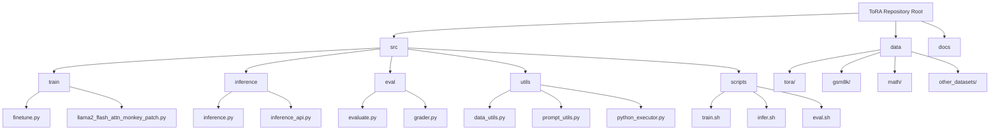
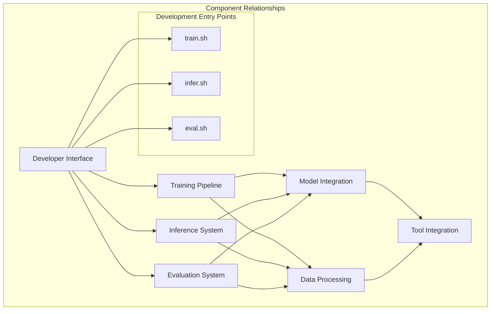
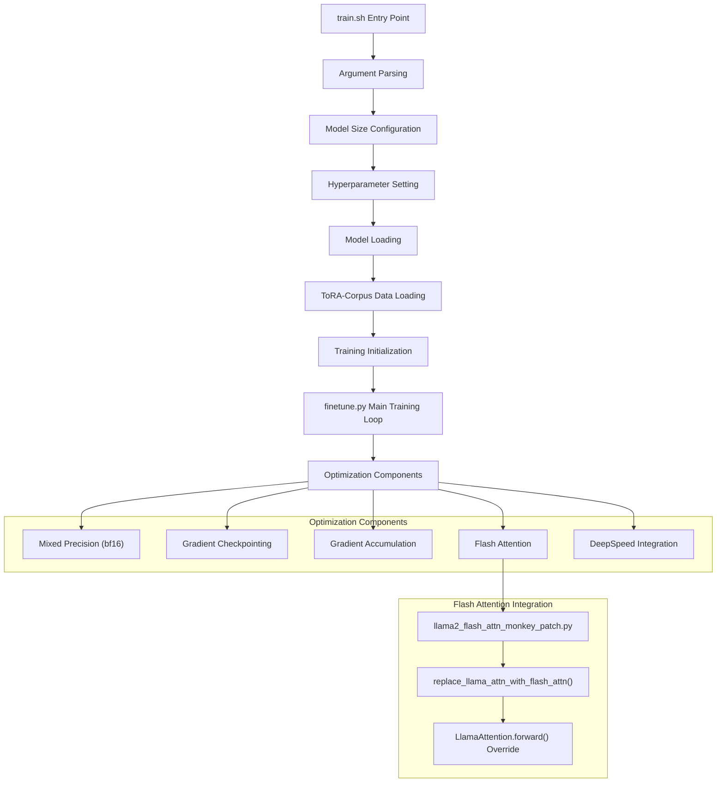
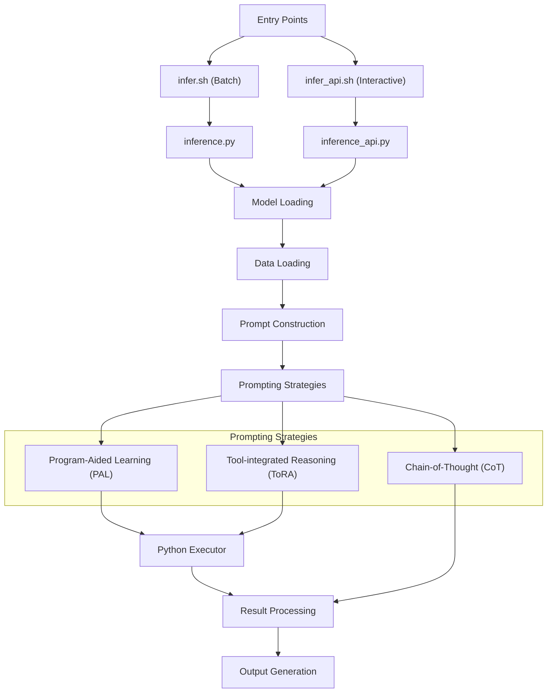
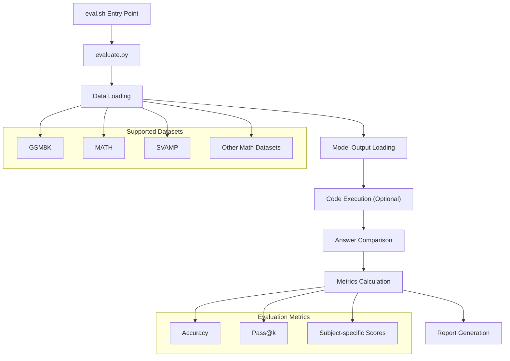
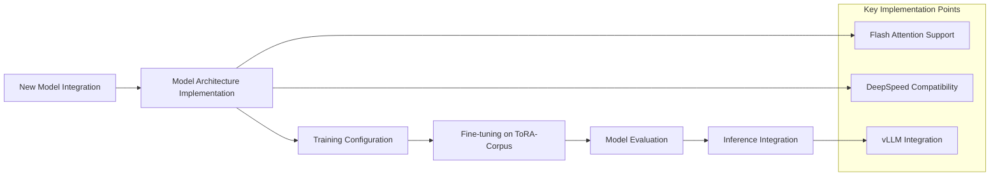
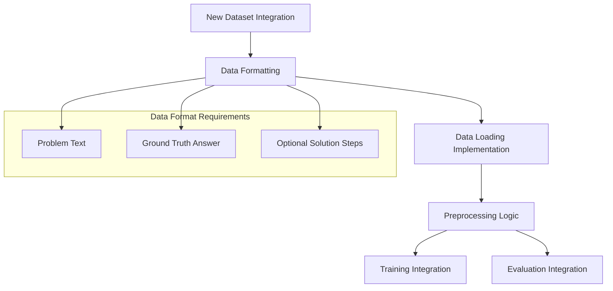
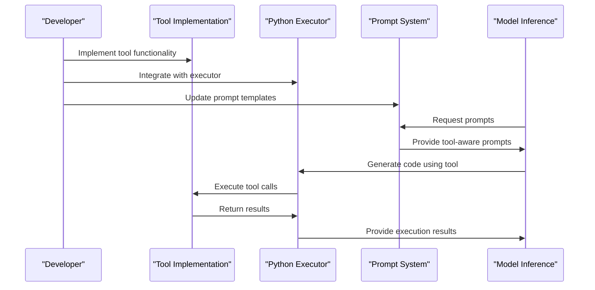

<!-- source: DeepWiki mcp.deepwiki.com · repo microsoft/ToRA · page 6 Developer Guide · fetched 2026-10-26 -->

# Developer Guide

<details>
<summary>Relevant source files</summary>

The following files were used as context for generating this wiki page:

- [.gitignore](.gitignore)
- [README.md](README.md)
- [src/requirements.txt](src/requirements.txt)
- [src/scripts/eval.sh](src/scripts/eval.sh)
- [src/train/llama2_flash_attn_monkey_patch.py](src/train/llama2_flash_attn_monkey_patch.py)

</details>


This guide provides essential information for developers who want to contribute to or extend the ToRA repository. It covers the repository structure, development environment setup, core architectural components, and guidelines for extending ToRA with new models, datasets, or tools. For an overview of the ToRA system, see [Overview](#1), and for quick usage instructions, see [Quick Start Guide](#1.2).

## Repository Structure

The ToRA repository is organized into a logical structure that separates core components, utilities, scripts, and data. Understanding this structure is essential for effective development.



Sources: [README.md:1-179](), [.gitignore:1-403]()

### Key Directories and Files

| Directory/File | Description |
|----------------|-------------|
| `src/train/` | Contains training pipeline code for fine-tuning models |
| `src/inference/` | Implements vLLM-based batch inference and API-based inference |
| `src/eval/` | Houses the evaluation system for assessing model performance |
| `src/utils/` | Provides utility functions for data loading, prompt management, and Python execution |
| `src/scripts/` | Contains shell scripts for running training, inference, and evaluation |
| `data/` | Stores datasets for training and evaluation |
| `requirements.txt` | Lists all dependencies required to run the codebase |

Sources: [README.md:90-126](), [src/requirements.txt:1-35]()

## Development Environment Setup

To set up your development environment for ToRA, follow these steps:

1. Clone the repository:
   ```bash
   git clone https://github.com/microsoft/ToRA.git && cd ToRA/src
   ```

2. Create and activate a conda environment:
   ```bash
   conda create -n tora python=3.10
   conda activate tora
   ```

3. Install dependencies:
   ```bash
   pip install packaging==22.0
   pip install torch==2.0.1 --index-url https://download.pytorch.org/whl/cu118 # CUDA 11.8
   pip install -r requirements.txt
   ```

### Critical Dependencies

ToRA has several critical dependencies that developers should be aware of:

- **vLLM (Version <= 0.1.4)**: For efficient batch inference
- **Flash Attention**: For optimized attention computation
- **DeepSpeed**: For distributed training
- **Transformers**: For model architectures
- **sympy**: For symbolic mathematics execution
- **CUDA-compatible PyTorch**: Required for GPU acceleration

Sources: [README.md:90-101](), [src/requirements.txt:1-35]()

## Core Components Architecture

The ToRA system consists of three main components: the Training Pipeline, the Inference System, and the Evaluation System. These components interact with models, utilities, and data sources.



Sources: [README.md:49-77]()

### Training Pipeline Architecture

The training pipeline is responsible for fine-tuning models on mathematical problem-solving tasks. It uses distributed training with DeepSpeed and incorporates various optimization techniques.



Sources: [src/train/llama2_flash_attn_monkey_patch.py:1-241](), [README.md:79-86]()

### Inference System Architecture

The inference system provides two main entry points: a vLLM-based pipeline for batch inference and an API-based pipeline for interactive inference. It supports different prompting techniques, including Chain-of-Thought (CoT), Program-Aided Learning (PAL), and Tool-integrated Reasoning (ToRA).



Sources: [README.md:106-108]()

### Evaluation System Architecture

The evaluation system assesses the performance of ToRA models on mathematical reasoning tasks. It supports multiple datasets and provides various metrics for evaluation.



Sources: [README.md:110-126](), [src/scripts/eval.sh:1-8]()

## Extending ToRA

ToRA is designed to be extensible in several ways: adding new models, integrating new datasets, and developing custom tools.

### Adding New Models

To add a new model to ToRA, you need to:

1. Implement the model architecture or adapt an existing architecture
2. Configure the training parameters
3. Integrate the model with the inference system



Sources: [src/train/llama2_flash_attn_monkey_patch.py:1-241](), [README.md:79-86]()

### Integrating New Datasets

To integrate a new dataset with ToRA:

1. Format the dataset according to ToRA's expected format
2. Implement data loading and preprocessing functionality
3. Add evaluation metrics specific to the dataset if needed



Sources: [README.md:129-140]()

### Developing Custom Tools

ToRA's tool-integrated reasoning capability allows for the development of custom tools that can be used during problem-solving. To develop a custom tool:

1. Implement the tool functionality
2. Integrate the tool with the Python executor
3. Update the prompt templates to include the new tool



Sources: [README.md:71-77]()

## Best Practices for ToRA Development

When developing for ToRA, consider the following best practices:

### Performance Optimization

- Use Flash Attention for optimized attention computation
- Enable gradient checkpointing to reduce memory usage during training
- Configure mixed precision training (bf16/fp16) for better performance
- Utilize gradient accumulation for larger effective batch sizes

### Model Deployment

- For inference, use vLLM for optimal throughput
- Consider using model quantization for deployment on memory-constrained environments
- For large models (34B+), use tensor parallelism to distribute the model across multiple GPUs

### Debugging Tips

- Monitor memory usage during training using tools like `gpustat`
- Use `wandb` for tracking training metrics
- Check Python executor outputs carefully for runtime errors
- Validate that the tool integration is working correctly by examining intermediate outputs

## Contributing to ToRA

Contributions to ToRA are welcome. Before contributing, please:

1. Read the [Microsoft Open Source Code of Conduct](https://opensource.microsoft.com/codeofconduct)
2. Ensure that your code follows the repository's coding standards
3. Test your changes thoroughly
4. Submit a pull request with a clear description of your changes

Sources: [README.md:165-173]()

## Troubleshooting Common Issues

| Issue | Possible Solution |
|-------|-------------------|
| Out of memory during training | Reduce batch size, enable gradient checkpointing, or try a smaller model |
| Flash Attention errors | Ensure CUDA compatibility (A100 or H100 GPU), check Flash Attention version (≥ 2.1.0 needed for KV cache) |
| Python executor timeouts | Increase timeout limits, check for infinite loops in generated code |
| vLLM issues | Ensure version ≤ 0.1.4 as noted in requirements.txt |
| Evaluation discrepancies | Check grading logic, ensure ground truth format matches expected format |

Sources: [src/requirements.txt:1-35](), [src/train/llama2_flash_attn_monkey_patch.py:135-141]()

---

