# Page: Overview

# Overview

<details>
<summary>Relevant source files</summary>

The following files were used as context for generating this wiki page:

- [README.md](README.md)
- [docs/images/backprop.png](docs/images/backprop.png)
- [docs/images/compare_to_textgrad3.png](docs/images/compare_to_textgrad3.png)
- [docs/images/forward_backward.png](docs/images/forward_backward.png)
- [docs/images/platform.png](docs/images/platform.png)
- [docs/images/platform2.png](docs/images/platform2.png)

</details>


Trace is an innovative framework that extends traditional AutoDiff tools (like PyTorch) by enabling end-to-end optimization of AI systems using general feedback mechanisms. Unlike standard deep learning frameworks that rely solely on differentiable loss functions, Trace can optimize systems using natural language feedback, numerical rewards, compiler errors, and other diverse signals.

This page provides a high-level introduction to Trace, its key components, and how they work together. For more detailed information on specific components like the Node System or Optimizers, please refer to their dedicated wiki pages.

## Core Architecture

Trace consists of three main components that work together to enable AI systems that can learn from general feedback:

Title: Core Architecture of Trace

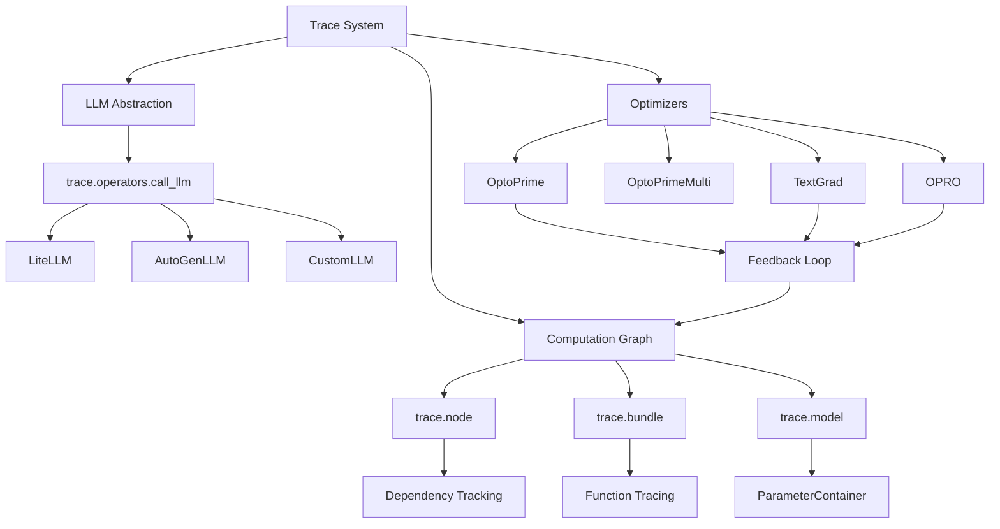

Sources: [README.md:12-16](), [README.md:56-58](), [README.md:231-254]()

The architecture consists of:

1. **Computation Graph**: The foundation for tracing execution and dependencies through nodes, bundles, and models
2. **Optimizers**: Algorithms that use feedback to improve code and parameters
3. **LLM Abstraction**: A unified interface for working with different LLM backends

Each component plays a critical role in enabling the optimization of AI systems with diverse feedback signals.

## Key Primitives

Trace provides three fundamental primitives that allow users to define traceable and optimizable components:

### Node

A `node` is the basic unit in the computation graph. It represents a value or object whose operations are automatically traced to create dependencies.

```python
from opto.trace import node

x = node(1, trainable=True)  # Declare a trainable node
y = node(3)                  # Declare a non-trainable node
z = x / y                    # Operation is traced automatically
```

### Bundle

A `bundle` is a decorator that wraps Python functions, making them traceable and optimizable while maintaining their original behavior.

```python
from opto.trace import bundle

@bundle(trainable=True)
def strange_sort_list(lst):
    '''Strange sorting starts with minimum value, then maximum, then minimum again...'''
    lst = sorted(lst)
    return lst
```

### Model

A `model` decorator transforms classes into parameter containers, similar to PyTorch modules, with methods for parameter management.

```python
from opto.trace import model

@model
class Agent:
    def __init__(self, system_prompt):
        self.system_prompt = system_prompt
        self.instruct1 = node("Decide the language", trainable=True)
```

Sources: [README.md:59-76](), [README.md:88-104](), [README.md:148-176]()

## Optimization Flow

The Trace framework enables a cyclical optimization process where feedback drives improvements:

Title: Trace Data Flow

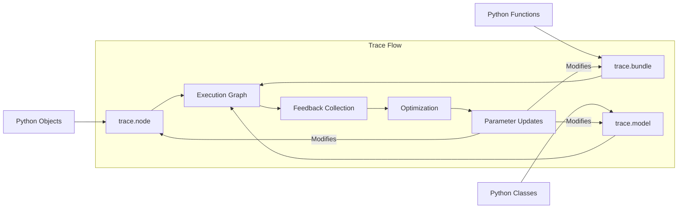

The process works as follows:

1. **Trace Creation**: Python objects, functions, and classes are transformed into nodes, bundles, and models
2. **Execution Graph**: These elements form a computation graph capturing dependencies
3. **Feedback Loop**: Execution results are evaluated with feedback
4. **Optimization**: Optimizers use feedback to update parameters and code
5. **Continuous Improvement**: The cycle repeats, improving performance over time

Sources: [README.md:105-139]()

## Supported Optimizers

Trace includes multiple optimizers, each with specific strengths:

Title: Optimizer Comparison

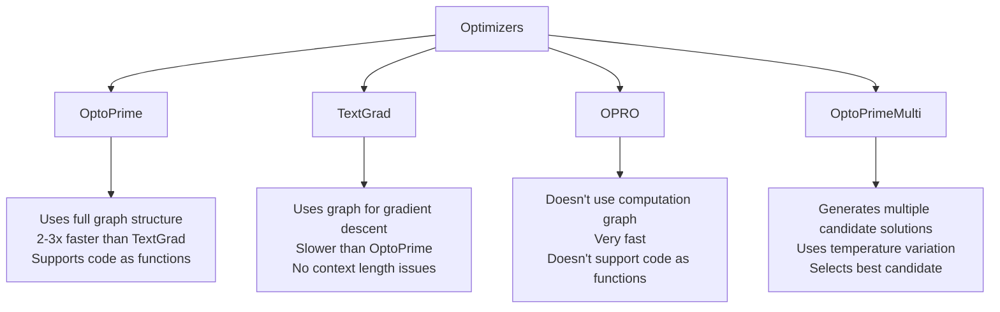

### Optimizer Comparison Table

| Optimizer | Uses Computation Graph | Supports Code as Functions | Speed | Large Graph Support |
|-----------|------------------------|----------------------------|-------|-------------------|
| OptoPrime | ✅ | ✅ | Fast | May have context length issues |
| TextGrad | ✅ | ❌ | Slower (2-3x) | Better with large graphs |
| OPRO | ❌ | ❌ | Very Fast | ✅ |
| OptoPrimeMulti | ✅ | ✅ | Fast | Similar to OptoPrime |

To use an optimizer:

```python
from opto.optimizers import OptoPrime

optimizer = OptoPrime(agent.parameters())
optimizer.zero_feedback()
optimizer.backward(result, feedback)
optimizer.step()
```

Sources: [README.md:231-264](), [README.md:123-139]()

## LLM Integration

Trace seamlessly integrates with different LLM backends through a unified interface:

Title: LLM Backend Integration

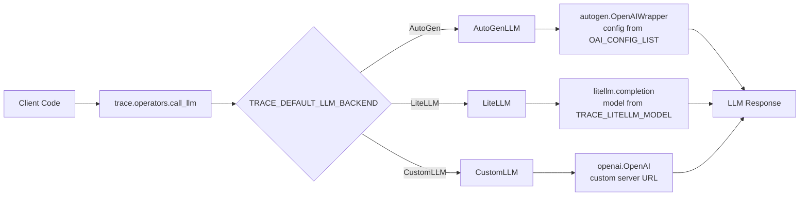

### Configuration Options

1. **LiteLLM Configuration** (Default since v0.1.3.5):
   ```python
   import os
   os.environ["OPENAI_API_KEY"] = "<your OpenAI API key here>"
   os.environ["TRACE_LITELLM_MODEL"] = "gpt-4o"
   ```

2. **AutoGen Configuration**:
   ```python
   # Install with: pip install trace-opt[autogen]
   os.environ["OAI_CONFIG_LIST"] = "/path/to/config/file"
   os.environ["TRACE_DEFAULT_LLM_BACKEND"] = "AutoGen"
   ```

Sources: [README.md:278-332]()

## Applications and Use Cases

Trace has been successfully applied to diverse domains:

Title: Application Integration Examples

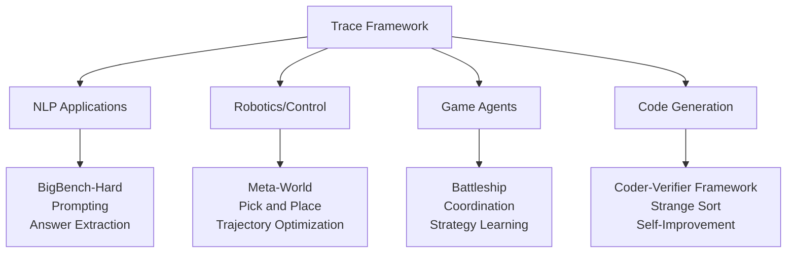

### Example: Adaptive Sales Agent

```python
@trace.model
class Agent:
    def __init__(self, system_prompt):
        self.system_prompt = system_prompt
        self.instruct1 = trace.node("Decide the language", trainable=True)
        self.instruct2 = trace.node("Extract name if it's there", trainable=True)

    def __call__(self, user_query):
        response = trace.operators.call_llm(self.system_prompt,
                                            self.instruct1, user_query)
        en_or_es = self.decide_lang(response)
        user_name = trace.operators.call_llm(self.system_prompt,
                                             self.instruct2, user_query)
        greeting = self.greet(en_or_es, user_name)
        return greeting

    @trace.bundle(trainable=True)
    def decide_lang(self, response):
        """Map the language into a variable"""
        return

    @trace.bundle(trainable=True)
    def greet(self, lang, user_name):
        """Produce a greeting based on the language"""
        greeting = "Hola"
        return f"{greeting}, {user_name}!"
```

This agent can learn to improve its language detection and greeting based on feedback from interactions.

Sources: [README.md:148-176](), [README.md:221-229]()

## Installation and Setup

To get started with Trace:

```bash
pip install trace-opt  # Basic installation
pip install trace-opt[autogen]  # With AutoGen support
```

Trace requires Python >= 3.9 and optionally needs API keys for the LLM backends you intend to use.

Sources: [README.md:24-37]()

## Summary of Key Features

Trace provides a flexible framework for creating self-adapting AI agents using general feedback mechanisms:

1. **Computational Graph Tracing**: Automatically captures execution flow and dependencies
2. **Multiple Optimizers**: Different optimization strategies for various use cases
3. **LLM Abstraction**: Unified interface for working with different LLM backends
4. **Parameter Management**: Hierarchical organization of trainable parameters
5. **Error Handling**: Detailed error reporting for debugging and optimization
6. **Flexibility**: Can be applied to diverse domains from NLP to robotics

The system's design enables end-to-end optimization of AI systems using general feedback, going beyond traditional supervised learning approaches. The compositional nature allows for building complex, adaptive systems that can learn from environment feedback.

Sources: [README.md:5-18](), [README.md:221-264]()

---

# Page: Core Architecture

# Core Architecture

<details>
<summary>Relevant source files</summary>

The following files were used as context for generating this wiki page:

- [README.md](README.md)
- [docs/_toc.yml](docs/_toc.yml)
- [docs/images/backprop.png](docs/images/backprop.png)
- [docs/images/compare_to_textgrad3.png](docs/images/compare_to_textgrad3.png)
- [docs/images/forward_backward.png](docs/images/forward_backward.png)
- [docs/images/platform.png](docs/images/platform.png)
- [docs/images/platform2.png](docs/images/platform2.png)
- [docs/intro.md](docs/intro.md)
- [docs/quickstart/installation.md](docs/quickstart/installation.md)
- [docs/quickstart/virtualhome.md](docs/quickstart/virtualhome.md)
- [opto/trace/bundle.py](opto/trace/bundle.py)
- [opto/trace/nodes.py](opto/trace/nodes.py)
- [opto/trace/operators.py](opto/trace/operators.py)
- [tests/unit_tests/test_asyncio.py](tests/unit_tests/test_asyncio.py)
- [tests/unit_tests/test_nodes.py](tests/unit_tests/test_nodes.py)

</details>


This document provides a comprehensive overview of the Trace system's core architecture, explaining its primary components and how they interact. It describes the fundamental building blocks that enable end-to-end generative optimization for AI agents through the capture and optimization of execution traces.

For details about specific subsystems, see the [Node System](#2.1), [Bundle System](#2.2), and [Model and Parameter Management](#2.3). For information about the optimization framework, see [Optimizers](#3).

## System Overview

Trace is designed as a minimal, pure Python implementation that allows users to trace and optimize arbitrary computation through a graph-based representation. It provides an autodiff-like mechanism that extends beyond numerical calculations to encompass general computation, including code execution and LLM interactions.

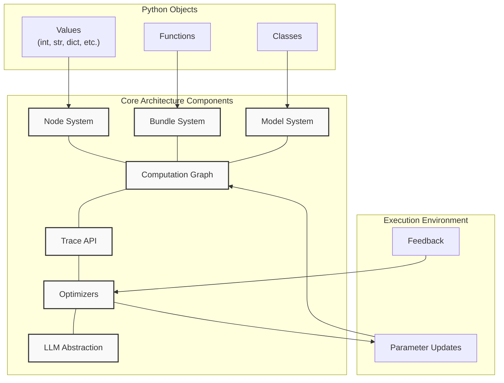

*Diagram: High-level overview of Trace architecture and component relationships*

Sources: [README.md:13-17](), [opto/trace/nodes.py:10-52](), [opto/trace/bundle.py:28-70]()

The core architecture consists of three primary components:

1. **Node System**: Represents values and their relationships in a computation graph
2. **Bundle System**: Wraps functions to track their execution and dependencies
3. **Model System**: Manages hierarchical parameters and module structures

These components work together to construct a comprehensive computation graph that captures the execution trace of a program, which optimizers can then use to improve the system based on feedback.

## Computation Graph

The computation graph is the central data structure that captures the execution flow and dependencies in a Trace program. It is implemented as a Directed Acyclic Graph (DAG) where nodes represent values and edges represent data dependencies.

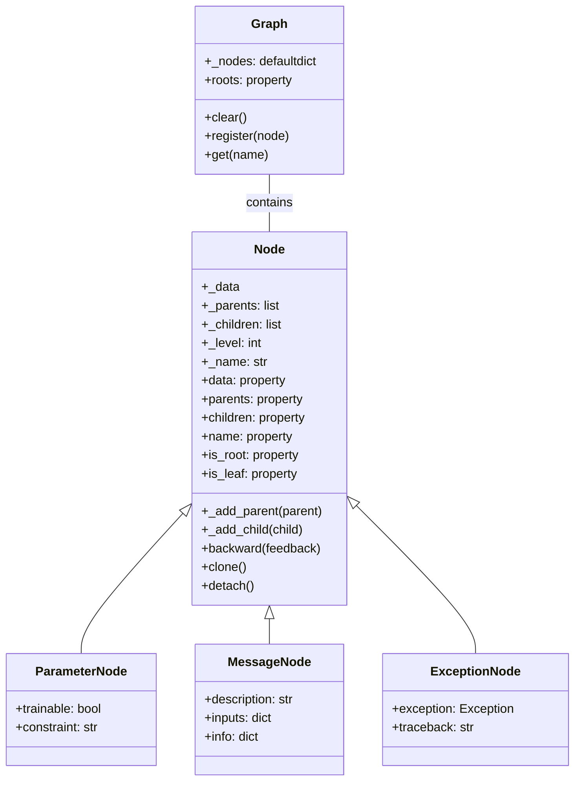

*Diagram: Core data structures in the computation graph*

Sources: [opto/trace/nodes.py:58-154](), [opto/trace/nodes.py:174-492]()

The Graph class serves as a global registry for all nodes, maintaining their relationships and enabling traversal for optimization. The three specialized node types serve distinct purposes:

- **ParameterNode**: Represents trainable parameters that can be modified by optimizers
- **MessageNode**: Captures function outputs and their dependencies
- **ExceptionNode**: Represents exceptions that occur during execution

## Node System

The Node system is the foundation of Trace, providing a way to wrap Python values in traceable objects. It allows the system to record operations and dependencies between values.

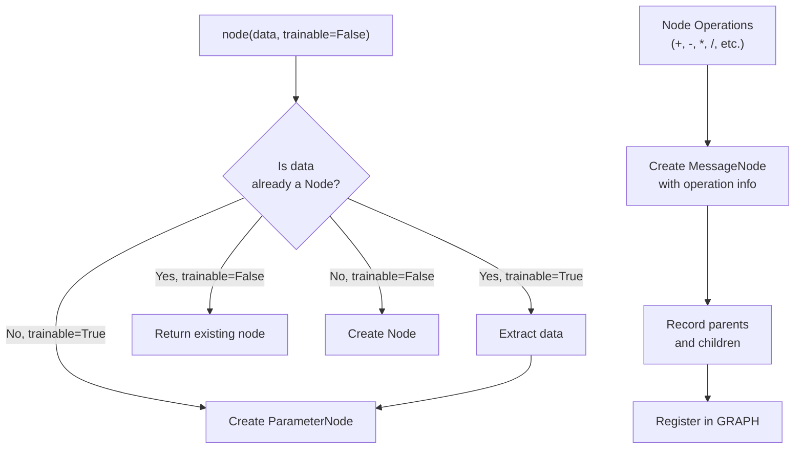

*Diagram: Node creation and operation flow*

Sources: [opto/trace/nodes.py:10-52](), [opto/trace/operators.py:11-600]()

The `node()` function is the primary entry point for creating nodes:

```python
node(data, name=None, trainable=False, description=None, constraint=None)
```

When operations are performed on nodes, they:
1. Automatically create new nodes to represent the result
2. Record parent-child relationships
3. Register the new nodes in the global graph

## Bundle System

The Bundle system wraps Python functions to make them traceable, allowing Trace to capture function execution and dependencies.

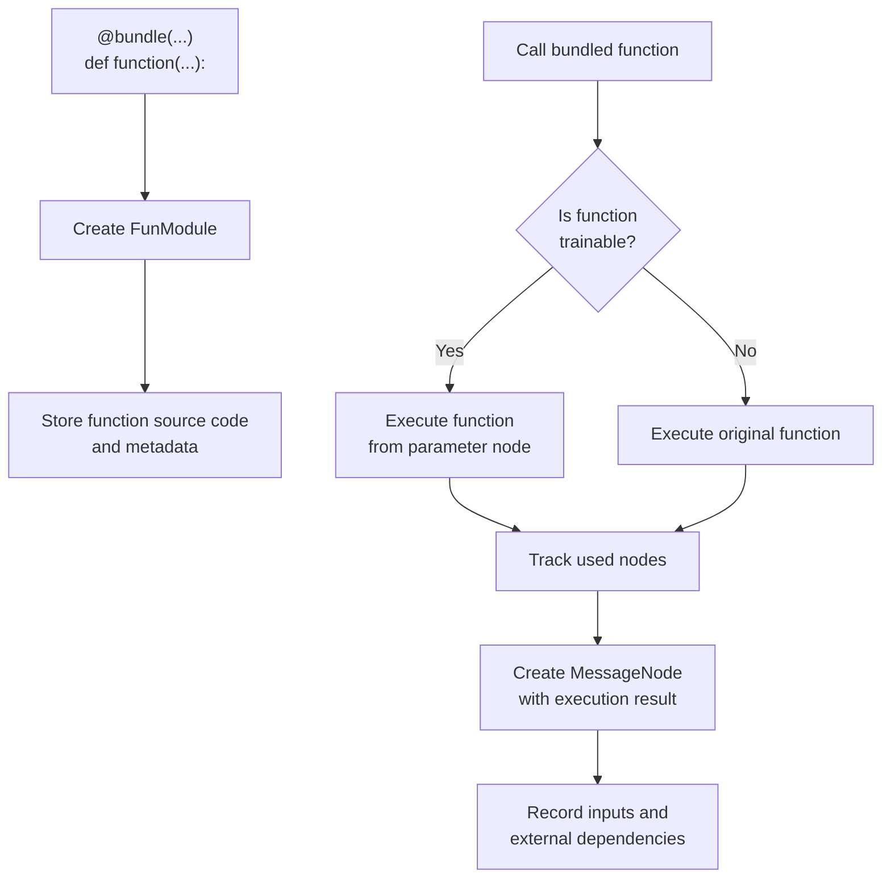

*Diagram: Bundle function creation and execution flow*

Sources: [opto/trace/bundle.py:28-70](), [opto/trace/bundle.py:85-762]()

The `bundle()` decorator transforms functions into `FunModule` objects that:
1. Capture the function's source code and metadata
2. Track which nodes are used during execution
3. Create message nodes to represent function outputs
4. Record dependencies between inputs and outputs

If a function is marked as trainable, its code becomes a parameter that optimizers can modify.

## Model and Parameter Management

The Model system provides a way to organize parameters hierarchically and manage complex parameter structures.

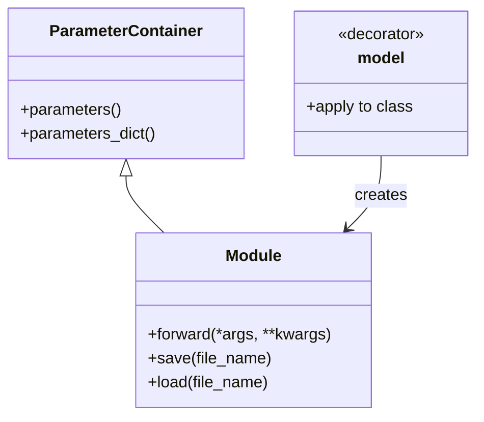

*Diagram: Model and parameter management classes*

Sources: [opto/trace/bundle.py:85-95]()

The Model system enables:
1. Organization of parameters in a hierarchical structure
2. Easy access to all parameters for optimization
3. Serialization and deserialization of models
4. Object-oriented parameter management

## Execution Flow

Trace's execution flow involves building a computation graph during forward execution and then using that graph for optimization during backward propagation.

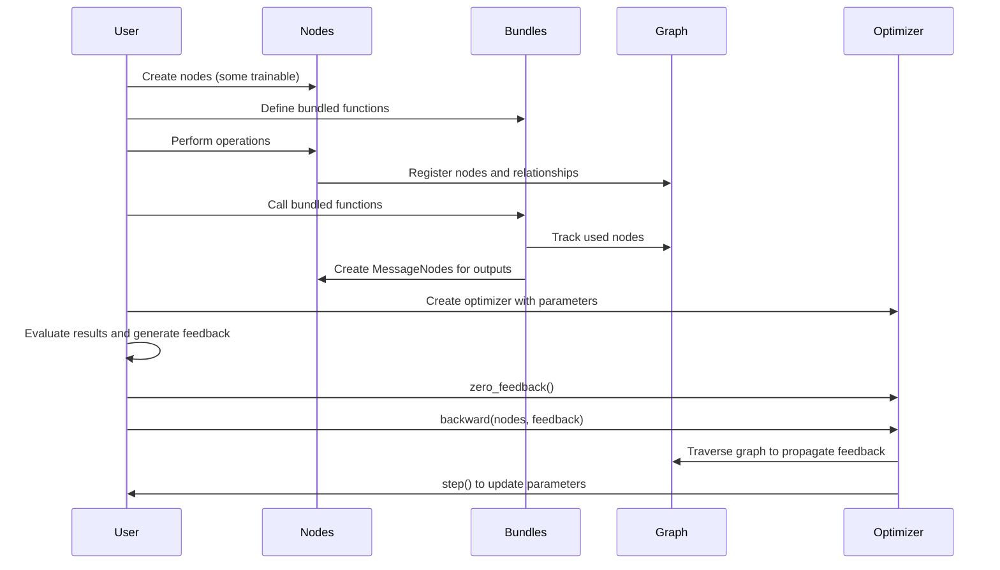

*Diagram: Execution flow from node creation to optimization*

Sources: [README.md:78-139](), [opto/trace/bundle.py:523-559]()

The process follows these general steps:
1. **Declaration**: Users create nodes and bundle functions to define the computational structure
2. **Forward Execution**: The system records the execution trace as operations are performed
3. **Feedback Collection**: External evaluation provides feedback on the execution result
4. **Optimization**: Optimizers use the feedback to improve parameters

## Integration with LLMs

Trace provides built-in integration with Language Models through a standardized abstraction layer.

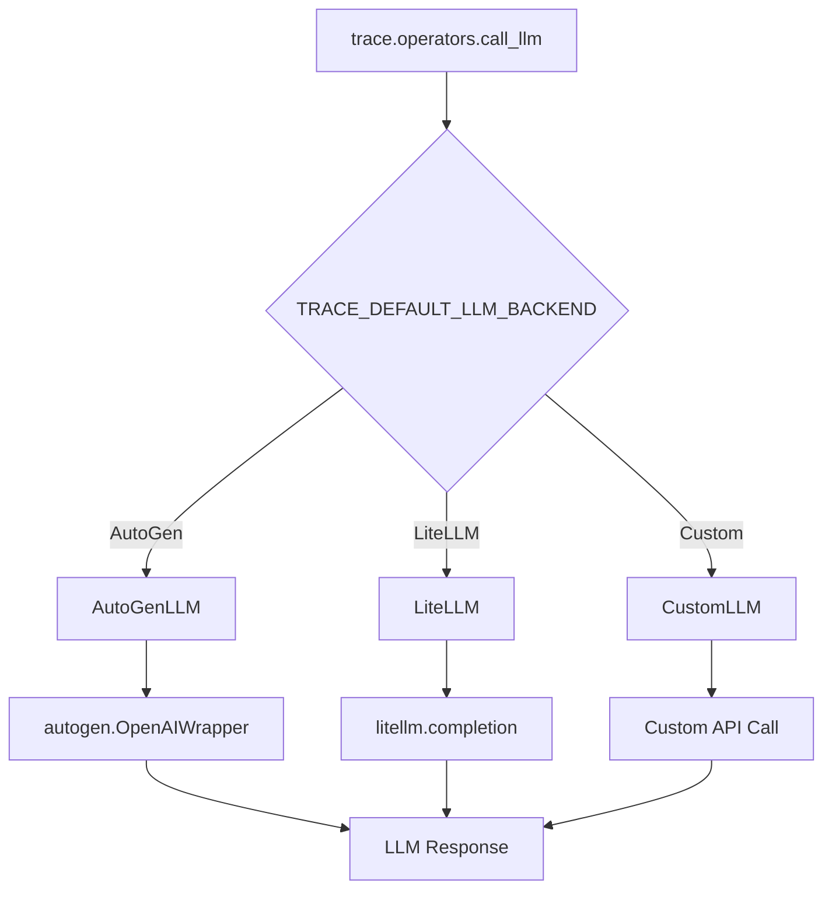

*Diagram: LLM integration architecture*

Sources: [README.md:277-332](), [opto/trace/operators.py:592-600]()

The LLM integration:
1. Provides a unified interface through `call_llm`
2. Supports multiple backends (LiteLLM, AutoGen, custom)
3. Handles configuration through environment variables
4. Abstracts away the details of different LLM APIs

## Optimization Framework

Trace's optimization framework uses the computation graph to propagate feedback and improve parameters. It connects to the core architecture through the optimizers that traverse the graph.

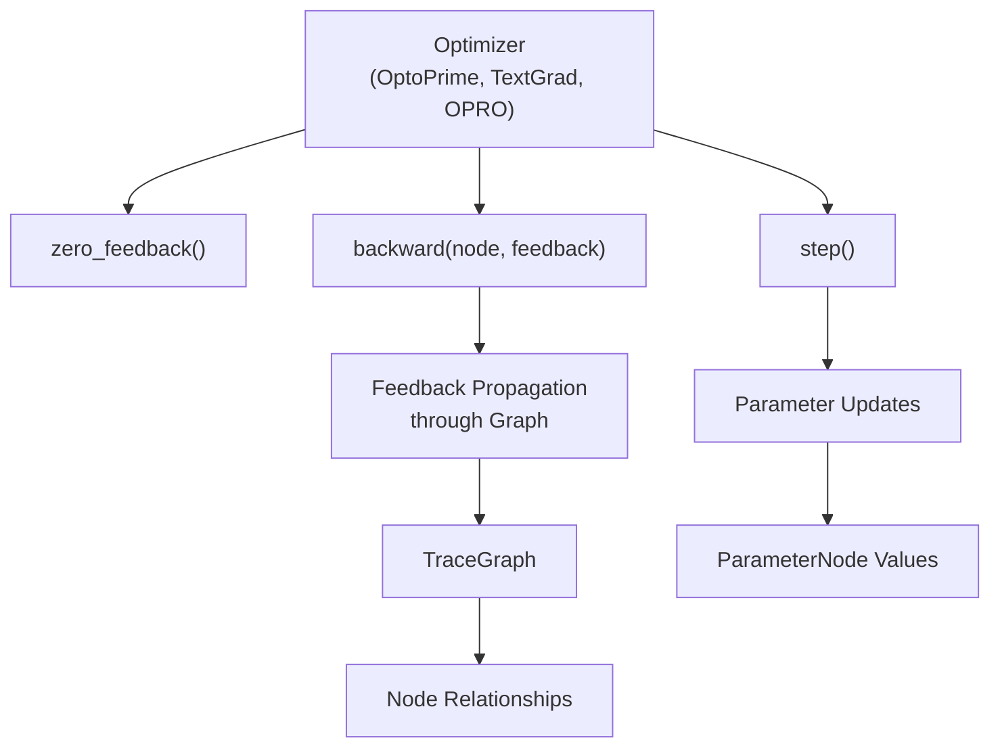

*Diagram: Optimization framework relationship to core architecture*

Sources: [README.md:231-264]()

The optimization framework:
1. Uses the computation graph to propagate feedback
2. Updates trainable parameters based on feedback
3. Supports different optimization strategies through pluggable optimizers
4. Provides a PyTorch-like API for familiar usage

## API Design

Trace's API design is influenced by PyTorch's Autograd, providing a familiar interface for machine learning practitioners.

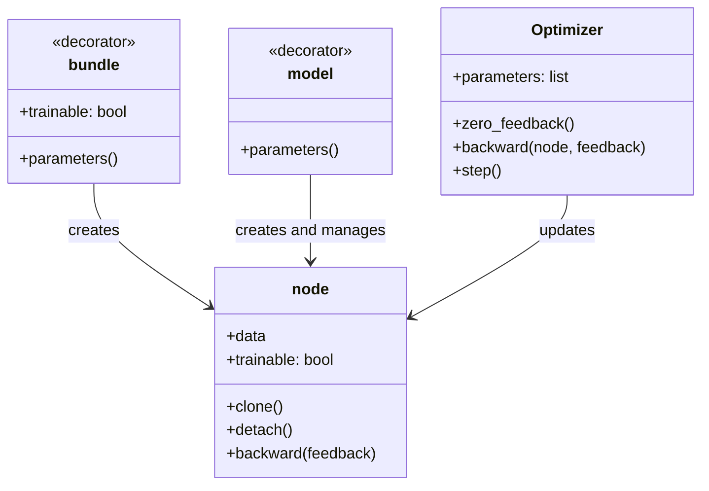

*Diagram: API design and relationships between key concepts*

Sources: [README.md:54-77](), [README.md:148-179]()

Trace provides a minimal and intuitive API:
1. `node()` creates traceable variables
2. `@bundle` decorates functions to make them traceable
3. `@model` decorates classes to organize parameters
4. Optimizers provide a familiar `zero_feedback()`, `backward()`, `step()` pattern

## Summary

The core architecture of Trace consists of interrelated systems for tracing computation, constructing execution graphs, and optimizing parameters based on feedback. The Node system provides the foundational value representation, the Bundle system captures function execution, and the Model system organizes parameters hierarchically. These components work together to enable end-to-end optimization of AI systems using general feedback mechanisms.

The architecture is designed to be minimal and intuitive, with an API inspired by PyTorch's Autograd, making it accessible to machine learning practitioners while extending beyond traditional numerical differentiation to encompass general computation, including code execution and LLM interactions.

---

# Page: Node System

# Node System

<details>
<summary>Relevant source files</summary>

The following files were used as context for generating this wiki page:

- [opto/trace/nodes.py](opto/trace/nodes.py)
- [opto/trace/operators.py](opto/trace/operators.py)
- [opto/trace/propagators/graph_propagator.py](opto/trace/propagators/graph_propagator.py)
- [tests/unit_tests/test_dependencies.py](tests/unit_tests/test_dependencies.py)
- [tests/unit_tests/test_nodes.py](tests/unit_tests/test_nodes.py)

</details>


The Node System is the foundational layer of the Microsoft Trace framework that implements a computational graph structure through connected node objects. It provides the building blocks for creating, tracking, and manipulating data dependencies within computation flows, enabling tracing of operations and propagation of feedback across the graph.

For information about how these nodes are used within functions, see [Bundle System](#2.2). For how nodes are organized into models, see [Model and Parameter Management](#2.3).

## Introduction to the Node System

The Node System implements a directed acyclic graph (DAG) structure where each node represents a piece of data and its relationship to other data within a computation. This graph structure enables several key capabilities:

1. **Dependency Tracking**: Automatically tracks which nodes depend on which parameters
2. **Computation Tracing**: Records the lineage of operations applied to data
3. **Feedback Propagation**: Allows optimization signals to flow backward through the graph
4. **Constraint Management**: Nodes can have constraints that describe valid values

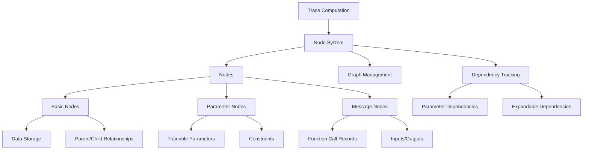

Sources: [opto/trace/nodes.py:1-754]()

## Core Components of the Node System

The Node System consists of several interconnected components:

### Node Class Hierarchy

The node system follows an inheritance hierarchy that enables specialized behavior while maintaining common functionality.

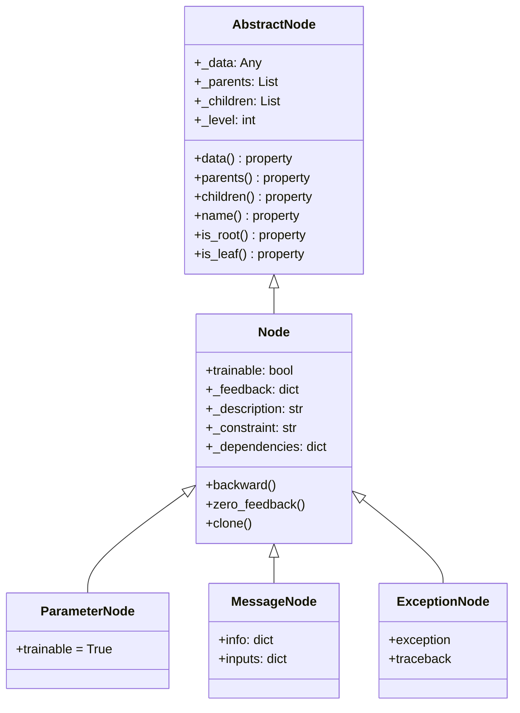

Sources: [opto/trace/nodes.py:174-753](), [opto/trace/nodes.py:753-2225]()

### Graph Management

The `Graph` class serves as a global registry of all nodes, forming the backbone of the node system.

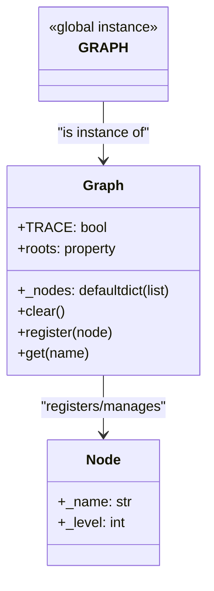

Sources: [opto/trace/nodes.py:58-165]()

## Node Creation and Usage

Nodes are typically created using the `node()` function, which creates appropriate node objects based on the provided parameters.

The basic pattern for node creation is:

```python
from opto.trace import node

# Create basic nodes
x = node("Hello")
y = node(42)

# Create trainable parameter nodes
p = node(0.5, trainable=True)

# Create nodes with descriptions and constraints
c = node([1, 2, 3], 
         description="A list of numbers", 
         constraint="All elements must be positive integers")
```

The `node()` function intelligently handles different input types:

| Input Type | Trainable | Result |
|------------|-----------|--------|
| Regular data | False | Regular Node |
| Regular data | True | ParameterNode |
| Existing Node | False | Returns original Node |
| Existing Node | True | New ParameterNode with same data |

Sources: [opto/trace/nodes.py:10-52](), [tests/unit_tests/test_nodes.py:1-162]()

### Working with Nodes

Nodes support various operations through direct usage of Python operators or the bundled operators in the `operators.py` file.

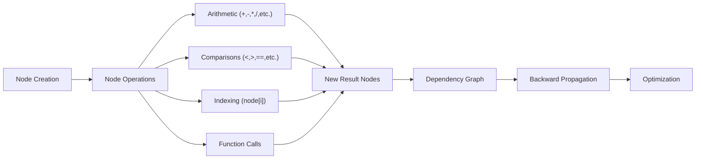

Sources: [opto/trace/operators.py:1-600](), [tests/unit_tests/test_nodes.py:1-162]()

## Dependency Tracking

A key feature of the Node System is its ability to track dependencies between nodes, which is essential for the optimization process.

### Types of Dependencies

The Node System tracks two main types of dependencies:

1. **Parameter Dependencies**: Direct dependencies on trainable `ParameterNode` objects
2. **Expandable Dependencies**: References to nodes that depend on parameters not visible in the current graph level (typically from nested function calls)

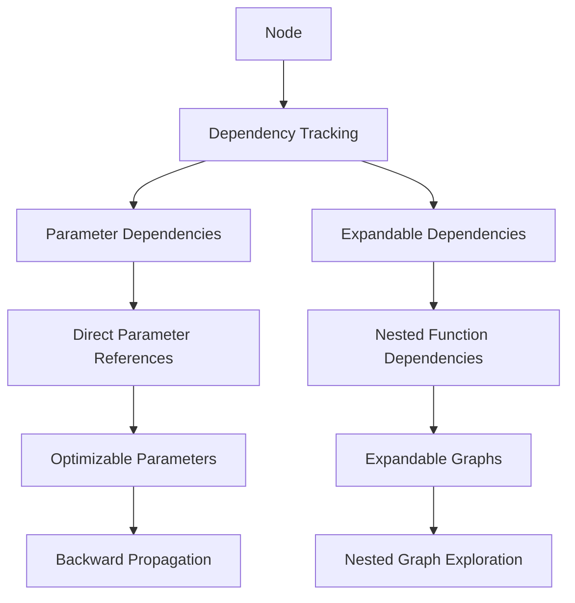

Sources: [opto/trace/nodes.py:823-875](), [tests/unit_tests/test_dependencies.py:1-127]()

### Dependency Resolution

When operations are performed on nodes, the dependencies are automatically propagated and tracked:

```python
# Example of dependency tracking
x = node(1.0, trainable=True)
y = node(2.0)
z = x**y + (x*x*x*x) + 0.5

# z has a parameter dependency on x but not on y
assert len(z.parameter_dependencies) == 1
assert x in z.parameter_dependencies
assert y not in z.parameter_dependencies
```

For nested function calls, the dependency tracking system captures relationships across different levels of the computation graph.

Sources: [tests/unit_tests/test_dependencies.py:1-20]()

## Feedback Propagation

The Node System includes a mechanism for propagating feedback backward through the graph, analogous to gradients in traditional neural networks.

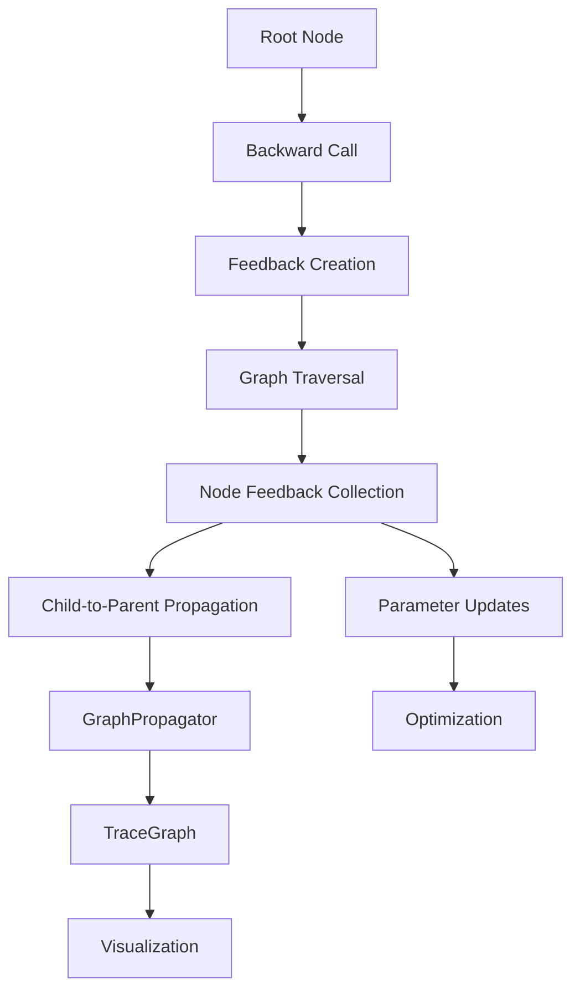

The `backward()` method on nodes initiates the feedback propagation process, which collects and processes feedback through the computation graph. This feedback drives the optimization process in the Trace framework.

Sources: [opto/trace/nodes.py:825-833](), [opto/trace/propagators/graph_propagator.py:1-154]()

## Node Types

The Node System includes several specialized node types for different purposes:

### Basic Node

A standard `Node` represents data within the computation graph and tracks relationships with other nodes.

### ParameterNode

`ParameterNode` is a specialized node type that is marked as trainable and can be optimized based on feedback. These nodes typically represent parameters that should be adjusted during optimization.

### MessageNode

`MessageNode` represents the result of a function call, storing information about the inputs, outputs, and the function that was called. This node type is central to the Bundle System that wraps functions for tracing.

### ExceptionNode

`ExceptionNode` captures exceptions that occur during computation, allowing the system to handle errors gracefully and provide useful debugging information.

Sources: [opto/trace/nodes.py:753-2225]()

## Visualization

The Node System includes utilities for visualizing the computation graph, which is valuable for debugging and understanding the relationships between nodes.

```mermaid
graph TD
    A["TraceGraph"] --> B["visualize()"]
    B --> C["Graphviz Digraph"]
    C --> D["Node Attributes"]
    D --> E["Shape"]
    D --> F["Label"]
    D --> G["Style"]
    
    H["NodeVizStyleGuide"] --> D
    I["NodeVizStyleGuideColorful"] --> H
```

Visualization can be used to:
1. Inspect the structure of the computation graph
2. Debug dependencies between nodes
3. Understand the flow of feedback during optimization

Sources: [opto/trace/nodes.py:529-751](), [opto/trace/propagators/graph_propagator.py:88-121]()

## Example Usage of the Node System

Here is a simple example showing how the Node System is used to create a computation graph and propagate feedback:

```python
from opto.trace import node
from opto.trace import operators as ops

# Create parameter and regular nodes
x = node(1.0, trainable=True, name="input")
y = node(2.0, name="constant")

# Create a computation graph
z = ops.add(x, y)
result = ops.multiply(z, z)

# Propagate feedback through the graph
result.backward("Optimize this")

# Extract the computation graph for visualization
from opto.trace.utils import sum_feedback
trace_graph = sum_feedback([x])
visualization = trace_graph.visualize()
```

This example creates a simple computation graph that computes `(x + y)²`, and then propagates feedback from the result node back to the trainable parameter `x`.

Sources: [tests/unit_tests/test_nodes.py:1-40](), [tests/unit_tests/test_dependencies.py:38-44]()

## Integration with Other Systems

The Node System forms the foundation of the Trace framework and integrates closely with other components:

1. The **Bundle System** wraps Python functions to create `MessageNode` objects that track function calls within the computation graph.
2. The **Model System** organizes parameters into hierarchical containers for structured optimization.
3. **Optimizers** use the dependency and feedback information from the Node System to update parameters.

```mermaid
graph TD
    A["Node System"] --> B["Bundle System"]
    A --> C["Model System"]
    A --> D["Optimizers"]
    
    B --> E["Function Tracing"]
    C --> F["Parameter Organization"]
    D --> G["Parameter Updates"]
    
    E --> H["MessageNode Creation"]
    F --> I["Node Hierarchies"]
    G --> J["Feedback Processing"]
    
    H --> A
    I --> A
    J --> A
```

The Node System provides the underlying data structure and tracking mechanisms that enable these higher-level systems to function effectively.

Sources: [opto/trace/nodes.py:1-2225]()

## Summary

The Node System in Microsoft Trace is a sophisticated implementation of a computational graph that:

1. Creates and manages node objects representing data and operations
2. Tracks dependencies between nodes and parameters
3. Propagates feedback through the graph for optimization
4. Supports visualization and debugging of complex computations

This system forms the foundation upon which the rest of the Trace framework is built, enabling powerful capabilities for optimization based on general feedback.

---

# Page: Bundle System

# Bundle System

<details>
<summary>Relevant source files</summary>

The following files were used as context for generating this wiki page:

- [opto/trace/bundle.py](opto/trace/bundle.py)
- [opto/trace/iterators.py](opto/trace/iterators.py)
- [tests/unit_tests/test_asyncio.py](tests/unit_tests/test_asyncio.py)
- [tests/unit_tests/test_basic_containers.py](tests/unit_tests/test_basic_containers.py)
- [tests/unit_tests/test_bundle.py](tests/unit_tests/test_bundle.py)
- [tests/unit_tests/test_python_funcs.py](tests/unit_tests/test_python_funcs.py)

</details>


## Purpose and Scope

The Bundle System is a core component of the Microsoft Trace framework that enables function tracing and builds the computation graph. It provides the `@bundle` decorator which transforms regular Python functions into traceable operations that return node objects. This is essential for both tracking dependencies between operations and enabling optimization of code through the Trace framework.

For information about the underlying Node System that Bundle builds upon, see [Node System](#2.1). For details about parameter management within bundles, see [Model and Parameter Management](#2.3).

Sources: [opto/trace/bundle.py:27-70]()

## Overview

```mermaid
graph TD
    A["Python Function"] -->|"@bundle decorator"| B["FunModule"]
    B -->|"Execution"| C["MessageNode"]
    C -->|"Dependencies"| D["Computation Graph"]
    
    E["Function Arguments"] -->|"Wrapped as nodes"| F["inputs dict"]
    G["External Variables"] -->|"Tracked via trace_nodes"| H["used_nodes set"]
    
    F --> B
    H --> B
    
    I["Error in Execution"] -->|"Caught if configured"| J["ExceptionNode"]
    
    K["Trace Optimization"] -->|"Feedback"| C
    
    style A fill:#f5f5f5,stroke:#333,stroke-width:2px
    style B fill:#f5f5f5,stroke:#333,stroke-width:2px
    style C fill:#f5f5f5,stroke:#333,stroke-width:2px
    style D fill:#f5f5f5,stroke:#333,stroke-width:2px
```

The Bundle System transforms Python functions into traceable components of a computation graph. When a function is decorated with `@bundle`, it becomes a `FunModule` that tracks its inputs, operations on node objects, and produces a `MessageNode` containing the result. This creates a structured computation graph that enables dependency tracking, error handling, and optimization.

Sources: [opto/trace/bundle.py:27-70](), [opto/trace/bundle.py:85-106]()

## The @bundle Decorator

The `@bundle` decorator is the primary entry point for the Bundle System, transforming regular Python functions into traceable components.

```python
@bundle(
    description="Example function",
    traceable_code=False,
    trainable=False,
    catch_execution_error=True,
    allow_external_dependencies=False,
    overwrite_python_recursion=False
)
def example_function(a, b):
    return a + b
```

### Key Parameters

| Parameter | Default | Description |
|-----------|---------|-------------|
| `description` | `None` | Text description of the operator (auto-generated from function name if not provided) |
| `traceable_code` | `False` | Whether the operator's code should be traced by Trace |
| `trainable` | `False` | Whether the code block should be treated as a variable in optimization |
| `catch_execution_error` | `True` | Whether to catch exceptions during operator execution |
| `allow_external_dependencies` | `False` | Whether to allow using nodes not provided as inputs |
| `overwrite_python_recursion` | `False` | Controls recursion behavior of the decorated function |

Sources: [opto/trace/bundle.py:28-70]()

## Bundle Internal Architecture

```mermaid
classDiagram
    class bundle {
        <<decorator>>
        +description
        +traceable_code
        +trainable
        +catch_execution_error
        +allow_external_dependencies
        +overwrite_python_recursion
    }
    
    class FunModule {
        -_fun
        -parameter
        -description
        -info
        +forward()
        +sync_forward()
        +async_forward()
        +fun
        +wrap()
        +trainable
        +name
    }
    
    class trace_nodes {
        <<context manager>>
        +__enter__()
        +__exit__()
    }
    
    class MessageNode {
        +data
        +description
        +inputs
        +info
    }
    
    class ExceptionNode {
        +exception
        +traceback
        +inputs
        +info
    }
    
    bundle --> FunModule: creates
    FunModule --> MessageNode: returns on success
    FunModule --> ExceptionNode: returns on error
    FunModule --> trace_nodes: uses
```

When a function is decorated with `@bundle`, it creates a `FunModule` instance that wraps the original function. When called, the `FunModule` tracks inputs and variable accesses through the `trace_nodes` context manager, and returns either a `MessageNode` containing the result or an `ExceptionNode` if an error occurs.

Sources: [opto/trace/bundle.py:85-621](), [opto/trace/bundle.py:73-82]()

## Bundle Execution Flow

```mermaid
sequenceDiagram
    participant C as Client Code
    participant B as Bundle Decorator
    participant F as FunModule
    participant G as Graph (USED_NODES)
    participant FM as Function Execution
    
    C->>B: Call decorated function
    B->>F: Create FunModule
    F->>F: Wrap inputs as nodes
    F->>G: Start trace_nodes context
    F->>FM: Execute function
    FM->>G: Track accessed nodes
    FM-->>F: Return result
    F->>G: End trace_nodes context
    F->>F: Process dependencies
    F->>F: Create MessageNode
    F-->>C: Return MessageNode
```

When a bundled function is called:
1. Inputs are wrapped as nodes
2. The `trace_nodes` context manager starts tracking node access
3. The original function is executed with processed inputs
4. Any node's data that's accessed is tracked in `USED_NODES`
5. The result is wrapped in a `MessageNode` with tracked dependencies
6. The `MessageNode` is returned to the caller

Sources: [opto/trace/bundle.py:513-559]()

## Key Components

### FunModule

The `FunModule` class is the core implementation of bundled functions. It's a subclass of `Module` that handles:

1. Wrapping function inputs and outputs as nodes
2. Tracking variable dependencies during execution
3. Handling errors with detailed context
4. Supporting both synchronous and asynchronous functions
5. Managing trainable code parameters

```python
# General structure of how FunModule works
fun_module = FunModule(
    fun=original_function,
    description=description,
    trainable=trainable,
    # other parameters...
)
result = fun_module(*args, **kwargs)  # Returns a MessageNode
```

Sources: [opto/trace/bundle.py:85-621]()

### trace_nodes Context Manager

The `trace_nodes` context manager tracks which nodes have their data attribute accessed during function execution:

```python
with trace_nodes() as used_nodes:
    # Any node.data access here gets recorded in used_nodes
    result = function(*args, **kwargs)
```

This allows the Bundle System to automatically identify and track dependencies between nodes, even when they're not explicitly passed as arguments.

Sources: [opto/trace/bundle.py:73-82]()

## Trainable Bundles

One of the powerful features of the Bundle System is its ability to make function implementations trainable:

```mermaid
graph TD
    A["@bundle(trainable=True)"] -->|"Decorates"| B["Python Function"]
    B -->|"Creates"| C["FunModule with parameter"]
    C -->|"Stores"| D["ParameterNode('__code')"]
    D -->|"Contains"| E["Function Source Code"]
    F["Optimization"] -->|"Modifies"| E
    E -->|"Evaluated via"| G["exec()"]
    G -->|"Creates callable"| H["Executed Function"]
    H -->|"Produces"| I["MessageNode"]
    
    style A fill:#f5f5f5,stroke:#333,stroke-width:2px
    style D fill:#f5f5f5,stroke:#333,stroke-width:2px
    style E fill:#f5f5f5,stroke:#333,stroke-width:2px
    style I fill:#f5f5f5,stroke:#333,stroke-width:2px
```

When a bundle is marked as trainable:
1. The function's source code is stored in a `ParameterNode` named `__code`
2. When called, the code in this parameter is executed via Python's `exec()`
3. Optimizers can modify the source code in this parameter
4. Errors during execution are captured with detailed context for debugging

This allows optimizers to modify the actual code inside functions, not just parameters.

Sources: [opto/trace/bundle.py:156-173](), [opto/trace/bundle.py:176-235]()

## Error Handling

The Bundle System provides detailed error handling that helps both developers and optimizers:

```mermaid
graph LR
    A["Error in Function"] -->|"Caught by"| B["FunModule.sync_call_fun"]
    B -->|"Processes via"| C["_construct_error_comment"]
    C -->|"Creates"| D["ExceptionNode"]
    D -->|"Includes"| E["Commented Source"]
    D -->|"Includes"| F["Line Number"]
    D -->|"Includes"| G["Full Traceback"]
    D -->|"Wrapped in"| H["ExecutionError"]
    H -->|"Raised to"| I["Caller"]
    
    style A fill:#f5f5f5,stroke:#333,stroke-width:2px
    style D fill:#f5f5f5,stroke:#333,stroke-width:2px
    style H fill:#f5f5f5,stroke:#333,stroke-width:2px
```

When an error occurs inside a bundled function:
1. The error is caught (if `catch_execution_error=True`)
2. Detailed context about the error is collected, including:
   - Commented source code indicating the error location
   - The error type and message
   - A full traceback
3. An `ExceptionNode` is created containing this information
4. The `ExceptionNode` is wrapped in an `ExecutionError` and raised

This provides rich context for both debugging and optimization.

Sources: [opto/trace/bundle.py:364-412](), [opto/trace/bundle.py:423-430]()

## Asynchronous Function Support

The Bundle System supports asynchronous functions with dedicated handling:

```python
@bundle()
async def fetch_data(url):
    response = await some_async_operation(url)
    return response

# Usage
result_node = await fetch_data(url_node)
```

The system automatically detects if a function is a coroutine function and uses either `sync_forward` or `async_forward` appropriately. This ensures proper tracing and dependency tracking for asynchronous code.

Sources: [opto/trace/bundle.py:513-559](), [tests/unit_tests/test_asyncio.py:1-100]()

## Integration with Node System

The Bundle System integrates deeply with the Node System:

```mermaid
graph TD
    A["Bundle System"] -->|"Creates"| B["MessageNode"]
    B -->|"Contains"| C["Data (Function Result)"]
    B -->|"References"| D["Input Nodes"]
    B -->|"Has"| E["Name from Description"]
    
    F["Node.data Access"] -->|"Tracked by"| G["trace_nodes Context"]
    G -->|"Records in"| H["USED_NODES List"]
    H -->|"Used to build"| I["Dependencies in MessageNode"]
    
    J["External Node Access"] -->|"Detected via"| K["allow_external_dependencies"]
    K -->|"If False"| L["TraceMissingInputsError"]
    K -->|"If True"| M["Nodes recorded in external_dependencies"]
    
    style A fill:#f5f5f5,stroke:#333,stroke-width:2px
    style B fill:#f5f5f5,stroke:#333,stroke-width:2px
    style H fill:#f5f5f5,stroke:#333,stroke-width:2px
```

Key integration points:
1. Input arguments are automatically wrapped as nodes
2. Access to node.data is tracked during function execution
3. The function result is wrapped in a MessageNode
4. Dependencies between nodes are automatically established
5. External dependencies can be allowed or restricted

Sources: [opto/trace/bundle.py:244-328](), [opto/trace/bundle.py:455-511]()

## Common Use Cases

### Basic Function Wrapping

```python
from opto.trace import bundle, node

@bundle(description="Add two numbers")
def add(x, y):
    return x + y

x = node(1)
y = node(2)
z = add(x, y)  # z is a MessageNode with x and y as parents
```

Sources: [tests/unit_tests/test_bundle.py:33-43]()

### Class Methods

```python
from opto.trace import bundle, node

class Calculator:
    @bundle(description="Multiply two numbers")
    def multiply(self, x, y):
        return x * y

calc = Calculator()
x = node(3)
y = node(4)
z = calc.multiply(x, y)  # z is a MessageNode with x, y, and self_node as parents
```

Sources: [tests/unit_tests/test_bundle.py:74-83]()

### External Dependencies

```python
from opto.trace import bundle, node

external_var = node(10)

@bundle(allow_external_dependencies=True)
def process(x, y):
    # Using a node not passed as an argument
    return x + y + external_var.data

x = node(1)
y = node(2)
z = process(x, y)  # z depends on x, y, and external_var is tracked
```

Sources: [tests/unit_tests/test_bundle.py:250-260]()

### Trainable Code

```python
from opto.trace import bundle, node

@bundle(trainable=True)
def calculate(x, y):
    """Performs a calculation on x and y."""
    return x + y  # This code can be modified by optimizers

x = node(5)
y = node(7)
z = calculate(x, y)
# The implementation of calculate can be optimized
```

Sources: [tests/unit_tests/test_bundle.py:11-15](), [tests/unit_tests/test_python_funcs.py:11-19]()

## Limitations and Best Practices

1. **External Dependencies**: By default, bundled functions cannot use nodes not passed as arguments. Use `allow_external_dependencies=True` when needed.

2. **Recursion Handling**: For recursive functions, use `overwrite_python_recursion=True` to ensure proper execution.

3. **Namespace Access**: Bundles preserve access to local, nonlocal, and global variables in the function's scope.

4. **Trainable Bundles**: Making bundles trainable implies `overwrite_python_recursion=True` and may have limitations with certain language constructs.

5. **Async Functions**: When using async functions, make sure to await the bundle's result appropriately.

Sources: [tests/unit_tests/test_bundle.py:338-349](), [tests/unit_tests/test_asyncio.py:6-25]()

## Advanced Features

### Object Method Access

The Bundle System provides special handling for accessing methods and attributes of node-wrapped objects:

```python
class Example:
    def method(self, x):
        return x + 1

example_node = node(Example())
method_node = example_node.getattr("method")  # Get method as a node
result = method_node(node(5))  # Call the method

# Or more concisely
result = example_node.call("method", node(5))
```

Sources: [tests/unit_tests/test_bundle.py:309-335]()

### Container Handling

The Bundle System works with container types by tracking both the container and its elements:

```python
# Lists
list_node = node([1, 2, 3])
for item in list_node:  # item is a node with list_node as parent
    print(item)

# Dictionaries
dict_node = node({"a": 1, "b": 2})
for key, value in dict_node.items():  # Both key and value are nodes
    print(key, value)
```

Sources: [tests/unit_tests/test_basic_containers.py:7-34](), [opto/trace/iterators.py:10-33]()

## Conclusion

The Bundle System is a fundamental component of the Trace framework that enables:
1. Automatic tracing of function execution
2. Building a computation graph with proper dependencies
3. Error handling with rich context
4. Support for optimization of code and parameters
5. Seamless integration with the rest of the Trace ecosystem

By wrapping functions with `@bundle`, developers can make their code traceable and optimizable, forming a key part of the Trace framework's ability to create self-improving AI systems.

---

# Page: Model and Parameter Management

# Model and Parameter Management

<details>
<summary>Relevant source files</summary>

The following files were used as context for generating this wiki page:

- [opto/trace/containers.py](opto/trace/containers.py)
- [opto/trace/modules.py](opto/trace/modules.py)
- [opto/version.py](opto/version.py)
- [tests/unit_tests/test_class_method.py](tests/unit_tests/test_class_method.py)
- [tests/unit_tests/test_containers.py](tests/unit_tests/test_containers.py)
- [tests/unit_tests/test_modules.py](tests/unit_tests/test_modules.py)

</details>


This document covers how models and their parameters are defined, organized, and managed within the Trace system. Models in Trace provide a structured way to organize parameters for optimization and tracing. This page focuses on the `Module` class, the `@model` decorator, and the parameter container system that forms the backbone of model management in Trace.

For information about how functions are wrapped for tracing, see [Bundle System](#2.2). For details on the optimization of models, see [Optimizers](#3).

## Core Components

The model and parameter management system consists of three main components:

```mermaid
classDiagram
    class ParameterContainer {
        +parameters()
        +parameters_dict()
    }
    
    class Module {
        +forward(*args, **kwargs)
        +save(file_name)
        +load(file_name)
        +__call__(*args, **kwargs)
    }
    
    class model {
        <<decorator>>
    }
    
    ParameterContainer <|-- Module
    model --> Module
```

- **ParameterContainer**: Base class that provides parameter collection functionality
- **Module**: Extends ParameterContainer and adds model-specific operations
- **@model**: Decorator that transforms regular classes into Module instances

Sources: [opto/trace/modules.py:19-66](), [opto/trace/containers.py:21-64](), [opto/trace/modules.py:8-16]()

## Parameter Containers

The `ParameterContainer` class serves as the foundation for parameter management, providing two key methods:

1. `parameters()`: Returns a flattened list of all parameter nodes in the container
2. `parameters_dict()`: Returns a dictionary of all parameters (including nested containers)

Trace provides specialized container types that extend `ParameterContainer`:

```mermaid
classDiagram
    class ParameterContainer {
        +parameters()
        +parameters_dict()
    }
    
    class Seq {
        +data: list
        +__getitem__(index)
        +__len__()
    }
    
    class Map {
        +data: dict
        +__getitem__(key)
        +__setitem__(key, value)
    }
    
    ParameterContainer <|-- Seq
    ParameterContainer <|-- Map
    
    class UserList {
        <<Python>>
    }
    
    class UserDict {
        <<Python>>
    }
    
    UserList <|-- Seq
    UserDict <|-- Map
```

- **Seq**: Container for sequence data (extends Python's `UserList`)
- **Map**: Container for key-value data (extends Python's `UserDict`)

These containers automatically track and manage parameter nodes within their structure, enabling hierarchical parameter organization.

Sources: [opto/trace/containers.py:21-64](), [opto/trace/containers.py:67-100](), [opto/trace/containers.py:103-133]()

## Creating Models

There are two primary ways to create models in Trace:

### 1. Using the `@model` Decorator

```python
@trace.model
class MyModel:
    def __init__(self):
        self.param = trace.node(1, trainable=True)
    
    @trace.bundle(trainable=True)
    def forward(self, x):
        return x + self.param
```

The `@model` decorator transforms a regular class into a `Module` instance, adding parameter management capabilities.

### 2. Inheriting from `Module`

```python
class MyModel(trace.modules.Module):
    def __init__(self):
        super().__init__()
        self.param = trace.node(1, trainable=True)
    
    @trace.bundle(trainable=True)
    def forward(self, x):
        return x + self.param
```

Inheriting from `Module` provides the same functionality as using the decorator.

Sources: [opto/trace/modules.py:8-16](), [tests/unit_tests/test_modules.py:7-30](), [tests/unit_tests/test_modules.py:56-70]()

## Parameter Organization

Trace models organize parameters in a hierarchical structure, allowing for complex models with nested components:

```mermaid
graph TD
    subgraph "ParameterContainer Hierarchy"
        A["Model"] --> B["ParameterNode: param1"]
        A --> C["ParameterNode: param2"]
        A --> D["NestedModel: submodel"]
        A --> E["BundledMethod: method1"]
        
        D --> F["ParameterNode: param3"]
        D --> G["ParameterNode: param4"]
        
        E --> H["ParameterNode: method_param"]
    end
```

The parameter hierarchy is automatically traversed when calling `parameters()` or `parameters_dict()`, collecting parameters from all levels.

Sources: [opto/trace/containers.py:24-36](), [opto/trace/containers.py:38-64](), [tests/unit_tests/test_modules.py:35-53](), [tests/unit_tests/test_modules.py:82-99]()

## Parameter Collection Process

The parameter collection process examines all attributes of a model to identify parameters:

```mermaid
flowchart TD
    A["Call parameters_dict()"] --> B["Inspect model attributes"]
    B --> C{"Is attribute a\nParameterNode?"}
    C -->|"Yes"| D["Add to parameters dictionary"]
    C -->|"No"| E{"Is attribute a\nParameterContainer?"}
    E -->|"Yes"| F["Add to parameters dictionary"]
    E -->|"No"| G{"Is attribute a\nbundled method?"}
    G -->|"Yes"| H["Add method parameter\nto dictionary"]
    G -->|"No"| I["Skip attribute"]
    
    D --> J["Return parameters dictionary"]
    F --> J
    H --> J
    I --> J
```

The system collects:
- Direct `ParameterNode` attributes
- Nested `ParameterContainer` instances
- Parameters from bundled methods

Sources: [opto/trace/containers.py:38-64](), [tests/unit_tests/test_containers.py:38-52]()

## Parameter Operations

### Saving and Loading Models

The `Module` class provides methods to save and load model parameters:

```python
model = MyModel()
model.save("model.pkl")  # Save parameters to file

new_model = MyModel()
new_model.load("model.pkl")  # Load parameters from file
```

Behind the scenes, these methods:
1. For saving: pickle the parameter dictionary to a file
2. For loading: load the parameter dictionary and update the model

Sources: [opto/trace/modules.py:28-42](), [tests/unit_tests/test_modules.py:102-129]()

### Parameter Updates

The `_set` method allows updating model parameters from another model or parameter dictionary:

```mermaid
sequenceDiagram
    participant Model as "Target Model"
    participant Source as "Source (Model or Dict)"
    participant Params as "Parameter Dictionary"
    
    Model->>Params: Get current parameters_dict
    Source->>Model: Request parameter update
    
    alt Source is ParameterContainer
        Source->>Source: Get parameters_dict
    end
    
    Model->>Model: For each parameter
    Model->>Model: Update parameter value
```

This mechanism enables parameter transfer between models while maintaining the parameter structure.

Sources: [opto/trace/modules.py:43-65]()

## Integration with Bundle System

Models work closely with the bundle system to make method parameters traceable and optimizable:

```mermaid
graph TD
    subgraph "Model with Bundled Methods"
        A["@model\nMyClass"] --> B["__init__"]
        A --> C["@bundle(trainable=True)\nmethod1"]
        A --> D["forward"]
        
        B --> E["self.param = node(...)"]
        C --> F["method1.parameter"]
        
        G["Model Instance"] --> H["self.__TRACE_RESERVED_self_node"]
        G --> I["self.method1.parameter"]
        G --> J["self.param"]
    end
```

When a method is bundled with `trainable=True`:
1. The bundle creates a parameter node for the method
2. This parameter is collected by the model's parameter management system
3. The parameter can be optimized like any other parameter

Sources: [tests/unit_tests/test_class_method.py:1-149](), [tests/unit_tests/test_modules.py:132-154]()

## Advanced Usage Patterns

### Nested Models

Models can contain other models as attributes, creating a hierarchy of parameters:

```python
class ParentModel(Module):
    def __init__(self):
        super().__init__()
        self.child = ChildModel()
        self.param = node(1, trainable=True)
```

When calling `parameters()` on the parent model, parameters from the child model are automatically included.

### Model Copying

Models can be copied using Python's `copy` or `deepcopy`, which creates a new model with the same structure but independent parameters:

```python
import copy
model = MyModel()
model_copy = copy.deepcopy(model)
```

The copied model has its own parameter nodes that can be optimized independently.

Sources: [tests/unit_tests/test_class_method.py:56-99]()

## Best Practices for Model Design

1. **Initialize the base class**: Always call `super().__init__()` in your model's `__init__` method
2. **Use descriptive parameter names**: Good naming helps with debugging and optimization
3. **Implement the forward method**: Define the primary computation flow in the `forward` method
4. **Prefer composition over inheritance**: Use nested models for complex structures
5. **Set trainable flags appropriately**: Mark only parameters that should be optimized as trainable

Sources: [tests/unit_tests/test_modules.py:10-24](), [tests/unit_tests/test_modules.py:56-70]()

## Common Patterns and Examples

### Basic Model with Parameters

```python
@trace.model
class SimpleModel:
    def __init__(self):
        self.weight = trace.node(1.0, trainable=True)
        self.bias = trace.node(0.0, trainable=True)
    
    def forward(self, x):
        return x * self.weight + self.bias
```

### Model with Bundled Methods

```python
@trace.model
class ComplexModel:
    def __init__(self):
        self.param = trace.node(1.0, trainable=True)
    
    @trace.bundle(trainable=True)
    def process(self, x):
        return x * 2
    
    def forward(self, x):
        processed = self.process(x)
        return processed + self.param
```

### Hierarchical Model Structure

```python
@trace.model
class SubModule:
    def __init__(self):
        self.param = trace.node(2.0, trainable=True)
    
    def forward(self, x):
        return x * self.param

@trace.model
class MainModel:
    def __init__(self):
        self.sub = SubModule()
        self.bias = trace.node(0.5, trainable=True)
    
    def forward(self, x):
        processed = self.sub(x)
        return processed + self.bias
```

Sources: [tests/unit_tests/test_modules.py:35-53](), [tests/unit_tests/test_modules.py:82-99]()

---

# Page: Optimizers

# Optimizers

<details>
<summary>Relevant source files</summary>

The following files were used as context for generating this wiki page:

- [opto/optimizers/__init__.py](opto/optimizers/__init__.py)
- [opto/optimizers/opro.py](opto/optimizers/opro.py)
- [opto/optimizers/optoprime.py](opto/optimizers/optoprime.py)
- [opto/optimizers/textgrad.py](opto/optimizers/textgrad.py)

</details>


This page documents the optimization framework in the Trace system, which enables parameters to be improved based on feedback. Optimizers are a key component that works alongside the Computation Graph (see [Core Architecture](#2)) to create a system that can adapt and improve through feedback loops.

## Overview

Optimizers in Trace are responsible for updating parameters based on feedback received from model execution. They represent the learning mechanism of the system, allowing models to improve their performance over time without traditional gradient descent through manual differentiation.

The Trace system includes several optimizer implementations, each with different characteristics and use cases:

```mermaid
graph TD
    A["Optimizer<br>(Abstract Base Class)"] --> B["OptoPrime"]
    A --> C["TextGrad"]
    A --> D["OPRO"]
    B --> E["OptoPrimeMulti"]
    
    B --> |"Uses full graph structure"| F["Parameter Updates"]
    C --> |"Text-based gradient descent"| F
    D --> |"Fast, minimal structure"| F
    E --> |"Multiple candidate solutions"| F
    
    F --> G["Improved Parameters"]
    G --> |"Feedback Loop"| B
    G --> |"Feedback Loop"| C
    G --> |"Feedback Loop"| D
    G --> |"Feedback Loop"| E
```

Sources: [opto/optimizers/__init__.py:1-6]()

## Optimizer Architecture

Optimizers follow a common architectural pattern while implementing different strategies for parameter updates:

```mermaid
classDiagram
    class Optimizer {
        <<abstract>>
        +parameters: List[ParameterNode]
        +propagator: Propagator
        +step(): Dict[ParameterNode, Any]
        +_step(): Dict[ParameterNode, Any]
        +default_propagator()
    }
    class OptoPrime {
        +llm: AbstractModel
        +ignore_extraction_error: bool
        +memory: FIFOBuffer
        +_step(): Dict[ParameterNode, Any]
        +summarize()
        +extract_llm_suggestion()
        +call_llm()
    }
    class TextGrad {
        +llm: AbstractModel
        +max_tokens: int
        +_step(): Dict[ParameterNode, Any]
        +_grad()
        +_reduce_gradient_mean()
        +call_llm()
    }
    class OPRO {
        +buffer: List
        +construct_prompt()
    }
    class OptoPrimeMulti {
        +temperatures: List[float]
        +_step(): Dict[ParameterNode, Any]
    }
    
    Optimizer <|-- OptoPrime
    Optimizer <|-- TextGrad
    OptoPrime <|-- OPRO
    OptoPrime <|-- OptoPrimeMulti
```

Sources: [opto/optimizers/optoprime.py:144-578](), [opto/optimizers/textgrad.py:306-523](), [opto/optimizers/opro.py:7-67]()

## Optimization Process

The optimization process in Trace involves:

1. **Propagation**: Collecting feedback from execution nodes
2. **Gradient Calculation**: Determining how parameters should be updated
3. **Parameter Updates**: Modifying parameters based on LLM suggestions

```mermaid
sequenceDiagram
    participant User
    participant OptimizationLoop
    participant Optimizer
    participant Propagator
    participant LLM
    
    User->>OptimizationLoop: Run optimization
    loop For each step
        OptimizationLoop->>Propagator: Collect feedback
        Propagator->>Optimizer: Provide feedback
        Optimizer->>Optimizer: Summarize feedback
        Optimizer->>LLM: Construct prompt
        LLM->>Optimizer: Suggest parameter updates
        Optimizer->>Optimizer: Extract suggestions
        Optimizer->>OptimizationLoop: Return parameter updates
        OptimizationLoop->>OptimizationLoop: Apply updates
    end
    OptimizationLoop->>User: Return optimized parameters
```

Sources: [opto/optimizers/optoprime.py:436-471](), [opto/optimizers/textgrad.py:432-497]()

## Optimizer Types

### OptoPrime

OptoPrime is the primary optimizer that leverages the full computation graph structure to improve parameters. It represents the problem as a computational graph with inputs, outputs, and feedback, and uses an LLM to suggest improvements to parameters.

**Key features:**
- Uses the full graph structure to understand parameter relationships
- 2-3x faster than TextGrad
- Supports code as functions (can optimize Python functions)
- Represents the problem in a structured format for the LLM

**Implementation details:**
- Constructs a problem representation with instruction, code, documentation, variables, constraints, inputs, outputs, and feedback
- Uses JSON format for parameter updates
- Includes memory of past optimization attempts

Sources: [opto/optimizers/optoprime.py:144-578]()

### TextGrad

TextGrad is an optimizer that uses text-based gradient descent. It adapts the TextGrad approach from academic research to the Trace system.

**Key features:**
- Uses the graph for gradient descent in text space
- More methodical than OptoPrime but slower
- No context length issues with complex graphs
- Provides detailed feedback on parameters

**Implementation details:**
- Implements backward gradient calculation through the graph
- Reduces gradients from multiple sources
- Constructs specialized prompts for gradient computation and parameter updates

Sources: [opto/optimizers/textgrad.py:306-523]()

### OPRO

OPRO (Optimization with Previous Results Only) is a simplified optimizer that doesn't use the computation graph structure, focusing instead on the history of parameter values and feedback.

**Key features:**
- Doesn't use the computation graph structure
- Very fast compared to other optimizers
- Limited to simpler optimization scenarios
- Doesn't support optimizing code as functions

**Implementation details:**
- Maintains a buffer of past parameter values and feedback
- Uses a simpler prompt format
- Inherits core functionality from OptoPrime

Sources: [opto/optimizers/opro.py:7-67]()

### OptoPrimeMulti

OptoPrimeMulti extends OptoPrime to generate multiple candidate solutions using temperature variation, then selects the best candidate.

**Key features:**
- Generates multiple candidate solutions
- Uses temperature variation to ensure diversity
- Selects the best candidate based on evaluation
- More exploration of the solution space

Sources: [opto/optimizers/__init__.py:1-6]()

## Optimizer Communication with LLMs

Optimizers in Trace use carefully structured prompts to communicate with language models for parameter updates:

```mermaid
graph LR
    A["Feedback Collection"] --> B["Prompt Construction"]
    B --> C["LLM Call"]
    C --> D["Response Parsing"]
    D --> E["Parameter Updates"]
    
    subgraph "OptoPrime Prompt Structure"
        F["Problem Instance"]
        F1["#Instruction"]
        F2["#Code"]
        F3["#Documentation"]
        F4["#Variables"]
        F5["#Constraints"]
        F6["#Inputs"]
        F7["#Others"]
        F8["#Outputs"]
        F9["#Feedback"]
        
        F --> F1
        F --> F2
        F --> F3
        F --> F4
        F --> F5
        F --> F6
        F --> F7
        F --> F8
        F --> F9
    end
    
    subgraph "TextGrad Prompt Structure"
        G["Backward Gradient"]
        G1["<LM_INPUT>"]
        G2["<LM_OUTPUT>"]
        G3["<FEEDBACK>"]
        G4["<VARIABLE>"]
        
        G --> G1
        G --> G2
        G --> G3
        G --> G4
    end
    
    B --> F
    B --> G
```

Sources: [opto/optimizers/optoprime.py:87-141](), [opto/optimizers/textgrad.py:139-194]()

## Parameter Update Process

The optimizers use different strategies to update parameters, but all follow a general pattern:

```mermaid
flowchart TD
    A["Start Optimization Step"] --> B["Collect Feedback"]
    B --> C["Construct Problem Representation"]
    C --> D["Generate LLM Prompt"]
    D --> E["Call LLM for Suggestions"]
    E --> F["Extract Suggestions"]
    F --> G["Convert to Parameter Updates"]
    G --> H["Apply Updates"]
    H --> I["End Optimization Step"]
    
    subgraph "OptoPrime Update Process"
        C1["FunctionFeedback"] --> D1["ProblemInstance"]
        D1 --> E1["JSON Suggestion"]
    end
    
    subgraph "TextGrad Update Process"
        C2["GradientInfo"] --> D2["Gradient Propagation"]
        D2 --> E2["Improved Variable"]
    end
    
    C --> C1
    C --> C2
    D1 --> D
    D2 --> D
```

Sources: [opto/optimizers/optoprime.py:472-547](), [opto/optimizers/textgrad.py:348-408]()

## Optimizer Selection Guide

| Optimizer | Best For | Graph Usage | Speed | Code Support | Implementation |
|-----------|----------|-------------|-------|--------------|----------------|
| OptoPrime | General purpose optimization with complex dependencies | Full graph | Fast | Yes | [opto/optimizers/optoprime.py:144-578]() |
| TextGrad | Text-heavy optimization with detailed feedback | Full graph | Slower | Limited | [opto/optimizers/textgrad.py:306-523]() |
| OPRO | Simple optimization tasks with quick iterations | None | Very fast | No | [opto/optimizers/opro.py:7-67]() |
| OptoPrimeMulti | Exploring multiple solutions to find optimal one | Full graph | Medium | Yes | Extends OptoPrime |

## Feedback Handling

Optimizers process feedback in different ways:

```mermaid
graph TD
    A["User Feedback"] --> B["Feedback Collection"]
    B --> C["Propagator"]
    C --> D["TraceGraph"]
    
    subgraph "OptoPrime Feedback"
        D --> E["FunctionFeedback"]
        E --> F["ProblemInstance"]
    end
    
    subgraph "TextGrad Feedback"
        D --> G["GradientInfo"]
        G --> H["Gradient Propagation"]
        H --> I["Node-level Feedback"]
    end
    
    F --> J["LLM Prompt Construction"]
    I --> J
    J --> K["Parameter Updates"]
```

Sources: [opto/optimizers/optoprime.py:24-71](), [opto/optimizers/textgrad.py:242-303]()

## Integration with Trace System

Optimizers integrate with other components of the Trace system to enable end-to-end optimization:

```mermaid
graph TD
    A["Trace User Code"] --> B["Computation Graph"]
    B --> C["Execution"]
    C --> D["Feedback"]
    D --> E["Optimizer"]
    
    E --> F["OptoPrime"]
    E --> G["TextGrad"]
    E --> H["OPRO"]
    E --> I["OptoPrimeMulti"]
    
    F --> J["Parameter Updates"]
    G --> J
    H --> J
    I --> J
    
    J --> K["Updated Graph"]
    K --> C
```

Sources: [opto/optimizers/__init__.py:1-6]()

## Key Concepts

### FunctionFeedback (OptoPrime)

A data structure used by OptoPrime that contains:
- Graph: Topologically sorted function calls
- Documentation: Function documentation strings
- Others: Intermediate variable values
- Roots: Root variable values and constraints
- Output: Output variable values
- User feedback: Feedback on the leaf of the graph

Sources: [opto/optimizers/optoprime.py:73-86]()

### GradientInfo (TextGrad)

A data structure used by TextGrad that contains:
- Gradient: The feedback/gradient for a node
- Gradient context: Additional context for the gradient

Sources: [opto/optimizers/textgrad.py:242-261]()

### ProblemInstance (OptoPrime)

A representation of the problem for the LLM, containing:
- Instruction: What needs to be done
- Code: The computation graph as code
- Documentation: Function documentation
- Variables: Trainable parameters
- Constraints: Parameter constraints
- Inputs: Non-trainable inputs
- Others: Intermediate values
- Outputs: Output values
- Feedback: User feedback

Sources: [opto/optimizers/optoprime.py:87-141]()

## Summary

Optimizers in the Trace system provide a flexible framework for improving parameters based on feedback. The different optimizer implementations cater to different use cases, from quick iterations with OPRO to comprehensive graph-based optimization with OptoPrime. The optimizer interface allows for extending the system with new optimization strategies while maintaining compatibility with the rest of the Trace framework.

---

# Page: OptoPrime

# OptoPrime

<details>
<summary>Relevant source files</summary>

The following files were used as context for generating this wiki page:

- [opto/optimizers/optoprime.py](opto/optimizers/optoprime.py)
- [opto/optimizers/textgrad.py](opto/optimizers/textgrad.py)
- [tests/unit_tests/test_optimizer.py](tests/unit_tests/test_optimizer.py)

</details>


## Purpose and Scope

OptoPrime is the primary optimizer in the Microsoft Trace system. It leverages Language Models (LLMs) to improve code and parameters based on feedback by representing the computation graph as a complete problem for the LLM to solve. OptoPrime effectively bridges the gap between natural language feedback and parameter/code optimization.

For information about other optimizers in the Trace system, see [Optimizers](#3) or specifically [TextGrad](#3.2) and [OptoPrimeMulti and OPRO](#3.3).

## Key Features and Capabilities

OptoPrime offers several advantages compared to other optimizers in the system:

- **Full Graph Utilization**: Leverages the complete computation graph structure to provide context to the LLM
- **Code Function Optimization**: Can optimize entire functions, not just numeric parameters
- **Memory System**: Maintains a buffer of past optimization attempts to guide future improvements
- **Efficiency**: 2-3x faster than TextGrad while providing high-quality optimizations
- **Rich Context Passing**: Transforms the graph into a structured problem representation with code, documentation, variables, constraints, and feedback

Sources: [opto/optimizers/optoprime.py:144-194]()

## Architecture and Position in the Trace System

OptoPrime is a core component of the Trace optimization framework. Here's how it fits into the larger system:

```mermaid
flowchart TD
    A["Trace System"] --> B["Computation Graph"]
    A --> C["Optimizers"]
    A --> D["LLM Integration"]
    
    C --> E["OptoPrime"]
    C --> F["TextGrad"]
    C --> G["OPRO"]
    C --> H["OptoPrimeMulti"]
    
    B --> I["Nodes"]
    B --> J["Bundles"]
    
    I --> K["ParameterNode"]
    I --> L["MessageNode"]
    
    E --- N["GraphPropagator"]
    
    N --> O["TraceGraph"]
    O --> P["FunctionFeedback"]
    
    P --> Q["ProblemInstance"]
    Q --> R["LLM"]
    R --> S["Parameter Updates"]
    S --> K
```

Sources: [opto/optimizers/optoprime.py:144-578](), [opto/optimizers/textgrad.py:306-523]()

## OptoPrime Workflow

The following diagram illustrates the internal workflow of OptoPrime during optimization:

```mermaid
sequenceDiagram
    participant User
    participant TraceGraph
    participant OptoPrime
    participant GraphPropagator
    participant LLM
    
    User->>TraceGraph: Create computation graph
    User->>TraceGraph: Execute computation
    User->>OptoPrime: Provide feedback
    
    OptoPrime->>GraphPropagator: Collect feedback & dependencies
    GraphPropagator->>OptoPrime: Return TraceGraph
    
    OptoPrime->>OptoPrime: Convert to FunctionFeedback
    OptoPrime->>OptoPrime: Create ProblemInstance
    
    OptoPrime->>OptoPrime: Construct prompt
    OptoPrime->>LLM: Send problem for optimization
    LLM->>OptoPrime: Return suggested changes
    
    OptoPrime->>OptoPrime: Extract suggestions
    OptoPrime->>TraceGraph: Update parameters
    
    OptoPrime->>User: Return updated parameters
```

Sources: [opto/optimizers/optoprime.py:436-471]()

## Core Components and Data Flow

OptoPrime's optimization pipeline involves several key components that transform computation graph information into a format that LLMs can reason about:

```mermaid
flowchart LR
    A["TraceGraph"] -->|"node_to_function_feedback()"| B["FunctionFeedback"]
    B -->|"problem_instance()"| C["ProblemInstance"]
    C -->|"construct_prompt()"| D["LLM Prompt"]
    D -->|"call_llm()"| E["LLM Response"]
    E -->|"extract_llm_suggestion()"| F["Parameter Suggestions"]
    F -->|"construct_update_dict()"| G["Parameter Updates"]
    
    subgraph "Data Structures"
        H["graph: function calls"]
        I["documentation: function docs"]
        J["variables: trainable params"]
        K["inputs: other params"]
        L["others: intermediate values"]
        M["output: result values"]
        N["feedback: user feedback"]
    end
    
    B --- H & I & J & K & L & M & N
```

Sources: [opto/optimizers/optoprime.py:73-141](), [opto/optimizers/optoprime.py:352-387]()

## Key Classes and Methods

### OptoPrime Class

The main optimizer implementation inherits from the base `Optimizer` class and implements the optimization logic:

```python
class OptoPrime(Optimizer):
    def __init__(self, parameters, llm=None, propagator=None, objective=None, ...):
        # Initialize the optimizer with parameters to optimize
        
    def summarize(self):
        # Convert TraceGraph to FunctionFeedback
        
    def problem_instance(self, summary, mask=None):
        # Create structured problem representation
        
    def construct_prompt(self, summary, mask=None):
        # Generate system and user prompts for LLM
        
    def _step(self, verbose=False, mask=None, *args, **kwargs):
        # Execute one optimization step
        
    def extract_llm_suggestion(self, response):
        # Parse LLM response to extract suggestions
        
    def construct_update_dict(self, suggestion):
        # Convert suggestions to parameter updates
```

Sources: [opto/optimizers/optoprime.py:144-547]()

### Data Container Classes

OptoPrime uses several dataclasses to structure the optimization problem:

#### FunctionFeedback

```python
@dataclass
class FunctionFeedback:
    graph: List[Tuple[int, str]]  # Topologically sorted function calls
    documentation: Dict[str, str]  # Function documentation
    others: Dict[str, Any]  # Intermediate variable values
    roots: Dict[str, Any]  # Root variable values
    output: Dict[str, Any]  # Output values
    user_feedback: str  # User feedback at the leaf
```

Sources: [opto/optimizers/optoprime.py:73-85]()

#### ProblemInstance

```python
@dataclass
class ProblemInstance:
    instruction: str  # Optimization objective
    code: str  # Function call graph
    documentation: str  # Function documentation
    variables: str  # Trainable parameters
    inputs: str  # Non-trainable inputs
    others: str  # Intermediate values
    outputs: str  # Output values
    feedback: str  # User feedback
    constraints: str  # Parameter constraints
```

Sources: [opto/optimizers/optoprime.py:87-141]()

## LLM Communication Format

OptoPrime uses a structured format to communicate with LLMs. The prompt consists of:

1. **System Prompt**: Explains the task and output format requirements
2. **User Prompt**: Contains the problem instance with code, variables, inputs, etc.

The LLM is expected to respond with a JSON object containing:
- `reasoning`: Explanation of the problem and suggested changes
- `answer`: Direct answer if requested in the instruction
- `suggestion`: Dictionary of variable names and suggested new values

This is defined in `representation_prompt` and `output_format_prompt` class variables.

Sources: [opto/optimizers/optoprime.py:146-236]()

## Usage Example

Here's an example of how to use OptoPrime to optimize a parameter:

```python
# Import necessary modules
from opto.trace import node, bundle
from opto.optimizers import OptoPrime

# Define a function to be traced
@bundle()
def compute_value(x):
    """Computes a value based on input x"""
    return x * 2 - 10

# Create a parameter node
x = node(5.0, trainable=True)

# Create the optimizer with the parameter
optimizer = OptoPrime([x])

# Compute the output
output = compute_value(x)

# Provide feedback on the output
feedback = "The output should be greater than 50"

# Zero out previous feedback
optimizer.zero_feedback()

# Backward pass to propagate feedback
optimizer.backward(output, feedback)

# Perform optimization step
optimizer.step()

# Access updated parameter
print(f"Updated parameter value: {x.data}")
```

Sources: [tests/unit_tests/test_optimizer.py:10-45]()

## Optimizing Code Functions

One of OptoPrime's unique capabilities is optimizing code functions. Here's an example:

```python
# Define a function as a trainable parameter
@bundle(trainable=True)
def my_fun(x):
    """Test function"""
    return x**2 + 1

# Create input and optimizer
x = node(-1, trainable=False)
optimizer = OptoPrime([my_fun.parameter])

# Compute output and provide feedback
output = my_fun(x)
feedback = "The output should be negative"

# Optimize
optimizer.zero_feedback()
optimizer.backward(output, feedback)
optimizer.step()

# my_fun has been updated with new implementation
```

Sources: [tests/unit_tests/test_optimizer.py:148-171]()

## Comparison with Other Optimizers

| Feature | OptoPrime | TextGrad | OPRO | OptoPrimeMulti |
|---------|-----------|----------|------|----------------|
| **Speed** | 2-3x faster than TextGrad | Slower baseline | Very fast | Similar to OptoPrime |
| **Graph Usage** | Full graph structure | Uses graph for gradient descent | Doesn't use graph | Uses graph |
| **Code Optimization** | Yes | Limited | No | Yes |
| **Multiple Solutions** | No | No | No | Yes (generates variants) |
| **Method** | Problem solving via LLM | Text-based gradient descent | Direct optimization | Multi-solution selection |
| **Memory** | Configurable history | No | No | Yes |
| **Implementation** | [optoprime.py]() | [textgrad.py]() | Not in files | Not in files |

Sources: [opto/optimizers/optoprime.py:144-194](), [opto/optimizers/textgrad.py:306-523]()

## Internal Algorithms

### Trace Graph to Problem Conversion

OptoPrime converts the Trace computational graph into a structured problem representation through these steps:

1. **Summarization**: Convert the graph to `FunctionFeedback` using `node_to_function_feedback()`
2. **Problem Formatting**: Convert `FunctionFeedback` to `ProblemInstance` using `problem_instance()`
3. **Prompt Construction**: Format the problem instance as LLM prompts using `construct_prompt()`

Sources: [opto/optimizers/optoprime.py:31-70](), [opto/optimizers/optoprime.py:298-329](), [opto/optimizers/optoprime.py:352-427]()

### Suggestion Extraction and Application

After receiving the LLM response, OptoPrime:

1. Extracts suggestions using `extract_llm_suggestion()` which parses JSON and handles errors
2. Converts suggestions to parameter updates with `construct_update_dict()`
3. Applies updates to parameter nodes

Sources: [opto/optimizers/optoprime.py:472-547]()

## Implementation Notes

- OptoPrime uses Python's `black` formatter to ensure that suggested code is properly formatted
- It includes an error-handling system that can ignore extraction errors (controlled by `ignore_extraction_error`)
- Memory system allows for storing past optimizations to help guide future suggestions

Sources: [opto/optimizers/optoprime.py:472-496]()

---

# Page: TextGrad

# TextGrad

<details>
<summary>Relevant source files</summary>

The following files were used as context for generating this wiki page:

- [opto/optimizers/optoprime.py](opto/optimizers/optoprime.py)
- [opto/optimizers/textgrad.py](opto/optimizers/textgrad.py)

</details>


## Purpose and Scope

TextGrad is a text-based gradient descent optimizer within the Microsoft Trace system. It specializes in improving textual parameters through a mechanism inspired by gradient descent, but adapted for language model outputs. TextGrad leverages language models to propagate feedback through computation graphs and generate improved versions of parameters.

For information about other optimizers in the Trace system, see [OptoPrime](#3.1) and [OptoPrimeMulti and OPRO](#3.3).

## Overview

TextGrad performs optimization by treating text as a differentiable medium and using language models to simulate gradient descent. Unlike traditional numerical gradient descent, TextGrad propagates feedback through a computation graph to derive intelligent updates to parameter values.

### Key Features

- Text-based gradient descent through computation graphs
- Backward propagation of feedback using LLMs
- Support for constraints on parameters
- Ability to handle multipart gradients
- No context length issues unlike some other optimizers

### Position in the Trace System

TextGrad is one of several optimizers in the Trace framework that leverage the computation graph to improve parameters based on feedback.

## Architecture

TextGrad operates on a computation graph, propagating feedback backward from output nodes to input parameters. It uses specialized prompts to instruct language models on how to generate feedback and improvements.

### TextGrad Optimization Flow

```mermaid
flowchart TD
    A["Initialize TextGrad"]
    B["Collect Feedback"]
    C["Backward Propagation"]
    D["Accumulate Gradients"]
    E["Apply Gradients"]
    F["Update Parameters"]
    
    A --> B
    B --> C
    C --> D
    D --> E
    E --> F
    F -->|Next Iteration| B
    
    subgraph "Backward Propagation"
        G["For each node in reversed graph"]
        H["Compute gradients for parents"]
        I["Add to accumulated gradients"]
        
        G --> H
        H --> I
    end
    
    C --- G
```

Sources: [opto/optimizers/textgrad.py:432-497]()

### Integration with Trace System

```mermaid
flowchart LR
    A["User Feedback"] --> B["TraceGraph"]
    B --> C["TextGrad Optimizer"]
    C --> D1["Backward Process"] 
    D1 --> D2["Gradient Calculation"]
    D2 --> D3["Parameter Update"]
    
    subgraph "Trace Components"
        E["ParameterNode"]
        F["Node System"]
        G["MessageNode"]
    end
    
    D3 -->|Updates| E
    E --- F
    F --- G
    
    subgraph "Language Model"
        H["Gradient LLM Calls"]
        I["Update LLM Calls"]
    end
    
    D1 --> H
    D3 --> I
```

Sources: [opto/optimizers/textgrad.py:305-431]()

## How TextGrad Works

### 1. Gradient Computation

TextGrad computes gradients by calling a language model with carefully constructed prompts that ask for feedback on how to improve parameters. The optimizer traverses the computation graph in reverse topological order:

```mermaid
sequenceDiagram
    participant TG as "TextGrad"
    participant Graph as "TraceGraph"
    participant LLM as "Language Model"
    participant Params as "Parameters"
    
    TG->>Graph: Traverse nodes in reverse order
    loop For each node
        Graph->>TG: Get current node
        TG->>TG: Check for parent nodes
        alt Has parents
            TG->>LLM: Request gradient via _grad
            LLM->>TG: Return textual feedback
            TG->>TG: Accumulate feedback in grads dict
        end
    end
    TG->>Params: Apply updates based on accumulated grads
```

Sources: [opto/optimizers/textgrad.py:348-383]()

### 2. Gradient Accumulation and Reduction

For nodes with multiple gradients, TextGrad reduces them to a single gradient:

```mermaid
flowchart TD
    A["Multiple Gradients"] --> B["_reduce_gradient_mean"]
    B --> C["LLM Call to Summarize"]
    C --> D["Single Gradient"]
    D --> E["Update Parameter"]
```

Sources: [opto/optimizers/textgrad.py:385-395]()

### 3. Parameter Update

TextGrad constructs an update prompt using the accumulated gradients and sends it to the language model:

```mermaid
flowchart LR
    A["Accumulated Gradients"] --> B["_update_prompt"]
    B --> C["LLM Call"]
    C --> D["Extract Updated Value"]
    D --> E["Convert to Original Type"]
    E --> F["Update Parameter"]
```

Sources: [opto/optimizers/textgrad.py:409-431](), [opto/optimizers/textgrad.py:467-486]()

## Implementation Details

### TextGrad Class

TextGrad is implemented in [opto/optimizers/textgrad.py]() and inherits from the Optimizer base class. Its core components include:

- `__init__`: Initializes the optimizer with parameters and an LLM
- `_step`: The main optimization step function
- `_grad`: Computes gradients for a node
- `_reduce_gradient_mean`: Reduces multiple gradients to one
- `_update_prompt`: Constructs a prompt for updating a parameter
- `call_llm`: Helper function to call the language model

Sources: [opto/optimizers/textgrad.py:306-523]()

### Prompt Engineering

TextGrad relies heavily on prompt engineering to instruct language models properly. The key prompts include:

| Prompt | Purpose |
|--------|---------|
| OPTIMIZER_SYSTEM_PROMPT | Instructs the LLM that it's part of an optimization system |
| TGD_PROMPT_PREFIX | Provides context about the variable to improve |
| BACKWARD_SYSTEM_PROMPT | Instructs the LLM to generate feedback |
| GRADIENT_TEMPLATE | Template for constructing gradient prompts |
| TGD_PROMPT_SUFFIX | Instructions for formatting the improved variable |

Sources: [opto/optimizers/textgrad.py:24-76](), [opto/optimizers/textgrad.py:154-175]()

### GradientInfo Class

TextGrad uses a `GradientInfo` dataclass to store gradient information:

```
@dataclass
class GradientInfo:
    gradient: str  # feedback
    gradient_context: Optional[Dict[str, str]]
```

This class stores both the gradient text and its context, enabling rich gradient propagation.

Sources: [opto/optimizers/textgrad.py:242-260]()

## Comparison with Other Optimizers

| Feature | TextGrad | OptoPrime | OPRO |
|---------|----------|-----------|------|
| Uses computation graph | Yes | Yes | No |
| Speed | Slower than OptoPrime | 2-3x faster than TextGrad | Very fast |
| Context length issues | No | Potential issues | No |
| Support for code as functions | Yes | Yes | No |
| Gradient mechanism | Text-based gradient descent | Full graph structure | Does not use computation graph |

Sources: Optimizer comparison diagram from the provided system architecture

## Usage Guide

### Initialization

To use TextGrad, you need to initialize it with a list of ParameterNode objects and optionally an LLM:

```python
from opto.optimizers.textgrad import TextGrad
from opto.utils.llm import LLM

optimizer = TextGrad(
    parameters=[param1, param2, ...],  # ParameterNode objects
    llm=LLM(),                         # Optional custom LLM
    max_tokens=4096,                   # Maximum tokens for LLM response
    log=True                           # Enable logging
)
```

### Configuration Options

TextGrad supports several configuration options:

| Option | Type | Default | Description |
|--------|------|---------|-------------|
| parameters | List[ParameterNode] | Required | List of parameters to optimize |
| llm | AbstractModel | LLM() | Language model to use |
| propagator | Propagator | None | Custom propagator for tracing |
| objective | str | None | Optimization objective |
| max_tokens | int | 4096 | Maximum tokens for LLM response |
| log | bool | False | Enable logging |

Sources: [opto/optimizers/textgrad.py:308-328]()

### Running Optimization

To run optimization with TextGrad:

```python
# Perform a single optimization step
updated_values = optimizer.step()

# Run multiple optimization steps
for _ in range(num_steps):
    optimizer.step()
```

## Limitations and Considerations

- TextGrad is slower than OptoPrime due to the text-based gradient approach
- Quality of optimization depends on the language model used
- May require more tokens/compute than other optimizers
- The quality of feedback propagation depends on the quality of the computation graph

## Internal Implementation

### Backward Propagation Algorithm

TextGrad implements backward propagation by traversing the computation graph in reverse topological order:

```mermaid
flowchart TD
    A["Start with user feedback"] --> B["Initialize grads dictionary"]
    B --> C["Traverse graph in reverse order"]
    C --> D["For node x"]
    D --> E["If first node, use user feedback as gradient"]
    D --> F["Otherwise, use accumulated grads[x]"]
    F --> G["Reduce multiple gradients if needed"]
    G --> H["Compute gradients for parent nodes"]
    H --> I["Accumulate gradients in grads dictionary"]
    I --> J["Move to next node"]
    J -->|More nodes| D
    J -->|No more nodes| K["Apply gradients to parameters"]
```

Sources: [opto/optimizers/textgrad.py:432-464]()

### Parameter Update Process

```mermaid
flowchart TD
    A["For each parameter p"] --> B["Get accumulated gradients"]
    B --> C["Construct update prompt"]
    C --> D["Call LLM"]
    D --> E["Extract improved variable"]
    E --> F["Convert to original type"]
    F --> G["Add to update_dict"]
    G --> H["Return update_dict"]
```

Sources: [opto/optimizers/textgrad.py:465-497]()

## Summary

TextGrad is a powerful text-based gradient descent optimizer within the Trace system. It leverages language models to propagate feedback through computation graphs and generate improved versions of parameters. While slower than some alternative optimizers, it offers advantages in handling complex text parameters and avoiding context length issues.

---

# Page: OptoPrimeMulti and OPRO

# OptoPrimeMulti and OPRO

<details>
<summary>Relevant source files</summary>

The following files were used as context for generating this wiki page:

- [examples/textgrad_examples/evals/textgrad_solution_optimization.py](examples/textgrad_examples/evals/textgrad_solution_optimization.py)
- [examples/textgrad_examples/notebooks/textgrad_test_time_loss_for_code_OptoPrimeMulti.ipynb](examples/textgrad_examples/notebooks/textgrad_test_time_loss_for_code_OptoPrimeMulti.ipynb)
- [opto/optimizers/__init__.py](opto/optimizers/__init__.py)
- [opto/optimizers/opro.py](opto/optimizers/opro.py)
- [opto/optimizers/optoprimemulti.py](opto/optimizers/optoprimemulti.py)

</details>


This page documents two specialized optimizers in the Trace framework: OptoPrimeMulti and OPRO. Both extend the base OptoPrime optimizer (covered in [OptoPrime](#3.1)) but provide unique capabilities for specific optimization scenarios. OptoPrimeMulti generates multiple candidate solutions with varying temperature settings and selects the best one, while OPRO optimizes responses based on accumulated feedback from previous iterations.

## OptoPrimeMulti

OptoPrimeMulti extends the base OptoPrime optimizer by generating multiple candidate solutions with different temperature values, then selecting the most promising candidate. This approach increases the likelihood of finding an optimal solution by exploring a broader range of possibilities.

### Architecture and Components

```mermaid
classDiagram
    class OptoPrime {
        +problem_instance
        +summarize()
        +construct_prompt()
        +_step()
    }
    class OptoPrimeMulti {
        +num_responses: int
        +temperature_range: List[float]
        +candidates: List
        +selected_candidate
        +selector: callable
        +generate_candidates()
        +select_candidate()
        +_step()
    }
    OptoPrime <|-- OptoPrimeMulti
```

OptoPrimeMulti inherits from OptoPrime and adds three key components:
1. **Multi-temperature generation** - Creates multiple solutions using different temperature settings
2. **Candidate storage** - Maintains a list of all generated candidates
3. **Selection mechanism** - Chooses the best candidate using either default or custom logic

The class is initialized with parameters that control the number of responses to generate and the temperature range to use:

```python
def __init__(
    self,
    *args,
    num_responses: int = 5,
    temperature_range: Optional[List[float]] = None,
    selector: Optional[callable] = None,
    **kwargs,
)
```

Sources: [opto/optimizers/optoprimemulti.py:9-25]()

### How OptoPrimeMulti Works

```mermaid
flowchart TD
    A["initialize_optimizer"] --> B["set_temperature_range"]
    B --> C["zero_feedback"]
    C --> D["step_optimization"]
    D --> E["summarize_problem"]
    E --> F["construct_prompt"]
    F --> G["generate_candidates"]
    G --> H["temperature_sampling"]
    H --> I["extract_suggestions"]
    I --> J["construct_update_dicts"]
    J --> K["select_best_candidate"]
    K --> L["apply_selected_update"]
    
    subgraph "Generation Phase"
        G
        H
        I
        J
    end
    
    subgraph "Selection Phase"
        K
    end
```

The key differentiator in OptoPrimeMulti is its temperature-based approach to solution generation:

1. **Temperature Range**: By default, the optimizer uses a temperature range from 1.3 (high creativity) to 0.0 (deterministic), which is calculated as a linear interpolation based on the number of responses.

2. **Candidate Generation**: For each temperature value, the optimizer generates a candidate solution by calling the LLM.

3. **Selection Mechanism**: After generating all candidates, the optimizer selects the best one using either:
   - The default selector (which returns the last candidate, typically the most deterministic one)
   - A custom selector function provided during initialization

Sources: [opto/optimizers/optoprimemulti.py:64-136](), [opto/optimizers/optoprimemulti.py:138-146]()

### Step Optimization Process

The `_step` method in OptoPrimeMulti orchestrates the entire optimization process:

1. **Problem Summarization**: First summarizes the current state of the problem
2. **Prompt Construction**: Creates system and user prompts for the LLM
3. **Candidate Generation**: Calls `generate_candidates` to create multiple solutions
4. **Update Dictionary Creation**: Converts each LLM response into an update dictionary
5. **Candidate Selection**: Selects the best candidate using the selector function
6. **Update Application**: Returns the selected candidate for application to the parameters

Sources: [opto/optimizers/optoprimemulti.py:148-214]()

## OPRO (Optimization with PRompt-based Objectives)

OPRO is a specialized optimizer that focuses on handling feedback for variables using a customized prompt template. It maintains a history of previous variables and feedback to provide context for generating improved solutions.

### Architecture and Components

```mermaid
classDiagram
    class OptoPrime {
        +problem_instance
        +summarize()
        +construct_prompt()
        +_step()
    }
    class OPRO {
        +buffer: List
        +user_prompt_template: str
        +output_format_prompt: str
        +default_objective: str
        +construct_prompt()
    }
    OptoPrime <|-- OPRO
```

The OPRO class extends OptoPrime with several unique features:
1. **Feedback Buffer** - Stores history of variables and feedback
2. **Specialized Prompt Templates** - Uses custom templates for user and system prompts
3. **JSON Output Format** - Strictly enforces JSON formatting for LLM responses

Sources: [opto/optimizers/opro.py:7-44]()

### How OPRO Works

```mermaid
flowchart TD
    A["initialize_OPRO"] --> B["create_buffer"]
    B --> C["optimization_step"]
    C --> D["summarize_variables"]
    D --> E["add_to_buffer"]
    E --> F["construct_prompt_with_history"]
    F --> G["format_examples_as_JSON"]
    G --> H["generate_output_format_prompt"]
    H --> I["call_LLM"]
    I --> J["extract_suggestion"]
    J --> K["apply_update"]
```

OPRO's key innovation is its approach to handling and using feedback history:

1. **Feedback Buffer**: The optimizer maintains a buffer of previous variables and their feedback
2. **History Integration**: When constructing a prompt, OPRO includes examples from the buffer as JSON objects
3. **Structured Output**: OPRO uses a specific output format prompt that instructs the LLM to return well-structured JSON

Sources: [opto/optimizers/opro.py:47-67]()

### OPRO's Prompt Structure

OPRO uses two specific templates:

1. **User Prompt Template**: Includes examples of variables and their feedback, followed by the instruction

```
Below are some example variables and their feedbacks.

{examples}

================================

{instruction}
```

2. **Output Format Prompt**: Specifies the JSON format for the LLM's response

```
Output_format: Your output should be in the following json format...
{
"suggestion": {
    <variable_1>: <suggested_value_1>,
    <variable_2>: <suggested_value_2>,
}
}
```

Sources: [opto/optimizers/opro.py:8-39]()

## Comparative Analysis: When to Use Each Optimizer

```mermaid
flowchart TD
    A["Optimization Need"] --> B{"Multiple Solutions Needed?"}
    B -->|"Yes"| C["OptoPrimeMulti"]
    B -->|"No"| D{"Historical Context Important?"}
    D -->|"Yes"| E["OPRO"]
    D -->|"No"| F{"Gradient Descent?"}
    F -->|"Yes"| G["TextGrad"]
    F -->|"No"| H["OptoPrime"]
    
    C -->|"Generates"| I["Multiple Candidates"]
    I -->|"With"| J["Temperature Variation"]
    J -->|"Then"| K["Selects Best"]
    
    E -->|"Maintains"| L["Feedback History"]
    L -->|"Formats as"| M["JSON Examples"]
    M -->|"For"| N["Context-Aware Optimization"]
```

| Optimizer | Key Features | Best For | Implementation |
|-----------|--------------|----------|----------------|
| OptoPrimeMulti | Multiple solutions with temperature variation | Problems with multiple viable solutions | `opto.optimizers.OptoPrimeMulti` |
| OPRO | Feedback history with JSON formatting | Iterative refinement with context | `opto.optimizers.OPRO` |
| OptoPrime | Base optimizer with LLM integration | General-purpose optimization | `opto.optimizers.OptoPrime` |
| TextGrad | Text-based gradient descent | Fine-tuning text with small adjustments | `opto.optimizers.TextGrad` |

Sources: [opto/optimizers/__init__.py:1-6]()

## Usage Examples

### OptoPrimeMulti for Code Optimization

The following example demonstrates using OptoPrimeMulti to optimize a function that finds the longest increasing subsequence in an array, focusing on improving its runtime complexity:

```python
# Initialize with trainable node
code = trace.node(initial_solution, trainable=True)
opt = OptoPrimeMulti([code], num_responses=5, temperature_range=[1.3, 0.0])

# Format problem and provide feedback
problem = ops.format(format_string, problem_text=problem_text, solution=code)
problem.backward("Improve the runtime complexity of the code.")

# Generate multiple candidates and select the best
opt.step()
```

This example generates five different implementations of the algorithm with varying levels of creativity, then selects the most efficient one. The temperature variation helps explore different approaches to the problem, from creative solutions (high temperature) to more standard, deterministic solutions (low temperature).

Sources: [examples/textgrad_examples/notebooks/textgrad_test_time_loss_for_code_OptoPrimeMulti.ipynb:324-337]()

### OptoPrimeMulti vs. Other Optimizers

When comparing optimizer performance on text-based tasks, the approach varies:

```python
# Optimizer selection based on algorithm parameter
if args.algo == "textgrad":
    # This runs Trace's TextGrad optimizer
    optimizer = TextGrad([instance_var], max_tokens=16383)
elif args.algo == 'opto_multi':
    # This runs Trace's OptoPrimeMulti optimizer
    optimizer = OptoPrimeMulti([instance_var],
                               prompt_symbols={'variables': '#Parameters'},
                               num_responses=3,
                               max_tokens=16383)
else:  # This runs Trace's OptoPrime optimizer
    optimizer = OptoPrime([instance_var],
                          prompt_symbols={'variables': '#Parameters'},
                          max_tokens=16383)
```

Sources: [examples/textgrad_examples/evals/textgrad_solution_optimization.py:162-174]()

## Best Practices

### When to Use OptoPrimeMulti
- When exploring a range of solutions from creative to deterministic is valuable
- For problems with complex solution spaces where multiple approaches might work
- When individual LLM responses have high variance in quality

### When to Use OPRO
- When optimization benefits from understanding the history of previous attempts
- For problems where accumulated context improves solution quality
- When structured feedback history helps guide the optimization process

### Configuration Tips
- For OptoPrimeMulti:
  - Adjust `num_responses` based on how many candidate solutions you want to explore
  - Modify `temperature_range` to control the range from creative to deterministic solutions
  - Implement a custom `selector` function when you have domain-specific selection criteria
- For OPRO:
  - Ensure feedback is consistently structured for building a useful history
  - Consider the format of examples as they will directly influence new solutions

Sources: [opto/optimizers/optoprimemulti.py:10-24]()

---

# Page: LLM Integration

# LLM Integration

<details>
<summary>Relevant source files</summary>

The following files were used as context for generating this wiki page:

- [README.md](README.md)
- [docs/examples/basic/greeting.ipynb](docs/examples/basic/greeting.ipynb)
- [docs/images/backprop.png](docs/images/backprop.png)
- [docs/images/compare_to_textgrad3.png](docs/images/compare_to_textgrad3.png)
- [docs/images/forward_backward.png](docs/images/forward_backward.png)
- [docs/images/platform.png](docs/images/platform.png)
- [docs/images/platform2.png](docs/images/platform2.png)
- [opto/optimizers/utils.py](opto/optimizers/utils.py)
- [opto/utils/llm.py](opto/utils/llm.py)
- [tests/unit_tests/test_llm.py](tests/unit_tests/test_llm.py)

</details>


This page provides an overview of how Large Language Models (LLMs) are integrated into the Trace framework. It covers the LLM abstraction layer, available backends, configuration options, and usage patterns. For details on the specific LLM-based optimization techniques, see [Optimizers](#3).

## Overview

The Trace framework leverages LLMs as a key component in its optimization process, particularly for generating improvements to code and parameters based on feedback. To maintain flexibility across different LLM providers and APIs, Trace implements an abstraction layer that standardizes interactions with various LLM backends.

```mermaid
flowchart TD
    A["Trace System"] --> B["LLM Abstraction Layer"]
    B --> C["LiteLLM"]
    B --> D["AutoGen"]
    B --> E["CustomLLM"]
    
    C --> F["OpenAI API"]
    C --> G["Anthropic API"]
    C --> H["Other LLM APIs"]
    
    D --> I["AutoGen OpenAIWrapper"]
    
    E --> J["Custom OpenAI-compatible Endpoints"]
    
    A --> K["Computation Graph"]
    A --> L["Optimizers"]
    
    L --> M["OptoPrime"]
    L --> N["TextGrad"]
    L --> O["OPRO"]
    
    M --> B
    N --> B
    O --> B
    
    style A fill:#f5f5f5,stroke:#333,stroke-width:2px
    style B fill:#f5f5f5,stroke:#333,stroke-width:2px
```

*Diagram: LLM Integration in Trace Architecture*

Sources: [README.md:274-333]()\, [opto/utils/llm.py:1-245]()

## LLM Abstraction Layer

The LLM abstraction layer provides a unified interface for interacting with different LLM providers. This allows the Trace framework to work seamlessly with various backends while maintaining a consistent API.

### Core Abstraction Classes

The abstraction is implemented through a hierarchy of classes:

```mermaid
classDiagram
    class AbstractModel {
        +__init__(factory, reset_freq)
        +model(property)
        +__call__(*args, **kwargs)
    }
    
    class AutoGenLLM {
        +__init__(config_list, filter_dict, reset_freq)
        +create(**config)
    }
    
    class LiteLLM {
        +__init__(model, reset_freq, cache)
        +model(property)
    }
    
    class CustomLLM {
        +__init__(model, reset_freq, cache)
        +create(**config)
    }
    
    AbstractModel <|-- AutoGenLLM
    AbstractModel <|-- LiteLLM
    AbstractModel <|-- CustomLLM
```

*Diagram: LLM Abstraction Class Hierarchy*

Sources: [opto/utils/llm.py:16-230]()

- **AbstractModel**: Base class that provides common functionality like automatic model refreshing and state management
- **AutoGenLLM**: Implementation using Microsoft's AutoGen library
- **LiteLLM**: Implementation using the LiteLLM library which provides a unified interface to multiple LLM providers
- **CustomLLM**: Implementation for custom OpenAI-compatible servers

### Backend Selection

The active backend is determined by the `TRACE_DEFAULT_LLM_BACKEND` environment variable, which can be set to:
- `"LiteLLM"` (default)
- `"AutoGen"` 
- `"CustomLLM"`

```mermaid
flowchart TD
    A["Client Code"] --> B["trace.operators.call_llm"]
    B --> C{"TRACE_DEFAULT_LLM_BACKEND"}
    
    C -->|"LiteLLM (default)"| D["LiteLLM"]
    C -->|"AutoGen"| E["AutoGenLLM"]
    C -->|"CustomLLM"| F["CustomLLM"]
    
    D --> G["litellm.completion<br>model from TRACE_LITELLM_MODEL"]
    E --> H["autogen.OpenAIWrapper<br>config from OAI_CONFIG_LIST"]
    F --> I["openai.OpenAI<br>custom server URL"]
    
    G --> J["LLM Response"]
    H --> J
    I --> J
```

*Diagram: LLM Backend Selection Flow*

Sources: [opto/utils/llm.py:232-244]()\, [README.md:280-290]()

## Configuration and Setup

### Environment Variables

The LLM integration in Trace is configured using several environment variables:

| Environment Variable | Description | Default |
|----------------------|-------------|---------|
| `TRACE_DEFAULT_LLM_BACKEND` | Selects the LLM backend ("LiteLLM", "AutoGen", or "CustomLLM") | "LiteLLM" |
| `TRACE_LITELLM_MODEL` | Model name to use with LiteLLM | "gpt-4o" |
| `OPENAI_API_KEY` | API key for OpenAI | None |
| `ANTHROPIC_API_KEY` | API key for Anthropic | None |
| `OAI_CONFIG_LIST` | Path to AutoGen configuration file or JSON string | None |
| `AZURE_TOKEN_PROVIDER_SCOPE` | Scope for Azure token provider (when using Azure models) | None |
| `TRACE_CUSTOMLLM_MODEL` | Model name for CustomLLM | "gpt-4o" |
| `TRACE_CUSTOMLLM_URL` | Base URL for CustomLLM server | None |
| `TRACE_CUSTOMLLM_API_KEY` | API key for CustomLLM server | None |

Sources: [README.md:278-333]()\, [opto/utils/llm.py:149-229]()

### Setting Up With LiteLLM (Default)

LiteLLM is the default backend starting from v0.1.3.5. To configure it, set the appropriate environment variables:

```python
import os
os.environ["OPENAI_API_KEY"] = "<your OpenAI API key here>"
os.environ["ANTHROPIC_API_KEY"] = "<your Anthropic API key here>"
os.environ["TRACE_LITELLM_MODEL"] = "gpt-4o"  # Optional, defaults to gpt-4o
```

Sources: [README.md:294-307]()

### Setting Up With AutoGen

For AutoGen, you need to install Trace with the AutoGen flag:

```
pip install trace-opt[autogen]
```

AutoGen uses an `OAI_CONFIG_LIST` file (or environment variable) that contains model configurations:

```json
[
    {
        "model": "gpt-4",
        "api_key": "<your OpenAI API key here>"
    },
    {
        "model": "claude-sonnet-3.5-latest",
        "api_key": "<your Anthropic API key here>"
    }
]
```

Sources: [README.md:310-331]()

### Setting Up CustomLLM

For custom OpenAI-compatible servers (like a LiteLLM proxy server):

```python
import os
os.environ["TRACE_DEFAULT_LLM_BACKEND"] = "CustomLLM"
os.environ["TRACE_CUSTOMLLM_URL"] = "http://xx.xx.xxx.xx:4000"
os.environ["TRACE_CUSTOMLLM_API_KEY"] = "sk-Xhg..."
os.environ["TRACE_CUSTOMLLM_MODEL"] = "gpt-4o"  # Optional
```

Sources: [opto/utils/llm.py:197-229]()

## Using LLMs in Trace

### Basic Usage

The most common way to interact with LLMs in Trace is through the `trace.operators.call_llm` function, which is used in bundles and models:

```python
from opto import trace

# Example from a model
response = trace.operators.call_llm(system_prompt, 
                                   user_instruction, 
                                   user_query)
```

You can also directly instantiate and use the LLM abstraction:

```python
from opto.utils.llm import LLM

llm = LLM()  # Uses the default backend
system_prompt = 'You are a helpful assistant.'
user_prompt = "Hello world."

messages = [{"role": "system", "content": system_prompt},
            {"role": "user", "content": user_prompt}]

output = llm(messages=messages)
response = output.choices[0].message.content
```

Sources: [tests/unit_tests/test_llm.py:1-24]()\, [docs/examples/basic/greeting.ipynb:182-203]()

### Integration with Trace Components

LLMs are typically used within Trace's core components:

1. In model classes to process inputs and generate responses:

```python
@trace.model
class Agent:
    def __init__(self, system_prompt):
        self.system_prompt = system_prompt
        self.instruct1 = trace.node("Decide the language", trainable=True)
        self.instruct2 = trace.node("Extract name if it's there", trainable=True)

    def __call__(self, user_query):
        response = trace.operators.call_llm(self.system_prompt,
                                           self.instruct1, user_query)
        en_or_es = self.decide_lang(response)

        user_name = trace.operators.call_llm(self.system_prompt,
                                           self.instruct2, user_query)
        greeting = self.greet(en_or_es, user_name)

        return greeting
```

2. In optimizers to generate improvements to code and parameters:

```python
from opto.optimizers import OptoPrime

optimizer = OptoPrime(agent.parameters())
optimizer.backward(greeting, feedback)
optimizer.step()  # Uses LLM to generate improvements
```

Sources: [docs/examples/basic/greeting.ipynb:173-203]()\, [docs/examples/basic/greeting.ipynb:217-248]()

## Implementation Details

### Handling Model Refreshing

The `AbstractModel` class provides a mechanism to automatically refresh LLM instances after a specified time interval. This is useful for long-running processes where token refreshing or memory management might be needed:

```python
def __call__(self, *args, **kwargs) -> Any:
    """ The call function handles refreshing the model if needed. """
    if self.reset_freq is not None and time.time() - self._init_time > self.reset_freq:
        self._model = self.factory()
        self._init_time = time.time()
    return self.model(*args, **kwargs)
```

Sources: [opto/utils/llm.py:42-47]()

### Special Handling for Azure Models

When using Azure OpenAI models with LiteLLM, there's special token provider handling:

```python
if model_name.startswith('azure/'):  # azure model
    azure_token_provider_scope = os.environ.get('AZURE_TOKEN_PROVIDER_SCOPE', None)
    if azure_token_provider_scope is not None:
        from azure.identity import DefaultAzureCredential, get_bearer_token_provider
        credential = get_bearer_token_provider(DefaultAzureCredential(), azure_token_provider_scope)
        return lambda *args, **kwargs: litellm.completion(model_name, *args,
                                                       azure_ad_token_provider=credential, **kwargs)
```

Sources: [opto/utils/llm.py:177-183]()

## Best Practices and Recommendations

1. **Model Selection**: For general optimization tasks, GPT-4o has been shown to work well. The README specifically notes that for gpt-4o, version **gpt-4o-2024-08-06** (or newer) should be used, as earlier versions had issues with structured output.

2. **Backend Selection**: 
   - Use LiteLLM (default) for most cases as it provides unified access to many providers
   - Use AutoGen if you need more advanced agent capabilities
   - Use CustomLLM for self-hosted or custom endpoints

3. **Error Handling**: When working with LLM calls, implement proper error handling to catch API failures, as shown in the greeting agent example:

```python
try:
    greeting = agent("Hello, I'm John.")
    feedback = feedback_fn(greeting.data, 'en')
except ExecutionError as e:
    greeting = e.exception_node
    feedback = greeting.data
```

Sources: [README.md:382-388]()\, [docs/examples/basic/greeting.ipynb:227-240]()

## Comparison with Other LLM Frameworks

While Trace's LLM integration is designed specifically for optimization tasks, it shares some similarities with other frameworks:

| Framework | Strengths | Use Cases |
|-----------|-----------|-----------|
| Trace LLM | Optimized for code and parameter improvements | AI systems that improve from feedback |
| AutoGen   | Complex agent systems and workflows | Multi-agent collaboration |
| LangChain | Connecting LLMs with external tools | RAG and tool integration |
| LlamaIndex | Document retrieval and knowledge bases | Q&A over structured documents |

Sources: [README.md:231-264]()

## Summary

Trace's LLM integration layer provides a flexible and unified way to interact with various LLM providers, focusing on the specific needs of the optimization framework. By abstracting away the details of different LLM APIs, it allows the optimization algorithms to work seamlessly regardless of the underlying model provider, while still providing configuration options to customize the behavior as needed.

---

# Page: LLM Abstraction Layer

# LLM Abstraction Layer

<details>
<summary>Relevant source files</summary>

The following files were used as context for generating this wiki page:

- [docs/examples/basic/greeting.ipynb](docs/examples/basic/greeting.ipynb)
- [opto/optimizers/utils.py](opto/optimizers/utils.py)
- [opto/utils/llm.py](opto/utils/llm.py)
- [tests/unit_tests/test_llm.py](tests/unit_tests/test_llm.py)

</details>


## Purpose and Scope

The LLM Abstraction Layer provides a unified interface for working with different Language Model backends within the Trace system. It enables seamless integration with various LLM providers (OpenAI, Anthropic, Azure, etc.) while maintaining a consistent API for the rest of the system to interact with.

This document covers the architecture, components, and configuration of the LLM abstraction layer. For information about how to use LLMs within Trace applications, see [Using LLMs in Trace](#4.2).

Sources: [opto/utils/llm.py:15-245]()

## Architecture Overview

The LLM Abstraction Layer is built around a base `AbstractModel` class with several concrete implementations for different backends. The system uses environment variables to determine which implementation to use by default.

### Class Hierarchy

```mermaid
classDiagram
    class AbstractModel {
        +__init__(factory, reset_freq)
        +model: property
        +__call__(*args, **kwargs)
        +__getstate__()
        +__setstate__(state)
    }
    
    class AutoGenLLM {
        +__init__(config_list, filter_dict, reset_freq)
        +_factory(config_list)
        +model: property
        +create(**config)
    }
    
    class LiteLLM {
        +__init__(model, reset_freq, cache)
        +_factory(model_name)
        +model: property
    }
    
    class CustomLLM {
        +__init__(model, reset_freq, cache)
        +_factory(base_url, server_api_key)
        +model: property
        +create(**config)
    }
    
    AbstractModel <|-- AutoGenLLM
    AbstractModel <|-- LiteLLM
    AbstractModel <|-- CustomLLM
```

Sources: [opto/utils/llm.py:16-230]()

### Backend Selection Flow

```mermaid
flowchart TD
    A["Client Code"] --> B["trace.operators.call_llm()"]
    B --> C["LLM (Default Backend)"]
    C --> D{"TRACE_DEFAULT_LLM_BACKEND"}
    D -->|"AutoGen"| E["AutoGenLLM"]
    D -->|"LiteLLM"| F["LiteLLM"]
    D -->|"CustomLLM"| G["CustomLLM"]
    E --> H["autogen.OpenAIWrapper"]
    F --> I["litellm.completion"]
    G --> J["openai.OpenAI"]
    H --> K["OpenAI/Azure/etc. API"]
    I --> K
    J --> K
    K --> L["Standardized Response"]
```

Sources: [opto/utils/llm.py:232-244]()

## Core Components

### AbstractModel

The `AbstractModel` class is the foundation of the LLM abstraction layer. It implements:

1. A factory pattern for model initialization
2. Automatic model refreshing based on a configurable timeout
3. Consistent calling interface
4. Serialization/deserialization support

```python
class AbstractModel:
    def __init__(self, factory: Callable, reset_freq: Union[int, None] = None) -> None:
        # factory: Creates a model instance
        # reset_freq: Time in seconds after which model should be refreshed
```

The key method is `__call__`, which ensures the model is refreshed if needed and handles the forwarding of arguments to the underlying model.

Sources: [opto/utils/llm.py:16-57]()

### Backend Implementations

#### AutoGenLLM

`AutoGenLLM` integrates with Microsoft's AutoGen library, providing:

- Automatic configuration from environment variables or configuration files
- Support for multiple model providers through AutoGen's filtering mechanisms
- Integration with AutoGen's caching and templating capabilities

```python
class AutoGenLLM(AbstractModel):
    def __init__(self, config_list: List = None, filter_dict: Dict = None, 
                 reset_freq: Union[int, None] = None) -> None:
        # config_list: List of configuration options for models
        # filter_dict: Dictionary for filtering configurations
```

Sources: [opto/utils/llm.py:59-124]()

#### LiteLLM

`LiteLLM` provides integration with the LiteLLM library, which supports a wide range of model providers with a unified API:

- Uses the `TRACE_LITELLM_MODEL` environment variable for model selection
- Supports Azure models with token-based authentication
- Simplifies access to numerous LLM providers

```python
class LiteLLM(AbstractModel):
    def __init__(self, model: Union[str, None] = None, 
                 reset_freq: Union[int, None] = None, cache=True) -> None:
        # model: Model name, defaults to TRACE_LITELLM_MODEL
```

Sources: [opto/utils/llm.py:149-195]()

#### CustomLLM

`CustomLLM` enables integration with custom OpenAI-compatible API endpoints:

- Uses the standard OpenAI client with a custom base URL
- Configures through `TRACE_CUSTOMLLM_*` environment variables
- Useful for self-hosted models or proxy servers

```python
class CustomLLM(AbstractModel):
    def __init__(self, model: Union[str, None] = None, 
                 reset_freq: Union[int, None] = None, cache=True) -> None:
        # model: Model name, defaults to TRACE_CUSTOMLLM_MODEL
```

Sources: [opto/utils/llm.py:197-230]()

## Configuration System

The LLM abstraction layer is configured primarily through environment variables:

| Environment Variable | Description | Default | Used By |
|----------------------|-------------|---------|---------|
| `TRACE_DEFAULT_LLM_BACKEND` | Selects the default backend implementation | `"LiteLLM"` | Global |
| `OAI_CONFIG_LIST` | JSON file/string with OpenAI configs | None | AutoGenLLM |
| `OPENAI_API_KEY`, `ANTHROPIC_API_KEY` | API keys used as fallback | None | AutoGenLLM |
| `TRACE_LITELLM_MODEL` | Model name for LiteLLM | `"gpt-4o"` | LiteLLM |
| `AZURE_TOKEN_PROVIDER_SCOPE` | Scope for Azure authentication | None | LiteLLM |
| `TRACE_CUSTOMLLM_MODEL` | Model name for custom endpoint | `"gpt-4o"` | CustomLLM |
| `TRACE_CUSTOMLLM_URL` | Base URL for custom endpoint | None | CustomLLM |
| `TRACE_CUSTOMLLM_API_KEY` | API key for custom endpoint | None | CustomLLM |

Sources: [opto/utils/llm.py:59-72](), [opto/utils/llm.py:149-170](), [opto/utils/llm.py:197-210](), [opto/utils/llm.py:232-244]()

## Integration Within Trace

The LLM Abstraction Layer is typically used through the `trace.operators.call_llm` function, which is integrated with the node system:

```mermaid
sequenceDiagram
    participant App as "User Application"
    participant CallLLM as "trace.operators.call_llm"
    participant LLMFactory as "LLM (Factory)"
    participant Backend as "Selected Backend"
    participant API as "LLM Provider API"
    participant Nodes as "Trace Node System"
    
    App->>CallLLM: call_llm(system_prompt, instruction, query)
    CallLLM->>LLMFactory: initialize or get instance
    LLMFactory->>Backend: create if needed
    CallLLM->>Backend: call with formatted messages
    Backend->>API: submit request
    API-->>Backend: return response
    Backend-->>CallLLM: return standardized response
    CallLLM->>Nodes: create node representing LLM operation
    CallLLM-->>App: return response node
```

Sources: [opto/utils/llm.py:59-72](), [docs/examples/basic/greeting.ipynb:183-184]()

## Usage Examples

### Basic Usage

```python
from opto.utils.llm import LLM

# Create an instance of the default LLM backend
llm = LLM()

# Format messages as expected by the LLM
messages = [
    {"role": "system", "content": "You are a helpful assistant."},
    {"role": "user", "content": "Hello world."}
]

# Call the LLM and extract the response
output = llm(messages=messages)
response = output.choices[0].message.content
```

Sources: [tests/unit_tests/test_llm.py:1-23]()

### Within Trace Components

Within Trace applications, the LLM is typically called via the `trace.operators.call_llm` function:

```python
@trace.model
class Agent:
    def __init__(self, system_prompt):
        self.system_prompt = system_prompt
        self.instruction = trace.node("Extract information", trainable=True)
        
    def __call__(self, user_query):
        # This automatically uses the default LLM backend
        response = trace.operators.call_llm(self.system_prompt,
                                           self.instruction, user_query)
        return response
```

Sources: [docs/examples/basic/greeting.ipynb:174-202]()

## Comparison of Backends

| Feature | AutoGenLLM | LiteLLM | CustomLLM |
|---------|------------|---------|-----------|
| Base Library | AutoGen | LiteLLM | OpenAI Python |
| Configuration | OAI_CONFIG_LIST | Environment Variables | Environment Variables |
| Multiple Models | Yes (via config list) | No (single model) | No (single model) |
| Caching | Yes | Optional | Optional |
| Templating | Yes | No | No |
| Model Rotation | Yes | No | No |
| Azure Support | Yes | Yes (with token) | Via URL |
| Implementation Complexity | High | Medium | Low |

Sources: [opto/utils/llm.py:59-230]()

## Extending the Abstraction Layer

To support new LLM backends, you can create a new class that inherits from `AbstractModel`:

1. Implement the `_factory` method to create the underlying model
2. Override the `model` property to handle specific formatting requirements
3. Add any backend-specific methods (like `create`)

Example structure:
```python
class NewBackendLLM(AbstractModel):
    def __init__(self, specific_param, reset_freq=None):
        factory = lambda: self._factory(specific_param)
        super().__init__(factory, reset_freq)
        
    @classmethod
    def _factory(cls, specific_param):
        return new_backend_client(specific_param)
        
    @property
    def model(self):
        return lambda *args, **kwargs: self.create(*args, **kwargs)
        
    def create(self, **config):
        # Format config for this specific backend
        return self._model.generate(**config)
```

Sources: [opto/utils/llm.py:16-57]()

---

# Page: Using LLMs in Trace

# Using LLMs in Trace

<details>
<summary>Relevant source files</summary>

The following files were used as context for generating this wiki page:

- [README.md](README.md)
- [docs/examples/basic/greeting.ipynb](docs/examples/basic/greeting.ipynb)
- [docs/images/backprop.png](docs/images/backprop.png)
- [docs/images/compare_to_textgrad3.png](docs/images/compare_to_textgrad3.png)
- [docs/images/forward_backward.png](docs/images/forward_backward.png)
- [docs/images/platform.png](docs/images/platform.png)
- [docs/images/platform2.png](docs/images/platform2.png)
- [examples/greeting.py](examples/greeting.py)
- [opto/optimizers/utils.py](opto/optimizers/utils.py)
- [opto/trace/__init__.py](opto/trace/__init__.py)
- [opto/utils/llm.py](opto/utils/llm.py)
- [tests/unit_tests/test_llm.py](tests/unit_tests/test_llm.py)

</details>


This page explains how to integrate and use Language Models (LLMs) within the Trace system. It covers the LLM abstraction layer, available backends, configuration options, and practical usage patterns. For information about the general LLM abstraction architecture, see [LLM Abstraction Layer](#4.1).

## LLM Architecture Overview

Trace provides a unified interface for working with various LLM backends through its abstraction layer. This allows users to switch between different LLM providers while maintaining consistent code.

### LLM Backend Selection and Flow

```mermaid
graph TD
    A["Client Code"] --> B["trace.operators.call_llm"]
    B --> C{"TRACE_DEFAULT_LLM_BACKEND"}
    
    C -->|"AutoGen"| D["AutoGenLLM"]
    C -->|"LiteLLM"| E["LiteLLM"]
    C -->|"CustomLLM"| F["CustomLLM"]
    
    D --> G["autogen.OpenAIWrapper\nconfig from OAI_CONFIG_LIST"]
    E --> H["litellm.completion\nmodel from TRACE_LITELLM_MODEL"]
    F --> I["openai.OpenAI\ncustom server URL"]
    
    G --> J["LLM Response"]
    H --> J
    I --> J
```

Sources: [opto/utils/llm.py](), [README.md]()

## LLM Backend Classes

Trace supports multiple LLM backends to provide flexibility in how you interact with language models:

```mermaid
classDiagram
    class AbstractModel {
        +factory: Callable
        +reset_freq: int
        +model
        +__call__(*args, **kwargs)
    }
    
    class AutoGenLLM {
        +config_list: List
        +filter_dict: Dict
        +create(**config)
    }
    
    class LiteLLM {
        +model_name: str
        +cache: bool
    }
    
    class CustomLLM {
        +model_name: str
        +base_url: str
        +server_api_key: str
    }
    
    AbstractModel <|-- AutoGenLLM
    AbstractModel <|-- LiteLLM
    AbstractModel <|-- CustomLLM
```

Sources: [opto/utils/llm.py]()

### AbstractModel

The base class that provides common functionality:
- Factory pattern for model creation
- Optional automatic reset mechanism (via `reset_freq` parameter)
- Consistent calling interface through the `__call__` method

### AutoGenLLM

Integration with Microsoft's AutoGen library:
- Uses AutoGen's configuration mechanisms
- Compatible with AutoGen's `OpenAIWrapper`
- Supports multiple model providers via `OAI_CONFIG_LIST`

### LiteLLM

Integration with LiteLLM:
- Unified interface to many providers
- Default backend since v0.1.3.5
- Configurable via environment variables like `TRACE_LITELLM_MODEL`

### CustomLLM

For custom OpenAI-compatible endpoints:
- Connect to your own LLM server
- Compatible with OpenAI API format
- Useful for self-hosted models or proxies

Sources: [opto/utils/llm.py](), [README.md]()

## Configuring LLM Backends

Trace allows you to configure which LLM backend to use and how it should be configured through environment variables.

### Default Backend Selection

Set the default backend using the `TRACE_DEFAULT_LLM_BACKEND` environment variable:

```bash
export TRACE_DEFAULT_LLM_BACKEND="LiteLLM"  # Options: 'LiteLLM', 'AutoGen', or 'CustomLLM'
```

Or in Python:

```python
import os
os.environ["TRACE_DEFAULT_LLM_BACKEND"] = "LiteLLM"
import opto
```

### LiteLLM Configuration

When using LiteLLM (the default), set your API keys as environment variables according to LiteLLM's documentation:

```python
import os
os.environ["OPENAI_API_KEY"] = "<your OpenAI API key here>"
os.environ["ANTHROPIC_API_KEY"] = "<your Anthropic API key here>"
```

Set the default model for LiteLLM:

```bash
export TRACE_LITELLM_MODEL='gpt-4o'
```

### AutoGen Configuration

When using AutoGen backend:

1. Install Trace with AutoGen support:
   ```bash
   pip install trace-opt[autogen]
   ```

2. Create an `OAI_CONFIG_LIST` file:
   ```json
   [
       {
           "model": "gpt-4",
           "api_key": "<your OpenAI API key here>"
       },
       {
           "model": "claude-sonnet-3.5-latest",
           "api_key": "<your Anthropic API key here>"
       }
   ]
   ```

3. Or set the `OAI_CONFIG_LIST` environment variable to the location of this file.

### CustomLLM Configuration

For custom OpenAI-compatible endpoints:

```python
import os
os.environ['TRACE_CUSTOMLLM_MODEL'] = 'gpt-4o'  # Model name to request
os.environ['TRACE_CUSTOMLLM_URL'] = 'http://xx.xx.xxx.xx:4000'  # Server URL
os.environ['TRACE_CUSTOMLLM_API_KEY'] = 'sk-Xhg...'  # API key for the server
```

Sources: [README.md](), [opto/utils/llm.py]()

## LLM Integration in the Trace Computation Graph

LLMs integrate with Trace components primarily through the `trace.operators.call_llm` function, which connects natural language processing with the Trace computation graph.

### Bridging Natural Language and Code

```mermaid
flowchart LR
    subgraph "Natural Language Space"
        A["System Prompt"]
        B["User Input"]
        C["LLM Response"]
    end
    
    subgraph "Code Entity Space"
        D["trace.node (prompt parameters)"]
        E["trace.operators.call_llm"]
        F["NodeContainer/Module object"]
        G["@trace.bundle functions"]
    end
    
    A --> E
    B --> E
    D --> E
    E --> C
    C --> G
    G --> F
```

Sources: [opto/trace/__init__.py](), [examples/greeting.py]()

### LLM Call Flow in Trace

```mermaid
sequenceDiagram
    participant App as "Application Code"
    participant Ops as "trace.operators.call_llm"
    participant LLM as "LLM Instance"
    participant AM as "AbstractModel.__call__"
    participant Backend as "Backend API (OpenAI/Claude/etc)"
    
    App->>Ops: call with system_prompt, user_prompt
    Ops->>LLM: format messages and call
    LLM->>AM: invoke with args/kwargs
    AM->>AM: check if reset needed
    AM->>Backend: make API call
    Backend-->>AM: return response
    AM-->>LLM: return backend response
    LLM-->>Ops: return formatted response
    Ops-->>App: return NodeContainer with response
```

Sources: [opto/utils/llm.py](), [examples/greeting.py]()

## Using LLMs in Trace Components

### Basic Usage Pattern

The most common pattern for using LLMs in Trace is via the `trace.operators.call_llm` function, which handles the interaction with the configured LLM backend:

```python
response = trace.operators.call_llm(system_prompt, user_prompt)
```

This function is used within bundled functions or model classes to generate text or make decisions.

### Integration with @trace.model and @trace.bundle

LLMs are commonly used within:

1. Model classes (`@trace.model`) that orchestrate LLM usage
2. Bundled functions (`@trace.bundle`) that contain LLM calls
3. Trainable nodes (`trace.node`) for prompt parameters

Here's a typical usage pattern in a model class:

```python
@trace.model
class Agent:
    def __init__(self, system_prompt):
        self.system_prompt = system_prompt
        self.instruction = trace.node("Follow these steps...", trainable=True)
        
    def __call__(self, user_input):
        response = trace.operators.call_llm(self.system_prompt, 
                                           self.instruction, 
                                           user_input)
        return self.process_response(response)
        
    @trace.bundle(trainable=True)
    def process_response(self, response):
        # This function can be optimized by Trace
        return response
```

Sources: [examples/greeting.py](), [docs/examples/basic/greeting.ipynb]()

## Practical Example: Multilingual Agent

Here's a complete example of a simple agent using LLMs via Trace to handle multilingual greetings:

```python
from opto import trace
from opto.trace import node, bundle, model, ExecutionError
from opto.optimizers import OptoPrime

@trace.model
class Agent:
    def __init__(self, system_prompt):
        self.system_prompt = system_prompt
        self.instruct1 = trace.node("Decide the language", trainable=True)
        self.instruct2 = trace.node("Extract name if it's there", trainable=True)

    def __call__(self, user_query):
        response = trace.operators.call_llm(self.system_prompt,
                                           self.instruct1, user_query)
        en_or_es = self.decide_lang(response)

        user_name = trace.operators.call_llm(self.system_prompt,
                                            self.instruct2, user_query)
        greeting = self.greet(en_or_es, user_name)

        return greeting

    @trace.bundle(trainable=True)
    def decide_lang(self, response):
        """Map the language into a variable"""
        return

    @trace.bundle(trainable=True)
    def greet(self, lang, user_name):
        """Produce a greeting based on the language"""
        greeting = "Hola"
        return f"{greeting}, {user_name}!"
```

### Optimizing LLM-based Components

You can use Trace's optimizers to improve LLM prompts and functions:

```python
def feedback_fn(generated_response, gold_label='en'):
    if gold_label == 'en' and 'Hello' in generated_response:
        return "Correct"
    elif gold_label == 'es' and 'Hola' in generated_response:
        return "Correct"
    else:
        return "Incorrect"

agent = Agent("You are a sales assistant.")
optimizer = OptoPrime(agent.parameters())

# Training loop
for i in range(3):
    try:
        greeting = agent("Hello, I'm John.")
        feedback = feedback_fn(greeting.data, 'en')
    except ExecutionError as e:
        greeting = e.exception_node
        feedback = "Incorrect"

    optimizer.zero_feedback()
    optimizer.backward(greeting, feedback)
    optimizer.step(verbose=True)

    if feedback == 'Correct':
        break
```

This example demonstrates:
1. Defining trainable nodes for LLM instructions
2. Making LLM calls with `trace.operators.call_llm`
3. Using bundled functions that can be optimized
4. Providing feedback for optimization
5. Using optimizers to improve LLM-based components

Sources: [docs/examples/basic/greeting.ipynb](), [examples/greeting.py]()

## Direct LLM Interaction

For direct interaction with LLMs (outside of the Trace graph), you can use the `LLM` class directly:

```python
from opto.utils.llm import LLM

llm = LLM()
system_prompt = 'You are a helpful assistant.'
user_prompt = "Hello world."

messages = [{"role": "system", "content": system_prompt},
            {"role": "user",   "content": user_prompt}]

output = llm(messages=messages)
response = output.choices[0].message.content
```

This approach is useful for testing or one-off LLM interactions that don't need to be part of the computation graph.

Sources: [tests/unit_tests/test_llm.py]()

## Best Practices and Recommendations

When using LLMs in Trace, consider the following best practices:

| Best Practice | Description |
|---------------|-------------|
| Make prompts trainable | Use `trace.node(prompt, trainable=True)` for prompts you want to optimize |
| Separate system/user prompts | Keep system prompts and user instructions separate for clarity |
| Handle exceptions | Use try/except with `ExecutionError` to catch LLM API issues |
| Cache LLM calls | All backends support caching to reduce API costs during development |
| Test with cheaper models | Use smaller models for development, then switch to better models for final runs |
| Set environment variables early | Configure LLM backends before importing Trace |
| Prefer bundled functions for logic | Put post-processing logic in `@trace.bundle` functions so they can be optimized |

Sources: [examples/greeting.py](), [README.md]()

---

# Page: Usage Examples

# Usage Examples

<details>
<summary>Relevant source files</summary>

The following files were used as context for generating this wiki page:

- [docs/examples/game/battleship.ipynb](docs/examples/game/battleship.ipynb)
- [docs/examples/nlp/bigbench_hard.ipynb](docs/examples/nlp/bigbench_hard.ipynb)
- [docs/examples/robotics/metaworld.ipynb](docs/examples/robotics/metaworld.ipynb)
- [docs/quickstart/quick_start.ipynb](docs/quickstart/quick_start.ipynb)
- [docs/quickstart/quick_start_2.ipynb](docs/quickstart/quick_start_2.ipynb)

</details>


This document provides practical examples of how to use the Trace system across various domains and applications. It demonstrates the versatility of Trace and how its core primitives can be applied to solve different types of problems. For general architectural details, see [Core Architecture](#2); for optimizer-specific information, see [Optimizers](#3).

## Common Usage Pattern

Trace follows a consistent pattern across applications:

```mermaid
flowchart TD
    A["1. Define Python program"] --> B["2. Decorate with @bundle/node"]
    B --> C["3. Define feedback function"]
    C --> D["4. Create optimizer"]
    D --> E["5. Run optimization loop"]
    E --> F["6. Use optimized code"]
```

Sources: [docs/quickstart/quick_start.ipynb:10-19](), [docs/examples/nlp/bigbench_hard.ipynb:7-21]()

## Natural Language Processing Applications

Trace can be used to optimize both prompts and code for natural language processing tasks. A key example is improving performance on benchmark tasks like BigBench-Hard.

### BigBench-Hard Example

This example shows how to optimize both a prompt template and an answer extraction function to improve model performance:

```mermaid
flowchart TD
    A["Input Question"] --> B["@model Predict Class"]
    B --> C["create_prompt()"]
    C --> D["LLM Call"]
    D --> E["extract_answer()"]
    E --> F["Answer"]
    
    G["Optimizer"] --> |"Updates"| B
    F --> |"Feedback"| G
    
    subgraph "Trainable Components"
        C
        E
        H["prompt_template"]
    end
    
    H -->|"Used by"| C
```

The main components in this example include:
- A `Predict` class decorated with `@model`
- A trainable `prompt_template` parameter
- Two trainable functions: `create_prompt` and `extract_answer`
- An optimization loop that evaluates outputs against expected answers

Key advantages demonstrated:
1. Simultaneous optimization of text (prompts) and code (answer extraction)
2. Handling heterogeneous parameters seamlessly
3. Allowing LLMs to learn from their mistakes via direct feedback

Sources: [docs/examples/nlp/bigbench_hard.ipynb:213-253](), [docs/examples/nlp/bigbench_hard.ipynb:276-301]()

## Game Agents

Trace can be used to create adaptive, self-improving agents for games and other interactive environments.

### Battleship Game Agent

This example demonstrates how to build an agent that learns to play the game of Battleship:

```mermaid
flowchart LR
    A["Game State"] -->|"Observation"| B["Agent"]
    B -->|"Action"| C["Game Environment"]
    C -->|"Reward"| D["Optimizer"]
    D -->|"Updates"| B
    
    subgraph "Agent @model"
        E["reason()"] -->|"Analyzes board"| F["select_coordinate()"]
    end
    
    B --- E
    
    subgraph "Trainable Functions"
        E
        F
    end
```

Key components:
- A game environment (`BattleshipBoard`) that provides observations and rewards
- An agent class decorated with `@model` containing:
  - A trainable `reason` function that analyzes the game state
  - A trainable `select_coordinate` function that selects actions
- An optimizer (`OptoPrime`) that updates the agent based on game rewards

Through interaction with the environment and optimization based on rewards, the agent develops increasingly sophisticated strategies like:
1. Prioritizing unknown cells near known hits
2. Following patterns based on ship orientations
3. Efficient search strategies to minimize moves

Sources: [docs/quickstart/quick_start_2.ipynb:386-412](), [docs/examples/game/battleship.ipynb:279-306]()

## Robotics Applications

Trace can be used to develop and optimize control policies for robotics tasks.

### Meta-World Pick and Place Task

This example shows how Trace can optimize a feedback controller for a robotic arm in a simulated environment:

```mermaid
flowchart TD
    A["Environment Observation"] --> B["@bundle controller()"]
    B --> C["Robot Action"]
    C --> D["Environment"]
    D --> A
    
    E["OptoPrime Optimizer"] -->|"Updates"| B
    D -->|"Reward & Feedback"| E
    
    subgraph "Trainable Controller"
        F["Parse observation"] --> G["Calculate hand-to-puck vector"]
        G --> H["Calculate hand-to-goal vector"]
        H --> I["Determine gripper state"]
        I --> J["Output action vector"]
    end
    
    B --- F
```

Key components:
- A simulated robotic environment from LLF-Bench
- A trainable controller function decorated with `@bundle`
- An optimization loop that performs rollouts and collects feedback
- A reward system based on task success

The controller learns to:
1. Move the robot arm toward the puck
2. Close the gripper at the appropriate time
3. Move the grasped object to the goal location

Sources: [docs/examples/robotics/metaworld.ipynb:235-316]()

## Code Generation and Verification

Trace can be used to build systems that generate and verify code, creating a feedback loop of continuous improvement.

### Strange Sort Function Example

This example demonstrates a system that alternates between optimizing code and test cases:

```mermaid
flowchart TD
    A["Initial Function"] -->|"Test against examples"| B["Function Test"]
    B -->|"Evaluation"| C["Trace Optimizer"]
    C -->|"Updates"| A
    
    subgraph "Coder-Verifier Framework"
        D["@bundle strange_sort_list()"] <-->|"Iterative\nimprovement"| E["@bundle test_cases()"]
    end
    
    A --- D
```

Key aspects of this example:
- Starting with a simple Python function that needs improvement
- Using `@bundle` to make the function trainable
- Creating test cases to evaluate function performance
- Using Trace to optimize both the function and test cases
- Iteratively improving code through feedback

The optimization process creates a self-improving system where:
1. The function learns proper sorting logic
2. Test cases become more comprehensive
3. Edge cases are discovered and handled

Sources: [docs/quickstart/quick_start.ipynb:107-120](), [docs/quickstart/quick_start.ipynb:172-201]()

## Example Components and Workflow

This diagram shows how the different components of the examples connect to the core Trace system:

```mermaid
graph TB
    A["Client Application"] --> B["Trace Primitives"]
    
    subgraph "Trace Primitives"
        B1["node"] 
        B2["@bundle"]
        B3["@model"]
    end
    
    B --> C["Example Applications"]
    
    subgraph "Example Applications"
        C1["Natural Language\nProcessing"]
        C2["Game Agents"]
        C3["Robotics"]
        C4["Code Generation"]
    end
    
    C --> D["Optimization"]
    
    subgraph "Optimization"
        D1["OptoPrime"]
        D2["TextGrad"]
        D3["OPRO"]
    end
    
    D -->|"Updates"| B
    
    B1 --- B2 --- B3
    C1 --- C2 --- C3 --- C4
    D1 --- D2 --- D3
```

Sources: [docs/quickstart/quick_start.ipynb:17-19](), [docs/examples/nlp/bigbench_hard.ipynb:11-20](), [docs/examples/game/battleship.ipynb:10-15](), [docs/examples/robotics/metaworld.ipynb:11-21]()

## Comparison of Example Applications

The table below compares the key characteristics of the example applications:

| Application | Primary Primitives | Optimizer | Key Feature Demonstrated |
|-------------|-------------------|-----------|--------------------------|
| BigBench-Hard | `@model`, `@bundle`, `node` | OptoPrime | Optimizing both prompts and code extraction |
| Battleship Agent | `@model`, `@bundle` | OptoPrime | Building adaptive game agents |
| Meta-World Robot | `@bundle` | OptoPrime | Training a robotic controller |
| Strange Sort | `@bundle` | OptoPrime | Code generation and verification |

Sources: [docs/examples/nlp/bigbench_hard.ipynb:55-66](), [docs/quickstart/quick_start_2.ipynb:43-44](), [docs/examples/robotics/metaworld.ipynb:38-48](), [docs/quickstart/quick_start.ipynb:170-172]()

## Typical Optimization Loop

Most examples follow this optimization pattern:

```mermaid
sequenceDiagram
    participant A as "Python Program"
    participant B as "Trace Primitives"
    participant C as "Environment/Task"
    participant D as "Optimizer"
    
    A->>B: Decorate with @bundle/@model
    B->>C: Execute program
    C->>D: Provide feedback
    D->>B: Update trainable parameters
    B->>A: Apply changes
    A->>C: Execute improved program
```

This pattern enables a continuous improvement cycle where:
1. A program is executed and evaluated
2. Feedback is collected based on performance
3. Parameters are updated to improve performance
4. The improved program is executed again

Sources: [docs/quickstart/quick_start.ipynb:362-402](), [docs/examples/nlp/bigbench_hard.ipynb:276-301](), [docs/quickstart/quick_start_2.ipynb:610-648]()

## Integration Points

These examples demonstrate how Trace can be integrated with:

1. **LLM APIs**: Using LiteLLM, AutoGen, or custom LLM endpoints
2. **External environments**: Games, simulators, and benchmarks
3. **Python frameworks**: NumPy, PyTorch, and more
4. **Visualization tools**: Graph visualization and debugging interfaces

Sources: [docs/examples/nlp/bigbench_hard.ipynb:56-65](), [docs/examples/robotics/metaworld.ipynb:41-48](), [docs/examples/game/battleship.ipynb:35-41]()

## Usage Best Practices

Based on the examples, here are some best practices for using Trace:

1. **Focused tracing**: Only mark the parts of code that need optimization as trainable
2. **Clear feedback**: Design feedback functions that provide specific signals for improvement
3. **Structured optimization**: Use small optimization steps with clear evaluation criteria
4. **Iterative refinement**: Start simple and progressively refine your solution
5. **State preservation**: Save and reload optimized models for later use

Sources: [docs/quickstart/quick_start.ipynb:318-329](), [docs/quickstart/quick_start_2.ipynb:419-438](), [docs/examples/nlp/bigbench_hard.ipynb:235-253]()

---

# Page: NLP Applications

# NLP Applications

<details>
<summary>Relevant source files</summary>

The following files were used as context for generating this wiki page:

- [docs/examples/nlp/bigbench_hard.ipynb](docs/examples/nlp/bigbench_hard.ipynb)
- [docs/examples/robotics/metaworld.ipynb](docs/examples/robotics/metaworld.ipynb)

</details>


This page documents how the Trace framework can be used to optimize Natural Language Processing (NLP) tasks. It covers the application of Trace's optimization capabilities to various NLP challenges, with a specific focus on prompt engineering and response extraction optimization using LLMs.

For other application domains of Trace, see [Game Agents](#5.2) and [Coding and Verification](#5.3).

## Overview of NLP Applications in Trace

Trace provides a powerful framework for optimizing natural language processing workflows through its general feedback mechanisms. Unlike traditional methods that only optimize prompts, Trace enables end-to-end optimization of both prompts and code that post-processes LLM responses. This allows for improvements in:

1. Prompt templates provided to LLMs
2. Response parsing and extraction logic
3. Output formatting and transformation

The Trace system handles the optimization of heterogeneous parameters (strings, functions, etc.) seamlessly, providing a unified approach to improving NLP system performance.

```mermaid
flowchart TD
    A["NLP Task"] --> B["Trace System"]
    B --> C["Parameter Optimization"]
    C --> D["Optimized Prompts"]
    C --> E["Optimized Code"]
    D --> F["Better LLM Responses"]
    E --> G["Improved Answer Extraction"]
    F --> H["Enhanced Task Performance"]
    G --> H
    
    subgraph "Trace Layers"
        B
        C
    end
    
    subgraph "Performance Outcomes"
        H
    end
```

Sources: [docs/examples/nlp/bigbench_hard.ipynb:1-50]()

## Example NLP Task: BigBench-Hard

A prime example of applying Trace to NLP is optimizing performance on the BigBench-Hard benchmark, which contains challenging natural language understanding tasks. Traditional approaches typically only optimize prompts while using hand-written code for answer extraction. Trace enables optimization of both components.

### Framework Components for NLP Tasks

```mermaid
classDiagram
    class LLMCallable {
        +config_list
        +max_tokens
        +verbose
        +call_llm(user_prompt)
    }
    
    class Predict {
        +prompt_template: ParameterNode
        +create_prompt(prompt_template, question): Bundle
        +extract_answer(prompt_template, question, response): Bundle
        +forward(question)
    }
    
    class OptoPrime {
        +parameters
        +backward(response, feedback)
        +step()
    }
    
    LLMCallable <|-- Predict
    Predict -- OptoPrime: "optimizes"
```

The framework for NLP tasks in Trace typically consists of:

1. **LLM Interface**: Handles communication with language models
2. **Prediction Module**: Constructs prompts and extracts answers
3. **Optimizer**: Updates parameters based on feedback

Sources: [docs/examples/nlp/bigbench_hard.ipynb:162-253]()

### Traced Model Definition

For NLP tasks, Trace uses a model-based approach where Python classes are wrapped with `@model` to enable tracing. Below is a typical structure for an NLP task model:

```mermaid
flowchart LR
    A["Input Question"] --> B["create_prompt"]
    B --> C["LLM Call"]
    C --> D["extract_answer"]
    D --> E["Final Answer"]
    
    subgraph "Traced Predict Class"
        B
        D
    end
    
    subgraph "External"
        C
    end
```

The `Predict` class typically includes:

1. A prompt template stored as a `ParameterNode` that can be optimized
2. A `create_prompt` function that formats the question into a prompt
3. An `extract_answer` function that processes LLM responses
4. A `forward` method that chains these operations together

These components are exposed to the optimizer through `@bundle` and `@model` decorators, allowing Trace to modify both the prompt template and answer extraction logic based on feedback.

Sources: [docs/examples/nlp/bigbench_hard.ipynb:213-253]()

## Optimization Process for NLP Tasks

The optimization process for NLP tasks in Trace follows a sequence of steps:

```mermaid
sequenceDiagram
    participant User
    participant Predictor
    participant LLM
    participant Optimizer
    
    User->>Predictor: Input question
    Predictor->>Predictor: Format prompt
    Predictor->>LLM: Send prompt
    LLM->>Predictor: Return response
    Predictor->>Predictor: Extract answer
    Predictor->>User: Return answer
    User->>Optimizer: Provide feedback
    Optimizer->>Predictor: Update parameters
```

### Training Loop

The training process involves:

1. Processing examples through the predictor
2. Evaluating the correctness of answers
3. Providing feedback to the optimizer 
4. Updating parameters based on feedback

The optimizer uses the feedback to adjust the prompt template and the code for extracting answers, improving the model's performance over time.

Sources: [docs/examples/nlp/bigbench_hard.ipynb:276-300]()

### Parameter Optimization

```mermaid
flowchart TD
    A["Input Example"] --> B["Current Model"]
    B --> C["Generate Answer"]
    C --> D["Evaluation"]
    D -->|"Correct"| E["Continue to Next Example"]
    D -->|"Incorrect"| F["Generate Feedback"]
    F --> G["OptoPrime backward"]
    G --> H["Update Parameters"]
    H --> I["Try Next Example"]
    
    subgraph "Optimization Loop"
        D
        F
        G
        H
    end
```

Trace's optimization process for NLP applications can handle:

1. **Prompt Templates**: Optimizing the text provided to LLMs
2. **Extraction Logic**: Improving code that processes LLM outputs
3. **Error Handling**: Adapting to different response formats

This approach enables the system to improve both the quality of the prompts sent to the LLM and the robustness of the answer extraction process.

Sources: [docs/examples/nlp/bigbench_hard.ipynb:286-300]()

## Implementation Example: BigBench-Hard

The BigBench-Hard example demonstrates how to implement a complete NLP task with Trace:

### Key Components

1. **LLMCallable Class**: Interfaces with LLM APIs using AutoGen
2. **Predict Class**: Constructs prompts and extracts answers
3. **Optimizer**: Uses OptoPrime to update parameters
4. **Training Function**: Implements the optimization loop

### Model Structure

```mermaid
flowchart TB
    A["Question Input"] --> B["Predict.forward"]
    B --> C["create_prompt"]
    C --> D["ParameterNode prompt_template"]
    C --> E["call_llm"]
    E --> F["LLM Response"]
    F --> G["extract_answer"]
    G --> H["Final Answer"]
    
    I["Feedback"] --> J["OptoPrime optimizer"]
    J --> D
    J --> G
    
    subgraph "Trainable Components"
        D
        G
    end
```

The `Predict` class contains:

1. `prompt_template`: A ParameterNode containing the template text
2. `create_prompt`: A trainable function to format the question 
3. `extract_answer`: A trainable function to process LLM responses
4. `forward`: The main method that calls all components in sequence

Sources: [docs/examples/nlp/bigbench_hard.ipynb:213-253]()

### Optimization Results

The optimization process improves performance by:

1. Refining the prompt template to better guide the LLM
2. Enhancing the answer extraction code to handle different response formats
3. Adapting to specific requirements of the NLP task

## Integration with Trace Ecosystem

NLP applications in Trace integrate with the broader Trace ecosystem:

```mermaid
flowchart TD
    A["NLP Application"] --> B["Trace Core"]
    B --> C["Computation Graph"]
    B --> D["Node System"]
    B --> E["Bundle System"]
    
    A --> F["Optimizers"]
    F --> G["OptoPrime"]
    F --> H["TextGrad"]
    
    A --> I["LLM Abstraction"]
    I --> J["AutoGen"]
    I --> K["LiteLLM"]
    
    subgraph "Task-Specific"
        A
    end
    
    subgraph "Trace Framework"
        B
        F
        I
    end
```

The NLP applications leverage multiple components of the Trace system:

1. **Core Architecture**: Uses nodes, bundles, and models
2. **Optimizers**: Employs OptoPrime or other optimizers 
3. **LLM Abstraction**: Utilizes the unified LLM interface

This integration allows NLP applications to benefit from all the capabilities of the Trace framework while focusing on the specific requirements of natural language processing tasks.

Sources: [docs/examples/nlp/bigbench_hard.ipynb:55-67]()

## Summary

Trace provides a powerful framework for optimizing NLP tasks by:

1. Enabling end-to-end optimization of both prompts and code
2. Supporting heterogeneous parameter optimization
3. Providing robust feedback mechanisms
4. Integrating with various LLM backends

This approach allows for significant improvements in performance on NLP tasks compared to traditional methods that only focus on prompt optimization. The BigBench-Hard example demonstrates how Trace can be applied to challenging natural language understanding tasks, with the potential for extension to many other NLP applications.

Sources: [docs/examples/nlp/bigbench_hard.ipynb:1-30]()

---

# Page: Coding and Verification

# Coding and Verification

<details>
<summary>Relevant source files</summary>

The following files were used as context for generating this wiki page:

- [docs/examples/game/battleship.ipynb](docs/examples/game/battleship.ipynb)
- [docs/quickstart/quick_start.ipynb](docs/quickstart/quick_start.ipynb)
- [docs/quickstart/quick_start_2.ipynb](docs/quickstart/quick_start_2.ipynb)
- [docs/tutorials/basic_tutorial.ipynb](docs/tutorials/basic_tutorial.ipynb)
- [docs/tutorials/optimization_tutorial.ipynb](docs/tutorials/optimization_tutorial.ipynb)

</details>


This page documents the code generation and verification capabilities of the Trace framework. It explains how Trace enables automated code optimization through feedback mechanisms and describes the coder-verifier workflow that allows alternating between code generation and test verification. For information about other applications of Trace like game agents, see [Game Agents](#5.2) or for natural language processing applications, see [NLP Applications](#5.1).

## Overview

The Coding and Verification subsystem in Trace provides mechanisms to optimize executable Python code based on feedback. Unlike traditional code generation approaches that treat code as static strings, Trace enables:

1. Automatic tracing of code execution and dependencies
2. Feedback-based optimization of code through LLM-powered optimizers
3. Self-improving code through alternation between code generation and verification

This approach allows for creating systems that can iteratively improve their own code implementation based on test results or other feedback signals.

```mermaid
flowchart TD
    A["Code Implementation"] --> B["Code Execution"]
    B --> C["Execution Graph"]
    C --> D["Feedback Collection"]
    D --> E["Optimization"]
    E --> F["Updated Code"]
    F --> A
    
    subgraph "Trace Code Optimization Loop"
        A
        B
        C
        D
        E
        F
    end
```

Sources: [docs/quickstart/quick_start.ipynb:14-18]()

## Coder-Verifier Framework

The Coder-Verifier framework in Trace enables the creation of self-improving code by alternating between optimizing code implementations and optimizing tests that verify the correctness of the code.

```mermaid
flowchart LR
    A["Implementation Code"] --> B["Test Code"]
    B --> C["Test Results"]
    C --> D["Optimize Implementation"]
    D --> A
    C --> E["Optimize Tests"]
    E --> B
    
    subgraph "Coder-Verifier Loop"
        A
        B
        C
        D
        E
    end
```

The framework consists of two main components:

1. **Coder**: Responsible for generating or modifying code implementations based on test results
2. **Verifier**: Responsible for generating tests that verify the correctness of the code

Each component can be optimized independently, creating a feedback loop that leads to continuously improving code quality and test coverage.

Sources: [docs/quickstart/quick_start.ipynb:660-671]()

## Implementation Approach

### Tracing Code Execution

The key innovation in Trace's approach to code verification is the ability to trace the execution of code and capture the computational graph. This is achieved through:

1. **Node Wrapping**: Encapsulating Python objects in `node` containers
2. **Function Bundling**: Using the `@bundle` decorator to make functions traceable
3. **Feedback Propagation**: Sending feedback signals through the computational graph

```mermaid
graph TD
    A["Python Function"] -->|"@bundle decorator"| B["Bundled Function"]
    C["Input Data"] -->|"node() wrapper"| D["Node Object"]
    D --> B
    B --> E["MessageNode\n(Result)"]
    E -->|"backward()"| F["Feedback\nPropagation"]
    F --> B
```

Sources: [docs/quickstart/quick_start.ipynb:170-180](), [docs/tutorials/basic_tutorial.ipynb:10-12]()

### Bundled Functions as Trainable Parameters

A key feature is the ability to treat functions themselves as trainable parameters:

```mermaid
classDiagram
    class Bundle {
        <<decorator>>
        +trainable: bool
        +apply(func)
        +parameters()
    }
    
    class Function {
        +source_code: str
        +execute(*args, **kwargs)
    }
    
    class ParameterNode {
        +data: Any
        +trainable: True
        +feedback: dict
    }
    
    Bundle --> Function: "decorates"
    Bundle --> ParameterNode: "creates when\ntrainable=True"
```

When a function is marked with `@bundle(trainable=True)`, its code becomes a trainable parameter that can be modified by an optimizer.

Sources: [docs/quickstart/quick_start.ipynb:172-173](), [docs/quickstart/quick_start.ipynb:297-307]()

## Optimization Process

### Feedback Collection

The process begins by evaluating the code against some criteria, such as test cases:

1. Execute the code with test inputs
2. Compare the output with expected results
3. Generate feedback based on success or failure
4. Propagate feedback through the execution graph

```mermaid
sequenceDiagram
    participant User
    participant Code as "Bundled Function"
    participant Test as "Test Case"
    participant Optimizer
    
    User->>Code: Execute with test input
    Code->>Test: Return output
    Test->>Test: Compare with expected result
    Test->>Optimizer: Generate feedback
    Optimizer->>Code: Propagate feedback
    Optimizer->>Code: Update implementation
```

Sources: [docs/quickstart/quick_start.ipynb:332-346](), [docs/tutorials/optimization_tutorial.ipynb:209-250]()

### Optimizers

Trace offers multiple optimizers for code improvement:

| Optimizer | Description | Use Case |
|-----------|-------------|----------|
| OptoPrime | LLM-based optimizer that uses full graph structure | General code optimization |
| TextGrad | Text-based gradient descent | When fine-tuned control is needed |
| OPRO | Fast optimizer that doesn't use computation graph | Quick iterations on simple problems |
| OptoPrimeMulti | Generates multiple candidate solutions | When diversity of solutions is beneficial |

The optimizers analyze the feedback and execution graph to propose modifications to the code, which can range from simple parameter changes to complete function rewrites.

Sources: [docs/quickstart/quick_start.ipynb:375-402](), [docs/tutorials/optimization_tutorial.ipynb:65-80]()

## Practical Examples

### Strange Sort Example

A classic example demonstrates optimizing a function called `strange_sort_list` that needs to implement a specific sorting algorithm:

1. Start with an incorrect implementation
2. Mark the function as trainable using `@bundle(trainable=True)`
3. Execute the function with test inputs
4. Collect feedback when output doesn't match expectations
5. Use an optimizer to update the implementation based on feedback

The optimizer analyzes the function code, error patterns, and feedback to propose an improved implementation that corrects the sorting logic.

Sources: [docs/quickstart/quick_start.ipynb:107-119](), [docs/quickstart/quick_start.ipynb:177-189](), [docs/quickstart/quick_start.ipynb:375-402]()

### Coder-Verifier Alternation

The coder-verifier pattern extends this concept by having two trainable components:

```mermaid
flowchart TD
    A["Implementation\n(@bundle(trainable=True))"] --> B["Execute Tests"]
    B --> C["Test Results"]
    C -->|"Failed"| D["Optimize Implementation"]
    D --> A
    
    E["Test Code\n(@bundle(trainable=True))"] --> F["Generate Test Cases"]
    F --> B
    C -->|"Passed"| G["Optimize Tests"]
    G --> E
```

This allows for increasingly sophisticated tests as the implementation improves, leading to a virtuous cycle of code and test improvement.

Sources: [docs/quickstart/quick_start.ipynb:671-683]()

## Advanced Techniques

### Adding Constraints to Code Generation

Constraints can be specified to guide the optimizer in generating appropriate code:

```python
x = node(value, trainable=True, constraint="Description of constraints")
```

These constraints act as guard rails for the optimization process, ensuring that the generated code adheres to specific requirements or maintains certain properties.

Sources: [docs/tutorials/optimization_tutorial.ipynb:466-484]()

### Multi-Step Optimization Loops

For complex code generation tasks, a multi-step optimization loop can be used:

```mermaid
graph TD
    A["Initial Code"] --> B["Execute Code"]
    B --> C["Collect Feedback"]
    C --> D["Optimize Code"]
    D --> E["Updated Code"]
    E --> B
    
    subgraph "Optimization Loop"
        B
        C
        D
        E
    end
    
    F["Stopping Condition"] --> G["Terminal State"]
    B --> F
```

This allows for incremental improvement of the code, with each iteration building on the results of the previous one until a satisfactory solution is found.

Sources: [docs/tutorials/optimization_tutorial.ipynb:114-143](), [docs/examples/game/battleship.ipynb:402-769]()

## Integration with the Trace Ecosystem

The Coding and Verification subsystem integrates with the broader Trace ecosystem:

```mermaid
graph TD
    A["Trace System"] --> B["Computation Graph"]
    A --> C["Optimizers"]
    A --> D["Code Generation"]
    
    B --> E["Node System"]
    B --> F["Bundle System"]
    
    C --> G["OptoPrime"]
    C --> H["TextGrad"]
    C --> I["OPRO"]
    
    D --> J["Coder-Verifier Framework"]
    J --> K["Code Implementation"]
    J --> L["Test Generation"]
    
    style D fill:#f9f,stroke:#333,stroke-width:1px
    style J fill:#f9f,stroke:#333,stroke-width:1px
    style K fill:#f9f,stroke:#333,stroke-width:1px
    style L fill:#f9f,stroke:#333,stroke-width:1px
```

By leveraging the core components of Trace, the Coding and Verification subsystem provides a powerful framework for developing self-improving code systems.

Sources: [docs/quickstart/quick_start.ipynb:10-20](), [docs/quickstart/quick_start_2.ipynb:10-20]()

## Best Practices

When using the Coding and Verification subsystem, consider the following best practices:

1. **Clear Feedback**: Provide detailed, actionable feedback that helps the optimizer understand what needs to be improved.
2. **Comprehensive Tests**: Develop tests that cover a wide range of edge cases to ensure robust code generation.
3. **Incremental Complexity**: Start with simple problems and gradually increase complexity as the system improves.
4. **Constraints**: Use the constraint parameter to guide the code generation process and prevent unwanted behaviors.
5. **Multiple Iterations**: Allow for multiple optimization cycles to reach the best solution.

Sources: [docs/quickstart/quick_start.ipynb:319-325](), [docs/tutorials/optimization_tutorial.ipynb:466-484]()

## Summary

The Coding and Verification subsystem in Trace provides a powerful framework for creating self-improving code through:

1. Tracing code execution to build computational graphs
2. Collecting and propagating feedback through these graphs
3. Using LLM-powered optimizers to improve code based on feedback
4. Alternating between code generation and test verification

This approach enables the development of systems that can evolve and improve their own code implementations over time, leading to more robust and efficient solutions.

Sources: [docs/quickstart/quick_start.ipynb:10-20](), [docs/quickstart/quick_start.ipynb:660-671]()

---

# Page: Error Handling and Debugging

# Error Handling and Debugging

<details>
<summary>Relevant source files</summary>

The following files were used as context for generating this wiki page:

- [.gitignore](.gitignore)
- [OAI_CONFIG_LIST_sample](OAI_CONFIG_LIST_sample)
- [opto/trace/propagators/graph_propagator.py](opto/trace/propagators/graph_propagator.py)
- [tests/unit_tests/test_dependencies.py](tests/unit_tests/test_dependencies.py)
- [tests/unit_tests/test_error_handling.py](tests/unit_tests/test_error_handling.py)
- [tests/unit_tests/test_randomness.py](tests/unit_tests/test_randomness.py)

</details>


## Purpose and Scope

This document provides a comprehensive overview of the error handling mechanisms and debugging tools available in Microsoft Trace. The Trace system implements sophisticated error handling that integrates with its computation graph architecture, allowing errors to be captured, analyzed, and potentially optimized through feedback loops.

For information on using optimizers to improve code based on error feedback, see [Optimizers](#3).

## Error Handling Architecture

Trace implements a specialized error handling system that preserves the computation graph structure even when errors occur. This approach differs from traditional Python exception handling by maintaining relationships between nodes and enabling optimization based on error feedback.

```mermaid
flowchart TD
    A["Python Code"] --> B["@bundle Decorated Function"]
    B --> C{"Execution<br>Successful?"}
    C -->|"Yes"| D["Return MessageNode"]
    C -->|"No"| E["Create ExceptionNode"]
    E --> F["Link to Parents"]
    F --> G["Raise ExecutionError"]
    G --> H["Developer Error<br>Information"]
    G --> I["Optimizer Error<br>Information"]
    
    subgraph "Trace Error Flow"
        C
        D
        E
        F
        G
        H
        I
    end
```

Sources: `tests/unit_tests/test_error_handling.py:13-26`, `tests/unit_tests/test_error_handling.py:30-44`

### Core Error Components

The error handling system in Trace is built around two key components:

1. **ExceptionNode**: A specialized node in the computation graph that contains error information
2. **ExecutionError**: A custom exception type that wraps Python exceptions occurring in traced code

```mermaid
classDiagram
    class Node {
        +data
        +parents
        +children
        +level
        +backward(feedback)
        +zero_feedback()
    }
    
    class ExceptionNode {
        +exception: Python exception
        +traceback: Stack trace
        +data: Error description
        +create_feedback()
    }
    
    class ExecutionError {
        +exception_node: ExceptionNode
        +original_exception: Exception
        +__str__(): human-readable error
    }
    
    Node <|-- ExceptionNode
    ExecutionError o-- ExceptionNode
```

Sources: `tests/unit_tests/test_error_handling.py:13-26`

When an error occurs in traced code, the system:
1. Captures the original exception
2. Creates an `ExceptionNode` with error details
3. Connects the `ExceptionNode` to relevant parent nodes in the graph
4. Raises an `ExecutionError` containing the `ExceptionNode`

This approach preserves computation graph integrity while providing rich error context.

## Error Handling Contexts

Trace handles errors differently based on the context in which they occur:

### Direct Function Errors

When errors occur in direct function calls, they are captured and linked to input parameters:

```python
x = Node(1, name="node_x")
y = Node(0, name="node_y")  # Will cause division by zero

def bug_program(x: Node, y: Node):
    z = x / y
    return z

try:
    bug_program(x, y)
except ExecutionError as e:
    # e.exception_node contains error details
    # e.exception_node.parents includes x and y
```

### Decorated Function Errors

Functions decorated with `@bundle()` automatically wrap errors in `ExecutionError`:

```python
@bundle()
def error_fun():
    x = None
    x.append(1)  # AttributeError
    return x

try:
    error_fun()
except ExecutionError as e:
    # e.exception_node contains detailed error information
```

### Trainable Code Errors

Errors in trainable code (with `trainable=True`) are specially handled to facilitate optimization:

```mermaid
flowchart LR
    A["@bundle(trainable=True)<br>Function"] --> B["Code String<br>Parameter"]
    B --> C{"Code<br>Valid?"}
    C -->|"No"| D["Syntax Error<br>ExceptionNode"]
    C -->|"Yes"| E["Execute<br>Code"]
    E --> F{"Runtime<br>Error?"}
    F -->|"Yes"| G["Runtime Error<br>ExceptionNode"]
    F -->|"No"| H["Normal<br>Execution"]
    
    D -->|"connects to"| B
    G -->|"connects to"| B
```

Sources: `tests/unit_tests/test_error_handling.py:87-113`, `tests/unit_tests/test_error_handling.py:115-133`

Trace distinguishes between syntax errors (detected during parsing) and runtime errors (detected during execution) in trainable code.

### Nested Errors

When errors occur in nested function calls, the system maintains proper context and parent relationships:

```python
def error_fun():
    x = None
    x.append(1)  # AttributeError
    return x

@bundle()
def top_fun(x):
    x += 1
    error_fun()  # Error occurs here but is caught in top_fun
    return 2
```

Sources: `tests/unit_tests/test_error_handling.py:63-81`, `tests/unit_tests/test_error_handling.py:138-156`

## Debugging Tools

The Trace system provides several tools for debugging computation graphs and understanding errors.

### Graph Visualization

The `TraceGraph` class includes visualization capabilities for inspecting computation graphs:

```mermaid
flowchart TD
    A["node.backward(feedback)"] --> B["Collect Feedback<br>sum_feedback([node])"]
    B --> C["Create TraceGraph"]
    C --> D["graph.visualize()"]
    D --> E["GraphViz Diagram"]
    
    subgraph "Visualization Process"
        B
        C
        D
        E
    end
```

Key visualization features:
- Nodes are styled according to type (Parameter, Message, Exception)
- Edges show dependencies between nodes
- Nodes are organized by their level in the computation
- Print limits can be set for large graphs

Example code for visualization:

```python
try:
    output = function()
except ExecutionError as e:
    # Create feedback from the exception node
    feedback = e.exception_node.create_feedback()
    # Visualize the graph to understand error context
    graph = feedback.visualize()
```

Sources: `opto/trace/propagators/graph_propagator.py:88-121`

### Graph Expansion

For debugging nested computations, Trace provides graph expansion capabilities:

```mermaid
flowchart TD
    A["sum_feedback([node])"] --> B["TraceGraph Instance"]
    B --> C["tg.visualize()"]
    C --> D["Top-level Graph"]
    B --> E["tg.expand(message_node)"]
    E --> F["sg.visualize()"]
    F --> G["Expanded Subgraph"]
    
    subgraph "Graph Expansion"
        B
        C
        D
        E
        F
        G
    end
```

This functionality allows developers to drill down into complex nested computations to identify error sources.

Sources: `opto/trace/propagators/graph_propagator.py:54-77`, `tests/unit_tests/test_dependencies.py:46-53`

### Feedback Propagation

Understanding how feedback propagates through a graph is crucial for debugging:

```mermaid
flowchart LR
    A["Node.backward(feedback)"] --> B["Propagate to Parents"]
    B --> C["Collect via sum_feedback()"]
    C --> D["TraceGraph Object"]
    D --> E["Visualize()"]
    D --> F["Expand()"]
    
    subgraph "Feedback Flow"
        A
        B
        C
        D
        E
        F
    end
```

Trace provides methods for tracking feedback propagation through the computation graph, essential for understanding error origins and impacts.

Sources: `opto/trace/propagators/graph_propagator.py:15-53`, `opto/trace/propagators/graph_propagator.py:123-153`

## Common Error Patterns

### Typical Errors in Trace

| Error Type | Description | Common Causes |
|------------|-------------|---------------|
| Division by Zero | Occurs in mathematical operations | Missing input validation |
| None Reference | Accessing attributes on None | Improper initialization |
| Syntax Errors | Invalid code syntax | Code string parsing issues |
| Type Errors | Operations on incompatible types | Incorrect function inputs |
| Hidden Errors | Errors deep in call stacks | Complex nested dependencies |

Sources: `tests/unit_tests/test_error_handling.py:13-26`, `tests/unit_tests/test_error_handling.py:30-44`, `tests/unit_tests/test_error_handling.py:87-113`

### Error in Trainable Code

Errors in trainable code are particularly important as they can be optimized:

```mermaid
flowchart TD
    A["@bundle(trainable=True)<br>function"] --> B["Error Occurs"]
    B --> C["ExceptionNode Created"]
    C --> D["Links to Parameter"]
    D --> E["Optimizer Access"]
    E --> F["Potential Code Fix"]
    F --> G["Updated Parameter"]
    G --> A
```

The system captures errors in trainable code and creates `ExceptionNode` instances that link back to the code parameter, enabling optimizers to potentially fix the code.

Sources: `tests/unit_tests/test_error_handling.py:97-113`, `tests/unit_tests/test_error_handling.py:115-133`

## Debugging Strategies

### Examining Exception Nodes

When debugging Trace applications, examining `ExceptionNode` contents is essential:

```python
try:
    result = function()
except ExecutionError as e:
    # Developer-facing error information
    print(f"Developer error: {e}")
    
    # Optimizer-facing error information
    print(f"Optimizer feedback: {e.exception_node.data}")
    
    # Inspect parent nodes to find error source
    for parent in e.exception_node.parents:
        print(f"Parent: {parent}")
```

This approach provides rich context about the error and its origins in the computation graph.

Sources: `tests/unit_tests/test_error_handling.py:19-26`, `tests/unit_tests/test_error_handling.py:38-44`

### Using Optimizer Feedback

For errors in trainable code, optimizers can use error information to suggest improvements:

```python
try:
    output = agent.act()
except ExecutionError as e:
    # Create feedback from the exception
    feedback = e.exception_node.create_feedback()
    
    # Apply the feedback through an optimizer
    optimizer = OptoPrime(agent.parameters())
    optimizer.backward(e.exception_node, feedback)
    optimizer.step()  # May fix the error
```

Sources: `tests/unit_tests/test_error_handling.py:234-246`

### Visualization for Debugging

Graph visualization is a powerful debugging tool:

```mermaid
flowchart TD
    A["ExecutionError<br>Occurs"] --> B["Extract<br>ExceptionNode"]
    B --> C["Create<br>Feedback"]
    C --> D["Visualize<br>Graph"]
    D --> E["Identify<br>Error Source"]
    E --> F["Examine<br>Parent Nodes"]
    F --> G["Fix<br>Issue"]
```

The visualization helps identify error sources, track dependencies, and understand the execution context when errors occur.

Sources: `opto/trace/propagators/graph_propagator.py:88-121`, `tests/unit_tests/test_dependencies.py:38-44`

## Best Practices

### Error Handling Recommendations

1. **Use `catch_execution_error` parameter** for critical functions:
   ```python
   @bundle(catch_execution_error=True)
   def critical_function():
       # Errors will be caught and wrapped
   ```

2. **Handle lambda function errors** explicitly:
   ```python
   @bundle()
   def test(a, b):
       try:
           return a(b)  # a might be a lambda with errors
       except TypeError:
           # Handle specific error types
           return fallback_value
   ```

3. **Test with diverse inputs** to catch errors early:
   ```python
   for test_input in [0, None, "string", []]:
       try:
           result = function(test_input)
       except ExecutionError as e:
           print(f"Error with input {test_input}: {e}")
   ```

4. **Create feedback from exceptions** for optimization:
   ```python
   try:
       output = function()
   except ExecutionError as e:
       feedback = e.exception_node.create_feedback()
       # Use feedback for optimization
   ```

Sources: `tests/unit_tests/test_error_handling.py:184-192`, `tests/unit_tests/test_error_handling.py:196-212`

## Error Handling for Optimization

The Trace error handling system is designed not just for debugging but also for optimization. Error information can be used to improve trainable code:

```mermaid
flowchart LR
    A["Error in<br>Trainable Code"] --> B["ExceptionNode<br>Creation"]
    B --> C["Feedback<br>Generation"]
    C --> D["Optimizer<br>Integration"]
    D --> E["Code<br>Improvement"]
    E --> F["Updated<br>Parameter"]
    F --> G["Retry<br>Execution"]
```

This integration between error handling and optimization is one of the distinctive features of the Trace system, enabling automatic improvement of code based on errors.

Sources: `tests/unit_tests/test_error_handling.py:216-248`

For more details on how optimizers use error feedback, see [Optimizers](#3) and [OptoPrime](#3.1) pages.

---

# Page: Error Handling System

# Error Handling System

<details>
<summary>Relevant source files</summary>

The following files were used as context for generating this wiki page:

- [.gitignore](.gitignore)
- [OAI_CONFIG_LIST_sample](OAI_CONFIG_LIST_sample)
- [opto/trace/bundle.py](opto/trace/bundle.py)
- [tests/unit_tests/test_asyncio.py](tests/unit_tests/test_asyncio.py)
- [tests/unit_tests/test_error_handling.py](tests/unit_tests/test_error_handling.py)
- [tests/unit_tests/test_randomness.py](tests/unit_tests/test_randomness.py)

</details>


The Trace framework includes a comprehensive error handling system that captures, processes, and utilizes exceptions as part of its computational graph. This system provides detailed error information for developers while also enabling error-driven optimization through the graph structure. This document explains how errors are represented, captured, and used within the Trace framework.

For information about visualizing and debugging errors, see [Visualization and Debugging](#6.2).

## 1. Error Handling Architecture

The error handling system in Trace revolves around three key components:

1. **Exception Nodes** - Special nodes in the computation graph that represent errors
2. **ExecutionError** - Custom exception class that wraps exception nodes
3. **Error Capturing Mechanisms** - Methods for catching and processing different types of errors

```mermaid
classDiagram
    class Exception {
        +args
        +__str__()
    }
    
    class ExecutionError {
        +exception_node: ExceptionNode
        +__str__()
    }
    
    class Node {
        +data
        +parents: dict
        +children: dict
        +level: int
        +backward(feedback)
    }
    
    class ExceptionNode {
        +exception: Exception
        +traceback: str
        +info: dict
        +create_feedback()
    }
    
    class MessageNode {
        +description: str
        +inputs: dict
        +info: dict
    }
    
    Exception <|-- ExecutionError
    Node <|-- ExceptionNode
    Node <|-- MessageNode
```

Sources: [opto/trace/bundle.py:13-25](), [tests/unit_tests/test_error_handling.py:1-3]()

### 1.1 Error Flow Process

When an error occurs in a Trace-decorated function, it follows this flow:

```mermaid
flowchart TD
    A["Code Execution with @bundle"] --> B{"Error Occurs?"}
    B -->|"No"| C["Return MessageNode"]
    B -->|"Yes"| D["Capture Exception"]
    D --> E["Format Error Information"]
    E --> F["Create ExceptionNode"]
    F --> G["Raise ExecutionError"]
    G --> H["User Error Handling"]
    H --> I["Access exception_node"]
    I --> J["Create Feedback"]
    J --> K["Backward Pass for Optimization"]
```

Sources: [opto/trace/bundle.py:414-432](), [opto/trace/bundle.py:433-451]()

## 2. Exception Nodes and Error Types

### 2.1 ExceptionNode

`ExceptionNode` is a specialized Node subclass that represents exceptions within the computation graph. It stores:

- The original exception object
- Formatted traceback information
- References to parent nodes (inputs that contributed to the error)
- Additional context in the info dictionary

When created, an ExceptionNode maintains the dependency relationships, allowing the error to be traced back to its causes in the computation graph.

Sources: [opto/trace/bundle.py:20-23](), [opto/trace/bundle.py:580-587]()

### 2.2 ExecutionError

`ExecutionError` is a custom exception class that wraps an `ExceptionNode`. It serves as the interface between the graph-based error representation and Python's exception handling system. When a bundled function encounters an error, it:

1. Creates an `ExceptionNode` to represent the error in the graph
2. Wraps the node in an `ExecutionError` exception
3. Raises the `ExecutionError` to be caught by user code

This dual-nature allows errors to be both handled traditionally by developers and utilized for optimization.

Sources: [opto/trace/bundle.py:13](), [opto/trace/bundle.py:580-587]()

## 3. Error Capturing Mechanisms

The Trace framework provides several mechanisms for capturing errors across different execution contexts.

### 3.1 Synchronous Error Handling

For regular synchronous functions, the `@bundle` decorator enables error capturing through the `catch_execution_error` parameter (default is `True`). When enabled, any exception in the function is:

1. Caught and processed by `sync_call_fun`
2. Transformed into an `ExceptionNode` and `ExecutionError`
3. Propagated to the caller

```mermaid
flowchart LR
    A["@bundle() Function Call"] --> B["sync_call_fun"]
    B --> C{"try-except Block"}
    C -->|"Success"| D["Return Result"]
    C -->|"Exception"| E["_construct_error_comment"]
    E --> F["Create ExceptionNode"]
    F --> G["Raise ExecutionError"]
```

Sources: [opto/trace/bundle.py:414-432](), [opto/trace/bundle.py:586-587]()

### 3.2 Asynchronous Error Handling

For asynchronous functions, Trace provides parallel error handling through `async_call_fun`. This enables error capturing in async contexts, including concurrent execution with `asyncio.gather()`.

The same error processing flow applies, but adapted for async/await execution patterns.

Sources: [opto/trace/bundle.py:433-451](), [tests/unit_tests/test_asyncio.py:53-100]()

### 3.3 Trainable Code Error Handling

Trace provides special error handling for trainable code (functions decorated with `@bundle(trainable=True)`). Two types of errors receive specialized handling:

1. **Syntax Errors** - Errors in the code definition itself
2. **Execution Errors** - Errors that occur when running the trainable code

For trainable code, errors are traced back to the parameter node that contains the code, enabling optimization of the code itself based on the errors it produces.

Sources: [opto/trace/bundle.py:176-235](), [tests/unit_tests/test_error_handling.py:87-133]()

## 4. Error Information Processing

### 4.1 Tracebacks and Source Code Annotation

A key feature of Trace's error handling is its ability to annotate source code with error information:

```mermaid
flowchart TD
    A["Exception Occurs"] --> B["Capture Traceback"]
    B --> C["Extract Source Code"]
    C --> D["Identify Error Location"]
    D --> E["Generate Annotated Source"]
    E --> F["Store in ExceptionNode"]
```

The `_construct_error_comment` method processes the Python traceback, identifies the error location, and generates an annotated version of the source code with error messages inserted directly at the problematic lines.

Sources: [opto/trace/bundle.py:364-412](), [opto/trace/bundle.py:622-636]()

### 4.2 Dual Audience Error Messages

Trace provides two different views of errors:

1. **Developer Messages** - Detailed information including source code, line numbers, and stack traces intended for human debugging
2. **Optimizer Messages** - Structured error information usable by optimizers to improve parameters

This dual approach allows both human developers and optimization algorithms to respond effectively to errors.

Sources: [tests/unit_tests/test_error_handling.py:18-26](), [tests/unit_tests/test_error_handling.py:37-44]()

## 5. Error-Driven Optimization

One of the most powerful features of Trace's error handling is the ability to use errors to drive optimization.

```mermaid
flowchart LR
    A["Code Execution"] -->|"Error"| B["ExceptionNode"]
    B --> C["Feedback Creation"]
    C --> D["Backward Pass"]
    D --> E["Parameter Updates"]
    E --> F["Improved Code"]
    F --> G["Re-execution"]
```

When an error occurs, the resulting `ExceptionNode` can be used to:

1. Generate feedback (typically negative)
2. Propagate that feedback through the graph via `backward()`
3. Update parameters (including code parameters) to avoid the error

This enables a form of error-driven learning where the system can automatically improve code to eliminate errors.

Sources: [tests/unit_tests/test_error_handling.py:215-248]()

## 6. Usage Examples

### 6.1 Basic Error Handling

The simplest form of error handling in Trace involves catching `ExecutionError` exceptions:

```python
@bundle()
def error_fun():
    x = None
    x.append(1)  # This will raise an AttributeError

try:
    result = error_fun()
except ExecutionError as e:
    # Developer view
    print(f"Error message to developer:\n{e}")
    
    # Optimizer view
    print(f"Error message to optimizer:\n{e.exception_node.data}")
    
    # Access the exception node for optimization
    exception_node = e.exception_node
```

Sources: [tests/unit_tests/test_error_handling.py:29-44]()

### 6.2 Nested Error Handling

Trace can handle errors in nested function calls, tracing the error through multiple levels:

```python
def error_fun():
    x = None
    x.append(1)  # Error occurs here

@bundle()
def top_fun(x):
    x += 1
    error_fun()  # Error propagates from here
    return 2

try:
    top_fun(1)
except ExecutionError as e:
    # Error information includes the nested call stack
    print(f"Error message to developer:\n{e}")
```

Sources: [tests/unit_tests/test_error_handling.py:62-82]()

### 6.3 Trainable Code Error Handling

For trainable code, errors provide feedback for improvement:

```python
@bundle(trainable=True)
def bug_program(x):
    x + 10
    x / 0  # Division by zero error
    return

try:
    bug_program(1)
except ExecutionError as e:
    # The exception node's parent includes the code parameter
    assert bug_program.parameter in e.exception_node.parents
    
    # This can be used for optimization
    feedback = e.exception_node.create_feedback()
    optimizer.backward(e.exception_node, feedback)
```

Sources: [tests/unit_tests/test_error_handling.py:115-133](), [tests/unit_tests/test_error_handling.py:215-248]()

### 6.4 Asynchronous Error Handling

Trace seamlessly integrates with async/await:

```python
@bundle()
async def error(a=0):
    raise ValueError('error')

async def main():
    a = trace.node('a')
    try:
        x = await error(a)
    except trace.ExecutionError as e:
        # Handle error as with synchronous functions
        x = e.exception_node
```

Sources: [tests/unit_tests/test_asyncio.py:53-76]()

## 7. Configuration Options

The error handling system can be configured through the `@bundle` decorator:

| Parameter | Default | Description |
|-----------|---------|-------------|
| `catch_execution_error` | `True` | Whether to catch exceptions during operator execution |
| `traceable_code` | `False` | Whether the operator's code is traceable by Trace |
| `trainable` | `False` | Whether the code block is treated as a variable in optimization |
| `allow_external_dependencies` | `False` | Whether to allow external dependencies |

Sources: [opto/trace/bundle.py:28-70]()

## Summary

The error handling system in Trace transforms traditional exceptions into first-class graph objects that can be:

1. Inspected by developers for detailed debugging
2. Used by optimizers to improve code and parameters
3. Tracked through the computation graph to identify root causes

This integration of error handling with the graph structure is a key enabler for code optimization and self-improvement capabilities in the Trace framework.

---

# Page: Visualization and Debugging

# Visualization and Debugging

<details>
<summary>Relevant source files</summary>

The following files were used as context for generating this wiki page:

- [opto/trace/propagators/graph_propagator.py](opto/trace/propagators/graph_propagator.py)
- [opto/trace/utils.py](opto/trace/utils.py)
- [tests/unit_tests/test_dependencies.py](tests/unit_tests/test_dependencies.py)

</details>


This page documents the tools and techniques available in the Trace system for visualizing computation graphs and debugging Trace execution. These visualization capabilities are essential for understanding how nodes are connected, how feedback propagates through the system, and for diagnosing issues in complex Trace applications. For information about how errors are captured and processed within Trace, see [Error Handling System](#6.1).

## Graph Visualization System

The Trace system provides built-in visualization tools that allow users to render computation graphs as visual diagrams. These visualizations help in understanding the structure and relationships between nodes in the computation graph.

```mermaid
flowchart TD
    A["Node"]
    B["TraceGraph"]
    C["GraphPropagator"]
    D["NodeVizStyleGuide"]
    
    A -->|"provides data"| B
    C -->|"creates"| B
    B -->|"uses"| D
    B -->|"produces"| E["Digraph Visualization"]
    
    subgraph "Visualization System"
        B
        D
        E
    end
```

The primary class for graph visualization is `TraceGraph`, which is a feedback container used by `GraphPropagator`. It maintains a priority queue of nodes in the subgraph, ordered from roots to leaves, and provides methods to visualize the graph structure.

Sources: [opto/trace/propagators/graph_propagator.py:16-121]()

### Visualizing Node Graphs

To visualize a graph, you can use the `visualize` method of a `TraceGraph` instance. This method generates a directed graph representation using the Graphviz library. 

```mermaid
sequenceDiagram
    participant User
    participant Node as "Node Instance"
    participant TraceGraph as "TraceGraph"
    participant Graphviz as "Graphviz Digraph"
    
    User->>Node: backward("feedback", visualize=True)
    Node->>TraceGraph: Create TraceGraph with nodes
    User->>TraceGraph: tg = sum_feedback([node])
    User->>TraceGraph: tg.visualize()
    TraceGraph->>Graphviz: Create Digraph
    TraceGraph->>Graphviz: Add nodes with attributes
    TraceGraph->>Graphviz: Add edges between nodes
    Graphviz->>User: Return visual representation
```

When you call the `backward` method on a node with `visualize=True`, or manually call `TraceGraph.visualize()`, the system:
1. Creates a Graphviz Digraph object
2. Adds nodes to the graph with styling attributes
3. Adds edges between nodes based on parent-child relationships
4. Returns the complete visualization

Sources: [opto/trace/propagators/graph_propagator.py:88-121](), [tests/unit_tests/test_dependencies.py:38-43]()

### Customizing Node Appearance

The visualization system uses a styling guide to determine the appearance of nodes in the graph. The `NodeVizStyleGuideColorful` class provides attributes for different node types.

```mermaid
classDiagram
    class NodeVizStyleGuide {
        +get_attrs(node)
    }
    
    class NodeVizStyleGuideColorful {
        +print_limit: int
        +get_attrs(node)
    }
    
    NodeVizStyleGuide <|-- NodeVizStyleGuideColorful
    
    class TraceGraph {
        +visualize(simple_visualization, reverse_plot, print_limit)
    }
    
    TraceGraph --> NodeVizStyleGuideColorful: uses
```

The style guide determines attributes like node shape, color, and label formatting based on the node type. The `print_limit` parameter controls how much of a node's data is displayed in the visualization.

Sources: [opto/trace/propagators/graph_propagator.py:91](), [opto/trace/nodes.py]() (referenced but not shown in provided files)

## Graph Expansion and Exploration

One of the key debugging features in Trace is the ability to expand nested nodes to visualize their internal structure. This is particularly useful when working with bundled functions that create nested computation graphs.

```mermaid
flowchart TB
    A["Output Node"] -->|"expand()"| B["Level 1 Graph"]
    B -->|"expand()"| C["Level 2 Graph"]
    C -->|"expand()"| D["Level 3 Graph"]
    
    subgraph "Nested Computation Graph"
        A
        B
        C
        D
    end
```

The `expand` method in `TraceGraph` allows you to visualize the subgraph within a `MessageNode`, revealing the internal computation structure that wouldn't be visible at the top level.

Sources: [opto/trace/propagators/graph_propagator.py:54-77](), [tests/unit_tests/test_dependencies.py:46-52]()

### Traversing Multi-Level Graphs

When working with nested function calls (created using `@bundle`), you can traverse through different levels of the computation graph to debug specific components:

```mermaid
flowchart TD
    A["outer_function"]
    B["middle_function"]
    C["inner_function"]
    D["Trainable Parameter"]
    
    A -->|"Level 1"| B
    B -->|"Level 2"| C
    C -->|"Level 3"| D
    
    subgraph "Top Level Graph"
        A
    end
    
    subgraph "Expanded Level 1"
        B
    end
    
    subgraph "Expanded Level 2"
        C
    end
    
    subgraph "Expanded Level 3"
        D
    end
```

To explore these levels:
1. Start with the top-level graph by calling `visualize()`
2. Identify expandable dependencies using `node.expandable_dependencies`
3. Expand specific nodes with `tg.expand(node).visualize()`
4. Continue this process to dive deeper into nested structures

Sources: [tests/unit_tests/test_dependencies.py:86-126]()

## Optimization Visualization

The Trace system includes tools for visualizing optimization steps, which is crucial for understanding how the system is improving parameters based on feedback.

```mermaid
flowchart LR
    A["Optimizer"] -->|"log[idx]"| B["Problem Instance"]
    A -->|"log[idx]"| C["LLM Response"]
    A -->|"summary_log[idx]"| D["Summary"]
    
    B -->|"contains"| E["Trace Graph"]
    B -->|"contains"| F["Feedback"]
    
    C -->|"contains"| G["Reasoning"]
    C -->|"contains"| H["Suggestions"]
    
    I["render_opt_step()"] -->|"renders"| J["HTML Visualization"]
    
    E --> I
    F --> I
    G --> I
    H --> I
```

The `render_opt_step` function in `utils.py` provides a way to visualize individual optimization steps with detailed information about:
- The trace graph at that step
- The feedback received
- The reasoning applied by the optimizer
- The improvements or suggestions made

Sources: [opto/trace/utils.py:66-153]()

### Interactive HTML Display

The optimization step visualization is rendered as HTML for interactive display in environments like Jupyter notebooks. This visualization includes:

```
+----------------------+
| Trace Graph          |
|                      |
+----------------------+
| Feedback             |
|                      |
+----------------------+
| Reasoning            |
|                      |
+----------------------+
| Improvement          |
|                      |
+----------------------+
```

Each section is color-coded and includes both the content and an index reference (g₁, f₁, r₂, a₂) to help track the progression of optimization steps.

Sources: [opto/trace/utils.py:102-152]()

## Practical Debugging Techniques

### Visualizing Dependencies

Understanding dependencies between nodes is crucial for debugging Trace applications. You can visualize these dependencies using the following techniques:

| Dependency Type | Description | How to Visualize |
|----------------|-------------|------------------|
| Parameter Dependencies | Direct connections to trainable parameters | Check `node.parameter_dependencies` |
| Expandable Dependencies | Nodes that can be expanded to show nested structure | Check `node.expandable_dependencies` |
| Hidden Dependencies | Parameters not visible at the current graph level | Revealed through graph expansion |

To check if a node is present in a container of nodes, use the `contain` utility function which checks for identity rather than value equality.

Sources: [opto/trace/utils.py:18-21](), [tests/unit_tests/test_dependencies.py:12-14]()

### Aggregating Feedback

When debugging feedback propagation, you can aggregate feedback from multiple nodes using the `sum_feedback` utility:

```mermaid
flowchart LR
    A["Node 1"] -->|"feedback"| C["sum_feedback()"]
    B["Node 2"] -->|"feedback"| C
    C -->|"returns"| D["Aggregated TraceGraph"]
    D -->|"visualize()"| E["Visualization"]
```

This is particularly useful for understanding how feedback flows through complex graphs with multiple parameters.

Sources: [opto/trace/utils.py:14-16](), [tests/unit_tests/test_dependencies.py:41-43]()

### Debugging Complex Nested Structures

When working with deeply nested bundled functions, use this progressive approach to debug:

1. Start by visualizing the top-level graph
   ```python
   output.backward('feedback')
   tg = sum_feedback([parameter])
   tg.visualize()
   ```

2. Identify expandable dependencies and visualize the next level
   ```python
   expandable = list(output.expandable_dependencies)[0]
   tg.expand(output).visualize()
   ```

3. Continue diving deeper by following expandable dependencies
   ```python
   next_level = list(expandable.info['output'].expandable_dependencies)[0]
   tg.expand(next_level).visualize()
   ```

This approach allows you to systematically explore the computation graph at different levels of abstraction.

Sources: [tests/unit_tests/test_dependencies.py:104-126]()

## Summary

The visualization and debugging tools in Trace provide powerful capabilities for understanding and troubleshooting computation graphs. By visualizing the structure of nodes and their relationships, tracing the flow of feedback, and exploring nested computation structures, you can gain insights into how your Trace applications work and identify issues when they arise.

---

# Page: Installation and Setup

# Installation and Setup

<details>
<summary>Relevant source files</summary>

The following files were used as context for generating this wiki page:

- [docs/_config.yml](docs/_config.yml)
- [docs/_static/custom.css](docs/_static/custom.css)
- [pyproject.toml](pyproject.toml)
- [setup.py](setup.py)

</details>


This document provides instructions for installing and configuring the Trace system. It covers installation methods, dependencies, environment setup, and initial configuration. For specific information about using LLMs with Trace, see [LLM Integration](#4) and [LLM Abstraction Layer](#4.1).

## Installation Options

Trace can be installed using pip or from source. The package is published on PyPI as `trace-opt`.

```mermaid
flowchart LR
    A["Installation Options"] --> B["PyPI Installation"]
    A --> C["Source Installation"]
    
    B --> D["pip install trace-opt"]
    C --> E["Clone Repository"]
    E --> F["Install Dependencies"]
    F --> G["Run setup.py"]
    
    B --> H["Basic Installation"]
    B --> I["With Optional Dependencies"]
    I --> J["pip install trace-opt[autogen]"]
```

Sources: [setup.py:19-31](), [pyproject.toml:6-10]()

### Prerequisites

Before installing Trace, ensure you have:

- Python 3.9 or higher
- pip (Python package manager)
- Development tools for building packages (if installing from source)

Sources: [setup.py:30]()

### Installing via pip

The simplest way to install Trace is using pip:

```bash
pip install trace-opt
```

To install with optional dependencies like AutoGen support:

```bash
pip install trace-opt[autogen]
```

Sources: [pyproject.toml:18-19]()

### Installing from source

To install from source:

1. Clone the repository:
   ```bash
   git clone https://github.com/microsoft/Trace.git
   cd Trace
   ```

2. Install the package:
   ```bash
   pip install -e .
   ```

   This will install in development mode, allowing you to modify the code and see changes immediately.

Sources: [setup.py:19-31]()

## Dependencies

Trace relies on several dependencies to function properly.

```mermaid
flowchart TD
    A["Trace Dependencies"] --> B["Core Dependencies"]
    A --> C["Optional Dependencies"]
    
    B --> D["graphviz ≥ 0.20.1"]
    B --> E["scikit-learn"]
    B --> F["xgboost"]
    B --> G["litellm"]
    B --> H["black"]
    
    C --> I["autogen-agentchat == 0.2.40"]
```

Sources: [setup.py:11-17](), [pyproject.toml:18-19]()

### Core Dependencies

The following packages are automatically installed when you install Trace:

| Dependency | Purpose |
|------------|---------|
| graphviz (≥ 0.20.1) | Graph visualization for the computation graph |
| scikit-learn | Machine learning utilities |
| xgboost | Gradient boosting framework |
| litellm | Unified interface for LLM APIs |
| black | Code formatting |

Sources: [setup.py:11-17]()

### Optional Dependencies

| Dependency | Purpose | Installation |
|------------|---------|-------------|
| autogen-agentchat (0.2.40) | Support for AutoGen framework | `pip install trace-opt[autogen]` |

Sources: [pyproject.toml:18-19]()

## Configuration

After installation, you'll need to configure Trace to work with your environment, particularly for LLM integration.

```mermaid
flowchart TD
    A["Trace Configuration"] --> B["Environment Variables"]
    A --> C["LLM Backend Setup"]
    
    B --> D["TRACE_DEFAULT_LLM_BACKEND"]
    B --> E["TRACE_LITELLM_MODEL"]
    B --> F["OAI_CONFIG_LIST"]
    
    C --> G["AutoGenLLM"]
    C --> H["LiteLLM"]
    C --> I["CustomLLM"]
    
    D -- "AutoGen" --> G
    D -- "LiteLLM" --> H
    D -- "CustomLLM" --> I
    
    E --> H
    F --> G
```

### Environment Variables

Trace uses the following environment variables for configuration:

| Variable | Purpose | Possible Values |
|----------|---------|-----------------|
| TRACE_DEFAULT_LLM_BACKEND | Specifies which LLM backend to use | "AutoGen", "LiteLLM", "CustomLLM" |
| TRACE_LITELLM_MODEL | Model to use with LiteLLM backend | Depends on LiteLLM support (e.g., "gpt-4") |
| OAI_CONFIG_LIST | Configuration file for AutoGen | Path to a configuration JSON file |

Example setup in Python:

```python
import os
# Configure to use LiteLLM with GPT-4
os.environ["TRACE_DEFAULT_LLM_BACKEND"] = "LiteLLM"
os.environ["TRACE_LITELLM_MODEL"] = "gpt-4"
```

### LLM Backend Configuration

#### AutoGen Backend

When using the AutoGen backend:

1. Install the AutoGen optional dependency:
   ```bash
   pip install trace-opt[autogen]
   ```

2. Set up your `OAI_CONFIG_LIST` environment variable or file. This should point to a JSON configuration file containing your API keys and settings.

#### LiteLLM Backend

For LiteLLM backend:

1. Set `TRACE_DEFAULT_LLM_BACKEND` to "LiteLLM"
2. Set `TRACE_LITELLM_MODEL` to your desired model (e.g., "gpt-4")
3. Configure your API keys according to the LiteLLM documentation

#### Custom Backend

For a custom LLM backend:

1. Set `TRACE_DEFAULT_LLM_BACKEND` to "CustomLLM"
2. Configure the custom server URL according to your setup

## Verifying Installation

To verify that Trace has been installed correctly, you can run a simple test:

```python
import opto
print(f"Trace version: {opto.__version__}")

# Test node creation
from opto.trace import node
test_node = node("Hello World")
print(f"Node created: {test_node}")
```

If this runs without errors, your installation is working correctly.

## Troubleshooting

### Common Installation Issues

| Issue | Solution |
|-------|----------|
| Missing dependencies | Ensure all dependencies are installed with `pip install -e ".[autogen]"` |
| Python version mismatch | Verify you're using Python 3.9 or higher |
| ImportError for AutoGen | Install optional dependency with `pip install trace-opt[autogen]` |
| Graphviz visualization errors | Ensure graphviz is properly installed on your system |

### Getting Help

If you encounter issues not covered here:

1. Check the [GitHub repository](https://github.com/microsoft/Trace) for open issues
2. Consult the documentation at https://microsoft.github.io/Trace/
3. Contact the Trace team at the email listed in the setup.py file

Sources: [setup.py:22-24](), [docs/_config.yml:25-28]()

---

# Page: Installation

# Installation

<details>
<summary>Relevant source files</summary>

The following files were used as context for generating this wiki page:

- [pyproject.toml](pyproject.toml)
- [setup.py](setup.py)

</details>


This page provides detailed instructions for installing the Microsoft Trace framework, which allows you to create self-adapting AI agents using general feedback mechanisms. For information about configuring Trace after installation, see [Configuration](#7.2).

## System Requirements

Before installing Trace, ensure your system meets the following requirements:

```mermaid
graph TD
    A["System Requirements"] --> B["Python ≥ 3.9"]
    A --> C["Operating System<br>Windows/macOS/Linux"]
    A --> D["Sufficient Disk Space<br>~200MB including dependencies"]
    A --> E["Internet Connection<br>for package download"]
```

Sources: [setup.py:30]()

## Installation Methods

Trace can be installed using one of the following methods:

### Standard Installation via pip

The recommended way to install Trace is through pip using the package name `trace-opt`:

```
pip install trace-opt
```

This will install Trace with all required dependencies.

Sources: [setup.py:19-31](), [pyproject.toml:6-8]()

### Installation with Optional Dependencies

Trace offers optional dependencies for specific functionality. To install Trace with AutoGen support:

```
pip install "trace-opt[autogen]"
```

Sources: [pyproject.toml:18-19]()

### Installation from Source

For the latest development version or to contribute to Trace, you can install directly from the GitHub repository:

```
git clone https://github.com/microsoft/Trace.git
cd Trace
pip install -e .
```

Sources: [pyproject.toml:23-25]()

## Dependencies Overview

Trace relies on several dependencies that are automatically installed when using pip.

```mermaid
flowchart TD
    A["trace-opt"] --> B["Required Dependencies"]
    A --> C["Optional Dependencies"]
    
    B --> D["graphviz ≥ 0.20.1<br>Graph visualization"]
    B --> E["scikit-learn<br>Machine learning utilities"]
    B --> F["xgboost<br>Gradient boosting"]
    B --> G["litellm<br>LLM interface"]
    B --> H["black<br>Code formatting"]
    
    C --> I["autogen-agentchat == 0.2.40<br>Agent-based chat system"]
    
    style A stroke-width:2px
```

Sources: [setup.py:11-17](), [pyproject.toml:18-19]()

## Package Structure

After installation, the Trace package is organized as follows:

```mermaid
graph TD
    A["trace-opt Package"] --> B["opto<br>Main package namespace"]
    
    B --> C["Core Components"]
    B --> D["Optimizers"]
    B --> E["LLM Integration"]
    B --> F["Utilities"]
    
    C --> G["Node System"]
    C --> H["Bundle System"]
    C --> I["Model System"]
    
    D --> J["OptoPrime"]
    D --> K["TextGrad"]
    D --> L["OPRO"]
    D --> M["OptoPrimeMulti"]
    
    E --> N["AbstractModel"]
    E --> O["LiteLLM Integration"]
    E --> P["AutoGen Integration"]
    
    style A stroke-width:2px
```

Sources: [setup.py:28]()

## Verifying Installation

To verify that Trace has been installed correctly, run the following Python code:

```python
import opto
print(opto.__version__)
```

If the installation was successful, this should print the version number of Trace without any errors.

## Troubleshooting Common Installation Issues

### Missing Dependencies

If you encounter errors related to missing dependencies, try installing them individually:

```
pip install graphviz scikit-learn xgboost litellm black
```

### GraphViz Installation

The `graphviz` Python package requires the GraphViz software to be installed on your system:

- **Windows**: Download and install from the [GraphViz website](https://graphviz.org/download)
- **macOS**: `brew install graphviz`
- **Ubuntu/Debian**: `sudo apt-get install graphviz`

### Python Version Issues

If you receive errors about Python version compatibility, ensure you're using Python 3.9 or later:

```
python --version
```

## Next Steps

After successfully installing Trace, proceed to the [Configuration](#7.2) page to learn how to set up Trace with different LLM backends and customize settings for your specific use case.

Sources: [setup.py:19-31](), [pyproject.toml:6-26]()

---

# Page: Configuration

# Configuration

<details>
<summary>Relevant source files</summary>

The following files were used as context for generating this wiki page:

- [README.md](README.md)
- [docs/examples/basic/greeting.ipynb](docs/examples/basic/greeting.ipynb)
- [docs/images/backprop.png](docs/images/backprop.png)
- [docs/images/compare_to_textgrad3.png](docs/images/compare_to_textgrad3.png)
- [docs/images/forward_backward.png](docs/images/forward_backward.png)
- [docs/images/platform.png](docs/images/platform.png)
- [docs/images/platform2.png](docs/images/platform2.png)
- [opto/optimizers/utils.py](opto/optimizers/utils.py)
- [opto/utils/llm.py](opto/utils/llm.py)
- [tests/unit_tests/test_llm.py](tests/unit_tests/test_llm.py)

</details>


This page documents the configuration options for the Trace framework, focusing on how to set up and configure the LLM backends that power the optimization process. For information about general installation, see [Installation](#7.1).

## Overview of Configuration in Trace

Trace provides flexibility in which Language Model (LLM) backend you use for optimization and inference. The configuration system primarily uses environment variables to control which backend is selected and how it's configured.

The main configuration aspects include:
- Selecting the LLM backend (LiteLLM, AutoGen, or CustomLLM)
- Setting API keys for model providers
- Configuring model parameters and behavior
- Setting up proxy servers or custom endpoints if needed

## LLM Backend Selection

Trace supports three LLM backends, each with different capabilities and configuration requirements:

```mermaid
graph TD
    A["Client Code"] --> B["trace.operators.call_llm"]
    B --> C{"TRACE_DEFAULT_LLM_BACKEND"}
    
    C -->|"AutoGen"| D["AutoGenLLM"]
    C -->|"LiteLLM (default)"| E["LiteLLM"]
    C -->|"CustomLLM"| F["CustomLLM"]
    
    D --> G["autogen.OpenAIWrapper<br>config from OAI_CONFIG_LIST"]
    E --> H["litellm.completion<br>model from TRACE_LITELLM_MODEL"]
    F --> I["openai.OpenAI<br>custom server URL"]
    
    G --> J["LLM Response"]
    H --> J
    I --> J
```

Sources: [opto/utils/llm.py:233-244](), [README.md:281-290]()

Set the default backend using the `TRACE_DEFAULT_LLM_BACKEND` environment variable:

```python
# In Python before importing opto
import os
os.environ["TRACE_DEFAULT_LLM_BACKEND"] = "LiteLLM"  # or "AutoGen" or "CustomLLM"
import opto
```

Or in a terminal:

```bash
export TRACE_DEFAULT_LLM_BACKEND="LiteLLM"
```

## Backend Configuration Options

Each backend has specific configuration parameters and methods:

```mermaid
classDiagram
    AbstractModel <|-- LiteLLM
    AbstractModel <|-- AutoGenLLM
    AbstractModel <|-- CustomLLM
    
    class AbstractModel {
        +factory: Callable
        +reset_freq: int
        +__call__(*args, **kwargs)
        +model() property
    }
    
    class LiteLLM {
        +model_name: str
        +cache: bool
        +__init__(model, reset_freq, cache)
        +_factory(model_name)
    }
    
    class AutoGenLLM {
        +config_list: List
        +filter_dict: Dict
        +__init__(config_list, filter_dict, reset_freq)
        +create(**config)
    }
    
    class CustomLLM {
        +model_name: str
        +_factory(base_url, server_api_key)
        +create(**config)
    }
```

Sources: [opto/utils/llm.py:16-230]()

### Common Configuration Parameters

All LLM backends inherit from `AbstractModel` and support:

- `reset_freq`: Time in seconds after which the model client is refreshed (useful for long-running processes)

## Configuring LiteLLM (Default Backend)

LiteLLM is the default backend since v0.1.3.5 and provides access to various LLM providers through the [LiteLLM library](https://github.com/BerriAI/litellm).

### Required Environment Variables

```python
import os
os.environ["OPENAI_API_KEY"] = "<your OpenAI API key here>"
os.environ["ANTHROPIC_API_KEY"] = "<your Anthropic API key here>"
```

### Model Selection

Set the default model using:

```bash
export TRACE_LITELLM_MODEL="gpt-4o"
```

### Azure Support

For Azure models:

```python
# The model name should start with 'azure/'
os.environ["TRACE_LITELLM_MODEL"] = "azure/your-deployment-name"

# Optional: Set the Azure token provider scope
os.environ["AZURE_TOKEN_PROVIDER_SCOPE"] = "https://cognitiveservices.azure.com/.default"
```

Sources: [opto/utils/llm.py:149-194](), [README.md:294-307]()

## Configuring AutoGen Backend

AutoGen provides additional capabilities like caching and API key management.

### Installation

First, install Trace with AutoGen support:

```bash
pip install trace-opt[autogen]
```

### Configuration Methods

AutoGen supports two configuration methods:

1. **OAI_CONFIG_LIST File**:
   Create a JSON file named `OAI_CONFIG_LIST` in your working directory:

   ```json
   [
       {
           "model": "gpt-4",
           "api_key": "<your OpenAI API key here>"
       },
       {
           "model": "claude-sonnet-3.5-latest",
           "api_key": "<your Anthropic API key here>"
       }
   ]
   ```

2. **Environment Variables**:
   If no config file is found, Trace will attempt to construct one from:
   
   ```python
   os.environ["OPENAI_API_KEY"] = "<your OpenAI API key here>"
   os.environ["ANTHROPIC_API_KEY"] = "<your Anthropic API key here>"
   ```

Sources: [opto/utils/llm.py:59-123](), [README.md:310-332]()

## Configuring CustomLLM Backend

CustomLLM connects to custom OpenAI-compatible server endpoints (like LiteLLM proxy servers).

```python
os.environ["TRACE_DEFAULT_LLM_BACKEND"] = "CustomLLM"
os.environ["TRACE_CUSTOMLLM_MODEL"] = "gpt-4o"  # Default model
os.environ["TRACE_CUSTOMLLM_URL"] = "http://your-server-url:4000"  # Server URL
os.environ["TRACE_CUSTOMLLM_API_KEY"] = "sk-Xhg..."  # Server API key
```

Sources: [opto/utils/llm.py:197-230]()

## Environment Variables Summary

The following table summarizes all environment variables used for configuration:

| Environment Variable | Description | Default |
|----------------------|-------------|---------|
| `TRACE_DEFAULT_LLM_BACKEND` | Default LLM backend | "LiteLLM" |
| `TRACE_LITELLM_MODEL` | Default model for LiteLLM | "gpt-4o" |
| `OPENAI_API_KEY` | OpenAI API key | None |
| `ANTHROPIC_API_KEY` | Anthropic API key | None |
| `OAI_CONFIG_LIST` | Path to AutoGen config file or JSON string | None |
| `TRACE_CUSTOMLLM_MODEL` | Model for CustomLLM | "gpt-4o" |
| `TRACE_CUSTOMLLM_URL` | Server URL for CustomLLM | "http://xx.xx.xxx.xx:4000" |
| `TRACE_CUSTOMLLM_API_KEY` | API key for CustomLLM | None |
| `AZURE_TOKEN_PROVIDER_SCOPE` | Scope for Azure token provider | None |

Sources: [README.md:277-332](), [opto/utils/llm.py:149-244]()

## Configuration Flow

The following diagram illustrates how environment variables flow into the Trace system:

```mermaid
graph TD
    A["Environment Variables"] -->|"Sets"| B["Backend Selection"]
    A -->|"Sets"| C["API Credentials"]
    A -->|"Sets"| D["Model Selection"]
    
    B -->|"TRACE_DEFAULT_LLM_BACKEND"| E["opto/utils/llm.py:LLM"]
    C -->|"OPENAI_API_KEY etc."| F["Authentication"]
    D -->|"TRACE_LITELLM_MODEL etc."| G["Model Parameters"]
    
    E --> H["trace.operators.call_llm"]
    F --> H
    G --> H
    
    H --> I["LLM API Request"]
    I --> J["Optimization Process"]
```

Sources: [opto/utils/llm.py:233-244](), [README.md:281-290]()

## Model Version Recommendations

For OpenAI's GPT-4o model, use version **gpt-4o-2024-08-06** or later, which fixes structured output issues present in earlier versions. This is important since Trace optimizers rely on proper JSON output:

```python
os.environ["TRACE_LITELLM_MODEL"] = "gpt-4o-2024-08-06"
```

Sources: [README.md:382-388]()

## Testing Your Configuration

You can verify your LLM configuration works correctly with this simple test:

```python
from opto.utils.llm import LLM
from opto.optimizers.utils import print_color

llm = LLM()
system_prompt = 'You are a helpful assistant.'
user_prompt = "Hello world."

messages = [{"role": "system", "content": system_prompt},
            {"role": "user",   "content": user_prompt}]

output = llm(messages=messages)
response = output.choices[0].message.content

print_color(f'System: {system_prompt}', 'red')
print_color(f'User: {user_prompt}', 'blue')
print_color(f'LLM: {response}', 'green')
```

Sources: [tests/unit_tests/test_llm.py:1-24]()

## Complete Configuration Example

Here's a comprehensive example showing how to configure and use Trace:

```python
import os
from opto import trace
from opto.trace import node, bundle, model
from opto.optimizers import OptoPrime

# Set configuration through environment variables
os.environ["TRACE_DEFAULT_LLM_BACKEND"] = "LiteLLM"
os.environ["TRACE_LITELLM_MODEL"] = "gpt-4o-2024-08-06"
os.environ["OPENAI_API_KEY"] = "your-openai-api-key"

# Define a simple agent that uses the configured LLM
@trace.model
class Agent:
    def __init__(self, system_prompt):
        self.system_prompt = system_prompt
        self.instruct = trace.node("Extract important information", trainable=True)
    
    def __call__(self, user_query):
        response = trace.operators.call_llm(self.system_prompt,
                                          self.instruct, user_query)
        return response

# Use the configured system
agent = Agent("You are a helpful assistant.")
response = agent("Hello, world!")
```

Sources: [docs/examples/basic/greeting.ipynb:173-203]()

By following this configuration guide, you should be able to set up Trace to work with your preferred LLM backend and model provider.