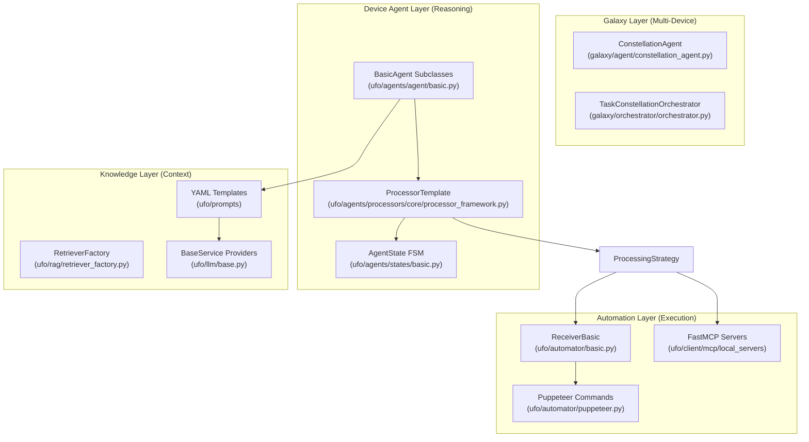
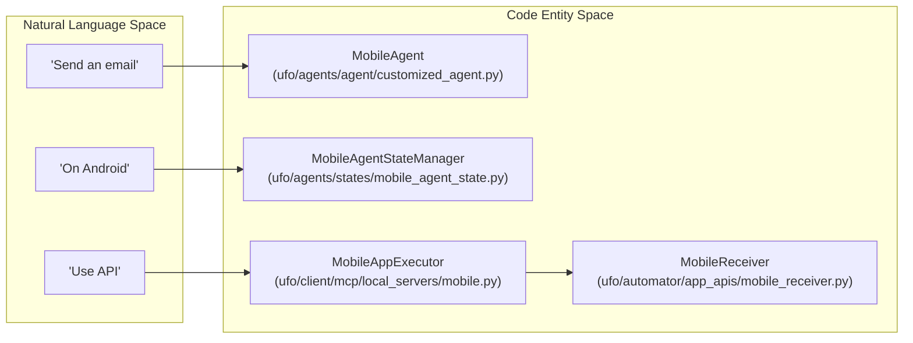

<!-- source: DeepWiki mcp.deepwiki.com · repo microsoft/UFO · page 13 Development and Extension · fetched 2026-10-26 -->

# Development and Extension

Relevant source files

The following files were used as context for generating this wiki page:

- [dataflow/.gitignore](dataflow/.gitignore)
- [dataflow/README.md](dataflow/README.md)
- [dataflow/config/config.yaml.template](dataflow/config/config.yaml.template)
- [dataflow/config/config_dev.yaml](dataflow/config/config_dev.yaml)
- [dataflow/data_flow_controller.py](dataflow/data_flow_controller.py)
- [dataflow/dataflow.py](dataflow/dataflow.py)
- [dataflow/env/env_manager.py](dataflow/env/env_manager.py)
- [dataflow/execution/workflow/execute_flow.py](dataflow/execution/workflow/execute_flow.py)
- [dataflow/instantiation/agent/filter_agent.py](dataflow/instantiation/agent/filter_agent.py)
- [dataflow/instantiation/agent/prefill_agent.py](dataflow/instantiation/agent/prefill_agent.py)
- [dataflow/instantiation/agent/template_agent.py](dataflow/instantiation/agent/template_agent.py)
- [dataflow/instantiation/workflow/choose_template_flow.py](dataflow/instantiation/workflow/choose_template_flow.py)
- [dataflow/instantiation/workflow/prefill_flow.py](dataflow/instantiation/workflow/prefill_flow.py)
- [dataflow/prompts/instantiation/visual/prefill.yaml](dataflow/prompts/instantiation/visual/prefill.yaml)
- [dataflow/prompts/instantiation/visual/prefill_example.yaml](dataflow/prompts/instantiation/visual/prefill_example.yaml)
- [dataflow/templates/word/description.json](dataflow/templates/word/description.json)
- [dataflow/templates/word/images/1.png](dataflow/templates/word/images/1.png)
- [dataflow/templates/word/images/2.png](dataflow/templates/word/images/2.png)
- [documents/docs/galaxy/evaluation/performance_metrics.md](documents/docs/galaxy/evaluation/performance_metrics.md)
- [documents/docs/galaxy/evaluation/result_json.md](documents/docs/galaxy/evaluation/result_json.md)
- [documents/docs/galaxy/evaluation/trajectory_report.md](documents/docs/galaxy/evaluation/trajectory_report.md)
- [documents/docs/getting_started/migration_ufo2_to_galaxy.md](documents/docs/getting_started/migration_ufo2_to_galaxy.md)
- [documents/docs/tutorials/creating_app_agent/demonstration_provision.md](documents/docs/tutorials/creating_app_agent/demonstration_provision.md)
- [documents/docs/tutorials/creating_app_agent/help_document_provision.md](documents/docs/tutorials/creating_app_agent/help_document_provision.md)
- [documents/docs/tutorials/creating_app_agent/overview.md](documents/docs/tutorials/creating_app_agent/overview.md)
- [documents/docs/tutorials/creating_app_agent/warpping_app_native_api.md](documents/docs/tutorials/creating_app_agent/warpping_app_native_api.md)
- [documents/docs/tutorials/creating_device_agent/client_setup.md](documents/docs/tutorials/creating_device_agent/client_setup.md)
- [documents/docs/tutorials/creating_device_agent/configuration.md](documents/docs/tutorials/creating_device_agent/configuration.md)
- [documents/docs/tutorials/creating_device_agent/core_components.md](documents/docs/tutorials/creating_device_agent/core_components.md)
- [documents/docs/tutorials/creating_device_agent/example_mobile_agent.md](documents/docs/tutorials/creating_device_agent/example_mobile_agent.md)
- [documents/docs/tutorials/creating_device_agent/mcp_server.md](documents/docs/tutorials/creating_device_agent/mcp_server.md)
- [documents/docs/tutorials/creating_device_agent/overview.md](documents/docs/tutorials/creating_device_agent/overview.md)
- [documents/docs/tutorials/creating_device_agent/testing.md](documents/docs/tutorials/creating_device_agent/testing.md)
- [documents/docs/tutorials/creating_mcp_servers.md](documents/docs/tutorials/creating_mcp_servers.md)
- [documents/docs/tutorials/creating_third_party_agents.md](documents/docs/tutorials/creating_third_party_agents.md)
- [learner/utils.py](learner/utils.py)

UFO³ provides a highly extensible architecture that allows developers to create custom agents for new device platforms, develop MCP servers to integrate platform-specific tools, and implement specialized automation receivers. This high-level page serves as a gateway to the detailed development guides for each extension point.

## UFO³ Extension Architecture

UFO³ provides multiple extension points across its layered architecture, bridging Natural Language Space (User Requests) to Code Entity Space (Atomic Actions).

### Extension Points by Layer

Sources: [ufo/agents/agent/basic.py:34-56](), [ufo/agents/processors/core/processor_framework.py:1-100](), [documents/docs/tutorials/creating_device_agent/overview.md:99-134]()

### Primary Extension Mechanisms

UFO³ uses registration patterns and inheritance for extensibility:

| Extension Type | Base Class/Pattern | Registration Method | Purpose |
|---------------|-------------------|---------------------|---------|
| **Custom Agents** | `BasicAgent` | `@AgentRegistry.register` | New device platforms (e.g., `MobileAgent`) |
| **MCP Servers** | `FastMCP` | `@MCPRegistry.register_factory_decorator` | Native API tool integration |
| **Automation Receivers** | `ReceiverBasic` | `ReceiverFactory.register()` | Application-specific COM/UI control |
| **Prompt Templates** | YAML structure | File-based loading | Domain-specific reasoning & few-shot |
| **Data Collection** | `DataFlowController` | Pipeline instantiation | LAM training data generation |

Sources: [ufo/agents/agent/basic.py:83-87](), [ufo/client/mcp/mcp_registry.py:1-20](), [dataflow/data_flow_controller.py:111-132](), [documents/docs/tutorials/creating_app_agent/warpping_app_native_api.md:43-50]()

## Core Extension Points

### 1. Creating Custom Agents
Custom agents extend `BasicAgent` (or `AppAgent`/`CustomizedAgent`) to support new device platforms. This involves defining a state machine, a processor for the 4-phase pipeline (Data Collection, LLM Interaction, Action Execution, Memory Update), and a prompter.

For detailed guidance, see [Creating Custom Agents](#13.1).

Sources: [documents/docs/tutorials/creating_device_agent/core_components.md:68-87](), [ufo/agents/agent/basic.py:34-80]()

### 2. Creating Custom MCP Servers
Model Context Protocol (MCP) servers provide standardized tool integration. Developers can wrap application native APIs (COM, REST) into MCP tools using `FastMCP`. These tools are then automatically discovered by the `MCPServerManager`.

For implementation details, see [Creating Custom MCP Servers](#13.2).

Sources: [documents/docs/tutorials/creating_app_agent/warpping_app_native_api.md:1-40](), [ufo/client/mcp/mcp_server_manager.py:1-50]()

### 3. Creating Custom Automation Receivers
Receivers encapsulate the low-level logic for interacting with software. Custom receivers (e.g., for specialized CAD or medical software) inherit from `ReceiverBasic` and register their commands to be orchestrated by `Puppeteer`.

For comprehensive guidance, see [Creating Custom Automation Receivers](#13.3).

Sources: [ufo/automator/puppeteer.py:1-100](), [ufo/automator/basic.py:1-80]()

### 4. Extending Prompt Templates
UFO uses a modular prompt system where templates are stored in YAML. Developers can add custom examples, modify system instructions, or create entirely new prompters for specialized agents by following the structure in `ufo/prompts/`.

For template customization, see [Extending Prompt Templates](#13.4).

Sources: [ufo/prompter/agent_prompter.py:1-150](), [documents/docs/tutorials/creating_device_agent/configuration.md:75-131]()

### 5. Dataflow and LAM Data Collection
The `dataflow` module allows for the large-scale collection of agent trajectories to train Large Action Models (LAMs). It includes `instantiation` (task preparation), `execution` (running the task), and `evaluation` (quality assessment).

For details on data collection workflows, see [Dataflow and LAM Data Collection](#13.5).

Sources: [dataflow/README.md:39-50](), [dataflow/data_flow_controller.py:173-190]()

## Best Practices and Patterns

UFO³ follows established design patterns to ensure maintainability:

- **Command Pattern**: Decouples action requests from execution via `Puppeteer` and `ReceiverBasic`.
- **Factory Pattern**: Used in `AgentFactory` and `ReceiverFactory` for dynamic object creation.
- **State Machine**: Agents manage their lifecycle using `AgentStateManager` and explicit states like `ContinueState` or `FinishState`.
- **Strategy Pattern**: The `ProcessorTemplate` allows swapping `LLMInteractionStrategy` or `ActionExecutionStrategy` without changing the core pipeline.

For a summary of patterns and error handling strategies, see [Best Practices and Patterns](#13.6).

Sources: [ufo/agents/processors/core/processor_framework.py:1-50](), [ufo/agents/states/basic.py:1-50](), [documents/docs/tutorials/creating_device_agent/overview.md:99-142]()

## Code Entity Mapping

This diagram maps Natural Language concepts to the specific Code Entities developers interact with during extension.

Sources: [documents/docs/tutorials/creating_device_agent/core_components.md:19-43](), [documents/docs/tutorials/creating_app_agent/warpping_app_native_api.md:31-76]()

---

