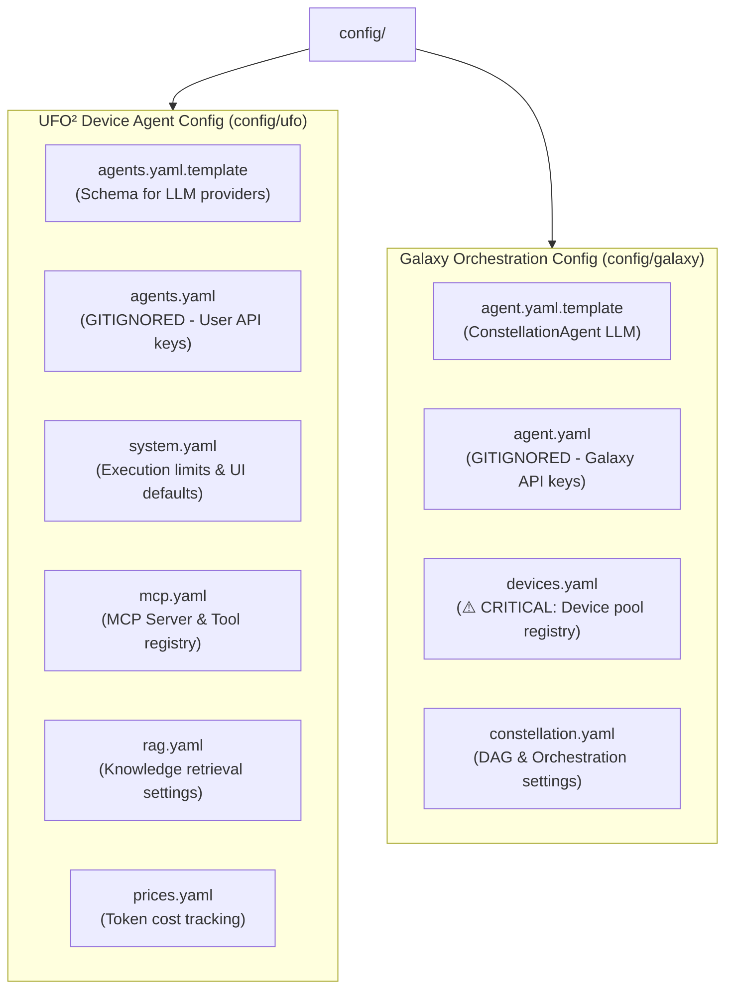
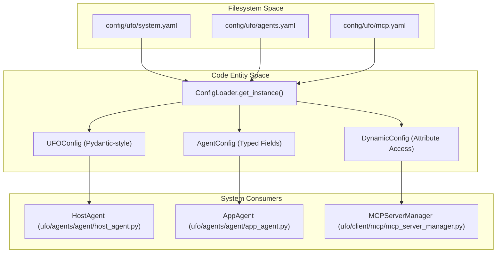
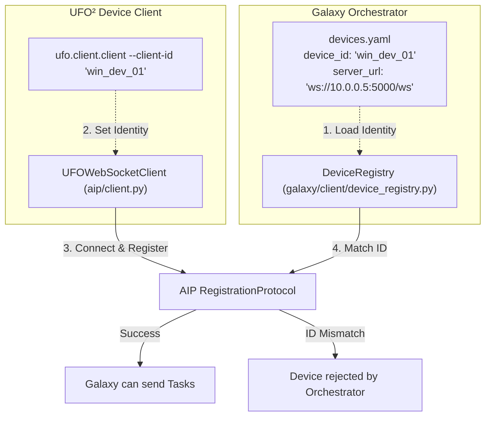

<!-- source: DeepWiki mcp.deepwiki.com · repo microsoft/UFO · page 6.1 Configuration Files Structure · fetched 2026-10-26 -->

# Configuration Files Structure

Relevant source files

The following files were used as context for generating this wiki page:

- [.gitignore](.gitignore)
- [assets/ufo.png](assets/ufo.png)
- [config/config_loader.py](config/config_loader.py)
- [config/config_schemas.py](config/config_schemas.py)
- [config/galaxy/constellation.yaml](config/galaxy/constellation.yaml)
- [config/ufo/agents.yaml.template](config/ufo/agents.yaml.template)
- [config/ufo/mcp.yaml](config/ufo/mcp.yaml)
- [config/ufo/prices.yaml](config/ufo/prices.yaml)
- [config/ufo/system.yaml](config/ufo/system.yaml)
- [config/ufo/third_party.yaml](config/ufo/third_party.yaml)
- [ufo/agents/presenters/rich_presenter.py](ufo/agents/presenters/rich_presenter.py)
- [ufo/agents/processors/schemas/actions.py](ufo/agents/processors/schemas/actions.py)
- [ufo/agents/processors/strategies/app_agent_processing_strategy.py](ufo/agents/processors/strategies/app_agent_processing_strategy.py)
- [ufo/agents/processors/strategies/host_agent_processing_strategy.py](ufo/agents/processors/strategies/host_agent_processing_strategy.py)
- [ufo/automator/app_apis/shell/__init__.py](ufo/automator/app_apis/shell/__init__.py)
- [ufo/automator/app_apis/shell/shell_client.py](ufo/automator/app_apis/shell/shell_client.py)
- [ufo/client/mcp/local_servers/ui_mcp_server.py](ufo/client/mcp/local_servers/ui_mcp_server.py)

This document details the physical organization and technical structure of configuration files in the UFO framework. It covers the directory layout, the modular YAML-based architecture, the template system for sensitive credentials, and the critical matching requirements for multi-device orchestration.

---

## Overview

UFO implements a **modular, directory-based configuration system** designed for separation of concerns and security. The configuration is organized into two primary domains:

1.  **UFO² Desktop AgentOS Configuration** (`config/ufo/`): Manages single-device automation, UI inspection, and local agent behaviors.
2.  **UFO³ Galaxy Configuration** (`config/galaxy/`): Manages multi-device orchestration, task constellations, and device pool registries.

The system utilizes a **template-based pattern** where `.template` files are version-controlled to define the schema, while the actual `.yaml` files containing sensitive API keys are excluded via `.gitignore` [[.gitignore:58-63]]().

### Configuration Directory Structure

The directory layout follows a hierarchical structure to support both standalone and orchestrated modes:

**Sources:** [[.gitignore:58-73]](), [[config/config_loader.py:17-44]](), [[config/ufo/mcp.yaml:1-15]]()

---

## Technical Implementation: The Config Loader

The system uses a modern `ConfigLoader` that supports backward compatibility with legacy paths (`ufo/config/`) while prioritizing the new modular structure [[config/config_loader.py:8-15]]().

### Data Flow and Code Entity Mapping

Configuration data is loaded into typed `AgentConfig` and `UFOConfig` objects, providing IDE autocomplete and type safety while maintaining dynamic access for YAML-defined fields [[config/config_schemas.py:14-21]]().

**Sources:** [[config/config_loader.py:152-172]](), [[config/config_schemas.py:14-43]](), [[ufo/agents/processors/strategies/app_agent_processing_strategy.py:58-65]]()

---

## Key Configuration Files

### 1. agents.yaml (UFO² LLM Settings)
**Path:** `config/ufo/agents.yaml` (derived from `agents.yaml.template`)

This file configures the LLM providers for different agent roles. It supports multiple authentication types including `openai`, `aoai` (Azure OpenAI), and `azure_ad` [[config/ufo/agents.yaml.template:8-12]]().

| Agent Role | Code Reference | Purpose |
| :--- | :--- | :--- |
| `HOST_AGENT` | `AgentType.HOST_AGENT` | Desktop orchestration and app selection. |
| `APP_AGENT` | `AgentType.APP_AGENT` | Fine-grained UI automation within apps. |
| `EVALUATION_AGENT`| `AgentType.EVALUATION_AGENT` | Success/Failure assessment of tasks. |

**Sources:** [[config/ufo/agents.yaml.template:5-108]](), [[ufo/llm/__init__.py]]()

### 2. system.yaml (Execution & UI Controls)
**Path:** `config/ufo/system.yaml`

Defines global behavioral parameters for the automation engine.

*   **Control Backend:** Sets the automation engine (e.g., `["uia"]`) [[config/ufo/system.yaml:11]]().
*   **Execution Limits:** `MAX_STEP` (default 50) and `MAX_ROUND` (default 1) [[config/ufo/system.yaml:15-16]]().
*   **UI Annotation:** Defines colors for different control types (Button, Edit, etc.) [[config/ufo/system.yaml:34-45]]().
*   **Safety:** `SAFE_GUARD` (default True) to prevent sensitive operations [[config/ufo/system.yaml:27]]().

**Sources:** [[config/ufo/system.yaml:1-118]]()

### 3. mcp.yaml (Tool & Server Registry)
**Path:** `config/ufo/mcp.yaml`

Registers Model Context Protocol (MCP) servers for specific agents and applications. It maps `AgentName` and `sub_type` (app root name) to specific data collection and action servers [[config/ufo/mcp.yaml:1-14]]().

*   **Example:** `WINWORD.EXE` is mapped to `WordCOMExecutor` for specialized API-based automation [[config/ufo/mcp.yaml:50-64]]().
*   **Server Types:** Supports `local` (stdio), `http`, and `stdio` [[config/ufo/mcp.yaml:8-12]]().

**Sources:** [[config/ufo/mcp.yaml:16-165]](), [[ufo/client/mcp/local_servers/ui_mcp_server.py:43-52]]()

---

## Critical Matching Requirements: devices.yaml

For Galaxy (multi-device) mode, the `config/galaxy/devices.yaml` file acts as the central registry. **Identity mismatch here is the most common cause of connection failure.**

### The Identity Triangle

Three values must align perfectly for a device to be controllable by Galaxy:

1.  **`device_id`** in `config/galaxy/devices.yaml`.
2.  **`--client-id`** passed to the `ufo.client.client` CLI.
3.  **`server_url`** mapping in `devices.yaml` pointing to the `ufo.server.app` endpoint.

**Sources:** [[config/ufo/system.yaml:107-113]](), [[ufo/client/mcp/local_servers/ui_mcp_server.py:191-205]](), [[ufo/agents/processors/strategies/host_agent_processing_strategy.py:113-118]]()

---

## Security and Git Integration

To prevent accidental leakage of API keys, the framework enforces a strict separation via `.gitignore` [[.gitignore:58-73]]().

*   **Tracked Templates:** `config/ufo/agents.yaml.template` and `config/galaxy/agent.yaml.template` are tracked. They contain documentation and placeholders.
*   **Ignored Actuals:** `config/ufo/agents.yaml` and `config/galaxy/agent.yaml` are ignored. Users must copy the template to the actual filename and populate their keys locally.
*   **Safe Defaults:** Files like `system.yaml`, `rag.yaml`, and `mcp.yaml` do not contain secrets and are safely tracked in version control [[.gitignore:66-72]]().

**Sources:** [[.gitignore:1-74]](), [[config/ufo/agents.yaml.template:1-4]]()

---

