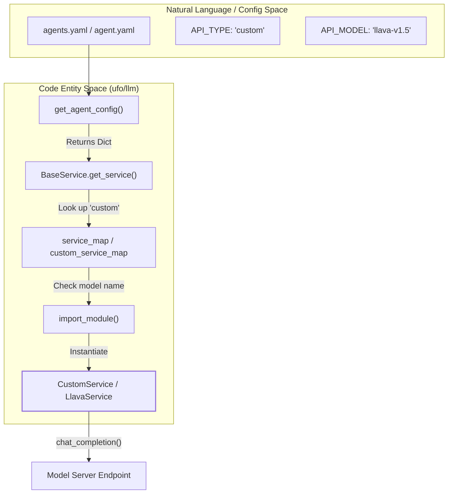
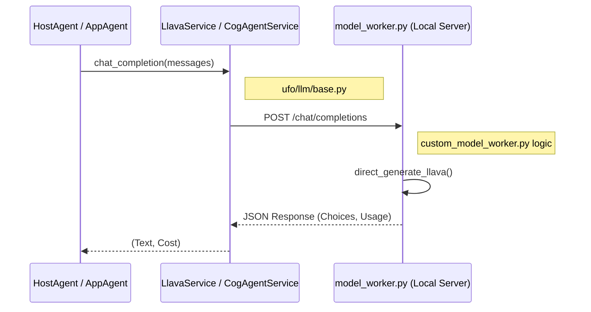

<!-- source: DeepWiki mcp.deepwiki.com · repo microsoft/UFO · page 7.4 Custom Model Integration · fetched 2026-10-26 -->

# Custom Model Integration

<details>
<summary>Relevant source files</summary>

The following files were used as context for generating this wiki page:

- [dataflow/config/config.py](dataflow/config/config.py)
- [learner/README.md](learner/README.md)
- [learner/doc_example/ppt-copilot.xml](learner/doc_example/ppt-copilot.xml)
- [learner/doc_example/ppt-copilot.xml.meta](learner/doc_example/ppt-copilot.xml.meta)
- [model_worker/README.md](model_worker/README.md)
- [requirements.txt](requirements.txt)
- [ufo/llm/base.py](ufo/llm/base.py)
- [ufo/llm/config_helper.py](ufo/llm/config_helper.py)
- [ufo/llm/gemini.py](ufo/llm/gemini.py)
- [ufo/llm/ollama.py](ufo/llm/ollama.py)
- [ufo/llm/placeholder.py](ufo/llm/placeholder.py)
- [ufo/llm/qwen.py](ufo/llm/qwen.py)

</details>


## Purpose and Scope

This page provides technical guidance on integrating custom Large Language Models (LLMs) into the UFO framework. UFO utilizes a factory pattern to abstract LLM providers, allowing developers to integrate local models (e.g., Llama, Qwen via Ollama), specialized vision models (e.g., LLaVA, CogAgent), or proprietary internal APIs by implementing the `BaseService` interface.

---

## LLM Service Architecture

UFO's LLM integration layer is built around an abstract base class that defines the interaction protocol between agents and model providers.

### BaseService Interface

The `BaseService` class in `ufo/llm/base.py` defines the contract for all LLM services. Every custom integration must implement the following:

| Method | Role | Implementation Requirement |
|:---|:---|:---|
| `__init__` | Initialization | Must accept `config` (Dict) and `agent_type` (str). [ufo/llm/base.py:14-15]() |
| `chat_completion` | Inference | Must handle message lists and return a tuple of `(response_text, cost)`. [ufo/llm/base.py:18-19]() |
| `get_service` | Factory | Static method that dynamically imports and instantiates the correct service class. [ufo/llm/base.py:23-116]() |

### Data Flow: Configuration to Model Interaction

The following diagram maps the transition from Natural Language Space (User Configuration) to Code Entity Space (Service Implementation).


**Sources:** [ufo/llm/base.py:23-116](), [ufo/llm/config_helper.py:13-69]()

---

## Implementing a Custom Service

To integrate a new model, create a Python script in `ufo/llm/` (e.g., `ufo/llm/my_custom_model.py`) and inherit from `BaseService`.

### Implementation Template

A minimal implementation should follow the pattern seen in `PlaceHolderService` [ufo/llm/placeholder.py:6-42]() or the custom model example provided in the documentation [model_worker/README.md:104-155]().

```python
from ufo.llm.base import BaseService
import requests

class MyCustomService(BaseService):
    def __init__(self, config, agent_type):
        self.config_llm = config[agent_type]
        self.api_base = self.config_llm["API_BASE"]
        self.api_key = self.config_llm["API_KEY"]
        self.max_retry = config["MAX_RETRY"]
        self.timeout = config["TIMEOUT"]

    def chat_completion(self, messages, n, **kwargs):
        # Implementation of retry logic and requests.post to self.api_base
        # Must return (response_content, estimated_cost)
        pass
```
**Sources:** [ufo/llm/base.py:12-19](), [model_worker/README.md:104-155]()

### Structured Output Support
If the custom model supports JSON schema or structured output (required for `HostAgent` and `AppAgent` logic), the service should check `self.config_llm.get("JSON_SCHEMA", False)` and apply the appropriate `response_format` from `ufo/llm/response_schema.py`. [ufo/llm/gemini.py:89-100]()

---

## Configuration Requirements

### Agent Configuration
Update `config/ufo/agents.yaml` (for desktop agents) or `config/galaxy/agent.yaml` (for constellation agents) with the following parameters:

```json
{
    "API_TYPE": "custom",
    "API_BASE": "YOUR_ENDPOINT/chat/completions",
    "API_KEY": "YOUR_KEY",
    "API_MODEL": "YOUR_MODEL_NAME"
}
```
**Sources:** [model_worker/README.md:91-98](), [ufo/llm/config_helper.py:13-69]()

### Service Registration
The `BaseService.get_service` method must be updated to recognize the new provider. UFO uses two maps for routing:
1.  `service_map`: Maps `API_TYPE` to a class name. [ufo/llm/base.py:33-45]()
2.  `custom_service_map`: Maps specific model keywords (e.g., "llava", "cogagent") to specialized classes when `API_TYPE` is "custom". [ufo/llm/base.py:46-49]()

---

## Model Server Setup

UFO supports integrating local vision models like **LLaVA-1.5** and **CogAgent**. These models typically require a local worker that exposes an OpenAI-compatible API.

### Interface Mapping Diagram

This diagram shows how the `BaseService` calls translate into model worker executions.


**Sources:** [model_worker/README.md:178-189](), [ufo/llm/base.py:113-114]()

### Model Specific Notes
*   **LLaVA-1.5**: Requires adding a `direct_generate_llava` method and a `/chat/completions` POST interface to the `llava.serve.model_worker.py`. [model_worker/README.md:181-183]()
*   **CogAgent**: Requires modifying the `cli_demo.py` in the CogVLM project to support the UFO API interface. [model_worker/README.md:187-189]()
*   **Ollama**: Set `API_TYPE` to "Ollama" and `API_BASE` to your local Ollama serving endpoint (default `http://localhost:11434`). [model_worker/README.md:77-85](), [ufo/llm/ollama.py:25-33]()

---

## Cost Estimation Integration

Custom models can leverage the built-in cost estimator by providing a pricing entry in the configuration.

```python
def get_cost_estimator(self, api_type, model, prices, prompt_tokens, completion_tokens):
    # Logic to calculate cost based on token counts and prices dict
    # name = api_type + "/" + model
    pass
```
**Sources:** [ufo/llm/base.py:118-158]()

The `prices` dictionary is loaded from the system configuration and passed to the service during instantiation. [ufo/llm/base.py:82-84]()

---

