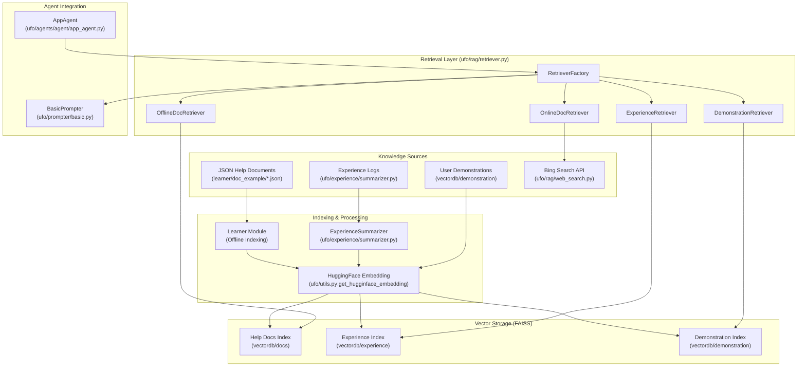
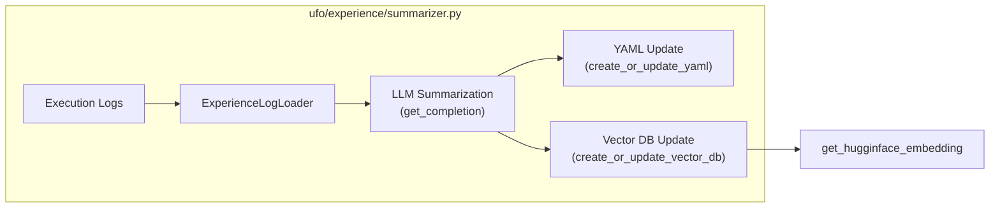
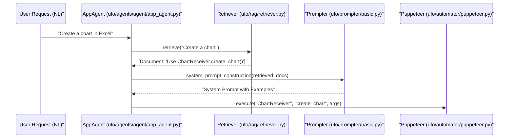

<!-- source: DeepWiki mcp.deepwiki.com · repo microsoft/UFO · page 8.1 RAG System Architecture · fetched 2026-10-26 -->

# RAG System Architecture

Relevant source files

The following files were used as context for generating this wiki page:

- [ufo/__main__.py](ufo/__main__.py)
- [ufo/automator/ui_control/grounding/basic.py](ufo/automator/ui_control/grounding/basic.py)
- [ufo/automator/ui_control/grounding/omniparser.py](ufo/automator/ui_control/grounding/omniparser.py)
- [ufo/automator/ui_control/inspector.py](ufo/automator/ui_control/inspector.py)
- [ufo/experience/summarizer.py](ufo/experience/summarizer.py)
- [ufo/llm/grounding_model/omniparser_service.py](ufo/llm/grounding_model/omniparser_service.py)
- [ufo/llm/llm_call.py](ufo/llm/llm_call.py)
- [ufo/llm/openai.py](ufo/llm/openai.py)
- [ufo/rag/retriever.py](ufo/rag/retriever.py)
- [ufo/rag/web_search.py](ufo/rag/web_search.py)
- [ufo/ufo.py](ufo/ufo.py)

## Purpose and Scope

This document details the Retrieval-Augmented Generation (RAG) system architecture in UFO. The RAG system enhances agent decision-making by retrieving relevant context from offline documentation, past execution experiences, user-provided demonstrations, and online web searches. This architecture utilizes a factory pattern for retriever management, FAISS for high-performance vector indexing, and `sentence-transformers` for semantic embedding generation.

## System Overview

The RAG infrastructure implements a knowledge augmentation layer that bridges the gap between the LLM's general knowledge and the specific UI/API environment of the target applications.

### High-Level RAG Architecture

The following diagram illustrates the flow from various knowledge sources through the indexing pipeline to the online retrieval phase integrated with the UFO agents.

**Sources:** [ufo/rag/retriever.py:16-37](), [ufo/experience/summarizer.py:18-117](), [ufo/rag/web_search.py:17-51](), [ufo/utils.py:15-15]() (Note: `get_hugginface_embedding` is used across all FAISS operations).

## Retriever Implementation

### RetrieverFactory Pattern

UFO uses a static factory to instantiate specialized retrievers based on the configuration or agent needs.

| Retriever Type | Class Name | Responsibility |
| :--- | :--- | :--- |
| `offline` | `OfflineDocRetriever` | Retrieves application-specific help documentation from local FAISS indexes. |
| `experience` | `ExperienceRetriever` | Retrieves summarized successful trajectories from past tasks. |
| `online` | `OnlineDocRetriever` | Performs real-time web searches via Bing API and indexes results on-the-fly. |
| `demonstration` | `DemonstrationRetriever` | Retrieves user-recorded demonstrations of specific workflows. |

**Sources:** [ufo/rag/retriever.py:16-37]()

### Implementation Details

#### 1. Vector Search (FAISS)
All local retrievers inherit from the `Retriever` abstract base class [ufo/rag/retriever.py:40-60](). They utilize `FAISS.load_local` to load indexes with `allow_dangerous_deserialization=True` [ufo/rag/retriever.py:120-122](). Similarity search is performed using the `similarity_search` method [ufo/rag/retriever.py:73-73]().

#### 2. Embedding Model
UFO standardizes on `sentence-transformers` via a utility function `get_hugginface_embedding` [ufo/utils.py:15-15](). This ensures that the vector space remains consistent between the indexing phase (e.g., in `ExperienceSummarizer`) and the retrieval phase.

#### 3. Online Search (Bing)
The `OnlineDocRetriever` [ufo/rag/retriever.py:163-198]() utilizes `BingSearchWeb` [ufo/rag/web_search.py:17-110](). It performs a search, scrapes the resulting URLs using `HTMLHeaderTextSplitter` [ufo/rag/web_search.py:66-67](), and creates a temporary in-memory FAISS index for the current session [ufo/rag/web_search.py:100-109]().

**Sources:** [ufo/rag/retriever.py:40-231](), [ufo/rag/web_search.py:17-110](), [ufo/experience/summarizer.py:178-178]()

## Experience Learning and Summarization

The RAG system is not static; it learns from agent execution via the `ExperienceSummarizer`.

### Experience Processing Flow
When a task is completed successfully, the agent's logs are processed:
1. **Log Loading**: `ExperienceLogLoader` partitions the session logs by subtask [ufo/experience/summarizer.py:125-126]().
2. **Summarization**: The `ExperienceSummarizer` calls the LLM (specifically the `APPAGENT` config) to generate a concise summary of the "Observation", "Thought", and "Action" [ufo/experience/summarizer.py:72-98]().
3. **Indexing**: The summary is added to a YAML file for human readability [ufo/experience/summarizer.py:129-162]() and indexed into the experience FAISS database [ufo/experience/summarizer.py:165-191]().

**Sources:** [ufo/experience/summarizer.py:18-191](), [ufo/llm/llm_call.py:14-31]()

## Integration with Agent Prompters

The retrieved knowledge is injected into the agent's prompt to guide its next action.

### Data Flow to Prompter
1. The Agent (e.g., `AppAgent`) determines if RAG is needed based on configuration.
2. It calls the `RetrieverFactory` to get the relevant `Retriever`.
3. The `Retriever.retrieve(query, top_k)` method returns a list of `Document` objects [ufo/rag/retriever.py:62-78]().
4. These documents are passed to the `Prompter` (e.g., `AppAgentPrompter`), which formats them into the system or user prompt sections.

### Natural Language to Code Entity Mapping

The RAG system bridges the gap between the user's natural language request and the specific code entities (receivers/commands) the agent must use.

**Sources:** [ufo/rag/retriever.py:62-78](), [ufo/experience/summarizer.py:83-96](), [ufo/llm/openai.py:138-145]()

## Summary of Key Classes

| Class | File | Role |
| :--- | :--- | :--- |
| `RetrieverFactory` | [ufo/rag/retriever.py:16-37]() | Central point for creating retriever instances. |
| `OfflineDocRetriever` | [ufo/rag/retriever.py:81-129]() | Handles application-specific documentation indexing. |
| `ExperienceSummarizer` | [ufo/experience/summarizer.py:18-207]() | Converts raw logs into searchable experience vectors. |
| `BingSearchWeb` | [ufo/rag/web_search.py:17-110]() | Interface for real-time web document retrieval. |
| `FAISS` | `langchain_community` | Underlying vector database engine used by all retrievers. |

**Sources:** [ufo/rag/retriever.py:1-231](), [ufo/experience/summarizer.py:1-214](), [ufo/rag/web_search.py:1-110]()

---

