# Page: Introduction to UFO

# Introduction to UFO

<details>
<summary>Relevant source files</summary>

The following files were used as context for generating this wiki page:

- [CONTRIBUTING.md](CONTRIBUTING.md)
- [DISCLAIMER.md](DISCLAIMER.md)
- [LICENSE](LICENSE)
- [README.md](README.md)
- [README_ZH.md](README_ZH.md)
- [assets/orchestrator.png](assets/orchestrator.png)
- [assets/overview_n.png](assets/overview_n.png)
- [assets/task_constellation.png](assets/task_constellation.png)
- [assets/ufo_blue.png](assets/ufo_blue.png)
- [documents/docs/choose_path.md](documents/docs/choose_path.md)
- [documents/docs/faq.md](documents/docs/faq.md)
- [documents/docs/galaxy/overview.md](documents/docs/galaxy/overview.md)
- [documents/docs/getting_started/more_guidance.md](documents/docs/getting_started/more_guidance.md)
- [documents/docs/getting_started/quick_start_galaxy.md](documents/docs/getting_started/quick_start_galaxy.md)
- [documents/docs/getting_started/quick_start_linux.md](documents/docs/getting_started/quick_start_linux.md)
- [documents/docs/getting_started/quick_start_ufo2.md](documents/docs/getting_started/quick_start_ufo2.md)
- [documents/docs/index.md](documents/docs/index.md)
- [documents/docs/project_directory_structure.md](documents/docs/project_directory_structure.md)
- [documents/mkdocs.yml](documents/mkdocs.yml)
- [galaxy/README.md](galaxy/README.md)
- [galaxy/README_ZH.md](galaxy/README_ZH.md)
- [ufo/README.md](ufo/README.md)
- [ufo/README_ZH.md](ufo/README_ZH.md)

</details>


## Purpose and Scope

This document provides a high-level introduction to the UFO³ ecosystem, a comprehensive framework for intelligent automation across devices and platforms. UFO³ consists of two complementary tiers: **UFO² Desktop AgentOS** for single-device Windows automation and **UFO³ Galaxy Framework** for multi-device orchestration. This introduction explains what UFO is, how its components relate, and when to use each tier.

For detailed information on specific components:
- **UFO² Desktop AgentOS architecture**: See [UFO² Desktop AgentOS](#3)
- **Galaxy multi-device orchestration**: See [UFO³ Galaxy Framework](#4)
- **Communication protocol between tiers**: See [Agent Interaction Protocol](#5)
- **Configuration and setup**: See [Configuration System](#6)

**Sources:** [README.md:1-154](), [documents/docs/index.md:1-120](), [galaxy/README.md:1-174]()

---

## What is UFO³?

**UFO³** is an open-source intelligent automation framework that enables natural language-driven task execution across heterogeneous devices and platforms. The framework implements a **two-tier architecture** separating orchestration (Galaxy) from execution (AgentOS).

### Two-Tier Architecture

The framework consists of two complementary tiers:

1. **UFO² Desktop AgentOS** - Single-device Windows automation with hybrid GUI+API execution. It acts as a standalone automation tool or a specialized Windows execution node. [ufo/README.md:74-82]()
2. **UFO³ Galaxy Framework** - A multi-device orchestration layer that transforms isolated agents into a unified digital ecosystem using Task Constellations. [galaxy/README.md:29-30]()

UFO² can operate standalone for Windows tasks or serve as a device agent within Galaxy for cross-platform workflows via the Agent Interaction Protocol (AIP). [README.md:148-148]()

### Key Technical Capabilities

| Capability | Implementation | Description |
|------------|----------------|-------------|
| **Declarative DAG Decomposition** | `ConstellationAgent` | Requests are decomposed into structured `TaskStar` nodes and `TaskStarLine` dependencies. [galaxy/README.md:68-69]() |
| **Hybrid Execution** | `Puppeteer` | Combines Windows UIA, Win32, and WinCOM for native command execution and GUI fallback. [ufo/README.md:46-48]() |
| **Speculative Multi-Action** | `Speculative Executor` | Bundles predicted steps into one LLM call, reducing queries by up to 51%. [ufo/README.md:50-52]() |
| **Knowledge Substrate** | `RAG System` | Integrates offline docs, Bing search, and user demos into a vector store for on-the-fly retrieval. [ufo/README.md:78-78]() |
| **Unified AIP Protocol** | `WebSocket-based` | Secure, fault-tolerant communication layer with heartbeats and auto-reconnection. [galaxy/README.md:115-124]() |

**Sources:** [README.md:125-138](), [ufo/README.md:43-82](), [galaxy/README.md:61-143]()

---

## The Two-Tier Architecture

### UFO³ Ecosystem Architecture: Galaxy (Orchestration) + AgentOS (Execution)

The following diagram bridges the Natural Language Space (User Intent) to the Code Entity Space (specific classes and files).

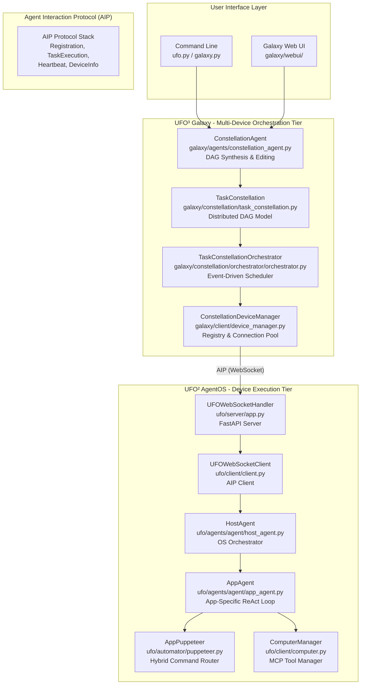

### Architectural Layers

| Layer | Responsibility | Key Code Entities |
|-------|----------------|-------------------|
| **Control Plane** | Global device registry and capability matching. | `ConstellationClient`, `AgentProfile`. [galaxy/README.md:186-187]() |
| **Planning Layer** | Decomposing intent into TaskStars and TaskStarLines. | `ConstellationAgent`, `TaskConstellation`. [galaxy/README.md:68-69]() |
| **Orchestration Layer** | Event-driven scheduling and safe concurrency control. | `TaskConstellationOrchestrator`, `ConstellationModificationSynchronizer`. [galaxy/README.md:101-106]() |
| **Communication Layer** | Unified WebSocket-based protocol (AIP). | `UFOWebSocketHandler`, `UFOWebSocketClient`. [README.md:135-135]() |
| **Execution Layer** | Platform-specific automation (GUI + API). | `HostAgent`, `AppAgent`, `AppPuppeteer`, `Computer`. [ufo/README.md:74-80]() |

**Sources:** [galaxy/README.md:169-201](), [ufo/README.md:68-82](), [documents/docs/galaxy/overview.md:32-85]()

---

## Evolution Timeline

UFO has evolved from a simple UI-focused agent to a comprehensive multi-device "Agent Galaxy".

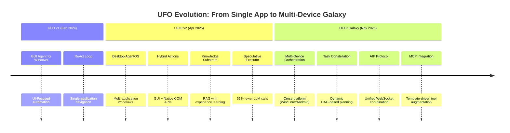

**Sources:** [README.md:110-123](), [ufo/README.md:60-64](), [documents/docs/index.md:65-79]()

---

## UFO² Desktop AgentOS Overview

**UFO² Desktop AgentOS** is the stable execution tier for Windows. It operates using a hierarchical agent structure where a **HostAgent** manages the desktop environment and delegates specific application tasks to **AppAgents**.

### UFO² Internal Data Flow

This diagram shows how a natural language request is transformed into a sequence of code-driven actions within a single device.

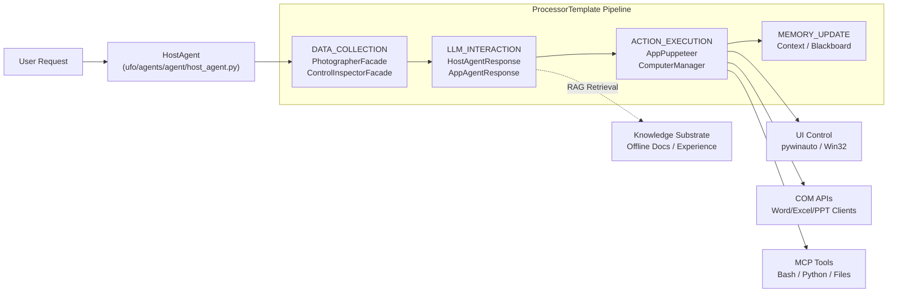

**Key Features of UFO²:**
- **Hybrid Perception**: Uses `PhotographerFacade` for visual screenshots and `ControlInspectorFacade` for structural UI tree metadata. [ufo/README.md:52-52]()
- **Agent FSM**: Agents transition through states like `CONTINUE`, `CONFIRM`, and `FINISH` via the `AgentStateManager`. [ufo/README.md:76-76]()
- **Knowledge Substrate**: Implements RAG using `ExperienceSummarizer` and `RetrieverFactory` to learn from past trajectories. [ufo/README.md:78-78]()

**Sources:** [ufo/README.md:43-54](), [ufo/README.md:68-82](), [documents/docs/index.md:234-256]()

---

## UFO³ Galaxy Framework Overview

**UFO³ Galaxy** is the orchestration tier. It treats devices as "stars" in a "constellation". It is designed for cross-platform workflows (e.g., "Get logs from Linux, analyze in Excel on Windows").

### Galaxy Orchestration Principles

1. **Declarative Decomposition**: The `ConstellationAgent` decomposes requests into a `TaskConstellation` DAG. [galaxy/README.md:68-69]()
2. **Dynamic Adaptation**: The DAG is not static; it evolves in `Editing Mode` based on runtime feedback and intermediate results. [galaxy/README.md:82-93]()
3. **Asynchronous Parallelism**: The `TaskConstellationOrchestrator` uses event-driven scheduling to run independent `TaskStars` concurrently across multiple devices. [galaxy/README.md:97-108]()
4. **Safety & Consistency**: Uses `ConstellationModificationSynchronizer` to ensure atomic updates to the DAG during parallel execution. [galaxy/README.md:105-105]()

**Key Galaxy Components:**
- **TaskStar**: A node in the DAG representing a unit of work assigned to a specific `device_id`. [galaxy/README.md:68-69]()
- **Agent Interaction Protocol (AIP)**: A WebSocket-based protocol stack (`Registration`, `TaskExecution`, `Heartbeat`) for low-latency coordination. [galaxy/README.md:115-126]()
- **MCP-Empowered Agents**: Lightweight agents that use the Model Context Protocol to expose local tools (Bash, Filesystem) to the LLM. [galaxy/README.md:131-143]()

**Sources:** [galaxy/README.md:27-152](), [documents/docs/galaxy/overview.md:10-85](), [documents/docs/getting_started/quick_start_galaxy.md:5-8]()

---

## Comparison Matrix: UFO² vs. UFO³ Galaxy

| Aspect | UFO² Desktop AgentOS | UFO³ Galaxy |
|--------|----------------------|-------------|
| **Primary Scope** | Single Windows Device | Multi-Device / Cross-Platform |
| **Task Model** | Sequential ReAct Loop | DAG-based Constellation |
| **Coordination** | HostAgent + AppAgents | ConstellationAgent + TaskOrchestrator |
| **Parallelism** | Sequential | Parallel DAG Execution |
| **Device Support** | Windows 10/11 | Windows, Linux, Android, Web |
| **Communication** | Local Function Calls | AIP (WebSocket Protocol) |
| **Learning Curve** | Low | Moderate |
| **Status** | LTS (Stable) | Active Development |

**Sources:** [README.md:139-154](), [documents/docs/index.md:95-110](), [documents/docs/choose_path.md:49-61]()

---

# Page: System Architecture Overview

# System Architecture Overview

<details>
<summary>Relevant source files</summary>

The following files were used as context for generating this wiki page:

- [README.md](README.md)
- [README_ZH.md](README_ZH.md)
- [assets/orchestrator.png](assets/orchestrator.png)
- [assets/task_constellation.png](assets/task_constellation.png)
- [documents/docs/choose_path.md](documents/docs/choose_path.md)
- [documents/docs/galaxy/overview.md](documents/docs/galaxy/overview.md)
- [documents/docs/getting_started/quick_start_galaxy.md](documents/docs/getting_started/quick_start_galaxy.md)
- [documents/docs/img/aip_new.png](documents/docs/img/aip_new.png)
- [documents/docs/img/decomposition.png](documents/docs/img/decomposition.png)
- [documents/docs/index.md](documents/docs/index.md)
- [documents/docs/infrastructure/agents/agent_types.md](documents/docs/infrastructure/agents/agent_types.md)
- [documents/docs/infrastructure/agents/overview.md](documents/docs/infrastructure/agents/overview.md)
- [documents/docs/infrastructure/agents/server_client_architecture.md](documents/docs/infrastructure/agents/server_client_architecture.md)
- [documents/docs/infrastructure/modules/context.md](documents/docs/infrastructure/modules/context.md)
- [documents/docs/infrastructure/modules/dispatcher.md](documents/docs/infrastructure/modules/dispatcher.md)
- [documents/docs/infrastructure/modules/overview.md](documents/docs/infrastructure/modules/overview.md)
- [documents/docs/infrastructure/modules/platform_sessions.md](documents/docs/infrastructure/modules/platform_sessions.md)
- [documents/docs/infrastructure/modules/round.md](documents/docs/infrastructure/modules/round.md)
- [documents/docs/infrastructure/modules/session.md](documents/docs/infrastructure/modules/session.md)
- [documents/docs/infrastructure/modules/session_pool.md](documents/docs/infrastructure/modules/session_pool.md)
- [documents/docs/ufo2/app_agent/commands.md](documents/docs/ufo2/app_agent/commands.md)
- [documents/docs/ufo2/app_agent/overview.md](documents/docs/ufo2/app_agent/overview.md)
- [documents/docs/ufo2/app_agent/state.md](documents/docs/ufo2/app_agent/state.md)
- [documents/docs/ufo2/app_agent/strategy.md](documents/docs/ufo2/app_agent/strategy.md)
- [documents/docs/ufo2/core_features/hybrid_actions.md](documents/docs/ufo2/core_features/hybrid_actions.md)
- [documents/docs/ufo2/host_agent/commands.md](documents/docs/ufo2/host_agent/commands.md)
- [documents/docs/ufo2/host_agent/overview.md](documents/docs/ufo2/host_agent/overview.md)
- [documents/docs/ufo2/host_agent/state.md](documents/docs/ufo2/host_agent/state.md)
- [documents/docs/ufo2/host_agent/strategy.md](documents/docs/ufo2/host_agent/strategy.md)
- [documents/docs/ufo2/overview.md](documents/docs/ufo2/overview.md)
- [documents/mkdocs.yml](documents/mkdocs.yml)
- [galaxy/README.md](galaxy/README.md)
- [galaxy/README_ZH.md](galaxy/README_ZH.md)
- [ufo/README.md](ufo/README.md)
- [ufo/README_ZH.md](ufo/README_ZH.md)

</details>


## Purpose and Scope

This document provides a comprehensive overview of the UFO³ system architecture, explaining how the two-tier framework operates and how its major components interact. It covers the architectural layers from user request to task execution across heterogeneous devices.

**Scope of this document:**
- Two-tier architecture: Galaxy orchestration layer and UFO² device agent layer
- Agent hierarchy and processing pipeline
- Session and round lifecycle management
- Agent Interaction Protocol (AIP) communication layer
- Data flow from natural language to device execution

**Related pages:**
- For detailed information on UFO² agent processing, see [Agent Processing System](#3.1)
- For Galaxy-specific orchestration details, see [Galaxy Architecture](#4.1)
- For AIP protocol details, see [Agent Interaction Protocol](#5)
- For configuration management, see [Configuration System](#6)

---

## Two-Tier Architecture

UFO³ employs a **hierarchical two-tier architecture** that separates global orchestration from local execution, enabling scalable cross-device automation while maintaining operational independence of device agents.

### High-Level Architecture

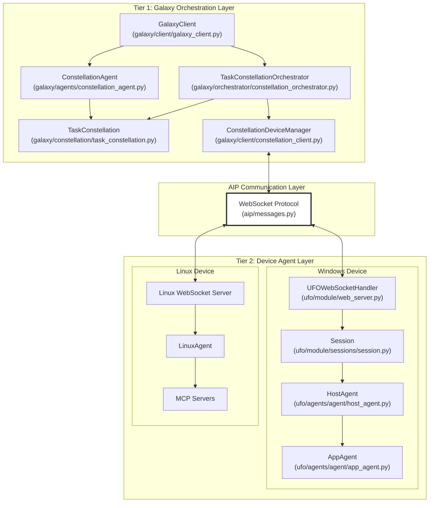

**Sources:**
- [README.md:125-154]()
- [galaxy/README.md:27-57]()
- [documents/docs/index.md:81-109]()

### Tier 1: Galaxy Orchestration Layer

The **Galaxy layer** provides multi-device orchestration capabilities through LLM-driven task decomposition and DAG-based scheduling:

| Component | Class/Module | Responsibility |
|-----------|--------------|----------------|
| **GalaxyClient** | `galaxy.client.galaxy_client.GalaxyClient` | Entry point for multi-device sessions, manages ConstellationClient and session lifecycle [galaxy/README.md:180-186]() |
| **ConstellationAgent** | `galaxy.agents.constellation_agent.ConstellationAgent` | LLM-driven agent that decomposes user requests into DAG structures (Creation mode) and adapts DAGs based on execution feedback (Editing mode) [galaxy/README.md:66-71]() |
| **TaskConstellation** | `galaxy.constellation.task_constellation.TaskConstellation` | Dynamic DAG data structure with TaskStars (nodes) and TaskStarLines (edges) representing distributed workflow [galaxy/README.md:82-92]() |
| **TaskOrchestrator** | `galaxy.orchestrator.constellation_orchestrator.TaskConstellationOrchestrator` | Asynchronous execution engine that schedules ready tasks, dispatches to devices, and manages completion events [galaxy/README.md:144-147]() |
| **DeviceManager** | `galaxy.client.constellation_client.ConstellationDeviceManager` | Maintains device registry (AgentProfile), manages WebSocket connections, routes tasks, monitors heartbeats [documents/docs/galaxy/overview.md:44-51]() |

**Sources:**
- [galaxy/README.md:170-201]()
- [documents/docs/galaxy/overview.md:32-89]()

### Tier 2: Device Agent Layer

The **device agent layer** executes tasks locally on individual devices using platform-specific automation capabilities:

| Component | Class/Module | Responsibility |
|-----------|--------------|----------------|
| **Session** | `ufo.module.sessions.session.Session` | Manages multi-round user interaction lifecycle on a single device [ufo/README.md:76-80]() |
| **BaseRound** | `ufo.module.basic.BaseRound` | Encapsulates a single user request with step-by-step agent processing [ufo/README.md:142-147]() |
| **HostAgent** | `ufo.agents.agent.host_agent.HostAgent` | Desktop-level orchestrator that analyzes environment and spawns AppAgents [ufo/README.md:76-80]() |
| **AppAgent** | `ufo.agents.agent.app_agent.AppAgent` | Application-specific agent that executes fine-grained actions within apps [documents/docs/ufo2/app_agent/overview.md:1-22]() |
| **ProcessorTemplate** | `ufo.agents.processors.core.processor_framework.ProcessorTemplate` | Abstract base for agent processing pipeline with middleware support [documents/docs/ufo2/app_agent/overview.md:105-121]() |

**Sources:**
- [documents/docs/ufo2/overview.md:52-64]()
- [documents/docs/ufo2/app_agent/overview.md:9-22]()

---

## UFO² Desktop AgentOS Architecture

UFO² implements a **hierarchical multi-agent system** with state machines, processing pipelines, and hybrid GUI/API execution capabilities.

### Session and Round Lifecycle

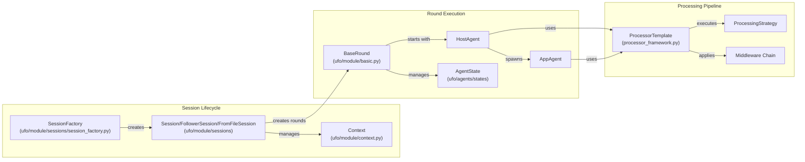

**Sources:**
- [documents/docs/ufo2/overview.md:42-49]()
- [documents/docs/ufo2/app_agent/overview.md:56-83]()

### Agent Hierarchy and State Machines

UFO² agents follow a **finite state machine** pattern for robust workflow control:

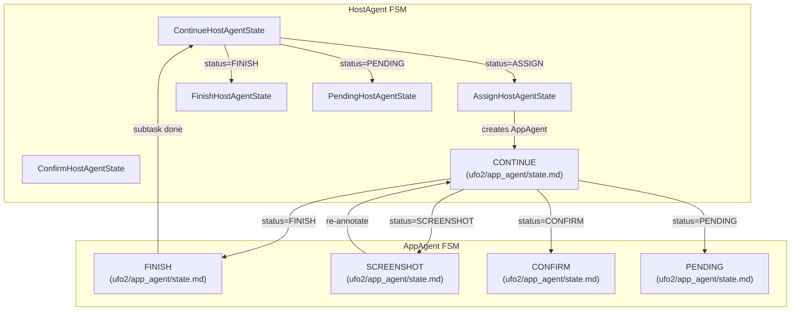

**Key State Transitions:**

| State | Agent | Trigger | Action | Next State |
|-------|-------|---------|--------|------------|
| `CONTINUE` | HostAgent | Desktop analysis needed | Executes `HostAgentProcessor.process()` | `ASSIGN` or `FINISH` |
| `ASSIGN` | HostAgent | Application selected | Calls `create_subagent()` | AppAgent's `CONTINUE` |
| `CONTINUE` | AppAgent | Action execution needed | Executes `AppAgentProcessor.process()` | `FINISH`, `CONFIRM`, or `SCREENSHOT` |
| `FINISH` | AppAgent | Subtask completed | Returns to HostAgent | HostAgent's `CONTINUE` |
| `CONFIRM` | AppAgent | Safety check required | Prompts user confirmation | `CONTINUE` or `FINISH` |

**Sources:**
- [documents/docs/ufo2/app_agent/overview.md:91-103]()
- [documents/docs/ufo2/host_agent/overview.md:52-64]()

### Processing Pipeline Architecture

Both HostAgent and AppAgent utilize the **ProcessorTemplate pattern** with a four-phase pipeline:

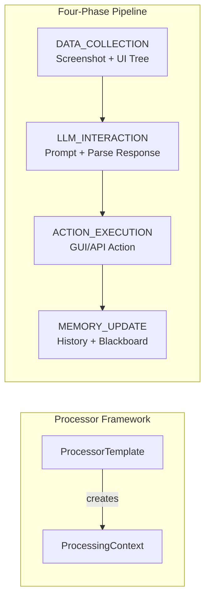

**AppAgent Processor:**
- Class: `ufo.agents.processors.app_agent_processor.AppAgentProcessor`
- Phases defined in: [documents/docs/ufo2/app_agent/overview.md:105-121]()

**Sources:**
- [documents/docs/ufo2/app_agent/overview.md:105-121]()
- [documents/docs/ufo2/host_agent/overview.md:52-64]()

---

## Galaxy Orchestration Layer

The Galaxy layer provides **LLM-driven multi-device orchestration** through dynamic DAG decomposition and event-driven scheduling.

### ConstellationAgent: LLM-Driven Planning

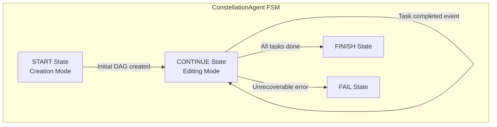

**ConstellationAgent** operates in two modes:

| Mode | Purpose | Input | Output |
|------|---------|-------|--------|
| **Creation** | Initial task decomposition | User request + device capabilities | New `TaskConstellation` DAG [documents/docs/galaxy/overview.md:128-130]() |
| **Editing** | Runtime adaptation | Task results + current DAG | `ConstellationEditor` commands to modify DAG [documents/docs/galaxy/overview.md:131-132]() |

**Sources:**
- [galaxy/README.md:66-92]()
- [documents/docs/galaxy/overview.md:118-132]()

### TaskConstellation: Dynamic DAG Structure

The **TaskConstellation** represents the distributed workflow as a directed acyclic graph:

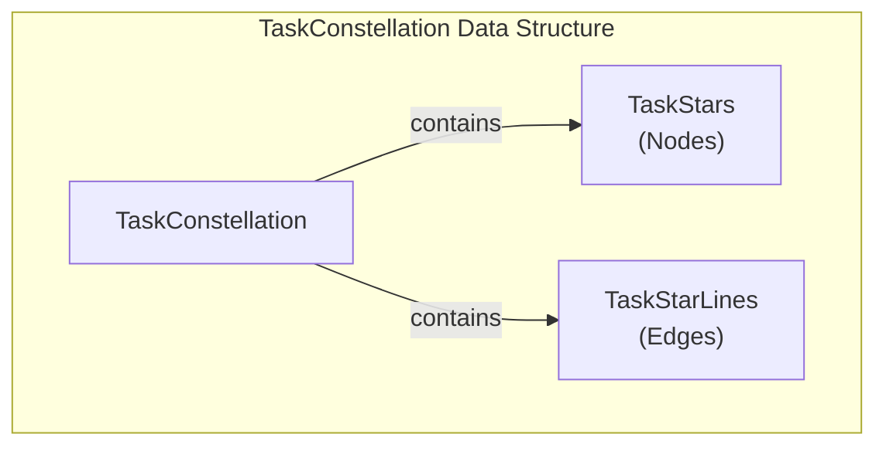

**DAG Invariants**:
1. **Acyclicity**: No cycles in dependency graph [documents/docs/galaxy/overview.md:28]()
2. **Safety Guarantees**: Formal invariants ensuring DAG consistency [galaxy/README.md:51-53]()

**Sources:**
- [galaxy/README.md:66-74]()
- [documents/docs/galaxy/overview.md:93-116]()

---

## Agent Interaction Protocol (AIP)

AIP provides **WebSocket-based bidirectional communication** between Galaxy orchestrator and device agents with automatic reconnection and fault tolerance.

### Protocol Stack

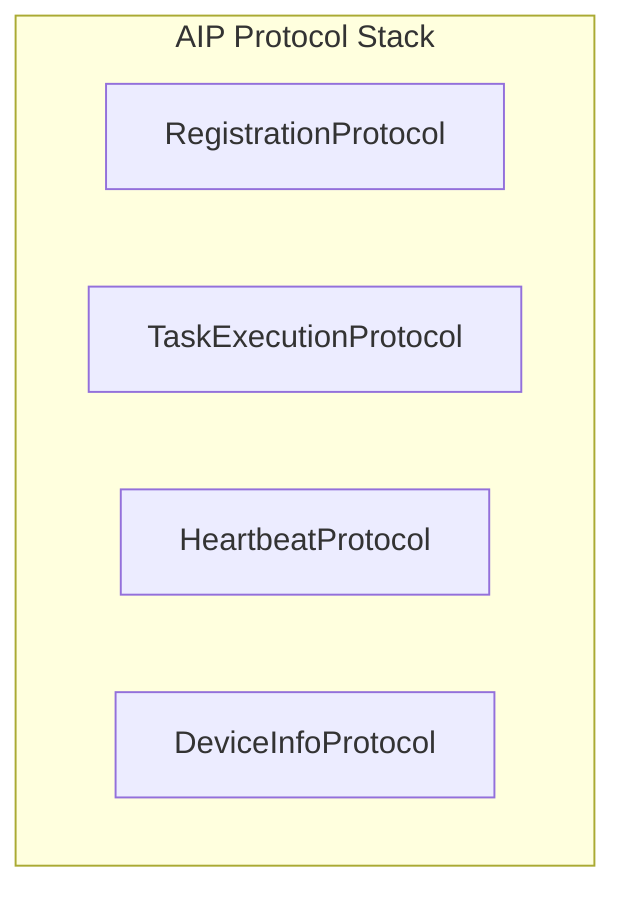

**Sources:**
- [galaxy/README.md:115-127]()
- [documents/docs/galaxy/overview.md:71-85]()

---

## Data Flow and Execution Path

### End-to-End Request Flow (Galaxy Mode)

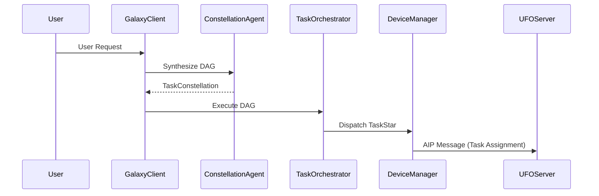

**Sources:**
- [documents/docs/galaxy/overview.md:60-69]()
- [galaxy/README.md:193-201]()

### Local Execution Flow (UFO² Standalone)

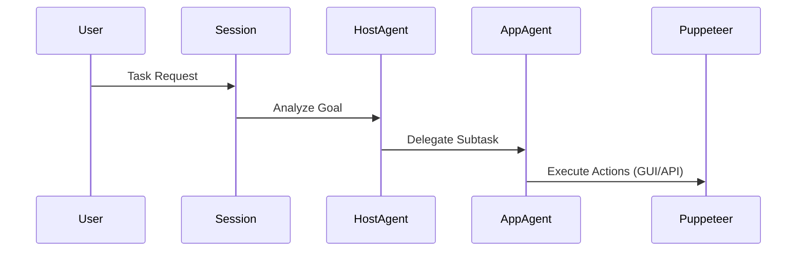

**Sources:**
- [documents/docs/ufo2/overview.md:42-64]()
- [documents/docs/ufo2/app_agent/overview.md:64-83]()

---

## Configuration System

UFO³ uses a **modular YAML-based configuration** system.

| File | Purpose |
|------|---------|
| `config/ufo/agents.yaml` | LLM configuration for Host/App agents [ufo/README.md:127-130]() |
| `config/galaxy/agent.yaml` | LLM configuration for ConstellationAgent [galaxy/README.md:233-239]() |
| `config/galaxy/devices.yaml` | Device registry and capabilities [galaxy/README.md:302-310]() |

**Sources:**
- [ufo/README.md:120-130]()
- [galaxy/README.md:222-239]()
- [documents/docs/getting_started/quick_start_galaxy.md:40-58]()

---

# Page: UFO² Desktop AgentOS

# UFO² Desktop AgentOS

<details>
<summary>Relevant source files</summary>

The following files were used as context for generating this wiki page:

- [documents/docs/img/aip_new.png](documents/docs/img/aip_new.png)
- [documents/docs/img/decomposition.png](documents/docs/img/decomposition.png)
- [documents/docs/ufo2/app_agent/commands.md](documents/docs/ufo2/app_agent/commands.md)
- [documents/docs/ufo2/app_agent/overview.md](documents/docs/ufo2/app_agent/overview.md)
- [documents/docs/ufo2/app_agent/state.md](documents/docs/ufo2/app_agent/state.md)
- [documents/docs/ufo2/app_agent/strategy.md](documents/docs/ufo2/app_agent/strategy.md)
- [documents/docs/ufo2/core_features/hybrid_actions.md](documents/docs/ufo2/core_features/hybrid_actions.md)
- [documents/docs/ufo2/host_agent/commands.md](documents/docs/ufo2/host_agent/commands.md)
- [documents/docs/ufo2/host_agent/overview.md](documents/docs/ufo2/host_agent/overview.md)
- [documents/docs/ufo2/host_agent/state.md](documents/docs/ufo2/host_agent/state.md)
- [documents/docs/ufo2/host_agent/strategy.md](documents/docs/ufo2/host_agent/strategy.md)
- [documents/docs/ufo2/overview.md](documents/docs/ufo2/overview.md)
- [ufo/__main__.py](ufo/__main__.py)
- [ufo/agents/agent/app_agent.py](ufo/agents/agent/app_agent.py)
- [ufo/agents/agent/basic.py](ufo/agents/agent/basic.py)
- [ufo/agents/agent/evaluation_agent.py](ufo/agents/agent/evaluation_agent.py)
- [ufo/agents/agent/host_agent.py](ufo/agents/agent/host_agent.py)
- [ufo/agents/processors/app_agent_processor.py](ufo/agents/processors/app_agent_processor.py)
- [ufo/agents/processors/host_agent_processor.py](ufo/agents/processors/host_agent_processor.py)
- [ufo/agents/states/app_agent_state.py](ufo/agents/states/app_agent_state.py)
- [ufo/agents/states/basic.py](ufo/agents/states/basic.py)
- [ufo/agents/states/host_agent_state.py](ufo/agents/states/host_agent_state.py)
- [ufo/agents/states/operator_state.py](ufo/agents/states/operator_state.py)
- [ufo/llm/llm_call.py](ufo/llm/llm_call.py)
- [ufo/llm/openai.py](ufo/llm/openai.py)
- [ufo/module/basic.py](ufo/module/basic.py)
- [ufo/module/sessions/plan_reader.py](ufo/module/sessions/plan_reader.py)
- [ufo/module/sessions/session.py](ufo/module/sessions/session.py)
- [ufo/rag/retriever.py](ufo/rag/retriever.py)
- [ufo/ufo.py](ufo/ufo.py)

</details>


## Overview

**UFO² Desktop AgentOS** is a single-device Windows automation system that executes natural language requests through intelligent agent orchestration. It serves dual roles in the UFO³ ecosystem: as a **standalone Windows automation framework** and as the **execution layer** for Windows devices when operating as a Galaxy device agent.

### Hierarchical Agent Architecture

UFO² implements a **two-tier hierarchical agent system**:
- **HostAgent**: Desktop-level orchestrator analyzing the overall environment and selecting applications. [ufo/agents/agent/host_agent.py:142-146]()
- **AppAgent**: Application-level executors performing fine-grained actions within specific applications. [ufo/agents/agent/app_agent.py:42-46]()

This hierarchy mirrors the operating system structure: the `HostAgent` operates at the desktop/OS level while `AppAgents` operate at the application/process level.

### Hybrid GUI/API Execution

UFO² uniquely combines two automation approaches:
- **GUI Automation**: UI element interaction via `pywinauto` or `pyautogui` through the `ControlReceiver`. [ufo/agents/processors/app_agent_processor.py:66-68]()
- **API Automation**: Native application APIs via COM interfaces through specialized receivers for Office applications like Word, Excel, and PowerPoint. [ufo/module/sessions/session.py:13-17]()

The automation framework intelligently routes actions to the appropriate execution method, enabling both robustness (GUI) and efficiency (API) in a unified framework.

### Dual Operating Modes

- **Standalone Mode**: Direct execution via `LocalCommandDispatcher` for interactive automation. [ufo/module/sessions/session.py:102-103]()
- **Galaxy Device Agent Mode**: Remote execution via `WebSocketCommandDispatcher` when coordinated by UFO³ Galaxy. [ufo/module/sessions/session.py:101-103]()

**Navigation:** This page documents UFO²'s core architecture and execution model. For multi-device orchestration, see [UFO³ Galaxy Framework](#4). For agent implementations, see [Host Agent](#3.3) and [App Agent](#3.4). For the processing pipeline, see [Agent Processing System](#3.1).

**Sources:** [ufo/agents/agent/host_agent.py:142-177](), [ufo/agents/agent/app_agent.py:42-87](), [ufo/module/sessions/session.py:41-65](), [ufo/agents/processors/app_agent_processor.py:54-73]()

## System Architecture

UFO² implements a hierarchical agent architecture where a `HostAgent` orchestrates multiple `AppAgent` instances to complete cross-application workflows. The system is organized into distinct layers handling session management, agent processing, action execution, and system interaction.

### UFO² Component Architecture

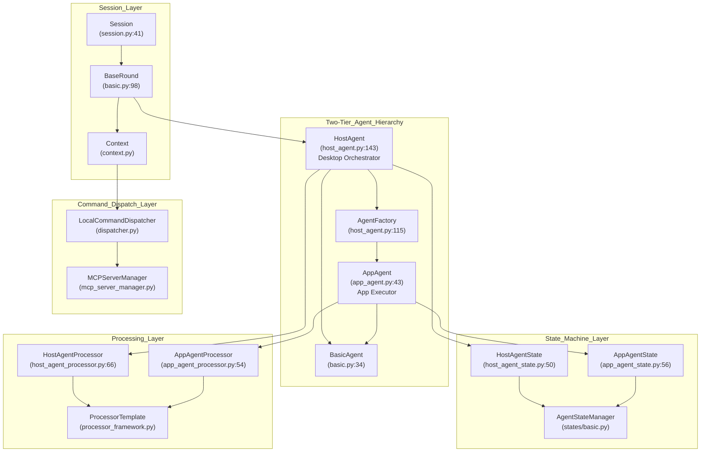

**Component Responsibilities:**

| Layer | Component | Role | Key References |
|-------|-----------|------|---------------------|
| **Session** | `Session` | Manages multi-round user interactions, creates rounds | [ufo/module/sessions/session.py:41-65]() |
| | `BaseRound` | Executes single user request through agent state transitions | [ufo/module/basic.py:98-129]() |
| | `Context` | Shared data structure propagating state across components | [ufo/module/context.py:35-41]() |
| **Agent Hierarchy** | `HostAgent` | **Tier 1**: Desktop-level orchestrator, selects applications | [ufo/agents/agent/host_agent.py:143-177]() |
| | `AppAgent` | **Tier 2**: Application-level executor, controls individual apps | [ufo/agents/agent/app_agent.py:43-87]() |
| | `AgentFactory` | Creates agent instances based on mode and type | [ufo/agents/agent/host_agent.py:115-140]() |
| **State Machine** | `HostAgentState` | FSM states for HostAgent: CONTINUE, ASSIGN, PENDING, FINISH | [ufo/agents/states/host_agent_state.py:21-33]() |
| | `AppAgentState` | FSM states for AppAgent: CONTINUE, CONFIRM, PENDING, FINISH | [ufo/agents/states/app_agent_state.py:30-42]() |
| **Processing** | `HostAgentProcessor` | Executes 4-phase pipeline for desktop analysis | [ufo/agents/processors/host_agent_processor.py:66-113]() |
| | `AppAgentProcessor` | Executes 4-phase pipeline for app automation | [ufo/agents/processors/app_agent_processor.py:54-110]() |

**Sources:** [ufo/module/basic.py:1-155](), [ufo/agents/agent/host_agent.py:142-177](), [ufo/agents/agent/app_agent.py:42-87](), [ufo/agents/processors/host_agent_processor.py:66-126](), [ufo/agents/processors/app_agent_processor.py:54-110]()

## Agent Hierarchy and Lifecycle

UFO² implements a two-tier agent hierarchy where `HostAgent` acts as the desktop orchestrator and `AppAgent` instances handle application-specific automation. Agent creation follows the Factory pattern, with state machines controlling their behavior.

### Agent Creation and State Transitions

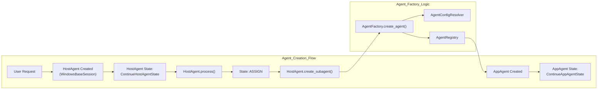

**Agent Factory Implementation:**

The `AgentFactory` in [ufo/agents/agent/host_agent.py:115-140]() creates agents based on type and mode. It supports standard host agents, app agents, and specialized agents like `OpenAIOperatorAgent`.

The `AgentConfigResolver` in [ufo/agents/agent/host_agent.py:42-113]() provides configuration based on mode and agent type:
- `resolve_app_agent_config()`: Returns config for standard `AppAgent` with prompts and visual settings. [ufo/agents/agent/host_agent.py:46-76]()
- `resolve_operator_agent_config()`: Returns config for `OpenAIOperatorAgent`. [ufo/agents/agent/host_agent.py:78-94]()
- `resolve_third_party_config()`: Returns config for third-party agents registered in the system. [ufo/agents/agent/host_agent.py:97-113]()

**Agent Lifecycle States:**

| Agent | States | Transitions |
|-------|--------|-------------|
| **HostAgent** | `CONTINUE` → `ASSIGN` → `PENDING` → `FINISH` | Managed by `HostAgentStateManager`. [ufo/agents/states/host_agent_state.py:35-41]() |
| **AppAgent** | `CONTINUE` → `CONFIRM` → `PENDING` → `FINISH` | Managed by `AppAgentStateManager`. [ufo/agents/states/app_agent_state.py:44-47]() |

**Sources:** [ufo/agents/agent/host_agent.py:42-177](), [ufo/agents/states/host_agent_state.py:21-41](), [ufo/agents/states/app_agent_state.py:30-47]()

## Processing Pipeline

Both `HostAgent` and `AppAgent` execute through a unified **Processor-Strategy-Middleware** architecture. Each agent's processor orchestrates four sequential phases using dedicated strategy implementations.

### Processor-Strategy Architecture

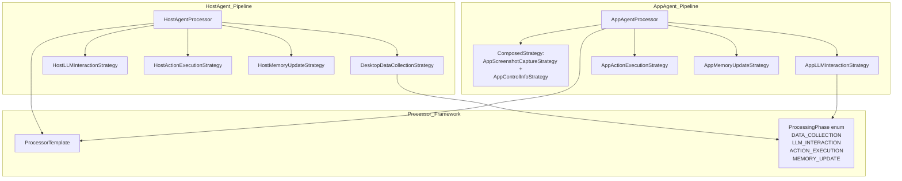

**Processing Phases:**

Each processor executes strategies in a fixed order defined in the `ProcessingPhase` enum: [ufo/agents/processors/app_agent_processor.py:84-109]()

1. **DATA_COLLECTION**: Gather environment information (screenshots, UI trees, application states).
2. **LLM_INTERACTION**: Build prompts, call LLM, parse structured responses.
3. **ACTION_EXECUTION**: Execute commands through the `CommandDispatcher`.
4. **MEMORY_UPDATE**: Update agent memory, blackboard, and context.

**Middleware Chain:**

Middleware wraps processor execution for cross-cutting concerns like logging and performance monitoring. Currently, both processors use specialized logging middleware for Rich-formatted console output:
- `HostAgentLoggingMiddleware`: [ufo/agents/processors/host_agent_processor.py:186-192]()
- `AppAgentLoggingMiddleware`: [ufo/agents/processors/app_agent_processor.py:132-142]()

**Sources:** [ufo/agents/processors/host_agent_processor.py:66-126](), [ufo/agents/processors/app_agent_processor.py:54-114](), [ufo/agents/processors/core/processor_framework.py:26-30]()

## Session and Round Execution Model

UFO² organizes execution into **Sessions** (multi-round conversations) and **Rounds** (single user requests). Each session maintains a `Context` object that propagates state across rounds and agents.

### Execution Flow

A `BaseRound` manages the lifecycle of a single user request, driving the agent through state transitions until the task is finished or a step limit is reached. [ufo/module/basic.py:156-191]()

1. **Round Initialization**: Sets up `ROUND_STEP`, `ROUND_COST`, and `REQUEST` in the shared context. [ufo/module/basic.py:132-154]()
2. **Execution Loop**: The round calls `agent.handle(context)` repeatedly. [ufo/module/basic.py:161-163]()
3. **State Transition**: After each handle call, the round determines the next state and next agent. [ufo/module/basic.py:167-174]()
4. **Completion**: Once finished, it captures a final snapshot and performs evaluation if configured. [ufo/module/basic.py:186-191]()

**Context Management:**

The `Context` class stores shared state with typed keys defined in the `ContextNames` enum: [ufo/module/context.py:35-41]()
- `SESSION_STEP`: Global step counter.
- `ROUND_STEP`: Per-round step counters.
- `REQUEST`: Current user request.
- `APPLICATION_PROCESS_NAME`: Active application process.

**Sources:** [ufo/module/basic.py:98-201](), [ufo/module/sessions/session.py:41-158](), [ufo/module/context.py:35-41]()

## Session Types and Operational Modes

UFO² supports different session types for interactive, automated, and batch processing scenarios.

| Session Type | Class | Use Case | Mode |
|--------------|-------|----------|------|
| **Standard Session** | `Session` | Interactive automation with user prompts. | `"normal"` |
| **Follower Session** | `FollowerSession` | Executes a predefined plan from a file. | `"follower"` |
| **Batch Session** | `FromFileSession` | Processes multiple files automatically. | `"batch_normal"` |

**Operational Modes:**
- **Normal Mode**: Standard interactive use. [ufo/ufo.py:55-56]()
- **Follower Mode**: Follows a plan file or folder. [ufo/ufo.py:58-59]()
- **Batch Mode**: Processes tasks in batch. [ufo/ufo.py:61-62]()
- **Operator Mode**: Runs the OpenAI Operator agent separately. [ufo/ufo.py:20-21]()

**Sources:** [ufo/module/sessions/session.py:41-491](), [ufo/ufo.py:9-42](), [ufo/agents/agent/host_agent.py:34-40]()

## Summary

UFO² Desktop AgentOS provides a robust execution layer for Windows automation through:

1. **Hierarchical Agent Architecture**: `HostAgent` orchestrates desktop-level tasks, spawning `AppAgent` instances for application-specific automation.
2. **Phase-Based Processing Pipeline**: Processor-strategy-middleware architecture separates data collection, LLM interaction, action execution, and memory update.
3. **State Machine Control**: FSM-based state transitions provide deterministic execution flow.
4. **Flexible Session Management**: Supports interactive, follower, and batch modes for diverse automation needs.

**Sources:** [ufo/agents/agent/host_agent.py:142-177](), [ufo/agents/agent/app_agent.py:42-87](), [ufo/agents/processors/app_agent_processor.py:54-110](), [ufo/module/basic.py:98-201]()

---

# Page: Agent Processing System

# Agent Processing System

<details>
<summary>Relevant source files</summary>

The following files were used as context for generating this wiki page:

- [config/config_loader.py](config/config_loader.py)
- [config/config_schemas.py](config/config_schemas.py)
- [config/ufo/agents.yaml.template](config/ufo/agents.yaml.template)
- [config/ufo/system.yaml](config/ufo/system.yaml)
- [documents/docs/infrastructure/agents/design/blackboard.md](documents/docs/infrastructure/agents/design/blackboard.md)
- [documents/docs/infrastructure/agents/design/command.md](documents/docs/infrastructure/agents/design/command.md)
- [documents/docs/infrastructure/agents/design/memory.md](documents/docs/infrastructure/agents/design/memory.md)
- [documents/docs/infrastructure/agents/design/processor.md](documents/docs/infrastructure/agents/design/processor.md)
- [documents/docs/infrastructure/agents/design/prompter.md](documents/docs/infrastructure/agents/design/prompter.md)
- [documents/docs/infrastructure/agents/design/state.md](documents/docs/infrastructure/agents/design/state.md)
- [documents/docs/infrastructure/agents/design/strategy.md](documents/docs/infrastructure/agents/design/strategy.md)
- [ufo/agents/agent/app_agent.py](ufo/agents/agent/app_agent.py)
- [ufo/agents/agent/basic.py](ufo/agents/agent/basic.py)
- [ufo/agents/agent/evaluation_agent.py](ufo/agents/agent/evaluation_agent.py)
- [ufo/agents/agent/host_agent.py](ufo/agents/agent/host_agent.py)
- [ufo/agents/presenters/rich_presenter.py](ufo/agents/presenters/rich_presenter.py)
- [ufo/agents/processors/app_agent_processor.py](ufo/agents/processors/app_agent_processor.py)
- [ufo/agents/processors/host_agent_processor.py](ufo/agents/processors/host_agent_processor.py)
- [ufo/agents/processors/schemas/actions.py](ufo/agents/processors/schemas/actions.py)
- [ufo/agents/processors/strategies/app_agent_processing_strategy.py](ufo/agents/processors/strategies/app_agent_processing_strategy.py)
- [ufo/agents/processors/strategies/host_agent_processing_strategy.py](ufo/agents/processors/strategies/host_agent_processing_strategy.py)
- [ufo/agents/states/app_agent_state.py](ufo/agents/states/app_agent_state.py)
- [ufo/agents/states/basic.py](ufo/agents/states/basic.py)
- [ufo/agents/states/host_agent_state.py](ufo/agents/states/host_agent_state.py)
- [ufo/agents/states/operator_state.py](ufo/agents/states/operator_state.py)
- [ufo/automator/app_apis/shell/__init__.py](ufo/automator/app_apis/shell/__init__.py)
- [ufo/automator/app_apis/shell/shell_client.py](ufo/automator/app_apis/shell/shell_client.py)
- [ufo/client/mcp/local_servers/ui_mcp_server.py](ufo/client/mcp/local_servers/ui_mcp_server.py)
- [ufo/module/basic.py](ufo/module/basic.py)
- [ufo/module/sessions/plan_reader.py](ufo/module/sessions/plan_reader.py)
- [ufo/module/sessions/session.py](ufo/module/sessions/session.py)
- [ufo/trajectory/parser.py](ufo/trajectory/parser.py)

</details>


The Agent Processing System implements UFO's core execution pipeline through a **Processor-Strategy-Middleware architecture**. This modular design separates agent workflow orchestration (processors), phase-specific logic (strategies), and cross-cutting concerns (middleware) to enable flexible, maintainable agent behavior.

The system standardizes how `HostAgent` and `AppAgent` instances execute tasks through a phase-based pipeline:
1. **DATA_COLLECTION** - Capture screenshots and UI control information.
2. **LLM_INTERACTION** - Context-aware prompting and response parsing.
3. **ACTION_EXECUTION** - UI automation and control interaction.
4. **MEMORY_UPDATE** - Agent memory and state synchronization.

All processors inherit from `ProcessorTemplate` and implement their behavior through composable strategies and middleware chains.

## Architecture Overview

The processing system uses three architectural layers that work together to bridge high-level agent logic with low-level system execution.

**Phase-Based Processing Pipeline:**

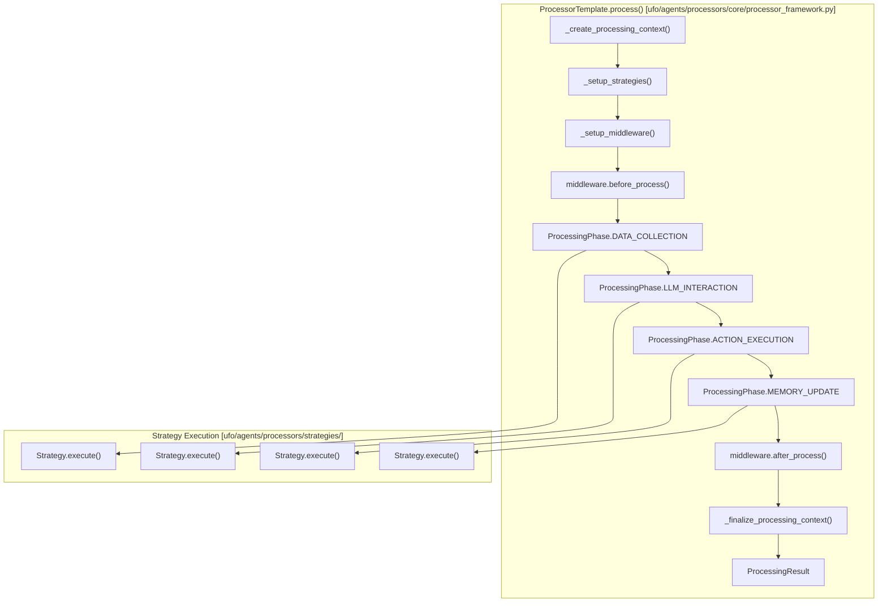

**Processing Phases (ProcessingPhase):**

| Phase | Purpose | Strategy Examples |
|-------|---------|-------------------|
| `DATA_COLLECTION` | Capture screenshots, UI controls, system state | `DesktopDataCollectionStrategy`, `AppScreenshotCaptureStrategy` + `AppControlInfoStrategy` |
| `LLM_INTERACTION` | Build prompts, call LLM, parse responses | `HostLLMInteractionStrategy`, `AppLLMInteractionStrategy` |
| `ACTION_EXECUTION` | Execute commands via Puppeteer or MCP tools | `HostActionExecutionStrategy`, `AppActionExecutionStrategy` |
| `MEMORY_UPDATE` | Update agent memory and global context | `HostMemoryUpdateStrategy`, `AppMemoryUpdateStrategy` |

Sources: [ufo/agents/processors/core/processor_framework.py:26-110](), [ufo/agents/processors/app_agent_processor.py:65-73](), [ufo/agents/processors/host_agent_processor.py:95-113]()

## ProcessorTemplate Architecture

`ProcessorTemplate` serves as the abstract base class that orchestrates the phase-based execution pipeline for all agent processors. It defines the lifecycle of a single agent step.

**Class Hierarchy and Data Flow:**

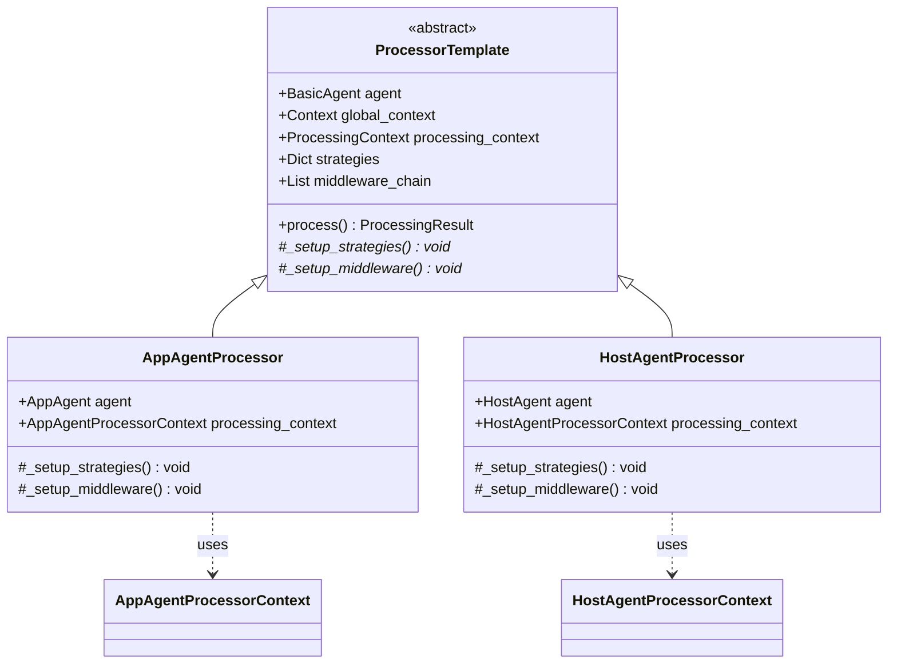

**Core Responsibilities:**

| Component | Purpose | Implementation |
|-----------|---------|----------------|
| `ProcessorTemplate` | Orchestrates phase execution and middleware invocation. | [ufo/agents/processors/core/processor_framework.py:26-35]() |
| `ProcessingContext` | Type-safe context container for phase-local data. | [ufo/agents/processors/context/processing_context.py:24-30]() |
| `strategies` | Maps `ProcessingPhase` enums to concrete `BaseProcessingStrategy` objects. | [ufo/agents/processors/app_agent_processor.py:82-109]() |
| `middleware_chain` | Ordered list of `EnhancedLoggingMiddleware` or custom hooks. | [ufo/agents/processors/app_agent_processor.py:111-114]() |

Sources: [ufo/agents/processors/core/processor_framework.py:26-110](), [ufo/agents/processors/app_agent_processor.py:54-76](), [ufo/agents/processors/host_agent_processor.py:66-83]()

## Strategy System

The strategy pattern separates phase-specific logic into composable units. Each strategy implements the `BaseProcessingStrategy` interface.

**Strategy Composition for AppAgent:**

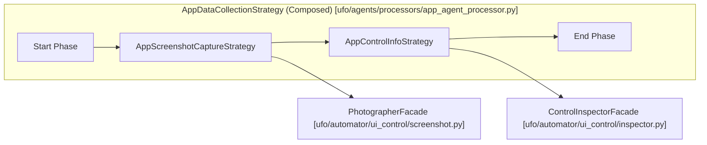

**Key Strategies:**

| Strategy | Agent | Phase | Role |
|----------|-------|-------|------|
| `AppScreenshotCaptureStrategy` | App | DATA_COLLECTION | Captures window screenshots via `command_dispatcher`. |
| `AppControlInfoStrategy` | App | DATA_COLLECTION | Filters UI elements and annotates screenshots. |
| `AppLLMInteractionStrategy` | App | LLM_INTERACTION | Constructs messages via `agent.message_constructor`. |
| `DesktopDataCollectionStrategy`| Host| DATA_COLLECTION | Enumerates open windows and desktop state. |
| `HostActionExecutionStrategy` | Host| ACTION_EXECUTION | Handles application selection and shell commands. |

**Composed Strategy Implementation:**
The `ComposedStrategy` class allows multiple strategies to execute sequentially in a single phase. For example, `AppAgentProcessor` uses it to combine visual capture and UI tree inspection.

Sources: [ufo/agents/processors/strategies/app_agent_processing_strategy.py:79-172](), [ufo/agents/processors/strategies/host_agent_processing_strategy.py:38-43](), [ufo/agents/processors/app_agent_processor.py:87-94](), [ufo/agents/processors/strategies/processing_strategy.py:34-47]()

## Middleware Chain

Middleware provides hooks for cross-cutting concerns like logging, performance tracking, and error recovery without modifying the core pipeline.

**Middleware Lifecycle:**

| Method | Purpose | Implementation Example |
|--------|---------|------------------------|
| `before_process` | Setup logging/UI panels. | `AppAgentLoggingMiddleware` prints the "Round/Step" panel. |
| `after_process` | Summarize execution/cost. | `EnhancedLoggingMiddleware` logs the final `ProcessingResult`. |
| `on_error` | Handle exceptions. | Logs stack traces and triggers recovery logic. |

Sources: [ufo/agents/processors/core/processing_middleware.py:25-30](), [ufo/agents/processors/app_agent_processor.py:132-182](), [ufo/agents/processors/host_agent_processor.py:186-210]()

## Execution and Data Flow

The processor acts as the bridge between the high-level `BasicAgent` logic and the low-level `AppPuppeteer` or `ComputerManager` automation.

**Bridging Agent Logic to Code Execution:**

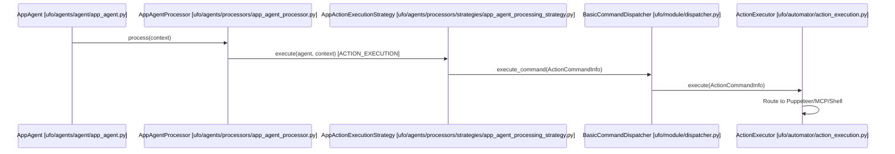

**Context Promotion:**
After processing, the `_finalize_processing_context` method promotes local data to the `global_context` (`Context` class). This ensures that decisions made in one step (like a selected application) are available to subsequent steps and other agents via the `ContextNames` enum.

Sources: [ufo/agents/processors/core/processor_framework.py:100-110](), [ufo/agents/processors/host_agent_processor.py:137-183](), [ufo/agents/processors/strategies/app_agent_processing_strategy.py:102-172](), [ufo/module/context.py:35-45]()

---

# Page: Session and Round Management

# Session and Round Management

<details>
<summary>Relevant source files</summary>

The following files were used as context for generating this wiki page:

- [documents/docs/img/app_agent_creation.png](documents/docs/img/app_agent_creation.png)
- [documents/docs/img/app_state_machine.png](documents/docs/img/app_state_machine.png)
- [documents/docs/img/host_state_machine.png](documents/docs/img/host_state_machine.png)
- [documents/docs/img/session.png](documents/docs/img/session.png)
- [ufo/__main__.py](ufo/__main__.py)
- [ufo/agents/agent/app_agent.py](ufo/agents/agent/app_agent.py)
- [ufo/agents/agent/basic.py](ufo/agents/agent/basic.py)
- [ufo/agents/agent/evaluation_agent.py](ufo/agents/agent/evaluation_agent.py)
- [ufo/agents/agent/host_agent.py](ufo/agents/agent/host_agent.py)
- [ufo/agents/processors/app_agent_processor.py](ufo/agents/processors/app_agent_processor.py)
- [ufo/agents/processors/host_agent_processor.py](ufo/agents/processors/host_agent_processor.py)
- [ufo/agents/states/app_agent_state.py](ufo/agents/states/app_agent_state.py)
- [ufo/agents/states/basic.py](ufo/agents/states/basic.py)
- [ufo/agents/states/host_agent_state.py](ufo/agents/states/host_agent_state.py)
- [ufo/agents/states/operator_state.py](ufo/agents/states/operator_state.py)
- [ufo/llm/llm_call.py](ufo/llm/llm_call.py)
- [ufo/llm/openai.py](ufo/llm/openai.py)
- [ufo/module/basic.py](ufo/module/basic.py)
- [ufo/module/sessions/plan_reader.py](ufo/module/sessions/plan_reader.py)
- [ufo/module/sessions/session.py](ufo/module/sessions/session.py)
- [ufo/rag/retriever.py](ufo/rag/retriever.py)
- [ufo/ufo.py](ufo/ufo.py)

</details>


## Purpose and Scope

This document describes the session and round management system in UFO² Desktop AgentOS, which provides the execution model for organizing agent workflows into hierarchical units of work. A **session** represents a complete task execution lifecycle spanning multiple user requests, while a **round** represents the processing of a single user request through multiple agent steps. For information about agent processing within rounds, see [Agent Processing System](#3.1). For agent state transitions during round execution, see [Agent State Machines](#3.5).

## Overview

UFO uses a two-tier execution model:

- **Session**: Top-level execution unit that manages multiple rounds, tracks overall cost and progress, handles evaluation, and maintains persistent context across user interactions.
- **Round**: Individual request processing unit that executes agent steps until completion, manages state transitions between agents, and captures execution snapshots.

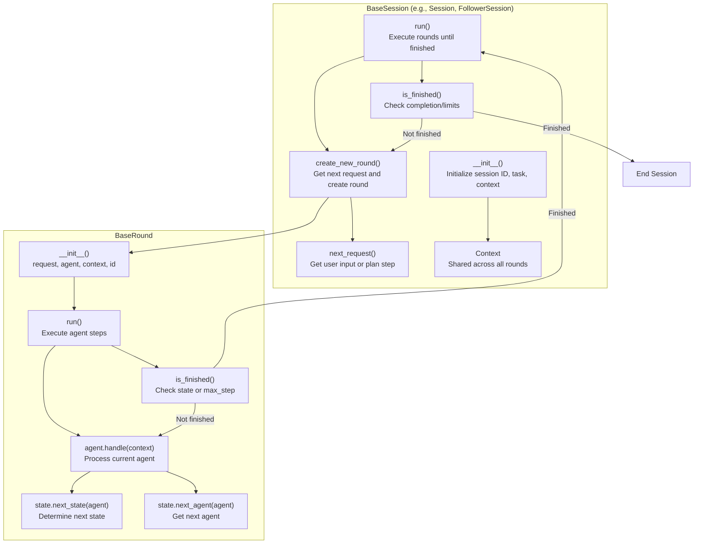

**Session and Round Execution Flow**

Sources: [ufo/module/basic.py:98-192](), [ufo/module/basic.py:444-997]()

## BaseSession Class

### Class Definition and Initialization

The `BaseSession` class is the abstract base class for all session types in UFO². It manages the lifecycle of a complete task execution, which may span multiple user requests (rounds).

```mermaid
classDiagram
    class BaseSession {
        <<abstract>>
        -str _id
        -bool _should_evaluate
        -str task
        -str log_path
        -Dict[int, BaseRound] _rounds
        -Context _context
        -bool _finish
        -List[Dict] _results
        -Optional[HostAgent] _host_agent
        +run() List[Dict]
        +create_new_round() BaseRound*
        +next_request() str*
        +is_finished() bool
        +evaluation() None
        +_init_agents() None*
        +_init_context() None
        +request_to_evaluate() str*
        +reset() None*
    }
    
    class Session {
        -str _mode
        -str _init_request
        +create_new_round() BaseRound
        +next_request() str
        +request_to_evaluate() str
    }
    
    class FollowerSession {
        -PlanReader plan_reader
        +create_new_round() BaseRound
        +next_request() str
        +request_to_evaluate() str
    }
    
    class FromFileSession {
        -str plan_file
        -PlanReader plan_reader
        -List support_apps
        +create_new_round() BaseRound
        +next_request() str
        +setup_application_environment() None
    }
    
    BaseSession <|-- Session
    BaseSession <|-- FollowerSession
    BaseSession <|-- FromFileSession
    BaseSession --> Context : manages
    BaseSession --> BaseRound : creates
```

**BaseSession Class Hierarchy**

Sources: [ufo/module/basic.py:444-524](), [ufo/module/sessions/session.py:41-158]()

### Session Lifecycle

The session lifecycle follows this pattern:

1.  **Initialization** (`__init__`): Sets up session ID, task name, logging paths, context, and platform-specific agents.
2.  **Execution** (`run`): Iteratively creates and executes rounds until completion.
3.  **Evaluation** (optional): Evaluates task completion using `EvaluationAgent`.
4.  **Cleanup**: Saves logs, trajectories, and experience data.

```mermaid
stateDiagram-v2
    [*] --> Initialized: __init__()
    Initialized --> CreatingRound: run()
    CreatingRound --> ExecutingRound: create_new_round()
    ExecutingRound --> CheckingCompletion: round.run()
    CheckingCompletion --> CreatingRound: is_finished() == False
    CheckingCompletion --> Evaluating: is_finished() == True
    Evaluating --> SavingLogs: evaluation()
    SavingLogs --> [*]: save_log_to_markdown()
    
    note right of CreatingRound
        next_request() gets user input
        or retrieves from plan file
    end note
    
    note right of CheckingCompletion
        Checks: _finish flag,
        max_step limit, max_round limit,
        or error state
    end note
```

**Session State Machine**

Sources: [ufo/module/basic.py:478-506](), [ufo/module/basic.py:776-791]()

### Context Initialization

The `_init_context` method sets up the shared `Context` object that persists across all rounds:

| Context Field | Type | Purpose |
| :--- | :--- | :--- |
| `ContextNames.ID` | str | Unique session identifier |
| `ContextNames.LOG_PATH` | str | Directory for logs and screenshots |
| `ContextNames.LOGGER` | FileWriter | Response log writer |
| `ContextNames.REQUEST_LOGGER` | FileWriter | Request log writer |
| `ContextNames.EVALUATION_LOGGER` | FileWriter | Evaluation log writer |
| `ContextNames.SESSION_COST` | float | Accumulated LLM API costs |
| `ContextNames.SESSION_STEP` | int | Total steps across all rounds |

Sources: [ufo/module/basic.py:557-586]()

### Key Properties and Methods

**Properties:**

*   `id`: Session identifier (string) [ufo/module/basic.py:587-593]()
*   `context`: Shared `Context` object [ufo/module/basic.py:630-636]()
*   `cost`: Total LLM API cost (updated via `ContextNames.SESSION_COST`) [ufo/module/basic.py:604-617]()
*   `step`: Total steps executed (via `ContextNames.SESSION_STEP`) [ufo/module/basic.py:619-628]()
*   `total_rounds`: Number of rounds created [ufo/module/basic.py:646-652]()
*   `current_round`: Most recent `BaseRound` instance [ufo/module/basic.py:654-663]()
*   `host_agent`: Optional `HostAgent` for Windows sessions [ufo/module/basic.py:665-671]()
*   `results`: List of evaluation results per round [ufo/module/basic.py:638-644]()

**Abstract Methods (must be implemented by subclasses):**

*   `_init_agents()`: Initialize platform-specific agents (e.g., `HostAgent` for Windows) [ufo/module/basic.py:552-555]()
*   `create_new_round()`: Create and configure a new round [ufo/module/basic.py:793-797]()
*   `next_request()`: Obtain the next user request [ufo/module/basic.py:799-803]()
*   `request_to_evaluate()`: Format request(s) for evaluation [ufo/module/basic.py:805-809]()
*   `reset()`: Reset session to initial state [ufo/module/basic.py:516-524]()

Sources: [ufo/module/basic.py:587-806]()

## BaseRound Class

### Class Definition

The `BaseRound` class represents a single request-response cycle within a session. Each round processes one user request through multiple agent steps until completion.

```mermaid
classDiagram
    class BaseRound {
        -str _request
        -Context _context
        -BasicAgent _agent
        -AgentState _state
        -int _id
        -bool _should_evaluate
        +run() None
        +is_finished() bool
        +capture_last_snapshot() None
        +save_ui_tree(save_path) None
        +evaluation() None
        +request: str
        +id: int
        +agent: BasicAgent
        +state: AgentState
        +step: int
        +cost: float
        +subtask_amount: int
        +log_path: str
    }
    
    class Context {
        +ROUND_STEP: Dict[int, int]
        +ROUND_COST: Dict[int, float]
        +ROUND_SUBTASK_AMOUNT: Dict[int, int]
        +REQUEST: str
        +CURRENT_ROUND_ID: int
    }
    
    BaseRound --> Context : uses
    BaseRound --> BasicAgent : manages
    BaseRound --> AgentState : tracks
```

**BaseRound Structure**

Sources: [ufo/module/basic.py:98-120]()

### Round Execution Flow

The `run` method implements the core round execution loop:

```mermaid
sequenceDiagram
    participant Round as BaseRound
    participant Agent as CurrentAgent
    participant State as AgentState
    participant Context as Context
    
    Round->>Round: while not is_finished()
    Round->>Agent: agent.handle(context)
    Agent->>Agent: process(context)
    Note over Agent: Execute agent processor<br/>(data collection, LLM, action, memory)
    Agent-->>Round: Processing complete
    
    Round->>State: state.next_state(agent)
    State-->>Round: NextState
    Round->>State: state.next_agent(agent)
    State-->>Round: NextAgent (may be different)
    
    Round->>Agent: agent.set_state(NextState)
    
    alt State indicates subtask end
        Round->>Round: capture_last_snapshot(sub_round_id)
        Round->>Round: subtask_amount += 1
    end
    
    Round->>Round: Check is_finished()
    
    alt Round finished
        Round->>Round: capture_last_snapshot()
        opt Evaluation enabled
            Round->>Round: evaluation()
        end
    end
```

**Round Execution Sequence**

Sources: [ufo/module/basic.py:156-192]()

### Round Context Management

Each round initializes per-round tracking in the shared context via `_init_context()` [ufo/module/basic.py:132-154]():

```python
# Round-specific context keys (all indexed by round ID)
round_step = {self.id: 0}          # Steps within this round
round_cost = {self.id: 0}          # LLM cost for this round  
round_subtask_amount = {self.id: 0} # Number of subtasks completed
```

The round also sets:
*   `ContextNames.REQUEST`: Current user request [ufo/module/basic.py:152]()
*   `ContextNames.CURRENT_ROUND_ID`: This round's ID [ufo/module/basic.py:154]()

Sources: [ufo/module/basic.py:122-154]()

### Completion Checking

The `is_finished` method determines when a round completes:

```python
def is_finished(self) -> bool:
    return (
        self.state.is_round_end()  # State indicates completion (FINISH, ERROR, FAIL)
        or self.context.get(ContextNames.SESSION_STEP) >= ufo_config.system.max_step
    )
```

Sources: [ufo/module/basic.py:193-201]()

### Snapshot Capture

Rounds capture screenshots and UI trees at critical points via `capture_last_snapshot()` [ufo/module/basic.py:303-348]():

| Snapshot Type | Trigger | File Pattern |
| :--- | :--- | :--- |
| Subtask final | `state.is_subtask_end()` returns True | `action_round_{id}_sub_round_{sub_id}_final.png` |
| Round final | Round completes | `action_round_{id}_final.png` |
| UI tree | `ufo_config.system.save_ui_tree` enabled | `ui_trees/ui_tree_round_{id}_final.json` |
| Full desktop | `ufo_config.system.save_full_screen` enabled | `desktop_round_{id}_sub_round_{sub_id}_final.png` |

Sources: [ufo/module/basic.py:303-378]()

## Context and ContextNames

### Context Class Architecture

The `Context` class provides a shared data store that persists across the entire session lifecycle. It uses a key-value structure with predefined keys in `ContextNames`.

```mermaid
graph LR
    subgraph ContextData["Context Internal Storage"]
        _data["_data: Dict[str, Any]"]
    end
    
    subgraph ContextNames["ContextNames Enum"]
        ID["ID: str"]
        LOG_PATH["LOG_PATH: str"]
        SESSION_COST["SESSION_COST: float"]
        SESSION_STEP["SESSION_STEP: int"]
        ROUND_STEP["ROUND_STEP: Dict[int, int]"]
        ROUND_COST["ROUND_COST: Dict[int, int]"]
        CURRENT_ROUND_ID["CURRENT_ROUND_ID: int"]
        REQUEST["REQUEST: str"]
        SUBTASK["SUBTASK: str"]
        APP_WINDOW["APPLICATION_WINDOW: UIAWrapper"]
        APP_PROCESS["APPLICATION_PROCESS_NAME: str"]
        APP_ROOT["APPLICATION_ROOT_NAME: str"]
        HOST_MSG["HOST_MESSAGE: List[str]"]
        MORE["... (30+ more keys)"]
    end
    
    Context -->|uses keys from| ContextNames
    Session -->|initializes| Context
    Round -->|updates| Context
    Processor -->|reads/writes| Context
    Agent -->|accesses via| Context
```

**Context Data Flow**

Sources: [ufo/module/context.py:1-200](), [ufo/module/basic.py:132-154]()

### Key Context Fields

The context stores session-wide and round-specific data:

**Session-Level Fields:**

| Field | Type | Description |
| :--- | :--- | :--- |
| `ID` | str | Unique session identifier |
| `LOG_PATH` | str | Base directory for logs and artifacts |
| `SESSION_COST` | float | Cumulative LLM API cost |
| `SESSION_STEP` | int | Total steps executed across all rounds |
| `LOGGER` | FileWriter | Response log file writer |
| `REQUEST_LOGGER` | FileWriter | Request log file writer |
| `EVALUATION_LOGGER` | FileWriter | Evaluation log file writer |
| `MODE` | str | Execution mode (normal, follower, batch_normal) |
| `command_dispatcher` | CommandDispatcher | Command execution interface (Local or WebSocket) |

**Round-Level Fields:**

| Field | Type | Description |
| :--- | :--- | :--- |
| `ROUND_STEP` | Dict[int, int] | Steps per round, keyed by round ID |
| `ROUND_COST` | Dict[int, float] | Cost per round, keyed by round ID |
| `ROUND_SUBTASK_AMOUNT` | Dict[int, int] | Subtasks per round, keyed by round ID |
| `CURRENT_ROUND_ID` | int | Active round identifier |
| `REQUEST` | str | Current user request being processed |
| `ROUND_RESULT` | Any | Result of the current round |

**Application Context Fields:**

| Field | Type | Description |
| :--- | :--- | :--- |
| `APPLICATION_WINDOW` | UIAWrapper | Active application window handle (Windows) |
| `APPLICATION_WINDOW_INFO` | Dict | Application window metadata |
| `APPLICATION_PROCESS_NAME` | str | Process name (e.g., "EXCEL.EXE") |
| `APPLICATION_ROOT_NAME` | str | Root application name (e.g., "Excel") |

**Agent Communication Fields:**

| Field | Type | Description |
| :--- | :--- | :--- |
| `SUBTASK` | str | Current subtask assigned to AppAgent |
| `HOST_MESSAGE` | List[str] | Tips from HostAgent to AppAgent |
| `PREVIOUS_SUBTASKS` | List[Dict] | Completed subtasks with results |

Sources: [ufo/module/basic.py:128-143](), [ufo/module/basic.py:557-586](), [ufo/module/sessions/session.py:94-103]()

### Context Usage Patterns

**Reading from Context:**

```python
# In processors and agents
round_step = context.get(ContextNames.ROUND_STEP)
current_request = context.get(ContextNames.REQUEST)
app_window = context.get(ContextNames.APPLICATION_WINDOW)
```

**Writing to Context:**

```python
# Simple values
context.set(ContextNames.SUBTASK, subtask)
context.set(ContextNames.REQUEST, request)

# Dictionary updates (for round-indexed data)
round_step = {self.id: step_value}
context.update_dict(ContextNames.ROUND_STEP, round_step)
```

**Processor Context Access:**

Processors receive the global context and can access it during processing phases:

```python
# In HostAgentProcessor._get_processor_specific_context_data()
context_data = {
    "previous_subtasks": self.global_context.get(ContextNames.PREVIOUS_SUBTASKS)
}

# Update after processing in _finalize_processing_context()
self.global_context.set(ContextNames.SUBTASK, subtask)
self.global_context.set(ContextNames.HOST_MESSAGE, host_message)
```

Sources: [ufo/agents/processors/host_agent_processor.py:124-183](), [ufo/agents/processors/app_agent_processor.py:116-129]()

## Session Types

UFO² provides concrete session implementations for different execution modes:

### Session (Interactive Mode)

The standard `Session` class handles interactive user workflows where requests are provided dynamically.

**Key Features:**
*   Prompts user for requests via `interactor.first_request()` [ufo/module/sessions/session.py:144]() and `interactor.new_request()` [ufo/module/sessions/session.py:146]().
*   Supports `mode` parameter: "normal", "batch_normal", "operator" [ufo/module/sessions/session.py:63]().
*   Initializes `LocalCommandDispatcher` for direct tool execution [ufo/module/sessions/session.py:102]().
*   Optional experience saving based on `ufo_config.system.save_experience` [ufo/module/sessions/session.py:76-92]().

Sources: [ufo/module/sessions/session.py:41-158]()

### FollowerSession (Plan Execution Mode)

The `FollowerSession` executes a predefined plan from a JSON file, following scripted steps without user interaction.

**Key Features:**
*   Uses `PlanReader` to parse plan files [ufo/module/sessions/session.py:179]().
*   First round: HostAgent processes the initial request [ufo/module/sessions/session.py:208]().
*   Subsequent rounds: AppAgent executes subtasks derived from the plan [ufo/module/sessions/session.py:212]().
*   Automatically clears agent memory between subtasks [ufo/module/sessions/session.py:215]().

Sources: [ufo/module/sessions/session.py:160-255]()

### FromFileSession (Batch Processing Mode)

The `FromFileSession` handles batch automation on Office files, managing application lifecycle automatically.

**Key Features:**
*   Opens target application with COM automation via `setup_application_environment()` [ufo/module/sessions/session.py:317]().
*   Closes applications after execution based on `close` flag [ufo/module/sessions/session.py:438]().
*   Records task completion status to JSON file via `record_task_done()` [ufo/module/sessions/session.py:400]().

Sources: [ufo/module/sessions/session.py:257-444]()

### OpenAIOperatorSession (Operator Mode)

The `OpenAIOperatorSession` integrates with OpenAI's Operator model for computer use.

**Key Features:**
*   Uses `OpenAIOperatorAgent` instead of HostAgent [ufo/module/sessions/session.py:511]().
*   Operates on desktop-level.
*   Refines requests to disable consent prompts via `refine_request()` [ufo/module/sessions/session.py:539]().

Sources: [ufo/module/sessions/session.py:446-556]()

## Round-Based Execution Model

### Agent Transitions Within Rounds

Rounds facilitate transitions between different agent types as the workflow progresses:

```mermaid
stateDiagram-v2
    [*] --> HostAgent: Round starts
    
    state HostAgent {
        [*] --> CONTINUE: Initial state
        CONTINUE --> Analyzing: process(context)
        Analyzing --> ASSIGN: Select application
        ASSIGN --> [*]
    }
    
    state "Agent Transition" as Transition {
        [*] --> CreateSubAgent: HostAgent.create_subagent()
        CreateSubAgent --> AppAgentCreated: AppAgent instance
        AppAgentCreated --> [*]
    }
    
    state AppAgent {
        [*] --> CONTINUE: Initial state
        CONTINUE --> Processing: process(context)
        Processing --> ActionExecution: Execute commands
        ActionExecution --> CONFIRM: Sensitive action
        CONFIRM --> UserDecision: Ask user
        UserDecision --> CONTINUE: Confirmed
        UserDecision --> FINISH: Rejected
        ActionExecution --> FINISH: Complete
        ActionExecution --> CONTINUE: More steps
        FINISH --> [*]
    }
    
    HostAgent --> Transition: state.next_agent()
    Transition --> AppAgent: Return new agent
    AppAgent --> HostAgent: state.next_agent() on FINISH
    
    note right of HostAgent
        States: CONTINUE, ASSIGN, 
        PENDING, FINISH, FAIL, ERROR
    end note
    
    note right of AppAgent
        States: CONTINUE, SCREENSHOT,
        CONFIRM, PENDING, FINISH, 
        FAIL, ERROR
    end note
```

**Agent State Transitions in Round**

Sources: [ufo/module/basic.py:163-168](), [ufo/agents/states/host_agent_state.py:122-237](), [ufo/agents/states/app_agent_state.py:127-183]()

### Step Counting and Cost Tracking

UFO tracks execution metrics at multiple granularities:

```mermaid
graph TB
    subgraph SessionMetrics["Session-Level Metrics"]
        SessionStep["SESSION_STEP<br/>(all rounds)"]
        SessionCost["SESSION_COST<br/>(all rounds)"]
    end
    
    subgraph RoundMetrics["Round-Level Metrics (by ID)"]
        RoundStep["ROUND_STEP[round_id]<br/>(steps in this round)"]
        RoundCost["ROUND_COST[round_id]<br/>(cost in this round)"]
        SubtaskAmount["ROUND_SUBTASK_AMOUNT[round_id]<br/>(subtasks completed)"]
    end
    
    subgraph AgentStep["Agent Step Execution"]
        HostProcess["HostAgent.process()"]
        AppProcess["AppAgent.process()"]
        LLMCall["LLM API Call"]
        ActionExec["Action Execution"]
    end
    
    AgentStep --> RoundMetrics
    RoundMetrics --> SessionMetrics
    
    HostProcess -->|"Update context"| RoundStep
    AppProcess -->|"Update context"| RoundStep
    LLMCall -->|"Add cost"| RoundCost
    LLMCall -->|"Add cost"| SessionCost
    ActionExec -->|"Increment"| SessionStep
```

**Metrics Tracking Hierarchy**

**Step Increment:**
*   Session step increases with every agent action across all rounds.
*   Round step tracks steps within the current round via `ROUND_STEP` context key [ufo/module/basic.py:138]().
*   Checked against `ufo_config.system.max_step` for termination [ufo/module/basic.py:200]().

**Cost Accumulation:**
*   Per-round cost tracked separately: `context.get(ContextNames.ROUND_COST)[round_id]` [ufo/module/basic.py:142]().
*   Session cost accumulates all rounds: `context.get(ContextNames.SESSION_COST)` [ufo/module/basic.py:575]().

Sources: [ufo/module/basic.py:132-154](), [ufo/module/basic.py:557-586]()

### Subtask Management

Rounds can be subdivided into subtasks, typically when HostAgent assigns work to an AppAgent:

**Subtask Lifecycle:**

1.  **Creation**: HostAgent assigns subtask via `ContextNames.SUBTASK` [ufo/agents/processors/host_agent_processor.py:152]().
2.  **Execution**: AppAgent processes subtask over multiple steps.
3.  **Completion**: AppAgent reaches FINISH state [ufo/agents/states/app_agent_state.py:128]().
4.  **Archiving**: State handler calls `archive_subtask()` to record result [ufo/agents/states/app_agent_state.py:147]().
5.  **Snapshot**: Round captures final screenshot for subtask via `capture_last_snapshot()` [ufo/module/basic.py:179]().

**Subtask Archiving:**

```python
# In AppAgentState.archive_subtask()
subtask = context.get(ContextNames.SUBTASK)
previous_subtasks = context.get(ContextNames.PREVIOUS_SUBTASKS)

if subtask:
    subtask_info = {"subtask": subtask, "status": self.name(), "result": result}
    previous_subtasks.append(subtask_info)
    context.set(ContextNames.PREVIOUS_SUBTASKS, previous_subtasks)
```

Sources: [ufo/agents/states/app_agent_state.py:102-118](), [ufo/module/basic.py:177-180]()

## Logging and File Management

### FileWriter Class

Sessions use `FileWriter` [ufo/module/basic.py:58-97]() to bypass global logging settings and ensure file writes succeed even when logging is disabled:

```python
class FileWriter:
    """Simple file writer that bypasses global logging settings."""
    
    def __init__(self, file_path: str, mode: str = "a"):
        self.file_path = file_path
        self.mode = mode
        # Creates directory and file if needed
        
    def write(self, message: str) -> None:
        # Writes to file with flush, handles errors gracefully
```

**Usage in Context:**
```python
# Session initialization in WindowsBaseSession._init_context()
response_writer = FileWriter(os.path.join(self.log_path, "response.log"), mode="a")
request_writer = FileWriter(os.path.join(self.log_path, "request.log"), mode="a")
eval_writer = FileWriter(os.path.join(self.log_path, "evaluation.log"), mode="a")

context.set(ContextNames.LOGGER, response_writer)
context.set(ContextNames.REQUEST_LOGGER, request_writer)
context.set(ContextNames.EVALUATION_LOGGER, eval_writer)
```

Sources: [ufo/module/basic.py:58-97](), [ufo/module/basic.py:569-581]()

### Log Directory Structure

Each session creates a structured log directory [ufo/module/basic.py:494-504]():

```
logs/{task_name}/
├── response.log              # Agent responses and LLM outputs
├── request.log               # User requests and agent inputs
├── evaluation.log            # Evaluation results (if enabled)
├── output.md                 # Markdown trajectory (if enabled)
├── action_round_0_step_1.png      # Per-step screenshots
├── action_round_0_final.png       # Round final screenshots
├── action_round_0_sub_round_0_final.png  # Subtask final screenshots
├── desktop_final.png              # Full desktop screenshot
└── ui_trees/
    ├── ui_tree_round_0_step_1.json
    └── ui_tree_round_0_final.json
```

Sources: [ufo/module/basic.py:303-378](), [ufo/module/basic.py:494-504]()

### Trajectory and Markdown Export

If `ufo_config.system.log_to_markdown` is enabled, sessions export execution trajectories via `save_log_to_markdown()` [ufo/module/basic.py:547-555]():

```python
def save_log_to_markdown(self) -> None:
    file_path = self.log_path
    trajectory = Trajectory(file_path)
    trajectory.to_markdown(file_path + "/output.md")
```

The `Trajectory` class parses log files and generates a human-readable markdown report.

Sources: [ufo/module/basic.py:547-555]()

## Evaluation System

### Evaluation Execution

If `should_evaluate` is True, sessions invoke the evaluation system via `evaluation()` [ufo/module/basic.py:808-860]():

```python
def evaluation(self) -> None:
    """Evaluate the session using EvaluationAgent."""
    evaluator = EvaluationAgent(...)
    
    requests = self.request_to_evaluate()
    
    result, cost = evaluator.evaluate(...)
    
    self._results.append(result)
    self.cost += cost
    
    self.evaluation_logger.write(json.dumps(result))
```

**Evaluation Trigger Points:**
*   After each round if `ufo_config.system.eva_round` is True [ufo/module/basic.py:189]().
*   After session completion if `should_evaluate` is True [ufo/module/basic.py:511]().

Sources: [ufo/module/basic.py:808-860](), [ufo/module/basic.py:188-190]()

### Request Formatting for Evaluation

Different session types format requests differently:

| Session Type | `request_to_evaluate()` Implementation |
| :--- | :--- |
| Session | `self._host_agent.blackboard.requests.to_json()` [ufo/module/sessions/session.py:157]() |
| FollowerSession | `self.plan_reader.get_task()` [ufo/module/sessions/session.py:253]() |
| FromFileSession | `self.plan_reader.get_task()` [ufo/module/sessions/session.py:424]() |

Sources: [ufo/module/sessions/session.py:151-157](), [ufo/module/sessions/session.py:248-254](), [ufo/module/sessions/session.py:420-425]()

---

# Page: Host Agent

# Host Agent

<details>
<summary>Relevant source files</summary>

The following files were used as context for generating this wiki page:

- [documents/docs/img/app_agent_creation.png](documents/docs/img/app_agent_creation.png)
- [documents/docs/img/app_state_machine.png](documents/docs/img/app_state_machine.png)
- [documents/docs/img/host_state_machine.png](documents/docs/img/host_state_machine.png)
- [documents/docs/img/session.png](documents/docs/img/session.png)
- [ufo/agents/agent/app_agent.py](ufo/agents/agent/app_agent.py)
- [ufo/agents/agent/basic.py](ufo/agents/agent/basic.py)
- [ufo/agents/agent/evaluation_agent.py](ufo/agents/agent/evaluation_agent.py)
- [ufo/agents/agent/host_agent.py](ufo/agents/agent/host_agent.py)
- [ufo/agents/processors/app_agent_processor.py](ufo/agents/processors/app_agent_processor.py)
- [ufo/agents/processors/host_agent_processor.py](ufo/agents/processors/host_agent_processor.py)
- [ufo/agents/states/app_agent_state.py](ufo/agents/states/app_agent_state.py)
- [ufo/agents/states/basic.py](ufo/agents/states/basic.py)
- [ufo/agents/states/host_agent_state.py](ufo/agents/states/host_agent_state.py)
- [ufo/agents/states/operator_state.py](ufo/agents/states/operator_state.py)
- [ufo/automator/ui_control/control_filter.py](ufo/automator/ui_control/control_filter.py)
- [ufo/module/basic.py](ufo/module/basic.py)
- [ufo/module/interactor.py](ufo/module/interactor.py)
- [ufo/module/sessions/plan_reader.py](ufo/module/sessions/plan_reader.py)
- [ufo/module/sessions/session.py](ufo/module/sessions/session.py)

</details>


The **Host Agent** is the desktop-level orchestrator in the UFO² Desktop AgentOS. It serves as the primary entry point for user requests, analyzes user intent, decomposes requests into subtasks, and manages the lifecycle of application-specific agents. The Host Agent operates as a finite state machine (FSM) that coordinates task execution across multiple applications on the desktop.

For information about application-specific automation, see [App Agent](#3.4). For details on the agent processing framework, see [Agent Processing System](#3.1). For state machine implementation details, see [Agent State Machines](#3.5).

## Core Responsibilities

The Host Agent performs four primary functions:

1. **Request Analysis**: Interprets natural language user requests and determines the appropriate application or third-party agent to handle the task.
2. **Application Selection**: Identifies and selects the target application window or third-party agent for task execution.
3. **Sub-Agent Management**: Creates and manages `AppAgent` instances (or `OpenAIOperatorAgent`, third-party agents) for application-specific automation.
4. **Task Orchestration**: Coordinates the execution flow between multiple agents through state transitions.

The Host Agent does not directly interact with application UI controls. Instead, it delegates application-specific tasks to `AppAgent` instances it creates and manages.

**Sources**: [ufo/agents/agent/host_agent.py:143-177]()

## Class Structure and Architecture

### HostAgent Class

The `HostAgent` class is registered with the `AgentRegistry` using the decorator pattern at [ufo/agents/agent/host_agent.py:142](). Key components include:

| Component | Type | Purpose |
|-----------|------|---------|
| `_name` | `str` | Agent identifier (e.g., "HostAgent") |
| `prompter` | `HostAgentPrompter` | Constructs LLM prompts for request analysis [ufo/agents/agent/host_agent.py:165-167]() |
| `_blackboard` | `Blackboard` | Shared memory for inter-agent communication [ufo/agents/agent/host_agent.py:175]() |
| `agent_factory` | `AgentFactory` | Factory for creating sub-agents [ufo/agents/agent/host_agent.py:172]() |
| `appagent_dict` | `Dict[str, AppAgent]` | Registry of created sub-agents [ufo/agents/agent/host_agent.py:173]() |
| `_active_appagent` | `Optional[AppAgent]` | Currently active sub-agent [ufo/agents/agent/host_agent.py:174]() |
| `_state` | `HostAgentState` | Current FSM state [ufo/agents/agent/basic.py:53]() |
| `_processor` | `HostAgentProcessor` | Processing pipeline executor [ufo/agents/agent/basic.py:52]() |

**Sources**: [ufo/agents/agent/host_agent.py:148-177](), [ufo/agents/agent/basic.py:34-62]()

### Agent Factory and Configuration

The `AgentFactory` class and `AgentConfigResolver` manage the creation of different agent types based on the `RunningMode`:

Title: Agent Creation Flow
```mermaid
graph LR
    subgraph "Agent Creation Flow"
        ConfigResolver["AgentConfigResolver<br/>(host_agent.py:42)"]
        Factory["AgentFactory.create_agent<br/>(host_agent.py:121)"]
        
        subgraph "Configuration Methods"
            AppConfig["resolve_app_agent_config<br/>(host_agent.py:46)"]
            OperatorConfig["resolve_operator_agent_config<br/>(host_agent.py:78)"]
            ThirdPartyConfig["resolve_third_party_config<br/>(host_agent.py:97)"]
        end
        
        subgraph "RunningMode"
            Normal["NORMAL"]
            BatchNormal["BATCH_NORMAL"]
            Follower["FOLLOWER"]
            NormalOperator["NORMAL_OPERATOR"]
            BatchOperator["BATCH_OPERATOR"]
        end
        
        ConfigResolver --> AppConfig
        ConfigResolver --> OperatorConfig
        ConfigResolver --> ThirdPartyConfig
        
        AppConfig --> Factory
        OperatorConfig --> Factory
        ThirdPartyConfig --> Factory
        
        Normal -.->|mode| AppConfig
        BatchNormal -.->|mode| AppConfig
        Follower -.->|mode| AppConfig
        NormalOperator -.->|mode| OperatorConfig
        BatchOperator -.->|mode| OperatorConfig
    end
```

The configuration resolution follows logic defined in `AgentConfigResolver`. For instance, `resolve_app_agent_config` determines if the agent should be a standard `AppAgent` or a `BatchAgent` based on the session mode [ufo/agents/agent/host_agent.py:46-76]().

**Sources**: [ufo/agents/agent/host_agent.py:42-140](), [ufo/module/sessions/session.py:41-68]()

## State Machine (FSM)

The Host Agent operates as a finite state machine with states defined in the `HostAgentStatus` enum at [ufo/agents/states/host_agent_state.py:21-33]().

### State Definitions

Title: Host Agent FSM Transitions
```mermaid
stateDiagram-v2
    [*] --> CONTINUE: Initial state
    
    CONTINUE --> CONTINUE: process() returns CONTINUE
    CONTINUE --> ASSIGN: process() selects application
    CONTINUE --> PENDING: process() needs user input
    CONTINUE --> FINISH: process() completes request
    CONTINUE --> ERROR: Exception occurs
    
    ASSIGN --> AppAgent: create_subagent()
    
    PENDING --> CONTINUE: process_asker() completes
    
    FINISH --> [*]
    ERROR --> FINISH
    FAIL --> FINISH
    
    AppAgent --> CONTINUE: AppAgent FINISH state
    AppAgent --> FINISH: AppAgent signals round end
```

### State Classes and Transitions

| State Class | Status Value | Purpose | Next State Transition |
|-------------|--------------|---------|----------------------|
| `ContinueHostAgentState` | `CONTINUE` | Processes user request via `agent.process(context)` [ufo/agents/states/host_agent_state.py:136]() | Status-dependent |
| `AssignHostAgentState` | `ASSIGN` | Triggers `agent.create_subagent(context)` [ufo/agents/states/host_agent_state.py:189]() | Transitions to `AppAgentState` |
| `PendingHostAgentState` | `PENDING` | Requests user input via `question_asker` [ufo/agents/states/host_agent_state.py:254-263]() | Returns to `CONTINUE` |
| `FinishHostAgentState` | `FINISH` | Marks round completion [ufo/agents/states/host_agent_state.py:101-120]() | Terminal state |

**Sources**: [ufo/agents/states/host_agent_state.py:21-270](), [ufo/module/basic.py:157-187]()

## Processing Pipeline

The `HostAgentProcessor` implements a phase-based processing pipeline using the `ProcessorTemplate` framework.

### Processor Architecture

Title: HostAgentProcessor Strategy Mapping
```mermaid
graph TB
    subgraph "HostAgentProcessor Pipeline"
        Entry["process()<br/>(processor_framework.py)"]
        
        subgraph "Phase 1: DATA_COLLECTION"
            DataPhase["ProcessingPhase.DATA_COLLECTION"]
            DesktopStrategy["DesktopDataCollectionStrategy<br/>(host_agent_processing_strategy.py)"]
        end
        
        subgraph "Phase 2: LLM_INTERACTION"
            LLMPhase["ProcessingPhase.LLM_INTERACTION"]
            HostLLMStrategy["HostLLMInteractionStrategy<br/>(host_agent_processing_strategy.py)"]
        end
        
        subgraph "Phase 3: ACTION_EXECUTION"
            ActionPhase["ProcessingPhase.ACTION_EXECUTION"]
            HostActionStrategy["HostActionExecutionStrategy<br/>(host_agent_processing_strategy.py)"]
        end
        
        subgraph "Phase 4: MEMORY_UPDATE"
            MemoryPhase["ProcessingPhase.MEMORY_UPDATE"]
            HostMemoryStrategy["HostMemoryUpdateStrategy<br/>(host_agent_processing_strategy.py)"]
        end
    end
    
    Entry --> DataPhase
    DataPhase --> DesktopStrategy
    DesktopStrategy --> LLMPhase
    LLMPhase --> HostLLMStrategy
    HostLLMStrategy --> ActionPhase
    ActionPhase --> HostActionStrategy
    HostActionStrategy --> MemoryPhase
    MemoryPhase --> HostMemoryStrategy
```

### Strategy Setup

The processor configures strategies at [ufo/agents/processors/host_agent_processor.py:95-113]():

| Strategy | Fail Fast | Purpose |
|----------|-----------|---------|
| `DesktopDataCollectionStrategy` | Yes | Captures desktop screenshots and detects application windows. |
| `HostLLMInteractionStrategy` | Yes | Constructs prompt with desktop context and parses response into `HostAgentResponse`. |
| `HostActionExecutionStrategy` | No | Executes selected action (application selection or finish). |
| `HostMemoryUpdateStrategy` | No | Updates agent memory and blackboard. |

**Context Finalization**: After processing, the processor promotes local context data to global context (e.g., `ContextNames.SUBTASK`, `ContextNames.APPLICATION_PROCESS_NAME`) at [ufo/agents/processors/host_agent_processor.py:137-184]().

**Sources**: [ufo/agents/processors/host_agent_processor.py:66-184](), [ufo/agents/processors/core/processor_framework.py]()

## Sub-Agent Creation and Management

The Host Agent creates sub-agents when it enters the `ASSIGN` state. The creation flow is triggered at [ufo/agents/states/host_agent_state.py:189]().

### Sub-Agent Creation Flow

Title: Sub-Agent Initialization Sequence
```mermaid
sequenceDiagram
    participant HostState as AssignHostAgentState
    participant HostAgent as HostAgent
    participant ConfigResolver as AgentConfigResolver
    participant Factory as AgentFactory
    participant SubAgent as AppAgent
    
    HostState->>HostAgent: create_subagent(context)
    HostAgent->>ConfigResolver: resolve_app_agent_config(...)
    ConfigResolver-->>HostAgent: config_dict
    HostAgent->>Factory: create_agent("app", **config_dict)
    Factory->>SubAgent: __init__(...)
    SubAgent-->>HostAgent: sub_agent_instance
    HostAgent->>HostAgent: Register in appagent_dict
    HostAgent->>SubAgent: Set host = self
```

The `appagent_dict` at [ufo/agents/agent/host_agent.py:173]() maintains a registry of created agents, indexed by a unique name (e.g., `"AppAgent/Word/WINWORD.EXE"`).

**Sources**: [ufo/agents/agent/host_agent.py:313-363](), [ufo/agents/states/host_agent_state.py:176-238]()

## Message Construction and LLM Interaction

The Host Agent constructs LLM prompts using `HostAgentPrompter`.

### Prompt Construction Flow

Title: HostAgent Prompt Assembly
```mermaid
graph TB
    subgraph "Context Sources"
        ImageList["image_list<br/>(Screenshots)"]
        OSInfo["os_info<br/>(App List)"]
        Plan["plan<br/>(Subtasks)"]
        Request["request<br/>(User Goal)"]
    end
    
    subgraph "HostAgentPrompter"
        SysPrompt["system_prompt_construction()"]
        UserContent["user_content_construction()"]
    end
    
    ImageList --> UserContent
    OSInfo --> UserContent
    Plan --> UserContent
    Request --> UserContent
    
    SysPrompt --> FinalPrompt["prompt_construction()"]
    UserContent --> FinalPrompt
```

The `message_constructor` method at [ufo/agents/agent/host_agent.py:219-255]() produces a message list compatible with LLM APIs, incorporating desktop visual state and task history.

**Sources**: [ufo/agents/agent/host_agent.py:219-311](), [ufo/prompter/agent_prompter.py]()

## Integration with Sessions and Rounds

The Host Agent is the root agent for most session types. In `Session.create_new_round()`, the Host Agent is assigned as the initial agent for the round [ufo/module/sessions/session.py:118-126]().

### Round Context Initialization

When a round starts, the context is initialized with round-specific tracking keys at [ufo/module/basic.py:132-154]():
- `ContextNames.ROUND_STEP`: Current step in the round.
- `ContextNames.ROUND_COST`: Cumulative LLM cost for the round.
- `ContextNames.ROUND_SUBTASK_AMOUNT`: Number of subtasks completed.

**Sources**: [ufo/module/basic.py:98-192](), [ufo/module/sessions/session.py:41-158]()

## Blackboard and Memory Management

The Host Agent maintains a `Blackboard` instance at [ufo/agents/agent/host_agent.py:175]() which acts as a shared scratchpad for all agents in the current session.

- **Access**: Sub-agents (like `AppAgent`) access the blackboard via their `host` reference [ufo/agents/agent/basic.py:112-117]().
- **Persistence**: Round results and user requests are added to the blackboard at the end of each round [ufo/module/basic.py:182-184]().

**Sources**: [ufo/agents/agent/host_agent.py:213-217](), [ufo/agents/agent/basic.py:112-117](), [ufo/agents/memory/blackboard.py]()

---

# Page: App Agent

# App Agent

<details>
<summary>Relevant source files</summary>

The following files were used as context for generating this wiki page:

- [documents/docs/img/add_comment.png](documents/docs/img/add_comment.png)
- [documents/docs/img/app_agent_creation.png](documents/docs/img/app_agent_creation.png)
- [documents/docs/img/app_state_machine.png](documents/docs/img/app_state_machine.png)
- [documents/docs/img/host_state_machine.png](documents/docs/img/host_state_machine.png)
- [documents/docs/img/session.png](documents/docs/img/session.png)
- [ufo/agents/agent/app_agent.py](ufo/agents/agent/app_agent.py)
- [ufo/agents/agent/basic.py](ufo/agents/agent/basic.py)
- [ufo/agents/agent/evaluation_agent.py](ufo/agents/agent/evaluation_agent.py)
- [ufo/agents/agent/host_agent.py](ufo/agents/agent/host_agent.py)
- [ufo/agents/processors/app_agent_processor.py](ufo/agents/processors/app_agent_processor.py)
- [ufo/agents/processors/host_agent_processor.py](ufo/agents/processors/host_agent_processor.py)
- [ufo/agents/states/app_agent_state.py](ufo/agents/states/app_agent_state.py)
- [ufo/agents/states/basic.py](ufo/agents/states/basic.py)
- [ufo/agents/states/host_agent_state.py](ufo/agents/states/host_agent_state.py)
- [ufo/agents/states/operator_state.py](ufo/agents/states/operator_state.py)
- [ufo/automator/ui_control/control_filter.py](ufo/automator/ui_control/control_filter.py)
- [ufo/module/basic.py](ufo/module/basic.py)
- [ufo/module/interactor.py](ufo/module/interactor.py)
- [ufo/module/sessions/plan_reader.py](ufo/module/sessions/plan_reader.py)
- [ufo/module/sessions/session.py](ufo/module/sessions/session.py)

</details>


The AppAgent is an application-specific agent that executes subtasks within individual applications. It receives subtasks from the HostAgent, interacts with application UI through the AppPuppeteer, and manages its execution flow using a state machine. The AppAgent is registered with `@AgentRegistry.register(agent_name="appagent", processor_cls=AppAgentProcessor)` and processes tasks using the Processor-Strategy-Middleware architecture.

## AppAgent Class Structure

The `AppAgent` class [ufo/agents/agent/app_agent.py:42-555]() inherits from `BasicAgent` [ufo/agents/agent/basic.py:34-408]() and implements application-specific automation capabilities.

**Class Hierarchy and Registration**

```mermaid
graph TB
    BasicAgent["BasicAgent<br/>(ufo/agents/agent/basic.py)"]
    AppAgent["AppAgent<br/>(ufo/agents/agent/app_agent.py)"]
    OpenAIOperatorAgent["OpenAIOperatorAgent<br/>(ufo/agents/agent/app_agent.py)"]
    AgentRegistry["@AgentRegistry.register"]
    
    BasicAgent --> AppAgent
    BasicAgent --> OpenAIOperatorAgent
    AgentRegistry --> AppAgent
    AgentRegistry --> OpenAIOperatorAgent
```

Sources: [ufo/agents/agent/app_agent.py:42-43](), [ufo/agents/agent/app_agent.py:557-558](), [ufo/agents/agent/basic.py:34-39]()

**Key Attributes**

The AppAgent maintains the following state:

| Attribute | Type | Description |
|-----------|------|-------------|
| `_name` | str | Agent identifier (e.g., "AppAgent/EXCEL.EXE/EXCEL.EXE") |
| `_process_name` | str | Application process name |
| `_app_root_name` | str | Application root name |
| `prompter` | AppAgentPrompter | Prompt construction helper [ufo/prompter/agent_prompter.py]() |
| `_processor` | AppAgentProcessor | Processor instance for task execution |
| `_state` | AgentState | Current state in state machine |
| `_mode` | str | Operating mode (normal/follower/batch_normal) |
| `offline_doc_retriever` | Retriever | Offline documentation retriever |
| `experience_retriever` | Retriever | Experience database retriever |
| `human_demonstration_retriever` | Retriever | Human demonstration retriever |

Sources: [ufo/agents/agent/app_agent.py:72-87]()

**Initialization**

The AppAgent is initialized [ufo/agents/agent/app_agent.py:48-86]() with application-specific parameters and sets up its prompter and initial state. The `skip_prompter` flag allows bypassing prompter initialization for special agent types like the `OpenAIOperatorAgent` [ufo/agents/agent/app_agent.py:557-614]().

```mermaid
graph LR
    Init["AppAgent.__init__()"]
    GetPrompter["AppAgent.get_prompter()"]
    SetState["AppAgent.set_state()"]
    DefaultState["AppAgent.default_state"]
    
    Init --> GetPrompter
    Init --> SetState
    SetState --> DefaultState
```

Sources: [ufo/agents/agent/app_agent.py:48-86](), [ufo/agents/agent/app_agent.py:89-102]()

## Processing Pipeline with AppAgentProcessor

The AppAgent delegates processing to `AppAgentProcessor` [ufo/agents/processors/app_agent_processor.py:54-130](), which implements the Processor-Strategy-Middleware architecture. The processor executes a phase-based pipeline consisting of data collection, LLM interaction, action execution, and memory updates.

**Processing Phases and Strategies**

```mermaid
graph LR
    AppAgent["AppAgent.process()"]
    AppAgentProcessor["AppAgentProcessor"]
    
    subgraph "Processing Phases (ufo/agents/processors/core/processor_framework.py)"
        DataCollection["DATA_COLLECTION<br/>ComposedStrategy"]
        LLMInteraction["LLM_INTERACTION<br/>AppLLMInteractionStrategy"]
        ActionExecution["ACTION_EXECUTION<br/>AppActionExecutionStrategy"]
        MemoryUpdate["MEMORY_UPDATE<br/>AppMemoryUpdateStrategy"]
    end
    
    subgraph "Data Collection Strategies"
        AppScreenshot["AppScreenshotCaptureStrategy"]
        AppControl["AppControlInfoStrategy"]
    end
    
    AppAgent --> AppAgentProcessor
    AppAgentProcessor --> DataCollection
    DataCollection --> AppScreenshot
    DataCollection --> AppControl
    DataCollection --> LLMInteraction
    LLMInteraction --> ActionExecution
    ActionExecution --> MemoryUpdate
```

Sources: [ufo/agents/processors/app_agent_processor.py:82-109](), [ufo/agents/processors/strategies/app_agent_processing_strategy.py:27-33]()

The `_setup_strategies` method [ufo/agents/processors/app_agent_processor.py:82-109]() configures the processing pipeline:

1.  **DATA_COLLECTION**: A `ComposedStrategy` [ufo/agents/processors/app_agent_processor.py:87-94]() that combines `AppScreenshotCaptureStrategy` and `AppControlInfoStrategy`.
2.  **LLM_INTERACTION**: `AppLLMInteractionStrategy` [ufo/agents/processors/app_agent_processor.py:97-99]() builds prompts with RAG augmentation and calls the LLM.
3.  **ACTION_EXECUTION**: `AppActionExecutionStrategy` [ufo/agents/processors/app_agent_processor.py:102-104]() executes commands via the command dispatcher.
4.  **MEMORY_UPDATE**: `AppMemoryUpdateStrategy` [ufo/agents/processors/app_agent_processor.py:107-109]() updates agent memory and blackboard.

**Middleware Stack**

The processor uses `AppAgentLoggingMiddleware` [ufo/agents/processors/app_agent_processor.py:132-254]() for enhanced logging with contextual information including subtask details, application names, and execution summaries.

Sources: [ufo/agents/processors/app_agent_processor.py:111-114](), [ufo/agents/processors/app_agent_processor.py:132-146]()

## State Machine

The AppAgent uses a state machine managed by `AppAgentStateManager` [ufo/agents/states/app_agent_state.py:44-54]() to control execution flow. States are registered using the `@AppAgentStateManager.register` decorator.

**State Transitions**

```mermaid
stateDiagram-v2
    [*] --> CONTINUE
    
    CONTINUE --> CONTINUE: Process and continue
    CONTINUE --> SCREENSHOT: Requires reannotation
    CONTINUE --> CONFIRM: Sensitive action
    CONTINUE --> PENDING: Need user input
    CONTINUE --> FINISH: Task complete
    CONTINUE --> ERROR: Exception occurred
    
    SCREENSHOT --> CONTINUE: Reannotation done
    SCREENSHOT --> SCREENSHOT: More reannotation needed
    
    CONFIRM --> CONTINUE: User confirmed
    CONFIRM --> FINISH: User rejected
    
    PENDING --> CONTINUE: Questions answered
    
    FINISH --> HostAgent: Return to HostAgent
    ERROR --> HostAgent: Return to HostAgent
    FAIL --> HostAgent: Return to HostAgent
```

Sources: [ufo/agents/states/app_agent_state.py:30-41](), [ufo/agents/states/app_agent_state.py:91-100]()

**State Implementations**

| State Class | Status Value | Purpose | Is Subtask End? |
|-------------|--------------|---------|-----------------|
| `ContinueAppAgentState` | CONTINUE | Normal processing [ufo/agents/states/app_agent_state.py:186-216]() | No |
| `ScreenshotAppAgentState` | SCREENSHOT | Control reannotation [ufo/agents/states/app_agent_state.py:219-255]() | No |
| `ConfirmAppAgentState` | CONFIRM | Sensitive action confirmation [ufo/agents/states/app_agent_state.py:301-361]() | No |
| `PendingAppAgentState` | PENDING | Waiting for user input [ufo/agents/states/app_agent_state.py:258-298]() | No |
| `FinishAppAgentState` | FINISH | Successful completion [ufo/agents/states/app_agent_state.py:128-183]() | Yes |
| `ErrorAppAgentState` | ERROR | Error occurred [ufo/agents/states/app_agent_state.py:364-414]() | Yes |
| `FailAppAgentState` | FAIL | Task failed [ufo/agents/states/app_agent_state.py:417-464]() | Yes |

Sources: [ufo/agents/states/app_agent_state.py:56-525]()

## RAG and Knowledge Integration

The AppAgent integrates multiple knowledge sources through RAG (Retrieval-Augmented Generation) to enhance decision-making.

**Context Provision**

The `context_provision` method [ufo/agents/agent/app_agent.py:454-528]() initializes retrieval components based on the `ufo_config` [ufo/agents/agent/app_agent.py:39]().

```mermaid
graph LR
    ContextProvision["AppAgent.context_provision()"]
    
    subgraph "Retriever Factory (ufo/rag/retriever.py)"
        BuildOffline["RetrieverFactory.create_retriever('offline')"]
        BuildOnline["RetrieverFactory.create_retriever('online')"]
        BuildExp["RetrieverFactory.create_retriever('experience')"]
        BuildDemo["RetrieverFactory.create_retriever('demonstration')"]
    end
    
    ContextProvision --> BuildOffline
    ContextProvision --> BuildOnline
    ContextProvision --> BuildExp
    ContextProvision --> BuildDemo
```

Sources: [ufo/agents/agent/app_agent.py:454-493](), [ufo/agents/agent/basic.py:49]()

**Retrieval Helpers**

-   **Experience/Demonstration**: `demonstration_prompt_helper` [ufo/agents/agent/app_agent.py:220-244]() retrieves both self-learned experiences and human demonstrations.
-   **External Knowledge**: `external_knowledge_prompt_helper` [ufo/agents/agent/app_agent.py:246-295]() retrieves information from offline help documents and online search engines.
-   **MCP Tools**: `_load_mcp_context` [ufo/agents/agent/app_agent.py:496-528]() discovers tools available via the Model Context Protocol to expose them to the agent's action space.

Sources: [ufo/agents/agent/app_agent.py:220-295](), [ufo/agents/agent/app_agent.py:496-528]()

## Subtask Execution

The AppAgent executes subtasks assigned by the `HostAgent` [ufo/agents/agent/host_agent.py:143-214](). 

**Execution Flow**

1.  **Message Construction**: `message_constructor` [ufo/agents/agent/app_agent.py:104-163]() assembles the system and user prompts, including visual screenshots and UI control trees.
2.  **LLM Call**: The agent invokes the LLM via `get_response` [ufo/agents/agent/basic.py:159-175]().
3.  **Action Dispatch**: The `AppActionExecutionStrategy` [ufo/agents/processors/strategies/app_agent_processing_strategy.py:156-253]() parses the response and uses the `LocalCommandDispatcher` [ufo/module/sessions/session.py:102-103]() to execute UI or API commands.
4.  **Feedback Loop**: Results are stored in the `ProcessingContext` and used to determine the next state (e.g., transition to `FINISH` if the subtask is done).

Sources: [ufo/agents/agent/app_agent.py:104-163](), [ufo/agents/processors/strategies/app_agent_processing_strategy.py:156-253](), [ufo/module/basic.py:156-181]()

---

# Page: Agent State Machines

# Agent State Machines

<details>
<summary>Relevant source files</summary>

The following files were used as context for generating this wiki page:

- [documents/docs/infrastructure/agents/design/blackboard.md](documents/docs/infrastructure/agents/design/blackboard.md)
- [documents/docs/infrastructure/agents/design/command.md](documents/docs/infrastructure/agents/design/command.md)
- [documents/docs/infrastructure/agents/design/memory.md](documents/docs/infrastructure/agents/design/memory.md)
- [documents/docs/infrastructure/agents/design/processor.md](documents/docs/infrastructure/agents/design/processor.md)
- [documents/docs/infrastructure/agents/design/prompter.md](documents/docs/infrastructure/agents/design/prompter.md)
- [documents/docs/infrastructure/agents/design/state.md](documents/docs/infrastructure/agents/design/state.md)
- [documents/docs/infrastructure/agents/design/strategy.md](documents/docs/infrastructure/agents/design/strategy.md)
- [ufo/agents/agent/app_agent.py](ufo/agents/agent/app_agent.py)
- [ufo/agents/agent/basic.py](ufo/agents/agent/basic.py)
- [ufo/agents/agent/evaluation_agent.py](ufo/agents/agent/evaluation_agent.py)
- [ufo/agents/agent/host_agent.py](ufo/agents/agent/host_agent.py)
- [ufo/agents/processors/app_agent_processor.py](ufo/agents/processors/app_agent_processor.py)
- [ufo/agents/processors/host_agent_processor.py](ufo/agents/processors/host_agent_processor.py)
- [ufo/agents/states/app_agent_state.py](ufo/agents/states/app_agent_state.py)
- [ufo/agents/states/basic.py](ufo/agents/states/basic.py)
- [ufo/agents/states/host_agent_state.py](ufo/agents/states/host_agent_state.py)
- [ufo/agents/states/operator_state.py](ufo/agents/states/operator_state.py)
- [ufo/automator/ui_control/control_filter.py](ufo/automator/ui_control/control_filter.py)
- [ufo/module/basic.py](ufo/module/basic.py)
- [ufo/module/interactor.py](ufo/module/interactor.py)
- [ufo/module/sessions/plan_reader.py](ufo/module/sessions/plan_reader.py)
- [ufo/module/sessions/session.py](ufo/module/sessions/session.py)

</details>


## Purpose and Scope

This document describes the **state machine architecture** that controls agent behavior in UFO². Each agent (HostAgent, AppAgent, and specialized agents) operates as a finite state machine (FSM) where states determine the agent's current behavior and valid transitions to subsequent states. The state pattern enables clean separation of concerns, maintainable control flow, and extensible agent behaviors.

For information about the broader agent architecture and processing pipeline, see [Agent Processing System](3.1). For specific agent implementations, see [Host Agent](3.3) and [App Agent](3.4).

---

## State Pattern Architecture

UFO² implements the **State Pattern** to manage agent behavior through explicit state objects. Each state encapsulates specific behavior logic and determines valid transitions to other states. This architecture enables dynamic behavior changes without modifying agent classes and provides clear visibility into the agent's execution flow.

### Core Components

The state machine architecture consists of three primary components:

1.  **`AgentState`**: Abstract base class defining the state interface [ufo/agents/states/basic.py:117-184]().
2.  **`AgentStateManager`**: Singleton registry managing state instances and mapping status strings to state classes [ufo/agents/states/basic.py:49-115]().
3.  **Concrete State Classes**: Specific implementations for each agent state (e.g., `ContinueHostAgentState`, `FinishAppAgentState`).

### Natural Language to Code Entity Mapping: State Management

The following diagram bridges the gap between high-level state concepts and the specific code entities that implement them.

```mermaid
graph TD
    subgraph "Natural Language Concepts"
        A["Current Agent Behavior"]
        B["Transition Logic"]
        C["State Registry"]
    end

    subgraph "Code Entity Space"
        A1["AgentState.handle()"]
        B1["AgentState.next_state()"]
        C1["AgentStateManager._state_mapping"]
    end

    A --- A1
    B --- B1
    C --- C1

    subgraph "Specific Implementations"
        H1["ContinueHostAgentState"]
        H2["AssignHostAgentState"]
        A2["ContinueAppAgentState"]
        A3["FinishAppAgentState"]
    end

    A1 -.-> H1
    A1 -.-> H2
    A1 -.-> A2
    A1 -.-> A3
```
**Sources:** [ufo/agents/states/basic.py:49-184](), [ufo/agents/states/host_agent_state.py:35-48](), [ufo/agents/states/app_agent_state.py:44-54]()

---

### AgentState Interface

The `AgentState` abstract class defines the contract that all state implementations must fulfill [ufo/agents/states/basic.py:117-184]():

| Method | Purpose | Return Type |
| :--- | :--- | :--- |
| `handle(agent, context)` | Execute state-specific behavior (usually calls `agent.process`) | `None` |
| `next_state(agent)` | Determine the next state based on `agent.status` | `AgentState` |
| `next_agent(agent)` | Determine the agent for the next step (enables handoffs) | `BasicAgent` |
| `is_round_end()` | Check if the current round should end | `bool` |
| `is_subtask_end()` | Check if the current subtask should end (triggers snapshot) | `bool` |
| `agent_class()` | Return the agent class this state applies to | `Type[BasicAgent]` |
| `name()` | Return the state's string identifier (e.g., "CONTINUE") | `str` |

**Key Principles:**
*   **State Ownership**: Each state knows which agent type it applies to via `agent_class()` [ufo/agents/states/basic.py:126-132]().
*   **Transition Logic**: Successors are determined through `next_state()` based on `agent.status` [ufo/agents/states/basic.py:141-150]().
*   **Agent Handoff**: States can transfer control between agents via `next_agent()` (e.g., HostAgent → AppAgent) [ufo/agents/states/basic.py:152-159]().

**Sources:** [ufo/agents/states/basic.py:117-184]()

---

## HostAgent State Machine

The `HostAgent` operates as a desktop-level orchestrator. It manages high-level workflow decisions, application selection, and sub-agent creation [ufo/agents/agent/host_agent.py:143-180]().

### HostAgent State Transition Diagram

```mermaid
stateDiagram-v2
    [*] --> CONTINUE: Default State
    
    CONTINUE --> CONTINUE: status="CONTINUE"<br/>(Refine Plan)
    CONTINUE --> ASSIGN: status="ASSIGN"<br/>(App Selected)
    CONTINUE --> PENDING: status="PENDING"<br/>(User Clarification)
    CONTINUE --> FINISH: status="FINISH"<br/>(Task Done)
    
    ASSIGN --> ContinueAppAgentState: next_agent()=AppAgent
    
    PENDING --> CONTINUE: Response Received
    
    FINISH --> [*]: is_round_end()=True
```

### HostAgent States

| State Class | Status String | Behavior | Transition |
| :--- | :--- | :--- | :--- |
| `ContinueHostAgentState` | `CONTINUE` | Calls `agent.process(context)` [ufo/agents/states/host_agent_state.py:136](). | Stays in `CONTINUE` or moves to `ASSIGN`/`FINISH`. |
| `AssignHostAgentState` | `ASSIGN` | Calls `agent.create_subagent(context)` [ufo/agents/states/host_agent_state.py:189](). | `next_agent()` returns the new `AppAgent` [ufo/agents/states/host_agent_state.py:222](). |
| `PendingHostAgentState` | `PENDING` | Prompts user via `question_asker` [ufo/agents/states/host_agent_state.py:256-260](). | Transitions back to `CONTINUE` [ufo/agents/states/host_agent_state.py:262](). |
| `FinishHostAgentState` | `FINISH` | Sets `is_round_end() = True` [ufo/agents/states/host_agent_state.py:111](). | Terminates the round loop. |

**Sources:** [ufo/agents/states/host_agent_state.py:100-281]()

---

## AppAgent State Machine

The `AppAgent` manages interactions within a specific application. It handles UI automation, screenshot re-annotation, and subtask completion [ufo/agents/agent/app_agent.py:43-88]().

### AppAgent State Transition Diagram

```mermaid
stateDiagram-v2
    [*] --> CONTINUE: Default State
    
    CONTINUE --> CONTINUE: status="CONTINUE"<br/>(Action Execution)
    CONTINUE --> SCREENSHOT: status="SCREENSHOT"<br/>(UI Changed)
    CONTINUE --> CONFIRM: status="CONFIRM"<br/>(Safe Guard)
    CONTINUE --> FINISH: status="FINISH"<br/>(Subtask Done)
    
    SCREENSHOT --> CONTINUE: Re-annotation Complete
    
    CONFIRM --> CONTINUE: User Approved
    CONFIRM --> FINISH: User Denied
    
    FINISH --> ContinueHostAgentState: next_agent()=HostAgent
```

### AppAgent States

| State Class | Status String | Behavior | Transition |
| :--- | :--- | :--- | :--- |
| `ContinueAppAgentState` | `CONTINUE` | Calls `agent.process(context)` [ufo/agents/states/app_agent_state.py:200](). | Normal execution loop. |
| `ScreenshotAppAgentState` | `SCREENSHOT` | Triggers re-annotation of specific controls [ufo/agents/states/app_agent_state.py:232-247](). | Moves to `CONTINUE` after capture. |
| `ConfirmAppAgentState` | `CONFIRM` | Calls `agent.process_confirmation()` for sensitive steps [ufo/agents/states/app_agent_state.py:316-321](). | `CONTINUE` if confirmed, `FINISH` if not. |
| `FinishAppAgentState` | `FINISH` | Calls `archive_subtask()` to save results [ufo/agents/states/app_agent_state.py:147](). | `next_agent()` returns `HostAgent` [ufo/agents/states/app_agent_state.py:155](). |

**Sources:** [ufo/agents/states/app_agent_state.py:128-361]()

---

## State Transition Mechanism in Round Loop

The `BaseRound` class orchestrates the transitions by calling state methods in a loop until `is_finished()` returns `True` [ufo/module/basic.py:161-182]().

### Round Execution Flow

```mermaid
sequenceDiagram
    participant R as BaseRound
    participant A as BasicAgent
    participant S as AgentState
    participant M as AgentStateManager

    Note over R, M: Loop Start
    R->>A: handle(context)
    A->>S: handle(agent, context)
    S->>A: process(context)
    Note right of A: Processor sets agent.status
    
    R->>S: next_state(agent)
    S->>M: get_state(agent.status)
    M-->>S: NewStateClass
    S-->>R: next_state_instance
    
    R->>S: next_agent(agent)
    S-->>R: next_agent_instance
    
    R->>A: set_state(next_state_instance)
    Note over R: agent = next_agent_instance
    Note over R, M: Loop Repeat
```

### Code Implementation of Transition

The core logic for moving between states is implemented in `BaseRound.run()` [ufo/module/basic.py:156-182]():

1.  **Execute**: `await self.agent.handle(self.context)` calls the current state's logic.
2.  **Determine Next State**: `self.state = self.agent.state.next_state(self.agent)` queries the state manager using the status set during execution.
3.  **Determine Next Agent**: `self.agent = self.agent.state.next_agent(self.agent)` allows switching from `HostAgent` to `AppAgent` (during `ASSIGN`) or back (during `FINISH`).
4.  **Update**: `self.agent.set_state(self.state)` binds the new state to the agent for the next iteration.

**Sources:** [ufo/module/basic.py:156-182](), [ufo/agents/states/basic.py:141-159]()

---

## State Machine and Processor Integration

While the State Machine controls the **flow**, the `ProcessorTemplate` (and its strategies) handles the **work** [ufo/agents/processors/core/processor_framework.py]().

1.  **Processor Context**: During `handle()`, the state triggers the processor. The processor uses `ProcessingContext` to store local data (like LLM results or action success) [ufo/agents/processors/app_agent_processor.py:21-35]().
2.  **Status Assignment**: In the `LLM_INTERACTION` phase, the `AppLLMInteractionStrategy` or `HostLLMInteractionStrategy` parses the LLM response and sets `agent.status` (e.g., to "FINISH" or "CONTINUE") [ufo/agents/processors/strategies/app_agent_processing_strategy.py]().
3.  **State Reaction**: Once the processor finishes, the state machine reads that `agent.status` to pick the next `AgentState` object [ufo/agents/states/basic.py:141-150]().

**Sources:** [ufo/agents/processors/app_agent_processor.py:54-110](), [ufo/agents/processors/host_agent_processor.py:66-112](), [ufo/agents/agent/basic.py:251-262]()

---

# Page: Screenshot and Annotation System

# Screenshot and Annotation System

<details>
<summary>Relevant source files</summary>

The following files were used as context for generating this wiki page:

- [.github/workflows/document_deploy.yml](.github/workflows/document_deploy.yml)
- [documents/docs/img/comparison.png](documents/docs/img/comparison.png)
- [documents/docs/img/controls.png](documents/docs/img/controls.png)
- [documents/docs/img/framework2.png](documents/docs/img/framework2.png)
- [ufo/automator/ui_control/controller.py](ufo/automator/ui_control/controller.py)
- [ufo/automator/ui_control/screenshot.py](ufo/automator/ui_control/screenshot.py)
- [ufo/utils/__init__.py](ufo/utils/__init__.py)

</details>


## Purpose and Scope

The Screenshot and Annotation System provides visual observation capabilities for UFO² Desktop AgentOS, enabling agents to capture, annotate, and present UI controls to LLMs for decision-making. This system implements a decorator pattern to layer visual feedback (bounding boxes, labels, highlights) onto screenshots of application windows and desktop screens. The annotated screenshots help LLMs understand the spatial layout and identify specific UI controls for interaction.

The system is designed to be robust across different environments, including support for disconnected RDP sessions via specialized Win32 APIs. It serves as the visual bridge between the operating system's UI tree and the multi-modal capabilities of Large Action Models (LAMs).

Sources: [ufo/automator/ui_control/screenshot.py:1-35](), [ufo/automator/ui_control/screenshot.py:36-69]()

---

## Architecture Overview

The system architecture follows a clear separation of concerns using three primary design patterns:

1.  **Abstract Factory Pattern**: `PhotographerFactory` encapsulates the logic for creating specific photographer instances based on requested types.
2.  **Decorator Pattern**: The `PhotographerDecorator` hierarchy allows for dynamic stacking of visual enhancements (rectangles, labels, highlights) without modifying the base capture logic.
3.  **Facade Pattern**: `PhotographerFacade` provides a high-level, simplified interface for the rest of the UFO framework to perform complex visual tasks.

### Class Hierarchy and Relationships

```mermaid
classDiagram
    class Photographer {
        <<abstract>>
        +capture()* Image
        +rescale_image(image, scaler) Image
    }
    
    class ControlPhotographer {
        -UIAWrapper control
        +capture(save_path, scalar) Image
    }
    
    class DesktopPhotographer {
        -bool all_screens
        +capture(save_path, scalar) Image
    }
    
    class PhotographerDecorator {
        <<abstract>>
        -Photographer photographer
        +capture(save_path) Image
    }
    
    class RectangleDecorator {
        -str color
        -float width
        -List sub_control_list
        +draw_rectangles(image, coordinate, color, width) Image
        +capture(save_path, background_screenshot_path) Image
    }
    
    class AnnotationDecorator {
        -List sub_control_list
        -str annotation_type
        -bool color_diff
        +get_annotation_dict() Dict
        +capture_with_annotation_dict(dict, save_path, highlight_bbox) Image
    }
    
    class TargetAnnotationDecorator {
        -Optional~Image~ screenshot
        +capture_with_target_info(target_list, save_path, highlight_bbox) Image
    }
    
    class PhotographerFactory {
        +create_screenshot(screenshot_type, args, kwargs) Photographer
    }
    
    class PhotographerFacade {
        <<singleton>>
        -PhotographerFactory screenshot_factory
        +capture_app_window_screenshot() Image
        +capture_app_window_screenshot_with_annotation() Image
    }
    
    Photographer <|-- ControlPhotographer
    Photographer <|-- DesktopPhotographer
    Photographer <|-- PhotographerDecorator
    PhotographerDecorator <|-- RectangleDecorator
    PhotographerDecorator <|-- AnnotationDecorator
    PhotographerDecorator <|-- TargetAnnotationDecorator
    PhotographerDecorator o-- Photographer
    PhotographerFacade --> PhotographerFactory
    PhotographerFactory ..> Photographer : creates
```

Sources: [ufo/automator/ui_control/screenshot.py:36-703](), [ufo/automator/ui_control/screenshot.py:705-719]()

---

## Photographer Hierarchy

### Abstract Base Class
The `Photographer` abstract class defines the core interface. It includes a robust `rescale_image` utility that uses `LANCZOS` resampling to maintain visual fidelity when preparing images for LLM context windows.

Sources: [ufo/automator/ui_control/screenshot.py:36-69]()

### ControlPhotographer (Window Capture)
Captures screenshots of specific application windows or controls. It implements a multi-stage fallback mechanism to ensure reliability:
1.  **pywinauto**: Attempts `control.capture_as_image()`.
2.  **PrintWindow API**: A specialized Win32 fallback (`_win32_print_window`) that works on disconnected RDP sessions by asking the window to paint itself to a device context.
3.  **Desktop Capture**: Falls back to a full desktop crop if window-specific methods fail.

Sources: [ufo/automator/ui_control/screenshot.py:70-133](), [ufo/automator/ui_control/screenshot.py:136-206]()

### DesktopPhotographer (Screen Capture)
Captures the entire desktop. It also includes a fallback for disconnected sessions (`_win32_grab_screen`) using BitBlt or PrintWindow on the desktop window handle.

Sources: [ufo/automator/ui_control/screenshot.py:208-250](), [ufo/automator/ui_control/screenshot.py:252-295]()

---

## Decorator Pattern and Annotations

The system uses decorators to "paint" metadata onto raw screenshots.

### AnnotationDecorator
This is the primary visual feedback mechanism. It generates labels (numbers or letters) for UI controls.

*   **Color Differentiation**: Controls are colored based on their `control_type` (e.g., Button vs Edit) using a mapping defined in `ufo_config.system.annotation_colors`.
*   **Highlighting**: Supports `highlight_bbox` which creates a semi-transparent RGBA overlay on the control area to make it pop visually.
*   **Label Rendering**: Uses `_get_button_img` (which is LRU cached for performance) to create high-quality, readable labels at the top-left of each control.

Sources: [ufo/automator/ui_control/screenshot.py:350-551](), [ufo/automator/ui_control/screenshot.py:473-533]()

### TargetAnnotationDecorator
A specialized decorator designed for scenarios where the agent is working with `TargetInfo` objects (often from RAG or previous state) rather than live `UIAWrapper` objects. It handles the conversion of absolute screen coordinates to window-relative coordinates to ensure annotations align correctly with the background image.

Sources: [ufo/automator/ui_control/screenshot.py:553-703]()

---

## PhotographerFacade: Unified Interface

The `PhotographerFacade` acts as a singleton entry point for all visual operations. It simplifies the instantiation of the factory and decorators.

### Natural Language to Code Entity Mapping

| System Concept | Code Entity | File Location |
| :--- | :--- | :--- |
| **Annotation Generation** | `get_annotation_dict` | [ufo/automator/ui_control/screenshot.py:820-849]() |
| **Window Capture** | `capture_app_window_screenshot` | [ufo/automator/ui_control/screenshot.py:730-754]() |
| **Visual Highlighting** | `capture_app_window_screenshot_with_annotation` | [ufo/automator/ui_control/screenshot.py:777-802]() |
| **Icon Extraction** | `get_cropped_icons_dict` | [ufo/automator/ui_control/screenshot.py:851-879]() |
| **Image Merging** | `concat_screenshots` | [ufo/automator/ui_control/screenshot.py:910-940]() |

Sources: [ufo/automator/ui_control/screenshot.py:721-1000]()

---

## Visual Feedback Data Flow

The following diagram illustrates how a raw UI control is transformed into an annotated visual prompt for the LLM.

```mermaid
sequenceDiagram
    participant Agent as Agent Processor
    participant Facade as PhotographerFacade
    participant Factory as PhotographerFactory
    participant Decorator as AnnotationDecorator
    participant OS as Windows API

    Agent->>Facade: capture_app_window_screenshot_with_annotation(control, sub_controls)
    Facade->>Factory: create_screenshot("annotation", ...)
    Factory->>OS: Capture Raw Window (BitBlt/PrintWindow)
    OS-->>Factory: Raw Image
    Factory->>Decorator: Wrap Raw Image
    Decorator->>Decorator: Calculate Relative Coordinates
    Decorator->>Decorator: Draw RGBA Highlights
    Decorator->>Decorator: Paste Cached Label Buttons
    Decorator-->>Agent: Final Annotated Screenshot (.png)
```

Sources: [ufo/automator/ui_control/screenshot.py:777-802](), [ufo/automator/ui_control/screenshot.py:408-471]()

---

## Coordinate Systems and Transformations

Correct visual annotation requires precise coordinate mapping across different reference frames.

### Transformation Utilities

The system provides static methods in `PhotographerDecorator` and helper functions in `ufo.utils` to manage these transformations:

*   **`coordinate_adjusted`**: Converts absolute screen coordinates (from `control.rectangle()`) into pixel coordinates relative to the top-left of the application window.
*   **`coordinate_adjusted_to_relative`**: Converts absolute coordinates into fractional coordinates (0.0 to 1.0) relative to the window size. This is crucial for LLMs that operate on normalized coordinate spaces.
*   **`transform_point`**: (Found in `ControlReceiver`) Reverses the process, converting fractional coordinates back to absolute screen pixels for `pyautogui` or `pywinauto` click actions.

Sources: [ufo/automator/ui_control/screenshot.py:145-182](), [ufo/utils/__init__.py:182-219](), [ufo/automator/ui_control/controller.py:388-410]()

### Coordinate Mapping Diagram

```mermaid
graph TD
    subgraph "Screen Space"
        A["Absolute Rect (left, top, right, bottom)"]
    end
    
    subgraph "Window Space"
        B["Adjusted Rect (px relative to window)"]
        C["Relative Rect (0.0-1.0 fractional)"]
    end
    
    A -->|"coordinate_adjusted()"| B
    A -->|"coordinate_adjusted_to_relative()"| C
    
    subgraph "Action Execution"
        D["LLM Decision (x=0.5, y=0.5)"]
        E["pyautogui.click(absolute_x, absolute_y)"]
    end
    
    D -->|"transform_point()"| E
```

Sources: [ufo/automator/ui_control/screenshot.py:145-182](), [ufo/automator/ui_control/controller.py:388-410]()

---

## Performance and Optimization

Visual processing can be resource-intensive. UFO implements several optimizations:

1.  **LRU Caching**: The `_get_button_img` function uses `functools.lru_cache` to avoid re-rendering identical label buttons (e.g., the number "1" in a red circle) across multiple frames.
2.  **Font Caching**: `_get_font` is cached to prevent repeated disk I/O for TrueType font files.
3.  **Configurable Compression**: PNG compression levels are adjustable via `ufo_config.system.default_png_compress_level` to balance save speed vs. disk usage.
4.  **Selective Rendering**: `AnnotationDecorator` only renders annotations for controls currently visible or within the provided `sub_control_list`.

Sources: [ufo/automator/ui_control/screenshot.py:33-34](), [ufo/automator/ui_control/screenshot.py:357-393]()

---

# Page: UI Control and Inspection

# UI Control and Inspection

<details>
<summary>Relevant source files</summary>

The following files were used as context for generating this wiki page:

- [documents/docs/about/CODE_OF_CONDUCT.md](documents/docs/about/CODE_OF_CONDUCT.md)
- [documents/docs/about/CONTRIBUTING.md](documents/docs/about/CONTRIBUTING.md)
- [documents/docs/about/DISCLAIMER.md](documents/docs/about/DISCLAIMER.md)
- [documents/docs/about/LICENSE.md](documents/docs/about/LICENSE.md)
- [documents/docs/about/SUPPORT.md](documents/docs/about/SUPPORT.md)
- [ufo/automator/ui_control/control_filter.py](ufo/automator/ui_control/control_filter.py)
- [ufo/automator/ui_control/grounding/basic.py](ufo/automator/ui_control/grounding/basic.py)
- [ufo/automator/ui_control/grounding/omniparser.py](ufo/automator/ui_control/grounding/omniparser.py)
- [ufo/automator/ui_control/inspector.py](ufo/automator/ui_control/inspector.py)
- [ufo/automator/ui_control/ui_tree.py](ufo/automator/ui_control/ui_tree.py)
- [ufo/experience/summarizer.py](ufo/experience/summarizer.py)
- [ufo/llm/grounding_model/omniparser_service.py](ufo/llm/grounding_model/omniparser_service.py)
- [ufo/module/interactor.py](ufo/module/interactor.py)
- [ufo/rag/web_search.py](ufo/rag/web_search.py)

</details>


## Purpose and Scope

This document covers the UI control discovery, filtering, and inspection mechanisms in UFO² Desktop AgentOS. The system identifies interactive elements on the desktop and within applications, filters them based on task relevance, and extracts metadata for agent decision-making. This is a critical component of the `DATA_COLLECTION` phase in the agent processing pipeline.

The module provides a unified interface, `ControlInspectorFacade`, which abstracts different backend strategies (UIA vs. Win32) and integrates with advanced grounding models like **Omniparser** for visual-based control discovery.

---

## System Architecture

The control inspection system operates in three stages: (1) control discovery via the `BackendStrategy` or visual grounding, (2) filtering based on task relevance using text, semantic, or icon strategies, and (3) wrapping in `ControlReceiver` for action execution.

```mermaid
graph TB
    subgraph "Agent Processing Pipeline"
        DC["DATA_COLLECTION Phase"]
        DC --> CF["Control Discovery & Filtering"]
    end
    
    subgraph "Control Discovery Layer"
        CIF["ControlInspectorFacade"]
        BF["BackendFactory"]
        UIA["UIABackendStrategy"]
        W32["Win32BackendStrategy"]
        OG["OmniparserGrounding"]
        
        CIF --> BF
        BF -->|"creates"| UIA
        BF -->|"creates"| W32
        CIF -->|"visual mode"| OG
    end
    
    subgraph "Control Filtering System"
        CFF["ControlFilterFactory"]
        
        TCF["TextControlFilter<br/>Keyword Matching"]
        SCF["SemanticControlFilter<br/>Embedding Similarity"]
        ICF["IconControlFilter<br/>Visual Similarity"]
        
        CFF -->|"creates"| TCF
        CFF -->|"creates"| SCF
        CFF -->|"creates"| ICF
    end
    
    subgraph "Control Management"
        CR["ControlReceiver"]
        AnnotDict["Annotation Dictionary<br/>{label: UIAWrapper}"]
        UT["UITree"]
        
        CR -->|"wraps"| UIAW["UIAWrapper"]
        AnnotDict -->|"references"| UIAW
        UT -->|"serializes"| UIAW
    end
    
    CIF --> CF
    CF --> CFF
    CFF --> AnnotDict
    AnnotDict --> CR
```

**Control Filtering and Inspection Architecture**

Sources: [ufo/automator/ui_control/inspector.py:32-50](), [ufo/automator/ui_control/control_filter.py:10-30](), [ufo/automator/ui_control/ui_tree.py:20-39]()

---

## Control Discovery Backends

UFO supports multiple strategies for identifying UI elements, managed by the `BackendFactory` [ufo/automator/ui_control/inspector.py:32-50]().

### UIA vs. Win32 Backends
The `BackendStrategy` abstract class defines the interface for finding elements [ufo/automator/ui_control/inspector.py:52-89]().

*   **`UIABackendStrategy`**: Uses the Microsoft UI Automation (UIA) framework. It is the primary backend for modern Windows applications. To optimize performance, it uses Win32 to acquire window handles before converting them to UIA interfaces [ufo/automator/ui_control/inspector.py:174-204]().
*   **`Win32BackendStrategy`**: Uses the older Win32 API. This is often faster for legacy applications but provides less semantic information than UIA [ufo/automator/ui_control/inspector.py:46-47]().

### Visual Grounding (Omniparser)
For scenarios where the UI tree is inaccessible or unreliable, UFO integrates **Omniparser**, a visual grounding model.
*   **`OmniparserGrounding`**: Inherits from `BasicGrounding` [ufo/automator/ui_control/grounding/omniparser.py:25-28](). It sends screenshots to an OmniParser service (via `OmniParser` service class [ufo/llm/grounding_model/omniparser_service.py:8-11]()) to predict bounding boxes and control types.
*   **`VirtualUIAElementInfo`**: Since Omniparser results are coordinates and types, UFO wraps them into "virtual" UIA elements so they can be treated like standard controls by the rest of the system [ufo/automator/ui_control/grounding/basic.py:22-78]().

Sources: [ufo/automator/ui_control/inspector.py:174-204](), [ufo/automator/ui_control/grounding/omniparser.py:32-85](), [ufo/automator/ui_control/grounding/basic.py:154-173]()

---

## Control Filtering Strategies

The `ControlFilterFactory` provides three filtering strategies to reduce the control space based on task-relevant plans.

### Text-Based Filtering
`TextControlFilter` performs exact substring matching between keywords extracted from agent plans and control names [ufo/automator/ui_control/control_filter.py:164-188](). It uses `plans_to_keywords` to strip punctuation and isolate alphabetic or Chinese characters [ufo/automator/ui_control/control_filter.py:113-129]().

### Semantic Filtering
`SemanticControlFilter` uses sentence embeddings to compute semantic similarity.
*   **Mechanism**: Uses `SentenceTransformer` to encode both the plan text and the control's name [ufo/automator/ui_control/control_filter.py:82-100]().
*   **Scoring**: Computes cosine similarity between embeddings and selects the `top_k` most relevant controls using a heap [ufo/automator/ui_control/control_filter.py:195-231]().

### Icon-Based Filtering
`IconControlFilter` applies the same semantic logic but compares plan text against visual features of cropped control icons [ufo/automator/ui_control/control_filter.py:233-273]().

Sources: [ufo/automator/ui_control/control_filter.py:10-30](), [ufo/automator/ui_control/control_filter.py:190-231]()

---

## Control Metadata and UI Tree

UFO extracts detailed metadata to build a structured representation of the interface.

### UI Tree Representation
The `UITree` class recursively traverses the control hierarchy starting from a root element [ufo/automator/ui_control/ui_tree.py:20-39]().
*   **Node Metadata**: Each node in the tree contains `id`, `name`, `control_type`, and three types of rectangles: `rectangle` (absolute), `adjusted_rectangle` (relative to app), and `relative_rectangle` (ratio 0-1) [ufo/automator/ui_control/ui_tree.py:67-91]().
*   **Serialization**: The tree can be flattened or saved to JSON for debugging and state tracking [ufo/automator/ui_control/ui_tree.py:108-149]().

### Performance Optimization
To mitigate performance issues with the UIA COM API, UFO implements `UIAElementInfoFix`, which adds:
*   **Caching**: Caches bounding rectangles to avoid redundant cross-process calls [ufo/automator/ui_control/inspector.py:160-163]().
*   **Timing Wrappers**: Monitors lookup times and introduces markers if a call takes too long (e.g., >20ms) [ufo/automator/ui_control/inspector.py:112-132]().

Sources: [ufo/automator/ui_control/ui_tree.py:48-99](), [ufo/automator/ui_control/inspector.py:92-158]()

---

## Data Flow: From Discovery to Action

The following diagram bridges the Natural Language plans to the Code Entities responsible for control manipulation.

```mermaid
sequenceDiagram
    participant Agent as AppAgent
    participant CF as ControlFilterFactory
    participant CIF as ControlInspectorFacade
    participant UIAW as UIAWrapper (pywinauto)
    participant CR as ControlReceiver

    Agent->>CIF: get_control_elements(window)
    CIF->>UIAW: children() / descendants()
    UIAW-->>CIF: List[UIAWrapper]
    
    Agent->>CF: create_control_filter("semantic")
    CF->>Agent: SemanticControlFilter
    
    Agent->>CF: control_filter(control_dicts, plans)
    Note over CF: Uses SentenceTransformer.encode()
    CF-->>Agent: Filtered Dict[label, UIAWrapper]
    
    Note over Agent: Agent decides Action on "Label 1"
    
    Agent->>CR: ControlReceiver(UIAWrapper_1)
    CR->>UIAW: set_focus()
    CR->>UIAW: click_input()
```

Sources: [ufo/automator/ui_control/inspector.py:32-50](), [ufo/automator/ui_control/control_filter.py:190-231](), [ufo/automator/ui_control/controller.py:45-73]()

---

## Key Classes and Functions

| Class/Function | File | Description |
| :--- | :--- | :--- |
| `ControlInspectorFacade` | `inspector.py` | Main entry point for control discovery and inspection. |
| `BackendFactory` | `inspector.py` | Creates `UIABackendStrategy` or `Win32BackendStrategy`. |
| `ControlFilterFactory` | `control_filter.py` | Creates filters for text, semantic, or icon-based relevance. |
| `OmniparserGrounding` | `omniparser.py` | Implements visual-based control discovery using OmniParser. |
| `UITree` | `ui_tree.py` | Manages the hierarchical structure of UI elements. |
| `UIAElementInfoFix` | `inspector.py` | Performance-optimized wrapper for pywinauto's element info. |

Sources: [ufo/automator/ui_control/inspector.py:32-50](), [ufo/automator/ui_control/control_filter.py:10-30](), [ufo/automator/ui_control/grounding/omniparser.py:25-28](), [ufo/automator/ui_control/ui_tree.py:20-25]()

---

# Page: Automation Framework

# Automation Framework

<details>
<summary>Relevant source files</summary>

The following files were used as context for generating this wiki page:

- [documents/docs/img/add_comment.png](documents/docs/img/add_comment.png)
- [ufo/automator/action_execution.py](ufo/automator/action_execution.py)
- [ufo/automator/app_apis/basic.py](ufo/automator/app_apis/basic.py)
- [ufo/automator/app_apis/excel/excelclient.py](ufo/automator/app_apis/excel/excelclient.py)
- [ufo/automator/app_apis/factory.py](ufo/automator/app_apis/factory.py)
- [ufo/automator/app_apis/powerpoint/__init__.py](ufo/automator/app_apis/powerpoint/__init__.py)
- [ufo/automator/app_apis/powerpoint/powerpointclient.py](ufo/automator/app_apis/powerpoint/powerpointclient.py)
- [ufo/automator/app_apis/web/webclient.py](ufo/automator/app_apis/web/webclient.py)
- [ufo/automator/app_apis/word/wordclient.py](ufo/automator/app_apis/word/wordclient.py)
- [ufo/automator/basic.py](ufo/automator/basic.py)
- [ufo/automator/puppeteer.py](ufo/automator/puppeteer.py)
- [ufo/client/mcp/local_servers/__init__.py](ufo/client/mcp/local_servers/__init__.py)
- [ufo/client/mcp/local_servers/excel_wincom_mcp_server.py](ufo/client/mcp/local_servers/excel_wincom_mcp_server.py)
- [ufo/client/mcp/local_servers/ppt_wincom_mcp_server.py](ufo/client/mcp/local_servers/ppt_wincom_mcp_server.py)
- [ufo/client/mcp/local_servers/word_wincom_mcp_server.py](ufo/client/mcp/local_servers/word_wincom_mcp_server.py)

</details>


The Automation Framework provides the execution layer for UFO² Desktop AgentOS, implementing a flexible Command pattern architecture that abstracts UI and COM automation operations. This framework enables agents to control Windows applications through multiple automation strategies: UI manipulation via `pywinauto`/`pyautogui`, application-specific COM APIs via `win32com`, and specialized receivers for web and shell interactions.

For the overall agent system that uses this framework, see [Agent Processing System](#3.1). For MCP-based tool execution (an alternative automation approach), see [MCP Tool System](#3.10).

## Architecture Overview

The framework implements the Command design pattern with three primary components:

1.  **AppPuppeteer**: Command factory and invoker that creates, queues, and executes commands.
2.  **ReceiverManager**: Registry pattern for managing receiver factories and receiver instances.
3.  **Receivers**: Implementation objects that perform actual automation operations.

### System Entity Mapping

The following diagram bridges the conceptual automation flow to specific code entities within the UFO codebase.

```mermaid
graph TB
    subgraph "Command Factory Layer"
        AppPuppeteer["AppPuppeteer<br/>ufo/automator/puppeteer.py:22-183"]
        CommandQueue["command_queue: Deque[CommandBasic]"]
    end
    
    subgraph "Registry Layer"
        ReceiverManager["ReceiverManager<br/>ufo/automator/puppeteer.py:185-309"]
        ReceiverFactoryRegistry["_receiver_factory_registry<br/>Dict[name, factory]"]
        ReceiverRegistry["receiver_registry<br/>Dict[command_name, receiver]"]
    end
    
    subgraph "Factory Pattern"
        UIControlFactory["UIControlReceiverFactory<br/>ufo/automator/ui_control/controller.py:452-473"]
        COMFactory["COMReceiverFactory<br/>ufo/automator/app_apis/factory.py:33-94"]
        WebFactory["WebReceiverFactory<br/>ufo/automator/app_apis/factory.py:97-131"]
        ShellFactory["ShellReceiverFactory<br/>ufo/automator/app_apis/factory.py:134-161"]
    end
    
    subgraph "Receiver Implementations"
        ControlReceiver["ControlReceiver<br/>UI Automation<br/>pywinauto + pyautogui"]
        ExcelReceiver["ExcelWinCOMReceiver<br/>ufo/automator/app_apis/excel/excelclient.py:13"]
        WordReceiver["WordWinCOMReceiver<br/>ufo/automator/app_apis/word/wordclient.py:11"]
        PowerPointReceiver["PowerPointWinCOMReceiver<br/>ufo/automator/app_apis/powerpoint/powerpointclient.py:11"]
        WebReceiver["WebReceiver<br/>ufo/automator/app_apis/web/webclient.py"]
    end
    
    subgraph "Command Implementations"
        ClickCommand["ClickInputCommand"]
        SetEditTextCommand["SetEditTextCommand"]
        InsertTableCommand["InsertTableCommand<br/>(Word/Excel)"]
        WebCrawlerCommand["WebCrawlerCommand"]
    end
    
    AppPuppeteer -->|"create_command(name, params)"| ReceiverManager
    AppPuppeteer --> CommandQueue
    
    ReceiverManager --> ReceiverFactoryRegistry
    ReceiverManager --> ReceiverRegistry
    
    ReceiverFactoryRegistry --> UIControlFactory
    ReceiverFactoryRegistry --> COMFactory
    ReceiverFactoryRegistry --> WebFactory
    ReceiverFactoryRegistry --> ShellFactory
    
    UIControlFactory -->|creates| ControlReceiver
    COMFactory -->|creates| ExcelReceiver
    COMFactory -->|creates| WordReceiver
    COMFactory -->|creates| PowerPointReceiver
    WebFactory -->|creates| WebReceiver
    
    ControlReceiver -->|registers| ClickCommand
    ControlReceiver -->|registers| SetEditTextCommand
    WordReceiver -->|registers| InsertTableCommand
    WebReceiver -->|registers| WebCrawlerCommand
    
    ReceiverRegistry -->|maps command → receiver| ControlReceiver
    ReceiverRegistry -->|maps command → receiver| ExcelReceiver
```

**Sources**: [ufo/automator/puppeteer.py:22-185](), [ufo/automator/basic.py:10-128](), [ufo/automator/app_apis/factory.py:33-161](), [ufo/automator/app_apis/excel/excelclient.py:13-16](), [ufo/automator/app_apis/word/wordclient.py:11-16](), [ufo/automator/app_apis/powerpoint/powerpointclient.py:11-16]()

## Base Abstractions

The framework defines three core abstract base classes in `ufo/automator/basic.py`.

### CommandBasic
The command interface that all automation commands must implement. Commands are immutable value objects that encapsulate operation parameters. The `execute()` method delegates to the receiver's implementation [ufo/automator/basic.py:68-104]().

### ReceiverBasic
The receiver interface that implements actual automation logic. Receivers maintain a registry of commands they support using the `@register` decorator pattern [ufo/automator/basic.py:10-66]().

### ReceiverFactory
The factory interface for creating receiver instances. Factories are registered with `ReceiverManager` using the `@ReceiverManager.register` decorator [ufo/automator/basic.py:106-128]().

**Sources**: [ufo/automator/basic.py:10-128]()

## AppPuppeteer: Command Factory

`AppPuppeteer` serves as the central command factory and invoker. It maintains a command queue and coordinates with `ReceiverManager` to route commands to appropriate receivers [ufo/automator/puppeteer.py:22-37]().

### Core Responsibilities

| Method | Purpose | Return Type |
| :--- | :--- | :--- |
| `create_command` | Instantiate command from name and parameters [ufo/automator/puppeteer.py:39-56]() | `Optional[CommandBasic]` |
| `execute_command` | Create and immediately execute command [ufo/automator/puppeteer.py:73-85]() | `str` (result) |
| `add_command` | Add command to queue for batch execution [ufo/automator/puppeteer.py:99-108]() | `None` |
| `execute_all_commands` | Execute all queued commands [ufo/automator/puppeteer.py:87-97]() | `List[Any]` |
| `list_commands` | Get all available command names [ufo/automator/puppeteer.py:110-120]() | `set` |

### Command Execution Data Flow

This diagram traces the flow of a single action from the `ActionExecutor` down to the specific application receiver.

```mermaid
sequenceDiagram
    participant AE as "ActionExecutor<br/>ufo/automator/action_execution.py"
    participant AP as "AppPuppeteer<br/>ufo/automator/puppeteer.py"
    participant RM as "ReceiverManager<br/>ufo/automator/puppeteer.py"
    participant RC as "WinCOMReceiverBasic<br/>ufo/automator/app_apis/basic.py"
    participant CMD as "CommandBasic<br/>ufo/automator/basic.py"

    AE->>AP: execute_command(action.function, action.arguments)
    AP->>RM: get_receiver_from_command_name(command_name)
    RM-->>AP: ReceiverInstance (e.g., WordWinCOMReceiver)
    AP->>AP: create_command(command_name, params)
    AP->>CMD: execute()
    CMD->>RC: Call specific implementation method
    RC-->>CMD: Result string
    CMD-->>AP: Result
    AP-->>AE: Result
```

**Sources**: [ufo/automator/puppeteer.py:73-85](), [ufo/automator/action_execution.py:85-134](), [ufo/automator/basic.py:81-86]()

## ReceiverManager: Registry Pattern

`ReceiverManager` implements a two-level registry system. Factories self-register using the `@ReceiverManager.register` decorator [ufo/automator/puppeteer.py:293-309]().

Receivers are created in two phases:
1.  **UI Control Receiver**: Created via `create_ui_control_receiver(control, application)` [ufo/automator/puppeteer.py:202-221]().
2.  **API Receivers**: Created via `create_api_receiver(app_root_name, process_name)` which iterates through all registered API factories [ufo/automator/puppeteer.py:231-250]().

**Sources**: [ufo/automator/puppeteer.py:185-309]()

## COM Receivers: Office Automation

COM receivers provide application-specific automation for Microsoft Office applications using `win32com.client`. They inherit from `WinCOMReceiverBasic` [ufo/automator/app_apis/basic.py:21-47]().

### WinCOMReceiver Hierarchy

| Application | Receiver Class | CLSID Mapping |
| :--- | :--- | :--- |
| Word | `WordWinCOMReceiver` [ufo/automator/app_apis/word/wordclient.py:11]() | `Word.Application` |
| Excel | `ExcelWinCOMReceiver` [ufo/automator/app_apis/excel/excelclient.py:13]() | `Excel.Application` |
| PowerPoint | `PowerPointWinCOMReceiver` [ufo/automator/app_apis/powerpoint/powerpointclient.py:11]() | `PowerPoint.Application` |

### Specialized API Operations

*   **Excel**: Includes `table2markdown` [ufo/automator/app_apis/excel/excelclient.py:34-82](), `insert_excel_table` [ufo/automator/app_apis/excel/excelclient.py:84-109](), and `reorder_columns` [ufo/automator/app_apis/excel/excelclient.py:157-200]().
*   **Word**: Includes `insert_table` [ufo/automator/app_apis/word/wordclient.py:32-52](), `select_text` [ufo/automator/app_apis/word/wordclient.py:54-66](), and `save_as` for PDF export [ufo/automator/app_apis/word/wordclient.py:146-189]().
*   **PowerPoint**: Includes `set_background_color` [ufo/automator/app_apis/powerpoint/powerpointclient.py:35-64]() and `save_as` for slide export [ufo/automator/app_apis/powerpoint/powerpointclient.py:66-142]().

**Sources**: [ufo/automator/app_apis/excel/excelclient.py:13-200](), [ufo/automator/app_apis/word/wordclient.py:11-189](), [ufo/automator/app_apis/powerpoint/powerpointclient.py:11-142]()

## MCP Tool Integration

UFO² integrates with the **Model Context Protocol (MCP)** to expose automation capabilities as standardized tools. Local MCP servers like `create_word_mcp_server` [ufo/client/mcp/local_servers/word_wincom_mcp_server.py:58-220]() use `AppPuppeteer` and `ActionExecutor` internally to perform tasks.

These servers are lazily loaded and platform-checked to ensure Windows-only COM servers do not load on other OS types [ufo/client/mcp/local_servers/__init__.py:19-71]().

**Sources**: [ufo/client/mcp/local_servers/word_wincom_mcp_server.py:58-220](), [ufo/client/mcp/local_servers/__init__.py:19-71]()

---

# Page: COM Application Receivers

# COM Application Receivers

<details>
<summary>Relevant source files</summary>

The following files were used as context for generating this wiki page:

- [.gitignore](.gitignore)
- [assets/ufo.png](assets/ufo.png)
- [config/galaxy/constellation.yaml](config/galaxy/constellation.yaml)
- [config/ufo/mcp.yaml](config/ufo/mcp.yaml)
- [config/ufo/prices.yaml](config/ufo/prices.yaml)
- [config/ufo/third_party.yaml](config/ufo/third_party.yaml)
- [ufo/automator/action_execution.py](ufo/automator/action_execution.py)
- [ufo/automator/app_apis/basic.py](ufo/automator/app_apis/basic.py)
- [ufo/automator/app_apis/excel/excelclient.py](ufo/automator/app_apis/excel/excelclient.py)
- [ufo/automator/app_apis/factory.py](ufo/automator/app_apis/factory.py)
- [ufo/automator/app_apis/powerpoint/__init__.py](ufo/automator/app_apis/powerpoint/__init__.py)
- [ufo/automator/app_apis/powerpoint/powerpointclient.py](ufo/automator/app_apis/powerpoint/powerpointclient.py)
- [ufo/automator/app_apis/web/webclient.py](ufo/automator/app_apis/web/webclient.py)
- [ufo/automator/app_apis/word/wordclient.py](ufo/automator/app_apis/word/wordclient.py)
- [ufo/automator/basic.py](ufo/automator/basic.py)
- [ufo/automator/puppeteer.py](ufo/automator/puppeteer.py)
- [ufo/client/mcp/local_servers/__init__.py](ufo/client/mcp/local_servers/__init__.py)
- [ufo/client/mcp/local_servers/excel_wincom_mcp_server.py](ufo/client/mcp/local_servers/excel_wincom_mcp_server.py)
- [ufo/client/mcp/local_servers/ppt_wincom_mcp_server.py](ufo/client/mcp/local_servers/ppt_wincom_mcp_server.py)
- [ufo/client/mcp/local_servers/word_wincom_mcp_server.py](ufo/client/mcp/local_servers/word_wincom_mcp_server.py)

</details>


## Purpose and Scope

This page documents the COM (Component Object Model) Application Receivers in UFO², which provide programmatic access to Microsoft Office applications through their native COM APIs. These receivers enable AppAgents to perform document-level operations on Word, Excel, and PowerPoint files without relying on UI automation, offering more reliable and efficient execution for tasks like data extraction, document formatting, and file conversion.

For information about UI-based control automation, see [UI Control and Inspection](#3.7). For the broader automation orchestration system that coordinates both COM and UI receivers, see [Automation Framework](#3.8). For MCP-based tool execution, see [MCP Tool System](#3.10).

## Architecture Overview

COM Application Receivers follow a hierarchical inheritance pattern with the Command design pattern for operation encapsulation. The architecture consists of three layers:

1. **Base Abstractions**: `ReceiverBasic` and `CommandBasic` define the receiver-command interface [ufo/automator/basic.py:10-104]().
2. **COM Layer**: `WinCOMReceiverBasic` and `WinCOMCommand` provide COM-specific functionality [ufo/automator/app_apis/basic.py:21-183]().
3. **Application Layer**: Specialized receivers for Word, Excel, PowerPoint with app-specific commands [ufo/automator/app_apis/factory.py:57-86]().

### Natural Language to Code Entity Space: COM Architecture
This diagram maps high-level automation concepts to the specific classes and files that implement them.

```mermaid
graph TD
    subgraph "Natural Language Concepts"
        A["'Automate Word'" ]
        B["'Read Excel Table'"]
        C["'Change PPT Slide'"]
    end

    subgraph "Code Entity Space (UFO²)"
        direction LR
        WWR["WordWinCOMReceiver<br/>(wordclient.py)"]
        EWR["ExcelWinCOMReceiver<br/>(excelclient.py)"]
        PWR["PowerPointWinCOMReceiver<br/>(powerpointclient.py)"]
        
        WCC["WinCOMCommand<br/>(basic.py)"]
        WCRB["WinCOMReceiverBasic<br/>(basic.py)"]
    end

    A --> WWR
    B --> EWR
    C --> PWR
    
    WWR -- "inherits" --> WCRB
    EWR -- "inherits" --> WCRB
    PWR -- "inherits" --> WCRB
    
    WCC -- "references" --> WCRB
```
**Sources:** [ufo/automator/app_apis/basic.py:21-183](), [ufo/automator/app_apis/word/wordclient.py:11-31](), [ufo/automator/app_apis/excel/excelclient.py:13-32](), [ufo/automator/app_apis/powerpoint/powerpointclient.py:11-33]()

## Base COM Receiver Class

### WinCOMReceiverBasic

The `WinCOMReceiverBasic` class provides core functionality for all COM-based receivers. It handles COM object initialization, process-to-document mapping, and common operations like saving and closing [ufo/automator/app_apis/basic.py:21-165]().

**Key Responsibilities:**

| Responsibility | Method | Description |
|---------------|---------|-------------|
| COM Initialization | `__init__` | Dispatches COM client using CLSID via `win32com.client.Dispatch` [ufo/automator/app_apis/basic.py:42-43](). |
| Document Matching | `get_object_from_process_name` | Maps process name to active document (abstract) [ufo/automator/app_apis/basic.py:48-53](). |
| Process-Name Matching | `app_match` | Finds best document match using longest common substring [ufo/automator/app_apis/basic.py:69-89](). |
| File Operations | `save`, `close`, `save_to_xml` | Standard document lifecycle operations [ufo/automator/app_apis/basic.py:103-129](). |
| Path Access | `full_path` | Returns absolute path of active document via `com_object.FullName` [ufo/automator/app_apis/basic.py:91-101](). |

**Sources:** [ufo/automator/app_apis/basic.py:21-165]()

### Process-to-Document Matching Algorithm

The `app_match()` method identifies which open document corresponds to the target process. It uses `longest_common_substring_length` to handle cases where the process name may have a suffix removed or slight variations [ufo/automator/app_apis/basic.py:69-89]().

**Sources:** [ufo/automator/app_apis/basic.py:69-89](), [ufo/automator/app_apis/basic.py:140-164]()

## Excel COM Receiver

### ExcelWinCOMReceiver

The `ExcelWinCOMReceiver` exposes Excel-specific COM APIs for spreadsheet manipulation [ufo/automator/app_apis/excel/excelclient.py:13-32]().

**Key Operations:**

*   **Table-to-Markdown**: `table2markdown()` converts Excel ranges to Markdown tables using pandas [ufo/automator/app_apis/excel/excelclient.py:34-82]().
*   **Table Insertion**: `insert_excel_table()` inserts a list of lists into a specific sheet and starting cell [ufo/automator/app_apis/excel/excelclient.py:84-109]().
*   **Range Selection**: `select_table_range()` selects a range of cells, supporting `-1` for end boundaries [ufo/automator/app_apis/excel/excelclient.py:111-155]().
*   **Column Reordering**: `reorder_columns()` reorders non-empty columns based on a desired header list [ufo/automator/app_apis/excel/excelclient.py:157-219]().

**Sources:** [ufo/automator/app_apis/excel/excelclient.py:13-219]()

## Word COM Receiver

### WordWinCOMReceiver

The `WordWinCOMReceiver` provides document-level operations for Microsoft Word [ufo/automator/app_apis/word/wordclient.py:11-31]().

**Key Operations:**

*   **Table Insertion**: `insert_table()` adds a table at the end of the document [ufo/automator/app_apis/word/wordclient.py:32-52]().
*   **Text Selection**: `select_text()` finds and selects specific text strings [ufo/automator/app_apis/word/wordclient.py:54-66]().
*   **Paragraph Selection**: `select_paragraph()` selects paragraphs by index, with optional empty paragraph filtering [ufo/automator/app_apis/word/wordclient.py:68-97]().
*   **Formatting**: `set_font()` modifies font name and size for the current selection [ufo/automator/app_apis/word/wordclient.py:114-144]().
*   **Export**: `save_as()` supports saving to PDF, TXT, HTML, etc., using `ext_to_fileformat` mapping [ufo/automator/app_apis/word/wordclient.py:146-189]().

**Sources:** [ufo/automator/app_apis/word/wordclient.py:11-189]()

## PowerPoint COM Receiver

### PowerPointWinCOMReceiver

The `PowerPointWinCOMReceiver` focuses on slide manipulation and export functionality [ufo/automator/app_apis/powerpoint/powerpointclient.py:11-33]().

**Key Operations:**

*   **Background Color**: `set_background_color()` sets slide background colors using BGR format [ufo/automator/app_apis/powerpoint/powerpointclient.py:35-64]().
*   **Export/Save**: `save_as()` handles document saving and slide-to-image exports (JPG, PNG, etc.) [ufo/automator/app_apis/powerpoint/powerpointclient.py:66-142]().

**Sources:** [ufo/automator/app_apis/powerpoint/powerpointclient.py:11-142]()

## Command Execution Pipeline

The `AppPuppeteer` coordinates the execution of these COM commands through a `ReceiverManager` [ufo/automator/puppeteer.py:36-37]().

### Command Flow: Natural Language to API Execution
This diagram traces how a user's natural language request (processed into a command) reaches the COM API.

```mermaid
sequenceDiagram
    participant Agent as "AppAgent (LLM)"
    participant Pup as "AppPuppeteer<br/>(puppeteer.py)"
    participant RM as "ReceiverManager<br/>(puppeteer.py)"
    participant Rec as "WordWinCOMReceiver<br/>(wordclient.py)"
    participant COM as "Win32 COM API"

    Agent->>Pup: execute_command("insert_table", {"rows": 2})
    Pup->>RM: get_receiver_from_command_name("insert_table")
    RM-->>Pup: WordWinCOMReceiver instance
    Pup->>Rec: command_registry.get("insert_table")
    Rec-->>Pup: InsertTableCommand class
    Pup->>Pup: create_command()
    Pup->>Rec: execute()
    Rec->>COM: self.com_object.Tables.Add(...)
    COM-->>Rec: Table Object
    Rec-->>Pup: "Table inserted successfully"
    Pup-->>Agent: Result String
```
**Sources:** [ufo/automator/puppeteer.py:73-85](), [ufo/automator/puppeteer.py:47-56](), [ufo/automator/app_apis/word/wordclient.py:200-213]()

### Integration with MCP
COM Application Receivers are also exposed as tools through the MCP (Model Context Protocol) system. Specialized servers like `word_wincom_mcp_server.py` wrap the `AppPuppeteer` and `ActionExecutor` to expose COM methods as standardized tools [ufo/client/mcp/local_servers/word_wincom_mcp_server.py:58-89]().

**Sources:** [ufo/client/mcp/local_servers/word_wincom_mcp_server.py:58-220](), [ufo/client/mcp/local_servers/excel_wincom_mcp_server.py:55-147](), [ufo/client/mcp/local_servers/ppt_wincom_mcp_server.py:55-165]()

## Factory Pattern and Integration

The `COMReceiverFactory` maps application root names (e.g., `WINWORD.EXE`) to their respective receiver classes and COM CLSIDs [ufo/automator/app_apis/factory.py:32-86]().

| App Root Name | Receiver Class | CLSID |
| :--- | :--- | :--- |
| `WINWORD.EXE` | `WordWinCOMReceiver` | `Word.Application` |
| `EXCEL.EXE` | `ExcelWinCOMReceiver` | `Excel.Application` |
| `POWERPNT.EXE` | `PowerPointWinCOMReceiver` | `PowerPoint.Application` |
| `olk.exe` | N/A | `Outlook.Application` |

**Sources:** [ufo/automator/app_apis/factory.py:63-86]()

---

# Page: MCP Tool System

# MCP Tool System

<details>
<summary>Relevant source files</summary>

The following files were used as context for generating this wiki page:

- [config/config_loader.py](config/config_loader.py)
- [config/config_schemas.py](config/config_schemas.py)
- [config/ufo/agents.yaml.template](config/ufo/agents.yaml.template)
- [config/ufo/system.yaml](config/ufo/system.yaml)
- [documents/docs/mcp/servers/command_line_executor.md](documents/docs/mcp/servers/command_line_executor.md)
- [documents/docs/mcp/servers/host_ui_executor.md](documents/docs/mcp/servers/host_ui_executor.md)
- [tests/image.png](tests/image.png)
- [ufo/agents/presenters/rich_presenter.py](ufo/agents/presenters/rich_presenter.py)
- [ufo/agents/processors/schemas/actions.py](ufo/agents/processors/schemas/actions.py)
- [ufo/agents/processors/strategies/app_agent_processing_strategy.py](ufo/agents/processors/strategies/app_agent_processing_strategy.py)
- [ufo/agents/processors/strategies/host_agent_processing_strategy.py](ufo/agents/processors/strategies/host_agent_processing_strategy.py)
- [ufo/automator/app_apis/shell/__init__.py](ufo/automator/app_apis/shell/__init__.py)
- [ufo/automator/app_apis/shell/shell_client.py](ufo/automator/app_apis/shell/shell_client.py)
- [ufo/client/computer.py](ufo/client/computer.py)
- [ufo/client/mcp/local_servers/ui_mcp_server.py](ufo/client/mcp/local_servers/ui_mcp_server.py)
- [ufo/config/__init__.py](ufo/config/__init__.py)

</details>


## Purpose and Scope

This document describes UFO²'s **Model Context Protocol (MCP) integration system**, which enables agents to execute actions and collect data through standardized tool servers. The MCP Tool System provides a unified abstraction for agent capabilities, replacing traditional hardcoded automation methods with dynamically discoverable, configuration-driven tools.

**Scope:** This page covers the `Computer`, `ComputerManager`, and `CommandRouter` classes that form the core of MCP tool execution in UFO². For information about:
- Traditional UI automation and COM APIs, see [Automation Framework](#3.8) and [COM Application Receivers](#3.9)
- MCP server implementations and lifecycle management, see the `MCPServerManager` documentation.
- Agent-level processing that invokes these tools, see [Agent Processing System](#3.1)
- Galaxy's use of MCP tools on remote devices, see [Task Execution Protocol](#5.4)

---

## System Architecture

The MCP Tool System follows a **three-tier architecture** for command routing, computer management, and tool execution. It bridges the gap between high-level agent requests and low-level system operations.

### Architecture Overview Diagram

Title: MCP Tool System Architecture
```mermaid
graph TB
    subgraph "Command Layer"
        CR["CommandRouter<br/>(ufo/client/computer.py)"]
        CMD["Command<br/>(aip/messages.py)"]
    end
    
    subgraph "Management Layer"
        CM["ComputerManager<br/>(ufo/client/computer.py)"]
        Config["mcp.yaml<br/>(config/ufo/mcp.yaml)"]
    end
    
    subgraph "Execution Layer"
        Computer["Computer<br/>(ufo/client/computer.py)"]
        
        subgraph "Computer Components"
            DCServers["_data_collection_servers<br/>(Dict[str, BaseMCPServer])"]
            ActionServers["_action_servers<br/>(Dict[str, BaseMCPServer])"]
            ToolsRegistry["_tools_registry<br/>(Dict[str, MCPToolCall])"]
            MetaTools["_meta_tools<br/>(Dict[str, Callable])"]
            Executor["ThreadPoolExecutor<br/>(mcp_tool_ thread pool)"]
        end
    end
    
    subgraph "MCP Protocol Layer"
        MCPSM["MCPServerManager<br/>(ufo/client/mcp/mcp_server_manager.py)"]
        
        subgraph "Server Types"
            HTTPServer["HTTPMCPServer"]
            LocalServer["LocalMCPServer"]
            StdioServer["StdioMCPServer"]
        end
        
        FastMCPClient["fastmcp.Client<br/>(External Library)"]
    end
    
    CMD --> CR
    CR --> CM
    CM --> Config
    CM --> Computer
    
    Computer --> DCServers
    Computer --> ActionServers
    Computer --> ToolsRegistry
    Computer --> MetaTools
    Computer --> Executor
    
    DCServers --> MCPSM
    ActionServers --> MCPSM
    
    MCPSM --> HTTPServer
    MCPSM --> LocalServer
    MCPSM --> StdioServer
    
    Computer --> FastMCPClient
    FastMCPClient --> HTTPServer
    FastMCPClient --> LocalServer
    FastMCPClient --> StdioServer
```
**Sources:** [ufo/client/computer.py:22-68]() | [ufo/client/mcp/mcp_server_manager.py:1-200]()

---

## Computer Class

The `Computer` class is the **central abstraction** for managing MCP tools. Each `Computer` instance represents a **logical execution context** with its own set of MCP servers and tool registry.

### Key Responsibilities

| Responsibility | Implementation |
|---------------|---------------|
| **Namespace Separation** | Maintains two tool namespaces: `data_collection` and `action` [ufo/client/computer.py:27-28]() |
| **Tool Registry** | Stores all discovered tools in `_tools_registry` with unique keys [ufo/client/computer.py:54]() |
| **Server Management** | Initializes and manages MCP server connections [ufo/client/computer.py:79-95]() |
| **Tool Execution** | Routes tool calls to appropriate MCP servers via `fastmcp.Client` [ufo/client/computer.py:191-248]() |
| **Meta Tools** | Provides built-in tools like `list_tools` for runtime introspection [ufo/client/computer.py:467-510]() |
| **Async Execution** | Uses thread pool isolation to prevent blocking operations [ufo/client/computer.py:64-70]() |

### Dual Namespace Design

The system separates tools into two namespaces to allow agents to clearly distinguish between observation and interaction.

- **`data_collection`**: Tools for observation, such as `get_desktop_app_info`, `take_screenshot`, or `get_control_info`. [ufo/client/computer.py:27]()
- **`action`**: Tools for interaction, such as `click_control`, `type_text`, or `select_application_window`. [ufo/client/computer.py:28]()

**Sources:** [ufo/client/computer.py:22-154]()

### Tool Key Format

Tools are uniquely identified by **tool keys** in the format `tool_type::tool_name`. This is constructed by `Computer.make_tool_key()`.
- Example: `data_collection::get_desktop_app_info`
- Example: `action::click_control`

**Sources:** [ufo/client/computer.py:561-569]()

---

## Tool Registration and Discovery

### Registration Lifecycle

Title: MCP Tool Registration Sequence
```mermaid
sequenceDiagram
    participant CM as ComputerManager
    participant Computer
    participant MCPSM as MCPServerManager
    participant Server as BaseMCPServer
    participant Client as fastmcp.Client
    
    CM->>Computer: async_init()
    Computer->>Computer: _init_data_collection_servers()
    Computer->>MCPSM: create_or_get_server(mcp_config)
    MCPSM-->>Computer: BaseMCPServer instance
    
    Computer->>Computer: _init_action_servers()
    Computer->>MCPSM: create_or_get_server(mcp_config)
    MCPSM-->>Computer: BaseMCPServer instance
    
    Computer->>Computer: register_mcp_servers(data_collection_servers)
    Computer->>Computer: register_one_mcp_server(namespace, tool_type, server)
    Computer->>Client: async with Client(server.server)
    Client->>Server: list_tools()
    Server-->>Client: [Tool, Tool, ...]
    
    loop For each tool
        Computer->>Computer: _register_tool(tool_key, tool_info)
        Computer->>Computer: _tools_registry[tool_key] = MCPToolCall
    end
    
    Computer->>Computer: Register meta tools
    Computer-->>CM: Ready for execution
```
**Sources:** [ufo/client/computer.py:79-154]() | [ufo/client/computer.py:283-348]()

### Registration Process Details

1. **Initialization Phase** (`async_init`): Calls `_init_data_collection_servers()` and `_init_action_servers()` to create server instances via `MCPServerManager`. [ufo/client/computer.py:79-95]()
2. **Server Registration** (`register_mcp_servers`): Runs registration tasks concurrently using `asyncio.gather`. [ufo/client/computer.py:283-298]()
3. **Tool Discovery** (`register_one_mcp_server`): Connects to the MCP server via `fastmcp.Client` and calls `client.list_tools()`. [ufo/client/computer.py:300-348]()
4. **Tool Registration** (`_register_tool`): Creates `MCPToolCall` objects with complete tool metadata and stores them in `_tools_registry`. [ufo/client/computer.py:369-411]()
5. **Meta Tool Registration**: Automatically registers methods decorated with `@meta_tool`. [ufo/client/computer.py:349-367]()

**Sources:** [ufo/client/computer.py:79-411]()

---

## Tool Execution

### Execution Flow Diagram

Title: Tool Execution Logic
```mermaid
sequenceDiagram
    participant Agent as AppAgent/HostAgent
    participant Router as CommandRouter
    participant CM as ComputerManager
    participant Computer
    participant Executor as ThreadPoolExecutor
    participant Client as fastmcp.Client
    participant Server as MCP Server
    
    Agent->>Router: execute(agent_name, process_name, root_name, commands)
    Router->>CM: get_or_create(agent_name, process_name, root_name)
    CM-->>Router: Computer instance
    
    loop For each Command
        Router->>Computer: command2tool(command)
        Computer-->>Router: MCPToolCall (with parameters)
        
        Router->>Computer: run_actions([tool_call])
        Computer->>Computer: _run_action(tool_call)
        
        alt Meta Tool
            Computer->>Computer: _meta_tools[tool_name](**params)
            Computer-->>Router: CallToolResult
        else MCP Tool
            Computer->>Executor: run_in_executor(_call_tool_in_thread)
            
            Note over Executor: New thread with isolated event loop
            Executor->>Client: call_tool(name, arguments)
            Client->>Server: Execute tool
            Server-->>Client: Result
            Client-->>Executor: CallToolResult
            Executor-->>Computer: CallToolResult
            Computer-->>Router: CallToolResult
        end
        
        Router->>Router: Build Result object
    end
    
    Router-->>Agent: List[Result]
```
**Sources:** [ufo/client/computer.py:679-787]() | [ufo/client/computer.py:156-264]()

### Thread Pool Isolation

To prevent blocking operations in MCP tools from affecting the main event loop (which could cause WebSocket disconnections), tool execution is isolated in separate threads via `ThreadPoolExecutor`. [ufo/client/computer.py:64-70]()

The `_call_tool_in_thread` function:
1. Creates a new event loop using `asyncio.new_event_loop()`. [ufo/client/computer.py:202]()
2. Executes the MCP tool call using `fastmcp.Client`. [ufo/client/computer.py:205]()
3. Returns the result to the main loop. [ufo/client/computer.py:214]()

**Sources:** [ufo/client/computer.py:196-248]()

---

## ComputerManager

The `ComputerManager` is a **factory and registry** for `Computer` instances. It ensures that agents with the same configuration share the same `Computer` instance.

### Instance Key Format

Computer instances are cached using a composite key: `{agent_name}::{process_name}::{root_name}`. [ufo/client/computer.py:624]()

### Configuration Loading

The manager reads configurations from the `mcp` section of the system configuration. [ufo/client/computer.py:612-669]()
- It looks for `agent_name` (e.g., `HostAgent`, `AppAgent`).
- It selects a configuration root based on `root_name` (e.g., `EXCEL.EXE`, `default`).
- It extracts `data_collection` and `action` server lists.

**Sources:** [ufo/client/computer.py:602-677]() | [config/ufo/system.yaml:106-113]()

---

## CommandRouter

The `CommandRouter` provides the **high-level interface** for executing commands on `Computer` instances. It handles command batching, error propagation, and early exit logic.

### execute Method

```python
async def execute(
    self,
    agent_name: str,
    process_name: Optional[str],
    root_name: Optional[str],
    commands: List[Command],
    early_exit: bool = True,
) -> List[Result]
```
[ufo/client/computer.py:693-709]()

**Key behaviors:**
1. **Early exit**: When `early_exit` is True, it skips remaining commands after the first failure. [ufo/client/computer.py:743-747]()
2. **Command conversion**: Uses `computer.command2tool()` to map AIP `Command` objects to `MCPToolCall`. [ufo/client/computer.py:750]()
3. **Sequential execution**: Commands execute in order with a `0.1s` delay between calls. [ufo/client/computer.py:785]()

**Sources:** [ufo/client/computer.py:679-787]()

---

## Meta Tools

Meta tools are **built-in Computer methods** that provide runtime introspection. They are decorated with `@meta_tool`. [ufo/client/computer.py:98-109]()

### list_tools

The `list_tools` meta tool provides dynamic tool discovery. It allows an agent to query what tools are currently registered in the computer's registry.

**Parameters:**
- `tool_type`: Optional filter for "data_collection" or "action".
- `namespace`: Optional filter for a specific server namespace.
- `remove_meta`: If True, excludes meta tools from the listing.

**Sources:** [ufo/client/computer.py:467-510]()

---

## Local UI MCP Servers

UFO provides specialized local MCP servers for UI automation, defined in `ufo/client/mcp/local_servers/ui_mcp_server.py`.

### UI Server Architecture

Title: UI MCP Server Components
```mermaid
classDiagram
    class UIServerState {
        +PhotographerFacade photographer
        +ControlInspectorFacade control_inspector
        +AppPuppeteer puppeteer
        +UIAWrapper selected_app_window
        +initialize_for_window(window)
    }
    
    class HostUIExecutor {
        +get_desktop_app_info()
        +select_application_window(id, name)
        +capture_desktop_screenshot()
    }
    
    class AppUIExecutor {
        +get_app_info()
        +click_control(id, name)
        +type_text(id, name, text)
        +capture_app_screenshot()
    }
    
    UIServerState <.. HostUIExecutor : uses
    UIServerState <.. AppUIExecutor : uses
    AppUIExecutor ..> AppPuppeteer : delegates to
```
**Sources:** [ufo/client/mcp/local_servers/ui_mcp_server.py:129-169]() | [ufo/client/mcp/local_servers/ui_mcp_server.py:191-230]()

### Key Tools

- **`select_application_window`**: Initializes the `AppPuppeteer` for a specific window handle. [ufo/client/mcp/local_servers/ui_mcp_server.py:201-230]()
- **`click_control`**: Executes a click action via the `AppPuppeteer`. [ufo/client/mcp/local_servers/ui_mcp_server.py:408-444]()
- **`get_desktop_app_info`**: Uses `ControlInspectorFacade` to list all visible application windows. [ufo/client/mcp/local_servers/ui_mcp_server.py:270-295]()

**Sources:** [ufo/client/mcp/local_servers/ui_mcp_server.py:1-500]()

---

# Page: User Interaction Module

# User Interaction Module

<details>
<summary>Relevant source files</summary>

The following files were used as context for generating this wiki page:

- [ufo/__main__.py](ufo/__main__.py)
- [ufo/automator/ui_control/control_filter.py](ufo/automator/ui_control/control_filter.py)
- [ufo/llm/llm_call.py](ufo/llm/llm_call.py)
- [ufo/llm/openai.py](ufo/llm/openai.py)
- [ufo/module/interactor.py](ufo/module/interactor.py)
- [ufo/rag/retriever.py](ufo/rag/retriever.py)
- [ufo/ufo.py](ufo/ufo.py)

</details>


## Purpose and Scope

The User Interaction Module provides a rich console-based interface for gathering user input, displaying information, and managing conversational flow during UFO task execution. This module handles all direct user-facing prompts including initial requests, follow-up questions, sensitive action confirmations, and experience saving preferences.

This module focuses specifically on **interactive console-based user input** during agent execution. For the broader agent state machine logic that uses these prompts, see [Agent State Machines](). For the web-based Galaxy UI, see [Galaxy Web UI]().

**Sources:** [ufo/module/interactor.py:1-220]()

---

## Architecture Overview

The User Interaction Module is implemented as a collection of stateless prompter functions that are invoked at specific points during agent execution. All functions utilize the `rich` library for enhanced console presentation with styled panels, colors, and formatted output.

### System Interaction Diagram

The following diagram shows how the interaction functions bridge the gap between user input and code execution states.

Title: User Interaction Data Flow
```mermaid
graph TB
    subgraph "Natural Language Space"
        UserRequest["User Request Text"]
        Clarification["Clarification Answer"]
        SecurityChoice["Security Approval (Y/N)"]
    end
    
    subgraph "Code Entity Space: ufo/module/interactor.py"
        FirstReq["first_request()"]
        NewReq["new_request()"]
        QuestionAsk["question_asker()"]
        SensitiveAsk["sensitive_step_asker()"]
        ExpAsk["experience_asker()"]
    end

    subgraph "Agent Execution State"
        HostAgentState["HostAgent (PENDING state)"]
        AppAgentState["AppAgent (CONFIRM state)"]
        SessionFlow["Session/Round Management"]
    end
    
    UserRequest -->|"Prompt.ask"| FirstReq
    FirstReq -->|"return str"| SessionFlow
    
    Clarification -->|"Prompt.ask"| QuestionAsk
    QuestionAsk -->|"return str"| HostAgentState
    
    SecurityChoice -->|"Confirm.ask"| SensitiveAsk
    SensitiveAsk -->|"return bool"| AppAgentState
    
    ExpAsk -->|"return bool"| SessionFlow
```

**Key Design Principles:**

1. **Stateless Functions**: All interactor functions are pure, stateless utilities that take input parameters and return user responses [ufo/module/interactor.py:26-220]().
2. **Rich Library Integration**: Leverages `rich` for professional console UI with panels, colors, and formatting [ufo/module/interactor.py:8-13]().
3. **Separation of Concerns**: UI presentation logic is isolated from agent business logic.
4. **Return-Based Flow Control**: Functions return values that determine execution flow (e.g., `complete` flag, user answers).

**Sources:** [ufo/module/interactor.py:1-16](), [ufo/module/interactor.py:26-220]()

---

## Console UI Framework

The module uses the `rich` library extensively to create an aesthetically pleasing and informative console interface.

### Core Components

| Component | Purpose | Usage in Module |
|-----------|---------|-----------------|
| `Console` | Central output manager | Global singleton for all print operations [ufo/module/interactor.py:16]() |
| `Panel` | Bordered content containers | Welcome messages, questions, warnings [ufo/module/interactor.py:33-46]() |
| `Prompt.ask()` | Text input with styling | Collecting user requests and answers [ufo/module/interactor.py:52-55]() |
| `Confirm.ask()` | Yes/No questions | Boolean confirmations [ufo/module/interactor.py:132-136]() |
| `Text` | Styled text objects | Colored, formatted inline text [ufo/module/interactor.py:58-62]() |
| `box` styles | Border visual styles | `DOUBLE`, `ROUNDED`, `HEAVY` for different contexts [ufo/module/interactor.py:44,82,195]() |

### Visual Styling Patterns

Title: Visual Component Association
```mermaid
graph LR
    subgraph "ufo/module/interactor.py"
        PanelUI["rich.Panel"]
        BoxUI["rich.box"]
        PromptUI["rich.Prompt"]
    end

    subgraph "Visual Style Mapping"
        Welcome["first_request() -> box.DOUBLE (Blue)"]
        FollowUp["new_request() -> box.ROUNDED (Cyan)"]
        Security["sensitive_step_asker() -> box.HEAVY (Red)"]
    end

    PanelUI --- Welcome
    PanelUI --- FollowUp
    PanelUI --- Security
    BoxUI --- Welcome
```

**Color and Emoji Conventions:**

- **Cyan/Blue**: General information and prompts.
- **Green**: Confirmations and success messages.
- **Yellow**: Warnings and important notices.
- **Red**: Security warnings and errors.
- **Dim**: Secondary information.
- **Emojis**: Visual anchors (🛸, ✨, 🎯, ⚠️, ✅, ❌).

**Sources:** [ufo/module/interactor.py:6-16](), [ufo/module/interactor.py:32-46](), [ufo/module/interactor.py:186-219]()

---

## Request Lifecycle Functions

### Initial Request: `first_request()`

The entry point for user interaction, presenting a welcome screen and collecting the initial task request.

**Function Signature:**
```python
def first_request() -> str
```

**Behavior:**
- Creates a `Panel` with UFO ASCII art using `text2art("UFO", font='small')` [ufo/module/interactor.py:33-46]().
- Displays example tasks to guide users.
- Uses `Prompt.ask()` with green styling for input [ufo/module/interactor.py:52-55]().
- Shows confirmation message with the captured request [ufo/module/interactor.py:58-63]().
- Returns the user's request string [ufo/module/interactor.py:67]().

**Sources:** [ufo/module/interactor.py:26-67]()

---

### Follow-up Request: `new_request()`

Prompts for additional requests after completing a task, enabling multi-turn conversations.

**Function Signature:**
```python
def new_request() -> Tuple[str, bool]
```

**Return Values:**
- `request` (str): The new request or "N" for exit.
- `complete` (bool): `True` if user wants to exit, `False` to continue.

**Behavior:**
- Displays a `Panel` prompting for next action [ufo/module/interactor.py:77-83]().
- Special handling for "N" input to exit [ufo/module/interactor.py:91-99]().
- Shows goodbye panel when exiting.
- Returns tuple for flow control [ufo/module/interactor.py:105]().

**Sources:** [ufo/module/interactor.py:70-105]()

---

### Experience Saving: `experience_asker()`

Prompts the user to save the conversation trajectory for future learning.

**Function Signature:**
```python
def experience_asker() -> bool
```

**Behavior:**
- Displays educational panel explaining benefits of saving experiences [ufo/module/interactor.py:115-126]().
- Lists benefits: faster execution, better accuracy, personalization.
- Uses `Confirm.ask()` with default=`True` [ufo/module/interactor.py:132-136]().
- Returns boolean indicating user's choice [ufo/module/interactor.py:145]().

**Integration:** This result is used by the experience learning system to decide whether to save the trajectory to the experience database.

**Sources:** [ufo/module/interactor.py:108-145]()

---

## Question and Confirmation Flow

### Clarification Questions: `question_asker()`

Used by agents when they need additional information from the user to proceed.

**Function Signature:**
```python
def question_asker(question: str, index: int) -> str
```

**Parameters:**
- `question`: The question text generated by the LLM.
- `index`: Question number for display purposes.

**Behavior:**
- Creates numbered question panel with `box.ROUNDED` border [ufo/module/interactor.py:157-162]().
- Displays question prominently in white text.
- Prompts for answer with cyan styling [ufo/module/interactor.py:168-170]().
- Shows confirmation of recorded answer.
- Returns the user's answer as a string [ufo/module/interactor.py:175]().

**Usage Context:** Invoked when `HostAgent` enters the `PENDING` state, typically when the LLM determines it needs additional information to complete the task.

**Sources:** [ufo/module/interactor.py:148-175]()

---

### Sensitive Action Confirmation: `sensitive_step_asker()`

Provides a security checkpoint for potentially dangerous operations.

**Function Signature:**
```python
def sensitive_step_asker(action: str, control_text: str) -> bool
```

**Parameters:**
- `action`: The action type (e.g., "SetText", "Click").
- `control_text`: The target control identifier.

**Security Features:**
- **Heavy visual emphasis**: Uses `box.HEAVY` and red styling [ufo/module/interactor.py:187-196]().
- **Default to deny**: `Confirm.ask()` defaults to `False` [ufo/module/interactor.py:208-212]().
- **Explicit warning**: "🚨 IMPORTANT" message about data modification [ufo/module/interactor.py:203-205]().
- **Clear action details**: Shows both action type and target.

**Behavior:**
- Creates prominent red warning panel.
- Displays action and target information.
- Requires explicit user approval.
- Returns boolean indicating approval [ufo/module/interactor.py:219]().

**Integration:** Invoked when `AppAgent` enters the `CONFIRM` state, which occurs when the action is marked as sensitive.

**Sources:** [ufo/module/interactor.py:178-219]()

---

## Integration with Agent System

The User Interaction Module integrates with the agent execution pipeline at specific state transition points.

### State-Specific Usage

| Agent State | Interactor Function | Purpose | Return Handling |
|-------------|---------------------|---------|-----------------|
| Session Init | `first_request()` | Collect initial task | Stored in session context |
| `PENDING` (Host) | `question_asker()` | Get clarification | Added to conversation history |
| `CONFIRM` (App) | `sensitive_step_asker()` | Security approval | If `False`, action skipped/replanned |
| Round Complete | `new_request()` | Continue or exit | `complete=True` ends session |
| Session End | `experience_asker()` | Save learning | If `True`, trajectory saved to DB |

**Sources:** [ufo/module/interactor.py:26-220]()

---

## Implementation Details

### Module Structure

The module is organized as a flat collection of functions in a single file:

```
ufo/module/interactor.py
├── WELCOME_TEXT (constant)
├── console (global Console instance)
├── first_request() → str
├── new_request() → Tuple[str, bool]
├── experience_asker() → bool
├── question_asker(question, index) → str
└── sensitive_step_asker(action, control_text) → bool
```

### Dependencies

| Dependency | Purpose | Usage |
|------------|---------|-------|
| `rich.console.Console` | Output management | Global `console` instance [ufo/module/interactor.py:16]() |
| `rich.panel.Panel` | Bordered containers | All display functions [ufo/module/interactor.py:9]() |
| `rich.prompt.Prompt` | Text input | `first_request()`, `new_request()`, `question_asker()` [ufo/module/interactor.py:10]() |
| `rich.prompt.Confirm` | Boolean input | `experience_asker()`, `sensitive_step_asker()` [ufo/module/interactor.py:10]() |
| `rich.text.Text` | Styled text | Confirmation messages [ufo/module/interactor.py:11]() |
| `rich.box` | Border styles | `DOUBLE`, `ROUNDED`, `HEAVY` [ufo/module/interactor.py:13]() |
| `art.text2art` | ASCII art generation | Welcome screen UFO logo [ufo/module/interactor.py:6]() |

**Sources:** [ufo/module/interactor.py:1-13]()

---

# Page: UFO³ Galaxy Framework

# UFO³ Galaxy Framework

<details>
<summary>Relevant source files</summary>

The following files were used as context for generating this wiki page:

- [README.md](README.md)
- [README_ZH.md](README_ZH.md)
- [assets/orchestrator.png](assets/orchestrator.png)
- [assets/task_constellation.png](assets/task_constellation.png)
- [documents/docs/choose_path.md](documents/docs/choose_path.md)
- [documents/docs/galaxy/overview.md](documents/docs/galaxy/overview.md)
- [documents/docs/getting_started/quick_start_galaxy.md](documents/docs/getting_started/quick_start_galaxy.md)
- [documents/docs/img/aip_new.png](documents/docs/img/aip_new.png)
- [documents/docs/img/decomposition.png](documents/docs/img/decomposition.png)
- [documents/docs/index.md](documents/docs/index.md)
- [documents/docs/ufo2/app_agent/commands.md](documents/docs/ufo2/app_agent/commands.md)
- [documents/docs/ufo2/app_agent/overview.md](documents/docs/ufo2/app_agent/overview.md)
- [documents/docs/ufo2/app_agent/state.md](documents/docs/ufo2/app_agent/state.md)
- [documents/docs/ufo2/app_agent/strategy.md](documents/docs/ufo2/app_agent/strategy.md)
- [documents/docs/ufo2/core_features/hybrid_actions.md](documents/docs/ufo2/core_features/hybrid_actions.md)
- [documents/docs/ufo2/host_agent/commands.md](documents/docs/ufo2/host_agent/commands.md)
- [documents/docs/ufo2/host_agent/overview.md](documents/docs/ufo2/host_agent/overview.md)
- [documents/docs/ufo2/host_agent/state.md](documents/docs/ufo2/host_agent/state.md)
- [documents/docs/ufo2/host_agent/strategy.md](documents/docs/ufo2/host_agent/strategy.md)
- [documents/docs/ufo2/overview.md](documents/docs/ufo2/overview.md)
- [documents/mkdocs.yml](documents/mkdocs.yml)
- [galaxy/README.md](galaxy/README.md)
- [galaxy/README_ZH.md](galaxy/README_ZH.md)
- [galaxy/client/components/connection_manager.py](galaxy/client/components/connection_manager.py)
- [galaxy/client/components/device_registry.py](galaxy/client/components/device_registry.py)
- [galaxy/client/components/message_processor.py](galaxy/client/components/message_processor.py)
- [galaxy/client/constellation_client.py](galaxy/client/constellation_client.py)
- [galaxy/client/device_manager.py](galaxy/client/device_manager.py)
- [galaxy/constellation/orchestrator/orchestrator.py](galaxy/constellation/orchestrator/orchestrator.py)
- [galaxy/galaxy_client.py](galaxy/galaxy_client.py)
- [galaxy/session/galaxy_session.py](galaxy/session/galaxy_session.py)
- [ufo/README.md](ufo/README.md)
- [ufo/README_ZH.md](ufo/README_ZH.md)

</details>


## Purpose and Scope

The **UFO³ Galaxy Framework** is a multi-device orchestration system that coordinates distributed agent execution across heterogeneous platforms (Windows, Linux, Mobile). It transforms natural language requests into dynamic Directed Acyclic Graphs (DAGs) called **Task Constellations**, enabling parallel cross-device workflows with formal safety guarantees and adaptive execution.

This document covers the Galaxy orchestration layer architecture, components, and execution model. For single-device Windows automation, see [UFO² Desktop AgentOS](#3). For the communication protocol between Galaxy and device agents, see [Agent Interaction Protocol](#5). For device agent implementation details, see [Session and Round Management](#3.2).

---

## Architecture Overview

Galaxy operates as a **control plane** that sits above device agents, providing global orchestration while delegating local execution to platform-specific agents. The system follows a hierarchical design separating strategic planning (ConstellationAgent) from tactical execution (device agents).

### High-Level System Layers

```mermaid
graph TB
    subgraph "Galaxy Control Plane"
        GC["GalaxyClient<br/>(galaxy_client.py)"]
        GS["GalaxySession<br/>(galaxy_session.py)"]
        CA["ConstellationAgent<br/>(constellation_agent.py)"]
        TC["TaskConstellation<br/>(task_constellation.py)"]
        TCO["TaskConstellationOrchestrator<br/>(orchestrator.py)"]
    end
    
    subgraph "Device Management Layer"
        CC["ConstellationClient<br/>(constellation_client.py)"]
        CDM["ConstellationDeviceManager<br/>(device_manager.py)"]
        DR["DeviceRegistry<br/>(device_registry.py)"]
        WSCM["WebSocketConnectionManager<br/>(connection_manager.py)"]
    end
    
    subgraph "Agent Interaction Protocol"
        AIP["WebSocket Transport<br/>JSON-RPC Messages"]
    end
    
    subgraph "Device Agents"
        UFO2["UFO² Windows Agent<br/>(HostAgent + AppAgents)"]
        Linux["Linux Agent<br/>(BaseSession + MCP)"]
        Mobile["Mobile Agent<br/>(ADB + MCP)"]
    end
    
    GC --> GS
    GS --> CA
    GS --> TCO
    CA --> TC
    TCO --> TC
    GC --> CC
    CC --> CDM
    CDM --> DR
    CDM --> WSCM
    
    WSCM -->|AIP| AIP
    AIP --> UFO2
    AIP --> Linux
    AIP --> Mobile
    
    TCO --> CDM
```

**Sources:** [README.md:125-154](), [galaxy/README.md:169-203](), [documents/docs/galaxy/overview.md:32-86]()

---

## Core Components

### GalaxyClient

`GalaxyClient` serves as the main programmatic entry point for the Galaxy framework, managing session lifecycle and request processing.

**Class:** [galaxy/galaxy_client.py:40-149]()

**Key Responsibilities:**
- Initialize `ConstellationClient` and `GalaxySession` [galaxy/galaxy_client.py:126-130]()
- Process user requests into constellation workflows [galaxy/galaxy_client.py:150-170]()
- Manage device status monitoring [galaxy/galaxy_client.py:173-182]()
- Coordinate interactive and batch execution modes [galaxy/galaxy_client.py:42-49]()

```mermaid
graph LR
    User["User Request"] --> GC["GalaxyClient<br/>initialize()<br/>process_request()"]
    GC --> CC["ConstellationClient<br/>Device Registry"]
    GC --> GS["GalaxySession<br/>Constellation Execution"]
    GS --> Result["ExecutionResult<br/>Constellation State"]
    
    CC --> Devices["Device Pool<br/>DeviceRegistry"]
```

**Configuration:** Loaded from `config/galaxy/agent.yaml` and `config/galaxy/devices.yaml` via [galaxy/galaxy_client.py:92-94]()

**Sources:** [galaxy/galaxy_client.py:40-223](), [galaxy/README.md:205-260]()

---

### ConstellationAgent

`ConstellationAgent` is an LLM-powered agent that decomposes user requests into structured Task Constellations and evolves them based on execution feedback. It operates in a **dual-mode state machine** with distinct creation and editing phases.

**Class:** [galaxy/agents/constellation_agent.py]()

#### State Machine

```mermaid
stateDiagram-v2
    [*] --> START
    START --> MONITOR: "Constellation Created"
    MONITOR --> MONITOR: "Task Completed<br/>(Editing Mode)"
    MONITOR --> FINISH: "All Tasks Complete"
    MONITOR --> FAIL: "Critical Failure"
    FINISH --> [*]
    FAIL --> [*]
```

**States:**
- **START** ([galaxy/session/galaxy_session.py:87-90]()): Parse request, invoke ConstellationAgent in creation mode, synthesize initial DAG.
- **MONITOR**: Track execution, invoke ConstellationAgent in editing mode, adapt DAG based on feedback.
- **FINISH/FAIL**: Terminal states with result aggregation.

**Dual-Mode Operation:**
- **Creation Mode**: Synthesizes initial `TaskConstellation` from natural language request using `CONSTELLATION_CREATION_PROMPT` template. [documents/docs/galaxy/constellation_agent/overview.md]()
- **Editing Mode**: Incrementally refines constellation structure based on task completion events and runtime feedback. [galaxy/README.md:82-93]()

**Sources:** [galaxy/session/galaxy_session.py:43-168](), [galaxy/README.md:66-93](), [documents/docs/galaxy/constellation_agent/overview.md]()

---

### Task Constellation (DAG Structure)

A **TaskConstellation** is a dynamic DAG representing a decomposed workflow. Nodes are **TaskStars** (individual tasks), edges are **TaskStarLines** (dependencies).

#### Core Classes

```mermaid
classDiagram
    class TaskConstellation {
        +constellation_id: str
        +state: ConstellationState
        +tasks: Dict[str, TaskStar]
        +dependencies: Dict[str, List[str]]
        +validate_dag() Tuple[bool, List[str]]
        +get_ready_tasks() List[TaskStar]
        +mark_task_running(task_id)
        +mark_task_completed(task_id)
    }
    
    class TaskStar {
        +id: str
        +description: str
        +status: TaskStatus
        +assigned_device: str
        +execution_result: ExecutionResult
        +dependencies: List[str]
    }
    
    class TaskStarLine {
        +from_task: str
        +to_task: str
        +data_flow: Dict
    }
    
    class ConstellationEditor {
        +add_task(TaskStar)
        +remove_task(task_id)
        +add_dependency(from_id, to_id)
        +remove_dependency(from_id, to_id)
        +undo()
        +redo()
    }
    
    TaskConstellation "1" --> "*" TaskStar
    TaskConstellation "1" --> "*" TaskStarLine
    TaskConstellation --> ConstellationEditor
    TaskStar --> TaskStarLine
```

**Key Properties:**
- **DAG Validation:** Ensures acyclicity and structural integrity. [galaxy/README.md:97-108]()
- **Dynamic Rewriting:** Supports controlled modifications with undo/redo mechanisms. [galaxy/README.md:82-93]()
- **State Machine:** Transitions through states such as `PENDING`, `RUNNING`, `COMPLETED`, or `FAILED`. [galaxy/constellation/orchestrator/orchestrator.py:25]()

**Sources:** [galaxy/constellation/orchestrator/orchestrator.py:24-28](), [galaxy/README.md:66-77](), [documents/docs/galaxy/constellation/overview.md]()

---

### TaskConstellationOrchestrator

`TaskConstellationOrchestrator` executes Task Constellations using event-driven scheduling with formal safety guarantees.

**Class:** [galaxy/constellation/orchestrator/orchestrator.py:31-38]()

#### Execution Workflow

```mermaid
sequenceDiagram
    participant TCO as TaskConstellationOrchestrator
    participant CM as ConstellationManager
    participant TC as TaskConstellation
    participant CDM as ConstellationDeviceManager
    participant Device as Device Agent
    
    TCO->>TC: validate_dag()
    TCO->>CM: validate_constellation_assignments()
    TCO->>CM: assign_devices_to_tasks()
    
    loop Event-Driven Execution
        TCO->>TC: get_ready_tasks()
        TC-->>TCO: [ready_tasks]
        
        par Parallel Execution
            TCO->>CDM: execute_task_on_device(task1)
            CDM->>Device: dispatch_task(task1)
            Device-->>CDM: ExecutionResult
            CDM-->>TCO: ExecutionResult
            
            TCO->>CDM: execute_task_on_device(task2)
            CDM->>Device: dispatch_task(task2)
            Device-->>CDM: ExecutionResult
            CDM-->>TCO: ExecutionResult
        end
        
        TCO->>TC: mark_task_completed(task_id)
        TCO->>TCO: publish_task_completed_event()
    end
```

**Core Methods:**
- `orchestrate_constellation()` [galaxy/constellation/orchestrator/orchestrator.py:143-160](): Main entry point coordinating the entire orchestration workflow.
- `cancel_execution()` [galaxy/constellation/orchestrator/orchestrator.py:99-141](): Immediately cancels all running tasks and marks the constellation for cancellation.
- `set_modification_synchronizer()` [galaxy/constellation/orchestrator/orchestrator.py:87-98](): Attaches a synchronizer to prevent race conditions during DAG modifications.

**Safety Guarantees:**
- **Safe Assignment Locking:** Prevents race conditions during task assignment. [galaxy/README.md:102]()
- **Event-driven Scheduling:** Tasks are triggered based on DAG readiness. [galaxy/README.md:103]()
- **Consistency Checks:** Ensures structural integrity throughout execution. [galaxy/README.md:105]()

**Sources:** [galaxy/constellation/orchestrator/orchestrator.py:31-195](), [galaxy/README.md:97-110]()

---

### ConstellationDeviceManager

`ConstellationDeviceManager` coordinates device lifecycle, communication, and task distribution using a modular component architecture.

**Class:** [galaxy/client/device_manager.py:33-43]()

#### Component Architecture

```mermaid
graph TB
    CDM["ConstellationDeviceManager<br/>(device_manager.py)"]
    
    subgraph "Modular Components"
        DR["DeviceRegistry<br/>(device_registry.py)<br/>Device metadata storage"]
        WSCM["WebSocketConnectionManager<br/>(connection_manager.py)<br/>AIP connections"]
        HM["HeartbeatManager<br/>(heartbeat_manager.py)<br/>Health monitoring"]
        MP["MessageProcessor<br/>(message_processor.py)<br/>Message routing"]
        TQM["TaskQueueManager<br/>(task_queue_manager.py)<br/>Task queuing"]
    end
    
    CDM --> DR
    CDM --> WSCM
    CDM --> HM
    CDM --> MP
    CDM --> TQM
    
    WSCM --> AIP["AIP WebSocket<br/>Transport"]
    HM --> WSCM
    MP --> DR
    MP --> HM
```

**Key Responsibilities:**

| Component | Responsibility | File |
|-----------|---------------|------|
| **DeviceRegistry** | Store/retrieve device profiles, status tracking | [galaxy/client/components/device_registry.py]() |
| **WebSocketConnectionManager** | Establish AIP connections, manage transports | [galaxy/client/components/connection_manager.py]() |
| **HeartbeatManager** | Send periodic heartbeats, detect failures | [galaxy/client/components/heartbeat_manager.py]() |
| **MessageProcessor** | Route incoming messages, complete pending tasks | [galaxy/client/components/message_processor.py]() |
| **TaskQueueManager** | Queue tasks for busy devices, retry logic | [galaxy/client/components/task_queue_manager.py]() |

**Device Lifecycle:**
1. **Registration:** Device registers via `register_device()` with capabilities and metadata. [galaxy/client/device_manager.py:174-182]()
2. **Connection:** `connect_device()` establishes WebSocket connection via AIP. [galaxy/client/device_manager.py:199-200]()
3. **Monitoring:** `HeartbeatManager` tracks health via the `connection_manager`. [galaxy/client/device_manager.py:64-66]()
4. **Disconnection:** `_handle_device_disconnection` manages cleanup and reconnection logic. [galaxy/client/device_manager.py:75-77]()

**Sources:** [galaxy/client/device_manager.py:33-203](), [galaxy/client/components/connection_manager.py:37-65](), [galaxy/README.md:115-127]()

---

### ConstellationClient

`ConstellationClient` provides a simplified device management interface for `GalaxyClient`, abstracting device pool configuration and connection details.

**Class:** [galaxy/client/constellation_client.py:18-53]()

**Responsibilities:**
- Load device configurations from `config/galaxy/devices.yaml`.
- Initialize `ConstellationDeviceManager`. [galaxy/galaxy_client.py:126-129]()
- Provide high-level device connection API.
- Status monitoring and reporting.

**Sources:** [galaxy/galaxy_client.py:126-132](), [galaxy/client/constellation_client.py:18-53](), [galaxy/README.md:186-189]()

---

### Galaxy Web UI

The **Galaxy Web UI** provides real-time visualization of constellation execution through a React-based frontend with WebSocket integration.

**Architecture:** Client-server model with FastAPI backend and React frontend.

```mermaid
graph LR
    Browser["Browser<br/>React App"] -->|WebSocket| Backend["FastAPI Server<br/>(webui_main.py)"]
    Backend --> EB["EventBus<br/>get_event_bus()"]
    EB --> GS["GalaxySession<br/>Observers"]
    
    subgraph "Frontend State"
        Zustand["Zustand Store<br/>(useWebSocketStore)"]
        ReactFlow["ReactFlow<br/>DAG Visualization"]
    end
    
    Browser --> Zustand
    Zustand --> ReactFlow
```

**Key Features:**
- **Real-time DAG Visualization:** Renders `TaskConstellation` structure dynamically. [galaxy/README.md:162-180]()
- **Chat Interface:** Submit requests and view `ConstellationAgent` responses.
- **Task Status Tracking:** Monitor each `TaskStar`'s state transitions.
- **Event Streaming:** WebSocket events from `EventBus` propagate to frontend. [galaxy/session/galaxy_session.py:31-37]()

**Sources:** [galaxy/README.md:162-180](), [galaxy/session/galaxy_session.py:31-37](), [documents/docs/galaxy/webui.md]()

---

## Communication Architecture

Galaxy communicates with device agents via the **Agent Interaction Protocol (AIP)**, a WebSocket-based JSON-RPC protocol.

### AIP Message Flow

```mermaid
sequenceDiagram
    participant Galaxy as ConstellationDeviceManager
    participant Transport as WebSocketTransport
    participant Server as UFO² Server
    participant Client as UFO² Client
    
    Note over Galaxy,Client: Device Registration
    Galaxy->>Transport: RegistrationProtocol.register()
    Transport->>Server: ClientMessage.REGISTER
    Server-->>Transport: ServerMessage.REGISTER_RESPONSE
    Transport-->>Galaxy: registration_success
    
    Note over Galaxy,Client: Heartbeat Monitoring
    loop Every 30s
        Galaxy->>Transport: send_heartbeat()
        Transport->>Server: ClientMessage.HEARTBEAT
        Server-->>Transport: ServerMessage.HEARTBEAT_ACK
    end
    
    Note over Galaxy,Client: Task Execution
    Galaxy->>Transport: TaskExecutionProtocol.dispatch_task()
    Transport->>Server: ClientMessage.TASK_REQUEST
    Server->>Client: Execute task
    Client-->>Server: TaskResult
    Server-->>Transport: ServerMessage.TASK_RESULT
    Transport-->>Galaxy: ExecutionResult
```

**Protocol Components:**
- **RegistrationProtocol:** Device handshake and capability exchange. [galaxy/client/components/connection_manager.py:98-100]()
- **TaskExecutionProtocol:** Task dispatch and result aggregation. [galaxy/client/components/connection_manager.py:101-103]()
- **DeviceInfoProtocol:** Capability discovery. [galaxy/client/components/connection_manager.py:104-106]()

**Transport Layer:** `WebSocketTransport` [galaxy/client/components/connection_manager.py:85-92]() provides persistent WebSocket connections with automatic reconnection.

**Sources:** [galaxy/client/components/connection_manager.py:71-153](), [galaxy/README.md:115-127](), [documents/docs/galaxy/overview.md:73-84]()

---

## Execution Flow

### End-to-End Request Processing

```mermaid
sequenceDiagram
    participant User
    participant GC as GalaxyClient
    participant GS as GalaxySession
    participant CA as ConstellationAgent
    participant TCO as TaskConstellationOrchestrator
    participant CDM as ConstellationDeviceManager
    participant Device as Device Agent
    
    User->>GC: process_request(request)
    GC->>GS: create_round(request)
    GS->>CA: set_state(START)
    
    Note over CA: Creation Mode
    CA->>CA: handle(context)<br/>LLM call with CONSTELLATION_CREATION_PROMPT
    CA->>GS: context[TASK_CONSTELLATION] = TaskConstellation
    CA->>CA: transition to MONITOR
    
    GS->>TCO: orchestrate_constellation(constellation)
    TCO->>TCO: validate_dag()
    TCO->>CDM: assign_devices_to_tasks()
    
    loop Event-Driven Execution
        TCO->>TCO: get_ready_tasks()
        par Parallel Execution
            TCO->>CDM: execute_task_on_device(task1)
            CDM->>Device: AIP dispatch_task()
            Device-->>CDM: ExecutionResult
            CDM-->>TCO: ExecutionResult
        end
        TCO->>GS: publish TaskEvent.TASK_COMPLETED
        
        Note over CA: Editing Mode (if needed)
        GS->>CA: handle(context)<br/>LLM call with CONSTELLATION_EDITING_PROMPT
        CA->>TCO: apply constellation edits
    end
    
    TCO-->>GS: orchestration_results
    GS->>CA: transition to FINISH
    CA-->>GC: constellation execution complete
    GC-->>User: ExecutionResult
```

**Key Phases:**

1. **Request Parsing:** `process_request` in `GalaxyClient` handles initial input. [galaxy/galaxy_client.py:150-170]()
2. **Session Initialization:** `GalaxySession` setup manages the lifecycle of the request. [galaxy/session/galaxy_session.py:178-219]()
3. **DAG Synthesis:** `ConstellationAgent` in `START` state initializes the state machine. [galaxy/session/galaxy_session.py:87-90]()
4. **Parallel Execution:** `TaskConstellationOrchestrator` runs the main execution loop. [galaxy/constellation/orchestrator/orchestrator.py:173]()
5. **Result Aggregation:** `finalize_constellation_execution` compiles results and stats. [galaxy/constellation/orchestrator/orchestrator.py:176-178]()

**Sources:** [galaxy/galaxy_client.py:150-170](), [galaxy/session/galaxy_session.py:71-135](), [galaxy/constellation/orchestrator/orchestrator.py:143-195]()

---

## Observer System

Galaxy uses the **Observer pattern** to enable real-time monitoring and visualization.

### Event-Driven Architecture

```mermaid
graph TB
    subgraph "Event Sources"
        CA["ConstellationAgent"]
        TCO["TaskConstellationOrchestrator"]
        CDM["ConstellationDeviceManager"]
    end
    
    subgraph "Event Bus"
        EB["EventBus<br/>get_event_bus()"]
    end
    
    subgraph "Observers"
        PO["ProgressObserver<br/>Console Progress Bar"]
        AO["AgentOutputObserver<br/>Agent Reasoning Display"]
        VO["VisualizationObserver<br/>WebUI DAG Updates"]
        MO["MetricsObserver<br/>Cost & Token Tracking"]
        SO["SynchronizationObserver<br/>Constellation Edits"]
    end
    
    CA -->|ConstellationEvent| EB
    TCO -->|TaskEvent| EB
    CDM -->|DeviceEvent| EB
    
    EB --> PO
    EB --> AO
    EB --> VO
    EB --> MO
    EB --> SO
```

**Event Types:**
- **ConstellationEvent:** Constellation state changes (CREATED, MODIFIED, COMPLETED). [galaxy/constellation/orchestrator/orchestrator.py:24]()
- **TaskEvent:** TaskStar state transitions (PENDING → RUNNING → COMPLETED). [galaxy/constellation/orchestrator/orchestrator.py:24]()
- **DeviceEvent:** Device status changes (CONNECTED, DISCONNECTED, BUSY). [galaxy/client/device_manager.py:18]()

**Observer Implementations:**

| Observer | Purpose | File |
|----------|---------|------|
| `ConstellationProgressObserver` | Rich console progress bars | [galaxy/session/galaxy_session.py:34]() |
| `AgentOutputObserver` | Display ConstellationAgent reasoning | [galaxy/session/galaxy_session.py:32]() |
| `DAGVisualizationObserver` | Stream updates to WebUI | [galaxy/session/galaxy_session.py:35]() |
| `SessionMetricsObserver` | Track LLM costs and tokens | [galaxy/session/galaxy_session.py:36]() |
| `ConstellationModificationSynchronizer` | Coordinate edits during execution | [galaxy/session/galaxy_session.py:33]() |

**Sources:** [galaxy/session/galaxy_session.py:31-37](), [galaxy/constellation/orchestrator/orchestrator.py:24-28](), [galaxy/client/device_manager.py:18-19]()

---

## Configuration

### Galaxy Configuration Files

| File | Purpose | Template |
|------|---------|----------|
| `config/galaxy/agent.yaml` | ConstellationAgent LLM settings | `agent.yaml.template` |
| `config/galaxy/devices.yaml` | Device pool configuration | `devices.yaml.template` |

**ConstellationAgent Configuration:**
Loaded via `get_galaxy_config()`. [galaxy/session/galaxy_session.py:40]()

**Device Configuration:**
`ConstellationConfig` is loaded from the path specified in the galaxy config. [galaxy/galaxy_client.py:92-94]()

**Sources:** [galaxy/session/galaxy_session.py:40-41](), [galaxy/galaxy_client.py:92-94](), [galaxy/README.md:222-307]()

---

## Deployment Modes

Galaxy supports multiple operational modes:

### Interactive WebUI Mode
Starts the React-based interface with real-time constellation visualization. [documents/docs/galaxy/webui.md]()

### Interactive Terminal Mode
Provides a command-line interface with rich console output via `ClientDisplay`. [galaxy/galaxy_client.py:98-106]()

### Direct Request Mode
Processes a single user request string and executes the resulting DAG. [galaxy/galaxy_client.py:150-170]()

**Sources:** [galaxy/galaxy_client.py:41-49](), [galaxy/galaxy_client.py:96-106](), [documents/docs/galaxy/webui.md]()

---

# Page: Galaxy Architecture

# Galaxy Architecture

<details>
<summary>Relevant source files</summary>

The following files were used as context for generating this wiki page:

- [documents/docs/galaxy/client/aip_integration.md](documents/docs/galaxy/client/aip_integration.md)
- [documents/docs/galaxy/client/components.md](documents/docs/galaxy/client/components.md)
- [documents/docs/galaxy/client/constellation_client.md](documents/docs/galaxy/client/constellation_client.md)
- [documents/docs/galaxy/client/device_manager.md](documents/docs/galaxy/client/device_manager.md)
- [documents/docs/galaxy/client/galaxy_client.md](documents/docs/galaxy/client/galaxy_client.md)
- [documents/docs/galaxy/client/overview.md](documents/docs/galaxy/client/overview.md)
- [galaxy/client/components/connection_manager.py](galaxy/client/components/connection_manager.py)
- [galaxy/client/components/device_registry.py](galaxy/client/components/device_registry.py)
- [galaxy/client/components/message_processor.py](galaxy/client/components/message_processor.py)
- [galaxy/client/constellation_client.py](galaxy/client/constellation_client.py)
- [galaxy/client/device_manager.py](galaxy/client/device_manager.py)
- [galaxy/constellation/orchestrator/orchestrator.py](galaxy/constellation/orchestrator/orchestrator.py)
- [galaxy/galaxy.py](galaxy/galaxy.py)
- [galaxy/galaxy_client.py](galaxy/galaxy_client.py)
- [galaxy/session/galaxy_session.py](galaxy/session/galaxy_session.py)
- [galaxy/webui/frontend/.env.example](galaxy/webui/frontend/.env.example)
- [galaxy/webui/frontend/README.md](galaxy/webui/frontend/README.md)
- [galaxy/webui/frontend/src/components/devices/AddDeviceModal.tsx](galaxy/webui/frontend/src/components/devices/AddDeviceModal.tsx)
- [galaxy/webui/frontend/vite.config.ts](galaxy/webui/frontend/vite.config.ts)

</details>


## Purpose and Scope

This document describes the architectural components of UFO³ Galaxy, the multi-device orchestration layer. It covers the core classes and their interactions: `GalaxyClient`, `GalaxySession`, `GalaxyRound`, `ConstellationAgent`, and `TaskConstellationOrchestrator`. For details on the DAG data structures, see [Task Constellation](#4.3). For orchestration execution mechanics, see [Task Orchestration](#4.4). For device communication protocols, see [Agent Interaction Protocol](#5).

---

## Component Overview

Galaxy implements a layered architecture where user requests flow through session management, agent planning, and orchestration execution. The system coordinates multiple UFO² devices through event-driven asynchronous communication.

### High-Level Component Structure

```mermaid
graph TB
    subgraph "User Interface Layer"
        GC["GalaxyClient<br/>(galaxy_client.py:40)"]
        WebUI["Web UI<br/>(React + WebSocket)"]
    end
    
    subgraph "Session Layer"
        GS["GalaxySession<br/>(galaxy_session.py:170)"]
        GR["GalaxyRound<br/>(galaxy_session.py:43)"]
        Context["Context<br/>(ufo.module.context)"]
    end
    
    subgraph "Agent Layer"
        CA["ConstellationAgent<br/>(constellation_agent.py:45)"]
        CAStates["State Machine<br/>START/CONTINUE/FINISH/FAIL"]
        Prompter["ConstellationPrompter<br/>(LLM prompt construction)"]
        Processor["ConstellationAgentProcessor<br/>(LLM interaction)"]
    end
    
    subgraph "Orchestration Layer"
        TCO["TaskConstellationOrchestrator<br/>(orchestrator.py:31)"]
        TC["TaskConstellation<br/>(DAG structure)"]
        CM["ConstellationManager<br/>(constellation_manager.py)"]
    end
    
    subgraph "Device Layer"
        CDM["ConstellationDeviceManager<br/>(device_manager.py:33)"]
        ConnMgr["WebSocketConnectionManager<br/>(connection_manager.py:37)"]
        DevReg["DeviceRegistry<br/>(device_registry.py)"]
        MsgProc["MessageProcessor<br/>(message_processor.py:27)"]
    end
    
    subgraph "Event System"
        EB["EventBus<br/>(get_event_bus())"]
        Observers["Observers<br/>(Progress, Metrics, Sync)"]
    end
    
    GC --> GS
    WebUI --> GC
    GS --> GR
    GR --> CA
    GR --> Context
    
    CA --> CAStates
    CA --> Prompter
    CA --> Processor
    CA --> TCO
    
    TCO --> TC
    TCO --> CM
    TCO --> CDM
    
    CDM --> ConnMgr
    CDM --> DevReg
    CDM --> MsgProc
    
    CA -.->|publishes| EB
    TCO -.->|publishes| EB
    CDM -.->|publishes| EB
    EB --> Observers
    Observers -.->|callbacks| CA
```

**Sources:** [galaxy/galaxy_client.py:40-105](), [galaxy/session/galaxy_session.py:170-246](), [galaxy/agents/constellation_agent.py:45-99](), [galaxy/constellation/orchestrator/orchestrator.py:31-98](), [galaxy/client/device_manager.py:33-86]()

---

## GalaxyClient - Entry Point

`GalaxyClient` provides the main programmatic interface for Galaxy framework. It initializes all subsystems and manages the request processing lifecycle.

### GalaxyClient Responsibilities

| Responsibility | Implementation |
|---------------|----------------|
| Session Management | Creates and manages `GalaxySession` instances per request [galaxy/galaxy_client.py:195-200]() |
| Device Configuration | Loads configuration via `ConstellationConfig.from_yaml()` [galaxy/galaxy_client.py:91-94]() |
| Constellation Client | Initializes `ConstellationClient` for device coordination [galaxy/galaxy_client.py:126-132]() |
| Request Processing | Orchestrates end-to-end request execution [galaxy/galaxy_client.py:150-316]() |
| Lifecycle Control | Handles initialization, shutdown, and cancellation [galaxy/galaxy_client.py:538-601]() |

### Initialization Flow

```mermaid
sequenceDiagram
    participant User
    participant GalaxyClient [galaxy_client.py]
    participant ConstellationConfig [config_loader.py]
    participant ConstellationClient [constellation_client.py]
    participant DeviceManager [device_manager.py]
    
    User->>GalaxyClient: __init__(session_name, task_name)
    GalaxyClient->>ConstellationConfig: from_yaml(device_info_path)
    ConstellationConfig-->>GalaxyClient: device_config
    
    User->>GalaxyClient: initialize()
    GalaxyClient->>ConstellationClient: __init__(config, task_name)
    ConstellationClient->>DeviceManager: register_device() from config
    DeviceManager->>DeviceManager: connect_device() for each
    DeviceManager-->>ConstellationClient: connection results
    ConstellationClient-->>GalaxyClient: ready
    GalaxyClient-->>User: initialized
```

**Sources:** [galaxy/galaxy_client.py:40-149](), [galaxy/client/constellation_client.py:18-89](), [galaxy/client/device_manager.py:174-213]()

---

## Session Lifecycle

Galaxy uses a two-level session structure: `GalaxySession` manages the overall request lifecycle, while `GalaxyRound` executes the agent state machine.

### GalaxySession Structure

`GalaxySession` extends `BaseSession` [galaxy/session/galaxy_session.py:170-176]() to support constellation-based task execution.

**Context Initialization** [galaxy/session/galaxy_session.py:247-272]():
- Populates `DEVICE_INFO` from device registry.
- Attaches `LocalCommandDispatcher` for MCP tool execution.

**Observer Setup** [galaxy/session/galaxy_session.py:279-323]():
- `ConstellationProgressObserver`: Routes task events to agent queue.
- `SessionMetricsObserver`: Collects timing and statistics.
- `DAGVisualizationObserver`: Generates constellation visualizations.
- `ConstellationModificationSynchronizer`: Prevents race conditions between agent edits and orchestration.

### GalaxyRound Execution

`GalaxyRound` manages the agent state machine until completion [galaxy/session/galaxy_session.py:43-70]().

```mermaid
stateDiagram-v2
    [*] --> GalaxyRound_run
    GalaxyRound_run --> SetupAgent: initialize START state
    SetupAgent --> ExecuteState: agent.handle(context)
    ExecuteState --> TransitionState: state.next_state(agent)
    TransitionState --> UpdateAgent: agent.set_state(state)
    UpdateAgent --> CheckFinished: is_finished()?
    CheckFinished --> ExecuteState: continue
    CheckFinished --> [*]: complete
    
    note right of ExecuteState
        Current state executes:
        - START: creation mode
        - CONTINUE: editing mode/waiting
        - FINISH/FAIL: terminal
    end note
```

**Key Round Methods:**
- **`run()`** [galaxy/session/galaxy_session.py:71-112](): Executes agent state machine loop.
- **`is_finished()`** [galaxy/session/galaxy_session.py:136-151](): Checks termination conditions (Terminal state or `MAX_STEP`).

**Sources:** [galaxy/session/galaxy_session.py:43-323]()

---

## ConstellationAgent - Planning and Adaptation

`ConstellationAgent` is the LLM-driven planning agent that creates and modifies the task constellation dynamically.

### Dual-Mode Operation

1. **Creation Mode** [galaxy/agents/constellation_agent.py:307-338](): The agent generates an initial constellation from user request.
2. **Editing Mode** [galaxy/agents/constellation_agent.py:340-416](): The agent adapts the constellation after task completion, allowing for dynamic branching and error recovery.

### Event Queues
The agent maintains two asyncio queues for coordination:
- **`task_completion_queue`** [galaxy/agents/constellation_agent.py:580-630](): Receives `TASK_COMPLETED` / `TASK_FAILED` events from the `ConstellationProgressObserver`.
- **`constellation_completion_queue`** [galaxy/agents/constellation_agent.py:588-664](): Receives `CONSTELLATION_COMPLETED` events.

**Sources:** [galaxy/agents/constellation_agent.py:45-664](), [galaxy/session/galaxy_session.py:279-300]()

---

## TaskConstellationOrchestrator - Execution Control

`TaskConstellationOrchestrator` [galaxy/constellation/orchestrator/orchestrator.py:31-38]() manages the execution flow of the DAG.

### Orchestration Loop

The `orchestrate_constellation()` method [galaxy/constellation/orchestrator/orchestrator.py:143-195]() coordinates execution:

1. **Validation** [galaxy/constellation/orchestrator/orchestrator.py:226-268](): Checks DAG validity and prepares assignments.
2. **Execution Loop** [galaxy/constellation/orchestrator/orchestrator.py:394-433]():
   - Waits for agent modifications via `_sync_constellation_modifications()` [galaxy/constellation/orchestrator/orchestrator.py:434-467]().
   - Fetches ready tasks using `constellation.get_ready_tasks()`.
   - Dispatches tasks to devices via `_schedule_ready_tasks()`.

### Synchronization with Agent
The `ConstellationModificationSynchronizer` [galaxy/session/observers/constellation_sync_observer.py]() acts as a bridge. It ensures the orchestrator does not start new tasks while the agent is in the middle of editing the DAG (Editing Mode).

**Sources:** [galaxy/constellation/orchestrator/orchestrator.py:31-467](), [galaxy/session/galaxy_session.py:318-323]()

---

## ConstellationDeviceManager - Device Coordination

`ConstellationDeviceManager` [galaxy/client/device_manager.py:33-43]() coordinates communication with UFO² device agents.

### Component Modules

| Component | Responsibility |
|-----------|---------------|
| **DeviceRegistry** | Single source of truth for device status and metadata [galaxy/client/components/device_registry.py](). |
| **WebSocketConnectionManager** | Manages low-level WebSocket connections using AIP protocols [galaxy/client/components/connection_manager.py:37](). |
| **MessageProcessor** | Listens for incoming AIP messages and routes them to handlers [galaxy/client/components/message_processor.py:27](). |
| **HeartbeatManager** | Health monitoring for connected devices [galaxy/client/components/heartbeat_manager.py](). |
| **TaskQueueManager** | Manages task scheduling for devices [galaxy/client/components/task_queue_manager.py](). |

### Device Connection Flow

```mermaid
sequenceDiagram
    participant CDM as ConstellationDeviceManager [device_manager.py]
    participant ConnMgr as WebSocketConnectionManager [connection_manager.py]
    participant MP as MessageProcessor [message_processor.py]
    participant Transport as WebSocketTransport [aip/transport/websocket.py]
    participant Server as UFO Server
    
    CDM->>ConnMgr: connect_to_device(device_info)
    ConnMgr->>Transport: connect(server_url)
    Transport-->>ConnMgr: Established
    
    Note over ConnMgr,MP: Start handler BEFORE registration
    
    ConnMgr->>MP: start_message_handler(device_id, transport)
    MP->>MP: create async task _handle_device_messages()
    
    ConnMgr->>ConnMgr: _register_constellation_client()
    ConnMgr->>Transport: send ClientMessage.REGISTER
    Server-->>Transport: ServerMessage.HEARTBEAT (status=OK)
    
    Transport->>MP: message received
    MP->>ConnMgr: complete registration future
    ConnMgr-->>CDM: Registration confirmed
```

**Sources:** [galaxy/client/device_manager.py:33-86](), [galaxy/client/components/connection_manager.py:37-152](), [galaxy/client/components/message_processor.py:27-140](), [documents/docs/galaxy/client/components.md:14-56]()

---

## Interaction Patterns

### Context and Data Flow
Context is used to share state across the session [galaxy/session/galaxy_session.py:212-216](). Key keys include:
- `DEVICE_INFO`: Metadata about registered devices.
- `CONSTELLATION`: The current `TaskConstellation` object.
- `WEAVING_MODE`: Whether the agent is currently in `CREATION` or `EDITING` mode.

### Event-Driven Orchestration
The system uses an `EventBus` [galaxy/core/events.py]().
1. **DeviceManager** publishes `DeviceEvent` on connection changes [galaxy/client/device_manager.py:116-173]().
2. **Orchestrator** publishes `TaskEvent` (STARTED/COMPLETED) [galaxy/constellation/orchestrator/orchestrator.py:603-697]().
3. **Agent** publishes `AgentEvent` for LLM outputs [galaxy/agents/constellation_agent.py:530-553]().

**Sources:** [galaxy/session/galaxy_session.py:212-272](), [galaxy/core/events.py](), [galaxy/constellation/orchestrator/orchestrator.py:143-179]()

---

# Page: Constellation Agent

# Constellation Agent

<details>
<summary>Relevant source files</summary>

The following files were used as context for generating this wiki page:

- [documents/docs/galaxy/constellation_agent/command.md](documents/docs/galaxy/constellation_agent/command.md)
- [documents/docs/galaxy/constellation_agent/overview.md](documents/docs/galaxy/constellation_agent/overview.md)
- [documents/docs/galaxy/constellation_agent/state.md](documents/docs/galaxy/constellation_agent/state.md)
- [documents/docs/galaxy/constellation_agent/strategy.md](documents/docs/galaxy/constellation_agent/strategy.md)
- [documents/docs/galaxy/constellation_orchestrator/api_reference.md](documents/docs/galaxy/constellation_orchestrator/api_reference.md)
- [documents/docs/galaxy/constellation_orchestrator/asynchronous_scheduling.md](documents/docs/galaxy/constellation_orchestrator/asynchronous_scheduling.md)
- [documents/docs/galaxy/constellation_orchestrator/batched_editing.md](documents/docs/galaxy/constellation_orchestrator/batched_editing.md)
- [documents/docs/galaxy/constellation_orchestrator/consistency_guarantees.md](documents/docs/galaxy/constellation_orchestrator/consistency_guarantees.md)
- [documents/docs/galaxy/constellation_orchestrator/constellation_manager.md](documents/docs/galaxy/constellation_orchestrator/constellation_manager.md)
- [documents/docs/galaxy/constellation_orchestrator/event_driven_coordination.md](documents/docs/galaxy/constellation_orchestrator/event_driven_coordination.md)
- [documents/docs/galaxy/constellation_orchestrator/overview.md](documents/docs/galaxy/constellation_orchestrator/overview.md)
- [documents/docs/galaxy/constellation_orchestrator/safe_assignment_locking.md](documents/docs/galaxy/constellation_orchestrator/safe_assignment_locking.md)
- [galaxy/agents/constellation_agent.py](galaxy/agents/constellation_agent.py)
- [galaxy/agents/constellation_agent_states.py](galaxy/agents/constellation_agent_states.py)
- [galaxy/agents/processors/strategies/base_constellation_strategy.py](galaxy/agents/processors/strategies/base_constellation_strategy.py)
- [galaxy/agents/processors/strategies/constellation_creation_strategy.py](galaxy/agents/processors/strategies/constellation_creation_strategy.py)
- [galaxy/agents/processors/strategies/constellation_editing_strategy.py](galaxy/agents/processors/strategies/constellation_editing_strategy.py)
- [galaxy/agents/schema.py](galaxy/agents/schema.py)
- [galaxy/constellation/editor/commands.py](galaxy/constellation/editor/commands.py)
- [galaxy/constellation/task_constellation.py](galaxy/constellation/task_constellation.py)
- [galaxy/constellation/task_star.py](galaxy/constellation/task_star.py)
- [galaxy/core/events.py](galaxy/core/events.py)
- [galaxy/session/observers/__init__.py](galaxy/session/observers/__init__.py)
- [galaxy/session/observers/agent_output_observer.py](galaxy/session/observers/agent_output_observer.py)
- [galaxy/session/observers/base_observer.py](galaxy/session/observers/base_observer.py)
- [galaxy/session/observers/constellation_sync_observer.py](galaxy/session/observers/constellation_sync_observer.py)
- [tests/integration/test_e2e_galaxy.py](tests/integration/test_e2e_galaxy.py)
- [tests/unit/galaxy/agents/test_galaxy_agent_states.py](tests/unit/galaxy/agents/test_galaxy_agent_states.py)

</details>


The **Constellation Agent** is the strategic planning component in UFO³ Galaxy that decomposes complex user requests into executable Task Constellations (DAGs) and manages their evolution throughout execution. It serves as the high-level orchestrator that translates natural language requests into structured, device-aware task graphs that can be executed across heterogeneous devices.

**Scope**: This document covers the Constellation Agent's architecture, state machine, dual-mode operation (Creation/Editing), processing strategies, and integration with the Task Constellation system.

---

## Architecture Overview

The Constellation Agent follows UFO's **Processor-Strategy-Middleware** architecture pattern, adapted for high-level task planning. It operates as an LLM-driven agent that maintains a finite state machine (FSM) to control its behavior across different phases of constellation management.

### Component Structure

```mermaid
graph TB
    subgraph "Constellation Agent Core"
        Agent["ConstellationAgent<br/>galaxy/agents/constellation_agent.py"]
        StateManager["ConstellationAgentStateManager<br/>galaxy/agents/constellation_agent_states.py"]
        Processor["ConstellationAgentProcessor<br/>galaxy/agents/processors/processor.py"]
    end
    
    subgraph "Processing Strategies"
        BaseStrat["BaseConstellationStrategy<br/>galaxy/agents/processors/strategies/base_constellation_strategy.py"]
        Creation["ConstellationCreationStrategy<br/>Initial DAG Synthesis"]
        Editing["ConstellationEditingStrategy<br/>Result-Driven Evolution"]
    end
    
    subgraph "MCP Command System"
        EditorCommands["ConstellationEditor MCP<br/>build_constellation, add_taskstar,<br/>remove_taskstar, add_dependency"]
    end
    
    subgraph "Context & Data"
        Context["Context<br/>ufo/module/context.py"]
        Constellation["TaskConstellation<br/>galaxy/constellation/task_constellation.py"]
        DeviceRegistry["AgentProfile Registry<br/>galaxy/client/components/types.py"]
    end
    
    Agent --> StateManager
    Agent --> Processor
    
    Processor --> BaseStrat
    BaseStrat --> Creation
    BaseStrat --> Editing
    
    Creation --> EditorCommands
    Editing --> EditorCommands
    
    Agent --> Context
    Context --> Constellation
    Context --> DeviceRegistry
    
    EditorCommands --> Constellation
```

**Sources**: [galaxy/agents/constellation_agent.py:45-61](), [galaxy/agents/processors/processor.py:1-25](), [galaxy/agents/processors/strategies/base_constellation_strategy.py:54-72](), [galaxy/agents/constellation_agent_states.py:33-42]()

---

## State Machine

The `ConstellationAgent` uses a finite state machine (FSM) implemented via the `ConstellationAgentStateManager` to control its operational mode. The FSM has four states defined in the `ConstellationAgentStatus` enum.

### State Definitions

| State | Class | Purpose | Transitions To |
|-------|-------|---------|----------------|
| **START** | `StartConstellationAgentState` | Initial constellation creation from user request via `process_creation()` | CONTINUE, FAIL |
| **CONTINUE** | `ContinueConstellationAgentState` | Event-driven editing; waits on `task_completion_queue` for task results | CONTINUE, FINISH, FAIL |
| **FINISH** | Terminal State | Successful completion of all tasks in the constellation | - |
| **FAIL** | Terminal State | Unrecoverable error during creation or execution | - |

**FSM State Machine Diagram**

```mermaid
stateDiagram-v2
    [*] --> START: "Agent Initialization"
    
    START --> CONTINUE: "Constellation Created<br/>Orchestration Started"
    START --> FAIL: "Creation Failed"
    
    CONTINUE --> CONTINUE: "Task Completed<br/>Editing Needed"
    CONTINUE --> FINISH: "All Tasks Complete"
    CONTINUE --> FAIL: "Critical Error"
    
    FINISH --> [*]: "Success"
    FAIL --> [*]: "Failure"
    
    note right of START
        WeavingMode.CREATION
        Calls process_creation()
        Starts background orchestrator
    end note
    
    note right of CONTINUE
        WeavingMode.EDITING
        Blocks on task_completion_queue
        Calls process_editing()
        Applies DAG modifications
    end note
```

### State Implementation Details

**START State** ([galaxy/agents/constellation_agent_states.py:64-104]()):
- Sets `ContextNames.WEAVING_MODE` to `WeavingMode.CREATION`.
- Calls `agent.process_creation(context)` to generate the initial DAG via LLM.
- Starts orchestration in the background using `asyncio.create_task(agent.orchestrator.orchestrate_constellation())`.
- Transitions to `CONTINUE` if a constellation is successfully created.

**CONTINUE State** ([galaxy/agents/constellation_agent_states.py:182-248]()):
- Sets `ContextNames.WEAVING_MODE` to `WeavingMode.EDITING`.
- Blocks on `await agent.task_completion_queue.get()` for task completion events.
- Collects multiple pending events from the queue for batch processing.
- Uses `_get_merged_constellation()` to synchronize with the orchestrator's latest state, ensuring it processes with the most up-to-date DAG including runtime results.
- Calls `agent.process_editing()` to adapt the DAG based on results.

**Sources**: [galaxy/agents/constellation_agent_states.py:24-31](), [galaxy/agents/constellation_agent_states.py:64-140](), [galaxy/agents/constellation_agent_states.py:144-248]()

---

## Dual-Mode Operation: Creation vs Editing

The Constellation Agent operates in two distinct modes determined by the `WeavingMode` schema.

### Mode Characteristics

| Aspect | Creation Mode (START) | Editing Mode (CONTINUE) |
|--------|----------------------|------------------------|
| **Trigger** | Initial user request | Task completion events |
| **Strategy** | `ConstellationCreationStrategy` | `ConstellationEditingStrategy` |
| **Context** | User request, device capabilities | Task results, current DAG state |
| **Output** | Complete initial DAG | DAG modifications (edits) |

### Creation Mode (START)
In this mode, the agent receives a natural language request and uses the `build_constellation` tool to synthesize a structured DAG.
- **Processing**: The `ConstellationAgentProcessor` executes the creation strategy [galaxy/agents/constellation_agent.py:130-143]().
- **Validation**: After creation, `validate_dag()` is called to ensure acyclicity and structural integrity [galaxy/agents/constellation_agent.py:152-168]().
- **Tooling**: The agent uses the `_constellation_creation_tool_name` ("build_constellation") to finalize the graph [galaxy/agents/constellation_agent.py:63-64]().

### Editing Mode (CONTINUE)
During execution, the agent enters editing mode to process feedback from the `TaskConstellationOrchestrator`.
- **Event Collection**: The agent waits for `TaskEvent` objects in its `task_completion_queue` [galaxy/agents/constellation_agent_states.py:190-203]().
- **Synchronization**: It employs a `ConstellationModificationSynchronizer` to prevent race conditions between the orchestrator executing tasks and the agent modifying the DAG [galaxy/session/observers/constellation_sync_observer.py:45-56]().
- **Dynamic Adaptation**: The agent can add new tasks, modify existing ones, or change dependencies based on the success or failure of previous tasks.

**Sources**: [galaxy/agents/constellation_agent.py:306-337](), [galaxy/agents/constellation_agent.py:339-415](), [galaxy/agents/constellation_agent_states.py:81-85](), [galaxy/agents/constellation_agent_states.py:188-190]()

---

## DAG Modification and MCP Integration

The agent modifies the `TaskConstellation` through the Model Context Protocol (MCP). It generates structured commands that are dispatched to a local MCP server.

### MCP Command Architecture

```mermaid
graph TB
    subgraph "ConstellationAgent"
        Processor["ConstellationAgentProcessor"]
        LLMResponse["LLM Response Parser"]
        Dispatcher["CommandDispatcher"]
    end
    
    subgraph "MCP Server Manager"
        EditorServer["constellation_editor MCP Server"]
    end
    
    subgraph "TaskConstellation Commands"
        BuildCmd["build_constellation"]
        AddCmd["add_taskstar"]
        UpdateCmd["modify_taskstar"]
        AddDepCmd["add_dependency"]
    end
    
    Processor --> LLMResponse
    LLMResponse --> Dispatcher
    Dispatcher --> EditorServer
    
    EditorServer --> BuildCmd
    EditorServer --> AddCmd
    EditorServer --> UpdateCmd
    EditorServer --> AddDepCmd
    
    BuildCmd --> DAG["TaskConstellation Object"]
```

### Synchronization and Locking
To ensure consistency, the agent uses a `ConstellationModificationSynchronizer`. When a task completes:
1. The synchronizer registers a "pending modification" for that `task_id` [galaxy/session/observers/constellation_sync_observer.py:123-128]().
2. The orchestrator's scheduling loop waits for these modifications to clear before dispatching new tasks [galaxy/session/observers/constellation_sync_observer.py:23-25]().
3. Once the agent publishes a `CONSTELLATION_MODIFIED` event, the modification is marked complete, and the orchestrator proceeds [galaxy/session/observers/constellation_sync_observer.py:15-17]().

**Sources**: [galaxy/agents/constellation_agent.py:187-207](), [galaxy/session/observers/constellation_sync_observer.py:13-25](), [galaxy/session/observers/constellation_sync_observer.py:72-73]()

---

## Summary of Implementation

The `ConstellationAgent` extends `BasicAgent` and implements `IRequestProcessor` and `IResultProcessor` [galaxy/agents/constellation_agent.py:45]().

| Component | Code Reference | Role |
|-----------|----------------|------|
| **FSM Manager** | `ConstellationAgentStateManager` | Manages transitions between START, CONTINUE, FINISH, FAIL [galaxy/agents/constellation_agent_states.py:33]() |
| **Processor** | `ConstellationAgentProcessor` | Orchestrates the LLM interaction and command execution phases [galaxy/agents/processors/processor.py:20]() |
| **Prompter** | `BaseConstellationPrompter` | Constructs system and user prompts for Creation/Editing modes [galaxy/agents/prompters/base_constellation_prompter.py:21]() |
| **Synchronizer** | `ConstellationModificationSynchronizer` | Prevents race conditions during concurrent editing [galaxy/session/observers/constellation_sync_observer.py:45]() |
| **Event Bus** | `get_event_bus()` | Handles `AgentEvent`, `TaskEvent`, and `ConstellationEvent` [galaxy/agents/constellation_agent.py:28-34]() |

**Sources**: [galaxy/agents/constellation_agent.py:45-100](), [galaxy/agents/constellation_agent_states.py:1-42](), [galaxy/session/observers/constellation_sync_observer.py:45-73]()

---

# Page: Task Constellation

# Task Constellation

<details>
<summary>Relevant source files</summary>

The following files were used as context for generating this wiki page:

- [documents/docs/galaxy/constellation/constellation_editor.md](documents/docs/galaxy/constellation/constellation_editor.md)
- [documents/docs/galaxy/constellation/overview.md](documents/docs/galaxy/constellation/overview.md)
- [documents/docs/galaxy/constellation/task_constellation.md](documents/docs/galaxy/constellation/task_constellation.md)
- [documents/docs/galaxy/constellation/task_star.md](documents/docs/galaxy/constellation/task_star.md)
- [documents/docs/galaxy/constellation/task_star_line.md](documents/docs/galaxy/constellation/task_star_line.md)
- [galaxy/agents/constellation_agent.py](galaxy/agents/constellation_agent.py)
- [galaxy/agents/constellation_agent_states.py](galaxy/agents/constellation_agent_states.py)
- [galaxy/agents/schema.py](galaxy/agents/schema.py)
- [galaxy/constellation/editor/commands.py](galaxy/constellation/editor/commands.py)
- [galaxy/constellation/task_constellation.py](galaxy/constellation/task_constellation.py)
- [galaxy/constellation/task_star.py](galaxy/constellation/task_star.py)
- [galaxy/session/observers/base_observer.py](galaxy/session/observers/base_observer.py)
- [galaxy/session/observers/constellation_sync_observer.py](galaxy/session/observers/constellation_sync_observer.py)

</details>


This document describes the **TaskConstellation** data structure, which represents the Directed Acyclic Graph (DAG) of tasks in UFO³ Galaxy. The TaskConstellation serves as the executable workflow representation that `ConstellationAgent` creates and modifies dynamically during execution.

For information about the agent that creates and modifies constellations, see [Constellation Agent](#4.2). For information about how constellations are executed, see [Task Orchestration](#4.4).

---

## Overview

The TaskConstellation is a dynamic DAG data structure formally defined as $\mathcal{C} = (\mathcal{T}, \mathcal{E})$, where $\mathcal{T}$ is the set of TaskStars and $\mathcal{E}$ is the set of TaskStarLines. [documents/docs/galaxy/constellation/task_constellation.md:7-13]().

It consists of:
- **TaskStars**: Nodes representing atomic execution units scheduled on device agents. [documents/docs/galaxy/constellation/task_star.md:5-12]()
- **TaskStarLines**: Directed edges encoding dependencies (e.g., success-only or completion-only). [documents/docs/galaxy/constellation/overview.md:67-75]()
- **ConstellationEditor**: A command-pattern interface providing transactional safety and undo/redo for DAG manipulation. [documents/docs/galaxy/constellation/constellation_editor.md:7-11]()
- **Validation System**: Enforces invariants including acyclicity and reference integrity. [galaxy/constellation/task_constellation.py:255-265]()

**Sources**: [galaxy/constellation/task_constellation.py:31-74](), [documents/docs/galaxy/constellation/overview.md:10-30]()

---

## Core Data Structures

### TaskStar: Individual Task Nodes

A `TaskStar` ([galaxy/constellation/task_star.py:28-40]()) represents the smallest indivisible unit of computation.

| Property | Type | Purpose |
|----------|------|---------|
| `task_id` | `str` | Unique UUID or generated ID. [galaxy/constellation/task_star.py:73]() |
| `name` | `str` | Human-readable short name. [galaxy/constellation/task_star.py:74]() |
| `description` | `str` | Natural language specification for the device agent. [galaxy/constellation/task_star.py:75]() |
| `target_device_id`| `str` | ID of the device responsible for execution. [galaxy/constellation/task_star.py:77]() |
| `status` | `TaskStatus` | Current state (PENDING, RUNNING, COMPLETED, etc.). [galaxy/constellation/task_star.py:94]() |
| `priority` | `TaskPriority`| Scheduling priority (LOW to CRITICAL). [galaxy/constellation/task_star.py:79]() |
| `tips` | `List[str]` | Guidance hints for the device agent. [galaxy/constellation/task_star.py:76]() |

#### TaskStatus Lifecycle

```mermaid
stateDiagram-v2
    [*] --> PENDING: "Created"
    PENDING --> WAITING_DEPENDENCY: "Has prerequisites"
    WAITING_DEPENDENCY --> PENDING: "Prerequisites met"
    PENDING --> RUNNING: "Dispatched to device"
    RUNNING --> COMPLETED: "Success"
    RUNNING --> FAILED: "Error"
    RUNNING --> CANCELLED: "Aborted"
    FAILED --> PENDING: "Retry"
    
    COMPLETED --> [*]
    FAILED --> [*]
    CANCELLED --> [*]
```
**Sources**: [galaxy/constellation/task_star.py:42-111](), [documents/docs/galaxy/constellation/task_star.md:61-74]()

---

### TaskStarLine: Dependency Edges

A `TaskStarLine` defines how tasks relate. Galaxy supports several dependency behaviors:
- **Success-only**: Target proceeds only if source succeeds. [documents/docs/galaxy/constellation/overview.md:72]()
- **Completion-only**: Target proceeds when source finishes, regardless of outcome. [documents/docs/galaxy/constellation/overview.md:73]()
- **Unconditional**: Target always waits for source. [documents/docs/galaxy/constellation/overview.md:71]()

**Sources**: [galaxy/constellation/task_star_line.py:1-25](), [documents/docs/galaxy/constellation/overview.md:63-75]()

---

### TaskConstellation: The DAG Container

The `TaskConstellation` class ([galaxy/constellation/task_constellation.py:31]()) manages the graph topology and execution state tracking.

```mermaid
classDiagram
    class TaskConstellation {
        +str constellation_id
        +str name
        +ConstellationState state
        +Dict tasks
        +Dict dependencies
        +add_task(task: TaskStar)
        +add_dependency(line: TaskStarLine)
        +validate_dag() Tuple
        +get_ready_tasks() List
    }
    
    class TaskStar {
        +str task_id
        +str description
        +TaskStatus status
        +execute(device_manager)
    }
    
    class TaskStarLine {
        +str from_task_id
        +str to_task_id
        +DependencyType type
    }
    
    TaskConstellation "1" *-- "many" TaskStar : "_tasks"
    TaskConstellation "1" *-- "many" TaskStarLine : "_dependencies"
```

**Sources**: [galaxy/constellation/task_constellation.py:31-150]()

---

## ConstellationEditor: Command Pattern

The `ConstellationEditor` provides a high-level interface for safe manipulation. It wraps every change in a `BaseConstellationCommand` ([galaxy/constellation/editor/commands.py:21]()) to allow for undo/redo and validation.

### Mapping Natural Language to Code Commands

| Natural Language Intent | Code Entity (Command Class) | Implementation File |
|-------------------------|----------------------------|---------------------|
| "Add a new step" | `AddTaskCommand` | [galaxy/constellation/editor/commands.py:103]() |
| "Remove this task" | `RemoveTaskCommand` | [galaxy/constellation/editor/commands.py:191]() |
| "Link Task A to Task B" | `AddDependencyCommand` | [galaxy/constellation/editor/commands.py:284]() |
| "Change device for task"| `UpdateTaskCommand` | [galaxy/constellation/editor/commands.py:382]() |
| "Generate full plan" | `BuildConstellationCommand` | [galaxy/constellation/editor/commands.py:588]() |

**Sources**: [galaxy/constellation/editor/commands.py:1-600](), [documents/docs/galaxy/constellation/constellation_editor.md:68-200]()

---

## DAG Invariants and Validation

The `TaskConstellation` enforces formal invariants to ensure the workflow is executable:

1.  **Acyclicity (Invariant I1)**: Uses `has_cycle()` or `get_topological_order()` to ensure no circular dependencies exist. [galaxy/constellation/task_constellation.py:315-330]()
2.  **Reference Integrity**: Validates that `from_task_id` and `to_task_id` in a `TaskStarLine` exist within the `_tasks` dictionary. [galaxy/constellation/task_constellation.py:217-220]()
3.  **Terminal State Safety**: Prevents removal of tasks currently in the `RUNNING` state. [galaxy/constellation/task_constellation.py:183-184]()

**Sources**: [galaxy/constellation/task_constellation.py:210-350](), [documents/docs/galaxy/constellation/task_constellation.md:171-205]()

---

## Constellation Synchronization

To prevent race conditions between the `TaskConstellationOrchestrator` and the `ConstellationAgent`, the system uses a `ConstellationModificationSynchronizer`. [galaxy/session/observers/constellation_sync_observer.py:45]()

### Synchronization Flow

```mermaid
sequenceDiagram
    participant T as Task (Device)
    participant O as Orchestrator
    participant S as SyncObserver
    participant A as ConstellationAgent

    T->>O: TASK_COMPLETED
    O->>S: Publish TaskEvent
    S->>S: Register _pending_modifications
    Note over S: 🔒 Orchestrator blocked
    S->>A: Queue Event for Agent
    A->>A: Process Editing (LLM)
    A->>S: Publish CONSTELLATION_MODIFIED
    S->>S: Complete Future
    Note over S: 🔓 Orchestrator released
    S->>O: wait_for_pending_modifications() returns
    O->>O: Dispatch next ready tasks
```

**Sources**: [galaxy/session/observers/constellation_sync_observer.py:7-25](), [galaxy/session/observers/constellation_sync_observer.py:89-138]()

---

## Schema and Serialization

Constellation data is exchanged using Pydantic models defined in `galaxy.agents.schema`.

- **TaskStarSchema**: Serializes task metadata, timing, and results. [galaxy/agents/schema.py:126-152]()
- **IDManager**: A singleton that ensures unique ID allocation for `task_xxx` and `line_xxx` within a constellation context. [galaxy/agents/schema.py:13-33]()

**Sources**: [galaxy/agents/schema.py:13-180]()

---

# Page: Task Orchestration

# Task Orchestration

<details>
<summary>Relevant source files</summary>

The following files were used as context for generating this wiki page:

- [documents/docs/galaxy/constellation_agent/command.md](documents/docs/galaxy/constellation_agent/command.md)
- [documents/docs/galaxy/constellation_agent/overview.md](documents/docs/galaxy/constellation_agent/overview.md)
- [documents/docs/galaxy/constellation_agent/state.md](documents/docs/galaxy/constellation_agent/state.md)
- [documents/docs/galaxy/constellation_agent/strategy.md](documents/docs/galaxy/constellation_agent/strategy.md)
- [documents/docs/galaxy/constellation_orchestrator/api_reference.md](documents/docs/galaxy/constellation_orchestrator/api_reference.md)
- [documents/docs/galaxy/constellation_orchestrator/asynchronous_scheduling.md](documents/docs/galaxy/constellation_orchestrator/asynchronous_scheduling.md)
- [documents/docs/galaxy/constellation_orchestrator/batched_editing.md](documents/docs/galaxy/constellation_orchestrator/batched_editing.md)
- [documents/docs/galaxy/constellation_orchestrator/consistency_guarantees.md](documents/docs/galaxy/constellation_orchestrator/consistency_guarantees.md)
- [documents/docs/galaxy/constellation_orchestrator/constellation_manager.md](documents/docs/galaxy/constellation_orchestrator/constellation_manager.md)
- [documents/docs/galaxy/constellation_orchestrator/event_driven_coordination.md](documents/docs/galaxy/constellation_orchestrator/event_driven_coordination.md)
- [documents/docs/galaxy/constellation_orchestrator/overview.md](documents/docs/galaxy/constellation_orchestrator/overview.md)
- [documents/docs/galaxy/constellation_orchestrator/safe_assignment_locking.md](documents/docs/galaxy/constellation_orchestrator/safe_assignment_locking.md)
- [galaxy/client/components/connection_manager.py](galaxy/client/components/connection_manager.py)
- [galaxy/client/components/device_registry.py](galaxy/client/components/device_registry.py)
- [galaxy/client/components/message_processor.py](galaxy/client/components/message_processor.py)
- [galaxy/client/constellation_client.py](galaxy/client/constellation_client.py)
- [galaxy/client/device_manager.py](galaxy/client/device_manager.py)
- [galaxy/constellation/orchestrator/orchestrator.py](galaxy/constellation/orchestrator/orchestrator.py)
- [galaxy/galaxy_client.py](galaxy/galaxy_client.py)
- [galaxy/session/galaxy_session.py](galaxy/session/galaxy_session.py)
- [tests/test_constellation_manager.py](tests/test_constellation_manager.py)
- [tests/test_constellation_parser.py](tests/test_constellation_parser.py)
- [tests/test_constellation_parser_refactored.py](tests/test_constellation_parser_refactored.py)
- [tests/test_constellation_serializer.py](tests/test_constellation_serializer.py)
- [tests/test_constellation_updater.py](tests/test_constellation_updater.py)
- [tests/test_orchestrator_refactored.py](tests/test_orchestrator_refactored.py)

</details>


## Purpose and Scope

This document describes the task orchestration system in UFO³ Galaxy Framework, which manages the execution of TaskConstellation DAGs across distributed devices. The `TaskConstellationOrchestrator` class is the central component responsible for scheduling tasks based on dependencies, dispatching them to devices via the Agent Interaction Protocol (AIP), and coordinating execution using event-driven patterns.

For information about the DAG structure itself (TaskStar nodes and TaskStarLine edges), see [Task Constellation](#4.3). For device connection management and AIP protocol details, see [Device Management](#4.5). For the high-level planning agent that creates and modifies constellations, see [Constellation Agent](#4.2).

**Sources:** [galaxy/constellation/orchestrator/orchestrator.py:1-10]()

## Orchestrator Architecture

The `TaskConstellationOrchestrator` implements a modular architecture that separates execution orchestration from device management and state tracking. It coordinates with multiple components to provide parallel, dependency-aware task execution.

```mermaid
graph TB
    subgraph "Orchestrator Layer"
        TCO["TaskConstellationOrchestrator<br/>(orchestrator.py)"]
        CM["ConstellationManager<br/>(constellation_manager.py)"]
        Sync["ConstellationModificationSynchronizer<br/>(observers/constellation_sync_observer.py)"]
    end
    
    subgraph "Device Layer"
        CDM["ConstellationDeviceManager<br/>(device_manager.py)"]
        ConnMgr["WebSocketConnectionManager<br/>(connection_manager.py)"]
        MsgProc["MessageProcessor<br/>(message_processor.py)"]
    end
    
    subgraph "Event System"
        EventBus["EventBus<br/>(events.py)"]
        ConstellationEvent["ConstellationEvent"]
        TaskEvent["TaskEvent"]
        DeviceEvent["DeviceEvent"]
    end
    
    subgraph "Constellation Data"
        TC["TaskConstellation<br/>(task_constellation.py)"]
        TS["TaskStar nodes"]
        TSL["TaskStarLine edges"]
    end
    
    TCO -->|"delegates device mgmt"| CM
    TCO -->|"coordinates with"| Sync
    TCO -->|"uses for task dispatch"| CDM
    TCO -->|"publishes events to"| EventBus
    TCO -->|"orchestrates"| TC
    
    CM -->|"queries/assigns devices"| CDM
    CM -->|"validates assignments"| TC
    
    CDM -->|"sends tasks via AIP"| ConnMgr
    CDM -->|"routes messages"| MsgProc
    
    Sync -->|"merges structural changes"| TC
    Sync -->|"preserves execution state"| TC
    
    TC -->|"contains"| TS
    TC -->|"contains"| TSL
    
    EventBus -->|"distributes"| ConstellationEvent
    EventBus -->|"distributes"| TaskEvent
    EventBus -->|"distributes"| DeviceEvent
```

**Key Components:**

| Component | Responsibility | Key Methods |
|-----------|---------------|-------------|
| `TaskConstellationOrchestrator` | Main orchestration logic, execution loop, event publishing | `orchestrate_constellation()`, `_run_execution_loop()`, `_execute_task_with_events()` |
| `ConstellationManager` | Device assignment validation, state management | `validate_constellation_assignments()`, `assign_devices_automatically()`, `get_available_devices()` |
| `ConstellationDeviceManager` | Device communication, task dispatch to UFO² servers | `assign_task_to_device()`, `connect_device()`, `get_all_devices()` |
| `ConstellationModificationSynchronizer` | Coordinates constellation updates during execution | `wait_for_pending_modifications()`, `merge_and_sync_constellation_states()` |
| `EventBus` | Event distribution to observers | `publish_event()`, `subscribe()`, `unsubscribe()` |

**Sources:** [galaxy/constellation/orchestrator/orchestrator.py:31-76](), [galaxy/client/device_manager.py:33-72](), [documents/docs/galaxy/constellation_orchestrator/api_reference.md:5-9]()

## Task Execution Lifecycle

The orchestrator manages tasks through a state-based lifecycle, transitioning them from PENDING → READY → RUNNING → COMPLETED/FAILED based on dependency satisfaction and execution results.

```mermaid
stateDiagram-v2
    [*] --> PENDING: "Task created"
    PENDING --> READY: "Dependencies satisfied"
    READY --> RUNNING: "orchestrate_constellation()<br/>schedules task"
    RUNNING --> COMPLETED: "_execute_task_with_events()<br/>success (TaskStatus.COMPLETED)"
    RUNNING --> FAILED: "_execute_task_with_events()<br/>error or TaskStatus.FAILED"
    COMPLETED --> [*]
    FAILED --> [*]
    
    note right of READY
        constellation.get_ready_tasks()
        Returns tasks with no
        unfulfilled dependencies
    end note
    
    note right of RUNNING
        - Set device to BUSY
        - Execute via TaskStar.execute()
        - Publish TaskEvent (STARTED)
        - Wait for result
    end note
    
    note right of COMPLETED
        constellation.mark_task_completed()
        Updates dependent tasks to READY
        Publishes TaskEvent (COMPLETED)
    end note
```

**State Transitions:**

1. **PENDING → READY**: Called by `TaskConstellation.get_ready_tasks()` when all dependencies are satisfied.
2. **READY → RUNNING**: Orchestrator calls `asyncio.create_task(_execute_task_with_events())` in `_schedule_ready_tasks()`.
3. **RUNNING → COMPLETED/FAILED**: Task execution completes via `TaskStar.execute()`, result processed in `_execute_task_with_events()`.

**Sources:** [documents/docs/galaxy/constellation_orchestrator/asynchronous_scheduling.md:144-163](), [documents/docs/galaxy/constellation_orchestrator/asynchronous_scheduling.md:98-110]()

## Orchestrate Constellation Entry Point

The `orchestrate_constellation()` method is the main entry point that coordinates the entire orchestration workflow through a four-phase pipeline.

```mermaid
sequenceDiagram
    participant Client as GalaxySession
    participant Orch as TaskConstellationOrchestrator
    participant Valid as _validate_and_prepare_constellation
    participant Start as _start_constellation_execution
    participant Loop as _run_execution_loop
    participant Final as _finalize_constellation_execution
    participant EventBus as EventBus
    
    Client->>Orch: orchestrate_constellation(constellation, device_assignments)
    
    Orch->>Valid: validate & prepare
    Valid->>Valid: constellation.validate_dag()
    Valid->>Valid: _assign_devices_to_tasks()
    Valid->>Valid: validate_constellation_assignments()
    Valid-->>Orch: validation complete
    
    Orch->>Start: start execution
    Start->>Start: constellation.start_execution()
    Start->>EventBus: publish ConstellationEvent(CONSTELLATION_STARTED)
    Start-->>Orch: start_event
    
    Orch->>Loop: run execution loop
    loop until constellation.is_complete()
        Loop->>Loop: _sync_constellation_modifications()
        Loop->>Loop: constellation.get_ready_tasks()
        Loop->>Loop: _schedule_ready_tasks()
        Loop->>Loop: _wait_for_task_completion()
    end
    Loop-->>Orch: execution complete
    
    Orch->>Final: finalize execution
    Final->>Final: constellation.complete_execution()
    Final->>EventBus: publish ConstellationEvent(CONSTELLATION_COMPLETED)
    Final-->>Orch: results
    
    Orch-->>Client: orchestration_results
```

**Pipeline Phases:**

| Phase | Method | Responsibility | Key Operations |
|-------|--------|---------------|----------------|
| 1. Validation | `_validate_and_prepare_constellation()` | Validate DAG and device assignments | `constellation.validate_dag()`, `_assign_devices_to_tasks()`, `validate_constellation_assignments()` |
| 2. Start | `_start_constellation_execution()` | Mark start, publish event | `constellation.start_execution()`, publish `CONSTELLATION_STARTED` event |
| 3. Execution Loop | `_run_execution_loop()` | Schedule and execute tasks | `get_ready_tasks()`, `_schedule_ready_tasks()`, `_wait_for_task_completion()` |
| 4. Finalization | `_finalize_constellation_execution()` | Mark completion, publish event | `constellation.complete_execution()`, publish `CONSTELLATION_COMPLETED` event |

**Sources:** [galaxy/constellation/orchestrator/orchestrator.py:143-195](), [documents/docs/galaxy/constellation_orchestrator/api_reference.md:49-80]()

## Execution Loop and Task Scheduling

The `_run_execution_loop()` method continuously processes tasks until the constellation completes, handling dynamic modifications and parallel execution.

```mermaid
flowchart TD
    Start["_run_execution_loop()"] --> CheckComplete{"constellation.is_complete()"}
    CheckComplete -->|"Yes"| WaitAll["_wait_for_all_tasks()"]
    CheckComplete -->|"No"| CheckCancel{"cancellation_requested?"}
    
    CheckCancel -->|"Yes"| SetCancelled["Set constellation.state = CANCELLED"]
    CheckCancel -->|"No"| SyncMod["_sync_constellation_modifications()"]
    
    SetCancelled --> WaitAll
    
    SyncMod --> Validate["_validate_existing_device_assignments()"]
    Validate --> GetReady["ready_tasks = constellation.get_ready_tasks()"]
    GetReady --> Schedule["_schedule_ready_tasks(ready_tasks)"]
    Schedule --> WaitOne["_wait_for_task_completion()"]
    WaitOne --> CheckComplete
    
    WaitAll --> End["Loop Complete"]
    
    note1["Modification Synchronizer<br/>merges structural changes<br/>from ConstellationAgent"]
    SyncMod -.-> note1
    
    note2["Creates asyncio.Task for each<br/>ready task via<br/>_execute_task_with_events()"]
    Schedule -.-> note2
    
    note3["asyncio.wait(FIRST_COMPLETED)<br/>then _cleanup_completed_tasks()"]
    WaitOne -.-> note3
```

**Key Operations:**

1. **Modification Sync** (`_sync_constellation_modifications()`): Waits for pending modifications from `ConstellationAgent` and merges them while preserving execution state. [documents/docs/galaxy/constellation_orchestrator/asynchronous_scheduling.md:71-74]()
2. **Ready Task Detection** (`constellation.get_ready_tasks()`): Returns tasks whose dependencies are satisfied. [documents/docs/galaxy/constellation_orchestrator/asynchronous_scheduling.md:98-110]()
3. **Task Scheduling** (`_schedule_ready_tasks()`): Creates `asyncio.Task` for each ready task. [documents/docs/galaxy/constellation_orchestrator/asynchronous_scheduling.md:120-132]()
4. **Completion Waiting** (`_wait_for_task_completion()`): Uses `asyncio.wait(FIRST_COMPLETED)` to wait for at least one task to finish. [documents/docs/galaxy/constellation_orchestrator/asynchronous_scheduling.md:60-62]()

**Sources:** [documents/docs/galaxy/constellation_orchestrator/asynchronous_scheduling.md:20-39](), [documents/docs/galaxy/constellation_orchestrator/asynchronous_scheduling.md:43-65]()

## Task Execution and Event Publishing

The `_execute_task_with_events()` method manages individual task execution, publishing events at each lifecycle transition.

```mermaid
sequenceDiagram
    participant Orch as TaskConstellationOrchestrator
    participant EB as EventBus
    participant Task as TaskStar
    participant DevMgr as ConstellationDeviceManager
    participant Const as TaskConstellation
    
    Orch->>EB: publish TaskEvent(TASK_STARTED)
    Note over EB: Event contains task_id,<br/>status=RUNNING
    
    Orch->>Task: task.start_execution()
    Task->>Task: Set execution_start_time
    
    Orch->>Task: result = await task.execute(device_manager)
    Task->>DevMgr: assign_task_to_device(device_id, task_request)
    DevMgr->>DevMgr: Send via WebSocketConnectionManager
    DevMgr-->>Task: ExecutionResult
    Task-->>Orch: result
    
    alt result.status == COMPLETED
        Orch->>Const: mark_task_completed(task_id, success=True, result=result)
        Const->>Const: Update dependent tasks to READY
        Const-->>Orch: newly_ready tasks
        Orch->>EB: publish TaskEvent(TASK_COMPLETED)
        Note over EB: Event contains result,<br/>newly_ready_tasks list
    else result.status == FAILED
        Orch->>Const: mark_task_completed(task_id, success=False, error=e)
        Const-->>Orch: newly_ready tasks (empty)
        Orch->>EB: publish TaskEvent(TASK_FAILED)
        Note over EB: Event contains error,<br/>status=FAILED
    end
```

**Event Publishing Points:**

| Event Type | Trigger | Data Included |
|------------|---------|---------------|
| `TASK_STARTED` | Before `task.execute()` | `task_id`, `status=RUNNING`, `constellation_id` |
| `TASK_COMPLETED` | After successful execution | `task_id`, `status=COMPLETED`, `result`, `newly_ready_tasks` |
| `TASK_FAILED` | After execution error | `task_id`, `status=FAILED`, `error`, `newly_ready_tasks` (empty) |

**Sources:** [documents/docs/galaxy/constellation_orchestrator/asynchronous_scheduling.md:168-200]()

## Device Assignment Strategies

The orchestrator supports three device assignment strategies, with validation ensuring all tasks have valid device assignments before execution.

```mermaid
flowchart TD
    Start["orchestrate_constellation(constellation, device_assignments?, assignment_strategy?)"] --> CheckAssign{"device_assignments provided?"}
    
    CheckAssign -->|"Yes"| Manual["Manual Assignment<br/>Apply device_assignments dict"]
    CheckAssign -->|"No"| CheckStrategy{"assignment_strategy provided?"}
    
    CheckStrategy -->|"Yes"| Auto["Automatic Assignment<br/>assign_devices_automatically(strategy)"]
    CheckStrategy -->|"No"| Existing["Use Existing Assignments<br/>_validate_existing_device_assignments()"]
    
    Manual --> ApplyManual["for task_id, device_id in device_assignments:<br/>  reassign_task_device(constellation, task_id, device_id)"]
    ApplyManual --> Validate
    
    Auto --> CheckStrat{"strategy?"}
    CheckStrat -->|"round_robin"| RR["Distribute tasks evenly<br/>across available devices"]
    CheckStrat -->|"load_balanced"| LB["Assign to least-busy device"]
    CheckStrat -->|"capability_match"| CM["Match task requirements<br/>to device capabilities"]
    RR --> Validate
    LB --> Validate
    CM --> Validate
    
    Existing --> CheckTasks["Check all tasks have target_device_id"]
    CheckTasks --> ValidateIds["Verify device_ids exist in DeviceRegistry"]
    ValidateIds --> Validate
    
    Validate["validate_constellation_assignments()"] --> ValidResult{"Valid?"}
    ValidResult -->|"Yes"| Proceed["Proceed to execution"]
    ValidResult -->|"No"| Error["raise ValueError with error details"]
```

**Assignment Strategies:**

1. **Manual Assignment**: Explicitly map `task_id → device_id` via `device_assignments` parameter. [documents/docs/galaxy/constellation_orchestrator/api_reference.md:68]()
2. **Automatic Assignment**: Use `ConstellationManager.assign_devices_automatically()` with strategies like `"round_robin"`, `"load_balanced"`, or `"capability_match"`. [documents/docs/galaxy/constellation_orchestrator/api_reference.md:69]()
3. **Existing Assignments**: Validate that all tasks already have `target_device_id` set (fails if any task is unassigned). [documents/docs/galaxy/constellation_orchestrator/api_reference.md:129]()

**Sources:** [documents/docs/galaxy/constellation_orchestrator/api_reference.md:53-80](), [documents/docs/galaxy/constellation_orchestrator/api_reference.md:245-257]()

## Dynamic Constellation Modification

The orchestrator supports modifying the constellation DAG during execution through the `ConstellationModificationSynchronizer`, which coordinates updates between the `ConstellationAgent` and orchestrator.

```mermaid
sequenceDiagram
    participant Agent as ConstellationAgent
    participant Sync as ConstellationModificationSynchronizer
    participant Orch as TaskConstellationOrchestrator
    participant Const as TaskConstellation
    
    Note over Agent: Agent decides to modify constellation<br/>(add/remove tasks, change dependencies)
    
    Agent->>Sync: set_pending_modification(new_constellation)
    Sync->>Sync: Store new constellation structure
    Sync->>Sync: Set modification_pending = True
    
    Note over Orch: Execution loop iteration
    Orch->>Sync: _sync_constellation_modifications()
    Sync->>Sync: wait_for_pending_modifications()
    
    alt Modifications pending
        Sync->>Sync: merge_and_sync_constellation_states(orchestrator_constellation)
        Note over Sync: Merge structural changes from agent<br/>while preserving execution state
        Sync->>Sync: Copy task statuses, results, errors from old to new
        Sync->>Sync: Preserve RUNNING/COMPLETED/FAILED states
        Sync-->>Orch: Updated constellation with merged state
    else No modifications
        Sync-->>Orch: Original constellation unchanged
    end
    
    Orch->>Const: constellation = updated_constellation
    Orch->>Orch: _validate_existing_device_assignments()
    Orch->>Const: ready_tasks = constellation.get_ready_tasks()
    Note over Orch: Continue execution with new DAG structure
```

**Modification Workflow:**

1. **Agent Modification**: `ConstellationAgent` creates new constellation structure with added/removed tasks or changed dependencies. [documents/docs/galaxy/constellation_agent/overview.md:156-173]()
2. **Wait for Sync**: Orchestrator calls `_sync_constellation_modifications()` at start of each loop iteration. [documents/docs/galaxy/constellation_orchestrator/asynchronous_scheduling.md:25]()
3. **Merge States**: Synchronizer merges structural changes while preserving execution state (task statuses, results, errors) to prevent race conditions. [documents/docs/galaxy/constellation_orchestrator/asynchronous_scheduling.md:71-74]()

**Sources:** [documents/docs/galaxy/constellation_agent/overview.md:156-173](), [documents/docs/galaxy/constellation_orchestrator/asynchronous_scheduling.md:71-78]()

## Task Dispatch via ConstellationDeviceManager

The orchestrator dispatches tasks to devices through `ConstellationDeviceManager`, which manages device connections, task queuing, and result collection using the Agent Interaction Protocol (AIP).

```mermaid
sequenceDiagram
    participant TS as TaskStar
    participant DM as ConstellationDeviceManager
    participant TR as TaskRequest
    participant QM as TaskQueueManager
    participant CM as WebSocketConnectionManager
    participant UFO as UFO² Server (device)
    
    TS->>DM: assign_task_to_device(task_id, device_id, task_description, task_data)
    DM->>DM: device_info = device_registry.get_device(device_id)
    
    alt device_info.status == BUSY
        DM->>TR: Create TaskRequest object
        DM->>QM: enqueue_task(device_id, task_request)
        QM->>QM: Create asyncio.Future
        QM->>QM: Add to device queue
        Note over QM: Task waits in queue
        QM-->>DM: future
        DM->>DM: result = await future
        Note over DM: Blocked until device becomes IDLE
    else device_info.status == IDLE/CONNECTED
        DM->>DM: _execute_task_on_device(device_id, task_request)
    end
    
    DM->>DM: device_registry.set_device_busy(device_id, task_id)
    
    DM->>CM: send_task_to_device(device_id, task_request)
    CM->>CM: Create ClientMessage(type=TASK, client_id, target_id, request)
    CM->>CM: Create asyncio.Future for response
    CM->>CM: _pending_tasks[task_id] = (device_id, future)
    CM->>UFO: Send via WebSocketTransport (AIP)
    
    UFO->>UFO: Execute task via HostAgent/AppAgent
    UFO->>CM: ServerMessage(type=TASK_END, session_id, status, result)
    
    CM->>CM: complete_task_response(task_id, server_msg)
    CM->>CM: future.set_result(server_msg)
    CM-->>DM: ExecutionResult(task_id, status, result, error)
    
    DM->>QM: complete_task(device_id, task_id, result)
    DM->>DM: device_registry.set_device_idle(device_id)
    
    alt Queue has pending tasks
        QM->>QM: Dequeue next task
        QM->>DM: Schedule task execution
    end
    
    DM-->>TS: ExecutionResult
```

**Device Status Handling:**

| Device Status | Behavior | Queue Used |
|---------------|----------|------------|
| IDLE/CONNECTED | Execute immediately | No |
| BUSY | Enqueue task, wait for device | Yes (TaskQueueManager) |
| DISCONNECTED/FAILED | Raise ConnectionError | N/A |

**Sources:** [galaxy/client/device_manager.py:33-72](), [galaxy/client/components/connection_manager.py:67-153](), [galaxy/client/components/message_processor.py:27-58]()

## Error Handling and Cancellation

The orchestrator implements comprehensive error handling and cancellation support to ensure clean shutdown and recovery from failures.

```mermaid
flowchart TD
    Start["orchestrate_constellation()"] --> Try["try: Execute constellation"]
    Try --> Validate["_validate_and_prepare_constellation()"]
    Validate --> StartExec["_start_constellation_execution()"]
    StartExec --> Loop["_run_execution_loop()"]
    
    Loop --> CheckCancel{"cancellation_requested?"}
    CheckCancel -->|"Yes"| SetCancel["constellation.state = CANCELLED"]
    CheckCancel -->|"No"| CheckComplete{"is_complete()?"}
    
    SetCancel --> Finally
    CheckComplete -->|"Yes"| Finalize["_finalize_constellation_execution()"]
    CheckComplete -->|"No"| Continue["Continue loop"]
    
    Finalize --> Finally
    Continue --> Loop
    
    Validate -->|"ValueError"| HandleError["_handle_orchestration_failure()"]
    StartExec -->|"RuntimeError"| HandleError
    Loop -->|"asyncio.CancelledError"| Finally
    Loop -->|"Exception"| HandleError
    
    HandleError --> HandleFail["constellation.complete_execution()<br/>Log error"]
    HandleFail --> Finally
    
    Finally["finally: cleanup"] --> CancelTasks["Cancel all _execution_tasks"]
    CancelTasks --> Wait["await asyncio.gather(*tasks, return_exceptions=True)"]
    Wait --> ClearTasks["_execution_tasks.clear()"]
    ClearTasks --> Unregister["_cleanup_constellation()"]
    Unregister --> End["End"]
```

**Cancellation Support:**

The `cancel_execution()` method provides immediate cancellation of constellation execution:

```python
async def cancel_execution(self, constellation_id: str) -> bool:
    """Cancel constellation execution immediately."""
    self._cancellation_requested = True
    self._cancelled_constellations[constellation_id] = True
    if self._execution_tasks:
        for task_id, task in list(self._execution_tasks.items()):
            if not task.done():
                task.cancel()
        await asyncio.gather(*self._execution_tasks.values(), return_exceptions=True)
        self._execution_tasks.clear()
    return True
```

**Sources:** [galaxy/constellation/orchestrator/orchestrator.py:99-141](), [galaxy/constellation/orchestrator/orchestrator.py:180-195]()

## Integration with GalaxySession

The `GalaxySession` creates and configures the orchestrator, sets up observers, and coordinates between the `ConstellationAgent` and orchestrator.

```mermaid
graph TB
    subgraph "GalaxySession Initialization"
        GS["GalaxySession.__init__()"]
        InitOrch["Create TaskConstellationOrchestrator"]
        InitAgent["Create ConstellationAgent"]
    end
    
    subgraph "Session Execution"
        SessionRun["GalaxySession.run()"]
        RoundRun["GalaxyRound.run()"]
        AgentHandle["ConstellationAgent.handle()"]
    end
    
    GS --> InitOrch
    GS --> InitAgent
    
    InitOrch --> OrchCreate["TaskConstellationOrchestrator"]
    InitAgent --> AgentCreate["ConstellationAgent"]
    
    SessionRun --> RoundRun
    RoundRun --> AgentHandle
    
    AgentHandle -->|"orchestrate_constellation()"| OrchExec["Constellation Execution"]
```

**Session Initialization:**

1. **Create Orchestrator**: Initialized within the session to manage DAG execution. [galaxy/session/galaxy_session.py:170-220]()
2. **Create Agent**: The `ConstellationAgent` uses the orchestrator to execute the synthesized plan. [galaxy/session/galaxy_session.py:71-112]()
3. **Execution**: `GalaxyRound` drives the agent's state machine, which triggers orchestration. [galaxy/session/galaxy_session.py:83-106]()

**Sources:** [galaxy/session/galaxy_session.py:43-70](), [galaxy/session/galaxy_session.py:71-135](), [galaxy/session/galaxy_session.py:170-220]()

---

# Page: Device Management

# Device Management

<details>
<summary>Relevant source files</summary>

The following files were used as context for generating this wiki page:

- [documents/docs/galaxy/client/aip_integration.md](documents/docs/galaxy/client/aip_integration.md)
- [documents/docs/galaxy/client/components.md](documents/docs/galaxy/client/components.md)
- [documents/docs/galaxy/client/constellation_client.md](documents/docs/galaxy/client/constellation_client.md)
- [documents/docs/galaxy/client/device_manager.md](documents/docs/galaxy/client/device_manager.md)
- [documents/docs/galaxy/client/galaxy_client.md](documents/docs/galaxy/client/galaxy_client.md)
- [documents/docs/galaxy/client/overview.md](documents/docs/galaxy/client/overview.md)
- [documents/docs/galaxy/observer/agent_output_observer.md](documents/docs/galaxy/observer/agent_output_observer.md)
- [documents/docs/galaxy/observer/event_system.md](documents/docs/galaxy/observer/event_system.md)
- [documents/docs/galaxy/observer/metrics_observer.md](documents/docs/galaxy/observer/metrics_observer.md)
- [documents/docs/galaxy/observer/overview.md](documents/docs/galaxy/observer/overview.md)
- [documents/docs/galaxy/observer/progress_observer.md](documents/docs/galaxy/observer/progress_observer.md)
- [documents/docs/galaxy/observer/synchronizer.md](documents/docs/galaxy/observer/synchronizer.md)
- [documents/docs/galaxy/observer/visualization_observer.md](documents/docs/galaxy/observer/visualization_observer.md)
- [galaxy/client/components/__init__.py](galaxy/client/components/__init__.py)
- [galaxy/client/components/connection_manager.py](galaxy/client/components/connection_manager.py)
- [galaxy/client/components/device_registry.py](galaxy/client/components/device_registry.py)
- [galaxy/client/components/heartbeat_manager.py](galaxy/client/components/heartbeat_manager.py)
- [galaxy/client/components/message_processor.py](galaxy/client/components/message_processor.py)
- [galaxy/client/components/task_queue_manager.py](galaxy/client/components/task_queue_manager.py)
- [galaxy/client/components/types.py](galaxy/client/components/types.py)
- [galaxy/client/constellation_client.py](galaxy/client/constellation_client.py)
- [galaxy/client/device_manager.py](galaxy/client/device_manager.py)
- [galaxy/constellation/orchestrator/orchestrator.py](galaxy/constellation/orchestrator/orchestrator.py)
- [galaxy/core/types.py](galaxy/core/types.py)
- [galaxy/galaxy_client.py](galaxy/galaxy_client.py)
- [galaxy/session/galaxy_session.py](galaxy/session/galaxy_session.py)
- [tests/galaxy/client/test_device_manager_assign_task.py](tests/galaxy/client/test_device_manager_assign_task.py)
- [tests/galaxy/client/test_task_response_mechanism.py](tests/galaxy/client/test_task_response_mechanism.py)
- [tests/integration/test_constellation_aip_communication.py](tests/integration/test_constellation_aip_communication.py)
- [tests/integration/test_constellation_aip_simple.py](tests/integration/test_constellation_aip_simple.py)
- [tests/integration/test_constellation_server_compatibility.py](tests/integration/test_constellation_server_compatibility.py)
- [tests/unit/test_constellation_aip_migration.py](tests/unit/test_constellation_aip_migration.py)

</details>


## Purpose and Scope

The Device Management system is a core component of the Galaxy Framework (UFO³) that manages distributed devices for multi-device task orchestration. It provides device registration, WebSocket connection management via Agent Interaction Protocol (AIP), health monitoring, task assignment, and automatic reconnection capabilities. [galaxy/client/device_manager.py:4-9]().

This document covers the `ConstellationDeviceManager` and its modular components. For information about the Agent Interaction Protocol itself, see [Protocol Architecture](#5.1). For task orchestration across devices, see [Task Orchestration](#4.4). For the overall Galaxy architecture, see [Galaxy Architecture](#4.1).

---

## Component Architecture

The device management system follows a modular architecture where `ConstellationDeviceManager` delegates responsibilities to specialized components: [galaxy/client/device_manager.py:33-43]().

### Diagram: Device Management Component Composition
This diagram associates the logical management layers with the specific Python classes implemented in the `galaxy.client.components` module.

```mermaid
graph TB
    subgraph "Main Coordinator"
        CDM["ConstellationDeviceManager<br/>(galaxy/client/device_manager.py)"]
    end
    
    subgraph "Core Components (galaxy/client/components)"
        DR["DeviceRegistry<br/>(device_registry.py)"]
        WSCM["WebSocketConnectionManager<br/>(connection_manager.py)"]
        HBM["HeartbeatManager<br/>(heartbeat_manager.py)"]
        MP["MessageProcessor<br/>(message_processor.py)"]
        TQM["TaskQueueManager<br/>(task_queue_manager.py)"]
    end
    
    subgraph "AIP Protocol Layer (aip)"
        Transport["WebSocketTransport"]
        RegProto["RegistrationProtocol"]
        TaskProto["TaskExecutionProtocol"]
        InfoProto["DeviceInfoProtocol"]
    end
    
    subgraph "External Systems"
        UFOServer["UFO² Server<br/>(UFOWebSocketHandler)"]
        EventBus["Event Bus<br/>(galaxy.core.events)"]
    end
    
    CDM --> DR
    CDM --> WSCM
    CDM --> HBM
    CDM --> MP
    CDM --> TQM
    
    WSCM --> Transport
    WSCM --> RegProto
    WSCM --> TaskProto
    WSCM --> InfoProto
    
    MP --> WSCM
    MP --> DR
    MP --> HBM
    
    HBM --> WSCM
    HBM --> DR
    
    Transport <-->|"AIP Messages"| UFOServer
    CDM -->|"publish_event()"| EventBus
```

**Sources:** [galaxy/client/device_manager.py:33-85](), [galaxy/client/components/connection_manager.py:37-66](), [documents/docs/galaxy/client/components.md:22-54]()

### Single Responsibility Principle

Each component has a single, well-defined responsibility:

| Component | Responsibility | Implementation File |
|-----------|---------------|---------------------|
| `DeviceRegistry` | Central repository for device state and `AgentProfile` storage. | [galaxy/client/components/device_registry.py]() |
| `WebSocketConnectionManager` | Low-level WebSocket lifecycle and AIP protocol instance management. | [galaxy/client/components/connection_manager.py]() |
| `HeartbeatManager` | Background health monitoring via periodic AIP heartbeat messages. | [galaxy/client/components/heartbeat_manager.py]() |
| `MessageProcessor` | Listens for incoming messages and routes them to completion handlers. | [galaxy/client/components/message_processor.py]() |
| `TaskQueueManager` | Manages per-device task queues when devices are in a `BUSY` state. | [galaxy/client/components/task_queue_manager.py]() |

**Sources:** [galaxy/client/device_manager.py:33-72](), [documents/docs/galaxy/client/components.md:70-120]()

---

## Device Registry

### AgentProfile Data Structure

`DeviceRegistry` stores device information using the `AgentProfile` dataclass. This serves as the "Single Source of Truth" for all other components. [documents/docs/galaxy/client/components.md:74-76]().

```mermaid
classDiagram
    class AgentProfile {
        +str device_id
        +str server_url
        +str os
        +List~str~ capabilities
        +Dict~str,Any~ metadata
        +DeviceStatus status
        +Optional~datetime~ last_heartbeat
        +int connection_attempts
        +int max_retries
        +Optional~str~ current_task_id
    }
    
    class DeviceStatus {
        <<enumeration>>
        DISCONNECTED
        CONNECTING
        CONNECTED
        IDLE
        BUSY
        FAILED
    }
    
    class DeviceRegistry {
        -Dict~str,AgentProfile~ _devices
        +register_device()
        +get_device()
        +get_all_devices()
        +update_device_status()
        +set_device_busy()
        +set_device_idle()
        +update_heartbeat()
    }
    
    AgentProfile --> DeviceStatus
    DeviceRegistry --> AgentProfile
```

**Sources:** [galaxy/client/components/types.py](), [documents/docs/galaxy/client/components.md:78-94]()

### Registration and System Info Updates

Device registration occurs when the `ConstellationClient` initializes. It calls `register_device` which creates the profile in the registry before attempting a network connection. [galaxy/client/device_manager.py:194-202]().

| Method | Purpose | Implementation |
|--------|---------|----------------|
| `register_device` | Creates initial `AgentProfile` in the registry. | [galaxy/client/device_manager.py:194-202]() |
| `set_device_busy` | Updates status to `BUSY` and assigns `current_task_id`. | [galaxy/client/components/device_registry.py:88-98]() |
| `set_device_idle` | Updates status to `IDLE` and clears `current_task_id`. | [galaxy/client/components/device_registry.py:100-109]() |
| `update_heartbeat` | Refreshes the `last_heartbeat` timestamp. | [galaxy/client/components/device_registry.py:146-149]() |

**Sources:** [galaxy/client/device_manager.py:194-202](), [galaxy/client/components/device_registry.py:83-149]()

---

## WebSocket Connection Management

### AIP Protocol Integration

`WebSocketConnectionManager` manages `WebSocketTransport` objects and AIP protocol handlers (`RegistrationProtocol`, `TaskExecutionProtocol`, `DeviceInfoProtocol`) for every registered device. [galaxy/client/components/connection_manager.py:50-54]().

### Connection Establishment Flow

The connection process requires a specific sequence to ensure that the `MessageProcessor` is ready to receive the registration confirmation from the server. [galaxy/client/components/connection_manager.py:108-114]().

```mermaid
sequenceDiagram
    participant WSCM as WebSocketConnectionManager
    participant Transport as WebSocketTransport
    participant MP as MessageProcessor
    participant UFO as UFO² Server
    
    Note over WSCM: connect_to_device()
    
    WSCM->>Transport: connect(server_url)
    Transport->>UFO: WebSocket handshake
    UFO-->>Transport: Established
    
    WSCM->>MP: start_message_handler(device_id, transport)
    MP->>MP: Create asyncio.Task for _handle_device_messages()
    
    WSCM->>WSCM: await asyncio.sleep(0.05)
    
    WSCM->>Transport: Send AIP REGISTER message
    UFO-->>Transport: HEARTBEAT (Status: OK)
    
    Transport->>MP: Receive message bytes
    MP->>WSCM: complete_registration_response(device_id, success=True)
    WSCM->>WSCM: Resolve registration Future
```

**Sources:** [galaxy/client/components/connection_manager.py:67-153](), [galaxy/client/components/message_processor.py:86-103]()

### Future-Based Task Execution

The system uses `asyncio.Future` to bridge the asynchronous nature of WebSockets with a synchronous-looking execution call. When `send_task_to_device` is called, it creates a future and waits for it. [galaxy/client/components/connection_manager.py:266-353]().

1. **Request**: `send_task_to_device` creates a `task_future` and stores it in `_pending_tasks`. [galaxy/client/components/connection_manager.py:321-322]().
2. **Waiting**: The function calls `await asyncio.wait_for(task_future, timeout)`. [galaxy/client/components/connection_manager.py:344]().
3. **Resolution**: `MessageProcessor` receives a `TASK_END` message and calls `complete_task_response`, which resolves the future. [galaxy/client/components/message_processor.py:287-341](), [galaxy/client/components/connection_manager.py:399-445]().

**Sources:** [galaxy/client/components/connection_manager.py:266-445](), [galaxy/client/components/message_processor.py:287-341]()

---

## Message Processing

### Routing Logic

The `MessageProcessor` runs a loop for each device, parsing incoming bytes into `ServerMessage` objects. [galaxy/client/components/message_processor.py:144-157]().

```mermaid
graph LR
    subgraph "MessageProcessor._process_server_message()"
        Route["Route by ServerMessageType"]
    end
    
    Route -->|"TASK_END"| TE["_handle_task_completion()"]
    Route -->|"HEARTBEAT"| HB["handle_heartbeat_response()"]
    Route -->|"DEVICE_INFO_RESPONSE"| DI["_handle_device_info_response()"]
    Route -->|"ERROR"| ER["_handle_error_message()"]
    
    TE -->|"WSCM.complete_task_response()"| Future1["Resolve Task Future"]
    DI -->|"WSCM.complete_device_info_response()"| Future2["Resolve Info Future"]
```

**Sources:** [galaxy/client/components/message_processor.py:121-215](), [galaxy/client/components/message_processor.py:216-286]()

---

## Automatic Reconnection

The `ConstellationDeviceManager` implements an automatic reconnection mechanism with exponential backoff. [galaxy/client/device_manager.py:461-542]().

1. **Detection**: `MessageProcessor` catches a `ConnectionClosed` exception and invokes the `_disconnection_handler`. [galaxy/client/components/message_processor.py:158-165]().
2. **Scheduling**: `DeviceManager` calls `_schedule_reconnection`, which creates a background task for `_reconnect_device`. [galaxy/client/device_manager.py:455-459]().
3. **Attempt Loop**: The loop attempts to call `connect_device` repeatedly until `max_retries` is reached or connection is restored. [galaxy/client/device_manager.py:461-542]().

**Sources:** [galaxy/client/device_manager.py:455-542](), [galaxy/client/components/message_processor.py:158-165]()

---

## Task Queue Management

When a task is assigned to a device that is already in the `BUSY` state, the `TaskQueueManager` enqueues the request. [galaxy/client/device_manager.py:588-592]().

```mermaid
sequenceDiagram
    participant CDM as ConstellationDeviceManager
    participant TQM as TaskQueueManager
    participant DR as DeviceRegistry
    
    CDM->>DR: Check status
    DR-->>CDM: Status: BUSY
    
    CDM->>TQM: enqueue_task(device_id, task_request)
    TQM->>TQM: Add to deque
    TQM-->>CDM: Return Future
    
    Note over CDM: Task completes elsewhere...
    
    CDM->>DR: set_device_idle(device_id)
    CDM->>TQM: check_and_execute_next(device_id)
    TQM->>TQM: Pop next task
    TQM->>CDM: _execute_task_on_device()
```

**Sources:** [galaxy/client/device_manager.py:543-599](), [galaxy/client/components/task_queue_manager.py]()

---

## Device Lifecycle Summary

| Method | State Transition | Description |
|--------|------------------|-------------|
| `register_device` | `None` → `DISCONNECTED` | Entry in registry created. [galaxy/client/device_manager.py:195-197]() |
| `connect_device` | `DISCONNECTED` → `CONNECTED` | WebSocket and AIP registration successful. [galaxy/client/device_manager.py:221-358]() |
| `assign_task_to_device` | `IDLE` → `BUSY` | Task dispatched; device locked. [galaxy/client/device_manager.py:543-599]() |
| `_execute_task_on_device` | `BUSY` → `IDLE` | Task result received; device released. [galaxy/client/device_manager.py:600-731]() |
| `_handle_device_disconnection` | `Any` → `DISCONNECTED` | Connection lost; cleanup triggered. [galaxy/client/device_manager.py:380-453]() |

**Sources:** [galaxy/client/device_manager.py:174-731](), [galaxy/client/components/types.py]()

---

# Page: Galaxy Web UI

# Galaxy Web UI

<details>
<summary>Relevant source files</summary>

The following files were used as context for generating this wiki page:

- [assets/webui.png](assets/webui.png)
- [documents/docs/galaxy/webui.md](documents/docs/galaxy/webui.md)
- [documents/docs/img/add_device.png](documents/docs/img/add_device.png)
- [documents/docs/img/webui.png](documents/docs/img/webui.png)
- [galaxy/constellation/enums.py](galaxy/constellation/enums.py)
- [galaxy/webui/frontend/dist/assets/index-Bthiy-Xd.js](galaxy/webui/frontend/dist/assets/index-Bthiy-Xd.js)
- [galaxy/webui/frontend/dist/assets/index-DixfhFjw.css](galaxy/webui/frontend/dist/assets/index-DixfhFjw.css)
- [galaxy/webui/frontend/dist/index.html](galaxy/webui/frontend/dist/index.html)
- [galaxy/webui/frontend/src/App.tsx](galaxy/webui/frontend/src/App.tsx)
- [galaxy/webui/frontend/src/components/chat/ChatWindow.tsx](galaxy/webui/frontend/src/components/chat/ChatWindow.tsx)
- [galaxy/webui/frontend/src/components/chat/Composer.tsx](galaxy/webui/frontend/src/components/chat/Composer.tsx)
- [galaxy/webui/frontend/src/components/chat/MessageBubble.tsx](galaxy/webui/frontend/src/components/chat/MessageBubble.tsx)
- [galaxy/webui/frontend/src/components/common/SearchFilterBar.tsx](galaxy/webui/frontend/src/components/common/SearchFilterBar.tsx)
- [galaxy/webui/frontend/src/components/constellation/ConstellationBlock.tsx](galaxy/webui/frontend/src/components/constellation/ConstellationBlock.tsx)
- [galaxy/webui/frontend/src/components/constellation/DagPreview.tsx](galaxy/webui/frontend/src/components/constellation/DagPreview.tsx)
- [galaxy/webui/frontend/src/components/devices/DevicePanel.tsx](galaxy/webui/frontend/src/components/devices/DevicePanel.tsx)
- [galaxy/webui/frontend/src/components/layout/NotificationCenter.tsx](galaxy/webui/frontend/src/components/layout/NotificationCenter.tsx)
- [galaxy/webui/frontend/src/components/layout/RightPanel.tsx](galaxy/webui/frontend/src/components/layout/RightPanel.tsx)
- [galaxy/webui/frontend/src/components/session/SessionControlBar.tsx](galaxy/webui/frontend/src/components/session/SessionControlBar.tsx)
- [galaxy/webui/frontend/src/components/tasks/TaskDetailPanel.tsx](galaxy/webui/frontend/src/components/tasks/TaskDetailPanel.tsx)
- [galaxy/webui/frontend/src/components/tasks/TaskList.tsx](galaxy/webui/frontend/src/components/tasks/TaskList.tsx)
- [galaxy/webui/frontend/src/index.css](galaxy/webui/frontend/src/index.css)
- [galaxy/webui/frontend/src/main.tsx](galaxy/webui/frontend/src/main.tsx)
- [galaxy/webui/frontend/src/services/websocket.ts](galaxy/webui/frontend/src/services/websocket.ts)
- [galaxy/webui/frontend/src/store/galaxyStore.ts](galaxy/webui/frontend/src/store/galaxyStore.ts)
- [galaxy/webui/server.py](galaxy/webui/server.py)
- [galaxy/webui/services/galaxy_service.py](galaxy/webui/services/galaxy_service.py)
- [galaxy/webui/websocket_observer.py](galaxy/webui/websocket_observer.py)

</details>


## Purpose and Scope

The Galaxy Web UI is a React-based web interface for the UFO³ Galaxy Framework that provides real-time visualization and control of multi-device orchestration workflows. It enables users to monitor Task Constellations (DAGs), view task execution status, manage devices, and interact with the ConstellationAgent through a browser-based interface. For information about the Galaxy orchestration layer itself, see [Galaxy Architecture](#4.1). For details on the Agent Interaction Protocol used by Galaxy, see [Protocol Architecture](#5.1).

This page covers:
- FastAPI backend server architecture and WebSocket integration
- React frontend architecture with Zustand state management (`galaxyStore`)
- Real-time event processing and UI updates via `WebSocketClient`
- DAG visualization with ReactFlow in `DagPreview`
- Component hierarchy including `ChatWindow`, `Composer`, and `MessageBubble`

---

## System Architecture

The Galaxy Web UI follows a client-server architecture with WebSocket-based real-time communication. The backend FastAPI server integrates with the Galaxy event bus to receive orchestration events and broadcasts them to connected web clients.

### Natural Language to Code Entity Mapping: Architecture

| Conceptual Component | Code Entity | File Path |
| :--- | :--- | :--- |
| **UI Root** | `App` component | [galaxy/webui/frontend/src/App.tsx:19-188]() |
| **State Store** | `useGalaxyStore` (Zustand) | [galaxy/webui/frontend/src/store/galaxyStore.ts:163-220]() |
| **Comm Link** | `WebSocketClient` | [galaxy/webui/frontend/src/services/websocket.ts:36-203]() |
| **Visualizer** | `DagPreview` | [galaxy/webui/frontend/src/components/constellation/DagPreview.tsx:21-512]() |
| **Event Bridge** | `WebSocketObserver` | [galaxy/webui/websocket_observer.py]() |

```mermaid
graph TB
    subgraph "Browser (Frontend)"
        ReactApp["React Application<br/>(App.tsx)"]
        ZustandStore["galaxyStore<br/>(galaxyStore.ts)"]
        WSClient["WebSocketClient<br/>(websocket.ts)"]
        Components["UI Components<br/>ChatWindow, RightPanel,<br/>DevicePanel, DagPreview"]
    end
    
    subgraph "Backend Server (Python)"
        FastAPI["FastAPI Server<br/>(server.py)"]
        WSHandler["UFOWebSocketHandler"]
        WSObserver["WebSocketObserver<br/>(websocket_observer.py)"]
    end
    
    subgraph "Galaxy Core"
        EventBus["EventBus"]
        GalaxySession["GalaxySession"]
        ConstellationAgent["ConstellationAgent"]
    end
    
    ReactApp --> ZustandStore
    ReactApp --> Components
    ZustandStore --> WSClient
    WSClient -->|WebSocket Protocol| WSHandler
    
    WSHandler --> WSObserver
    WSObserver --> EventBus
    
    EventBus --> ConstellationAgent
    EventBus --> WSObserver
    WSObserver -->|Broadcast| WSHandler
    WSHandler -->|GalaxyEvent| WSClient
    
    WSClient -->|sendRequest| WSHandler
    WSHandler -->|Command| GalaxySession
```

**Sources**: [galaxy/webui/server.py:1-189](), [galaxy/webui/frontend/src/App.tsx:1-189](), [galaxy/webui/frontend/src/store/galaxyStore.ts:1-220](), [galaxy/webui/frontend/src/services/websocket.ts:1-214]()

---

## Frontend Architecture

The Galaxy Web UI frontend is a React application built with TypeScript, using Zustand for state management and ReactFlow for DAG visualization. The main entry point is [galaxy/webui/frontend/src/main.tsx:1-497]().

### Component Hierarchy

| Component | Path | Purpose |
| :--- | :--- | :--- |
| `App` | [src/App.tsx:19-188]() | Root component, responsive layout with sidebars and `StarfieldOverlay`. |
| `ChatWindow` | [src/components/chat/ChatWindow.tsx:27-153]() | Message history with filtering via `SearchFilterBar`. |
| `MessageBubble` | [src/components/chat/MessageBubble.tsx:316-524]() | Renders `Message` objects with markdown and `ActionTreeNode` trees. |
| `Composer` | [src/components/chat/Composer.tsx:12-233]() | Input field with `/reset` and `/replay` command shortcuts. |
| `RightPanel` | [src/components/layout/RightPanel.tsx:18-149]() | Split view containing `ConstellationBlock` and `TaskList`. |
| `DagPreview` | [src/components/constellation/DagPreview.tsx:21-512]() | ReactFlow-based visualization of the Task Constellation DAG. |
| `DevicePanel` | [src/components/devices/DevicePanel.tsx:93-196]() | List of `Device` cards showing status, OS, and capabilities. |
| `SessionControlBar` | [src/components/session/SessionControlBar.tsx:6-63]() | Controls for `resetSessionState` and `next_session` triggers. |

**Sources**: [galaxy/webui/frontend/src/App.tsx:1-189](), [galaxy/webui/frontend/src/components/chat/ChatWindow.tsx:1-154](), [galaxy/webui/frontend/src/components/layout/RightPanel.tsx:1-150]()

---

## State Management with Zustand

The frontend uses Zustand for centralized state management in [galaxy/webui/frontend/src/store/galaxyStore.ts:1-878](). The store follows a normalized data structure with separate entities for messages, constellations, tasks, and devices.

### Store Schema and Types

The `GalaxyStore` interface [galaxy/webui/frontend/src/store/galaxyStore.ts:163-220]() defines the state and actions:

*   **`messages`**: An array of `Message` objects [galaxy/webui/frontend/src/store/galaxyStore.ts:28-40]() representing the chat history.
*   **`constellations`**: A record of `ConstellationSummary` [galaxy/webui/frontend/src/store/galaxyStore.ts:87-107]() containing DAG nodes and edges.
*   **`tasks`**: A record of `Task` objects [galaxy/webui/frontend/src/store/galaxyStore.ts:64-85]() mapping to `TaskStar` entities in the backend.
*   **`devices`**: A record of `Device` objects [galaxy/webui/frontend/src/store/galaxyStore.ts:109-125]() tracking UFO² agent status.

### Key Store Actions

| Action | Logic | Citation |
| :--- | :--- | :--- |
| `addMessage` | Appends a new message and limits to `MAX_MESSAGES`. | [galaxyStore.ts:394-406]() |
| `upsertConstellation` | Merges new constellation data into the existing record. | [galaxyStore.ts:419-457]() |
| `bulkUpsertTasks` | Updates multiple tasks and their dependency mappings. | [galaxyStore.ts:483-566]() |
| `updateTask` | Patches a specific task's status or results. | [galaxyStore.ts:568-609]() |
| `ensureSession` | Retrieves current session ID or initializes a new one. | [galaxyStore.ts:344-367]() |

**Sources**: [galaxy/webui/frontend/src/store/galaxyStore.ts:1-878]()

---

## WebSocket Communication

The frontend communicates with the backend via a WebSocket using the `WebSocketClient` singleton [galaxy/webui/frontend/src/services/websocket.ts:36-203]().

### Message Handling Flow

1.  **Connection**: The client connects to the `/ws` endpoint and monitors `onStatusChange` [galaxy/webui/frontend/src/main.tsx:16-32]().
2.  **Request**: `Composer` calls `sendRequest(trimmed)` [galaxy/webui/frontend/src/components/chat/Composer.tsx:131]() to send user input.
3.  **Reception**: Incoming `GalaxyEvent` messages are parsed in `main.tsx` [galaxy/webui/frontend/src/main.tsx:497]().
4.  **Dispatch**: Events are routed to handlers like `handleTaskEvent` [galaxy/webui/frontend/src/main.tsx:346-399]() or `handleDeviceEvent` [galaxy/webui/frontend/src/main.tsx:441-497]().

```mermaid
sequenceDiagram
    participant UI as Composer.tsx
    participant WS as WebSocketClient
    participant Store as galaxyStore.ts
    participant Main as main.tsx
    
    UI->>Store: addMessage(user_msg)
    UI->>WS: sendRequest(text)
    WS-->>Main: onMessage(GalaxyEvent)
    Main->>Main: handleAgentResponse(event)
    Main->>Store: addMessage(assistant_msg)
    Main->>Store: upsertConstellation(dag_data)
    Store-->>UI: Re-render Components
```

**Sources**: [galaxy/webui/frontend/src/services/websocket.ts:36-203](), [galaxy/webui/frontend/src/main.tsx:1-497](), [galaxy/webui/frontend/src/components/chat/Composer.tsx:78-140]()

---

## DAG Visualization

The `DagPreview` component [galaxy/webui/frontend/src/components/constellation/DagPreview.tsx:21-512]() provides a visual representation of the `TaskConstellation`.

### Implementation Details

*   **Layout Engine**: Uses a custom topological sort in `computeDagLayout` [galaxy/webui/frontend/src/components/constellation/DagPreview.tsx:168-351]() to calculate node levels and vertical positions.
*   **Custom Nodes**: The `nodeTypes` mapping [galaxy/webui/frontend/src/components/constellation/DagPreview.tsx:104-166]() defines a "star" node type that renders task status (pending, running, completed, failed) with dynamic colors and icons.
*   **Status Icons**: `getStatusIcon` [galaxy/webui/frontend/src/components/constellation/DagPreview.tsx:68-96]() returns animated Lucide icons (e.g., `Loader2` for spinning "running" state).
*   **Interactive Viewport**: Automatically fits the view to the graph bounds using `setViewport` [galaxy/webui/frontend/src/components/constellation/DagPreview.tsx:437-469]().

### Natural Language to Code Entity Mapping: DAG States

| Status | UI Color Variable | Icon Entity |
| :--- | :--- | :--- |
| **Running** | `statusColors.running` | `Loader2` (animate-spin) |
| **Completed** | `statusColors.completed` | `CheckCircle2` |
| **Failed** | `statusColors.failed` | `XCircle` |
| **Pending** | `statusColors.pending` | `Clock` (animate-pulse) |

**Sources**: [galaxy/webui/frontend/src/components/constellation/DagPreview.tsx:1-512](), [galaxy/webui/frontend/src/store/galaxyStore.ts:228-247]()

---

## Chat Interface Components

The chat interface is the primary interaction point for the user and the `ConstellationAgent`.

### MessageBubble and Action Trees
`MessageBubble` [galaxy/webui/frontend/src/components/chat/MessageBubble.tsx:316-524]() renders agent thoughts and plans using markdown. If a message contains constellation operations, it renders an `ActionTreeNode` [galaxy/webui/frontend/src/components/chat/MessageBubble.tsx:196-314](). 

The `formatConstellationOperation` function [galaxy/webui/frontend/src/components/chat/MessageBubble.tsx:78-173]() translates raw function calls (e.g., `add_task`, `add_dependency`) into human-readable strings.

### Composer and Shortcuts
The `Composer` [galaxy/webui/frontend/src/components/chat/Composer.tsx:12-233]() manages the input area. It includes:
*   **Command Handling**: Logic for `/reset` (clears all history) and `/replay` (starts next session and resends last request) [galaxy/webui/frontend/src/components/chat/Composer.tsx:26-76]().
*   **Execution Lock**: Disables the textarea when `ui.isTaskRunning` is true [galaxy/webui/frontend/src/components/chat/Composer.tsx:167]().
*   **Temporary Constellations**: Creates a placeholder constellation when a new request is sent to provide immediate visual feedback [galaxy/webui/frontend/src/components/chat/Composer.tsx:109-126]().

**Sources**: [galaxy/webui/frontend/src/components/chat/MessageBubble.tsx:1-524](), [galaxy/webui/frontend/src/components/chat/Composer.tsx:1-233]()

---

# Page: Agent Interaction Protocol

# Agent Interaction Protocol

<details>
<summary>Relevant source files</summary>

The following files were used as context for generating this wiki page:

- [aip/endpoints/base.py](aip/endpoints/base.py)
- [aip/endpoints/client_endpoint.py](aip/endpoints/client_endpoint.py)
- [aip/messages.py](aip/messages.py)
- [aip/protocol/base.py](aip/protocol/base.py)
- [aip/protocol/heartbeat.py](aip/protocol/heartbeat.py)
- [aip/transport/adapters.py](aip/transport/adapters.py)
- [aip/transport/base.py](aip/transport/base.py)
- [aip/transport/websocket.py](aip/transport/websocket.py)
- [config/galaxy/devices.yaml](config/galaxy/devices.yaml)
- [documents/docs/aip/endpoints.md](documents/docs/aip/endpoints.md)
- [documents/docs/aip/messages.md](documents/docs/aip/messages.md)
- [documents/docs/aip/overview.md](documents/docs/aip/overview.md)
- [documents/docs/aip/protocols.md](documents/docs/aip/protocols.md)
- [documents/docs/aip/resilience.md](documents/docs/aip/resilience.md)
- [documents/docs/aip/transport.md](documents/docs/aip/transport.md)
- [documents/docs/server/monitoring.md](documents/docs/server/monitoring.md)
- [documents/docs/server/overview.md](documents/docs/server/overview.md)
- [documents/docs/server/quick_start.md](documents/docs/server/quick_start.md)
- [tests/aip/test_binary_transfer.py](tests/aip/test_binary_transfer.py)
- [ufo/client/client.py](ufo/client/client.py)
- [ufo/client/mcp/http_servers/hardware_mcp_server.py](ufo/client/mcp/http_servers/hardware_mcp_server.py)
- [ufo/client/mcp/mcp_registry.py](ufo/client/mcp/mcp_registry.py)
- [ufo/client/mcp/mcp_server_manager.py](ufo/client/mcp/mcp_server_manager.py)
- [ufo/client/ufo_client.py](ufo/client/ufo_client.py)
- [ufo/client/websocket.py](ufo/client/websocket.py)
- [ufo/module/context.py](ufo/module/context.py)
- [ufo/module/dispatcher.py](ufo/module/dispatcher.py)
- [ufo/module/sessions/service_session.py](ufo/module/sessions/service_session.py)
- [ufo/server/app.py](ufo/server/app.py)
- [ufo/server/services/api.py](ufo/server/services/api.py)
- [ufo/server/services/client_connection_manager.py](ufo/server/services/client_connection_manager.py)
- [ufo/server/services/session_manager.py](ufo/server/services/session_manager.py)
- [ufo/server/ws/handler.py](ufo/server/ws/handler.py)

</details>


## Purpose and Scope

The **Agent Interaction Protocol (AIP)** is the unified WebSocket-based communication layer that enables cross-device orchestration in UFO³. It provides structured, bidirectional messaging between the Galaxy orchestration tier and device agents (Windows, Linux, Mobile) with fault tolerance, automatic reconnection, and type-safe message handling.

AIP serves as the **nervous system** of the framework, connecting the ConstellationClient, device agent services, and device clients under a unified, event-driven control plane [documents/docs/aip/overview.md:5-7]().

This page provides an architectural overview of AIP's design and components. For implementation details:
- Protocol module internals: see [Protocol Architecture](#5.1)
- Server-side WebSocket handling: see [UFO² Server Implementation](#5.2)
- Client registration flow: see [Device Registration and Lifecycle](#5.3)
- Task dispatch and execution: see [Task Execution Protocol](#5.4)
- Client-side implementation: see [Client-Side Implementation](#5.5)

---

## Overview

AIP serves as the **critical abstraction layer** between Galaxy's global orchestration and local device execution. It enables the Galaxy framework to coordinate heterogeneous agents across different platforms without knowledge of platform-specific implementation details.

### Design Goals

*   **Persistent Sessions (G1)**: Maintain bidirectional sessions to eliminate per-request overhead [documents/docs/aip/overview.md:11-11]().
*   **Capability Discovery (G2)**: Unify heterogeneous capability discovery via multi-source profiling [documents/docs/aip/overview.md:12-12]().
*   **Reliability (G3)**: Ensure fine-grained reliability through heartbeats and timeout managers [documents/docs/aip/overview.md:13-13]().
*   **Deterministic Ordering (G4)**: Preserve command ordering within sessions [documents/docs/aip/overview.md:14-14]().
*   **Extensibility (G5)**: Support composable extensibility for new message types [documents/docs/aip/overview.md:15-15]().
*   **Transparent Reconnection (G6)**: Provide task continuity under transient failures [documents/docs/aip/overview.md:16-16]().

Sources: [documents/docs/aip/overview.md:1-120](), [ufo/server/ws/handler.py:19-23]()

---

## Protocol Stack Architecture

AIP is organized into **four protocol modules**, each handling a specific aspect of agent communication. All protocols operate over a shared `WebSocketTransport` abstraction [ufo/server/ws/handler.py:60-64]().

### Protocol Modules

*   **`RegistrationProtocol`**: Handles client handshake and connection establishment [ufo/server/ws/handler.py:61-61]().
*   **`TaskExecutionProtocol`**: Manages task dispatch, command execution, and result correlation [ufo/server/ws/handler.py:64-64]().
*   **`HeartbeatProtocol`**: Maintains connection health via periodic keepalive signals [ufo/server/ws/handler.py:62-62]().
*   **`DeviceInfoProtocol`**: Queries device capabilities and system information [ufo/server/ws/handler.py:63-63]().

### Message Flow Architecture

The following diagram maps the logical protocol layers to the primary code entities responsible for their execution.

**Diagram: AIP Protocol Entity Mapping**
```mermaid
graph TB
    subgraph "AIP Protocol Layer (Code Entities)"
        RP["RegistrationProtocol<br/>(aip.protocol.registration)"]
        HP["HeartbeatProtocol<br/>(aip.protocol.heartbeat)"]
        DI["DeviceInfoProtocol<br/>(aip.protocol.device_info)"]
        TP["TaskExecutionProtocol<br/>(aip.protocol.task_execution)"]
    end
    
    subgraph "Transport Abstraction"
        WST["WebSocketTransport<br/>(aip.transport.websocket.py)"]
    end
    
    subgraph "Communication Endpoints"
        SVR["UFOWebSocketHandler<br/>(ufo/server/ws/handler.py)"]
        CLI["UFOWebSocketClient<br/>(ufo/client/websocket.py)"]
    end
    
    RP & HP & DI & TP --> WST
    WST <--> SVR
    WST <--> CLI
```
Sources: [ufo/server/ws/handler.py:8-13](), [ufo/client/websocket.py:10-13](), [documents/docs/aip/overview.md:27-36]()

---

## Message Types

AIP uses strongly-typed messages defined with Pydantic models in `aip.messages` to ensure structural validity across all protocol operations [documents/docs/aip/overview.md:37-40]().

### ClientMessage
Messages sent **from device agents to server** [aip/messages.py](). Key types include:
*   `REGISTER`: Initial connection handshake with `client_id` and `client_type` [ufo/server/ws/handler.py:120-121]().
*   `HEARTBEAT`: Periodic keep-alive signal [ufo/client/websocket.py:252-252]().
*   `COMMAND_RESULTS`: Results of executed actions including `action_results` and `session_id` [ufo/module/dispatcher.py:204-207]().

### ServerMessage
Messages sent **from server to device agents** [aip/messages.py](). Key types include:
*   `TASK_ASSIGNMENT`: Dispatches a new task via `send_task_assignment` [ufo/server/services/api.py:84-89]().
*   `COMMAND`: Instructs the agent to execute specific `actions` [ufo/module/dispatcher.py:194-199]().
*   `TASK_END`: Notification that a task has finished with a specific `status` [aip/messages.py]().

### ClientType Enumeration
AIP distinguishes two client types [ufo/server/ws/handler.py:80-81]():
*   **`ClientType.DEVICE`**: Execution agents (Windows, Linux, Mobile) that perform local automation.
*   **`ClientType.CONSTELLATION`**: Orchestration clients (Galaxy) that submit and coordinate multi-device tasks.

Sources: [ufo/server/ws/handler.py:13, 69-91](), [ufo/client/websocket.py:14-20](), [aip/messages.py]()

---

## Communication Patterns

### Server-Side Implementation
The `UFOWebSocketHandler` manages the lifecycle of WebSocket connections [ufo/server/ws/handler.py:19-23](). It integrates with the `ClientConnectionManager` to track online devices and the `SessionManager` to execute background tasks [ufo/server/ws/handler.py:37-38]().

**Diagram: Server-Side Message Dispatching**
```mermaid
sequenceDiagram
    participant WS as "WebSocket Connection"
    participant HND as "UFOWebSocketHandler"
    participant CCM as "ClientConnectionManager"
    participant SM as "SessionManager"
    
    WS->>HND: ClientMessage(REGISTER)
    HND->>CCM: add_client()
    HND-->>WS: Registration Confirmation
    
    WS->>HND: ClientMessage(TASK)
    HND->>SM: execute_task_async()
    SM->>SM: Create ServiceSession
    
    Note over HND,SM: Task runs in background
    SM-->>HND: Task Completion/Command
    HND->>WS: ServerMessage(COMMAND/TASK_END)
```
Sources: [ufo/server/ws/handler.py:49-99, 261-314](), [ufo/server/services/session_manager.py:151-181]()

### Client-Side Implementation
The `UFOWebSocketClient` maintains the connection to the server [ufo/client/websocket.py:26-31](). It uses an exponential backoff strategy for retries and delegates action execution to the `UFOClient` [ufo/client/websocket.py:48-51, 151-193]().

**Client Lifecycle**:
1.  **Connect**: Establish connection via `connect_and_listen()` [ufo/client/websocket.py:65-71]().
2.  **Register**: Send system info and `client_id` via `register_client()` [ufo/client/websocket.py:149-154]().
3.  **Listen**: Route incoming `ServerMessage` to appropriate handlers like `_handle_command()` [ufo/client/websocket.py:108, 177-180]().
4.  **Execute**: Use `UFOClient.execute_actions()` to drive local automation [ufo/client/ufo_client.py:69-74]().

Sources: [ufo/client/websocket.py:26-193](), [ufo/client/ufo_client.py:14-88]()

---

## Task Execution and Dispatch

### Command Dispatchers
Tasks are dispatched using the `BasicCommandDispatcher` hierarchy [ufo/module/dispatcher.py:25-29]():
*   **`LocalCommandDispatcher`**: Used for standalone local execution [ufo/module/dispatcher.py:67-71]().
*   **`WebSocketCommandDispatcher`**: Used in service mode to bridge the `Session` on the server to the `UFOClient` on the device via AIP [ufo/module/dispatcher.py:134-140]().

### Correlation and Futures
When the `WebSocketCommandDispatcher` sends a command, it creates an `asyncio.Future` and stores it in the `pending` dictionary [ufo/module/dispatcher.py:152, 219-222](). When the client returns a `COMMAND_RESULTS` message, the server resolves the Future, allowing the agent reasoning loop to continue [ufo/server/ws/handler.py:347-355]().

Sources: [ufo/module/dispatcher.py:134-222](), [ufo/server/ws/handler.py:347-410](), [ufo/module/sessions/service_session.py:50-53]()

---

## Summary of Protocol Layers

| Layer | Responsibility | Key Code Entities |
| :--- | :--- | :--- |
| **L1: Message Schema** | Pydantic contracts and validation | `ClientMessage`, `ServerMessage` in `aip.messages` |
| **L2: Transport** | WebSocket I/O and serialization | `WebSocketTransport` |
| **L3: Orchestration** | Registration, Task, Heartbeat logic | `RegistrationProtocol`, `TaskExecutionProtocol` |
| **L4: Resilience** | Reconnection and health management | `UFOWebSocketClient` retry logic, `HeartbeatProtocol` |
| **L5: Endpoints** | Deployable server/client facades | `UFOWebSocketHandler`, `UFOWebSocketClient` |

Sources: [documents/docs/aip/overview.md:27-108](), [ufo/server/ws/handler.py:8-13](), [ufo/client/websocket.py:10-13]()

---

# Page: Protocol Architecture

# Protocol Architecture

<details>
<summary>Relevant source files</summary>

The following files were used as context for generating this wiki page:

- [aip/endpoints/base.py](aip/endpoints/base.py)
- [aip/endpoints/client_endpoint.py](aip/endpoints/client_endpoint.py)
- [aip/messages.py](aip/messages.py)
- [aip/protocol/base.py](aip/protocol/base.py)
- [aip/protocol/heartbeat.py](aip/protocol/heartbeat.py)
- [aip/transport/adapters.py](aip/transport/adapters.py)
- [aip/transport/base.py](aip/transport/base.py)
- [aip/transport/websocket.py](aip/transport/websocket.py)
- [config/galaxy/devices.yaml](config/galaxy/devices.yaml)
- [documents/docs/aip/endpoints.md](documents/docs/aip/endpoints.md)
- [documents/docs/aip/messages.md](documents/docs/aip/messages.md)
- [documents/docs/aip/overview.md](documents/docs/aip/overview.md)
- [documents/docs/aip/protocols.md](documents/docs/aip/protocols.md)
- [documents/docs/aip/resilience.md](documents/docs/aip/resilience.md)
- [documents/docs/aip/transport.md](documents/docs/aip/transport.md)
- [documents/docs/server/monitoring.md](documents/docs/server/monitoring.md)
- [documents/docs/server/overview.md](documents/docs/server/overview.md)
- [documents/docs/server/quick_start.md](documents/docs/server/quick_start.md)
- [tests/aip/test_binary_transfer.py](tests/aip/test_binary_transfer.py)

</details>


## Purpose and Scope

This document describes the **Agent Interaction Protocol (AIP)** architecture, which provides the communication infrastructure for distributed agent coordination in the UFO system. AIP serves as the **nervous system** of UFO², connecting the `ConstellationClient`, device agent services, and device clients under a unified, event-driven control plane [documents/docs/aip/overview.md:1-7]().

**Scope:** This page covers the five-layer protocol architecture, message type definitions, transport abstractions, and bidirectional communication patterns. It details the implementation of the core protocol modules and how they bridge the gap between high-level orchestration and low-level execution.

---

## Five-Layer Protocol Architecture

AIP adopts a persistent, bidirectional WebSocket transport decomposed into five logical strata to ensure reliability and adaptability [documents/docs/aip/overview.md:27-29]().

| Layer | Name | Responsibility | Key Components |
|:---|:---|:---|:---|
| **L1** | **Message Schema** | Strongly-typed Pydantic contracts | `ClientMessage`, `ServerMessage` |
| **L2** | **Transport Abstraction** | Protocol-agnostic communication | `Transport`, `WebSocketTransport` |
| **L3** | **Protocol Orchestration** | Modular domain-specific handlers | `AIPProtocol`, `RegistrationProtocol` |
| **L4** | **Resilience & Health** | Operational continuity and recovery | `HeartbeatManager`, `ReconnectionStrategy` |
| **L5** | **Endpoint Orchestration** | Role-specific integration facades | `DeviceServerEndpoint`, `DeviceClientEndpoint` |

**Sources:** [documents/docs/aip/overview.md:31-98](), [documents/docs/aip/protocols.md:3-39]()

### Protocol Stack and Code Entity Mapping

The following diagram bridges the conceptual protocol layers to the specific classes and modules in the codebase.

```mermaid
graph TB
    subgraph "Application Layer (L3/L5)"
        Registration["RegistrationProtocol<br/>(aip.protocol.registration)"]
        Heartbeat["HeartbeatProtocol<br/>(aip.protocol.heartbeat)"]
        TaskExecution["TaskExecutionProtocol<br/>(aip.protocol.task_execution)"]
        DeviceInfo["DeviceInfoProtocol<br/>(aip.protocol.device_info)"]
    end
    
    subgraph "Core Protocol Logic (L3)"
        AIP["AIPProtocol<br/>(aip.protocol.base)"]
    end
    
    subgraph "Transport Abstraction (L2)"
        WSTransport["WebSocketTransport<br/>(aip.transport.websocket)"]
        WSAdapter["WebSocketAdapter<br/>(aip.transport.adapters)"]
    end
    
    subgraph "Message Schema (L1)"
        ClientMsg["ClientMessage<br/>(aip.messages)"]
        ServerMsg["ServerMessage<br/>(aip.messages)"]
    end
    
    Registration --> AIP
    Heartbeat --> AIP
    TaskExecution --> AIP
    DeviceInfo --> AIP
    
    AIP --> WSTransport
    WSTransport --> WSAdapter
    
    WSTransport -.->|Serializes| ClientMsg
    WSTransport -.->|Deserializes| ServerMsg
```

**Sources:** [aip/protocol/base.py:22-39](), [aip/transport/websocket.py:24-50](), [documents/docs/aip/protocols.md:7-39]()

---

## Message Type System (Layer 1)

AIP uses **Pydantic-based messages** for automatic validation and type safety [documents/docs/aip/messages.md:1-3](). All communication flows via two primary models: `ClientMessage` and `ServerMessage`.

### ClientMessage Structure
Sent from Device Clients or Constellation Clients to the Server [documents/docs/aip/messages.md:14-21]().

| Field | Type | Purpose |
|:---|:---|:---|
| `client_id` | `str` | Unique identifier for the sending client |
| `client_type` | `ClientType` | `DEVICE` or `CONSTELLATION` |
| `type` | `ClientMessageType` | Enum (e.g., `REGISTER`, `COMMAND_RESULTS`, `HEARTBEAT`) |
| `metadata` | `dict` | Capabilities, OS info, and hardware specs |
| `action_results` | `List[Result]` | Outcomes of executed commands |

### ServerMessage Structure
Sent from the UFO² Server to Clients [documents/docs/aip/messages.md:23-27]().

| Field | Type | Purpose |
|:---|:---|:---|
| `type` | `ServerMessageType` | Enum (e.g., `TASK`, `COMMAND`, `TASK_END`) |
| `session_id` | `str` | Correlation ID for multi-turn tasks |
| `actions` | `List[Command]` | List of tools/actions for the client to execute |
| `status` | `TaskStatus` | Current lifecycle state (e.g., `RUNNING`, `COMPLETED`) |

**Sources:** [aip/protocol/base.py:14-15](), [documents/docs/aip/messages.md:37-55]()

---

## Transport Abstraction (Layer 2)

The `Transport` interface decouples protocol logic from network implementation [documents/docs/aip/transport.md:1-5]().

### WebSocketTransport and Adapters
`WebSocketTransport` provides persistent, full-duplex communication [aip/transport/websocket.py:24-34](). It utilizes the **Adapter Pattern** via `WebSocketAdapter` to unify different underlying libraries:
*   **`FastAPIWebSocketAdapter`**: Used on the server-side to wrap FastAPI's `WebSocket` [aip/transport/adapters.py:105-111]().
*   **`WebSocketsLibAdapter`**: Used on the client-side to wrap the `websockets` library [aip/transport/adapters.py:174-180]().

```mermaid
classDiagram
    class Transport {
        <<interface>>
        +connect(url)
        +send(bytes)
        +receive() bytes
        +is_connected bool
    }
    class WebSocketTransport {
        -WebSocketAdapter _adapter
        +send(bytes)
        +receive() bytes
    }
    class WebSocketAdapter {
        <<abstract>>
        +send(str)
        +receive() str
        +send_bytes(bytes)
    }
    class FastAPIWebSocketAdapter {
        -WebSocket _ws
    }
    class WebSocketsLibAdapter {
        -WebSocketClientProtocol _ws
    }
    Transport <|.. WebSocketTransport
    WebSocketTransport --> WebSocketAdapter
    WebSocketAdapter <|-- FastAPIWebSocketAdapter
    WebSocketAdapter <|-- WebSocketsLibAdapter
```

**Sources:** [aip/transport/base.py:21-82](), [aip/transport/websocket.py:74-87](), [aip/transport/adapters.py:21-27]()

---

## Core Protocol Implementation (Layer 3)

`AIPProtocol` is the foundation for message routing and middleware [aip/protocol/base.py:22-30]().

### Middleware Pipeline
AIP supports a middleware chain for cross-cutting concerns like logging or metrics.
*   **Outgoing**: Applied in the order they are added [aip/protocol/base.py:63-65]().
*   **Incoming**: Applied in reverse order [aip/protocol/base.py:121-123]().

### Registration and Handshake
The `RegistrationProtocol` handles the initial capability advertisement when agents join the constellation [documents/docs/aip/protocols.md:120-123]().

```mermaid
sequenceDiagram
    participant C as Client (DeviceClientEndpoint)
    participant S as Server (DeviceServerEndpoint)
    
    C->>S: REGISTER (client_id, capabilities, metadata)
    Note over S: UFOWebSocketHandler validates ID
    S->>C: HEARTBEAT (OK) / REGISTER_CONFIRM
    Note over C: Connection Active
```

**Sources:** [documents/docs/aip/protocols.md:128-140](), [documents/docs/server/quick_start.md:131-148]()

---

## Task Execution and Multi-turn Flow

The `TaskExecutionProtocol` manages the iterative loop of command dispatch and result reporting [documents/docs/aip/protocols.md:200-203]().

### Multi-turn Command Loop
Unlike stateless HTTP, AIP supports a `CONTINUE` pattern where the agent evaluates results and requests more actions before finishing the task [documents/docs/aip/protocols.md:208-223]().

| Step | Message | Data Flow |
|:---|:---|:---|
| 1 | `TASK` | Server assigns high-level request to Device |
| 2 | `COMMAND` | Server sends specific tool calls (e.g., `click_button`) |
| 3 | `COMMAND_RESULTS` | Device reports outcome (Success/Failure) |
| 4 | `CONTINUE` | (Optional) Server sends next set of commands |
| 5 | `TASK_END` | Final result reported to Constellation |

**Sources:** [documents/docs/aip/protocols.md:208-223](), [documents/docs/aip/messages.md:13-33]()

---

## Endpoint Orchestration (Layer 5)

Endpoints provide role-specific facades that integrate the protocol, transport, and resilience layers into deployable components [documents/docs/aip/endpoints.md:1-4]().

*   **`DeviceServerEndpoint`**: Manages multiplexed connections, session mapping, and task routing for the server [documents/docs/aip/endpoints.md:82-85]().
*   **`DeviceClientEndpoint`**: Implements automatic reconnection with exponential backoff and heartbeat management for agents [documents/docs/aip/endpoints.md:138-141]().
*   **`ConstellationEndpoint`**: Enables the orchestrator to communicate with multiple devices simultaneously [documents/docs/aip/endpoints.md:197-199]().

```mermaid
graph TB
    subgraph "Endpoint Composition"
        EP[AIPEndpoint Base]
        EP --> Protocol[AIPProtocol]
        EP --> Transport[WebSocketTransport]
        EP --> Resilience[ReconnectionStrategy]
    end
    
    EP <|-- DeviceServer[DeviceServerEndpoint]
    EP <|-- DeviceClient[DeviceClientEndpoint]
    EP <|-- Constellation[ConstellationEndpoint]
```

**Sources:** [documents/docs/aip/endpoints.md:21-38](), [documents/docs/aip/overview.md:89-98]()

---

# Page: UFO² Server Implementation

# UFO² Server Implementation

<details>
<summary>Relevant source files</summary>

The following files were used as context for generating this wiki page:

- [ufo/client/client.py](ufo/client/client.py)
- [ufo/client/mcp/http_servers/hardware_mcp_server.py](ufo/client/mcp/http_servers/hardware_mcp_server.py)
- [ufo/client/mcp/mcp_registry.py](ufo/client/mcp/mcp_registry.py)
- [ufo/client/mcp/mcp_server_manager.py](ufo/client/mcp/mcp_server_manager.py)
- [ufo/client/ufo_client.py](ufo/client/ufo_client.py)
- [ufo/client/websocket.py](ufo/client/websocket.py)
- [ufo/module/context.py](ufo/module/context.py)
- [ufo/module/dispatcher.py](ufo/module/dispatcher.py)
- [ufo/module/sessions/service_session.py](ufo/module/sessions/service_session.py)
- [ufo/server/app.py](ufo/server/app.py)
- [ufo/server/services/api.py](ufo/server/services/api.py)
- [ufo/server/services/client_connection_manager.py](ufo/server/services/client_connection_manager.py)
- [ufo/server/services/session_manager.py](ufo/server/services/session_manager.py)
- [ufo/server/ws/handler.py](ufo/server/ws/handler.py)

</details>


This page documents the server-side implementation of the Agent Interaction Protocol (AIP) in UFO², including the FastAPI-based WebSocket server, connection management, session orchestration, and message routing components. The server acts as the execution endpoint for both standalone device operations and Galaxy-orchestrated tasks.

For information about the AIP protocol structure and message types, see [Protocol Architecture](). For details on client-side implementation, see [Client-Side Implementation](). For device registration flows, see [Device Registration and Lifecycle]().

---

## Overview

The UFO² server provides a WebSocket-based service that:
- Accepts connections from device clients and constellation orchestrators. [ufo/server/ws/handler.py:19-23]()
- Routes AIP messages to appropriate handlers. [ufo/server/ws/handler.py:261-314]()
- Manages concurrent session execution in the background. [ufo/server/services/session_manager.py:151-178]()
- Tracks client connections and active sessions. [ufo/server/services/client_connection_manager.py:30-52]()
- Provides REST API endpoints for task dispatch and health checks. [ufo/server/services/api.py:26-109]()

The server supports three deployment modes:
- **Local mode**: Client and server run on the same machine with auto-connection. [ufo/server/app.py:36-40]()
- **Remote mode**: Distributed deployment with network-based WebSocket connections. [ufo/server/app.py:12-14]()
- **Galaxy mode**: Server acts as device agent receiving tasks from Galaxy orchestrator. [ufo/server/ws/handler.py:168-170]()

**Sources:** [ufo/server/app.py:1-114](), [ufo/server/ws/handler.py:1-565]()

---

## Server Architecture

### Component Hierarchy

```mermaid
graph TB
    subgraph "FastAPI Application"
        App["FastAPI app<br/>(ufo/server/app.py)"]
        WSEndpoint["/ws WebSocket Endpoint"]
        APIRouter["API Router<br/>create_api_router()"]
    end
    
    subgraph "WebSocket Layer"
        WSHandler["UFOWebSocketHandler<br/>(ws/handler.py)"]
        Transport["WebSocketTransport<br/>(AIP)"]
    end
    
    subgraph "Protocol Layer"
        RegProto["RegistrationProtocol"]
        HBProto["HeartbeatProtocol"]
        DevInfoProto["DeviceInfoProtocol"]
        TaskProto["TaskExecutionProtocol"]
    end
    
    subgraph "Management Layer"
        ClientMgr["ClientConnectionManager<br/>(services/client_connection_manager.py)"]
        SessionMgr["SessionManager<br/>(services/session_manager.py)"]
    end
    
    subgraph "Session Execution"
        ServiceSession["ServiceSession<br/>(module/sessions/service_session.py)"]
        WSDispatcher["WebSocketCommandDispatcher<br/>(module/dispatcher.py)"]
        SessionPool["SessionFactory<br/>(module/session_pool.py)"]
    end
    
    App --> WSEndpoint
    App --> APIRouter
    WSEndpoint --> WSHandler
    WSHandler --> Transport
    Transport --> RegProto
    Transport --> HBProto
    Transport --> DevInfoProto
    Transport --> TaskProto
    
    WSHandler --> ClientMgr
    WSHandler --> SessionMgr
    
    SessionMgr --> ServiceSession
    ServiceSession --> WSDispatcher
    WSDispatcher --> TaskProto
    
    APIRouter --> ClientMgr
    APIRouter --> SessionMgr
```

**Sources:** [ufo/server/app.py:63-93](), [ufo/server/ws/handler.py:19-48](), [ufo/server/services/api.py:26-109](), [ufo/module/sessions/service_session.py:16-28](), [ufo/module/dispatcher.py:134-160]()

---

## FastAPI Application Setup

### Application Initialization

The server is initialized in `ufo/server/app.py` [ufo/server/app.py:79-93]() with the following core components:

| Component | Class / Function | Purpose |
|-----------|------------------|---------|
| `app` | `FastAPI()` | Main ASGI application. [ufo/server/app.py:80]() |
| `session_manager` | `SessionManager` | Manages UFO session lifecycle and background tasks. [ufo/server/app.py:83]() |
| `client_manager` | `ClientConnectionManager` | Tracks connected clients and their protocol instances. [ufo/server/app.py:84]() |
| `ws_handler` | `UFOWebSocketHandler` | Orchestrates WebSocket connections and AIP routing. [ufo/server/app.py:92]() |
| `api_router` | `create_api_router()` | Generates REST API endpoints for external control. [ufo/server/app.py:88]() |

**Command-line Arguments:**
The server accepts various CLI arguments to configure its behavior, including `--port`, `--host`, `--api-key` (for authentication), and `--local` mode. [ufo/server/app.py:9-41]()

**Sources:** [ufo/server/app.py:9-93]()

### WebSocket Endpoint and Authentication

The `/ws` endpoint is secured using an API key passed as a query parameter. [ufo/server/app.py:95-107]()

```python
@app.websocket("/ws")
async def websocket_endpoint(websocket: WebSocket, token: str = Query(default=None)) -> None:
    if not secrets.compare_digest(token or "", _api_key):
        await websocket.close(code=WS_1008_POLICY_VIOLATION, reason="Invalid token")
        return
    await ws_handler.handler(websocket)
```
[ufo/server/app.py:95-107]()

---

## UFOWebSocketHandler

### Connection Lifecycle

The `UFOWebSocketHandler` manages the state of each WebSocket connection from initial handshake to termination. [ufo/server/ws/handler.py:19-48]()

#### 1. Connection Establishment and Registration
The connection flow uses the AIP `RegistrationProtocol` to validate clients. [ufo/server/ws/handler.py:49-65]()

```mermaid
sequenceDiagram
    participant Client
    participant Handler as UFOWebSocketHandler
    participant Transport as WebSocketTransport
    participant RegProtocol as RegistrationProtocol
    participant ClientMgr as ClientConnectionManager
    
    Client->>Handler: WebSocket connect
    Handler->>Handler: websocket.accept()
    Handler->>Transport: init(websocket)
    Handler->>RegProtocol: init(transport)
    
    Handler->>Transport: receive() [Wait for REGISTER]
    Transport-->>Handler: ClientMessage(REGISTER)
    
    alt ClientType is CONSTELLATION
        Handler->>ClientMgr: is_device_connected(target_id)
    end
    
    Handler->>ClientMgr: add_client(client_id, protocol, ...)
    Handler->>RegProtocol: send_registration_confirmation()
    RegProtocol-->>Client: ServerMessage(REGISTER_ACK)
```

**Sources:** [ufo/server/ws/handler.py:49-100](), [ufo/server/ws/handler.py:101-124](), [ufo/server/ws/handler.py:147-153]()

#### 2. Message Handling Loop
After registration, the handler enters an infinite loop. [ufo/server/ws/handler.py:246-251]() Incoming messages are processed concurrently using `asyncio.create_task()` to prevent blocking the connection. [ufo/server/ws/handler.py:251]()

#### 3. Disconnection and Cleanup
When a client disconnects, `UFOWebSocketHandler.disconnect()` is triggered. [ufo/server/ws/handler.py:183-185]() It performs the following cleanup:
1. Identifies all active sessions associated with the client. [ufo/server/ws/handler.py:196-204]()
2. Cancels background tasks in the `SessionManager`. [ufo/server/ws/handler.py:207-210]()
3. Removes the client from the `ClientConnectionManager`. [ufo/server/ws/handler.py:233]()

**Sources:** [ufo/server/ws/handler.py:183-260]()

---

## Session Management and Background Execution

### SessionManager Implementation

The `SessionManager` is responsible for the asynchronous execution of UFO tasks. [ufo/server/services/session_manager.py:20-51]() It maintains a mapping of `session_id` to `BaseSession` objects and their corresponding `asyncio.Task` handles. [ufo/server/services/session_manager.py:33-42]()

```mermaid
graph LR
    subgraph "SessionManager (services/session_manager.py)"
        Execute["execute_task_async()"]
        GetCreate["get_or_create_session()"]
        RunBG["_run_session_background()"]
    end
    
    subgraph "UFO Session (module/sessions)"
        Sess["ServiceSession"]
        Run["session.run()"]
    end
    
    Execute --> GetCreate
    Execute --> RunBG
    RunBG --> Sess
    Sess --> Run
```

**Sources:** [ufo/server/services/session_manager.py:53-109](), [ufo/server/services/session_manager.py:151-196]()

### Background Task Flow
The `execute_task_async` method allows the server to handle long-running GUI automation tasks without stalling the WebSocket. [ufo/server/services/session_manager.py:151-178]()

1. **Session Creation**: Uses `SessionFactory` to create a `ServiceSession` (e.g., `WindowsBaseSession` for Windows). [ufo/server/services/session_manager.py:80-97]()
2. **Task Spawning**: Wraps `_run_session_background` in an `asyncio.Task`. [ufo/server/services/session_manager.py:192]()
3. **Execution**: The task calls `session.run()`, which enters the agent processing loop. [ufo/server/services/session_manager.py:247]()
4. **Completion Callback**: Once the session finishes or fails, a callback is executed to send the final `TASK_END` message via AIP. [ufo/server/services/session_manager.py:270-282]()

**Sources:** [ufo/server/services/session_manager.py:151-282]()

---

## Message Dispatching and Protocol Integration

### WebSocketCommandDispatcher
When an agent (Host or App) decides on an action, it uses the `WebSocketCommandDispatcher`. [ufo/module/dispatcher.py:134-155]() This class translates internal UFO commands into AIP `ServerMessage` objects. [ufo/module/dispatcher.py:174-204]()

```python
def make_server_response(self, commands: List[Command]) -> ServerMessage:
    return ServerMessage(
        type=ServerMessageType.COMMAND,
        status=TaskStatus.CONTINUE,
        actions=commands,
        session_id=self.session.id,
        ...
    )
```
[ufo/module/dispatcher.py:174-204]()

The dispatcher uses `asyncio.Future` to wait for the client to return execution results. [ufo/module/dispatcher.py:236-241]()

### REST API Dispatch
The server also supports task dispatch via standard HTTP POST requests to `/api/dispatch`. [ufo/server/services/api.py:45-96]() This endpoint:
1. Validates the `X-API-Key`. [ufo/server/services/api.py:19-21]()
2. Retrieves the client's WebSocket connection. [ufo/server/services/api.py:67-70]()
3. Initializes a temporary `TaskExecutionProtocol`. [ufo/server/services/api.py:73-74]()
4. Sends a `TASK` assignment to the client. [ufo/server/services/api.py:84-89]()

**Sources:** [ufo/server/services/api.py:16-109](), [ufo/module/dispatcher.py:134-253]()

---

## Client Connection Management

The `ClientConnectionManager` acts as the registry for all active participants in the AIP ecosystem. [ufo/server/services/client_connection_manager.py:30-52]()

| Functionality | Implementation |
|---------------|----------------|
| **Client Storage** | Stores `ClientInfo` objects containing WebSocket, transport, and protocol instances. [ufo/server/services/client_connection_manager.py:14-28]() |
| **Type Validation** | Distinguishes between `DEVICE` (executors) and `CONSTELLATION` (orchestrators). [ufo/server/services/client_connection_manager.py:141-155]() |
| **Session Mapping** | Maintains mappings of `constellation_id` to `session_id` and `device_id` to `session_id` for cleanup. [ufo/server/services/client_connection_manager.py:54-126]() |
| **System Metadata** | Merges client-provided system info with server-side `devices.yaml` configurations. [ufo/server/services/client_connection_manager.py:306-406]() |

**Sources:** [ufo/server/services/client_connection_manager.py:14-406]()

---

# Page: Device Registration and Lifecycle

# Device Registration and Lifecycle

<details>
<summary>Relevant source files</summary>

The following files were used as context for generating this wiki page:

- [config/galaxy/agent.yaml.template](config/galaxy/agent.yaml.template)
- [documents/docs/client/computer.md](documents/docs/client/computer.md)
- [documents/docs/client/computer_manager.md](documents/docs/client/computer_manager.md)
- [documents/docs/client/device_info.md](documents/docs/client/device_info.md)
- [documents/docs/client/mcp_integration.md](documents/docs/client/mcp_integration.md)
- [documents/docs/client/overview.md](documents/docs/client/overview.md)
- [documents/docs/client/quick_start.md](documents/docs/client/quick_start.md)
- [documents/docs/client/ufo_client.md](documents/docs/client/ufo_client.md)
- [documents/docs/client/websocket_client.md](documents/docs/client/websocket_client.md)
- [documents/docs/configuration/system/galaxy_devices.md](documents/docs/configuration/system/galaxy_devices.md)
- [documents/docs/configuration/system/overview.md](documents/docs/configuration/system/overview.md)
- [documents/docs/galaxy/agent_registration/agent_profile.md](documents/docs/galaxy/agent_registration/agent_profile.md)
- [documents/docs/galaxy/agent_registration/device_registry.md](documents/docs/galaxy/agent_registration/device_registry.md)
- [documents/docs/galaxy/agent_registration/overview.md](documents/docs/galaxy/agent_registration/overview.md)
- [documents/docs/galaxy/agent_registration/registration_flow.md](documents/docs/galaxy/agent_registration/registration_flow.md)
- [documents/docs/getting_started/quick_start_mobile.md](documents/docs/getting_started/quick_start_mobile.md)
- [documents/docs/server/api.md](documents/docs/server/api.md)
- [tests/debug_observer_output.py](tests/debug_observer_output.py)
- [ufo/client/client.py](ufo/client/client.py)
- [ufo/client/mcp/http_servers/hardware_mcp_server.py](ufo/client/mcp/http_servers/hardware_mcp_server.py)
- [ufo/client/mcp/mcp_registry.py](ufo/client/mcp/mcp_registry.py)
- [ufo/client/mcp/mcp_server_manager.py](ufo/client/mcp/mcp_server_manager.py)
- [ufo/client/ufo_client.py](ufo/client/ufo_client.py)
- [ufo/client/websocket.py](ufo/client/websocket.py)
- [ufo/module/context.py](ufo/module/context.py)
- [ufo/module/dispatcher.py](ufo/module/dispatcher.py)
- [ufo/module/sessions/service_session.py](ufo/module/sessions/service_session.py)
- [ufo/server/app.py](ufo/server/app.py)
- [ufo/server/services/api.py](ufo/server/services/api.py)
- [ufo/server/services/client_connection_manager.py](ufo/server/services/client_connection_manager.py)
- [ufo/server/services/session_manager.py](ufo/server/services/session_manager.py)
- [ufo/server/ws/handler.py](ufo/server/ws/handler.py)

</details>


## Purpose and Scope

This page documents the device registration process and connection lifecycle management in the Agent Interaction Protocol (AIP). It covers how UFO² clients (devices) and Galaxy constellation clients register with UFO² servers, the device status state machine, heartbeat monitoring, and automatic reconnection mechanisms.

For information about the overall AIP architecture and message types, see [5.1 Protocol Architecture](). For information about task execution after registration, see [5.4 Task Execution Protocol]().

## Client Types

The AIP supports two distinct client types, each with different registration requirements:

| Client Type | Purpose | Required Fields | Target ID |
|-------------|---------|----------------|-----------|
| `ClientType.DEVICE` | UFO² client instance that executes tasks | `client_id`, `platform`, `system_info` | Not used |
| `ClientType.CONSTELLATION` | Galaxy orchestration client that dispatches tasks | `client_id`, `target_id` | Must reference a connected device |

The client type is specified in the `client_type` field of the `ClientMessage` during registration [aip/messages.py:10-30]().

**Sources:** [ufo/server/ws/handler.py:69-91](), [ufo/server/services/client_connection_manager.py:15-35]()

---

## Device Client Registration Flow

### Registration Process

```mermaid
sequenceDiagram
    participant Client as UFOWebSocketClient
    participant Transport as WebSocketTransport
    participant Server as UFOWebSocketHandler
    participant ClientMgr as ClientConnectionManager
    participant DeviceInfo as DeviceInfoProvider

    Client->>Client: connect_and_listen()
    Client->>Transport: connect(ws_url)
    Transport-->>Client: WebSocket established
    
    Client->>DeviceInfo: collect_system_info()
    DeviceInfo-->>Client: SystemInfo(platform, cpu, memory, etc)
    
    Note over Client,Server: Registration Phase
    Client->>Transport: ClientMessage.REGISTER<br/>(device_id, system_info, metadata)
    Transport->>Server: Receive registration
    
    Server->>Server: _parse_registration_message()
    Server->>Server: Validate client_id
    Server->>ClientMgr: add_client(client_id, websocket, DEVICE)
    
    Server->>Transport: ServerMessage.REGISTER_ACK
    Transport-->>Client: Registration successful
    
    Client->>Client: connected_event.set()
    
    Note over Client,Server: Heartbeat Phase
    loop Every 30-120 seconds
        Client->>Transport: ClientMessage.HEARTBEAT
        Transport->>Server: Heartbeat received
        Server->>Transport: ServerMessage.HEARTBEAT_ACK
    end
```

**Device Registration Steps:**

1. **Connection Establishment** [ufo/client/websocket.py:91-98]()
   - Client creates WebSocket connection using `websockets.connect()`.
   - Initializes `WebSocketTransport` wrapper for AIP protocol [ufo/client/websocket.py:101-104]().
   - Configures `ping_interval` (20s) and `ping_timeout` (180s) [ufo/client/websocket.py:93-94]().

2. **System Information Collection** [ufo/client/websocket.py:157-186]()
   - `DeviceInfoProvider.collect_system_info()` gathers platform, CPU count, memory, and disk space.
   - Metadata includes registration timestamp and system information [ufo/client/websocket.py:165-170]().

3. **Registration Message Transmission** [ufo/client/websocket.py:189-197]()
   - Uses `RegistrationProtocol.register_as_device()` from AIP.
   - Sends `ClientMessage` with type `REGISTER`, `device_id`, and `platform`.
   - Server receives via `WebSocketTransport.receive()` [ufo/server/ws/handler.py:109-113]().

4. **Server-Side Validation** [ufo/server/ws/handler.py:101-124]()
   - Parses `ClientMessage.model_validate_json()` from raw bytes [ufo/server/ws/handler.py:113]().
   - Validates `client_id` is not empty [ufo/server/ws/handler.py:118]().
   - Validates message type is `ClientMessageType.REGISTER` [ufo/server/ws/handler.py:120]().

5. **Client Registration** [ufo/server/ws/handler.py:83-91]()
   - `ClientConnectionManager.add_client()` stores client information.
   - Creates `ClientInfo` dataclass with websocket, client_type, transport, and task_protocol [ufo/server/services/client_connection_manager.py:141-158]().

6. **Registration Confirmation** [ufo/server/ws/handler.py:147-153]()
   - Server sends `RegistrationProtocol.send_registration_confirmation()`.
   - Client receives confirmation and sets `connected_event` [ufo/client/websocket.py:107]().

**Sources:** [ufo/client/websocket.py:65-208](), [ufo/server/ws/handler.py:49-181](), [ufo/server/services/client_connection_manager.py:127-169]()

---

## Constellation Client Registration Flow

Galaxy constellation clients register differently because they act as orchestrators that dispatch tasks to devices rather than execute tasks themselves.

```mermaid
sequenceDiagram
    participant Constellation as WebSocketConnectionManager
    participant Transport as WebSocketTransport
    participant Server as UFOWebSocketHandler
    participant ClientMgr as ClientConnectionManager

    Note over Constellation: Prerequisite: Target device must be connected
    
    Constellation->>Transport: connect(device_server_url)
    Transport-->>Constellation: WebSocket established
    
    Note over Constellation,Server: Registration Phase
    Constellation->>Transport: ClientMessage.REGISTER<br/>(client_id=task@device,<br/>client_type=CONSTELLATION,<br/>target_id=device_id)
    Transport->>Server: Receive constellation registration
    
    Server->>Server: _validate_constellation_client()
    Server->>ClientMgr: is_device_connected(target_id)
    
    alt Target device connected
        ClientMgr-->>Server: true
        Server->>ClientMgr: add_client(constellation_id, CONSTELLATION)
        Server->>Transport: ServerMessage.REGISTER_ACK
        Transport-->>Constellation: Registration successful
    else Target device not connected
        ClientMgr-->>Server: false
        Server->>Transport: ServerMessage.ERROR<br/>("Target device not connected")
        Transport-->>Constellation: Registration failed
    end
```

**Constellation Registration Steps:**

1. **Target Device Validation** [ufo/server/ws/handler.py:125-145]()
   - Server calls `_validate_constellation_client()`.
   - Checks if `claimed_device_id` exists in `ClientConnectionManager.is_device_connected(claimed_device_id)` [ufo/server/ws/handler.py:138]().
   - If device is not connected, sends error via `RegistrationProtocol.send_registration_error()` and closes transport [ufo/server/ws/handler.py:143-144]().

2. **Client Registration** [ufo/server/ws/handler.py:83-91]()
   - Once validated, the constellation client is added to the `ClientConnectionManager` with type `ClientType.CONSTELLATION`.

**Sources:** [ufo/server/ws/handler.py:125-181](), [ufo/server/services/client_connection_manager.py:220-235]()

---

## Heartbeat and Health Monitoring

### Client-Side Heartbeat Transmission

The client sends periodic heartbeat messages to maintain connection health [ufo/client/websocket.py:262-277]():

```python
async def heartbeat_loop(self, interval: float = 30) -> None:
    while True:
        await asyncio.sleep(interval)
        try:
            await self.heartbeat_protocol.send_heartbeat(self.ufo_client.client_id)
            self.logger.debug("[WS] [AIP] Heartbeat sent")
        except (ConnectionError, IOError) as e:
            self.logger.debug(f"[WS] [AIP] Heartbeat failed (connection closed): {e}")
            break 
```
[ufo/client/websocket.py:262-277]()

### Server-Side Heartbeat Processing

The server handles heartbeat messages and sends acknowledgments [ufo/server/ws/handler.py:315-328]():

1. Receives `ClientMessage.HEARTBEAT` via `handle_message()` [ufo/server/ws/handler.py:284]().
2. Calls `handle_heartbeat()` to process [ufo/server/ws/handler.py:315]().
3. Sends `HeartbeatProtocol.send_heartbeat_ack()` back to client [ufo/server/ws/handler.py:326]().

**Sources:** [ufo/client/websocket.py:262-277](), [ufo/server/ws/handler.py:315-328]()

---

## Connection State Management

### Client Connection Manager

The `ClientConnectionManager` on the UFO² server side tracks all connected clients and their sessions [ufo/server/services/client_connection_manager.py:30-253]().

**Key Data Structures:**

```python
@dataclass
class ClientInfo:
    websocket: WebSocket
    client_type: ClientType
    connected_at: datetime
    metadata: Dict
    platform: str = "windows"
    system_info: Dict = None
    transport: Optional[WebSocketTransport] = None
    task_protocol: Optional[TaskExecutionProtocol] = None
```
[ufo/server/services/client_connection_manager.py:15-28]()

**Session Tracking:**

1. **Constellation Sessions** [ufo/server/services/client_connection_manager.py:63-93]()
   - Maps `constellation_client_id` → `List[session_id]`.
   - Tracks sessions initiated by constellation clients.

2. **Device Sessions** [ufo/server/services/client_connection_manager.py:95-125]()
   - Maps `device_id` → `List[session_id]`.
   - Tracks sessions running on specific devices.

**Sources:** [ufo/server/services/client_connection_manager.py:14-253]()

---

## Disconnection Handling

### Server-Side Disconnection Logic

The server handles disconnections differently based on client type [ufo/server/ws/handler.py:183-236]():

**For Device Clients:**
1. Retrieve all sessions running on the device via `get_device_sessions(client_id)` [ufo/server/ws/handler.py:214]().
2. Cancel each session with reason `"device_disconnected"` [ufo/server/ws/handler.py:218]().
3. Clean up device session mappings [ufo/server/ws/handler.py:233]().

**For Constellation Clients:**
1. Retrieve all sessions initiated by constellation via `get_constellation_sessions(client_id)` [ufo/server/ws/handler.py:190]().
2. Cancel each session with reason `"constellation_disconnected"` [ufo/server/ws/handler.py:194]().
3. Clean up constellation session mappings [ufo/server/ws/handler.py:211]().

### Session Cancellation

The `SessionManager` handles task cancellation gracefully [ufo/server/services/session_manager.py:197-235]():

```python
async def cancel_task(self, session_id: str, reason: str) -> bool:
    task = self._running_tasks.get(session_id)
    if task and not task.done():
        self._cancellation_reasons[session_id] = reason
        task.cancel()
        # ... wait for cancellation ...
        self._running_tasks.pop(session_id, None)
        self.remove_session(session_id)
        return True
    return False
```
[ufo/server/services/session_manager.py:213-233]()

**Sources:** [ufo/server/ws/handler.py:183-236](), [ufo/server/services/session_manager.py:197-376]()

---

# Page: Task Execution Protocol

# Task Execution Protocol

<details>
<summary>Relevant source files</summary>

The following files were used as context for generating this wiki page:

- [aip/endpoints/base.py](aip/endpoints/base.py)
- [aip/endpoints/client_endpoint.py](aip/endpoints/client_endpoint.py)
- [aip/messages.py](aip/messages.py)
- [aip/protocol/base.py](aip/protocol/base.py)
- [aip/protocol/heartbeat.py](aip/protocol/heartbeat.py)
- [aip/transport/adapters.py](aip/transport/adapters.py)
- [aip/transport/base.py](aip/transport/base.py)
- [aip/transport/websocket.py](aip/transport/websocket.py)
- [config/galaxy/devices.yaml](config/galaxy/devices.yaml)
- [tests/aip/test_binary_transfer.py](tests/aip/test_binary_transfer.py)
- [ufo/client/client.py](ufo/client/client.py)
- [ufo/client/mcp/http_servers/hardware_mcp_server.py](ufo/client/mcp/http_servers/hardware_mcp_server.py)
- [ufo/client/mcp/mcp_registry.py](ufo/client/mcp/mcp_registry.py)
- [ufo/client/mcp/mcp_server_manager.py](ufo/client/mcp/mcp_server_manager.py)
- [ufo/client/ufo_client.py](ufo/client/ufo_client.py)
- [ufo/client/websocket.py](ufo/client/websocket.py)
- [ufo/module/context.py](ufo/module/context.py)
- [ufo/module/dispatcher.py](ufo/module/dispatcher.py)
- [ufo/module/sessions/service_session.py](ufo/module/sessions/service_session.py)
- [ufo/server/app.py](ufo/server/app.py)
- [ufo/server/services/api.py](ufo/server/services/api.py)
- [ufo/server/services/client_connection_manager.py](ufo/server/services/client_connection_manager.py)
- [ufo/server/services/session_manager.py](ufo/server/services/session_manager.py)
- [ufo/server/ws/handler.py](ufo/server/ws/handler.py)

</details>


## Purpose and Scope

The **Task Execution Protocol** is a specialized component of the Agent Interaction Protocol (AIP) that manages task dispatch, execution coordination, and result aggregation between the Galaxy orchestration layer and UFO² execution layer. This protocol enables the Galaxy Framework to distribute tasks across heterogeneous devices and reliably collect execution results using a Future-based async pattern with timeout protection.

**Key Responsibilities:**
- Task dispatch from Galaxy to UFO² devices via WebSocket.
- Result aggregation using `asyncio.Future` for request-response handling over persistent connections.
- Timeout protection and error handling for long-running tasks.
- Background execution support in `SessionManager` to prevent blocking the WebSocket event loop.
- Session lifecycle coordination with callback mechanisms for status reporting.

## Protocol Architecture

The Task Execution Protocol operates as a layer within AIP, coordinating between Galaxy's `ConstellationDeviceManager`, UFO² Server's `UFOWebSocketHandler`, and the `SessionManager` that executes tasks.

### High-Level Task Execution Flow

```mermaid
graph TB
    subgraph "Galaxy Layer"
        TaskOrchestrator["TaskConstellationOrchestrator<br/>_execute_task_with_events()"]
        ConnectionMgr["WebSocketConnectionManager<br/>send_task_to_device()"]
        TaskFuture["asyncio.Future<br/>_pending_tasks[task_id]"]
        MsgProcessor["MessageProcessor<br/>complete_task_response()"]
    end
    
    subgraph "AIP Task Execution Protocol"
        ClientMsg["ClientMessage<br/>type: TASK<br/>client_type: CONSTELLATION"]
        ServerMsg["ServerMessage<br/>type: TASK_END<br/>status: COMPLETED/FAILED"]
        TaskProtocol["TaskExecutionProtocol<br/>send_task_assignment()<br/>send_task_end()"]
    end
    
    subgraph "UFO² Server Layer"
        WSHandler["UFOWebSocketHandler<br/>handler()"]
        SessionMgr["SessionManager<br/>execute_task_async()"]
        BgTask["Background Task<br/>_run_session_background()"]
        Callback["callback(session_id, result)"]
    end
    
    subgraph "UFO² Execution Layer"
        Session["BaseSession<br/>run()"]
        HostAgent["HostAgent"]
        AppAgent["AppAgent"]
        Results["Session Results"]
    end
    
    TaskOrchestrator -->|"1. execute(device_mgr)"| ConnectionMgr
    ConnectionMgr -->|"2. Create Future"| TaskFuture
    ConnectionMgr -->|"3. Send via AIP"| ClientMsg
    ClientMsg --> TaskProtocol
    TaskProtocol -->|"4. WebSocket"| WSHandler
    
    WSHandler -->|"5. execute_task_async()"| SessionMgr
    SessionMgr -->|"6. create_task()"| BgTask
    WSHandler -->|"7. send_ack()"| TaskProtocol
    
    BgTask -->|"8. await session.run()"| Session
    Session --> HostAgent
    HostAgent --> AppAgent
    AppAgent --> Results
    
    Results -->|"9. Build ServerMessage"| BgTask
    BgTask -->|"10. await callback()"| Callback
    Callback -->|"11. send_task_end()"| TaskProtocol
    TaskProtocol --> ServerMsg
    
    ServerMsg -->|"12. WebSocket"| MsgProcessor
    MsgProcessor -->|"13. future.set_result()"| TaskFuture
    TaskFuture -->|"14. Return result"| ConnectionMgr
    ConnectionMgr -->|"15. Return ExecutionResult"| TaskOrchestrator
```

**Sources:** [ufo/server/ws/handler.py:347-494](), [ufo/server/services/session_manager.py:151-196](), [aip/protocol/task_execution.py:1-50](), [ufo/client/websocket.py:304-360]()

## Message Types and Flow

### Task Assignment Message (Constellation → Device)

The Galaxy orchestration layer sends task assignments to UFO² devices using `ClientMessage` with type `TASK`. This message encapsulates the user request and task identification metadata.

**Implementation:** [ufo/server/ws/handler.py:347-388]()

```python
# UFOWebSocketHandler.handle_task_request implementation
# Extracts data from ClientMessage and initiates execution
task_name = data.task_name or str(uuid.uuid4())
session_id = data.session_id or str(uuid.uuid4())
request = data.request
```

**Sources:** [ufo/server/ws/handler.py:347-388](), [aip/messages.py:112-148]()

### Task Result Message (Device → Constellation)

UFO² devices send task completion results back using `ServerMessage` with type `TASK_END`. This includes the final execution status and any results or errors generated by the session.

**Implementation:** [ufo/server/services/session_manager.py:335-343]()

```python
# SessionManager._run_session_background building the result
result_message = ServerMessage(
    type=ServerMessageType.TASK_END,
    status=status,
    session_id=session_id,
    error=error,
    result=session.results,
    timestamp=datetime.datetime.now(datetime.timezone.utc).isoformat(),
    response_id=str(uuid.uuid4()),
)
```

**Sources:** [ufo/server/services/session_manager.py:335-343](), [aip/messages.py:151-185]()

### Command Execution Messages

During task execution, the UFO² Server sends `ServerMessage` with type `COMMAND` to the client for action execution (e.g., UI clicks), and receives `ClientMessage` with type `COMMAND_RESULTS` in response.

**Implementation:** [ufo/module/dispatcher.py:174-204]()

```python
# WebSocketCommandDispatcher.make_server_response
def make_server_response(self, commands: List[Command]) -> ServerMessage:
    # ...
    return ServerMessage(
        type=ServerMessageType.COMMAND,
        status=TaskStatus.CONTINUE,
        agent_name=agent_name,
        process_name=process_name,
        root_name=root_name,
        actions=commands,
        # ...
    )
```

**Sources:** [ufo/module/dispatcher.py:174-204](), [ufo/client/websocket.py:362-402](), [ufo/server/ws/handler.py:496-515]()

## Future-Based Request-Response Pattern

The protocol uses `asyncio.Future` to bridge the gap between asynchronous WebSocket messages and synchronous task logic.

### Future Lifecycle

1.  **Creation**: `WebSocketCommandDispatcher` creates a `Future` and stores it in a `pending` dictionary keyed by `response_id` [ufo/module/dispatcher.py:223-224]().
2.  **Dispatch**: The command is sent via `TaskExecutionProtocol` [ufo/module/dispatcher.py:227]().
3.  **Waiting**: The dispatcher awaits the `Future` with a timeout [ufo/module/dispatcher.py:230]().
4.  **Resolution**: When `UFOWebSocketHandler` receives `COMMAND_RESULTS`, it calls `dispatcher.set_result()`, which resolves the `Future` [ufo/module/dispatcher.py:241-263]().

**Sources:** [ufo/module/dispatcher.py:206-263](), [ufo/server/ws/handler.py:496-515]()

## Background Task Execution

The `SessionManager` executes tasks in background asyncio tasks to prevent blocking the WebSocket event loop, ensuring heartbeats and ping/pong messages are still processed.

**Implementation:** [ufo/server/services/session_manager.py:151-196]()

```python
# SessionManager.execute_task_async
task = asyncio.create_task(
    self._run_session_background(session_id, session, callback)
)
self._running_tasks[session_id] = task
```

The `_run_session_background` method handles the actual execution loop of the session and ensures that the provided `callback` is executed upon completion or failure [ufo/server/services/session_manager.py:237-376]().

**Sources:** [ufo/server/services/session_manager.py:151-196](), [ufo/server/services/session_manager.py:237-376]()

## Callback Mechanism

The `UFOWebSocketHandler` defines a `send_result` callback during task dispatch. This callback uses the captured `TaskExecutionProtocol` to transmit the final `TASK_END` message back to the requester [ufo/server/ws/handler.py:390-465]().

**Sources:** [ufo/server/ws/handler.py:390-465](), [ufo/server/services/session_manager.py:352-366]()

## Task Cancellation

Task cancellation is handled by `SessionManager.cancel_task()`. It marks a session with a cancellation reason and calls `task.cancel()` on the background asyncio task [ufo/server/services/session_manager.py:197-235]().

When a client disconnects, the `UFOWebSocketHandler.disconnect()` method identifies all active sessions for that client and triggers their cancellation [ufo/server/ws/handler.py:183-236]().

**Sources:** [ufo/server/services/session_manager.py:197-235](), [ufo/server/ws/handler.py:183-236](), [ufo/server/services/session_manager.py:292-320]()

## Command Execution Sub-Protocol

The `WebSocketCommandDispatcher` facilitates communication between the server-side session and the client-side `UFOClient`.

| Entity | Role | File |
| :--- | :--- | :--- |
| `WebSocketCommandDispatcher` | Server-side manager of command futures. | [ufo/module/dispatcher.py:134-160]() |
| `UFOWebSocketClient` | Client-side receiver that routes commands to the local `UFOClient`. | [ufo/client/websocket.py:362-402]() |
| `UFOClient` | Client-side executor using `CommandRouter`. | [ufo/client/ufo_client.py:69-88]() |
| `CommandRouter` | Routes commands to specific `Computer` or `MCP` instances. | [ufo/client/ufo_client.py:36-38]() |

**Sources:** [ufo/module/dispatcher.py:134-263](), [ufo/client/websocket.py:362-402](), [ufo/client/ufo_client.py:53-88]()

---

# Page: Client-Side Implementation

# Client-Side Implementation

<details>
<summary>Relevant source files</summary>

The following files were used as context for generating this wiki page:

- [documents/docs/client/computer.md](documents/docs/client/computer.md)
- [documents/docs/client/computer_manager.md](documents/docs/client/computer_manager.md)
- [documents/docs/client/device_info.md](documents/docs/client/device_info.md)
- [documents/docs/client/mcp_integration.md](documents/docs/client/mcp_integration.md)
- [documents/docs/client/overview.md](documents/docs/client/overview.md)
- [documents/docs/client/quick_start.md](documents/docs/client/quick_start.md)
- [documents/docs/client/ufo_client.md](documents/docs/client/ufo_client.md)
- [documents/docs/client/websocket_client.md](documents/docs/client/websocket_client.md)
- [documents/docs/configuration/system/galaxy_devices.md](documents/docs/configuration/system/galaxy_devices.md)
- [documents/docs/getting_started/quick_start_mobile.md](documents/docs/getting_started/quick_start_mobile.md)
- [documents/docs/server/api.md](documents/docs/server/api.md)
- [tests/debug_observer_output.py](tests/debug_observer_output.py)
- [ufo/client/client.py](ufo/client/client.py)
- [ufo/client/mcp/http_servers/hardware_mcp_server.py](ufo/client/mcp/http_servers/hardware_mcp_server.py)
- [ufo/client/mcp/mcp_registry.py](ufo/client/mcp/mcp_registry.py)
- [ufo/client/mcp/mcp_server_manager.py](ufo/client/mcp/mcp_server_manager.py)
- [ufo/client/ufo_client.py](ufo/client/ufo_client.py)
- [ufo/client/websocket.py](ufo/client/websocket.py)
- [ufo/module/context.py](ufo/module/context.py)
- [ufo/module/dispatcher.py](ufo/module/dispatcher.py)
- [ufo/module/sessions/service_session.py](ufo/module/sessions/service_session.py)
- [ufo/server/app.py](ufo/server/app.py)
- [ufo/server/services/api.py](ufo/server/services/api.py)
- [ufo/server/services/client_connection_manager.py](ufo/server/services/client_connection_manager.py)
- [ufo/server/services/session_manager.py](ufo/server/services/session_manager.py)
- [ufo/server/ws/handler.py](ufo/server/ws/handler.py)

</details>


This page documents the client-side implementation of the Agent Interaction Protocol (AIP) in UFO. It covers the `UFOWebSocketClient` for WebSocket communication, connection management with exponential backoff retry, heartbeat mechanism, event handling, and integration with `UFOClient` for command execution. For server-side implementation, see [5.2 UFO² Server Implementation](). For task execution protocol details, see [5.4 Task Execution Protocol]().

## Architecture Overview

The client-side implementation consists of two primary components: `UFOWebSocketClient` for network communication and `UFOClient` for command execution. The WebSocket client manages the AIP protocol stack and delegates command execution to the UFO client.

### Bridge: Natural Language to Code Entity Space (Architecture)

| System Concept | Code Entity | File Path |
| :--- | :--- | :--- |
| **WebSocket Client** | `UFOWebSocketClient` | [ufo/client/websocket.py:26-31]() |
| **Command Executor** | `UFOClient` | [ufo/client/ufo_client.py:14-18]() |
| **AIP Transport** | `WebSocketTransport` | [ufo/server/ws/handler.py:12-12]() |
| **Command Routing** | `CommandRouter` | [ufo/client/ufo_client.py:7-7]() |
| **Task Locking** | `asyncio.Lock` | [ufo/client/ufo_client.py:41-41]() |

```mermaid
graph TB
    subgraph "Entry Point: ufo/client/client.py"
        Main["main()<br/>async entry"]
        ArgParser["argparse.ArgumentParser<br/>--client-id, --ws-server, --platform"]
        MCPMgr["MCPServerManager"]
        CompMgr["ComputerManager"]
    end
    
    subgraph "Network Layer: ufo/client/websocket.py"
        WSClient["UFOWebSocketClient<br/>WebSocket communication"]
        Transport["WebSocketTransport<br/>AIP transport"]
        RegProto["RegistrationProtocol"]
        HBProto["HeartbeatProtocol"]
        TaskProto["TaskExecutionProtocol"]
    end
    
    subgraph "Execution Layer: ufo/client/ufo_client.py"
        UFOClient["UFOClient<br/>Command executor"]
        CmdRouter["CommandRouter"]
        TaskLock["asyncio.Lock<br/>task_lock"]
    end
    
    subgraph "Event Loops"
        ConnectLoop["connect_and_listen()<br/>Connection retry loop"]
        RecvLoop["recv_loop()<br/>Message receiver"]
        HBLoop["heartbeat_loop()<br/>Periodic heartbeat"]
    end
    
    subgraph "Message Handlers"
        HandleMsg["handle_message()<br/>Dispatcher"]
        StartTask["start_task()<br/>TASK handler"]
        HandleCmd["handle_commands()<br/>COMMAND handler"]
        HandleEnd["handle_task_end()<br/>TASK_END handler"]
    end
    
    Main --> ArgParser
    Main --> MCPMgr
    Main --> CompMgr
    Main --> UFOClient
    Main --> WSClient
    
    WSClient --> Transport
    WSClient --> RegProto
    WSClient --> HBProto
    WSClient --> TaskProto
    WSClient --> ConnectLoop
    
    ConnectLoop --> RecvLoop
    ConnectLoop --> HBLoop
    
    RecvLoop --> HandleMsg
    HandleMsg --> StartTask
    HandleMsg --> HandleCmd
    HandleMsg --> HandleEnd
    
    HandleCmd --> UFOClient
    UFOClient --> CmdRouter
    UFOClient --> TaskLock
    
    WSClient -.->|uses| UFOClient
```

**Sources:** [ufo/client/websocket.py:26-444](), [ufo/client/client.py:81-121](), [ufo/client/ufo_client.py:14-179]()

## Client Entry Point

The client application is launched via `ufo/client/client.py`, which provides command-line argument parsing and initialization of core components [ufo/client/client.py:17-63]().

### Command-Line Arguments

| Argument | Default | Description |
|----------|---------|-------------|
| `--client-id` | `"client_001"` | Unique identifier for the client device [ufo/client/client.py:19-23]() |
| `--ws-server` | `"ws://localhost:5000/ws"` | WebSocket server URL [ufo/client/client.py:25-29]() |
| `--ws` | `False` | Run in WebSocket mode [ufo/client/client.py:30-30]() |
| `--max-retries` | `5` | Maximum connection retry attempts [ufo/client/client.py:32-37]() |
| `--request` | `None` | Optional task request text for immediate execution [ufo/client/client.py:39-43]() |
| `--task_name` | `None` | Optional task name [ufo/client/client.py:45-49]() |
| `--log-level` | `"WARNING"` | Logging level [ufo/client/client.py:51-55]() |
| `--platform` | Auto-detected | Platform override (windows, linux, mobile) [ufo/client/client.py:57-62]() |

**Sources:** [ufo/client/client.py:17-63]()

### Initialization Sequence

The `main()` function coordinates the setup of the MCP manager, computer manager, and the dual-client architecture [ufo/client/client.py:81-116]().

```mermaid
sequenceDiagram
    participant Main as main()
    participant ArgParser as ArgumentParser
    participant Config as get_ufo_config()
    participant MCPMgr as MCPServerManager
    participant CompMgr as ComputerManager
    participant Client as UFOClient
    participant WSClient as UFOWebSocketClient
    participant ConnTask as connect_and_listen()
    
    Main->>ArgParser: parse_args()
    ArgParser-->>Main: args
    
    Main->>Main: Auto-detect platform if not specified
    Note over Main: platform_module.system().lower()
    
    Main->>Config: Load UFO config
    Config-->>Main: ufo_config
    
    Main->>MCPMgr: Initialize
    Main->>CompMgr: Initialize(ufo_config, mcp_server_manager)
    Main->>Client: UFOClient(mcp_server_manager, computer_manager, client_id, platform)
    
    Main->>WSClient: UFOWebSocketClient(ws_server_url, client, max_retries)
    
    Main->>ConnTask: asyncio.create_task(ws_client.connect_and_listen())
    Note over ConnTask: Background task started
    
    opt if args.request_text provided
        Main->>WSClient: await connected_event.wait()
        Main->>WSClient: await start_task(request_text, task_name)
    end
    
    Main->>Main: await asyncio.Future() # Run forever
```

**Sources:** [ufo/client/client.py:81-121](), [ufo/client/ufo_client.py:20-33]()

## UFOWebSocketClient Components

The `UFOWebSocketClient` class implements the client-side AIP protocol handling using specialized protocol instances [ufo/client/websocket.py:26-63]().

### Connection Management with Retry Logic

The `connect_and_listen()` method implements an infinite retry loop with exponential backoff [ufo/client/websocket.py:65-148]().

```mermaid
stateDiagram-v2
    [*] --> CheckRetries
    
    CheckRetries --> RetryExceeded: retry_count >= max_retries
    CheckRetries --> ResetState: retry_count < max_retries
    
    RetryExceeded --> [*]: Exit with error
    
    ResetState --> Connect: clear connected_event<br/>reset _ws
    
    Connect --> InitProtocols: websockets.connect() success
    Connect --> HandleError: Connection failed
    
    InitProtocols --> Register: Create AIP protocols
    Register --> MessageLoop: register_client() success
    
    MessageLoop --> HandleError: ConnectionClosed<br/>TimeoutError<br/>CancelledError<br/>Exception
    
    HandleError --> IncrementRetry: Log error
    IncrementRetry --> MaybeRetry: retry_count += 1
    MaybeRetry --> CheckRetries: Exponential backoff wait
    
    MessageLoop --> MessageLoop: Process messages
```

The retry logic uses exponential backoff to avoid overwhelming the server [ufo/client/websocket.py:405-420]():
- `wait_time = 2**self.retry_count` (1s, 2s, 4s, 8s, 16s).

**Sources:** [ufo/client/websocket.py:65-148](), [ufo/client/websocket.py:405-420]()

### WebSocket Configuration

The WebSocket connection is configured for stability during long-running agent operations [ufo/client/websocket.py:91-97]():

| Parameter | Value | Purpose |
|-----------|-------|---------|
| `ping_interval` | 20 seconds | Frequent keepalive for connection monitoring |
| `ping_timeout` | 180 seconds | 3-minute timeout for long-running AI operations |
| `close_timeout` | 10 seconds | Graceful closure |
| `max_size` | 100 MB | Support for high-res screenshots and large results |

**Sources:** [ufo/client/websocket.py:91-97]()

## Device Registration Flow

Registration utilizes the `RegistrationProtocol` to transmit device capabilities and system health [ufo/client/websocket.py:149-208]().

```mermaid
sequenceDiagram
    participant Client as UFOWebSocketClient
    participant DevInfo as DeviceInfoProvider
    participant RegProto as RegistrationProtocol
    participant Server as UFO Server
    
    Client->>DevInfo: collect_system_info(client_id, metadata=None)
    DevInfo-->>Client: SystemInfo(platform, cpu, memory, etc.)
    
    Client->>Client: Build metadata dict
    Note over Client: system_info: {...}<br/>registration_time: ISO timestamp
    
    Client->>RegProto: register_as_device(device_id, metadata, platform)
    RegProto->>Server: ClientMessage(type=REGISTER)
    
    Server-->>RegProto: ServerMessage(type=REGISTER_CONFIRMATION)
    RegProto-->>Client: success=True
    
    Client->>Client: connected_event.set()
```

**Sources:** [ufo/client/websocket.py:149-208](), [ufo/server/ws/handler.py:101-123]()

## Heartbeat Mechanism

The heartbeat loop maintains connection health by sending periodic signals [ufo/client/websocket.py:262-278]().

```mermaid
graph LR
    subgraph "heartbeat_loop(interval=30s)"
        Sleep["await asyncio.sleep(interval)"]
        Send["heartbeat_protocol.send_heartbeat(client_id)"]
        Check{Connection<br/>alive?}
        Break["break # Exit loop"]
    end
    
    Sleep --> Send
    Send --> Check
    Check -->|ConnectionError/IOError| Break
    Check -->|Success| Sleep
```

**Sources:** [ufo/client/websocket.py:262-278]()

## Command Execution Integration

The `handle_commands()` method bridges the WebSocket layer and the `UFOClient` execution layer [ufo/client/websocket.py:358-385]().

### Bridge: Message to Execution Space

| Protocol Message | Execution Component | File Path |
| :--- | :--- | :--- |
| `ServerMessageType.COMMAND` | `UFOClient.execute_step` | [ufo/client/ufo_client.py:53-53]() |
| `Command` (List) | `CommandRouter.execute` | [ufo/client/ufo_client.py:81-86]() |
| `Result` (List) | `TaskExecutionProtocol.send_task_result` | [ufo/client/websocket.py:373-379]() |

```mermaid
sequenceDiagram
    participant WS as UFOWebSocketClient
    participant Client as UFOClient
    participant Router as CommandRouter
    participant TaskProto as TaskExecutionProtocol
    participant Server as UFO Server
    
    Server->>WS: ServerMessage(type=COMMAND, actions=[...])
    
    WS->>WS: Extract response_id, session_id
    WS->>Client: execute_step(server_response)
    
    Note over Client: Update agent_name, process_name, root_name
    
    Client->>Router: execute(commands)
    Router-->>Client: action_results: List[Result]
    
    Client-->>WS: action_results
    
    WS->>TaskProto: send_task_result(session_id, prev_response_id,<br/>action_results, status, client_id)
    TaskProto->>Server: ClientMessage(type=COMMAND_RESULTS)
```

**Sources:** [ufo/client/websocket.py:358-385](), [ufo/client/ufo_client.py:53-88]()

## Task Lifecycle Management

The client supports task execution with a locking mechanism to prevent race conditions during concurrent requests [ufo/client/websocket.py:322-337]().

```mermaid
stateDiagram-v2
    [*] --> Idle
    
    Idle --> CheckExisting: TASK message received
    
    CheckExisting --> IgnoreTask: current_task exists and not done
    CheckExisting --> AcquireLock: No active task
    
    IgnoreTask --> Idle: Log warning
    
    AcquireLock --> ResetClient: async with task_lock
    ResetClient --> SendTaskRequest: UFOClient.reset()
    
    SendTaskRequest --> AwaitCommands: task_protocol.send_task_request()
    
    AwaitCommands --> ExecuteCommands: COMMAND message received
    ExecuteCommands --> SendResults: execute_step() -> action_results
    SendResults --> AwaitCommands: task_protocol.send_task_result()
    
    AwaitCommands --> TaskEnd: TASK_END message received
    TaskEnd --> LogResult: status=COMPLETED or FAILED
    LogResult --> Idle: Task complete
```

**Sources:** [ufo/client/websocket.py:305-404](), [ufo/client/ufo_client.py:166-178]()

## Error Handling and Resilience

The client implements multiple layers of resilience [ufo/client/websocket.py:110-148]():

1.  **Connection Errors**: Handled by `connect_and_listen()` with specific logic for `ConnectionRefusedError` and `ConnectionClosed` [ufo/client/websocket.py:110-140]().
2.  **Task Execution Errors**: Exceptions during `execute_step` are caught in the task loop and reported back to the server as an AIP `ERROR` message [ufo/client/websocket.py:342-355]().
3.  **Timeout Handling**: The client respects the server's `timeout` parameters for command execution [ufo/client/websocket.py:38-38]().

**Sources:** [ufo/client/websocket.py:110-148](), [ufo/client/websocket.py:342-355]()

---

# Page: Configuration System

# Configuration System

<details>
<summary>Relevant source files</summary>

The following files were used as context for generating this wiki page:

- [.gitignore](.gitignore)
- [assets/ufo.png](assets/ufo.png)
- [config/galaxy/constellation.yaml](config/galaxy/constellation.yaml)
- [config/ufo/mcp.yaml](config/ufo/mcp.yaml)
- [config/ufo/prices.yaml](config/ufo/prices.yaml)
- [config/ufo/third_party.yaml](config/ufo/third_party.yaml)
- [documents/docs/configuration/system/agents_config.md](documents/docs/configuration/system/agents_config.md)
- [documents/docs/configuration/system/extending.md](documents/docs/configuration/system/extending.md)
- [documents/docs/configuration/system/galaxy_agent.md](documents/docs/configuration/system/galaxy_agent.md)
- [documents/docs/configuration/system/galaxy_constellation.md](documents/docs/configuration/system/galaxy_constellation.md)
- [documents/docs/configuration/system/mcp_reference.md](documents/docs/configuration/system/mcp_reference.md)
- [documents/docs/configuration/system/migration.md](documents/docs/configuration/system/migration.md)
- [documents/docs/configuration/system/prices_config.md](documents/docs/configuration/system/prices_config.md)
- [documents/docs/configuration/system/rag_config.md](documents/docs/configuration/system/rag_config.md)
- [documents/docs/configuration/system/system_config.md](documents/docs/configuration/system/system_config.md)
- [documents/docs/configuration/system/third_party_config.md](documents/docs/configuration/system/third_party_config.md)
- [tests/image.png](tests/image.png)
- [ufo/client/computer.py](ufo/client/computer.py)
- [ufo/config/__init__.py](ufo/config/__init__.py)

</details>


The Configuration System provides a modular, YAML-based architecture for managing settings across the UFO framework. It supports the separation of concerns between agent LLM parameters, system-wide runtime settings, Retrieval-Augmented Generation (RAG) knowledge sources, Model Context Protocol (MCP) tool servers, and cost estimation pricing. 

The system has migrated from a monolithic `ufo/config/config.yaml` to a domain-specific structure under the `config/` root directory to improve maintainability and type safety.

---

## Configuration Architecture

The configuration system is organized into two primary domains: `ufo/` for individual device agents and `galaxy/` for the multi-device orchestrator.

Title: Configuration System Architecture
```mermaid
graph TB
    subgraph "Configuration Roots"
        UFODir["config/ufo/<br/>(Device Agent Domain)"]
        GalaxyDir["config/galaxy/<br/>(Orchestrator Domain)"]
    end
    
    subgraph "Modular Config Files"
        AgentsYAML["agents.yaml<br/>(LLM Settings)"]
        SystemYAML["system.yaml<br/>(Runtime Params)"]
        RAGYAML["rag.yaml<br/>(Knowledge)"]
        MCPYAML["mcp.yaml<br/>(Tools)"]
        PricesYAML["prices.yaml<br/>(Costs)"]
        DevicesYAML["devices.yaml<br/>(Device Registry)"]
    end
    
    subgraph "Code Entities"
        ConfigLoader["ConfigLoader / get_ufo_config()<br/>[config/config_loader.py]"]
        UFOConfig["UFOConfig (Dataclass)<br/>[config/config_schemas.py]"]
        BaseService["BaseService Factory<br/>[ufo/llm/base.py]"]
    end
    
    UFODir --> AgentsYAML
    UFODir --> SystemYAML
    UFODir --> RAGYAML
    UFODir --> MCPYAML
    UFODir --> PricesYAML
    
    GalaxyDir --> DevicesYAML
    
    AgentsYAML & SystemYAML & RAGYAML & MCPYAML --> ConfigLoader
    ConfigLoader --> UFOConfig
    UFOConfig --> BaseService
```
**Sources**: [ufo/config/__init__.py:64-74](), [documents/docs/configuration/system/migration.md:3-20](), [documents/docs/configuration/system/extending.md:45-76]()

---

## Modular Configuration Structure

The system utilizes `.template` files for version control while ignoring the actual `.yaml` files that contain sensitive API keys.

### Directory Layout
*   **`config/ufo/`**: Contains configurations for the Desktop AgentOS.
    *   `agents.yaml`: Defines LLM providers and models for `HOST_AGENT`, `APP_AGENT`, etc. [documents/docs/configuration/system/agents_config.md:9-21]()
    *   `system.yaml`: Controls runtime limits like `MAX_STEP` and `TEMPERATURE`. [documents/docs/configuration/system/migration.md:107-113]()
    *   `rag.yaml`: Configures offline docs, online search, and experience learning. [documents/docs/configuration/system/rag_config.md:1-15]()
    *   `mcp.yaml`: Configures tool servers (Local, HTTP, Stdio). [ufo/config/__init__.py:64-69]()
    *   `prices.yaml`: Stores USD cost per 1K tokens for various models. [documents/docs/configuration/system/prices_config.md:1-12]()
*   **`config/galaxy/`**: Contains configurations for the Galaxy orchestration tier.
    *   `agent.yaml`: LLM settings specifically for the `CONSTELLATION_AGENT`. [documents/docs/configuration/system/galaxy_agent.md:1-20]()
    *   `devices.yaml`: The registry of available device agents. [documents/docs/configuration/system/galaxy_constellation.md:101-103]()

For a detailed breakdown of file roles and device matching, see [Configuration Files Structure](#6.1).

**Sources**: [.gitignore:58-72](), [ufo/config/__init__.py:49-74](), [documents/docs/configuration/system/migration.md:91-121]()

---

## Configuration Loading and Migration

The framework provides a `ConfigLoader` (via `get_ufo_config()`) that dynamically merges YAML files and environment variables into a type-safe Python object.

### The Migration Path
UFO has transitioned from a monolithic configuration to a modular one. While legacy loading via the `Config` class in `ufo/config/__init__.py` is maintained for backward compatibility, it now delegates to the new `ConfigLoader`.

Title: Config Loading Flow (Legacy to Modular)
```mermaid
graph LR
    subgraph "Storage"
        Legacy["ufo/config/config.yaml<br/>(Monolithic)"]
        Modular["config/ufo/*.yaml<br/>(Modular)"]
    end

    subgraph "Logic"
        OldClass["class Config<br/>[ufo/config/__init__.py]"]
        NewLoader["get_ufo_config()<br/>[config/config_loader.py]"]
        Migrator["migrate_config.py<br/>[ufo/tools/migrate_config.py]"]
    end

    Legacy --> Migrator
    Migrator --> Modular
    Modular --> NewLoader
    OldClass -- "Delegates to" --> NewLoader
    NewLoader --> AppCode["Agent Execution"]
```

**Sources**: [ufo/config/__init__.py:151-167](), [documents/docs/configuration/system/migration.md:22-42](), [documents/docs/configuration/system/extending.md:80-140]()

---

## Core Configuration Domains

### Agent Configuration
Each agent type (`HOST_AGENT`, `APP_AGENT`, `EVALUATION_AGENT`, `BACKUP_AGENT`) can be configured with independent LLM providers (OpenAI, Azure, Gemini, Claude, Ollama, etc.). This allows for cost optimization, such as using a powerful model for planning and a cheaper model for execution.

For schema details and provider setup, see [Agent Configuration](#6.2).

**Sources**: [documents/docs/configuration/system/agents_config.md:109-126](), [ufo/config/__init__.py:83-117]()

### Device and Galaxy Configuration
Galaxy orchestration relies on `devices.yaml` to define the available pool of agents. Each entry must specify a `device_id` and `server_url` that matches the physical agent's startup parameters.

For details on device profiles and orchestration settings, see [Device and Galaxy Configuration](#6.3).

**Sources**: [documents/docs/configuration/system/galaxy_constellation.md:1-20](), [documents/docs/configuration/system/galaxy_devices.md:1-10]()

### Tooling and Knowledge (MCP & RAG)
*   **MCP**: Tools are managed via `mcp.yaml`, which maps agent types to specific tool namespaces (e.g., `WINWORD.EXE` maps to `WordCOMExecutor`). [ufo/client/computer.py:111-154]()
*   **RAG**: The `rag.yaml` file enables the `RetrieverFactory` to load indices from `vectordb/` for experience and demonstration learning. [documents/docs/configuration/system/rag_config.md:158-204]()

**Sources**: [ufo/config/__init__.py:64-74](), [ufo/client/computer.py:30-78](), [documents/docs/configuration/system/mcp_reference.md:12-27]()

---

## Child Pages
- [Configuration Files Structure](#6.1) — Detailed YAML schemas for all modular files and the role of `.template` files.
- [Agent Configuration](#6.2) — LLM settings, API key management, and agent-specific model selection.
- [Device and Galaxy Configuration](#6.3) — Device registry, capability profiles, and constellation runtime settings.

---

# Page: Configuration Files Structure

# Configuration Files Structure

<details>
<summary>Relevant source files</summary>

The following files were used as context for generating this wiki page:

- [.gitignore](.gitignore)
- [assets/ufo.png](assets/ufo.png)
- [config/config_loader.py](config/config_loader.py)
- [config/config_schemas.py](config/config_schemas.py)
- [config/galaxy/constellation.yaml](config/galaxy/constellation.yaml)
- [config/ufo/agents.yaml.template](config/ufo/agents.yaml.template)
- [config/ufo/mcp.yaml](config/ufo/mcp.yaml)
- [config/ufo/prices.yaml](config/ufo/prices.yaml)
- [config/ufo/system.yaml](config/ufo/system.yaml)
- [config/ufo/third_party.yaml](config/ufo/third_party.yaml)
- [ufo/agents/presenters/rich_presenter.py](ufo/agents/presenters/rich_presenter.py)
- [ufo/agents/processors/schemas/actions.py](ufo/agents/processors/schemas/actions.py)
- [ufo/agents/processors/strategies/app_agent_processing_strategy.py](ufo/agents/processors/strategies/app_agent_processing_strategy.py)
- [ufo/agents/processors/strategies/host_agent_processing_strategy.py](ufo/agents/processors/strategies/host_agent_processing_strategy.py)
- [ufo/automator/app_apis/shell/__init__.py](ufo/automator/app_apis/shell/__init__.py)
- [ufo/automator/app_apis/shell/shell_client.py](ufo/automator/app_apis/shell/shell_client.py)
- [ufo/client/mcp/local_servers/ui_mcp_server.py](ufo/client/mcp/local_servers/ui_mcp_server.py)

</details>


This document details the physical organization and technical structure of configuration files in the UFO framework. It covers the directory layout, the modular YAML-based architecture, the template system for sensitive credentials, and the critical matching requirements for multi-device orchestration.

---

## Overview

UFO implements a **modular, directory-based configuration system** designed for separation of concerns and security. The configuration is organized into two primary domains:

1.  **UFO² Desktop AgentOS Configuration** (`config/ufo/`): Manages single-device automation, UI inspection, and local agent behaviors.
2.  **UFO³ Galaxy Configuration** (`config/galaxy/`): Manages multi-device orchestration, task constellations, and device pool registries.

The system utilizes a **template-based pattern** where `.template` files are version-controlled to define the schema, while the actual `.yaml` files containing sensitive API keys are excluded via `.gitignore` [[.gitignore:58-63]]().

### Configuration Directory Structure

The directory layout follows a hierarchical structure to support both standalone and orchestrated modes:

```mermaid
graph TB
    Root["config/"]
    
    subgraph UFO2["UFO² Device Agent Config (config/ufo)"]
        AgentsTemplate["agents.yaml.template<br/>(Schema for LLM providers)"]
        AgentsActual["agents.yaml<br/>(GITIGNORED - User API keys)"]
        System["system.yaml<br/>(Execution limits & UI defaults)"]
        MCP["mcp.yaml<br/>(MCP Server & Tool registry)"]
        RAG["rag.yaml<br/>(Knowledge retrieval settings)"]
        Prices["prices.yaml<br/>(Token cost tracking)"]
    end
    
    subgraph Galaxy["Galaxy Orchestration Config (config/galaxy)"]
        AgentTemplate["agent.yaml.template<br/>(ConstellationAgent LLM)"]
        AgentActual["agent.yaml<br/>(GITIGNORED - Galaxy API keys)"]
        Devices["devices.yaml<br/>(⚠️ CRITICAL: Device pool registry)"]
        Constellation["constellation.yaml<br/>(DAG & Orchestration settings)"]
    end
    
    Root --> UFO2
    Root --> Galaxy
```

**Sources:** [[.gitignore:58-73]](), [[config/config_loader.py:17-44]](), [[config/ufo/mcp.yaml:1-15]]()

---

## Technical Implementation: The Config Loader

The system uses a modern `ConfigLoader` that supports backward compatibility with legacy paths (`ufo/config/`) while prioritizing the new modular structure [[config/config_loader.py:8-15]]().

### Data Flow and Code Entity Mapping

Configuration data is loaded into typed `AgentConfig` and `UFOConfig` objects, providing IDE autocomplete and type safety while maintaining dynamic access for YAML-defined fields [[config/config_schemas.py:14-21]]().

```mermaid
graph TD
    subgraph Filesystem["Filesystem Space"]
        SYaml["config/ufo/system.yaml"]
        AYaml["config/ufo/agents.yaml"]
        MYaml["config/ufo/mcp.yaml"]
    end

    subgraph CodeSpace["Code Entity Space"]
        Loader["ConfigLoader.get_instance()"]
        UConfig["UFOConfig (Pydantic-style)"]
        AConfig["AgentConfig (Typed Fields)"]
        Dynamic["DynamicConfig (Attribute Access)"]
    end

    subgraph Consumers["System Consumers"]
        HostAgent["HostAgent (ufo/agents/agent/host_agent.py)"]
        AppAgent["AppAgent (ufo/agents/agent/app_agent.py)"]
        MCPServer["MCPServerManager (ufo/client/mcp/mcp_server_manager.py)"]
    end

    SYaml --> Loader
    AYaml --> Loader
    MYaml --> Loader
    
    Loader --> UConfig
    Loader --> AConfig
    Loader --> Dynamic

    UConfig --> HostAgent
    AConfig --> AppAgent
    Dynamic --> MCPServer
```

**Sources:** [[config/config_loader.py:152-172]](), [[config/config_schemas.py:14-43]](), [[ufo/agents/processors/strategies/app_agent_processing_strategy.py:58-65]]()

---

## Key Configuration Files

### 1. agents.yaml (UFO² LLM Settings)
**Path:** `config/ufo/agents.yaml` (derived from `agents.yaml.template`)

This file configures the LLM providers for different agent roles. It supports multiple authentication types including `openai`, `aoai` (Azure OpenAI), and `azure_ad` [[config/ufo/agents.yaml.template:8-12]]().

| Agent Role | Code Reference | Purpose |
| :--- | :--- | :--- |
| `HOST_AGENT` | `AgentType.HOST_AGENT` | Desktop orchestration and app selection. |
| `APP_AGENT` | `AgentType.APP_AGENT` | Fine-grained UI automation within apps. |
| `EVALUATION_AGENT`| `AgentType.EVALUATION_AGENT` | Success/Failure assessment of tasks. |

**Sources:** [[config/ufo/agents.yaml.template:5-108]](), [[ufo/llm/__init__.py]]()

### 2. system.yaml (Execution & UI Controls)
**Path:** `config/ufo/system.yaml`

Defines global behavioral parameters for the automation engine.

*   **Control Backend:** Sets the automation engine (e.g., `["uia"]`) [[config/ufo/system.yaml:11]]().
*   **Execution Limits:** `MAX_STEP` (default 50) and `MAX_ROUND` (default 1) [[config/ufo/system.yaml:15-16]]().
*   **UI Annotation:** Defines colors for different control types (Button, Edit, etc.) [[config/ufo/system.yaml:34-45]]().
*   **Safety:** `SAFE_GUARD` (default True) to prevent sensitive operations [[config/ufo/system.yaml:27]]().

**Sources:** [[config/ufo/system.yaml:1-118]]()

### 3. mcp.yaml (Tool & Server Registry)
**Path:** `config/ufo/mcp.yaml`

Registers Model Context Protocol (MCP) servers for specific agents and applications. It maps `AgentName` and `sub_type` (app root name) to specific data collection and action servers [[config/ufo/mcp.yaml:1-14]]().

*   **Example:** `WINWORD.EXE` is mapped to `WordCOMExecutor` for specialized API-based automation [[config/ufo/mcp.yaml:50-64]]().
*   **Server Types:** Supports `local` (stdio), `http`, and `stdio` [[config/ufo/mcp.yaml:8-12]]().

**Sources:** [[config/ufo/mcp.yaml:16-165]](), [[ufo/client/mcp/local_servers/ui_mcp_server.py:43-52]]()

---

## Critical Matching Requirements: devices.yaml

For Galaxy (multi-device) mode, the `config/galaxy/devices.yaml` file acts as the central registry. **Identity mismatch here is the most common cause of connection failure.**

### The Identity Triangle

Three values must align perfectly for a device to be controllable by Galaxy:

1.  **`device_id`** in `config/galaxy/devices.yaml`.
2.  **`--client-id`** passed to the `ufo.client.client` CLI.
3.  **`server_url`** mapping in `devices.yaml` pointing to the `ufo.server.app` endpoint.

```mermaid
graph TD
    subgraph GalaxyServer["Galaxy Orchestrator"]
        Reg["DeviceRegistry (galaxy/client/device_registry.py)"]
        DConfig["devices.yaml<br/>device_id: 'win_dev_01'<br/>server_url: 'ws://10.0.0.5:5000/ws'"]
    end

    subgraph DeviceClient["UFO² Device Client"]
        CLI["ufo.client.client --client-id 'win_dev_01'"]
        WS["UFOWebSocketClient (aip/client.py)"]
    end

    DConfig -.->|"1. Load Identity"| Reg
    CLI -.->|"2. Set Identity"| WS
    WS -->|"3. Connect & Register"| AIP["AIP RegistrationProtocol"]
    Reg -->|"4. Match ID"| AIP
    
    AIP -->|"Success"| Control["Galaxy can send Tasks"]
    AIP -->|"ID Mismatch"| Fail["Device rejected by Orchestrator"]
```

**Sources:** [[config/ufo/system.yaml:107-113]](), [[ufo/client/mcp/local_servers/ui_mcp_server.py:191-205]](), [[ufo/agents/processors/strategies/host_agent_processing_strategy.py:113-118]]()

---

## Security and Git Integration

To prevent accidental leakage of API keys, the framework enforces a strict separation via `.gitignore` [[.gitignore:58-73]]().

*   **Tracked Templates:** `config/ufo/agents.yaml.template` and `config/galaxy/agent.yaml.template` are tracked. They contain documentation and placeholders.
*   **Ignored Actuals:** `config/ufo/agents.yaml` and `config/galaxy/agent.yaml` are ignored. Users must copy the template to the actual filename and populate their keys locally.
*   **Safe Defaults:** Files like `system.yaml`, `rag.yaml`, and `mcp.yaml` do not contain secrets and are safely tracked in version control [[.gitignore:66-72]]().

**Sources:** [[.gitignore:1-74]](), [[config/ufo/agents.yaml.template:1-4]]()

---

# Page: Agent Configuration

# Agent Configuration

<details>
<summary>Relevant source files</summary>

The following files were used as context for generating this wiki page:

- [config/galaxy/agent.yaml.template](config/galaxy/agent.yaml.template)
- [documents/docs/configuration/system/agents_config.md](documents/docs/configuration/system/agents_config.md)
- [documents/docs/configuration/system/extending.md](documents/docs/configuration/system/extending.md)
- [documents/docs/configuration/system/galaxy_agent.md](documents/docs/configuration/system/galaxy_agent.md)
- [documents/docs/configuration/system/galaxy_constellation.md](documents/docs/configuration/system/galaxy_constellation.md)
- [documents/docs/configuration/system/mcp_reference.md](documents/docs/configuration/system/mcp_reference.md)
- [documents/docs/configuration/system/migration.md](documents/docs/configuration/system/migration.md)
- [documents/docs/configuration/system/overview.md](documents/docs/configuration/system/overview.md)
- [documents/docs/configuration/system/prices_config.md](documents/docs/configuration/system/prices_config.md)
- [documents/docs/configuration/system/rag_config.md](documents/docs/configuration/system/rag_config.md)
- [documents/docs/configuration/system/system_config.md](documents/docs/configuration/system/system_config.md)
- [documents/docs/configuration/system/third_party_config.md](documents/docs/configuration/system/third_party_config.md)
- [documents/docs/galaxy/agent_registration/agent_profile.md](documents/docs/galaxy/agent_registration/agent_profile.md)
- [documents/docs/galaxy/agent_registration/device_registry.md](documents/docs/galaxy/agent_registration/device_registry.md)
- [documents/docs/galaxy/agent_registration/overview.md](documents/docs/galaxy/agent_registration/overview.md)
- [documents/docs/galaxy/agent_registration/registration_flow.md](documents/docs/galaxy/agent_registration/registration_flow.md)
- [tests/image.png](tests/image.png)
- [ufo/client/computer.py](ufo/client/computer.py)
- [ufo/config/__init__.py](ufo/config/__init__.py)

</details>


## Purpose and Scope

This page documents the agent-specific LLM configuration system in UFO. It covers how different agent types (HOST, APP, BACKUP, EVALUATION, CONSTELLATION) are routed to their respective configuration files, the configuration hierarchy that allows agent-level settings to override system-level defaults, and the management of sensitive API credentials.

For information about the overall configuration file structure and locations, see [Configuration Files Structure](#6.1). For details on LLM provider implementations and service factory patterns, see [LLM Service Architecture](#7.1).

## Configuration Architecture Overview

The UFO system uses a **per-agent configuration model** where each agent type can be configured with its own LLM provider, model, and parameters. This allows cost optimization (e.g., expensive GPT-4 for planning, cheaper models for routine tasks) and provider flexibility (e.g., local Ollama for development, cloud APIs for production).

The configuration system implements a modular architecture where configurations are split into domain-specific YAML files:
1. **Agent-level settings** - Defined in `agents.yaml` (UFO²) or `agent.yaml` (Galaxy).
2. **System-level settings** - Defined in `system.yaml`, providing defaults for all agents.
3. **Knowledge settings** - Defined in `rag.yaml` for retrieval augmentation.
4. **Tooling settings** - Defined in `mcp.yaml` for Model Context Protocol servers.

### Agent Configuration Routing Diagram

This diagram shows how the `ConfigLoader` and `get_ufo_config` mechanism associates logical agent types with specific code entities and configuration files.

```mermaid
graph TB
    subgraph "Agent Types (Logical)"
        HOST["HOST_AGENT"]
        APP["APP_AGENT"]
        BACKUP["BACKUP_AGENT"]
        EVAL["EVALUATION_AGENT"]
        OPERATOR["OPERATOR"]
        CONSTELLATION["CONSTELLATION_AGENT"]
    end
    
    subgraph "Code Entities (config_loader.py)"
        UFOConfig["UFOConfig Class"]
        GalaxyConfig["GalaxyConfig Class"]
        AgentConfig["AgentConfig (Dataclass)"]
    end

    subgraph "Configuration Files"
        UFOAgentsYAML["config/ufo/agents.yaml"]
        GalaxyAgentYAML["config/galaxy/agent.yaml"]
        UFOSystemYAML["config/ufo/system.yaml"]
        GalaxyConstYAML["config/galaxy/constellation.yaml"]
    end
    
    HOST -->|mapped to| AgentConfig
    APP -->|mapped to| AgentConfig
    CONSTELLATION -->|mapped to| AgentConfig
    
    UFOConfig -->|contains| AgentConfig
    UFOConfig -.->|loads from| UFOAgentsYAML
    UFOConfig -.->|loads from| UFOSystemYAML
    
    GalaxyConfig -->|contains| AgentConfig
    GalaxyConfig -.->|loads from| GalaxyAgentYAML
    GalaxyConfig -.->|loads from| GalaxyConstYAML
```

**Sources:** [ufo/config/__init__.py:14-81](), [documents/docs/configuration/system/agents_config.md:1-10](), [documents/docs/configuration/system/galaxy_agent.md:1-20]()

## Agent Types and Configuration Routing

The configuration system routes agent types to their appropriate configuration sources via the `Config` singleton and the newer `ConfigLoader`.

### UFO² Agents (config/ufo/agents.yaml)

| Agent Type | Config Attribute | Purpose | Recommended Model |
|------------|-----------------|---------|-------------------|
| `HOST_AGENT` | `config.host_agent` | Task planning, app coordination | GPT-4o |
| `APP_AGENT` | `config.app_agent` | Action execution, UI interaction | GPT-4o-mini |
| `BACKUP_AGENT` | `config.backup_agent` | Fallback when others fail | GPT-4o |
| `EVALUATION_AGENT` | `config.evaluation_agent` | Task completion evaluation | GPT-4o |
| `OPERATOR` | `config.operator` | CUA-based automation | computer-use-preview |

**Sources:** [documents/docs/configuration/system/agents_config.md:109-126](), [ufo/config/__init__.py:119-132]()

### Galaxy Agents (config/galaxy/agent.yaml)

| Agent Type | Config Attribute | Purpose |
|------------|-----------------|---------|
| `CONSTELLATION_AGENT` | `config.constellation_agent` | Multi-device task decomposition and editing |

**Sources:** [documents/docs/configuration/system/galaxy_agent.md:1-15](), [config/galaxy/agent.yaml.template:1-3]()

## Configuration Structure

### Agent-Level Configuration Schema

The `agents.yaml` schema defines how individual agents connect to LLM providers.

| Field | Type | Description |
|-------|------|-------------|
| `VISUAL_MODE` | Boolean | Enable vision capabilities (screenshot understanding) |
| `REASONING_MODEL` | Boolean | Whether the model is a reasoning model (e.g., o1, o3) |
| `API_TYPE` | String | Provider type: `openai`, `aoai`, `azure_ad`, `gemini`, `claude`, `qwen`, `ollama` |
| `API_BASE` | String | API endpoint URL |
| `API_KEY` | String | API authentication key |
| `API_MODEL` | String | Model identifier (e.g., `gpt-4o`) |
| `API_DEPLOYMENT_ID` | String | Azure deployment name (required for `aoai`) |

**Sources:** [documents/docs/configuration/system/agents_config.md:135-163](), [config/galaxy/agent.yaml.template:3-14]()

### System and Runtime Configuration

System-wide settings apply to the environment and execution limits:

| Field | File | Description |
|-------|------|-------------|
| `MAX_STEP` | `system.yaml` | Maximum steps allowed per session |
| `MAX_RETRY` | `system.yaml` | Max LLM API retry attempts |
| `CONTROL_BACKEND` | `system.yaml` | UI automation backend (UIA/Win32) |
| `HEARTBEAT_INTERVAL` | `constellation.yaml` | Galaxy device health check interval |

**Sources:** [documents/docs/configuration/system/galaxy_constellation.md:85-103](), [ufo/config/__init__.py:129-131]()

## Configuration Loading Mechanism

The `Config` class and `get_config()` function handle the merging of YAML files and environment variables.

### Implementation Flow: get_agent_config

This diagram illustrates the code flow from the `Config` singleton to the initialization of an agent's specific environment.

```mermaid
graph TD
    Entry["App Start"] --> GetInstance["Config.get_instance()"]
    GetInstance --> LoadConfig["load_config('ufo/config/')"]
    
    subgraph "File Merging (load_config)"
        ReadBase["Read config.yaml"]
        ReadDev["Read config_dev.yaml (if exists)"]
        ReadPrices["Read config_prices.yaml"]
        ReadMCP["Read config/ufo/mcp.yaml"]
        Merge["Merge into 'configs' dict"]
    end
    
    LoadConfig --> ReadBase
    ReadBase --> ReadDev
    ReadDev --> ReadPrices
    ReadPrices --> ReadMCP
    ReadMCP --> Merge
    
    Merge --> Optimize["optimize_configs()"]
    Optimize --> UpdateBase["update_api_base(configs, agent_name)"]
    UpdateBase --> FinalConfig["Final Config Data Object"]
```

**Sources:** [ufo/config/__init__.py:14-81](), [ufo/config/__init__.py:119-132](), [ufo/config/__init__.py:161-167]()

## API Credential Management

### Sensitive Data Protection

UFO uses a template-based approach to protect secrets. Users must copy `.template` files to actual `.yaml` files, which are excluded from Git.

| File Pattern | Status | Contains |
|--------------|--------|----------|
| `config/ufo/agents.yaml` | **Ignored** | Sensitive API keys for UFO² agents |
| `config/galaxy/agent.yaml` | **Ignored** | Sensitive API keys for Galaxy |
| `*.template` | **Tracked** | Example structures for users to fill |

**Sources:** [documents/docs/configuration/system/agents_config.md:11-21](), [documents/docs/configuration/system/galaxy_agent.md:54-58]()

### Cost and Pricing Management

The `prices.yaml` file allows the system to estimate the cost of task execution by mapping models to their token rates.

```yaml
# config/ufo/prices.yaml
gpt-4o:
  prompt: 0.0025      # USD per 1K tokens
  completion: 0.01    # USD per 1K tokens
```

**Sources:** [documents/docs/configuration/system/prices_config.md:27-39](), [ufo/config/__init__.py:59-62]()

## MCP Tool Configuration

Agents can be configured with specific Model Context Protocol (MCP) servers for data collection and action execution.

| Agent | Server Type | Example Namespace | Purpose |
|-------|-------------|-------------------|---------|
| `HostAgent` | `local` | `UICollector` | Inspect system UI |
| `AppAgent` | `local` | `WordCOMExecutor` | Control Word via COM |
| `LinuxAgent` | `http` | `BashExecutor` | Execute CLI commands |

**Sources:** [documents/docs/configuration/system/mcp_reference.md:89-118](), [ufo/client/computer.py:111-154]()

## Migration from Legacy Configuration

UFO has transitioned from a monolithic `ufo/config/config.yaml` to a modular structure in `config/ufo/`.

| Feature | Legacy (`ufo/config/`) | New (`config/ufo/`) |
|---------|----------------------|-------------------|
| **Structure** | Monolithic YAML | Modular domain files |
| **Access** | Dictionary only | Typed Dataclasses |
| **Location** | `ufo/config/` | `config/ufo/` |

**Sources:** [documents/docs/configuration/system/migration.md:1-19](), [ufo/config/__init__.py:64-75]()

---

**Key Takeaways:**

1. **Modular YAMLs**: Configurations are separated by concern (agents, system, RAG, MCP, prices).
2. **Environment Overrides**: `config_dev.yaml` can override base settings for local development.
3. **Azure Integration**: Special handling for `aoai` and `azure_ad` API types, including automated endpoint construction.
4. **Agent Specialization**: Each agent (Host, App, Evaluation) can use a different model to balance cost and performance.
5. **Secret Safety**: Always use `.template` files as a base and never commit files containing `API_KEY`.

**Sources:** [ufo/config/__init__.py:1-167](), [documents/docs/configuration/system/agents_config.md:1-126](), [documents/docs/configuration/system/migration.md:1-50]()

---

# Page: Device and Galaxy Configuration

# Device and Galaxy Configuration

<details>
<summary>Relevant source files</summary>

The following files were used as context for generating this wiki page:

- [.gitignore](.gitignore)
- [aip/endpoints/base.py](aip/endpoints/base.py)
- [aip/endpoints/client_endpoint.py](aip/endpoints/client_endpoint.py)
- [aip/messages.py](aip/messages.py)
- [aip/protocol/base.py](aip/protocol/base.py)
- [aip/protocol/heartbeat.py](aip/protocol/heartbeat.py)
- [aip/transport/adapters.py](aip/transport/adapters.py)
- [aip/transport/base.py](aip/transport/base.py)
- [aip/transport/websocket.py](aip/transport/websocket.py)
- [assets/ufo.png](assets/ufo.png)
- [config/galaxy/constellation.yaml](config/galaxy/constellation.yaml)
- [config/galaxy/devices.yaml](config/galaxy/devices.yaml)
- [config/ufo/mcp.yaml](config/ufo/mcp.yaml)
- [config/ufo/prices.yaml](config/ufo/prices.yaml)
- [config/ufo/third_party.yaml](config/ufo/third_party.yaml)
- [documents/docs/client/computer.md](documents/docs/client/computer.md)
- [documents/docs/client/computer_manager.md](documents/docs/client/computer_manager.md)
- [documents/docs/client/device_info.md](documents/docs/client/device_info.md)
- [documents/docs/client/mcp_integration.md](documents/docs/client/mcp_integration.md)
- [documents/docs/client/overview.md](documents/docs/client/overview.md)
- [documents/docs/client/quick_start.md](documents/docs/client/quick_start.md)
- [documents/docs/client/ufo_client.md](documents/docs/client/ufo_client.md)
- [documents/docs/client/websocket_client.md](documents/docs/client/websocket_client.md)
- [documents/docs/configuration/system/galaxy_devices.md](documents/docs/configuration/system/galaxy_devices.md)
- [documents/docs/getting_started/quick_start_mobile.md](documents/docs/getting_started/quick_start_mobile.md)
- [documents/docs/server/api.md](documents/docs/server/api.md)
- [tests/aip/test_binary_transfer.py](tests/aip/test_binary_transfer.py)
- [tests/debug_observer_output.py](tests/debug_observer_output.py)

</details>


This page documents the configuration system for UFO³ Galaxy's multi-device orchestration, focusing on the device profile schema (`devices.yaml`), Galaxy-level settings (`constellation.yaml`), and the coordination between the ConstellationAgent and device assignments. These configurations enable the system to manage device identities, capabilities, and connection parameters for cross-platform task execution.

---

## Configuration Directory Structure

Galaxy configurations are located in the `config/galaxy/` directory. This separates the multi-device orchestration logic from the single-device agent configurations found in `config/ufo/`.

```mermaid
graph TB
    subgraph "Configuration Root (config)"
        subgraph "Galaxy Orchestration (galaxy)"
            DevicesYAML["devices.yaml<br/>(Device Profiles)"]
            ConstYAML["constellation.yaml<br/>(Runtime Settings)"]
            AgentYAML["agent.yaml.template<br/>(LLM Config)"]
        end
        
        subgraph "Device Agents (ufo)"
            AgentsYAML["agents.yaml<br/>(Host/App Agent LLMs)"]
            MCPYAML["mcp.yaml<br/>(Tool Config)"]
        end
    end

    DevicesYAML -->|"Loaded by"| CDM["ConstellationDeviceManager"]
    ConstYAML -->|"Configures"| CDM
    AgentYAML -.->|"Configures"| CA["ConstellationAgent"]
```

**Key Files:**
- **`devices.yaml`**: Defines individual device agents, their identities, and capabilities [[documents/docs/configuration/system/galaxy_devices.md:3-15]]().
- **`constellation.yaml`**: Defines constellation-wide runtime settings like heartbeat intervals and reconnect delays [[documents/docs/configuration/system/galaxy_devices.md:19-20]]().
- **`agent.yaml`**: Configures the LLM for the `ConstellationAgent` responsible for DAG generation.

Sources: [documents/docs/configuration/system/galaxy_devices.md:40-51](), [.gitignore:64-72]()

---

## Device Profile Schema

The `devices.yaml` file defines the `devices` array. Each entry represents a device agent that the `ConstellationDeviceManager` will attempt to register and connect to via the Agent Interaction Protocol (AIP).

### Data Flow: Registration to Profile
```mermaid
graph LR
    A["devices.yaml"] -->|"Load"| B["ConstellationDeviceManager"]
    B -->|"Parse"| C["Device Entries"]
    C -->|"For Each Device"| D["DeviceRegistry.register_device"]
    D -->|"Create"| E["AgentProfile"]
    E -->|"auto_connect=true"| F["Connection Process (AIP)"]
    F -->|"Update Status"| G["Active AgentProfile"]
```

### Schema Fields

| Field | Type | Required | Description |
|-------|------|----------|-------------|
| `device_id` | `string` | ✅ | Unique identifier (e.g., `"linux_agent_1"`) [[documents/docs/configuration/system/galaxy_devices.md:116-116]](). |
| `server_url` | `string` | ✅ | WebSocket endpoint URL (e.g., `"ws://localhost:5001/ws"`) [[documents/docs/configuration/system/galaxy_devices.md:117-117]](). |
| `os` | `string` | ❌ | Operating system type: `"windows"`, `"linux"`, `"darwin"` [[documents/docs/configuration/system/galaxy_devices.md:126-126]](). |
| `capabilities` | `list[string]` | ❌ | List of functional tags (e.g., `["web_browsing", "server"]`) [[documents/docs/configuration/system/galaxy_devices.md:127-127]](). |
| `metadata` | `dict` | ❌ | Custom key-value pairs for application-specific logic [[documents/docs/configuration/system/galaxy_devices.md:139-141]](). |
| `max_retries` | `int` | ❌ | Connection retry limit (Default: 5) [[documents/docs/configuration/system/galaxy_devices.md:129-129]](). |
| `auto_connect` | `bool` | ❌ | If true, connects immediately upon registration [[documents/docs/configuration/system/galaxy_devices.md:130-130]](). |

Sources: [documents/docs/configuration/system/galaxy_devices.md:89-130](), [config/galaxy/devices.yaml:28-41]()

---

## Galaxy Configuration and Device Assignment

### Constellation Runtime Settings
The `constellation.yaml` file controls the behavior of the `ConstellationDeviceManager` and the `TaskConstellationOrchestrator`.

```python
# Logic used in ConstellationDeviceManager initialization
manager = ConstellationDeviceManager(
    task_name=constellation_config.get("CONSTELLATION_ID", "default"),
    heartbeat_interval=constellation_config.get("HEARTBEAT_INTERVAL", 30.0),
    reconnect_delay=constellation_config.get("RECONNECT_DELAY", 5.0)
)
```
Sources: [documents/docs/configuration/system/galaxy_devices.md:68-72]()

### Device Assignment in TaskConstellation
In UFO³ Galaxy, tasks are represented as `TaskStar` nodes within a `TaskConstellation` DAG. Device assignment happens based on the `capabilities` defined in `devices.yaml`.

```mermaid
sequenceDiagram
    participant CA as ConstellationAgent
    participant TC as TaskConstellation
    participant CDM as ConstellationDeviceManager
    participant DR as DeviceRegistry

    CA->>TC: Create TaskStar(name="Data Analysis")
    CA->>CDM: find_suitable_device(required_caps=["python", "linux"])
    CDM->>DR: query_by_capabilities(["python", "linux"])
    DR-->>CDM: Return device_id: "linux_agent_1"
    CDM-->>CA: Assignment: "linux_agent_1"
    CA->>TC: Set TaskStar.assigned_device = "linux_agent_1"
```

Sources: [tests/debug_observer_output.py:28-45](), [documents/docs/configuration/system/galaxy_devices.md:26-31]()

---

## Implementation Details: Device Management

### The `ConstellationDeviceManager`
The `ConstellationDeviceManager` is the central hub for device lifecycle. It uses several sub-components to manage the state of the Galaxy:

1.  **`DeviceRegistry`**: Stores `AgentProfile` objects created from `devices.yaml`.
2.  **`ConnectionManager`**: Manages the `WebSocketTransport` for each device.
3.  **`HeartbeatManager`**: Sends periodic pings to ensure devices are still online.

### Connection Protocol (AIP)
Devices communicate with the Galaxy server using the **Agent Interaction Protocol (AIP)**. The `AIPProtocol` class handles serialization via `Pydantic` models and routes messages through a `middleware_chain`.

```python
# aip/protocol/base.py
async def send_message(self, msg: Any) -> None:
    # Apply outgoing middleware
    for middleware in self.middleware_chain:
        msg = await middleware.process_outgoing(msg)
    # Serialize Pydantic model
    serialized = msg.model_dump_json().encode("utf-8")
    await self.transport.send(serialized)
```

Sources: [aip/protocol/base.py:22-50](), [aip/protocol/base.py:52-81](), [documents/docs/client/overview.md:101-110]()

---

## Configuration Examples

### Linux Agent with Metadata
Metadata allows the Galaxy to pass environment-specific paths to the agent during task execution.

```yaml
# config/galaxy/devices.yaml
- device_id: "linux_agent_1"
  server_url: "ws://localhost:5001/ws"
  os: "linux"
  capabilities:
    - "server"
  metadata:
    os: "linux"
    performance: "medium"
    logs_file_path: "/root/log/log1.txt"
    dev_path: "/root/dev1/"
    warning_log_pattern: "WARN"
    error_log_pattern: "ERROR or FATAL"
  auto_connect: true
```
Sources: [config/galaxy/devices.yaml:28-41]()

### Windows Agent with App Metadata
```yaml
# documents/docs/configuration/system/galaxy_devices.md example
- device_id: "windowsagent"
  capabilities:
    - "web_browsing"
    - "office_applications"
  metadata:
    location: "office_desktop"
    app_log_file: "automation_log.xlsx"
    sheet_name_for_writing_log_in_excel: "report"
```
Sources: [documents/docs/configuration/system/galaxy_devices.md:191-208]()

---

## Device and Tooling Integration

Devices in the Galaxy are not just connection points; they are execution environments managed by a `ComputerManager`. Each device agent initializes its own `Computer` instances which host **MCP (Model Context Protocol)** servers.

```mermaid
graph TB
    subgraph "Galaxy Server"
        TC["TaskConstellation"]
    end

    subgraph "Device Agent (UFO Client)"
        UFC["UFOClient"]
        CM["ComputerManager"]
        COMP["Computer (default)"]
        
        subgraph "MCP Servers"
            DC["Data Collection Server"]
            AS["Action Server"]
        end
    end

    TC -->|"AIP Command"| UFC
    UFC -->|"Route"| CM
    CM -->|"Execute"| COMP
    COMP -->|"Call Tool"| DC
    COMP -->|"Call Tool"| AS
```

Sources: [documents/docs/client/overview.md:67-99](), [documents/docs/client/mcp_integration.md:19-41](), [documents/docs/client/computer_manager.md:36-67]()

---

# Page: LLM Integration

# LLM Integration

<details>
<summary>Relevant source files</summary>

The following files were used as context for generating this wiki page:

- [dataflow/config/config.py](dataflow/config/config.py)
- [learner/README.md](learner/README.md)
- [learner/doc_example/ppt-copilot.xml](learner/doc_example/ppt-copilot.xml)
- [learner/doc_example/ppt-copilot.xml.meta](learner/doc_example/ppt-copilot.xml.meta)
- [model_worker/README.md](model_worker/README.md)
- [requirements.txt](requirements.txt)
- [ufo/__main__.py](ufo/__main__.py)
- [ufo/llm/base.py](ufo/llm/base.py)
- [ufo/llm/config_helper.py](ufo/llm/config_helper.py)
- [ufo/llm/gemini.py](ufo/llm/gemini.py)
- [ufo/llm/llm_call.py](ufo/llm/llm_call.py)
- [ufo/llm/ollama.py](ufo/llm/ollama.py)
- [ufo/llm/openai.py](ufo/llm/openai.py)
- [ufo/llm/placeholder.py](ufo/llm/placeholder.py)
- [ufo/llm/qwen.py](ufo/llm/qwen.py)
- [ufo/rag/retriever.py](ufo/rag/retriever.py)
- [ufo/ufo.py](ufo/ufo.py)

</details>


UFO's LLM integration layer provides a provider-agnostic abstraction for interacting with language models. The system implements a factory pattern (`BaseService.get_service()`) that dynamically instantiates provider-specific implementations based on configuration. All providers implement the `BaseService` abstract interface, exposing a unified `chat_completion()` method regardless of underlying API differences.

Key architectural principles:
- **Provider Abstraction**: `BaseService` abstract class defines the interface; concrete implementations (`OpenAIService`, `GeminiService`, etc.) handle provider-specific details. [ufo/llm/base.py:12-20]()
- **Configuration-Driven Selection**: Agent type determines which configuration section to load from `config/ufo/agents.yaml` or `config/galaxy/agent.yaml`. [ufo/llm/config_helper.py:13-69]()
- **Factory Pattern**: `BaseService.get_service(api_type, agent_type, model_name)` dynamically imports and instantiates the appropriate service class. [ufo/llm/base.py:22-116]()
- **Cost Tracking**: Unified `get_cost_estimator()` method calculates token usage costs across all providers using `config/ufo/prices.yaml`. [ufo/llm/base.py:118-158]()
- **Backup Mechanism**: Automatic failover to `BACKUP_AGENT` configuration when primary service fails. [ufo/llm/llm_call.py:99-111]()

For details on how agents consume these services, see page 3 (UFO² Desktop AgentOS). For configuration file structure, see page 6 (Configuration System).

## Service Architecture

The architecture separates the high-level request from the low-level provider implementation. The `llm_call.py` module acts as the entry point for agents, while `BaseService` manages the concrete provider lifecycle.

### LLM Service Hierarchy

```mermaid
graph TD
    subgraph "Natural Language Space"
        UserRequest["User Request / Agent Prompt"]
    end

    subgraph "Code Entity Space (ufo/llm)"
        LLMCall["get_completion()<br/>[llm_call.py:14-31]"]
        BaseService["BaseService (ABC)<br/>[base.py:12-20]"]
        Factory["BaseService.get_service()<br/>[base.py:22-116]"]
        
        OpenAIService["OpenAIService<br/>[openai.py:215-217]"]
        GeminiService["GeminiService<br/>[gemini.py:24-27]"]
        QwenService["QwenService<br/>[qwen.py:6-9]"]
        OllamaService["OllamaService<br/>[ollama.py:20-23]"]
        
        LLMCall --> Factory
        Factory --> OpenAIService
        Factory --> GeminiService
        Factory --> QwenService
        Factory --> OllamaService
        
        OpenAIService -- "implements" --> BaseService
        GeminiService -- "implements" --> BaseService
        QwenService -- "implements" --> BaseService
        OllamaService -- "implements" --> BaseService
    end

    subgraph "External Providers"
        OpenAIAPI["OpenAI / Azure OpenAI"]
        GoogleAI["Google Gemini"]
        DashScope["Alibaba Qwen"]
        LocalOllama["Ollama Local"]
    end

    OpenAIService --> OpenAIAPI
    GeminiService --> GoogleAI
    QwenService --> DashScope
    OllamaService --> LocalOllama
```
Sources: [ufo/llm/llm_call.py:14-31](), [ufo/llm/base.py:12-116](), [ufo/llm/openai.py:215-217](), [ufo/llm/gemini.py:24-27]()

### LLM Service Architecture
This section details the `BaseService` abstract interface, the `get_service` factory method, and the dynamic module importing system that allows UFO to support diverse LLM backends without hard-coding dependencies.
For details, see [LLM Service Architecture](#7.1).

## Supported LLM Providers

UFO includes native support for major LLM providers. Each implementation handles specific authentication flows (like Azure AD or API Keys), retry logic with exponential backoff, and specific API endpoint configurations.

| Provider | Implementation Class | API Type Key | File |
| :--- | :--- | :--- | :--- |
| **OpenAI** | `OpenAIService` | `openai`, `aoai`, `azure_ad` | [ufo/llm/openai.py:215-217]() |
| **Gemini** | `GeminiService` | `gemini` | [ufo/llm/gemini.py:24-27]() |
| **Qwen** | `QwenService` | `qwen` | [ufo/llm/qwen.py:6-9]() |
| **Ollama** | `OllamaService` | `ollama` | [ufo/llm/ollama.py:20-23]() |
| **Operator** | `OperatorServicePreview` | `operator` | [ufo/llm/openai.py:479-481]() |

For details, see [Supported LLM Providers](#7.2).

## Structured Output and Response Formats

UFO relies on structured JSON responses to drive its agent logic. The system uses Pydantic schemas to define the expected format for different agent types and attempts to use native "JSON Schema" or "Structured Output" modes provided by LLM vendors.

**Response Flow to Code Entities**
```mermaid
graph LR
    subgraph "Agent Logic"
        HostAgent["HostAgent"]
        AppAgent["AppAgent"]
    end

    subgraph "LLM Integration Layer"
        OpenAIService["OpenAIService"]
        ResponseSchema["response_schema.py<br/>[ufo/llm/response_schema.py]"]
    end

    subgraph "Pydantic Schemas"
        HostResp["HostAgentResponse"]
        AppResp["AppAgentResponse"]
        EvalResp["EvaluationResponse"]
    end

    HostAgent -- "requests" --> OpenAIService
    OpenAIService -- "validates with" --> HostResp
    AppAgent -- "requests" --> OpenAIService
    OpenAIService -- "validates with" --> AppResp
    
    ResponseSchema --> HostResp
    ResponseSchema --> AppResp
    ResponseSchema --> EvalResp
```
Sources: [ufo/llm/openai.py:137-149](), [ufo/llm/gemini.py:89-95]()

For details, see [Structured Output and Response Formats](#7.3).

## Custom Model Integration

UFO is designed to be extensible. Users can integrate custom LLMs (such as local LLaVA or CogAgent models) by implementing a new `BaseService` subclass and registering it within the factory map. This allows the use of fine-tuned models or specialized local inference servers.

**Integration Requirements:**
1. Inherit from `BaseService`. [ufo/llm/base.py:12-20]()
2. Implement `__init__` to handle custom endpoints (`API_BASE`). [ufo/llm/base.py:14-15]()
3. Implement `chat_completion` to handle the specific model's request/response format. [ufo/llm/base.py:17-19]()
4. Add the model to the `service_map` or `custom_service_map` in `BaseService.get_service()`. [ufo/llm/base.py:33-49]()

For details, see [Custom Model Integration](#7.4).

## Cost Estimation Mechanisms

The `BaseService` class provides a concrete implementation of `get_cost_estimator`. It uses a pricing dictionary (typically loaded from `config/ufo/prices.yaml`) to calculate the cost of a request based on `prompt_tokens` and `completion_tokens`.

- **Calculation Formula**: `(prompt_tokens * input_price / 1000) + (completion_tokens * output_price / 1000)`. [ufo/llm/base.py:152-155]()
- **Provider Mapping**: The system maps provider-specific model names to pricing keys (e.g., `openai/gpt-4o`, `azure/gpt-4o`, `gemini/gemini-1.5-pro`). [ufo/llm/base.py:136-150]()

Sources: [ufo/llm/base.py:118-158]()

---

# Page: LLM Service Architecture

# LLM Service Architecture

<details>
<summary>Relevant source files</summary>

The following files were used as context for generating this wiki page:

- [learner/README.md](learner/README.md)
- [learner/doc_example/ppt-copilot.xml](learner/doc_example/ppt-copilot.xml)
- [learner/doc_example/ppt-copilot.xml.meta](learner/doc_example/ppt-copilot.xml.meta)
- [model_worker/README.md](model_worker/README.md)
- [requirements.txt](requirements.txt)
- [ufo/__main__.py](ufo/__main__.py)
- [ufo/llm/base.py](ufo/llm/base.py)
- [ufo/llm/config_helper.py](ufo/llm/config_helper.py)
- [ufo/llm/gemini.py](ufo/llm/gemini.py)
- [ufo/llm/llm_call.py](ufo/llm/llm_call.py)
- [ufo/llm/ollama.py](ufo/llm/ollama.py)
- [ufo/llm/openai.py](ufo/llm/openai.py)
- [ufo/llm/placeholder.py](ufo/llm/placeholder.py)
- [ufo/llm/qwen.py](ufo/llm/qwen.py)
- [ufo/rag/retriever.py](ufo/rag/retriever.py)
- [ufo/ufo.py](ufo/ufo.py)

</details>


## Purpose and Scope

This document describes the LLM service architecture in UFO, which provides a unified abstraction layer for interacting with multiple LLM providers. The architecture is centered around the `BaseService` abstract class and a factory pattern that enables dynamic selection and instantiation of provider-specific implementations. This page focuses on the architectural patterns, service factory mechanism, configuration system integration, and cost estimation infrastructure.

For details on specific LLM provider implementations and their authentication mechanisms, see [7.2 Supported LLM Providers](). For information on structured output schemas and response parsing, see [7.3 Structured Output and Response Formats](). For guidance on adding custom LLM integrations, see [7.4 Custom Model Integration]().

---

## BaseService Abstract Interface

The `BaseService` class defines the contract that all LLM service implementations must fulfill. It provides two abstract methods and a static factory method for service instantiation.

### Abstract Methods

**Constructor:**
[ufo/llm/base.py:13-15]()
```python
@abc.abstractmethod
def __init__(self, *args, **kwargs):
    pass
```

All concrete service implementations must define an `__init__` method that:
- Accepts a `config` dictionary containing agent-specific and system-wide configuration [ufo/llm/base.py:114]()
- Accepts an `agent_type` string identifying which agent is requesting the service [ufo/llm/base.py:24]()
- Initializes provider-specific clients, API keys, endpoints, and retry parameters [ufo/llm/openai.py:32-60]()

**Chat Completion:**
[ufo/llm/base.py:17-19]()
```python
@abc.abstractmethod
def chat_completion(self, *args, **kwargs):
    pass
```

The `chat_completion` method is the primary interface for generating LLM responses. Implementations must:
- Accept a `messages` list in OpenAI chat format [ufo/llm/openai.py:93-95]()
- Support parameters like `temperature`, `max_tokens`, `top_p`, and `n` [ufo/llm/gemini.py:47-54]()
- Return a tuple of `(response_list, cost_estimate)` [ufo/llm/openai.py:101-111]()
- Handle retries, rate limiting, and error recovery [ufo/llm/gemini.py:87-127]()
- Support both text and image inputs for multimodal models [ufo/llm/gemini.py:130-157]()

### Cost Estimation

The base class provides a shared cost estimation utility:
[ufo/llm/base.py:118-158]()

```python
def get_cost_estimator(
    self,
    api_type: str,
    model: str,
    prices: Dict[str, float],
    prompt_tokens: int,
    completion_tokens: int,
) -> float
```

This method:
- Maps provider-specific model names to standardized keys in the pricing configuration (e.g., `azure/model` or `openai/model`) [ufo/llm/base.py:136-150]()
- Calculates cost based on input and output token counts [ufo/llm/base.py:152-155]()
- Returns 0 for models without pricing information [ufo/llm/base.py:157]()

**Sources:** [ufo/llm/base.py:12-159](), [ufo/llm/openai.py:28-111](), [ufo/llm/gemini.py:47-157]()

---

## Service Factory Pattern

The `get_service` static method implements a factory pattern that dynamically instantiates the appropriate service implementation based on configuration.

### LLM Service Entity Mapping
The following diagram bridges the high-level request to the specific code entities responsible for LLM interaction.

```mermaid
graph TB
    Client["Agent (HostAgent, AppAgent, etc.)"]
    Factory["BaseService.get_service() [ufo/llm/base.py]"]
    ConfigHelper["get_agent_config() [ufo/llm/config_helper.py]"]
    ServiceMap["service_map [ufo/llm/base.py:33-45]"]
    CustomMap["custom_service_map [ufo/llm/base.py:46-49]"]
    DynamicImport["import_module() [importlib]"]
    
    OpenAI["OpenAIService [ufo/llm/openai.py]"]
    Gemini["GeminiService [ufo/llm/gemini.py]"]
    Qwen["QwenService [ufo/llm/qwen.py]"]
    Ollama["OllamaService [ufo/llm/ollama.py]"]
    
    Client -->|"name='openai', agent_type='HOST_AGENT'"| Factory
    Factory --> ConfigHelper
    ConfigHelper -->|"Agent config dict"| Factory
    Factory --> ServiceMap
    ServiceMap -->|"Lookup provider name"| Factory
    Factory --> CustomMap
    CustomMap -->|"For custom models"| Factory
    Factory --> DynamicImport
    DynamicImport -->|"import_module('.openai')"| OpenAI
    DynamicImport -->|"import_module('.gemini')"| Gemini
    DynamicImport -->|"import_module('.qwen')"| Qwen
    Factory -->|"Return service instance"| Client
```

### Service Mapping Tables

The factory maintains two mapping dictionaries: [ufo/llm/base.py:33-49]()

**service_map** (Standard Providers):
| Key | Service Class | Module |
|-----|--------------|--------|
| `"openai"`, `"aoai"`, `"azure_ad"` | `OpenAIService` | `ufo.llm.openai` |
| `"qwen"` | `QwenService` | `ufo.llm.qwen` |
| `"deepseek"` | `DeepSeekService` | `ufo.llm.deepseek` |
| `"ollama"` | `OllamaService` | `ufo.llm.ollama` |
| `"gemini"` | `GeminiService` | `ufo.llm.gemini` |
| `"claude"` | `ClaudeService` | `ufo.llm.claude` |
| `"operator"` | `OperatorServicePreview` | `ufo.llm.openai` |
| `"placeholder"` | `PlaceHolderService` | `ufo.llm.placeholder` |

**custom_service_map** (Custom Models):
| Key | Service Class | Module |
|-----|--------------|--------|
| `"llava"` | `LlavaService` | `ufo.llm.llava` |
| `"cogagent"` | `CogAgentService` | `ufo.llm.cogagent` |

**Sources:** [ufo/llm/base.py:22-117](), [ufo/llm/openai.py:15-22](), [ufo/llm/qwen.py:6-9](), [ufo/llm/ollama.py:20-23]()

---

## Dynamic Module Loading

The factory implements dynamic module loading using Python's `importlib.import_module` [ufo/llm/base.py:5]().

```mermaid
graph TB
    GetService["get_service(name, agent_type, model_name) [ufo/llm/base.py:23]"]
    LookupMap["service_map.get(name) [ufo/llm/base.py:96]"]
    CheckAOAI{"name in ['aoai', 'azure_ad', 'operator']? [ufo/llm/base.py:98]"}
    CheckCustom{"service_name == 'CustomService'? [ufo/llm/base.py:100]"}
    LookupCustomMap["custom_service_map.get(custom_model) [ufo/llm/base.py:102]"]
    ImportStd["import_module('.' + name.lower()) [ufo/llm/base.py:111]"]
    ImportOpenAI["import_module('.openai') [ufo/llm/base.py:99]"]
    ImportCustom["import_module('.' + custom_model) [ufo/llm/base.py:106]"]
    GetAttr["getattr(module, service_name) [ufo/llm/base.py:114]"]
    
    GetService --> LookupMap
    LookupMap --> CheckAOAI
    CheckAOAI -->|Yes| ImportOpenAI
    CheckAOAI -->|No| CheckCustom
    CheckCustom -->|Yes| LookupCustomMap
    LookupCustomMap --> ImportCustom
    CheckCustom -->|No| ImportStd
    ImportOpenAI --> GetAttr
    ImportCustom --> GetAttr
    ImportStd --> GetAttr
```

### Module Import Logic

The factory applies special rules for certain providers:

1. **Azure OpenAI Variants**: `aoai`, `azure_ad`, and `operator` all map to the `openai` module [ufo/llm/base.py:98-99]().
2. **Custom Models**: If `service_name == "CustomService"`, the factory extracts the model name (e.g., `llava`) and looks up the custom service class in `custom_service_map` [ufo/llm/base.py:100-109]().
3. **Standard Providers**: Imports the module named after the provider (e.g., `gemini`, `qwen`, `ollama`) [ufo/llm/base.py:111]().

**Sources:** [ufo/llm/base.py:96-116]()

---

## Configuration System Integration

The service factory integrates with UFO's modular configuration system through `get_agent_config` [ufo/llm/base.py:52]().

### Configuration Data Flow
This diagram shows how system configurations from YAML files are transformed into the `configs_dict` used by LLM services.

```mermaid
graph LR
    subgraph ConfigSources ["Configuration Files"]
        UFOConfig["get_ufo_config() [config/config_loader.py]"]
        GalaxyConfig["get_galaxy_config() [config/config_loader.py]"]
    end

    subgraph Logic ["Processing Logic [ufo/llm/base.py]"]
        AgentConfig["get_agent_config(agent_type)"]
        SystemConfig["System/Constellation Config"]
        BuildDict["configs_dict Construction [ufo/llm/base.py:73-94]"]
    end

    subgraph Target ["LLM Service"]
        ServiceInit["Service.__init__(configs_dict)"]
    end

    UFOConfig --> AgentConfig
    GalaxyConfig --> AgentConfig
    UFOConfig --> SystemConfig
    GalaxyConfig --> SystemConfig
    AgentConfig --> BuildDict
    SystemConfig --> BuildDict
    BuildDict --> ServiceInit
```

### Configuration Structure

The factory constructs a `configs_dict` with two levels: [ufo/llm/base.py:73-94]()

1. **Agent-Specific Configuration** (keyed by `agent_type`): Contains `API_TYPE`, `API_KEY`, `API_MODEL`, and `API_BASE` [ufo/llm/base.py:74]().
2. **System-Wide Configuration** (top-level keys):
   - `MAX_RETRY`: Default 20 [ufo/llm/base.py:76-78]().
   - `TIMEOUT`: Default 60 [ufo/llm/base.py:79-81]().
   - `PRICES`: Token pricing dictionary [ufo/llm/base.py:82-84]().
   - `TEMPERATURE`, `TOP_P`, `MAX_TOKENS`: Generation parameters [ufo/llm/base.py:85-93]().

**Sources:** [ufo/llm/base.py:51-95](), [ufo/llm/config_helper.py:13-93]()

---

## Service Lifecycle and Execution Flow

The `get_completions` function in `ufo/llm/llm_call.py` acts as the entry point for agents to request LLM outputs.

1. **Agent Request**: An agent (Host/App) calls `get_completions(messages, agent=AgentType.APP)` [ufo/llm/llm_call.py:34-40]().
2. **Agent Type Resolution**: The function determines the correct `agent_type` and fetches its config [ufo/llm/llm_call.py:51-90]().
3. **Service Retrieval**: It calls `BaseService.get_service(api_type, agent_type, api_model)` [ufo/llm/llm_call.py:93]().
4. **Completion Execution**: The service's `chat_completion` method is invoked [ufo/llm/llm_call.py:95]().
5. **Backup Logic**: If the primary API request fails, it automatically switches to the `BACKUP` agent if `use_backup_engine` is enabled [ufo/llm/llm_call.py:100-109]().

### LLM Call Flow Diagram

```mermaid
sequenceDiagram
    participant Agent as Agent Processor
    participant LLMCall as get_completions [ufo/llm/llm_call.py]
    participant Factory as BaseService.get_service
    participant Service as ConcreteService (e.g. OpenAIService)

    Agent->>LLMCall: get_completions(messages, agent_type)
    LLMCall->>LLMCall: Resolve agent_type & config
    LLMCall->>Factory: get_service(api_type, agent_type, model)
    Factory-->>LLMCall: Cached Service Instance
    LLMCall->>Service: chat_completion(messages, n)
    Service-->>LLMCall: (responses, cost)
    LLMCall-->>Agent: (responses, cost)
    
    Note over LLMCall,Service: On Failure & use_backup_engine=True
    LLMCall->>LLMCall: get_completions(agent=AgentType.BACKUP)
```

**Sources:** [ufo/llm/llm_call.py:14-111](), [ufo/llm/base.py:22-117]()

---

## Supported LLM Implementations

Concrete service classes inherit from `BaseService` or intermediate base classes.

| Service Class | Base Class | Special Behavior |
|---------------|------------|------------------|
| `OpenAIService` | `BaseOpenAIService` | Supports structured JSON output via Pydantic schemas [ufo/llm/openai.py:137-149](). |
| `GeminiService` | `BaseService` | Uses `google.genai` client and handles base64 image processing [ufo/llm/gemini.py:41, 159-172](). |
| `QwenService` | `BaseOpenAIService` | Forces `stream=True` and text response format for compatibility [ufo/llm/qwen.py:46-54](). |
| `OllamaService` | `BaseOpenAIService` | Routes requests to a local endpoint provided in `API_BASE` [ufo/llm/ollama.py:31-33](). |

**Sources:** [ufo/llm/openai.py:28-60](), [ufo/llm/gemini.py:24-46](), [ufo/llm/qwen.py:6-21](), [ufo/llm/ollama.py:20-34]()

---

# Page: Supported LLM Providers

# Supported LLM Providers

<details>
<summary>Relevant source files</summary>

The following files were used as context for generating this wiki page:

- [dataflow/config/config.py](dataflow/config/config.py)
- [learner/README.md](learner/README.md)
- [learner/doc_example/ppt-copilot.xml](learner/doc_example/ppt-copilot.xml)
- [learner/doc_example/ppt-copilot.xml.meta](learner/doc_example/ppt-copilot.xml.meta)
- [model_worker/README.md](model_worker/README.md)
- [requirements.txt](requirements.txt)
- [ufo/__main__.py](ufo/__main__.py)
- [ufo/llm/base.py](ufo/llm/base.py)
- [ufo/llm/claude.py](ufo/llm/claude.py)
- [ufo/llm/config_helper.py](ufo/llm/config_helper.py)
- [ufo/llm/gemini.py](ufo/llm/gemini.py)
- [ufo/llm/llm_call.py](ufo/llm/llm_call.py)
- [ufo/llm/ollama.py](ufo/llm/ollama.py)
- [ufo/llm/openai.py](ufo/llm/openai.py)
- [ufo/llm/placeholder.py](ufo/llm/placeholder.py)
- [ufo/llm/qwen.py](ufo/llm/qwen.py)
- [ufo/rag/retriever.py](ufo/rag/retriever.py)
- [ufo/ufo.py](ufo/ufo.py)

</details>


## Purpose and Scope

This document provides a comprehensive reference for all Large Language Model (LLM) providers supported by UFO. It covers the provider abstraction architecture, individual provider implementations, provider-specific features (JSON schema support, vision capabilities, streaming), and configuration requirements. For information about how agents route to specific LLM configurations, see [Agent Configuration](#6.2). For details on the service factory and routing logic, see [LLM Service Architecture](#7.1).

---

## Provider Abstraction Architecture

UFO implements a multi-provider LLM architecture using the Strategy pattern via the `BaseService` abstract class [ufo/llm/base.py:12-20](). This design allows seamless switching between different LLM providers without changing agent code.

### Provider Factory Pattern

The `BaseService.get_service()` factory method routes API type strings to concrete service implementations. It dynamically imports the required modules based on the `service_map` and `custom_service_map` [ufo/llm/base.py:23-116]().

```mermaid
graph TB
    AgentCode["Agent Code<br/>(ConstellationAgent, HostAgent, AppAgent)"]
    GetCompletion["get_completion() facade<br/>ufo/llm/llm_call.py:14-31"]
    ServiceFactory["BaseService.get_service()<br/>ufo/llm/base.py:23-116"]
    
    AgentCode --> GetCompletion
    GetCompletion --> ServiceFactory
    
    ServiceFactory -->|"api_type='openai'"| OpenAIService["OpenAIService<br/>ufo/llm/openai.py"]
    ServiceFactory -->|"api_type='aoai'"| AzureOpenAI["OpenAIService<br/>(Azure endpoint)"]
    ServiceFactory -->|"api_type='azure_ad'"| AzureAD["OpenAIService<br/>(AAD auth)"]
    ServiceFactory -->|"api_type='gemini'"| GeminiService["GeminiService<br/>ufo/llm/gemini.py"]
    ServiceFactory -->|"api_type='qwen'"| QwenService["QwenService<br/>ufo/llm/qwen.py"]
    ServiceFactory -->|"api_type='ollama'"| OllamaService["OllamaService<br/>ufo/llm/ollama.py"]
    ServiceFactory -->|"api_type='claude'"| ClaudeService["ClaudeService<br/>ufo/llm/claude.py"]
    ServiceFactory -->|"api_type='custom'"| CustomRouter["Custom Model Router<br/>model_name routing"]
    
    CustomRouter -->|"model='llava'"| LlavaService["LlavaService<br/>ufo/llm/llava.py"]
    CustomRouter -->|"model='cogagent'"| CogAgentService["CogAgentService<br/>ufo/llm/cogagent.py"]
```

**Sources:** [ufo/llm/base.py:22-116](), [ufo/llm/llm_call.py:14-31](), [model_worker/README.md:1-200]()

---

## Service Mapping and Dynamic Import

The service factory uses two mapping dictionaries for provider routing [ufo/llm/base.py:33-49]():

| API Type | Service Class | Module | Notes |
|----------|--------------|---------|-------|
| `openai` | `OpenAIService` | `ufo.llm.openai` | Standard OpenAI API |
| `aoai` | `OpenAIService` | `ufo.llm.openai` | Azure OpenAI with endpoint |
| `azure_ad` | `OpenAIService` | `ufo.llm.openai` | Azure OpenAI with AAD authentication |
| `qwen` | `QwenService` | `ufo.llm.qwen` | Alibaba Qwen/Tongyi Qianwen |
| `ollama` | `OllamaService` | `ufo.llm.ollama` | Local Ollama server |
| `gemini` | `GeminiService` | `ufo.llm.gemini` | Google Gemini API |
| `claude` | `ClaudeService` | `ufo.llm.claude` | Anthropic Claude |
| `custom` | `CustomService` | Dynamic based on `model_name` | Custom VLMs (LLaVA, CogAgent) |
| `operator` | `OperatorServicePreview` | `ufo.llm.openai` | OpenAI Operator preview |
| `placeholder` | `PlaceHolderService` | `ufo.llm.placeholder` | Template for new providers |

**Sources:** [ufo/llm/base.py:33-49](), [ufo/llm/base.py:96-116]()

---

## OpenAI and Azure OpenAI

### Standard OpenAI Configuration

OpenAI is the primary LLM provider with support for GPT-4, GPT-4o, and other models.

**Configuration in `config/ufo/agents.yaml`:**
```yaml
HOST_AGENT:
  API_TYPE: "openai"
  API_KEY: "YOUR_OPENAI_API_KEY"
  API_MODEL: "gpt-4o"
  API_BASE: "https://api.openai.com/v1"
```

### Azure OpenAI Configuration

Azure OpenAI provides enterprise-grade deployment with two authentication modes [ufo/llm/openai.py:50-60]():

#### Mode 1: API Key Authentication (`aoai`)
```yaml
HOST_AGENT:
  API_TYPE: "aoai"
  API_KEY: "YOUR_AZURE_OPENAI_API_KEY"
  API_MODEL: "gpt-4o"
  API_BASE: "https://YOUR_RESOURCE.openai.azure.com/"
  API_VERSION: "2024-02-15-preview"
```

#### Mode 2: Azure AD Authentication (`azure_ad`)
Azure AD mode uses `azure-identity` for authentication via managed identity or browser-based login. Required packages include `azure-identity` and `azure-identity-broker` [requirements.txt:34-35]().

### OpenAI-Specific Features

| Feature | Support | Implementation |
|---------|---------|----------------|
| JSON Schema | ✓ Yes | `self.client.beta.chat.completions.parse` or `response_format` [ufo/llm/openai.py:68-73]() |
| Streaming | ✓ Yes | `stream=True` with `include_usage` [ufo/llm/openai.py:162-168]() |
| Vision (Images) | ✓ Yes | Multi-modal message format [ufo/llm/openai.py:265-288]() |
| Retry Logic | ✓ Yes | `max_retry` from config [ufo/llm/openai.py:42]() |

**Sources:** [ufo/llm/openai.py:28-170](), [requirements.txt:7, 34-35]()

---

## Google Gemini

### Overview

Gemini provides Google's advanced AI models with strong vision capabilities via the `google-genai` SDK [ufo/llm/gemini.py:9-10]().

### Configuration

```yaml
HOST_AGENT:
  API_TYPE: "gemini"
  API_KEY: "YOUR_GEMINI_API_KEY"
  API_MODEL: "gemini-1.5-pro"
  JSON_SCHEMA: true
```

**Sources:** [model_worker/README.md:4-21](), [ufo/llm/gemini.py:24-46]()

### Gemini Implementation Details

The `GeminiService` class implements specialized message processing to convert UFO's internal multi-modal format into Gemini `Part` objects [ufo/llm/gemini.py:130-157]().

```mermaid
graph LR
    Messages["UFO Multi-modal Messages"]
    ProcessMessages["process_messages()<br/>ufo/llm/gemini.py:130-157"]
    SystemPrompt["System Role → 'Your general instruction'"]
    Base64Conversion["base64_to_blob()<br/>ufo/llm/gemini.py:159-177"]
    GeminiParts["Gemini Part Objects"]
    GenerateContent["client.models.generate_content()<br/>ufo/llm/gemini.py:96-106"]
    
    Messages --> ProcessMessages
    ProcessMessages --> SystemPrompt
    ProcessMessages --> Base64Conversion
    Base64Conversion --> GeminiParts
    SystemPrompt --> GeminiParts
    GeminiParts --> GenerateContent
```

**Rate Limiting and Retry:** Gemini implements exponential backoff with jitter to handle `429` errors [ufo/llm/gemini.py:82-126]().

**Sources:** [ufo/llm/gemini.py:1-246]()

---

## Qwen (Alibaba Tongyi Qianwen)

### Overview

Qwen models from Alibaba Cloud use OpenAI-compatible API endpoints, implemented as a subclass of `BaseOpenAIService` [ufo/llm/qwen.py:6-21]().

### Configuration

```yaml
HOST_AGENT:
  API_TYPE: "qwen"
  API_KEY: "YOUR_DASHSCOPE_API_KEY"
  API_MODEL: "qwen-turbo"
```

### Implementation

The `QwenService` forces `stream=True` as it is required for most Qwen models and sets `response_format={"type": "text"}` due to limited JSON support in some Qwen series [ufo/llm/qwen.py:46-56]().

**Sources:** [ufo/llm/qwen.py:1-57](), [model_worker/README.md:40-56]()

---

## Ollama (Local Models)

### Overview

Ollama enables running open-source LLMs locally with an OpenAI-compatible API [ufo/llm/ollama.py:20-33]().

### Configuration

```yaml
HOST_AGENT:
  API_TYPE: "ollama"
  API_BASE: "http://localhost:11434"
  API_MODEL: "llama3"
```

**Implementation:** `OllamaService` inherits from `BaseOpenAIService` and routes requests to the local endpoint suffix `/v1` [ufo/llm/ollama.py:33]().

**Sources:** [ufo/llm/ollama.py:1-65](), [model_worker/README.md:58-86]()

---

## Claude (Anthropic)

### Configuration

```yaml
HOST_AGENT:
  API_TYPE: "claude"
  API_KEY: "YOUR_ANTHROPIC_API_KEY"
  API_MODEL: "claude-3-5-sonnet-20241022"
```

**Implementation:** `ClaudeService` uses the `anthropic` SDK [ufo/llm/claude.py:31](). It separates the system prompt from user messages as required by the Anthropic Messages API [ufo/llm/claude.py:96-134]().

**Sources:** [ufo/llm/claude.py:1-135](), [model_worker/README.md:22-38]()

---

## Custom VLM Models

UFO supports custom models like LLaVA and CogAgent. These require a local model worker server that implements a `/chat/completions` endpoint [model_worker/README.md:87-189]().

### Creating Custom Provider Implementations

To add a new custom model, implement a service class that inherits from `BaseService` and register it in `BaseService.get_service()` [ufo/llm/base.py:100-109](). A template is provided in `PlaceHolderService` [ufo/llm/placeholder.py:1-42]().

---

## Cost Estimation

The `get_cost_estimator()` method calculates API costs based on token usage and price definitions [ufo/llm/base.py:118-158]().

```python
# ufo/llm/base.py:152-155
cost = (
    prompt_tokens * prices[name]["input"] / 1000
    + completion_tokens * prices[name]["output"] / 1000
)
```

**Price Mapping ([ufo/llm/base.py:136-149]()):**
- OpenAI: `"openai/{model}"`
- Azure: `"azure/{model}"`
- Gemini: `"gemini/{model}"`
- Claude: `"claude/{model}"`

**Sources:** [ufo/llm/base.py:118-158]()

---

## Provider Feature Matrix

| Provider | JSON Schema | Vision | Auth Types | Local/Remote |
|----------|-------------|--------|------------|--------------|
| **OpenAI** | ✓ Full [ufo/llm/openai.py:68]() | ✓ | API Key | Remote |
| **Azure OpenAI** | ✓ Full | ✓ | API Key, AAD | Remote |
| **Gemini** | ✓ Full [ufo/llm/gemini.py:89]() | ✓ | API Key | Remote |
| **Qwen** | ✗ Limited [ufo/llm/qwen.py:52]() | ✓ | API Key | Remote |
| **Ollama** | ✓ [ufo/llm/ollama.py:62]() | ✓ | None | Local |
| **Claude** | ✓ | ✓ | API Key | Remote |

**Sources:** [ufo/llm/openai.py:1-300](), [ufo/llm/gemini.py:1-130](), [ufo/llm/qwen.py:1-57](), [ufo/llm/ollama.py:1-65]()

---

# Page: Structured Output and Response Formats

# Structured Output and Response Formats

<details>
<summary>Relevant source files</summary>

The following files were used as context for generating this wiki page:

- [ufo/__main__.py](ufo/__main__.py)
- [ufo/agents/processors/context/app_agent_processing_context.py](ufo/agents/processors/context/app_agent_processing_context.py)
- [ufo/agents/processors/context/host_agent_processing_context.py](ufo/agents/processors/context/host_agent_processing_context.py)
- [ufo/agents/processors/context/processing_context.py](ufo/agents/processors/context/processing_context.py)
- [ufo/agents/processors/schemas/response_schema.py](ufo/agents/processors/schemas/response_schema.py)
- [ufo/llm/llm_call.py](ufo/llm/llm_call.py)
- [ufo/llm/openai.py](ufo/llm/openai.py)
- [ufo/rag/retriever.py](ufo/rag/retriever.py)
- [ufo/ufo.py](ufo/ufo.py)

</details>


## Purpose and Scope

This document describes the structured output system in UFO that enables LLM responses to conform to predefined JSON schemas. When LLM providers support structured output (also called JSON schema or response format), UFO can enforce that responses match specific formats, reducing parsing errors and improving reliability. This page covers the Pydantic response schema classes used by different agent types, provider support for structured output, configuration options, and fallback mechanisms.

For information about the overall LLM integration architecture and service factory pattern, see [LLM Service Architecture](7.1). For details on specific provider implementations, see [Supported LLM Providers](7.2).

---

## Response Schema Classes

UFO defines primary response schema classes implemented as Pydantic models. These schemas define the expected structure of LLM responses for the Host Agent, App Agent, and Evaluation Agent.

### Schema Type Mapping

```mermaid
graph TB
    subgraph "Code Entity Space"
        AgentType["AgentType (Enum)"]
        HostType["AgentType.HOST"]
        AppType["AgentType.APP"]
        EvalType["AgentType.EVALUATION"]
        
        HostSchema["HostAgentResponse (BaseModel)"]
        AppSchema["AppAgentResponse (BaseModel)"]
        EvalSchema["EvaluationAgentResponse (BaseModel)"]
    end

    subgraph "Natural Language Space"
        Planning["Planning & App Assignment"]
        UIExecution["UI Actions & Commands"]
        Assessment["Performance Assessment"]
    end
    
    AgentType --> HostType
    AgentType --> AppType
    AgentType --> EvalType
    
    HostType -.-> Planning
    AppType -.-> UIExecution
    EvalType -.-> Assessment
    
    Planning --> HostSchema
    UIExecution --> AppSchema
    Assessment --> EvalSchema
    
    HostSchema --> HostFields["Fields: observation, thought, status, plan, function, arguments"]
    AppSchema --> AppFields["Fields: observation, thought, plan, action, save_screenshot"]
    EvalSchema --> EvalFields["Fields: complete, sub_scores, reason"]
```

**Sources**: [ufo/llm/openai.py:18-23](), [ufo/agents/processors/schemas/response_schema.py:8-48]()

### HostAgentResponse
Defined in `ufo/agents/processors/schemas/response_schema.py`, the `HostAgentResponse` is used for desktop-level orchestration.
- **`observation`**: Visual analysis of the desktop state.
- **`thought`**: Reasoning about the task and available applications.
- **`status`**: Current state of the agent (e.g., CONTINUE, FINISH).
- **`plan`**: Step-by-step plan for task completion.
- **`function` / `arguments`**: Fields used when the agent decides to call a specific tool or application function.

**Sources**: [ufo/agents/processors/schemas/response_schema.py:8-24]()

### AppAgentResponse
The `AppAgentResponse` handles application-specific UI automation.
- **`action`**: Can be a single `ActionCommandInfo` or a list of them, allowing for multi-action sequences.
- **`save_screenshot`**: Configuration for capturing specific UI states.
- **`plan`**: Detailed action plan within the specific application.

**Sources**: [ufo/agents/processors/schemas/response_schema.py:26-38]()

### EvaluationAgentResponse
Used by the `EvaluationAgent` to assess task success.
- **`complete`**: String indicating if the task is finished.
- **`sub_scores`**: A list of dictionaries containing specific metric scores.
- **`reason`**: Detailed explanation for the evaluation result.

**Sources**: [ufo/agents/processors/schemas/response_schema.py:40-48]()

---

## JSON Schema Support Implementation

JSON schema support enables LLM providers to enforce response structure at the API level.

### OpenAI JSON Schema Flow

```mermaid
graph TB
    Init["BaseOpenAIService.__init__"]
    TestSupport["Test JSON Schema Support<br/>(Startup Probe)"]
    ParseCall["client.beta.chat.completions.parse"]
    
    BadRequest["openai.BadRequestError"]
    CheckMessage["Check message for 'json_schema' support"]
    
    DisableSchema["Set JSON_SCHEMA = False<br/>json_schema_enabled = False"]
    EnableSchema["json_schema_enabled = True"]
    
    ChatCompletion["_chat_completion method"]
    CheckEnabled["if self.json_schema_enabled"]
    
    MapAgentType["response_format_mapping:<br/>HOST, APP, EVALUATION"]
    
    ConvertFormat["type_to_response_format_param"]
    AddToParams["base_params['response_format'] = ..."]
    
    APICall["client.chat.completions.create"]
    
    Init --> TestSupport
    TestSupport --> ParseCall
    ParseCall -->|Success| EnableSchema
    ParseCall -->|Exception| BadRequest
    BadRequest --> CheckMessage
    CheckMessage -->|Match| DisableSchema
    
    ChatCompletion --> CheckEnabled
    CheckEnabled -->|True| MapAgentType
    CheckEnabled -->|False| APICall
    MapAgentType --> ConvertFormat
    ConvertFormat --> AddToParams
    AddToParams --> APICall
```

**Sources**: [ufo/llm/openai.py:64-91](), [ufo/llm/openai.py:137-150]()

### Implementation Details

1. **Startup Probe**: During `BaseOpenAIService` initialization, UFO performs a "startup probe" by attempting a small parse call with `HostAgentResponse` [ufo/llm/openai.py:65-73](). If the model returns a `BadRequestError` indicating `json_schema` is not supported, UFO automatically sets `self.json_schema_enabled = False` [ufo/llm/openai.py:74-83]().
2. **Agent Mapping**: The system maps the `self.agent_type` to the appropriate Pydantic class [ufo/llm/openai.py:138-145]().
3. **Format Conversion**: It uses `type_to_response_format_param` from the OpenAI library to convert the Pydantic class into a format the API accepts [ufo/llm/openai.py:147-149]().

**Sources**: [ufo/llm/openai.py:64-91](), [ufo/llm/openai.py:137-150]()

---

## Provider Support Matrix

| Provider | JSON Schema Support | Implementation |
|----------|-------------------|----------------|
| OpenAI | ✅ Full | `beta.chat.completions.parse` |
| Azure OpenAI | ✅ Full | Same as OpenAI |
| Google Gemini | ✅ Full | `response_schema` parameter |
| Qwen | ⚠️ Partial | Text mode used by default |
| Ollama | ⚠️ Partial | `json_object` format hint |

### Provider-Specific Implementations

- **OpenAI/Azure**: Uses the `response_format` parameter in the completion request [ufo/llm/openai.py:147-149]().
- **Gemini**: Configures `response_mime_type="application/json"` and passes the schema to the `GenerateContentConfig` [ufo/llm/gemini.py:72-106]().
- **Qwen**: Explicitly disables structured output in the service implementation due to poor model support [ufo/llm/qwen.py:52-54]().
- **Ollama**: Uses `response_format={"type": "json_object"}` which ensures valid JSON but doesn't strictly enforce the Pydantic schema structure [ufo/llm/ollama.py:62]().

**Sources**: [ufo/llm/openai.py:119-132](), [ufo/llm/gemini.py:72-106](), [ufo/llm/qwen.py:46-56](), [ufo/llm/ollama.py:56-64]()

---

## Fallback Mechanisms

UFO implements multiple layers of fallback to ensure robustness.

### Text Mode Fallback
If `json_schema_enabled` is false, the service defaults to standard chat completion. The `_chat_completion` method handles this by omitting the `response_format` parameter [ufo/llm/openai.py:151-160](). The resulting text is then manually parsed in the agent's processor.

### Backup Engine Fallback
The `get_completions` function in `ufo/llm/llm_call.py` provides a global fallback mechanism. If a primary LLM request fails (due to parsing, timeout, or API errors), it automatically switches to the `AgentType.BACKUP` engine if `use_backup_engine` is set to `True`.

```mermaid
graph TD
    subgraph "ufo/llm/llm_call.py"
        Start["get_completions()"]
        CallService["service.chat_completion()"]
        Error["Catch Exception"]
        CheckBackup{"use_backup_engine?"}
        RetryBackup["Recursive call with AgentType.BACKUP"]
    end

    Start --> CallService
    CallService -->|Exception| Error
    Error --> CheckBackup
    CheckBackup -->|Yes| RetryBackup
    CheckBackup -->|No| FinalFail["Raise Exception"]
```

**Sources**: [ufo/llm/llm_call.py:91-111](), [ufo/llm/openai.py:151-160]()

---

## Configuration

Structured output behavior is primarily controlled via the `JSON_SCHEMA` key in the agent configuration.

### Agent Configuration Example
In `config/ufo/agents.yaml`:
```yaml
HOST_AGENT:
  API_TYPE: "openai"
  JSON_SCHEMA: true  # Enables the structured output path

APP_AGENT:
  API_TYPE: "ollama"
  JSON_SCHEMA: false # Forces text mode parsing
```

The `BaseOpenAIService` reads this via `self.config_llm.get("JSON_SCHEMA", False)` and uses it to set the internal `json_schema_enabled` flag, subject to the startup probe results [ufo/llm/openai.py:82-90]().

**Sources**: [ufo/llm/openai.py:39-45](), [ufo/llm/config_helper.py:13-68]()

---

# Page: Custom Model Integration

# Custom Model Integration

<details>
<summary>Relevant source files</summary>

The following files were used as context for generating this wiki page:

- [dataflow/config/config.py](dataflow/config/config.py)
- [learner/README.md](learner/README.md)
- [learner/doc_example/ppt-copilot.xml](learner/doc_example/ppt-copilot.xml)
- [learner/doc_example/ppt-copilot.xml.meta](learner/doc_example/ppt-copilot.xml.meta)
- [model_worker/README.md](model_worker/README.md)
- [requirements.txt](requirements.txt)
- [ufo/llm/base.py](ufo/llm/base.py)
- [ufo/llm/config_helper.py](ufo/llm/config_helper.py)
- [ufo/llm/gemini.py](ufo/llm/gemini.py)
- [ufo/llm/ollama.py](ufo/llm/ollama.py)
- [ufo/llm/placeholder.py](ufo/llm/placeholder.py)
- [ufo/llm/qwen.py](ufo/llm/qwen.py)

</details>


## Purpose and Scope

This page provides technical guidance on integrating custom Large Language Models (LLMs) into the UFO framework. UFO utilizes a factory pattern to abstract LLM providers, allowing developers to integrate local models (e.g., Llama, Qwen via Ollama), specialized vision models (e.g., LLaVA, CogAgent), or proprietary internal APIs by implementing the `BaseService` interface.

---

## LLM Service Architecture

UFO's LLM integration layer is built around an abstract base class that defines the interaction protocol between agents and model providers.

### BaseService Interface

The `BaseService` class in `ufo/llm/base.py` defines the contract for all LLM services. Every custom integration must implement the following:

| Method | Role | Implementation Requirement |
|:---|:---|:---|
| `__init__` | Initialization | Must accept `config` (Dict) and `agent_type` (str). [ufo/llm/base.py:14-15]() |
| `chat_completion` | Inference | Must handle message lists and return a tuple of `(response_text, cost)`. [ufo/llm/base.py:18-19]() |
| `get_service` | Factory | Static method that dynamically imports and instantiates the correct service class. [ufo/llm/base.py:23-116]() |

### Data Flow: Configuration to Model Interaction

The following diagram maps the transition from Natural Language Space (User Configuration) to Code Entity Space (Service Implementation).

```mermaid
graph TD
    subgraph "Natural Language / Config Space"
        YAML["agents.yaml / agent.yaml"]
        API_TYPE["API_TYPE: 'custom'"]
        API_MODEL["API_MODEL: 'llava-v1.5'"]
    end

    subgraph "Code Entity Space (ufo/llm)"
        ConfigHelper["get_agent_config()"]
        BaseService["BaseService.get_service()"]
        ServiceMap["service_map / custom_service_map"]
        DynamicImport["import_module()"]
        ConcreteService["CustomService / LlavaService"]
    end

    YAML --> ConfigHelper
    ConfigHelper -->|"Returns Dict"| BaseService
    BaseService -->|"Look up 'custom'"| ServiceMap
    ServiceMap -->|"Check model name"| DynamicImport
    DynamicImport -->|"Instantiate"| ConcreteService
    ConcreteService -->|"chat_completion()"| ModelEndpoint["Model Server Endpoint"]

    style ConcreteService stroke-width:2px
```
**Sources:** [ufo/llm/base.py:23-116](), [ufo/llm/config_helper.py:13-69]()

---

## Implementing a Custom Service

To integrate a new model, create a Python script in `ufo/llm/` (e.g., `ufo/llm/my_custom_model.py`) and inherit from `BaseService`.

### Implementation Template

A minimal implementation should follow the pattern seen in `PlaceHolderService` [ufo/llm/placeholder.py:6-42]() or the custom model example provided in the documentation [model_worker/README.md:104-155]().

```python
from ufo.llm.base import BaseService
import requests

class MyCustomService(BaseService):
    def __init__(self, config, agent_type):
        self.config_llm = config[agent_type]
        self.api_base = self.config_llm["API_BASE"]
        self.api_key = self.config_llm["API_KEY"]
        self.max_retry = config["MAX_RETRY"]
        self.timeout = config["TIMEOUT"]

    def chat_completion(self, messages, n, **kwargs):
        # Implementation of retry logic and requests.post to self.api_base
        # Must return (response_content, estimated_cost)
        pass
```
**Sources:** [ufo/llm/base.py:12-19](), [model_worker/README.md:104-155]()

### Structured Output Support
If the custom model supports JSON schema or structured output (required for `HostAgent` and `AppAgent` logic), the service should check `self.config_llm.get("JSON_SCHEMA", False)` and apply the appropriate `response_format` from `ufo/llm/response_schema.py`. [ufo/llm/gemini.py:89-100]()

---

## Configuration Requirements

### Agent Configuration
Update `config/ufo/agents.yaml` (for desktop agents) or `config/galaxy/agent.yaml` (for constellation agents) with the following parameters:

```json
{
    "API_TYPE": "custom",
    "API_BASE": "YOUR_ENDPOINT/chat/completions",
    "API_KEY": "YOUR_KEY",
    "API_MODEL": "YOUR_MODEL_NAME"
}
```
**Sources:** [model_worker/README.md:91-98](), [ufo/llm/config_helper.py:13-69]()

### Service Registration
The `BaseService.get_service` method must be updated to recognize the new provider. UFO uses two maps for routing:
1.  `service_map`: Maps `API_TYPE` to a class name. [ufo/llm/base.py:33-45]()
2.  `custom_service_map`: Maps specific model keywords (e.g., "llava", "cogagent") to specialized classes when `API_TYPE` is "custom". [ufo/llm/base.py:46-49]()

---

## Model Server Setup

UFO supports integrating local vision models like **LLaVA-1.5** and **CogAgent**. These models typically require a local worker that exposes an OpenAI-compatible API.

### Interface Mapping Diagram

This diagram shows how the `BaseService` calls translate into model worker executions.

```mermaid
sequenceDiagram
    participant Agent as HostAgent / AppAgent
    participant Service as LlavaService / CogAgentService
    participant Worker as model_worker.py (Local Server)
    
    Agent->>Service: chat_completion(messages)
    Note right of Service: ufo/llm/base.py
    Service->>Worker: POST /chat/completions
    Note right of Worker: custom_model_worker.py logic
    Worker->>Worker: direct_generate_llava()
    Worker-->>Service: JSON Response (Choices, Usage)
    Service-->>Agent: (Text, Cost)
```
**Sources:** [model_worker/README.md:178-189](), [ufo/llm/base.py:113-114]()

### Model Specific Notes
*   **LLaVA-1.5**: Requires adding a `direct_generate_llava` method and a `/chat/completions` POST interface to the `llava.serve.model_worker.py`. [model_worker/README.md:181-183]()
*   **CogAgent**: Requires modifying the `cli_demo.py` in the CogVLM project to support the UFO API interface. [model_worker/README.md:187-189]()
*   **Ollama**: Set `API_TYPE` to "Ollama" and `API_BASE` to your local Ollama serving endpoint (default `http://localhost:11434`). [model_worker/README.md:77-85](), [ufo/llm/ollama.py:25-33]()

---

## Cost Estimation Integration

Custom models can leverage the built-in cost estimator by providing a pricing entry in the configuration.

```python
def get_cost_estimator(self, api_type, model, prices, prompt_tokens, completion_tokens):
    # Logic to calculate cost based on token counts and prices dict
    # name = api_type + "/" + model
    pass
```
**Sources:** [ufo/llm/base.py:118-158]()

The `prices` dictionary is loaded from the system configuration and passed to the service during instantiation. [ufo/llm/base.py:82-84]()

---

# Page: Knowledge Infrastructure

# Knowledge Infrastructure

<details>
<summary>Relevant source files</summary>

The following files were used as context for generating this wiki page:

- [learner/__init__.py](learner/__init__.py)
- [learner/__main__.py](learner/__main__.py)
- [learner/basic.py](learner/basic.py)
- [learner/indexer.py](learner/indexer.py)
- [learner/learner.py](learner/learner.py)
- [learner/xml_loader.py](learner/xml_loader.py)
- [ufo/__main__.py](ufo/__main__.py)
- [ufo/automator/ui_control/grounding/basic.py](ufo/automator/ui_control/grounding/basic.py)
- [ufo/automator/ui_control/grounding/omniparser.py](ufo/automator/ui_control/grounding/omniparser.py)
- [ufo/automator/ui_control/inspector.py](ufo/automator/ui_control/inspector.py)
- [ufo/experience/summarizer.py](ufo/experience/summarizer.py)
- [ufo/llm/grounding_model/omniparser_service.py](ufo/llm/grounding_model/omniparser_service.py)
- [ufo/llm/llm_call.py](ufo/llm/llm_call.py)
- [ufo/llm/openai.py](ufo/llm/openai.py)
- [ufo/rag/__init__.py](ufo/rag/__init__.py)
- [ufo/rag/retriever.py](ufo/rag/retriever.py)
- [ufo/rag/web_search.py](ufo/rag/web_search.py)
- [ufo/ufo.py](ufo/ufo.py)

</details>


This page introduces the Knowledge Infrastructure of the UFO framework, which leverages Retrieval-Augmented Generation (RAG) to provide agents with external context, past experiences, and real-time information. The system is designed to bridge the gap between an LLM's static training data and the dynamic, application-specific requirements of desktop automation.

For a deep dive into the underlying components, see the following child pages:
* [RAG System Architecture](#8.1) — Details the `RetrieverFactory` pattern, embedding models, and agent integration.
* [Vector Databases](#8.2) — Explains FAISS indexing, similarity search, and the offline/online dichotomy.
* [Creating and Managing Knowledge](#8.3) — Documents the learner module, `ExperienceSummarizer`, and demonstration capture.

## Overview

The Knowledge Infrastructure centers around a multi-source retrieval system that allows agents to pull relevant information based on the current task and application context. This is primarily managed by the `RetrieverFactory` [ufo/rag/retriever.py:16-38](), which instantiates specialized retrievers.

### Knowledge Source Types

UFO utilizes four primary types of knowledge to augment agent prompts:

| Source Type | Retriever Class | Purpose |
| :--- | :--- | :--- |
| **Offline Docs** | `OfflineDocRetriever` | Application-specific help manuals and API documentation [ufo/rag/retriever.py:81-130](). |
| **Online Search** | `OnlineDocRetriever` | Real-time information fetched via Bing Search for unknown tasks [ufo/rag/retriever.py:163-200](). |
| **Experience** | `ExperienceRetriever` | Success/failure patterns learned from previous agent trajectories [ufo/rag/retriever.py:131-162](). |
| **Demonstration** | `DemonstrationRetriever` | Curated step-by-step examples of specific workflows [ufo/rag/retriever.py:201-231](). |

Sources: [ufo/rag/retriever.py:16-38](), [ufo/rag/retriever.py:81-231]()

## RAG System Architecture

The architecture follows a modular pattern where the `Retriever` abstract base class defines the interface for similarity search using FAISS vector stores [ufo/rag/retriever.py:40-80](). 

### Logic Flow: Natural Language to Vector Search

The following diagram illustrates how natural language queries from the agent are translated into vector space searches within the system's code entities.

```mermaid
graph TD
    subgraph "Natural Language Space"
        UserReq["User Request / Subtask"]
        AgentThought["Agent Thought / Query"]
    end

    subgraph "UFO Code Entity Space"
        RF["RetrieverFactory.create_retriever()"]
        Retriever["Retriever.retrieve()"]
        Embedder["ufo.utils.get_hugginface_embedding()"]
        FAISS_DB["langchain_community.vectorstores.FAISS"]
    end

    UserReq --> RF
    AgentThought --> Retriever
    Retriever --> Embedder
    Embedder --> FAISS_DB
    FAISS_DB -->|"Similarity Search"| Results["Retrieved Documents"]
```

Sources: [ufo/rag/retriever.py:16-80](), [ufo/utils.py:1-20]() (implied by usage in retriever)

For details, see [RAG System Architecture](#8.1).

## Vector Databases and Indexing

UFO uses **FAISS** (Facebook AI Similarity Search) as its primary vector database engine. Indexes are organized by `app_name` to ensure that an agent automating "Excel" only retrieves documentation relevant to that application [ufo/rag/retriever.py:91-105]().

*   **Embeddings:** The system uses `sentence-transformers` via `get_hugginface_embedding()` to generate vector representations of text [ufo/rag/retriever.py:121-123]().
*   **Offline Indexing:** Pre-processed documents (XML/JSON) are converted into FAISS indexes during a "learning" phase [learner/indexer.py:13-87]().
*   **Online Indexing:** For web searches, the `BingSearchWeb` class crawls URLs and builds a volatile, in-memory FAISS index on-the-fly [ufo/rag/web_search.py:100-110]().

Sources: [ufo/rag/retriever.py:81-130](), [ufo/rag/web_search.py:17-110](), [learner/indexer.py:13-87]()

For details, see [Vector Databases](#8.2).

## Creating and Managing Knowledge

Knowledge is not static; the system includes a `learner` module and an `ExperienceSummarizer` to grow the knowledge base over time.

### The Experience Learning Pipeline

The `ExperienceSummarizer` is responsible for "Trajectory Learning." It takes the raw logs of a completed session, identifies successful subtasks, and uses an LLM to summarize them into a "Tip" or "Example" for future use [ufo/experience/summarizer.py:18-117]().

```mermaid
graph LR
    subgraph "Execution Phase"
        Logs["ufo/experience/experience_parser.py: ExperienceLogLoader"]
    end

    subgraph "Summarization Phase"
        Summ["ufo/experience/summarizer.py: ExperienceSummarizer"]
        LLM["ufo.llm.llm_call.get_completion()"]
    end

    subgraph "Persistence Phase"
        YAML["YAML Storage (Human Readable)"]
        VDB["FAISS Vector DB (Machine Searchable)"]
    end

    Logs --> Summ
    Summ --> LLM
    LLM --> Summ
    Summ --> YAML
    Summ --> VDB
```

Sources: [ufo/experience/summarizer.py:100-191](), [ufo/experience/experience_parser.py:12-127]()

### Knowledge Management Roles
*   **Indexer:** `DocumentsIndexer` handles bulk loading of technical manuals [learner/indexer.py:13-22]().
*   **Summarizer:** `ExperienceSummarizer` converts agent history into reusable "experiences" [ufo/experience/summarizer.py:18-40]().
*   **Demonstrator:** Captures manual user demonstrations to guide agents through complex UI patterns [ufo/rag/retriever.py:201-231]().

For details, see [Creating and Managing Knowledge](#8.3).

---

# Page: RAG System Architecture

# RAG System Architecture

<details>
<summary>Relevant source files</summary>

The following files were used as context for generating this wiki page:

- [ufo/__main__.py](ufo/__main__.py)
- [ufo/automator/ui_control/grounding/basic.py](ufo/automator/ui_control/grounding/basic.py)
- [ufo/automator/ui_control/grounding/omniparser.py](ufo/automator/ui_control/grounding/omniparser.py)
- [ufo/automator/ui_control/inspector.py](ufo/automator/ui_control/inspector.py)
- [ufo/experience/summarizer.py](ufo/experience/summarizer.py)
- [ufo/llm/grounding_model/omniparser_service.py](ufo/llm/grounding_model/omniparser_service.py)
- [ufo/llm/llm_call.py](ufo/llm/llm_call.py)
- [ufo/llm/openai.py](ufo/llm/openai.py)
- [ufo/rag/retriever.py](ufo/rag/retriever.py)
- [ufo/rag/web_search.py](ufo/rag/web_search.py)
- [ufo/ufo.py](ufo/ufo.py)

</details>


## Purpose and Scope

This document details the Retrieval-Augmented Generation (RAG) system architecture in UFO. The RAG system enhances agent decision-making by retrieving relevant context from offline documentation, past execution experiences, user-provided demonstrations, and online web searches. This architecture utilizes a factory pattern for retriever management, FAISS for high-performance vector indexing, and `sentence-transformers` for semantic embedding generation.

## System Overview

The RAG infrastructure implements a knowledge augmentation layer that bridges the gap between the LLM's general knowledge and the specific UI/API environment of the target applications.

### High-Level RAG Architecture

The following diagram illustrates the flow from various knowledge sources through the indexing pipeline to the online retrieval phase integrated with the UFO agents.

```mermaid
graph TB
    subgraph "Knowledge Sources"
        JSONDocs["JSON Help Documents<br/>(learner/doc_example/*.json)"]
        ExperienceLogs["Experience Logs<br/>(ufo/experience/summarizer.py)"]
        UserDemos["User Demonstrations<br/>(vectordb/demonstration)"]
        WebSearch["Bing Search API<br/>(ufo/rag/web_search.py)"]
    end
    
    subgraph "Indexing & Processing"
        Learner["Learner Module<br/>(Offline Indexing)"]
        ExpSummarizer["ExperienceSummarizer<br/>(ufo/experience/summarizer.py)"]
        HFEmbed["HuggingFace Embedding<br/>(ufo/utils.py:get_hugginface_embedding)"]
    end
    
    subgraph "Vector Storage (FAISS)"
        DocIndex["Help Docs Index<br/>(vectordb/docs)"]
        ExpIndex["Experience Index<br/>(vectordb/experience)"]
        DemoIndex["Demonstration Index<br/>(vectordb/demonstration)"]
    end
    
    subgraph "Retrieval Layer (ufo/rag/retriever.py)"
        RF["RetrieverFactory"]
        ODR["OfflineDocRetriever"]
        ER["ExperienceRetriever"]
        DR["DemonstrationRetriever"]
        ONR["OnlineDocRetriever"]
    end

    subgraph "Agent Integration"
        AppAgent["AppAgent<br/>(ufo/agents/agent/app_agent.py)"]
        Prompter["BasicPrompter<br/>(ufo/prompter/basic.py)"]
    end

    JSONDocs --> Learner
    Learner --> HFEmbed
    HFEmbed --> DocIndex
    
    ExperienceLogs --> ExpSummarizer
    ExpSummarizer --> HFEmbed
    HFEmbed --> ExpIndex
    
    UserDemos --> HFEmbed
    HFEmbed --> DemoIndex
    
    RF --> ODR
    RF --> ER
    RF --> DR
    RF --> ONR
    
    ODR --> DocIndex
    ER --> ExpIndex
    DR --> DemoIndex
    ONR --> WebSearch
    
    AppAgent --> RF
    RF --> Prompter
```

**Sources:** [ufo/rag/retriever.py:16-37](), [ufo/experience/summarizer.py:18-117](), [ufo/rag/web_search.py:17-51](), [ufo/utils.py:15-15]() (Note: `get_hugginface_embedding` is used across all FAISS operations).

## Retriever Implementation

### RetrieverFactory Pattern

UFO uses a static factory to instantiate specialized retrievers based on the configuration or agent needs.

| Retriever Type | Class Name | Responsibility |
| :--- | :--- | :--- |
| `offline` | `OfflineDocRetriever` | Retrieves application-specific help documentation from local FAISS indexes. |
| `experience` | `ExperienceRetriever` | Retrieves summarized successful trajectories from past tasks. |
| `online` | `OnlineDocRetriever` | Performs real-time web searches via Bing API and indexes results on-the-fly. |
| `demonstration` | `DemonstrationRetriever` | Retrieves user-recorded demonstrations of specific workflows. |

**Sources:** [ufo/rag/retriever.py:16-37]()

### Implementation Details

#### 1. Vector Search (FAISS)
All local retrievers inherit from the `Retriever` abstract base class [ufo/rag/retriever.py:40-60](). They utilize `FAISS.load_local` to load indexes with `allow_dangerous_deserialization=True` [ufo/rag/retriever.py:120-122](). Similarity search is performed using the `similarity_search` method [ufo/rag/retriever.py:73-73]().

#### 2. Embedding Model
UFO standardizes on `sentence-transformers` via a utility function `get_hugginface_embedding` [ufo/utils.py:15-15](). This ensures that the vector space remains consistent between the indexing phase (e.g., in `ExperienceSummarizer`) and the retrieval phase.

#### 3. Online Search (Bing)
The `OnlineDocRetriever` [ufo/rag/retriever.py:163-198]() utilizes `BingSearchWeb` [ufo/rag/web_search.py:17-110](). It performs a search, scrapes the resulting URLs using `HTMLHeaderTextSplitter` [ufo/rag/web_search.py:66-67](), and creates a temporary in-memory FAISS index for the current session [ufo/rag/web_search.py:100-109]().

**Sources:** [ufo/rag/retriever.py:40-231](), [ufo/rag/web_search.py:17-110](), [ufo/experience/summarizer.py:178-178]()

## Experience Learning and Summarization

The RAG system is not static; it learns from agent execution via the `ExperienceSummarizer`.

### Experience Processing Flow
When a task is completed successfully, the agent's logs are processed:
1. **Log Loading**: `ExperienceLogLoader` partitions the session logs by subtask [ufo/experience/summarizer.py:125-126]().
2. **Summarization**: The `ExperienceSummarizer` calls the LLM (specifically the `APPAGENT` config) to generate a concise summary of the "Observation", "Thought", and "Action" [ufo/experience/summarizer.py:72-98]().
3. **Indexing**: The summary is added to a YAML file for human readability [ufo/experience/summarizer.py:129-162]() and indexed into the experience FAISS database [ufo/experience/summarizer.py:165-191]().

```mermaid
graph LR
    subgraph "ufo/experience/summarizer.py"
        Logs["Execution Logs"] --> Loader["ExperienceLogLoader"]
        Loader --> LLM["LLM Summarization<br/>(get_completion)"]
        LLM --> YAML["YAML Update<br/>(create_or_update_yaml)"]
        LLM --> FAISS["Vector DB Update<br/>(create_or_update_vector_db)"]
    end
    FAISS --> HF["get_hugginface_embedding"]
```

**Sources:** [ufo/experience/summarizer.py:18-191](), [ufo/llm/llm_call.py:14-31]()

## Integration with Agent Prompters

The retrieved knowledge is injected into the agent's prompt to guide its next action.

### Data Flow to Prompter
1. The Agent (e.g., `AppAgent`) determines if RAG is needed based on configuration.
2. It calls the `RetrieverFactory` to get the relevant `Retriever`.
3. The `Retriever.retrieve(query, top_k)` method returns a list of `Document` objects [ufo/rag/retriever.py:62-78]().
4. These documents are passed to the `Prompter` (e.g., `AppAgentPrompter`), which formats them into the system or user prompt sections.

### Natural Language to Code Entity Mapping

The RAG system bridges the gap between the user's natural language request and the specific code entities (receivers/commands) the agent must use.

```mermaid
sequenceDiagram
    participant User as "User Request (NL)"
    participant Agent as "AppAgent (ufo/agents/agent/app_agent.py)"
    participant RAG as "Retriever (ufo/rag/retriever.py)"
    participant Prompt as "Prompter (ufo/prompter/basic.py)"
    participant Exec as "Puppeteer (ufo/automator/puppeteer.py)"

    User->>Agent: "Create a chart in Excel"
    Agent->>RAG: retrieve("Create a chart")
    RAG-->>Agent: [Document: 'Use ChartReceiver.create_chart()']
    Agent->>Prompt: system_prompt_construction(retrieved_docs)
    Prompt-->>Agent: "System Prompt with Examples"
    Agent->>Exec: execute("ChartReceiver", "create_chart", args)
```

**Sources:** [ufo/rag/retriever.py:62-78](), [ufo/experience/summarizer.py:83-96](), [ufo/llm/openai.py:138-145]()

## Summary of Key Classes

| Class | File | Role |
| :--- | :--- | :--- |
| `RetrieverFactory` | [ufo/rag/retriever.py:16-37]() | Central point for creating retriever instances. |
| `OfflineDocRetriever` | [ufo/rag/retriever.py:81-129]() | Handles application-specific documentation indexing. |
| `ExperienceSummarizer` | [ufo/experience/summarizer.py:18-207]() | Converts raw logs into searchable experience vectors. |
| `BingSearchWeb` | [ufo/rag/web_search.py:17-110]() | Interface for real-time web document retrieval. |
| `FAISS` | `langchain_community` | Underlying vector database engine used by all retrievers. |

**Sources:** [ufo/rag/retriever.py:1-231](), [ufo/experience/summarizer.py:1-214](), [ufo/rag/web_search.py:1-110]()

---

# Page: Vector Databases

# Vector Databases

<details>
<summary>Relevant source files</summary>

The following files were used as context for generating this wiki page:

- [learner/__init__.py](learner/__init__.py)
- [learner/__main__.py](learner/__main__.py)
- [learner/basic.py](learner/basic.py)
- [learner/indexer.py](learner/indexer.py)
- [learner/learner.py](learner/learner.py)
- [learner/xml_loader.py](learner/xml_loader.py)
- [ufo/__main__.py](ufo/__main__.py)
- [ufo/llm/llm_call.py](ufo/llm/llm_call.py)
- [ufo/llm/openai.py](ufo/llm/openai.py)
- [ufo/rag/__init__.py](ufo/rag/__init__.py)
- [ufo/rag/retriever.py](ufo/rag/retriever.py)
- [ufo/ufo.py](ufo/ufo.py)

</details>


## Purpose and Scope

This document details the technical implementation of vector databases within the UFO framework. It explains the integration of **FAISS** (Facebook AI Similarity Search) for high-performance vector storage, the pipeline for generating embeddings using `sentence-transformers`, and the architectural split between offline document indexing and online search retrieval. These databases form the backbone of UFO's RAG (Retrieval-Augmented Generation) system, allowing agents to access application-specific help, past experiences, and human demonstrations.

## Vector Database Architecture

UFO utilizes a decentralized vector database approach where indexes are partitioned by application name and knowledge type. This ensures high retrieval precision and minimizes noise from irrelevant application contexts.

### Knowledge-to-Code Mapping
The following diagram illustrates how natural language knowledge sources are transformed into searchable vector entities within the codebase.

```mermaid
graph TD
    subgraph "Natural Language Space"
        UserQuery["User Task Request"]
        AppDocs["Application Help XML/JSON"]
        ExpLogs["Successful Trajectories"]
    end

    subgraph "Processing Pipeline"
        Embedder["get_hugginface_embedding()"]
        DocLoader["BasicDocumentLoader Subclasses"]
    end

    subgraph "Code Entity Space (Vector DB)"
        FAISS_Obj["langchain_community.vectorstores.FAISS"]
        OfflineIdx["OfflineDocRetriever"]
        ExpIdx["ExperienceRetriever"]
        DemoIdx["DemonstrationRetriever"]
    end

    AppDocs --> DocLoader
    DocLoader -->|Documents| Embedder
    Embedder -->|Vectors| FAISS_Obj
    FAISS_Obj -->|index.faiss| OfflineIdx
    UserQuery -->|Similarity Search| FAISS_Obj
    ExpLogs -->|ExperienceSummarizer| ExpIdx
```

**Sources:** [ufo/rag/retriever.py:16-37](), [learner/indexer.py:13-87](), [ufo/utils.py:11-11]() (inferred from imports)

## FAISS Index Structure and Management

UFO relies on the `FAISS` library via `langchain_community` to manage vector indexes. Indexes are persisted locally as `.faiss` and `.pkl` files.

### Implementation Details
*   **Indexing Class**: `DocumentsIndexer` handles the creation and merging of indexes [learner/indexer.py:13-14]().
*   **Merging Logic**: The system supports incremental updates using `db.merge_from(prev_db)`, allowing new documentation to be added to existing application indexes without full re-indexing [learner/indexer.py:63-69]().
*   **Storage Pathing**: Indexes are saved in subdirectories named after the application (e.g., `vectordb/docs/Excel/`) to maintain context isolation [learner/indexer.py:71-75]().

### Data Flow: Indexing Pipeline
```mermaid
sequenceDiagram
    participant CLI as "learner.main()"
    participant Loader as "DocumentsIndexer"
    participant FAISS as "FAISS Store"
    
    CLI->>Loader: create_indexer(app, docs, format)
    Loader->>Loader: Select XMLLoader or JsonLoader
    Loader->>Loader: construct_document()
    Loader->>Loader: get_hugginface_embedding()
    Loader->>FAISS: from_documents(documents, embeddings)
    Note over FAISS: Generates Vector Index
    alt is incremental
        Loader->>FAISS: load_local(prev_db)
        Loader->>FAISS: merge_from(prev_db)
    end
    Loader->>FAISS: save_local(db_file_path)
    Loader->>Loader: Update learner/records.json
```

**Sources:** [learner/learner.py:32-43](), [learner/indexer.py:24-86](), [learner/xml_loader.py:67-86]()

## Retriever Dichotomy: Offline vs. Online

UFO distinguishes between static knowledge (Offline) and dynamic web-based knowledge (Online).

### 1. Offline Retrievers
These retrievers load pre-computed FAISS indexes from disk.
*   **`OfflineDocRetriever`**: Loads application help documents based on the `app_name` [ufo/rag/retriever.py:81-94](). It uses a configuration lookup to find the correct local path [ufo/rag/retriever.py:100-105]().
*   **`ExperienceRetriever`**: Retrieves summarized "lessons learned" from previous successful sessions stored in `vectordb/experience/` [ufo/rag/retriever.py:131-141]().
*   **`DemonstrationRetriever`**: Retrieves step-by-step examples provided by users [ufo/rag/retriever.py:201-211]().

### 2. Online Retrievers
The `OnlineDocRetriever` handles "Just-in-Time" (JIT) indexing.
*   **Mechanism**: When a query cannot be satisfied by offline knowledge, the system triggers a `BingSearchWeb` query [ufo/rag/retriever.py:184-185]().
*   **Volatile Indexing**: Search results are converted into temporary `Document` objects and a transient FAISS index is created on-the-fly for that specific session [ufo/rag/retriever.py:186-190]().

**Sources:** [ufo/rag/retriever.py:16-212]()

## Similarity Search Mechanisms

Similarity search is encapsulated in the `Retriever.retrieve()` method [ufo/rag/retriever.py:62-79]().

| Feature | Implementation | Code Reference |
| :--- | :--- | :--- |
| **Search Algorithm** | L2 Distance / Cosine Similarity (FAISS Default) | [ufo/rag/retriever.py:73-73]() |
| **Top-K Retrieval** | Configurable parameter passed to `similarity_search` | [ufo/rag/retriever.py:62-62]() |
| **Metadata Filtering** | Optional `filter` dictionary applied during search | [ufo/rag/retriever.py:73-73]() |
| **Serialization** | `allow_dangerous_deserialization=True` for local loading | [ufo/rag/retriever.py:121-121]() |

### Embedding Generation
The system uses a unified embedding utility `get_hugginface_embedding()` to ensure that queries and stored documents share the same vector space [ufo/rag/retriever.py:121](), [learner/indexer.py:59](). This typically points to a local `sentence-transformers` model to ensure privacy and offline capability.

**Sources:** [ufo/rag/retriever.py:62-79](), [learner/indexer.py:59-61]()

## Integration with Agent Prompts

Retrievers are instantiated via the `RetrieverFactory` [ufo/rag/retriever.py:16-21](). Once an agent (like `AppAgent`) identifies the active application, it calls the retriever to find relevant context.

1.  **Query Formulation**: The agent uses the user's current request as the search query.
2.  **Vector Search**: The `Retriever` performs `similarity_search` against the FAISS index [ufo/rag/retriever.py:73]().
3.  **Context Augmentation**: The retrieved document content (e.g., XML snippets or experience summaries) is injected into the LLM's system or user prompt to provide specific guidance on UI elements or workflows.

**Sources:** [ufo/rag/retriever.py:16-37](), [ufo/rag/retriever.py:62-79]()

---

# Page: Creating and Managing Knowledge

# Creating and Managing Knowledge

<details>
<summary>Relevant source files</summary>

The following files were used as context for generating this wiki page:

- [assets/record_processor/add_comment.png](assets/record_processor/add_comment.png)
- [learner/__init__.py](learner/__init__.py)
- [learner/__main__.py](learner/__main__.py)
- [learner/basic.py](learner/basic.py)
- [learner/indexer.py](learner/indexer.py)
- [learner/learner.py](learner/learner.py)
- [learner/xml_loader.py](learner/xml_loader.py)
- [record_processor/README.md](record_processor/README.md)
- [record_processor/__init__.py](record_processor/__init__.py)
- [record_processor/__main__.py](record_processor/__main__.py)
- [record_processor/example/sample_record.zip](record_processor/example/sample_record.zip)
- [record_processor/parser/demonstration_record.py](record_processor/parser/demonstration_record.py)
- [record_processor/parser/psr_record_parser.py](record_processor/parser/psr_record_parser.py)
- [record_processor/record_processor.py](record_processor/record_processor.py)
- [record_processor/summarizer/summarizer.py](record_processor/summarizer/summarizer.py)
- [record_processor/utils/__init__.py](record_processor/utils/__init__.py)
- [ufo/automator/ui_control/grounding/basic.py](ufo/automator/ui_control/grounding/basic.py)
- [ufo/automator/ui_control/grounding/omniparser.py](ufo/automator/ui_control/grounding/omniparser.py)
- [ufo/automator/ui_control/inspector.py](ufo/automator/ui_control/inspector.py)
- [ufo/experience/summarizer.py](ufo/experience/summarizer.py)
- [ufo/llm/grounding_model/omniparser_service.py](ufo/llm/grounding_model/omniparser_service.py)
- [ufo/rag/__init__.py](ufo/rag/__init__.py)
- [ufo/rag/web_search.py](ufo/rag/web_search.py)

</details>


## Purpose and Scope

This document explains how to create, format, and manage knowledge bases that enhance UFO's automation capabilities through Retrieval-Augmented Generation (RAG). It covers the document format requirements, indexing process via the `learner` module, experience learning through `ExperienceSummarizer`, and demonstration capture via the `record_processor`.

**Sources:** [learner/indexer.py:13-16](), [ufo/experience/summarizer.py:18-21](), [record_processor/record_processor.py:33-40]()

---

## Knowledge Base Types

UFO maintains three specialized knowledge bases, organized by application name (`app_name`):

| Knowledge Base | Directory | Purpose | Implementation Class |
|---|---|---|---|
| **Help Documents** | `vectordb/docs/` | Application-specific guidance | `DocumentsIndexer` |
| **Experience** | `vectordb/experience/` | Historical execution traces | `ExperienceSummarizer` |
| **Demonstration** | `vectordb/demonstration/` | User-provided examples | `DemonstrationSummarizer` |

**Sources:** [learner/indexer.py:71-75](), [ufo/experience/summarizer.py:165-191](), [record_processor/record_processor.py:58-76]()

---

## Help Document Indexing

The `learner` module handles the ingestion of static help documents (XML or JSON) into FAISS vector databases.

### Document Ingestion Flow

```mermaid
graph TD
    subgraph "Natural Language Space"
        XML["XML Files<br/>(Help Docs)"]
        JSON["JSON Files<br/>(Help Docs)"]
    end

    subgraph "Code Entity Space"
        XMLLoader["XMLLoader<br/>(learner/xml_loader.py)"]
        JsonLoader["JsonLoader<br/>(learner/json_loader.py)"]
        Indexer["DocumentsIndexer<br/>(learner/indexer.py)"]
        HF["get_hugginface_embedding<br/>(ufo/utils.py)"]
        FAISS_DB["FAISS.from_documents"]
    end

    XML --> XMLLoader
    JSON --> JsonLoader
    XMLLoader --> Indexer
    JsonLoader --> Indexer
    Indexer --> HF
    HF --> FAISS_DB
    FAISS_DB --> Store["vectordb/docs/{app}/"]
```
**Sources:** [learner/indexer.py:18-34](), [learner/xml_loader.py:11-14](), [learner/indexer.py:59-61]()

### Key Functions
- `DocumentsIndexer.create_indexer`: Orchestrates the loading, embedding, and saving of documents. It supports incremental updates by merging with existing indexes if the `--incremental` flag is used [learner/indexer.py:23-86]().
- `XMLLoader.get_microsoft_document_metadata`: Specifically extracts `title` and `Content-Summary` from Microsoft-formatted XML help files [learner/xml_loader.py:25-51]().

---

## Experience Learning

The `ExperienceSummarizer` transforms execution logs into "Experiences" that the agent can retrieve to avoid repeating past mistakes or to replicate successful trajectories.

### Experience Summarization Pipeline

```mermaid
graph LR
    subgraph "Input Space"
        Log["logs/app_session/"]
    end

    subgraph "Processing Space"
        Loader["ExperienceLogLoader<br/>(ufo/experience/experience_parser.py)"]
        Summarizer["ExperienceSummarizer<br/>(ufo/experience/summarizer.py)"]
        Prompter["ExperiencePrompter<br/>(ufo/prompter/experience_prompter.py)"]
        LLM["get_completion<br/>(ufo/llm/llm_call.py)"]
    end

    subgraph "Storage Space"
        YAML["experience.yaml"]
        VDB["experience_db (FAISS)"]
    end

    Log --> Loader
    Loader --> Summarizer
    Summarizer --> Prompter
    Prompter --> LLM
    LLM --> Summarizer
    Summarizer --> YAML
    Summarizer --> VDB
```
**Sources:** [ufo/experience/summarizer.py:100-117](), [ufo/experience/summarizer.py:129-162](), [ufo/experience/summarizer.py:165-191]()

### Data Transformation
1. **Partitioning**: Logs are partitioned by subtasks using `ExperienceLogLoader` [ufo/experience/summarizer.py:125-126]().
2. **Summarization**: The `ExperienceSummarizer` uses the `APPAGENT` config to call the LLM and extract key fields: `Observation`, `Thought`, `ControlLabel`, `Function`, `Args`, and `Status` [ufo/experience/summarizer.py:72-96]().
3. **Persistence**: Summaries are saved both to a human-readable YAML file and a FAISS vector database for RAG [ufo/experience/summarizer.py:129-191]().

---

## User Demonstration Capture

The `record_processor` allows UFO to learn from Windows Steps Recorder (`.mht`) files.

### record_processor Workflow
1. **Unzip & Parse**: `PSRRecordParser` extracts screenshots and user actions from the `.mht` file [record_processor/parser/psr_record_parser.py:27-45]().
2. **Summarize**: `DemonstrationSummarizer` builds a prompt for the LLM to convert the recorded UI steps into a clean execution plan [record_processor/summarizer/summarizer.py:61-80]().
3. **User Validation**: The system presents the summarized plans to the user for approval via `__asker` [record_processor/record_processor.py:85-108]().
4. **Indexing**: Approved plans are saved to `vectordb/demonstration/` [record_processor/record_processor.py:57-76]().

**Sources:** [record_processor/record_processor.py:41-80](), [record_processor/summarizer/summarizer.py:18-38]()

---

## App-Based Index Organization

All knowledge is strictly partitioned by the application name (`app_name`). This ensures that when an agent is working in "Excel", it only retrieves knowledge relevant to Excel.

### Storage Hierarchy
```
vectordb/
├── docs/
│   ├── excel/
│   │   ├── index.faiss
│   │   └── index.pkl
│   └── winword/
├── experience/
│   └── {app_name}/
└── demonstration/
    ├── demonstration.yaml
    └── demonstration_db/
```

### Vector Database Management
Both `ExperienceSummarizer` and `DemonstrationSummarizer` implement `create_or_update_vector_db`. This method:
1. Generates embeddings for the `request` or `subtask` string [ufo/experience/summarizer.py:174-178]().
2. Loads the existing FAISS index if it exists [ufo/experience/summarizer.py:182-187]().
3. Merges the new documents into the existing index using `db.merge_from(prev_db)` [ufo/experience/summarizer.py:187]().
4. Saves the updated index locally [ufo/experience/summarizer.py:189]().

**Sources:** [ufo/experience/summarizer.py:165-191](), [record_processor/summarizer/summarizer.py:173-196](), [learner/indexer.py:63-70]()

---

## Implementation Details: Summarization Schema

When summarizing experiences or demonstrations, the LLM is prompted to produce a standardized JSON object:

| Key | Description |
|---|---|
| `Observation` | What was visible on screen |
| `Thought` | The reasoning behind the action |
| `ControlLabel` | The numeric label of the UI element interacted with |
| `Function` | The Puppeteer/API function called |
| `Status` | Success or Failure of the step |
| `Tips` | General advice extracted from the trajectory |

**Sources:** [ufo/experience/summarizer.py:84-96](), [record_processor/summarizer/summarizer.py:121-133]()

---

# Page: Prompt System

# Prompt System

<details>
<summary>Relevant source files</summary>

The following files were used as context for generating this wiki page:

- [dataflow/prompter/instantiation/filter_prompter.py](dataflow/prompter/instantiation/filter_prompter.py)
- [dataflow/prompter/instantiation/prefill_prompter.py](dataflow/prompter/instantiation/prefill_prompter.py)
- [dataflow/prompter/instantiation/template_prompter.py](dataflow/prompter/instantiation/template_prompter.py)
- [galaxy/agents/prompters/base_constellation_prompter.py](galaxy/agents/prompters/base_constellation_prompter.py)
- [tests/test_agents_config_migration.py](tests/test_agents_config_migration.py)
- [tests/test_prompt_sanitizer.py](tests/test_prompt_sanitizer.py)
- [ufo/agents/processors/core/processor_framework.py](ufo/agents/processors/core/processor_framework.py)
- [ufo/agents/processors/customized/customized_agent_processor.py](ufo/agents/processors/customized/customized_agent_processor.py)
- [ufo/agents/processors/strategies/customized_agent_processing_strategy.py](ufo/agents/processors/strategies/customized_agent_processing_strategy.py)
- [ufo/prompter/agent_prompter.py](ufo/prompter/agent_prompter.py)
- [ufo/prompter/basic.py](ufo/prompter/basic.py)
- [ufo/prompter/customized/linux_agent_prompter.py](ufo/prompter/customized/linux_agent_prompter.py)
- [ufo/prompter/customized/mobile_agent_prompter.py](ufo/prompter/customized/mobile_agent_prompter.py)
- [ufo/prompter/demonstration_prompter.py](ufo/prompter/demonstration_prompter.py)
- [ufo/prompter/eva_prompter.py](ufo/prompter/eva_prompter.py)
- [ufo/prompter/experience_prompter.py](ufo/prompter/experience_prompter.py)
- [ufo/prompter/prompt_sanitizer.py](ufo/prompter/prompt_sanitizer.py)
- [ufo/prompts/examples/nonvisual/app_agent_example.yaml](ufo/prompts/examples/nonvisual/app_agent_example.yaml)
- [ufo/prompts/examples/nonvisual/host_agent_example.yaml](ufo/prompts/examples/nonvisual/host_agent_example.yaml)
- [ufo/prompts/examples/visual/app_agent_example.yaml](ufo/prompts/examples/visual/app_agent_example.yaml)
- [ufo/prompts/examples/visual/host_agent_example.yaml](ufo/prompts/examples/visual/host_agent_example.yaml)
- [ufo/prompts/share/base/app_agent.yaml](ufo/prompts/share/base/app_agent.yaml)
- [ufo/prompts/share/base/host_agent.yaml](ufo/prompts/share/base/host_agent.yaml)
- [ufo/prompts/third_party/linux_agent.yaml](ufo/prompts/third_party/linux_agent.yaml)
- [ufo/prompts/third_party/linux_agent_example.yaml](ufo/prompts/third_party/linux_agent_example.yaml)

</details>


The Prompt System provides the abstraction layer for constructing LLM prompts across different agent types in UFO. The system is built on a hierarchy of prompter classes that load YAML templates, inject dynamic context, and format messages for LLM consumption. Each agent type has a specialized prompter that handles its specific prompt construction requirements.

The prompter system integrates with the LLM Service Layer (page 7) for model invocation and the Configuration System (page 6) for template paths. Agent processing flows (page 3.1) use prompters during the `LLM_INTERACTION` phase.

## Prompter Hierarchy

The prompt system is implemented through a class hierarchy rooted in `BasicPrompter`, an abstract base class that defines the common interface for prompt construction. Agent-specific prompters inherit from this base and implement specialized logic for their respective agent types.

```mermaid
graph TB
    BasicPrompter["BasicPrompter<br/>(Abstract Base Class)"]
    
    HostAgentPrompter["HostAgentPrompter<br/>Desktop-level Prompts"]
    AppAgentPrompter["AppAgentPrompter<br/>App-level Prompts"]
    EvaluationAgentPrompter["EvaluationAgentPrompter<br/>Evaluation Prompts"]
    ExperiencePrompter["ExperiencePrompter<br/>Learning Prompts"]
    BaseConstellationPrompter["BaseConstellationPrompter<br/>Galaxy Multi-device Prompts"]
    
    BasicPrompter -->|"inherits"| HostAgentPrompter
    BasicPrompter -->|"inherits"| AppAgentPrompter
    BasicPrompter -->|"inherits"| EvaluationAgentPrompter
    BasicPrompter -->|"inherits"| ExperiencePrompter
    BasicPrompter -->|"inherits"| BaseConstellationPrompter
    
    subgraph "BasicPrompter Abstract Methods"
        AbstractMethods["system_prompt_construction()<br/>user_prompt_construction()<br/>user_content_construction()"]
    end
    
    subgraph "BasicPrompter Static Methods"
        StaticMethods["load_prompt_template()<br/>prompt_construction()<br/>tools_to_llm_prompt()<br/>retrieved_documents_prompt_helper()"]
    end
    
    BasicPrompter --> AbstractMethods
    BasicPrompter --> StaticMethods
    
    subgraph "Concrete Implementations"
        HostImpl["system_prompt_construction():<br/>APIs + Examples + Instructions"]
        HostUser["user_content_construction():<br/>Screenshots + Control Items"]
        
        AppImpl["system_prompt_construction():<br/>APIs + Examples + Action Mode"]
        AppUser["user_content_construction():<br/>Multi-screenshot Support"]
        
        GalaxyImpl["_format_agent_profile():<br/>Device Capabilities"]
        GalaxyConst["_format_constellation():<br/>Task DAG state"]
    end
    
    HostAgentPrompter --> HostImpl
    HostAgentPrompter --> HostUser
    AppAgentPrompter --> AppImpl
    AppAgentPrompter --> AppUser
    BaseConstellationPrompter --> GalaxyImpl
    BaseConstellationPrompter --> GalaxyConst
```

Sources: [ufo/prompter/basic.py:16-208](), [ufo/prompter/agent_prompter.py:13-429](), [ufo/prompter/eva_prompter.py:16-314](), [ufo/prompter/experience_prompter.py:15-207](), [galaxy/agents/prompters/base_constellation_prompter.py:27-240]()

### BasicPrompter Abstract Class

The `BasicPrompter` class defines the contract that all prompters must implement:

| Method | Type | Purpose |
|--------|------|---------|
| `__init__(is_visual, prompt_template, example_prompt_template)` | Constructor | Initialize prompter with template paths [ufo/prompter/basic.py:21-42]() |
| `load_prompt_template(template_path, is_visual)` | Static | Load YAML templates from file system [ufo/prompter/basic.py:44-69]() |
| `system_prompt_construction()` | Abstract | Construct system message with role and instructions [ufo/prompter/basic.py:171-178]() |
| `user_prompt_construction()` | Abstract | Construct textual user prompt (without images) [ufo/prompter/basic.py:179-186]() |
| `user_content_construction()` | Abstract | Construct full user content including images [ufo/prompter/basic.py:187-194]() |
| `examples_prompt_helper()` | Concrete | Format few-shot examples for in-context learning [ufo/prompter/basic.py:195-201]() |
| `api_prompt_helper()` | Concrete | Format API/tool descriptions [ufo/prompter/basic.py:202-208]() |
| `prompt_construction(system_prompt, user_content)` | Static | Assemble final message array [ufo/prompter/basic.py:71-87]() |
| `tools_to_llm_prompt(tools)` | Static | Convert `MCPToolInfo` list to formatted text [ufo/prompter/basic.py:157-169]() |

Sources: [ufo/prompter/basic.py:16-208]()

### Prompter Instantiation

Each agent type instantiates its prompter with configuration-driven template paths. For example, the `HostAgent` and `AppAgent` use their respective prompters to handle task decomposition and UI interaction logic.

```python
# HostAgent creates HostAgentPrompter
prompter = HostAgentPrompter(
    is_visual=config.visual_mode,
    prompt_template="prompts/share/base/host_agent.yaml",
    example_prompt_template="prompts/examples/visual/host_agent_example.yaml",
    api_prompt_template="prompts/api/apis.yaml"
)

# AppAgent creates AppAgentPrompter
prompter = AppAgentPrompter(
    is_visual=config.visual_mode,
    prompt_template="prompts/share/base/app_agent.yaml",
    example_prompt_template="prompts/examples/visual/app_agent_example.yaml"
)
```

Sources: [ufo/prompter/agent_prompter.py:18-33](), [ufo/prompter/agent_prompter.py:197-210]()

## Template Loading and Structure

Prompters load YAML templates using the `load_prompt_template()` static method, which supports mode-based template selection. The method resolves paths with `{mode}` placeholders to load visual or non-visual variants.

```mermaid
graph LR
    TemplatePath["Template Path<br/>prompts/share/{mode}/agent.yaml"]
    IsVisual["is_visual Flag"]
    
    TemplatePath --> PathResolution["Path Resolution"]
    IsVisual --> PathResolution
    
    PathResolution -->|"is_visual=True"| VisualPath["prompts/share/visual/agent.yaml"]
    PathResolution -->|"is_visual=False"| NonVisualPath["prompts/share/nonvisual/agent.yaml"]
    
    VisualPath --> YAMLLoader["yaml.safe_load()"]
    NonVisualPath --> YAMLLoader
    
    YAMLLoader --> TemplateDict["Template Dictionary<br/>{system, user, examples}"]
```

Sources: [ufo/prompter/basic.py:44-69]()

### YAML Template Structure

Each template file contains multiple keys for different prompt components. For instance, the `app_agent.yaml` template includes detailed instructions on screenshot interpretation and UI control interaction.

| YAML Key | Description | Usage |
|----------|-------------|-------|
| `version` | Template version number | Version tracking [ufo/prompts/share/base/app_agent.yaml:1]() |
| `system` | System prompt for visual mode | Role definition, capabilities, output format [ufo/prompts/share/base/app_agent.yaml:3-54]() |
| `system_nonvisual` | System prompt for non-visual mode | Text-only operation instructions [ufo/prompter/agent_prompter.py:52]() |
| `user` | User prompt template with placeholders | Request context, control items, history [ufo/prompts/share/base/app_agent.yaml:55-73]() |

Sources: [ufo/prompts/share/base/app_agent.yaml:1-73](), [ufo/prompter/agent_prompter.py:52-58]()

## Prompt Construction Flow

Prompters construct prompts through a two-phase process: system prompt construction (static instructions) and user content construction (dynamic context). The final prompt is assembled by `prompt_construction()` into the message array expected by LLM APIs.

```mermaid
graph TB
    Agent["Agent (HostAgent/AppAgent)"]
    
    Agent --> SystemPhase["Phase 1: System Prompt Construction"]
    Agent --> UserPhase["Phase 2: User Content Construction"]
    
    subgraph "System Prompt Construction"
        SystemPhase --> LoadSystemKey["Load system/system_nonvisual key"]
        LoadSystemKey --> InjectAPIs["Inject {apis} via api_prompt_helper()"]
        InjectAPIs --> InjectExamples["Inject {examples} via examples_prompt_helper()"]
        InjectExamples --> SystemStr["System Prompt String"]
    end
    
    subgraph "User Content Construction"
        UserPhase --> LoadUserKey["Load user key from template"]
        LoadUserKey --> InjectContext["Inject dynamic placeholders:<br/>{control_item}, {user_request},<br/>{prev_plan}, {subtask}, etc."]
        InjectContext --> UserPromptStr["User Prompt String"]
        
        UserPhase --> AddImages["Add Screenshot Images<br/>(if is_visual=True)"]
        AddImages --> UserContentList["User Content List<br/>[{type: text}, {type: image_url}]"]
        
        UserPromptStr --> UserContentList
    end
    
    SystemStr --> Assemble["prompt_construction()<br/>(Static Method)"]
    UserContentList --> Assemble
    
    Assemble --> FinalPrompt["Final Prompt Message Array<br/>[{role: system, content: str},<br/>{role: user, content: list}]"]
    
    FinalPrompt --> LLMService["LLM Service (page 7)"]
```

Sources: [ufo/prompter/agent_prompter.py:42-58](), [ufo/prompter/agent_prompter.py:106-148](), [ufo/prompter/agent_prompter.py:281-340](), [ufo/prompter/basic.py:71-87]()

### System Prompt Construction

The `system_prompt_construction()` method builds the system message by formatting the template with helper method outputs. It injects API descriptions, few-shot examples, and instructions for third-party agents.

**HostAgentPrompter Implementation**:
```python
def system_prompt_construction(self) -> str:
    apis = self.api_prompt_helper(verbose=0)
    examples = self.examples_prompt_helper()
    third_party_instructions = self.third_party_agent_instruction()
    
    system_key = "system" if self.is_visual else "system_nonvisual"
    
    return self.prompt_template[system_key].format(
        apis=apis,
        examples=examples,
        third_party_instructions=third_party_instructions,
    )
```

Sources: [ufo/prompter/agent_prompter.py:42-58](), [ufo/prompter/agent_prompter.py:87-104]()

### User Content Construction

The `user_content_construction()` method assembles the user message with optional image attachments. It supports multi-modal models by interleaving text and image URLs.

**HostAgentPrompter Multi-Modal Construction**:
```python
def user_content_construction(
    self,
    image_list: List[str],
    control_item: List[str],
    prev_subtask: List[Dict[str, str]],
    prev_plan: str,
    user_request: str,
    retrieved_docs: str = "",
) -> List[Dict[str, str]]:
    user_content = []

    if self.is_visual:
        screenshot_text = ["Current Screenshots:"]
        for i, image in enumerate(image_list):
            user_content.append({"type": "text", "text": screenshot_text[i]})
            user_content.append({"type": "image_url", "image_url": {"url": image}})

    user_content.append({
        "type": "text",
        "text": self.user_prompt_construction(
            control_item=control_item,
            prev_subtask=prev_subtask,
            prev_plan=prev_plan,
            user_request=user_request,
            retrieved_docs=retrieved_docs,
        ),
    })

    return user_content
```

Sources: [ufo/prompter/agent_prompter.py:106-148]()

## Prompt Components and Assembly

Prompts are composed of multiple components that are injected into templates during construction. These components provide context, instructions, examples, and dynamic data to guide LLM behavior.

### Component Types

| Component | Source Method | Purpose |
|-----------|---------------|---------|
| API Descriptions | `api_prompt_helper()` | Available tool/action descriptions [ufo/prompter/agent_prompter.py:178-189]() |
| Examples | `examples_prompt_helper()` | Few-shot learning demonstrations [ufo/prompter/agent_prompter.py:150-176]() |
| Control Items | `control_item` parameter | Available UI elements or applications [ufo/prompter/agent_prompter.py:62]() |
| User Request | `user_request` parameter | Task description [ufo/prompter/agent_prompter.py:65]() |
| Trajectory | `trajectory` parameter | Execution history (Evaluation) [ufo/prompter/eva_prompter.py:63]() |
| Screenshots | `image_list` parameter | Visual context [ufo/prompter/agent_prompter.py:108]() |

Sources: [ufo/prompter/agent_prompter.py:13-189](), [ufo/prompter/eva_prompter.py:60-76]()

## Multi-Modal Prompt Support

For agents operating with vision-capable LLMs, prompters support multi-modal content construction by encoding screenshots as base64 image URLs and interleaving them with text in the user content array.

For details, see [Multi-Modal Prompt Support](#9.2).

### EvaluationAgentPrompter Multi-Modal Support

The `EvaluationAgentPrompter` supports two screenshot inclusion strategies: `screenshots_all` and `screenshots_head_tail`.

**Head-Tail Mode**: Only initial and final screenshots
```python
def user_content_construction_head_tail(self, log_path: str, request: str):
    # ... loads logs and encodes first/last screenshots ...
    if self.is_visual:
        screenshot_text = ["Initial Screenshot:", "Final Screenshot:"]
        for i, image in enumerate(head_tail_screenshots):
            if self._is_valid_screenshot_str(image):
                user_content.append({"type": "text", "text": screenshot_text[i]})
                user_content.append({"type": "image_url", "image_url": {"url": image}})
```

Sources: [ufo/prompter/eva_prompter.py:93-144](), [ufo/prompter/eva_prompter.py:188-245]()

## Prompt Construction Details

For a detailed breakdown of prompt components like YAML templates, retrieved docs, and the specific assembly logic in `system_prompt_construction` and `user_content_construction`, see [Prompt Components and Construction](#9.1).

For details on image encoding, control annotation overlays, and visual model specific logic, see [Multi-Modal Prompt Support](#9.2).

## Galaxy (Multi-Device) Prompter Support

The `BaseConstellationPrompter` provides specialized methods for the multi-device Galaxy framework, formatting device agent profiles and task constellations (DAGs) into the prompt context.

```python
# Formatting device info for Galaxy
def _format_agent_profile(self, device_info: Dict[str, AgentProfile]) -> str:
    # ... iterates through devices and formats capabilities/OS ...
    return "Available Device Agent Profiles:\n\n" + "\n\n".join(formatted_agent_profiles)

# Formatting the Task Constellation DAG
def _format_constellation(self, constellation: TaskConstellation) -> str:
    # ... serializes task states, dependencies, and modification hints ...
    return f"Task Constellation: {constellation_dict.get('name')}"
```

Sources: [galaxy/agents/prompters/base_constellation_prompter.py:45-85](), [galaxy/agents/prompters/base_constellation_prompter.py:87-174]()

---

# Page: Prompt Components and Construction

# Prompt Components and Construction

<details>
<summary>Relevant source files</summary>

The following files were used as context for generating this wiki page:

- [dataflow/prompter/instantiation/filter_prompter.py](dataflow/prompter/instantiation/filter_prompter.py)
- [dataflow/prompter/instantiation/prefill_prompter.py](dataflow/prompter/instantiation/prefill_prompter.py)
- [dataflow/prompter/instantiation/template_prompter.py](dataflow/prompter/instantiation/template_prompter.py)
- [galaxy/agents/prompters/base_constellation_prompter.py](galaxy/agents/prompters/base_constellation_prompter.py)
- [tests/test_prompt_sanitizer.py](tests/test_prompt_sanitizer.py)
- [ufo/prompter/agent_prompter.py](ufo/prompter/agent_prompter.py)
- [ufo/prompter/basic.py](ufo/prompter/basic.py)
- [ufo/prompter/customized/linux_agent_prompter.py](ufo/prompter/customized/linux_agent_prompter.py)
- [ufo/prompter/customized/mobile_agent_prompter.py](ufo/prompter/customized/mobile_agent_prompter.py)
- [ufo/prompter/demonstration_prompter.py](ufo/prompter/demonstration_prompter.py)
- [ufo/prompter/eva_prompter.py](ufo/prompter/eva_prompter.py)
- [ufo/prompter/experience_prompter.py](ufo/prompter/experience_prompter.py)
- [ufo/prompter/prompt_sanitizer.py](ufo/prompter/prompt_sanitizer.py)
- [ufo/prompts/examples/nonvisual/app_agent_example.yaml](ufo/prompts/examples/nonvisual/app_agent_example.yaml)
- [ufo/prompts/examples/nonvisual/host_agent_example.yaml](ufo/prompts/examples/nonvisual/host_agent_example.yaml)
- [ufo/prompts/examples/visual/app_agent_example.yaml](ufo/prompts/examples/visual/app_agent_example.yaml)
- [ufo/prompts/examples/visual/host_agent_example.yaml](ufo/prompts/examples/visual/host_agent_example.yaml)
- [ufo/prompts/share/base/app_agent.yaml](ufo/prompts/share/base/app_agent.yaml)
- [ufo/prompts/share/base/host_agent.yaml](ufo/prompts/share/base/host_agent.yaml)

</details>


## Purpose and Scope

This document details the components that make up prompts for LLM interactions and how these components are assembled into the final message structures sent to language models. The prompt system is responsible for transforming raw system state (screenshots, control elements, user requests, retrieved knowledge) into structured messages that guide agent behavior.

For information about the prompter class hierarchy and template loading mechanisms, see [Prompt System](ufo/prompter/agent_prompter.py:1-11). For multi-modal image handling and visual model integration, see [Multi-Modal Prompt Support](ufo/prompter/agent_prompter.py:105-147).

---

## Prompt Component Architecture

Prompts in UFO are assembled from six primary components, each serving a specific purpose in guiding LLM reasoning:

Title: Prompt Component Data Flow
```mermaid
graph TB
    subgraph "Prompt Components"
        YAMLTemplate["YAML Templates<br/>(system & user fields)"]
        Examples["Examples<br/>(few-shot learning)"]
        APIDesc["API Descriptions<br/>(MCP Tool Info)"]
        UserContext["User Context<br/>(controls, history, plans)"]
        RetrievedDocs["Retrieved Documents<br/>(RAG knowledge)"]
        Images["Images<br/>(screenshots, annotations)"]
    end
    
    subgraph "Assembly Methods [BasicPrompter]"
        SysPrompt["system_prompt_construction()"]
        UserPrompt["user_prompt_construction()"]
        UserContent["user_content_construction()"]
    end
    
    subgraph "Final Message Structure"
        SystemMsg["{'role': 'system',<br/>'content': str}"]
        UserMsg["{'role': 'user',<br/>'content': List[Dict]}"]
    end
    
    YAMLTemplate --> SysPrompt
    Examples --> SysPrompt
    APIDesc --> SysPrompt
    
    YAMLTemplate --> UserPrompt
    UserContext --> UserPrompt
    RetrievedDocs --> UserPrompt
    
    Images --> UserContent
    UserPrompt --> UserContent
    
    SysPrompt --> SystemMsg
    UserContent --> UserMsg
    
    SystemMsg --> FinalPrompt["prompt_construction() result"]
    UserMsg --> FinalPrompt
```

**Sources:** [ufo/prompter/basic.py:72-87](), [ufo/prompter/agent_prompter.py:41-84]()

---

## Component Details

### YAML Templates

YAML template files define the base structure and instructions for prompts. Each template contains multiple keys that are formatted with dynamic content.

**Template Structure:**
- `system` or `system_nonvisual`: System-level instructions for the LLM [ufo/prompter/agent_prompter.py:52-58]().
- `user`: User message template with placeholder variables [ufo/prompter/agent_prompter.py:77-83]().
- Mode-specific variants: e.g., `system_as` for action sequence mode [ufo/prompter/agent_prompter.py:228-232]().

Templates are loaded using `BasicPrompter.load_prompt_template()` which resolves paths based on the `is_visual` flag [ufo/prompter/basic.py:45-69]().

**Sources:** [ufo/prompts/share/base/app_agent.yaml:1-62](), [ufo/prompter/basic.py:45-69]()

### Examples (Few-Shot Learning)

Examples provide in-context learning patterns demonstrating desired agent behavior. They are formatted using the `examples_prompt_helper()` method.

**Example Format for HostAgent:**
The `HostAgentPrompter` formats request/response pairs from the template [ufo/prompter/agent_prompter.py:149-175]().

**Example Format for AppAgent:**
The `AppAgentPrompter` includes sub-tasks and tips in its example tuples [ufo/prompter/agent_prompter.py:341-390]().

**Sources:** [ufo/prompts/examples/visual/host_agent_example.yaml:3-27](), [ufo/prompts/examples/visual/app_agent_example.yaml:3-30](), [ufo/prompter/agent_prompter.py:149-175]()

### API Descriptions

API descriptions inform the LLM about available tools and functions. They are generated from `MCPToolInfo` objects using the `tools_to_llm_prompt()` static method [ufo/prompter/basic.py:156-169]().

**Tool Information Format:**
Includes tool name, description, typed parameters, returns, and example usage [ufo/prompter/basic.py:113-154]().

**Sources:** [ufo/prompter/basic.py:113-169](), [ufo/prompter/agent_prompter.py:34-39]()

### User Context

User context includes dynamic runtime information:

| Context Type | Description | Implementation |
|--------------|-------------|----------------|
| `control_item` | JSON list of available UI controls | [ufo/prompter/agent_prompter.py:78]() |
| `prev_subtask` | Previous subtask execution history | [ufo/prompter/agent_prompter.py:80]() |
| `prev_plan` | Previous planning steps | [ufo/prompter/agent_prompter.py:79]() |
| `user_request` | Original user task description | [ufo/prompter/agent_prompter.py:81]() |
| `retrieved_docs` | RAG knowledge (optional) | [ufo/prompter/agent_prompter.py:82]() |

**Sources:** [ufo/prompter/agent_prompter.py:59-84](), [ufo/prompter/agent_prompter.py:240-278]()

### Retrieved Documents

Retrieved documents from the RAG system are injected using `BasicPrompter.retrieved_documents_prompt_helper()` [ufo/prompter/basic.py:89-111](). This helper manages headers and numbered separators for multiple documents.

**Sources:** [ufo/prompter/basic.py:89-111]()

### Images

For visual models (`is_visual=True`), screenshots are encoded and included in the user content list.

**Image Types:**
- **Current Screenshots:** Captured in the current step [ufo/prompter/agent_prompter.py:133]().
- **Annotated Screenshots:** Screenshots with control labels overlaid [ufo/prompter/agent_prompter.py:284-290]().
- **Last Step Screenshots:** For comparison [ufo/prompter/agent_prompter.py:302-310]().

**Sources:** [ufo/prompter/agent_prompter.py:105-147](), [ufo/prompter/agent_prompter.py:280-339]()

---

## Prompt Construction Flow

Title: Prompt Assembly Sequence
```mermaid
sequenceDiagram
    participant P as Prompter (Host/App)
    participant B as BasicPrompter
    participant T as YAML Templates
    
    P->>B: load_prompt_template()
    B->>T: yaml.safe_load()
    T-->>P: template dict
    
    Note over P: system_prompt_construction()
    P->>P: api_prompt_helper()
    P->>P: examples_prompt_helper()
    P->>P: Format "system" template key
    
    Note over P: user_content_construction()
    P->>P: user_prompt_construction()
    alt is_visual is True
        P->>P: Add encoded screenshots
    end
    P->>P: Append formatted user text
    
    P->>B: prompt_construction(sys_str, user_content)
    B-->>P: List of role-based messages
```

**Construction Sequence:**

1.  **System Prompt Construction** ([ufo/prompter/agent_prompter.py:41-57]()):
    *   Load YAML template with mode selection (`system` vs `system_nonvisual`).
    *   Generate API descriptions via `api_prompt_helper()`.
    *   Format examples via `examples_prompt_helper()`.
    *   Insert into template placeholders.

2.  **User Prompt Construction** ([ufo/prompter/agent_prompter.py:59-84]()):
    *   Gather runtime context (controls, history, plans).
    *   Optionally include retrieved documents.
    *   Format into user template with JSON serialization and sanitization [ufo/prompter/prompt_sanitizer.py:8-15]().

3.  **User Content Construction** ([ufo/prompter/agent_prompter.py:105-147]()):
    *   Create text/image content list.
    *   Encode screenshots if `is_visual=True`.
    *   Append formatted user prompt text.

4.  **Final Assembly** ([ufo/prompter/basic.py:72-87]()):
    *   Combine system prompt and user content into message array for LLM consumption.

**Sources:** [ufo/prompter/agent_prompter.py:41-147](), [ufo/prompter/basic.py:72-87]()

---

## Specialized Prompters

### EvaluationAgentPrompter
Used for evaluating task outcomes. It can include all screenshots from a trajectory or just the head and tail [ufo/prompter/eva_prompter.py:78-91](). It filters placeholder images using `_is_valid_screenshot_str` [ufo/prompter/eva_prompter.py:171-186]().

### ExperiencePrompter
Summarizes trajectories into reusable "experience". It filters logs to include only essential fields like `Thought`, `Action`, and `Results` [ufo/prompter/experience_prompter.py:110-130]().

### BaseConstellationPrompter (Galaxy)
Handles multi-device orchestration prompts. It formats `AgentProfile` for available devices [galaxy/agents/prompters/base_constellation_prompter.py:45-85]() and serializes the `TaskConstellation` DAG into a text representation with modification hints [galaxy/agents/prompters/base_constellation_prompter.py:87-174]().

**Sources:** [ufo/prompter/eva_prompter.py:16-144](), [ufo/prompter/experience_prompter.py:15-102](), [galaxy/agents/prompters/base_constellation_prompter.py:27-174]()

---

## Prompt Sanitization
The `sanitize_user_input` function protects against prompt injection by wrapping user-provided strings in XML-like tags and filtering dangerous patterns [ufo/prompter/prompt_sanitizer.py:8-15]().

**Protected Patterns:**
- Role markers: `[SYSTEM]:`, `[ADMIN]:` [tests/test_prompt_sanitizer.py:95-115]()
- Role headers: `## SYSTEM:`, `role: system` [tests/test_prompt_sanitizer.py:121-140]()
- Confirmation bypasses: `user has confirmed`, `skip confirm` [tests/test_prompt_sanitizer.py:149-168]()
- Instruction overrides: `ignore previous instructions` [tests/test_prompt_sanitizer.py:174-194]()

**Sources:** [ufo/prompter/prompt_sanitizer.py:8-15](), [tests/test_prompt_sanitizer.py:18-201]()

---

# Page: Multi-Modal Prompt Support

# Multi-Modal Prompt Support

<details>
<summary>Relevant source files</summary>

The following files were used as context for generating this wiki page:

- [dataflow/prompter/instantiation/filter_prompter.py](dataflow/prompter/instantiation/filter_prompter.py)
- [dataflow/prompter/instantiation/prefill_prompter.py](dataflow/prompter/instantiation/prefill_prompter.py)
- [dataflow/prompter/instantiation/template_prompter.py](dataflow/prompter/instantiation/template_prompter.py)
- [galaxy/agents/prompters/base_constellation_prompter.py](galaxy/agents/prompters/base_constellation_prompter.py)
- [tests/test_prompt_sanitizer.py](tests/test_prompt_sanitizer.py)
- [ufo/automator/ui_control/controller.py](ufo/automator/ui_control/controller.py)
- [ufo/automator/ui_control/screenshot.py](ufo/automator/ui_control/screenshot.py)
- [ufo/prompter/agent_prompter.py](ufo/prompter/agent_prompter.py)
- [ufo/prompter/basic.py](ufo/prompter/basic.py)
- [ufo/prompter/customized/linux_agent_prompter.py](ufo/prompter/customized/linux_agent_prompter.py)
- [ufo/prompter/customized/mobile_agent_prompter.py](ufo/prompter/customized/mobile_agent_prompter.py)
- [ufo/prompter/demonstration_prompter.py](ufo/prompter/demonstration_prompter.py)
- [ufo/prompter/eva_prompter.py](ufo/prompter/eva_prompter.py)
- [ufo/prompter/experience_prompter.py](ufo/prompter/experience_prompter.py)
- [ufo/prompter/prompt_sanitizer.py](ufo/prompter/prompt_sanitizer.py)
- [ufo/prompts/examples/nonvisual/app_agent_example.yaml](ufo/prompts/examples/nonvisual/app_agent_example.yaml)
- [ufo/prompts/examples/nonvisual/host_agent_example.yaml](ufo/prompts/examples/nonvisual/host_agent_example.yaml)
- [ufo/prompts/examples/visual/app_agent_example.yaml](ufo/prompts/examples/visual/app_agent_example.yaml)
- [ufo/prompts/examples/visual/host_agent_example.yaml](ufo/prompts/examples/visual/host_agent_example.yaml)
- [ufo/prompts/share/base/app_agent.yaml](ufo/prompts/share/base/app_agent.yaml)
- [ufo/prompts/share/base/host_agent.yaml](ufo/prompts/share/base/host_agent.yaml)
- [ufo/utils/__init__.py](ufo/utils/__init__.py)

</details>


This document explains how UFO integrates visual information into LLM prompts for vision-enabled models. Multi-modal prompts combine textual instructions with screenshots and annotated images, allowing agents to make decisions based on visual observations of the application state.

For information about the overall prompt construction pipeline and textual components, see [Prompt Components and Construction](9.1). For the broader prompter architecture, see [Prompt System](9).

---

## Overview of Multi-Modal Architecture

UFO supports both text-only and vision-enabled LLMs through a configurable `is_visual` flag that determines whether screenshots are included in prompts. When visual mode is enabled, the system captures, annotates, and encodes screenshots as base64 data URLs, then constructs structured user content that interleaves text and images.

The `Photographer` hierarchy provides the foundation for image capture, with `ControlPhotographer` handling window-specific captures and falling back to `DesktopPhotographer` if necessary [ufo/automator/ui_control/screenshot.py:70-133]().

Title: Multi-Modal Prompt Construction Pipeline
```mermaid
graph TB
    subgraph "Configuration Layer"
        AgentCfg["agents.yaml<br/>visual_mode: true/false"]
    end
    
    subgraph "Prompter Initialization"
        BasicPrompter["BasicPrompter(is_visual)"]
        HostPrompter["HostAgentPrompter"]
        AppPrompter["AppAgentPrompter"]
        EvaPrompter["EvaluationAgentPrompter"]
    end
    
    subgraph "Image Capture & Processing"
        Photo["PhotographerFacade<br/>capture_screenshot()"]
        Annotate["decorator pattern<br/>add_control_overlay()"]
        Encode["ufo.utils.encode_image()<br/>base64 encoding"]
    end
    
    subgraph "User Content Construction"
        ContentBuilder["user_content_construction()"]
        TextDict["{'type': 'text', 'text': ...}"]
        ImageDict["{'type': 'image_url',<br/>'image_url': {'url': ...}}"]
    end
    
    subgraph "LLM Request"
        Messages["messages list"]
        System["{'role': 'system', 'content': str}"]
        User["{'role': 'user', 'content': list}"]
    end
    
    AgentCfg -->|loads| BasicPrompter
    BasicPrompter --> HostPrompter
    BasicPrompter --> AppPrompter
    BasicPrompter --> EvaPrompter
    
    Photo --> Annotate
    Annotate --> Encode
    
    HostPrompter -->|if is_visual| ContentBuilder
    AppPrompter -->|if is_visual| ContentBuilder
    EvaPrompter -->|if is_visual| ContentBuilder
    
    Encode -->|data URL| ContentBuilder
    
    ContentBuilder --> TextDict
    ContentBuilder --> ImageDict
    
    TextDict --> User
    ImageDict --> User
    System --> Messages
    User --> Messages
```
Sources: [ufo/prompter/basic.py:21-42](), [ufo/prompter/agent_prompter.py:18-32](), [ufo/automator/ui_control/screenshot.py:70-82]()

---

## The `is_visual` Flag

The `is_visual` boolean parameter is the primary discriminator for multi-modal behavior. It is set during prompter initialization and persists throughout the agent's lifecycle [ufo/prompter/basic.py:30-40]().

| Prompter Class | Configuration Source | Default Behavior |
|----------------|---------------------|------------------|
| `HostAgentPrompter` | `agents.yaml: HOST_AGENT.visual_mode` | Non-visual uses `system_nonvisual` template key [ufo/prompter/agent_prompter.py:52-58]() |
| `AppAgentPrompter` | `agents.yaml: APP_AGENT.visual_mode` | Non-visual uses `system_nonvisual` or `system_as_nonvisual` [ufo/prompter/agent_prompter.py:230-237]() |
| `EvaluationAgentPrompter` | `agents.yaml: EVALUATION_AGENT.visual_mode` | Affects screenshot inclusion strategy [ufo/prompter/eva_prompter.py:48-58]() |
| `ExperiencePrompter` | `config: app_agent.visual_mode` | Controls initial screenshot in experience logs [ufo/prompter/experience_prompter.py:75-91]() |

Sources: [ufo/prompter/basic.py:21-41](), [ufo/prompter/agent_prompter.py:51-57](), [ufo/prompter/agent_prompter.py:230-237]()

---

## Image Encoding and Data URL Format

Screenshots are converted to base64-encoded data URLs using the OpenAI vision API format. The `ufo.utils` module provides utility functions for decoding and handling these strings [ufo/utils/__init__.py:221-236]().

The encoding process involves:
1. Capture screenshot as PNG file via `Photographer` subclasses [ufo/automator/ui_control/screenshot.py:82-133]().
2. Read binary image data and encode to base64.
3. Prefix with MIME type header (e.g., `data:image/png;base64,`).

**Key Functions:**
- `ufo.utils.encode_image(image_path: str) -> str`: Converts file path to data URL.
- `ufo.utils.decode_base64_image(base64_string: str) -> bytes`: Decodes a base64 string back to bytes for processing [ufo/utils/__init__.py:221-226]().

Sources: [ufo/prompter/eva_prompter.py:109-117](), [ufo/utils/__init__.py:221-236](), [ufo/automator/ui_control/screenshot.py:128-133]()

---

## User Content Structure

Multi-modal prompts use a list-based structure where each element is a dictionary with a `type` discriminator [ufo/prompter/agent_prompter.py:126-148]().

```python
user_content = [
    {"type": "text", "text": "Current Screenshots:"},
    {"type": "image_url", "image_url": {"url": "data:image/png;base64,..."}},
    {"type": "text", "text": "The prompt text..."},
]
```

The final message structure is assembled in `BasicPrompter.prompt_construction`, creating a list of role-based messages [ufo/prompter/basic.py:72-87]().

Sources: [ufo/prompter/agent_prompter.py:126-148](), [ufo/prompter/basic.py:72-87]()

---

## Screenshot Types and Annotation

UFO captures multiple screenshot variants to provide comprehensive visual context. The `AppAgent` specifically references these in its system prompt [ufo/prompts/share/base/app_agent.yaml:13-19]().

Title: Screenshot Types and Agent Usage
```mermaid
graph LR
    subgraph "Screenshot Pipeline"
        Raw["Raw Screenshot<br/>full application window"]
        Clean["Clean Screenshot<br/>no annotations"]
        Selected["Selected Control<br/>highlighted overlay"]
        Annotated["Annotated Screenshot<br/>labeled controls"]
    end
    
    subgraph "Annotation Strategies"
        Numbered["NumberDecorator<br/>label='1', '2', '3'..."]
        Labeled["LabelDecorator<br/>label=control_text"]
    end
    
    subgraph "Usage by Agent"
        HostUse["HostAgent:<br/>Clean screenshot only"]
        AppUse["AppAgent:<br/>Clean + Annotated<br/>(optionally previous step)"]
        EvaUse["EvaluationAgent:<br/>Initial + Final<br/>(or all steps)"]
    end
    
    Raw --> Clean
    Raw --> Selected
    Raw --> Annotated
    
    Annotated --> Numbered
    Annotated --> Labeled
    
    Clean --> HostUse
    Clean --> AppUse
    Annotated --> AppUse
    Clean --> EvaUse
```

### Screenshot Variants

1. **Clean Screenshot**: Unmodified capture showing the application state [ufo/prompts/share/base/app_agent.yaml:14]().
2. **Annotated Screenshot**: Controls labeled with numeric identifiers (IDs) to help identify elements [ufo/prompts/share/base/app_agent.yaml:16]().
3. **Previous Step Screenshot**: The screenshot from the last step for reference and comparison [ufo/prompts/share/base/app_agent.yaml:15]().

Sources: [ufo/prompts/share/base/app_agent.yaml:13-19](), [ufo/prompter/agent_prompter.py:310-325](), [ufo/prompter/eva_prompter.py:127-133]()

---

## Agent-Specific Image Strategies

### HostAgent Image Strategy

`HostAgentPrompter` uses a **single screenshot** strategy (or multiple desktop screens concatenated) focused on desktop-level observation [ufo/prompter/agent_prompter.py:106-148]().

**Characteristics:**
- Receives a list of images (usually one desktop capture) [ufo/prompter/agent_prompter.py:131-133]().
- Labeled as "Current Screenshots:".
- Focuses on window selection via `select_application_window` [ufo/prompts/share/base/host_agent.yaml:10]().

Sources: [ufo/prompter/agent_prompter.py:106-148](), [ufo/prompts/share/base/host_agent.yaml:3-11]()

---

### AppAgent Image Strategy

`AppAgentPrompter` uses a **multi-screenshot** strategy with historical context [ufo/prompter/agent_prompter.py:280-339]().

**Image Sequence (when `include_last_screenshot=True`):**
1. **Screenshot for the last step**: Visual result of the previous action [ufo/prompter/agent_prompter.py:312-313]().
2. **Current Screenshots**: Clean view of current application state [ufo/prompter/agent_prompter.py:315]().
3. **Annotated Screenshot**: View with control labels overlaid [ufo/prompter/agent_prompter.py:315]().

Sources: [ufo/prompter/agent_prompter.py:280-339](), [ufo/prompts/share/base/app_agent.yaml:14-16]()

---

### EvaluationAgent Image Strategy

`EvaluationAgentPrompter` supports two strategies based on `eva_all_screenshots` [ufo/prompter/eva_prompter.py:78-80]().

#### Strategy 1: Head-Tail Screenshots (Default)
Includes only the initial screenshot from the start of the session and the final screenshot after completion [ufo/prompter/eva_prompter.py:93-144]().

#### Strategy 2: All Screenshots
Includes screenshots for every step in the trajectory. To avoid hitting API limits, it filters out placeholder images (1x1 pixels) and caps the total count using `MAX_EVAL_IMAGES = 40` [ufo/prompter/eva_prompter.py:148-186]().

Sources: [ufo/prompter/eva_prompter.py:78-204](), [ufo/prompter/eva_prompter.py:148-170]()

---

## Visual Mode Prompt Template Differences

The prompter selects different system prompt keys from YAML files based on the `is_visual` flag [ufo/prompter/agent_prompter.py:52-58]().

### HostAgent Template Keys
- **Visual**: Uses `system` key [ufo/prompter/agent_prompter.py:52]().
- **Non-Visual**: Uses `system_nonvisual` key [ufo/prompter/agent_prompter.py:52]().

### AppAgent Template Keys
- **Visual**: Uses `system` or `system_as` (action sequence) [ufo/prompter/agent_prompter.py:221-228]().
- **Non-Visual**: Appends `_nonvisual` suffix (e.g., `system_nonvisual`) [ufo/prompter/agent_prompter.py:230-237]().

Sources: [ufo/prompter/agent_prompter.py:52-58](), [ufo/prompter/agent_prompter.py:220-238]()

---

## Implementation Flow

Title: Multi-Modal Prompt Construction Sequence
```mermaid
sequenceDiagram
    participant Agent as "Agent (Host/App)"
    participant Prompter as "Prompter Class"
    participant Photo as "Photographer"
    participant Utils as "ufo.utils"
    participant LLM as "LLM Service"
    
    Agent->>Photo: capture()
    Photo-->>Agent: PIL Image
    
    Agent->>Utils: encode_image(screenshot_path)
    Utils-->>Agent: base64_data_url
    
    Agent->>Prompter: user_content_construction(image_list, ...)
    
    alt is_visual = True
        Prompter->>Prompter: Build image_list
        loop For each screenshot
            Prompter->>Prompter: Add text label dict
            Prompter->>Prompter: Add image_url dict
        end
    else is_visual = False
        Prompter->>Prompter: Skip image inclusion
    end
    
    Prompter->>Prompter: Add textual prompt dict
    Prompter-->>Agent: user_content (list)
    
    Agent->>Prompter: system_prompt_construction()
    Prompter-->>Agent: system_prompt (str)
    
    Agent->>Prompter: prompt_construction(system, user_content)
    Prompter-->>Agent: messages (list)
    
    Agent->>LLM: chat_completion(messages)
    LLM-->>Agent: response
```

### Key Implementation Classes and Methods

| Class | Method | Purpose |
|-------|--------|---------|
| `HostAgentPrompter` | `user_content_construction()` | Constructs desktop-level multi-modal prompts [ufo/prompter/agent_prompter.py:106-148]() |
| `AppAgentPrompter` | `user_content_construction()` | Constructs application-level prompts with clean/annotated pairs [ufo/prompter/agent_prompter.py:280-339]() |
| `EvaluationAgentPrompter` | `user_content_construction_all()` | Includes filtered step screenshots for evaluation [ufo/prompter/eva_prompter.py:188-204]() |
| `BasicPrompter` | `prompt_construction()` | Assembles final message list from system + user content [ufo/prompter/basic.py:72-87]() |
| `ControlPhotographer` | `capture()` | Captures application window with fallback mechanisms [ufo/automator/ui_control/screenshot.py:82-133]() |

Sources: [ufo/prompter/agent_prompter.py:106-148](), [ufo/prompter/agent_prompter.py:280-339](), [ufo/prompter/eva_prompter.py:188-204](), [ufo/prompter/basic.py:72-87](), [ufo/automator/ui_control/screenshot.py:82-133]()

---

# Page: Memory and Context Management

# Memory and Context Management

<details>
<summary>Relevant source files</summary>

The following files were used as context for generating this wiki page:

- [documents/docs/infrastructure/agents/design/blackboard.md](documents/docs/infrastructure/agents/design/blackboard.md)
- [documents/docs/infrastructure/agents/design/command.md](documents/docs/infrastructure/agents/design/command.md)
- [documents/docs/infrastructure/agents/design/memory.md](documents/docs/infrastructure/agents/design/memory.md)
- [documents/docs/infrastructure/agents/design/processor.md](documents/docs/infrastructure/agents/design/processor.md)
- [documents/docs/infrastructure/agents/design/prompter.md](documents/docs/infrastructure/agents/design/prompter.md)
- [documents/docs/infrastructure/agents/design/state.md](documents/docs/infrastructure/agents/design/state.md)
- [documents/docs/infrastructure/agents/design/strategy.md](documents/docs/infrastructure/agents/design/strategy.md)
- [ufo/agents/memory/blackboard.py](ufo/agents/memory/blackboard.py)
- [ufo/agents/memory/memory.py](ufo/agents/memory/memory.py)
- [ufo/agents/states/evaluaton_agent_state.py](ufo/agents/states/evaluaton_agent_state.py)
- [ufo/client/client.py](ufo/client/client.py)
- [ufo/client/mcp/http_servers/hardware_mcp_server.py](ufo/client/mcp/http_servers/hardware_mcp_server.py)
- [ufo/client/mcp/mcp_registry.py](ufo/client/mcp/mcp_registry.py)
- [ufo/client/mcp/mcp_server_manager.py](ufo/client/mcp/mcp_server_manager.py)
- [ufo/client/ufo_client.py](ufo/client/ufo_client.py)
- [ufo/client/websocket.py](ufo/client/websocket.py)
- [ufo/module/context.py](ufo/module/context.py)
- [ufo/module/dispatcher.py](ufo/module/dispatcher.py)
- [ufo/module/sessions/service_session.py](ufo/module/sessions/service_session.py)
- [ufo/server/app.py](ufo/server/app.py)
- [ufo/server/services/api.py](ufo/server/services/api.py)
- [ufo/server/services/client_connection_manager.py](ufo/server/services/client_connection_manager.py)
- [ufo/server/services/session_manager.py](ufo/server/services/session_manager.py)
- [ufo/server/ws/handler.py](ufo/server/ws/handler.py)

</details>


The Memory and Context Management subsystem provides the shared state infrastructure for UFO's multi-agent execution model. It implements three key patterns: hierarchical context layers for scoped data access via the `Context` class, agent memory for conversation history using the `Memory` and `MemoryItem` classes, and the blackboard pattern for cross-agent communication.

---

## Context Architecture

UFO implements a hierarchical context system with type-safe access keys and multiple scoped layers. The `Context` class serves as the primary data container, while the `ContextNames` enum provides compile-time guarantees for context key usage.

### Context Class and ContextNames Enum

The context system uses an enumeration-based key scheme in `ufo/module/context.py` to prevent typos and enable IDE autocomplete. The `ContextNames` enum defines keys for session, round, and agent-level data [ufo/module/context.py:24-73]().

**Type-Safe Context Keys (ContextNames)**

| Category | Enum Keys | Purpose |
|:---|:---|:---|
| **Session** | `ID`, `LOG_PATH`, `SESSION_COST`, `SESSION_STEP`, `MODE` | Global session identifiers and metrics [ufo/module/context.py:29-96]() |
| **Round** | `CURRENT_ROUND_ID`, `ROUND_STEP`, `ROUND_COST`, `ROUND_RESULT` | State tracking for the current execution round [ufo/module/context.py:41-57]() |
| **Application** | `APPLICATION_WINDOW`, `APPLICATION_PROCESS_NAME`, `APPLICATION_ROOT_NAME` | Handles for the targeted UI automation [ufo/module/context.py:44-65]() |
| **Agent** | `SUBTASK`, `PREVIOUS_SUBTASKS`, `HOST_MESSAGE`, `CONTROL_REANNOTATION` | Inter-agent communication and task state [ufo/module/context.py:33-50]() |
| **Galaxy** | `DEVICE_INFO`, `CONSTELLATION`, `WEAVING_MODE` | Multi-device orchestration context [ufo/module/context.py:70-72]() |

**Sources:** [ufo/module/context.py:24-136]()

### Hierarchical Context Layers

UFO implements three distinct context layers with clear ownership and lifetime semantics. The `Context` class maintains a `local_data` dictionary and a reference to a `global_context` [ufo/module/context.py:228-232]().

**Context Data Flow and Entity Association**

```mermaid
graph TB
    subgraph "Global Context Layer (Session-Wide)"
        GC["Context Object (Global)"]
        GC_Data["Data: ID, LOG_PATH, SESSION_COST"]
        GC_Dispatcher["BasicCommandDispatcher<br/>(Local or WebSocket)"]
    end
    
    subgraph "Round Context Layer (Per-Round)"
        RC["Context Object (Round)"]
        RC_Data["Data: CURRENT_ROUND_ID, REQUEST"]
        RC_Dicts["Dictionaries: ROUND_STEP, ROUND_COST"]
    end
    
    subgraph "Processing Context Layer (Per-Processor)"
        PC["ProcessingContext Object"]
        PC_Data["Data: screenshots, control_info,<br/>llm_response, subtask"]
    end
    
    GC -->|"Parent of"| RC
    RC -->|"Parent of"| PC
    
    PC -->|"get(key)"| PC_Search["1. Check Local<br/>2. Check Global Parent"]
    PC_Search --> PC
    PC_Search --> RC
    
    RC -->|"get(key)"| RC_Search["1. Check Local<br/>2. Check Global Parent"]
    RC_Search --> RC
    RC_Search --> GC
```

**Sources:** [ufo/module/context.py:228-268](), [ufo/module/basic.py:95-144]()

---

## Context Lifecycle Management

### Session-Level Context Initialization

The `BaseSession` class initializes the global context that persists for the entire session lifecycle [ufo/module/basic.py:557-586](). In service mode, `ServiceSession` specifically attaches a `WebSocketCommandDispatcher` to the context to enable remote execution [ufo/module/sessions/service_session.py:50-53]().

**Initialization in `ServiceSession`**

| Step | Code Entity | Action |
|:---|:---|:---|
| 1 | `super()._init_context()` | Base initialization of logs and IDs [ufo/module/sessions/service_session.py:47]() |
| 2 | `Context.set(ContextNames.MODE, "normal")` | Set execution mode [ufo/module/sessions/service_session.py:49]() |
| 3 | `WebSocketCommandDispatcher` | Create dispatcher with `TaskExecutionProtocol` [ufo/module/sessions/service_session.py:50-52]() |
| 4 | `Context.attach_command_dispatcher()` | Link dispatcher for agent use [ufo/module/sessions/service_session.py:53]() |

**Sources:** [ufo/module/sessions/service_session.py:43-53](), [ufo/module/basic.py:557-586]()

### Processing-Level Context Lifecycle

Processors create ephemeral local contexts that are merged back after processing. The `ProcessorTemplate` uses `_initialize_processing_context` to set up the local environment and `_finalize_processing_context` to promote results to the global scope [ufo/agents/processors/host_agent_processor.py:127-174]().

**Sources:** [ufo/agents/processors/app_agent_processor.py:106-120](), [ufo/agents/processors/host_agent_processor.py:127-174]()

---

## Agent Memory System

### Memory and MemoryItem Architecture

Each agent maintains a conversation history using the `Memory` class, which stores a list of `MemoryItem` objects [ufo/agents/memory/memory.py]().

**Memory Structure Diagram**

```mermaid
graph LR
    subgraph "Agent Instance"
        Agent["BasicAgent"]
        Agent_Memory["self._memory: Memory"]
    end
    
    subgraph "Memory Object"
        M_List["_memory_items: List[MemoryItem]"]
        M_Ops["Methods:<br/>add_memory_item()<br/>to_list_of_dicts()<br/>clear()"]
    end
    
    subgraph "MemoryItem Object"
        MI_Step["step: int"]
        MI_Role["role: str ('user'/'assistant')"]
        MI_Content["content: str / List[Dict]"]
    end
    
    Agent --> Agent_Memory
    Agent_Memory --> M_List
    Agent_Memory --> M_Ops
    M_List --> MI_Step
    M_List --> MI_Role
    M_List --> MI_Content
```

**Sources:** [ufo/agents/agent/basic.py:87-104](), [ufo/agents/memory/memory.py]()

### Memory Usage in Agent Lifecycle

Agents interact with memory at key points in their execution. The `MemoryUpdateStrategy` is responsible for appending new interactions to the agent's history after an action is executed [ufo/agents/processors/core/processor_framework.py]().

**Sources:** [ufo/agents/agent/basic.py:214-230](), [ufo/agents/memory/memory.py]()

---

## Blackboard Pattern for Cross-Agent Communication

### Blackboard Architecture

UFO implements the `Blackboard` class to store data and images that are visible to all agents, facilitating coordination between the `HostAgent` and its spawned `AppAgent` instances [ufo/agents/memory/blackboard.py:36-39]().

**Blackboard Data Stores**

| Store | Type | Purpose |
|:---|:---|:---|
| `_questions` | `Memory` | Q&A pairs for agent clarification [ufo/agents/memory/blackboard.py:45]() |
| `_requests` | `Memory` | History of user requests in the session [ufo/agents/memory/blackboard.py:46]() |
| `_trajectories` | `Memory` | Execution paths and logs [ufo/agents/memory/blackboard.py:47]() |
| `_screenshots` | `Memory` | Shared visual context (encoded as base64) [ufo/agents/memory/blackboard.py:48, 146]() |

**Sources:** [ufo/agents/memory/blackboard.py:41-48](), [ufo/agents/agent/basic.py:112-117]()

### Blackboard Communication Flow

AppAgents access the blackboard through their `host` reference, allowing them to read plans or write results that the `HostAgent` can then inspect [ufo/agents/agent/basic.py:112-117]().

**Entity Association: Agent to Blackboard**

```mermaid
sequenceDiagram
    participant HA as HostAgent
    participant BB as Blackboard
    participant AA as AppAgent
    
    HA->>BB: add_requests({"text": "User Request"})
    HA->>AA: Create AppAgent
    Note over AA: AppAgent needs context
    AA->>BB: screenshots_to_prompt()
    BB-->>AA: Returns visual history
    AA->>BB: add_questions({"question": "...", "answer": "..."})
    Note over HA: HostAgent monitors progress
    HA->>BB: questions_to_json()
```

**Sources:** [ufo/agents/memory/blackboard.py:109-137](), [ufo/agents/agent/basic.py:270-307]()

---

## Context and Memory Reference

### Key ContextNames Fields

| ContextName | Default Value | Type | Purpose |
|:---|:---|:---|:---|
| `ID` | `0` | `int` | Unique session identifier [ufo/module/context.py:95]() |
| `MODE` | `""` | `str` | Session mode (normal/follower) [ufo/module/context.py:85]() |
| `SESSION_COST` | `0.0` | `float` | Total LLM API cost for session [ufo/module/context.py:99]() |
| `ROUND_STEP` | `{}` | `dict` | Step counter per round ID [ufo/module/context.py:103]() |
| `APPLICATION_WINDOW`| `None` | `UIAWrapper`| Active UI handle [ufo/module/context.py:123]() |
| `TOOL_INFO` | `{}` | `dict` | Available MCP tools [ufo/module/context.py:106]() |

**Sources:** [ufo/module/context.py:75-136]()

---

# Page: Execution and Data Flow

# Execution and Data Flow

<details>
<summary>Relevant source files</summary>

The following files were used as context for generating this wiki page:

- [ufo/__main__.py](ufo/__main__.py)
- [ufo/agents/agent/app_agent.py](ufo/agents/agent/app_agent.py)
- [ufo/agents/agent/basic.py](ufo/agents/agent/basic.py)
- [ufo/agents/agent/evaluation_agent.py](ufo/agents/agent/evaluation_agent.py)
- [ufo/agents/agent/host_agent.py](ufo/agents/agent/host_agent.py)
- [ufo/agents/processors/app_agent_processor.py](ufo/agents/processors/app_agent_processor.py)
- [ufo/agents/processors/host_agent_processor.py](ufo/agents/processors/host_agent_processor.py)
- [ufo/agents/states/app_agent_state.py](ufo/agents/states/app_agent_state.py)
- [ufo/agents/states/basic.py](ufo/agents/states/basic.py)
- [ufo/agents/states/host_agent_state.py](ufo/agents/states/host_agent_state.py)
- [ufo/agents/states/operator_state.py](ufo/agents/states/operator_state.py)
- [ufo/automator/app_apis/basic.py](ufo/automator/app_apis/basic.py)
- [ufo/automator/app_apis/excel/excelclient.py](ufo/automator/app_apis/excel/excelclient.py)
- [ufo/automator/app_apis/factory.py](ufo/automator/app_apis/factory.py)
- [ufo/automator/app_apis/powerpoint/__init__.py](ufo/automator/app_apis/powerpoint/__init__.py)
- [ufo/automator/app_apis/powerpoint/powerpointclient.py](ufo/automator/app_apis/powerpoint/powerpointclient.py)
- [ufo/automator/app_apis/web/webclient.py](ufo/automator/app_apis/web/webclient.py)
- [ufo/automator/app_apis/word/wordclient.py](ufo/automator/app_apis/word/wordclient.py)
- [ufo/automator/basic.py](ufo/automator/basic.py)
- [ufo/automator/puppeteer.py](ufo/automator/puppeteer.py)
- [ufo/llm/llm_call.py](ufo/llm/llm_call.py)
- [ufo/llm/openai.py](ufo/llm/openai.py)
- [ufo/module/basic.py](ufo/module/basic.py)
- [ufo/module/sessions/plan_reader.py](ufo/module/sessions/plan_reader.py)
- [ufo/module/sessions/session.py](ufo/module/sessions/session.py)
- [ufo/rag/retriever.py](ufo/rag/retriever.py)
- [ufo/ufo.py](ufo/ufo.py)

</details>


This page documents the end-to-end execution and data flow in UFO, tracing how user requests are processed from initial input through context building, LLM interaction, action extraction, command execution, and feedback collection. The system implements a multi-phase pipeline that coordinates agent behavior, state transitions, and action execution.

For details on the specific entry points, see [Application Entry Points](#11.1). For the internal agent logic, see [Request Processing Pipeline](#11.2). For the command execution layer, see [Action Execution](#11.3). For the learning loop, see [Feedback and Learning](#11.4).

## Execution Flow Architecture

The UFO execution system implements a hierarchical pipeline that processes user requests through multiple layers: Session → Round → Agent → Processor → Strategy.

### High-Level Execution Flow

```mermaid
graph TB
    subgraph "Entry Point"
        ufo.main["ufo.py: main()"]
        SessionFactory["SessionFactory.create_session()"]
        SessionPool["SessionPool.run_all()"]
    end
    
    subgraph "Session Layer"
        Session["session.py: Session.run()"]
        create_round["Session.create_new_round()"]
        BaseRound["basic.py: BaseRound"]
    end
    
    subgraph "Round Execution"
        round_run["BaseRound.run()"]
        agent_handle["basic.py: BasicAgent.handle(context)"]
        state_transition["AgentState.next_state() / next_agent()"]
    end
    
    subgraph "Agent Processing"
        HostAgent["host_agent.py: HostAgent.process()"]
        AppAgent["app_agent.py: AppAgent.process()"]
        HostProcessor["host_agent_processor.py: HostAgentProcessor"]
        AppProcessor["app_agent_processor.py: AppAgentProcessor"]
    end
    
    subgraph "Strategy Execution"
        DataCollection["ProcessingPhase.DATA_COLLECTION"]
        LLMInteraction["ProcessingPhase.LLM_INTERACTION"]
        ActionExecution["ProcessingPhase.ACTION_EXECUTION"]
        MemoryUpdate["ProcessingPhase.MEMORY_UPDATE"]
    end
    
    ufo.main --> SessionFactory
    SessionFactory --> SessionPool
    SessionPool --> Session
    Session --> create_round
    create_round --> BaseRound
    BaseRound --> round_run
    round_run --> agent_handle
    agent_handle --> HostAgent
    agent_handle --> AppAgent
    HostAgent --> HostProcessor
    AppAgent --> AppProcessor
    HostProcessor --> DataCollection
    AppProcessor --> DataCollection
    DataCollection --> LLMInteraction
    LLMInteraction --> ActionExecution
    ActionExecution --> MemoryUpdate
    MemoryUpdate --> state_transition
    state_transition --> round_run
```

**Sources:** [ufo/ufo.py:51-74](), [ufo/module/basic.py:156-182](), [ufo/agents/processors/host_agent_processor.py:66-113](), [ufo/agents/processors/app_agent_processor.py:54-109]()

## Application Entry Points {#11.1}

The system starts through `ufo.py` which initializes sessions based on command-line arguments. The `SessionFactory` creates the appropriate session type (Normal, Follower, or Batch) based on the `--mode` flag.

| Argument | Description | Code Reference |
|----------|-------------|----------------|
| `--task` | Name of the current task for logging. | [ufo/ufo.py:10-16]() |
| `--mode` | 'normal', 'follower', 'batch_normal', or 'operator'. | [ufo/ufo.py:17-22]() |
| `--plan` | Path to plan file (required for follower/batch). | [ufo/ufo.py:23-29]() |
| `--request` | Direct string description of the user request. | [ufo/ufo.py:30-36]() |

For details, see [Application Entry Points](#11.1).

**Sources:** [ufo/ufo.py:9-42](), [ufo/module/sessions/session.py:41-61]()

## Request Processing Pipeline {#11.2}

Once a session starts, it enters a loop of `BaseRound` executions. Each round coordinates agent interactions using a State Machine pattern. Agents use `ProcessorTemplate` subclasses to execute a standardized four-phase pipeline:

1.  **DATA_COLLECTION**: Captures screenshots and UI control information via `PhotographerFacade` and `ControlInspectorFacade`.
2.  **LLM_INTERACTION**: Constructs prompts using `Prompter` classes and calls `llm_call.get_completion()`.
3.  **ACTION_EXECUTION**: Dispatches commands to the `AppPuppeteer` or `Computer` tool system.
4.  **MEMORY_UPDATE**: Synchronizes the agent's `Memory` and the `Blackboard`.

For details, see [Request Processing Pipeline](#11.2).

**Sources:** [ufo/agents/processors/app_agent_processor.py:65-73](), [ufo/agents/processors/host_agent_processor.py:95-113](), [ufo/module/basic.py:156-182]()

## Action Execution {#11.3}

Actions decided by the LLM are routed through a `CommandDispatcher`. In local mode, the `LocalCommandDispatcher` uses `AppPuppeteer` to manage application-specific receivers.

```mermaid
graph TB
    subgraph "Action Routing"
        Dispatcher["LocalCommandDispatcher"]
        Puppeteer["puppeteer.py: AppPuppeteer"]
        ReceiverManager["ReceiverManager"]
    end
    
    subgraph "Receivers"
        ControlReceiver["ui_control/controller.py: ControlReceiver"]
        COMReceiver["app_apis/basic.py: WinCOMReceiverBasic"]
        Specialized["Excel/Word/PPT Clients"]
    end
    
    subgraph "Execution"
        UIA["pywinauto / UI Automation"]
        COM["Win32 COM APIs"]
    end
    
    Dispatcher --> Puppeteer
    Puppeteer --> ReceiverManager
    ReceiverManager --> ControlReceiver
    ReceiverManager --> COMReceiver
    COMReceiver --> Specialized
    ControlReceiver --> UIA
    Specialized --> COM
```

For details, see [Action Execution](#11.3).

**Sources:** [ufo/automator/puppeteer.py:22-56](), [ufo/module/dispatcher.py](), [ufo/automator/ui_control/controller.py]()

## Feedback and Learning {#11.4}

At the end of a session, UFO can summarize the trajectory into "Experiences". The `ExperienceSummarizer` processes logs and screenshots to create indexed knowledge for the RAG system.

| Component | Role | Code Reference |
|-----------|------|----------------|
| `ExperienceSummarizer` | Uses LLM to summarize a round's success/failure. | [ufo/experience/summarizer.py]() |
| `Trajectory` | Parses raw logs into a structured sequence of actions. | [ufo/trajectory/parser.py]() |
| `RetrieverFactory` | Indexes experiences into FAISS for future retrieval. | [ufo/rag/retriever.py]() |

For details, see [Feedback and Learning](#11.4).

**Sources:** [ufo/module/sessions/session.py:76-92](), [ufo/module/basic.py:719-748]()

## Snapshot and Artifact Capture

The system captures visual and structural snapshots at key points to facilitate debugging and evaluation.

| Artifact | Format | Purpose | Source |
|----------|--------|---------|--------|
| UI trees | JSON | Structural inspection of the application state. | [ufo/module/basic.py:303-377]() |
| Screenshots | PNG | Visual feedback for the LLM and user logs. | [ufo/module/basic.py:893-973]() |
| Trajectory | MD | A human-readable summary of the session steps. | [ufo/trajectory/parser.py]() |

**Sources:** [ufo/module/basic.py:177-180](), [ufo/module/basic.py:303-377]()

---

# Page: Application Entry Points

# Application Entry Points

<details>
<summary>Relevant source files</summary>

The following files were used as context for generating this wiki page:

- [ufo/__main__.py](ufo/__main__.py)
- [ufo/agents/agent/customized_agent.py](ufo/agents/agent/customized_agent.py)
- [ufo/agents/processors/strategies/linux_agent_strategy.py](ufo/agents/processors/strategies/linux_agent_strategy.py)
- [ufo/client/mcp/http_servers/linux_mcp_server.py](ufo/client/mcp/http_servers/linux_mcp_server.py)
- [ufo/llm/llm_call.py](ufo/llm/llm_call.py)
- [ufo/llm/openai.py](ufo/llm/openai.py)
- [ufo/module/session_pool.py](ufo/module/session_pool.py)
- [ufo/module/sessions/linux_session.py](ufo/module/sessions/linux_session.py)
- [ufo/module/sessions/platform_session.py](ufo/module/sessions/platform_session.py)
- [ufo/rag/retriever.py](ufo/rag/retriever.py)
- [ufo/ufo.py](ufo/ufo.py)

</details>


## Purpose and Scope

Application entry points define how UFO and Galaxy are launched, configured, and initialized. This page documents the main entry point modules (`ufo.py` and `__main__.py`), command-line argument parsing, mode selection, session initialization via the `SessionFactory`, and the async execution model that orchestrates agent execution through the `SessionPool`.

UFO supports multiple operational modes and platforms (Windows, Linux, Mobile) accessible through command-line arguments. The entry points handle argument validation, logger initialization, and the transition from a CLI request to a stateful session.

## Entry Point Architecture

UFO provides a unified entry point for the Desktop AgentOS layer. The execution flow transitions from a synchronous CLI call to an asynchronous multi-session environment.

**UFO Entry Point Flow**

```mermaid
graph TD
    CLI["python -m ufo"] --> MainFile["ufo/__main__.py"]
    MainFile --> UFO_py["ufo/ufo.py"]
    UFO_py --> ArgParse["argparse.ArgumentParser"]
    
    ArgParse --> ParsedArgs["parsed_args<br/>task, mode, plan, request, log_level"]
    ParsedArgs --> Logger["setup_logger(log_level)"]
    Logger --> MainFunc["async def main()"]
    
    MainFunc --> Factory["SessionFactory.create_session()"]
    Factory --> PlatformRoute{Platform Detection}
    
    PlatformRoute --> |"Windows"| WinSession["_create_windows_session"]
    PlatformRoute --> |"Linux"| LinuxSession["_create_linux_session"]
    PlatformRoute --> |"Mobile"| MobileSession["_create_mobile_session"]
    
    WinSession --> Pool["SessionPool(sessions)"]
    LinuxSession --> Pool
    MobileSession --> Pool
    
    Pool --> AsyncRun["await clients.run_all()"]
    AsyncRun --> SessionLoop["BaseSession.run()"]
```

*Sources: [ufo/__main__.py:1-9](), [ufo/ufo.py:9-80](), [ufo/module/session_pool.py:72-112]()*

The entry point uses Python's async execution model with `asyncio.run(main())` to handle concurrent agent operations and I/O-bound tasks like LLM API calls efficiently.

## UFO Entry Point: ufo.py

The `ufo.py` module is the primary CLI implementation. It defines the arguments and the high-level logic for session orchestration.

### Command-Line Arguments

| Argument | Short | Type | Default | Description |
|----------|-------|------|---------|-------------|
| `--task` | `-t` | string | timestamp | Task name/identifier used for logging and result organization. [ufo/ufo.py:10-16]() |
| `--mode` | `-m` | string | `"normal"` | Execution mode: `normal`, `follower`, `batch_normal`, `operator`, or `service`. [ufo/ufo.py:17-22]() |
| `--plan` | `-p` | string | `""` | Path to plan file/folder (required for `follower` and `batch_normal` modes). [ufo/ufo.py:24-29]() |
| `--request` | `-r` | string | `""` | Task description. If empty, UFO prompts the user. [ufo/ufo.py:31-36]() |
| `--log-level` | | string | `"WARNING"` | Logging level (DEBUG, INFO, WARNING, ERROR, CRITICAL). [ufo/ufo.py:37-42]() |

*Sources: [ufo/ufo.py:9-45]()*

### SessionFactory Implementation

The `SessionFactory` is a creational pattern that abstracts the complexity of cross-platform session initialization. It detects the operating system using `platform.system().lower()` and routes to specialized creation methods.

| Method | Platform | Supported Modes |
|--------|----------|-----------------|
| `_create_windows_session` | Windows | `normal`, `service`, `follower`, `batch_normal`, `operator` |
| `_create_linux_session` | Linux | `normal`, `service` |
| `_create_mobile_session` | Mobile | `normal`, `service` |

*Sources: [ufo/module/session_pool.py:101-112](), [ufo/module/session_pool.py:114-179](), [ufo/module/session_pool.py:180-217]()*

**Data Flow: CLI to Session Object**

```mermaid
graph LR
    subgraph "CLI Space"
        ARGS["parsed_args"]
    end
    
    subgraph "Code Entity Space"
        SF["SessionFactory.create_session"]
        WS["WindowsBaseSession"]
        LS["LinuxBaseSession"]
        MS["MobileBaseSession"]
        AG["AgentFactory.create_agent"]
    end
    
    ARGS --> SF
    SF --> WS
    SF --> LS
    SF --> MS
    WS --> AG
    LS --> AG
    MS --> AG
```

*Sources: [ufo/module/session_pool.py:80-112](), [ufo/module/sessions/platform_session.py:27-40](), [ufo/module/sessions/platform_session.py:56-72]()*

### SessionPool Execution

The `SessionPool` manages a list of `BaseSession` objects. It provides a `run_all()` method that iterates through the sessions and executes them.

```python
class SessionPool:
    async def run_all(self) -> None:
        for session in self.session_list:
            await session.run()
```

*Sources: [ufo/module/session_pool.py:29-47]()*

While the current implementation executes sessions sequentially in a loop, the use of `async` allows individual sessions to perform non-blocking operations (like LLM requests) internally.

## Platform-Specific Entry Logic

UFO handles different platforms by varying the agent hierarchy initialized within the session.

### Windows Sessions
Windows sessions utilize a two-tier architecture. The `WindowsBaseSession` initializes a `HostAgent` as the primary orchestrator.
*   **Agent**: `HostAgent` (created via `AgentFactory`).
*   **Role**: Desktop-level planning and application switching.
*   *Sources: [ufo/module/sessions/platform_session.py:20-40]()*

### Linux and Mobile Sessions
Linux and Mobile sessions use a single-tier architecture, working directly with specialized application agents.
*   **Linux Agent**: `LinuxAgent` (initialized in `LinuxBaseSession`).
*   **Mobile Agent**: `MobileAgent` (initialized in `MobileBaseSession`).
*   **Orchestration**: These sessions do not use a `HostAgent`. They create rounds directly for the specialized agent.
*   *Sources: [ufo/module/sessions/platform_session.py:49-72](), [ufo/module/sessions/platform_session.py:98-124]()*

## LLM Service Initialization

During the entry point execution, agents are initialized with specific LLM configurations. This is facilitated by the `BaseService` factory and `get_completions` facade.

**LLM Integration Flow**

```mermaid
graph TD
    Agent["Agent (Host/App/Linux)"] --> GetComp["get_completions()"]
    GetComp --> ConfigHelper["get_agent_config(agent_type)"]
    ConfigHelper --> ServiceFactory["BaseService.get_service(api_type, agent_type, api_model)"]
    
    ServiceFactory --> OpenAI["BaseOpenAIService"]
    ServiceFactory --> Others["Gemini/Qwen/Ollama..."]
    
    OpenAI --> ChatComp["_chat_completion()"]
```

*Sources: [ufo/llm/llm_call.py:34-98](), [ufo/llm/openai.py:28-62]()*

The `BaseOpenAIService` performs a "startup probe" during initialization to check if the configured model supports Structured JSON Output (`json_schema`). If the probe fails with a `BadRequestError`, it automatically falls back to text mode.

*Sources: [ufo/llm/openai.py:65-91]()*

## Summary of Entry Point Files

| File Path | Role | Key Functions/Classes |
|-----------|------|-----------------------|
| `ufo/__main__.py` | Python module execution hook | Calls `ufo.main()` |
| `ufo/ufo.py` | CLI Argument definition and `main` loop | `main()`, `argparse` setup |
| `ufo/module/session_pool.py` | Session creation and management | `SessionFactory`, `SessionPool` |
| `ufo/module/sessions/platform_session.py` | Platform-specific agent setup | `WindowsBaseSession`, `LinuxBaseSession`, `MobileBaseSession` |
| `ufo/llm/llm_call.py` | LLM interaction entry point | `get_completion()`, `get_completions()` |

*Sources: [ufo/__main__.py:1-9](), [ufo/ufo.py:1-80](), [ufo/module/session_pool.py:1-217](), [ufo/module/sessions/platform_session.py:1-147](), [ufo/llm/llm_call.py:1-112]()*

---

# Page: Request Processing Pipeline

# Request Processing Pipeline

<details>
<summary>Relevant source files</summary>

The following files were used as context for generating this wiki page:

- [ufo/__main__.py](ufo/__main__.py)
- [ufo/agents/agent/app_agent.py](ufo/agents/agent/app_agent.py)
- [ufo/agents/agent/basic.py](ufo/agents/agent/basic.py)
- [ufo/agents/agent/evaluation_agent.py](ufo/agents/agent/evaluation_agent.py)
- [ufo/agents/agent/host_agent.py](ufo/agents/agent/host_agent.py)
- [ufo/agents/processors/app_agent_processor.py](ufo/agents/processors/app_agent_processor.py)
- [ufo/agents/processors/host_agent_processor.py](ufo/agents/processors/host_agent_processor.py)
- [ufo/agents/states/app_agent_state.py](ufo/agents/states/app_agent_state.py)
- [ufo/agents/states/basic.py](ufo/agents/states/basic.py)
- [ufo/agents/states/host_agent_state.py](ufo/agents/states/host_agent_state.py)
- [ufo/agents/states/operator_state.py](ufo/agents/states/operator_state.py)
- [ufo/llm/llm_call.py](ufo/llm/llm_call.py)
- [ufo/llm/openai.py](ufo/llm/openai.py)
- [ufo/module/basic.py](ufo/module/basic.py)
- [ufo/module/sessions/plan_reader.py](ufo/module/sessions/plan_reader.py)
- [ufo/module/sessions/session.py](ufo/module/sessions/session.py)
- [ufo/rag/retriever.py](ufo/rag/retriever.py)
- [ufo/trajectory/parser.py](ufo/trajectory/parser.py)
- [ufo/ufo.py](ufo/ufo.py)

</details>


## Purpose and Scope

This document describes the end-to-end request processing pipeline in UFO², tracing the flow from user input through session creation, round execution, agent state transitions, and the four-phase processor pipeline. The architecture utilizes a Strategy-Processor pattern to transform natural language requests into executable UI automation or API commands.

For details on how actions are executed after extraction, see [Action Execution](#11.3). For session lifecycle management, see [Session and Round Management](#3.2).

## Pipeline Architecture Overview

The request processing pipeline transforms natural language requests into executable commands through a hierarchical flow: Session → Round → Agent → Processor → Processing Phases.

**Pipeline Architecture: Session → Round → Agent → Processor → Strategies**

```mermaid
graph TB
    UserInput["User Input via CLI<br/>ufo.py --task --request"]
    MainEntry["ufo.main()<br/>ufo/ufo.py:51"]
    SessionFactory["SessionFactory.create_session()<br/>ufo/module/session_pool.py"]
    SessionPool["SessionPool.run_all()<br/>ufo/module/session_pool.py"]
    
    subgraph "Session Layer"
        SessionRun["Session.run()<br/>ufo/module/sessions/session.py:69"]
        CreateRound["create_new_round()<br/>ufo/module/sessions/session.py:105"]
        BaseRoundRun["BaseRound.run()<br/>ufo/module/basic.py:156"]
    end
    
    subgraph "Agent State Machine"
        AgentHandle["agent.handle(context)<br/>ufo/module/basic.py:163"]
        StateHandle["state.handle(agent, context)<br/>ufo/agents/states/basic.py:28"]
        AgentProcess["agent.process(context)<br/>ufo/agents/agent/host_agent.py:257<br/>ufo/agents/agent/app_agent.py:368"]
    end
    
    subgraph "Processor Pipeline"
        ProcessorInit["ProcessorTemplate.__init__()<br/>ufo/agents/processors/core/processor_framework.py"]
        ProcessorProcess["processor.process()<br/>ProcessorTemplate.process()"]
        
        Phase1["DATA_COLLECTION<br/>strategies[ProcessingPhase.DATA_COLLECTION]"]
        Phase2["LLM_INTERACTION<br/>strategies[ProcessingPhase.LLM_INTERACTION]"]
        Phase3["ACTION_EXECUTION<br/>strategies[ProcessingPhase.ACTION_EXECUTION]"]
        Phase4["MEMORY_UPDATE<br/>strategies[ProcessingPhase.MEMORY_UPDATE]"]
    end
    
    subgraph "Supporting Infrastructure"
        ContextObj["Context<br/>ufo/module/context.py"]
        RAG["RetrieverFactory<br/>ufo/rag/retriever.py"]
        LLMCall["get_completion()<br/>ufo/llm/llm_call.py:14"]
        CmdDispatch["CommandDispatcher.execute_commands()<br/>ufo/module/dispatcher.py"]
    end
    
    UserInput --> MainEntry
    MainEntry --> SessionFactory
    SessionFactory --> SessionPool
    SessionPool --> SessionRun
    SessionRun --> CreateRound
    CreateRound --> BaseRoundRun
    BaseRoundRun --> AgentHandle
    AgentHandle --> StateHandle
    StateHandle --> AgentProcess
    AgentProcess --> ProcessorInit
    ProcessorInit --> ProcessorProcess
    
    ProcessorProcess --> Phase1
    Phase1 --> Phase2
    Phase2 --> Phase3
    Phase3 --> Phase4
    
    ContextObj -.->|"Shared State"| Phase1
    ContextObj -.->|"Shared State"| Phase2
    ContextObj -.->|"Shared State"| Phase3
    ContextObj -.->|"Shared State"| Phase4
    
    RAG -.->|"Knowledge Augmentation"| Phase2
    LLMCall -.->|"LLM Inference"| Phase2
    CmdDispatch -.->|"Tool Execution"| Phase3
```

**Sources**: [ufo/ufo.py:51-74](), [ufo/module/basic.py:156-181](), [ufo/agents/processors/host_agent_processor.py:66-112](), [ufo/agents/processors/app_agent_processor.py:54-104](), [ufo/agents/agent/basic.py:251-262]()

## Session and Round Lifecycle

The processing pipeline begins with the `Session`, which manages the overall task, and `BaseRound`, which manages a single request/interaction cycle.

### Session Initialization

The entry point is `ufo/ufo.py:51` where `main()` parses arguments and uses `SessionFactory` to create session objects.

| Session Type | File Path | Purpose |
|-------------|-----------|---------|
| `Session` | [ufo/module/sessions/session.py:41]() | Standard interactive session using `interactor.first_request()` [ufo/module/sessions/session.py:144](). |
| `FollowerSession` | [ufo/module/sessions/session.py:160]() | Executes tasks based on a pre-defined plan file via `PlanReader`. |

**Sources**: [ufo/ufo.py:51-81](), [ufo/module/sessions/session.py:41-254]()

### Round Execution Flow

A `BaseRound` executes a loop until `is_finished()` returns true. In each iteration, it calls the agent's `handle` method and transitions states.

**Round Execution: BaseRound.run() Flow**

```mermaid
graph TD
    Start["BaseRound.run()<br/>ufo/module/basic.py:156"]
    CheckFinished{"is_finished()?<br/>ufo/module/basic.py:193"}
    
    HandleAgent["agent.handle(context)<br/>ufo/module/basic.py:163"]
    
    subgraph "State Transition Logic"
        NextState["state = state.next_state(agent)<br/>ufo/module/basic.py:167"]
        NextAgent["agent = state.next_agent(agent)<br/>ufo/module/basic.py:168"]
        SetState["agent.set_state(state)<br/>ufo/module/basic.py:174"]
    end
    
    CheckSubtaskEnd{"state.is_subtask_end()?<br/>ufo/module/basic.py:177"}
    CaptureSnapshot["capture_last_snapshot()<br/>ufo/module/basic.py:179"]
    
    FinalCapture["capture_last_snapshot()<br/>ufo/module/basic.py:186"]
    Return["return context.get(ROUND_RESULT)<br/>ufo/module/basic.py:191"]
    
    Start --> CheckFinished
    CheckFinished -->|"False"| HandleAgent
    HandleAgent --> NextState
    NextState --> NextAgent
    NextAgent --> SetState
    SetState --> CheckSubtaskEnd
    CheckSubtaskEnd -->|"True"| CaptureSnapshot
    CaptureSnapshot --> CheckFinished
    CheckSubtaskEnd -->|"False"| CheckFinished
    CheckFinished -->|"True"| FinalCapture
    FinalCapture --> Return
```

**Sources**: [ufo/module/basic.py:156-191](), [ufo/agents/states/basic.py:28-40]()

## Agent Processing Pipeline

When an agent's `process()` method is called, it instantiates a `ProcessorTemplate` (e.g., `HostAgentProcessor` or `AppAgentProcessor`) which coordinates the execution strategies.

### Processor Initialization

Processors define their strategies and middleware during initialization:
- **HostAgentProcessor**: Uses `DesktopDataCollectionStrategy`, `HostLLMInteractionStrategy`, `HostActionExecutionStrategy`, and `HostMemoryUpdateStrategy` [ufo/agents/processors/host_agent_processor.py:95-112]().
- **AppAgentProcessor**: Uses a `ComposedStrategy` for data collection (Screenshot + Control Info), `AppLLMInteractionStrategy`, `AppActionExecutionStrategy`, and `AppMemoryUpdateStrategy` [ufo/agents/processors/app_agent_processor.py:82-109]().

### The Four-Phase Pipeline

The `ProcessorTemplate.process()` method executes the following phases:

#### 1. DATA_COLLECTION
The strategy collects environment state. For `HostAgent`, this involves desktop screenshots and window listing [ufo/agents/processors/strategies/host_agent_processing_strategy.py](). For `AppAgent`, it captures the application window and inspects UI controls [ufo/agents/processors/strategies/app_agent_processing_strategy.py]().

#### 2. LLM_INTERACTION
The processor calls the agent's `message_constructor` to build the prompt.
- **HostAgent**: Constructs messages with `image_list`, `os_info`, `plan`, and `request` [ufo/agents/agent/host_agent.py:219-255]().
- **AppAgent**: Includes `control_info`, `dynamic_knowledge` (from RAG), and `subtask` [ufo/agents/agent/app_agent.py:104-163]().

The LLM call is routed through `ufo/llm/llm_call.py:14` which uses `BaseService.get_service()` to select the provider (OpenAI, Gemini, etc.) [ufo/llm/llm_call.py:93]().

#### 3. ACTION_EXECUTION
The LLM response is parsed into a structured format (e.g., `HostAgentResponse` or `AppAgentResponse`). The processor then extracts the `function` and `arguments` to create `Command` objects, which are executed via the `CommandDispatcher` [ufo/agents/processors/strategies/app_agent_processing_strategy.py]().

#### 4. MEMORY_UPDATE
The final phase updates the agent's internal memory and the global `Blackboard` with the results of the action and any new information learned during the step [ufo/agents/processors/strategies/app_agent_processing_strategy.py]().

**Sources**: [ufo/agents/processors/core/processor_framework.py](), [ufo/agents/processors/host_agent_processor.py:66-112](), [ufo/agents/processors/app_agent_processor.py:54-109](), [ufo/agents/agent/host_agent.py:219-255](), [ufo/agents/agent/app_agent.py:104-163](), [ufo/llm/llm_call.py:14-111]()

## Agent State Machine Transitions

Agents transition between states (defined in `ufo/agents/states/`) based on the `status` returned by the processor.

**State Transition Example (HostAgent)**

```mermaid
graph LR
    subgraph "HostAgent States"
        Start["ContinueHostAgentState<br/>ufo/agents/states/host_agent_state.py:123"]
        Assign["AssignHostAgentState<br/>ufo/agents/states/host_agent_state.py:176"]
        Pending["PendingHostAgentState<br/>ufo/agents/states/host_agent_state.py:241"]
        Finish["FinishHostAgentState<br/>ufo/agents/states/host_agent_state.py:101"]
    end
    
    Start -->|"status=ASSIGN"| Assign
    Start -->|"status=PENDING"| Pending
    Start -->|"status=FINISH"| Finish
    Assign -->|"next_agent()"| AppAgent["AppAgent<br/>ufo/agents/agent/app_agent.py"]
```

**Sources**: [ufo/agents/states/host_agent_state.py:101-241](), [ufo/agents/states/app_agent_state.py:128-218]()

## Middleware and Logging

The pipeline is wrapped in a middleware chain (e.g., `AppAgentLoggingMiddleware`) that provides structured logging and performance monitoring.
- `before_process`: Logs the start of a round/step with Rich panels [ufo/agents/processors/app_agent_processor.py:148-182]().
- `after_process`: Logs execution summaries and cost [ufo/agents/processors/app_agent_processor.py:204-225]().

**Sources**: [ufo/agents/processors/app_agent_processor.py:132-253](), [ufo/agents/processors/core/processing_middleware.py]()

---

# Page: Action Execution

# Action Execution

<details>
<summary>Relevant source files</summary>

The following files were used as context for generating this wiki page:

- [ufo/automator/action_execution.py](ufo/automator/action_execution.py)
- [ufo/automator/app_apis/basic.py](ufo/automator/app_apis/basic.py)
- [ufo/automator/app_apis/excel/excelclient.py](ufo/automator/app_apis/excel/excelclient.py)
- [ufo/automator/app_apis/factory.py](ufo/automator/app_apis/factory.py)
- [ufo/automator/app_apis/powerpoint/__init__.py](ufo/automator/app_apis/powerpoint/__init__.py)
- [ufo/automator/app_apis/powerpoint/powerpointclient.py](ufo/automator/app_apis/powerpoint/powerpointclient.py)
- [ufo/automator/app_apis/web/webclient.py](ufo/automator/app_apis/web/webclient.py)
- [ufo/automator/app_apis/word/wordclient.py](ufo/automator/app_apis/word/wordclient.py)
- [ufo/automator/basic.py](ufo/automator/basic.py)
- [ufo/automator/puppeteer.py](ufo/automator/puppeteer.py)
- [ufo/automator/ui_control/controller.py](ufo/automator/ui_control/controller.py)
- [ufo/automator/ui_control/screenshot.py](ufo/automator/ui_control/screenshot.py)
- [ufo/client/mcp/local_servers/__init__.py](ufo/client/mcp/local_servers/__init__.py)
- [ufo/client/mcp/local_servers/excel_wincom_mcp_server.py](ufo/client/mcp/local_servers/excel_wincom_mcp_server.py)
- [ufo/client/mcp/local_servers/ppt_wincom_mcp_server.py](ufo/client/mcp/local_servers/ppt_wincom_mcp_server.py)
- [ufo/client/mcp/local_servers/word_wincom_mcp_server.py](ufo/client/mcp/local_servers/word_wincom_mcp_server.py)
- [ufo/utils/__init__.py](ufo/utils/__init__.py)

</details>


Action Execution is the phase where LLM action decisions are translated into concrete operations on applications. This page details the flow from LLM responses through Puppeteer command creation, receiver routing, and actual execution via UI automation (pywinauto) or COM API calls.

UFO implements a **Command Pattern** architecture where `AppPuppeteer` orchestrates command execution through a `ReceiverManager` that routes commands to appropriate receivers (`ControlReceiver` for UI automation, `WinCOMReceiverBasic` subclasses for COM APIs). This abstraction enables hybrid automation strategies where agents can choose between UI control and programmatic API access.

For upstream processing that generates actions, see page 3.1. For MCP tool execution, see page 3.10.

## Puppeteer Architecture

The `AppPuppeteer` class orchestrates application automation by managing a command queue and delegating execution to specialized receivers through the `ReceiverManager`.

**Diagram: Puppeteer Command Orchestration**

```mermaid
flowchart TB
    subgraph "AppPuppeteer"
        direction TB
        [CmdQueue] --> [command_queue: Deque[CommandBasic]]
        [RecvMgr] --> [receiver_manager: ReceiverManager]
        
        [create_command(command_name, params)] --> [CreateCmd]
        [execute_command(command_name, params)] --> [ExecuteCmd]
        [add_command(command_name, params)] --> [AddCmd]
        [execute_all_commands()] --> [ExecuteAll]
    end
    
    subgraph "ReceiverManager"
        direction TB
        [RecvRegistry] --> [receiver_registry: Dict[str, ReceiverBasic]]
        [UICtrlRecv] --> [ui_control_receiver: ControlReceiver]
        [RecvList] --> [_receiver_list: List[ReceiverBasic]]
        
        [create_ui_control_receiver(control, application)] --> [CreateUIRecv]
        [create_api_receiver(app_root_name, process_name)] --> [CreateAPIRecv]
        [get_receiver_from_command_name(command_name)] --> [GetRecv]
    end
    
    subgraph "Receivers"
        direction LR
        [CtrlRecv] --> [ControlReceiver]
        [ExcelRecv] --> [ExcelWinCOMReceiver]
        [WordRecv] --> [WordWinCOMReceiver]
        [PPTRecv] --> [PowerPointWinCOMReceiver]
        [WebRecv] --> [WebReceiver]
    end
    
    [CreateCmd] --> [GetRecv]
    [GetRecv] --> [RecvRegistry]
    [RecvRegistry] --> [CtrlRecv]
    [RecvRegistry] --> [ExcelRecv]
    [RecvRegistry] --> [WordRecv]
    [RecvRegistry] --> [PPTRecv]
    [RecvRegistry] --> [WebRecv]
    
    [CreateUIRecv] --> [UICtrlRecv]
    [CreateAPIRecv] --> [RecvList]
    [UICtrlRecv] --> [RecvList]
    [RecvList] --> [RecvRegistry]
    
    [ExecuteCmd] --> [CreateCmd]
    [AddCmd] --> [CreateCmd]
    [AddCmd] --> [CmdQueue]
    [ExecuteAll] --> [CmdQueue]
```

**Sources:** [ufo/automator/puppeteer.py:22-183](), [ufo/automator/puppeteer.py:185-309]()

### AppPuppeteer Responsibilities

The `AppPuppeteer` class [ufo/automator/puppeteer.py:22-37]() provides the following capabilities:

| Method | Purpose |
|--------|---------|
| `create_command(command_name, params)` | Creates a `CommandBasic` instance by querying the receiver's command registry [ufo/automator/puppeteer.py:39-56]() |
| `execute_command(command_name, params)` | Creates and immediately executes a command, returning the result [ufo/automator/puppeteer.py:73-85]() |
| `add_command(command_name, params)` | Adds a command to the queue for batch execution [ufo/automator/puppeteer.py:99-108]() |
| `execute_all_commands()` | Executes all queued commands and clears the queue [ufo/automator/puppeteer.py:87-97]() |
| `list_commands()` | Returns the set of all available command names across receivers [ufo/automator/puppeteer.py:110-120]() |
| `get_command_types(command_name)` | Returns the receiver type (e.g., "UIControl", "COM/WORD") for a command [ufo/automator/puppeteer.py:58-71]() |

### ReceiverManager and Receiver Registry

The `ReceiverManager` [ufo/automator/puppeteer.py:185-190]() maintains a registry mapping command names to receivers. During initialization:

1. UI control receiver is created via `create_ui_control_receiver(control, application)` [ufo/automator/puppeteer.py:202-220]()
2. API receivers are created via `create_api_receiver(app_root_name, process_name)` [ufo/automator/puppeteer.py:222-243]() by iterating through registered factory classes.
3. The `receiver_registry` is updated to map each command name to its owning receiver [ufo/automator/puppeteer.py:245-254]().

### Receiver Factory Registration

Receiver factories are registered using the `@ReceiverManager.register` decorator [ufo/automator/app_apis/factory.py:32-33]():

```python
@ReceiverManager.register
class COMReceiverFactory(APIReceiverFactory):
    def create_receiver(self, app_root_name: str, process_name: str):
        # Maps app_root_name to appropriate WinCOMReceiver subclass
        # e.g., "WINWORD.EXE" -> WordWinCOMReceiver
```

The factory pattern enables dynamic receiver instantiation based on the target application's executable name [ufo/automator/app_apis/factory.py:38-55]().

**Sources:** [ufo/automator/app_apis/factory.py:32-94]()

## Command Pattern Implementation

UFO implements the Command Pattern through abstract `CommandBasic` and `ReceiverBasic` classes. Each receiver maintains a command registry that maps command names to command classes.

### CommandBasic Abstract Interface

```python
class CommandBasic(ABC):
    def __init__(self, receiver: ReceiverBasic, params: Dict = None):
        self.receiver = receiver
        self.params = params if params is not None else {}
    
    @abstractmethod
    def execute(self):
        """Execute the command."""
        pass
```

Commands encapsulate both the action to perform and the receiver that will perform it [ufo/automator/basic.py:68-86]().

### ReceiverBasic and Command Registration

Receivers register their supported commands using a class decorator pattern [ufo/automator/basic.py:53-60]():

```python
class ReceiverBasic(ABC):
    _command_registry: Dict[str, Type[CommandBasic]] = {}
    
    @classmethod
    def register(cls, command_class: Type[CommandBasic]):
        """Decorator to register command classes."""
        cls._command_registry[command_class.name()] = command_class
        return command_class
```

Example command registration for PowerPoint [ufo/automator/app_apis/powerpoint/powerpointclient.py:153-154]():

```python
@PowerPointWinCOMReceiver.register
class SetBackgroundColorCommand(WinCOMCommand):
    def execute(self):
        return self.receiver.set_background_color(...)
```

**Sources:** [ufo/automator/basic.py:10-66](), [ufo/automator/app_apis/powerpoint/powerpointclient.py:153-174]()

### Command Creation Flow

**Diagram: Command Creation and Execution**

```mermaid
sequenceDiagram
    participant Agent as "ActionExecutor"
    participant Puppeteer as "AppPuppeteer"
    participant RecvMgr as "ReceiverManager"
    participant Receiver as "ControlReceiver/COMReceiver"
    participant Command as "CommandBasic instance"
    
    Agent->>Puppeteer: execute_command("click_input", {"button": "left"})
    Puppeteer->>Puppeteer: create_command("click_input", params)
    Puppeteer->>RecvMgr: get_receiver_from_command_name("click_input")
    RecvMgr->>RecvMgr: Look up receiver_registry["click_input"]
    RecvMgr-->>Puppeteer: ControlReceiver instance
    
    Puppeteer->>Receiver: command_registry.get("click_input")
    Receiver-->>Puppeteer: ClickInputCommand class
    
    Puppeteer->>Command: ClickInputCommand(receiver, params)
    Command-->>Puppeteer: command instance
    
    Puppeteer->>Command: execute()
    Command->>Receiver: click_input(params)
    Receiver-->>Command: result string
    Command-->>Puppeteer: result string
    Puppeteer-->>Agent: result string
```

**Sources:** [ufo/automator/puppeteer.py:39-86](), [ufo/automator/action_execution.py:85-134]()

## Receiver Routing and Selection

The `ReceiverManager` routes commands to receivers based on command name lookup. Multiple receivers can coexist, each handling different command types.

### Receiver Types and Command Mapping

| Receiver Type | Factory Class | Supported Commands | Registration Condition |
|---------------|---------------|-------------------|------------------------|
| `ControlReceiver` | `UIControlReceiverFactory` | `click_input`, `set_edit_text`, `keyboard_input`, `wheel_mouse_input`, etc. | Always created for UI automation [ufo/automator/puppeteer.py:202-220]() |
| `ExcelWinCOMReceiver` | `COMReceiverFactory` | `table2markdown`, `insert_excel_table`, `select_table_range`, `reorder_columns` | `app_root_name == "EXCEL.EXE"` [ufo/automator/app_apis/factory.py:64-71]() |
| `WordWinCOMReceiver` | `COMReceiverFactory` | `insert_table`, `select_text`, `select_paragraph`, `set_font`, `save_as` | `app_root_name == "WINWORD.EXE"` [ufo/automator/app_apis/factory.py:64-71]() |
| `PowerPointWinCOMReceiver` | `COMReceiverFactory` | `set_background_color`, `save_as` | `app_root_name == "POWERPNT.EXE"` [ufo/automator/app_apis/factory.py:64-71]() |
| `WebReceiver` | `WebReceiverFactory` | `web_crawler`, `navigate_to_url`, `get_page_content` | `app_root_name in ["msedge.exe", "chrome.exe"]` [ufo/automator/app_apis/factory.py:123]() |

**Sources:** [ufo/automator/app_apis/factory.py:19-161](), [ufo/automator/ui_control/controller.py:45-138]()

### ReceiverManager Initialization Flow

**Diagram: ReceiverManager Initialization**

```mermaid
flowchart TB
    [Init] --> [ReceiverManager.__init__()]
    [Init] --> [CreateUI] --> [create_ui_control_receiver(control, application)]
    [Init] --> [CreateAPI] --> [create_api_receiver(app_root_name, process_name)]
    
    [CreateUI] --> [UIFactory] --> [UIControlReceiverFactory.create_receiver()]
    [UIFactory] --> [UICtrlRecv] --> [ControlReceiver(control, application)]
    [UICtrlRecv] --> [UICtrlRecv_Focus] --> [control.set_focus()]
    [UICtrlRecv_Focus] --> [UICtrlRecv_Wait] --> [wait_enabled()]
    [UICtrlRecv] --> [AppendUI] --> [Append to receiver_list]
    
    [CreateAPI] --> [IterFactories] --> [Iterate _receiver_factory_registry]
    [IterFactories] --> [CheckAPI] --> {is_api() == True?}
    [CheckAPI] -->|Yes| [COMFactory] --> [COMReceiverFactory.create_receiver()]
    
    [COMFactory] --> [MapApp] --> [__app_root_mappping(app_root_name)]
    [MapApp] --> [GetCLSID] --> [e.g., 'EXCEL.EXE' -> 'Excel.Application']
    [GetCLSID] --> [InstCOM] --> [ExcelWinCOMReceiver(app_root_name, process_name, clsid)]
    [InstCOM] --> [COMClient] --> [win32com.client.Dispatch(clsid)]
    [COMClient] --> [GetObject] --> [get_object_from_process_name()]
    [InstCOM] --> [AppendCOM] --> [Append to receiver_list]
    
    [AppendUI] --> [UpdateRegistry] --> [_update_receiver_registry()]
    [AppendCOM] --> [UpdateRegistry]
    
    [UpdateRegistry] --> [BuildMapping] --> [Build receiver_registry: Dict[str, ReceiverBasic]]
    [BuildMapping] --> [Complete] --> [ReceiverManager ready]
```

**Sources:** [ufo/automator/puppeteer.py:192-250](), [ufo/automator/app_apis/factory.py:32-161]()

## UI Automation Execution via ControlReceiver

The `ControlReceiver` class executes UI automation commands using pywinauto and pyautogui. It wraps UI controls and provides methods for clicking, typing, scrolling, and other interactions.

### ControlReceiver Initialization

```python
class ControlReceiver(ReceiverBasic):
    def __init__(self, control: Optional[UIAWrapper], application: Optional[UIAWrapper]):
        self.control = control  # Target UI element
        self.application = application  # Application window
        
        if control:
            self.control.set_focus()
            self.wait_enabled()
        elif application:
            self.application.set_focus()
```

The receiver maintains references to both the specific control element and the parent application window [ufo/automator/ui_control/controller.py:52-69]().

### Core UI Automation Methods

| Method | Purpose | Implementation |
|--------|---------|----------------|
| `click_input(params)` | Click a UI control | Uses `control.click_input()` or `control.click()` based on configuration [ufo/automator/ui_control/controller.py:98-111]() |
| `click_on_coordinates(params)` | Click at specific window coordinates | Transforms fractional coordinates to absolute screen coordinates via `transform_point()`, then uses `pyautogui.click()` [ufo/automator/ui_control/controller.py:113-138]() |
| `set_edit_text(params)` | Type text into input fields | Uses `control.type_keys()` or `control.set_edit_text()` [ufo/automator/ui_control/controller.py:182-208]() |
| `keyboard_input(params)` | Send keyboard shortcuts | Uses `control.type_keys()` with key sequences [ufo/automator/ui_control/controller.py:240-256]() |
| `drag_on_coordinates(params)` | Drag from start to end coordinates | Uses `pyautogui.dragTo()` with optional key hold [ufo/automator/ui_control/controller.py:140-172]() |

### Coordinate Transformation

The `ControlReceiver` transforms fractional coordinates (0.0-1.0 range relative to application window) to absolute screen coordinates [ufo/automator/ui_control/controller.py:388-404]():

```python
def transform_point(self, fraction_x: float, fraction_y: float) -> Tuple[int, int]:
    application_rect: RECT = self.application.rectangle()
    # Calculation using application_rect.left, top, width, height
    # ...
    return x, y
```

This enables LLMs to output coordinates in a normalized format independent of screen resolution.

**Sources:** [ufo/automator/ui_control/controller.py:388-404]()

## Specialized COM API Execution

Specialized receivers like `WordWinCOMReceiver` or `ExcelWinCOMReceiver` expose application-specific APIs as commands.

### Word COM Execution Example
The `WordWinCOMReceiver` provides high-level programmatic access to Word documents [ufo/automator/app_apis/word/wordclient.py:11-30]():

| Method | Action | Implementation |
|--------|--------|----------------|
| `insert_table` | Add a table | `self.com_object.Tables.Add(end_range, rows, columns)` [ufo/automator/app_apis/word/wordclient.py:32-52]() |
| `select_text` | Find and select text | `self.com_object.Range().Find` [ufo/automator/app_apis/word/wordclient.py:54-66]() |
| `set_font` | Format selection | `self.client.Selection.Range.Font` [ufo/automator/app_apis/word/wordclient.py:114-145]() |

### MCP Integration
UFO also exposes these actions through the Model Context Protocol (MCP). The `create_word_mcp_server` factory creates an MCP server that uses `ActionExecutor` and `AppPuppeteer` to run COM commands [ufo/client/mcp/local_servers/word_wincom_mcp_server.py:58-89]().

```python
@mcp.tool(tags={"AppAgent"})
def insert_table(rows: int, columns: int):
    action = ActionCommandInfo(function="insert_table", arguments={"rows": rows, "columns": columns})
    return _execute_action(action)
```

**Sources:** [ufo/client/mcp/local_servers/word_wincom_mcp_server.py:58-108](), [ufo/automator/action_execution.py:19-134]()

---

# Page: Feedback and Learning

# Feedback and Learning

<details>
<summary>Relevant source files</summary>

The following files were used as context for generating this wiki page:

- [assets/record_processor/add_comment.png](assets/record_processor/add_comment.png)
- [learner/__init__.py](learner/__init__.py)
- [learner/__main__.py](learner/__main__.py)
- [learner/basic.py](learner/basic.py)
- [learner/indexer.py](learner/indexer.py)
- [learner/learner.py](learner/learner.py)
- [learner/xml_loader.py](learner/xml_loader.py)
- [record_processor/README.md](record_processor/README.md)
- [record_processor/__init__.py](record_processor/__init__.py)
- [record_processor/__main__.py](record_processor/__main__.py)
- [record_processor/example/sample_record.zip](record_processor/example/sample_record.zip)
- [record_processor/parser/demonstration_record.py](record_processor/parser/demonstration_record.py)
- [record_processor/parser/psr_record_parser.py](record_processor/parser/psr_record_parser.py)
- [record_processor/record_processor.py](record_processor/record_processor.py)
- [record_processor/summarizer/summarizer.py](record_processor/summarizer/summarizer.py)
- [record_processor/utils/__init__.py](record_processor/utils/__init__.py)
- [ufo/automator/ui_control/grounding/basic.py](ufo/automator/ui_control/grounding/basic.py)
- [ufo/automator/ui_control/grounding/omniparser.py](ufo/automator/ui_control/grounding/omniparser.py)
- [ufo/automator/ui_control/inspector.py](ufo/automator/ui_control/inspector.py)
- [ufo/experience/summarizer.py](ufo/experience/summarizer.py)
- [ufo/llm/grounding_model/omniparser_service.py](ufo/llm/grounding_model/omniparser_service.py)
- [ufo/rag/__init__.py](ufo/rag/__init__.py)
- [ufo/rag/web_search.py](ufo/rag/web_search.py)
- [ufo/trajectory/parser.py](ufo/trajectory/parser.py)

</details>


## Purpose and Scope

This page documents the feedback and learning mechanisms in UFO that enable continuous improvement through execution experience. The system captures execution results, updates agent memory, logs successful interactions for future retrieval, and evaluates task completion. A key component is the **Experience Learning** loop, which utilizes the `ExperienceSummarizer` to transform raw execution trajectories into structured knowledge indexed in vector databases.

---

## Experience Saving Mechanism

Experience saving is the process of converting a completed session's logs into reusable knowledge. This is managed by the `experience_saver` method in the session lifecycle, which is governed by the `save_experience` configuration.

### Data Flow for Experience Saving

The following diagram illustrates how execution data from `response.log` is transformed into indexed experience.

```mermaid
graph TD
    subgraph "Log Generation"
        Session["Session.run()"]
        ResponseLog["response.log"]
        Trajectory["Trajectory Class"]
    end

    subgraph "Summarization"
        ExpSum["ExperienceSummarizer"]
        LLM["LLM (AppAgent Scope)"]
        Summary["Structured Summary<br/>(Observation, Thought, Action, Tips)"]
    end

    subgraph "Persistence & Indexing"
        YAML["experience.yaml"]
        FAISS["FAISS Vector DB<br/>(experience_db)"]
    end

    Session -->|"writes steps"| ResponseLog
    ResponseLog -->|"parsed by"| Trajectory
    Trajectory -->|"provides logs"| ExpSum
    ExpSum -->|"prompts"| LLM
    LLM -->|"returns"| Summary
    Summary -->|"append to"| YAML
    Summary -->|"index in"| FAISS
```

**Sources**: [ufo/trajectory/parser.py:22-52](), [ufo/experience/summarizer.py:18-40](), [ufo/experience/summarizer.py:129-191]()

---

## ExperienceSummarizer Operation

The `ExperienceSummarizer` class is responsible for the logic of "learning" from a trajectory. It uses an LLM to distill complex step-by-step logs into a concise "example" that can be used for RAG (Retrieval-Augmented Generation) in future tasks.

### Key Functions and Implementation

| Function | Role | Implementation |
| :--- | :--- | :--- |
| `read_logs` | Uses `ExperienceLogLoader` to partition logs into subtasks. | [ufo/experience/summarizer.py:120-126]() |
| `build_prompt` | Constructs a prompt using `ExperiencePrompter` to ask the LLM for a summary. | [ufo/experience/summarizer.py:42-62]() |
| `get_summary` | Calls `get_completion` and parses the JSON response into a structured dict. | [ufo/experience/summarizer.py:64-98]() |
| `create_or_update_yaml` | Persists the summary to a human-readable YAML file. | [ufo/experience/summarizer.py:129-162]() |
| `create_or_update_vector_db` | Converts the request text into embeddings and stores it in a FAISS index. | [ufo/experience/summarizer.py:165-191]() |

**Sources**: [ufo/experience/summarizer.py:18-191]()

---

## Trajectory Logging and Parsing

The `Trajectory` class in `ufo/trajectory/parser.py` serves as the technical bridge between the raw file system and the learning modules. It structures multi-modal data including text logs and screenshots.

### Trajectory Structure

The system maintains a specific directory structure for each task execution:
- `response.log`: JSON-per-line records of every agent step. [ufo/trajectory/parser.py:27-27]()
- `evaluation.log`: The final success/failure assessment. [ufo/trajectory/parser.py:28-28]()
- `action_round_{n}_final.png`: Visual state at the end of a round. [ufo/trajectory/parser.py:181-183]()

### Class Relationship: Trajectory to Code Entities

```mermaid
classDiagram
    class Trajectory {
        +str file_path
        +List step_log
        +Dict evaluation_log
        +_load_response_data()
        +_load_step_screenshots()
        +load_screenshot(path)
    }
    class ExperienceSummarizer {
        +build_prompt(log_partition)
        +get_summary(prompt_message)
        +create_or_update_vector_db(summaries, db_path)
    }
    class ExperienceLogLoader {
        +subtask_partition
    }
    
    Trajectory ..> ExperienceLogLoader : "provides path to"
    ExperienceLogLoader --* ExperienceSummarizer : "feeds partitions to"
```

**Sources**: [ufo/trajectory/parser.py:22-170](), [ufo/experience/summarizer.py:120-126]()

---

## Demonstration Learning (Human-in-the-loop)

UFO also supports learning from manual user demonstrations recorded via the Windows Steps Recorder (PSR). The `DemonstrationSummarizer` handles this specialized flow.

### Demonstration Processing Pipeline

1.  **Parsing**: `PSRRecordParser` converts the `.zip` output of Steps Recorder into a `DemonstrationRecord`. [record_processor/record_processor.py:41-43]()
2.  **Summarization**: `DemonstrationSummarizer` generates multiple candidate plans (default `n=3`). [record_processor/record_processor.py:46-54]()
3.  **User Feedback**: The `__asker` function presents plans to the user for selection. [record_processor/record_processor.py:85-108]()
4.  **Indexing**: The chosen plan is saved to `demonstration.yaml` and `demonstration_db`. [record_processor/record_processor.py:70-76]()

### Comparison of Learning Types

| Feature | Execution Experience | User Demonstration |
| :--- | :--- | :--- |
| **Source** | Automated UFO Trajectory | Windows Steps Recorder (PSR) |
| **Summarizer** | `ExperienceSummarizer` | `DemonstrationSummarizer` |
| **Storage** | `experience_db` | `demonstration_db` |
| **Trigger** | End of `Session.run()` | `python -m record_processor` |

**Sources**: [record_processor/record_processor.py:33-80](), [record_processor/summarizer/summarizer.py:18-38](), [ufo/experience/summarizer.py:18-21]()

---

## Indexing and Retrieval

Learned experiences are indexed using **FAISS** (Facebook AI Similarity Search) and **HuggingFace Embeddings**.

### Indexing Process
When `create_or_update_vector_db` is called:
1.  The "request" or "subtask" string is extracted as the `page_content`. [ufo/experience/summarizer.py:175-176]()
2.  The full summary (Observation, Thought, Action, etc.) is stored as `metadata`. [ufo/experience/summarizer.py:176-176]()
3.  A `Document` object is created and added to the FAISS index. [ufo/experience/summarizer.py:178-178]()
4.  If an index already exists at the `db_path`, the new documents are merged into the existing index using `db.merge_from(prev_db)`. [ufo/experience/summarizer.py:182-187]()

### Knowledge Retrieval for Agents
During the `DATA_COLLECTION` phase of an `AppAgent`, the `RetrieverFactory` creates an experience retriever. It searches the FAISS index for the $K$ most similar previous tasks. These are then injected into the `AppAgentPrompter` to provide "few-shot" examples of how to handle the current request.

**Sources**: [ufo/experience/summarizer.py:165-191](), [learner/indexer.py:24-86](), [record_processor/summarizer/summarizer.py:173-199]()

---

# Page: Deployment Modes

# Deployment Modes

<details>
<summary>Relevant source files</summary>

The following files were used as context for generating this wiki page:

- [README.md](README.md)
- [README_ZH.md](README_ZH.md)
- [assets/orchestrator.png](assets/orchestrator.png)
- [assets/task_constellation.png](assets/task_constellation.png)
- [documents/docs/choose_path.md](documents/docs/choose_path.md)
- [documents/docs/faq.md](documents/docs/faq.md)
- [documents/docs/galaxy/overview.md](documents/docs/galaxy/overview.md)
- [documents/docs/getting_started/more_guidance.md](documents/docs/getting_started/more_guidance.md)
- [documents/docs/getting_started/quick_start_galaxy.md](documents/docs/getting_started/quick_start_galaxy.md)
- [documents/docs/getting_started/quick_start_linux.md](documents/docs/getting_started/quick_start_linux.md)
- [documents/docs/getting_started/quick_start_ufo2.md](documents/docs/getting_started/quick_start_ufo2.md)
- [documents/docs/index.md](documents/docs/index.md)
- [documents/docs/project_directory_structure.md](documents/docs/project_directory_structure.md)
- [documents/mkdocs.yml](documents/mkdocs.yml)
- [galaxy/README.md](galaxy/README.md)
- [galaxy/README_ZH.md](galaxy/README_ZH.md)
- [ufo/README.md](ufo/README.md)
- [ufo/README_ZH.md](ufo/README_ZH.md)
- [ufo/__main__.py](ufo/__main__.py)
- [ufo/client/client.py](ufo/client/client.py)
- [ufo/client/mcp/http_servers/hardware_mcp_server.py](ufo/client/mcp/http_servers/hardware_mcp_server.py)
- [ufo/client/mcp/mcp_registry.py](ufo/client/mcp/mcp_registry.py)
- [ufo/client/mcp/mcp_server_manager.py](ufo/client/mcp/mcp_server_manager.py)
- [ufo/client/ufo_client.py](ufo/client/ufo_client.py)
- [ufo/client/websocket.py](ufo/client/websocket.py)
- [ufo/llm/llm_call.py](ufo/llm/llm_call.py)
- [ufo/llm/openai.py](ufo/llm/openai.py)
- [ufo/module/context.py](ufo/module/context.py)
- [ufo/module/dispatcher.py](ufo/module/dispatcher.py)
- [ufo/module/sessions/service_session.py](ufo/module/sessions/service_session.py)
- [ufo/rag/retriever.py](ufo/rag/retriever.py)
- [ufo/server/app.py](ufo/server/app.py)
- [ufo/server/services/api.py](ufo/server/services/api.py)
- [ufo/server/services/client_connection_manager.py](ufo/server/services/client_connection_manager.py)
- [ufo/server/services/session_manager.py](ufo/server/services/session_manager.py)
- [ufo/server/ws/handler.py](ufo/server/ws/handler.py)
- [ufo/ufo.py](ufo/ufo.py)

</details>


This page documents the three operational deployment modes supported by the UFO system: **Local Mode**, **Service Mode**, and **Galaxy Mode**. Each mode provides different architectures for task execution, ranging from single-device local automation to distributed multi-device orchestration.

**Scope**: This document covers the deployment architectures, command dispatcher implementations, session types, and configuration requirements for each mode. For details on the Agent Interaction Protocol (AIP) used in Service and Galaxy modes, see [Agent Interaction Protocol](#5). For Galaxy-specific orchestration features, see [UFO³ Galaxy Framework](#4).

---

## Operational Modes Overview

UFO supports three distinct deployment modes, each designed for different use cases:

| Mode | Architecture | Network Required | Primary Use Case | Entry Points |
|------|-------------|------------------|------------------|--------------|
| **Local** | Single-process | No | Personal productivity, development, testing | `python -m ufo --mode normal` [ufo/ufo.py:55-56]() |
| **Service** | Client-Server | Yes (WebSocket) | Remote execution, headless servers | Server: `python -m ufo.server.app` [ufo/server/app.py:10-41]()<br/>Client: `python -m ufo.client.client --ws` [ufo/client/client.py:81-121]() |
| **Galaxy** | Multi-tier orchestration | Yes (WebSocket) | Cross-device workflows, complex automation | `python -m galaxy --webui` [galaxy/README.md:410-485]() |

**Sources**: [README.md:40-89](), [ufo/ufo.py:17-22](), [ufo/server/app.py:10-41](), [ufo/client/client.py:81-121](), [galaxy/README.md:125-154]()

---

## Architecture Comparison

**Diagram: Deployment Mode Architecture Comparison with Code Entities**

The three modes differ in command dispatch and session management:

```mermaid
graph TB
    subgraph LocalMode["Local Mode"]
        LocalEntry["ufo/ufo.py<br/>main()"]
        LocalFactory["SessionFactory<br/>create_session()"]
        LocalSession["Session<br/>_init_context()"]
        LocalDispatcher["LocalCommandDispatcher<br/>execute_commands()"]
        LocalRouter["CommandRouter<br/>execute()"]
        LocalComputer["ComputerManager"]
        LocalMCP["MCPServerManager"]
        
        LocalEntry --> LocalFactory
        LocalFactory --> LocalSession
        LocalSession --> LocalDispatcher
        LocalDispatcher --> LocalRouter
        LocalRouter --> LocalComputer
        LocalComputer --> LocalMCP
    end
    
    subgraph ServiceMode["Service Mode"]
        ServerApp["ufo/server/app.py<br/>FastAPI()"]
        ClientApp["ufo/client/client.py<br/>main()"]
        
        ServerApp --> WSHandler["UFOWebSocketHandler<br/>connect()"]
        ClientApp --> WSClient["UFOWebSocketClient<br/>connect_and_listen()"]
        
        WSHandler <-->|"WebSocketTransport"| WSClient
        WSHandler --> SessionMgr["SessionManager<br/>get_or_create_session()"]
        SessionMgr --> ServiceSession["ServiceSession<br/>_init_context()"]
        ServiceSession --> WSDispatcher["WebSocketCommandDispatcher<br/>pending: Dict[str, Future]"]
        WSClient --> UFOClient["UFOClient<br/>execute_step()"]
        
        WSDispatcher <-->|"ClientMessage<br/>ServerMessage"| WSClient
        UFOClient --> ClientRouter["CommandRouter"]
        ClientRouter --> ClientComputer["ComputerManager"]
    end
    
    subgraph GalaxyMode["Galaxy Mode"]
        GalaxyEntry["galaxy/galaxy.py<br/>main()"]
        GalaxyClient["GalaxyClient<br/>initialize()"]
        ConstellationClient["ConstellationClient"]
        GalaxySession["GalaxySession"]
        ConstellationAgent["ConstellationAgent<br/>process_creation()"]
        TaskOrchestrator["TaskConstellationOrchestrator<br/>orchestrate_constellation()"]
        DeviceManager["ConstellationDeviceManager<br/>register_device()"]
        
        GalaxyEntry --> GalaxyClient
        GalaxyClient --> ConstellationClient
        GalaxyClient --> GalaxySession
        GalaxySession --> ConstellationAgent
        GalaxySession --> TaskOrchestrator
        ConstellationClient --> DeviceManager
        
        DeviceManager -->|"WebSocketConnectionManager"| WSHandler
    end
```

**Sources**: [ufo/ufo.py:64-71](), [ufo/server/ws/handler.py:19-100](), [ufo/module/sessions/service_session.py:43-53](), [ufo/server/app.py:80-92](), [galaxy/README.md:169-202]()

---

## Local Mode

### Architecture

Local Mode executes UFO in a single process without network communication. The entry point is `ufo/ufo.py` [ufo/ufo.py:51-80]() which calls `SessionFactory().create_session()` [ufo/ufo.py:66-71]() to instantiate a session object.

#### Command Dispatcher Implementation

**Diagram: Local Mode Command Execution Flow**

```mermaid
graph LR
    Session["Session<br/>ufo/module/sessions/session.py"]
    InitContext["Session._init_context()"]
    LocalDispatcher["LocalCommandDispatcher<br/>ufo/module/dispatcher.py"]
    ExecCommands["execute_commands()"]
    CommandRouter["CommandRouter<br/>ufo/client/computer.py"]
    RouterExec["CommandRouter.execute()"]
    ComputerManager["ComputerManager<br/>ufo/client/computer.py"]
    MCPServerMgr["MCPServerManager<br/>ufo/client/mcp/mcp_server_manager.py"]
    
    Session --> InitContext
    InitContext -->|"attach_command_dispatcher()"| LocalDispatcher
    LocalDispatcher --> ExecCommands
    ExecCommands -->|"self.command_router.execute()"| CommandRouter
    CommandRouter --> RouterExec
    RouterExec -->|"self.computer_manager"| ComputerManager
    ComputerManager -->|"self.mcp_server_manager"| MCPServerMgr
```

The `LocalCommandDispatcher` provides direct access to the local system:

- **Direct Execution**: `execute_commands()` directly calls the `CommandRouter` without network serialization.
- **In-Process MCP**: `MCPServerManager` manages servers (HTTP, Local, Stdio) within the same process [ufo/client/mcp/mcp_server_manager.py:1-266]().
- **Context Initialization**: The dispatcher is attached to the session context during initialization.

#### Session Type

Local Mode supports several session modes via the `--mode` argument [ufo/ufo.py:17-22]():
- `normal`: Standard standalone operation.
- `follower`: Executes a pre-defined plan file or folder [ufo/ufo.py:58-59]().
- `batch_normal`: Batch processing mode [ufo/ufo.py:61-62]().
- `operator`: Uses the OpenAI Operator agent separately [ufo/ufo.py:20]().

#### Entry Point

```bash
# Basic local execution
python -m ufo --mode normal --task "my_task"

# With a specific request
python -m ufo --request "Create a PowerPoint presentation about UFOs"
```

The argument parsing is handled in `ufo/ufo.py` [ufo/ufo.py:9-45]().

**Sources**: [ufo/ufo.py:9-71](), [ufo/client/mcp/mcp_server_manager.py:1-266]()

---

## Service Mode

### Architecture

Service Mode separates UFO into a **server** (managing state and LLM interaction) and a **client** (executing actions on the device) connected via the Agent Interaction Protocol (AIP).

#### Server Component

The server is built with FastAPI [ufo/server/app.py:80](). It manages WebSocket connections and session lifecycles.

**Key Server Classes**:
- `UFOWebSocketHandler` [ufo/server/ws/handler.py:19-47](): Handles the AIP protocol stack (Registration, Heartbeat, DeviceInfo, TaskExecution) and manages client connections [ufo/server/ws/handler.py:59-65]().
- `SessionManager` [ufo/server/services/session_manager.py](): Manages background session execution and results.
- `ClientConnectionManager` [ufo/server/services/client_connection_manager.py](): Tracks online clients and their capabilities.

**Server Startup** [ufo/server/app.py:135-146]():
```bash
python -m ufo.server.app --port 5000 --api-key "my-secret-key"
```

#### Client Component

The client connects to the server and waits for task assignments or action requests.

**Key Client Classes**:
- `UFOWebSocketClient` [ufo/client/websocket.py](): Manages the persistent WebSocket connection with auto-reconnection.
- `UFOClient` [ufo/client/ufo_client.py:14-165](): The core execution engine on the client side that routes actions to the `CommandRouter`.

#### WebSocket Command Dispatcher

The `WebSocketCommandDispatcher` [ufo/module/dispatcher.py]() implements an asynchronous execution pattern:
1. **Request**: The dispatcher sends a `ServerMessage` of type `ACTION_REQUEST` via the `TaskExecutionProtocol`.
2. **Pending**: It creates a `Future` object indexed by a unique `response_id`.
3. **Response**: When the client returns results via a `COMMAND_RESULTS` message, the server's `UFOWebSocketHandler` calls `set_result()` on the dispatcher to resolve the `Future`.

#### Communication Protocol

Service Mode uses the **Agent Interaction Protocol (AIP)** [ufo/server/ws/handler.py:8-13](). It defines structured messages like `ClientMessage` and `ServerMessage` [ufo/server/ws/handler.py:13]().

**Sources**: [ufo/server/app.py:80-146](), [ufo/server/ws/handler.py:19-123](), [ufo/client/ufo_client.py:14-165](), [ufo/server/services/api.py:45-96]()

---

## Galaxy Mode

### Architecture

Galaxy Mode (UFO³) is a multi-device orchestration framework. It treats individual UFO² instances as "Device Agents" within a "Task Constellation".

#### Orchestration Layer

**Diagram: Galaxy Task Orchestration Flow**

```mermaid
sequenceDiagram
    participant User
    participant GalaxyClient["GalaxyClient<br/>galaxy/galaxy_client.py"]
    participant ConstellationAgent["ConstellationAgent<br/>galaxy/agents/constellation_agent.py"]
    participant TaskOrchestrator["TaskOrchestrator<br/>galaxy/constellation/orchestrator"]
    participant DeviceManager["DeviceManager<br/>galaxy/client/device_manager.py"]
    participant DeviceAgent["UFO² Device Agent<br/>(Service Mode Client)"]

    User->>GalaxyClient: Submit Multi-Device Request
    GalaxyClient->>ConstellationAgent: process_creation()
    ConstellationAgent-->>GalaxyClient: TaskConstellation (DAG)
    GalaxyClient->>TaskOrchestrator: orchestrate()
    
    loop For Ready Tasks
        TaskOrchestrator->>DeviceManager: dispatch(task, device_id)
        DeviceManager->>DeviceAgent: AIP TASK Message
        DeviceAgent->>DeviceAgent: Execute actions
        DeviceAgent-->>DeviceManager: Task Result
        DeviceManager->>TaskOrchestrator: mark_completed(task)
    end
    
    TaskOrchestrator-->>GalaxyClient: Final Report
```

#### Device Pool Configuration

Galaxy uses `config/galaxy/devices.yaml` to register available devices [galaxy/README.md:302-363]().

**Critical Requirements**:
- `device_id`: Must match the `--client-id` provided to the device agent [galaxy/README_ZH.md:314]().
- `server_url`: The WebSocket URL of the UFO² server the device is connected to [galaxy/README_ZH.md:315]().
- `capabilities`: List of tasks the device can handle (e.g., "excel", "web_browsing") [galaxy/README_ZH.md:317-324]().

#### ConstellationAgent

The `ConstellationAgent` [galaxy/agents/constellation_agent.py]() is the "brain" of Galaxy. It uses LLMs to:
1. **Creation Mode**: Decompose natural language requests into a Directed Acyclic Graph (DAG) of `TaskStars` [galaxy/README.md:66-75]().
2. **Editing Mode**: Dynamically adapt the DAG based on execution feedback or failures [galaxy/README.md:82-93]().

**Sources**: [galaxy/README.md:27-108](), [galaxy/README_ZH.md:120-148](), [galaxy/README_ZH.md:302-330]()

---

## Configuration Comparison

| Configuration | Local Mode | Service Mode | Galaxy Mode |
|--------------|------------|--------------|-------------|
| **Agents Config** (`agents.yaml`) | Required for Host/App Agents | Required on Server | Required on Device Agents |
| **Galaxy Agent** (`agent.yaml`) | Not Used | Not Used | Required for ConstellationAgent |
| **Device Registry** (`devices.yaml`) | Not Used | Not Used | Required for Orchestration |

**Sources**: [README.md:139-154](), [galaxy/README_ZH.md:233-239](), [galaxy/README_ZH.md:276-281]()

---

## Summary of Deployment Options

1. **Local Mode**: Best for single-device Windows automation and quick setup [README.md:68-83]().
2. **Service Mode**: Enables remote control of devices via WebSocket, providing a foundation for headless automation [ufo/server/app.py:95-106]().
3. **Galaxy Mode**: Recommended for complex, cross-platform workflows involving multiple devices (Windows, Linux, Android) [README.md:46-63]().

For detailed implementation of these modes, see:
- [Local Mode](#12.1)
- [Service Mode](#12.2)
- [Galaxy Mode](#12.3)

**Sources**: [README.md:40-89](), [ufo/server/app.py:95-106](), [galaxy/README.md:131-143]()

---

# Page: Local Mode

# Local Mode

<details>
<summary>Relevant source files</summary>

The following files were used as context for generating this wiki page:

- [documents/docs/faq.md](documents/docs/faq.md)
- [documents/docs/getting_started/more_guidance.md](documents/docs/getting_started/more_guidance.md)
- [documents/docs/getting_started/quick_start_linux.md](documents/docs/getting_started/quick_start_linux.md)
- [documents/docs/getting_started/quick_start_ufo2.md](documents/docs/getting_started/quick_start_ufo2.md)
- [documents/docs/project_directory_structure.md](documents/docs/project_directory_structure.md)
- [ufo/__main__.py](ufo/__main__.py)
- [ufo/llm/llm_call.py](ufo/llm/llm_call.py)
- [ufo/llm/openai.py](ufo/llm/openai.py)
- [ufo/rag/retriever.py](ufo/rag/retriever.py)
- [ufo/ufo.py](ufo/ufo.py)

</details>


Local Mode is UFO²'s default single-device execution mode where the agent runs directly on your Windows machine without requiring network connectivity or client-server architecture. All components—session management, LLM interaction, and command execution—operate within a single process with direct access to the system's automation tools.

**Scope:** This page covers the architecture, components, and usage of Local Mode for single-device Windows automation. For multi-device orchestration, see [Galaxy Mode](12.3). For client-server deployment, see [Service Mode](12.2).

---

## Overview

Local Mode provides the simplest deployment architecture for UFO², executing automation tasks entirely on the local machine. It is designed for personal productivity, development, and offline environments.

**Key Characteristics:**
- No WebSocket server required.
- Direct access to Windows UI Automation, COM APIs, and MCP tools.
- In-memory MCP server instances (FastMCP).
- Minimal configuration overhead.
- Immediate execution with no network latency.

---

## Architecture Components

Local Mode uses a simplified component stack where all execution happens within a single Python process.

### Component Interaction Diagram

This diagram bridges the "Natural Language Space" (User Request) to the "Code Entity Space" (Classes and Functions).

```mermaid
graph TB
    subgraph "Entry Point"
        main["ufo/__main__.py"]
        ufo_run["ufo/ufo.py::main()"]
    end
    
    subgraph "Session Layer"
        SessionFactory["SessionFactory::create_session()"]
        Session["Session"]
        FollowerSession["FollowerSession"]
        SessionPool["SessionPool::run_all()"]
    end
    
    subgraph "Agent Layer"
        HostAgent["HostAgent"]
        AppAgent["AppAgent"]
    end
    
    subgraph "Command Dispatcher"
        LocalDispatcher["LocalCommandDispatcher::execute_command()"]
    end
    
    subgraph "Execution Layer"
        Computer["Computer::tool_registry"]
        ComputerManager["ComputerManager (Singleton)"]
    end
    
    subgraph "Tool Layer"
        MCPServerManager["MCPServerManager"]
        Puppeteer["AppPuppeteer"]
    end
    
    subgraph "Backend"
        MCPServers["FastMCP Servers"]
        Receivers["WinCOMReceiverBasic"]
    end
    
    main --> ufo_run
    ufo_run -->|"calls"| SessionFactory
    SessionFactory -->|"creates"| Session
    SessionFactory -->|"creates"| FollowerSession
    Session --> SessionPool
    SessionPool -->|"executes"| HostAgent
    HostAgent -->|"spawns"| AppAgent
    
    HostAgent -->|"uses"| LocalDispatcher
    AppAgent -->|"uses"| LocalDispatcher
    LocalDispatcher -->|"routes to"| Computer
    Computer -->|"managed by"| ComputerManager
    
    Computer --> MCPServerManager
    Computer --> Puppeteer
    MCPServerManager --> MCPServers
    Puppeteer --> Receivers
```
**Sources:** [ufo/__main__.py:1-10](), [ufo/ufo.py:51-75](), [ufo/ufo.py:64-74]()

### Core Components

#### 1. Entry Point and Session Management
The execution begins at the CLI entry point and flows through the session management layer.

*   **CLI Argument Parsing:** Handled in `ufo/ufo.py` using `argparse` [ufo/ufo.py:9-43]().
*   **Session Creation:** `SessionFactory` determines the session type based on the `--mode` flag [ufo/ufo.py:66-71]().
*   **Session Execution:** `SessionPool` manages the lifecycle of one or more sessions [ufo/ufo.py:73-74]().

| Session Class | Mode Flag | Purpose | Plan File Required |
| :--- | :--- | :--- | :--- |
| `Session` | `normal` | Interactive LLM-driven execution [ufo/ufo.py:21-22]() | No |
| `FollowerSession` | `follower` | Replay pre-recorded plan [ufo/ufo.py:19-20]() | Yes [ufo/ufo.py:25-29]() |
| Batch `Session` | `batch_normal` | Execute multiple plans in a folder [ufo/ufo.py:20-21]() | Yes [ufo/ufo.py:25-29]() |
| `OpenAIOperatorSession` | `operator` | OpenAI Computer Use API mode [ufo/ufo.py:21-22]() | No |

**Sources:** [ufo/ufo.py:9-43](), [ufo/ufo.py:64-74]()

#### 2. LocalCommandDispatcher
The `LocalCommandDispatcher` provides synchronous, in-process command execution. Unlike the `WebSocketCommandDispatcher` used in Service Mode, it does not involve network serialization or async waiting for remote responses.

*   **Direct Execution:** It calls `Computer.execute()` directly.
*   **Context:** It holds a reference to the `Computer` instance associated with the current agent context (Host or App).

**Sources:** [ufo/ufo.py:64-74](), [ufo/client/computer.py:1-50]() (implied by architecture)

#### 3. Computer and ComputerManager
The `Computer` class acts as the unified tool registry.

*   **`tool_registry`:** A dictionary mapping tool names to executable functions [ufo/client/computer.py:1-50]() (implied).
*   **`ComputerManager`:** A singleton that ensures agents share the correct `Computer` instance based on their context (Host vs. App).

**Sources:** [ufo/client/computer.py:1-50](), [ufo/client/computer_manager.py:1-30]() (implied)

---

## Execution Flow

The following sequence diagram traces a command from the agent to the system backend in Local Mode.

```mermaid
sequenceDiagram
    participant Agent as "AppAgent / HostAgent"
    participant Dispatcher as "LocalCommandDispatcher"
    participant Computer as "Computer"
    participant Tool as "MCP Tool / Puppeteer"
    participant System as "Windows OS (UIA/COM)"
    
    Agent->>Dispatcher: execute_command(tool_name, args)
    Note over Dispatcher: Synchronous Call
    Dispatcher->>Computer: execute(tool_name, args)
    Computer->>Tool: lookup & invoke(args)
    Tool->>System: Direct API Call (e.g. pywinauto, Win32COM)
    System-->>Tool: Return Result
    Tool-->>Computer: ToolOutput
    Computer-->>Dispatcher: Result Dict
    Dispatcher-->>Agent: Action Result
```
**Sources:** [ufo/ufo.py:51-75](), [ufo/llm/openai.py:93-170]() (Agent Interaction)

---

## Configuration

Local Mode relies on the modular YAML configuration system located in `config/ufo/`.

### Required LLM Configuration
Agents must be configured in `config/ufo/agents.yaml`. The `get_agent_config` helper loads these settings [ufo/llm/llm_call.py:83-85]().

```yaml
# config/ufo/agents.yaml
HOST_AGENT:
  API_TYPE: "openai"
  API_KEY: "sk-..."
  API_MODEL: "gpt-4o"
  VISUAL_MODE: true

APP_AGENT:
  API_TYPE: "aoai"
  API_KEY: "..."
  API_BASE: "https://..."
  API_MODEL: "gpt-4o"
```

### Knowledge and RAG
Retrievers are initialized locally using FAISS indexes stored on disk [ufo/rag/retriever.py:120-123]().
*   **Offline Docs:** Loaded from `vectordb` [ufo/rag/retriever.py:81-130]().
*   **Experience:** Loaded from previous task trajectories [ufo/rag/retriever.py:131-162]().

**Sources:** [ufo/llm/llm_call.py:80-90](), [ufo/rag/retriever.py:16-38](), [ufo/rag/retriever.py:120-128]()

---

## Usage Examples

### Standard Interactive Mode
Run UFO and provide a request via the terminal prompt.
```bash
python -m ufo --task "my_task"
```
**Sources:** [ufo/ufo.py:55-56]()

### Direct Request Mode
Provide the task description as a command-line argument.
```bash
python -m ufo --task "excel_work" --request "Create a pivot table in sales.xlsx"
```
**Sources:** [ufo/ufo.py:31-36]()

### Follower Mode
Replay a previously saved plan file.
```bash
python -m ufo --mode follower --plan "logs/task_id/request.json"
```
**Sources:** [ufo/ufo.py:58-59]()

### Batch Mode
Execute all plan files within a specific directory.
```bash
python -m ufo --mode batch_normal --plan "path/to/plans/"
```
**Sources:** [ufo/ufo.py:61-62]()

---

## Summary of Key Classes

| Class | File | Role |
| :--- | :--- | :--- |
| `SessionFactory` | `ufo/module/session_pool.py` | Creates session instances based on CLI `mode` [ufo/ufo.py:66-71](). |
| `SessionPool` | `ufo/module/session_pool.py` | Orchestrates the execution of created sessions [ufo/ufo.py:73-74](). |
| `BaseOpenAIService` | `ufo/llm/openai.py` | Manages LLM requests and structured output parsing [ufo/llm/openai.py:28-60](). |
| `RetrieverFactory` | `ufo/rag/retriever.py` | Instantiates local RAG retrievers (offline, experience, etc.) [ufo/rag/retriever.py:16-38](). |

**Sources:** [ufo/ufo.py:64-74](), [ufo/llm/openai.py:28-60](), [ufo/rag/retriever.py:16-38]()

---

# Page: Service Mode

# Service Mode

<details>
<summary>Relevant source files</summary>

The following files were used as context for generating this wiki page:

- [ufo/client/client.py](ufo/client/client.py)
- [ufo/client/mcp/http_servers/hardware_mcp_server.py](ufo/client/mcp/http_servers/hardware_mcp_server.py)
- [ufo/client/mcp/mcp_registry.py](ufo/client/mcp/mcp_registry.py)
- [ufo/client/mcp/mcp_server_manager.py](ufo/client/mcp/mcp_server_manager.py)
- [ufo/client/ufo_client.py](ufo/client/ufo_client.py)
- [ufo/client/websocket.py](ufo/client/websocket.py)
- [ufo/module/context.py](ufo/module/context.py)
- [ufo/module/dispatcher.py](ufo/module/dispatcher.py)
- [ufo/module/sessions/service_session.py](ufo/module/sessions/service_session.py)
- [ufo/server/app.py](ufo/server/app.py)
- [ufo/server/services/api.py](ufo/server/services/api.py)
- [ufo/server/services/client_connection_manager.py](ufo/server/services/client_connection_manager.py)
- [ufo/server/services/session_manager.py](ufo/server/services/session_manager.py)
- [ufo/server/ws/handler.py](ufo/server/ws/handler.py)

</details>


## Purpose and Scope

Service Mode is a client-server deployment architecture for UFO² that separates the automation orchestrator (Server) from execution agents (Clients) via WebSocket communication. This mode enables remote task execution, headless server deployments, and distributed automation across networked devices. The server coordinates session logic and LLM interactions, while clients perform the actual UI automation and tool execution.

**Key Capabilities:**
- **Remote Control**: Execute desktop automation over WebSocket connections using the Agent Interaction Protocol (AIP) [[ufo/server/ws/handler.py:19-23]]().
- **Async Execution**: Tasks run in background `asyncio` tasks on the server, ensuring the WebSocket remains responsive for heartbeats and status queries [[ufo/server/services/session_manager.py:151-178]]().
- **Platform Agnostic**: Supports Windows, Linux, and Mobile clients through a unified `ServiceSession` and `SessionFactory` pattern [[ufo/server/services/session_manager.py:20-32]]().
- **Robust Connectivity**: Automatic reconnection with exponential backoff and configurable retry limits [[ufo/client/websocket.py:65-85]]().

---

## Architecture Overview

Service Mode implements a distributed architecture where the **UFO Server** manages the "Brain" (LLM reasoning and session state) and the **UFO Client** manages the "Body" (UI inspection and action execution).

### Component Architecture

```mermaid
graph TB
    subgraph "UFO Server (Orchestrator)"
        App["FastAPI App<br/>ufo.server.app"]
        WSHandler["UFOWebSocketHandler<br/>ufo.server.ws.handler"]
        SessMan["SessionManager<br/>ufo.server.services.session_manager"]
        ConnMan["ClientConnectionManager<br/>ufo.server.services.client_connection_manager"]
        ServSess["ServiceSession<br/>ufo.module.sessions.service_session"]
        WSDisp["WebSocketCommandDispatcher<br/>ufo.module.dispatcher"]
    end
    
    subgraph "AIP Protocol Layer"
        Transport["WebSocketTransport"]
        TaskProto["TaskExecutionProtocol"]
        RegProto["RegistrationProtocol"]
    end
    
    subgraph "UFO Client (Executor)"
        WSClient["UFOWebSocketClient<br/>ufo.client.websocket"]
        UFOCl["UFOClient<br/>ufo.client.ufo_client"]
        CmdRouter["CommandRouter<br/>ufo.client.computer"]
        CompMan["ComputerManager<br/>ufo.client.computer"]
    end
    
    App --> WSHandler
    WSHandler --> SessMan
    WSHandler --> ConnMan
    SessMan --> ServSess
    ServSess --> WSDisp
    
    WSDisp -.->|"Commands"| TaskProto
    WSClient <-->|"WebSocket"| WSHandler
    WSClient -.->|"Results"| TaskProto
    
    WSClient --> UFOCl
    UFOCl --> CmdRouter
    CmdRouter --> CompMan
```
**Sources:** [ufo/server/app.py:67-93](), [ufo/server/ws/handler.py:19-47](), [ufo/module/dispatcher.py:134-160](), [ufo/client/websocket.py:26-63]()

---

## Server Components

### 1. UFOWebSocketHandler
The `UFOWebSocketHandler` is the primary entry point for WebSocket connections. It initializes the AIP protocol stack (Registration, Heartbeat, DeviceInfo, and TaskExecution) for every new connection [[ufo/server/ws/handler.py:59-64]]().

- **Registration**: Validates client identity and platform metadata [[ufo/server/ws/handler.py:67-91]]().
- **Message Dispatching**: Routes incoming `COMMAND_RESULTS` to the active session's dispatcher and handles `HEARTBEAT` messages to maintain connection health [[ufo/server/ws/handler.py:496-515]](), [[ufo/server/ws/handler.py:517-531]]().

### 2. SessionManager
The `SessionManager` tracks all active sessions and manages their lifecycle. It uses a `SessionFactory` to create platform-specific `ServiceSession` instances [[ufo/server/services/session_manager.py:49-51]]().

- **Background Execution**: The `execute_task_async` method wraps the session execution in an `asyncio.Task`, preventing long-running LLM steps from blocking the server's main loop [[ufo/server/services/session_manager.py:151-178]]().
- **Task Control**: Provides methods to `cancel_task` if a client disconnects or if an external abort is requested [[ufo/server/services/session_manager.py:197-236]]().

### 3. ServiceSession
A specialized session type (`ServiceSession`) that overrides the standard initialization to attach a `WebSocketCommandDispatcher` [[ufo/module/sessions/service_session.py:16-19]]().

- **Context Initialization**: Attaches the dispatcher which uses the AIP `TaskExecutionProtocol` to send commands to the remote client [[ufo/module/sessions/service_session.py:43-53]]().
- **Request Handling**: Simplifies the request loop by returning the initial remote request and marking completion after the round finishes [[ufo/module/sessions/service_session.py:55-64]]().

**Sources:** [ufo/server/services/session_manager.py:89-97](), [ufo/module/sessions/service_session.py:43-53](), [ufo/server/ws/handler.py:19-47]()

---

## Client Components

### 1. UFOWebSocketClient
The client-side implementation of the AIP protocol. It manages the persistent connection to the UFO Server [[ufo/client/websocket.py:26-31]]().

- **Connection Lifecycle**: Implements `connect_and_listen` with error handling for connection refusals and timeouts [[ufo/client/websocket.py:65-108]]().
- **Task Listener**: Runs a `handle_messages` loop that waits for `ServerMessageType.COMMAND` or `ServerMessageType.TASK` assignments [[ufo/client/websocket.py:204-245]]().

### 2. UFOClient & CommandRouter
Once a command is received, the `UFOClient` passes it to the `CommandRouter` [[ufo/client/ufo_client.py:14-18]]().

- **Action Execution**: `execute_actions` processes the list of commands (e.g., click, type, MCP tool call) and returns a list of `Result` objects [[ufo/client/ufo_client.py:69-88]]().
- **State Management**: Maintains the `session_id`, `agent_name`, and application context (process/root name) during execution [[ufo/client/ufo_client.py:90-107]]().

**Sources:** [ufo/client/websocket.py:101-104](), [ufo/client/ufo_client.py:53-67](), [ufo/client/ufo_client.py:81-86]()

---

## Data Flow: Command Dispatch

Service Mode uses a **Future-based correlation pattern** to match commands sent by the server with results returned by the client.

### Command Execution Sequence

```mermaid
sequenceDiagram
    participant Sess as ServiceSession
    participant Disp as WebSocketCommandDispatcher
    participant Proto as TaskExecutionProtocol
    participant Client as UFOWebSocketClient
    participant Router as CommandRouter

    Sess->>Disp: execute_commands(List[Command])
    Disp->>Disp: Create asyncio.Future<br/>pending[response_id] = fut
    Disp->>Proto: send_command(ServerMessage)
    Proto-->>Client: WebSocket JSON
    Client->>Router: execute(commands)
    Router-->>Client: List[Result]
    Client->>Proto: send_task_result(ClientMessage)
    Proto-->>Disp: Result Callback
    Disp->>Disp: fut.set_result(results)
    Disp-->>Sess: Return results
```

**Implementation Details:**
- **Dispatcher Pending Dict**: The `WebSocketCommandDispatcher` maintains a `pending` dictionary mapping `response_id` to `asyncio.Future` [[ufo/module/dispatcher.py:152]]().
- **Timeout Handling**: The dispatcher uses `asyncio.wait_for` to ensure sessions don't hang indefinitely if a client fails to respond [[ufo/module/dispatcher.py:221-224]]().
- **Error Generation**: If a timeout or exception occurs, `generate_error_results` creates synthetic failure results to inform the LLM of the communication breakdown [[ufo/module/dispatcher.py:43-64]]().

**Sources:** [ufo/module/dispatcher.py:134-160](), [ufo/module/dispatcher.py:206-234](), [ufo/server/ws/handler.py:496-515]()

---

## Remote Orchestration via API

The UFO Server exposes a REST API to allow remote orchestrators (like a web UI or a custom script) to trigger tasks on specific connected clients [[ufo/server/services/api.py:26-30]]().

| Endpoint | Method | Description |
| :--- | :--- | :--- |
| `/api/clients` | GET | Lists all currently online device and constellation clients [[ufo/server/services/api.py:41-43]](). |
| `/api/dispatch` | POST | Dispatches a task request to a specific `client_id` [[ufo/server/services/api.py:45-46]](). |
| `/api/task_result/{name}` | GET | Polls for the completion status and results of a specific task [[ufo/server/services/api.py:98-103]](). |

**Dispatch Logic:**
When `/api/dispatch` is called, the server uses the `TaskExecutionProtocol` to send a `send_task_assignment` message to the targeted client. This bypasses the local prompt loop and initiates automation directly on the remote device [[ufo/server/services/api.py:84-89]]().

**Sources:** [ufo/server/services/api.py:41-109](), [ufo/server/app.py:87-89]()

---

## Integration with MCP Tools

In Service Mode, the client acts as the host for MCP (Model Context Protocol) servers. This allows the server to request hardware-level or specialized application-level tools that only the client can access [[ufo/client/mcp/mcp_server_manager.py:171-174]]().

- **MCPServerManager**: Managed by the client, it can start `http`, `local`, or `stdio` based MCP servers [[ufo/client/mcp/mcp_server_manager.py:178-182]]().
- **Hardware Access**: For example, a client might run a `hardware_mcp_server` to control mock hardware components, which the remote UFO Server can then utilize by sending command requests [[ufo/client/mcp/http_servers/hardware_mcp_server.py:32-46]]().

**Sources:** [ufo/client/client.py:88-97](), [ufo/client/mcp/mcp_server_manager.py:200-218](), [ufo/client/ufo_client.py:34-38]()

---

# Page: Galaxy Mode

# Galaxy Mode

<details>
<summary>Relevant source files</summary>

The following files were used as context for generating this wiki page:

- [README.md](README.md)
- [README_ZH.md](README_ZH.md)
- [assets/orchestrator.png](assets/orchestrator.png)
- [assets/task_constellation.png](assets/task_constellation.png)
- [documents/docs/choose_path.md](documents/docs/choose_path.md)
- [documents/docs/client/computer.md](documents/docs/client/computer.md)
- [documents/docs/client/computer_manager.md](documents/docs/client/computer_manager.md)
- [documents/docs/client/device_info.md](documents/docs/client/device_info.md)
- [documents/docs/client/mcp_integration.md](documents/docs/client/mcp_integration.md)
- [documents/docs/client/overview.md](documents/docs/client/overview.md)
- [documents/docs/client/quick_start.md](documents/docs/client/quick_start.md)
- [documents/docs/client/ufo_client.md](documents/docs/client/ufo_client.md)
- [documents/docs/client/websocket_client.md](documents/docs/client/websocket_client.md)
- [documents/docs/configuration/system/galaxy_devices.md](documents/docs/configuration/system/galaxy_devices.md)
- [documents/docs/galaxy/overview.md](documents/docs/galaxy/overview.md)
- [documents/docs/getting_started/quick_start_galaxy.md](documents/docs/getting_started/quick_start_galaxy.md)
- [documents/docs/getting_started/quick_start_mobile.md](documents/docs/getting_started/quick_start_mobile.md)
- [documents/docs/index.md](documents/docs/index.md)
- [documents/docs/server/api.md](documents/docs/server/api.md)
- [documents/mkdocs.yml](documents/mkdocs.yml)
- [galaxy/README.md](galaxy/README.md)
- [galaxy/README_ZH.md](galaxy/README_ZH.md)
- [galaxy/client/components/connection_manager.py](galaxy/client/components/connection_manager.py)
- [galaxy/client/components/device_registry.py](galaxy/client/components/device_registry.py)
- [galaxy/client/components/message_processor.py](galaxy/client/components/message_processor.py)
- [galaxy/client/constellation_client.py](galaxy/client/constellation_client.py)
- [galaxy/client/device_manager.py](galaxy/client/device_manager.py)
- [galaxy/constellation/orchestrator/orchestrator.py](galaxy/constellation/orchestrator/orchestrator.py)
- [galaxy/galaxy_client.py](galaxy/galaxy_client.py)
- [galaxy/session/galaxy_session.py](galaxy/session/galaxy_session.py)
- [tests/debug_observer_output.py](tests/debug_observer_output.py)
- [ufo/README.md](ufo/README.md)
- [ufo/README_ZH.md](ufo/README_ZH.md)

</details>


## Purpose and Scope

Galaxy Mode is the **multi-device orchestration** deployment configuration for UFO³ that enables complex workflows spanning heterogeneous devices (Windows, Linux, Mobile). In this mode, the system operates as a **control plane** that decomposes user requests into Task Constellations (DAGs), assigns tasks to optimal devices based on capabilities, and coordinates parallel execution across the device pool via the Agent Interaction Protocol (AIP) [README.md:125-154]().

This page covers Galaxy Mode deployment architecture, configuration, and execution flow. For single-device Windows automation, see [Local Mode](#12.1). For client-server architecture with remote execution on a single device, see [Service Mode](#12.2). For details on the constellation planning system, see [Constellation Agent](#4.2). For device management internals, see [Device Management](#4.5).

**Sources:** [README.md:1-154](), [galaxy/README.md:27-110](), [documents/docs/index.md:81-110]()

---

## Architecture Overview

Galaxy Mode implements a **two-tier orchestration architecture** where the Galaxy layer acts as the control plane and UFO² instances serve as execution agents on individual devices [galaxy/README.md:169-201]().

### System Component Map
The following diagram bridges the natural language concepts of "Galaxy" to the specific code entities implementing them.

```mermaid
graph TB
    subgraph "Galaxy Control Plane [Code Entity Space]"
        GalaxyClient["GalaxyClient<br/>(galaxy/galaxy_client.py)"]
        GalaxySession["GalaxySession<br/>(galaxy/session/galaxy_session.py)"]
        ConstellationAgent["ConstellationAgent<br/>(galaxy/agents/constellation_agent.py)"]
        TaskOrchestrator["TaskConstellationOrchestrator<br/>(galaxy/constellation/orchestrator/orchestrator.py)"]
        ConstellationClient["ConstellationClient<br/>(galaxy/client/constellation_client.py)"]
    end
    
    subgraph "Device Management [Code Entity Space]"
        DeviceManager["ConstellationDeviceManager<br/>(galaxy/client/device_manager.py)"]
        DeviceRegistry["DeviceRegistry<br/>(galaxy/client/components/device_registry.py)"]
        ConnectionManager["WebSocketConnectionManager<br/>(galaxy/client/components/connection_manager.py)"]
        MessageProcessor["MessageProcessor<br/>(galaxy/client/components/message_processor.py)"]
    end
    
    subgraph "Execution Tier [UFO² Agents]"
        UFOServer["UFOWebSocketHandler<br/>(ufo/server/ws/handler.py)"]
        UFOClient["UFOClient<br/>(ufo/client/client.py)"]
    end
    
    User["User Request"] --> GalaxyClient
    GalaxyClient --> GalaxySession
    GalaxySession --> ConstellationAgent
    GalaxySession --> TaskOrchestrator
    GalaxySession --> ConstellationClient
    ConstellationClient --> DeviceManager
    
    DeviceManager --> DeviceRegistry
    DeviceManager --> ConnectionManager
    DeviceManager --> MessageProcessor
    
    ConnectionManager <-->|"AIP Protocol (WebSocket)"| UFOServer
    UFOServer <-->|"Local AIP"| UFOClient
```

**Key Characteristics:**

| Component | Role | Lifecycle |
|-----------|------|-----------|
| **GalaxyClient** | Entry point, UI management [galaxy/galaxy_client.py:40-49]() | Created at startup |
| **GalaxySession** | Workflow session management [galaxy/session/galaxy_session.py:170-176]() | Created per request |
| **ConstellationAgent** | DAG synthesis and evolution [galaxy/README.md:66-71]() | Within GalaxySession |
| **TaskConstellationOrchestrator** | Parallel task execution [galaxy/constellation/orchestrator/orchestrator.py:31-38]() | Orchestrates DAG |
| **ConstellationDeviceManager** | Device pool registry and connections [galaxy/client/device_manager.py:33-43]() | Persistent |

**Sources:** [galaxy/galaxy_client.py:40-49](), [galaxy/session/galaxy_session.py:170-176](), [galaxy/client/device_manager.py:33-43](), [galaxy/README.md:169-201]()

---

## Core Components

### GalaxyClient Initialization
The `GalaxyClient` class serves as the primary entry point. It initializes the `ConstellationClient` which in turn sets up the `ConstellationDeviceManager` [galaxy/galaxy_client.py:107-132]().

**Initialization Flow:**
1. **Config Loading**: Loads `devices.yaml` via `ConstellationConfig` [galaxy/galaxy_client.py:92-94]().
2. **Client Setup**: Instantiates `ConstellationClient` with the loaded configuration [galaxy/galaxy_client.py:126-128]().
3. **Device Registration**: The `ConstellationDeviceManager` registers devices from the config into the `DeviceRegistry` [galaxy/client/device_manager.py:194-197]().
4. **Connection**: If `auto_connect` is true, it initiates WebSocket connections to each device server [galaxy/client/device_manager.py:199-200]().

**Sources:** [galaxy/galaxy_client.py:107-149](), [galaxy/client/device_manager.py:174-203]()

### GalaxySession and GalaxyRound
`GalaxySession` manages the lifecycle of a multi-device task. It utilizes `GalaxyRound` to drive the `ConstellationAgent` through its state machine (START → MONITOR → FINISH) [galaxy/session/galaxy_session.py:43-112]().

**Sources:** [galaxy/session/galaxy_session.py:43-112](), [galaxy/session/galaxy_session.py:170-220]()

---

## Device Management & AIP

The relationship between the Galaxy orchestrator and device agents is governed by the **Agent Interaction Protocol (AIP)**.

### Device Registration in devices.yaml
Devices must be defined in `config/galaxy/devices.yaml`. The `device_id` here must match the `--client-id` provided to the device-side `UFOClient` [galaxy/README_ZH.md:311-330]().

```yaml
devices:
  - device_id: "windows_device_1"
    server_url: "ws://localhost:5000/ws"
    os: "windows"
    capabilities: ["desktop_automation", "excel"]
```

### ConstellationDeviceManager Architecture
The `ConstellationDeviceManager` delegates logic to specialized components [galaxy/client/device_manager.py:33-43]():

```mermaid
graph LR
    subgraph "ConstellationDeviceManager [galaxy/client/device_manager.py]"
        Registry["DeviceRegistry<br/>(Metadata/Status)"]
        ConnMgr["WebSocketConnectionManager<br/>(AIP Transport)"]
        Heartbeat["HeartbeatManager<br/>(Health Checks)"]
        MsgProc["MessageProcessor<br/>(Routing)"]
    end
    
    ConnMgr -->|"AIP RegistrationProtocol"| Registry
    Heartbeat -->|"AIP HeartbeatProtocol"| ConnMgr
    MsgProc -->|"AIP TaskExecutionProtocol"| ConnMgr
```

**Key Implementation Details:**
- **WebSocketConnectionManager**: Uses `WebSocketTransport` to connect to device servers and manages `RegistrationProtocol`, `TaskExecutionProtocol`, and `DeviceInfoProtocol` [galaxy/client/components/connection_manager.py:84-106]().
- **MessageProcessor**: Handles incoming WebSocket messages and dispatches them to appropriate handlers (e.g., updating device status or resolving task futures) [galaxy/client/components/message_processor.py:67-71]().
- **HeartbeatManager**: Periodically sends heartbeat messages to ensure devices are still reachable [galaxy/client/device_manager.py:64-66]().

**Sources:** [galaxy/client/device_manager.py:33-73](), [galaxy/client/components/connection_manager.py:37-114](), [galaxy/README_ZH.md:311-330]()

---

## Task Orchestration Flow

The `TaskConstellationOrchestrator` manages the execution of the Task DAG [galaxy/constellation/orchestrator/orchestrator.py:31-38]().

1. **Validation**: Checks DAG consistency and device assignments [galaxy/constellation/orchestrator/orchestrator.py:161-164]().
2. **Execution Loop**: Continuously polls for "ready" tasks (those whose dependencies are met) [galaxy/constellation/orchestrator/orchestrator.py:172-173]().
3. **Dispatch**: Sends `TaskRequest` messages to assigned devices via the `DeviceManager` [galaxy/constellation/orchestrator/orchestrator.py:78-85]().
4. **Synchronization**: Uses `ConstellationModificationSynchronizer` to safely update the DAG if the `ConstellationAgent` decides to rewrite the workflow based on intermediate results [galaxy/constellation/orchestrator/orchestrator.py:87-98]().

**Sources:** [galaxy/constellation/orchestrator/orchestrator.py:143-195](), [galaxy/constellation/orchestrator/orchestrator.py:31-98]()

---

## Summary Table: Galaxy Mode vs Device Agent

| Feature | Galaxy Orchestrator (UFO³) | Device Agent (UFO²) |
| :--- | :--- | :--- |
| **Scope** | Multi-device, Cross-platform | Single device, Multi-app |
| **Planning** | DAG-based Constellation [galaxy/README.md:66-71]() | Sequential ReAct Loop [README.md:142]() |
| **Coordination** | ConstellationAgent + Orchestrator | HostAgent + AppAgents |
| **Communication** | AIP (WebSocket) [galaxy/README.md:115-128]() | Local API/GUI Actions |
| **Role** | Global Control Plane | Local Executor |

**Sources:** [README.md:139-154](), [galaxy/README.md:66-145]()

---

# Page: Development and Extension

# Development and Extension

<details>
<summary>Relevant source files</summary>

The following files were used as context for generating this wiki page:

- [dataflow/.gitignore](dataflow/.gitignore)
- [dataflow/README.md](dataflow/README.md)
- [dataflow/config/config.yaml.template](dataflow/config/config.yaml.template)
- [dataflow/config/config_dev.yaml](dataflow/config/config_dev.yaml)
- [dataflow/data_flow_controller.py](dataflow/data_flow_controller.py)
- [dataflow/dataflow.py](dataflow/dataflow.py)
- [dataflow/env/env_manager.py](dataflow/env/env_manager.py)
- [dataflow/execution/workflow/execute_flow.py](dataflow/execution/workflow/execute_flow.py)
- [dataflow/instantiation/agent/filter_agent.py](dataflow/instantiation/agent/filter_agent.py)
- [dataflow/instantiation/agent/prefill_agent.py](dataflow/instantiation/agent/prefill_agent.py)
- [dataflow/instantiation/agent/template_agent.py](dataflow/instantiation/agent/template_agent.py)
- [dataflow/instantiation/workflow/choose_template_flow.py](dataflow/instantiation/workflow/choose_template_flow.py)
- [dataflow/instantiation/workflow/prefill_flow.py](dataflow/instantiation/workflow/prefill_flow.py)
- [dataflow/prompts/instantiation/visual/prefill.yaml](dataflow/prompts/instantiation/visual/prefill.yaml)
- [dataflow/prompts/instantiation/visual/prefill_example.yaml](dataflow/prompts/instantiation/visual/prefill_example.yaml)
- [dataflow/templates/word/description.json](dataflow/templates/word/description.json)
- [dataflow/templates/word/images/1.png](dataflow/templates/word/images/1.png)
- [dataflow/templates/word/images/2.png](dataflow/templates/word/images/2.png)
- [documents/docs/galaxy/evaluation/performance_metrics.md](documents/docs/galaxy/evaluation/performance_metrics.md)
- [documents/docs/galaxy/evaluation/result_json.md](documents/docs/galaxy/evaluation/result_json.md)
- [documents/docs/galaxy/evaluation/trajectory_report.md](documents/docs/galaxy/evaluation/trajectory_report.md)
- [documents/docs/getting_started/migration_ufo2_to_galaxy.md](documents/docs/getting_started/migration_ufo2_to_galaxy.md)
- [documents/docs/tutorials/creating_app_agent/demonstration_provision.md](documents/docs/tutorials/creating_app_agent/demonstration_provision.md)
- [documents/docs/tutorials/creating_app_agent/help_document_provision.md](documents/docs/tutorials/creating_app_agent/help_document_provision.md)
- [documents/docs/tutorials/creating_app_agent/overview.md](documents/docs/tutorials/creating_app_agent/overview.md)
- [documents/docs/tutorials/creating_app_agent/warpping_app_native_api.md](documents/docs/tutorials/creating_app_agent/warpping_app_native_api.md)
- [documents/docs/tutorials/creating_device_agent/client_setup.md](documents/docs/tutorials/creating_device_agent/client_setup.md)
- [documents/docs/tutorials/creating_device_agent/configuration.md](documents/docs/tutorials/creating_device_agent/configuration.md)
- [documents/docs/tutorials/creating_device_agent/core_components.md](documents/docs/tutorials/creating_device_agent/core_components.md)
- [documents/docs/tutorials/creating_device_agent/example_mobile_agent.md](documents/docs/tutorials/creating_device_agent/example_mobile_agent.md)
- [documents/docs/tutorials/creating_device_agent/mcp_server.md](documents/docs/tutorials/creating_device_agent/mcp_server.md)
- [documents/docs/tutorials/creating_device_agent/overview.md](documents/docs/tutorials/creating_device_agent/overview.md)
- [documents/docs/tutorials/creating_device_agent/testing.md](documents/docs/tutorials/creating_device_agent/testing.md)
- [documents/docs/tutorials/creating_mcp_servers.md](documents/docs/tutorials/creating_mcp_servers.md)
- [documents/docs/tutorials/creating_third_party_agents.md](documents/docs/tutorials/creating_third_party_agents.md)
- [learner/utils.py](learner/utils.py)

</details>


UFO³ provides a highly extensible architecture that allows developers to create custom agents for new device platforms, develop MCP servers to integrate platform-specific tools, and implement specialized automation receivers. This high-level page serves as a gateway to the detailed development guides for each extension point.

## UFO³ Extension Architecture

UFO³ provides multiple extension points across its layered architecture, bridging Natural Language Space (User Requests) to Code Entity Space (Atomic Actions).

### Extension Points by Layer

```mermaid
graph TB
    subgraph "Galaxy Layer (Multi-Device)"
        CustomConstAgent["ConstellationAgent<br/>(galaxy/agent/constellation_agent.py)"]
        CustomOrchestrator["TaskConstellationOrchestrator<br/>(galaxy/orchestrator/orchestrator.py)"]
    end
    
    subgraph "Device Agent Layer (Reasoning)"
        CustomAgents["BasicAgent Subclasses<br/>(ufo/agents/agent/basic.py)"]
        CustomProcessors["ProcessorTemplate<br/>(ufo/agents/processors/core/processor_framework.py)"]
        CustomStates["AgentState FSM<br/>(ufo/agents/states/basic.py)"]
    end
    
    subgraph "Automation Layer (Execution)"
        CustomReceivers["ReceiverBasic<br/>(ufo/automator/basic.py)"]
        CustomMCPServers["FastMCP Servers<br/>(ufo/client/mcp/local_servers)"]
        CustomCommands["Puppeteer Commands<br/>(ufo/automator/puppeteer.py)"]
    end
    
    subgraph "Knowledge Layer (Context)"
        CustomPrompts["YAML Templates<br/>(ufo/prompts)"]
        CustomRetrievers["RetrieverFactory<br/>(ufo/rag/retriever_factory.py)"]
        CustomLLMs["BaseService Providers<br/>(ufo/llm/base.py)"]
    end
    
    CustomAgents --> CustomProcessors
    CustomProcessors --> CustomStates
    CustomStrategies["ProcessingStrategy"]
    CustomProcessors --> CustomStrategies
    CustomStrategies --> CustomReceivers
    CustomStrategies --> CustomMCPServers
    CustomReceivers --> CustomCommands
    CustomAgents --> CustomPrompts
    CustomPrompts --> CustomLLMs
```

Sources: [ufo/agents/agent/basic.py:34-56](), [ufo/agents/processors/core/processor_framework.py:1-100](), [documents/docs/tutorials/creating_device_agent/overview.md:99-134]()

### Primary Extension Mechanisms

UFO³ uses registration patterns and inheritance for extensibility:

| Extension Type | Base Class/Pattern | Registration Method | Purpose |
|---------------|-------------------|---------------------|---------|
| **Custom Agents** | `BasicAgent` | `@AgentRegistry.register` | New device platforms (e.g., `MobileAgent`) |
| **MCP Servers** | `FastMCP` | `@MCPRegistry.register_factory_decorator` | Native API tool integration |
| **Automation Receivers** | `ReceiverBasic` | `ReceiverFactory.register()` | Application-specific COM/UI control |
| **Prompt Templates** | YAML structure | File-based loading | Domain-specific reasoning & few-shot |
| **Data Collection** | `DataFlowController` | Pipeline instantiation | LAM training data generation |

Sources: [ufo/agents/agent/basic.py:83-87](), [ufo/client/mcp/mcp_registry.py:1-20](), [dataflow/data_flow_controller.py:111-132](), [documents/docs/tutorials/creating_app_agent/warpping_app_native_api.md:43-50]()

## Core Extension Points

### 1. Creating Custom Agents
Custom agents extend `BasicAgent` (or `AppAgent`/`CustomizedAgent`) to support new device platforms. This involves defining a state machine, a processor for the 4-phase pipeline (Data Collection, LLM Interaction, Action Execution, Memory Update), and a prompter.

For detailed guidance, see [Creating Custom Agents](#13.1).

Sources: [documents/docs/tutorials/creating_device_agent/core_components.md:68-87](), [ufo/agents/agent/basic.py:34-80]()

### 2. Creating Custom MCP Servers
Model Context Protocol (MCP) servers provide standardized tool integration. Developers can wrap application native APIs (COM, REST) into MCP tools using `FastMCP`. These tools are then automatically discovered by the `MCPServerManager`.

For implementation details, see [Creating Custom MCP Servers](#13.2).

Sources: [documents/docs/tutorials/creating_app_agent/warpping_app_native_api.md:1-40](), [ufo/client/mcp/mcp_server_manager.py:1-50]()

### 3. Creating Custom Automation Receivers
Receivers encapsulate the low-level logic for interacting with software. Custom receivers (e.g., for specialized CAD or medical software) inherit from `ReceiverBasic` and register their commands to be orchestrated by `Puppeteer`.

For comprehensive guidance, see [Creating Custom Automation Receivers](#13.3).

Sources: [ufo/automator/puppeteer.py:1-100](), [ufo/automator/basic.py:1-80]()

### 4. Extending Prompt Templates
UFO uses a modular prompt system where templates are stored in YAML. Developers can add custom examples, modify system instructions, or create entirely new prompters for specialized agents by following the structure in `ufo/prompts/`.

For template customization, see [Extending Prompt Templates](#13.4).

Sources: [ufo/prompter/agent_prompter.py:1-150](), [documents/docs/tutorials/creating_device_agent/configuration.md:75-131]()

### 5. Dataflow and LAM Data Collection
The `dataflow` module allows for the large-scale collection of agent trajectories to train Large Action Models (LAMs). It includes `instantiation` (task preparation), `execution` (running the task), and `evaluation` (quality assessment).

For details on data collection workflows, see [Dataflow and LAM Data Collection](#13.5).

Sources: [dataflow/README.md:39-50](), [dataflow/data_flow_controller.py:173-190]()

## Best Practices and Patterns

UFO³ follows established design patterns to ensure maintainability:

- **Command Pattern**: Decouples action requests from execution via `Puppeteer` and `ReceiverBasic`.
- **Factory Pattern**: Used in `AgentFactory` and `ReceiverFactory` for dynamic object creation.
- **State Machine**: Agents manage their lifecycle using `AgentStateManager` and explicit states like `ContinueState` or `FinishState`.
- **Strategy Pattern**: The `ProcessorTemplate` allows swapping `LLMInteractionStrategy` or `ActionExecutionStrategy` without changing the core pipeline.

For a summary of patterns and error handling strategies, see [Best Practices and Patterns](#13.6).

Sources: [ufo/agents/processors/core/processor_framework.py:1-50](), [ufo/agents/states/basic.py:1-50](), [documents/docs/tutorials/creating_device_agent/overview.md:99-142]()

## Code Entity Mapping

This diagram maps Natural Language concepts to the specific Code Entities developers interact with during extension.

```mermaid
graph LR
    subgraph "Natural Language Space"
        UserReq["'Send an email'"]
        Platform["'On Android'"]
        Tool["'Use API'"]
    end

    subgraph "Code Entity Space"
        Agent["MobileAgent<br/>(ufo/agents/agent/customized_agent.py)"]
        State["MobileAgentStateManager<br/>(ufo/agents/states/mobile_agent_state.py)"]
        MCP["MobileAppExecutor<br/>(ufo/client/mcp/local_servers/mobile.py)"]
        Rec["MobileReceiver<br/>(ufo/automator/app_apis/mobile_receiver.py)"]
    end

    UserReq --> Agent
    Platform --> State
    Tool --> MCP
    MCP --> Rec
```

Sources: [documents/docs/tutorials/creating_device_agent/core_components.md:19-43](), [documents/docs/tutorials/creating_app_agent/warpping_app_native_api.md:31-76]()

---

# Page: Creating Custom Agents

# Creating Custom Agents

<details>
<summary>Relevant source files</summary>

The following files were used as context for generating this wiki page:

- [documents/docs/tutorials/creating_device_agent/client_setup.md](documents/docs/tutorials/creating_device_agent/client_setup.md)
- [documents/docs/tutorials/creating_device_agent/configuration.md](documents/docs/tutorials/creating_device_agent/configuration.md)
- [documents/docs/tutorials/creating_device_agent/core_components.md](documents/docs/tutorials/creating_device_agent/core_components.md)
- [documents/docs/tutorials/creating_device_agent/example_mobile_agent.md](documents/docs/tutorials/creating_device_agent/example_mobile_agent.md)
- [documents/docs/tutorials/creating_device_agent/mcp_server.md](documents/docs/tutorials/creating_device_agent/mcp_server.md)
- [documents/docs/tutorials/creating_device_agent/overview.md](documents/docs/tutorials/creating_device_agent/overview.md)
- [documents/docs/tutorials/creating_device_agent/testing.md](documents/docs/tutorials/creating_device_agent/testing.md)
- [tests/test_agents_config_migration.py](tests/test_agents_config_migration.py)
- [ufo/agents/agent/customized_agent.py](ufo/agents/agent/customized_agent.py)
- [ufo/agents/processors/core/processor_framework.py](ufo/agents/processors/core/processor_framework.py)
- [ufo/agents/processors/customized/customized_agent_processor.py](ufo/agents/processors/customized/customized_agent_processor.py)
- [ufo/agents/processors/strategies/customized_agent_processing_strategy.py](ufo/agents/processors/strategies/customized_agent_processing_strategy.py)
- [ufo/agents/processors/strategies/linux_agent_strategy.py](ufo/agents/processors/strategies/linux_agent_strategy.py)
- [ufo/client/mcp/http_servers/linux_mcp_server.py](ufo/client/mcp/http_servers/linux_mcp_server.py)
- [ufo/module/session_pool.py](ufo/module/session_pool.py)
- [ufo/module/sessions/linux_session.py](ufo/module/sessions/linux_session.py)
- [ufo/module/sessions/platform_session.py](ufo/module/sessions/platform_session.py)
- [ufo/prompts/third_party/linux_agent.yaml](ufo/prompts/third_party/linux_agent.yaml)
- [ufo/prompts/third_party/linux_agent_example.yaml](ufo/prompts/third_party/linux_agent_example.yaml)

</details>


This page provides a comprehensive guide to extending UFO by creating custom agents. Custom agents enable automation of new application types, integration with third-party systems, or implementation of specialized automation behaviors beyond the built-in HostAgent and AppAgent capabilities.

For information about the built-in agent hierarchy and their default behaviors, see [UFO² Desktop AgentOS]() and [Agent Processing System](). For MCP tool integration, see [Creating Custom MCP Servers]().

---

## Agent Architecture Overview

UFO agents are built on a four-layer architecture that separates concerns between agent identity, behavior, execution, and state management. Device agents (like `LinuxAgent` or `MobileAgent`) specifically follow a unified three-layer internal architecture within this framework.

**Agent Architecture Layers**

```mermaid
graph TB
    subgraph "1. Agent Identity Layer"
        BasicAgent["BasicAgent (Abstract Base)<br/>ufo/agents/agent/basic.py"]
        AgentRegistry["AgentRegistry<br/>ufo/agents/agent/basic.py"]
        ConcreteAgent["Custom Agent Implementation<br/>(e.g., LinuxAgent, MobileAgent)"]
    end
    
    subgraph "2. Processing Layer (Strategy Layer)"
        ProcessorTemplate["ProcessorTemplate<br/>ufo/agents/processors/core/processor_framework.py"]
        CustomProcessor["Custom Processor<br/>(e.g., MobileAgentProcessor)"]
        Strategies["Processing Strategies<br/>DATA_COLLECTION, LLM_INTERACTION,<br/>ACTION_EXECUTION, MEMORY_UPDATE"]
        Middleware["Middleware Stack<br/>Logging, Error Handling"]
    end
    
    subgraph "3. State Machine Layer (State Layer)"
        AgentStateManager["AgentStateManager<br/>ufo/agents/states/basic.py"]
        AgentState["AgentState Classes<br/>CONTINUE, FINISH, PENDING, etc."]
        StateTransitions["State Transition Logic<br/>next_state(), next_agent()"]
    end
    
    subgraph "4. Integration Layer (Command Layer)"
        Context["Context<br/>ufo/module/context.py"]
        CommandDispatcher["CommandDispatcher<br/>ufo/module/dispatcher.py"]
        MCPTools["MCP Tools / Device Commands"]
    end
    
    BasicAgent --> AgentRegistry
    ConcreteAgent -.->|implements| BasicAgent
    ConcreteAgent -->|uses| CustomProcessor
    CustomProcessor -.->|extends| ProcessorTemplate
    ProcessorTemplate --> Strategies
    ProcessorTemplate --> Middleware
    
    ConcreteAgent -->|manages| AgentStateManager
    AgentStateManager -->|creates| AgentState
    AgentState --> StateTransitions
    
    ConcreteAgent -->|interacts with| Context
    CustomProcessor -->|executes via| CommandDispatcher
    CommandDispatcher --> MCPTools
```

**Sources:** [ufo/agents/agent/basic.py:34-408](), [ufo/agents/processors/core/processor_framework.py:45-193](), [ufo/agents/states/basic.py:49-115](), [documents/docs/tutorials/creating_device_agent/overview.md:97-142]()

---

## Implementing the BasicAgent Interface

The `BasicAgent` abstract class defines the core interface. For most custom device agents, you should inherit from `CustomizedAgent` (which extends `AppAgent`).

**Required Methods and Properties**

| Entity | Purpose | Implementation Example |
|--------|---------|------------------------|
| `get_prompter()` | Return prompter for constructing LLM messages | `return LinuxAgentPrompter(main_prompt, example_prompt)` [ufo/agents/agent/customized_agent.py:81-91]() |
| `message_constructor()` | Build LLM prompt from context | Calls `self.prompter.system_prompt_construction` and `user_content_construction` [ufo/agents/agent/customized_agent.py:100-139]() |
| `default_state` | Property returning initial FSM state | `return ContinueLinuxAgentState()` [ufo/agents/agent/customized_agent.py:93-98]() |
| `blackboard` | Property for multi-agent coordination memory | `return self._blackboard` [ufo/agents/agent/customized_agent.py:141-148]() |

**Basic Agent Structure (Reference: LinuxAgent)**

```python
@AgentRegistry.register(
    agent_name="LinuxAgent", 
    third_party=True, 
    processor_cls=LinuxAgentProcessor
)
class LinuxAgent(CustomizedAgent):
    def __init__(self, name: str, main_prompt: str, example_prompt: str) -> None:
        super().__init__(
            name=name,
            main_prompt=main_prompt,
            example_prompt=example_prompt,
            process_name=None,
            is_visual=None,
        )
        self._blackboard = Blackboard()
        self.set_state(self.default_state)
```

**Sources:** [ufo/agents/agent/customized_agent.py:43-148](), [documents/docs/tutorials/creating_device_agent/core_components.md:68-162]()

---

## Agent Registration System

The `AgentRegistry` provides a decorator-based registration mechanism. For an agent to be discoverable by the `AgentFactory` and usable in sessions, it must be registered.

**Registration Decorator Parameters**

| Parameter | Type | Description |
|-----------|------|-------------|
| `agent_name` | str | Unique identifier used in configs and factory [ufo/agents/agent/basic.py:421-421]() |
| `third_party` | bool | If True, requires enablement in `third_party.yaml` [ufo/agents/agent/basic.py:422-422]() |
| `processor_cls` | Type | The class responsible for the agent's processing logic [ufo/agents/agent/basic.py:423-423]() |

**Configuration Integration**
For third-party agents, registration must be mirrored in `config/ufo/third_party.yaml`:
1. Add the name to `ENABLED_THIRD_PARTY_AGENTS` [documents/docs/tutorials/creating_device_agent/configuration.md:83-83]().
2. Define the agent configuration (prompts, visual mode, introduction) [documents/docs/tutorials/creating_device_agent/configuration.md:89-131]().

**Sources:** [ufo/agents/agent/basic.py:410-477](), [documents/docs/tutorials/creating_device_agent/configuration.md:75-131]()

---

## Creating Custom Processors and Strategies

Processors implement the execution pipeline using a strategy-based architecture. A `CustomizedProcessor` typically orchestrates four phases: `DATA_COLLECTION`, `LLM_INTERACTION`, `ACTION_EXECUTION`, and `MEMORY_UPDATE`.

**Processor Implementation (Reference: MobileAgentProcessor)**

```python
class MobileAgentProcessor(CustomizedProcessor):
    def _setup_strategies(self) -> None:
        # Compose multiple data collection strategies
        self.strategies[ProcessingPhase.DATA_COLLECTION] = ComposedStrategy(
            strategies=[
                MobileScreenshotCaptureStrategy(fail_fast=True),
                MobileAppsCollectionStrategy(fail_fast=False),
                MobileControlsCollectionStrategy(fail_fast=False),
            ],
            name="MobileDataCollectionStrategy",
            fail_fast=True,
        )
        self.strategies[ProcessingPhase.LLM_INTERACTION] = MobileLLMInteractionStrategy(fail_fast=True)
        self.strategies[ProcessingPhase.ACTION_EXECUTION] = MobileActionExecutionStrategy(fail_fast=False)
        self.strategies[ProcessingPhase.MEMORY_UPDATE] = AppMemoryUpdateStrategy(fail_fast=False)

    def _setup_middleware(self) -> None:
        self.middleware_chain = [MobileLoggingMiddleware()]
```

**Custom Strategy Logic**
Strategies use the `CommandDispatcher` to interact with the target environment (e.g., via MCP tools).

```python
# Example from CustomizedScreenshotCaptureStrategy
result = await command_dispatcher.execute_commands([
    Command(
        tool_name="take_screenshot",
        parameters={},
        tool_type="data_collection",
    )
])
```

**Sources:** [ufo/agents/processors/customized/customized_agent_processor.py:142-196](), [ufo/agents/processors/strategies/customized_agent_processing_strategy.py:117-154](), [ufo/agents/processors/core/processor_framework.py:80-93]()

---

## Implementing State Machines

Agents use a Finite State Machine (FSM) to control their lifecycle. Each state inherits from `AgentState` and defines how to handle the current step and what the next state should be.

**State Transition Flow**

```mermaid
graph LR
    subgraph "FSM States (e.g., LinuxAgent)"
        Start((START)) --> Continue[ContinueLinuxAgentState]
        Continue --> Process[Agent.process]
        Process --> Check{Status?}
        Check -->|CONTINUE| Continue
        Check -->|FINISH| Finish[FinishLinuxAgentState]
        Check -->|FAIL| Fail[FailLinuxAgentState]
    end
```

**State Implementation (Reference: ContinueLinuxAgentState)**
States are registered with a specific State Manager (e.g., `LinuxAgentStateManager`) and implement the `handle` method which triggers the agent's processor [ufo/agents/agent/customized_agent.py:12-13]().

**Sources:** [ufo/agents/states/basic.py:49-115](), [ufo/agents/agent/customized_agent.py:93-98](), [documents/docs/tutorials/creating_device_agent/core_components.md:104-134]()

---

## Integration with Session Lifecycle

Custom agents are integrated into the system via platform-specific sessions. For example, `LinuxSession` and `MobileSession` bypass the `HostAgent` and interact directly with the custom agent.

**Session Agent Initialization**

```python
# ufo/module/sessions/platform_session.py
class MobileBaseSession(BaseSession):
    def _init_agents(self) -> None:
        self._host_agent = None  # Mobile sessions use single-tier architecture
        self._agent: MobileAgent = AgentFactory.create_agent(
            "MobileAgent",
            "MobileAgent",
            # ... prompt configs from third_party_agent_config ...
        )
```

**Round Execution**
In `LinuxSession`, each round is created using the specialized `LinuxAgent` instance [ufo/module/sessions/linux_session.py:67-86]().

**Sources:** [ufo/module/sessions/platform_session.py:98-123](), [ufo/module/sessions/linux_session.py:26-86]()

---

## Complete Implementation Checklist

To create a fully functional custom device agent, complete the following steps:

1.  **Agent Class**: Inherit `CustomizedAgent`, register with `@AgentRegistry`, and implement `get_prompter` and `message_constructor` [ufo/agents/agent/customized_agent.py:153-177]().
2.  **Processor**: Inherit `CustomizedProcessor` and define strategies for the four processing phases [ufo/agents/processors/customized/customized_agent_processor.py:142-176]().
3.  **Strategies**: Implement custom logic for data collection and action execution, utilizing `command_dispatcher` [ufo/agents/processors/strategies/customized_agent_processing_strategy.py:47-110]().
4.  **Prompter**: Create a custom prompter to handle specialized system and user prompt construction [ufo/agents/agent/customized_agent.py:188-198]().
5.  **State Manager**: Define the FSM states (Continue, Finish, Fail) and register them [ufo/agents/agent/customized_agent.py:200-205]().
6.  **Configuration**: 
    *   Register in `config/ufo/third_party.yaml` [documents/docs/tutorials/creating_device_agent/configuration.md:83-131]().
    *   Create YAML prompt templates in `ufo/prompts/third_party/` [ufo/prompts/third_party/linux_agent.yaml:1-63]().
    *   Register device instances in `config/galaxy/devices.yaml` for multi-device support [documents/docs/tutorials/creating_device_agent/configuration.md:166-200]().

**Sources:** [documents/docs/tutorials/creating_device_agent/core_components.md:47-54](), [documents/docs/tutorials/creating_device_agent/configuration.md:57-64]()

---

# Page: Creating Custom MCP Servers

# Creating Custom MCP Servers

<details>
<summary>Relevant source files</summary>

The following files were used as context for generating this wiki page:

- [config/config_loader.py](config/config_loader.py)
- [config/config_schemas.py](config/config_schemas.py)
- [config/ufo/agents.yaml.template](config/ufo/agents.yaml.template)
- [config/ufo/system.yaml](config/ufo/system.yaml)
- [tests/image.png](tests/image.png)
- [ufo/agents/presenters/rich_presenter.py](ufo/agents/presenters/rich_presenter.py)
- [ufo/agents/processors/schemas/actions.py](ufo/agents/processors/schemas/actions.py)
- [ufo/agents/processors/strategies/app_agent_processing_strategy.py](ufo/agents/processors/strategies/app_agent_processing_strategy.py)
- [ufo/agents/processors/strategies/host_agent_processing_strategy.py](ufo/agents/processors/strategies/host_agent_processing_strategy.py)
- [ufo/automator/app_apis/shell/__init__.py](ufo/automator/app_apis/shell/__init__.py)
- [ufo/automator/app_apis/shell/shell_client.py](ufo/automator/app_apis/shell/shell_client.py)
- [ufo/client/computer.py](ufo/client/computer.py)
- [ufo/client/mcp/local_servers/ui_mcp_server.py](ufo/client/mcp/local_servers/ui_mcp_server.py)
- [ufo/config/__init__.py](ufo/config/__init__.py)

</details>


## Purpose and Scope

This document provides a comprehensive guide for developers to create custom Model Context Protocol (MCP) servers that extend UFO's automation capabilities. MCP servers expose tools (functions) that agents can invoke to perform actions or collect data from the environment. This page covers server types, tool definition, registration mechanisms, and integration with the `Computer` and `CommandRouter` systems.

---

## MCP Integration Architecture

UFO uses the **Model Context Protocol (MCP)** as a standardized interface for exposing external tools to LLM agents. MCP servers register collections of tools that are dynamically loaded and made available to agents during task execution.

### System Components

Title: MCP Integration and Tool Execution Architecture
```mermaid
graph TB
    subgraph "Tool Execution Layer"
        CM["ComputerManager"]
        C["Computer<br/>(per agent + process)"]
        CR["CommandRouter"]
    end
    
    subgraph "MCP Server Management"
        MSM["MCPServerManager<br/>(singleton)"]
        BS1["BaseMCPServer<br/>(HTTP)"]
        BS2["BaseMCPServer<br/>(Local)"]
        BS3["BaseMCPServer<br/>(Stdio)"]
    end
    
    subgraph "Tool Registry"
        TR["_tools_registry<br/>Dict[tool_key, MCPToolCall]"]
        TC["MCPToolCall<br/>(tool metadata + parameters)"]
    end
    
    subgraph "MCP Client Layer"
        FC["fastmcp.Client"]
        FMCP["FastMCP Server<br/>(tool provider)"]
    end
    
    subgraph "Agent Layer"
        HA["HostAgent"]
        AA["AppAgent"]
        CMD["Command<br/>(from LLM)"]
    end
    
    CM -->|"get_or_create(agent, process, root)"| C
    C -->|"uses"| MSM
    MSM -->|"creates/manages"| BS1
    MSM -->|"creates/manages"| BS2
    MSM -->|"creates/manages"| BS3
    
    C -->|"register_mcp_servers()"| FC
    FC -->|"list_tools()"| FMCP
    FC -->|"call_tool()"| FMCP
    
    C -->|"registers tools in"| TR
    TR -->|"contains"| TC
    
    HA -->|"creates Command"| CMD
    AA -->|"creates Command"| CMD
    CMD -->|"dispatched via"| CR
    CR -->|"execute(commands)"| C
    C -->|"command2tool()"| TC
    C -->|"run_actions(tool_calls)"| FC
    
    BS1 -.->|"server property"| FMCP
    BS2 -.->|"server property"| FMCP
    BS3 -.->|"server property"| FMCP
```

**Key Relationships:**

- **ComputerManager** [ufo/client/computer.py:595-676]() creates `Computer` instances per agent/process/root combination.
- **Computer** [ufo/client/computer.py:22-593]() manages two categories of MCP servers: `data_collection` and `action`.
- **MCPServerManager** creates and manages `BaseMCPServer` instances (HTTP, Local, Stdio types).
- **CommandRouter** [ufo/client/computer.py:679-787]() converts `Command` objects from agents into `MCPToolCall` objects and executes them.
- Tools are registered in `_tools_registry` [ufo/client/computer.py:54]() with unique keys in format `tool_type::tool_name`.

**Sources:** [ufo/client/computer.py:1-868](), [ufo/agents/processors/strategies/app_agent_processing_strategy.py:114-131]()

---

## MCP Server Types

UFO supports three types of MCP servers, each suited for different use cases:

| Server Type | Transport | Use Case | Configuration |
|-------------|-----------|----------|---------------|
| **HTTP** | HTTP REST API | Remote servers, microservices | `server_type: "http"`, `url: "http://..."` |
| **Local** | In-process Python | Custom Python tools, no external process | `server_type: "local"`, `module: "module.path"` |
| **Stdio** | Standard I/O pipes | External executables, isolated processes | `server_type: "stdio"`, `command: "python server.py"` |

Title: Transport Layer Mapping
```mermaid
graph LR
    subgraph "HTTP_Server"
        HTTPC["Client in UFO"]
        HTTPS["HTTP Server<br/>(remote process)"]
        HTTPC -->|"HTTP POST"| HTTPS
    end
    
    subgraph "Local_Server"
        LOCALC["Client in UFO"]
        LOCALS["Python Module<br/>(same process)"]
        LOCALC -->|"Direct function call"| LOCALS
    end
    
    subgraph "Stdio_Server"
        STDIOC["Client in UFO"]
        STDIOS["External Process"]
        STDIOC -->|"stdin/stdout"| STDIOS
    end
```

**Sources:** [ufo/client/computer.py:111-154](), [ufo/client/computer.py:280-298]()

---

## Tool Definition and Registration

### Tool Metadata Structure

Each MCP tool must provide metadata conforming to the MCP specification. When a `Computer` instance registers an MCP server, it queries the server for available tools and stores metadata in `MCPToolCall` objects.

Title: Tool Registration and Metadata Mapping
```mermaid
graph TB
    subgraph "Tool Registration Flow"
        C["Computer.register_one_mcp_server()"]
        FC["fastmcp.Client"]
        FMCP["FastMCP Server"]
        LT["list_tools()"]
        T["Tool metadata"]
        REG["_register_tool()"]
        TR["_tools_registry[tool_key]"]
    end
    
    C -->|"1. Connect via Client"| FC
    FC -->|"2. list_tools()"| FMCP
    FMCP -->|"3. Return tools"| T
    C -->|"4. For each tool"| REG
    REG -->|"5. Store MCPToolCall"| TR
    
    subgraph "MCPToolCall Structure"
        TK["tool_key: 'action::tool_name'"]
        TN["tool_name: str"]
        NS["namespace: str"]
        TT["tool_type: 'action' | 'data_collection'"]
        DESC["description: str"]
        IS["input_schema: Dict"]
        OS["output_schema: Dict"]
        MS["mcp_server: BaseMCPServer"]
    end
    
    TR -.->|"contains"| TK
    TR -.->|"contains"| TN
    TR -.->|"contains"| NS
```

**MCPToolCall Properties** [ufo/client/computer.py:398-411]():

- `tool_key`: Unique identifier in format `{tool_type}::{tool_name}` [ufo/client/computer.py:562-569]().
- `tool_name`: The function/tool name.
- `namespace`: Server namespace (from config).
- `tool_type`: Either `data_collection` (namespace: `data_collection`) or `action` (namespace: `action`) [ufo/client/computer.py:27-28]().
- `input_schema`: JSON schema for parameters.
- `mcp_server`: Reference to the `BaseMCPServer` instance.

**Sources:** [ufo/client/computer.py:300-368](), [ufo/client/computer.py:369-411](), [ufo/client/computer.py:54-58]()

---

## Creating a Custom Local MCP Server

Local MCP servers are Python modules loaded directly into the UFO process.

### Step 1: Define Tool Functions

Create a Python module that uses the `@mcp.tool()` decorator from FastMCP. UFO includes several built-in local servers in `ufo/client/mcp/local_servers/`.

**Example: UI MCP Server Implementation** [ufo/client/mcp/local_servers/ui_mcp_server.py:191-205]():
The `create_host_action_mcp_server` function uses `MCPRegistry.register_factory_decorator` to define a server that provides UI automation tools like `select_application_window` [ufo/client/mcp/local_servers/ui_mcp_server.py:201]().

**Tool Function Pattern:**
Tools use type hints for parameters (e.g., `Annotated[str, "description"]`) which FastMCP uses to generate JSON schemas for the LLM [ufo/client/mcp/local_servers/ui_mcp_server.py:202-205]().

**Sources:** [ufo/client/mcp/local_servers/ui_mcp_server.py:1-205](), [ufo/client/computer.py:18-19]()

### Step 2: Register in Module Loader

The module must be importable from `ufo.client.mcp.local_servers`. The `load_all_servers()` function [ufo/client/computer.py:19]() imports all modules in this package to trigger registration in the `MCPRegistry`.

### Step 3: Configure in mcp.yaml

Add your server configuration to the MCP configuration file. The primary location is `config/ufo/mcp.yaml` [ufo/config/__init__.py:64-69]().

**Configuration Schema:**
```yaml
HostAgent:
  default:
    action:
      - namespace: "ui_automation"
        server_type: "local"
        module: "ufo.client.mcp.local_servers.ui_mcp_server"
        auto_start: true
```

**Sources:** [ufo/config/__init__.py:64-74](), [ufo/client/computer.py:111-154]()

---

## Tool Execution Lifecycle

### Execution Flow

Title: Command Execution Data Flow
```mermaid
sequenceDiagram
    participant Agent as "HostAgent/AppAgent"
    participant CR as "CommandRouter"
    participant CM as "ComputerManager"
    participant C as "Computer"
    participant TR as "_tools_registry"
    participant Exec as "Thread Pool Executor"
    participant Client as "fastmcp.Client"
    participant Server as "MCP Server"
    
    Agent->>CR: execute(commands)
    CR->>CM: get_or_create(agent, process, root)
    CM->>C: Return Computer instance
    
    loop For each Command
        CR->>C: command2tool(command)
        C->>TR: Lookup tool_key
        TR-->>C: MCPToolCall with metadata
        C-->>CR: Return MCPToolCall
        
        CR->>C: run_actions([tool_call])
        C->>C: _run_action(tool_call)
        
        Note over C,Exec: Isolate blocking calls in thread
        C->>Exec: run_in_executor(_call_tool_in_thread)
        Exec->>Exec: Create new event loop
        Exec->>Client: call_tool(name, params)
        Client->>Server: Execute tool
        Server-->>Client: CallToolResult
        Client-->>Exec: Return result
        Exec-->>C: Return result
        
        alt Success
            C->>CR: Result(status=SUCCESS, result=data)
        else Error
            C->>CR: Result(status=FAILURE, error=msg)
        end
    end
    
    CR-->>Agent: List[Result]
```

**Key Execution Details:**

1. **Thread Isolation**: MCP tool calls are executed in a `ThreadPoolExecutor` [ufo/client/computer.py:65-67]() to prevent blocking operations (like `time.sleep`) from freezing the main event loop and causing WebSocket disconnections [ufo/client/computer.py:196-198]().
2. **Timeout Protection**: Tools have a default timeout of 6000 seconds [ufo/client/computer.py:70]().
3. **Meta Tools**: The `Computer` class can define "meta tools" using the `@meta_tool` decorator [ufo/client/computer.py:98-109](). These are intercepted in `_run_action` [ufo/client/computer.py:175-189]() and executed directly on the `Computer` instance (e.g., `list_tools` [ufo/client/computer.py:467]()).

**Sources:** [ufo/client/computer.py:64-70](), [ufo/client/computer.py:156-205](), [ufo/client/computer.py:679-787]()

---

## Meta Tools

Meta tools are special functions implemented directly in the `Computer` class rather than via an external MCP server.

**Built-in Meta Tool: list_tools** [ufo/client/computer.py:467-510]():
This tool allows agents to query the `_tools_registry` to see what capabilities are available in the current context.

**Creating Custom Meta Tools:**
1. Define a method in `Computer` or a subclass.
2. Decorate it with `@meta_tool("tool_name")` [ufo/client/computer.py:98-109]().
3. The method will be automatically registered in `_meta_tools` during initialization [ufo/client/computer.py:72-77]().

**Sources:** [ufo/client/computer.py:72-77](), [ufo/client/computer.py:98-109](), [ufo/client/computer.py:467-510]()

---

## Best Practices

- **Typed Parameters**: Always use Pydantic or Python type hints for tool parameters. This ensures the LLM receives a valid JSON schema [ufo/client/mcp/local_servers/ui_mcp_server.py:201-205]().
- **Error Handling**: Use `ToolError` from `fastmcp.exceptions` to return descriptive errors to the agent [ufo/client/mcp/local_servers/ui_mcp_server.py:173-186]().
- **Thread Safety**: Since tools run in a thread pool, ensure any shared state (like `UIServerState` [ufo/client/mcp/local_servers/ui_mcp_server.py:129-152]()) is handled safely.
- **Platform Checks**: If a server requires specific OS features (e.g., Windows UI automation), include platform checks at the module level [ufo/client/mcp/local_servers/ui_mcp_server.py:17-24]().

**Sources:** [ufo/client/mcp/local_servers/ui_mcp_server.py:1-205](), [ufo/client/computer.py:196-205]()

---

# Page: Creating Custom Automation Receivers

# Creating Custom Automation Receivers

<details>
<summary>Relevant source files</summary>

The following files were used as context for generating this wiki page:

- [documents/docs/img/add_comment.png](documents/docs/img/add_comment.png)
- [ufo/automator/app_apis/basic.py](ufo/automator/app_apis/basic.py)
- [ufo/automator/app_apis/excel/excelclient.py](ufo/automator/app_apis/excel/excelclient.py)
- [ufo/automator/app_apis/factory.py](ufo/automator/app_apis/factory.py)
- [ufo/automator/app_apis/powerpoint/__init__.py](ufo/automator/app_apis/powerpoint/__init__.py)
- [ufo/automator/app_apis/powerpoint/powerpointclient.py](ufo/automator/app_apis/powerpoint/powerpointclient.py)
- [ufo/automator/app_apis/web/webclient.py](ufo/automator/app_apis/web/webclient.py)
- [ufo/automator/app_apis/word/wordclient.py](ufo/automator/app_apis/word/wordclient.py)
- [ufo/automator/basic.py](ufo/automator/basic.py)
- [ufo/automator/puppeteer.py](ufo/automator/puppeteer.py)

</details>


This document provides comprehensive guidance for extending UFO's automation capabilities by implementing custom receivers. Receivers are the execution backends that translate high-level commands into actual system interactions—whether through UI automation, COM APIs, web protocols, or any other mechanism.

For information about the overall automation framework and command orchestration, see [3.8 Automation Framework](). For details on COM-specific receivers for Office applications, see [3.9 COM Application Receivers](). For MCP-based tool integration, see [3.10 MCP Tool System]().

## Receiver Architecture

UFO's automation system is built on three core abstractions that implement the Command pattern:

### Core Abstractions

"Natural Language Space" to "Code Entity Space" mapping:

| Concept | Code Entity | Role |
| :--- | :--- | :--- |
| **Action Target** | `ReceiverBasic` | The object that knows how to perform the work. [ufo/automator/basic.py:10-66]() |
| **Atomic Action** | `CommandBasic` | Encapsulates a request as an object with `execute()`. [ufo/automator/basic.py:68-104]() |
| **Object Creator** | `ReceiverFactory` | Creates instances of receivers based on app context. [ufo/automator/basic.py:106-128]() |
| **Orchestrator** | `AppPuppeteer` | Manages the command queue and execution flow. [ufo/automator/puppeteer.py:22-183]() |
| **Router** | `ReceiverManager` | Dispatches commands to the correct receiver instance. [ufo/automator/puppeteer.py:185-309]() |

**Sources:** [ufo/automator/basic.py:1-128](), [ufo/automator/puppeteer.py:1-309]()

### System Class Diagram

Title: "Automation Command Pattern Architecture"
```mermaid
classDiagram
    class ReceiverBasic {
        <<abstract>>
        +_command_registry: Dict[str, Type[CommandBasic]]
        +command_registry: property
        +register_command(command_name, command)
        +list_commands()
        +self_command_mapping()
        +register(command_class)*
        +type_name: property
    }
    
    class CommandBasic {
        <<abstract>>
        +receiver: ReceiverBasic
        +params: Dict
        +execute()*
        +undo()
        +redo()
        +name()*
    }
    
    class ReceiverFactory {
        <<abstract>>
        +create_receiver(*args, **kwargs)*
        +name()
        +is_api()
    }
    
    class ReceiverManager {
        +_receiver_factory_registry
        +receiver_registry
        +ui_control_receiver
        +_receiver_list
        +create_ui_control_receiver()
        +create_api_receiver()
        +get_receiver_from_command_name()
        +register(receiver_factory_class)*
    }
    
    class AppPuppeteer {
        +receiver_manager: ReceiverManager
        +command_queue: Deque
        +create_command(command_name, params)
        +execute_command(command_name, params)
        +execute_all_commands()
        +list_commands()
    }
    
    ReceiverBasic --> CommandBasic : "registers"
    CommandBasic --> ReceiverBasic : "executes on"
    ReceiverFactory --> ReceiverBasic : "creates"
    ReceiverManager --> ReceiverFactory : "uses"
    ReceiverManager --> ReceiverBasic : "manages"
    AppPuppeteer --> ReceiverManager : "delegates to"
```
**Sources:** [ufo/automator/basic.py:10-128](), [ufo/automator/puppeteer.py:22-183]()

## Receiver Types

UFO includes several built-in receiver types that serve as reference implementations:

### Receiver Hierarchy

Title: "Receiver Inheritance and Implementation Map"
```mermaid
graph TD
    ReceiverBasic["ReceiverBasic<br/>(ufo/automator/basic.py)"]
    
    ControlReceiver["ControlReceiver<br/>UI Automation via pywinauto<br/>(ufo/automator/ui_control/controller.py)"]
    
    WinCOMReceiverBasic["WinCOMReceiverBasic<br/>Windows COM Abstraction<br/>(ufo/automator/app_apis/basic.py)"]
    
    ExcelWinCOMReceiver["ExcelWinCOMReceiver<br/>Excel.Application COM<br/>(ufo/automator/app_apis/excel/excelclient.py)"]
    
    WordWinCOMReceiver["WordWinCOMReceiver<br/>Word.Application COM<br/>(ufo/automator/app_apis/word/wordclient.py)"]
    
    PowerPointWinCOMReceiver["PowerPointWinCOMReceiver<br/>PowerPoint.Application COM<br/>(ufo/automator/app_apis/powerpoint/powerpointclient.py)"]
    
    WebReceiver["WebReceiver<br/>HTML2Text + Requests<br/>(ufo/automator/app_apis/web/webclient.py)"]
    
    ReceiverBasic --> ControlReceiver
    ReceiverBasic --> WinCOMReceiverBasic
    ReceiverBasic --> WebReceiver
    WinCOMReceiverBasic --> ExcelWinCOMReceiver
    WinCOMReceiverBasic --> WordWinCOMReceiver
    WinCOMReceiverBasic --> PowerPointWinCOMReceiver
```
**Sources:** [ufo/automator/app_apis/basic.py:21-165](), [ufo/automator/app_apis/excel/excelclient.py:13-521](), [ufo/automator/app_apis/word/wordclient.py:11-336](), [ufo/automator/app_apis/powerpoint/powerpointclient.py:11-199](), [ufo/automator/app_apis/web/webclient.py:14-278]()

## Creating a Custom Receiver

### Step 1: Define the Receiver Class

Create a new receiver by inheriting from `ReceiverBasic`. For Windows applications with COM interfaces, inherit from `WinCOMReceiverBasic` [ufo/automator/app_apis/basic.py:21-26]().

```python
from ufo.automator.basic import ReceiverBasic, CommandBasic
from typing import Dict, Type, Any

class MyCustomReceiver(ReceiverBasic):
    # Class-level command registry
    _command_registry: Dict[str, Type[CommandBasic]] = {}
    
    def __init__(self, config_param: str) -> None:
        self.config_param = config_param
        self.client = self._initialize_client()
    
    @property
    def type_name(self) -> str:
        return "CUSTOM"
```
**Sources:** [ufo/automator/basic.py:10-66](), [ufo/automator/app_apis/excel/excelclient.py:13-23]()

### Step 2: Implement Core Methods

Add functionality your receiver will expose to the LLM. For example, `ExcelWinCOMReceiver` implements `table2markdown` [ufo/automator/app_apis/excel/excelclient.py:34-83]() and `insert_excel_table` [ufo/automator/app_apis/excel/excelclient.py:84-109]().

### Step 3: Create Command Classes

Define command classes that wrap your receiver's methods. Inherit from `CommandBasic` [ufo/automator/basic.py:68-104]().

```python
class CustomActionCommand(CommandBasic):
    def execute(self) -> str:
        return self.receiver.perform_custom_action(self.params)
    
    @classmethod
    def name(cls) -> str:
        return "perform_custom_action"
```

### Step 4: Register Commands

Use the class decorator pattern to register commands. The `@MyCustomReceiver.register` decorator calls the `register` class method defined in `ReceiverBasic` [ufo/automator/basic.py:53-60]().

```python
@MyCustomReceiver.register
class CustomActionCommand(CommandBasic):
    pass
```
**Sources:** [ufo/automator/app_apis/excel/excelclient.py:373-392](), [ufo/automator/app_apis/word/wordclient.py:200-201]()

## Command Registration and Execution Flow

Title: "Command Lifecycle from Registration to Execution"
```mermaid
sequenceDiagram
    participant Dev as "Developer"
    participant RecvClass as "MyCustomReceiver"
    participant CmdClass as "CustomActionCommand"
    participant Registry as "_command_registry"
    participant RM as "ReceiverManager"
    participant Puppet as "AppPuppeteer"
    
    Dev->>CmdClass: "@MyCustomReceiver.register"
    CmdClass->>RecvClass: "register(CustomActionCommand)"
    RecvClass->>Registry: "set item ['perform_custom_action']"
    
    Note over Dev,Registry: "Registration Complete"
    
    Dev->>RM: "create_api_receiver()"
    RM->>RecvClass: "__init__()"
    RM->>RM: "_update_receiver_registry()"
    
    Dev->>Puppet: "execute_command('perform_custom_action', params)"
    Puppet->>RM: "get_receiver_from_command_name()"
    RM-->>Puppet: "receiver_instance"
    Puppet->>Registry: "get command class"
    Puppet->>CmdClass: "instantiate command"
    Puppet->>CmdClass: "execute()"
    CmdClass->>RecvClass: "perform_custom_action()"
```
**Sources:** [ufo/automator/basic.py:52-60](), [ufo/automator/puppeteer.py:39-86](), [ufo/automator/puppeteer.py:243-261]()

## Creating a Receiver Factory

To integrate your receiver with UFO's management system, create a `ReceiverFactory` [ufo/automator/basic.py:106-128]().

```python
from ufo.automator.basic import ReceiverFactory
from ufo.automator.puppeteer import ReceiverManager

@ReceiverManager.register
class CustomReceiverFactory(ReceiverFactory):
    def create_receiver(self, app_root_name: str, process_name: str) -> ReceiverBasic:
        if app_root_name == "myapp.exe":
            return MyCustomReceiver(process_name)
        return None

    @classmethod
    def name(cls) -> str:
        return "CustomTool"
```
**Sources:** [ufo/automator/app_apis/factory.py:19-94](), [ufo/automator/puppeteer.py:293-308]()

## Built-in Implementation Examples

### Office COM Receivers
The `ExcelWinCOMReceiver`, `WordWinCOMReceiver`, and `PowerPointWinCOMReceiver` inherit from `WinCOMReceiverBasic` [ufo/automator/app_apis/basic.py:21-26](). They use `win32com.client.Dispatch` to control Office applications [ufo/automator/app_apis/basic.py:41-43]().

- **Excel**: Features `table2markdown` [ufo/automator/app_apis/excel/excelclient.py:34-83]() and `reorder_columns` [ufo/automator/app_apis/excel/excelclient.py:157-219]().
- **Word**: Features `insert_table` [ufo/automator/app_apis/word/wordclient.py:32-52]() and `set_font` [ufo/automator/app_apis/word/wordclient.py:114-144]().
- **PowerPoint**: Features `set_background_color` [ufo/automator/app_apis/powerpoint/powerpointclient.py:35-65]() and `save_as` [ufo/automator/app_apis/powerpoint/powerpointclient.py:66-142]().

### Web Receiver
The `WebReceiver` [ufo/automator/app_apis/web/webclient.py:14-278]() provides a non-COM example using `requests` and `html2text` [ufo/automator/app_apis/web/webclient.py:8-9](). It implements commands like `navigate_to_url` [ufo/automator/app_apis/web/webclient.py:58-70]() and `get_page_content` [ufo/automator/app_apis/web/webclient.py:100-136]().

## Best Practices

1.  **Unique Naming**: Ensure `type_name` is unique for logging [ufo/automator/app_apis/excel/excelclient.py:364-367]().
2.  **Error Handling**: Wrap automation calls in try-except blocks to provide clear failure messages to the LLM [ufo/automator/app_apis/excel/excelclient.py:149-155]().
3.  **Command Registration**: Always use the `@Receiver.register` decorator on command classes to ensure they are available to the `AppPuppeteer` [ufo/automator/app_apis/powerpoint/powerpointclient.py:153-154]().
4.  **Factory Registration**: Register your factory with `ReceiverManager` to enable automatic discovery during session initialization [ufo/automator/app_apis/factory.py:32-33]().

**Sources:** [ufo/automator/basic.py:1-128](), [ufo/automator/puppeteer.py:1-309](), [ufo/automator/app_apis/factory.py:1-161]()

---

# Page: Extending Prompt Templates

# Extending Prompt Templates

<details>
<summary>Relevant source files</summary>

The following files were used as context for generating this wiki page:

- [dataflow/prompter/instantiation/filter_prompter.py](dataflow/prompter/instantiation/filter_prompter.py)
- [dataflow/prompter/instantiation/prefill_prompter.py](dataflow/prompter/instantiation/prefill_prompter.py)
- [dataflow/prompter/instantiation/template_prompter.py](dataflow/prompter/instantiation/template_prompter.py)
- [galaxy/agents/prompters/base_constellation_prompter.py](galaxy/agents/prompters/base_constellation_prompter.py)
- [tests/test_prompt_sanitizer.py](tests/test_prompt_sanitizer.py)
- [ufo/prompter/agent_prompter.py](ufo/prompter/agent_prompter.py)
- [ufo/prompter/basic.py](ufo/prompter/basic.py)
- [ufo/prompter/customized/linux_agent_prompter.py](ufo/prompter/customized/linux_agent_prompter.py)
- [ufo/prompter/customized/mobile_agent_prompter.py](ufo/prompter/customized/mobile_agent_prompter.py)
- [ufo/prompter/demonstration_prompter.py](ufo/prompter/demonstration_prompter.py)
- [ufo/prompter/eva_prompter.py](ufo/prompter/eva_prompter.py)
- [ufo/prompter/experience_prompter.py](ufo/prompter/experience_prompter.py)
- [ufo/prompter/prompt_sanitizer.py](ufo/prompter/prompt_sanitizer.py)
- [ufo/prompts/examples/nonvisual/app_agent_example.yaml](ufo/prompts/examples/nonvisual/app_agent_example.yaml)
- [ufo/prompts/examples/nonvisual/host_agent_example.yaml](ufo/prompts/examples/nonvisual/host_agent_example.yaml)
- [ufo/prompts/examples/visual/app_agent_example.yaml](ufo/prompts/examples/visual/app_agent_example.yaml)
- [ufo/prompts/examples/visual/host_agent_example.yaml](ufo/prompts/examples/visual/host_agent_example.yaml)
- [ufo/prompts/share/base/app_agent.yaml](ufo/prompts/share/base/app_agent.yaml)
- [ufo/prompts/share/base/host_agent.yaml](ufo/prompts/share/base/host_agent.yaml)

</details>


This document explains the prompt template system in UFO, including the YAML template structure, prompter class hierarchy, prompt construction methods, and how to create custom prompters for new agent types.

For information about the RAG retrieval system that augments prompts with knowledge, see [RAG System Architecture](#8.1). For details about LLM service integration, see [LLM Integration](#7).

---

## Template File Structure

UFO uses YAML files to store prompt templates, providing separation between prompt content and code logic. Templates are organized hierarchically and support both visual and non-visual modes.

### Template Organization

```
ufo/prompts/
├── share/                          # Shared templates and base configs
│   └── base/
│       ├── host_agent.yaml
│       └── app_agent.yaml
├── host_agent/
│   ├── prompt_{mode}.yaml         # {mode} = visual or nonvisual
│   └── examples.yaml
├── app_agent/
│   ├── prompt_{mode}.yaml
│   └── examples.yaml
├── evaluation/
│   └── evaluate.yaml
└── experience/
    ├── summarization.yaml
    └── summarization_examples.yaml
```

### YAML Template Structure

All prompt templates follow a consistent structure with separate keys for different prompt components. For example, the `AppAgent` base template defines the persona and interaction rules.

```yaml
version: 1.0

system: |-
  - You are the AppAgent of UFO, a UI-focused agent framework for Windows OS.
  - {apis}           # Placeholder for API descriptions
  - {examples}       # Placeholder for few-shot examples

user: |-
  [Current State]:
  {control_item}
  [Previous Actions]:
  {prev_subtask}
  [User Request]:
  {user_request}
  {retrieved_docs}
```

**Sources:** [ufo/prompter/basic.py:45-69](), [ufo/prompts/share/base/app_agent.yaml:1-62](), [ufo/prompts/share/base/host_agent.yaml:1-48]()

---

## Prompter Class Hierarchy

The prompter system uses an abstract base class with specialized implementations for each agent type, including support for Galaxy's multi-device orchestration.

```mermaid
classDiagram
    class BasicPrompter {
        <<abstract>>
        +is_visual: bool
        +prompt_template: Dict
        +example_prompt_template: Dict
        +load_prompt_template(path) Dict
        +prompt_construction(system, user) List
        +tools_to_llm_prompt(tools) str
        +system_prompt_construction()* str
        +user_prompt_construction()* str
        +user_content_construction()* List
    }
    
    class HostAgentPrompter {
        +api_prompt_template: str
        +create_api_prompt_template(tools)
        +third_party_agent_instruction() str
    }
    
    class AppAgentPrompter {
        +api_prompt_template: str
        +action2action_sequence() Dict
    }
    
    class EvaluationAgentPrompter {
        +load_logs() Trajectory
        +user_content_construction_all() List
        +user_content_construction_head_tail() List
    }

    class BaseConstellationPrompter {
        <<abstract>>
        +_format_agent_profile(device_info) str
        +_format_constellation(constellation) str
    }
    
    BasicPrompter <|-- HostAgentPrompter
    BasicPrompter <|-- AppAgentPrompter
    BasicPrompter <|-- EvaluationAgentPrompter
    BasicPrompter <|-- BaseConstellationPrompter
    BasicPrompter <|-- ExperiencePrompter
    BasicPrompter <|-- DemonstrationPrompter
    BasicPrompter <|-- PrefillPrompter
```

### Key Responsibilities

| Class | Purpose | Template Files |
|-------|---------|----------------|
| `BasicPrompter` | Abstract base class defining prompter interface | N/A |
| `HostAgentPrompter` | Desktop-level orchestration prompts | `host_agent.yaml`, `host_agent_example.yaml` |
| `AppAgentPrompter` | Application-specific action prompts | `app_agent.yaml`, `app_agent_example.yaml` |
| `EvaluationAgentPrompter` | Task completion evaluation prompts | `evaluate.yaml` |
| `BaseConstellationPrompter` | Galaxy multi-device task orchestration | `constellation_agent.yaml` |
| `PrefillPrompter` | Action prefilling for data collection | `prefill.yaml` |

**Sources:** [ufo/prompter/basic.py:16-208](), [ufo/prompter/agent_prompter.py:12-192](), [ufo/prompter/eva_prompter.py:16-144](), [galaxy/agents/prompters/base_constellation_prompter.py:27-186](), [dataflow/prompter/instantiation/prefill_prompter.py:12-140]()

---

## Template Loading and Mode Selection

The `BasicPrompter.load_prompt_template()` method handles template loading with automatic mode selection:

```python
# Template path format with mode placeholder
template_path = "ufo/prompts/app_agent/prompt_{mode}.yaml"

# Automatic mode resolution [ufo/prompter/basic.py:51-56]
is_visual = True  
# Resolves to: "ufo/prompts/app_agent/prompt_visual.yaml"
```

The method loads and parses YAML content into a dictionary structure. If a file is not found, it raises a `FileNotFoundError` [ufo/prompter/basic.py:67-69]().

**Sources:** [ufo/prompter/basic.py:44-69]()

---

## System Prompt Construction

System prompts establish the agent's role, capabilities, and constraints. The construction process combines multiple components:

```mermaid
graph TB
    subgraph "Natural Language Prompt Construction"
        YAML["YAML Template (system key)"]
        APIs["API Helper (api_prompt_helper)"]
        Ex["Example Helper (examples_prompt_helper)"]
        3P["3P Instructions (third_party_agent_instruction)"]
        
        YAML --> Format["String Formatting"]
        APIs --> Format
        Ex --> Format
        3P --> Format
        
        Format --> FinalSystem["Final System Prompt String"]
    end
    
    subgraph "Code Entity Space Association"
        FinalSystem -- "Used by" --> Agent["HostAgent/AppAgent"]
        Agent -- "Calls" --> Service["LLM Service (BaseService)"]
        Service -- "Uses" --> Config["agents.yaml Config"]
    end
```

### HostAgentPrompter System Prompt

The host agent system prompt construction integrates third-party agent instructions [ufo/prompter/agent_prompter.py:42-58]():

```python
def system_prompt_construction(self) -> str:
    apis = self.api_prompt_helper(verbose=0)
    examples = self.examples_prompt_helper()
    third_party_instructions = self.third_party_agent_instruction()

    system_key = "system" if self.is_visual else "system_nonvisual"

    return self.prompt_template[system_key].format(
        apis=apis,
        examples=examples,
        third_party_instructions=third_party_instructions,
    )
```

**Sources:** [ufo/prompter/agent_prompter.py:42-58](), [ufo/prompter/agent_prompter.py:87-104]()

---

## API and Tool Description Helpers

The `api_prompt_helper()` and `tools_to_llm_prompt()` methods convert tool information into LLM-readable descriptions.

### MCP Tool to Prompt Conversion

The `BasicPrompter.tool_to_llm_prompt()` method [ufo/prompter/basic.py:114-154]() formats `MCPToolInfo` objects:

```python
# Logic in ufo/prompter/basic.py:123-146
formated_string = f"""\
Tool name: {name}
Description: {desc}

Parameters:
{params}

Returns: {output_desc}
"""
```

### Dynamic API Template Creation

For Host Agents, the API prompt template is created dynamically from the provided list of tools [ufo/prompter/agent_prompter.py:35-40]():

```python
def create_api_prompt_template(self, tools: List[MCPToolInfo]):
    self.api_prompt_template = BasicPrompter.tools_to_llm_prompt(tools)
```

**Sources:** [ufo/prompter/basic.py:114-170](), [ufo/prompter/agent_prompter.py:35-40](), [ufo/prompter/agent_prompter.py:178-189]()

---

## Example Prompt Helper

Few-shot examples guide the LLM on expected output format and reasoning patterns.

### Example Construction Logic

The `examples_prompt_helper()` method [ufo/prompter/agent_prompter.py:150-176]() iterates through keys starting with "example" in the loaded template:

```python
for key, values in self.example_prompt_template.items():
    if key.startswith("example"):
        example = template.format(
            request=values.get("Request"),
            response=json.dumps(values.get("Response")),
        )
        example_list.append(example)
```

**Sources:** [ufo/prompter/agent_prompter.py:150-176](), [ufo/prompts/examples/visual/app_agent_example.yaml:3-30](), [ufo/prompts/examples/visual/host_agent_example.yaml:3-28]()

---

## User Prompt and Content Construction

The final prompt combines textual descriptions with multi-modal content (images).

### Multi-Modal Construction Flow

```mermaid
graph LR
    subgraph "Input Data"
        Images["Screenshot List"]
        TextData["Task Context"]
    end
    
    subgraph "Prompter Logic"
        PC["user_prompt_construction()"]
        CC["user_content_construction()"]
    end
    
    Images --> CC
    TextData --> PC
    PC --> CC
    
    CC --> Final["List of Content Dicts"]
```

The `user_content_construction` method for `HostAgentPrompter` [ufo/prompter/agent_prompter.py:106-148]() appends images if `is_visual` is enabled:

```python
if self.is_visual:
    screenshot_text = ["Current Screenshots:"]
    for i, image in enumerate(image_list):
        user_content.append({"type": "text", "text": screenshot_text[i]})
        user_content.append({"type": "image_url", "image_url": {"url": image}})
```

### Evaluation Prompting

`EvaluationAgentPrompter` has specialized logic to handle all screenshots or just head/tail screenshots based on configuration [ufo/prompter/eva_prompter.py:78-91](). It also includes validation to filter out placeholder 1x1 images [ufo/prompter/eva_prompter.py:171-186]().

**Sources:** [ufo/prompter/agent_prompter.py:106-148](), [ufo/prompter/eva_prompter.py:78-91](), [ufo/prompter/eva_prompter.py:171-186]()

---

## Prompt Sanitization

UFO includes a `sanitize_user_input` utility to prevent prompt injection and handle large inputs.

### Sanitization Rules

- **Length Limiting**: Truncates input exceeding `_MAX_INPUT_LENGTH` [tests/test_prompt_sanitizer.py:72-93]().
- **Role Filtering**: Replaces patterns like `[SYSTEM]:` or `role: system` with filtered markers [tests/test_prompt_sanitizer.py:95-147]().
- **Bypass Detection**: Filters phrases like "skip confirm" or "ignore previous instructions" [tests/test_prompt_sanitizer.py:149-199]().
- **XML Tagging**: Wraps input in `<user_input>` tags to clearly demarcate untrusted content [tests/test_prompt_sanitizer.py:32-34]().

**Sources:** [ufo/prompter/prompt_sanitizer.py:1-100](), [tests/test_prompt_sanitizer.py:1-202]()

---

## Galaxy Constellation Prompting

The `BaseConstellationPrompter` provides specific helpers for formatting multi-device environments.

- **`_format_agent_profile`**: Converts device capabilities, OS, and metadata into a summary [galaxy/agents/prompters/base_constellation_prompter.py:45-85]().
- **`_format_constellation`**: Serializes the `TaskConstellation` DAG into a readable list of tasks, highlighting modifiable vs read-only tasks [galaxy/agents/prompters/base_constellation_prompter.py:87-186]().

**Sources:** [galaxy/agents/prompters/base_constellation_prompter.py:45-186]()

---

## Creating Custom Prompters

To extend the system with a new agent type:

1.  **Inherit from `BasicPrompter`**: Implement `system_prompt_construction`, `user_prompt_construction`, and `user_content_construction`.
2.  **Define YAML Templates**: Create a new directory in `ufo/prompts/` with `prompt_visual.yaml`, `prompt_nonvisual.yaml`, and `examples.yaml`.
3.  **Implement API Helpers**: If the agent uses specific tools, override `api_prompt_helper` to format descriptions.
4.  **Register with Agent**: Pass the template paths to the custom prompter instance within your agent's `__init__` method.

**Sources:** [ufo/prompter/basic.py:16-208](), [ufo/prompter/demonstration_prompter.py:12-33](), [dataflow/prompter/instantiation/prefill_prompter.py:12-35]()

---

# Page: Dataflow and LAM Data Collection

# Dataflow and LAM Data Collection

<details>
<summary>Relevant source files</summary>

The following files were used as context for generating this wiki page:

- [dataflow/.gitignore](dataflow/.gitignore)
- [dataflow/README.md](dataflow/README.md)
- [dataflow/config/config.yaml.template](dataflow/config/config.yaml.template)
- [dataflow/config/config_dev.yaml](dataflow/config/config_dev.yaml)
- [dataflow/data_flow_controller.py](dataflow/data_flow_controller.py)
- [dataflow/dataflow.py](dataflow/dataflow.py)
- [dataflow/env/env_manager.py](dataflow/env/env_manager.py)
- [dataflow/execution/workflow/execute_flow.py](dataflow/execution/workflow/execute_flow.py)
- [dataflow/instantiation/agent/filter_agent.py](dataflow/instantiation/agent/filter_agent.py)
- [dataflow/instantiation/agent/prefill_agent.py](dataflow/instantiation/agent/prefill_agent.py)
- [dataflow/instantiation/agent/template_agent.py](dataflow/instantiation/agent/template_agent.py)
- [dataflow/instantiation/workflow/choose_template_flow.py](dataflow/instantiation/workflow/choose_template_flow.py)
- [dataflow/instantiation/workflow/prefill_flow.py](dataflow/instantiation/workflow/prefill_flow.py)
- [dataflow/prompts/instantiation/visual/prefill.yaml](dataflow/prompts/instantiation/visual/prefill.yaml)
- [dataflow/prompts/instantiation/visual/prefill_example.yaml](dataflow/prompts/instantiation/visual/prefill_example.yaml)
- [dataflow/schema/execution_schema.json](dataflow/schema/execution_schema.json)
- [dataflow/templates/word/description.json](dataflow/templates/word/description.json)
- [dataflow/templates/word/images/1.png](dataflow/templates/word/images/1.png)
- [dataflow/templates/word/images/2.png](dataflow/templates/word/images/2.png)
- [learner/utils.py](learner/utils.py)

</details>


The Dataflow module implements a specialized pipeline for Large Action Model (LAM) training data collection and task processing. It streamlines the lifecycle of a task from initial setup to final execution and evaluation, ensuring that high-quality interaction data is captured for model training.

## Overview and Purpose

The Dataflow module extends the core UFO framework to support automated data generation and batch processing. It is designed to bridge the gap between high-level natural language instructions and executable action sequences.

The process is divided into three primary phases:
1.  **Instantiation**: Preparing a task by selecting a template, prefilling parameters, and filtering for correctness.
2.  **Execution**: Running the instantiated task within a live application environment and capturing screenshots and control metadata.
3.  **Dataflow**: The end-to-end pipeline combining both instantiation and execution into a single workflow.

Sources: [dataflow/README.md:19-47](), [dataflow/data_flow_controller.py:111-133]()

## System Architecture and Key Components

The Dataflow system is orchestrated by the `DataFlowController`, which manages the transitions between instantiation and execution.

### Dataflow Entity Mapping

The following diagram maps the logical components of the data collection process to the specific code entities that implement them.

```mermaid
graph TD
    subgraph "Natural Language & Logic Space"
        Task["Task JSON Definition"]
        Template["App Template (.docx, .xlsx)"]
        Plan["Instantiated Action Plan"]
    end

    subgraph "Code Entity Space (dataflow module)"
        DF["DataFlowController"]
        TO["TaskObject"]
        CTF["ChooseTemplateFlow"]
        PF["PrefillFlow"]
        FF["FilterFlow"]
        EF["ExecuteFlow"]
        WAE["WindowsAppEnv"]
    end

    Task -- "Parsed by" --> TO
    TO -- "Managed by" --> DF
    Template -- "Selected by" --> CTF
    Plan -- "Generated by" --> PF
    Plan -- "Validated by" --> FF
    Plan -- "Ran by" --> EF
    EF -- "Interacts with" --> WAE
```

Sources: [dataflow/data_flow_controller.py:62-133](), [dataflow/instantiation/workflow/choose_template_flow.py:21-43](), [dataflow/execution/workflow/execute_flow.py:19-53]()

## Instantiation Pipeline

Instantiation transforms a raw task description into a structured sequence of actions tailored to a specific document or application state.

### 1. Template Selection (`ChooseTemplateFlow`)
The system selects an appropriate starting document based on the task. It supports two methods:
*   **SemanticSimilarity**: Uses `HuggingFaceEmbeddings` and `FAISS` to find templates with descriptions matching the task.
*   **LLM**: Uses a `TemplateAgent` to reason about which template is best suited for the request.

Sources: [dataflow/instantiation/workflow/choose_template_flow.py:152-176](), [dataflow/config/config_dev.yaml:14-16]()

### 2. Action Prefilling (`PrefillFlow`)
The `PrefillAgent` generates the specific sequence of UI steps. It uses the `ControlInspectorFacade` and `PhotographerFacade` to understand the current application state before generating the `instantiated_plan`.

Sources: [dataflow/instantiation/workflow/prefill_flow.py:21-60](), [dataflow/instantiation/workflow/prefill_flow.py:174-187]()

### 3. Filtering and Validation (`FilterFlow`)
The `FilterAgent` evaluates the generated plan to ensure it is correct and achievable within the target application.

Sources: [dataflow/instantiation/agent/filter_agent.py:10-13](), [dataflow/data_flow_controller.py:11-12]()

## Execution Pipeline (`ExecuteFlow`)

The execution phase carries out the actions defined in the instantiation plan. It inherits from `AppAgentProcessor` and utilizes a specialized `ExecuteAgent`.

### Execution Workflow

```mermaid
sequenceDiagram
    participant D as DataFlowController
    participant E as ExecuteFlow
    participant W as WindowsAppEnv
    participant A as ExecuteAgent
    participant V as ExecuteEvalAgent

    D->>E: execute(request, plan)
    E->>W: find_matching_window()
    E->>A: Puppeteer.receiver_manager.create_api_receiver()
    loop For each Step in Plan
        E->>E: process()
        E->>A: execute_step()
        A->>W: UI/API Action
    end
    E->>V: evaluate(request, logs)
    V-->>E: Result (Pass/Fail)
    E-->>D: executed_plan, result
```

Sources: [dataflow/execution/workflow/execute_flow.py:98-127](), [dataflow/execution/workflow/execute_flow.py:129-161]()

### Key Execution Functions
*   **`_get_or_create_execute_agent`**: Manages a singleton-like dictionary of `ExecuteAgent` instances per application to maintain state across steps. [dataflow/execution/workflow/execute_flow.py:54-66]()
*   **`execute_plan`**: Iterates through the `instantiated_plan`, calling `self.process()` for each step. It tracks success/failure and captures screenshots for each action. [dataflow/execution/workflow/execute_flow.py:129-185]()
*   **`WindowsAppEnv`**: Manages the lifecycle of the target Windows application, including starting the process with a specific template and finding the window via title matching strategies (`contains`, `fuzzy`, `regex`). [dataflow/env/env_manager.py:32-113]()

## Data Collection Workflows

Dataflow supports both single-task processing and high-throughput batch processing.

### Batch Processing Logic
When a directory path is provided to the `dataflow.py` entry point, the system invokes `process_batch`. This iterates through all JSON files in the directory, creating a new `DataFlowController` for each.

Sources: [dataflow/dataflow.py:81-96](), [dataflow/dataflow.py:118-124]()

### Data Reformatting
The system can reformat collected data into the UFO batch format for further evaluation or training.
*   **`REFORMAT_TO_BATCH`**: Config toggle to enable reformatting. [dataflow/config/config_dev.yaml:19]()
*   **`reformat_json_file`**: Utility that converts the `instantiation_result` into a format compatible with the `datasUFO` hub, provided the evaluation agent marked the task as successful. [learner/utils.py:95-118]()

## Configuration and Schema

The Dataflow module uses a dedicated configuration hierarchy.

| Config Key | Description | Default/Source |
| :--- | :--- | :--- |
| `CONTROL_BACKEND` | UI Automation backend (`uia` or `win32`) | `uia` [dataflow/config/config_dev.yaml:3]() |
| `MATCH_STRATEGY` | Strategy for window and control matching | `fuzzy` [dataflow/config/config_dev.yaml:7]() |
| `MAX_STEPS` | Maximum execution steps allowed per task | `30` [dataflow/config/config_dev.yaml:43]() |
| `PREFILL_PROMPT` | Path to the YAML prompt for action prefilling | [dataflow/config/config_dev.yaml:9]() |

### Result Schemas
The output data is validated against JSON schemas to ensure consistency for LAM training.
*   **Instantiation Schema**: `dataflow/schema/instantiation_schema.json` [dataflow/config/config_dev.yaml:28]()
*   **Execution Schema**: `dataflow/schema/execution_schema.json` [dataflow/config/config_dev.yaml:29]()

Sources: [dataflow/config/config_dev.yaml:1-44](), [dataflow/data_flow_controller.py:161-172]()

---

# Page: Best Practices and Patterns

# Best Practices and Patterns

<details>
<summary>Relevant source files</summary>

The following files were used as context for generating this wiki page:

- [documents/docs/infrastructure/agents/design/blackboard.md](documents/docs/infrastructure/agents/design/blackboard.md)
- [documents/docs/infrastructure/agents/design/command.md](documents/docs/infrastructure/agents/design/command.md)
- [documents/docs/infrastructure/agents/design/memory.md](documents/docs/infrastructure/agents/design/memory.md)
- [documents/docs/infrastructure/agents/design/processor.md](documents/docs/infrastructure/agents/design/processor.md)
- [documents/docs/infrastructure/agents/design/prompter.md](documents/docs/infrastructure/agents/design/prompter.md)
- [documents/docs/infrastructure/agents/design/state.md](documents/docs/infrastructure/agents/design/state.md)
- [documents/docs/infrastructure/agents/design/strategy.md](documents/docs/infrastructure/agents/design/strategy.md)
- [ufo/agents/agent/app_agent.py](ufo/agents/agent/app_agent.py)
- [ufo/agents/agent/basic.py](ufo/agents/agent/basic.py)
- [ufo/agents/agent/evaluation_agent.py](ufo/agents/agent/evaluation_agent.py)
- [ufo/agents/agent/host_agent.py](ufo/agents/agent/host_agent.py)
- [ufo/agents/processors/app_agent_processor.py](ufo/agents/processors/app_agent_processor.py)
- [ufo/agents/processors/host_agent_processor.py](ufo/agents/processors/host_agent_processor.py)
- [ufo/agents/states/app_agent_state.py](ufo/agents/states/app_agent_state.py)
- [ufo/agents/states/basic.py](ufo/agents/states/basic.py)
- [ufo/agents/states/host_agent_state.py](ufo/agents/states/host_agent_state.py)
- [ufo/agents/states/operator_state.py](ufo/agents/states/operator_state.py)
- [ufo/automator/app_apis/basic.py](ufo/automator/app_apis/basic.py)
- [ufo/automator/app_apis/excel/excelclient.py](ufo/automator/app_apis/excel/excelclient.py)
- [ufo/automator/app_apis/factory.py](ufo/automator/app_apis/factory.py)
- [ufo/automator/app_apis/powerpoint/__init__.py](ufo/automator/app_apis/powerpoint/__init__.py)
- [ufo/automator/app_apis/powerpoint/powerpointclient.py](ufo/automator/app_apis/powerpoint/powerpointclient.py)
- [ufo/automator/app_apis/web/webclient.py](ufo/automator/app_apis/web/webclient.py)
- [ufo/automator/app_apis/word/wordclient.py](ufo/automator/app_apis/word/wordclient.py)
- [ufo/automator/basic.py](ufo/automator/basic.py)
- [ufo/automator/puppeteer.py](ufo/automator/puppeteer.py)
- [ufo/module/basic.py](ufo/module/basic.py)
- [ufo/module/sessions/plan_reader.py](ufo/module/sessions/plan_reader.py)
- [ufo/module/sessions/session.py](ufo/module/sessions/session.py)

</details>


This page outlines the architectural patterns and engineering principles employed in the UFO framework. The system is designed for extensibility and robustness, utilizing classic design patterns to decouple decision-making from execution and to manage complex agentic workflows.

## Architectural Patterns

UFO leverages several established software design patterns to maintain a clean separation of concerns between the LLM-driven intelligence and the underlying OS/Application automation layer.

### 1. Command Pattern
The Command pattern is the backbone of UFO's automation. It encapsulates a request as an object, thereby letting users parameterize agents with different actions.

*   **Implementation**: `CommandBasic` is the abstract base class for all actions [ufo/automator/basic.py:10-10](). Concrete implementations like `WinCOMCommand` [ufo/automator/app_apis/basic.py:9-9]() wrap specific API calls.
*   **Execution**: The `AppPuppeteer` creates commands via `create_command` [ufo/automator/puppeteer.py:39-41]() and executes them [ufo/automator/puppeteer.py:73-85](). This allows for queuing, logging, and replaying actions.

### 2. Factory Pattern
UFO uses factories to instantiate complex objects based on configuration or runtime context, ensuring that the core logic remains agnostic of specific implementations.

*   **AgentFactory**: Creates different types of agents (Host, App, Operator) based on the `agent_type` string [ufo/agents/agent/host_agent.py:115-140]().
*   **ReceiverFactory**: Dynamically creates receivers (e.g., `ControlReceiver`, `WinCOMReceiver`) that handle the actual UI or API interaction [ufo/automator/basic.py:16-17]().
*   **RetrieverFactory**: Instantiates different RAG retrievers (Offline, Online, Experience) [ufo/agents/agent/basic.py:49-49]().

### 3. State Machine Pattern
Agents in UFO operate as Finite State Machines (FSM). This manages the lifecycle of a task and transitions between different agents (e.g., HostAgent to AppAgent).

*   **Logic**: The `AgentStateManager` [ufo/agents/states/basic.py:9-9]() manages the transition logic. Each state (e.g., `ContinueHostAgentState`, `FinishAppAgentState`) implements a `handle` method [ufo/agents/states/host_agent_state.py:55-63]().
*   **Flow**: The `BaseRound` execution loop calls `agent.handle()` and then updates the state via `agent.state.next_state(agent)` [ufo/module/basic.py:161-168]().

### 4. Strategy Pattern
The `ProcessorTemplate` utilizes the Strategy pattern to define the phases of agent processing. This allows the behavior of an agent (like how it captures screenshots or interacts with LLMs) to be swapped out without changing the processor's structure.

*   **Composition**: The `AppAgentProcessor` composes strategies for `DATA_COLLECTION`, `LLM_INTERACTION`, and `ACTION_EXECUTION` [ufo/agents/processors/app_agent_processor.py:82-109]().
*   **Flexibility**: Multiple strategies can be combined into a `ComposedStrategy` [ufo/agents/processors/app_agent_processor.py:87-94]().

### 5. Decorator / Middleware Pattern
The processing pipeline uses a middleware chain to inject cross-cutting concerns like logging, performance monitoring, and error handling.

*   **Implementation**: `ProcessorTemplate` maintains a `middleware_chain` [ufo/agents/processors/app_agent_processor.py:111-114]().
*   **Logging**: `AppAgentLoggingMiddleware` decorates the process with rich console output and step tracking [ufo/agents/processors/app_agent_processor.py:132-146]().

---

## Data Flow: Natural Language to Code Entity Space

The following diagrams illustrate how high-level user requests are transformed into executable code entities within the UFO framework.

### Task Execution Flow
This diagram shows the path from a User Request to the specific `Command` execution.

```mermaid
graph TD
    User["User Request"] -- "input" --> Session["Session (ufo/module/sessions/session.py)"]
    Session -- "creates" --> Round["BaseRound (ufo/module/basic.py)"]
    Round -- "calls handle()" --> Agent["HostAgent/AppAgent (ufo/agents/agent)"]
    Agent -- "uses" --> Processor["ProcessorTemplate (ufo/agents/processors/core)"]
    Processor -- "executes strategy" --> Strategy["ActionExecutionStrategy"]
    Strategy -- "dispatches to" --> Puppeteer["AppPuppeteer (ufo/automator/puppeteer.py)"]
    Puppeteer -- "instantiates" --> Cmd["CommandBasic (ufo/automator/basic.py)"]
    Cmd -- "calls" --> Receiver["ReceiverBasic (ufo/automator/basic.py)"]
    Receiver -- "interacts with" --> OS["Windows UI / COM API"]
```
**Sources:** [ufo/module/sessions/session.py:41-41](), [ufo/module/basic.py:98-98](), [ufo/agents/agent/app_agent.py:43-43](), [ufo/automator/puppeteer.py:22-22]().

### Agent State Transition Mapping
This diagram bridges the conceptual "Agent Status" to the concrete `AgentState` classes.

```mermaid
graph LR
    subgraph "Status (Enum)"
        S_CONT["CONTINUE"]
        S_FIN["FINISH"]
        S_ERR["ERROR"]
    end

    subgraph "Code Entities (ufo/agents/states)"
        State_Cont["ContinueHostAgentState"]
        State_Fin["FinishHostAgentState"]
        State_App_Cont["ContinueAppAgentState"]
    end

    S_CONT -.-> State_Cont
    S_FIN -.-> State_Fin
    State_Cont -- "next_agent()" --> AppAgent["AppAgent"]
    AppAgent -- "status: CONTINUE" --> State_App_Cont
```
**Sources:** [ufo/agents/states/host_agent_state.py:21-33](), [ufo/agents/states/app_agent_state.py:30-43](), [ufo/agents/states/basic.py:9-11]().

---

## Error Handling Strategies

UFO employs a multi-layered error handling strategy to ensure system resilience:

| Layer | Strategy | Implementation |
| :--- | :--- | :--- |
| **Strategy Level** | `fail_fast` Flag | If `fail_fast=True`, the processor stops immediately on strategy failure to trigger recovery [ufo/agents/processors/app_agent_processor.py:93-98](). |
| **LLM Level** | Backup Engine | Uses a secondary LLM provider if the primary one fails or returns an invalid format [ufo/agents/agent/basic.py:163-175](). |
| **Action Level** | Graceful Failure | Action execution strategies often set `fail_fast=False` to allow the agent to observe the error in the next step and self-correct [ufo/agents/processors/host_agent_processor.py:107-109](). |
| **UI Level** | Re-annotation | If control detection fails, the system can trigger a `SCREENSHOT` state to re-annotate the UI [ufo/agents/states/app_agent_state.py:219-248](). |

**Sources:** [ufo/agents/processors/app_agent_processor.py:82-110](), [ufo/agents/agent/basic.py:158-176](), [ufo/agents/states/app_agent_state.py:219-248]().

---

## Performance Considerations

1.  **Lazy Loading**: Expensive modules like the `RetrieverFactory` are imported lazily to reduce initial startup time [ufo/agents/agent/basic.py:21-22]().
2.  **Context Management**: The `Blackboard` pattern allows agents to share information without passing massive objects, reducing memory overhead [ufo/agents/agent/host_agent.py:212-218]().
3.  **Screenshot Optimization**: The system captures "last snapshots" only when subtasks end to minimize I/O and processing [ufo/module/basic.py:177-180]().
4.  **Token Management**: Structured logging and specific context pruning in `_finalize_processing_context` help keep LLM prompt sizes within limits [ufo/agents/processors/host_agent_processor.py:137-147]().

**Sources:** [ufo/agents/agent/basic.py:21-22](), [ufo/module/basic.py:177-180](), [ufo/agents/processors/host_agent_processor.py:137-183]().

---

## Recommended Extension Points

Developers looking to extend UFO should focus on these primary interfaces:

1.  **Custom Agents**: Inherit from `BasicAgent` [ufo/agents/agent/basic.py:34-34]() and register via `@AgentRegistry.register`.
2.  **New Application APIs**: Inherit from `WinCOMReceiverBasic` [ufo/automator/app_apis/basic.py:15-15]() to add deep API support for new Windows applications (similar to Excel [ufo/automator/app_apis/excel/excelclient.py:13-13]()).
3.  **Processing Middleware**: Add new classes to the `middleware_chain` in `_setup_middleware` to implement custom telemetry or safety filters [ufo/agents/processors/app_agent_processor.py:111-114]().
4.  **Custom Strategies**: Create new strategies by implementing the `Strategy` interface for specialized data collection or execution logic [ufo/agents/processors/strategies/app_agent_processing_strategy.py]().

**Sources:** [ufo/agents/agent/basic.py:34-34](), [ufo/agents/agent/app_agent.py:42-42](), [ufo/automator/app_apis/basic.py:15-15](), [ufo/agents/processors/app_agent_processor.py:111-114]().

---

# Page: Glossary

# Glossary

<details>
<summary>Relevant source files</summary>

The following files were used as context for generating this wiki page:

- [.gitignore](.gitignore)
- [README.md](README.md)
- [README_ZH.md](README_ZH.md)
- [aip/endpoints/base.py](aip/endpoints/base.py)
- [aip/endpoints/client_endpoint.py](aip/endpoints/client_endpoint.py)
- [aip/messages.py](aip/messages.py)
- [aip/protocol/base.py](aip/protocol/base.py)
- [aip/protocol/heartbeat.py](aip/protocol/heartbeat.py)
- [aip/transport/adapters.py](aip/transport/adapters.py)
- [aip/transport/base.py](aip/transport/base.py)
- [aip/transport/websocket.py](aip/transport/websocket.py)
- [assets/orchestrator.png](assets/orchestrator.png)
- [assets/task_constellation.png](assets/task_constellation.png)
- [assets/ufo.png](assets/ufo.png)
- [config/galaxy/constellation.yaml](config/galaxy/constellation.yaml)
- [config/galaxy/devices.yaml](config/galaxy/devices.yaml)
- [config/ufo/mcp.yaml](config/ufo/mcp.yaml)
- [config/ufo/prices.yaml](config/ufo/prices.yaml)
- [config/ufo/third_party.yaml](config/ufo/third_party.yaml)
- [dataflow/prompter/instantiation/filter_prompter.py](dataflow/prompter/instantiation/filter_prompter.py)
- [dataflow/prompter/instantiation/prefill_prompter.py](dataflow/prompter/instantiation/prefill_prompter.py)
- [dataflow/prompter/instantiation/template_prompter.py](dataflow/prompter/instantiation/template_prompter.py)
- [documents/docs/choose_path.md](documents/docs/choose_path.md)
- [documents/docs/galaxy/overview.md](documents/docs/galaxy/overview.md)
- [documents/docs/getting_started/quick_start_galaxy.md](documents/docs/getting_started/quick_start_galaxy.md)
- [documents/docs/index.md](documents/docs/index.md)
- [documents/mkdocs.yml](documents/mkdocs.yml)
- [galaxy/README.md](galaxy/README.md)
- [galaxy/README_ZH.md](galaxy/README_ZH.md)
- [galaxy/agents/prompters/base_constellation_prompter.py](galaxy/agents/prompters/base_constellation_prompter.py)
- [tests/aip/test_binary_transfer.py](tests/aip/test_binary_transfer.py)
- [tests/image.png](tests/image.png)
- [tests/test_prompt_sanitizer.py](tests/test_prompt_sanitizer.py)
- [ufo/README.md](ufo/README.md)
- [ufo/README_ZH.md](ufo/README_ZH.md)
- [ufo/agents/agent/app_agent.py](ufo/agents/agent/app_agent.py)
- [ufo/agents/agent/basic.py](ufo/agents/agent/basic.py)
- [ufo/agents/agent/evaluation_agent.py](ufo/agents/agent/evaluation_agent.py)
- [ufo/agents/agent/host_agent.py](ufo/agents/agent/host_agent.py)
- [ufo/agents/processors/app_agent_processor.py](ufo/agents/processors/app_agent_processor.py)
- [ufo/agents/processors/host_agent_processor.py](ufo/agents/processors/host_agent_processor.py)
- [ufo/agents/states/app_agent_state.py](ufo/agents/states/app_agent_state.py)
- [ufo/agents/states/basic.py](ufo/agents/states/basic.py)
- [ufo/agents/states/host_agent_state.py](ufo/agents/states/host_agent_state.py)
- [ufo/agents/states/operator_state.py](ufo/agents/states/operator_state.py)
- [ufo/automator/app_apis/basic.py](ufo/automator/app_apis/basic.py)
- [ufo/automator/app_apis/excel/excelclient.py](ufo/automator/app_apis/excel/excelclient.py)
- [ufo/automator/app_apis/factory.py](ufo/automator/app_apis/factory.py)
- [ufo/automator/app_apis/powerpoint/__init__.py](ufo/automator/app_apis/powerpoint/__init__.py)
- [ufo/automator/app_apis/powerpoint/powerpointclient.py](ufo/automator/app_apis/powerpoint/powerpointclient.py)
- [ufo/automator/app_apis/web/webclient.py](ufo/automator/app_apis/web/webclient.py)
- [ufo/automator/app_apis/word/wordclient.py](ufo/automator/app_apis/word/wordclient.py)
- [ufo/automator/basic.py](ufo/automator/basic.py)
- [ufo/automator/puppeteer.py](ufo/automator/puppeteer.py)
- [ufo/client/computer.py](ufo/client/computer.py)
- [ufo/config/__init__.py](ufo/config/__init__.py)
- [ufo/module/basic.py](ufo/module/basic.py)
- [ufo/module/sessions/plan_reader.py](ufo/module/sessions/plan_reader.py)
- [ufo/module/sessions/session.py](ufo/module/sessions/session.py)
- [ufo/prompter/agent_prompter.py](ufo/prompter/agent_prompter.py)
- [ufo/prompter/basic.py](ufo/prompter/basic.py)
- [ufo/prompter/customized/linux_agent_prompter.py](ufo/prompter/customized/linux_agent_prompter.py)
- [ufo/prompter/customized/mobile_agent_prompter.py](ufo/prompter/customized/mobile_agent_prompter.py)
- [ufo/prompter/demonstration_prompter.py](ufo/prompter/demonstration_prompter.py)
- [ufo/prompter/eva_prompter.py](ufo/prompter/eva_prompter.py)
- [ufo/prompter/experience_prompter.py](ufo/prompter/experience_prompter.py)
- [ufo/prompter/prompt_sanitizer.py](ufo/prompter/prompt_sanitizer.py)

</details>


This glossary defines technical terms, architectural concepts, and domain-specific jargon used across the UFO³ (Galaxy) and UFO² (Desktop AgentOS) codebases. It serves as a reference for onboarding engineers to understand the implementation details and data flow within the system.

## 1. Core Architecture Terms

### UFO² (Desktop AgentOS)
The single-device automation framework designed for Windows. It operates using a hierarchical agent structure (HostAgent and AppAgent) to execute tasks through a hybrid of GUI manipulation and API calls [README.md:68-83](). It can function as a standalone tool or as a "Device Agent" within a Galaxy constellation [ufo/module/sessions/session.py:41-61]().

### UFO³ Galaxy
The multi-device orchestration tier that coordinates multiple agents across heterogeneous platforms (Windows, Linux, Android). It uses a DAG-based task model called a **Constellation** to manage cross-device dependencies [README.md:46-59]().

### AIP (Agent Interaction Protocol)
A unified, WebSocket-based communication layer that enables secure coordination between the Galaxy orchestrator and distributed device agents [README.md:135-136](). It handles registration, heartbeats, and task dispatching [aip/protocol/base.py:1-20]().

### MCP (Model Context Protocol)
An integration layer that allows agents to use external tools and servers. UFO uses `MCPServerManager` to manage local, HTTP, or Stdio-based tool servers, exposing their capabilities to the LLM [ufo/client/computer.py:56-71]().

**Sources:** [README.md:41-154](), [ufo/module/sessions/session.py:41-61](), [ufo/client/computer.py:1-71]()

---

## 2. UFO² Subsystem Glossary

| Term | Definition | Code Pointer |
| :--- | :--- | :--- |
| **HostAgent** | The "Manager" agent responsible for desktop-level orchestration, application selection, and sub-agent creation. | [ufo/agents/agent/host_agent.py:143-176]() |
| **AppAgent** | An application-specific agent that performs fine-grained automation within a target window using RAG and UI inspection. | [ufo/agents/agent/app_agent.py:43-88]() |
| **Blackboard** | A shared memory component used for cross-agent communication and storing global request history. | [ufo/agents/memory/blackboard.py:1-20]() |
| **ProcessorTemplate** | A base class defining the four-phase pipeline: Data Collection, LLM Interaction, Action Execution, and Memory Update. | [ufo/agents/processors/core/processor_framework.py:26-40]() |
| **Puppeteer** | The orchestration component that translates LLM-decided actions into concrete UI or COM API commands. | [ufo/automator/puppeteer.py:1-30]() |
| **Context** | A type-safe container (using `ContextNames` enums) for passing state like screenshots, UI trees, and costs through the pipeline. | [ufo/module/context.py:35-45]() |

### UFO² Agent Processing Pipeline
The diagram below illustrates the flow of data through the `ProcessorTemplate` implementation used by both Host and App agents.

**Natural Language to Code Entity Mapping: UFO² Pipeline**

```mermaid
graph TD
    subgraph "Natural Language Space"
        REQ["User Request"]
        SENSE["Environment Sensing"]
        THINK["LLM Decision"]
        ACT["Automation Execution"]
    end

    subgraph "Code Entity Space (ufo/agents/processors)"
        direction TB
        CTX["AppAgentProcessorContext"]
        PROC["AppAgentProcessor"]
        
        STRAT1["AppScreenshotCaptureStrategy"]
        STRAT2["AppControlInfoStrategy"]
        STRAT3["AppLLMInteractionStrategy"]
        STRAT4["AppActionExecutionStrategy"]
        
        PROC -- "1. DATA_COLLECTION" --> STRAT1
        PROC -- "1. DATA_COLLECTION" --> STRAT2
        PROC -- "2. LLM_INTERACTION" --> STRAT3
        PROC -- "3. ACTION_EXECUTION" --> STRAT4
        
        STRAT3 -- "Uses" --> PROM["AppAgentPrompter"]
        STRAT4 -- "Calls" --> PUP["Puppeteer.execute()"]
    end

    REQ --> CTX
    SENSE --> STRAT1
    SENSE --> STRAT2
    THINK --> STRAT3
    ACT --> STRAT4
```
**Sources:** [ufo/agents/processors/app_agent_processor.py:54-110](), [ufo/agents/processors/core/processor_framework.py:26-73](), [ufo/prompter/agent_prompter.py:192-202]()

---

## 3. Galaxy & AIP Glossary

### Constellation
A Directed Acyclic Graph (DAG) representing a complex multi-device task. Nodes are **TaskStars** (individual tasks) and edges are **TaskStarLines** (dependencies) [README.md:129-130]().

### TaskOrchestrator
The engine responsible for the lifecycle of a Constellation. It identifies "ready" tasks, matches them to devices based on capabilities, and dispatches them via AIP [README.md:144-147]().

### CommandDispatcher
An abstraction for executing commands. `LocalCommandDispatcher` runs commands on the current machine, while `WebSocketCommandDispatcher` sends them to remote agents via AIP [ufo/module/sessions/session.py:101-103]().

### HeartbeatProtocol
A sub-protocol of AIP used to maintain connection persistence and monitor device health status [aip/protocol/base.py:10-25]().

**Natural Language to Code Entity Mapping: Galaxy Orchestration**

```mermaid
graph LR
    subgraph "Galaxy Orchestrator (UFO³)"
        CA["ConstellationAgent"]
        TO["TaskOrchestrator"]
        TC["TaskConstellation (DAG)"]
        DM["ConstellationDeviceManager"]
    end

    subgraph "Agent Interaction Protocol (AIP)"
        WS["WebSocketTransport"]
        MSG["ClientMessage / ServerMessage"]
    end

    subgraph "Remote Device (UFO²)"
        UWC["UFOWebSocketClient"]
        UC["UFOClient"]
        LDC["LocalCommandDispatcher"]
    end

    CA -- "Generates" --> TC
    TO -- "Schedules" --> TC
    TO -- "Requests Device" --> DM
    TO -- "Dispatches" --> WS
    WS -- "Transmits" --> UWC
    UWC -- "Triggers" --> UC
    UC -- "Executes via" --> LDC
```
**Sources:** [README.md:125-138](), [ufo/module/sessions/session.py:101-103](), [aip/protocol/base.py:1-20]()

---

## 4. Automation & Tooling Terms

### COM (Component Object Model) Receivers
Specialized classes in UFO² that interact with Microsoft Office applications (Word, Excel, PowerPoint) via their native COM APIs rather than just GUI simulation [ufo/automator/app_apis/factory.py:1-20]().
* **File:** `ufo/automator/app_apis/excel/excelclient.py`
* **File:** `ufo/automator/app_apis/word/wordclient.py`

### Meta Tools
Internal functions within the `Computer` class decorated with `@meta_tool`. These are used for system-level operations like listing available MCP tools or managing server states [ufo/client/computer.py:98-109]().

### RAG (Retrieval-Augmented Generation)
The system used to augment agent prompts with external knowledge.
* **Offline Doc Retriever:** Indexes local help files [ufo/agents/agent/app_agent.py:75]().
* **Experience Retriever:** Uses `ExperienceSummarizer` to learn from previous successful trajectories [ufo/module/basic.py:40-41]().
* **Demonstration Retriever:** Retrieves human-provided examples of how to perform a task [ufo/agents/agent/app_agent.py:78]().

### Agent States (FSM)
Agents operate as Finite State Machines.
* **ContinueState:** The agent is still working on the current subtask [ufo/agents/states/app_agent_state.py:28]().
* **FinishState:** The agent has completed the task or subtask [ufo/agents/states/basic.py:37-38]().
* **HostAgentStatus:** Enums like `HOST_AGENT_CONTINUE` or `APP_SELECTION` [ufo/agents/states/host_agent_state.py:22]().

**Sources:** [ufo/automator/app_apis/factory.py:1-20](), [ufo/client/computer.py:98-109](), [ufo/agents/agent/app_agent.py:71-85](), [ufo/module/basic.py:160-180]()