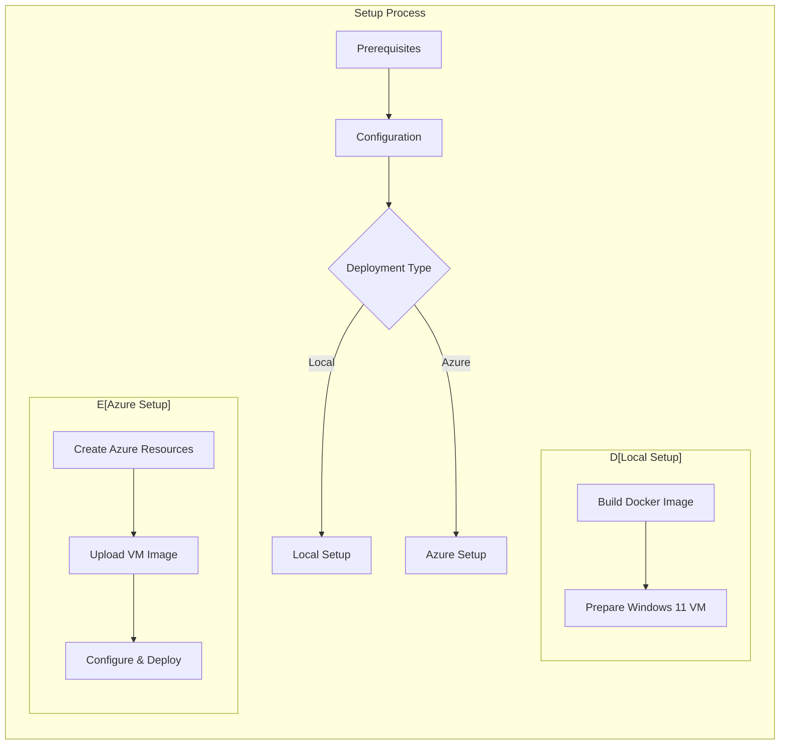
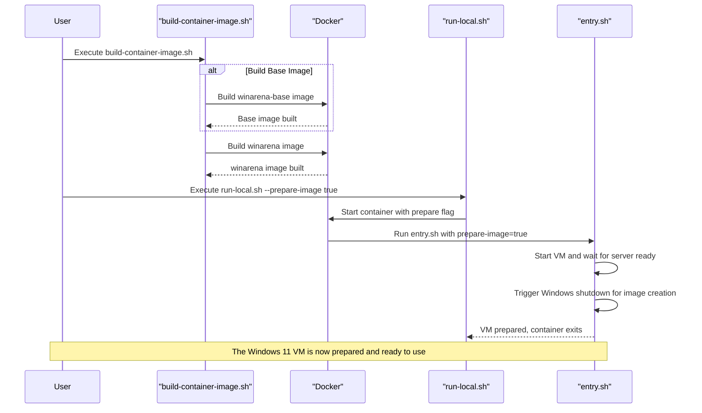
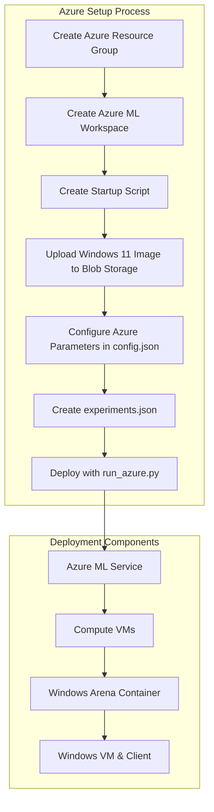
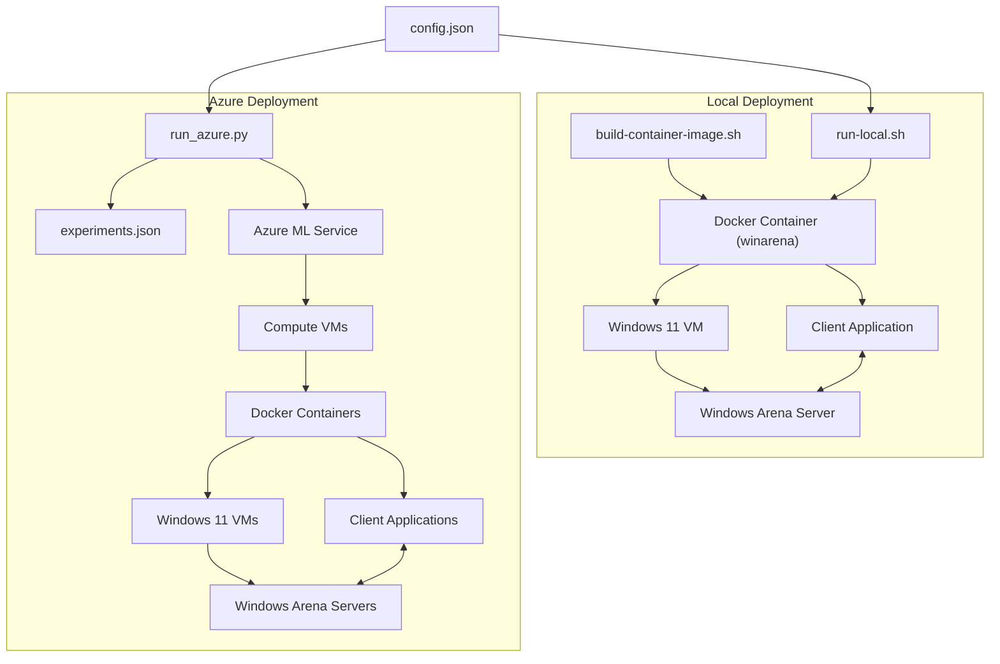

<!-- source: DeepWiki mcp.deepwiki.com · repo microsoft/WindowsAgentArena · page 2 Installation and Setup · fetched 2026-10-26 -->

# Installation and Setup

<details>
<summary>Relevant source files</summary>

The following files were used as context for generating this wiki page:

- [README.md](README.md)
- [scripts/build-container-image.sh](scripts/build-container-image.sh)
- [src/win-arena-container/entry.sh](src/win-arena-container/entry.sh)

</details>


This document provides detailed instructions for installing and setting up the Windows Agent Arena (WAA) platform. WAA requires specific prerequisites and configuration steps to properly function as a testing environment for multi-modal AI agents. For information about running experiments after installation, see [Running Experiments](#3).

## Overview

The Windows Agent Arena can be deployed in two primary ways:

1. **Local Deployment**: Running the platform on a local machine using Docker and a Windows 11 VM
2. **Azure Deployment**: Running the platform at scale on Azure infrastructure

This guide covers both deployment methods and explains the required steps for each.



Sources: [README.md:38-58](), [README.md:58-152](), [README.md:204-326]()

## Prerequisites

Before installing the Windows Agent Arena, ensure you have the following prerequisites:

1. **Docker daemon** installed and running
   - On Windows, using [Docker with WSL 2](https://docs.docker.com/desktop/wsl) is recommended

2. **API Keys**:
   - Either an [OpenAI](https://platform.openai.com/docs/introduction) API Key
   - Or an [Azure OpenAI](https://azure.microsoft.com/en-us/products/ai-services/openai-service) API Key

3. **Python 3.9**:
   - Recommended to use [Conda](https://docs.conda.io/projects/conda/en/latest/user-guide/getting-started.html)
   - Create a dedicated environment: `conda create -n winarena python=3.9`

4. **Repository**:
   ```bash
   git clone https://github.com/microsoft/WindowsAgentArena.git
   cd WindowsAgentArena
   pip install -r requirements.txt
   ```

Sources: [README.md:38-56]()

## Configuration

The first step after installing prerequisites is to create a configuration file containing your API keys:

1. Create a new file named `config.json` at the root of the project directory
2. Add your OpenAI or Azure OpenAI API keys:

```json
{
    "OPENAI_API_KEY": "<OPENAI_API_KEY>", // if using OpenAI endpoint
    "AZURE_API_KEY": "<AZURE_API_KEY>",  // if using Azure endpoint
    "AZURE_ENDPOINT": "https://yourendpoint.openai.azure.com/", // if using Azure endpoint
}
```

For Azure deployment, additional configuration values are required (covered in the Azure Environment Setup section).

Sources: [README.md:61-70]()

## Local Environment Setup

Setting up the Windows Agent Arena locally involves building the Docker image and preparing the Windows 11 VM.



Sources: [README.md:72-152](), [scripts/build-container-image.sh:1-56](), [src/win-arena-container/entry.sh:1-120]()

### 1. Preparing the Docker Image

The Docker image for Windows Agent Arena contains all the necessary dependencies and code to run the platform.

1. **Pull the WinArena-Base Image**:
   ```bash
   docker pull windowsarena/winarena-base:latest
   ```

2. **Build the WinArena Image**:
   ```bash
   cd scripts
   ./build-container-image.sh
   ```
   
   Additional options:
   - To build the base image locally: `./build-container-image.sh --build-base-image true`

The build process creates a Docker image named `windowsarena/winarena:latest` that contains the core components of the Windows Agent Arena.

Sources: [README.md:72-99](), [scripts/build-container-image.sh:1-56]()

### 2. Preparing the Windows 11 VM

The Windows Agent Arena requires a Windows 11 VM with specific configurations. This involves downloading the Windows 11 ISO and running an automated setup process:

1. **Download Windows 11 ISO**:
   - Download Windows 11 Enterprise Evaluation (90-day trial) from the [Microsoft Evaluation Center](https://info.microsoft.com/ww-landing-windows-11-enterprise.html)
   - Rename the downloaded file to `setup.iso`
   - Move it to `WindowsAgentArena/src/win-arena-container/vm/image`

2. **Prepare the Windows 11 Image**:
   ```bash
   cd scripts
   ./run-local.sh --prepare-image true
   ```

   This automated process:
   - Starts a Docker container with the Windows 11 ISO
   - Creates and configures a Windows 11 VM
   - Installs necessary software and sets up the server
   - Takes approximately 20 minutes to complete

3. **Verify Image Creation**:
   - The process is complete when the Docker container terminates
   - The VM image files will be in `WindowsAgentArena/src/win-arena-container/vm/storage`
   - Consider backing up this folder in case of accidental corruption later

Sources: [README.md:102-156](), [src/win-arena-container/entry.sh:86-100]()

## Azure Environment Setup

Azure deployment enables running multiple instances of the Windows Agent Arena in parallel, significantly reducing the time needed for comprehensive agent testing.



Sources: [README.md:204-326]()

### 1. Setting Up Azure Resources

1. **Create Azure Subscription**:
   - If needed, start a [free trial](https://azure.microsoft.com/en-us/free)
   - Note your subscription ID (needed for `AZURE_SUBSCRIPTION_ID`)

2. **Create a Resource Group**:
   - Create a new resource group in the Azure portal (e.g., `agents`)
   - Note the resource group name (needed for `AZURE_ML_RESOURCE_GROUP`)

3. **Create an Azure Machine Learning Resource**:
   - Create a new Azure ML workspace (e.g., `agents_ml`)
   - Note the workspace name (needed for `AZURE_ML_WORKSPACE_NAME`)
   - Allow automatic creation of:
     - Storage Account (note name for uploading VM image)
     - Key vault
     - Application Insights
     - Container Registry (optional)

4. **Create Startup Script**:
   - Navigate to the [Azure Machine Learning portal](https://ml.azure.com/home)
   - In the Notebooks tab, create a new bash file named `compute-instance-startup.sh`
   - Copy content from `scripts/azure_files/compute-instance-startup.sh`
   - Note the path (in format `Users/<YOUR_USER>/compute-instance-startup.sh`)

5. **Optional**: Request additional compute quota if needed

Sources: [README.md:208-238]()

### 2. Uploading Windows 11 and Docker Images

After setting up Azure resources, you need to upload the Windows 11 image files to Azure Blob Storage:

1. **Upload Windows 11 Storage Folder**:
   - Use Azure Storage Explorer to upload the `storage` folder
   - Or use Azure CLI with the command:
     ```bash
     az login --use-device-code
     az storage blob upload-batch --account-name <STORAGE_ACCOUNT_NAME> --destination <CONTAINER_NAME> --source <LOCAL_FOLDER>
     ```

2. **Optional**: Upload custom Docker image to Azure Container Registry if not using the default

Sources: [README.md:242-260]()

### 3. Configuration and Deployment

1. **Update Configuration File**:
   - Add Azure-specific keys to your `config.json`:
   ```json
   {
       // Previous configs
       "AZURE_SUBSCRIPTION_ID": "<YOUR_AZURE_SUBSCRIPTION_ID>",
       "AZURE_ML_RESOURCE_GROUP": "<YOUR_AZURE_ML_RESOURCE_GROUP>",
       "AZURE_ML_WORKSPACE_NAME": "<YOUR_AZURE_ML_WORKSPACE_NAME>"
   }
   ```

2. **Create Experiments Configuration**:
   - Create a file named `experiments.json` at the root level
   - Define your experiments with parameters:
   ```json
   {
     "experiment_1": {
       "ci_startup_script_path": "Users/<YOUR_USER>/compute-instance-startup.sh",
       "agent": "navi",
       "datastore_input_path": "storage",
       "docker_img_name": "windowsarena/winarena:latest",
       "exp_name": "experiment_1",
       "num_workers": 4,
       "use_managed_identity": false,
       "json_name": "evaluation_examples_windows/test_all.json",
       "model_name": "gpt-4-1106-vision-preview",
       "som_origin": "oss",
       "a11y_backend": "win32"
     }
   }
   ```

3. **Deploy to Azure**:
   ```bash
   az login --use-device-code
   cd scripts
   python run_azure.py --experiments_json "experiments.json"
   ```

   This will:
   - Create Azure Compute Instance VMs based on `num_workers`
   - Run ML Training Jobs on each VM
   - Dispose of VMs when jobs complete
   - Store results in the `agent_outputs` folder in blob storage

Sources: [README.md:264-326]()

## Deployment Architecture

The following diagram illustrates the components involved in both local and Azure deployments:



Sources: [README.md:38-326]()

## Resource Requirements

When running the Windows Agent Arena locally, you might need to adjust resource allocation based on your system capabilities:

| Component | Default Allocation | Minimum Recommendation |
|-----------|-------------------|------------------------|
| RAM       | 8 GB              | 4 GB                   |
| CPU Cores | 8                 | 4                      |

You can customize these settings when running locally:

```bash
./run-local.sh --ram-size 4G --cpu-cores 4
```

For KVM acceleration (significantly improves performance):
```bash
./run-local.sh --use-kvm false  # Disable KVM if not supported
```

Note: Running without KVM acceleration is not recommended for performance reasons.

Sources: [README.md:349-366]()

## Next Steps

After completing the installation and setup process, you can run experiments with the Windows Agent Arena. For detailed instructions on running experiments locally or on Azure, see [Running Experiments](#3).

Sources: [README.md:158-203]()

---

