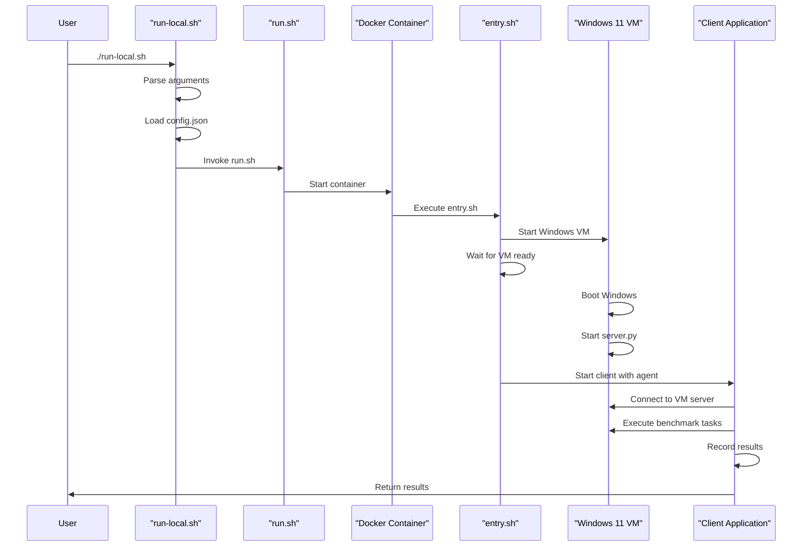
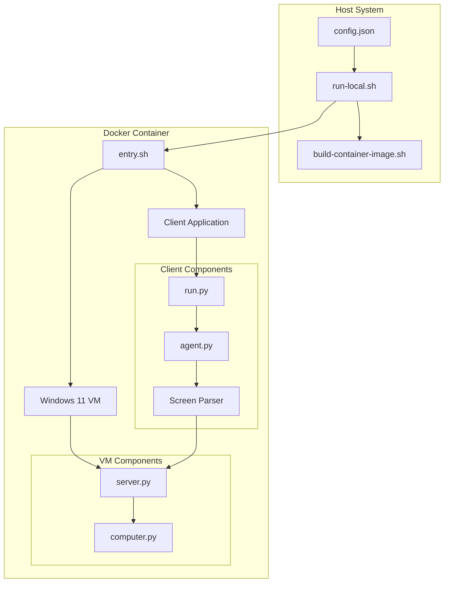
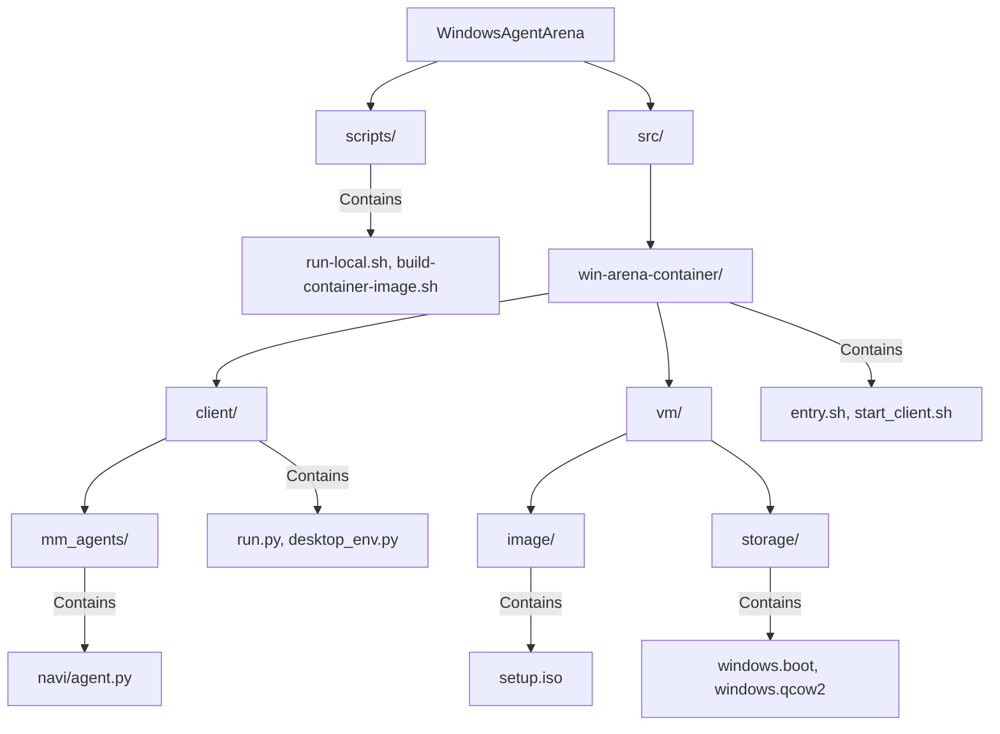

<!-- source: DeepWiki mcp.deepwiki.com · repo microsoft/WindowsAgentArena · page 2.2 Local Environment Setup · fetched 2026-10-26 -->

# Local Environment Setup

<details>
<summary>Relevant source files</summary>

The following files were used as context for generating this wiki page:

- [README.md](README.md)
- [scripts/build-container-image.sh](scripts/build-container-image.sh)
- [scripts/run-local.sh](scripts/run-local.sh)
- [src/win-arena-container/entry.sh](src/win-arena-container/entry.sh)

</details>


This document provides detailed instructions for setting up the Windows Agent Arena (WAA) in a local environment. It covers the process from initial prerequisites through to preparing the Windows 11 VM and running experiments locally. For instructions on setting up in an Azure environment, see [Azure Environment Setup](#2.3).

## 1. System Requirements

Before beginning the local setup process, ensure your system meets these requirements:

- **Operating System**: Linux or Windows with WSL2
- **RAM**: Minimum 16GB recommended (8GB for the VM + additional for host system)
- **CPU**: 8+ cores recommended
- **Storage**: 50GB+ free space (30GB for the Windows VM image)
- **Virtualization**: CPU virtualization support enabled in BIOS/UEFI
- **KVM support**: Recommended for better performance (can be disabled with `--use-kvm false`)

Sources: [README.md:39-47](), [README.md:349-365]()

## 2. Prerequisites Installation

### 2.1 Docker Setup

Docker is required to run the Windows Arena Container:

- **Linux**: Install Docker Engine following the [official instructions](https://docs.docker.com/engine/install)
- **Windows**: Install Docker Desktop with WSL2 backend

Verify Docker is properly installed and running:
```bash
docker --version
docker ps
```

### 2.2 Python Environment

The setup scripts require Python 3.9:

```bash
# Using Conda (recommended)
conda create -n winarena python=3.9
conda activate winarena

# Install dependencies
pip install -r requirements.txt
```

Sources: [README.md:45-56]()

## 3. Initial Configuration

### 3.1 Repository Setup

Clone the repository and prepare the environment:

```bash
git clone https://github.com/microsoft/WindowsAgentArena.git
cd WindowsAgentArena
pip install -r requirements.txt
```

### 3.2 API Configuration

Create a `config.json` file at the root of the project with your API keys:

```json
{
    "OPENAI_API_KEY": "<OPENAI_API_KEY>",        // Required if using OpenAI directly
    "AZURE_API_KEY": "<AZURE_API_KEY>",          // Required if using Azure OpenAI
    "AZURE_ENDPOINT": "https://yourendpoint.openai.azure.com/"  // Required if using Azure OpenAI
}
```

You must provide either an OpenAI API key or both Azure OpenAI keys. These credentials will be used by the agent to interact with the LLM models.

Sources: [README.md:61-70]()

## 4. Docker Image Preparation

### 4.1 Pulling the Base Image

Pull the pre-built base image that contains all dependencies:

```bash
docker pull windowsarena/winarena-base:latest
```

### 4.2 Building the Local Image

Build the Windows Arena Docker image using the provided script:

```bash
cd scripts
./build-container-image.sh
```

This builds the `windowsarena/winarena:latest` image with the code from the `src` directory.

For development purposes, you can rebuild the base image with:
```bash
./build-container-image.sh --build-base-image true
```

Sources: [README.md:72-101](), [scripts/build-container-image.sh:1-56]()

## 5. Windows 11 VM Preparation

### 5.1 Obtaining Windows 11 ISO

1. Download a Windows 11 Enterprise Evaluation ISO from the [Microsoft Evaluation Center](https://info.microsoft.com/ww-landing-windows-11-enterprise.html)
2. Rename the downloaded file to `setup.iso`
3. Copy it to `WindowsAgentArena/src/win-arena-container/vm/image/`

Sources: [README.md:107-109]()

### 5.2 Creating the Golden Image

Run the following command to automatically prepare the Windows 11 VM:

```bash
cd scripts
./run-local.sh --prepare-image true
```

This process:
1. Builds the Docker container if needed
2. Sets up a QEMU-based Windows 11 VM
3. Automatically installs Windows and required software
4. Creates a VM snapshot for future use

The process takes approximately 20 minutes and will terminate automatically when complete. You can monitor the progress at `http://localhost:8006`.

**Important**: Do not interact with the VM during the preparation process.

Sources: [README.md:111-143]()

## 6. Local Execution

### 6.1 Basic Execution

To run the benchmark with default settings:

```bash
cd scripts
./run-local.sh
```

This command:
1. Starts the Docker container
2. Launches the Windows 11 VM from the prepared golden image
3. Runs the client application with the default Navi agent
4. Executes benchmark tasks and records results

You can view the Windows VM in real-time at `http://localhost:8006`.

Sources: [README.md:159-175]()

### 6.2 Execution Flow



Sources: [scripts/run-local.sh:1-164](), [src/win-arena-container/entry.sh:1-120]()

### 6.3 Configuration Options

The `run-local.sh` script supports many options to customize execution:

| Option | Description | Default |
|--------|-------------|---------|
| `--prepare-image` | Create golden image | `false` |
| `--skip-build` | Skip building container | `false` |
| `--agent` | Agent to use | `navi` |
| `--model` | LLM model | `gpt-4-vision-preview` |
| `--som-origin` | Screen understanding method | `oss` |
| `--a11y-backend` | Accessibility backend | `uia` |
| `--ram-size` | VM RAM allocation | `8G` |
| `--cpu-cores` | VM CPU cores | `8` |
| `--gpu-enabled` | Enable GPU support | `false` |
| `--use-kvm` | Use KVM acceleration | `true` |
| `--browser-port` | Browser access port | `8006` |
| `--rdp-port` | RDP port | `3390` |

For example, to run with the strongest agent configuration:

```bash
./run-local.sh --gpu-enabled true --som-origin mixed-omni --a11y-backend uia
```

Sources: [scripts/run-local.sh:8-135](), [README.md:182-197]()

## 7. System Architecture

### 7.1 Local Deployment Components



Sources: [README.md:72-101](), [README.md:111-143](), [README.md:159-175]()

### 7.2 Directory Structure



Sources: [README.md:72-151]()

## 8. Viewing and Analyzing Results

After a benchmark run completes, you can view the results using:

```bash
cd src/win-arena-container/client
python show_results.py --result_dir <path_to_results_folder>
```

This will display metrics about agent performance across all benchmark tasks.

Sources: [README.md:176-181]()

## 9. Troubleshooting

### 9.1 Resource Allocation

If your system has limited resources, you can adjust the VM's resource allocation:

```bash
./run-local.sh --ram-size 4G --cpu-cores 4
```

### 9.2 KVM Acceleration

If your system doesn't support KVM acceleration:

```bash
./run-local.sh --use-kvm false
```

Note: Running without KVM will significantly reduce performance.

### 9.3 WSL2 Issues

If running on WSL2 and encountering script errors like `bad interpreter`, convert the scripts from DOS to Unix format:

```bash
cd ./scripts
find . -maxdepth 1 -type f -exec dos2unix {} +
```

### 9.4 Docker Permissions

On Linux, you might need to run docker commands with `sudo`. Alternatively, add your user to the docker group:

```bash
sudo usermod -aG docker $USER
```

Then log out and back in for the changes to take effect.

Sources: [README.md:349-365](), [README.md:152-157]()

## 10. Next Steps

Once you have successfully set up your local environment, you can:

1. Run the benchmark with different agent configurations
2. Develop your own agent (see [Adding New Agents](#5.1))
3. Create custom tasks (see [Customizing Tasks](#5.2))
4. Scale to Azure for faster evaluation (see [Azure Environment Setup](#2.3))

---

