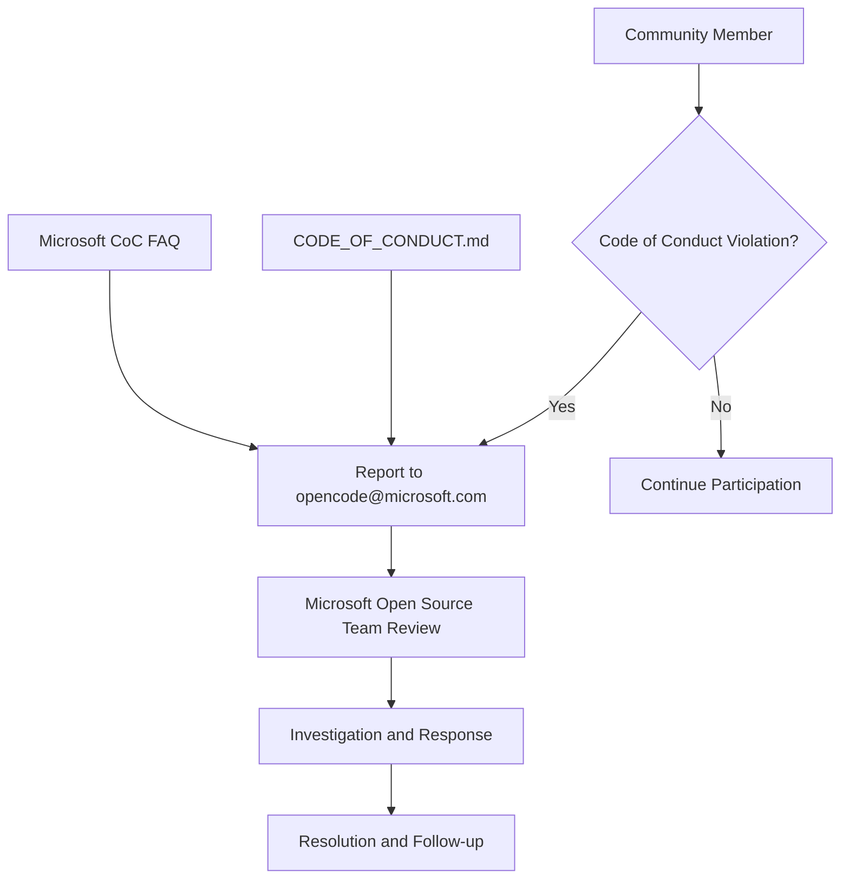
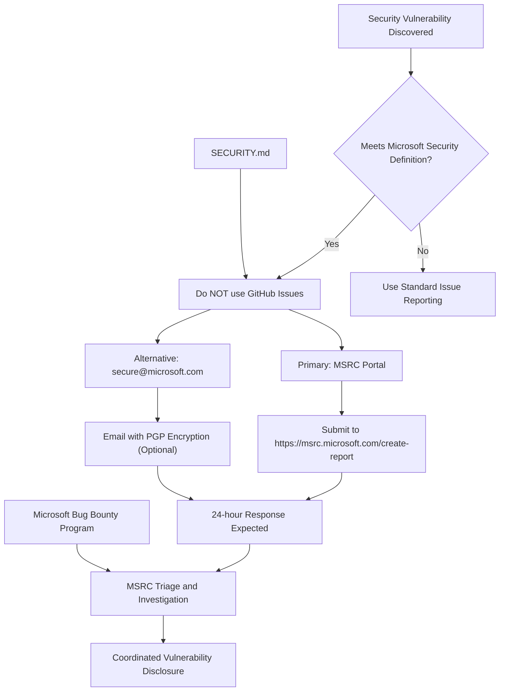
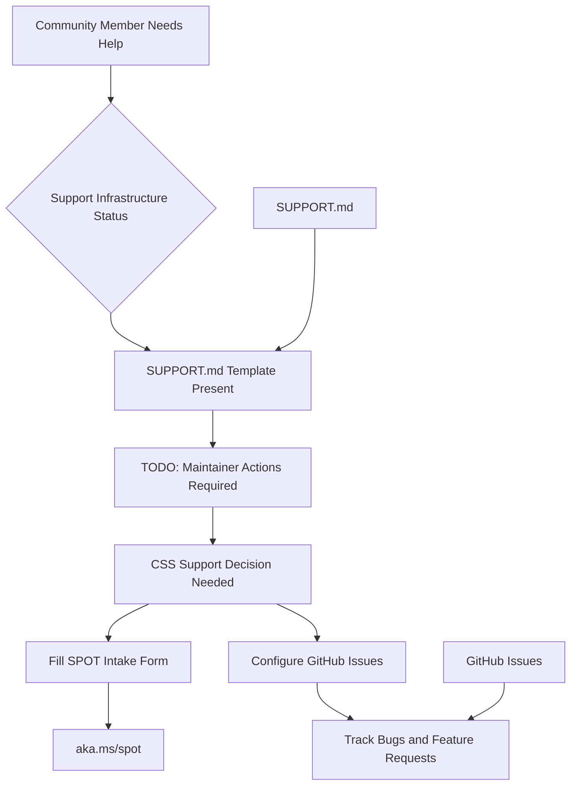
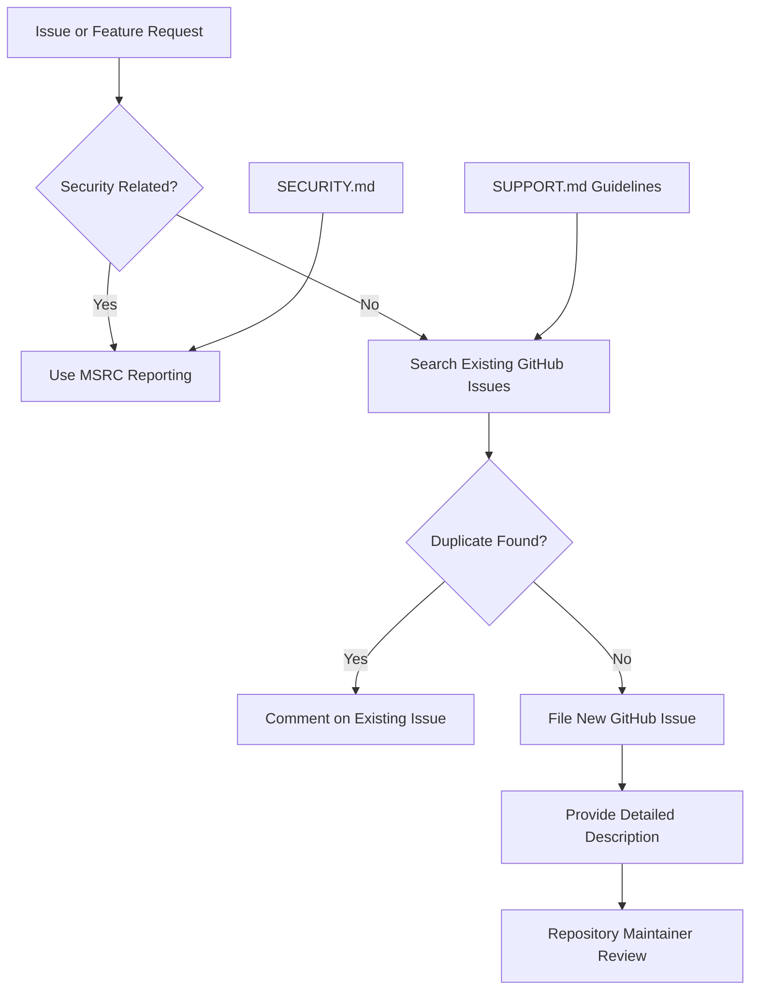

<!-- source: DeepWiki mcp.deepwiki.com · repo microsoft/XPretrain · page 5.3 Community Guidelines · fetched 2026-10-26 -->

# Community Guidelines

Relevant source files

The following files were used as context for generating this wiki page:

- [CODE_OF_CONDUCT.md](CODE_OF_CONDUCT.md)
- [SECURITY.md](SECURITY.md)
- [SUPPORT.md](SUPPORT.md)

## Purpose and Scope

This document outlines the community guidelines, support mechanisms, and governance policies for the XPretrain repository. It covers code of conduct expectations, security vulnerability reporting procedures, and channels for community engagement and support.

For licensing terms and usage restrictions, see [Licensing](#5.1). For responsible AI considerations and ethical guidelines, see [Responsible AI](#5.2).

## Code of Conduct

The XPretrain project follows the Microsoft Open Source Code of Conduct, which establishes behavioral expectations for all community participants, including contributors, maintainers, and users.

### Adoption and Resources

The project has adopted the standard Microsoft Open Source Code of Conduct as specified in [CODE_OF_CONDUCT.md:3]().

**Key Resources:**
- [Microsoft Open Source Code of Conduct](https://opensource.microsoft.com/codeofconduct) - Primary policy document
- [Microsoft Code of Conduct FAQ](https://opensource.microsoft.com/codeofconduct/faq) - Frequently asked questions and clarifications
- Contact `opencode@microsoft.com` for questions or concerns as referenced in [CODE_OF_CONDUCT.md:9]()

### Enforcement and Reporting

**Community Interaction Pathways**

Sources: [CODE_OF_CONDUCT.md:1-10]()

## Security Reporting

Security vulnerabilities must be reported through official Microsoft channels rather than public GitHub issues, following coordinated vulnerability disclosure principles.

### Reporting Process

The security reporting workflow is defined in [SECURITY.md:1-41]() and follows Microsoft's standard security response procedures:

**Security Vulnerability Reporting Workflow**

### Required Information

When reporting security issues, include the details specified in [SECURITY.md:19-27]():

| Information Type | Description |
|---|---|
| **Issue Type** | Buffer overflow, SQL injection, cross-site scripting, etc. |
| **Source Files** | Full paths of affected source files |
| **Location** | Tag/branch/commit or direct URL |
| **Configuration** | Special configuration required to reproduce |
| **Reproduction Steps** | Step-by-step instructions |
| **Proof of Concept** | Exploit code if available |
| **Impact Assessment** | How an attacker might exploit the issue |

### Communication Preferences

- **Language**: English preferred for all communications as stated in [SECURITY.md:35]()
- **Response Time**: 24-hour response expectation from MSRC as noted in [SECURITY.md:17]()
- **Policy**: Follows Coordinated Vulnerability Disclosure principles per [SECURITY.md:39]()

Sources: [SECURITY.md:1-41]()

## Community Support

The current support infrastructure is in development, with the primary support document requiring completion by repository maintainers.

### Current Support Status

The [SUPPORT.md:1-26]() file indicates that support mechanisms are not yet fully established:

**Support Infrastructure Development Status**

### Available Support Channels

Currently available support mechanisms:

| Channel | Purpose | Status |
|---|---|---|
| **GitHub Issues** | Bug reports and feature requests | Available |
| **Search Existing Issues** | Avoid duplicates before filing new issues | Recommended |
| **Microsoft CSS Support** | Customer Service & Support consideration | Under evaluation |

### Support Decision Framework

Repository maintainers need to complete the support configuration by:

1. **CSS Support Decision**: Determine if Customer Service & Support is needed per [SUPPORT.md:3-7]()
2. **SPOT Intake**: Complete intake form at `aka.ms/spot` if CSS support is desired
3. **Community Channels**: Define help and engagement channels for [SUPPORT.md:19-21]()

Sources: [SUPPORT.md:1-26]()

## Issue Reporting and Contributions

### GitHub Issues Usage

Use GitHub Issues for non-security related bugs and feature requests, with the following guidelines:

**Issue Reporting Decision Tree**

### Contribution Guidelines

While specific contribution guidelines are not explicitly defined in the available governance files, contributors should:

1. **Follow Code of Conduct**: Adhere to Microsoft Open Source Code of Conduct
2. **Search Before Filing**: Check existing issues to avoid duplicates
3. **Use Appropriate Channels**: Security issues through MSRC, others through GitHub Issues
4. **Provide Complete Information**: Include detailed descriptions and reproduction steps

Sources: [SUPPORT.md:15-17](), [CODE_OF_CONDUCT.md:1-10]()

## Contact Information

### Primary Contacts

| Purpose | Contact Method | Reference |
|---|---|---|
| **Code of Conduct Issues** | `opencode@microsoft.com` | [CODE_OF_CONDUCT.md:9]() |
| **Security Vulnerabilities** | MSRC Portal or `secure@microsoft.com` | [SECURITY.md:13-15]() |
| **General Support** | GitHub Issues (current), TBD (future) | [SUPPORT.md:15-17]() |

### Microsoft Resources

- **Microsoft Security Response Center**: [https://msrc.microsoft.com/create-report](https://msrc.microsoft.com/create-report)
- **Microsoft Bug Bounty Program**: Available for eligible security reports per [SECURITY.md:31]()
- **PGP Key**: Available from Microsoft Security Response Center PGP Key page for encrypted communications

### Response Expectations

- **Security Reports**: 24-hour response time expected
- **Code of Conduct Issues**: Response time not specified, follow up via `opencode@microsoft.com`
- **General Issues**: Response time depends on completion of support infrastructure setup

Sources: [SECURITY.md:13-17](), [CODE_OF_CONDUCT.md:9](), [SUPPORT.md:25]()

---

