# Page: XPretrain Overview

# XPretrain Overview

<details>
<summary>Relevant source files</summary>

The following files were used as context for generating this wiki page:

- [README.md](README.md)

</details>


## Purpose and Scope

This document provides a comprehensive overview of the XPretrain repository, which serves as a centralized collection of multi-modality learning research from Microsoft Research's MSM (Multimedia Search and Mining) group. The repository encompasses both video-language and image-language pre-training models, datasets, and related research implementations spanning 2021-2023.

For specific implementation details of individual models, see the Video-Language Research Track ([#2](#2)) and Image-Language Research Track ([#3](#3)). For development setup and configuration guidance, see the Development Guide ([#4](#4)).

## Repository Architecture

XPretrain functions as an umbrella repository containing multiple independent research projects that share common themes in multi-modality learning and pre-training methodologies. The repository is organized into distinct research tracks with their own codebases, datasets, and model implementations.

### Multi-modality Learning Tracks

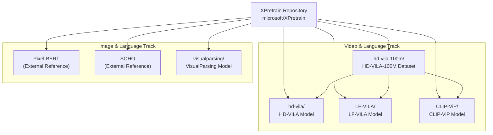

Sources: [README.md:1-66]()

The repository implements two primary research tracks:

| Track | Components | Purpose |
|-------|------------|---------|
| **Video & Language** | `hd-vila-100m/`, `hd-vila/`, `LF-VILA/`, `CLIP-ViP/` | Video-language understanding and pre-training |
| **Image & Language** | `visualparsing/`, external references | Image-language understanding and pre-training |

## Research Timeline and Publications

### Code Repository Structure with Publication Timeline

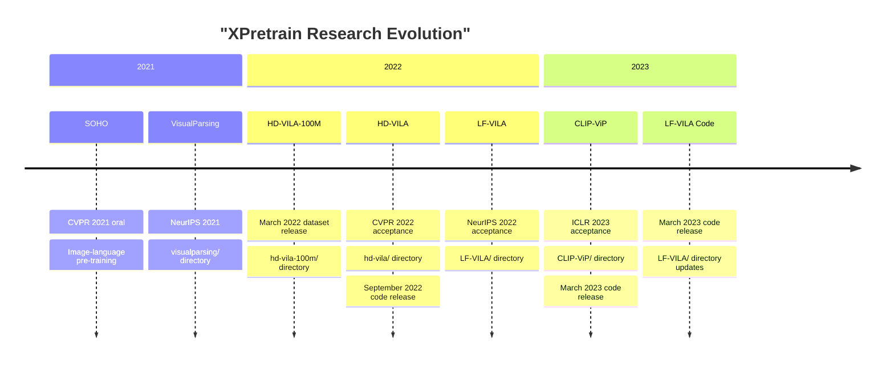

Sources: [README.md:31-37]()

### Research Progression Model

The repository demonstrates a clear research progression where foundational work enables subsequent innovations:

| Year | Innovation | Code Location | Key Contribution |
|------|------------|---------------|------------------|
| 2021 | VisualParsing | `visualparsing/` | Transformer-based image-language pre-training |
| 2022 | HD-VILA-100M | `hd-vila-100m/` | Large-scale video-language dataset foundation |
| 2022 | HD-VILA | `hd-vila/` | High-resolution video-language pre-training |
| 2022 | LF-VILA | `LF-VILA/` | Long-form video processing capabilities |
| 2023 | CLIP-ViP | `CLIP-ViP/` | Adaptation of image-text models to video |

## Technical Architecture Patterns

### Common Pre-training Framework

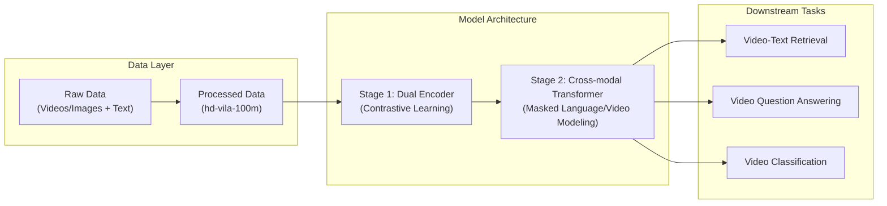

Sources: [README.md:7-30]()

### Repository File Structure

The codebase follows a modular structure where each research component maintains its own directory with complete implementation:

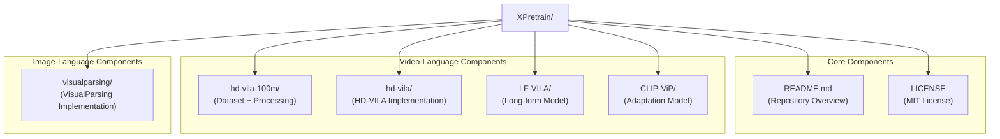

Sources: [README.md:1-66]()

## Research Contributions and Impact

### Video-Language Track Achievements

The video-language research track represents the primary focus of recent XPretrain developments:

| Model | Key Innovation | Technical Contribution |
|-------|----------------|----------------------|
| **HD-VILA-100M** | Large-scale dataset | 3.3M videos, 371.5K hours, high-resolution |
| **HD-VILA** | High-resolution VLP | Dual-stage training with masked modeling |
| **LF-VILA** | Long-form processing | MTC loss and HTWA for extended video content |
| **CLIP-ViP** | Transfer learning | Post-pretraining adaptation from image to video |

### Image-Language Track Foundation

The image-language components provide foundational research that informs video-language developments:

| Model | Publication Venue | Core Technology |
|-------|------------------|-----------------|
| **SOHO** | CVPR 2021 (oral) | Quantized visual tokens |
| **VisualParsing** | NeurIPS 2021 | Transformer-based architecture |
| **Pixel-BERT** | Research paper | End-to-end image-language pre-training |

Sources: [README.md:15-29]()

## Governance and Community

### Contribution Framework

XPretrain operates under Microsoft's standard open-source governance model with specific requirements for contributors:

- **Contributor License Agreement (CLA)** required for all contributions
- **Microsoft Open Source Code of Conduct** compliance mandatory
- **Security and issue reporting** through GitHub issue system
- **Primary contacts**: Bei Liu (`bei.liu@microsoft.com`) and Jianlong Fu (`jianf@microsoft.com`)

### Licensing and Usage

The repository implements Microsoft's standard licensing framework with considerations for research use, trademark guidelines, and responsible AI practices. For detailed licensing information, see Licensing ([#5.1](#5.1)). For responsible AI considerations specific to video-language models, see Responsible AI ([#5.2](#5.2)).

Sources: [README.md:40-66]()

---

# Page: Video-Language Research Track

# Video-Language Research Track

<details>
<summary>Relevant source files</summary>

The following files were used as context for generating this wiki page:

- [README.md](README.md)
- [hd-vila-100m/README.md](hd-vila-100m/README.md)
- [hd-vila-100m/src/cut_videos.py](hd-vila-100m/src/cut_videos.py)

</details>


## Purpose and Scope

This document covers the video-language research components within the XPretrain repository, encompassing the foundational HD-VILA-100M dataset and three specialized pre-training models: HD-VILA, LF-VILA, and CLIP-ViP. The track represents a comprehensive progression from large-scale dataset creation through various approaches to video-language understanding, spanning publications from CVPR 2022 through ICLR 2023.

For image-language research components, see [Image-Language Research Track](#3). For technical implementation details and environment setup, see [Development Guide](#4).

## Research Components Overview

The video-language track consists of four main components that build upon each other in a systematic progression:

| Component | Type | Publication | Purpose |
|-----------|------|-------------|---------|
| HD-VILA-100M | Dataset | March 2022 | Large-scale video-language corpus with 3.3M videos |
| HD-VILA | Pre-training Model | CVPR 2022 | High-resolution video-language representation learning |
| LF-VILA | Pre-training Model | NeurIPS 2022 | Long-form video understanding with temporal modeling |
| CLIP-ViP | Adaptation Method | ICLR 2023 | Transfer learning from image-text to video-text |

### Component Relationships

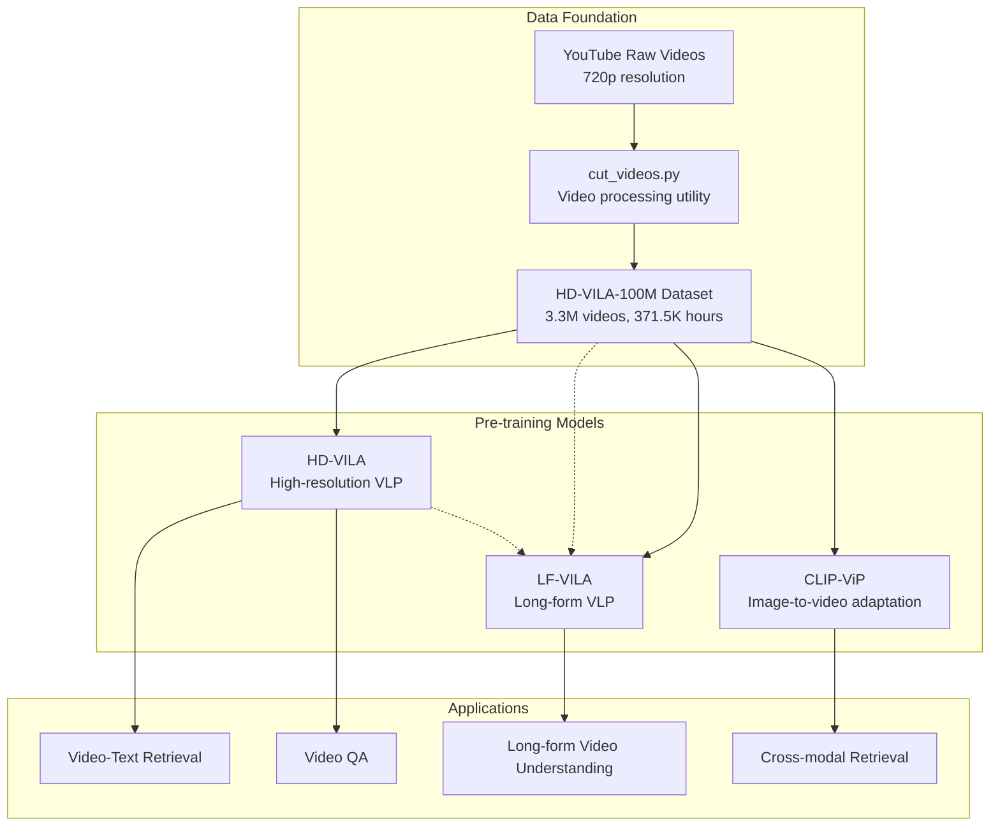

**Sources:** [README.md:1-66](), [hd-vila-100m/README.md:1-67]()

## Technical Architecture

### Data Foundation: HD-VILA-100M Dataset

The HD-VILA-100M dataset serves as the foundational data source for all video-language models in this track. The dataset contains 100 million video clips extracted from 3.3 million YouTube videos, totaling 371.5 thousand hours of content at 720p resolution.

#### Dataset Structure

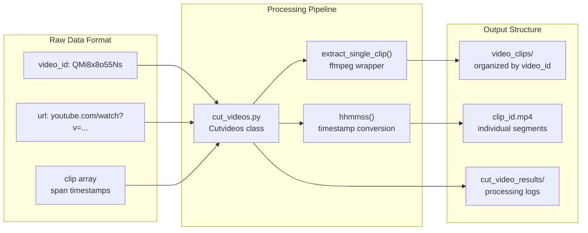

The dataset metadata follows a structured format with video identifiers, YouTube URLs, and timestamp-based clip segmentation. Each video is divided into multiple clips based on ASR-generated transcription boundaries.

**Sources:** [hd-vila-100m/README.md:30-44](), [hd-vila-100m/src/cut_videos.py:27-78]()

#### Video Processing Implementation

The `Cutvideos` class in [hd-vila-100m/src/cut_videos.py:27-89]() implements the core video segmentation functionality:

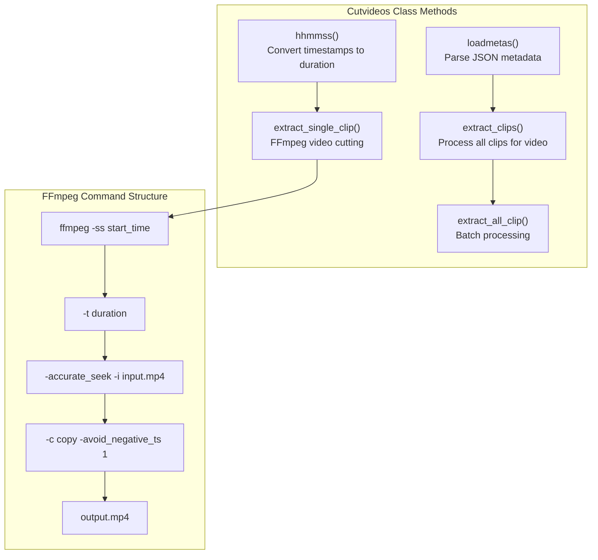

The `extract_single_clip` method constructs FFmpeg commands with specific parameters for accurate temporal segmentation: `-ss` for start time, `-t` for duration, `-accurate_seek` for precise timing, and `-c copy` for efficient codec handling.

**Sources:** [hd-vila-100m/src/cut_videos.py:56-63](), [hd-vila-100m/src/cut_videos.py:41-49]()

### Model Progression and Relationships

The three video-language models represent different approaches to learning from the HD-VILA-100M dataset:

#### HD-VILA: High-Resolution Foundation

HD-VILA establishes the foundational approach for high-resolution video-language pre-training using the complete HD-VILA-100M dataset. The model focuses on learning robust video-text representations through contrastive learning and masked modeling objectives.

#### LF-VILA: Long-Form Specialization  

LF-VILA extends the HD-VILA approach specifically for long-form video understanding. It introduces specialized components for processing continuous clips with temporal dependencies, utilizing a subset of HD-VILA-100M containing videos with at least 4 continuous clips.

#### CLIP-ViP: Cross-Modal Adaptation

CLIP-ViP represents a different paradigm that adapts existing image-text models (CLIP) to video-language tasks through post-pretraining on HD-VILA-100M. This approach leverages the strong image-text representations already learned by CLIP and extends them to the temporal domain.

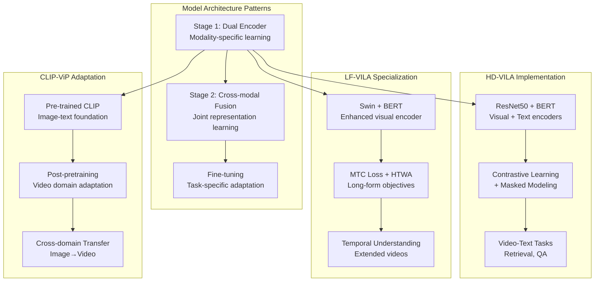

**Sources:** [README.md:15-19]()

## Research Evolution Timeline

The video-language research track demonstrates a clear progression from dataset creation through increasingly sophisticated modeling approaches:

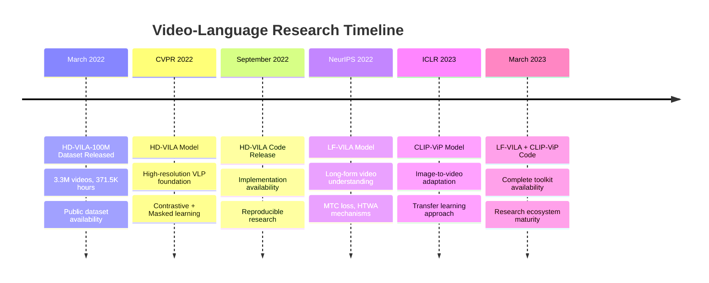

This timeline reflects the systematic development from foundational dataset and baseline model through specialized approaches for long-form content and cross-modal transfer learning. The staggered code releases follow academic publication cycles while ensuring reproducibility.

**Sources:** [README.md:32-37]()

## Technical Integration Points

The video-language components share common infrastructure and processing patterns:

### Data Processing Pipeline

All models utilize the HD-VILA-100M dataset through standardized processing workflows implemented in `cut_videos.py`. The `Cutvideos` class provides consistent video segmentation functionality across different model training pipelines.

### Model Training Infrastructure  

Each model follows similar training patterns with stage-wise learning: initial dual-encoder training for modality-specific representations, followed by cross-modal fusion stages. The models share common dependency requirements and distributed training configurations.

### Evaluation Framework

The models are evaluated on overlapping downstream tasks including video-text retrieval, video question answering, and cross-modal understanding benchmarks, enabling direct performance comparisons across the different approaches.

**Sources:** [README.md:5-20](), [hd-vila-100m/src/cut_videos.py:1-110]()

---

# Page: HD-VILA-100M Dataset

# HD-VILA-100M Dataset

<details>
<summary>Relevant source files</summary>

The following files were used as context for generating this wiki page:

- [hd-vila-100m/README.md](hd-vila-100m/README.md)
- [hd-vila-100m/src/cut_videos.py](hd-vila-100m/src/cut_videos.py)

</details>


## Purpose and Scope

This document provides comprehensive documentation for the HD-VILA-100M dataset, a large-scale video-language dataset that serves as the foundational data source for video-language pre-training models in the XPretrain repository. This page covers the dataset structure, download process, video processing utilities, and technical implementation details.

For information about models that use this dataset, see [HD-VILA Model](#2.2), [LF-VILA Model](#2.3), and [CLIP-ViP Model](#2.4). For broader context about the video-language research track, see [Video-Language Research Track](#2).

## Dataset Overview

HD-VILA-100M is a large-scale, high-resolution, and diversified video-language dataset designed to facilitate multimodal representation learning. The dataset contains **3.3 million videos** distributed across **15 balanced categories**, providing a comprehensive foundation for video-language understanding tasks.

### Dataset Statistics

| Metric | Value |
|--------|--------|
| Video Count | 3.3M videos |
| Clip Count | 100M clips |
| Sentence Count | 100M sentences |
| Average Clip Length | 13.4 seconds |
| Average Sentence Length | 32.5 words |
| Total Duration | 371.5K hours |
| Resolution | 720p |
| Domain | Open domain |

The dataset achieves balanced representation across diverse content categories, ensuring comprehensive coverage for multimodal learning applications.

**Dataset Categories Distribution**
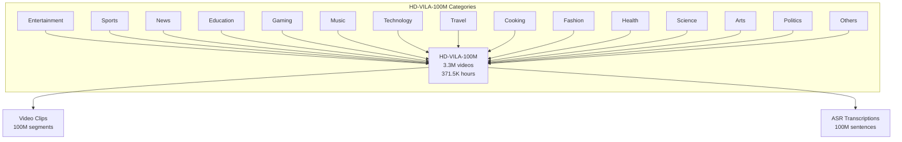

Sources: [hd-vila-100m/README.md:14-27]()

## Data Structure and Format

### Metadata Format

The dataset metadata follows a structured JSON format that defines video sources, clip boundaries, and temporal annotations:

```json
{   
    "video_id": "QMi8x8o55Ns",
    "url": "https://www.youtube.com/watch?v=QMi8x8o55Ns",
    "clip": [
        {
            "clip_id": "QMi8x8o55Ns.1.mp4", 
            "span": ["00:00:17.759", "00:00:23.279"]
        },
        {
            "clip_id": "QMi8x8o55Ns.16.mp4", 
            "span": ["00:04:52.140", "00:05:03.350"]
        }
    ]
}
```

### File Structure

**HD-VILA-100M Data Organization**
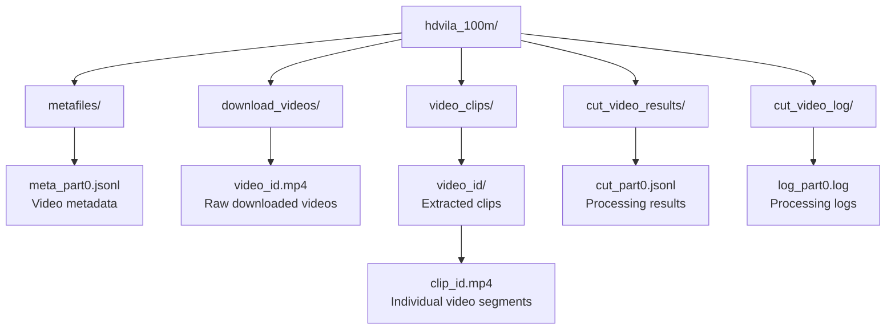

Sources: [hd-vila-100m/src/cut_videos.py:67-68](), [hd-vila-100m/src/cut_videos.py:94-99]()

## Download and Access

### Dataset Download

The complete dataset URLs and metadata can be accessed through the Azure Blob Storage endpoint. The download link provides access to all video URLs and corresponding timestamp information for clip extraction.

**Download Link**: The dataset is available through Azure Blob Storage with the following access pattern:
- Base URL: `hdvila.blob.core.windows.net/dataset/hdvila100m.zip`
- Access token and parameters are provided in the full download URL
- Updated as of June 28, 2022 with extended access through January 1, 2026

### Download Process

1. **Metadata Acquisition**: Download the compressed metadata file containing all video URLs and clip timestamps
2. **Video Download**: Retrieve raw videos from YouTube using the provided URLs
3. **Clip Extraction**: Process downloaded videos using the provided utilities to generate individual clips

Sources: [hd-vila-100m/README.md:29-44]()

## Video Processing Pipeline

### Processing Workflow

The video processing pipeline transforms raw YouTube videos into structured clip datasets using the `cut_videos.py` utility. This process handles timestamp-based segmentation and ensures proper video format consistency.

**Video Processing Architecture**
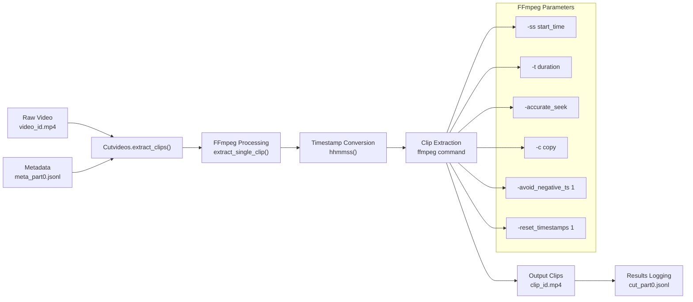

Sources: [hd-vila-100m/src/cut_videos.py:56-78]()

### Technical Implementation

#### Core Processing Class

The `Cutvideos` class handles the complete video processing workflow:

**Core Components**:
- **Initialization**: `__init__(metafile, workdir, resultfile)` - Sets up processing environment
- **Metadata Loading**: `loadmetas()` - Loads JSONL metadata files
- **Timestamp Processing**: `hhmmss(timestamp1, timestamp2)` - Converts timestamp formats to duration
- **Command Execution**: `run(cmd)` - Executes FFmpeg commands via subprocess
- **Clip Extraction**: `extract_single_clip(sb, in_filepath, out_filepath)` - Processes individual clips
- **Batch Processing**: `extract_all_clip()` - Handles complete dataset processing

#### FFmpeg Integration

The video processing leverages FFmpeg with specific parameters optimized for high-quality clip extraction:

```bash
ffmpeg -ss start_time -t duration -accurate_seek -i input_video -c copy \
       -avoid_negative_ts 1 -reset_timestamps 1 -y -hide_banner \
       -loglevel panic -map 0 output_clip
```

**Parameter Functions**:
- `-ss`: Seek to start timestamp
- `-t`: Set clip duration
- `-accurate_seek`: Ensure precise timestamp positioning
- `-c copy`: Copy streams without re-encoding
- `-avoid_negative_ts 1`: Handle timestamp edge cases
- `-reset_timestamps 1`: Reset output timestamps to zero

Sources: [hd-vila-100m/src/cut_videos.py:56-62]()

### Command Line Interface

The processing utility supports configurable parameters through command line arguments:

| Parameter | Default | Description |
|-----------|---------|-------------|
| `--workdir` | `./hdvila_100m` | Working directory for processing |
| `--metafile` | `meta_part0.jsonl` | Input metadata file |
| `--resultfile` | `cut_part0.jsonl` | Output results file |
| `--log` | `log_part0.log` | Processing log file |

**Usage Example**:
```bash
python cut_videos.py --workdir ./hdvila_100m \
                     --metafile meta_part0.jsonl \
                     --resultfile cut_part0.jsonl \
                     --log log_part0.log
```

Sources: [hd-vila-100m/src/cut_videos.py:12-19]()

## Technical Implementation Details

### Error Handling and Logging

The processing pipeline implements comprehensive error handling and logging mechanisms:

- **Directory Management**: `check_dirs(dirs)` ensures all required directories exist
- **Logging Configuration**: Structured logging with timestamps, module names, and line numbers
- **Process Monitoring**: Progress tracking using `tqdm` for batch operations
- **Exception Handling**: Validation of output file generation

### Performance Considerations

The implementation supports scalable processing through:
- **Batch Processing**: Processes multiple videos sequentially
- **Subprocess Management**: Isolated FFmpeg execution for each clip
- **File System Optimization**: Organized directory structure for efficient I/O
- **Memory Management**: Streaming JSON processing with `jsonlines`

**Processing Performance Metrics**:
- Supports parallel processing through job distribution
- Memory-efficient metadata loading
- Optimized FFmpeg parameters for speed and quality
- Comprehensive result tracking and validation

Sources: [hd-vila-100m/src/cut_videos.py:22-25](), [hd-vila-100m/src/cut_videos.py:101-110]()

## License and Usage

The HD-VILA-100M dataset is provided under specific licensing terms documented in the repository license file. Users should review the license agreement before accessing or using the dataset for research or commercial purposes.

**Citation**:
```bibtex
@inproceedings{xue2022hdvila,
    title={Advancing High-Resolution Video-Language Representation with Large-Scale Video Transcriptions},
    author={Xue, Hongwei and Hang, Tiankai and Zeng, Yanhong and Sun, Yuchong and Liu, Bei and Yang, Huan and Fu, Jianlong and Guo, Baining},
    booktitle={International Conference on Computer Vision and Pattern Recognition (CVPR)},
    year={2022}
}
```

Sources: [hd-vila-100m/README.md:47-66]()

---

# Page: HD-VILA Model

# HD-VILA Model

<details>
<summary>Relevant source files</summary>

The following files were used as context for generating this wiki page:

- [hd-vila/README.md](hd-vila/README.md)

</details>


## Purpose and Scope

This page documents the HD-VILA (High-resolution and Diversified Video-Language) model, a foundational video-language pre-training system within the XPretrain repository. HD-VILA establishes high-resolution video-language representations through a novel two-stage training approach using the HD-VILA-100M dataset.

For information about the underlying HD-VILA-100M dataset, see [2.1](#2.1). For the subsequent LF-VILA long-form adaptation, see [2.3](#2.3). For the CLIP-ViP transfer learning approach, see [2.4](#2.4).

## Model Overview and Architecture

HD-VILA implements a hybrid architecture combining a dual encoder for stage-one contrastive learning with a cross-modal Transformer for stage-two masked modeling. The model achieves state-of-the-art performance across 10 video-language understanding tasks and 2 text-to-visual generation tasks, with notable improvements of 40.4% R@1 on MSR-VTT zero-shot retrieval and 55.4% on LSMDC high-resolution datasets.

### HD-VILA Architecture Components

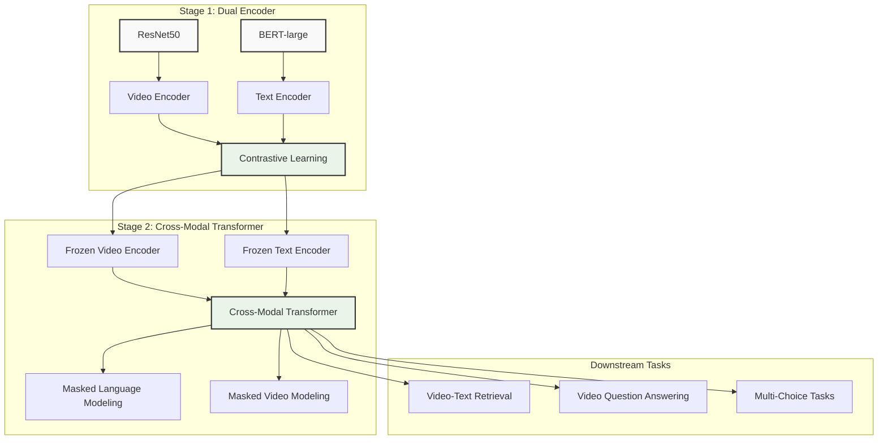

**Sources:** [hd-vila/README.md:15-23](), [hd-vila/README.md:78-94]()

### Training Process Flow

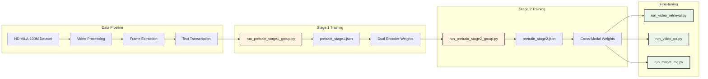

**Sources:** [hd-vila/README.md:78-94](), [hd-vila/README.md:100-130]()

## Two-Stage Training Process

### Stage 1: Contrastive Learning

The first stage implements contrastive learning using a dual encoder architecture. Pre-trained ResNet50 handles video encoding while BERT-large processes text inputs. This stage establishes foundational video-text correspondences through contrastive objectives.

**Training Command:**
```bash
horovodrun -np $NUM_GPUS python src/pretrain/run_pretrain_stage1_group.py \
    --config src/configs/pretrain_stage1.json
```

### Stage 2: Cross-Modal Transformer

The second stage introduces a cross-modal Transformer that operates on frozen representations from stage 1. This stage employs masked modeling objectives for both video and text modalities to learn deeper cross-modal interactions.

**Training Command:**
```bash
horovodrun -np $NUM_GPUS python src/pretrain/run_pretrain_stage2_group.py \
    --config src/configs/pretrain_stage2.json
```

**Configuration Requirements:**
- The `e2e_weights_path` parameter in `pretrain_stage2.json` must reference the stage 1 checkpoint path
- Stage 1 parameters remain frozen during stage 2 training

**Sources:** [hd-vila/README.md:78-94]()

## Implementation Structure

### Core Training Scripts

| Component | Script Path | Purpose |
|-----------|-------------|---------|
| Stage 1 Pre-training | `src/pretrain/run_pretrain_stage1_group.py` | Dual encoder contrastive learning |
| Stage 2 Pre-training | `src/pretrain/run_pretrain_stage2_group.py` | Cross-modal transformer training |
| Video Retrieval | `src/tasks/run_video_retrieval.py` | Fine-tuning for retrieval tasks |
| Video QA | `src/tasks/run_video_qa.py` | Fine-tuning for question answering |
| Multi-Choice Tasks | `src/tasks/run_msrvtt_mc.py` | MSRVTT multiple choice inference |

### Configuration Management

Configuration files are stored in `src/configs/` with task-specific JSON files:

| Task Category | Configuration Pattern | Example |
|---------------|----------------------|---------|
| Retrieval Tasks | `*_retrieval.json` | `msrvtt_retrieval.json` |
| QA Tasks | `*_qa.json` | `msrvtt_qa.json` |
| Pre-training | `pretrain_stage*.json` | `pretrain_stage1.json` |

**Sources:** [hd-vila/README.md:82-94](), [hd-vila/README.md:98-114]()

## Environment and Infrastructure

### Docker Environment

HD-VILA requires a specialized environment with Horovod for distributed training. The system uses the pre-built Docker image `tiankaihang/azureml_docker:horovod` or can be built from the provided Dockerfile.

**Container Launch:**
```bash
cd HD-VILA
source launch_container.sh $PATH_TO_STORAGE
```

### Hardware Requirements

- GPUs with Tensor Cores (recommended for mixed-precision training)
- Multi-GPU setup for distributed training via Horovod
- Sufficient storage for HD-VILA-100M dataset and processed video files

**Sources:** [hd-vila/README.md:42-49]()

## Data Processing and Dependencies

### Dataset Integration

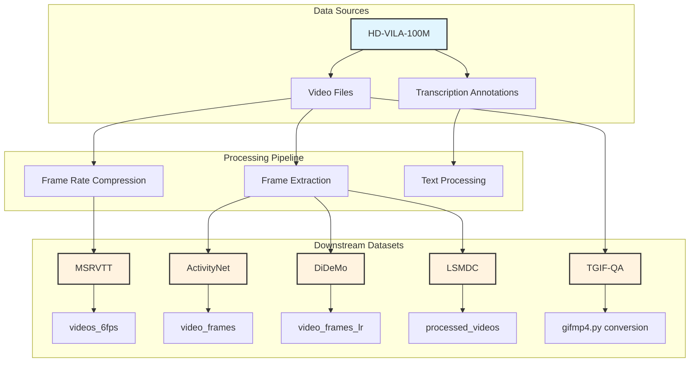

### Data Download and Setup

The `scripts/download_data.sh` script handles:
- Pre-trained model weights (ResNet50, BERT-large)
- HD-VILA checkpoint downloads
- Downstream task annotations

**Video Processing Utilities:**
- Frame rate compression: Located in `scripts/process_raw_video/`
- Format conversion: `scripts/process_raw_video/gifmp4.py` for TGIF-QA
- Frame extraction for ActivityNet, DiDeMo, and LSMDC datasets

**Sources:** [hd-vila/README.md:53-76]()

## Downstream Applications

### Video-Text Retrieval

HD-VILA supports multiple retrieval benchmarks:

| Dataset | Configuration | Storage Path Pattern |
|---------|---------------|---------------------|
| MSRVTT | `msrvtt_retrieval.json` | `$PATH_TO_STORAGE/data/msrvtt_retrieval/` |
| ActivityNet | `activitynet_retrieval.json` | `$PATH_TO_STORAGE/data/activitynet_retrieval/` |
| DiDeMo | `didemo_retrieval.json` | `$PATH_TO_STORAGE/data/didemo_retrieval/` |
| LSMDC | `lsmdc_retrieval.json` | `$PATH_TO_STORAGE/data/lsmdc_retrieval/` |

### Video Question Answering

QA tasks require the same base pre-trained weights but use task-specific configurations:

| Task | Configuration | Description |
|------|---------------|-------------|
| MSRVTT-QA | `msrvtt_qa.json` | Open-ended video QA |
| TGIF-QA | `tgif_qa.json` | Animated GIF QA |
| MSRVTT-MC | Uses retrieval model | Multiple-choice inference |

### Multi-Choice Inference

The MSRVTT MC Test leverages the retrieval model architecture for multiple-choice tasks:

```bash
horovodrun -np $NUM_GPUS python src/tasks/run_msrvtt_mc.py \
  --config src/configs/msrvtt_retrieval.json \
  --do_inference 1 --output_dir $OUTPUT_DIR \
  --inference_split val --inference_model_step $STEP \
  --inference_txt_db /path/to/msrvtt_retrieval/mc_test.jsonl \
  --inference_img_db /path/to/msrvtt_video --inference_batch_size 64 \
  --inference_n_clips $INFERENCE_N_CLIPS
```

**Sources:** [hd-vila/README.md:96-130]()

## Performance and Results

HD-VILA achieves state-of-the-art performance across multiple benchmarks:

- **MSR-VTT Zero-shot Retrieval:** 40.4% relative improvement in R@1
- **LSMDC High-resolution:** 55.4% relative improvement  
- **10 VL Understanding Tasks:** New SOTA results
- **2 Text-to-Visual Generation Tasks:** Novel capabilities in editing and super-resolution

The model's effectiveness extends beyond traditional understanding tasks to generative applications, demonstrating the versatility of the learned video-language representations.

**Sources:** [hd-vila/README.md:22-23]()

---

# Page: LF-VILA Model

# LF-VILA Model

<details>
<summary>Relevant source files</summary>

The following files were used as context for generating this wiki page:

- [LF-VILA/README.md](LF-VILA/README.md)

</details>


## Purpose and Scope

This document covers the LF-VILA (Long-Form Video-Language) model implementation within the XPretrain repository. LF-VILA specializes in processing extended video content through novel Multimodal Temporal Contrastive learning and Hierarchical Temporal Window Attention mechanisms. This model addresses the specific challenges of long-form video-language understanding, distinguishing it from general video-language models.

For information about the foundational HD-VILA-100M dataset used by LF-VILA, see [HD-VILA-100M Dataset](#2.1). For the base HD-VILA model that LF-VILA builds upon, see [HD-VILA Model](#2.2). For adaptation approaches to video-language models, see [CLIP-ViP Model](#2.4).

## Architecture Overview

LF-VILA implements a two-stage training paradigm with specialized components for handling long-form video sequences and temporal relationships.

### Core Architecture Components

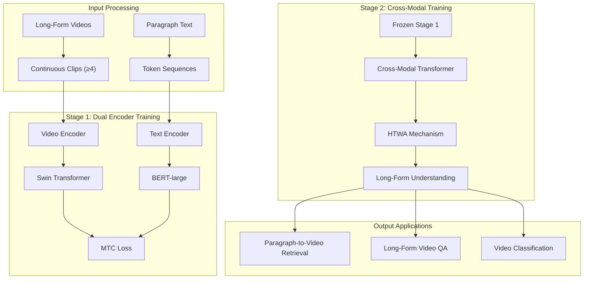

**LF-VILA Architecture and Training Pipeline**

Sources: [LF-VILA/README.md:1-131]()

### Model Implementation Structure

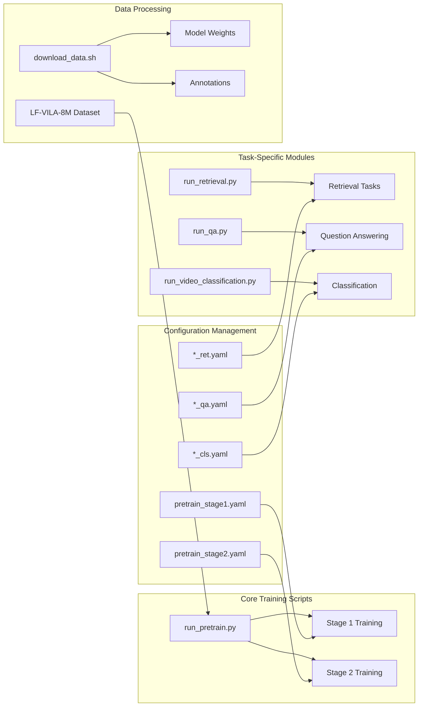

**LF-VILA Code Organization and Dependencies**

Sources: [LF-VILA/README.md:45-106]()

## Key Technical Innovations

### Multimodal Temporal Contrastive (MTC) Loss

The MTC loss mechanism enables fine-grained temporal alignment between long-form videos and paragraph descriptions. This addresses the challenge of learning temporal relationships across extended sequences where traditional contrastive approaches may fail to capture long-range dependencies.

### Hierarchical Temporal Window Attention (HTWA)

HTWA provides an efficient attention mechanism for processing long-form content by:
- Reducing computational complexity for extended sequences
- Maintaining long-range dependency modeling
- Enabling hierarchical temporal understanding

Sources: [LF-VILA/README.md:11-11]()

## Training Process

### Stage 1: Dual Encoder Pre-training

The first stage trains separate encoders for video and text modalities using the MTC loss:

```bash
deepspeed src/run_pretrain.py --distributed --blob_mount_dir /blob_mount --config src/configs/pretrain_stage1.yaml --deepspeed
```

Key characteristics:
- Uses Swin Transformer for video encoding
- Employs BERT-large for text encoding
- Implements MTC loss for temporal contrastive learning

Sources: [LF-VILA/README.md:67-71]()

### Stage 2: Cross-Modal Transformer Training

The second stage introduces cross-modal understanding while freezing Stage 1 parameters:

```bash
deepspeed src/run_pretrain.py --distributed --blob_mount_dir /blob_mount --config src/configs/pretrain_stage2.yaml --deepspeed
```

Key characteristics:
- Frozen dual encoder weights from Stage 1
- Cross-modal Transformer with HTWA mechanism
- Focus on long-form video-language understanding

Sources: [LF-VILA/README.md:73-78]()

## Dataset and Data Preparation

### LF-VILA-8M Dataset Construction

LF-VILA uses a specialized subset of HD-VILA-100M optimized for long-form content:

| Dataset Component | Description | Size |
|------------------|-------------|------|
| LF-VILA-8M | Long-form video subset | 8.5 million videos |
| Clip Requirement | Continuous clips per video | ≥4 clips minimum |
| Content Type | Video + transcript pairs | Long-form sequences |

The dataset construction process filters HD-VILA-100M to retain only videos with sufficient continuous clip coverage for long-form understanding tasks.

### Data Processing Pipeline

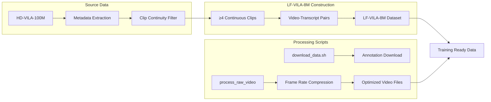

**LF-VILA Data Processing and Dataset Construction**

Sources: [LF-VILA/README.md:49-59]()

## Downstream Applications

### Retrieval Tasks

LF-VILA supports paragraph-to-video retrieval with specialized fine-tuning:

```bash
deepspeed src/tasks/run_retrieval.py --distributed --blob_mount_dir /blob_mount --config $CONFIG_PATH --deepspeed
```

Supported retrieval datasets:
- ActivityNet paragraph-to-video retrieval
- DiDeMo moment localization
- Condensed Movies retrieval

### Question Answering Tasks

Long-form video QA capabilities through dedicated training:

```bash
deepspeed src/tasks/run_qa.py --distributed --blob_mount_dir /blob_mount --config $CONFIG_PATH --deepspeed
```

Supported QA datasets:
- How2QA long-form video questions
- ActivityNet QA
- VIOLIN video reasoning

### Video Classification

Multi-class video understanding for long-form content:

```bash
deepspeed src/tasks/run_video_classification.py --distributed --blob_mount_dir /blob_mount --config $CONFIG_PATH --deepspeed
```

Supported classification datasets:
- COIN procedural video classification
- LVU video understanding benchmarks

Sources: [LF-VILA/README.md:84-106]()

## Configuration and Implementation

### Environment Setup

LF-VILA requires a specialized Docker environment with DeepSpeed support:

```bash
source launch_container.sh $PATH_TO_STORAGE $NAME
```

The recommended Docker image is `ycsun1972/azureml_docker:horovod_deepspeed_v2` which includes:
- Horovod for distributed training
- DeepSpeed for memory optimization
- GPU tensor core support

### Configuration Files Structure

| Configuration Type | File Pattern | Purpose |
|-------------------|--------------|---------|
| Pre-training Stage 1 | `pretrain_stage1.yaml` | Dual encoder training parameters |
| Pre-training Stage 2 | `pretrain_stage2.yaml` | Cross-modal transformer setup |
| Retrieval Tasks | `*_ret.yaml` | Task-specific retrieval configs |
| QA Tasks | `*_qa.yaml` | Question answering parameters |
| Classification | `*_cls.yaml` | Video classification settings |

### Model Weights and Dependencies

The model depends on several pre-trained components:
- Swin Transformer weights for video encoding
- BERT-large weights for text encoding
- Stage 1 model weights for Stage 2 training

These are automatically downloaded via the `scripts/download_data.sh` script.

Sources: [LF-VILA/README.md:26-46](), [LF-VILA/README.md:82-82]()

## Performance Characteristics

LF-VILA achieves notable improvements on long-form video understanding benchmarks:
- **16.1% relative improvement** on ActivityNet paragraph-to-video retrieval
- **2.4% improvement** on How2QA long-form video question answering

These performance gains demonstrate the effectiveness of the MTC loss and HTWA mechanisms for processing extended video content compared to traditional video-language models.

Sources: [LF-VILA/README.md:13-13]()

---

# Page: CLIP-ViP Model

# CLIP-ViP Model

<details>
<summary>Relevant source files</summary>

The following files were used as context for generating this wiki page:

- [CLIP-ViP/README.md](CLIP-ViP/README.md)

</details>


## Purpose and Scope

This document covers the CLIP-ViP (CLIP Video Pretraining) model implementation within the XPretrain repository. CLIP-ViP is a post-pretraining adaptation approach that transfers image-text representations from the OpenAI CLIP model to video-language tasks using the HD-VILA-100M dataset. The model achieves state-of-the-art performance on multiple video retrieval benchmarks by bridging the domain gap between images and videos through targeted post-pretraining.

For information about the foundational HD-VILA-100M dataset used in CLIP-ViP training, see [HD-VILA-100M Dataset](#2.1). For the base HD-VILA model architecture that informs CLIP-ViP's design, see [HD-VILA Model](#2.2).

## Model Architecture and Adaptation Approach

CLIP-ViP follows a two-stage adaptation strategy that preserves the powerful image-text representations from CLIP while extending them to handle video-language understanding tasks.

### CLIP-ViP Architecture Overview

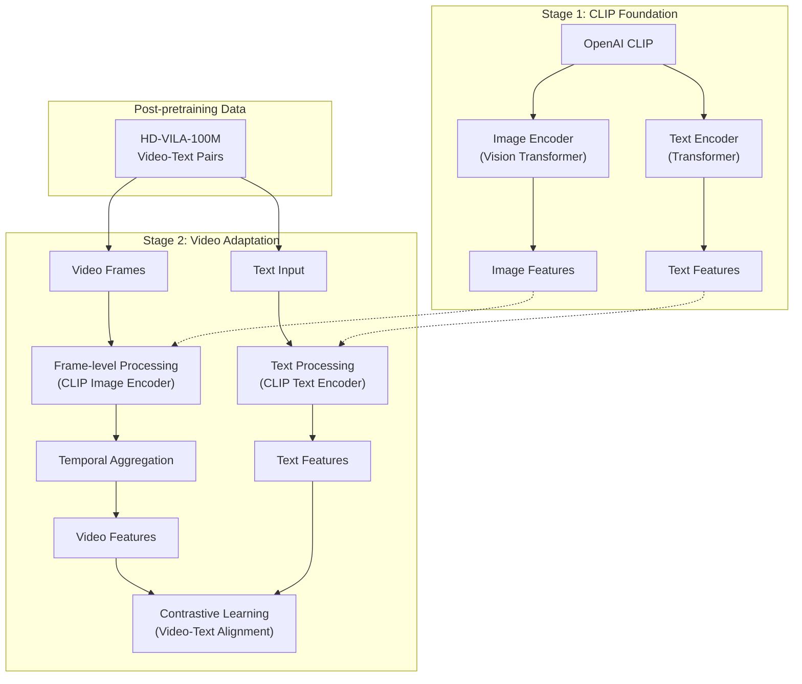

**CLIP-ViP Video Adaptation Pipeline**

Sources: [CLIP-ViP/README.md:11-11]()

### Model Variants

CLIP-ViP is available in two configurations that differ in their visual processing resolution:

| Model Variant | Visual Resolution | Configuration File | Pretrained Model |
|---------------|-------------------|-------------------|------------------|
| CLIP-ViP-B/32 | 224×224 (patch 32) | `pretrain_vip_base_32.json` | `pretrain_clipvip_base_32.pt` |
| CLIP-ViP-B/16 | 224×224 (patch 16) | `pretrain_vip_base_16.json` | `pretrain_clipvip_base_16.pt` |

Sources: [CLIP-ViP/README.md:30-34](), [CLIP-ViP/README.md:62-62]()

## Training Pipeline and Implementation

### Post-pretraining Process

CLIP-ViP employs a post-pretraining strategy where the frozen CLIP model is further trained on video-text data to adapt its representations for video understanding.

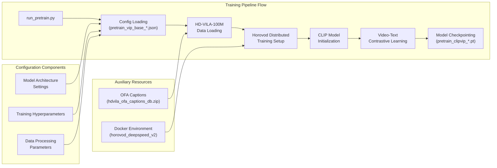

**CLIP-ViP Training Infrastructure and Data Flow**

Sources: [CLIP-ViP/README.md:56-62](), [CLIP-ViP/README.md:26-26](), [CLIP-ViP/README.md:15-17]()

### Training Command Structure

The post-pretraining process is executed using the following command pattern:

```bash
horovodrun -np $NUM_GPUS python src/pretrain/run_pretrain.py --config $CONFIG_PATH
```

The `$CONFIG_PATH` parameter references configuration files located in [src/configs/pretrain/](), specifically:
- `pretrain_vip_base_32.json` for CLIP-ViP-B/32
- `pretrain_vip_base_16.json` for CLIP-ViP-B/16

Sources: [CLIP-ViP/README.md:56-62]()

## Downstream Task Evaluation

### Text-to-Video Retrieval Implementation

CLIP-ViP's primary evaluation focuses on text-to-video retrieval tasks across multiple benchmarks. The retrieval system follows a dual-encoder architecture where video and text are encoded into a shared embedding space.

```mermaid
graph TB
    subgraph "Retrieval Task Pipeline"
        A["run_video_retrieval.py"] --> B["Retrieval Config<br/>(*_retrieval.json)"]
        B --> C["Pretrained CLIP-ViP<br/>Model Loading"]
        C --> D["Dataset-specific<br/>Fine-tuning"]
        D --> E["Video Encoding<br/>(Frame Aggregation)"]
        D --> F["Text Encoding<br/>(CLIP Text Encoder)"]
        E --> G["Similarity Computation<br/>(Cosine Distance)"]
        F --> G
        G --> H["Retrieval Ranking<br/>& Evaluation Metrics"]
    end
    
    subgraph "Supported Datasets"
        I["MSR-VTT"] --> B
        J["DiDemo"] --> B
        K["LSMDC"] --> B
        L["ActivityNet Captions"] --> B
    end
    
    subgraph "Configuration Examples"
        M["msrvtt_retrieval_vip_base_32.json"] --> B
        N["didemo_retrieval_vip_base_16.json"] --> B
        O["lsmdc_retrieval_vip_base_32.json"] --> B
    end
```

**CLIP-ViP Retrieval Task Architecture**

Sources: [CLIP-ViP/README.md:66-72]()

### Supported Evaluation Benchmarks

CLIP-ViP demonstrates state-of-the-art performance across multiple video retrieval benchmarks:

| Benchmark | Task Type | Configuration Pattern |
|-----------|-----------|----------------------|
| MSR-VTT | Text-to-video retrieval | `msrvtt_retrieval_vip_base_*.json` |
| DiDemo | Text-to-video retrieval | `didemo_retrieval_vip_base_*.json` |
| LSMDC | Text-to-video retrieval | `lsmdc_retrieval_vip_base_*.json` |
| ActivityNet Captions | Text-to-video retrieval | `activitynet_retrieval_vip_base_*.json` |

Sources: [CLIP-ViP/README.md:2-5](), [CLIP-ViP/README.md:72-72]()

### Retrieval Fine-tuning Command

Fine-tuning for retrieval tasks follows this command structure:

```bash
horovodrun -np $NUM_GPUS python src/tasks/run_video_retrieval.py --config $CONFIG_PATH
```

The configuration files for retrieval tasks are located in [src/configs/]() with the naming pattern `*_retrieval.json`.

Sources: [CLIP-ViP/README.md:66-72]()

## Environment and Infrastructure Requirements

### Docker Environment Setup

CLIP-ViP requires a specialized environment with distributed training capabilities:

```mermaid
graph TB
    subgraph "Environment Setup"
        A["tiankaihang/azureml_docker:horovod"] --> B["GPU Infrastructure<br/>(Tensor Core Required)"]
        B --> C["Mixed-precision Training<br/>Support"]
        C --> D["Horovod Distributed<br/>Training Framework"]
    end
    
    subgraph "Container Launch Process"
        E["launch_container.sh"] --> F["Container Initialization<br/>($PATH_TO_STORAGE mounting)"]
        F --> G["Package Updates<br/>(transformers upgrade)"]
        G --> H["Training Environment<br/>Ready"]
    end
    
    subgraph "Storage Requirements"
        I["PATH_TO_STORAGE"] --> J["Pretrained Models<br/>(*.pt files)"]
        I --> K["HD-VILA-100M Dataset"]
        I --> L["Auxiliary Captions<br/>(OFA captions)"]
        I --> M["Results Output<br/>(checkpoints & logs)"]
    end
```

**CLIP-ViP Infrastructure and Environment Dependencies**

Sources: [CLIP-ViP/README.md:15-17](), [CLIP-ViP/README.md:36-51]()

### Data Dependencies

CLIP-ViP requires several data components for operation:

1. **HD-VILA-100M Dataset**: Primary video-text training data
2. **Auxiliary OFA Captions**: Additional caption data from [hdvila_ofa_captions_db.zip]()
3. **Pretrained CLIP-ViP Models**: Available as `pretrain_clipvip_base_32.pt` and `pretrain_clipvip_base_16.pt`

Sources: [CLIP-ViP/README.md:24-34]()

## Integration with XPretrain Ecosystem

CLIP-ViP builds upon the HD-VILA foundation and represents the evolution toward more efficient adaptation strategies within the XPretrain video-language research track. The model demonstrates how existing image-text representations can be effectively transferred to video domains through targeted post-pretraining, offering a computationally efficient alternative to training video-language models from scratch.

Sources: [CLIP-ViP/README.md:96-96]()

---

# Page: Image-Language Research Track

# Image-Language Research Track

<details>
<summary>Relevant source files</summary>

The following files were used as context for generating this wiki page:

- [README.md](README.md)
- [visualparsing/README.md](visualparsing/README.md)

</details>


## Purpose and Scope

This document covers the image-language research components within the XPretrain repository, focusing on the evolution of vision-and-language pre-training models from foundational architectures to advanced transformer-based approaches. The image-language track represents the foundation for multimodal understanding research that preceded and informed the video-language developments.

For information about video-language models that build upon these image-language foundations, see [Video-Language Research Track](#2). For implementation details of the VisualParsing model specifically, see [VisualParsing Model](#3.1).

## Overview of Image-Language Models

The image-language research track encompasses three progressive model architectures that advance vision-and-language pre-training capabilities:

| Model | Publication | Key Innovation | Implementation Status |
|-------|-------------|----------------|---------------------|
| Pixel-BERT | arXiv 2020 | End-to-end image and language pre-training | External reference |
| SOHO | CVPR 2021 (oral) | Quantized visual tokens for improved efficiency | External reference |
| VisualParsing | NeurIPS 2021 | Transformer-based visual embedding with inter-modality mechanisms | Available in repository |

The progression demonstrates increasing sophistication in cross-modal understanding, culminating in the fully transformer-based VisualParsing approach that introduces novel mechanisms for measuring and optimizing inter-modal interactions.

Sources: [README.md:21-29](), [visualparsing/README.md:1-35]()

## Model Architecture Evolution

```mermaid
graph TD
    subgraph "Image-Language Evolution"
        A["Pixel-BERT<br/>(2020)"] --> B["SOHO<br/>(CVPR 2021)"]
        B --> C["VisualParsing<br/>(NeurIPS 2021)"]
    end
    
    subgraph "Technical Innovations"
        D["End-to-end<br/>Pre-training"] --> E["Quantized<br/>Visual Tokens"]
        E --> F["Transformer<br/>Visual Embedding"]
        F --> G["Inter-Modality<br/>Flow (IMF)"]
        F --> H["Masked Feature<br/>Regression (MFR)"]
    end
    
    subgraph "Code Implementation"
        I["visualparsing/<br/>directory"]
        J["IMF metric<br/>measurement"]
        K["MFR optimization<br/>mechanism"]
        L["Self-Attention<br/>visual parsing"]
    end
    
    A --> D
    B --> E
    C --> F
    G --> J
    H --> K
    F --> L
    C --> I
    
    style C fill:#f0f8ff,stroke:#333,stroke-width:2px
    style I fill:#e6f3ff,stroke:#333,stroke-width:2px
```

**Architecture Evolution Diagram**

This diagram illustrates the technical progression from basic end-to-end pre-training through quantized representations to sophisticated transformer-based visual parsing with specialized inter-modality mechanisms.

Sources: [README.md:21-29](), [visualparsing/README.md:7-14]()

## VisualParsing Technical Architecture

```mermaid
graph TB
    subgraph "VisualParsing Framework"
        A["Image Input"] --> B["Transformer<br/>Visual Encoder"]
        C["Text Input"] --> D["Language<br/>Encoder"] 
        
        B --> E["Visual<br/>Embeddings"]
        D --> F["Text<br/>Embeddings"]
        
        E --> G["Self-Attention<br/>Visual Parsing"]
        F --> G
        
        G --> H["Inter-Modality<br/>Flow (IMF)"]
        G --> I["Cross-Modal<br/>Fusion"]
        
        H --> J["IMF Metric<br/>Measurement"]
        I --> K["Masked Feature<br/>Regression (MFR)"]
        
        J --> L["Vision-Language<br/>Alignment"]
        K --> L
        
        L --> M["Pre-trained<br/>Representations"]
    end
    
    subgraph "Key Components"
        N["visualparsing.png<br/>framework diagram"]
        O["Self-Attention<br/>mechanisms"]
        P["Masking<br/>optimization"]
        Q["Inter-modal<br/>measurement"]
    end
    
    G --> O
    K --> P
    J --> Q
    A --> N
```

**VisualParsing Technical Framework**

This diagram shows the core architecture of the VisualParsing model, highlighting the transformer-based visual embedding approach and the novel Inter-Modality Flow (IMF) and Masked Feature Regression (MFR) mechanisms.

Sources: [visualparsing/README.md:9-14](), [visualparsing/README.md:16-21]()

## Inter-Modality Mechanisms

The VisualParsing model introduces two key technical innovations for measuring and optimizing cross-modal interactions:

### Inter-Modality Flow (IMF)

The `IMF` metric quantifies the interaction between vision and language modalities, providing a measurable approach to assess cross-modal alignment quality. This metric enables systematic evaluation of how effectively the model bridges visual and textual representations.

### Masked Feature Regression (MFR)

The `MFR` optimization mechanism operates within the Transformer architecture to promote inter-modality learning through strategic masking and reconstruction of features across modalities. This approach enhances the model's ability to understand relationships between visual and textual elements.

```mermaid
graph LR
    subgraph "IMF Measurement Pipeline"
        A["Visual<br/>Features"] --> C["IMF<br/>Calculation"]
        B["Text<br/>Features"] --> C
        C --> D["Inter-modal<br/>Alignment Score"]
    end
    
    subgraph "MFR Optimization Process"
        E["Input<br/>Features"] --> F["Masking<br/>Strategy"]
        F --> G["Feature<br/>Reconstruction"]
        G --> H["Loss<br/>Computation"]
        H --> I["Model<br/>Updates"]
    end
    
    subgraph "Transformer Integration"
        J["Self-Attention<br/>Layers"]
        K["Cross-Modal<br/>Attention"]
        L["Feature<br/>Fusion"]
    end
    
    C --> K
    G --> J
    K --> L
    J --> L
```

**Inter-Modality Learning Mechanisms**

This diagram details the technical implementation of IMF measurement and MFR optimization within the transformer-based architecture.

Sources: [visualparsing/README.md:11-14]()

## Research Timeline and Publications

The image-language research track represents a foundational period that established core multimodal learning principles later extended to video-language applications:

| Year | Model | Venue | Key Contribution |
|------|-------|-------|------------------|
| 2020 | Pixel-BERT | arXiv | Established end-to-end image-language pre-training paradigm |
| 2021 | SOHO | CVPR (oral) | Introduced quantized visual tokens for improved efficiency |
| 2021 | VisualParsing | NeurIPS | Advanced transformer-based visual embedding with inter-modality mechanisms |

The VisualParsing model represents the culmination of this research track, introducing sophisticated mechanisms for measuring and optimizing cross-modal interactions that inform subsequent video-language developments in the repository.

### Citation Information

The VisualParsing research can be cited using the BibTeX entry provided in [visualparsing/README.md:27-35]().

Sources: [README.md:21-29](), [visualparsing/README.md:3-6](), [visualparsing/README.md:27-35]()

## Technical Implementation

The VisualParsing model is the primary image-language component with available implementation in the repository. The model files are located in the `visualparsing/` directory, with the framework architecture illustrated in the included `visualparsing.png` diagram.

The implementation focuses on:

- **Transformer-based visual embedding**: Fully transformer architecture for processing visual inputs
- **Self-attention visual parsing**: Advanced attention mechanisms for understanding visual relationships  
- **Inter-modality optimization**: Specialized loss functions and training procedures for cross-modal alignment
- **Masking strategies**: Novel approaches to feature masking and reconstruction for improved learning

Sources: [visualparsing/README.md:9-14](), [visualparsing/README.md:16-21]()

---

# Page: VisualParsing Model

# VisualParsing Model

<details>
<summary>Relevant source files</summary>

The following files were used as context for generating this wiki page:

- [visualparsing/README.md](visualparsing/README.md)
- [visualparsing/visualparsing.png](visualparsing/visualparsing.png)

</details>


## Purpose and Scope

This document covers the VisualParsing model, a vision-language pre-training system that introduces fully Transformer-based visual embeddings for improved inter-modal alignment. The VisualParsing model is part of XPretrain's image-language research track and represents foundational work in transformer-based visual understanding published at NeurIPS 2021.

For information about other image-language models in the repository, see the [Image-Language Research Track](#3) overview. For video-language research, see the [Video-Language Research Track](#2).

## Overview

The VisualParsing model addresses a fundamental challenge in vision-language pre-training: how to better learn visual relations and promote alignment between visual and textual modalities. The system introduces two key innovations:

1. **Inter-Modality Flow (IMF)**: A metric for measuring interaction between vision and language modalities
2. **Masked Feature Regression (MFR)**: A novel masking optimization mechanism in Transformer architectures

### Core Architecture Concept

```mermaid
graph TB
    subgraph "VisualParsing Framework"
        A["Image Input"] --> B["Fully Transformer Visual Embedding"]
        C["Text Input"] --> D["Language Encoder"]
        B --> E["Self-Attention Visual Parsing"]
        D --> F["Cross-Modal Alignment"]
        E --> G["Inter-Modality Flow (IMF)"]
        F --> G
        G --> H["Masked Feature Regression (MFR)"]
        H --> I["Vision-Language Representations"]
    end
    
    subgraph "Key Innovations"
        J["IMF Metric"] --> K["Measures Vision-Language Interaction"]
        L["MFR Mechanism"] --> M["Enhanced Inter-Modality Learning"]
    end
    
    G -.-> J
    H -.-> L
    
    style B fill:#f5f5f5,stroke:#333,stroke-width:2px
    style E fill:#f5f5f5,stroke:#333,stroke-width:2px
    style G fill:#e8f4f8,stroke:#333,stroke-width:2px
    style H fill:#e8f4f8,stroke:#333,stroke-width:2px
```

Sources: [visualparsing/README.md:9-14]()

## Technical Innovations

### Inter-Modality Flow (IMF)

The Inter-Modality Flow serves as a quantitative metric to measure the interaction strength between visual and linguistic modalities. This metric enables the model to assess how effectively information flows between different modal representations during the pre-training process.

### Masked Feature Regression (MFR)

The Masked Feature Regression mechanism extends traditional masking strategies by operating within the Transformer architecture to specifically enhance inter-modality learning. Unlike conventional masked language modeling, MFR focuses on regressing masked visual features to promote cross-modal understanding.

```mermaid
graph LR
    subgraph "MFR Process Flow"
        A["Visual Features"] --> B["Feature Masking"]
        B --> C["Transformer Processing"]
        C --> D["Feature Regression"]
        D --> E["Inter-Modal Learning"]
    end
    
    subgraph "IMF Measurement"
        F["Vision Embeddings"] --> G["Flow Calculation"]
        H["Language Embeddings"] --> G
        G --> I["Interaction Score"]
    end
    
    E -.-> F
    E -.-> H
    
    style B fill:#f5f5f5,stroke:#333,stroke-width:2px
    style D fill:#f5f5f5,stroke:#333,stroke-width:2px
    style G fill:#e8f4f8,stroke:#333,stroke-width:2px
```

Sources: [visualparsing/README.md:11-14]()

## Integration with XPretrain Ecosystem

The VisualParsing model represents a foundational contribution to the image-language research track within XPretrain. As one of the earlier works (NeurIPS 2021), it established key principles that influenced subsequent developments in the repository.

### Research Timeline Position

```mermaid
timeline
    title "VisualParsing in XPretrain Evolution"
    
    2021 : "Image-Language Foundations"
         : "VisualParsing (NeurIPS 2021)"
         : "Transformer Visual Embeddings"
         : "IMF and MFR Innovations"
    
    2022 : "Video-Language Expansion"
         : "HD-VILA Dataset Creation"
         : "Video-Language Models"
    
    2023 : "Model Adaptations"
         : "CLIP-ViP Development"
         : "Cross-domain Applications"
```

Sources: [visualparsing/README.md:3]()

## Model Architecture Details

### Fully Transformer Visual Embedding

The VisualParsing model distinguishes itself by employing a fully Transformer-based approach for visual feature extraction, moving away from traditional CNN-based visual encoders. This architectural choice enables better integration with language processing components and more effective self-attention mechanisms for visual relation learning.

| Component | Description | Purpose |
|-----------|-------------|---------|
| Visual Transformer | Fully transformer-based visual processing | Learn visual relations through self-attention |
| IMF Metric | Inter-modality interaction measurement | Quantify vision-language alignment |
| MFR Mechanism | Masked feature regression optimization | Enhance cross-modal learning |
| Self-Attention | Visual parsing through attention | Extract relational visual features |

Sources: [visualparsing/README.md:9-10]()

## Research Contributions

The VisualParsing model's primary contributions to the vision-language pre-training field include:

1. **Architectural Innovation**: Introduction of fully Transformer-based visual embeddings for VLP
2. **Metric Development**: The IMF metric for quantifying inter-modal interactions  
3. **Optimization Technique**: MFR mechanism for enhanced cross-modal learning
4. **Attention-based Parsing**: Self-attention mechanisms for visual relation understanding

```mermaid
graph TD
    subgraph "Research Impact"
        A["VisualParsing Model"] --> B["Transformer Visual Embeddings"]
        A --> C["Inter-Modality Flow Metric"]
        A --> D["Masked Feature Regression"]
        
        B --> E["Improved Visual Relations"]
        C --> F["Quantified Modal Alignment"]
        D --> G["Enhanced Cross-Modal Learning"]
        
        E --> H["Better VLP Performance"]
        F --> H
        G --> H
    end
    
    style A fill:#f0f8ff,stroke:#333,stroke-width:3px
    style H fill:#f5f5f5,stroke:#333,stroke-width:2px
```

Sources: [visualparsing/README.md:9-14]()

## Publication and Citation

The VisualParsing model was published at NeurIPS 2021 under the title "Probing Inter-modality: Visual Parsing with Self-Attention for Vision-and-Language Pre-training." The work represents collaborative research between multiple institutions and contributes to the broader understanding of transformer-based multimodal learning.

**Research Team**: Hongwei Xue, Yupan Huang, Bei Liu, Houwen Peng, Jianlong Fu, Houqiang Li, and Jiebo Luo

**Publication Venue**: Advances in Neural Information Processing Systems (NeurIPS) 2021

Sources: [visualparsing/README.md:3-6](), [visualparsing/README.md:27-35]()

---

# Page: Development Guide

# Development Guide

<details>
<summary>Relevant source files</summary>

The following files were used as context for generating this wiki page:

- [LF-VILA/docker/Dockerfile](LF-VILA/docker/Dockerfile)
- [LF-VILA/docker/requirements.txt](LF-VILA/docker/requirements.txt)

</details>


This document provides comprehensive guidance for developers working with XPretrain components, covering environment setup, containerized development workflows, and configuration management across the video-language and image-language research tracks. 

For information about specific model architectures and training procedures, see [HD-VILA Model](#2.2), [LF-VILA Model](#2.3), and [CLIP-ViP Model](#2.4). For dataset preparation and processing details, see [HD-VILA-100M Dataset](#2.1) and [Data Processing](#4.2). For licensing and responsible AI considerations, see [Legal and Governance](#5).

## Development Environment Architecture

The XPretrain repository uses a containerized development approach with Docker to ensure consistent environments across different research components. The development stack is built around GPU-accelerated training with distributed computing capabilities.

## Development Stack Architecture

```mermaid
graph TB
    subgraph "Host System"
        A[nvidia-docker] --> B["CUDA 11.1.1 Runtime"]
        B --> C["GPU Hardware<br/>(Tensor Core Compatible)"]
    end
    
    subgraph "Container Environment"
        D["nvidia/cuda:11.1.1-devel-ubuntu18.04"] --> E["Python 3.8 Environment"]
        E --> F["PyTorch 1.10.0+cu111"]
        E --> G["Horovod Distributed Training"]
        E --> H["DeepSpeed 0.5.8"]
        F --> I["Model Training Framework"]
        G --> I
        H --> I
    end
    
    subgraph "ML Libraries"
        J["transformers==4.30.0"] --> I
        K["timm==0.4.12"] --> I
        L["einops==0.3.2"] --> I
        M["decord==0.6.0"] --> I
        N["mmcv-full==1.4.2"] --> I
    end
    
    subgraph "Storage & Data"
        O["Local Storage<br/>PATH_TO_STORAGE"] --> I
        P["Azure Blob Storage"] --> O
        Q["Video Processing<br/>FFmpeg"] --> I
    end
    
    A --> D
```

Sources: [LF-VILA/docker/Dockerfile:1-134](), [LF-VILA/docker/requirements.txt:1-10]()

## Container Setup Process

The containerized environment follows a multi-stage build process that establishes the complete development stack including distributed training capabilities and video processing tools.

## Docker Build Pipeline

```mermaid
graph TD
    subgraph "Base System Setup"
        A["FROM nvidia/cuda:11.1.1-devel-ubuntu18.04"] --> B["apt-get system packages<br/>build-essential, cmake, git"]
        B --> C["CUDA/cuDNN libraries<br/>libcudnn8, libnccl2"]
        C --> D["FFmpeg video processing<br/>libsm6, libxext6"]
    end
    
    subgraph "Communication Layer"
        D --> E["OpenMPI 3.0.0<br/>Distributed communication"]
        E --> F["OpenSSH configuration<br/>Container networking"]
    end
    
    subgraph "Python Environment"
        F --> G["Python 3.8 installation"]
        G --> H["pip package manager"]
        H --> I["PyTorch 1.10.0+cu111<br/>torchvision 0.11.0+cu111"]
    end
    
    subgraph "Training Frameworks"
        I --> J["Horovod build from source<br/>NCCL + PyTorch support"]
        J --> K["DeepSpeed 0.5.8<br/>Memory optimization"]
        K --> L["Apex mixed precision<br/>NVIDIA optimization"]
    end
    
    subgraph "ML Dependencies"
        L --> M["transformers, timm, einops<br/>Model components"]
        M --> N["decord, opencv-python<br/>Video processing"]
        N --> O["CLIP, mmcv-full<br/>Vision-language models"]
    end
```

Sources: [LF-VILA/docker/Dockerfile:24-134]()

## Core Dependencies and Versions

The development environment maintains specific version constraints to ensure reproducibility across distributed training scenarios.

| Component | Version | Purpose |
|-----------|---------|---------|
| `nvidia/cuda` | 11.1.1-devel-ubuntu18.04 | Base CUDA development environment |
| `python` | 3.8 | Core Python runtime |
| `torch` | 1.10.0+cu111 | PyTorch framework with CUDA 11.1 support |
| `torchvision` | 0.11.0+cu111 | Computer vision utilities |
| `deepspeed` | 0.5.8 | Memory-efficient distributed training |
| `transformers` | 4.30.0 | Hugging Face transformer models |
| `timm` | 0.4.12 | PyTorch image models library |
| `decord` | 0.6.0 | Efficient video loading |
| `mmcv-full` | 1.4.2 | OpenMMLab computer vision framework |

Sources: [LF-VILA/docker/Dockerfile:7-11](), [LF-VILA/docker/requirements.txt:2-10]()

## Distributed Training Configuration

The container environment includes comprehensive distributed training support through multiple communication backends and optimization frameworks.

## Training Infrastructure Components

```mermaid
graph LR
    subgraph "Communication Backends"
        A["OpenMPI 3.0.0"] --> D["Horovod"]
        B["NCCL 2.8.4"] --> D
        C["SSH networking"] --> D
    end
    
    subgraph "Optimization Frameworks"
        D --> E["DeepSpeed 0.5.8<br/>Memory optimization"]
        D --> F["Apex<br/>Mixed precision"]
        D --> G["PyTorch Lightning 1.2.9<br/>Training loops"]
    end
    
    subgraph "Model Components"
        E --> H["transformer models"]
        F --> H
        G --> H
        H --> I["Video-language training"]
        H --> J["Image-language training"]
    end
    
    subgraph "Data Pipeline"
        K["decord video loading"] --> I
        L["timm image models"] --> J
        M["FFmpeg processing"] --> K
        N["CLIP preprocessing"] --> L
    end
```

Sources: [LF-VILA/docker/Dockerfile:52-99](), [LF-VILA/docker/Dockerfile:108-121]()

## Environment Variables and Paths

The development environment expects specific configuration through environment variables and storage paths for data and model artifacts.

| Variable | Purpose | Example |
|----------|---------|---------|
| `CUDA_HOME` | CUDA installation path | `/usr/local/cuda` |
| `PATH_TO_STORAGE` | Local storage root | `/data/storage` |
| `HOROVOD_GPU_ALLREDUCE` | GPU communication backend | `NCCL` |
| `HOROVOD_NCCL_LINK` | NCCL linking mode | `SHARED` |
| `HOROVOD_WITH_PYTORCH` | PyTorch integration | `1` |

## Video Processing Dependencies

The container includes specialized video processing capabilities essential for video-language model development.

## Video Processing Pipeline

```mermaid
graph TB
    subgraph "System Libraries"
        A["FFmpeg<br/>Video codec support"] --> D["Video Processing Pipeline"]
        B["libsm6, libxext6<br/>GUI library support"] --> D
        C["OpenCV<br/>Computer vision ops"] --> D
    end
    
    subgraph "Python Video Libraries"
        E["decord==0.6.0<br/>Efficient video decoding"] --> D
        F["opencv-python<br/>Video manipulation"] --> D
        G["timm models<br/>Video feature extraction"] --> D
    end
    
    subgraph "Processing Capabilities"
        D --> H["Video frame extraction"]
        D --> I["Format conversion"]
        D --> J["Temporal sampling"]
        D --> K["Resolution scaling"]
    end
    
    subgraph "Model Integration"
        H --> L["HD-VILA preprocessing"]
        I --> M["LF-VILA long-form handling"]
        J --> N["CLIP-ViP adaptation"]
        K --> O["Feature extraction"]
    end
```

Sources: [LF-VILA/docker/Dockerfile:49-50](), [LF-VILA/docker/Dockerfile:119-120](), [LF-VILA/docker/requirements.txt:8]()

## Container Launch Workflow

The development workflow involves building the container with appropriate CUDA support and mounting storage volumes for data access.

## Development Container Workflow

```mermaid
graph TD
    subgraph "Container Build"
        A["docker build<br/>-f Dockerfile"] --> B["Base image pull<br/>nvidia/cuda:11.1.1-devel"]
        B --> C["System dependencies<br/>apt-get install"]
        C --> D["Python environment<br/>pip install"]
        D --> E["ML frameworks<br/>Horovod, DeepSpeed"]
    end
    
    subgraph "Container Launch"
        E --> F["nvidia-docker run<br/>--gpus all"]
        F --> G["Volume mounts<br/>-v PATH_TO_STORAGE"]
        G --> H["Environment variables<br/>CUDA_HOME, etc"]
        H --> I["SSH/MPI setup<br/>Distributed training"]
    end
    
    subgraph "Development Tasks"
        I --> J["Data preprocessing<br/>Video/text processing"]
        I --> K["Model training<br/>Multi-GPU distributed"]
        I --> L["Evaluation<br/>Downstream tasks"]
        I --> M["Checkpoint management<br/>Model artifacts"]
    end
```

Sources: [LF-VILA/docker/Dockerfile:1-134]()

## Configuration Management

The XPretrain components use JSON and YAML configuration files to manage model parameters, training settings, and data paths across different research tracks.

Configuration files typically specify:
- Model architecture parameters (`hidden_size`, `num_layers`, `attention_heads`)
- Training hyperparameters (`learning_rate`, `batch_size`, `epochs`)
- Data paths and preprocessing settings
- Distributed training configurations
- Evaluation and checkpoint settings

For specific configuration details for each model, refer to the individual model documentation: [HD-VILA Model](#2.2), [LF-VILA Model](#2.3), and [CLIP-ViP Model](#2.4).

## Development Prerequisites

Before beginning development with XPretrain components, ensure your system meets the following requirements:

| Requirement | Specification |
|-------------|---------------|
| GPU | NVIDIA GPU with Tensor Core support (V100, A100, RTX series) |
| CUDA | Version 11.1 or compatible |
| Docker | nvidia-docker2 runtime support |
| Storage | Sufficient space for datasets (TB-scale for video data) |
| Memory | 32GB+ RAM recommended for large-scale training |
| Network | High-bandwidth connection for distributed training |

Sources: [LF-VILA/docker/Dockerfile:1-11](), [LF-VILA/docker/requirements.txt:1-10]()

---

# Page: Environment Setup

# Environment Setup

<details>
<summary>Relevant source files</summary>

The following files were used as context for generating this wiki page:

- [LF-VILA/docker/Dockerfile](LF-VILA/docker/Dockerfile)
- [LF-VILA/docker/requirements.txt](LF-VILA/docker/requirements.txt)
- [LF-VILA/launch_container.sh](LF-VILA/launch_container.sh)
- [LF-VILA/setup.sh](LF-VILA/setup.sh)

</details>


This document covers the development environment setup for XPretrain components, including Docker containerization, GPU infrastructure requirements, and dependency management. The environment setup is primarily focused on the distributed training infrastructure needed for large-scale video-language pre-training.

For information about data processing workflows after environment setup, see [Data Processing](#4.2). For model-specific configuration parameters, see [Configuration Management](#4.3).

## Purpose and Scope

The XPretrain environment setup provides a standardized Docker-based development environment optimized for:
- Multi-GPU distributed training using Horovod and DeepSpeed
- CUDA 11.1 compatibility with PyTorch 1.10.0
- Video processing capabilities with FFmpeg and Decord
- Large-scale dataset handling with Azure blob storage mounting

## Docker Environment Architecture

The XPretrain development environment is built around a containerized infrastructure that supports distributed training across multiple GPUs and nodes.

### Container Infrastructure Overview

```mermaid
graph TB
    subgraph "Host System"
        A[launch_container.sh] --> B["Docker Runtime"]
        C["CUDA_VISIBLE_DEVICES"] --> B
        D["Data Directory"] --> E["Blob Mount"]
    end
    
    subgraph "Container: ycsun1972/azureml_docker:horovod_deepspeed_v2"
        F["CUDA 11.1.1 Base"] --> G["PyTorch 1.10.0+cu111"]
        G --> H["Horovod + OpenMPI"]
        H --> I["DeepSpeed 0.5.8"]
        I --> J["setup.sh"]
        J --> K["Python Environment"]
        
        subgraph "Mounted Volumes"
            L["/LF-VILA (Source Code)"]
            M["/blob_mount (Data)"]
        end
    end
    
    subgraph "Training Infrastructure"
        N["Multi-GPU Training"]
        O["Distributed Communication"]
        P["Model Checkpointing"]
    end
    
    K --> N
    H --> O
    I --> P
```

Sources: [LF-VILA/launch_container.sh:9-16](), [LF-VILA/docker/Dockerfile:1-134]()

### Base Container Specifications

The Docker environment is built on specific versions to ensure compatibility across the distributed training stack:

| Component | Version | Purpose |
|-----------|---------|---------|
| CUDA | 11.1.1-devel-ubuntu18.04 | GPU compute platform |
| PyTorch | 1.10.0+cu111 | Deep learning framework |
| TorchVision | 0.11.0+cu111 | Computer vision utilities |
| cuDNN | 8.0.4.30-1+cuda11.1 | GPU-accelerated deep learning |
| NCCL | 2.8.4-1+cuda11.1 | Multi-GPU communication |

Sources: [LF-VILA/docker/Dockerfile:7-12]()

## GPU and CUDA Requirements

The environment requires specific GPU infrastructure and CUDA configuration for optimal performance.

### CUDA Configuration Flow

```mermaid
graph LR
    subgraph "CUDA Setup Process"
        A["nvidia/cuda:11.1.1-devel-ubuntu18.04"] --> B["cuDNN Installation"]
        B --> C["NCCL Configuration"]
        C --> D["PyTorch CUDA Build"]
        D --> E["Horovod GPU Support"]
        E --> F["DeepSpeed Integration"]
    end
    
    subgraph "GPU Requirements"
        G["Tensor Core GPUs"]
        H["Multi-GPU Nodes"]
        I["InfiniBand Support"]
    end
    
    subgraph "Runtime Configuration"
        J["CUDA_VISIBLE_DEVICES"]
        K["NVIDIA_VISIBLE_DEVICES"]
        L["GPU Memory Management"]
    end
    
    F --> G
    F --> H
    F --> I
    J --> L
    K --> L
```

Sources: [LF-VILA/docker/Dockerfile:33-35](), [LF-VILA/launch_container.sh:5-7,14]()

### GPU Access Configuration

The `launch_container.sh` script manages GPU visibility and access:

```bash
# GPU device selection logic
if [ -z $CUDA_VISIBLE_DEVICES ]; then
   CUDA_VISIBLE_DEVICES='all'
fi

# Container GPU configuration
docker run --gpus device=$CUDA_VISIBLE_DEVICES \
   -e NVIDIA_VISIBLE_DEVICES=$CUDA_VISIBLE_DEVICES
```

Sources: [LF-VILA/launch_container.sh:5-7,14]()

## Dependency Management

The environment uses a layered dependency management approach with specific version pinning for reproducibility.

### Core Framework Dependencies

```mermaid
graph TD
    subgraph "Base ML Stack"
        A["PyTorch 1.10.0+cu111"] --> B["TorchVision 0.11.0+cu111"]
        A --> C["PyTorch Lightning 1.2.9"]
    end
    
    subgraph "Distributed Training"
        D["Horovod (from source)"] --> E["OpenMPI 3.0.0"]
        F["DeepSpeed 0.5.8"] --> A
        G["NCCL 2.8.4"] --> D
    end
    
    subgraph "Computer Vision"
        H["mmcv-full 1.4.2"] --> A
        I["NVIDIA Apex"] --> A
        J["timm 0.4.12"] --> A
    end
    
    subgraph "Video Processing"
        K["decord 0.6.0"] --> L["FFmpeg"]
        M["opencv-python"] --> L
    end
    
    subgraph "Language Processing"
        N["transformers 4.30.0"] --> O["BERT Models"]
        P["CLIP (from git)"] --> Q["OpenAI CLIP"]
    end
```

Sources: [LF-VILA/docker/Dockerfile:72-134](), [LF-VILA/docker/requirements.txt:1-10]()

### Requirements Installation Layers

The dependency installation follows a specific order to handle compilation dependencies:

1. **System packages**: [LF-VILA/docker/Dockerfile:24-47]()
2. **PyTorch ecosystem**: [LF-VILA/docker/Dockerfile:72-76]()
3. **Distributed training**: [LF-VILA/docker/Dockerfile:91-99]()
4. **Computer vision**: [LF-VILA/docker/Dockerfile:109-115]()
5. **Project-specific**: [LF-VILA/docker/requirements.txt:1-10]()

## Container Launch Process

The container launch process involves mounting data directories and configuring the runtime environment.

### Launch Script Workflow

```mermaid
graph TB
    subgraph "launch_container.sh Parameters"
        A["DATA_DIR (arg 1)"] --> B["Data Mount Point"]
        C["NAME (arg 2)"] --> D["Container Name"]
        E["CUDA_VISIBLE_DEVICES"] --> F["GPU Selection"]
    end
    
    subgraph "Docker Run Configuration"
        G["--gpus device=CUDA_VISIBLE_DEVICES"] --> H["GPU Access"]
        I["--ipc=host"] --> J["Shared Memory"]
        K["--shm-size=128g"] --> L["Large Shared Memory"]
        M["--mount src=pwd,dst=/LF-VILA"] --> N["Source Code Mount"]
        O["--mount src=DATA_DIR,dst=/blob_mount"] --> P["Data Mount"]
    end
    
    subgraph "Container Initialization"
        Q["source /LF-VILA/setup.sh"] --> R["Environment Setup"]
        R --> S["Interactive Bash Shell"]
    end
    
    B --> O
    D --> C
    F --> G
    H --> Q
    J --> Q
    L --> Q
    N --> Q
    P --> Q
```

Sources: [LF-VILA/launch_container.sh:1-16]()

### Usage Pattern

The typical container launch follows this pattern:

```bash
# Launch container with data directory and custom name
./launch_container.sh /path/to/data my_container_name

# Inside container, setup.sh is automatically sourced
source /LF-VILA/setup.sh  # Sets PYTHONPATH and installs lmdb
```

Sources: [LF-VILA/launch_container.sh:16](), [LF-VILA/setup.sh:4-8]()

## Environment Configuration

The `setup.sh` script provides the final environment configuration within the container.

### Python Path Configuration

```mermaid
graph LR
    subgraph "setup.sh Execution"
        A["DIR_PWD = current directory"] --> B["PYTHONPATH += DIR_PWD"]
        B --> C["pip install lmdb"]
        C --> D["echo PYTHONPATH"]
    end
    
    subgraph "Path Resolution"
        E["BASH_SOURCE[0]"] --> F["dirname"]
        F --> G["cd && pwd"]
        G --> A
    end
    
    subgraph "Module Import"
        H["Python Modules"] --> I["LF-VILA Components"]
        B --> H
    end
```

Sources: [LF-VILA/setup.sh:4-9]()

### Runtime Environment Variables

The setup establishes several key environment variables:

| Variable | Value | Purpose |
|----------|-------|---------|
| `DIR_PWD` | Current directory path | Base path for project |
| `PYTHONPATH` | `$PYTHONPATH:$DIR_PWD` | Python module resolution |
| `CUDA_HOME` | `/usr/local/cuda` | CUDA toolkit location |

Sources: [LF-VILA/setup.sh:4-6](), [LF-VILA/docker/Dockerfile:133]()

## Infrastructure Requirements

### Minimum System Requirements

- **GPU**: NVIDIA GPUs with Tensor Core support (V100, A100, RTX series)
- **CUDA**: Version 11.1 or compatible
- **Memory**: Minimum 128GB shared memory for large batch training
- **Storage**: High-speed storage for dataset access (preferably NVMe SSD)
- **Network**: InfiniBand or high-speed Ethernet for multi-node training

### Container Resource Allocation

The container configuration optimizes for large-scale training:

- **Shared Memory**: 128GB (`--shm-size=128g`)
- **IPC**: Host IPC namespace for efficient inter-process communication
- **GPU Access**: All available GPUs or specified subset
- **Volume Mounts**: Bind mounts for code and data access

Sources: [LF-VILA/launch_container.sh:9-13]()

---

# Page: Data Processing

# Data Processing

<details>
<summary>Relevant source files</summary>

The following files were used as context for generating this wiki page:

- [LF-VILA/scripts/download_data.sh](LF-VILA/scripts/download_data.sh)
- [hd-vila-100m/README.md](hd-vila-100m/README.md)
- [hd-vila-100m/src/cut_videos.py](hd-vila-100m/src/cut_videos.py)
- [hd-vila/scripts/process_raw_video/gif2mp4.py](hd-vila/scripts/process_raw_video/gif2mp4.py)
- [hd-vila/src/__init__.py](hd-vila/src/__init__.py)
- [hd-vila/src/configs/actnet_retrieval.json](hd-vila/src/configs/actnet_retrieval.json)

</details>


This document covers the data processing utilities, video format conversion tools, and dataset preparation workflows used across the XPretrain repository. The data processing systems handle video clipping, format conversion, dataset downloading, and file organization for multimodal training datasets.

For information about environment setup and dependencies required for data processing, see [Environment Setup](#4.1). For details about configuration management and parameter settings, see [Configuration Management](#4.3).

## Video Processing Pipeline

The XPretrain repository implements a comprehensive video processing pipeline that transforms raw YouTube videos into structured training clips. The primary workflow involves downloading metadata, processing full-length videos, and extracting clips based on temporal annotations.

### Video Clipping Workflow

The core video processing functionality is implemented in the `Cutvideos` class, which handles the extraction of video clips from full-length videos using ffmpeg.

```mermaid
graph TD
    A["hdvila_100m/metafiles/*.jsonl"] --> B["Cutvideos.loadmetas()"]
    B --> C["Cutvideos.extract_all_clip()"]
    C --> D["Cutvideos.extract_clips()"]
    D --> E["Cutvideos.extract_single_clip()"]
    E --> F["ffmpeg command execution"]
    F --> G["hdvila_100m/video_clips/{video_id}/*.mp4"]
    H["hdvila_100m/download_videos/*.mp4"] --> E
    
    I["Processing Results"] --> J["hdvila_100m/cut_video_results/*.jsonl"]
    C --> I
```

**Video Clipping Workflow**

The `cut_videos.py` script processes video metadata in JSONL format, where each entry contains a video ID, URL, and clip specifications with start/end timestamps. The `extract_single_clip` method constructs ffmpeg commands with precise temporal parameters for accurate clip extraction.

Sources: [hd-vila-100m/src/cut_videos.py:27-89](), [hd-vila-100m/README.md:32-44]()

### FFmpeg Command Construction

The video clipping process uses specific ffmpeg parameters optimized for frame-accurate extraction:

| Parameter | Purpose | Value/Usage |
|-----------|---------|-------------|
| `-ss` | Start timestamp | Extracted from clip span |
| `-t` | Duration | Calculated using `hhmmss()` method |
| `-accurate_seek` | Precise seeking | Frame-accurate positioning |
| `-c copy` | Stream copying | No re-encoding |
| `-avoid_negative_ts 1` | Timestamp handling | Prevent negative timestamps |
| `-reset_timestamps 1` | Timestamp reset | Start from zero |

The `hhmmss` method converts timestamp strings to duration calculations, handling millisecond precision for accurate clip boundaries.

Sources: [hd-vila-100m/src/cut_videos.py:41-63]()

## Data Format Conversion

### GIF to MP4 Conversion

The repository includes utilities for converting GIF files to MP4 format for standardized video processing.

```mermaid
graph LR
    A["*.gif files"] --> B["gif2mp4()"]
    B --> C["mp.VideoFileClip()"]
    C --> D["clip.write_videofile()"]
    D --> E["*.mp4 files"]
    
    F["Input Directory"] --> A
    E --> G["Output Directory"]
```

**GIF to MP4 Conversion Pipeline**

The `gif2mp4` function uses the MoviePy library to load GIF files and export them as MP4 videos, maintaining visual quality while ensuring compatibility with the video processing pipeline.

Sources: [hd-vila/scripts/process_raw_video/gif2mp4.py:5-14]()

## Dataset Download and Preparation

### Data Download Workflows

The repository provides automated scripts for downloading pre-processed datasets and model artifacts from cloud storage.

```mermaid
graph TD
    A["download_data.sh"] --> B["Azure Blob Storage"]
    B --> C["wget download"]
    C --> D["lfvila_release.zip"]
    D --> E["unzip extraction"]
    E --> F["Local dataset files"]
    
    G["BLOB URL"] --> B
    H["DOWNLOAD path"] --> C
```

**LF-VILA Data Download Process**

The download scripts use Azure Blob Storage URLs with SAS tokens for secure access to dataset archives. The process includes automatic extraction and organization of downloaded files.

Sources: [LF-VILA/scripts/download_data.sh:1-7]()

### Dataset Structure Organization

The data processing pipeline creates a structured directory hierarchy for organized storage and efficient access:

```mermaid
graph TD
    A["hdvila_100m/"] --> B["metafiles/"]
    A --> C["download_videos/"]
    A --> D["video_clips/"]
    A --> E["cut_video_results/"]
    A --> F["cut_video_log/"]
    
    B --> G["meta_part*.jsonl"]
    C --> H["{video_id}.mp4"]
    D --> I["{video_id}/"]
    I --> J["{clip_id}.mp4"]
    E --> K["cut_part*.jsonl"]
    F --> L["log_part*.log"]
```

**HD-VILA-100M Directory Structure**

The `check_dirs` function ensures proper directory creation before processing begins. Each video ID gets its own subdirectory within `video_clips` for organized clip storage.

Sources: [hd-vila-100m/src/cut_videos.py:22-25](), [hd-vila-100m/src/cut_videos.py:67-68](), [hd-vila-100m/src/cut_videos.py:94-99]()

## Data Path Configuration

### Configuration File Structure

Data processing operations rely on configuration files that specify dataset paths, formats, and processing parameters.

```mermaid
graph TD
    A["actnet_retrieval.json"] --> B["train_datasets"]
    A --> C["val_datasets"]
    A --> D["inference_datasets"]
    
    B --> E["vis_format: frame"]
    B --> F["txt: data/activitynet_retrieval/train.jsonl"]
    B --> G["vis: data/activitynet_retrieval/video_frames"]
    
    C --> H["vis_format: frame"]
    C --> I["txt: data/activitynet_retrieval/val1.jsonl"]
    C --> J["vis: data/activitynet_retrieval/video_frames"]
```

**Configuration-Driven Data Path Management**

The configuration system separates data paths from processing logic, enabling flexible dataset management across different environments and experiments.

Sources: [hd-vila/src/configs/actnet_retrieval.json:1-24]()

### Data Format Specifications

| Component | Format | Purpose | Path Pattern |
|-----------|--------|---------|--------------|
| `txt` | JSONL | Text annotations | `data/{dataset}/train.jsonl` |
| `vis` | Frame directories | Visual data | `data/{dataset}/video_frames` |
| `vis_format` | String | Processing mode | `"frame"` or `"video"` |

The configuration system supports both frame-based and video-based processing modes, allowing flexibility in how visual data is consumed during training and inference.

Sources: [hd-vila/src/configs/actnet_retrieval.json:4-8](), [hd-vila/src/configs/actnet_retrieval.json:11-15]()

## Processing Parameters and Logging

### Command-Line Interface

The video processing utilities provide configurable parameters through command-line arguments:

| Argument | Default | Purpose |
|----------|---------|---------|
| `--workdir` | `./hdvila_100m` | Base working directory |
| `--metafile` | `meta_part0.jsonl` | Input metadata file |
| `--resultfile` | `cut_part0.jsonl` | Output results file |
| `--log` | `log_part0.log` | Logging output file |

The argument parsing system enables batch processing of multiple metadata files and parallel execution across different data partitions.

Sources: [hd-vila-100m/src/cut_videos.py:12-19]()

### Logging and Monitoring

The processing pipeline implements comprehensive logging for monitoring progress and debugging issues:

```mermaid
graph LR
    A["Logging Configuration"] --> B["File Handler"]
    A --> C["Format Specification"]
    A --> D["Level Setting"]
    
    B --> E["cut_video_log/{log_file}"]
    C --> F["Timestamp + Module + Message"]
    D --> G["INFO Level"]
    
    H["Processing Events"] --> I["Logger.info()"]
    I --> E
```

**Logging System Architecture**

The logging system captures processing statistics, error conditions, and progress information with timestamped entries for operational monitoring.

Sources: [hd-vila-100m/src/cut_videos.py:95-107]()

---

# Page: Configuration Management

# Configuration Management

<details>
<summary>Relevant source files</summary>

The following files were used as context for generating this wiki page:

- [LF-VILA/src/configs/actnet_qa.yaml](LF-VILA/src/configs/actnet_qa.yaml)
- [LF-VILA/src/configs/actnet_ret.yaml](LF-VILA/src/configs/actnet_ret.yaml)
- [LF-VILA/src/configs/bert_config.json](LF-VILA/src/configs/bert_config.json)
- [hd-vila/scripts/process_raw_video/gif2mp4.py](hd-vila/scripts/process_raw_video/gif2mp4.py)
- [hd-vila/src/__init__.py](hd-vila/src/__init__.py)
- [hd-vila/src/configs/actnet_retrieval.json](hd-vila/src/configs/actnet_retrieval.json)

</details>


This document covers the configuration management systems used across XPretrain components, including file formats, parameter organization, and configuration patterns for different models and training scenarios. It provides guidance on how configurations are structured, loaded, and utilized during model training and inference.

For information about environment setup and dependency management, see [Environment Setup](#4.1). For data processing configuration details, see [Data Processing](#4.2).

## Configuration File Organization

XPretrain uses a hierarchical configuration system with different formats across components. The main configuration directories contain task-specific and model-specific parameter files that control training, inference, and model architecture settings.

```mermaid
graph TB
    subgraph "Configuration Directory Structure"
        A["LF-VILA/src/configs/"]
        B["hd-vila/src/configs/"]
        
        A --> C["actnet_qa.yaml"]
        A --> D["actnet_ret.yaml"] 
        A --> E["bert_large_config.json"]
        A --> F["bert_config.json"]
        
        B --> G["actnet_retrieval.json"]
        B --> H["base_model_large.json"]
        
        subgraph "Configuration Types"
            I["Task Configurations"]
            J["Model Architecture"]
            K["Training Parameters"]
            L["DeepSpeed Settings"]
        end
        
        C --> I
        D --> I
        G --> I
        E --> J
        F --> J
        H --> J
    end
```

Sources: [LF-VILA/src/configs/actnet_qa.yaml:1-134](), [LF-VILA/src/configs/actnet_ret.yaml:1-134](), [LF-VILA/src/configs/bert_config.json:1-24](), [hd-vila/src/configs/actnet_retrieval.json:1-102]()

## Configuration Format Standards

The repository employs two primary configuration formats with distinct usage patterns and parameter organization schemes.

### YAML Configuration Format

LF-VILA components use YAML format for comprehensive configuration management, organizing parameters into logical sections with hierarchical nesting.

| Section | Purpose | Key Parameters |
|---------|---------|----------------|
| `VideoEncoder` | Swin Transformer architecture | `patch_size`, `embed_dim`, `depths`, `num_heads` |
| `WEIGHTS` | Model checkpoint paths | `model_weight`, `bert_weight`, `swin_weight` |
| `DATA` | Dataset and preprocessing | `BATCH_SIZE_per_gpu`, `sample_frame`, `input_res` |
| `TRAINING` | Training hyperparameters | `EPOCHS`, `LR_SCHEDULER`, `weight_decay` |
| `deepspeed_config` | Distributed training settings | `zero_optimization`, `fp16`, `optimizer` |

### JSON Configuration Format

HD-VILA and BERT components utilize JSON format for configuration, providing flat parameter structures with direct key-value mappings.

```mermaid
graph LR
    subgraph "JSON Configuration Parameters"
        A["actnet_retrieval.json"] --> B["Dataset Paths"]
        A --> C["Model Weights"]
        A --> D["Training Settings"]
        A --> E["Architecture Params"]
        
        B --> F["train_datasets.txt"]
        B --> G["val_datasets.vis"]
        C --> H["e2e_weights_path"]
        C --> I["bert_weights_path"]
        D --> J["learning_rate"]
        D --> K["num_train_epochs"]
        E --> L["timesformer_depth"]
        E --> M["max_txt_len"]
    end
```

Sources: [hd-vila/src/configs/actnet_retrieval.json:1-102](), [LF-VILA/src/configs/actnet_qa.yaml:1-134]()

## Model Architecture Configuration

Model architecture parameters define the structural components and dimensions for different model variants across the XPretrain ecosystem.

### Video Encoder Configuration

The `VideoEncoder` configuration block defines Swin Transformer parameters for video processing in LF-VILA models.

```mermaid
graph TB
    subgraph "VideoEncoder Configuration Structure"
        A["VideoEncoder"] --> B["patch_size: [1,8,8]"]
        A --> C["embed_dim: 128"]
        A --> D["depths: [2,2,14,2,2,2]"]
        A --> E["num_heads: [4,8,16,16,16,32]"]
        A --> F["window_size"]
        A --> G["local_window: 8"]
        
        F --> H["Temporal Windows"]
        F --> I["Spatial Windows"]
        
        H --> J["[2,4,8,16,16,32]"]
        I --> K["[3,5] dimensions"]
    end
```

Sources: [LF-VILA/src/configs/actnet_qa.yaml:1-11](), [LF-VILA/src/configs/actnet_ret.yaml:1-11]()

### BERT Configuration Integration

BERT model configurations specify transformer architecture parameters for language understanding components.

| Parameter | Value | Purpose |
|-----------|-------|---------|
| `hidden_size` | 768 | Transformer hidden dimension |
| `num_hidden_layers` | 12 | Number of transformer layers |
| `num_attention_heads` | 12 | Multi-head attention configuration |
| `intermediate_size` | 3072 | Feed-forward network dimension |
| `max_position_embeddings` | 512 | Maximum sequence length |
| `vocab_size` | 30522 | Vocabulary size for tokenization |

Sources: [LF-VILA/src/configs/bert_config.json:9-22]()

## Training Configuration Management

Training configurations control optimization parameters, scheduling policies, and checkpoint management across different training stages and tasks.

### Learning Rate and Optimization

The training configuration supports multiple optimizer types and learning rate scheduling strategies with task-specific parameter tuning.

```mermaid
graph LR
    subgraph "Training Configuration Components"
        A["TRAINING"] --> B["LR_SCHEDULER"]
        A --> C["Optimizer Settings"]
        A --> D["Checkpoint Management"]
        A --> E["Evaluation Settings"]
        
        B --> F["cosine"]
        B --> G["step"]
        B --> H["multi_step"]
        
        C --> I["AdamW"]
        C --> J["weight_decay"]
        C --> K["betas: [0.9, 0.98]"]
        
        D --> L["save_dir"]
        D --> M["checkpoint_step"]
        D --> N["save_step"]
    end
```

Sources: [LF-VILA/src/configs/actnet_qa.yaml:61-80](), [LF-VILA/src/configs/actnet_ret.yaml:57-80]()

### Stage-Based Training Configuration

LF-VILA implements multi-stage training with different configuration parameters for each training phase.

| Stage | Configuration File | Key Parameters |
|-------|-------------------|----------------|
| Stage 1 | `actnet_ret.yaml` | `stage: 1`, contrastive learning setup |
| Stage 2 | `actnet_qa.yaml` | `stage: 2`, cross-modal transformer training |

The `stage` parameter controls which training phase is executed, with different loss functions and model components activated accordingly.

Sources: [LF-VILA/src/configs/actnet_ret.yaml:16](), [LF-VILA/src/configs/actnet_qa.yaml:16]()

## Data Configuration Patterns

Data configuration sections define dataset loading parameters, preprocessing settings, and input format specifications for different tasks and model variants.

### Dataset Configuration Structure

```mermaid
graph TB
    subgraph "Data Configuration Hierarchy"
        A["DATA"] --> B["DATASET_train"]
        A --> C["DATASET_val"]
        A --> D["Preprocessing Parameters"]
        A --> E["Batch Configuration"]
        
        B --> F["name"]
        B --> G["type"]
        B --> H["metadata_dir"]
        B --> I["video_path"]
        
        D --> J["sample_frame: 32"]
        D --> K["sample_clip: 4"]
        D --> L["input_res: [192,320]"]
        D --> M["center_crop: 200"]
        
        E --> N["BATCH_SIZE_per_gpu"]
        E --> O["NUM_WORKERS"]
        E --> P["PIN_MEMORY"]
    end
```

Sources: [LF-VILA/src/configs/actnet_qa.yaml:33-58](), [LF-VILA/src/configs/actnet_ret.yaml:29-55]()

### Video Processing Parameters

Video processing configuration controls frame sampling, resolution, and clip extraction parameters for multi-modal training.

| Parameter | LF-VILA Value | HD-VILA Value | Purpose |
|-----------|---------------|---------------|---------|
| `sample_frame` | 32 | 13 | Frames per video clip |
| `sample_clip` | 4 | N/A | Clips per video |
| `input_res` | [192, 320] | [160, 256] | Input resolution |
| `sample_rate` | N/A | 4 | Frame sampling rate |

Sources: [LF-VILA/src/configs/actnet_qa.yaml:38-41](), [hd-vila/src/configs/actnet_retrieval.json:47-49]()

## Weight and Checkpoint Management

The configuration system manages model weights, checkpoints, and pre-trained component loading across different training stages and model variants.

### Weight Path Configuration

```mermaid
graph LR
    subgraph "Weight Management System"
        A["WEIGHTS"] --> B["Pre-trained Weights"]
        A --> C["Model Checkpoints"]
        A --> D["Component Weights"]
        
        B --> E["bert_weight"]
        B --> F["swin_weight"]
        B --> G["pretrained_2d: true"]
        
        C --> H["model_weight"]
        C --> I["stage1_model_weight"]
        
        D --> J["mmdetection_weights_path"]
        D --> K["e2e_weights_path"]
    end
```

Sources: [LF-VILA/src/configs/actnet_qa.yaml:26-31](), [hd-vila/src/configs/actnet_retrieval.json:28-31]()

### Checkpoint Directory Structure

The configuration specifies standardized paths for model artifacts and training outputs with consistent naming conventions.

| Component | Path Pattern | Example |
|-----------|--------------|---------|
| LF-VILA Stage 1 | `project/lfvila/pretrained/` | `lfvila_stage1.bin` |
| LF-VILA Stage 2 | `project/lfvila/pretrained/` | `lfvila_stage2.bin` |
| HD-VILA E2E | `data/pretrained/` | `hdvila_stage2.pt` |
| BERT Weights | `data/pretrained/bert-large-uncased/` | `pytorch_model.bin` |

Sources: [LF-VILA/src/configs/actnet_qa.yaml:27-30](), [hd-vila/src/configs/actnet_retrieval.json:28-31]()

## DeepSpeed Integration Configuration

DeepSpeed configuration enables distributed training with memory optimization, mixed precision training, and advanced optimization strategies for large-scale model training.

### Zero Optimization Configuration

The `deepspeed_config` section defines Zero Redundancy Optimizer settings for memory-efficient distributed training.

```mermaid
graph TB
    subgraph "DeepSpeed Configuration Structure"
        A["deepspeed_config"] --> B["zero_optimization"]
        A --> C["fp16"]
        A --> D["optimizer"]
        A --> E["sparse_attention"]
        
        B --> F["stage: 2"]
        B --> G["allgather_partitions"]
        B --> H["reduce_scatter"]
        
        C --> I["enabled: true"]
        C --> J["loss_scale_window: 1000"]
        
        D --> K["type: AdamW"]
        D --> L["lr: 5.0e-5"]
        
        E --> M["mode: fixed"]
        E --> N["block: 32"]
    end
```

Sources: [LF-VILA/src/configs/actnet_qa.yaml:81-128]()

### Mixed Precision Training Settings

DeepSpeed fp16 configuration enables automatic mixed precision training with dynamic loss scaling for stable gradient computation.

| Parameter | Value | Purpose |
|-----------|-------|---------|
| `enabled` | true | Enable fp16 training |
| `loss_scale` | 0 | Dynamic loss scaling |
| `loss_scale_window` | 1000 | Loss scale update frequency |
| `initial_scale_power` | 32 | Initial loss scale magnitude |
| `min_loss_scale` | 1 | Minimum loss scale value |

Sources: [LF-VILA/src/configs/actnet_qa.yaml:98-105]()

---

# Page: Legal and Governance

# Legal and Governance

<details>
<summary>Relevant source files</summary>

The following files were used as context for generating this wiki page:

- [LICENSE](LICENSE)
- [RAI.md](RAI.md)

</details>


This document provides the comprehensive legal framework, licensing terms, responsible AI considerations, and governance structure for the XPretrain repository. It covers the Microsoft Research License Agreement, responsible AI guidelines, community standards, and compliance requirements that govern the use, distribution, and development of all components within the XPretrain ecosystem.

For detailed licensing information, see [Licensing](#5.1). For responsible AI implementation details, see [Responsible AI](#5.2). For community participation guidelines, see [Community Guidelines](#5.3).

## Legal Framework Overview

The XPretrain repository operates under a comprehensive legal framework that governs all research components, datasets, and models. The framework establishes clear boundaries for academic use while protecting intellectual property and ensuring responsible deployment.

## Legal Framework Architecture

```mermaid
graph TB
    subgraph "Microsoft Research License Agreement"
        A[LICENSE] --> B["Non-commercial Use Only"]
        A --> C["Academic Research Rights"]
        A --> D["Publication Rights"]
        A --> E["Attribution Requirements"]
    end
    
    subgraph "Repository Components"
        F["HD-VILA-100M Dataset"] --> G["hd_vila_100m/"]
        H["HD-VILA Model"] --> I["hd_vila/"]
        J["LF-VILA Model"] --> K["lf_vila/"]
        L["CLIP-ViP Model"] --> M["clip_vip/"]
        N["VisualParsing Model"] --> O["visualparsing/"]
    end
    
    subgraph "Legal Compliance"
        P["Export Control Laws"] --> Q["International Distribution"]
        R["Third Party Licenses"] --> S["Dependency Management"]
        T["Data Rights"] --> U["YouTube Content Usage"]
    end
    
    A --> F
    A --> H
    A --> J
    A --> L
    A --> N
    
    B --> G
    B --> I
    B --> K
    B --> M
    B --> O
    
    P --> G
    R --> I
    T --> G
    
    style A fill:#f9f,stroke:#333,stroke-width:2px
    style B fill:#e1f5fe,stroke:#333,stroke-width:2px
    style P fill:#fff3e0,stroke:#333,stroke-width:2px
```

Sources: [LICENSE:1-44]()

## License Grant and Restrictions

The XPretrain repository is governed by the Microsoft Research License Agreement, which establishes specific rights and limitations for users:

### Permitted Uses
- **Non-commercial research**: Teaching, academic research, public demonstrations, and personal experimentation
- **Publications**: Results from using the software may be published with appropriate Microsoft attribution
- **Derivative works**: Users may modify and create derivative works for non-commercial purposes

### Prohibited Activities
- Commercial software hosting services
- Distribution of the software or derivative works
- Reverse engineering or decompilation (except where legally permitted)
- Altering copyright, trademark, or patent notices
- Using Microsoft trademarks inappropriately

### Key Legal Terms

| Term | Definition | Code Reference |
|------|------------|----------------|
| Software | All XPretrain components including source code, models, and documentation | Repository root |
| Non-commercial | Academic research, teaching, demonstrations, personal experimentation | [LICENSE:8]() |
| Attribution | Required acknowledgment of Microsoft in publications | [LICENSE:9]() |
| Derivative Works | Modified versions or extensions of the software | All model directories |

Sources: [LICENSE:1-44]()

## Responsible AI Governance

The XPretrain project implements a comprehensive responsible AI framework that addresses potential risks and establishes mitigation strategies across all research components.

## Responsible AI Framework

```mermaid
graph TB
    subgraph "RAI Oversight Structure"
        A["RAI.md"] --> B["Fairness Assessment"]
        A --> C["Bias Mitigation"]
        A --> D["Environmental Impact"]
        A --> E["Misuse Prevention"]
    end
    
    subgraph "Risk Categories"
        F["Dataset Bias"] --> G["YouTube Content Filtering"]
        H["Model Fairness"] --> I["Demographic Representation"]
        J["Malicious Use"] --> K["Visual Generation Risks"]
        L["Environmental Cost"] --> M["Computational Resources"]
    end
    
    subgraph "Mitigation Strategies"
        N["Content Filtering"] --> O["cut_videos.py"]
        P["Balanced Sampling"] --> Q["Dataset Construction"]
        R["Bias Documentation"] --> S["Model Cards"]
        T["Usage Guidelines"] --> U["Documentation"]
    end
    
    B --> F
    B --> H
    C --> F
    C --> H
    D --> L
    E --> J
    
    F --> N
    H --> P
    J --> T
    L --> M
    
    N --> O
    P --> Q
    R --> S
    T --> U
    
    style A fill:#f9f,stroke:#333,stroke-width:2px
    style F fill:#fff3e0,stroke:#333,stroke-width:2px
    style N fill:#e1f5fe,stroke:#333,stroke-width:2px
```

Sources: [RAI.md:1-14]()

## Identified Risks and Mitigation

### Data Representation Risks
The repository acknowledges potential demographic underrepresentation in user-generated content and implements several mitigation strategies:

- **Balanced video categories**: Efforts to mitigate disparities across different content types
- **Content filtering**: Removal of explicit and violent content from training datasets
- **Bias documentation**: Transparent reporting of potential Western heteronormative bias

### Model Fairness Challenges
- **Standardized metrics**: Recognition that fairness measures lack industry consensus
- **Multi-dimensional challenges**: Acknowledgment of socio-technical complexity in bias assessment
- **Future research**: Identified opportunities for developing fairness benchmarks

### Malicious Use Prevention
- **Visual generation risks**: Specific concerns about misinformation and harm through generated content
- **Fine-tuning oversight**: Emphasis on careful consideration of downstream applications
- **Scenario-specific assessment**: Required evaluation of potential harms for production deployments

Sources: [RAI.md:3-12]()

## Compliance Requirements

### Export Control Compliance
The software is subject to United States export laws and regulations, requiring users to:
- Comply with all domestic and international export laws
- Adhere to restrictions on destinations, end users, and end use
- Reference Microsoft export guidelines for additional information

### Third Party License Management
The repository may include third-party programs licensed by Microsoft, with:
- Notices provided for informational purposes
- Microsoft serving as the primary licensor
- Integration under the main research license agreement

### Feedback and Intellectual Property
- **Voluntary feedback**: All user feedback is voluntarily given and unrestricted
- **Microsoft rights**: Microsoft retains freedom to use feedback without obligation
- **Confidentiality**: No confidentiality obligations even for designated confidential feedback

Sources: [LICENSE:27-32](), [LICENSE:10]()

## Governance Structure

### Contact and Support Framework

| Role | Contact | Responsibility |
|------|---------|----------------|
| Technical Issues | Bei Liu (bei.liu@microsoft.com) | Pre-trained model support |
| Research Queries | Jianlong Fu (jianf@microsoft.com) | Academic collaboration |
| Legal Compliance | Microsoft Legal Team | License interpretation |
| Security Issues | Repository Issue System | Vulnerability reporting |

### Termination Conditions
The license automatically terminates under specific conditions:
- Breach of agreement terms
- Patent litigation against Microsoft or other parties
- Commercial use violations
- Redistribution violations

Upon termination, users must:
- Cease using all derivative works
- Stop distributing modifications
- Comply with surviving agreement sections

### Governing Law
- **Jurisdiction**: Washington state law without choice of law principles
- **Venue**: State and federal courts in King County, Washington
- **International considerations**: Local law rights preserved where applicable

Sources: [RAI.md:13-14](), [LICENSE:29-40]()

## Environmental and Sustainability Considerations

The repository acknowledges significant computational resource requirements and environmental impacts:

### Resource Optimization
- **Model efficiency**: Emphasis on reducing model size and computational effort
- **Future research priority**: Environmental impact reduction as essential development goal
- **Distributed training**: Efficient use of Horovod and DeepSpeed frameworks

### Sustainability Guidelines
- **Responsible scaling**: Consideration of environmental costs in model development
- **Efficiency metrics**: Integration of computational efficiency in research evaluation
- **Green computing**: Encouragement of environmentally conscious development practices

Sources: [RAI.md:3]()

---

# Page: Licensing

# Licensing

<details>
<summary>Relevant source files</summary>

The following files were used as context for generating this wiki page:

- [LICENSE](LICENSE)
- [hd-vila-100m/LICENSE](hd-vila-100m/LICENSE)
- [hd-vila/LICENSE](hd-vila/LICENSE)

</details>


This document provides a comprehensive overview of the licensing framework governing the XPretrain repository components, including software licenses for research code and data usage agreements for datasets. It covers the specific terms, restrictions, and compliance requirements that apply to different parts of the codebase and associated datasets.

For information about responsible AI considerations and ethical guidelines, see [Responsible AI](#5.2). For community guidelines and contribution policies, see [Community Guidelines](#5.3).

## Licensing Structure Overview

The XPretrain repository operates under a dual licensing framework that distinguishes between software components and dataset resources. This structure ensures appropriate legal coverage for both research code and large-scale multimodal datasets.

```mermaid
graph TB
    subgraph "XPretrain Repository Licensing Framework"
        A["XPretrain Root"] --> B["Microsoft Research License Agreement"]
        A --> C["Research Use of Data Agreement v1.0"]
        
        B --> D["Software Components"]
        C --> E["Dataset Components"]
        
        D --> F["hd-vila/"]
        D --> G["lf-vila/"]
        D --> H["clip-vip/"]
        D --> I["visual-parsing/"]
        
        E --> J["hd-vila-100m/"]
        E --> K["LF-VILA-8M subset"]
        
        F --> L["LICENSE file"]
        J --> M["LICENSE file"]
        
        L --> N["Non-commercial research only"]
        M --> O["Computational use restrictions"]
    end
    
    style B fill:#e3f2fd
    style C fill:#fff3e0
    style N fill:#ffebee
    style O fill:#ffebee
```

**Licensing Framework Mapping**
- Root-level `LICENSE` applies to all software components
- Dataset-specific licenses govern data usage and redistribution
- Each model directory inherits the appropriate licensing terms

Sources: [LICENSE:1-44](), [hd-vila/LICENSE:1-44](), [hd-vila-100m/LICENSE:1-70]()

## Microsoft Research License Agreement

The Microsoft Research License Agreement governs all software components within the XPretrain repository, including model implementations, training scripts, and utility functions. This license is consistently applied across all research code directories.

### Key Permissions

| Permission | Scope | Restrictions |
|------------|-------|--------------|
| **Use** | Non-commercial purposes only | Teaching, academic research, public demonstrations, personal experimentation |
| **Modify** | Create derivative works | Must maintain non-commercial use |
| **Publish** | Research results and papers | Required attribution to Microsoft |
| **Copy** | Software replication | Within license terms |

### Distribution Restrictions

The license explicitly prohibits several distribution activities:

```mermaid
graph LR
    A["Microsoft Research License"] --> B["Prohibited Activities"]
    
    B --> C["Distribute software or derivatives"]
    B --> D["Alter copyright/trademark notices"]
    B --> E["Use Microsoft trademarks"]
    B --> F["Include in malicious programs"]
    B --> G["Commercial hosting services"]
    B --> H["Reverse engineering"]
    
    style B fill:#ffebee
    style C fill:#ffcdd2
    style D fill:#ffcdd2
    style E fill:#ffcdd2
    style F fill:#ffcdd2
    style G fill:#ffcdd2
    style H fill:#ffcdd2
```

**Technical Limitations Enforcement**
- Software contains built-in technical limitations
- Users cannot circumvent these restrictions
- Commercial use explicitly prohibited across all components

Sources: [LICENSE:12-26](), [hd-vila/LICENSE:12-26]()

### Termination Conditions

The license includes automatic termination clauses that affect all XPretrain components:

- **Breach Termination**: Any violation of license terms triggers immediate termination
- **Patent Litigation**: Suing Microsoft or related parties over patents terminates the license
- **Cessation Requirement**: Must stop using and distributing all derivative works upon termination

Sources: [LICENSE:29-29](), [hd-vila/LICENSE:29-29]()

## Research Use of Data Agreement

The Research Use of Data Agreement v1.0 specifically governs dataset components, primarily the HD-VILA-100M dataset and its derivatives. This agreement provides more specific terms for computational data usage in research contexts.

### Computational Use Definition

The agreement defines "Computational Use" as activities necessary to enable data analysis by computer systems. This directly applies to:

- Video processing pipelines in `hd-vila-100m/`
- Feature extraction workflows
- Model training procedures using the dataset
- Analysis and evaluation scripts

### Data Usage Restrictions

```mermaid
graph TB
    A["Research Use of Data Agreement"] --> B["Permitted Uses"]
    A --> C["Prohibited Uses"]
    
    B --> D["Non-commercial research"]
    B --> E["Computational analysis"]
    B --> F["Academic publications"]
    B --> G["Model training"]
    
    C --> H["Commercial offerings"]
    C --> I["Product/service integration"]
    C --> J["Monetary exchange"]
    C --> K["Service improvements"]
    
    style B fill:#e8f5e8
    style C fill:#ffebee
    style D fill:#c8e6c9
    style E fill:#c8e6c9
    style F fill:#c8e6c9
    style G fill:#c8e6c9
    style H fill:#ffcdd2
    style I fill:#ffcdd2
    style J fill:#ffcdd2
    style K fill:#ffcdd2
```

**Non-Commercial Research Scope**
- Includes research funded by commercial entities
- Excludes any product or service improvements
- No monetary compensation for data use or redistribution

Sources: [hd-vila-100m/LICENSE:25-27]()

### Redistribution Requirements

When redistributing data under this agreement, specific obligations apply:

1. **Attribution Preservation**: Include all original credit and attribution information
2. **License Binding**: Bind downstream recipients to R-UDA terms
3. **Documentation Requirements**: Maintain provenance information

**Results vs. Data Distinction**
- "Results" include AI models trained on data (with de minimis data portions)
- "Data" refers to the original material in modified or unmodified form
- Results may be distributed under different terms than raw data

Sources: [hd-vila-100m/LICENSE:35-40](), [hd-vila-100m/LICENSE:67-67]()

## Component-Specific Licensing Matrix

The following diagram maps specific repository components to their applicable licensing terms:

```mermaid
graph TB
    subgraph "Software Components - Microsoft Research License"
        A["hd-vila/"] --> A1["HD_VILA model classes"]
        A --> A2["training scripts"]
        A --> A3["evaluation utilities"]
        
        B["lf-vila/"] --> B1["LF_VILA architecture"]
        B --> B2["MTC loss implementation"]
        B --> B3["HTWA mechanisms"]
        
        C["clip-vip/"] --> C1["CLIP adaptation layers"]
        C --> C2["post-pretraining scripts"]
        C --> C3["retrieval fine-tuning"]
        
        D["visual-parsing/"] --> D1["VisualParsing models"]
        D --> D2["transformer embeddings"]
        D --> D3["inter-modality learning"]
    end
    
    subgraph "Dataset Components - Research Use of Data Agreement"
        E["hd-vila-100m/"] --> E1["video metadata files"]
        E --> E2["download scripts"]
        E --> E3["processing utilities"]
        E --> E4["cut_videos.py"]
        
        F["LF-VILA-8M"] --> F1["long-form subset"]
        F --> F2["continuous clip data"]
    end
    
    subgraph "Shared Infrastructure"
        G["Docker containers"] --> G1["horovod_deepspeed_v2"]
        G --> G2["setup scripts"]
        G --> G3["launch_container.sh"]
    end
    
    style A fill:#e3f2fd
    style B fill:#e3f2fd
    style C fill:#e3f2fd
    style D fill:#e3f2fd
    style E fill:#fff3e0
    style F fill:#fff3e0
    style G fill:#f3e5f5
```

**Infrastructure Licensing**
- Docker containers and setup scripts fall under Microsoft Research License
- Configuration files and environment scripts are software components
- Data processing utilities bridge both licensing frameworks

Sources: [hd-vila/LICENSE:1-44](), [hd-vila-100m/LICENSE:1-70]()

## Export Control and Compliance

Both licensing agreements include specific compliance requirements that apply to all XPretrain components:

### Export Restrictions

The software components are subject to United States export laws and regulations:

- **Destination Restrictions**: Certain countries and regions may be prohibited
- **End User Controls**: Restrictions on specific user categories
- **End Use Limitations**: Prohibited applications and purposes
- **Documentation Reference**: [www.microsoft.com/exporting](http://www.microsoft.com/exporting) for current regulations

### Governing Law Framework

| Aspect | Specification |
|--------|---------------|
| **Governing Law** | State of Washington laws |
| **Jurisdiction** | King County, Washington courts |
| **Choice of Law** | No reference to choice of law principles |
| **Legal Effect** | Does not override local country laws |

### Assignment and Transfer Restrictions

- **No Assignment**: Cannot transfer license rights without Microsoft's written consent
- **Void Transfers**: Attempted unauthorized assignments are automatically void
- **Third Party Restrictions**: Cannot transfer software or agreements to third parties

Sources: [LICENSE:31-42](), [hd-vila/LICENSE:31-42]()

## Disclaimer and Warranty Terms

Both licensing frameworks include comprehensive warranty disclaimers that affect all repository components:

### Software Warranty Disclaimer

```
THE SOFTWARE IS LICENSED "AS-IS." YOU BEAR THE RISK OF USING IT. 
MICROSOFT GIVES NO EXPRESS WARRANTIES, GUARANTEES OR CONDITIONS.
```

### Data Warranty Disclaimer

```
THE DATA IS PROVIDED ON AN "AS IS" BASIS, WITHOUT WARRANTIES OR 
CONDITIONS OF ANY KIND, EITHER EXPRESS OR IMPLIED.
```

**Liability Limitations**
- No liability for direct, indirect, incidental, or consequential damages
- Exclusions apply even with advance notice of potential damages
- Data providers make no representations about data rights

Sources: [LICENSE:43-44](), [hd-vila-100m/LICENSE:49-51]()

---

# Page: Responsible AI

# Responsible AI

<details>
<summary>Relevant source files</summary>

The following files were used as context for generating this wiki page:

- [RAI.md](RAI.md)

</details>


This document outlines the responsible AI considerations, potential risks, mitigation strategies, and ethical guidelines for the video-language models and datasets within the XPretrain repository. It addresses fairness, bias, environmental impact, content safety, and deployment considerations specific to the multimodal learning research components.

For licensing and legal terms, see [Licensing](#5.1). For community conduct and security reporting, see [Community Guidelines](#5.3).

## Risk Categories and Sources

The XPretrain repository contains several risk categories that stem from the nature of video-language pre-training and the scale of data involved. These risks are inherent to the models and datasets developed across the research tracks.

### Risk Taxonomy and Code Components

```mermaid
graph TD
    subgraph "Data-Related Risks"
        A["HD-VILA-100M Dataset"] --> B["Demographic Bias"]
        A --> C["Content Safety Issues"]
        A --> D["Western Cultural Bias"]
        E["cut_videos.py"] --> F["Processing Bias"]
    end
    
    subgraph "Model-Related Risks"
        G["HD-VILA Model"] --> H["Misleading Generation"]
        I["LF-VILA Model"] --> H
        J["CLIP-ViP Model"] --> H
        G --> K["Amplified Stereotypes"]
        I --> K
        J --> K
    end
    
    subgraph "Application Risks"
        L["Fine-tuning Scripts"] --> M["Malicious Adaptation"]
        N["Downstream Tasks"] --> O["Harmful Applications"]
        P["Visual Generation"] --> Q["Misinformation"]
    end
    
    subgraph "Environmental Impact"
        R["Training Infrastructure"] --> S["Carbon Footprint"]
        T["GPU Requirements"] --> S
        U["Model Scale"] --> S
    end
```

**Sources:** [RAI.md:1-14]()

### Bias and Fairness Considerations

The video-language models exhibit multiple dimensions of bias that require ongoing attention:

| Bias Type | Source | Impact | Code Components |
|-----------|--------|--------|-----------------|
| Demographic | User-generated video data | Underrepresentation of certain groups | HD-VILA-100M dataset, data loaders |
| Cultural | Western-centric content | Heteronormative assumptions | Video selection algorithms |
| Linguistic | English-dominant captions | Limited multilingual capability | Text processing pipelines |
| Visual | Stereotypical depictions | Reinforced social biases | Visual encoders, cross-modal attention |

The repository acknowledges that standardized fairness measures have not been established in the field, presenting opportunities for future benchmark development.

**Sources:** [RAI.md:5-7]()

## Environmental Impact Assessment

The computational requirements for video-language pre-training contribute significantly to environmental impact through energy consumption and carbon emissions.

### Resource Utilization Mapping

```mermaid
graph LR
    subgraph "Training Pipeline"
        A["horovod_deepspeed_v2"] --> B["Distributed Training"]
        C["GPU Infrastructure"] --> B
        D["Tensor Core Requirements"] --> B
    end
    
    subgraph "Environmental Cost"
        B --> E["Energy Consumption"]
        F["Model Scale"] --> G["Training Duration"]
        G --> E
        H["Dataset Size"] --> G
        E --> I["Carbon Footprint"]
    end
    
    subgraph "Mitigation Strategies"
        J["Efficient Architectures"] --> K["Reduced Computation"]
        L["Model Compression"] --> K
        M["Transfer Learning"] --> K
        K --> N["Lower Environmental Impact"]
    end
```

The research emphasizes the importance of reducing model size and computational effort as essential directions for future work to minimize environmental impact.

**Sources:** [RAI.md:3]()

## Content Safety and Filtering

Despite content filtering efforts in the data preparation pipeline, residual safety concerns remain in the training data and model outputs.

### Content Safety Pipeline

The HD-VILA-100M dataset underwent filtering for explicit and violent content, but complete elimination cannot be guaranteed. This introduces risks for:

- **Generated Content**: Models may produce inappropriate visual or textual outputs
- **Amplified Biases**: Filtered but biased content may still influence model behavior  
- **Edge Cases**: Subtle inappropriate content may bypass filtering mechanisms

The video processing utilities in `cut_videos.py` and related scripts implement initial content filtering, but downstream applications require additional safety measures.

**Sources:** [RAI.md:7]()

## Mitigation Strategies and Implementation

### Model-Level Mitigations

Several mitigation approaches are implemented or recommended across the XPretrain components:

1. **Balanced Data Curation**: Video categories are balanced to reduce disparities in the HD-VILA-100M dataset
2. **Multi-Stage Training**: The two-stage pre-training approach allows for safety interventions between stages
3. **Transfer Learning**: CLIP-ViP leverages existing safe pre-training to reduce risks from scratch training

### Application-Level Considerations

```mermaid
graph TD
    subgraph "Base Model Safety"
        A["Pre-training Data Filtering"] --> B["HD-VILA Base Models"]
        C["Category Balancing"] --> B
        D["Content Screening"] --> B
    end
    
    subgraph "Fine-tuning Risks"
        B --> E["Task-Specific Fine-tuning"]
        F["Downstream Data"] --> E
        E --> G["Application Models"]
    end
    
    subgraph "Deployment Safeguards"
        G --> H["Scenario Risk Assessment"]
        H --> I["Application-Specific Mitigations"]
        I --> J["Production Deployment"]
        K["Monitoring Systems"] --> J
    end
    
    subgraph "Ongoing Evaluation"
        J --> L["Bias Detection"]
        J --> M["Safety Monitoring"]
        J --> N["Performance Tracking"]
        L --> O["Model Updates"]
        M --> O
        N --> O
    end
```

**Sources:** [RAI.md:7,11]()

## Responsible Deployment Guidelines

### Pre-Deployment Assessment

Organizations implementing XPretrain models should conduct comprehensive risk assessments that include:

- **Scenario-Specific Harm Analysis**: Evaluate potential negative impacts in the target application domain
- **Bias Testing**: Test for demographic, cultural, and linguistic biases relevant to the use case
- **Content Safety Evaluation**: Assess output appropriateness for the intended audience
- **Fairness Metrics**: Develop application-appropriate fairness measurements

### Production Considerations

The transition from research models to production systems requires additional safeguards:

- **Fine-tuning Data Scrutiny**: Carefully evaluate training data for task-specific fine-tuning
- **Output Monitoring**: Implement real-time monitoring for inappropriate or biased outputs
- **User Feedback Systems**: Establish mechanisms for reporting problematic model behavior
- **Regular Auditing**: Conduct periodic reviews of model performance across demographic groups

**Sources:** [RAI.md:11-12]()

## Visual Generation Risks

Visual generation capabilities present particular concerns for misinformation and malicious use. The combination of video understanding and language processing enables:

- **Deepfake Generation**: Potential for creating misleading visual content
- **Contextual Manipulation**: Misrepresenting video content through altered captions
- **Synthetic Media**: Generation of non-existent but realistic video content

These risks require specialized mitigation strategies including watermarking, provenance tracking, and detection systems.

**Sources:** [RAI.md:9]()

## Research and Development Recommendations

### Future Work Priorities

1. **Fairness Benchmarks**: Develop standardized measures for evaluating fairness in video-language models
2. **Bias Detection Tools**: Create automated systems for identifying problematic outputs
3. **Efficient Architectures**: Research model compression and efficiency improvements
4. **Cultural Diversity**: Expand dataset coverage to include more diverse global perspectives

### Technical Improvements

- **Adversarial Testing**: Systematic evaluation of model robustness against harmful inputs
- **Interpretability**: Enhanced understanding of model decision-making processes
- **Privacy Preservation**: Techniques for protecting individual privacy in training data

**Sources:** [RAI.md:5-6]()

## Contact and Support

For responsible AI concerns, potential harms, or ethical questions related to the XPretrain models and datasets, contact:

- **Bei Liu**: bei.liu@microsoft.com
- **Jianlong Fu**: jianf@microsoft.com

Issues can also be submitted through the repository's standard issue tracking system for technical problems or responsible AI concerns.

**Sources:** [RAI.md:13-14]()

---

# Page: Community Guidelines

# Community Guidelines

<details>
<summary>Relevant source files</summary>

The following files were used as context for generating this wiki page:

- [CODE_OF_CONDUCT.md](CODE_OF_CONDUCT.md)
- [SECURITY.md](SECURITY.md)
- [SUPPORT.md](SUPPORT.md)

</details>


## Purpose and Scope

This document outlines the community guidelines, support mechanisms, and governance policies for the XPretrain repository. It covers code of conduct expectations, security vulnerability reporting procedures, and channels for community engagement and support.

For licensing terms and usage restrictions, see [Licensing](#5.1). For responsible AI considerations and ethical guidelines, see [Responsible AI](#5.2).

## Code of Conduct

The XPretrain project follows the Microsoft Open Source Code of Conduct, which establishes behavioral expectations for all community participants, including contributors, maintainers, and users.

### Adoption and Resources

The project has adopted the standard Microsoft Open Source Code of Conduct as specified in [CODE_OF_CONDUCT.md:3]().

**Key Resources:**
- [Microsoft Open Source Code of Conduct](https://opensource.microsoft.com/codeofconduct) - Primary policy document
- [Microsoft Code of Conduct FAQ](https://opensource.microsoft.com/codeofconduct/faq) - Frequently asked questions and clarifications
- Contact `opencode@microsoft.com` for questions or concerns as referenced in [CODE_OF_CONDUCT.md:9]()

### Enforcement and Reporting

```mermaid
flowchart TD
    A["Community Member"] --> B{"Code of Conduct Violation?"}
    B -->|"Yes"| C["Report to opencode@microsoft.com"]
    B -->|"No"| D["Continue Participation"]
    C --> E["Microsoft Open Source Team Review"]
    E --> F["Investigation and Response"]
    F --> G["Resolution and Follow-up"]
    
    H["CODE_OF_CONDUCT.md"] --> C
    I["Microsoft CoC FAQ"] --> C
```

**Community Interaction Pathways**

Sources: [CODE_OF_CONDUCT.md:1-10]()

## Security Reporting

Security vulnerabilities must be reported through official Microsoft channels rather than public GitHub issues, following coordinated vulnerability disclosure principles.

### Reporting Process

The security reporting workflow is defined in [SECURITY.md:1-41]() and follows Microsoft's standard security response procedures:

```mermaid
flowchart TD
    A["Security Vulnerability Discovered"] --> B{"Meets Microsoft Security Definition?"}
    B -->|"Yes"| C["Do NOT use GitHub Issues"]
    B -->|"No"| D["Use Standard Issue Reporting"]
    
    C --> E["Primary: MSRC Portal"]
    C --> F["Alternative: secure@microsoft.com"]
    
    E --> G["Submit to https://msrc.microsoft.com/create-report"]
    F --> H["Email with PGP Encryption (Optional)"]
    
    G --> I["24-hour Response Expected"]
    H --> I
    
    I --> J["MSRC Triage and Investigation"]
    J --> K["Coordinated Vulnerability Disclosure"]
    
    L["SECURITY.md"] --> C
    M["Microsoft Bug Bounty Program"] --> J
```

**Security Vulnerability Reporting Workflow**

### Required Information

When reporting security issues, include the details specified in [SECURITY.md:19-27]():

| Information Type | Description |
|---|---|
| **Issue Type** | Buffer overflow, SQL injection, cross-site scripting, etc. |
| **Source Files** | Full paths of affected source files |
| **Location** | Tag/branch/commit or direct URL |
| **Configuration** | Special configuration required to reproduce |
| **Reproduction Steps** | Step-by-step instructions |
| **Proof of Concept** | Exploit code if available |
| **Impact Assessment** | How an attacker might exploit the issue |

### Communication Preferences

- **Language**: English preferred for all communications as stated in [SECURITY.md:35]()
- **Response Time**: 24-hour response expectation from MSRC as noted in [SECURITY.md:17]()
- **Policy**: Follows Coordinated Vulnerability Disclosure principles per [SECURITY.md:39]()

Sources: [SECURITY.md:1-41]()

## Community Support

The current support infrastructure is in development, with the primary support document requiring completion by repository maintainers.

### Current Support Status

The [SUPPORT.md:1-26]() file indicates that support mechanisms are not yet fully established:

```mermaid
flowchart TD
    A["Community Member Needs Help"] --> B{"Support Infrastructure Status"}
    B --> C["SUPPORT.md Template Present"]
    C --> D["TODO: Maintainer Actions Required"]
    
    D --> E["CSS Support Decision Needed"]
    E --> F["Fill SPOT Intake Form"]
    E --> G["Configure GitHub Issues"]
    
    F --> H["aka.ms/spot"]
    G --> I["Track Bugs and Feature Requests"]
    
    J["SUPPORT.md"] --> C
    K["GitHub Issues"] --> I
```

**Support Infrastructure Development Status**

### Available Support Channels

Currently available support mechanisms:

| Channel | Purpose | Status |
|---|---|---|
| **GitHub Issues** | Bug reports and feature requests | Available |
| **Search Existing Issues** | Avoid duplicates before filing new issues | Recommended |
| **Microsoft CSS Support** | Customer Service & Support consideration | Under evaluation |

### Support Decision Framework

Repository maintainers need to complete the support configuration by:

1. **CSS Support Decision**: Determine if Customer Service & Support is needed per [SUPPORT.md:3-7]()
2. **SPOT Intake**: Complete intake form at `aka.ms/spot` if CSS support is desired
3. **Community Channels**: Define help and engagement channels for [SUPPORT.md:19-21]()

Sources: [SUPPORT.md:1-26]()

## Issue Reporting and Contributions

### GitHub Issues Usage

Use GitHub Issues for non-security related bugs and feature requests, with the following guidelines:

```mermaid
flowchart TD
    A["Issue or Feature Request"] --> B{"Security Related?"}
    B -->|"Yes"| C["Use MSRC Reporting"]
    B -->|"No"| D["Search Existing GitHub Issues"]
    
    D --> E{"Duplicate Found?"}
    E -->|"Yes"| F["Comment on Existing Issue"]
    E -->|"No"| G["File New GitHub Issue"]
    
    G --> H["Provide Detailed Description"]
    H --> I["Repository Maintainer Review"]
    
    J["SUPPORT.md Guidelines"] --> D
    K["SECURITY.md"] --> C
```

**Issue Reporting Decision Tree**

### Contribution Guidelines

While specific contribution guidelines are not explicitly defined in the available governance files, contributors should:

1. **Follow Code of Conduct**: Adhere to Microsoft Open Source Code of Conduct
2. **Search Before Filing**: Check existing issues to avoid duplicates
3. **Use Appropriate Channels**: Security issues through MSRC, others through GitHub Issues
4. **Provide Complete Information**: Include detailed descriptions and reproduction steps

Sources: [SUPPORT.md:15-17](), [CODE_OF_CONDUCT.md:1-10]()

## Contact Information

### Primary Contacts

| Purpose | Contact Method | Reference |
|---|---|---|
| **Code of Conduct Issues** | `opencode@microsoft.com` | [CODE_OF_CONDUCT.md:9]() |
| **Security Vulnerabilities** | MSRC Portal or `secure@microsoft.com` | [SECURITY.md:13-15]() |
| **General Support** | GitHub Issues (current), TBD (future) | [SUPPORT.md:15-17]() |

### Microsoft Resources

- **Microsoft Security Response Center**: [https://msrc.microsoft.com/create-report](https://msrc.microsoft.com/create-report)
- **Microsoft Bug Bounty Program**: Available for eligible security reports per [SECURITY.md:31]()
- **PGP Key**: Available from Microsoft Security Response Center PGP Key page for encrypted communications

### Response Expectations

- **Security Reports**: 24-hour response time expected
- **Code of Conduct Issues**: Response time not specified, follow up via `opencode@microsoft.com`
- **General Issues**: Response time depends on completion of support infrastructure setup

Sources: [SECURITY.md:13-17](), [CODE_OF_CONDUCT.md:9](), [SUPPORT.md:25]()

---

# Page: Technical Appendices

# Technical Appendices

<details>
<summary>Relevant source files</summary>

The following files were used as context for generating this wiki page:

- [LF-VILA/.gitignore](LF-VILA/.gitignore)
- [LF-VILA/src/__init__.py](LF-VILA/src/__init__.py)

</details>


This document provides additional technical details, file structure information, and miscellaneous documentation for advanced users and developers working with the XPretrain repository. It covers internal implementation patterns, development artifacts, and troubleshooting guidance that complement the main documentation.

For environment setup procedures, see [Environment Setup](#4.1). For data processing workflows, see [Data Processing](#4.2). For configuration management, see [Configuration Management](#4.3).

## File Structure and Organization Patterns

The XPretrain repository follows consistent organizational patterns across its component projects. Each major component maintains a standardized structure that facilitates development and deployment.

### Standard Project Layout

```mermaid
graph TD
    subgraph "Project Root Structure"
        A["project_root/"] --> B["src/"]
        A --> C["configs/"]
        A --> D["scripts/"]
        A --> E["requirements/"]
        A --> F[".gitignore"]
        A --> G["README.md"]
        
        B --> H["__init__.py"]
        B --> I["models/"]
        B --> J["data/"]
        B --> K["training/"]
        
        C --> L["model_configs.json"]
        C --> M["training_configs.yaml"]
        
        D --> N["setup.sh"]
        D --> O["launch_container.sh"]
        D --> P["download_data.py"]
    end
    
    subgraph "Generated Artifacts"
        Q["tmp_all/"] --> R["script/"]
        Q --> S["results/"]
        T["cache/"] --> U["processed_data/"]
        V["pt/"] --> W["philly_configs/"]
    end
```

**File Structure Patterns**
Sources: [LF-VILA/.gitignore:1-57]()

### Development Artifact Management

The `.gitignore` patterns reveal the types of files generated during development and training processes:

| Artifact Type | Pattern | Purpose |
|---------------|---------|---------|
| Build Results | `*/*results*/`, `*results*/` | Training outputs and evaluation results |
| Temporary Files | `tmp*/`, `tmp*.py` | Intermediate processing files |
| Cache Data | `cache/*`, `*/cache*/` | Processed datasets and model cache |
| Compiled Python | `*.pyc`, `**/__pycache__/` | Python bytecode files |
| Development Tools | `.vscode/`, `.idea/` | IDE configuration files |
| System Files | `.DS_Store`, `Thumbs.db` | OS-generated metadata |

Sources: [LF-VILA/.gitignore:13-56]()

## Python Package Structure

### Module Initialization Patterns

The XPretrain components use standard Python package initialization patterns to organize functionality:

```mermaid
graph LR
    subgraph "Package Hierarchy"
        A["src/"] --> B["__init__.py"]
        A --> C["models/"]
        A --> D["data/"]
        A --> E["training/"]
        A --> F["utils/"]
        
        C --> G["__init__.py"]
        C --> H["base_model.py"]
        C --> I["vila_model.py"]
        
        D --> J["__init__.py"]
        D --> K["dataset.py"]
        D --> L["transforms.py"]
        
        E --> M["__init__.py"]
        E --> N["trainer.py"]
        E --> O["losses.py"]
    end
    
    subgraph "Import Structure"
        P["from src.models import vila_model"]
        Q["from src.data import dataset"]
        R["from src.training import trainer"]
    end
```

Sources: [LF-VILA/src/__init__.py:1]()

## Development Environment Artifacts

### Philly Integration Patterns

The repository includes integration with Microsoft's Philly platform for distributed training:

```mermaid
graph TB
    subgraph "Philly Environment"
        A["pt/"] --> B[".ptconfig"]
        A --> C["philly_job_configs/"]
        A --> D["distributed_scripts/"]
    end
    
    subgraph "Local Development"
        E["tmp_all/script/"] --> F["local_training_scripts/"]
        G["cache/"] --> H["local_data_cache/"]
    end
    
    subgraph "Shared Artifacts"
        I["requirements.txt"] --> J["horovod"]
        I --> K["deepspeed"]
        I --> L["torch"]
        I --> M["transformers"]
    end
```

Sources: [LF-VILA/.gitignore:6-9]()

### Temporary File Management

The development workflow generates various temporary files that are excluded from version control:

| File Pattern | Purpose | Lifecycle |
|--------------|---------|-----------|
| `tmp_all/script/` | Generated training scripts | Per-experiment |
| `tmp*.py` | Temporary Python modules | Development session |
| `*pickle` | Serialized data objects | Data processing |
| `*.log` | Training and evaluation logs | Per-run |
| `*.swp` | Editor swap files | Edit session |

Sources: [LF-VILA/.gitignore:4,17-19,40,44]()

## Build and Deployment Patterns

### Container and Distribution Management

The projects use containerized environments for consistent development and deployment:

```mermaid
graph LR
    subgraph "Archive Management"
        A["*.7z"] --> B["compressed_models"]
        C["*.tar"] --> D["dataset_archives"]
        E["*.zip"] --> F["code_distributions"]
        G["*.gz"] --> H["checkpoint_files"]
    end
    
    subgraph "Database Artifacts"
        I["*.sql"] --> J["metadata_dumps"]
        K["*.sqlite"] --> L["local_caches"]
    end
    
    subgraph "Development Logs"
        M["*.log"] --> N["training_logs"]
        O[".ipynb_checkpoints/"] --> P["notebook_states"]
    end
```

Sources: [LF-VILA/.gitignore:25-46]()

## Advanced Debugging and Troubleshooting

### Common File System Issues

When working with XPretrain components, several file system patterns can indicate common issues:

| Pattern | Potential Issue | Resolution |
|---------|----------------|------------|
| Missing `cache/` directory | Data preprocessing incomplete | Re-run data preparation scripts |
| Large `tmp*/` directories | Interrupted training runs | Clean temporary files and restart |
| Permission errors on `pt/` | Philly configuration issues | Check `.ptconfig` settings |
| Missing `*results*/` | Training not completed | Verify training script execution |

### Log File Analysis

The system generates multiple types of log files for debugging:

```mermaid
graph TD
    subgraph "Log File Types"
        A["training.log"] --> B["Model training progress"]
        C["evaluation.log"] --> D["Validation metrics"]
        E["data_processing.log"] --> F["Dataset preparation"]
        G["error.log"] --> H["Exception traces"]
    end
    
    subgraph "Analysis Tools"
        I["grep"] --> J["Error pattern matching"]
        K["tail -f"] --> L["Real-time monitoring"]
        M["awk"] --> N["Metric extraction"]
    end
```

Sources: [LF-VILA/.gitignore:40]()

## Configuration and State Management

### Checkpoint and Cache Patterns

The system maintains various types of cached data and checkpoints:

| Component | Cache Location | Content Type |
|-----------|----------------|---------------|
| Model Weights | `cache/models/` | Pre-trained and fine-tuned weights |
| Processed Data | `cache/data/` | Preprocessed video and text features |
| Evaluation Results | `*results*/` | Benchmark scores and analysis |
| Temporary Models | `tmp*/checkpoints/` | Training intermediate states |

### IDE and Editor Integration

The repository supports multiple development environments:

```mermaid
graph LR
    subgraph "Supported IDEs"
        A[".vscode/"] --> B["Visual Studio Code"]
        C[".idea/"] --> D["PyCharm/IntelliJ"]
    end
    
    subgraph "Configuration Files"
        E["settings.json"] --> F["VSCode workspace settings"]
        G["launch.json"] --> H["Debug configurations"]
        I[".editorconfig"] --> J["Cross-editor formatting"]
    end
    
    subgraph "Excluded Files"
        K["*.swp"] --> L["Vim swap files"]
        M[".ipynb_checkpoints/"] --> N["Jupyter notebook checkpoints"]
    end
```

Sources: [LF-VILA/.gitignore:1,44-46]()

This technical appendix provides the foundational knowledge needed to understand the internal structure and development patterns used throughout the XPretrain repository, enabling advanced users to effectively navigate and extend the codebase.