<!-- source: DeepWiki mcp.deepwiki.com · repo microsoft/acon · page 10 Development Guide · fetched 2026-10-26 -->

# Development Guide

Relevant source files

The following files were used as context for generating this wiki page:

- [.gitignore](.gitignore)
- [CODE_OF_CONDUCT.md](CODE_OF_CONDUCT.md)

## Purpose and Scope

This guide provides information for developers who want to contribute to the ACON framework or modify its codebase. It covers development environment setup, codebase organization, development workflows, and contribution guidelines.

If you want to **use** ACON for experiments, see [Getting Started](#2). If you need to **configure** experiments, see [Configuration](#6). This page focuses on **developing** ACON itself.

---

## Repository Overview

The ACON framework is primarily a Python-based research codebase with a multi-language development infrastructure inherited from its Microsoft origins. The active development focuses on the Python ML/AI components.

### Primary Language Stack

| Language | Purpose | Key Components |
|----------|---------|----------------|
| Python 3.11+ | ML/AI research, experiment orchestration | Agent implementations, training pipelines, analysis tools |
| .NET (C#, F#, C++) | Legacy infrastructure components | Build tooling, some utilities |
| JavaScript/Node.js | Testing and tooling | Chutzpah test framework |

### Repository Structure

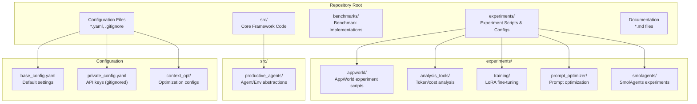

**Sources:** [.gitignore:420-463]()

---

## Development Environment Setup

### Quick Setup Overview

1. Clone the repository
2. Install Python dependencies
3. Configure API keys
4. Set up development tools

For detailed installation instructions, see [Development Environment](#10.1).

### Key Dependencies

The framework requires several Python packages for different components:

| Package | Purpose | Used In |
|---------|---------|---------|
| `torch` | Neural network training | LoRA fine-tuning |
| `unsloth` | Efficient LLM fine-tuning | Model distillation |
| `tiktoken` | Token counting | Cost analysis |
| `openai` | API client | Frontier model calls |
| `jinja2` | Template rendering | Prompt templating |

**Sources:** [.gitignore:343-344]() (Python cache files)

---

## Codebase Organization

### Core Components

```mermaid
graph LR
    subgraph "Core Abstractions"
        ENV["Environment Base Class<br/>src/productive_agents/"]
        AGENT["Agent Base Class<br/>src/productive_agents/"]
        COMP["Compressor Base Class<br/>src/productive_agents/"]
    end
    
    subgraph "Benchmark Implementations"
        AW_ENV["AppWorldEnv"]
        AW_AGENT["AppWorldAgent"]
        OB_ENV["OfficeBenchEnv"]
        SM_ENV["SmolAgentsEnv"]
    end
    
    subgraph "Experiment Scripts"
        RUN["run.py<br/>Single task execution"]
        RUN_ALL["run_all.py<br/>Batch execution"]
        CTXOPT_PIPELINE["run_ctxopt_pipeline.py<br/>Optimization pipeline"]
    end
    
    subgraph "Analysis Tools"
        TOKEN_ANALYSIS["analyze_experiment_tokens_v2()<br/>experiments/analysis_tools/utils.py"]
        CACHE["Token calculation cache<br/>MD5-based"]
    end
    
    ENV -.implements.-> AW_ENV
    ENV -.implements.-> OB_ENV
    ENV -.implements.-> SM_ENV
    
    AGENT -.implements.-> AW_AGENT
    
    RUN_ALL --> RUN
    CTXOPT_PIPELINE --> RUN_ALL
    
    RUN --> AW_AGENT
    RUN --> AW_ENV
    
    TOKEN_ANALYSIS --> CACHE
```

**Sources:** [.gitignore:438-462]() (experiment outputs and data directories)

---

## Development Workflow

### Typical Development Tasks

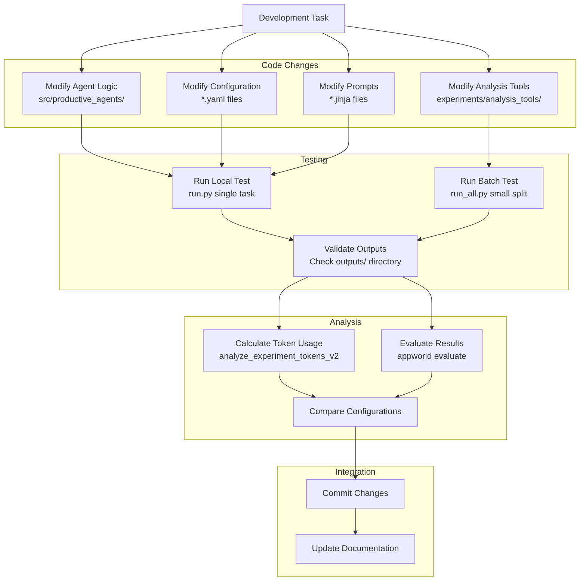

**Sources:** [.gitignore:438-462]() (output directories for testing)

---

## Build and Test Infrastructure

### .NET Build System

Although the active development is Python-focused, the repository maintains .NET build infrastructure:

| Tool | Purpose | Evidence |
|------|---------|----------|
| MSBuild | .NET compilation | [.gitignore:369-370]() |
| NuGet | .NET package management | [.gitignore:211-223]() |
| Paket | F# package management | [.gitignore:332-334]() |
| FAKE | F# build automation | [.gitignore:336-337]() |

### Testing Frameworks

| Framework | Language | Files Ignored |
|-----------|----------|---------------|
| MSTest | .NET | [.gitignore:51-54]() |
| NUnit | .NET | [.gitignore:56-59]() |
| Coverlet | .NET Code Coverage | [.gitignore:160-163]() |
| Chutzpah | JavaScript | [.gitignore:116-117]() |

### Python Testing

Python components use standard practices:
- Cache files in `__pycache__/` [.gitignore:343]()
- Compiled bytecode `.pyc` files [.gitignore:344]()

**Sources:** [.gitignore:1-411]()

---

## Configuration Management

### Configuration File Hierarchy

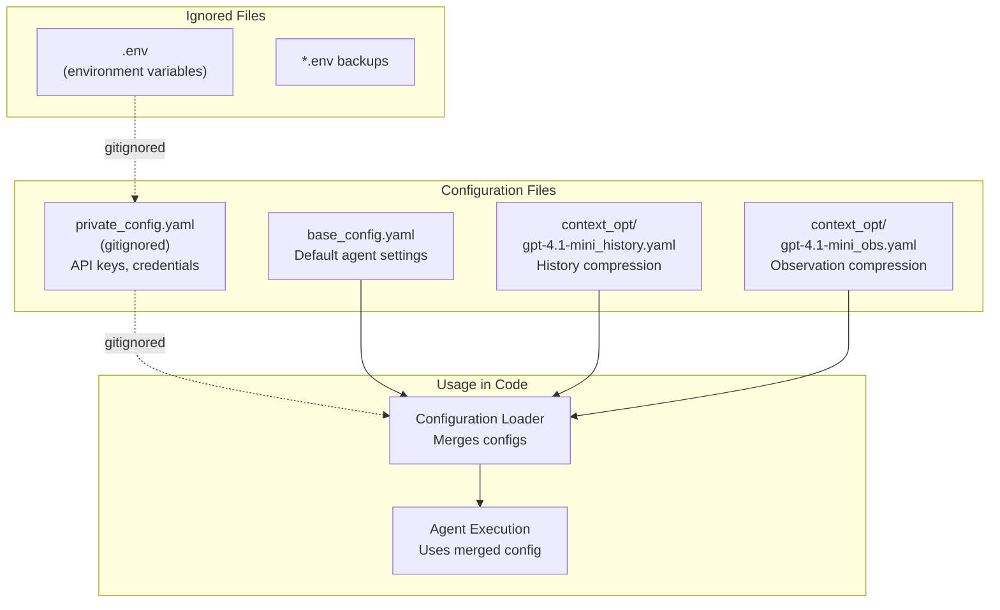

### Protected Configuration

The following files are **never committed** to version control:

| File | Purpose | Gitignore Line |
|------|---------|----------------|
| `private_config.yaml` | API keys, credentials | [.gitignore:463]() |
| `*.env` | Environment variables | [.gitignore:12]() |
| `openai_key.txt` | OpenAI API key (legacy) | [.gitignore:423]() |
| `gemini_key.txt` | Gemini API key (legacy) | [.gitignore:424]() |
| `.msal_tokens.json` | Microsoft auth tokens | [.gitignore:429]() |

**Sources:** [.gitignore:12](), [.gitignore:423-424](), [.gitignore:429](), [.gitignore:463]()

---

## Working with Experiment Outputs

### Output Directory Structure

All experiment outputs are gitignored to prevent accidental commits of large result files:

```mermaid
graph TB
    subgraph "Gitignored Directories"
        EXP["exp/<br/>Legacy experiments"]
        OUTPUTS["outputs/<br/>Current experiment results"]
        CACHE["cache/<br/>Computation caches"]
        RESULTS["results/<br/>Evaluation results"]
        
        AW_EXP["experiments/appworld/experiments/<br/>AppWorld results"]
        AW_DATA["experiments/appworld/data/<br/>Dataset files"]
        AW_EVAL["experiments/appworld/evaluation/test_results/<br/>Evaluation outputs"]
        
        SMOL_OUT["experiments/smolagents/outputs/<br/>SmolAgents results"]
        SMOL_DB["experiments/smolagents/search/database/<br/>Search cache"]
        
        TRAIN_DATA["experiments/training/dataset/<br/>Training datasets"]
        TRAIN_NB["experiments/training/notebook/<br/>Jupyter notebooks"]
        TRAIN_MODEL["experiments/training/pretrained_models/<br/>Downloaded models"]
        
        ANALYSIS["experiments/analysis_tools/analysis/<br/>Analysis results"]
        ANALYSIS_RES["experiments/analysis_tools/analysis_results/<br/>Reports"]
        DASH["experiments/analysis_tools/dashboards/<br/>Visualizations"]
        FIG["experiments/analysis_tools/figures/<br/>Plots"]
        TAB["experiments/analysis_tools/tables/<br/>Tables"]
        
        PROMPT_OPT["experiments/prompt_optimizer/optimized_prompts/<br/>Generated prompts"]
    end
    
    subgraph "Rationale"
        LARGE["Large files<br/>(multi-GB datasets)"]
        GENERATED["Generated content<br/>(reproducible)"]
        SENSITIVE["Potentially sensitive<br/>(API responses)"]
    end
    
    OUTPUTS --> LARGE
    AW_DATA --> LARGE
    TRAIN_DATA --> LARGE
    TRAIN_MODEL --> LARGE
    
    RESULTS --> GENERATED
    ANALYSIS --> GENERATED
    PROMPT_OPT --> GENERATED
    
    CACHE --> SENSITIVE
    AW_EVAL --> SENSITIVE
```

### Key Gitignored Paths

| Directory | Purpose | Gitignore Line |
|-----------|---------|----------------|
| `outputs/` | Main experiment results | [.gitignore:438]() |
| `cache/` | Computation caches | [.gitignore:426]() |
| `experiments/appworld/data` | AppWorld dataset | [.gitignore:443]() |
| `experiments/appworld/experiments` | AppWorld results | [.gitignore:446]() |
| `experiments/training/dataset` | Training data | [.gitignore:460]() |
| `finetuned_models` | LoRA checkpoints | [.gitignore:441]() |
| `experiments/analysis_tools/analysis` | Analysis outputs | [.gitignore:452]() |

**Sources:** [.gitignore:425-462]()

---

## Development Best Practices

### File Organization

When adding new features:

1. **Agent implementations** → `src/productive_agents/`
2. **Experiment scripts** → `experiments/{benchmark}/`
3. **Configuration** → `experiments/{benchmark}/configs/`
4. **Prompts** → `experiments/{benchmark}/prompts/`
5. **Analysis tools** → `experiments/analysis_tools/`

### Configuration Guidelines

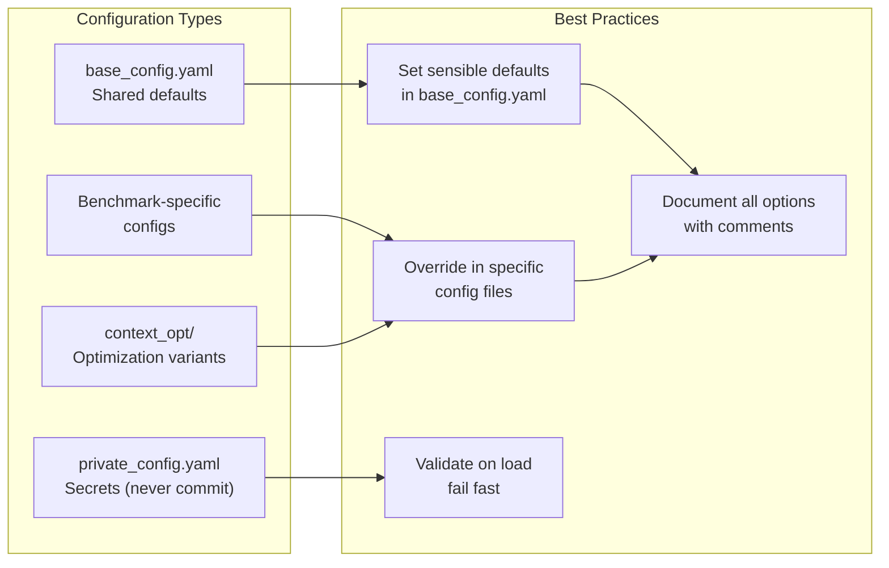

**Sources:** [.gitignore:463]() (private config), [.gitignore:449-451]() (context optimization configs)

---

## Version Control Practices

### What to Commit

✅ **DO commit:**
- Source code (`*.py`, `*.cs`, `*.fs`)
- Configuration templates (`base_config.yaml`)
- Prompt templates (`*.jinja`)
- Documentation (`*.md`)
- Scripts for reproducibility

❌ **DO NOT commit:**
- API keys or credentials
- Experiment outputs (`outputs/`)
- Large datasets (`experiments/*/data`)
- Generated analysis files
- Build artifacts (`bin/`, `obj/`)
- IDE-specific files (`.vs/`, `.vscode/` except selected files)

### Special VS Code Handling

The repository includes **specific** VS Code configuration files:

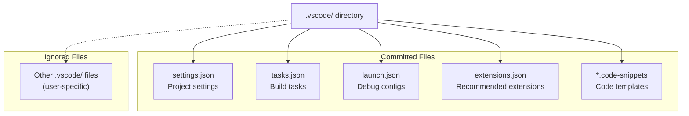

**Sources:** [.gitignore:399-405]()

---

## Azure Development Infrastructure

The repository includes Azure deployment configurations, though these may be legacy:

### Azure Components

| Service | Configuration Files | Purpose |
|---------|-------------------|---------|
| Web Apps | `*.azurePubxml` | Web deployment settings |
| Cloud Services | `*.build.csdef`, `csx/` | Cloud service definitions |
| Stream Analytics | `ASALocalRun/` | Local stream analytics testing |

These files are **gitignored** as they contain deployment-specific settings:
- [.gitignore:200]() - `*.azurePubxml`
- [.gitignore:226-227]() - Cloud service build files
- [.gitignore:366]() - Stream Analytics local run

**Sources:** [.gitignore:200](), [.gitignore:226-227](), [.gitignore:366]()

---

## Database Development

The repository supports SQL Server development:

### SQL Server Files

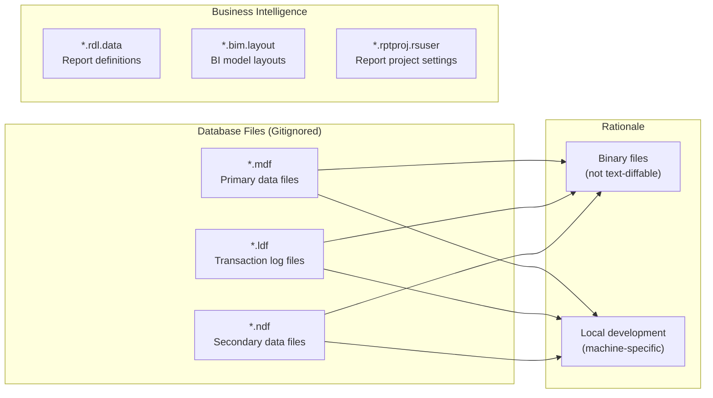

**Sources:** [.gitignore:280-293]()

---

## Code Quality and Coverage

### Coverage Tools

The repository supports code coverage analysis:

| Tool | Purpose | Output Files |
|------|---------|--------------|
| Coverlet | .NET code coverage | `coverage*.json`, `coverage*.xml`, `coverage*.info` |
| Visual Studio | Native coverage | `*.coverage`, `*.coveragexml` |

Coverage files are **gitignored** as they are generated artifacts:
- [.gitignore:160-167]()

### Quality Assurance Workflows

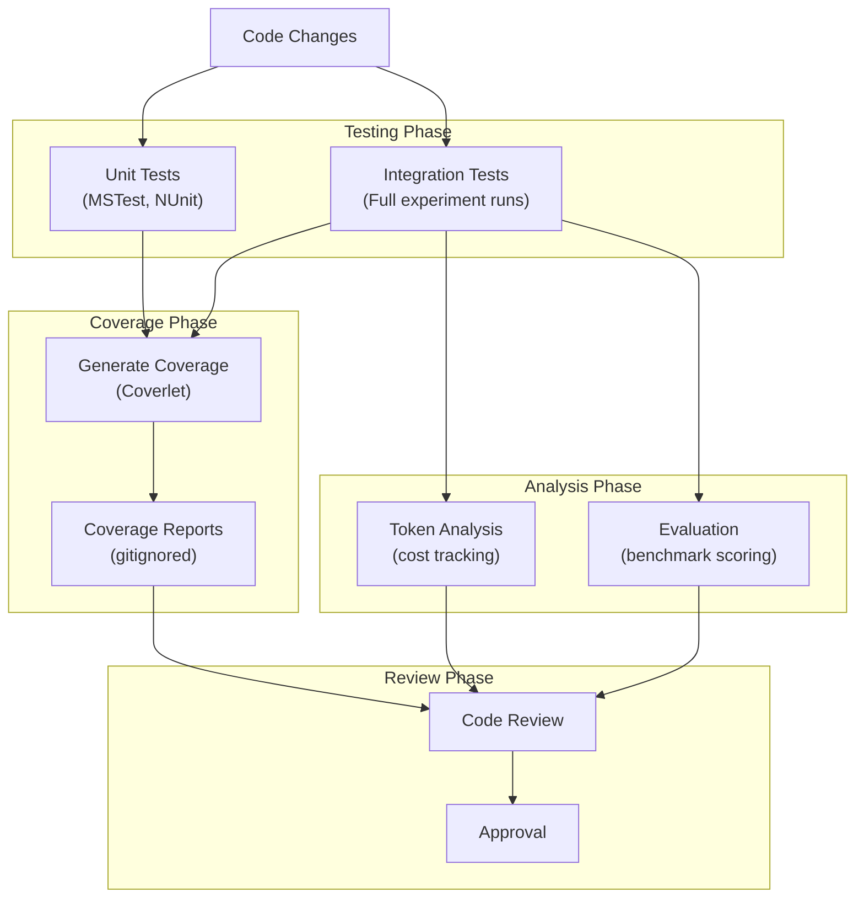

**Sources:** [.gitignore:51-67](), [.gitignore:160-167]()

---

## Contributing to ACON

### Contribution Workflow

1. **Fork and clone** the repository
2. **Set up** development environment (see [Development Environment](#10.1))
3. **Create a branch** for your feature or fix
4. **Make changes** following code organization guidelines
5. **Test thoroughly** with local experiments
6. **Document** configuration changes and new features
7. **Submit** pull request with clear description

For detailed contribution guidelines, see [Support and Contributing](#10.3).

### Code of Conduct

This project follows the Microsoft Open Source Code of Conduct. All contributors must adhere to community standards outlined in [Code of Conduct](#10.2).

**Key resources:**
- [Microsoft Open Source Code of Conduct](https://opensource.microsoft.com/codeofconduct)
- [Code of Conduct FAQ](https://opensource.microsoft.com/codeofconduct/faq)
- Contact: opencode@microsoft.com

**Sources:** [CODE_OF_CONDUCT.md:1-11]()

---

## Ignored Temporary Files

### Visual Studio Artifacts

The repository ignores standard Visual Studio temporary files:

| Category | Examples | Purpose |
|----------|----------|---------|
| User files | `*.suo`, `*.user`, `*.userprefs` | IDE state |
| Build results | `Debug/`, `Release/`, `bin/`, `obj/` | Compilation outputs |
| Test results | `TestResult.xml`, `*.trx` | Test execution logs |
| Logs | `*.log`, `*.tlog` | Build and runtime logs |

**Sources:** [.gitignore:6-115]()

### Python Artifacts

Python-specific temporary files are also ignored:

| File Pattern | Purpose | Gitignore Line |
|--------------|---------|----------------|
| `__pycache__/` | Bytecode cache directories | [.gitignore:343]() |
| `*.pyc` | Compiled Python files | [.gitignore:344]() |
| `*egg-info` | Package metadata | [.gitignore:444]() |
| `.*cache` | Various Python caches | [.gitignore:445]() |

**Sources:** [.gitignore:343-445]()

---

## Local Development Directories

### Workspace Organization

Developers often create local working directories that should not be committed:

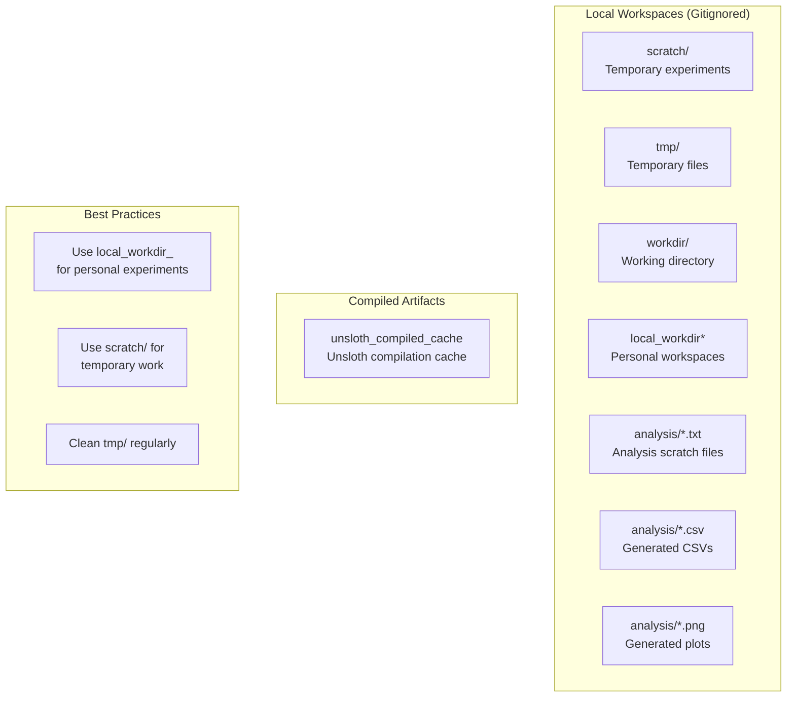

**Sources:** [.gitignore:431-440]()

---

## Model Training Artifacts

### Fine-tuning Outputs

When working with model distillation, several directories contain training artifacts:

| Directory | Contents | Gitignore Line |
|-----------|----------|----------------|
| `finetuned_models` | LoRA checkpoints | [.gitignore:441]() |
| `experiments/training/pretrained_models` | Downloaded base models | [.gitignore:462]() |
| `unsloth_compiled_cache` | Unsloth compilation cache | [.gitignore:440]() |

### Training Data Management

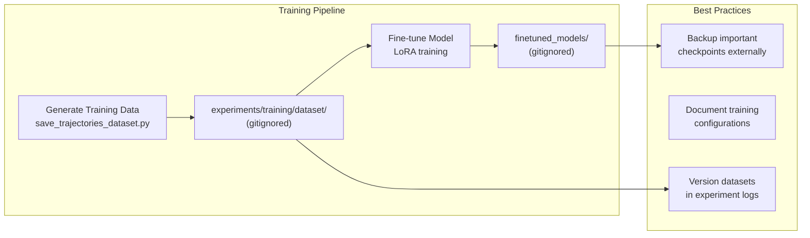

**Sources:** [.gitignore:440-441](), [.gitignore:460](), [.gitignore:462]()

---

## Summary

This development guide covers:
- **Repository structure** and organization
- **Configuration management** practices
- **Version control** guidelines
- **Development workflows** for common tasks
- **Build and test infrastructure** overview
- **Best practices** for contributing

For more detailed information:
- **Environment setup**: See [Development Environment](#10.1)
- **Community guidelines**: See [Code of Conduct](#10.2)
- **Contribution process**: See [Support and Contributing](#10.3)

**Sources:** [.gitignore:1-463](), [CODE_OF_CONDUCT.md:1-11]()

---

