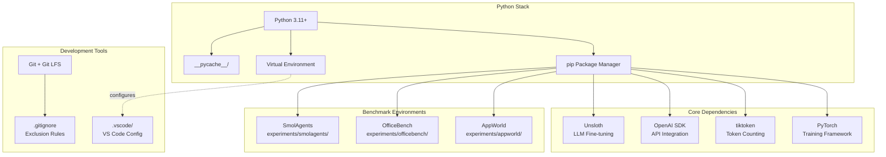
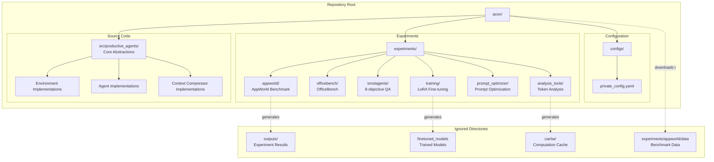
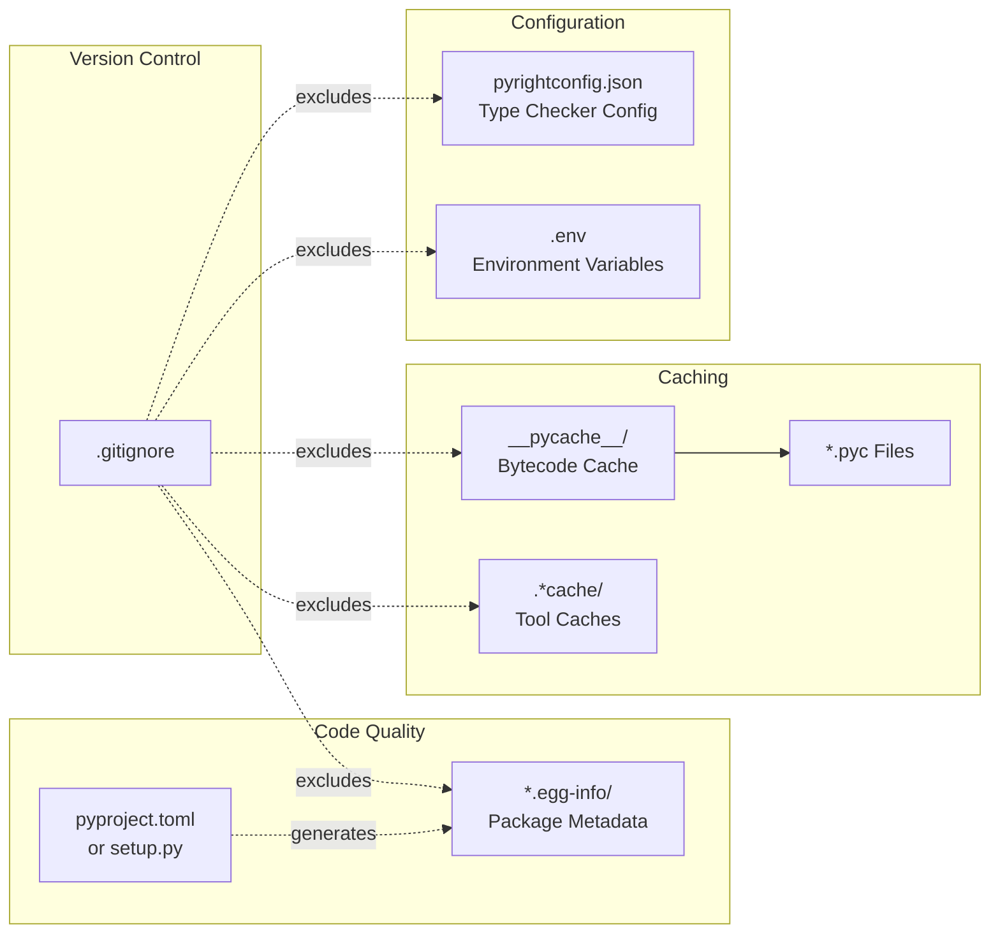
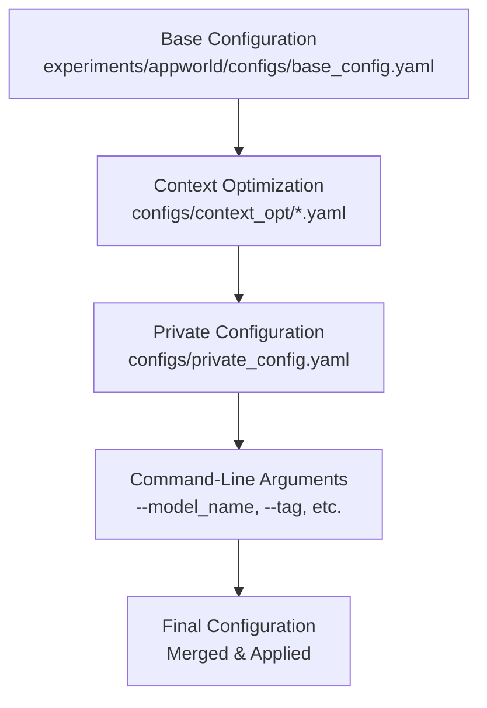

<!-- source: DeepWiki mcp.deepwiki.com · repo microsoft/acon · page 10.1 Development Environment · fetched 2026-10-26 -->

# Development Environment

<details>
<summary>Relevant source files</summary>

The following files were used as context for generating this wiki page:

- [.gitignore](.gitignore)
- [README.md](README.md)

</details>


This page describes how to set up a development environment for contributing to the ACON framework. It covers system requirements, installation of dependencies, configuration, and recommended development tools.

For general installation instructions aimed at end-users running experiments, see [Installation](#2.1). For contribution guidelines and community standards, see [Code of Conduct](#10.2) and [Support and Contributing](#10.3).

## Prerequisites

### System Requirements

The ACON framework requires:

| Component | Requirement |
|-----------|-------------|
| **Python** | Version 3.11 or higher |
| **Operating System** | Linux, macOS, or Windows |
| **Git** | Version 2.0+ with Git LFS support |
| **Memory** | 16GB+ RAM recommended for model fine-tuning |
| **Disk Space** | 50GB+ for models and datasets |

**Sources:** [README.md:94](), [README.md:57]()

### Required Software

Before setting up the development environment, install the following:

1. **Python 3.11+**: Available from [python.org](https://www.python.org/downloads)
2. **Git with Git LFS**: Required for cloning repositories with large model files
3. **pip**: Python package installer (usually included with Python)

**Sources:** [README.md:94](), [README.md:57]()

## Python Environment Setup

### Repository Clone

Clone the ACON repository with Git LFS enabled:

```bash
git lfs install
git clone https://github.com/microsoft/acon.git
cd acon
```

**Sources:** [README.md:57-58](), [README.md:99-101]()

### Virtual Environment

It is strongly recommended to use a virtual environment to isolate ACON dependencies:

```bash
# Create virtual environment
python -m venv .venv

# Activate (Linux/macOS)
source .venv/bin/activate

# Activate (Windows)
.venv\Scripts\activate
```

The `.gitignore` file is configured to exclude common virtual environment directories, so your environment files will not be tracked by Git.

**Sources:** [.gitignore:1-463]()

### Package Installation

Install ACON in editable mode for development:

```bash
pip install -e .
```

The `-e` flag installs the package in "editable" mode, meaning changes to the source code immediately affect the installed package without requiring reinstallation.

**Sources:** [README.md:71](), [README.md:101]()

### Benchmark-Specific Dependencies

#### AppWorld Environment

For AppWorld benchmark development, install the AppWorld environment separately:

```bash
git clone https://github.com/StonyBrookNLP/appworld
cd appworld
pip install -e .
appworld install --repo
appworld download data
```

Move the AppWorld data to the ACON experiments directory:

```bash
mv /path/to/appworld/data /path/to/acon/experiments/appworld
```

**Sources:** [README.md:55-63](), [README.md:69]()

#### Development Dependencies

The `.gitignore` file indicates support for various development tools and frameworks:



**Diagram: Python Development Stack**

**Sources:** [.gitignore:343-344](), [.gitignore:399-411](), [.gitignore:463](), [README.md:94-102]()

## Configuration

### API Credentials

Create a private configuration file at `configs/private_config.yaml` to store API credentials:

```yaml
openai_key: "your_api_key_here"
```

This file is excluded from version control by the `.gitignore` file to prevent accidental credential exposure.

**Sources:** [README.md:106-110](), [.gitignore:463]()

### Configuration Files Ignored by Git

The following configuration and output directories are automatically ignored:

| Directory/File | Purpose |
|----------------|---------|
| `private_config.yaml` | API keys and secrets |
| `outputs/` | Experiment outputs |
| `experiments/appworld/data` | AppWorld benchmark data |
| `experiments/appworld/experiments` | AppWorld experiment results |
| `experiments/training/dataset` | Training datasets |
| `finetuned_models` | Fine-tuned model checkpoints |
| `cache/` | Cached computation results |
| `.msal_tokens.json` | Microsoft authentication tokens |

**Sources:** [.gitignore:423-463]()

## Project Structure

### Source Code Organization



**Diagram: ACON Project Directory Structure**

**Sources:** [README.md:114-120](), [.gitignore:438-463]()

### Key Development Directories

The following directories contain code that developers will work with:

| Directory | Purpose | Key Files |
|-----------|---------|-----------|
| `src/productive_agents/` | Core framework abstractions | Environment, Agent, Compressor classes |
| `experiments/appworld/` | AppWorld benchmark runner | `run.py`, `run_all.py`, configuration files |
| `experiments/officebench/` | OfficeBench benchmark runner | Benchmark-specific implementations |
| `experiments/smolagents/` | SmolAgents benchmark runner | 8-objective QA implementations |
| `experiments/training/` | LoRA fine-tuning scripts | Dataset generation, model training |
| `experiments/prompt_optimizer/` | Prompt optimization tools | `unified_update_history_prompt.py` |
| `experiments/analysis_tools/` | Token and cost analysis | `utils.py`, analysis functions |

**Sources:** [README.md:114-120]()

## Development Tools

### Integrated Development Environment

The repository includes VS Code configuration support. The `.gitignore` file preserves certain VS Code settings while ignoring others:

**Preserved:**
- `.vscode/settings.json`
- `.vscode/tasks.json`
- `.vscode/launch.json`
- `.vscode/extensions.json`
- `.vscode/*.code-snippets`

**Ignored:**
- `.vscode/*` (all other files)
- `.history/` (Local History)
- `*.vsix` (Built extensions)

**Sources:** [.gitignore:399-411]()

### Recommended VS Code Extensions

While not enforced, the following extensions are helpful for ACON development:

1. **Python** (ms-python.python): Python language support
2. **Pylance** (ms-python.vscode-pylance): Python type checking and IntelliSense
3. **Jupyter** (ms-toolsai.jupyter): Notebook support for analysis
4. **YAML** (redhat.vscode-yaml): YAML configuration editing

### Python Development Tools

The project structure suggests the following Python development practices:



**Diagram: Python Development Tools and Artifacts**

**Sources:** [.gitignore:343-344](), [.gitignore:444-445](), [.gitignore:430](), [.gitignore:12]()

### Testing Framework

While explicit test files are not visible in the provided sources, the `.gitignore` file indicates support for multiple testing frameworks:

| Framework | Ignored Artifacts |
|-----------|------------------|
| **MSTest** | `[Tt]est[Rr]esult*/`, `[Bb]uild[Ll]og.*`, `*.trx` |
| **NUnit** | `*.VisualState.xml`, `TestResult.xml`, `nunit-*.xml` |
| **Approval Tests** | `*.received.*` |

**Sources:** [.gitignore:51-62]()

### Code Coverage

The `.gitignore` file indicates support for Coverlet, a code coverage tool:

```
coverage*.json
coverage*.xml
coverage*.info
```

**Sources:** [.gitignore:161-163]()

## Environment Variables and Secrets

### Secret Management

Sensitive information should never be committed to the repository. The `.gitignore` file excludes:

| File/Pattern | Purpose |
|--------------|---------|
| `*.env` | Environment variable files |
| `private_config.yaml` | API credentials |
| `.msal_tokens.json` | Microsoft authentication tokens |
| `openai_key.txt` | OpenAI API key (legacy) |
| `gemini_key.txt` | Gemini API key |

**Sources:** [.gitignore:12](), [.gitignore:423-424](), [.gitignore:429](), [.gitignore:463]()

### Configuration Priority

The ACON framework loads configuration in the following order:



**Diagram: Configuration Loading Order**

**Sources:** [README.md:72](), [README.md:76-79](), [README.md:106-110]()

## Common Development Workflows

### Running Experiments Locally

Development workflow for testing changes:

```bash
# 1. Activate virtual environment
source .venv/bin/activate

# 2. Navigate to experiment directory
cd experiments/appworld

# 3. Run single task for quick testing
python run.py \
    --task_id normal_117 \
    --model_name gpt-4.1-mini \
    --tag dev_test

# 4. Check outputs
ls outputs/gpt-4.1-mini_dev_test/train/task_normal_117/
```

**Sources:** [README.md:74-79]()

### Analyzing Token Usage

For development and debugging of optimization strategies:

```bash
cd experiments/analysis_tools

python -c "
from utils import analyze_experiment_tokens_v2
analyze_experiment_tokens_v2(
    experiment_name='gpt-4.1-mini_dev_test',
    split='train'
)
"
```

**Sources:** Referenced from diagrams and system architecture

## Output and Cache Management

### Experiment Outputs

Experiment results are written to `outputs/` directory with the following structure:

```
outputs/{model_name}_{tag}/{split}/task_{task_id}/
├── history_optimizer_history.json
├── llm_history.json
├── env_history.json
├── results.json
└── experiment_summary.json
```

These directories are excluded from version control.

**Sources:** [README.md:82-86](), [.gitignore:438]()

### Cache Directories

The framework uses caching to avoid redundant computation:

| Cache Type | Location | Purpose |
|------------|----------|---------|
| Token usage cache | `experiments/analysis_tools/analysis` | Token count calculations |
| Compiled Unsloth cache | `unsloth_compiled_cache` | Compiled model components |
| General cache | `cache/` | Miscellaneous cached data |

All cache directories are excluded from version control.

**Sources:** [.gitignore:426](), [.gitignore:440](), [.gitignore:445](), [.gitignore:453]()

## Troubleshooting

### Common Issues

**Issue: `ModuleNotFoundError` after installation**

Ensure you installed ACON in editable mode and activated your virtual environment:
```bash
pip install -e .
```

**Issue: Missing AppWorld data**

Download and move AppWorld data to the correct location:
```bash
appworld download data
mv /path/to/appworld/data /path/to/acon/experiments/appworld
```

**Issue: API authentication errors**

Verify `configs/private_config.yaml` exists and contains valid API key:
```yaml
openai_key: "sk-..."
```

**Sources:** [README.md:69](), [README.md:72](), [README.md:106-110]()

### Development Environment Validation

To validate your development environment is correctly configured:

```bash
# 1. Check Python version
python --version  # Should be 3.11+

# 2. Verify ACON installation
python -c "import productive_agents; print('OK')"

# 3. Verify configuration
python -c "import yaml; print(yaml.safe_load(open('configs/private_config.yaml'))['openai_key'][:10])"

# 4. Test AppWorld installation (if needed)
appworld --version
```

**Sources:** [README.md:94](), [README.md:101]()

## Next Steps

After setting up your development environment:

1. **Understand the architecture**: Review [System Overview](#9.1) and [Core Concepts](#3)
2. **Run your first experiment**: Follow [Running Your First Experiment](#2.3)
3. **Review contribution guidelines**: See [Support and Contributing](#10.3)
4. **Understand code structure**: Explore [Agents and Environments](#3.3) and [Architecture](#9)

**Sources:** This section synthesizes information from the overall documentation structure.

---

