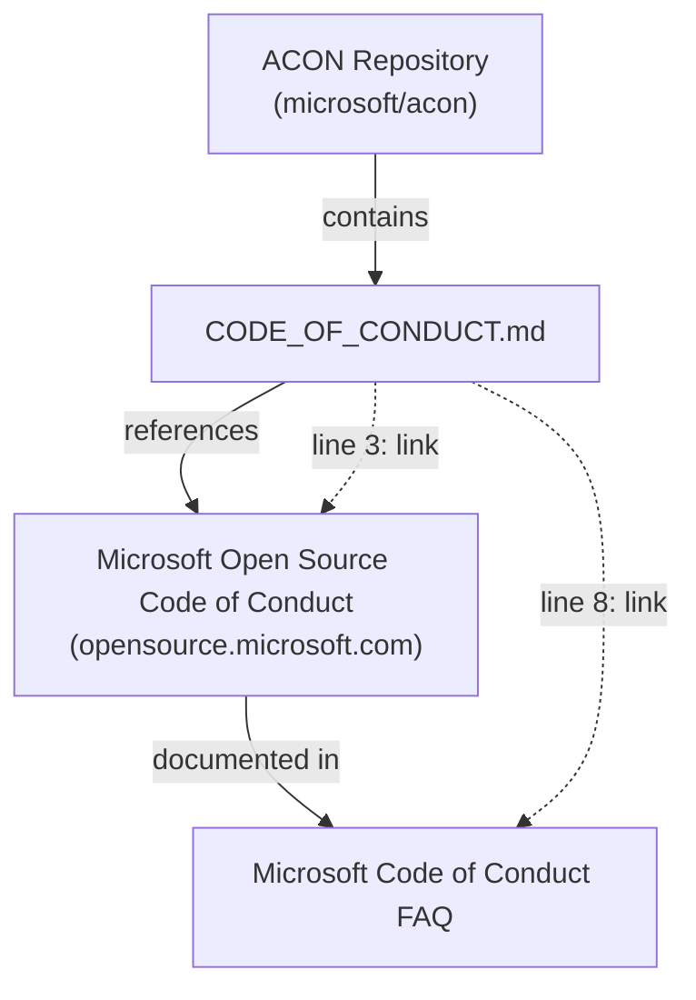
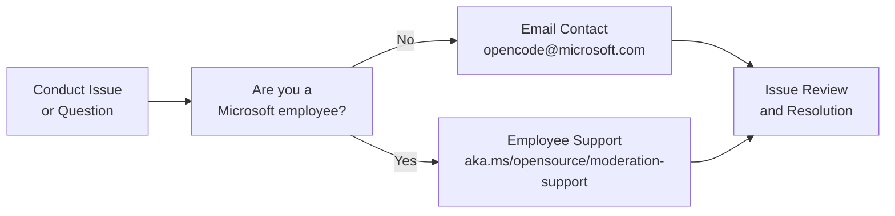
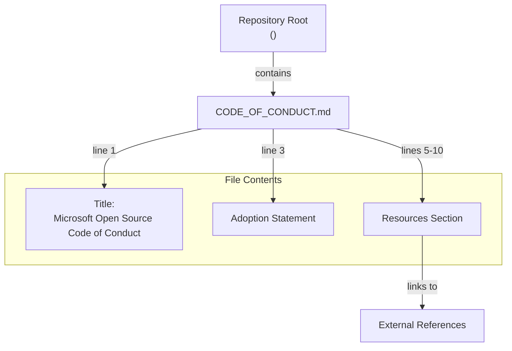

<!-- source: DeepWiki mcp.deepwiki.com · repo microsoft/acon · page 10.2 Code of Conduct · fetched 2026-10-26 -->

# Code of Conduct

Relevant source files

The following files were used as context for generating this wiki page:

- [CODE_OF_CONDUCT.md](CODE_OF_CONDUCT.md)

## Purpose and Scope

This page documents the community standards and behavioral expectations for contributors to the ACON project. The project has formally adopted an external code of conduct maintained by Microsoft for all of its open source projects.

For information about contributing code and development workflows, see [Development Guide](#10) and [Support and Contributing](#10.3).

## Adopted Code of Conduct

The ACON project has adopted the **Microsoft Open Source Code of Conduct**. This is a comprehensive set of community guidelines that applies to all Microsoft open source projects, ensuring consistent behavioral standards across the ecosystem.

The code of conduct is not maintained within this repository. Instead, the project references the centrally-maintained Microsoft policy available at [https://opensource.microsoft.com/codeofconduct/](https://opensource.microsoft.com/codeofconduct).

**Sources:** [CODE_OF_CONDUCT.md:1-11]()

### Code of Conduct Documentation Structure

**Sources:** [CODE_OF_CONDUCT.md:3-8]()

## Available Resources

The ACON project provides access to several resources for understanding and adhering to the code of conduct:

| Resource | Description | Reference |
|----------|-------------|-----------|
| **Code of Conduct** | Full text of the Microsoft Open Source Code of Conduct | [CODE_OF_CONDUCT.md:7]() |
| **FAQ** | Frequently asked questions about the code of conduct | [CODE_OF_CONDUCT.md:8]() |
| **Email Contact** | General inquiries and concerns | `opencode@microsoft.com` |
| **Employee Support** | Internal support channel for Microsoft employees | `aka.ms/opensource/moderation-support` |

**Sources:** [CODE_OF_CONDUCT.md:5-10]()

## Reporting Process

Contributors who have questions or concerns about conduct issues should follow this reporting flow:

**Sources:** [CODE_OF_CONDUCT.md:9-10]()

### External Contributors

External contributors (non-Microsoft employees) should direct questions or concerns to **opencode@microsoft.com**. This email address is monitored by Microsoft's open source program office.

**Sources:** [CODE_OF_CONDUCT.md:9]()

### Microsoft Employees

Microsoft employees have access to an additional internal support channel at **aka.ms/opensource/moderation-support**. This provides direct access to moderation support resources within the company.

**Sources:** [CODE_OF_CONDUCT.md:10]()

## Implementation

The code of conduct is implemented through a single markdown file in the repository root:

**Sources:** [CODE_OF_CONDUCT.md:1-11]()

The file structure is minimal and intentionally references external resources rather than duplicating the full code of conduct text. This ensures the project always points to the most current version maintained by Microsoft.

## Scope of Application

The Microsoft Open Source Code of Conduct applies to:

- **All repository interactions**: Issues, pull requests, discussions, and code reviews
- **Community spaces**: Any forums, chat channels, or communication platforms associated with the project
- **Project events**: Conferences, meetups, or other gatherings where the project is represented
- **Individual representation**: When acting as a representative of the ACON project

The code of conduct does not apply to interactions unrelated to the project, even if they involve project contributors.

**Sources:** [CODE_OF_CONDUCT.md:1-11]()

## Enforcement

Enforcement of the code of conduct is handled by Microsoft's open source program office through the contact points listed above. The ACON project maintainers do not independently enforce the code of conduct; instead, they escalate reported issues to the centralized enforcement team.

**Sources:** [CODE_OF_CONDUCT.md:9-10]()

---

