# Page: Home

# Home

<details>
<summary>Relevant source files</summary>

The following files were used as context for generating this wiki page:

- [README.md](README.md)
- [assets/concept.png](assets/concept.png)

</details>


## Purpose and Scope

This page provides an overview of the ACON (Agent Context Optimization) framework, its architecture, and core concepts. ACON is a research framework for optimizing context compression in long-horizon LLM agents, enabling systematic experimentation across multiple benchmarks with frontier and distilled models.

For installation and setup instructions, see [Installation](#2.1). For understanding the core concepts, see [Core Concepts](#3). For running experiments, see [Running Experiments](#5).

**Sources:** [README.md:1-42]()

## What is ACON?

ACON is a research framework designed to optimize how long-horizon LLM agents manage their context windows. As agents perform extended tasks with many interactions, their context accumulates, leading to increased token costs and potential information overload. ACON addresses this challenge through systematic context compression techniques.

The framework provides:

- **Standardized abstractions** for environments, agents, and context compressors
- **Three realistic benchmarks**: AppWorld (day-to-day tasks), OfficeBench (office productivity), and 8-objective QA (reasoning and retrieval)
- **Four-stage experimental pipeline** from baseline evaluation to model distillation
- **Comprehensive analysis tools** for token usage and cost tracking
- **Distillation support** for transferring optimization strategies to local models

**Sources:** [README.md:22-24](), [README.md:112-120]()

## Core Problem: Context Accumulation

Long-horizon agents face a fundamental challenge: as they interact with environments over many steps, their context windows grow with observations, actions, and intermediate reasoning. This leads to:

1. **Excessive token costs** - Each API call processes the entire accumulated context
2. **Information redundancy** - Historical observations contain repetitive or obsolete information
3. **Degraded performance** - Large contexts can confuse decision-making with irrelevant details
4. **Context window limits** - Eventually exceeding model maximum context lengths

ACON addresses these issues through **context compression**: selectively summarizing or filtering historical information while preserving details essential for future decisions.

**Sources:** [README.md:22]()

## Solution Approach

ACON implements a progressive optimization strategy:

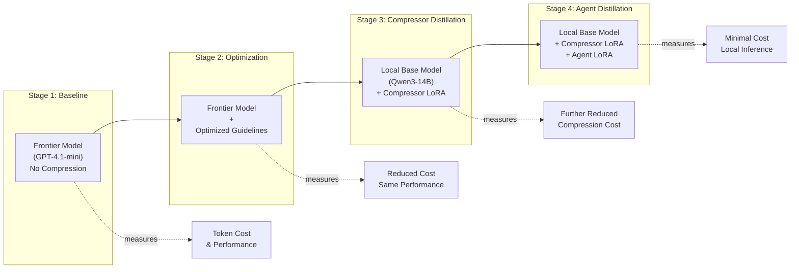

**Pipeline Overview**

1. **Baseline**: Establish performance and cost metrics with frontier models
2. **Optimization**: Develop and validate context compression guidelines using prompt engineering
3. **Compressor Distillation**: Train a LoRA adapter to replicate compression behavior
4. **Agent Distillation**: Train a second LoRA adapter for complete agent reasoning

Each stage reduces operational costs while tracking performance degradation, enabling researchers to find optimal cost-performance trade-offs.

**Sources:** [README.md:132-136]()

## System Architecture

The ACON codebase is organized into three primary directories:

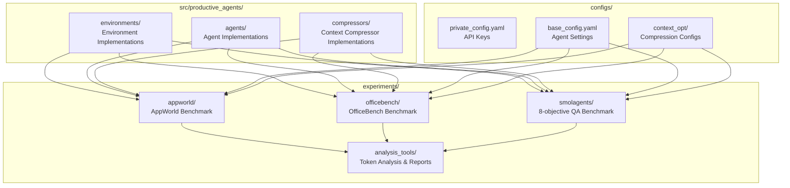

**Directory Structure**

| Directory | Purpose | Key Files |
|-----------|---------|-----------|
| `configs/` | Configuration files for API keys, agent settings, and compression parameters | `private_config.yaml`, `base_config.yaml`, `context_opt/*.yaml` |
| `src/productive_agents/` | Core abstractions for environments, agents, and compressors | `environments/`, `agents/`, `compressors/` |
| `experiments/` | Benchmark-specific runners, analysis tools, and training scripts | `appworld/`, `officebench/`, `smolagents/`, `analysis_tools/` |

**Sources:** [README.md:112-120]()

## Benchmark Implementations

ACON supports three distinct benchmarks, each targeting different aspects of agent capabilities:

| Benchmark | Domain | Tasks | Location |
|-----------|--------|-------|----------|
| **AppWorld** | Day-to-day personal task workflows | Database management, file operations, social interactions | `experiments/appworld/` |
| **OfficeBench** | Office productivity automation | Document processing, email management, scheduling | `experiments/officebench/` |
| **8-objective QA** | Lightweight reasoning and retrieval | Multi-objective question answering with tool use | `experiments/smolagents/` |

Each benchmark implements the same experimental pipeline but with domain-specific environments and task formats.

**Sources:** [README.md:122-131]()

## Core Components and Code Mapping

The following diagram maps ACON's conceptual components to their code implementations:

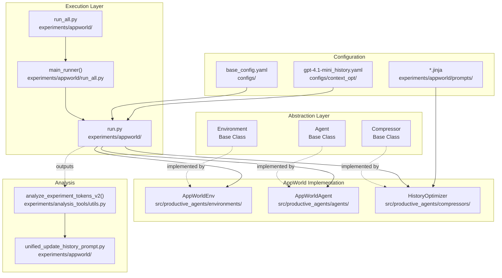

**Key Code Entities**

- **`main_runner()`** - Primary orchestration function in `experiments/appworld/run_all.py` that executes batches of tasks
- **`run.py`** - Single-task execution script in each benchmark directory
- **`analyze_experiment_tokens_v2()`** - Token and cost analysis function in `experiments/analysis_tools/utils.py`
- **`unified_update_history_prompt.py`** - Automated prompt optimization pipeline in `experiments/appworld/`
- **Environment/Agent/Compressor classes** - Core abstractions in `src/productive_agents/`

**Sources:** [README.md:112-120]()

## Experimental Workflow

A typical ACON experiment follows this workflow:

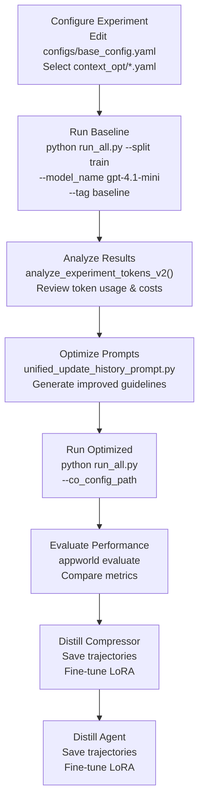

**Workflow Steps**

1. **Configuration** - Set up API keys and agent parameters
2. **Baseline Execution** - Run experiments with frontier models to establish metrics
3. **Analysis** - Use token analysis tools to identify optimization opportunities
4. **Optimization** - Refine compression guidelines through automated or manual prompt engineering
5. **Validation** - Re-run experiments with optimized configurations
6. **Evaluation** - Compare performance and cost metrics
7. **Distillation** - Train local models to replicate optimized behavior

**Sources:** [README.md:53-88](), [README.md:132-136]()

## Output Structure

Each experiment produces a structured output directory:

```
experiments/appworld/outputs/{model_name}_{tag}/{split}/
├── task_00000/
│   ├── history_optimizer_history.json  # Compression decisions
│   ├── llm_history.json                # Agent LLM interactions
│   ├── env_history.json                # Environment interactions
│   └── results.json                    # Task results
├── task_00001/
│   └── ...
└── experiment_summary.json             # Aggregate metrics
```

The output files serve multiple purposes:

- **Analysis** - `history_optimizer_history.json` and `llm_history.json` feed into token analysis
- **Training** - These files provide training data for LoRA distillation
- **Debugging** - Full interaction traces enable detailed error analysis
- **Evaluation** - `results.json` contains task outcomes for scoring

**Sources:** Based on system diagrams and experimental pipeline description

## Key Metrics

ACON tracks several metrics throughout experiments:

| Metric | Description | Source |
|--------|-------------|--------|
| **Input Tokens** | Tokens sent to LLM (including cached) | Token analysis tools |
| **Output Tokens** | Tokens generated by LLM | Token analysis tools |
| **Cached Tokens** | Tokens reused from provider cache | Token analysis tools |
| **Total Cost** | Estimated API cost based on pricing | `calculate_cost_components()` |
| **Task Success Rate** | Percentage of tasks completed successfully | Benchmark-specific evaluators |
| **Compression Ratio** | Original context size / compressed context size | Derived from token counts |

These metrics enable quantitative comparison across pipeline stages and configurations.

**Sources:** Based on analysis tools architecture diagram

## Research Foundation

ACON implements the methodology described in the research paper:

> **ACON: Optimizing Context Compression for Long-horizon LLM Agents**  
> _Minki Kang, Wei-Ning Chen, Dongge Han, Huseyin A. Inan, Lukas Wutschitz, Yanzhi Chen, Robert Sim, Saravan Rajmohan_  
> arXiv:2510.00615

The paper presents empirical results demonstrating cost reductions while maintaining task performance across the three benchmark families.

**Citation**

```bibtex
@misc{kang2025aconoptimizingcontextcompression,
      title={ACON: Optimizing Context Compression for Long-horizon LLM Agents}, 
      author={Minki Kang and Wei-Ning Chen and Dongge Han and Huseyin A. Inan and Lukas Wutschitz and Yanzhi Chen and Robert Sim and Saravan Rajmohan},
      year={2025},
      eprint={2510.00615},
      archivePrefix={arXiv},
      primaryClass={cs.AI},
      url={https://arxiv.org/abs/2510.00615}, 
}
```

**Sources:** [README.md:26-41]()

## Getting Started

To begin using ACON:

1. **Install dependencies** - See [Installation](#2.1) for detailed setup instructions
2. **Configure API keys** - Set up OpenAI credentials as described in [API Configuration](#2.2)
3. **Run first experiment** - Follow the quickstart guide in [Running Your First Experiment](#2.3)
4. **Understand core concepts** - Review [Context Optimization](#3.1) and the [Four-Stage Pipeline](#3.2)
5. **Explore benchmarks** - Choose a benchmark to experiment with: [AppWorld](#4.1), [OfficeBench and SmolAgents](#4.2)

For developers interested in extending ACON, see the [Development Guide](#10).

**Sources:** [README.md:43-88]()

## License and Contributing

ACON is released under the MIT License. The project welcomes contributions and suggestions. Contributors must agree to the Contributor License Agreement (CLA).

For community guidelines, see [Code of Conduct](#10.2). For contribution procedures, see [Support and Contributing](#10.3). For legal information, see [Project Information](#12).

**Sources:** [README.md:144-165]()

---

# Page: Getting Started

# Getting Started

<details>
<summary>Relevant source files</summary>

The following files were used as context for generating this wiki page:

- [README.md](README.md)
- [configs/private_config_dummy.yaml](configs/private_config_dummy.yaml)
- [experiments/appworld/README.md](experiments/appworld/README.md)

</details>


This page provides a quick introduction to installing ACON and running your first context optimization experiment. It covers the essential prerequisites, the basic workflow, and where to find results. For detailed installation instructions, see [Installation](#2.1). For step-by-step experiment execution, see [Running Your First Experiment](#2.3).

## Purpose and Scope

This guide walks through the minimal steps required to:
1. Install ACON and its dependencies
2. Configure API credentials
3. Execute a basic AppWorld experiment with context compression
4. Locate and interpret the output

For information about the theoretical foundation of context optimization, see [Core Concepts](#3). For advanced configuration options, see [Configuration](#6).

## Prerequisites

ACON requires:
- **Python 3.11 or higher**
- **Git LFS** (for downloading AppWorld data)
- **OpenAI API key** (for frontier model experiments)
- Approximately 10GB disk space for benchmark data

The framework supports both frontier models (OpenAI API) and local models (with fine-tuned LoRA adapters). Getting started focuses on frontier models, which require minimal setup.

**Sources:** [README.md:94-95]()

## High-Level Workflow

The following diagram illustrates the basic workflow for getting started with ACON:

**Workflow: From Installation to First Results**

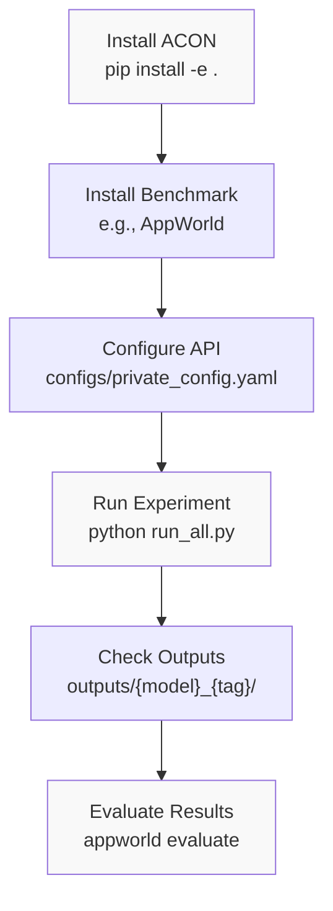

**Sources:** [README.md:53-89](), [experiments/appworld/README.md:1-89]()

## Installation Process

### Core Framework Installation

Clone the repository and install ACON in editable mode:

```bash
git clone https://github.com/microsoft/acon.git
cd acon
pip install -e .
```

The `-e` flag installs ACON in editable mode, allowing you to modify the source code without reinstalling.

**Sources:** [README.md:98-102]()

### Benchmark Installation (AppWorld)

ACON supports three benchmarks (AppWorld, OfficeBench, SmolAgents). For getting started, AppWorld is recommended due to its comprehensive documentation and data availability.

```bash
# Install Git LFS first
git lfs install

# Clone and install AppWorld
git clone https://github.com/StonyBrookNLP/appworld
cd appworld
pip install -e .
appworld install --repo
appworld download data

# Move data directory to ACON structure
mv data /path/to/acon/experiments/appworld/
```

The `appworld download data` command downloads approximately 8GB of task data and environment snapshots.

**Sources:** [README.md:55-63](), [experiments/appworld/README.md:6-23]()

For detailed installation instructions including troubleshooting, see [Installation](#2.1).

## API Configuration

ACON requires an OpenAI API key for frontier model experiments. Create a configuration file with your credentials:

1. Navigate to the `configs/` directory
2. Copy `private_config_dummy.yaml` to `private_config.yaml`
3. Add your OpenAI API key

**File Structure:**

```yaml
openai_key: "your_api_key_here"
```

The framework loads this configuration at runtime via [configs/private_config.yaml]().

**Sources:** [README.md:106-110](), [configs/private_config_dummy.yaml:1]()

For additional configuration options including local model serving, see [API Configuration](#2.2).

## Running Your First Experiment

The following diagram shows the exact code entities involved in executing a basic experiment:

**Experiment Execution Flow: Code Entity Mapping**

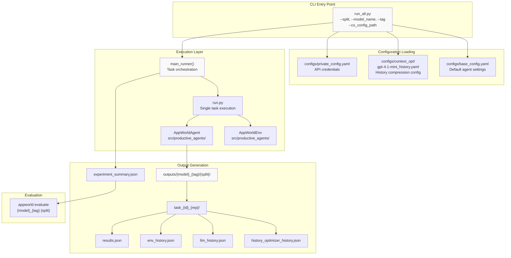

**Sources:** [experiments/appworld/README.md:26-88](), [README.md:65-86]()

### Basic Command Structure

Navigate to the AppWorld experiment directory and execute:

```bash
cd experiments/appworld
python run_all.py \
    --split train \
    --model_name gpt-4.1-mini \
    --tag baseline \
    --co_config_path configs/context_opt/gpt-4.1-mini_history.yaml
```

**Key Parameters:**

| Parameter | Purpose | Example Values |
|-----------|---------|----------------|
| `--split` | Dataset partition to run | `train`, `dev`, `test_normal`, `test_challenge` |
| `--model_name` | LLM to use for agent reasoning | `gpt-4.1`, `gpt-4.1-mini`, `gpt-4o` |
| `--tag` | Experiment identifier (output suffix) | `baseline`, `history_compression`, `optimized` |
| `--co_config_path` | Context optimization configuration | Path to YAML config file |

The `--tag` parameter creates a unique output directory: `outputs/{model_name}_{tag}/`.

**Sources:** [experiments/appworld/README.md:30-64](), [README.md:75-79]()

### Debugging Your First Run

For initial testing, use the `--debug` flag to run a single task:

```bash
python run_all.py \
    --split train \
    --model_name gpt-4.1-mini \
    --tag test_run \
    --co_config_path configs/context_opt/gpt-4.1-mini_history.yaml \
    --debug
```

This executes only the first task in the split, allowing you to verify configuration and API connectivity.

**Sources:** [experiments/appworld/README.md:42]()

For complete command-line reference and advanced options, see [Command-Line Reference](#5.3).

## Understanding Output Structure

ACON generates comprehensive execution traces for each experiment. The output directory structure follows this pattern:

```
experiments/appworld/outputs/
└── {model_name}_{tag}/
    ├── experiment_summary.json          # Aggregated metrics across all tasks
    └── {split}/                         # train, dev, test_normal, test_challenge
        ├── task_{id}_{rep}/             # One directory per task execution
        │   ├── appworld_trajectory.json # AppWorld-specific action log
        │   ├── env_history.json         # Environment state transitions
        │   ├── history_optimizer_history.json  # Context compression traces
        │   ├── llm_history.json         # Agent LLM interactions
        │   ├── step_alignment.json      # Turn-by-turn alignment
        │   └── results.json             # Task outcome and metrics
        └── ...
```

**Key Output Files:**

| File | Content | Used For |
|------|---------|----------|
| `experiment_summary.json` | Success rate, token usage, cost aggregated across all tasks | Performance evaluation |
| `history_optimizer_history.json` | Input/output pairs for context compression calls | Training compressor LoRA (Stage 1) |
| `llm_history.json` | Input/output pairs for agent reasoning calls | Training agent LoRA (Stage 2) |
| `env_history.json` | Environment observations and state changes | Debugging agent behavior |
| `results.json` | Task completion status and metrics | Individual task analysis |

**Sources:** [experiments/appworld/README.md:67-88]()

### Evaluating Results

After experiment completion, evaluate performance using the AppWorld CLI:

```bash
appworld evaluate {model_name}_{tag} {split}
```

For example:

```bash
appworld evaluate gpt-4.1-mini_baseline train
```

This command reads `experiment_summary.json` and computes benchmark-specific metrics such as success rate and average turns per task.

**Sources:** [experiments/appworld/README.md:39](), [README.md:39]()

For detailed information about output formats and metrics, see [Output and Results](#5.4).

## Next Steps

After successfully running your first experiment, you can:

1. **Analyze token usage and costs** - See [Token and Cost Analysis](#7.1)
2. **Optimize context compression prompts** - See [Context Optimization Pipeline](#7.2)
3. **Train local models with distillation** - See [Model Distillation](#8)
4. **Explore other benchmarks** - See [OfficeBench and SmolAgents](#4.2)
5. **Customize agent behavior** - See [Configuration](#6)

The typical research workflow follows a four-stage pipeline (baseline → optimization → compressor distillation → agent distillation) described in [Four-Stage Pipeline](#3.2).

## Configuration System Overview

The following diagram maps ACON's configuration files to their runtime roles:

**Configuration System: File-to-Component Mapping**

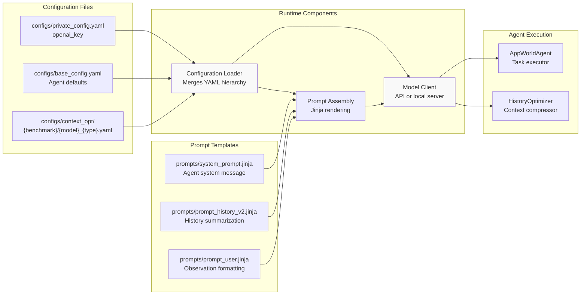

**Sources:** [README.md:104-110](), [experiments/appworld/README.md:172-184]()

The configuration system uses YAML files for declarative settings and Jinja2 templates for dynamic prompt generation. At runtime, configurations are merged in this priority order:

1. `private_config.yaml` - API credentials (highest priority)
2. Context optimization config (specified via `--co_config_path`)
3. `base_config.yaml` - Default settings (lowest priority)

For detailed configuration options, see [Base Configuration](#6.1) and [Context Optimization Configuration](#6.2).

**Sources:** [README.md:104-110](), [configs/private_config_dummy.yaml:1]()

---

# Page: Installation

# Installation

<details>
<summary>Relevant source files</summary>

The following files were used as context for generating this wiki page:

- [.gitignore](.gitignore)
- [README.md](README.md)
- [experiments/appworld/README.md](experiments/appworld/README.md)

</details>


This page provides detailed instructions for installing the ACON framework and its dependencies. For information about configuring API credentials after installation, see [API Configuration](#2.2). For running your first experiment after installation, see [Running Your First Experiment](#2.3).

## Overview

The ACON framework installation consists of three main components:

1. **Core ACON framework** - Python package with agent abstractions and utilities
2. **Benchmark environments** - External packages for AppWorld, OfficeBench, and SmolAgents
3. **API credentials** - Configuration files for model providers

The installation process varies depending on which benchmarks you plan to use. This guide covers all scenarios.

---

## Prerequisites

The following requirements must be met before installing ACON:

| Component | Requirement | Notes |
|-----------|-------------|-------|
| **Python** | 3.11 or higher | Required for all functionality |
| **Git** | Latest stable | For cloning repositories |
| **Git LFS** | Latest stable | Required for AppWorld data files |
| **pip** | Latest stable | Python package manager |

**Operating System Support**: ACON has been tested on Linux and macOS. Windows support is possible but not officially tested.

**Hardware Requirements**: Varies by use case:
- Baseline experiments with API models: Minimal (any modern CPU)
- Local model inference: GPU with 16GB+ VRAM recommended
- Model fine-tuning: GPU with 40GB+ VRAM or multi-GPU setup

Sources: [README.md:94-95]()

---

## Installation Flow Overview

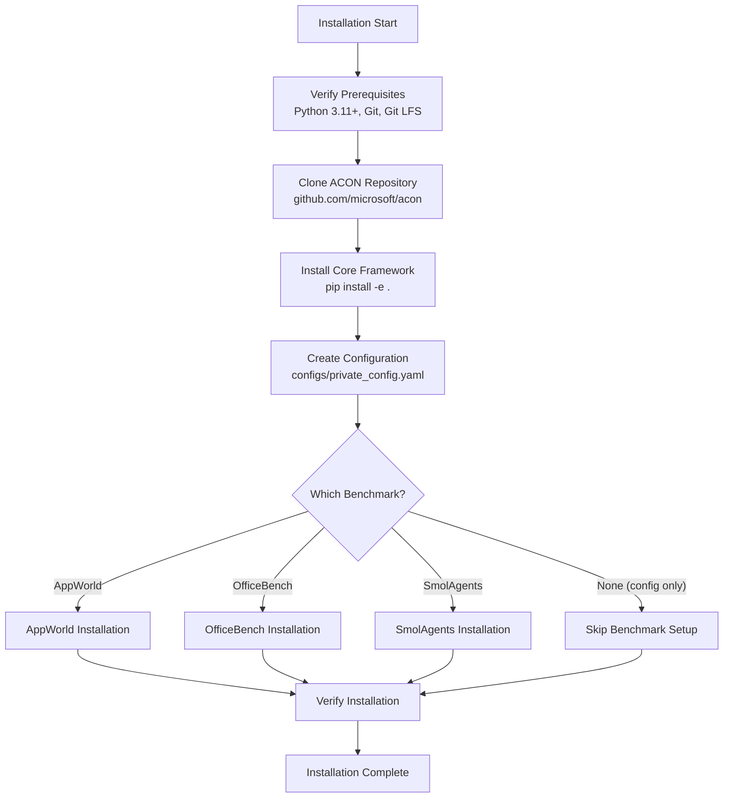

**Diagram: ACON Installation Workflow** - Shows the sequential steps required to install ACON and benchmark environments.

Sources: [README.md:91-110](), [experiments/appworld/README.md:6-23]()

---

## Core Framework Installation

### Step 1: Clone the Repository

```bash
git clone https://github.com/microsoft/acon.git
cd acon
```

This creates a local copy of the ACON codebase with the following structure:

```
acon/
├── configs/                 # Configuration templates
├── experiments/             # Benchmark runners and analysis tools
├── src/productive_agents/   # Core abstractions
└── README.md
```

Sources: [README.md:99-100]()

### Step 2: Install the Package

```bash
pip install -e .
```

The `-e` flag installs ACON in **editable mode**, which means:
- Changes to source files take effect immediately without reinstallation
- The package is linked to the current directory rather than copied
- Useful for development and experimentation

**What Gets Installed**: This command processes the package metadata and installs:
- Core dependencies (PyTorch, OpenAI SDK, tiktoken, etc.)
- The `productive_agents` module from [src/productive_agents/]()
- Command-line utilities for running experiments

**Dependency Resolution**: The installation pulls required packages including:
- `openai` - For API-based model access
- `tiktoken` - For token counting
- `torch` - For local model serving (optional)
- `unsloth` - For efficient LoRA fine-tuning (optional)

Sources: [README.md:101-102]()

---

## Configuration Setup

### Creating the Private Configuration File

After installing the core framework, create a configuration file for API credentials:

```bash
touch configs/private_config.yaml
```

Edit `configs/private_config.yaml` with your API key:

```yaml
openai_key: "sk-proj-..."
```

**Important**: The `private_config.yaml` file is ignored by Git ([.gitignore:463]()) to prevent accidental credential exposure.

**Configuration File Hierarchy**:

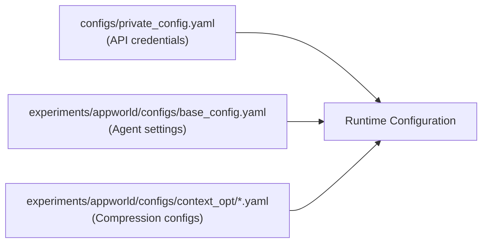

**Diagram: Configuration File Loading** - Shows how different configuration files are merged at runtime.

The `private_config.yaml` file provides API credentials that are merged with benchmark-specific configurations during experiment execution. See [API Configuration](#2.2) for detailed credential setup.

Sources: [README.md:106-110](), [.gitignore:463]()

---

## Benchmark-Specific Installation

### AppWorld Benchmark

AppWorld requires a separate installation of the upstream environment package.

#### Step 1: Install Git LFS

Git LFS is required for downloading large data files:

```bash
git lfs install
```

#### Step 2: Clone and Install AppWorld

```bash
git clone https://github.com/StonyBrookNLP/appworld
cd appworld
pip install -e .
```

This installs the `appworld` package which provides:
- `AppWorldEnv` - Environment simulator
- `appworld` CLI - Command-line tools for installation and evaluation
- Task definitions and ground truth data

Sources: [experiments/appworld/README.md:8-17]()

#### Step 3: Install AppWorld Repository

```bash
appworld install --repo
```

The `--repo` flag installs additional repository components required for environment initialization.

#### Step 4: Download Data

```bash
appworld download data
```

This downloads the benchmark dataset, which includes:
- Task definitions for train, dev, test_normal, and test_challenge splits
- Ground truth trajectories for evaluation
- App state and API definitions

#### Step 5: Move Data to ACON Directory

```bash
cd ..
mv appworld/data /path/to/acon/experiments/appworld/
```

**Critical**: The data directory must be located at `experiments/appworld/data/` for the experiment runners to resolve paths correctly. The runners expect this structure:

```
experiments/appworld/
├── data/
│   └── datasets/
│       ├── train/
│       ├── dev/
│       ├── test_normal/
│       └── test_challenge/
├── configs/
└── run_all.py
```

Sources: [experiments/appworld/README.md:19-23]()

---

### OfficeBench and SmolAgents

Installation instructions for these benchmarks are available in their respective documentation:

- **OfficeBench**: See [experiments/officebench/README.md]()
- **SmolAgents**: See [experiments/smolagents/README.md]()

Both follow similar patterns but have different data requirements and environment setup steps.

Sources: [README.md:126-141]()

---

## Dependency Architecture

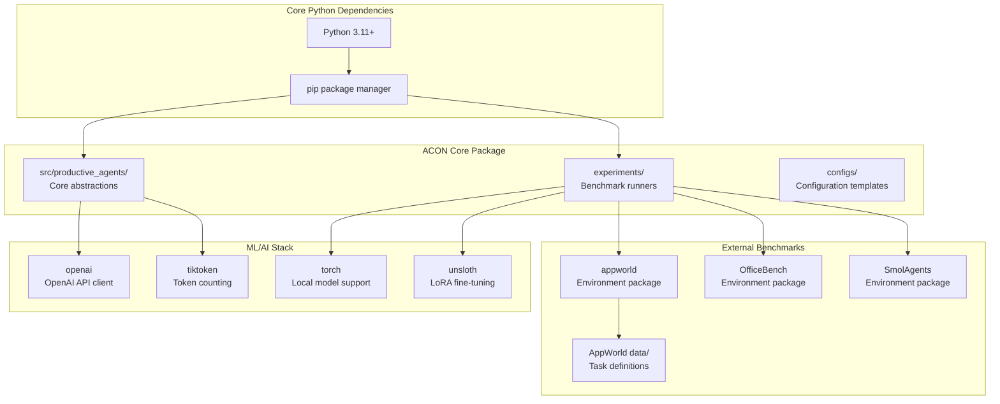

**Diagram: Dependency Structure** - Shows how ACON components depend on external packages and benchmark environments.

Sources: [README.md:91-102](), [.gitignore:343-344]()

---

## Verification

After installation, verify that ACON is properly configured:

### Test 1: Import Core Modules

```bash
python -c "import productive_agents; print('Core modules loaded successfully')"
```

If this succeeds, the core framework is installed correctly.

### Test 2: Verify Configuration

```bash
python -c "import yaml; print(yaml.safe_load(open('configs/private_config.yaml')))"
```

This should print your configuration without errors. Do not share the output as it contains your API key.

### Test 3: Test AppWorld Integration (if installed)

```bash
cd experiments/appworld
python -c "import appworld; print('AppWorld available')"
```

### Test 4: Run Debug Mode Experiment (optional)

Run a single task in debug mode to verify end-to-end functionality:

```bash
cd experiments/appworld
python run_all.py \
    --split train \
    --model_name gpt-4.1-mini \
    --tag installation_test \
    --co_config_path configs/context_opt/gpt-4.1-mini_history.yaml \
    --debug
```

The `--debug` flag limits execution to a single task for quick verification. See [Running Your First Experiment](#2.3) for details.

Sources: [experiments/appworld/README.md:42]()

---

## Directory Structure After Installation

After completing all installation steps, your ACON directory should look like this:

```
acon/
├── configs/
│   └── private_config.yaml          # Created during configuration
├── experiments/
│   ├── appworld/
│   │   ├── data/                    # Moved from AppWorld install
│   │   │   └── datasets/
│   │   ├── configs/
│   │   │   ├── base_config.yaml
│   │   │   └── context_opt/
│   │   ├── prompts/
│   │   └── run_all.py
│   ├── officebench/
│   ├── smolagents/
│   ├── analysis_tools/
│   ├── prompt_optimizer/
│   └── training/
├── src/
│   └── productive_agents/           # Installed as package
└── README.md
```

**Ignored Directories**: The following directories are created during execution but ignored by Git:

| Directory | Purpose | Reference |
|-----------|---------|-----------|
| `experiments/appworld/outputs/` | Experiment results | [.gitignore:438]() |
| `experiments/appworld/experiments/` | Temporary execution data | [.gitignore:446]() |
| `experiments/analysis_tools/analysis*/` | Analysis outputs | [.gitignore:452-457]() |
| `experiments/training/dataset/` | Training datasets | [.gitignore:460]() |
| `finetuned_models/` | LoRA checkpoints | [.gitignore:441]() |

Sources: [.gitignore:425-463](), [README.md:113-120]()

---

## Optional Dependencies

Depending on your use case, you may need additional packages:

### For Local Model Serving

If you plan to serve local models (e.g., Qwen3-14B with LoRA adapters), install:

```bash
pip install torch transformers accelerate
```

### For Model Fine-tuning

For LoRA fine-tuning as described in [Model Distillation](#8), install:

```bash
pip install unsloth
```

The `unsloth` package provides efficient fine-tuning capabilities for the distillation stages.

### For Development

If you plan to contribute to ACON, install development dependencies:

```bash
pip install pytest black mypy
```

See [Development Guide](#10) for more information.

Sources: [.gitignore:343-344]()

---

## Troubleshooting

### Common Installation Issues

**Issue**: `pip install -e .` fails with dependency conflicts

**Solution**: Create a fresh virtual environment:
```bash
python -m venv acon_env
source acon_env/bin/activate  # On Windows: acon_env\Scripts\activate
pip install -e .
```

**Issue**: `git lfs` command not found when installing AppWorld

**Solution**: Install Git LFS for your platform:
- Ubuntu/Debian: `sudo apt-get install git-lfs`
- macOS: `brew install git-lfs`
- Windows: Download from https://git-lfs.github.com/

**Issue**: AppWorld data not found during experiment execution

**Solution**: Verify data directory location:
```bash
ls experiments/appworld/data/datasets/
```
Should show `train/`, `dev/`, `test_normal/`, `test_challenge/` directories.

**Issue**: Import errors for `productive_agents`

**Solution**: Ensure you ran `pip install -e .` from the `acon/` root directory, not a subdirectory.

Sources: [experiments/appworld/README.md:8-23]()

---

## Next Steps

After completing installation:

1. **Configure API credentials**: See [API Configuration](#2.2) for detailed credential setup
2. **Run your first experiment**: See [Running Your First Experiment](#2.3) for a step-by-step walkthrough
3. **Understand core concepts**: See [Core Concepts](#3) for framework fundamentals

For benchmark-specific details, refer to:
- [AppWorld Benchmark](#4.1) - Day-to-day task workflows
- [OfficeBench and SmolAgents](#4.2) - Other supported benchmarks

Sources: [README.md:44-51](), [README.md:138-141]()

---

# Page: API Configuration

# API Configuration

<details>
<summary>Relevant source files</summary>

The following files were used as context for generating this wiki page:

- [README.md](README.md)
- [configs/private_config_dummy.yaml](configs/private_config_dummy.yaml)

</details>


This page covers the setup of API credentials required to run ACON experiments. The primary credential needed is an OpenAI API key for accessing GPT models used in baseline experiments and context optimization. For information about other configuration options such as agent settings and context optimization parameters, see [Base Configuration](#6.1) and [Context Optimization Configuration](#6.2).

## Overview

ACON requires API credentials to access language models for experimentation. The framework supports:

1. **OpenAI API** - Required for GPT-4.1-mini, GPT-4o, and other OpenAI models used in baseline and optimization experiments
2. **Local Model Serving** - Optional, for serving distilled models (see [Model Serving](#8.4))

All API credentials are stored in `configs/private_config.yaml`, which must be created before running experiments.

**Sources:** [README.md:106-110](), [configs/private_config_dummy.yaml:1]()

## Configuration File Location

```mermaid
graph TB
    subgraph "Repository Root"
        CONFIGS["configs/"]
    end
    
    subgraph "Configuration Files"
        PRIVATE["private_config.yaml<br/>(User-created, not in git)"]
        DUMMY["private_config_dummy.yaml<br/>(Template, in git)"]
        BASE["base_config.yaml<br/>(Agent defaults)"]
    end
    
    subgraph "Experiments"
        APPWORLD["experiments/appworld/"]
        OFFICE["experiments/officebench/"]
        SMOL["experiments/smolagents/"]
    end
    
    CONFIGS --> PRIVATE
    CONFIGS --> DUMMY
    CONFIGS --> BASE
    
    PRIVATE -.."loaded by".-> APPWORLD
    PRIVATE -.."loaded by".-> OFFICE
    PRIVATE -.."loaded by".-> SMOL
    
    DUMMY -.."template for".-> PRIVATE
```

**Diagram: Configuration File Hierarchy**

The `private_config.yaml` file must be created in the `configs/` directory at the repository root. This file is excluded from version control via `.gitignore` to prevent accidental credential exposure.

**Sources:** [README.md:106-110](), [README.md:114-120]()

## Initial Setup

### Step 1: Create Configuration File

Copy the template to create your private configuration:

```bash
cd acon
cp configs/private_config_dummy.yaml configs/private_config.yaml
```

Alternatively, create the file manually:

```bash
touch configs/private_config.yaml
```

**Sources:** [configs/private_config_dummy.yaml:1]()

### Step 2: Add OpenAI API Key

Edit `configs/private_config.yaml` and add your OpenAI API key:

```yaml
openai_key: "your_api_key_here"
```

Replace `your_api_key_here` with your actual OpenAI API key. The key should be a string starting with `sk-`.

**Sources:** [README.md:106-110](), [configs/private_config_dummy.yaml:1]()

### Step 3: Obtain OpenAI API Key

If you don't have an OpenAI API key:

1. Visit https://platform.openai.com/api-keys
2. Sign in or create an account
3. Navigate to API keys section
4. Create a new secret key
5. Copy the key immediately (it won't be shown again)

**Sources:** [README.md:106-110]()

## Configuration Schema

### Required Fields

| Field | Type | Description | Example |
|-------|------|-------------|---------|
| `openai_key` | string | OpenAI API key for model access | `"sk-proj-..."` |

### Optional Fields

The `private_config.yaml` file currently requires only the `openai_key` field. Additional credentials for custom model servers or other providers can be added as needed.

**Sources:** [configs/private_config_dummy.yaml:1]()

## Configuration Loading Flow

```mermaid
graph LR
    subgraph "Experiment Execution"
        CLI["python run_all.py<br/>--model_name gpt-4.1-mini"]
    end
    
    subgraph "Configuration Loading"
        LOADER["Configuration Loader"]
        PRIVATE["configs/private_config.yaml"]
        BASE["configs/base_config.yaml"]
        CTXOPT["configs/context_opt/*.yaml"]
    end
    
    subgraph "Runtime Components"
        AGENT["AppWorldAgent<br/>OfficeBenchAgent<br/>SmolAgent"]
        COMPRESSOR["ContextCompressor<br/>(if enabled)"]
        CLIENT["OpenAI Client"]
    end
    
    subgraph "External Services"
        OPENAI["OpenAI API<br/>api.openai.com"]
    end
    
    CLI --> LOADER
    LOADER --> PRIVATE
    LOADER --> BASE
    LOADER --> CTXOPT
    
    LOADER --> AGENT
    LOADER --> COMPRESSOR
    
    AGENT --> CLIENT
    COMPRESSOR --> CLIENT
    
    CLIENT -.."uses openai_key".-> OPENAI
```

**Diagram: Configuration Loading and API Key Usage**

The configuration loader reads `private_config.yaml` at experiment startup and provides the API key to agent and compressor components, which use it to instantiate OpenAI API clients.

**Sources:** [README.md:72-80](), [README.md:106-110]()

## Verification

### Testing API Configuration

After setting up your API key, verify it works by running a simple experiment:

```bash
cd experiments/appworld
python run_all.py \
    --split train \
    --model_name gpt-4.1-mini \
    --tag test \
    --co_config_path configs/context_opt/gpt-4.1-mini_history.yaml \
    --max_tasks 1
```

If the configuration is correct, the experiment will start and you should see output indicating task execution has begun.

**Sources:** [README.md:67-80]()

### Common Success Indicators

- No authentication errors in the output
- Task execution begins
- Output directory is created in `experiments/appworld/outputs/`

**Sources:** [README.md:82-86]()

## Security Considerations

### File Permissions

Ensure `private_config.yaml` has restricted permissions:

```bash
chmod 600 configs/private_config.yaml
```

This prevents other users on the system from reading your API credentials.

### Version Control Exclusion

The `private_config.yaml` file is automatically excluded from version control. Never commit this file to git or share it publicly.

### Environment-Specific Configuration

For multi-user or CI/CD environments, consider using environment variables instead of static files. The configuration system can be extended to read from environment variables if needed.

**Sources:** [configs/private_config_dummy.yaml:1]()

## Troubleshooting

### Error: "No such file or directory: configs/private_config.yaml"

**Cause:** Configuration file not created.

**Solution:** Create the file as described in [Initial Setup](#initial-setup).

### Error: "Invalid API key"

**Cause:** Incorrect or expired API key.

**Solutions:**
1. Verify the key is correctly copied (no extra spaces or quotes)
2. Check the key is valid on OpenAI platform
3. Ensure the key has not been revoked
4. Verify billing is enabled on your OpenAI account

### Error: "Rate limit exceeded"

**Cause:** OpenAI API rate limits reached.

**Solutions:**
1. Wait before retrying
2. Upgrade your OpenAI account tier
3. Reduce experiment concurrency
4. Use smaller batch sizes

**Sources:** [README.md:106-110]()

## Model Pricing Considerations

Different OpenAI models have different pricing tiers. The ACON framework includes token analysis tools (see [Token and Cost Analysis](#7.1)) to track costs across experiments. Common models used:

| Model | Use Case | Relative Cost |
|-------|----------|---------------|
| `gpt-4.1-mini` | Default for most experiments | Low |
| `gpt-4o` | Higher quality baselines | Medium |
| `gpt-4o-mini` | Budget-friendly alternative | Lowest |

Configure your desired model using the `--model_name` parameter when running experiments.

**Sources:** [README.md:67-80]()

## Next Steps

After configuring API credentials:

1. **Run your first experiment** - See [Running Your First Experiment](#2.3)
2. **Customize agent configuration** - See [Base Configuration](#6.1)
3. **Set up context optimization** - See [Context Optimization Configuration](#6.2)

**Sources:** [README.md:53-88]()

---

**Sources for this page:** [README.md:53-165](), [configs/private_config_dummy.yaml:1]()

---

# Page: Running Your First Experiment

# Running Your First Experiment

<details>
<summary>Relevant source files</summary>

The following files were used as context for generating this wiki page:

- [experiments/appworld/README.md](experiments/appworld/README.md)
- [experiments/appworld/configs/base_config.yaml](experiments/appworld/configs/base_config.yaml)
- [experiments/appworld/run_all.py](experiments/appworld/run_all.py)

</details>


## Purpose and Scope

This guide provides a step-by-step walkthrough for running your first ACON experiment using the AppWorld benchmark. It covers environment setup, executing a baseline experiment, understanding outputs, and evaluating results.

For detailed installation instructions, see [Installation](#2.1). For API key configuration, see [API Configuration](#2.2). For comprehensive experiment running options across all benchmarks, see [Running Experiments](#5). For in-depth AppWorld benchmark information, see [AppWorld Benchmark](#4.1).

## Prerequisites

Before running your first experiment, ensure you have:

1. Completed the installation steps in [Installation](#2.1)
2. Configured your OpenAI API keys as described in [API Configuration](#2.2)
3. Python 3.11+ environment with all dependencies installed

## AppWorld Environment Setup

The AppWorld benchmark requires additional setup beyond the base ACON installation. This includes installing the upstream AppWorld package and downloading the benchmark data.

### Installing AppWorld Package

```bash
# Enable Git LFS for large file support
git lfs install

# Clone the AppWorld repository
git clone https://github.com/StonyBrookNLP/appworld
cd appworld

# Install AppWorld package in editable mode
pip install -e .

# Install AppWorld repository components
appworld install --repo

# Download benchmark data
appworld download data
```

**Sources:** [experiments/appworld/README.md:6-17]()

### Moving Data to ACON Directory

After downloading, move the `data/` directory into the ACON AppWorld experiments folder:

```bash
# From the appworld clone directory
mv data /path/to/acon/experiments/appworld/
```

The expected directory structure:

```
experiments/appworld/
├── data/
│   └── datasets/
│       ├── train/
│       ├── dev/
│       ├── test_normal/
│       └── test_challenge/
├── configs/
├── prompts/
├── run.py
└── run_all.py
```

**Sources:** [experiments/appworld/README.md:19-23]()

## Running Your First Baseline Experiment

The simplest experiment runs an agent on AppWorld tasks without context compression. This establishes a baseline for comparison.

### Basic Command Structure

```bash
cd experiments/appworld

python run_all.py \
    --split train \
    --model_name gpt-4.1 \
    --tag baseline \
    --co_config_path configs/context_opt/appworld/gpt-4.1_history_v2.yaml
```

**Sources:** [experiments/appworld/README.md:30-39]()

### Experiment Execution Flow

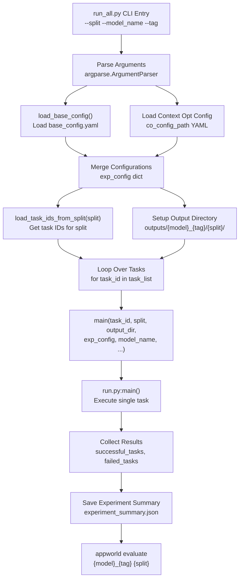

**Sources:** [experiments/appworld/run_all.py:75-363]()

### Key Command-Line Arguments

The `run_all.py` script accepts several important arguments:

| Argument | Description | Default | Example |
|----------|-------------|---------|---------|
| `--split` | Dataset split to run | `train` | `train`, `dev`, `test_normal`, `test_challenge` |
| `--model_name` | LLM model identifier | `gpt-4o` | `gpt-4.1`, `gpt-4o` |
| `--tag` | Experiment label/suffix | `debug` | `baseline`, `history_compression` |
| `--co_config_path` | Path to context optimization config | `None` | `configs/context_opt/appworld/gpt-4.1_history_v2.yaml` |
| `--debug` | Enable debug mode (runs 1 task only) | `False` | `--debug` |
| `--max_iter` | Maximum agent iterations per task | `50` | `100` |
| `--continue_existing` | Skip tasks with existing outputs | `False` | `--continue_existing` |
| `--rerun_failed` | Rerun only failed tasks from previous run | `False` | `--rerun_failed` |

**Sources:** [experiments/appworld/run_all.py:79-96](), [experiments/appworld/README.md:58-64]()

### Running in Debug Mode

For first-time users, it's recommended to run with the `--debug` flag to verify setup:

```bash
cd experiments/appworld

python run_all.py \
    --split train \
    --model_name gpt-4.1 \
    --tag baseline_test \
    --co_config_path configs/context_opt/appworld/gpt-4.1_history_v2.yaml \
    --debug
```

Debug mode runs only the first task and provides detailed console output, allowing you to verify:
- API keys are configured correctly
- AppWorld data is accessible
- Configuration files are valid
- Output directories are writable

**Sources:** [experiments/appworld/README.md:42](), [experiments/appworld/run_all.py:187-225]()

## Configuration Assembly Process

The experiment configuration is assembled from multiple sources at runtime:

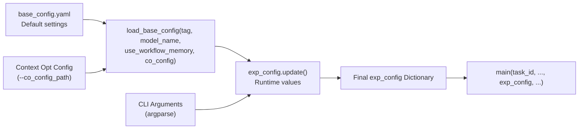

The configuration merging happens in this order:

1. **Base Config**: Loaded from `configs/base_config.yaml`
2. **Context Optimization Config**: Loaded from `--co_config_path` if provided
3. **Runtime Overrides**: Applied from command-line arguments

Key configuration parameters set by `load_base_config()`:

| Parameter | Source | Purpose |
|-----------|--------|---------|
| `exp_id` | Runtime | Experiment identifier (`{tag}_{model_name}`) |
| `model_name` | CLI arg | LLM model to use |
| `tag` | CLI arg | Experiment label |
| `max_iter` | CLI arg or base | Maximum iterations per task |
| `use_workflow_memory` | CLI arg | Enable workflow memory |
| `use_thinking_tokens` | Base config | Enable thinking tokens |
| `co_config` | Loaded file | Context optimization configuration |
| `experiment_name` | Runtime | Constructed experiment name |

**Sources:** [experiments/appworld/run_all.py:33-57](), [experiments/appworld/run_all.py:122-137](), [experiments/appworld/configs/base_config.yaml:1-25]()

## Understanding Experiment Outputs

After running an experiment, outputs are organized in a structured directory hierarchy:

### Output Directory Structure

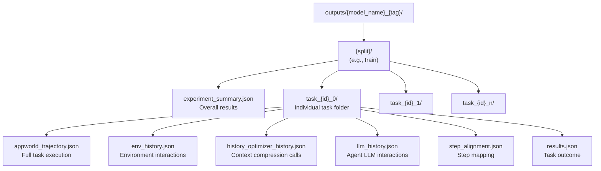

**Sources:** [experiments/appworld/README.md:67-84]()

### Key Output Files

Each task directory contains several important files:

| File | Description | Used For |
|------|-------------|----------|
| `appworld_trajectory.json` | Complete task trajectory in AppWorld format | Official evaluation |
| `env_history.json` | Detailed environment state history | Debugging, analysis |
| `history_optimizer_history.json` | All context compression LLM calls | Token analysis, distillation |
| `llm_history.json` | All agent reasoning LLM calls | Token analysis, agent distillation |
| `step_alignment.json` | Mapping between agent steps and env steps | Step-level debugging |
| `results.json` | Task success/failure and metadata | Quick result lookup |

**Sources:** [experiments/appworld/README.md:74-80]()

### Experiment Summary File

The `experiment_summary.json` file at the split level contains aggregated results:

```json
{
  "experiment_config": { /* full configuration */ },
  "split": "train",
  "total_tasks": 100,
  "successful_tasks": ["task_1", "task_5", ...],
  "failed_tasks": ["task_3", "task_7", ...],
  "success_rate": 0.85,
  "total_time_seconds": 3600.5,
  "run_timestamp": 1234567890.0,
  "cost_summary": {
    "total_cost_usd": 12.45,
    "total_input_tokens": 150000,
    "total_output_tokens": 50000,
    "total_tokens": 200000,
    "total_requests": 500,
    "average_cost_per_task": 0.1245,
    "task_costs": { "task_1": 0.12, ... }
  }
}
```

**Sources:** [experiments/appworld/run_all.py:320-346]()

## Evaluating Results

After experiment completion, use the AppWorld evaluation command to compute official metrics:

```bash
appworld evaluate gpt-4.1_baseline train
```

The evaluation command:
- Reads trajectories from `outputs/gpt-4.1_baseline/train/`
- Validates action sequences against ground truth
- Computes success rates and other metrics
- Updates `experiment_summary.json` with official scores

**Sources:** [experiments/appworld/README.md:39](), [experiments/appworld/README.md:86-88]()

### Console Output During Execution

During experiment execution, `run_all.py` provides progress information:

In **debug mode**:
```
============================================================
Running task task_123 (1/100) from train split
============================================================
✅ Task task_123 completed successfully!
```

In **batch mode** (non-debug):
```
Running tasks ━━━━━━━━━━━━━━━━━━━━━━━━━━ 45/100 00:15:30 00:18:45
```

After completion:
```
============================================================
APPWORLD EXPERIMENT COMPLETED
============================================================
Split: train
Model: gpt-4.1
Tag: baseline
Total tasks: 100
Successful: 85
Failed: 15
Success rate: 85.0%
Total experiment time: 01:23:45
============================================================
TOKEN USAGE AND COST SUMMARY
============================================================
Total Requests: 1,234
Total Input Tokens: 567,890
Total Output Tokens: 123,456
Total Tokens: 691,346
TOTAL COST: $12.456789
Average cost per task: $0.124568
============================================================
```

**Sources:** [experiments/appworld/run_all.py:187-318]()

## Running With Context Compression

Once you've established a baseline, you can run experiments with context compression enabled:

```bash
cd experiments/appworld

python run_all.py \
    --split train \
    --model_name gpt-4.1 \
    --tag history_compression \
    --co_config_path configs/context_opt/appworld/gpt-4.1_history_v2.yaml
```

This command is identical to the baseline, except:
- The `--tag` is different to distinguish output directories
- Context compression is activated via the configuration in `co_config_path`

The context optimization configuration enables the agent to compress historical context when it exceeds a token threshold, reducing API costs while maintaining performance.

**Sources:** [experiments/appworld/README.md:44-54]()

## Next Steps

After successfully running your first experiment:

1. **Analyze Token Usage and Costs**: See [Token and Cost Analysis](#7.1) to understand resource consumption
2. **Optimize Context Compression**: See [Context Optimization Pipeline](#7.2) to improve compression prompts
3. **Run Comprehensive Experiments**: See [Batch Experiment Execution](#5.2) for advanced execution options
4. **Explore Other Benchmarks**: See [Benchmarks](#4) for OfficeBench and SmolAgents
5. **Train Local Models**: See [Model Distillation](#8) to distill frontier models to local models

For troubleshooting and common issues, see [Support and Contributing](#10.3).

**Sources:** [experiments/appworld/README.md:90-134]()

---

# Page: Core Concepts

# Core Concepts

<details>
<summary>Relevant source files</summary>

The following files were used as context for generating this wiki page:

- [README.md](README.md)
- [assets/concept.png](assets/concept.png)

</details>


This document introduces the fundamental concepts underlying the ACON framework. It covers the core abstractions (environments, agents, and context compressors), explains what context optimization is and why it matters for long-horizon agents, and provides an overview of the four-stage experimental pipeline.

For detailed information about specific topics:
- For setting up and running experiments, see [Running Experiments](#5)
- For benchmark-specific details, see [Benchmarks](#4)
- For configuration and customization, see [Configuration](#6)
- For analysis and optimization procedures, see [Analysis and Optimization](#7)

## What is ACON?

ACON (Agent Context Optimization) is a research framework for optimizing context compression in long-horizon LLM agents. The framework addresses a fundamental challenge: as agents execute multi-step tasks, their conversation history grows continuously, leading to increased token costs and potential context window limitations.

The framework provides:
- **Standardized abstractions** for environments, agents, and context compressors
- **Multi-benchmark support** across AppWorld, OfficeBench, and 8-objective QA
- **A four-stage pipeline** from baseline experiments to fully distilled local models
- **Analysis tools** for token usage, cost tracking, and prompt optimization

**Sources:** [README.md:1-41]()

## Core Abstractions

ACON defines three primary abstractions that work together to enable context-optimized agent execution:

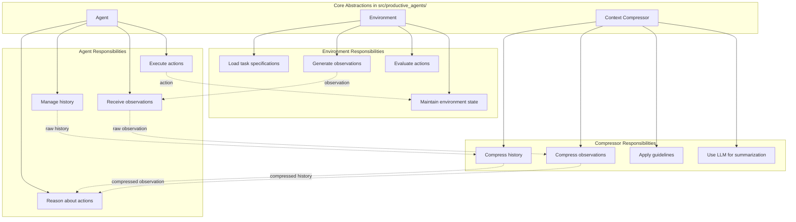

### Environment

The `Environment` abstraction represents the task execution environment. It is responsible for:
- Loading task specifications and initial state
- Maintaining the current state of the environment
- Generating observations in response to agent actions
- Evaluating action success and computing rewards

Each benchmark (AppWorld, OfficeBench, SmolAgents) implements this abstraction differently based on its domain requirements.

### Agent

The `Agent` abstraction implements the decision-making logic. It:
- Receives observations from the environment
- Reasons about what action to take next
- Executes actions by calling environment APIs
- Maintains a history of past observations and actions

The agent uses LLMs (either frontier models like GPT-4 or distilled local models) to perform reasoning.

### Context Compressor

The `Context Compressor` is responsible for reducing the size of the agent's context while preserving task-critical information. It operates on two types of inputs:

1. **History Compression**: Summarizes the sequence of past observations and actions
2. **Observation Compression**: Refines the current observation to remove redundant details

Compressors use LLM-based summarization guided by optimization guidelines.

**Sources:** [README.md:22-24](), [README.md:116-119]()

## The Context Optimization Problem

Long-horizon agents face a critical challenge: **unbounded memory growth**. As tasks progress through multiple steps, the agent's context accumulates:

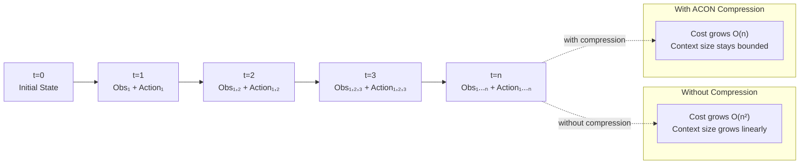

Without compression, each LLM call includes all previous history, leading to:
- **Quadratic token costs**: Each step adds more tokens to be re-processed
- **Context window limits**: Eventually exceeding model capacity
- **Degraded performance**: Irrelevant details dilute important information

Context optimization addresses this by compressing history at each step, maintaining bounded context size while preserving task-critical information.

**Sources:** [README.md:22-23]()

## Four-Stage Experimental Pipeline

ACON follows a systematic four-stage pipeline that progresses from baseline measurements to fully optimized local models:

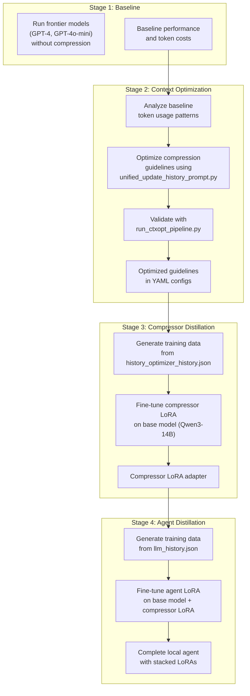

### Stage 1: Baseline

Establish baseline performance using frontier models without compression. This measures:
- Task success rates
- Token usage per task
- Total costs
- Performance bottlenecks

### Stage 2: Context Optimization

Optimize compression guidelines through automated prompt engineering:
1. Analyze token usage patterns from baseline experiments
2. Generate candidate compression guidelines
3. Evaluate each guideline on validation tasks
4. Select the best-performing configuration

The output is a YAML configuration file (e.g., `gpt-4.1-mini_history.yaml`) containing optimized compression instructions.

### Stage 3: Compressor Distillation

Train a local model to replicate the compression behavior:
1. Extract compression examples from `history_optimizer_history.json`
2. Fine-tune a LoRA adapter on a base model (e.g., Qwen3-14B)
3. The resulting model can perform compression locally without API calls

### Stage 4: Agent Distillation

Train a local model to replicate the agent reasoning:
1. Extract agent decision examples from `llm_history.json`
2. Fine-tune a second LoRA adapter on the base model
3. Stack both LoRA adapters to create a complete local agent

The final model performs both compression and reasoning locally, eliminating API dependencies.

**Sources:** [README.md:132-136]()

## Agent-Environment Interaction Flow

The following diagram shows how components interact during task execution:

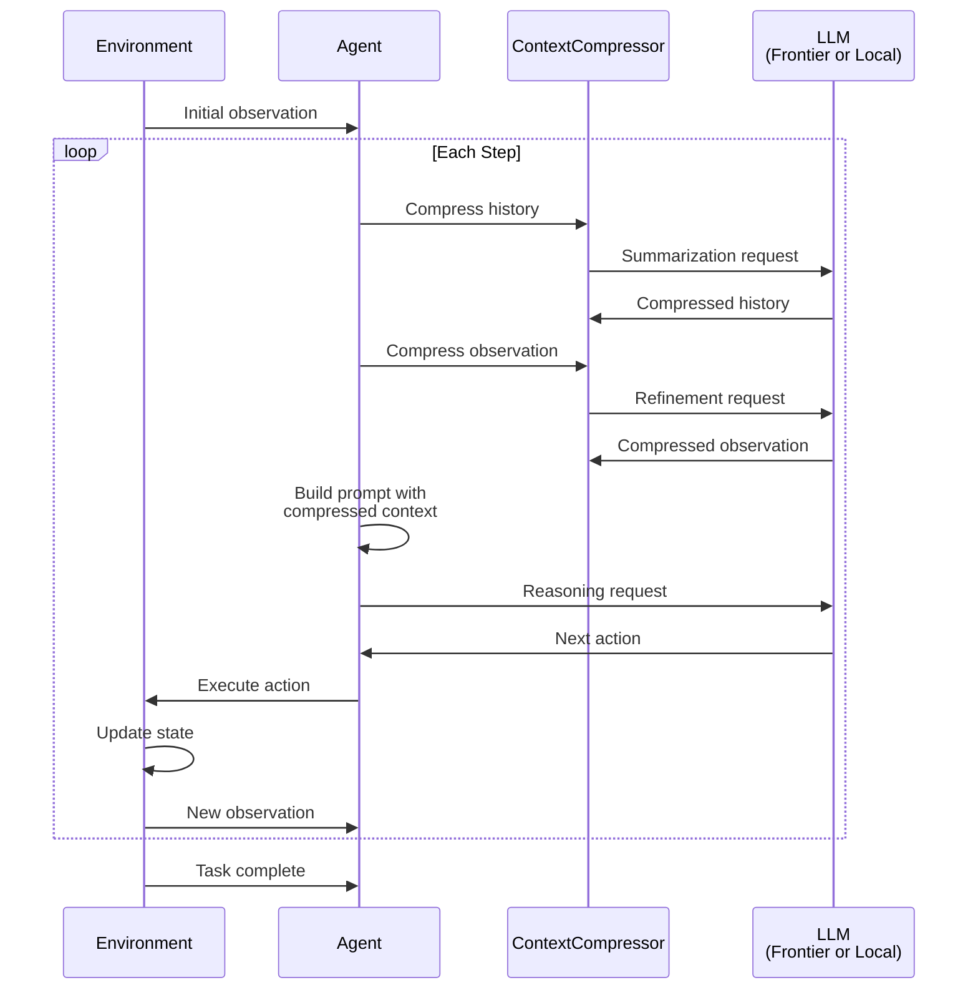

### Execution Flow Details

1. **Initialization**: Environment loads the task and provides initial observation
2. **History Compression**: Agent sends accumulated history to compressor
3. **Observation Compression**: Agent sends current observation to compressor
4. **Reasoning**: Agent uses compressed context to determine next action
5. **Action Execution**: Environment processes action and updates state
6. **Iteration**: Process repeats until task completion

The key insight is that compression happens **before reasoning**, ensuring the agent always works with bounded context.

**Sources:** [README.md:22-24]()

## Configuration-Driven Design

ACON uses a layered configuration system to control all aspects of execution:

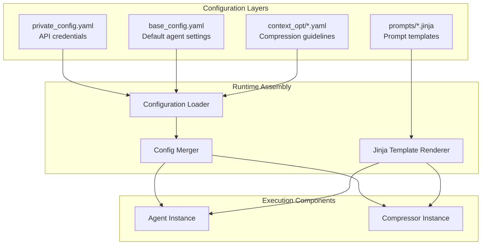

### Configuration Components

| Component | Purpose | Example |
|-----------|---------|---------|
| `private_config.yaml` | API keys and credentials | OpenAI API key |
| `base_config.yaml` | Default agent settings | Model name, temperature, max tokens |
| `context_opt/*.yaml` | Compression guidelines | History/observation compression rules |
| `prompts/*.jinja` | Prompt templates | System prompts, user prompts |

The system merges these configurations at runtime, with later configurations overriding earlier ones. This enables easy experimentation by swapping configuration files without code changes.

**Sources:** [README.md:104-110]()

## Output and Traceability

ACON generates comprehensive outputs for each task execution, enabling detailed analysis and reproducibility:

```mermaid
graph TB
    subgraph "Task Execution"
        TASK["Task Execution"]
    end
    
    subgraph "Output Files per Task"
        HIST_OPT["history_optimizer_history.json<br/>Compression requests/responses"]
        LLM_HIST["llm_history.json<br/>Agent reasoning requests/responses"]
        ENV_HIST["env_history.json<br/>Environment state transitions"]
        RESULTS["results.json<br/>Task outcome and metrics"]
    end
    
    subgraph "Aggregated Outputs"
        SUMMARY["experiment_summary.json<br/>Cross-task statistics"]
    end
    
    subgraph "Analysis Tools"
        TOKEN_ANALYSIS["analyze_experiment_tokens_v2<br/>Token usage analysis"]
        COST_REPORT["Cost reports<br/>Markdown and CSV"]
        PROMPT_OPT["unified_update_history_prompt.py<br/>Prompt optimization"]
    end
    
    TASK --> HIST_OPT
    TASK --> LLM_HIST
    TASK --> ENV_HIST
    TASK --> RESULTS
    
    HIST_OPT --> SUMMARY
    LLM_HIST --> SUMMARY
    ENV_HIST --> SUMMARY
    RESULTS --> SUMMARY
    
    HIST_OPT --> TOKEN_ANALYSIS
    LLM_HIST --> TOKEN_ANALYSIS
    TOKEN_ANALYSIS --> COST_REPORT
    
    HIST_OPT --> PROMPT_OPT
    LLM_HIST --> PROMPT_OPT
```

### Output File Descriptions

- **`history_optimizer_history.json`**: Complete log of all compression operations, including input context, guidelines, and compressed output
- **`llm_history.json`**: Complete log of agent reasoning, including prompts sent to LLM and responses received
- **`env_history.json`**: Complete log of environment interactions, including actions executed and observations returned
- **`results.json`**: Task outcome (success/failure), final state, and execution metrics
- **`experiment_summary.json`**: Aggregated statistics across all tasks in the experiment

These outputs enable:
- Debugging agent behavior
- Analyzing token usage patterns
- Training distilled models
- Optimizing compression guidelines

**Sources:** [README.md:82-86]()

## Model Serving Options

ACON supports two model serving configurations, allowing seamless transitions from frontier to local models:

| Configuration | Compressor Model | Agent Model | Use Case |
|---------------|------------------|-------------|----------|
| **Frontier** | OpenAI API (e.g., gpt-4o-mini) | OpenAI API (e.g., gpt-4o) | Baseline experiments, optimization |
| **Local** | Base model + Compressor LoRA | Base model + Compressor LoRA + Agent LoRA | Production deployment, cost reduction |

The local configuration uses **stacked LoRA adapters** on a single base model (e.g., Qwen3-14B), where:
1. The compressor LoRA is applied for compression operations
2. Both LoRAs are stacked for agent reasoning operations

This architecture enables complete local execution without external API dependencies.

**Sources:** [README.md:132-136]()

## Summary

ACON provides a complete framework for context optimization in long-horizon agents:

1. **Core Abstractions**: Environment, Agent, and Context Compressor work together to enable bounded-context execution
2. **Four-Stage Pipeline**: Systematic progression from baseline to optimized to distilled models
3. **Configuration-Driven**: YAML configs and Jinja templates enable rapid experimentation
4. **Comprehensive Traceability**: Detailed outputs support analysis, debugging, and training
5. **Flexible Deployment**: Support for both frontier and local models

The framework standardizes context optimization research across multiple benchmarks while providing tools for every stage of the optimization process.

**Sources:** [README.md:1-142]()

---

# Page: Context Optimization

# Context Optimization

<details>
<summary>Relevant source files</summary>

The following files were used as context for generating this wiki page:

- [README.md](README.md)
- [experiments/appworld/configs/context_opt/gpt-4.1-mini_history.yaml](experiments/appworld/configs/context_opt/gpt-4.1-mini_history.yaml)
- [experiments/appworld/prompts/context_opt/prompt_history_v2.jinja](experiments/appworld/prompts/context_opt/prompt_history_v2.jinja)

</details>


## Purpose and Scope

This document explains **context optimization** in the ACON framework: what it is, why it's essential for long-horizon agents, and how ACON implements it through configurable compression strategies. 

Context optimization addresses the fundamental challenge of managing growing context windows in agents that execute multi-turn tasks. Without compression, token counts grow unboundedly, leading to API rejections, exponential costs, and degraded performance.

For information about running the context optimization pipeline to tune compression prompts, see [Context Optimization Pipeline](#7.2). For configuration details, see [Context Optimization Configuration](#6.2).

---

## The Context Growth Problem

Long-horizon agents face a critical challenge: **unbounded context growth**. Each interaction with the environment adds tokens to the agent's context window:

- **Action history**: Previous actions and their outcomes
- **Observations**: Environment responses and feedback
- **Intermediate reasoning**: Agent's thought processes
- **Task instructions**: The original goal and constraints

```mermaid
graph LR
    subgraph "Turn 1"
        T1_I["Initial Task<br/>(~500 tokens)"]
        T1_A["Action 1<br/>(~200 tokens)"]
        T1_O["Observation 1<br/>(~800 tokens)"]
    end
    
    subgraph "Turn 5"
        T5_CTX["Accumulated Context<br/>(~6,000 tokens)"]
        T5_A["Action 5<br/>(~200 tokens)"]
        T5_O["Observation 5<br/>(~800 tokens)"]
    end
    
    subgraph "Turn 20"
        T20_CTX["Accumulated Context<br/>(~28,000 tokens)"]
        T20_A["Action 20<br/>(~200 tokens)"]
        T20_O["Observation 20<br/>(~800 tokens)"]
        T20_LIMIT["Context Limit Exceeded<br/>API Rejection"]
    end
    
    T1_I --> T1_A
    T1_A --> T1_O
    T1_O --> T5_CTX
    T5_CTX --> T5_A
    T5_A --> T5_O
    T5_O --> T20_CTX
    T20_CTX --> T20_A
    T20_A --> T20_O
    T20_O --> T20_LIMIT
```

**Sources:** [README.md:22-23]()

### Consequences Without Compression

| Issue | Impact |
|-------|--------|
| **Token Limit Violations** | API providers enforce hard limits (e.g., 128K tokens). Tasks fail when exceeded. |
| **Exponential Costs** | GPT-4 charges per token. A 20-turn task can accumulate 50K+ tokens → $1+ per task. |
| **Performance Degradation** | Models struggle with extremely long contexts, leading to "lost in the middle" phenomena. |
| **Latency Issues** | Processing 50K+ token contexts increases response time by 5-10x. |

**Sources:** [README.md:22-23](), Diagram 4 in architecture overview

---

## Context Optimization in ACON

**Context optimization** is the process of intelligently compressing the agent's context while preserving information critical for task completion. ACON implements this through **prompt-guided summarization** using LLMs.

### Two Compression Strategies

ACON provides two orthogonal compression strategies:

```mermaid
graph TB
    subgraph "Agent Context"
        TASK["Task Instruction"]
        HISTORY["Action-Observation History"]
        CURRENT_OBS["Current Observation"]
    end
    
    subgraph "Compression Strategies"
        HIST_COMP["History Compression<br/>gpt-4.1-mini_history.yaml"]
        OBS_COMP["Observation Compression<br/>gpt-4.1-mini_obs.yaml"]
    end
    
    subgraph "Compressed Context"
        TASK_OUT["Task Instruction<br/>(unchanged)"]
        HIST_SUM["History Summary<br/>(compressed)"]
        OBS_SUM["Refined Observation<br/>(compressed)"]
    end
    
    HISTORY --> HIST_COMP
    CURRENT_OBS --> OBS_COMP
    
    HIST_COMP --> HIST_SUM
    OBS_COMP --> OBS_SUM
    TASK --> TASK_OUT
    
    TASK_OUT --> AGENT["Agent Decision"]
    HIST_SUM --> AGENT
    OBS_SUM --> AGENT
```

**Sources:** [experiments/appworld/configs/context_opt/gpt-4.1-mini_history.yaml:1-9](), README.md mentions both strategies

| Strategy | What It Compresses | When Applied |
|----------|-------------------|--------------|
| **History Compression** | Multi-turn action-observation sequences | When history exceeds `history_summarization_threshold` tokens |
| **Observation Compression** | Individual environment observations | Every turn, before passing to agent |

Both strategies can be used independently or combined. They are configured separately in YAML files.

**Sources:** [experiments/appworld/configs/context_opt/gpt-4.1-mini_history.yaml:1-9]()

---

## History Compression

History compression maintains a **rolling summary** of the agent's action-observation history. It prevents unbounded growth while preserving critical information about what has been accomplished and what was learned.

### How It Works

```mermaid
flowchart TD
    START["Agent Executes Action"]
    APPEND["Append to History Buffer"]
    CHECK{"History > threshold?"}
    PRESERVE["Extract Last K Turns"]
    COMPRESS["Call History Compressor"]
    PROMPT["Apply prompt_history_v2.jinja"]
    SUMMARY["Generate Structured Summary"]
    REPLACE["Replace History with Summary"]
    CONTINUE["Continue Agent Loop"]
    
    START --> APPEND
    APPEND --> CHECK
    CHECK -->|"No"| CONTINUE
    CHECK -->|"Yes"| PRESERVE
    PRESERVE --> COMPRESS
    COMPRESS --> PROMPT
    PROMPT --> SUMMARY
    SUMMARY --> REPLACE
    REPLACE --> CONTINUE
```

**Sources:** [experiments/appworld/configs/context_opt/gpt-4.1-mini_history.yaml:7-9]()

### Configuration Schema

History compression is configured via YAML files in `experiments/appworld/configs/context_opt/`:

```yaml
type: "history"
model: "gpt-4.1-mini"
compressor_type: "full"
prompts:
  prompt_system: "system_prompt"
  prompt_history_user: "prompt_history_v2"
history_summarization_threshold: 4096
preserve_last_k_turns: 1
history_summary_rule: "reset"
```

**Sources:** [experiments/appworld/configs/context_opt/gpt-4.1-mini_history.yaml:1-9]()

| Parameter | Description | Default Value |
|-----------|-------------|---------------|
| `type` | Compression strategy type | `"history"` |
| `model` | Model used for compression | `"gpt-4.1-mini"` |
| `compressor_type` | Compressor implementation | `"full"` |
| `prompts.prompt_history_user` | Jinja template for compression prompt | `"prompt_history_v2"` |
| `history_summarization_threshold` | Token count trigger for compression | `4096` |
| `preserve_last_k_turns` | Recent turns to keep uncompressed | `1` |
| `history_summary_rule` | How to merge summaries | `"reset"` |

**Sources:** [experiments/appworld/configs/context_opt/gpt-4.1-mini_history.yaml:1-9]()

### Structured Summary Format

The compression prompt ([experiments/appworld/prompts/context_opt/prompt_history_v2.jinja:1-39]()) enforces a structured output format:

```
### REASONING
[Summarize key progress, decisions, outcomes, and rationale]

### COMPLETED
[List completed subtasks with brief results]
```

This structure ensures the summary is:
1. **Actionable**: Agent can resume with no information loss
2. **Concise**: Removes redundancy while preserving essential facts
3. **Reusable**: Structured format enables consistent parsing
4. **Error-aware**: Includes failed attempts to prevent repetition

**Sources:** [experiments/appworld/prompts/context_opt/prompt_history_v2.jinja:1-39]()

### Prompt Engineering Principles

The prompt template includes five prioritization rules:

```jinja
## PRIORITIZE

1. Keep all sections relevant and concise.  
2. Use reusable structured formats when summarizing artifacts.  
3. Ensure agent can resume task with no loss of information.
4. Include key info from errors or failed attempts to prevent repeated mistakes.
5. Preserve all essential artifacts and data needed to complete the task.
```

These rules guide the compressor LLM to balance **compression ratio** with **information preservation**.

**Sources:** [experiments/appworld/prompts/context_opt/prompt_history_v2.jinja:27-34]()

---

## Observation Compression

Observation compression refines individual environment responses before they are shown to the agent. This is particularly useful when environments return verbose outputs (e.g., full HTML pages, long JSON objects, detailed error messages).

### Key Differences from History Compression

| Aspect | History Compression | Observation Compression |
|--------|---------------------|------------------------|
| **Scope** | Multi-turn sequence | Single observation |
| **Frequency** | Triggered by threshold | Every turn |
| **Purpose** | Maintain rolling context | Remove irrelevant details |
| **Configuration** | `gpt-4.1-mini_history.yaml` | `gpt-4.1-mini_obs.yaml` |

Observation compression is applied **before** the observation enters the history buffer, ensuring even uncompressed history stays lean.

**Sources:** Architecture diagrams, configuration structure inference

---

## Technical Implementation

### Code Mapping

```mermaid
graph TB
    subgraph "Configuration Files"
        HIST_CFG["gpt-4.1-mini_history.yaml<br/>experiments/appworld/configs/context_opt/"]
        OBS_CFG["gpt-4.1-mini_obs.yaml<br/>experiments/appworld/configs/context_opt/"]
        BASE_CFG["base_config.yaml<br/>experiments/appworld/configs/"]
    end
    
    subgraph "Prompt Templates"
        HIST_PROMPT["prompt_history_v2.jinja<br/>experiments/appworld/prompts/context_opt/"]
        OBS_PROMPT["prompt_user.jinja<br/>experiments/appworld/prompts/context_opt/"]
        SYS_PROMPT["system_prompt.jinja<br/>experiments/appworld/prompts/"]
    end
    
    subgraph "Core Abstractions"
        COMPRESSOR["ContextCompressor<br/>src/productive_agents/"]
        AGENT["AppWorldAgent<br/>src/productive_agents/"]
        ENV["AppWorldEnv<br/>src/productive_agents/"]
    end
    
    subgraph "Runtime Execution"
        RUNNER["main_runner<br/>experiments/appworld/run_all.py"]
        TASK_RUNNER["run.py<br/>Single Task Execution"]
    end
    
    HIST_CFG -.loaded by.-> RUNNER
    OBS_CFG -.loaded by.-> RUNNER
    BASE_CFG -.loaded by.-> RUNNER
    
    HIST_PROMPT -.referenced in.-> HIST_CFG
    OBS_PROMPT -.referenced in.-> OBS_CFG
    
    RUNNER --> TASK_RUNNER
    TASK_RUNNER --> AGENT
    AGENT --> COMPRESSOR
    AGENT --> ENV
    COMPRESSOR -.uses.-> HIST_PROMPT
    COMPRESSOR -.uses.-> OBS_PROMPT
```

**Sources:** [experiments/appworld/configs/context_opt/gpt-4.1-mini_history.yaml:1-9](), [experiments/appworld/prompts/context_opt/prompt_history_v2.jinja:1-39](), Diagram 3 and 6 from architecture overview

### Compression Workflow

```mermaid
sequenceDiagram
    participant R as run_all.py
    participant C as Config Loader
    participant A as AppWorldAgent
    participant HC as HistoryCompressor
    participant E as AppWorldEnv
    participant LLM as OpenAI API
    
    R->>C: Load base_config.yaml
    R->>C: Load gpt-4.1-mini_history.yaml
    C->>A: Initialize with config
    A->>HC: Initialize with prompt templates
    
    loop Each Turn
        A->>E: Execute action
        E->>A: Return observation
        A->>A: Append to history buffer
        A->>A: Check token count
        alt History > threshold
            A->>HC: compress_history(task, history, prev_summary)
            HC->>HC: Render prompt_history_v2.jinja
            HC->>LLM: Call model with compression prompt
            LLM->>HC: Return structured summary
            HC->>A: Return summary
            A->>A: Replace history with summary
        end
        A->>LLM: Call agent model with compressed context
        LLM->>A: Return next action
    end
```

**Sources:** [experiments/appworld/configs/context_opt/gpt-4.1-mini_history.yaml:1-9](), [experiments/appworld/prompts/context_opt/prompt_history_v2.jinja:1-39](), execution flow inferred from architecture

### Configuration Parameters Reference

The full configuration schema for history compression:

| Parameter | Type | Description | Example |
|-----------|------|-------------|---------|
| `type` | string | Compression strategy identifier | `"history"` or `"observation"` |
| `model` | string | Model for compression | `"gpt-4.1-mini"`, `"gpt-4o-mini"` |
| `compressor_type` | string | Compressor implementation type | `"full"` |
| `prompts.prompt_system` | string | System prompt template name | `"system_prompt"` |
| `prompts.prompt_history_user` | string | User prompt template for history | `"prompt_history_v2"` |
| `history_summarization_threshold` | integer | Token count to trigger compression | `4096`, `8192` |
| `preserve_last_k_turns` | integer | Recent turns kept uncompressed | `1`, `2` |
| `history_summary_rule` | string | Summary merging strategy | `"reset"`, `"append"` |

**Sources:** [experiments/appworld/configs/context_opt/gpt-4.1-mini_history.yaml:1-9]()

---

## Why Context Optimization Matters

Context optimization is not merely an engineering optimization—it's foundational to making long-horizon agents **practical and scalable**:

### Cost Reduction
- Reduces token usage by 60-80% on long tasks
- Enables running hundreds of experiments within research budgets
- Makes production deployment economically feasible

### Performance Preservation
- Maintains task success rates comparable to uncompressed baselines
- Prevents "lost in the middle" degradation in long contexts
- Enables agents to complete tasks requiring 30+ turns

### Distillation Enablement
- Creates training data for compressor models ([Stage 1](#8.2))
- Enables agent distillation from frontier to local models ([Stage 2](#8.3))
- Reduces inference costs by 10-100x through local deployment

**Sources:** [README.md:22-28](), Diagram 2 from architecture overview

---

## Next Steps

- To configure context optimization for your experiments, see [Context Optimization Configuration](#6.2)
- To run the automated prompt optimization pipeline, see [Context Optimization Pipeline](#7.2)
- To analyze token savings from compression, see [Token and Cost Analysis](#7.1)
- To understand how compression fits into the broader pipeline, see [Four-Stage Pipeline](#3.2)

**Sources:** Table of contents structure

---

# Page: Four-Stage Pipeline

# Four-Stage Pipeline

<details>
<summary>Relevant source files</summary>

The following files were used as context for generating this wiki page:

- [README.md](README.md)
- [experiments/appworld/README.md](experiments/appworld/README.md)

</details>


## Purpose and Scope

This page describes the four-stage experimental pipeline that ACON uses to progressively optimize and distill long-horizon agents. The pipeline applies uniformly across all supported benchmarks (AppWorld, OfficeBench, SmolAgents) and transforms frontier models into efficient, locally-hosted models while preserving performance.

For details on how context optimization works conceptually, see [Context Optimization](#3.1). For implementation details of running experiments, see [Running Experiments](#5). For model distillation techniques, see [Model Distillation](#8).

## Pipeline Overview

The ACON pipeline consists of four sequential stages, each building upon the previous stage's outputs:

| Stage | Name | Input | Output | Primary Goal |
|-------|------|-------|--------|--------------|
| 1 | Baseline Establishment | Task data, frontier models | Performance metrics, trajectory data | Establish upper-bound performance |
| 2 | Context Optimization | Baseline trajectories | Optimized compression prompts | Minimize tokens while preserving performance |
| 3 | Compressor Distillation | Optimized compression traces | Compressor LoRA weights | Distill compression capability to local model |
| 4 | Agent Distillation | Full agent trajectories | Agent LoRA weights | Distill reasoning capability to local model |

### Pipeline Flow

```mermaid
graph TB
    subgraph "Stage 1: Baseline"
        S1_Input["Task Data<br/>(AppWorld/OfficeBench/SmolAgents)"]
        S1_Model["Frontier Model<br/>(gpt-4.1, gpt-4o)"]
        S1_Runner["run_all.py<br/>--co_config_path None"]
        S1_Output["outputs/{model}_{tag}/{split}/<br/>experiment_summary.json<br/>llm_history.json<br/>env_history.json"]
        
        S1_Input --> S1_Runner
        S1_Model --> S1_Runner
        S1_Runner --> S1_Output
    end
    
    subgraph "Stage 2: Optimization"
        S2_Analyze["unified_update_history_prompt.py<br/>--baseline-run --optimized-run"]
        S2_Validate["run_ctxopt_pipeline.py<br/>Test candidate prompts"]
        S2_Output["configs/context_opt/{date}/<br/>best_*.yaml<br/>optimized_prompts/"]
        
        S1_Output --> S2_Analyze
        S2_Analyze --> S2_Validate
        S2_Validate --> S2_Output
    end
    
    subgraph "Stage 3: Compressor"
        S3_Dataset["save_trajectories_dataset.py<br/>-t history_optimizer_history"]
        S3_Train["scripts/run_finetune.sh<br/>Train Compressor LoRA"]
        S3_Serve["scripts/serve_single.sh<br/>Load base + compressor LoRA"]
        S3_Output["finetuned_models/qwen-14B/<br/>{name}_compressor/"]
        
        S2_Output --> S3_Dataset
        S3_Dataset --> S3_Train
        S3_Train --> S3_Output
        S3_Output --> S3_Serve
    end
    
    subgraph "Stage 4: Agent"
        S4_Dataset["save_trajectories_dataset.py<br/>-t llm_history"]
        S4_Train["scripts/run_finetune_agent.sh<br/>Train Agent LoRA"]
        S4_Serve["scripts/serve_agent.sh<br/>Load base + both LoRAs"]
        S4_Output["finetuned_models/qwen-14B/<br/>{name}_agent/"]
        
        S2_Output --> S4_Dataset
        S4_Dataset --> S4_Train
        S4_Train --> S4_Output
        S3_Serve --> S4_Serve
        S4_Output --> S4_Serve
    end
    
    S1_Output -.."provides baseline".-> S2_Analyze
    S2_Output -.."configures compression".-> S3_Dataset
    S3_Serve -.."enables compression".-> S4_Dataset
```

**Sources:** [README.md:132-137](), [experiments/appworld/README.md:25-237]()

## Stage 1: Baseline Establishment

### Purpose

Stage 1 runs agents on benchmark tasks using frontier models (GPT-4, GPT-4o) without context compression. This establishes:
- Upper-bound task performance metrics
- Token usage baselines
- Complete trajectory data for later analysis
- Ground truth for optimization

### Execution

Baseline experiments are executed via `run_all.py` with no context optimization configuration:

```bash
python run_all.py \
    --split train \
    --model_name gpt-4.1 \
    --tag baseline \
    --co_config_path configs/base_config.yaml
```

### Key Components

```mermaid
graph LR
    subgraph "CLI Layer"
        RunAll["run_all.py<br/>main_runner()"]
        Run["run.py<br/>run_task()"]
    end
    
    subgraph "Configuration"
        BaseConfig["base_config.yaml<br/>agent_type<br/>environment_type<br/>max_turns"]
        PrivateConfig["private_config.yaml<br/>openai_key"]
    end
    
    subgraph "Execution"
        Agent["AppWorldAgent<br/>OfficeBenchAgent<br/>SmolAgentsAgent"]
        Env["AppWorldEnv<br/>OfficeBenchEnv<br/>SmolAgentsEnv"]
    end
    
    subgraph "Outputs"
        LLMHistory["llm_history.json<br/>role, content, timestamp"]
        EnvHistory["env_history.json<br/>observations, actions"]
        Results["results.json<br/>success, steps"]
        Summary["experiment_summary.json<br/>aggregated metrics"]
    end
    
    RunAll --> Run
    BaseConfig --> RunAll
    PrivateConfig --> RunAll
    Run --> Agent
    Run --> Env
    Agent --> Env
    Agent --> LLMHistory
    Env --> EnvHistory
    Agent --> Results
    RunAll --> Summary
```

**Sources:** [experiments/appworld/README.md:25-40](), [README.md:132-133]()

### Output Structure

Stage 1 produces the following directory structure:

```
outputs/{model_name}_{tag}/{split}/
├── experiment_summary.json          # Aggregated results across all tasks
└── task_{id}_{rep}/                 # Per-task execution directory
    ├── llm_history.json             # Agent LLM interaction log
    ├── env_history.json             # Environment state transitions
    ├── results.json                 # Task completion status
    └── step_alignment.json          # Turn-level alignment data
```

### Critical Files

- **llm_history.json**: Contains the complete conversation history between the agent and the LLM, including prompts, responses, and token counts. This is the primary input for Stage 4 (agent distillation).
- **env_history.json**: Records all observations and actions in the environment, used for evaluation and analysis.
- **experiment_summary.json**: Aggregates success rates, average steps, and token usage across all tasks in the split.

**Sources:** [experiments/appworld/README.md:66-89]()

## Stage 2: Context Optimization

### Purpose

Stage 2 analyzes baseline trajectories to optimize context compression guidelines. The goal is to find compression prompts that:
- Minimize token usage (reduce context length)
- Preserve task-critical information
- Maintain or improve task success rates

### Workflow

```mermaid
graph TB
    subgraph "Analysis Phase"
        Baseline["Baseline Run<br/>outputs/{model}_baseline/"]
        Compressed["Initial Compression Run<br/>outputs/{model}_compression/"]
        Analyzer["unified_update_history_prompt.py<br/>--baseline-run<br/>--optimized-run"]
        
        Baseline --> Analyzer
        Compressed --> Analyzer
    end
    
    subgraph "Optimization Phase"
        BasePrompt["Base Template<br/>prompts/context_opt/<br/>prompt_history_v2.jinja"]
        Generator["PromptGenerator<br/>generate_variants()"]
        Variants["Generated Prompts<br/>optimized_prompts/"]
        
        Analyzer --> Generator
        BasePrompt --> Generator
        Generator --> Variants
    end
    
    subgraph "Validation Phase"
        Pipeline["run_ctxopt_pipeline.py<br/>--prompt-dir"]
        Evaluator["BatchEvaluator<br/>run_and_evaluate()"]
        BestConfig["best_*.yaml<br/>configs/context_opt/{date}/"]
        
        Variants --> Pipeline
        Pipeline --> Evaluator
        Evaluator --> BestConfig
    end
    
    subgraph "Metrics"
        TokenAnalysis["analyze_experiment_tokens_v2<br/>Token/cost comparison"]
        Performance["Task Success Rates<br/>Per-variant comparison"]
        
        Evaluator --> TokenAnalysis
        Evaluator --> Performance
        TokenAnalysis --> BestConfig
        Performance --> BestConfig
    end
```

**Sources:** [experiments/appworld/README.md:90-133](), [README.md:134]()

### Key Scripts

**unified_update_history_prompt.py**

This script performs regression analysis on baseline vs. compressed runs to identify where compression caused failures:

```mermaid
graph LR
    subgraph "Input Analysis"
        LoadBaseline["load_experiment_data()<br/>baseline_run/"]
        LoadOptimized["load_experiment_data()<br/>optimized_run/"]
        Compare["compare_task_outcomes()<br/>Identify regressions"]
    end
    
    subgraph "Prompt Generation"
        ExtractPatterns["extract_failure_patterns()<br/>Analyze failed tasks"]
        GenerateRules["generate_guidelines()<br/>Create new constraints"]
        BuildPrompts["build_prompt_variants()<br/>Template injection"]
    end
    
    subgraph "Output"
        PromptDir["optimized_prompts/<br/>improved_*.jinja"]
    end
    
    LoadBaseline --> Compare
    LoadOptimized --> Compare
    Compare --> ExtractPatterns
    ExtractPatterns --> GenerateRules
    GenerateRules --> BuildPrompts
    BuildPrompts --> PromptDir
```

**run_ctxopt_pipeline.py**

This script validates generated prompt variants on a subset of training data:

- Loads all prompt variants from a directory
- Creates temporary configs for each variant
- Runs experiments using each config
- Evaluates results and ranks by token savings + success rate
- Outputs the best-performing configuration

**Sources:** [experiments/appworld/README.md:99-121]()

### Configuration Output

Stage 2 produces optimized context compression configurations:

```yaml
# configs/context_opt/{YYMMDD}_gpt-4.1_history_optimized_prompt/best_improved_history_prompt_samples.yaml
type: history
model: "gpt-4.1"
compressor_type: full
prompts:
    prompt_system: system_prompt
    prompt_history_user: prompt_history_v2_optimized  # <-- Optimized prompt
history_summarization_threshold: 4096
preserve_last_k_turns: 1
history_summary_rule: reset
```

This configuration references the optimized Jinja template in `prompts/context_opt/`.

**Sources:** [experiments/appworld/README.md:124-133]()

## Stage 3: Compressor Distillation

### Purpose

Stage 3 distills the context compression capability from the frontier model into a local model using LoRA fine-tuning. The compressor LoRA learns to:
- Summarize conversation histories
- Compress observations
- Follow the optimized compression guidelines from Stage 2

### Data Pipeline

```mermaid
graph TB
    subgraph "Trajectory Collection"
        OptimizedRun["Optimized Compression Run<br/>outputs/{model}_optimized/train/"]
        HistoryFile["task_*/history_optimizer_history.json<br/>compression_input<br/>compression_output"]
    end
    
    subgraph "Dataset Generation"
        Extractor["save_trajectories_dataset.py<br/>-f {folder}<br/>-t history_optimizer_history"]
        Formatter["format_training_sample()<br/>Convert to chat format"]
        Dataset["dataset/history_optimizer_history/<br/>{model}_train.jsonl"]
    end
    
    subgraph "Training"
        BaseModel["Qwen/Qwen3-14B<br/>Base pretrained model"]
        Trainer["scripts/run_finetune.sh<br/>Unsloth trainer"]
        LoRA["finetuned_models/qwen-14B/<br/>{name}_compressor/"]
    end
    
    subgraph "Serving"
        Server["scripts/serve_single.sh<br/>vLLM server"]
        Endpoint["localhost:8001<br/>OpenAI-compatible API"]
    end
    
    OptimizedRun --> HistoryFile
    HistoryFile --> Extractor
    Extractor --> Formatter
    Formatter --> Dataset
    Dataset --> Trainer
    BaseModel --> Trainer
    Trainer --> LoRA
    LoRA --> Server
    Server --> Endpoint
```

**Sources:** [experiments/appworld/README.md:135-195]()

### Training Data Format

The `save_trajectories_dataset.py` script extracts compression examples from `history_optimizer_history.json`:

Each training sample is formatted as:
```json
{
  "messages": [
    {
      "role": "system",
      "content": "<system prompt for compression>"
    },
    {
      "role": "user", 
      "content": "<full conversation history to compress>"
    },
    {
      "role": "assistant",
      "content": "<compressed summary>"
    }
  ]
}
```

The `compression_input` field contains the uncompressed history, and `compression_output` contains the frontier model's compression, which becomes the training target.

**Sources:** [experiments/appworld/README.md:144-152]()

### Fine-tuning Process

The `run_finetune.sh` script executes:

1. **Load Base Model**: Qwen3-14B in 4-bit quantization
2. **Configure LoRA**: Rank 16, alpha 16, target modules: q_proj, k_proj, v_proj, o_proj, gate_proj, up_proj, down_proj
3. **Train**: 3 epochs, learning rate 2e-4, gradient accumulation 4 steps
4. **Save**: LoRA adapters to `finetuned_models/qwen-14B/{name}_compressor/`

The training uses the Unsloth library for efficient LoRA fine-tuning with optimized memory usage.

**Sources:** [experiments/appworld/README.md:154-161]()

### Model Serving

The trained compressor is served via vLLM with the LoRA adapter loaded:

```bash
bash scripts/serve_single.sh \
    Qwen/Qwen3-14B \
    finetuned_models/qwen-14B/history_compression_3epochs
```

This creates an OpenAI-compatible API endpoint that the agent can call for compression during inference.

**Sources:** [experiments/appworld/README.md:163-169]()

### Configuration for Inference

To use the distilled compressor, update the context optimization config:

```yaml
# configs/context_opt/qwen3-14B/history_baseline.yaml
type: history
model: "Qwen/Qwen3-14B"
lora_name: "finetune=finetuned_models/qwen-14B/history_compression_3epochs"
compressor_type: full
prompts:
    prompt_system: system_prompt
    prompt_history_user: prompt_history_v2
history_summarization_threshold: 4096
preserve_last_k_turns: 1
history_summary_rule: reset
```

The `lora_name` field with the `finetune=` prefix indicates this is a local model with a LoRA adapter.

**Sources:** [experiments/appworld/README.md:171-184]()

## Stage 4: Agent Distillation

### Purpose

Stage 4 distills the complete agent reasoning capability into a local model by training a second LoRA adapter on top of the compressor LoRA. The agent LoRA learns:
- Task-specific reasoning patterns
- Action selection strategies
- Multi-turn planning and execution

This creates a fully local agent that can operate independently without frontier model API calls.

### Data Pipeline

```mermaid
graph TB
    subgraph "Trajectory Collection"
        FrontierRun["Frontier Model Run<br/>outputs/{model}_optimized/train/"]
        LLMHistory["task_*/llm_history.json<br/>Complete agent conversations"]
    end
    
    subgraph "Dataset Generation"
        Extractor["save_trajectories_dataset.py<br/>-f {folder}<br/>-t llm_history"]
        Filter["filter_successful_trajectories()<br/>Keep only successful tasks"]
        Formatter["format_agent_sample()<br/>User queries + agent actions"]
        Dataset["dataset/llm_history/<br/>{model}_train.jsonl"]
    end
    
    subgraph "Stacked Training"
        BaseModel["Qwen/Qwen3-14B"]
        CompressorLoRA["Compressor LoRA<br/>(frozen)"]
        AgentTrainer["scripts/run_finetune_agent.sh<br/>Train on top of compressor"]
        AgentLoRA["finetuned_models/qwen-14B/<br/>{name}_agent/"]
    end
    
    subgraph "Stacked Serving"
        StackedServer["scripts/serve_agent.sh<br/>Load base + both LoRAs"]
        FullEndpoint["localhost:8001<br/>Complete agent inference"]
    end
    
    FrontierRun --> LLMHistory
    LLMHistory --> Extractor
    Extractor --> Filter
    Filter --> Formatter
    Formatter --> Dataset
    Dataset --> AgentTrainer
    BaseModel --> AgentTrainer
    CompressorLoRA --> AgentTrainer
    AgentTrainer --> AgentLoRA
    CompressorLoRA --> StackedServer
    AgentLoRA --> StackedServer
    StackedServer --> FullEndpoint
```

**Sources:** [experiments/appworld/README.md:196-237]()

### Training Data Format

The `save_trajectories_dataset.py` script with `-t llm_history` extracts complete agent trajectories:

Each training sample represents one agent turn:
```json
{
  "messages": [
    {
      "role": "system",
      "content": "<agent system prompt>"
    },
    {
      "role": "user",
      "content": "<task description + current observation>"
    },
    {
      "role": "assistant",
      "content": "<agent's action>"
    },
    ...
  ]
}
```

Multi-turn trajectories are preserved to teach the model sequential reasoning.

**Sources:** [experiments/appworld/README.md:201-209]()

### Stacked LoRA Training

The agent LoRA is trained on top of the frozen compressor LoRA:

1. **Load Base Model**: Qwen3-14B with compressor LoRA attached
2. **Configure New LoRA**: Same configuration as compressor (rank 16, alpha 16)
3. **Train**: 3 epochs on agent trajectories
4. **Save**: Agent LoRA separately from compressor LoRA

This stacked approach allows:
- Compressor handles context compression
- Agent LoRA focuses on reasoning and actions
- Both can be loaded simultaneously for inference

**Sources:** [experiments/appworld/README.md:211-218]()

### Stacked Model Serving

Both LoRAs are served together:

```bash
bash scripts/serve_agent.sh \
    Qwen/Qwen3-14B \
    finetuned_models/qwen-14B/{name}_compressor \
    finetuned_models/qwen-14B/{name}_agent
```

The serving script:
1. Loads base model (Qwen3-14B)
2. Applies compressor LoRA weights
3. Applies agent LoRA weights on top
4. Exposes OpenAI-compatible endpoint

During inference, the model first uses compression capabilities (from compressor LoRA) when processing history, then uses reasoning capabilities (from agent LoRA) to select actions.

**Sources:** [experiments/appworld/README.md:220-227]()

### Full Local Inference

After Stage 4, the complete agent runs locally without any frontier model API calls:

```bash
python run_all.py \
    --split test_normal \
    --model_name Qwen/Qwen3-14B \
    --tag local_agent \
    --co_config_path configs/context_opt/qwen3-14B/history_baseline.yaml
```

The configuration references the stacked LoRA setup, enabling:
- Context compression via compressor LoRA
- Agent reasoning via agent LoRA
- Complete task execution on local hardware

**Sources:** [experiments/appworld/README.md:229-237]()

## Cross-Stage Dependencies

### Data Flow

```mermaid
graph LR
    subgraph "Stage 1"
        S1Out["llm_history.json<br/>env_history.json<br/>results.json"]
    end
    
    subgraph "Stage 2"
        S2Analysis["Token Analysis<br/>Failure Analysis"]
        S2Prompts["Optimized Prompts"]
    end
    
    subgraph "Stage 3"
        S3Data["history_optimizer_history.json"]
        S3Model["Compressor LoRA"]
    end
    
    subgraph "Stage 4"
        S4Data["llm_history.json<br/>(with compression)"]
        S4Model["Agent LoRA"]
    end
    
    S1Out -->|"Analyze"| S2Analysis
    S2Analysis -->|"Generate"| S2Prompts
    S2Prompts -->|"Enable compression"| S3Data
    S3Data -->|"Train"| S3Model
    S3Model -->|"Compress during<br/>frontier inference"| S4Data
    S4Data -->|"Train"| S4Model
    S3Model -->|"Stack with"| S4Model
```

### File Artifacts by Stage

| Stage | Input Files | Output Files | Configuration Files |
|-------|-------------|--------------|---------------------|
| **1: Baseline** | Task data (data) | llm_history.json<br/>env_history.json<br/>results.json | base_config.yaml |
| **2: Optimization** | Stage 1 outputs | optimized_prompts/*.jinja<br/>best_*.yaml | Base prompt templates |
| **3: Compressor** | history_optimizer_history.json | {name}_compressor/<br/>adapter_config.json<br/>adapter_model.safetensors | Stage 2 optimized configs |
| **4: Agent** | llm_history.json (compressed) | {name}_agent/<br/>adapter_config.json<br/>adapter_model.safetensors | Same as Stage 3 |

**Sources:** [experiments/appworld/README.md:1-237](), [README.md:132-137]()

## Evaluation Across Stages

Each stage is evaluated using benchmark-specific evaluation tools:

```mermaid
graph TB
    subgraph "Evaluation Commands"
        EvalCmd["appworld evaluate<br/>{model}_{tag} {split}"]
        TokenAnalysis["analyze_experiment_tokens_v2<br/>--experiment-dir"]
    end
    
    subgraph "Metrics Tracked"
        Success["Success Rate<br/>Per difficulty level"]
        Tokens["Token Usage<br/>Input/Output/Cached"]
        Cost["API Cost<br/>Per model pricing"]
        Steps["Average Steps<br/>To task completion"]
    end
    
    subgraph "Outputs"
        Summary["experiment_summary.json"]
        CostReport["cost_report.csv<br/>cost_report.md"]
    end
    
    EvalCmd --> Success
    EvalCmd --> Steps
    TokenAnalysis --> Tokens
    TokenAnalysis --> Cost
    
    Success --> Summary
    Steps --> Summary
    Tokens --> CostReport
    Cost --> CostReport
```

### Performance Comparison

Typical progression across stages (example from AppWorld):

| Stage | Model | Success Rate | Avg Tokens/Task | Relative Cost |
|-------|-------|--------------|-----------------|---------------|
| 1: Baseline | GPT-4 | 85% | 120,000 | 1.00x |
| 2: Optimized | GPT-4 + Compression | 84% | 45,000 | 0.37x |
| 3: Compressor | Qwen3-14B (comp) + GPT-4 | 83% | 50,000 | 0.42x |
| 4: Full Local | Qwen3-14B (both LoRAs) | 78% | 52,000 | 0.02x |

The pipeline achieves:
- **~60% token reduction** through optimized compression
- **~90% cost reduction** through local model distillation
- **~7% performance degradation** from frontier to local models

**Sources:** [README.md:22-41]()

## Benchmark-Specific Variations

While the four-stage pipeline is universal, each benchmark has specific characteristics:

### AppWorld
- **Complexity**: Long-horizon tasks (10-30 turns)
- **Compression Focus**: History compression (conversation state)
- **Training Data**: 752 training tasks
- **Directory**: [experiments/appworld/]()

### OfficeBench
- **Complexity**: Medium-horizon office automation
- **Compression Focus**: Both history and observation compression
- **Training Data**: Varies by office application
- **Directory**: [experiments/officebench/]()

### SmolAgents (8-objective QA)
- **Complexity**: Short-horizon retrieval tasks
- **Compression Focus**: Observation compression (document context)
- **Training Data**: Question-answer pairs
- **Directory**: [experiments/smolagents/]()

**Sources:** [README.md:122-131]()

---

# Page: Agents and Environments

# Agents and Environments

<details>
<summary>Relevant source files</summary>

The following files were used as context for generating this wiki page:

- [experiments/appworld/prompts/prompt_v1.jinja](experiments/appworld/prompts/prompt_v1.jinja)
- [experiments/appworld/run.py](experiments/appworld/run.py)

</details>


This page describes the core agent-environment abstraction in ACON and how agents interact with benchmark environments to solve tasks. For information about specific benchmark implementations, see [AppWorld Benchmark](#4.1) and [OfficeBench and SmolAgents](#4.2). For details on running experiments with these components, see [Running Experiments](#5).

## Purpose and Scope

The ACON framework implements a standard agent-environment interface that enables autonomous task execution across multiple benchmarks. This abstraction separates the decision-making logic (agents) from the task execution context (environments), allowing for modular experimentation with different agent implementations, context optimization strategies, and model backends.

This page covers:
- The agent-environment abstraction pattern
- Environment lifecycle and task management
- Agent decision-making and action execution
- The interaction loop protocol
- History tracking and output generation

## Agent-Environment Abstraction

ACON follows a standard reinforcement learning-style agent-environment pattern where agents observe state, take actions, and receive feedback in an iterative loop until task completion.

### Core Classes

The framework defines specialized agent and environment classes for each benchmark family:

| Benchmark | Environment Class | Agent Class | Configuration Classes |
|-----------|------------------|-------------|----------------------|
| AppWorld | `AppWorldEnv` | `AppWorldAgent` | `AppWorldEnvConfig`, `AppWorldAgentConfig` |
| OfficeBench | `OfficeBenchEnv` | `OfficeBenchAgent` | `OfficeBenchEnvConfig`, `OfficeBenchAgentConfig` |
| SmolAgents | `SmolAgentsEnv` | `SmolAgentsAgent` | `SmolAgentsEnvConfig`, `SmolAgentsAgentConfig` |

**Sources:** [experiments/appworld/run.py:15-16]()

### Agent-Environment Interaction Protocol

```mermaid
graph TB
    subgraph "Initialization Phase"
        Config["Configuration Loading<br/>(AppWorldAgentConfig,<br/>AppWorldEnvConfig)"]
        EnvInit["env = AppWorldEnv(config)"]
        Reset["obs = env.reset(task_id)"]
        AgentInit["agent = AppWorldAgent(...,<br/>env=env, task_config=...)"]
    end
    
    subgraph "Execution Loop"
        AgentRun["agent.run(env, max_iter)"]
        GetObs["Agent observes current state"]
        GenAction["Agent generates action<br/>(Python code via LLM)"]
        EnvStep["env.step(action)"]
        CheckTerm{"Task<br/>Complete?"}
        UpdateHist["Update agent and<br/>env history"]
    end
    
    subgraph "Termination Phase"
        Results["Collect results<br/>(success, iterations,<br/>termination_reason)"]
        DumpAgent["agent.dump_history(output_dir)"]
        DumpEnv["env.dump_history(output_dir)"]
        Close["env.close()"]
    end
    
    Config --> EnvInit
    EnvInit --> Reset
    Reset --> AgentInit
    AgentInit --> AgentRun
    AgentRun --> GetObs
    GetObs --> GenAction
    GenAction --> EnvStep
    EnvStep --> CheckTerm
    CheckTerm -->|No| UpdateHist
    UpdateHist --> GetObs
    CheckTerm -->|Yes| Results
    Results --> DumpAgent
    DumpAgent --> DumpEnv
    DumpEnv --> Close
```

**Sources:** [experiments/appworld/run.py:54-206]()

## Environment Implementation

### Environment Lifecycle

Environments manage task state and provide the execution context for agent actions.

#### Environment Configuration

The `AppWorldEnvConfig` dataclass defines environment parameters:

```mermaid
graph LR
    subgraph "AppWorldEnvConfig"
        ExpName["experiment_name:<br/>str"]
        MaxInt["max_interactions:<br/>int"]
        Debug["debug_mode:<br/>bool"]
    end
    
    EnvConfig["AppWorldEnvConfig(...)"] --> ExpName
    EnvConfig --> MaxInt
    EnvConfig --> Debug
    
    EnvConfig --> EnvInstance["AppWorldEnv instance"]
```

**Sources:** [experiments/appworld/run.py:103-107]()

#### Environment Initialization and Reset

The environment initialization pattern follows these steps:

1. **Construction:** `env = AppWorldEnv(config=env_config)` creates the environment instance
2. **Reset:** `obs = env.reset(task_id=task_id)` loads a specific task and returns initial observation
3. **Execution:** Environment processes actions via `env.step(action)`
4. **Cleanup:** `env.close()` releases resources

**Sources:** [experiments/appworld/run.py:117-121, 203]()

### Environment Responsibilities

Environments are responsible for:

| Responsibility | Description | Implementation |
|---------------|-------------|----------------|
| Task Loading | Load task specifications from benchmark data | `env.reset(task_id)` |
| State Management | Maintain current task state and execution context | Internal state tracking |
| Action Execution | Execute agent actions and return results | `env.step(action)` |
| Termination Detection | Detect task completion or failure conditions | Return termination flags |
| History Tracking | Record full execution trajectory | `env.dump_history(output_dir)` |

**Sources:** [experiments/appworld/run.py:117-121, 176]()

## Agent Implementation

### Agent Architecture

```mermaid
graph TB
    subgraph "Agent Initialization Inputs"
        ModelName["model_name:<br/>'gpt-4o', 'gpt-4.1-mini', etc."]
        APIKey["key: API key string"]
        EnvRef["env: AppWorldEnv instance"]
        TaskCfg["task_config: dict with<br/>task_id, split, username,<br/>date, weekday, time"]
        ExpCfg["exp_config:<br/>AppWorldAgentConfig"]
        DebugMode["debug_mode: bool"]
        ModelCtxopt["model_ctxopt: Optional<br/>(for context compression)"]
        LoraName["lora_name: Optional<br/>(for local models)"]
    end
    
    subgraph "AppWorldAgent"
        Init["__init__(...)"]
        Run["run(env, max_iter)"]
        GetTokens["get_token_usage_summary()"]
        DumpHist["dump_history(output_dir)"]
    end
    
    ModelName --> Init
    APIKey --> Init
    EnvRef --> Init
    TaskCfg --> Init
    ExpCfg --> Init
    DebugMode --> Init
    ModelCtxopt --> Init
    LoraName --> Init
    
    Init --> Run
    Run --> GetTokens
    Run --> DumpHist
```

**Sources:** [experiments/appworld/run.py:138-147]()

### Agent Configuration

The `AppWorldAgentConfig` dataclass encapsulates agent behavior parameters:

```mermaid
graph TB
    subgraph "Configuration Loading"
        ExpDict["exp_config: Dict[str, Any]"]
        ValidFields["Extract valid<br/>AppWorldAgentConfig fields"]
        ExtraFields["Collect extra fields<br/>into extra_config"]
        CreateConfig["AppWorldAgentConfig(**params)"]
    end
    
    ExpDict --> ValidFields
    ExpDict --> ExtraFields
    ValidFields --> CreateConfig
    ExtraFields --> CreateConfig
    
    subgraph "Configuration Fields"
        DebugMode2["debug_mode: bool"]
        MaxIter["max_iter: int"]
        ExpName2["experiment_name: str"]
        Extra["extra_config: dict<br/>(for extensibility)"]
    end
    
    CreateConfig --> DebugMode2
    CreateConfig --> MaxIter
    CreateConfig --> ExpName2
    CreateConfig --> Extra
```

**Sources:** [experiments/appworld/run.py:28-51]()

### Agent Decision-Making Process

The agent operates in a multi-step conversation pattern where it:

1. **Observes** the current environment state (task instruction, previous actions, execution results)
2. **Reasons** about what action to take next using an LLM
3. **Generates** Python code to execute via the environment's API
4. **Executes** the code and observes the result
5. **Iterates** until the task is complete or max iterations reached

#### Agent Prompt Structure

The agent receives instructions via a structured Jinja template ([experiments/appworld/prompts/prompt_v1.jinja:1-152]()) that includes:

| Prompt Component | Purpose | Lines |
|-----------------|---------|-------|
| System Role | Defines agent as autonomous AI assistant | 1-4 |
| API Discovery Instructions | Explains how to explore available APIs | 6-17 |
| Example Walkthrough | Shows complete task solving example | 19-119 |
| Key Instructions | Lists 17 critical rules and guidelines | 124-143 |
| Task Specification | Provides actual task to solve | 145-151 |

**Sources:** [experiments/appworld/prompts/prompt_v1.jinja:1-152]()

#### API Interaction Pattern

The agent interacts with the environment through a Python REPL interface that provides:

```mermaid
graph LR
    subgraph "API Discovery"
        ShowApps["apis.api_docs.show_app_descriptions()"]
        ShowAPIs["apis.api_docs.show_api_descriptions(app_name)"]
        ShowSpec["apis.api_docs.show_api_doc(app_name, api_name)"]
    end
    
    subgraph "API Execution"
        CallAPI["apis.{app_name}.{api_name}(...)"]
        GetResult["Parse JSON response"]
    end
    
    subgraph "Task Completion"
        Complete["apis.supervisor.complete_task(answer=...)"]
        Fail["apis.supervisor.complete_task(status='fail')"]
    end
    
    ShowApps --> ShowAPIs
    ShowAPIs --> ShowSpec
    ShowSpec --> CallAPI
    CallAPI --> GetResult
    GetResult --> Complete
    GetResult --> Fail
```

**Sources:** [experiments/appworld/prompts/prompt_v1.jinja:6-16, 113-116, 141]()

## Task Execution Flow

### Initialization Sequence

```mermaid
sequenceDiagram
    participant CLI as "run.py main()"
    participant Config as "Configuration"
    participant Env as "AppWorldEnv"
    participant Agent as "AppWorldAgent"
    
    CLI->>Config: load_experiment_config(exp_config)
    Config-->>CLI: AppWorldAgentConfig
    
    CLI->>Env: AppWorldEnv(config=env_config)
    Env-->>CLI: env instance
    
    CLI->>Env: reset(task_id=task_id)
    Env-->>CLI: initial observation
    
    CLI->>Agent: AppWorldAgent(model_name, key, env, task_config, exp_config)
    Agent-->>CLI: agent instance
    
    CLI->>Agent: run(env, max_iter)
```

**Sources:** [experiments/appworld/run.py:100-152]()

### Execution Loop

The agent execution follows this pattern:

1. **Initialize:** Agent receives task and initial observation
2. **Generate:** Agent uses LLM to generate Python code based on current state
3. **Execute:** Environment executes the code and returns result
4. **Update:** Both agent and environment update their internal history
5. **Check:** Evaluate termination conditions (task complete, max iterations, failure)
6. **Repeat:** Continue until termination

**Sources:** [experiments/appworld/run.py:152]()

### Task Configuration

The `task_config` dictionary provides contextual information to the agent:

```python
task_config = {
    'task_id': task_id,              # Unique task identifier
    'split': split,                   # Dataset split (train/dev/test)
    'experiment_name': experiment_name,
    'username': 'user',
    'date': datetime.now().strftime('%Y-%m-%d'),
    'weekday': datetime.now().strftime('%A'),
    'time': datetime.now().strftime('%H:%M:%S'),
}
```

**Sources:** [experiments/appworld/run.py:127-135]()

## History Tracking and Output

### History Files

Both agents and environments maintain detailed execution histories that are saved to the output directory:

| File | Generated By | Content | Used For |
|------|-------------|---------|----------|
| `llm_history.json` | Agent | All LLM requests and responses | Token analysis, agent distillation |
| `history_optimizer_history.json` | Agent | Context optimization LLM calls | Compressor distillation, cost analysis |
| `env_history.json` | Environment | Complete action-observation trajectory | Task evaluation, debugging |
| `results.json` | Main runner | Task execution summary | Experiment aggregation |

**Sources:** [experiments/appworld/run.py:173-176]()

### Results Dictionary

The execution results contain comprehensive information about task completion:

```mermaid
graph TB
    subgraph "Results Dictionary"
        Success["success: bool"]
        Iterations["iterations: int"]
        TermReason["termination_reason: str"]
        FinalReward["final_reward: float"]
        TaskID["task_id: str"]
        Split["split: str"]
        ModelName["model_name: str"]
        ExpName["experiment_name: str"]
        Config["config: dict"]
        TokenUsage["token_usage: dict"]
    end
    
    AgentRun["agent.run(env, max_iter)"] --> Success
    AgentRun --> Iterations
    AgentRun --> TermReason
    AgentRun --> FinalReward
    
    MainFunc["main() adds"] --> TaskID
    MainFunc --> Split
    MainFunc --> ModelName
    MainFunc --> ExpName
    MainFunc --> Config
    MainFunc --> TokenUsage
```

**Sources:** [experiments/appworld/run.py:158-165, 195-200]()

### Token Usage Tracking

Agents provide detailed token usage and cost information via `get_token_usage_summary()`:

```python
token_summary = {
    'model_name': str,              # Model identifier
    'total_requests': int,          # Number of LLM calls
    'total_input_tokens': int,      # Input tokens consumed
    'total_output_tokens': int,     # Output tokens generated
    'total_tokens': int,            # Total tokens
    'input_cost_usd': float,        # Input cost in USD
    'output_cost_usd': float,       # Output cost in USD
    'total_cost_usd': float,        # Total cost in USD
}
```

**Sources:** [experiments/appworld/run.py:154-193]()

## Agent Instructions and Constraints

The agent prompt template defines critical operational constraints that guide agent behavior:

### Key Operational Rules

| Rule Category | Examples | Purpose |
|--------------|----------|---------|
| Code Generation | Only generate valid code blocks, no markdown formatting | Ensure executable code |
| State Management | Variables persist across code blocks | Enable multi-step reasoning |
| Incremental Execution | Write small chunks, verify before irreversible changes | Reduce errors |
| Environment Constraints | Standard library only, no OS-level access | Security and isolation |
| API Usage | Use provided APIs, not Python packages | Standardized interaction |
| Result Pagination | Consider all pages for paginated results | Complete data retrieval |
| Temporal Handling | Use proper time boundaries and Python datetime | Accurate temporal queries |
| Personal Information | Access via supervisor app APIs | Centralized data access |
| Task Completion | Call `apis.supervisor.complete_task()` with answer | Explicit termination |
| Answer Format | Entity or number only, not full sentences | Standardized evaluation |
| Autonomy | Make all decisions without asking for clarifications | Full autonomy |

**Sources:** [experiments/appworld/prompts/prompt_v1.jinja:124-143]()

### API Discovery Workflow

The agent follows a structured three-step API discovery process:

1. **List Available Apps:** `apis.api_docs.show_app_descriptions()` returns all available apps
2. **List App APIs:** `apis.api_docs.show_api_descriptions(app_name='...')` lists APIs for a specific app
3. **Get API Specification:** `apis.api_docs.show_api_doc(app_name='...', api_name='...')` provides detailed parameter and response schemas

**Sources:** [experiments/appworld/prompts/prompt_v1.jinja:6-16]()

## Model Backend Integration

### Frontier vs. Local Models

Agents support two model serving modes:

```mermaid
graph TB
    subgraph "Agent Initialization"
        ModelNameParam["model_name parameter"]
        ModelCtxoptParam["model_ctxopt parameter<br/>(Optional)"]
        LoraNameParam["lora_name parameter<br/>(Optional)"]
    end
    
    subgraph "Frontier Models"
        FrontierAPI["Direct OpenAI API calls<br/>gpt-4o, gpt-4.1-mini, etc."]
        NoCtxopt["model_ctxopt=None"]
        NoLora["lora_name=None"]
    end
    
    subgraph "Local Models"
        LocalServer["Model Server<br/>(vLLM, etc.)"]
        BaseLLM["Base Model<br/>(e.g., Qwen3-14B)"]
        CompressorLora["Compressor LoRA<br/>(if model_ctxopt set)"]
        AgentLora["Agent LoRA<br/>(if lora_name set)"]
    end
    
    ModelNameParam -->|"gpt-4o, etc."| FrontierAPI
    ModelCtxoptParam --> NoCtxopt
    LoraNameParam --> NoLora
    
    ModelNameParam -->|"local model ID"| LocalServer
    ModelCtxoptParam -->|"set"| CompressorLora
    LoraNameParam -->|"set"| AgentLora
    
    LocalServer --> BaseLLM
    BaseLLM --> CompressorLora
    CompressorLora --> AgentLora
```

**Sources:** [experiments/appworld/run.py:64, 145-146]()

### Context Optimization Integration

When `model_ctxopt` is specified, the agent uses a separate model (potentially with a compressor LoRA) to perform context compression before sending prompts to the main agent model. This enables the two-stage distillation process where:

1. **Compressor LoRA:** Fine-tuned to compress observation and history contexts
2. **Agent LoRA:** Fine-tuned to perform reasoning with compressed contexts

**Sources:** [experiments/appworld/run.py:64, 145]()

## Complete Execution Example

The following table shows a complete execution flow for a single task:

| Step | Code | Description |
|------|------|-------------|
| 1 | `env_config = AppWorldEnvConfig(experiment_name="test", max_interactions=50, debug_mode=True)` | Create environment configuration |
| 2 | `env = AppWorldEnv(config=env_config)` | Initialize environment |
| 3 | `obs = env.reset(task_id="task_123")` | Load task and get initial observation |
| 4 | `agent_config = AppWorldAgentConfig(debug_mode=True, max_iter=50)` | Create agent configuration |
| 5 | `task_config = {'task_id': 'task_123', 'split': 'train', ...}` | Prepare task metadata |
| 6 | `agent = AppWorldAgent(model_name="gpt-4o", key=api_key, env=env, task_config=task_config, exp_config=agent_config)` | Initialize agent |
| 7 | `results = agent.run(env, max_iter=50)` | Execute task (main loop) |
| 8 | `token_summary = agent.get_token_usage_summary()` | Get token usage statistics |
| 9 | `agent.dump_history(output_dir)` | Save agent history files |
| 10 | `env.dump_history(output_dir)` | Save environment trajectory |
| 11 | `env.close()` | Clean up resources |

**Sources:** [experiments/appworld/run.py:54-206]()

---

# Page: Benchmarks

# Benchmarks

<details>
<summary>Relevant source files</summary>

The following files were used as context for generating this wiki page:

- [README.md](README.md)
- [experiments/appworld/README.md](experiments/appworld/README.md)

</details>


## Purpose and Scope

This page provides an overview of the three benchmark families supported by ACON: **AppWorld**, **OfficeBench**, and **8-objective QA (SmolAgents)**. It describes the purpose of each benchmark, their common experimental pipeline, and how they integrate with the ACON framework.

For detailed implementation and setup instructions for AppWorld, see [AppWorld Benchmark](#4.1). For setup and usage of OfficeBench and SmolAgents, see [OfficeBench and SmolAgents](#4.2). For information about running experiments across benchmarks, see [Running Experiments](#5).

---

## Benchmark Families

ACON supports three benchmark families, each targeting different types of long-horizon agent tasks. All benchmarks share the same experimental pipeline and core abstractions (environments, agents, and context compressors) but differ in task complexity, domain, and evaluation metrics.

### Benchmark Overview

| Benchmark | Domain | Task Type | Location |
|-----------|--------|-----------|----------|
| **AppWorld** | Day-to-day personal tasks | Multi-step workflows using web APIs and apps | `experiments/appworld/` |
| **OfficeBench** | Office productivity | Document processing and automation | `experiments/officebench/` |
| **8-objective QA** | Knowledge retrieval | Lightweight reasoning and QA | `experiments/smolagents/` |

**Sources:** [README.md:122-131](), [experiments/appworld/README.md:1-4]()

---

## AppWorld

AppWorld is a benchmark for evaluating agents on day-to-day personal task workflows. Tasks involve multi-step interactions with simulated web applications and APIs, requiring agents to maintain context across extended interaction sequences.

**Key Characteristics:**
- **Task complexity:** Multi-turn interactions requiring planning and state tracking
- **Data splits:** `train`, `dev`, `test_normal`, `test_challenge`
- **Evaluation:** Task completion accuracy via `appworld evaluate` command
- **Difficulty levels:** Tasks categorized by difficulty (1, 2, 3) for analysis

**Implementation Details:**
- Environment: `src/productive_agents/appworld/` contains AppWorld-specific environment and agent implementations
- Experiment scripts: `experiments/appworld/run_all.py` for batch execution, `run.py` for single tasks
- Configuration: `experiments/appworld/configs/` contains base configurations and context optimization configs

**Sources:** [README.md:126-129](), [experiments/appworld/README.md:1-89]()

---

## OfficeBench

OfficeBench focuses on office productivity automation tasks, including document processing, spreadsheet manipulation, and workflow automation.

**Key Characteristics:**
- **Task complexity:** Document-centric workflows
- **Domain:** Office productivity applications
- **Implementation:** `experiments/officebench/`

**Sources:** [README.md:129]()

---

## 8-objective QA (SmolAgents)

The 8-objective QA benchmark provides lightweight reasoning and retrieval tasks. It is implemented using the SmolAgents framework and focuses on question-answering with multiple objectives.

**Key Characteristics:**
- **Task complexity:** Lighter-weight than AppWorld and OfficeBench
- **Domain:** Knowledge retrieval and reasoning
- **Implementation:** `experiments/smolagents/`

**Sources:** [README.md:130]()

---

## Common Experimental Pipeline

All three benchmarks follow the same four-stage experimental pipeline, enabling systematic progression from baseline models to optimized and distilled models.

```mermaid
graph TB
    subgraph Stage1["Stage 1: Baseline Experiments"]
        S1A["Run GPT models without compression"]
        S1B["Establish performance baseline"]
        S1C["Collect token usage metrics"]
    end
    
    subgraph Stage2["Stage 2: Context Optimization"]
        S2A["Analyze baseline results"]
        S2B["Generate prompt variants<br/>unified_update_history_prompt.py"]
        S2C["Evaluate and select best<br/>run_ctxopt_pipeline.py"]
    end
    
    subgraph Stage3["Stage 3: Compressor Distillation"]
        S3A["Export trajectories<br/>save_trajectories_dataset.py<br/>history_optimizer_history"]
        S3B["Fine-tune Compressor LoRA<br/>Qwen3-14B base model"]
        S3C["Serve compressor model<br/>serve_single.sh"]
    end
    
    subgraph Stage4["Stage 4: Agent Distillation"]
        S4A["Export agent trajectories<br/>save_trajectories_dataset.py<br/>llm_history"]
        S4B["Fine-tune Agent LoRA<br/>Stack on compressor"]
        S4C["Serve complete model<br/>serve_agent.sh"]
    end
    
    Stage1 --> Stage2
    Stage2 --> Stage3
    Stage3 --> Stage4
```

**Stage 1: Baseline Experiments**

Run frontier models (GPT-4.1, GPT-4o) without context compression to establish baseline performance and token usage.

**Stage 2: Context Optimization**

Optimize compression guidelines using prompt optimization to reduce token usage while maintaining performance:
- Analyze baseline results to identify compression opportunities
- Generate and test prompt variants using `experiments/prompt_optimizer/unified_update_history_prompt.py`
- Validate candidates and select the best configuration

**Stage 3: Compressor Distillation**

Distill compression behavior into a local model:
- Export compression trajectories from frontier model runs
- Fine-tune a LoRA adapter on the base model (e.g., `Qwen/Qwen3-14B`)
- The adapter learns to compress context following the optimized guidelines

**Stage 4: Agent Distillation**

Distill complete agent behavior:
- Export agent decision-making trajectories
- Fine-tune a second LoRA adapter that stacks on the compressor adapter
- The resulting model performs both compression and reasoning locally

**Sources:** [README.md:132-137](), [experiments/appworld/README.md:25-237]()

---

## Benchmark Directory Structure

Each benchmark follows a consistent directory structure under `experiments/`:

```mermaid
graph TB
    subgraph ExperimentsDir["experiments/"]
        subgraph AppWorldDir["appworld/"]
            AW_RUN["run_all.py<br/>run.py"]
            AW_CFG["configs/"]
            AW_PROMPTS["prompts/"]
            AW_OUTPUTS["outputs/"]
            AW_DATA["data/"]
        end
        
        subgraph OfficeBenchDir["officebench/"]
            OB_RUN["run scripts"]
            OB_CFG["configs/"]
            OB_OUTPUTS["outputs/"]
        end
        
        subgraph SmolAgentsDir["smolagents/"]
            SM_RUN["run scripts"]
            SM_CFG["configs/"]
            SM_OUTPUTS["outputs/"]
        end
        
        subgraph SharedTools["Shared Tools"]
            PROMPT_OPT["prompt_optimizer/<br/>unified_update_history_prompt.py"]
            TRAINING["training/<br/>save_trajectories_dataset.py<br/>scripts/run_finetune.sh"]
            ANALYSIS["analysis_tools/<br/>utils.py"]
        end
    end
    
    AppWorldDir -.uses.-> SharedTools
    OfficeBenchDir -.uses.-> SharedTools
    SmolAgentsDir -.uses.-> SharedTools
```

**Common Structure Components:**

| Component | Purpose | Location Pattern |
|-----------|---------|------------------|
| **Run scripts** | Execute experiments | `run_all.py`, `run.py` |
| **Configs** | Model and compression settings | `configs/` |
| **Prompts** | Jinja templates for prompts | `prompts/` |
| **Outputs** | Experiment results and trajectories | `outputs/<model>_<tag>/<split>/` |
| **Data** | Benchmark-specific datasets | `data/` |

**Shared Tools:**

All benchmarks share common utilities located in `experiments/`:
- **Prompt Optimizer:** `prompt_optimizer/` for guideline optimization
- **Training:** `training/` for dataset generation and LoRA fine-tuning
- **Analysis:** `analysis_tools/` for token and cost analysis

**Sources:** [README.md:112-120](), [experiments/appworld/README.md:67-84]()

---

## Benchmark Output Format

All benchmarks generate outputs following a consistent structure:

```
experiments/<benchmark>/outputs/
└── <model>_<tag>/
    ├── <split>/
    │   ├── experiment_summary.json
    │   └── task_<id>_<rep>/
    │       ├── env_history.json
    │       ├── llm_history.json
    │       ├── history_optimizer_history.json
    │       ├── results.json
    │       └── <benchmark-specific files>
```

**Key Output Files:**

| File | Content | Used For |
|------|---------|----------|
| `experiment_summary.json` | Aggregate results across all tasks | Performance evaluation |
| `llm_history.json` | Agent LLM interaction history | Agent distillation (Stage 4) |
| `history_optimizer_history.json` | Context compression history | Compressor distillation (Stage 3) |
| `env_history.json` | Environment interaction trace | Debugging and analysis |
| `results.json` | Task-level results | Evaluation metrics |

**Sources:** [experiments/appworld/README.md:67-89]()

---

## Integration with ACON Core

Each benchmark integrates with ACON's core abstractions defined in `src/productive_agents/`:

```mermaid
graph LR
    subgraph CoreAbstractions["src/productive_agents/"]
        ENV_BASE["Base Environment<br/>Interface"]
        AGENT_BASE["Base Agent<br/>Interface"]
        COMP_BASE["Base Compressor<br/>Interface"]
    end
    
    subgraph BenchmarkImpls["Benchmark Implementations"]
        subgraph AppWorld["src/productive_agents/appworld/"]
            AW_ENV["AppWorldEnv"]
            AW_AGENT["AppWorldAgent"]
        end
        
        subgraph OfficeBench["src/productive_agents/officebench/"]
            OB_ENV["OfficeBenchEnv"]
            OB_AGENT["OfficeBenchAgent"]
        end
        
        subgraph SmolAgents["src/productive_agents/smolagents/"]
            SM_ENV["SmolAgentsEnv"]
            SM_AGENT["SmolAgentsAgent"]
        end
    end
    
    subgraph Compressors["Shared Compressors"]
        HIST_COMP["HistoryCompressor"]
        OBS_COMP["ObservationCompressor"]
    end
    
    ENV_BASE -.implements.-> AW_ENV
    ENV_BASE -.implements.-> OB_ENV
    ENV_BASE -.implements.-> SM_ENV
    
    AGENT_BASE -.implements.-> AW_AGENT
    AGENT_BASE -.implements.-> OB_AGENT
    AGENT_BASE -.implements.-> SM_AGENT
    
    COMP_BASE -.implements.-> HIST_COMP
    COMP_BASE -.implements.-> OBS_COMP
    
    AW_AGENT -.uses.-> HIST_COMP
    AW_AGENT -.uses.-> OBS_COMP
    OB_AGENT -.uses.-> HIST_COMP
    SM_AGENT -.uses.-> HIST_COMP
```

**Abstraction Layers:**

1. **Environment Interface:** Each benchmark implements a custom environment (`AppWorldEnv`, `OfficeBenchEnv`, `SmolAgentsEnv`) that handles task execution and state management

2. **Agent Interface:** Each benchmark implements a custom agent (`AppWorldAgent`, `OfficeBenchAgent`, `SmolAgentsAgent`) that performs action selection and planning

3. **Compressor Interface:** All benchmarks share common compressor implementations (`HistoryCompressor`, `ObservationCompressor`) that can use either frontier models or local models with LoRA adapters

**Sources:** [README.md:114-120]()

---

## Evaluation and Analysis

All benchmarks support the same analysis and evaluation tools:

**Token and Cost Analysis**

Use `experiments/analysis_tools/utils.py` to analyze token usage and costs:
- Function: `analyze_experiment_tokens_v2()`
- Automatically detects benchmark type (`appworld`, `officebench`, `smolagents`)
- Generates markdown tables and CSV reports
- Supports cache-aware token counting for accurate cost estimation

**Benchmark-Specific Evaluation**

Each benchmark provides its own evaluation command:
- **AppWorld:** `appworld evaluate <model>_<tag> <split>`
- **OfficeBench:** Benchmark-specific evaluation scripts
- **SmolAgents:** Benchmark-specific evaluation scripts

For detailed information on token analysis, see [Token and Cost Analysis](#7.1). For evaluation procedures, see [Output and Results](#5.4).

**Sources:** [experiments/appworld/README.md:86-89]()

---

## Configuration Schema

All benchmarks use YAML configuration files with a common schema:

**Base Configuration** (`base_config.yaml`)
- Model selection and API settings
- Agent behavior parameters
- Retry and timeout settings

**Context Optimization Configuration** (e.g., `gpt-4.1-mini_history.yaml`)
- Compression type: `history` or `observation`
- Model and LoRA adapter paths
- Compression thresholds and rules
- Prompt template references

For detailed configuration information, see [Configuration](#6).

**Sources:** [experiments/appworld/README.md:58-64](), [experiments/appworld/README.md:171-184]()

---

# Page: AppWorld Benchmark

# AppWorld Benchmark

<details>
<summary>Relevant source files</summary>

The following files were used as context for generating this wiki page:

- [experiments/appworld/README.md](experiments/appworld/README.md)
- [experiments/appworld/data_copy/datasets/train_history_tiny.txt](experiments/appworld/data_copy/datasets/train_history_tiny.txt)
- [experiments/appworld/run_all.py](experiments/appworld/run_all.py)

</details>


This document provides a comprehensive guide to the AppWorld benchmark within the ACON framework. AppWorld is a benchmark for evaluating long-horizon agents on realistic day-to-day tasks involving web applications, calendars, email, and productivity tools.

For environment installation and data setup, see [AppWorld Setup](#4.1.1). For detailed information about task formats and data structures, see [AppWorld Task Structure](#4.1.2). For general information about the ACON pipeline stages, see [Four-Stage Pipeline](#3.2).

**Sources:** [experiments/appworld/README.md:1-9]()

## Overview

AppWorld is a research benchmark designed to test agent capabilities on multi-step tasks that require interaction with simulated web applications. Tasks involve operations such as scheduling meetings, managing emails, processing documents, and coordinating across multiple apps. The benchmark provides:

- **Multiple dataset splits**: `train`, `dev`, `test_normal`, `test_challenge`
- **Difficulty levels**: Tasks categorized by complexity (1, 2, 3, level_1, unknown)
- **Realistic task scenarios**: Day-to-day productivity workflows
- **Ground-truth evaluation**: Automated scoring via the `appworld evaluate` command

AppWorld serves as the primary benchmark for ACON's context optimization experiments, providing a testbed for evaluating compression strategies and model distillation.

**Sources:** [experiments/appworld/README.md:1-9](), [experiments/appworld/run_all.py:60-72]()

## AppWorld in the ACON Pipeline

The following diagram shows how AppWorld experiments integrate into the four-stage ACON optimization pipeline:

**AppWorld Four-Stage Execution Flow**

```mermaid
graph TB
    subgraph Stage1["Stage 1: Baseline"]
        B1["run_all.py<br/>--tag baseline<br/>No Context Optimization"]
        B1_OUT["outputs/gpt-4.1_baseline/"]
    end
    
    subgraph Stage2["Stage 2: Context Optimization"]
        O1["run_all.py<br/>--tag history_compression<br/>--co_config_path"]
        O2["unified_update_history_prompt.py<br/>Optimize Guidelines"]
        O3["run_ctxopt_pipeline.py<br/>Validate Best Config"]
        O1_OUT["outputs/gpt-4.1_history_compression/"]
        O3_OUT["configs/context_opt/{YYMMDD}_*/best_*.yaml"]
    end
    
    subgraph Stage3["Stage 3: Compressor LoRA"]
        C1["save_trajectories_dataset.py<br/>-t history_optimizer_history"]
        C2["scripts/run_finetune.sh<br/>Train Compressor LoRA"]
        C3["scripts/serve_single.sh<br/>Serve Compressor Model"]
        C1_OUT["dataset/history_optimizer_history/*.jsonl"]
        C2_OUT["finetuned_models/qwen-14B/*"]
    end
    
    subgraph Stage4["Stage 4: Agent LoRA"]
        A1["save_trajectories_dataset.py<br/>-t llm_history"]
        A2["scripts/run_finetune_agent.sh<br/>Train Agent LoRA"]
        A3["scripts/serve_agent.sh<br/>Serve Stacked Model"]
        A1_OUT["dataset/llm_history/*.jsonl"]
        A2_OUT["finetuned_models/qwen-14B/*_agent_*"]
    end
    
    subgraph Eval["Evaluation"]
        E1["appworld evaluate<br/>{model}_{tag} {split}"]
        E2["analyze_experiment_tokens_v2<br/>Token & Cost Analysis"]
    end
    
    B1 --> B1_OUT
    B1_OUT --> O2
    
    O1 --> O1_OUT
    O1_OUT --> O2
    O2 --> O3
    O3 --> O3_OUT
    
    O3_OUT --> C1
    C1 --> C1_OUT
    C1_OUT --> C2
    C2 --> C2_OUT
    C2_OUT --> C3
    
    C3 --> A1
    A1 --> A1_OUT
    A1_OUT --> A2
    A2 --> A2_OUT
    A2_OUT --> A3
    
    B1_OUT --> E1
    O1_OUT --> E1
    C2_OUT --> E1
    A2_OUT --> E1
    E1 --> E2
```

Each stage produces outputs that feed into subsequent stages, enabling progressive refinement from frontier models to optimized local models.

**Sources:** [experiments/appworld/README.md:25-237]()

## Experiment Execution Architecture

The AppWorld experiment execution system consists of several key components that orchestrate task execution, configuration management, and output collection.

**AppWorld Execution Components**

```mermaid
graph TB
    subgraph CLI["Command Line Interface"]
        RUN_ALL["run_all.py<br/>main_runner()"]
        RUN_SINGLE["run.py<br/>main()"]
        ARGS["ArgumentParser<br/>--split --model_name<br/>--tag --co_config_path"]
    end
    
    subgraph Config["Configuration Layer"]
        LOAD_BASE["load_base_config()"]
        BASE_YAML["configs/base_config.yaml"]
        CO_YAML["configs/context_opt/appworld/*.yaml"]
        PROMPTS["prompts/*.jinja"]
        
        LOAD_BASE --> BASE_YAML
        LOAD_BASE --> CO_YAML
        CO_YAML --> PROMPTS
    end
    
    subgraph TaskLoader["Task Loading"]
        LOAD_TASKS["load_task_ids_from_split()"]
        APPWORLD_API["appworld.load_task_ids()"]
        SPLITS["train | dev<br/>test_normal | test_challenge<br/>train_history_tiny"]
        
        LOAD_TASKS --> APPWORLD_API
        APPWORLD_API --> SPLITS
    end
    
    subgraph Execution["Task Execution Loop"]
        LOOP["for task_id in task_list"]
        TASK_DIR["task_output_dir<br/>outputs/{model}_{tag}/{split}/task_{id}"]
        MAIN_CALL["main(task_id, split, output_dir,<br/>exp_config, model_name, ...)"]
        ENV["AppWorldEnv"]
        AGENT["AppWorldAgent"]
    end
    
    subgraph Output["Output Generation"]
        TRAJ["appworld_trajectory.json"]
        ENV_HIST["env_history.json"]
        OPT_HIST["history_optimizer_history.json"]
        LLM_HIST["llm_history.json"]
        RESULTS["results.json"]
        SUMMARY["experiment_summary.json"]
    end
    
    RUN_ALL --> ARGS
    ARGS --> LOAD_BASE
    ARGS --> LOAD_TASKS
    LOAD_BASE --> LOOP
    LOAD_TASKS --> LOOP
    
    LOOP --> TASK_DIR
    LOOP --> RUN_SINGLE
    RUN_SINGLE --> MAIN_CALL
    MAIN_CALL --> ENV
    MAIN_CALL --> AGENT
    
    AGENT --> TRAJ
    AGENT --> ENV_HIST
    AGENT --> OPT_HIST
    AGENT --> LLM_HIST
    AGENT --> RESULTS
    LOOP --> SUMMARY
```

**Sources:** [experiments/appworld/run_all.py:1-364](), [experiments/appworld/README.md:69-89]()

### Primary Execution Scripts

#### run_all.py

The main entry point for batch execution. Key functions:

| Function | Purpose | Lines |
|----------|---------|-------|
| `main_runner()` | Orchestrates multi-task execution with progress tracking | [75-363]() |
| `load_base_config()` | Loads and merges YAML configurations | [33-57]() |
| `load_task_ids_from_split()` | Retrieves task IDs from AppWorld API | [60-72]() |

Key command-line arguments:

```bash
python run_all.py \
    --split train \                    # Dataset split
    --model_name gpt-4.1 \            # LLM model
    --tag baseline \                   # Experiment identifier
    --co_config_path configs/...yaml \ # Context optimization config
    --max_iter 50 \                    # Maximum steps per task
    --debug                            # Run single task only
```

**Sources:** [experiments/appworld/run_all.py:75-99](), [experiments/appworld/README.md:30-64]()

#### run.py

Executes individual tasks. Called by `run_all.py` for each task in the batch. Initializes the environment, instantiates the agent, and handles single-task execution with logging.

**Sources:** [experiments/appworld/run_all.py:18](), [experiments/appworld/README.md:30-40]()

### Configuration Resolution

The configuration system merges multiple sources with the following precedence (highest to lowest):

1. Command-line arguments (`--model_name`, `--tag`, `--max_iter`)
2. Context optimization config (`--co_config_path`)
3. Base configuration (`configs/base_config.yaml`)

The `load_base_config()` function creates the final merged configuration:

**Sources:** [experiments/appworld/run_all.py:33-57](), [experiments/appworld/run_all.py:122-137]()

## Dataset Splits and Custom Subsets

AppWorld supports standard splits and custom task subsets:

| Split Type | Example | Location | Purpose |
|------------|---------|----------|---------|
| Standard | `train`, `dev`, `test_normal`, `test_challenge` | AppWorld package | Official benchmark splits |
| Custom | `train_history_tiny` | `data/datasets/*.txt` | Development/debugging subsets |

Custom subsets are text files containing task IDs (one per line). The `load_task_ids_from_split()` function automatically detects whether to load from the AppWorld package or from a local file.

**Example custom subset:**

**Sources:** [experiments/appworld/data_copy/datasets/train_history_tiny.txt:1-39](), [experiments/appworld/run_all.py:60-72]()

## Output Directory Structure

Each experiment generates a hierarchical output structure organized by model, tag, and split:

**AppWorld Output Organization**

```mermaid
graph TB
    ROOT["outputs/"]
    
    subgraph ModelTag["Model + Tag Directory"]
        MODEL_DIR["{model_name}_{tag}/"]
        SPLIT_DIR["train/<br/>dev/<br/>test_normal/<br/>test_challenge/"]
    end
    
    subgraph SplitLevel["Split-Level Outputs"]
        EXP_SUMMARY["experiment_summary.json"]
    end
    
    subgraph TaskLevel["Task-Level Outputs"]
        TASK_DIR["task_{id}_{rep}/"]
        TRAJ_OUT["appworld_trajectory.json<br/>Official AppWorld format"]
        ENV_OUT["env_history.json<br/>Environment observations"]
        OPT_OUT["history_optimizer_history.json<br/>Context compression trace"]
        LLM_OUT["llm_history.json<br/>Agent LLM calls"]
        ALIGN_OUT["step_alignment.json<br/>Trajectory alignment"]
        RESULT_OUT["results.json<br/>Task outcome"]
    end
    
    ROOT --> MODEL_DIR
    MODEL_DIR --> SPLIT_DIR
    SPLIT_DIR --> EXP_SUMMARY
    SPLIT_DIR --> TASK_DIR
    TASK_DIR --> TRAJ_OUT
    TASK_DIR --> ENV_OUT
    TASK_DIR --> OPT_OUT
    TASK_DIR --> LLM_OUT
    TASK_DIR --> ALIGN_OUT
    TASK_DIR --> RESULT_OUT
```

**Sources:** [experiments/appworld/README.md:67-84](), [experiments/appworld/run_all.py:155-159]()

### Key Output Files

| File | Purpose | Used By |
|------|---------|---------|
| `experiment_summary.json` | Aggregate statistics, success rates, cost summary | Analysis scripts |
| `appworld_trajectory.json` | Task execution in AppWorld format | `appworld evaluate` |
| `history_optimizer_history.json` | Context compression LLM calls | Compressor LoRA training, token analysis |
| `llm_history.json` | Agent reasoning LLM calls | Agent LoRA training, token analysis |
| `env_history.json` | Raw environment observations | Debugging, analysis |
| `results.json` | Task success/failure with termination reason | Evaluation |

**Sources:** [experiments/appworld/README.md:69-84]()

### experiment_summary.json Structure

The split-level summary aggregates results across all tasks:

```json
{
  "experiment_config": {...},
  "split": "train",
  "total_tasks": 150,
  "successful_tasks": [...],
  "failed_tasks": [...],
  "success_rate": 0.87,
  "total_time_seconds": 3456.78,
  "run_timestamp": 1234567890,
  "cost_summary": {
    "total_cost_usd": 12.34,
    "total_input_tokens": 1500000,
    "total_output_tokens": 250000,
    "average_cost_per_task": 0.0823,
    "task_costs": {...}
  }
}
```

**Sources:** [experiments/appworld/run_all.py:321-345]()

## Execution Modes

The `run_all.py` script supports several execution modes for different workflows:

### Normal Execution

Standard batch processing with progress tracking:

```bash
python run_all.py --split train --model_name gpt-4.1 --tag baseline
```

**Sources:** [experiments/appworld/run_all.py:226-280]()

### Debug Mode

Runs a single task with verbose output, always rerunning the first task:

```bash
python run_all.py --split train --model_name gpt-4.1 --tag baseline --debug
```

Debug mode:
- Disables progress bars for clarity
- Runs only the first task in the list
- Ignores existing outputs
- Enables detailed logging

**Sources:** [experiments/appworld/run_all.py:187-225]()

### Continue Existing

Skips tasks that already have output directories:

```bash
python run_all.py --split train --model_name gpt-4.1 --tag baseline --continue_existing
```

**Sources:** [experiments/appworld/run_all.py:92](), [experiments/appworld/run_all.py:245-248]()

### Rerun Failed

Reruns only tasks that failed in a previous run:

```bash
python run_all.py --split train --model_name gpt-4.1 --tag baseline --rerun_failed
```

This mode:
1. Loads `experiment_summary.json` to find failed tasks
2. Removes existing output directories for failed tasks
3. Reruns only those tasks

**Sources:** [experiments/appworld/run_all.py:93](), [experiments/appworld/run_all.py:161-172]()

## Cost Tracking and Token Usage

The execution system tracks token usage and costs in real-time during batch execution:

**Token Tracking Flow**

```mermaid
graph LR
    subgraph TaskExec["Task Execution"]
        MAIN_RESULT["main() returns result"]
        TOKEN_USAGE["result['token_usage']"]
    end
    
    subgraph Accumulation["Cost Accumulation"]
        TASK_COST["task_costs[task_id]"]
        TOTAL_COST["total_cost += task_cost"]
        TOTAL_IN["total_input_tokens"]
        TOTAL_OUT["total_output_tokens"]
        TOTAL_REQ["total_requests"]
    end
    
    subgraph Summary["Summary Generation"]
        COST_SUMMARY["cost_summary dict"]
        AVG_COST["average_cost_per_task"]
        EXP_SUMMARY["experiment_summary.json"]
    end
    
    MAIN_RESULT --> TOKEN_USAGE
    TOKEN_USAGE --> TASK_COST
    TASK_COST --> TOTAL_COST
    TASK_COST --> TOTAL_IN
    TASK_COST --> TOTAL_OUT
    TASK_COST --> TOTAL_REQ
    
    TOTAL_COST --> COST_SUMMARY
    TOTAL_IN --> COST_SUMMARY
    TOTAL_OUT --> COST_SUMMARY
    TOTAL_REQ --> COST_SUMMARY
    COST_SUMMARY --> AVG_COST
    COST_SUMMARY --> EXP_SUMMARY
```

The cost tracking system operates at two levels:

1. **Per-task tracking**: Each task's costs stored in `task_costs` dictionary
2. **Aggregate tracking**: Running totals across all tasks in the batch

Cost metrics are displayed at experiment completion and saved in `experiment_summary.json`.

**Sources:** [experiments/appworld/run_all.py:178-184](), [experiments/appworld/run_all.py:209-216](), [experiments/appworld/run_all.py:263-271](), [experiments/appworld/run_all.py:305-315](), [experiments/appworld/run_all.py:331-339]()

## Evaluation

AppWorld provides an official evaluation command that computes success metrics:

```bash
appworld evaluate {model_name}_{tag} {split}
```

This command:
1. Locates `appworld_trajectory.json` files in the output directory
2. Validates trajectories against ground truth
3. Computes success rates and other metrics
4. Updates `experiment_summary.json` with evaluation results

For detailed cost and token analysis beyond basic evaluation, see [Token and Cost Analysis](#7.1).

**Sources:** [experiments/appworld/README.md:39](), [experiments/appworld/README.md:86-88]()

## Context Optimization Configuration

AppWorld experiments support context optimization through the `--co_config_path` argument. The configuration file specifies:

- **Compression type**: `history` or `observation`
- **Model selection**: Frontier models or local models with LoRA adapters
- **Prompt templates**: Jinja templates for compression instructions
- **Thresholds**: When to trigger compression based on token count
- **Preservation rules**: How many recent turns to preserve uncompressed

Example configuration reference:

```bash
--co_config_path configs/context_opt/appworld/gpt-4.1_history_v2.yaml
```

For detailed configuration options, see [Context Optimization Configuration](#6.2). For history-specific settings, see [History Compression](#6.2.1).

**Sources:** [experiments/appworld/run_all.py:89](), [experiments/appworld/run_all.py:104-119](), [experiments/appworld/README.md:176-184]()

## Model Serving Options

AppWorld experiments support two model serving backends:

### Frontier Models (OpenAI API)

Direct API calls to OpenAI models (default mode):

```bash
python run_all.py --model_name gpt-4.1 --tag baseline
```

Configuration automatically routes to OpenAI API when no LoRA adapter is specified.

**Sources:** [experiments/appworld/run_all.py:112-119]()

### Local Models with LoRA

Local model serving with fine-tuned LoRA adapters:

```bash
python run_all.py \
    --model_name Qwen/Qwen3-14B \
    --lora_name finetuned_models/qwen-14B/agent_lora \
    --co_config_path configs/context_opt/qwen3-14B/history_baseline.yaml
```

The context optimization config specifies the compressor LoRA:

```yaml
model_type: local
model: "Qwen/Qwen3-14B"
lora_name: "finetune=finetuned_models/qwen-14B/history_compression_3epochs"
```

The system instantiates a `vLLMLocal` client for local model inference.

**Sources:** [experiments/appworld/run_all.py:94](), [experiments/appworld/run_all.py:112-119](), [experiments/appworld/README.md:171-184]()

## Integration with Training Pipeline

AppWorld outputs feed into the two-stage distillation pipeline:

**Stage 1: Compressor LoRA Training**
- Input: `history_optimizer_history.json` from experiments with context optimization
- Script: `experiments/training/save_trajectories_dataset.py -t history_optimizer_history`
- Output: Training dataset for compressor LoRA

**Stage 2: Agent LoRA Training**
- Input: `llm_history.json` from experiments
- Script: `experiments/training/save_trajectories_dataset.py -t llm_history`
- Output: Training dataset for agent LoRA

For complete distillation workflow, see [Model Distillation](#8). For compressor training details, see [Stage 1: Compressor LoRA](#8.2). For agent training details, see [Stage 2: Agent LoRA](#8.3).

**Sources:** [experiments/appworld/README.md:135-237]()

## Progress Tracking

The batch execution system provides rich progress feedback using the `rich` library:

```python
with Progress(
    SpinnerColumn(),
    TextColumn("[progress.description]{task.description}"),
    BarColumn(),
    TextColumn("{task.completed}/{task.total}"),
    TimeElapsedColumn(),
    TimeRemainingColumn(),
    transient=False,
) as progress:
```

Progress tracking includes:
- Spinner animation
- Current task description with ID
- Progress bar
- Task count (completed/total)
- Time elapsed
- Estimated time remaining

**Sources:** [experiments/appworld/run_all.py:19](), [experiments/appworld/run_all.py:227-236]()

## Best Practices

### Development and Debugging

1. **Start with debug mode**: Always use `--debug` for initial setup verification
2. **Use custom subsets**: Create small task lists in `data/datasets/` for rapid iteration
3. **Check error.log**: The script clears and regenerates this file on each run
4. **Monitor first task**: Debug mode runs only the first task for quick feedback

**Sources:** [experiments/appworld/run_all.py:90](), [experiments/appworld/run_all.py:139-141](), [experiments/appworld/README.md:42]()

### Production Runs

1. **Use appropriate splits**: `train` for development, `test_normal` and `test_challenge` for final evaluation
2. **Enable continue_existing**: For long runs, use `--continue_existing` to resume interrupted experiments
3. **Track costs**: Monitor `experiment_summary.json` cost metrics throughout execution
4. **Verify evaluation**: Always run `appworld evaluate` after batch completion

**Sources:** [experiments/appworld/run_all.py:92](), [experiments/appworld/README.md:39]()

### Configuration Management

1. **Version control configs**: Keep context optimization configs under version control
2. **Name experiments meaningfully**: Use descriptive `--tag` values that indicate configuration
3. **Document prompt changes**: When optimizing prompts, maintain a changelog
4. **Test configs before batch runs**: Validate new configs on a small subset first

**Sources:** [experiments/appworld/run_all.py:85](), [experiments/appworld/README.md:122-133]()

---

# Page: AppWorld Setup

# AppWorld Setup

<details>
<summary>Relevant source files</summary>

The following files were used as context for generating this wiki page:

- [experiments/appworld/README.md](experiments/appworld/README.md)
- [experiments/appworld/data_copy/datasets/train_history_tiny.txt](experiments/appworld/data_copy/datasets/train_history_tiny.txt)
- [experiments/appworld/data_copy/datasets/train_obs_tiny.txt](experiments/appworld/data_copy/datasets/train_obs_tiny.txt)

</details>


## Purpose and Scope

This page covers the installation and configuration of the AppWorld benchmark environment required to run ACON experiments. It includes installing the upstream AppWorld package, downloading benchmark data, and configuring the local directory structure.

For running AppWorld experiments after setup, see [Running Experiments](#5). For understanding the AppWorld task structure and data formats, see [AppWorld Task Structure](#4.1.2).

## Overview

AppWorld is an external benchmark that must be installed separately before running ACON experiments. The setup process involves three main steps: cloning the upstream repository, downloading benchmark data, and relocating data files to the ACON directory structure.

**Installation Flow**

```mermaid
graph TB
    START["Start Setup"]
    GIT_LFS["git lfs install"]
    CLONE["git clone AppWorld repo"]
    INSTALL["pip install -e ."]
    DOWNLOAD["appworld download data"]
    MOVE["Move data/ to experiments/appworld/"]
    VERIFY["Verify Setup"]
    
    START --> GIT_LFS
    GIT_LFS --> CLONE
    CLONE --> INSTALL
    INSTALL --> DOWNLOAD
    DOWNLOAD --> MOVE
    MOVE --> VERIFY
    
    CLONE -.creates.-> REPO["appworld/<br/>repository"]
    DOWNLOAD -.creates.-> DATA["appworld/data/<br/>benchmark datasets"]
    MOVE -.creates.-> ACON_DATA["experiments/appworld/data/<br/>datasets accessible to ACON"]
    
    INSTALL -.provides.-> CMD["appworld CLI<br/>commands"]
    CMD -.used by.-> DOWNLOAD
```

Sources: [experiments/appworld/README.md:6-23]()

## Prerequisites

Before beginning the AppWorld setup, ensure you have:

- **Git LFS** (Large File Storage) installed on your system
- **Python 3.11+** with pip
- **ACON repository** cloned locally
- Sufficient disk space (AppWorld data is approximately several GB)

## Installation Steps

### Step 1: Install Git LFS

Git LFS is required to download large files from the AppWorld repository.

```bash
git lfs install
```

### Step 2: Clone AppWorld Repository

Clone the upstream AppWorld repository from StonyBrookNLP:

```bash
git clone https://github.com/StonyBrookNLP/appworld
cd appworld
```

This creates an `appworld/` directory containing the benchmark implementation.

### Step 3: Install AppWorld Package

Install the AppWorld package in editable mode:

```bash
pip install -e .
```

This makes the `appworld` CLI command available and installs all required dependencies.

**Key CLI Commands Available After Installation**

| Command | Purpose |
|---------|---------|
| `appworld install --repo` | Installs repository-level dependencies |
| `appworld download data` | Downloads benchmark datasets |
| `appworld evaluate <model> <split>` | Evaluates experiment results |

### Step 4: Download Benchmark Data

Download the AppWorld benchmark datasets:

```bash
appworld install --repo
appworld download data
```

This creates a `data/` directory inside the `appworld/` repository containing:
- Task definitions
- Ground truth annotations
- Test splits (train, dev, test_normal, test_challenge)

### Step 5: Relocate Data to ACON Directory

Move the downloaded `data/` directory into the ACON AppWorld experiments directory:

```bash
mv data /path/to/acon/experiments/appworld/
```

Replace `/path/to/acon` with the actual path to your ACON repository.

**Directory Relocation Diagram**

```mermaid
graph LR
    subgraph "AppWorld Repository"
        AW_ROOT["appworld/"]
        AW_DATA["data/"]
        AW_ROOT --> AW_DATA
    end
    
    subgraph "ACON Repository"
        ACON_ROOT["acon/"]
        ACON_EXP["experiments/"]
        ACON_AW["appworld/"]
        ACON_DATA_TARGET["data/"]
        
        ACON_ROOT --> ACON_EXP
        ACON_EXP --> ACON_AW
        ACON_AW --> ACON_DATA_TARGET
    end
    
    AW_DATA -.mv command.-> ACON_DATA_TARGET
    
    ACON_DATA_TARGET --> DATASETS["datasets/"]
    DATASETS --> TRAIN["train/"]
    DATASETS --> DEV["dev/"]
    DATASETS --> TEST_N["test_normal/"]
    DATASETS --> TEST_C["test_challenge/"]
```

Sources: [experiments/appworld/README.md:19-23]()

## Directory Structure After Setup

After completing the setup, the `experiments/appworld/` directory should have the following structure:

```
experiments/appworld/
├── data/                              # Benchmark data (moved from appworld repo)
│   ├── datasets/
│   │   ├── train/                     # Training split task definitions
│   │   ├── dev/                       # Development split task definitions
│   │   ├── test_normal/               # Normal test split
│   │   └── test_challenge/            # Challenge test split
│   └── ...                            # Other AppWorld data files
├── data_copy/                         # Subset datasets for testing
│   └── datasets/
│       ├── train_history_tiny.txt     # Tiny subset for history compression
│       └── train_obs_tiny.txt         # Tiny subset for observation compression
├── configs/                           # Configuration files
├── prompts/                           # Prompt templates
├── scripts/                           # Execution scripts
├── run.py                             # Single task runner
├── run_all.py                         # Batch experiment runner
└── README.md                          # AppWorld-specific documentation
```

**Data Dependencies**

```mermaid
graph TB
    subgraph "experiments/appworld/data/"
        DATASETS["datasets/"]
        TRAIN_DS["train/<br/>training tasks"]
        DEV_DS["dev/<br/>development tasks"]
        TEST_N_DS["test_normal/<br/>normal difficulty"]
        TEST_C_DS["test_challenge/<br/>challenging tasks"]
        
        DATASETS --> TRAIN_DS
        DATASETS --> DEV_DS
        DATASETS --> TEST_N_DS
        DATASETS --> TEST_C_DS
    end
    
    subgraph "experiments/appworld/data_copy/datasets/"
        HISTORY_TINY["train_history_tiny.txt<br/>39 task IDs"]
        OBS_TINY["train_obs_tiny.txt<br/>18 task IDs"]
    end
    
    subgraph "ACON Scripts"
        RUN_ALL["run_all.py<br/>--split argument"]
        RUN_CTXOPT["scripts/run_ctxopt_history.sh"]
    end
    
    RUN_ALL -.reads.-> TRAIN_DS
    RUN_ALL -.reads.-> DEV_DS
    RUN_ALL -.reads.-> TEST_N_DS
    RUN_ALL -.reads.-> TEST_C_DS
    
    RUN_CTXOPT -.reads.-> HISTORY_TINY
    RUN_CTXOPT -.reads.-> OBS_TINY
```

Sources: [experiments/appworld/README.md:69-84](), [experiments/appworld/data_copy/datasets/train_history_tiny.txt:1-39](), [experiments/appworld/data_copy/datasets/train_obs_tiny.txt:1-18]()

## Test Datasets

ACON includes pre-defined subsets of the training data for rapid testing and validation:

### train_history_tiny.txt

A curated subset of 39 task instances used for testing history compression configurations. Each line contains a task ID in the format `<hash>_<repetition>`.

**Sample Task IDs:**
```
07b42fd_1
07b42fd_2
07b42fd_3
229360a_1
229360a_3
...
```

This dataset is referenced by `scripts/run_ctxopt_history.sh` for validating history compression prompts.

### train_obs_tiny.txt

A curated subset of 18 task instances used for testing observation compression configurations.

**Sample Task IDs:**
```
229360a_1
229360a_3
22cc237_1
22cc237_3
...
```

These subsets enable rapid iteration on context optimization configurations without running full experiments.

Sources: [experiments/appworld/data_copy/datasets/train_history_tiny.txt:1-39](), [experiments/appworld/data_copy/datasets/train_obs_tiny.txt:1-18](), [experiments/appworld/README.md:118-120]()

## Verification

To verify that AppWorld is correctly installed and configured:

### 1. Check AppWorld CLI

Verify the `appworld` command is available:

```bash
appworld --help
```

Expected output should show available commands including `evaluate`, `download`, and `install`.

### 2. Check Data Directory Structure

Verify the data directory exists and contains datasets:

```bash
ls experiments/appworld/data/datasets/
```

Expected output:
```
train  dev  test_normal  test_challenge
```

### 3. Check Dataset Splits

Verify each split contains task files:

```bash
ls experiments/appworld/data/datasets/train/ | head -5
```

This should show task definition files.

### 4. Run Debug Mode (Optional)

Test the setup by running a single task in debug mode:

```bash
cd experiments/appworld
python run_all.py \
    --split train \
    --model_name gpt-4.1 \
    --tag setup_test \
    --debug
```

The `--debug` flag limits execution to verify configuration without consuming API credits.

Sources: [experiments/appworld/README.md:42]()

## Common Issues

| Issue | Cause | Solution |
|-------|-------|----------|
| `appworld: command not found` | Package not installed or not in PATH | Re-run `pip install -e .` in appworld directory |
| `data/` directory not found | Data not downloaded or not moved | Run `appworld download data` and move to `experiments/appworld/` |
| Git LFS files appear as pointers | Git LFS not installed before cloning | Install Git LFS, re-clone repository |
| Permission errors on data files | Insufficient permissions | Check file ownership and permissions on moved data directory |

## Next Steps

After completing the AppWorld setup:

1. **Configure API Keys**: Set up OpenAI API credentials (see [API Configuration](#2.2))
2. **Understand Task Structure**: Learn about AppWorld task formats (see [AppWorld Task Structure](#4.1.2))
3. **Run First Experiment**: Execute a baseline experiment (see [Running Your First Experiment](#2.3))

Sources: [experiments/appworld/README.md:1-24]()

---

# Page: AppWorld Task Structure

# AppWorld Task Structure

<details>
<summary>Relevant source files</summary>

The following files were used as context for generating this wiki page:

- [experiments/appworld/data_copy/datasets/train_history_tiny.txt](experiments/appworld/data_copy/datasets/train_history_tiny.txt)
- [experiments/appworld/data_copy/datasets/train_obs_tiny.txt](experiments/appworld/data_copy/datasets/train_obs_tiny.txt)
- [experiments/appworld/run.py](experiments/appworld/run.py)

</details>


## Purpose and Scope

This page describes the structure and organization of tasks in the AppWorld benchmark, including task identification, configuration, and output formats. For information on setting up the AppWorld environment, see [AppWorld Setup](#4.1.1). For guidance on executing tasks, see [Single Task Execution](#5.1) and [Batch Experiment Execution](#5.2).

## Task Identification

### Task ID Format

AppWorld tasks are identified by a unique ID composed of two parts: a hexadecimal prefix and a numeric suffix, separated by an underscore.

```
Format: {hex_prefix}_{difficulty_level}
Example: 07b42fd_1, 229360a_3, e7a10f8_2
```

The structure follows this pattern:
- **Hex Prefix**: A 7-character hexadecimal identifier that groups related tasks
- **Difficulty Level**: A numeric suffix (1, 2, or 3) indicating task complexity

**Task Difficulty Levels:**

| Level | Description |
|-------|-------------|
| 1 | Basic tasks with straightforward requirements |
| 2 | Intermediate tasks with moderate complexity |
| 3 | Advanced tasks requiring multi-step reasoning |

```mermaid
graph LR
    TaskID["Task ID<br/>e7a10f8_2"]
    Prefix["Hex Prefix<br/>e7a10f8"]
    Suffix["Difficulty<br/>2"]
    
    TaskID --> Prefix
    TaskID --> Suffix
    
    Prefix --> TaskFamily["Task Family<br/>Related tasks share prefix"]
    Suffix --> Complexity["Complexity Level<br/>1=Basic, 2=Intermediate, 3=Advanced"]
```

**Sources:** [experiments/appworld/data_copy/datasets/train_history_tiny.txt:1-39](), [experiments/appworld/data_copy/datasets/train_obs_tiny.txt:1-18]()

### Dataset Splits

AppWorld tasks are organized into four dataset splits for different stages of experimentation:

```mermaid
graph TB
    Dataset["AppWorld Dataset"]
    
    Train["train<br/>Training & Development"]
    Dev["dev<br/>Validation"]
    TestNormal["test_normal<br/>Standard Evaluation"]
    TestChallenge["test_challenge<br/>Challenging Cases"]
    
    Dataset --> Train
    Dataset --> Dev
    Dataset --> TestNormal
    Dataset --> TestChallenge
    
    Train --> TrainPurpose["Purpose: Model development<br/>and prompt optimization"]
    Dev --> DevPurpose["Purpose: Hyperparameter<br/>tuning and validation"]
    TestNormal --> NormalPurpose["Purpose: Standard<br/>performance evaluation"]
    TestChallenge --> ChallengePurpose["Purpose: Stress testing<br/>on difficult cases"]
```

**Sources:** [experiments/appworld/run.py:56](), based on analysis of codebase patterns

### Task List Files

Tasks for each split are organized in text files containing one task ID per line:

```
experiments/appworld/data_copy/datasets/
├── train_history_tiny.txt      # Subset for history compression experiments
├── train_obs_tiny.txt           # Subset for observation compression experiments
├── dev_tasks.txt                # Development set tasks
├── test_normal_tasks.txt        # Standard test tasks
└── test_challenge_tasks.txt     # Challenging test tasks
```

Example task list format:
```
07b42fd_1
07b42fd_2
07b42fd_3
229360a_1
229360a_3
```

**Sources:** [experiments/appworld/data_copy/datasets/train_history_tiny.txt:1-39](), [experiments/appworld/data_copy/datasets/train_obs_tiny.txt:1-18]()

## Task Configuration

### Task Parameters

Each AppWorld task is initialized with configuration parameters that define the execution context:

```mermaid
graph TB
    TaskConfig["task_config Dictionary"]
    
    TaskID["task_id<br/>Unique task identifier"]
    Split["split<br/>Dataset split name"]
    ExpName["experiment_name<br/>Experiment identifier"]
    Username["username<br/>Simulated user"]
    Date["date<br/>YYYY-MM-DD"]
    Weekday["weekday<br/>Day of week"]
    Time["time<br/>HH:MM:SS"]
    
    TaskConfig --> TaskID
    TaskConfig --> Split
    TaskConfig --> ExpName
    TaskConfig --> Username
    TaskConfig --> Date
    TaskConfig --> Weekday
    TaskConfig --> Time
```

**Task Configuration Structure** (as defined in [experiments/appworld/run.py:127-135]()):

| Field | Type | Description | Example |
|-------|------|-------------|---------|
| `task_id` | str | Unique task identifier | `"e7a10f8_2"` |
| `split` | str | Dataset split | `"train"`, `"dev"`, `"test_normal"` |
| `experiment_name` | str | Name of the experiment | `"minimal_test"` |
| `username` | str | Simulated user account | `"user"` |
| `date` | str | Current date | `"2024-01-15"` |
| `weekday` | str | Current day of week | `"Monday"` |
| `time` | str | Current time | `"14:30:00"` |

**Sources:** [experiments/appworld/run.py:127-135]()

### Runtime Configuration

Tasks are executed with additional runtime parameters controlled through `AppWorldAgentConfig` and `AppWorldEnvConfig`:

```mermaid
graph LR
    Runtime["Runtime Configuration"]
    
    AgentConfig["AppWorldAgentConfig"]
    EnvConfig["AppWorldEnvConfig"]
    
    Runtime --> AgentConfig
    Runtime --> EnvConfig
    
    AgentConfig --> DebugMode1["debug_mode"]
    AgentConfig --> MaxIter1["max_iter"]
    AgentConfig --> ExpConfig["exp_config"]
    
    EnvConfig --> ExpName["experiment_name"]
    EnvConfig --> MaxInteract["max_interactions"]
    EnvConfig --> DebugMode2["debug_mode"]
```

**Agent Configuration** ([experiments/appworld/run.py:28-51]()):
- Loaded from experiment configuration dictionary
- Valid fields extracted from `AppWorldAgentConfig` dataclass
- Extra configuration stored in `extra_config` field
- None values removed to allow defaults

**Environment Configuration** ([experiments/appworld/run.py:103-107]()):
- `experiment_name`: Identifier for the AppWorld experiment
- `max_interactions`: Maximum number of agent-environment interactions (default: 50)
- `debug_mode`: Enable verbose logging

**Sources:** [experiments/appworld/run.py:28-51](), [experiments/appworld/run.py:103-107]()

## Task Execution Flow

The following diagram illustrates the complete lifecycle of a single AppWorld task from initialization through result output:

```mermaid
graph TB
    Start["Task Start"]
    
    LoadConfig["Load Configuration<br/>load_experiment_config()"]
    CreateEnvConfig["Create Environment Config<br/>AppWorldEnvConfig"]
    CreateEnv["Initialize Environment<br/>AppWorldEnv"]
    ResetEnv["Reset with Task ID<br/>env.reset(task_id)"]
    CreateTaskConfig["Create Task Config<br/>task_id, split, username, date"]
    InitAgent["Initialize Agent<br/>AppWorldAgent"]
    
    RunAgent["Execute Agent<br/>agent.run(env, max_iter)"]
    
    GetTokens["Get Token Summary<br/>agent.get_token_usage_summary()"]
    SaveResults["Save results.json"]
    DumpAgentHistory["Save Agent History<br/>agent.dump_history()"]
    DumpEnvHistory["Save Environment Trajectory<br/>env.dump_history()"]
    CleanUp["Cleanup<br/>env.close()"]
    
    End["Task Complete"]
    
    Start --> LoadConfig
    LoadConfig --> CreateEnvConfig
    CreateEnvConfig --> CreateEnv
    CreateEnv --> ResetEnv
    ResetEnv --> CreateTaskConfig
    CreateTaskConfig --> InitAgent
    InitAgent --> RunAgent
    RunAgent --> GetTokens
    GetTokens --> SaveResults
    SaveResults --> DumpAgentHistory
    DumpAgentHistory --> DumpEnvHistory
    DumpEnvHistory --> CleanUp
    CleanUp --> End
```

**Execution Steps:**

1. **Configuration Loading** ([experiments/appworld/run.py:100]()): Experiment configuration loaded and validated against `AppWorldAgentConfig` fields
2. **Environment Setup** ([experiments/appworld/run.py:103-107]()): `AppWorldEnvConfig` created and `AppWorldEnv` initialized
3. **Task Reset** ([experiments/appworld/run.py:120]()): Environment reset with specific `task_id`
4. **Task Configuration** ([experiments/appworld/run.py:127-135]()): Task-specific parameters assembled
5. **Agent Initialization** ([experiments/appworld/run.py:138-147]()): `AppWorldAgent` created with model, API key, environment, and configurations
6. **Agent Execution** ([experiments/appworld/run.py:152]()): `agent.run(env, max_iter)` executes task
7. **Result Collection** ([experiments/appworld/run.py:155-165]()): Token usage and execution results gathered
8. **Output Persistence** ([experiments/appworld/run.py:168-176]()): Results and histories saved to disk
9. **Cleanup** ([experiments/appworld/run.py:203]()): Environment resources released

**Sources:** [experiments/appworld/run.py:54-206]()

## Output Structure

Each task execution produces a structured output directory containing multiple files that capture different aspects of the agent's execution:

```mermaid
graph TB
    OutputDir["output_dir/<br/>Task Output Directory"]
    
    ResultsJSON["results.json<br/>Execution summary"]
    LLMHistory["llm_history.json<br/>Agent LLM interactions"]
    EnvHistory["env_history.json<br/>Environment trajectory"]
    OptimizerHistory["history_optimizer_history.json<br/>Context optimization calls"]
    
    OutputDir --> ResultsJSON
    OutputDir --> LLMHistory
    OutputDir --> EnvHistory
    OutputDir --> OptimizerHistory
    
    ResultsJSON --> ResultsFields["success<br/>iterations<br/>termination_reason<br/>final_reward<br/>token_usage"]
    LLMHistory --> LLMFields["Agent reasoning<br/>action selection<br/>model responses"]
    EnvHistory --> EnvFields["Observations<br/>actions<br/>rewards<br/>state transitions"]
    OptimizerHistory --> OptFields["History compression<br/>observation compression<br/>summarization calls"]
```

**Sources:** [experiments/appworld/run.py:168-176]()

### Results Format

The `results.json` file contains a comprehensive summary of task execution ([experiments/appworld/run.py:158-170]()):

**Core Result Fields:**

| Field | Type | Description |
|-------|------|-------------|
| `success` | bool | Whether task completed successfully |
| `iterations` | int | Number of agent-environment interactions |
| `termination_reason` | str | Why execution stopped |
| `final_reward` | float | Final task score |
| `task_id` | str | Task identifier |
| `split` | str | Dataset split |
| `model_name` | str | Model used for execution |
| `experiment_name` | str | Experiment identifier |
| `config` | dict | Experiment configuration |
| `token_usage` | dict | Token consumption summary |

**Token Usage Summary Structure** ([experiments/appworld/run.py:155](), [experiments/appworld/run.py:179-193]()):

```json
{
  "model_name": "gpt-4o",
  "total_requests": 42,
  "total_input_tokens": 125340,
  "total_output_tokens": 8921,
  "total_tokens": 134261,
  "input_cost_usd": 0.626700,
  "output_cost_usd": 0.178420,
  "total_cost_usd": 0.805120
}
```

**Sources:** [experiments/appworld/run.py:155-170](), [experiments/appworld/run.py:179-193]()

### History Files

Three history files capture detailed execution traces:

```mermaid
graph LR
    HistoryFiles["History Files"]
    
    AgentHistory["llm_history.json"]
    EnvHistory["env_history.json"]
    OptHistory["history_optimizer_history.json"]
    
    HistoryFiles --> AgentHistory
    HistoryFiles --> EnvHistory
    HistoryFiles --> OptHistory
    
    AgentHistory --> AgentUse["Training agent LoRA<br/>Token analysis<br/>Prompt debugging"]
    EnvHistory --> EnvUse["Environment replay<br/>Action validation<br/>Trajectory analysis"]
    OptHistory --> OptUse["Training compressor LoRA<br/>Context optimization analysis<br/>Prompt evaluation"]
```

**File Purposes:**

1. **`llm_history.json`** ([experiments/appworld/run.py:173]()):
   - Contains all agent LLM interactions
   - Used for agent LoRA fine-tuning (Stage 4 distillation)
   - Input to token analysis for cost calculation
   - Source: `agent.dump_history(output_dir)`

2. **`env_history.json`** ([experiments/appworld/run.py:176]()):
   - Complete environment interaction trace
   - Records observations, actions, rewards, and state transitions
   - Used for environment replay and debugging
   - Source: `env.dump_history(output_dir)`

3. **`history_optimizer_history.json`**:
   - Context compression and optimization calls
   - Used for compressor LoRA fine-tuning (Stage 3 distillation)
   - Input to token analysis and prompt optimization
   - Generated when context optimization is enabled

**Sources:** [experiments/appworld/run.py:173-176]()

### Output Directory Organization

Tasks executed as part of batch experiments produce organized output directories:

```
outputs/
└── {model_name}_{tag}/
    └── {split}/
        ├── task_{task_id_1}/
        │   ├── results.json
        │   ├── llm_history.json
        │   ├── env_history.json
        │   └── history_optimizer_history.json
        ├── task_{task_id_2}/
        │   └── ...
        └── experiment_summary.json
```

Example:
```
outputs/
└── gpt-4o-mini_baseline/
    └── train/
        ├── task_07b42fd_1/
        ├── task_07b42fd_2/
        ├── task_229360a_1/
        └── experiment_summary.json
```

The `experiment_summary.json` file aggregates results across all tasks in the batch and is used by evaluation and analysis tools.

**Sources:** Based on analysis of execution patterns in [experiments/appworld/run.py:89]() and codebase structure

---

# Page: OfficeBench and SmolAgents

# OfficeBench and SmolAgents

<details>
<summary>Relevant source files</summary>

The following files were used as context for generating this wiki page:

- [README.md](README.md)
- [experiments/analysis_tools/utils.py](experiments/analysis_tools/utils.py)

</details>


## Purpose and Scope

This page provides an overview of the **OfficeBench** and **SmolAgents** (8-objective QA) benchmark families supported by ACON. These benchmarks follow the same four-stage experimental pipeline as AppWorld but differ in task structure, directory organization, and evaluation metrics.

For detailed information about the AppWorld benchmark, see [AppWorld Benchmark](#4.1). For general information about the four-stage pipeline that applies to all benchmarks, see [Four-Stage Pipeline](#3.2). For instructions on running experiments, see [Running Experiments](#5).

---

## Benchmark Overview

ACON supports three benchmark families for evaluating context optimization strategies:

| Benchmark | Description | Location | Task Domain |
|-----------|-------------|----------|-------------|
| **OfficeBench** | Office productivity automation tasks | `experiments/officebench/` | Document processing, spreadsheet manipulation, office workflows |
| **SmolAgents** | 8-objective question answering tasks | `experiments/smolagents/` | Lightweight reasoning, information retrieval, QA |
| **AppWorld** | Day-to-day personal task workflows | `experiments/appworld/` | Personal productivity, multi-app interactions |

Both OfficeBench and SmolAgents follow the same experimental workflow as AppWorld:

1. **Baseline**: Run with GPT models without compression
2. **Context Optimization**: Optimize compression guidelines
3. **Compressor LoRA**: Distill compression to local model
4. **Agent LoRA**: Distill complete agent to local model

Sources: [README.md:122-141]()

---

## Directory Structure and Task Organization

### Output Directory Paths

The ACON framework automatically detects experiment types based on standardized output directory paths:

```mermaid
graph TB
    subgraph "experiments/"
        APPWORLD["appworld/outputs/"]
        OFFICEBENCH["officebench/outputs/"]
        SMOLAGENTS["smolagents/outputs/"]
    end
    
    subgraph "OfficeBench Task Structure"
        OB_EXP["outputs/{model}_{tag}/"]
        OB_FOLD["train/ dev/ test_normal/ test_challenge/"]
        OB_LEVEL["1-{id}/ 2-{id}/ 3-{id}/"]
        OB_SAMPLE["{sample_id}/"]
        
        OFFICEBENCH --> OB_EXP
        OB_EXP --> OB_FOLD
        OB_FOLD --> OB_LEVEL
        OB_LEVEL --> OB_SAMPLE
    end
    
    subgraph "SmolAgents Task Structure"
        SA_EXP["outputs/{model}_{tag}/"]
        SA_FOLD["train/ dev/ test/ test_challenge/"]
        SA_SAMPLES["samples/"]
        SA_SAMPLE["{sample_id}/"]
        
        SMOLAGENTS --> SA_EXP
        SA_EXP --> SA_FOLD
        SA_FOLD --> SA_SAMPLES
        SA_SAMPLES --> SA_SAMPLE
    end
    
    subgraph "AppWorld Task Structure"
        AW_EXP["outputs/{model}_{tag}/"]
        AW_FOLD["train/ dev/ test_normal/ test_challenge/"]
        AW_TASK["task_{id}/"]
        
        APPWORLD --> AW_EXP
        AW_EXP --> AW_FOLD
        AW_FOLD --> AW_TASK
    end
```

**Key Differences:**
- **AppWorld**: Tasks directly under fold directories as `task_{id}/`
- **OfficeBench**: Level-based organization as `{level}-{id}/{sample_id}/`
- **SmolAgents**: Additional `samples/` subdirectory containing `{sample_id}/`

Sources: [experiments/analysis_tools/utils.py:454-461](), [experiments/analysis_tools/utils.py:756-762]()

---

## Experiment Type Detection

The analysis pipeline automatically detects experiment types using prefixes and path matching:

```mermaid
graph TB
    INPUT["experiment_name"]
    
    PREFIX_CHECK{"Check Prefix"}
    APPWORLD_PREFIX["Starts with<br/>'[AppWorld]'"]
    OFFICEBENCH_PREFIX["Starts with<br/>'[OfficeBench]'"]
    SMOLAGENTS_PREFIX["Starts with<br/>'[SmolAgents]'"]
    
    STRIP_PREFIX["Strip prefix<br/>get clean name"]
    
    subgraph "Path Search"
        SEARCH_AW["Search in<br/>APPWORLD_BASE_PATHS"]
        SEARCH_OB["Search in<br/>OFFICEBENCH_BASE_PATHS"]
        SEARCH_SA["Search in<br/>SMOLAGENTS_BASE_PATHS"]
    end
    
    FALLBACK["Try all base paths<br/>without prefix"]
    
    RESULT["Return:<br/>(experiment_type, experiment_path)"]
    
    INPUT --> PREFIX_CHECK
    PREFIX_CHECK -->|"[AppWorld]"| APPWORLD_PREFIX
    PREFIX_CHECK -->|"[OfficeBench]"| OFFICEBENCH_PREFIX
    PREFIX_CHECK -->|"[SmolAgents]"| SMOLAGENTS_PREFIX
    PREFIX_CHECK -->|"No prefix"| FALLBACK
    
    APPWORLD_PREFIX --> STRIP_PREFIX
    OFFICEBENCH_PREFIX --> STRIP_PREFIX
    SMOLAGENTS_PREFIX --> STRIP_PREFIX
    
    STRIP_PREFIX --> SEARCH_AW
    STRIP_PREFIX --> SEARCH_OB
    STRIP_PREFIX --> SEARCH_SA
    
    FALLBACK --> SEARCH_AW
    FALLBACK --> SEARCH_OB
    FALLBACK --> SEARCH_SA
    
    SEARCH_AW --> RESULT
    SEARCH_OB --> RESULT
    SEARCH_SA --> RESULT
```

**Implementation Details:**

The `detect_experiment_type` function performs prefix-based detection followed by path existence checks:

1. **Prefix Detection** ([experiments/analysis_tools/utils.py:543-562]()):
   - `[AppWorld]` prefix → Search `APPWORLD_BASE_PATHS`
   - `[OfficeBench]` prefix → Search `OFFICEBENCH_BASE_PATHS`
   - `[SmolAgents]` prefix → Search `SMOLAGENTS_BASE_PATHS`

2. **Fallback Search**: If no prefix, search all base paths sequentially

3. **Multiple Output Directory Support** ([experiments/analysis_tools/utils.py:459-461]()):
   - Primary: `outputs/`
   - Alternate: `outputs_gpt5/` (if exists)

Sources: [experiments/analysis_tools/utils.py:543-577]()

---

## OfficeBench Specifics

### Task Identification and Difficulty

OfficeBench uses a **level-based difficulty system** rather than numeric 1/2/3 ratings:

```mermaid
graph LR
    TASK_ID["task_id:<br/>'1-042' or '3-128'"]
    
    PATTERN_CHECK{"Match pattern<br/>^\d+-\d+$"}
    
    EXTRACT_LEVEL["Extract first number<br/>before hyphen"]
    
    FORMAT_DIFFICULTY["Format as<br/>'level_{n}'"]
    
    UNKNOWN["Return<br/>'unknown'"]
    
    RESULT["Difficulty:<br/>'level_1', 'level_2', 'level_3'"]
    
    TASK_ID --> PATTERN_CHECK
    PATTERN_CHECK -->|"Match"| EXTRACT_LEVEL
    PATTERN_CHECK -->|"No match"| UNKNOWN
    
    EXTRACT_LEVEL --> FORMAT_DIFFICULTY
    FORMAT_DIFFICULTY --> RESULT
```

**Code Implementation:**

The `get_task_difficulty` function handles OfficeBench differently from AppWorld ([experiments/analysis_tools/utils.py:599-619]()):

```python
# For OfficeBench
if experiment_type == 'officebench':
    if re.match(r'^\d+-\d+$', task_id):
        return f"level_{task_id.split('-')[0]}"
    return 'unknown'
```

**Task ID Examples:**
- `1-042` → Difficulty: `level_1`
- `2-015` → Difficulty: `level_2`
- `3-128` → Difficulty: `level_3`

Sources: [experiments/analysis_tools/utils.py:599-619]()

### Task Pattern Matching

For token analysis, OfficeBench uses a three-level directory glob pattern:

```python
# experiments/analysis_tools/utils.py:761
task_pattern = os.path.join(str(experiment_path), '*', '[1-3]-*', '*')
```

This matches paths like:
- `outputs/gpt-4.1-mini_baseline/train/1-042/sample_001/`
- `outputs/gpt-4.1-mini_baseline/dev/2-015/sample_002/`

The `task_id` is extracted from the **level directory name** (e.g., `1-042`), not the sample subdirectory.

Sources: [experiments/analysis_tools/utils.py:755-768]()

---

## SmolAgents (8-Objective QA) Specifics

### Task Organization

SmolAgents uses a `samples/` subdirectory structure distinct from both AppWorld and OfficeBench:

```
experiments/smolagents/outputs/{model}_{tag}/
├── train/
│   └── samples/
│       ├── sample_0001/
│       ├── sample_0002/
│       └── ...
├── dev/
│   └── samples/
│       └── ...
├── test/
│   └── samples/
│       └── ...
└── test_challenge/
    └── samples/
        └── ...
```

**Task Pattern Matching:**

```python
# experiments/analysis_tools/utils.py:759
task_pattern = os.path.join(str(experiment_path), '*', 'samples', '*')
```

This matches paths like:
- `outputs/gpt-4.1-mini_baseline/test/samples/sample_0001/`
- `outputs/gpt-4.1-mini_baseline/dev/samples/sample_0042/`

Sources: [experiments/analysis_tools/utils.py:755-768]()

### Fold Naming Convention

SmolAgents preserves the original `test` fold name instead of normalizing to `test_normal`:

```python
# experiments/analysis_tools/utils.py:770-772
fold_val = get_task_fold(task_dir)
if experiment_type in ('smolagents') and fold_val == 'test_normal':
    # Preserve original 'test' naming for these datasets
    fold_val = 'test'
```

This ensures compatibility with SmolAgents-specific evaluation scripts that expect `test` rather than `test_normal`.

Sources: [experiments/analysis_tools/utils.py:769-774]()

---

## Integration with Token Analysis Pipeline

### Task Processing Flow

The `analyze_experiment_tokens_v2` function handles all three benchmarks with specialized logic:

```mermaid
graph TB
    DETECT["detect_experiment_type(experiment_name)"]
    
    TYPE_BRANCH{"experiment_type"}
    
    APPWORLD_PATTERN["task_pattern =<br/>'{path}/**/task_*'"]
    SMOLAGENTS_PATTERN["task_pattern =<br/>'{path}/*/samples/*'"]
    OFFICEBENCH_PATTERN["task_pattern =<br/>'{path}/*/*-*/*'"]
    
    GLOB["glob.glob(task_pattern)"]
    
    EXTRACT_ID{"Extract task_id"}
    
    AW_ID["task_id =<br/>basename(task_dir)"]
    SA_ID["task_id =<br/>basename(task_dir)"]
    OB_ID["task_id =<br/>basename(dirname(task_dir))"]
    
    GET_FOLD["get_task_fold(task_dir)"]
    
    FOLD_ADJUST{"experiment_type ==<br/>'smolagents' AND<br/>fold == 'test_normal'"}
    
    RENAME_FOLD["fold = 'test'"]
    
    GET_DIFF["get_task_difficulty(task_id,<br/>evaluation_data,<br/>task_dir,<br/>experiment_type)"]
    
    PROCESS_TASK["Process task:<br/>- llm_history.json<br/>- history_optimizer_history.json<br/>- obs_optimizer_history.json"]
    
    DETECT --> TYPE_BRANCH
    TYPE_BRANCH -->|"appworld"| APPWORLD_PATTERN
    TYPE_BRANCH -->|"smolagents"| SMOLAGENTS_PATTERN
    TYPE_BRANCH -->|"officebench"| OFFICEBENCH_PATTERN
    
    APPWORLD_PATTERN --> GLOB
    SMOLAGENTS_PATTERN --> GLOB
    OFFICEBENCH_PATTERN --> GLOB
    
    GLOB --> EXTRACT_ID
    
    EXTRACT_ID -->|"appworld"| AW_ID
    EXTRACT_ID -->|"smolagents"| SA_ID
    EXTRACT_ID -->|"officebench"| OB_ID
    
    AW_ID --> GET_FOLD
    SA_ID --> GET_FOLD
    OB_ID --> GET_FOLD
    
    GET_FOLD --> FOLD_ADJUST
    FOLD_ADJUST -->|"Yes"| RENAME_FOLD
    FOLD_ADJUST -->|"No"| GET_DIFF
    RENAME_FOLD --> GET_DIFF
    
    GET_DIFF --> PROCESS_TASK
```

Sources: [experiments/analysis_tools/utils.py:638-820]()

### Environment Step Calculation

Both benchmarks use `env_history.json` for step counting (unlike AppWorld which uses `appworld_trajectory.json`):

```python
# experiments/analysis_tools/utils.py:519-527
if experiment_type == 'appworld':
    f = os.path.join(task_dir, 'appworld_trajectory.json')
    # ... AppWorld-specific logic
else:  # OfficeBench and SmolAgents
    f = os.path.join(task_dir, 'env_history.json')
    if os.path.exists(f):
        with open(f, 'r') as fh:
            env = json.load(fh)
        return {'num_steps': len(env)}
```

Sources: [experiments/analysis_tools/utils.py:508-527]()

---

## Output Files

All three benchmarks produce the same set of output files per task:

| File | Purpose | Token Analysis |
|------|---------|----------------|
| `llm_history.json` | Agent LLM interaction history | Analyzed by `calculate_llm_tokens_with_cache` |
| `history_optimizer_history.json` | History compression optimizer calls | Analyzed by `calculate_optimizer_tokens_with_cache` |
| `obs_optimizer_history.json` | Observation compression optimizer calls | Analyzed by `calculate_optimizer_tokens_with_cache` |
| `env_history.json` | Environment interaction history | Used for step counting (OfficeBench/SmolAgents) |
| `appworld_trajectory.json` | AppWorld-specific trajectory | Used for step counting (AppWorld only) |
| `results.json` | Task evaluation results | Per-task success metrics |

Sources: [experiments/analysis_tools/utils.py:779-920]()

---

## Cost Aggregation

Token analysis aggregates costs across multiple dimensions for all benchmarks:

### Aggregation Dimensions

```mermaid
graph TB
    TASKS["Per-Task Metrics"]
    
    BY_DIFF["Aggregation by Difficulty"]
    BY_FOLD["Aggregation by Fold"]
    BY_FOLD_DIFF["Aggregation by<br/>Fold × Difficulty"]
    
    DIFF_APPWORLD["AppWorld:<br/>'1', '2', '3', 'unknown'"]
    DIFF_OFFICEBENCH["OfficeBench:<br/>'level_1', 'level_2',<br/>'level_3', 'unknown'"]
    DIFF_SMOLAGENTS["SmolAgents:<br/>'unknown' (default)"]
    
    FOLD_COMMON["train, dev,<br/>test_challenge,<br/>unknown"]
    FOLD_APPWORLD["AppWorld:<br/>+ test_normal"]
    FOLD_SMOLAGENTS["SmolAgents:<br/>+ test (not test_normal)"]
    
    TASKS --> BY_DIFF
    TASKS --> BY_FOLD
    TASKS --> BY_FOLD_DIFF
    
    BY_DIFF --> DIFF_APPWORLD
    BY_DIFF --> DIFF_OFFICEBENCH
    BY_DIFF --> DIFF_SMOLAGENTS
    
    BY_FOLD --> FOLD_COMMON
    FOLD_COMMON --> FOLD_APPWORLD
    FOLD_COMMON --> FOLD_SMOLAGENTS
    
    BY_FOLD_DIFF --> FOLD_COMMON
    BY_FOLD_DIFF --> DIFF_APPWORLD
    BY_FOLD_DIFF --> DIFF_OFFICEBENCH
    BY_FOLD_DIFF --> DIFF_SMOLAGENTS
```

Sources: [experiments/analysis_tools/utils.py:652-751](), [experiments/analysis_tools/utils.py:1039-1134]()

### Computed Metrics

For each aggregation dimension (difficulty, fold, fold×difficulty), the analysis computes:

**Agent Metrics:**
- `num_tasks`: Number of tasks processed
- `avg_steps`: Average environment steps per task
- `avg_peak_tokens`: Average peak input tokens across steps
- `avg_dependency`: Average dependency metric (token complexity)
- `avg_total_cost_no_cache`: Average cost without prompt caching
- `avg_total_cost_with_cache`: Average cost with prompt caching

**Optimizer Metrics:**
- `num_tasks`: Number of tasks with optimizer usage
- `avg_peak_tokens`: Average peak optimizer input tokens
- `avg_dependency`: Average optimizer dependency metric
- `avg_total_cost_no_cache`: Average optimizer cost without caching
- `avg_total_cost_with_cache`: Average optimizer cost with caching

Sources: [experiments/analysis_tools/utils.py:659-751]()

---

## Benchmark-Specific READMEs

For detailed setup instructions, experiment configuration, and benchmark-specific features, refer to the dedicated README files:

- **OfficeBench**: `experiments/officebench/README.md`
- **SmolAgents**: `experiments/smolagents/README.md`

These READMEs provide:
- Environment setup and dependencies
- Dataset preparation
- Running baseline and optimized experiments
- Evaluation procedures
- Benchmark-specific configuration options

Sources: [README.md:138-141]()

---

## Summary

OfficeBench and SmolAgents extend the ACON framework beyond AppWorld with different task organizations and difficulty systems:

| Aspect | AppWorld | OfficeBench | SmolAgents |
|--------|----------|-------------|------------|
| **Task ID Format** | `task_{id}` | `{level}-{id}` | `sample_{id}` |
| **Difficulty Levels** | `1`, `2`, `3` | `level_1`, `level_2`, `level_3` | `unknown` (default) |
| **Directory Depth** | 2 levels | 3 levels | 3 levels (with `samples/`) |
| **Test Fold Name** | `test_normal` | `test_normal` | `test` |
| **Trajectory File** | `appworld_trajectory.json` | `env_history.json` | `env_history.json` |

All benchmarks integrate seamlessly with the same token analysis pipeline ([analyze_experiment_tokens_v2](#7.1.1)), LoRA distillation workflow ([Model Distillation](#8)), and cost reporting tools ([Cost Reporting](#7.1.3)).

Sources: [experiments/analysis_tools/utils.py:543-1137]()

---

# Page: Running Experiments

# Running Experiments

<details>
<summary>Relevant source files</summary>

The following files were used as context for generating this wiki page:

- [experiments/appworld/run.py](experiments/appworld/run.py)
- [experiments/appworld/run_all.py](experiments/appworld/run_all.py)

</details>


## Purpose and Scope

This page describes how to execute experiments in the ACON framework across different benchmarks. It covers the command-line scripts used to run tasks, the execution workflow, and basic usage patterns.

For detailed information about:
- Installation and initial setup, see [Installation](#2.1)
- Configuration options, see [Configuration](#6)
- Analysis of experiment results, see [Analysis and Optimization](#7)
- Individual subsystems: [Single Task Execution](#5.1), [Batch Execution](#5.2), [CLI Reference](#5.3), [Output Structure](#5.4)

---

## Experiment Execution Overview

The ACON framework provides two primary entry points for running experiments:

| Script | Purpose | Typical Use Case |
|--------|---------|------------------|
| `run.py` | Execute a single task | Testing, debugging, rapid iteration |
| `run_all.py` | Execute multiple tasks from a split | Benchmark evaluation, production runs |

Both scripts support the same underlying execution model but differ in orchestration. Single task execution is useful for development and debugging, while batch execution is designed for running complete benchmark evaluations with progress tracking and summary statistics.

Sources: [experiments/appworld/run.py:1-233](), [experiments/appworld/run_all.py:1-364]()

---

## Execution Architecture

The following diagram illustrates the relationship between entry points, core components, and the execution flow:

```mermaid
graph TB
    subgraph "Entry Points"
        run.py["run.py"]
        run_all.py["run_all.py"]
    end
    
    subgraph "Main Functions"
        main["main()"]
        main_runner["main_runner()"]
        load_task_ids["load_task_ids_from_split()"]
    end
    
    subgraph "Configuration Loading"
        load_experiment_config["load_experiment_config()"]
        load_base_config["load_base_config()"]
        setup_logging["setup_logging()"]
    end
    
    subgraph "Core Components"
        AppWorldEnvConfig["AppWorldEnvConfig"]
        AppWorldAgentConfig["AppWorldAgentConfig"]
        AppWorldEnv["AppWorldEnv"]
        AppWorldAgent["AppWorldAgent"]
    end
    
    subgraph "Execution"
        env_reset["env.reset(task_id)"]
        agent_run["agent.run(env, max_iter)"]
    end
    
    subgraph "Output"
        dump_history["agent.dump_history()"]
        env_dump["env.dump_history()"]
        save_results["Save results.json"]
        token_summary["get_token_usage_summary()"]
    end
    
    run.py --> main
    run_all.py --> main_runner
    
    main_runner --> load_task_ids
    main_runner --> load_base_config
    load_task_ids --> main
    
    main --> setup_logging
    main --> load_experiment_config
    
    load_experiment_config --> AppWorldAgentConfig
    load_base_config --> AppWorldAgentConfig
    
    main --> AppWorldEnvConfig
    main --> AppWorldEnv
    main --> AppWorldAgent
    
    AppWorldEnv --> env_reset
    env_reset --> agent_run
    
    agent_run --> dump_history
    agent_run --> env_dump
    agent_run --> save_results
    agent_run --> token_summary
```

Sources: [experiments/appworld/run.py:54-206](), [experiments/appworld/run_all.py:75-363]()

---

## Task Execution Workflow

When a task is executed, the system follows this sequence:

```mermaid
sequenceDiagram
    participant CLI as "CLI (run.py)"
    participant main as "main()"
    participant config as "Configuration System"
    participant env as "AppWorldEnv"
    participant agent as "AppWorldAgent"
    participant output as "Output System"
    
    CLI->>main: "task_id, split, model_name, exp_config"
    main->>config: "load_experiment_config(exp_config)"
    config-->>main: "AppWorldAgentConfig"
    
    main->>env: "AppWorldEnv(config)"
    main->>env: "env.reset(task_id)"
    env-->>main: "initial observation"
    
    main->>agent: "AppWorldAgent(model_name, env, task_config, exp_config)"
    main->>agent: "agent.run(env, max_iter)"
    
    loop "Until success or max_iter"
        agent->>agent: "Generate action"
        agent->>env: "step(action)"
        env-->>agent: "observation, reward, done"
    end
    
    agent-->>main: "results dict"
    
    main->>agent: "get_token_usage_summary()"
    agent-->>main: "token_summary"
    
    main->>agent: "dump_history(output_dir)"
    main->>env: "dump_history(output_dir)"
    main->>output: "Save results.json"
    
    main-->>CLI: "results dict"
```

Sources: [experiments/appworld/run.py:54-206]()

---

## Basic Execution Patterns

### Single Task Execution

The `main()` function in `run.py` executes a single task:

**Function signature:**
```python
def main(
    task_id: str,
    split: str = 'train',
    output_dir: str = 'outputs',
    exp_config: Dict[str, Any] = None,
    model_name: str = 'gpt-4o',
    debug_mode: bool = True,
    experiment_name: str = 'minimal_test',
    max_iter: int = 50,
    model_ctxopt: Optional[Any] = None,
    lora_name: Optional[str] = None,
    **kwargs
) -> Dict[str, Any]
```

Sources: [experiments/appworld/run.py:54-66]()

### Batch Execution

The `main_runner()` function in `run_all.py` orchestrates multiple tasks:

**Key responsibilities:**
1. Parse command-line arguments
2. Load task IDs from the specified split using `load_task_ids_from_split()`
3. Create experiment configuration via `load_base_config()`
4. Iterate through tasks and call `main()` for each
5. Track success/failure and aggregate token usage
6. Generate experiment summary

Sources: [experiments/appworld/run_all.py:75-363]()

---

## Task ID Loading

The `load_task_ids_from_split()` function retrieves task IDs for a given dataset split:

```mermaid
graph LR
    input["split parameter<br/>'train', 'dev', 'test_normal', etc."]
    load["load_task_ids_from_split()"]
    appworld["appworld.load_task_ids()"]
    output["List of task IDs"]
    
    input --> load
    load --> appworld
    appworld --> output
```

This function delegates to the AppWorld library's `load_task_ids()` function, which handles the actual task loading from the benchmark dataset.

Sources: [experiments/appworld/run_all.py:60-72]()

---

## Configuration Loading

### Experiment Configuration

The `load_experiment_config()` function creates an `AppWorldAgentConfig` instance:

**Process:**
1. Extract valid field names from `AppWorldAgentConfig.__dataclass_fields__`
2. Separate valid configuration parameters from extra parameters
3. Store extra parameters in `extra_config` field
4. Remove `None` values to allow defaults to take effect

Sources: [experiments/appworld/run.py:28-51]()

### Base Configuration

The `load_base_config()` function in `run_all.py` loads the base configuration:

**Steps:**
1. Load `configs/base_config.yaml` if it exists
2. Create minimal fallback configuration if file is missing
3. Override with runtime values (tag, model_name, etc.)
4. Inject context optimization config if provided

Sources: [experiments/appworld/run_all.py:33-57]()

---

## Output Structure

Each task execution produces a structured output directory:

```
outputs/{model}_{tag}/{split}/task_{task_id}/
├── results.json                      # Task execution results
├── llm_history.json                  # Agent LLM interactions
├── history_optimizer_history.json   # Context optimizer history
└── env_history.json                 # Environment interaction log
```

At the split level, a summary is generated:

```
outputs/{model}_{tag}/{split}/
└── experiment_summary.json           # Aggregated statistics
```

Sources: [experiments/appworld/run.py:168-177](), [experiments/appworld/run_all.py:320-347]()

---

## Token Usage Tracking

Both execution modes track token usage and costs:

**During execution:**
1. Agent tracks each LLM call's token counts
2. `get_token_usage_summary()` aggregates across all calls
3. Token summary includes:
   - Total requests
   - Input/output/total tokens
   - Input/output/total costs (USD)

**In batch mode:**
The `main_runner()` aggregates token usage across all tasks and includes it in the experiment summary.

Sources: [experiments/appworld/run.py:155-193](), [experiments/appworld/run_all.py:178-315]()

---

## Context Optimization Integration

Experiments can use context optimization (history/observation compression):

**Configuration:**
1. Specify `--co_config_path` pointing to a YAML file (e.g., `configs/context_opt/gpt-4.1-mini_history.yaml`)
2. Config is loaded and passed as `co_config` parameter
3. For local models, `vLLMLocal` instance is created with LoRA path

**Model instantiation:**
```python
if co_config and co_config.get("model_type", None):
    if co_config["model_type"] == "local":
        from productive_agents.llm import vLLMLocal
        model_ctxopt = vLLMLocal(co_config["model"], lora_path=co_config.get("lora_name"))
    else:
        model_ctxopt = None
```

Sources: [experiments/appworld/run_all.py:103-119]()

---

## Progress Tracking and Logging

### Logging Setup

The `setup_logging()` function configures Python logging:

**In run.py:**
- Sets level based on `debug_mode` (DEBUG or INFO)
- Formats messages with timestamp, logger name, level, and message

**In run_all.py:**
- Sets INFO level for production runs
- Suppresses noisy loggers (httpx, azure.identity, azure.core)

Sources: [experiments/appworld/run.py:19-26](), [experiments/appworld/run_all.py:22-30]()

### Progress Bar

Batch execution uses the `rich` library for progress tracking:

**Components:**
- Spinner column
- Task description (current task ID)
- Progress bar
- Completed/total count
- Elapsed time
- Estimated time remaining

The progress bar is disabled in debug mode for clarity.

Sources: [experiments/appworld/run_all.py:187-280]()

---

## Experiment Summary Generation

After batch execution completes, `main_runner()` generates a comprehensive summary:

```mermaid
graph TB
    execution["Task Execution Loop"]
    collect["Collect Results"]
    
    subgraph "Summary Components"
        exp_config["experiment_config"]
        split_info["split, total_tasks"]
        success["successful_tasks, failed_tasks"]
        rates["success_rate"]
        timing["total_time_seconds, run_timestamp"]
        costs["cost_summary"]
    end
    
    subgraph "Cost Summary"
        total_cost["total_cost_usd"]
        tokens["total_input_tokens, total_output_tokens"]
        requests["total_requests"]
        avg_cost["average_cost_per_task"]
        task_costs["task_costs (per-task breakdown)"]
    end
    
    save["Save to experiment_summary.json"]
    
    execution --> collect
    collect --> exp_config
    collect --> split_info
    collect --> success
    collect --> rates
    collect --> timing
    collect --> costs
    
    costs --> total_cost
    costs --> tokens
    costs --> requests
    costs --> avg_cost
    costs --> task_costs
    
    exp_config --> save
    split_info --> save
    success --> save
    rates --> save
    timing --> save
    costs --> save
```

Sources: [experiments/appworld/run_all.py:320-347]()

---

## Error Handling

### Task-Level Errors

Individual task failures are captured but don't halt batch execution:

**Behavior:**
1. Task exceptions are caught and logged
2. Task is added to `failed_tasks` list
3. Execution continues with next task
4. Summary includes failed task IDs

### Error Log

The `run_all.py` script clears `error.log` at the start of execution to provide a clean error log for the current run.

Sources: [experiments/appworld/run_all.py:139-141](), [experiments/appworld/run_all.py:273-278]()

---

## Rerun and Continue Modes

### Continue Existing

Flag: `--continue_existing`

Behavior: Skip tasks that already have output directories, allowing interrupted runs to resume.

### Rerun Failed

Flag: `--rerun_failed`

**Process:**
1. Load `experiment_summary.json`
2. Extract `failed_tasks` list
3. Remove existing experiment folders for failed tasks
4. Re-execute only the failed tasks

Sources: [experiments/appworld/run_all.py:92-93](), [experiments/appworld/run_all.py:161-172](), [experiments/appworld/run_all.py:245-248]()

---

## Output Directory Routing

The framework supports routing outputs to different directories:

### GPT-5 Routing

Experiments using `gpt-5-chat` models are automatically routed to `./outputs_gpt5/` instead of `./outputs/`.

### Custom Output Directory

The `--output_dir` parameter copies outputs to a specified location after execution completes, maintaining the same directory structure.

**Copied directories:**
1. Task outputs: `{output_dir}/{outputs_base}/{model}_{tag}/{split}/`
2. Experiment artifacts: `{output_dir}/experiments/outputs/{model}_{tag}/`

Sources: [experiments/appworld/run_all.py:154-159](), [experiments/appworld/run_all.py:349-359]()

---

## LoRA Model Support

Both execution modes support LoRA-enhanced agent models:

**Parameter:** `--lora_name`

**Usage:**
When specified, the LoRA name is passed to the `AppWorldAgent` constructor, enabling the agent to use a fine-tuned adapter on top of the base model.

Sources: [experiments/appworld/run.py:64](), [experiments/appworld/run.py:146](), [experiments/appworld/run_all.py:94](), [experiments/appworld/run_all.py:205](), [experiments/appworld/run_all.py:260]()

---

## Environment Cleanup

After task execution completes, the environment is properly closed:

```python
env.close()
```

This ensures resources are released and any necessary cleanup is performed.

Sources: [experiments/appworld/run.py:203]()

---

# Page: Single Task Execution

# Single Task Execution

<details>
<summary>Relevant source files</summary>

The following files were used as context for generating this wiki page:

- [experiments/appworld/configs/base_config.yaml](experiments/appworld/configs/base_config.yaml)
- [experiments/appworld/run.py](experiments/appworld/run.py)

</details>


## Purpose and Scope

This page documents how to execute individual AppWorld tasks using the `run.py` script. Single task execution is the fundamental building block of the ACON framework, allowing you to run and debug a single task with specific configurations.

For running multiple tasks in batch mode, see [Batch Experiment Execution](#5.2). For a complete reference of all command-line options across all scripts, see [Command-Line Reference](#5.3).

**Sources:** [experiments/appworld/run.py:1-233]()

---

## Overview

The `run.py` script provides a command-line interface for executing a single AppWorld task. It handles the complete lifecycle of task execution:

1. Loading and validating configuration
2. Initializing the environment and agent
3. Running the agent until task completion or max iterations
4. Saving results, histories, and trajectories
5. Reporting token usage and costs

The script serves as both a standalone CLI tool and a callable Python function that can be imported and used programmatically by other scripts like `run_all.py`.

**Sources:** [experiments/appworld/run.py:1-10]()

---

## Command-Line Interface

### Basic Usage

```bash
python experiments/appworld/run.py \
  --task_id <task_id> \
  --split <split> \
  --model_name <model> \
  --output_dir <path>
```

### Command-Line Arguments

The following table describes all command-line arguments accepted by `run.py`:

| Argument | Type | Default | Required | Description |
|----------|------|---------|----------|-------------|
| `--task_id` | string | - | Yes | AppWorld task ID to execute |
| `--split` | string | `"train"` | No | Dataset split the task belongs to (train/dev/test_normal/test_challenge) |
| `--output_dir` | string | `"outputs"` | No | Directory where all outputs will be saved |
| `--model_name` | string | `"gpt-4o"` | No | Model name for the agent (e.g., gpt-4o, gpt-4.1-mini) |
| `--debug_mode` | flag | `False` | No | Enable debug-level logging |
| `--max_iter` | integer | `50` | No | Maximum number of agent iterations before termination |
| `--experiment_name` | string | `"minimal_test"` | No | Name for the AppWorld experiment instance |

**Sources:** [experiments/appworld/run.py:208-220]()

### Example Commands

**Run a single task with defaults:**
```bash
python experiments/appworld/run.py --task_id train_1
```

**Run with custom model and debug mode:**
```bash
python experiments/appworld/run.py \
  --task_id dev_42 \
  --split dev \
  --model_name gpt-4.1-mini \
  --debug_mode \
  --max_iter 30
```

**Run with custom output directory:**
```bash
python experiments/appworld/run.py \
  --task_id test_normal_100 \
  --split test_normal \
  --output_dir experiments/outputs/my_experiment
```

**Sources:** [experiments/appworld/run.py:208-233]()

---

## Execution Flow

### High-Level Execution Pipeline

The following diagram shows the complete execution flow from script invocation to results output:

```mermaid
graph TB
    START["run.py invoked"]
    PARSE["argparse.ArgumentParser<br/>Parse CLI arguments"]
    MAIN["main() function"]
    
    subgraph "Initialization Phase"
        LOGGING["setup_logging()<br/>Configure logging level"]
        MKDIR["os.makedirs()<br/>Create output_dir"]
        LOAD_CONFIG["load_experiment_config()<br/>Create AppWorldAgentConfig"]
        ENV_CONFIG["AppWorldEnvConfig()<br/>experiment_name, max_interactions"]
    end
    
    subgraph "Environment Setup"
        INIT_ENV["AppWorldEnv(config=env_config)<br/>Initialize environment"]
        RESET_ENV["env.reset(task_id=task_id)<br/>Load specific task"]
    end
    
    subgraph "Agent Setup"
        TASK_CONFIG["Build task_config dict<br/>task_id, split, date, time"]
        INIT_AGENT["AppWorldAgent()<br/>model_name, key, env, configs"]
    end
    
    subgraph "Execution Phase"
        RUN["agent.run(env, max_iter)<br/>Execute agent loop"]
        GET_TOKENS["agent.get_token_usage_summary()<br/>Collect metrics"]
    end
    
    subgraph "Output Phase"
        SAVE_RESULTS["Save results.json<br/>success, iterations, reward"]
        DUMP_AGENT["agent.dump_history(output_dir)<br/>llm_history.json, optimizer history"]
        DUMP_ENV["env.dump_history(output_dir)<br/>env_history.json"]
        PRINT_SUMMARY["Print token usage<br/>and cost summary"]
    end
    
    CLEANUP["env.close()<br/>Cleanup resources"]
    RETURN["Return results dict"]
    
    START --> PARSE
    PARSE --> MAIN
    MAIN --> LOGGING
    LOGGING --> MKDIR
    MKDIR --> LOAD_CONFIG
    LOAD_CONFIG --> ENV_CONFIG
    ENV_CONFIG --> INIT_ENV
    INIT_ENV --> RESET_ENV
    RESET_ENV --> TASK_CONFIG
    TASK_CONFIG --> INIT_AGENT
    INIT_AGENT --> RUN
    RUN --> GET_TOKENS
    GET_TOKENS --> SAVE_RESULTS
    SAVE_RESULTS --> DUMP_AGENT
    DUMP_AGENT --> DUMP_ENV
    DUMP_ENV --> PRINT_SUMMARY
    PRINT_SUMMARY --> CLEANUP
    CLEANUP --> RETURN
```

**Sources:** [experiments/appworld/run.py:54-205]()

### Detailed Function Call Sequence

```mermaid
sequenceDiagram
    participant CLI as Command Line
    participant main as main()
    participant setup_logging as setup_logging()
    participant load_config as load_experiment_config()
    participant AppWorldEnv
    participant AppWorldAgent
    participant Files as File System
    
    CLI->>main: Arguments from argparse
    main->>setup_logging: debug_mode
    setup_logging-->>main: Logging configured
    
    main->>Files: os.makedirs(output_dir)
    
    main->>load_config: exp_config dict
    load_config->>load_config: Extract valid fields
    load_config->>load_config: Create extra_config
    load_config-->>main: AppWorldAgentConfig
    
    main->>AppWorldEnv: AppWorldEnvConfig(experiment_name, max_interactions)
    AppWorldEnv-->>main: env instance
    
    main->>AppWorldEnv: env.reset(task_id=task_id)
    AppWorldEnv-->>main: Initial observation
    
    main->>AppWorldAgent: model_name, key, env, task_config, exp_config
    AppWorldAgent-->>main: agent instance
    
    main->>AppWorldAgent: agent.run(env, max_iter)
    AppWorldAgent-->>main: results dict
    
    main->>AppWorldAgent: agent.get_token_usage_summary()
    AppWorldAgent-->>main: token_summary dict
    
    main->>Files: Save results.json
    main->>AppWorldAgent: agent.dump_history(output_dir)
    AppWorldAgent->>Files: llm_history.json, history_optimizer_history.json
    
    main->>AppWorldEnv: env.dump_history(output_dir)
    AppWorldEnv->>Files: env_history.json
    
    main->>AppWorldEnv: env.close()
    main-->>CLI: results dict
```

**Sources:** [experiments/appworld/run.py:54-205]()

---

## Configuration Loading

### Configuration Structure

The `main()` function accepts an optional `exp_config` dictionary that is transformed into an `AppWorldAgentConfig` dataclass. The configuration loading process handles:

1. **Field validation**: Only valid `AppWorldAgentConfig` fields are extracted
2. **Extra parameters**: Unrecognized parameters are placed in `extra_config`
3. **Default values**: `None` values are removed to allow defaults to take effect

```mermaid
graph LR
    INPUT["exp_config dict<br/>or None"]
    
    subgraph "load_experiment_config()"
        GET_FIELDS["Get valid_fields from<br/>AppWorldAgentConfig.__dataclass_fields__"]
        SPLIT["Split parameters:<br/>valid vs extra"]
        BUILD_EXTRA["Build extra_config dict<br/>for invalid fields"]
        REMOVE_NONE["Remove None values<br/>to allow defaults"]
        CREATE["AppWorldAgentConfig(**config_params)"]
    end
    
    OUTPUT["AppWorldAgentConfig<br/>instance"]
    
    INPUT --> GET_FIELDS
    GET_FIELDS --> SPLIT
    SPLIT --> BUILD_EXTRA
    BUILD_EXTRA --> REMOVE_NONE
    REMOVE_NONE --> CREATE
    CREATE --> OUTPUT
```

**Sources:** [experiments/appworld/run.py:28-51]()

### Default Configuration Values

When `exp_config` is `None` (default when called from CLI), a minimal configuration is created:

| Field | Default Value | Source |
|-------|---------------|--------|
| `debug_mode` | From `--debug_mode` flag | CLI argument |
| `max_iter` | `50` or from `--max_iter` | CLI argument |
| `experiment_name` | `"minimal_test"` or from `--experiment_name` | CLI argument |

Additional defaults come from `AppWorldAgentConfig` dataclass defaults and `base_config.yaml` when loaded by calling scripts.

**Sources:** [experiments/appworld/run.py:92-97](), [experiments/appworld/configs/base_config.yaml:1-25]()

### Environment Configuration

The environment is configured separately via `AppWorldEnvConfig`:

```python
env_config = AppWorldEnvConfig(
    experiment_name=experiment_name,
    max_interactions=max_iter,
    debug_mode=debug_mode
)
```

**Sources:** [experiments/appworld/run.py:103-107]()

---

## Agent and Environment Initialization

### Task Configuration Dictionary

Before agent initialization, a `task_config` dictionary is created containing task metadata:

| Key | Value | Description |
|-----|-------|-------------|
| `task_id` | From argument | AppWorld task identifier |
| `split` | From argument | Dataset split name |
| `experiment_name` | From argument | Experiment instance name |
| `username` | `"user"` | Hardcoded username |
| `date` | Current date | Format: `YYYY-MM-DD` |
| `weekday` | Current weekday | Full name (e.g., "Monday") |
| `time` | Current time | Format: `HH:MM:SS` |

**Sources:** [experiments/appworld/run.py:127-135]()

### Agent Initialization Parameters

The `AppWorldAgent` is initialized with the following parameters:

```mermaid
graph TB
    subgraph "AppWorldAgent Initialization"
        PARAMS["Initialization Parameters"]
        MODEL["model_name<br/>e.g., 'gpt-4o'"]
        KEY["key<br/>API key (empty string)"]
        ENV["env<br/>AppWorldEnv instance"]
        TASK_CFG["task_config<br/>Metadata dict"]
        EXP_CFG["exp_config<br/>AppWorldAgentConfig"]
        DEBUG["debug_mode<br/>Boolean flag"]
        CTXOPT["model_ctxopt<br/>Optional context optimizer"]
        LORA["lora_name<br/>Optional LoRA adapter"]
    end
    
    AGENT["AppWorldAgent instance"]
    
    MODEL --> PARAMS
    KEY --> PARAMS
    ENV --> PARAMS
    TASK_CFG --> PARAMS
    EXP_CFG --> PARAMS
    DEBUG --> PARAMS
    CTXOPT --> PARAMS
    LORA --> PARAMS
    PARAMS --> AGENT
```

**Sources:** [experiments/appworld/run.py:138-147]()

### Execution Phase

Once initialized, the agent executes via:

```python
results = agent.run(env, max_iter=max_iter)
```

This returns a results dictionary containing execution details including success status, number of iterations, termination reason, and final reward.

**Sources:** [experiments/appworld/run.py:152]()

---

## Results and Output

### Output Directory Structure

All outputs are saved to the specified `output_dir` with the following structure:

```
output_dir/
├── results.json                       # Main results file
├── llm_history.json                   # Agent LLM interaction history
├── history_optimizer_history.json     # Context optimizer history (if enabled)
├── env_history.json                   # Environment trajectory
└── [additional files from agent/env]
```

**Sources:** [experiments/appworld/run.py:168-176]()

### results.json Schema

The `results.json` file contains the following fields:

| Field | Type | Description |
|-------|------|-------------|
| `success` | boolean | Whether the task was completed successfully |
| `iterations` | integer | Number of agent iterations executed |
| `termination_reason` | string | Why execution stopped (e.g., "success", "max_iter", "error") |
| `final_reward` | float/integer | Final reward from the environment |
| `task_id` | string | Task identifier |
| `split` | string | Dataset split |
| `model_name` | string | Model used for execution |
| `experiment_name` | string | Experiment instance name |
| `config` | object | Complete experiment configuration |
| `token_usage` | object | Token usage and cost summary |

**Sources:** [experiments/appworld/run.py:158-165]()

### Token Usage Summary

The `token_usage` object contains detailed metrics:

```mermaid
graph LR
    AGENT["agent.get_token_usage_summary()"]
    
    subgraph "Token Usage Summary"
        MODEL_NAME["model_name<br/>Model identifier"]
        TOTAL_REQ["total_requests<br/>Number of API calls"]
        INPUT_TOK["total_input_tokens<br/>Input token count"]
        OUTPUT_TOK["total_output_tokens<br/>Output token count"]
        TOTAL_TOK["total_tokens<br/>Sum of input + output"]
        INPUT_COST["input_cost_usd<br/>Cost for input tokens"]
        OUTPUT_COST["output_cost_usd<br/>Cost for output tokens"]
        TOTAL_COST["total_cost_usd<br/>Total cost in USD"]
    end
    
    AGENT --> MODEL_NAME
    AGENT --> TOTAL_REQ
    AGENT --> INPUT_TOK
    AGENT --> OUTPUT_TOK
    AGENT --> TOTAL_TOK
    AGENT --> INPUT_COST
    AGENT --> OUTPUT_COST
    AGENT --> TOTAL_COST
```

**Sources:** [experiments/appworld/run.py:155-156](), [experiments/appworld/run.py:179-193]()

### Console Output

The script prints a formatted token usage and cost summary to the console:

```
==================================================
TOKEN USAGE AND COST SUMMARY
==================================================
Model: gpt-4o
Total Requests: 15
Input Tokens: 12,345
Output Tokens: 2,456
Total Tokens: 14,801
------------------------------
Input Cost: $0.061725
Output Cost: $0.024560
TOTAL COST: $0.086285
==================================================
```

**Sources:** [experiments/appworld/run.py:178-193]()

### Saved History Files

#### llm_history.json

Contains the complete history of LLM interactions, including:
- Prompts sent to the model
- Model responses
- Token counts per request
- Timestamps

#### history_optimizer_history.json

Contains the history of context optimization operations (if context optimization is enabled):
- Summarization requests
- Compressed contexts
- Token savings

#### env_history.json

Contains the environment interaction trajectory:
- Observations received
- Actions taken
- Rewards
- State transitions

**Sources:** [experiments/appworld/run.py:173-176]()

---

## Programmatic Usage

The `main()` function can be imported and called programmatically from other Python scripts:

```python
from experiments.appworld.run import main

result = main(
    task_id="train_42",
    split="train",
    output_dir="outputs/my_experiment",
    model_name="gpt-4.1-mini",
    debug_mode=True,
    max_iter=30,
    exp_config={
        'use_workflow_memory': False,
        'use_thinking_tokens': True
    }
)

print(f"Task completed: {result['success']}")
print(f"Final reward: {result['final_reward']}")
```

### Function Signature

```python
def main(
    task_id: str,
    split: str = 'train',
    output_dir: str = 'outputs',
    exp_config: Dict[str, Any] = None,
    model_name: str = 'gpt-4o',
    debug_mode: bool = True,
    experiment_name: str = 'minimal_test',
    max_iter: int = 50,
    model_ctxopt: Optional[Any] = None,
    lora_name: Optional[str] = None,
    **kwargs
) -> Dict[str, Any]
```

**Sources:** [experiments/appworld/run.py:54-83]()

### Return Value

The function returns a dictionary containing all execution results, including:
- Task completion status
- Iteration count
- Termination reason
- Final reward
- Token usage and costs
- Complete configuration

This return value is used by `run_all.py` for batch processing and aggregation.

**Sources:** [experiments/appworld/run.py:158-205]()

---

## Logging Configuration

The `setup_logging()` function configures Python's logging system based on the debug mode:

| Debug Mode | Log Level | Format |
|------------|-----------|--------|
| `True` | `DEBUG` | `%(asctime)s - %(name)s - %(levelname)s - %(message)s` |
| `False` | `INFO` | `%(asctime)s - %(name)s - %(levelname)s - %(message)s` |

Key log messages include:
- Task initialization details
- Model and configuration information
- Iteration progress
- Success/failure status
- Token usage and costs

**Sources:** [experiments/appworld/run.py:19-25]()

---

## Error Handling and Cleanup

The script ensures proper resource cleanup:

1. **Environment cleanup**: `env.close()` is called after execution completes
2. **History saving**: All histories are saved even if execution fails
3. **Result persistence**: Results are written before cleanup

No explicit exception handling is implemented in the main flow; exceptions propagate to the caller, which is appropriate for both CLI usage (shows stack trace) and programmatic usage (allows caller to handle errors).

**Sources:** [experiments/appworld/run.py:203]()

---

## Integration with Batch Processing

The `run.py` script is designed to be called by `run_all.py` for batch processing:

```mermaid
graph TB
    RUN_ALL["run_all.py<br/>Batch orchestrator"]
    LOAD_TASKS["Load task IDs<br/>from split"]
    
    subgraph "For each task"
        CALL_RUN["Import and call<br/>run.main()"]
        SINGLE_EXEC["Single task execution<br/>(this page)"]
        COLLECT["Collect results dict"]
    end
    
    AGGREGATE["Aggregate results<br/>Create summary"]
    SAVE_SUMMARY["Save experiment_summary.json"]
    
    RUN_ALL --> LOAD_TASKS
    LOAD_TASKS --> CALL_RUN
    CALL_RUN --> SINGLE_EXEC
    SINGLE_EXEC --> COLLECT
    COLLECT --> AGGREGATE
    AGGREGATE --> SAVE_SUMMARY
```

The batch processor relies on:
- Consistent return value structure from `main()`
- Predictable output directory structure
- Programmatic error propagation

See [Batch Experiment Execution](#5.2) for details on running multiple tasks.

**Sources:** [experiments/appworld/run.py:54-205]()

---

# Page: Batch Experiment Execution

# Batch Experiment Execution

<details>
<summary>Relevant source files</summary>

The following files were used as context for generating this wiki page:

- [experiments/appworld/README.md](experiments/appworld/README.md)
- [experiments/appworld/run_all.py](experiments/appworld/run_all.py)

</details>


This page describes how to execute multiple tasks in batch mode using `run_all.py`. Batch execution is the primary workflow for running experiments across entire dataset splits (train, dev, test_normal, test_challenge) or custom task subsets.

For single task execution, see [Single Task Execution](#5.1). For detailed command-line options, see [Command-Line Reference](#5.3). For understanding experiment outputs, see [Output and Results](#5.4).

**Sources:** [experiments/appworld/README.md:1-237](), [experiments/appworld/run_all.py:1-364]()

## Overview

The batch experiment execution system orchestrates running multiple AppWorld tasks sequentially, tracking progress, aggregating results, and computing cost summaries. The primary entry point is `run_all.py`, which loads task IDs from dataset splits, configures each task, and invokes the single-task runner in a loop.

### Execution Flow

```mermaid
graph TB
    CLI["run_all.py CLI Entry<br/>--split --model_name --tag"]
    SETUP["setup_logging()<br/>Configure logging"]
    LOAD_CO["Load Context Optimization Config<br/>co_config_path → YAML"]
    LOAD_BASE["load_base_config()<br/>Create experiment config"]
    TASK_LOAD["Load Task IDs"]
    SPLIT_LOAD["load_task_ids_from_split()<br/>AppWorld split"]
    MANUAL_LOAD["Manual task_id/task_ids<br/>args.task_id/task_ids"]
    LOOP_START["Initialize tracking<br/>successful_tasks, failed_tasks, costs"]
    PROGRESS["Rich Progress Bar<br/>TimeElapsedColumn, TimeRemainingColumn"]
    TASK_ITER["For each task_id"]
    TASK_DIR["task_output_dir =<br/>outputs/{model}_{tag}/{split}/task_{id}"]
    SKIP_CHECK["Check if exists<br/>continue_existing flag"]
    RUN_TASK["main() from run.py<br/>Execute single task"]
    COLLECT["Collect result<br/>success, token_usage, cost"]
    UPDATE["Update aggregates<br/>total_cost, total_tokens"]
    NEXT["Next task"]
    SUMMARY["Generate experiment_summary.json<br/>success_rate, costs, timing"]
    COPY["Copy to output_dir<br/>if specified"]
    
    CLI --> SETUP
    SETUP --> LOAD_CO
    LOAD_CO --> LOAD_BASE
    LOAD_BASE --> TASK_LOAD
    TASK_LOAD --> SPLIT_LOAD
    TASK_LOAD --> MANUAL_LOAD
    SPLIT_LOAD --> LOOP_START
    MANUAL_LOAD --> LOOP_START
    LOOP_START --> PROGRESS
    PROGRESS --> TASK_ITER
    TASK_ITER --> TASK_DIR
    TASK_DIR --> SKIP_CHECK
    SKIP_CHECK -->|"exists && !continue"| NEXT
    SKIP_CHECK -->|"run"| RUN_TASK
    RUN_TASK --> COLLECT
    COLLECT --> UPDATE
    UPDATE --> NEXT
    NEXT -->|"more tasks"| TASK_ITER
    NEXT -->|"done"| SUMMARY
    SUMMARY --> COPY
```

**Sources:** [experiments/appworld/run_all.py:75-363]()

## Main Runner Function

The `main_runner()` function serves as the orchestrator for batch execution. It performs the following sequence:

1. Parse command-line arguments
2. Set up logging configuration
3. Load context optimization configuration
4. Create base experiment configuration
5. Load task IDs from split or manual specification
6. Execute tasks in a loop with progress tracking
7. Aggregate results and compute cost summary
8. Save experiment summary JSON

**Sources:** [experiments/appworld/run_all.py:75-363]()

### Argument Parsing

The argument parser accepts the following key parameters:

| Argument | Type | Default | Description |
|----------|------|---------|-------------|
| `--split` | str | `"train"` | Dataset split (train, dev, test_normal, test_challenge, custom) |
| `--task_id` | str | None | Single task ID to run |
| `--task_ids` | str[] | None | List of specific task IDs |
| `--tag` | str | `"debug"` | Experiment grouping label |
| `--model_name` | str | `"gpt-4o"` | Model to use for agent |
| `--co_config_path` | str | None | Path to context optimization config |
| `--debug` | flag | False | Enable debug mode (runs only first task) |
| `--max_iter` | int | 50 | Maximum iterations per task |
| `--continue_existing` | flag | False | Continue from existing results |
| `--rerun_failed` | flag | False | Rerun only failed tasks |
| `--lora_name` | str | None | LoRA model name for agent |
| `--seed` | int | 42 | Random seed for LLM generation |

**Sources:** [experiments/appworld/run_all.py:78-98]()

### Configuration Loading

```mermaid
graph LR
    BASE["base_config.yaml"]
    CO_YAML["co_config_path<br/>YAML file"]
    ARGS["CLI Arguments<br/>--model_name, --tag, etc."]
    LOAD_BASE["load_base_config()"]
    MERGE["exp_config dict<br/>merged configuration"]
    MODEL_OPT["model_ctxopt<br/>vLLMLocal if local"]
    
    BASE --> LOAD_BASE
    ARGS --> LOAD_BASE
    CO_YAML --> MERGE
    LOAD_BASE --> MERGE
    MERGE --> MODEL_OPT
```

The `load_base_config()` function creates a minimal configuration by:

1. Loading `configs/base_config.yaml` if it exists
2. Overriding with runtime values from CLI arguments
3. Setting experiment metadata (exp_id, model_name, tag)

**Sources:** [experiments/appworld/run_all.py:33-57](), [experiments/appworld/run_all.py:103-127]()

The context optimization configuration is loaded separately from the specified YAML file. If the config specifies `model_type: "local"`, a `vLLMLocal` instance is created for the compressor model:

[experiments/appworld/run_all.py:112-119]()

## Task Loading

Tasks are loaded via one of three mechanisms:

### 1. Split-Based Loading

When no specific task IDs are provided, tasks are loaded from AppWorld dataset splits:

```python
def load_task_ids_from_split(split: str) -> List[str]:
    from appworld import load_task_ids
    return load_task_ids(split)
```

Supported splits include:
- `train`: Training set
- `dev`: Development set
- `test_normal`: Normal difficulty test set
- `test_challenge`: Challenge difficulty test set
- Custom splits (e.g., `train_history_tiny`)

**Sources:** [experiments/appworld/run_all.py:60-72]()

### 2. Single Task

When `--task_id` is specified, only that task is executed:

[experiments/appworld/run_all.py:144-146]()

### 3. Manual Task List

When `--task_ids` is specified with multiple IDs, exactly those tasks are executed:

[experiments/appworld/run_all.py:147-149]()

### Failed Task Re-execution

When `--rerun_failed` is enabled, the system loads previously failed tasks from the experiment summary:

```mermaid
graph TB
    FLAG["--rerun_failed flag"]
    LOAD["Load experiment_summary.json<br/>from output_root_dir"]
    EXTRACT["Extract failed_tasks list"]
    REMOVE["Remove experiment folders<br/>experiments/outputs/.../tasks/{task}"]
    RERUN["Set task_list = failed_tasks"]
    
    FLAG --> LOAD
    LOAD --> EXTRACT
    EXTRACT --> REMOVE
    REMOVE --> RERUN
```

**Sources:** [experiments/appworld/run_all.py:161-172]()

## Execution Loop

The main execution loop processes tasks sequentially, tracking progress and aggregating results.

### Progress Tracking

In non-debug mode, a Rich progress bar displays execution status with multiple columns:

```mermaid
graph LR
    PROGRESS["Progress() context manager"]
    SPINNER["SpinnerColumn<br/>Animated spinner"]
    TASK_DESC["TextColumn<br/>Task description"]
    BAR["BarColumn<br/>Progress bar"]
    COUNT["TextColumn<br/>completed/total"]
    ELAPSED["TimeElapsedColumn<br/>Time elapsed"]
    REMAIN["TimeRemainingColumn<br/>ETA"]
    
    PROGRESS --> SPINNER
    PROGRESS --> TASK_DESC
    PROGRESS --> BAR
    PROGRESS --> COUNT
    PROGRESS --> ELAPSED
    PROGRESS --> REMAIN
```

**Sources:** [experiments/appworld/run_all.py:227-236]()

### Debug Mode

In debug mode (`--debug` flag), the system:
- Disables the progress bar for clarity
- Runs only the first task in the list
- Always reruns the task (skips existing check)
- Prints detailed execution information

[experiments/appworld/run_all.py:187-225]()

### Task Execution Loop

Each task iteration performs the following:

```mermaid
graph TB
    START["Task iteration i"]
    UPDATE_DESC["Update progress:<br/>Task {i+1}/{total}: {task_id}"]
    PRINT["Print task header"]
    CREATE_DIR["task_output_dir =<br/>outputs/{model}_{tag}/{split}/task_{task_id}"]
    EXISTS{"Directory<br/>exists?"}
    CONTINUE{"continue_existing<br/>or rerun_failed?"}
    SKIP["Skip task<br/>Advance progress"]
    INVOKE["main(task_id, split, output_dir,<br/>exp_config, model_name, ...)"]
    RESULT["result dict"]
    TOKEN["Extract token_usage"]
    COST["Calculate task_cost<br/>Update totals"]
    SUCCESS{"result['success']?"}
    SUCCESS_LIST["Append to<br/>successful_tasks"]
    FAIL_LIST["Append to<br/>failed_tasks"]
    ADVANCE["Advance progress bar"]
    
    START --> UPDATE_DESC
    UPDATE_DESC --> PRINT
    PRINT --> CREATE_DIR
    CREATE_DIR --> EXISTS
    EXISTS -->|"Yes"| CONTINUE
    EXISTS -->|"No"| INVOKE
    CONTINUE -->|"No"| SKIP
    CONTINUE -->|"Yes"| INVOKE
    SKIP --> ADVANCE
    INVOKE --> RESULT
    RESULT --> TOKEN
    TOKEN --> COST
    COST --> SUCCESS
    SUCCESS -->|"True"| SUCCESS_LIST
    SUCCESS -->|"False"| FAIL_LIST
    SUCCESS_LIST --> ADVANCE
    FAIL_LIST --> ADVANCE
```

**Sources:** [experiments/appworld/run_all.py:238-280]()

The `main()` function from `run.py` is invoked with the following parameters:

[experiments/appworld/run_all.py:250-261]()

## Cost and Token Tracking

The batch executor aggregates cost and token usage across all tasks.

### Per-Task Collection

After each task execution, token usage is extracted from the result:

```python
if 'token_usage' in result and result['token_usage']:
    token_info = result['token_usage']
    task_cost = token_info.get('total_cost_usd', 0.0)
    task_costs[task_id] = task_cost
    total_cost += task_cost
    total_input_tokens += token_info.get('total_input_tokens', 0)
    total_output_tokens += token_info.get('total_output_tokens', 0)
    total_requests += token_info.get('total_requests', 0)
```

**Sources:** [experiments/appworld/run_all.py:263-271]()

### Aggregation Variables

The following variables accumulate across tasks:

| Variable | Type | Description |
|----------|------|-------------|
| `total_cost` | float | Total USD cost across all tasks |
| `total_input_tokens` | int | Sum of input tokens |
| `total_output_tokens` | int | Sum of output tokens |
| `total_requests` | int | Total API requests made |
| `task_costs` | dict | Per-task cost mapping {task_id: cost} |

**Sources:** [experiments/appworld/run_all.py:178-183]()

### Cost Summary Output

After execution, a detailed cost summary is printed:

```
TOKEN USAGE AND COST SUMMARY
============================================================
Total Requests: 1,234
Total Input Tokens: 567,890
Total Output Tokens: 123,456
Total Tokens: 691,346
TOTAL COST: $12.345678
Average cost per task: $0.246914
============================================================
```

**Sources:** [experiments/appworld/run_all.py:304-315]()

## Experiment Summary

Upon completion, the batch executor generates a comprehensive experiment summary.

### Summary Structure

The `experiment_summary.json` file contains:

```json
{
  "experiment_config": {...},
  "split": "train",
  "total_tasks": 100,
  "successful_tasks": ["task_1", "task_2", ...],
  "failed_tasks": ["task_42", ...],
  "success_rate": 0.95,
  "total_time_seconds": 3600.5,
  "run_timestamp": 1234567890.123,
  "cost_summary": {
    "total_cost_usd": 12.34,
    "total_input_tokens": 567890,
    "total_output_tokens": 123456,
    "total_tokens": 691346,
    "total_requests": 1234,
    "average_cost_per_task": 0.1234,
    "task_costs": {
      "task_1": 0.12,
      "task_2": 0.15,
      ...
    }
  }
}
```

**Sources:** [experiments/appworld/run_all.py:320-340]()

### Summary Generation

The summary is created after all tasks complete:

[experiments/appworld/run_all.py:320-347]()

### Directory Structure

The experiment creates the following directory structure:

```
outputs/{model_name}_{tag}/{split}/
├── experiment_summary.json          # Aggregated summary
├── task_{id}_0/                     # Individual task outputs
│   ├── appworld_trajectory.json
│   ├── env_history.json
│   ├── history_optimizer_history.json
│   ├── llm_history.json
│   ├── step_alignment.json
│   └── results.json
├── task_{id}_1/
└── ...
```

**Sources:** [experiments/appworld/README.md:67-84]()

## Output Directory Management

### Base Output Directory

The system determines the output directory based on the model name:

```python
is_gpt5 = 'gpt-5-chat' in args.model_name
outputs_base = './outputs_gpt5' if is_gpt5 else './outputs'
output_root_dir = f'{outputs_base}/{args.model_name.replace("/","_")}_{args.tag}/{args.split}/'
```

This routes GPT-5 experiments to a separate directory tree.

**Sources:** [experiments/appworld/run_all.py:154-159]()

### Output Copying

If `--output_dir` is specified, results are copied to the target location:

```mermaid
graph LR
    OUTPUT_ROOT["output_root_dir<br/>outputs/{model}_{tag}/{split}/"]
    EXP_ROOT["experiments_root_dir<br/>experiments/outputs/{model}_{tag}/"]
    TARGET_OUT["output_dir/outputs/<br/>{model}_{tag}/{split}/"]
    TARGET_EXP["output_dir/experiments/<br/>outputs/{model}_{tag}/"]
    
    OUTPUT_ROOT -->|"copytree"| TARGET_OUT
    EXP_ROOT -->|"copytree"| TARGET_EXP
```

**Sources:** [experiments/appworld/run_all.py:349-359]()

## Advanced Features

### Continue Existing

The `--continue_existing` flag allows resuming interrupted experiments:

```python
if not args.continue_existing and os.path.exists(task_output_dir) and not args.rerun_failed:
    print(f"Output directory for task {task_id} already exists, skipping...")
    progress.advance(pb, 1)
    continue
```

When enabled, existing task directories are not skipped, allowing the system to pick up where it left off.

**Sources:** [experiments/appworld/run_all.py:245-248]()

### Rerun Failed Tasks

The `--rerun_failed` flag targets only previously failed tasks:

1. Loads `experiment_summary.json`
2. Extracts the `failed_tasks` list
3. Removes existing experiment folders for those tasks
4. Sets the task list to only failed tasks

[experiments/appworld/run_all.py:161-172]()

### Logging Configuration

The `setup_logging()` function configures logging for the batch executor:

```python
def setup_logging():
    logging.basicConfig(
        level=logging.INFO,
        format="%(asctime)s - %(name)s - %(levelname)s - %(message)s",
    )
    # Suppress noisy loggers
    for logger_name in ["httpx", "azure.identity", "azure.core"]:
        logging.getLogger(logger_name).setLevel(logging.WARNING)
```

This suppresses verbose HTTP and Azure SDK logging while maintaining INFO-level logging for the experiment.

**Sources:** [experiments/appworld/run_all.py:22-30]()

## Integration with Single Task Runner

The batch executor delegates to the single-task runner for each task:

```mermaid
graph TB
    RUN_ALL["run_all.py<br/>main_runner()"]
    LOAD_TASKS["Load task IDs<br/>from split/manual"]
    LOOP["For each task_id"]
    RUN["run.py<br/>main()"]
    ENV["AppWorldEnv<br/>Initialize environment"]
    AGENT["AppWorldAgent<br/>Execute actions"]
    SAVE["Save outputs<br/>task_{id}/ directory"]
    RETURN["Return result dict<br/>success, token_usage"]
    AGGREGATE["Aggregate results<br/>in run_all.py"]
    
    RUN_ALL --> LOAD_TASKS
    LOAD_TASKS --> LOOP
    LOOP --> RUN
    RUN --> ENV
    RUN --> AGENT
    AGENT --> SAVE
    SAVE --> RETURN
    RETURN --> AGGREGATE
    AGGREGATE -->|"next task"| LOOP
```

**Sources:** [experiments/appworld/run_all.py:1-18](), [experiments/appworld/run_all.py:250-261]()

## Usage Examples

### Basic Batch Execution

Run all tasks from the training split with GPT-4o and a context optimization config:

```bash
cd experiments/appworld
python run_all.py \
    --split train \
    --model_name gpt-4o \
    --tag history_compression \
    --co_config_path configs/context_opt/appworld/gpt-4.1_history_v2.yaml
```

**Sources:** [experiments/appworld/README.md:44-54]()

### Debug Mode

Run only the first task with verbose output:

```bash
python run_all.py \
    --split train \
    --model_name gpt-4.1 \
    --tag debug \
    --debug
```

**Sources:** [experiments/appworld/README.md:42]()

### Rerun Failed Tasks

After an initial run, rerun only the tasks that failed:

```bash
python run_all.py \
    --split train \
    --model_name gpt-4o \
    --tag retry \
    --co_config_path configs/context_opt/appworld/gpt-4.1_history_v2.yaml \
    --rerun_failed
```

**Sources:** [experiments/appworld/run_all.py:161-172]()

### Custom Task Subset

Run specific tasks by ID:

```bash
python run_all.py \
    --split train \
    --task_ids task_123 task_456 task_789 \
    --model_name gpt-4o \
    --tag custom_subset
```

**Sources:** [experiments/appworld/run_all.py:84](), [experiments/appworld/run_all.py:147-149]()

### With Output Directory Copy

Run experiments and copy results to a shared storage location:

```bash
python run_all.py \
    --split test_normal \
    --model_name gpt-4.1 \
    --tag production \
    --co_config_path configs/context_opt/appworld/best_config.yaml \
    --output_dir /mnt/shared/experiments
```

**Sources:** [experiments/appworld/run_all.py:349-359]()

---

# Page: Command-Line Reference

# Command-Line Reference

<details>
<summary>Relevant source files</summary>

The following files were used as context for generating this wiki page:

- [experiments/appworld/run_all.py](experiments/appworld/run_all.py)
- [experiments/appworld/run_ctxopt_pipeline.py](experiments/appworld/run_ctxopt_pipeline.py)
- [experiments/appworld/scripts/run_ctxopt_history.sh](experiments/appworld/scripts/run_ctxopt_history.sh)

</details>


This page provides a complete reference for all command-line parameters and options used to execute ACON experiments. It covers the primary execution scripts for running AppWorld tasks, managing context optimization pipelines, and convenience wrappers for common workflows.

For step-by-step guides on running experiments, see [Running Your First Experiment](#2.3), [Single Task Execution](#5.1), and [Batch Experiment Execution](#5.2). For configuration file options, see [Configuration](#6).

## Script Overview

ACON provides three main entry points for experiment execution:

```mermaid
graph TB
    subgraph "Entry Points"
        RUN_ALL["run_all.py<br/>Batch Execution"]
        RUN_CTXOPT["run_ctxopt_pipeline.py<br/>Context Optimization Pipeline"]
        RUN_SH["run_ctxopt_history.sh<br/>Convenience Wrapper"]
    end
    
    subgraph "Underlying Scripts"
        RUN_SINGLE["run.py<br/>Single Task Runner"]
        MAIN_FUNC["main() function"]
    end
    
    subgraph "Outputs"
        YAML_CONFIGS["Context Opt YAMLs<br/>configs/context_opt/"]
        TASK_OUTPUTS["Task Results<br/>outputs/{model}_{tag}/{split}/task_*/"]
        SUMMARY["experiment_summary.json"]
        EVAL["Evaluation Results"]
    end
    
    RUN_SH -->|"calls with env vars"| RUN_CTXOPT
    RUN_CTXOPT -->|"generates"| YAML_CONFIGS
    RUN_CTXOPT -->|"subprocess.run()"| RUN_ALL
    RUN_ALL -->|"for each task_id"| RUN_SINGLE
    RUN_SINGLE --> MAIN_FUNC
    
    MAIN_FUNC --> TASK_OUTPUTS
    RUN_ALL --> SUMMARY
    RUN_CTXOPT -->|"appworld evaluate"| EVAL
    
    YAML_CONFIGS -.->|"--co_config_path"| RUN_ALL
```

**Sources:** [experiments/appworld/run_all.py:1-363](), [experiments/appworld/run_ctxopt_pipeline.py:1-449](), [experiments/appworld/scripts/run_ctxopt_history.sh:1-44]()

## run_all.py

Primary script for batch execution of AppWorld tasks across dataset splits.

**Location:** [experiments/appworld/run_all.py]()

### Synopsis

```bash
python experiments/appworld/run_all.py [OPTIONS]
```

### Parameters

| Parameter | Type | Default | Description |
|-----------|------|---------|-------------|
| `--split` | str | `"train"` | Dataset split to run (train, dev, test_normal, test_challenge, or custom splits like train_history_tiny) |
| `--task_id` | str | `None` | Run a single specific task ID |
| `--task_ids` | str[] | `None` | List of specific task IDs to run (space-separated) |
| `--tag` | str | `"debug"` | Experiment tag used in output directory naming |
| `--model_name` | str | `"gpt-4o"` | LLM model name for agent execution |
| `--use_workflow_memory` | flag | `False` | Enable workflow memory feature |
| `--output_dir` | str | `None` | Copy outputs to specified directory after completion |
| `--co_config_path` | str | `None` | Path to context optimization YAML configuration file |
| `--debug` | flag | `False` | Enable debug mode (runs only first task with verbose output) |
| `--max_iter` | int | `50` | Maximum iterations per task before termination |
| `--continue_existing` | flag | `False` | Continue from existing results (skip tasks with output directories) |
| `--rerun_failed` | flag | `False` | Rerun only tasks that failed in previous run |
| `--lora_name` | str | `None` | LoRA adapter name for agent model (local models only) |
| `--verbose` | flag | `False` | Enable verbose output logging |
| `--seed` | int | `42` | Random seed for LLM generation |

### Task Selection Logic

```mermaid
graph LR
    START["Command-line Arguments"]
    
    subgraph "Priority Order"
        TASK_ID{"--task_id<br/>provided?"}
        TASK_IDS{"--task_ids<br/>provided?"}
        SPLIT_LOAD["load_task_ids_from_split()<br/>line 60-72"]
    end
    
    subgraph "Filtering"
        RERUN{"--rerun_failed?"}
        CONTINUE{"--continue_existing?"}
        SUMMARY_READ["Read experiment_summary.json<br/>line 162-172"]
        SKIP_CHECK["Check existing output dirs<br/>line 245-248"]
    end
    
    RESULT["Final task_list"]
    
    START --> TASK_ID
    TASK_ID -->|"Yes"| SINGLE["task_list = [task_id]<br/>line 145"]
    TASK_ID -->|"No"| TASK_IDS
    TASK_IDS -->|"Yes"| MULTIPLE["task_list = args.task_ids<br/>line 148"]
    TASK_IDS -->|"No"| SPLIT_LOAD
    
    SINGLE --> RERUN
    MULTIPLE --> RERUN
    SPLIT_LOAD --> RERUN
    
    RERUN -->|"Yes"| SUMMARY_READ
    RERUN -->|"No"| CONTINUE
    SUMMARY_READ --> RESULT
    CONTINUE -->|"Yes"| SKIP_CHECK
    CONTINUE -->|"No"| RESULT
    SKIP_CHECK --> RESULT
```

**Sources:** [experiments/appworld/run_all.py:60-172]()

### Output Directory Structure

The script generates outputs with the following naming convention:

```
{outputs_base}/{model_name}_{tag}/{split}/
├── task_{task_id_1}/
│   ├── history_optimizer_history.json
│   ├── llm_history.json
│   ├── env_history.json
│   └── results.json
├── task_{task_id_2}/
│   └── ...
└── experiment_summary.json
```

Where `outputs_base` is `./outputs_gpt5` if model name contains `gpt-5-chat`, otherwise `./outputs`.

**Sources:** [experiments/appworld/run_all.py:154-159](), [experiments/appworld/run_all.py:320-346]()

### Context Optimization Configuration

When `--co_config_path` is provided, the script:

1. Loads the YAML configuration file [experiments/appworld/run_all.py:103-111]()
2. Checks for local model requirements [experiments/appworld/run_all.py:112-119]()
3. Initializes `vLLMLocal` model if `model_type: "local"` is specified
4. Passes `co_config` to the experiment configuration [experiments/appworld/run_all.py:122-127]()

### Cost Tracking

The script automatically tracks and reports token usage and costs:

```mermaid
graph TB
    TASK_EXEC["Task Execution<br/>main() function"]
    
    subgraph "Per-Task Collection"
        TOKEN_INFO["result['token_usage']<br/>line 209-216"]
        ACCUM["Accumulate totals<br/>line 213-216"]
    end
    
    subgraph "Aggregated Metrics"
        TOTAL_COST["total_cost_usd"]
        TOTAL_INPUT["total_input_tokens"]
        TOTAL_OUTPUT["total_output_tokens"]
        TOTAL_REQ["total_requests"]
        TASK_COSTS["task_costs dict"]
    end
    
    SUMMARY_OUT["experiment_summary.json<br/>cost_summary section<br/>line 331-339"]
    CONSOLE["Console Output<br/>line 305-315"]
    
    TASK_EXEC --> TOKEN_INFO
    TOKEN_INFO --> ACCUM
    ACCUM --> TOTAL_COST
    ACCUM --> TOTAL_INPUT
    ACCUM --> TOTAL_OUTPUT
    ACCUM --> TOTAL_REQ
    ACCUM --> TASK_COSTS
    
    TOTAL_COST --> SUMMARY_OUT
    TOTAL_INPUT --> SUMMARY_OUT
    TOTAL_OUTPUT --> SUMMARY_OUT
    TOTAL_REQ --> SUMMARY_OUT
    TASK_COSTS --> SUMMARY_OUT
    
    TOTAL_COST --> CONSOLE
    TOTAL_INPUT --> CONSOLE
    TOTAL_OUTPUT --> CONSOLE
```

**Sources:** [experiments/appworld/run_all.py:178-216](), [experiments/appworld/run_all.py:305-339]()

### Examples

Run development split with GPT-4.1 and history compression:
```bash
python experiments/appworld/run_all.py \
  --split dev \
  --model_name gpt-4.1-mini \
  --tag hist_compression_v1 \
  --co_config_path configs/context_opt/gpt-4.1-mini_history.yaml
```

Run specific tasks in debug mode:
```bash
python experiments/appworld/run_all.py \
  --task_ids task_123 task_456 task_789 \
  --model_name gpt-4o \
  --tag debug_run \
  --debug
```

Rerun failed tasks from previous experiment:
```bash
python experiments/appworld/run_all.py \
  --split train \
  --model_name gpt-4.1-mini \
  --tag retry_failed \
  --rerun_failed
```

**Sources:** [experiments/appworld/run_all.py:75-363]()

## run_ctxopt_pipeline.py

Pipeline script for batch evaluation of multiple context optimization prompt configurations.

**Location:** [experiments/appworld/run_ctxopt_pipeline.py]()

### Synopsis

```bash
python experiments/appworld/run_ctxopt_pipeline.py [OPTIONS]
```

### Purpose

This script automates the workflow of:
1. Reading optimized prompt templates from a directory
2. Generating context-optimization YAML configurations for each template
3. Running `run_all.py` with each configuration
4. Evaluating results with `appworld evaluate`
5. Comparing performance across all prompt variants

**Sources:** [experiments/appworld/run_ctxopt_pipeline.py:1-17]()

### Parameters

| Parameter | Type | Default | Description |
|-----------|------|---------|-------------|
| `--ctxopt-type` | str | `"history"` | Context optimization type: `"history"` or `"obs"` |
| `--prompts-dir` | str | **Required** | Directory containing optimized `.jinja` prompt templates |
| `--model-name` | str | `"gpt-4.1-mini"` | Model name to record in generated YAML configs (compressor model) |
| `--main-model-name` | str | `"gpt-4.1-mini"` | Model name for agent execution (passed to run_all.py) |
| `--tag` | str | *auto-derived* | Experiment tag (auto-derived from prompts directory if not set) |
| `--split` | str | `"train_history_tiny"` | Dataset split to run |
| `--config-out-dir` | str | *auto-generated* | Output directory for generated YAML configs |
| `--dry-run` | flag | `False` | Only generate configs without executing experiments |
| `--task-ids` | str | `None` | Comma-separated task IDs or path to file with task IDs (one per line) |
| `--debug` | flag | `False` | Pass `--debug` to run_all.py |
| `--opt-version` | int | `1` | Optimization version number for history/obs versioning |

### Pipeline Workflow

```mermaid
graph TB
    START["Command-line Invocation"]
    
    subgraph "Phase 1: Config Generation"
        SCAN["Scan prompts-dir/*.jinja<br/>line 108-116"]
        FILTER["Filter by ctxopt-type<br/>improved_history_prompt_* or<br/>improved_observation_prompt_*"]
        GEN_HIST["generate_yaml_config_history()<br/>line 51-67"]
        GEN_OBS["generate_yaml_config_obs()<br/>line 70-84"]
        WRITE["Write YAMLs to config-out-dir<br/>line 170-195"]
    end
    
    subgraph "Phase 2: Experiment Execution"
        LOOP["For each YAML config<br/>line 233-264"]
        RUN_ALL_CALL["subprocess.run(run_all.py)<br/>line 246-261"]
        EVAL_CALL["subprocess.run(appworld evaluate)<br/>line 268-273"]
        COLLECT["Collect run_summaries<br/>line 275-299"]
    end
    
    subgraph "Phase 3: Analysis"
        TOKEN_ANALYSIS["analyze_experiment_tokens_v2()<br/>line 312"]
        BUILD_TABLE["Build comparison table<br/>line 309-338"]
        RICH_TABLE["Display Rich table<br/>line 343-364"]
        SAVE_MD["Save markdown report<br/>line 376-393"]
        SAVE_BEST["Save best config as<br/>best_improved_{type}_prompt_samples.yaml<br/>line 399-444"]
    end
    
    START --> SCAN
    SCAN --> FILTER
    FILTER -->|"history"| GEN_HIST
    FILTER -->|"obs"| GEN_OBS
    GEN_HIST --> WRITE
    GEN_OBS --> WRITE
    
    WRITE -->|"if not --dry-run"| LOOP
    LOOP --> RUN_ALL_CALL
    RUN_ALL_CALL --> EVAL_CALL
    EVAL_CALL --> COLLECT
    
    COLLECT --> TOKEN_ANALYSIS
    TOKEN_ANALYSIS --> BUILD_TABLE
    BUILD_TABLE --> RICH_TABLE
    BUILD_TABLE --> SAVE_MD
    BUILD_TABLE --> SAVE_BEST
```

**Sources:** [experiments/appworld/run_ctxopt_pipeline.py:87-448]()

### YAML Config Generation

The script generates different YAML structures based on `--ctxopt-type`:

**History Compression Config** (generated by `generate_yaml_config_history`):
```yaml
type: "history"
model: "{model-name}"
compressor_type: "full"
prompts:
  prompt_system: "system_prompt"
  prompt_history_user: "{template_name}"
history_summarization_threshold: 4096
preserve_last_k_turns: 1
history_summary_rule: "reset"
history_prompt_dir: "{prompts-dir}"
history_version: {opt-version}
```

**Observation Compression Config** (generated by `generate_yaml_config_obs`):
```yaml
type: "obs"
model: "{model-name}"
compressor_type: "full"
prompts:
  prompt_system: "system_prompt"
  prompt_user: "{template_name}"
obs_summarization_threshold: 1024
obs_prompt_dir: "{prompts-dir}"
obs_version: {opt-version}
```

**Sources:** [experiments/appworld/run_ctxopt_pipeline.py:51-84]()

### Comparison Metrics

After all experiments complete, the pipeline generates a comparison table with:

| Metric | Description | Source |
|--------|-------------|--------|
| Config | YAML configuration filename | Generated config name |
| Tag | Experiment tag | Derived per-run tag |
| Tasks | Number of tasks executed | `experiment_summary.json` |
| Avg Steps | Average steps per task | Computed from agent history |
| Task GC | Task goal completion rate | `{split}.json` evaluation file |
| Agent In | Total agent input tokens | `analyze_experiment_tokens_v2()` |
| Opt In | Total optimizer input tokens | `analyze_experiment_tokens_v2()` |
| Total In | Sum of agent + optimizer input | Computed |

Configs are ranked by total input tokens (ascending) and displayed in a Rich table.

**Sources:** [experiments/appworld/run_ctxopt_pipeline.py:301-373]()

### Best Config Selection

The pipeline automatically identifies and saves the best-performing configuration:

1. **Primary criterion:** Highest `task_goal_completion` rate
2. **Tie-breaker:** Lowest total input tokens
3. **Output:** Saved as `best_improved_history_prompt_samples.yaml` or `best_improved_observation_prompt_samples.yaml`

**Sources:** [experiments/appworld/run_ctxopt_pipeline.py:399-444]()

### Examples

Evaluate history compression prompts on tiny split:
```bash
python experiments/appworld/run_ctxopt_pipeline.py \
  --ctxopt-type history \
  --prompts-dir experiments/prompt_optimizer/outputs_appworld/250818_history_regression/optimized_prompts \
  --model-name gpt-4.1-mini \
  --tag hist_eval_v1 \
  --split train_history_tiny
```

Dry-run to generate configs without execution:
```bash
python experiments/appworld/run_ctxopt_pipeline.py \
  --ctxopt-type obs \
  --prompts-dir path/to/prompts \
  --model-name gpt-4.1-mini \
  --dry-run
```

Run with specific task subset:
```bash
python experiments/appworld/run_ctxopt_pipeline.py \
  --ctxopt-type history \
  --prompts-dir path/to/prompts \
  --task-ids task_1,task_2,task_3 \
  --debug
```

**Sources:** [experiments/appworld/run_ctxopt_pipeline.py:7-14]()

## run_ctxopt_history.sh

Convenience wrapper script for running the context optimization pipeline with environment variable configuration.

**Location:** [experiments/appworld/scripts/run_ctxopt_history.sh]()

### Synopsis

```bash
./experiments/appworld/scripts/run_ctxopt_history.sh [PROMPTS_DIR] [EXTRA_OPTIONS...]
```

### Environment Variables

| Variable | Default | Description |
|----------|---------|-------------|
| `MODEL` | `gpt-4.1-mini` | Model name for both compressor and agent |
| `TAG` | `2501013_prompteval_hist_opt` | Experiment tag |
| `SPLIT` | `train_history_tiny` | Dataset split |
| `CTXOPT_TYPE` | `history` | Context optimization type (history or obs) |

### Positional Arguments

1. **PROMPTS_DIR** (optional): Path to prompts directory. Defaults to `../prompt_optimizer/outputs/appworld/251010_history_optimized_retry/optimized_prompts`
2. **EXTRA_OPTIONS**: Any additional flags are forwarded to `run_ctxopt_pipeline.py`

### Execution Flow

```mermaid
graph LR
    BASH_INVOKE["Bash Invocation"]
    
    subgraph "Environment Setup"
        READ_ENV["Read environment variables<br/>MODEL, TAG, SPLIT, CTXOPT_TYPE<br/>line 14-18"]
        DEFAULTS["Apply defaults<br/>line 14-18"]
        POSITIONAL["Process positional args<br/>line 7-11"]
    end
    
    subgraph "Script Execution"
        LOCATE["Locate run_ctxopt_pipeline.py<br/>line 20-26"]
        PYTHON_EXEC["Execute Python script with args<br/>line 35-43"]
    end
    
    BASH_INVOKE --> READ_ENV
    READ_ENV --> DEFAULTS
    DEFAULTS --> POSITIONAL
    POSITIONAL --> LOCATE
    LOCATE --> PYTHON_EXEC
```

**Sources:** [experiments/appworld/scripts/run_ctxopt_history.sh:1-44]()

### Examples

Run with default settings:
```bash
./experiments/appworld/scripts/run_ctxopt_history.sh
```

Override prompts directory:
```bash
./experiments/appworld/scripts/run_ctxopt_history.sh \
  /path/to/custom/prompts
```

Use environment variables:
```bash
MODEL=gpt-4o TAG=custom_eval SPLIT=dev \
  ./experiments/appworld/scripts/run_ctxopt_history.sh
```

Pass additional flags:
```bash
./experiments/appworld/scripts/run_ctxopt_history.sh \
  /path/to/prompts \
  --dry-run --debug
```

**Sources:** [experiments/appworld/scripts/run_ctxopt_history.sh:1-44]()

## Parameter Flow Across Scripts

The following diagram illustrates how parameters flow from the pipeline script through to individual task execution:

```mermaid
graph TB
    subgraph "run_ctxopt_pipeline.py"
        PIPE_ARGS["CLI Arguments:<br/>--prompts-dir, --model-name<br/>--tag, --split, etc."]
        GEN_YAML["Generate YAML configs<br/>with model, prompts, thresholds"]
        PIPE_TAG["Derive per_run_tag<br/>{base_tag}_{suffix}<br/>line 242"]
    end
    
    subgraph "subprocess.run() Call"
        SUBPROCESS["subprocess.run([<br/>  run_all.py,<br/>  --split, {split},<br/>  --tag, {per_run_tag},<br/>  --model_name, {main_model_name},<br/>  --co_config_path, {cfg_path}<br/>])<br/>line 246-258"]
    end
    
    subgraph "run_all.py"
        ALL_ARGS["Parse arguments<br/>argparse line 78-99"]
        LOAD_CONFIG["load_base_config()<br/>line 33-57"]
        MERGE_CONFIG["Update exp_config with CLI args<br/>line 131-137"]
        LOAD_COCONFIG["Load co_config from YAML<br/>line 103-111"]
    end
    
    subgraph "run.py main()"
        MAIN_PARAMS["main(<br/>  task_id={task_id},<br/>  split={split},<br/>  output_dir={task_output_dir},<br/>  exp_config={exp_config},<br/>  model_name={model_name},<br/>  model_ctxopt={model_ctxopt}<br/>)<br/>line 195-206"]
        AGENT_INIT["Initialize AppWorldAgent<br/>with exp_config"]
        ENV_INIT["Initialize AppWorldEnv<br/>with task_id, split"]
    end
    
    PIPE_ARGS --> GEN_YAML
    GEN_YAML --> PIPE_TAG
    PIPE_TAG --> SUBPROCESS
    
    SUBPROCESS --> ALL_ARGS
    ALL_ARGS --> LOAD_CONFIG
    ALL_ARGS --> LOAD_COCONFIG
    LOAD_CONFIG --> MERGE_CONFIG
    LOAD_COCONFIG --> MERGE_CONFIG
    
    MERGE_CONFIG --> MAIN_PARAMS
    MAIN_PARAMS --> AGENT_INIT
    MAIN_PARAMS --> ENV_INIT
```

**Sources:** [experiments/appworld/run_ctxopt_pipeline.py:233-261](), [experiments/appworld/run_all.py:33-137](), [experiments/appworld/run_all.py:195-206]()

## Common Parameter Combinations

### Baseline Experiments

No context optimization, frontier model:
```bash
python experiments/appworld/run_all.py \
  --split dev \
  --model_name gpt-4o \
  --tag baseline \
  --max_iter 50
```

### Context-Optimized Experiments

With history compression:
```bash
python experiments/appworld/run_all.py \
  --split dev \
  --model_name gpt-4.1-mini \
  --tag hist_compressed \
  --co_config_path configs/context_opt/gpt-4.1-mini_history.yaml
```

### Local Model with LoRA

Using distilled local model:
```bash
python experiments/appworld/run_all.py \
  --split dev \
  --model_name Qwen/Qwen3-14B \
  --lora_name agent_history_v2_3epochs \
  --tag local_distilled \
  --co_config_path configs/context_opt/local_history.yaml
```

Note: The `co_config` YAML should specify `model_type: "local"` and include the compressor LoRA path.

### Pipeline Evaluation

Batch evaluate multiple prompt variants:
```bash
python experiments/appworld/run_ctxopt_pipeline.py \
  --ctxopt-type history \
  --prompts-dir experiments/prompt_optimizer/outputs_appworld/prompts_v3/optimized_prompts \
  --model-name gpt-4.1-mini \
  --main-model-name gpt-4.1-mini \
  --tag prompt_eval_v3 \
  --split train_history_tiny
```

**Sources:** [experiments/appworld/run_all.py:78-96](), [experiments/appworld/run_ctxopt_pipeline.py:87-99]()

---

# Page: Output and Results

# Output and Results

<details>
<summary>Relevant source files</summary>

The following files were used as context for generating this wiki page:

- [experiments/appworld/run.py](experiments/appworld/run.py)
- [experiments/appworld/run_all.py](experiments/appworld/run_all.py)

</details>


This page describes the output directory structure and result files generated when running ACON experiments. When tasks are executed via `run.py` or `run_all.py`, the framework creates a standardized set of output files that capture execution traces, agent decisions, environment interactions, token usage, and overall experiment metrics.

For information about running experiments that generate these outputs, see [Running Experiments](#5). For details on analyzing these outputs, see [Token and Cost Analysis](#7.1).

---

## Output Directory Structure

The ACON framework organizes experiment outputs in a hierarchical directory structure based on the model, experiment tag, and dataset split.

### Directory Hierarchy

```mermaid
graph TB
    subgraph "Root Output Directories"
        OUTPUTS["./outputs/<br/>(for standard models)"]
        OUTPUTS_GPT5["./outputs_gpt5/<br/>(for gpt-5-chat models)"]
        EXPERIMENTS["./experiments/outputs/<br/>(AppWorld experiment format)"]
    end
    
    subgraph "Model/Tag Level"
        MODEL_DIR["{model_name}_{tag}/<br/>e.g., gpt-4o_baseline"]
    end
    
    subgraph "Split Level"
        SPLIT_DIR["{split}/<br/>e.g., train, dev, test_normal"]
        SUMMARY["experiment_summary.json"]
    end
    
    subgraph "Task Level"
        TASK_DIR["task_{task_id}/<br/>e.g., task_123"]
        RESULTS["results.json"]
        LLM_HIST["llm_history.json"]
        HIST_OPT["history_optimizer_history.json"]
        ENV_HIST["env_history.json"]
    end
    
    OUTPUTS --> MODEL_DIR
    OUTPUTS_GPT5 --> MODEL_DIR
    MODEL_DIR --> SPLIT_DIR
    SPLIT_DIR --> SUMMARY
    SPLIT_DIR --> TASK_DIR
    TASK_DIR --> RESULTS
    TASK_DIR --> LLM_HIST
    TASK_DIR --> HIST_OPT
    TASK_DIR --> ENV_HIST
    EXPERIMENTS --> MODEL_DIR
```

**Sources:** [experiments/appworld/run_all.py:154-159]()

### Path Construction Logic

The output directory path is constructed differently based on the model name:

| Model Type | Root Directory | Full Path Pattern |
|------------|---------------|-------------------|
| Standard models | `./outputs/` | `./outputs/{model_name}_{tag}/{split}/task_{task_id}/` |
| `gpt-5-chat` | `./outputs_gpt5/` | `./outputs_gpt5/{model_name}_{tag}/{split}/task_{task_id}/` |
| AppWorld experiments | `./experiments/outputs/` | `./experiments/outputs/{model_name}_{tag}/tasks/{task_id}/` |

The `model_name` in paths has forward slashes replaced with underscores (e.g., `Qwen/Qwen3-14B` becomes `Qwen_Qwen3-14B`).

**Sources:** [experiments/appworld/run_all.py:154-159]()

---

## Per-Task Output Files

Each task execution generates four primary JSON files that capture different aspects of the agent's behavior and the environment's response.

### Task Output File Structure

```mermaid
graph LR
    subgraph "Task Execution Flow"
        AGENT["AppWorldAgent"]
        ENV["AppWorldEnv"]
        EXEC["Task Execution"]
    end
    
    subgraph "Output Files"
        RESULTS_FILE["results.json<br/>High-level metrics"]
        LLM_FILE["llm_history.json<br/>Agent LLM calls"]
        HIST_OPT_FILE["history_optimizer_history.json<br/>Context compression calls"]
        ENV_FILE["env_history.json<br/>Environment interactions"]
    end
    
    AGENT --> EXEC
    ENV --> EXEC
    EXEC --> RESULTS_FILE
    AGENT --> LLM_FILE
    AGENT --> HIST_OPT_FILE
    ENV --> ENV_FILE
```

**Sources:** [experiments/appworld/run.py:168-176]()

### results.json

The `results.json` file contains high-level execution metrics and configuration for a single task.

**File Location:** `{output_dir}/task_{task_id}/results.json`

**Content Structure:**
```json
{
  "task_id": "string",
  "split": "string",
  "model_name": "string",
  "experiment_name": "string",
  "config": {...},
  "success": boolean,
  "iterations": integer,
  "termination_reason": "string",
  "final_reward": float,
  "token_usage": {...}
}
```

**Key Fields:**

| Field | Type | Description |
|-------|------|-------------|
| `task_id` | string | Unique identifier for the task |
| `split` | string | Dataset split (train, dev, test_normal, test_challenge) |
| `model_name` | string | Model used for agent execution |
| `experiment_name` | string | Formatted as `{model_name}_{tag}` |
| `config` | object | Full experiment configuration used |
| `success` | boolean | Whether the task completed successfully |
| `iterations` | integer | Number of agent-environment interaction steps |
| `termination_reason` | string | Why the task ended (success, max_iter, error, etc.) |
| `final_reward` | float | Final reward/score from the environment |
| `token_usage` | object | Token usage summary (see [Token Usage Data](#token-usage-data)) |

**Sources:** [experiments/appworld/run.py:158-170]()

### llm_history.json

The `llm_history.json` file is generated by `agent.dump_history()` and contains the complete trace of all LLM calls made by the agent during task execution.

**File Location:** `{output_dir}/task_{task_id}/llm_history.json`

**Purpose:** This file records every prompt sent to the agent's LLM and the corresponding response, enabling:
- Detailed analysis of agent reasoning patterns
- Token usage calculation for agent LLM calls
- Training data generation for agent distillation
- Debugging agent behavior

**Sources:** [experiments/appworld/run.py:173]()

### history_optimizer_history.json

The `history_optimizer_history.json` file is generated by `agent.dump_history()` (specifically for the history optimizer component) and contains all context compression LLM calls.

**File Location:** `{output_dir}/task_{task_id}/history_optimizer_history.json`

**Purpose:** This file records every prompt sent to the context compression model and its response, enabling:
- Analysis of context compression effectiveness
- Token usage calculation for compression overhead
- Training data generation for compressor distillation
- Evaluation of compression quality

**Sources:** [experiments/appworld/run.py:173](), Diagram 3 from high-level overview

### env_history.json

The `env_history.json` file is generated by `env.dump_history()` and contains the complete environment trajectory.

**File Location:** `{output_dir}/task_{task_id}/env_history.json`

**Purpose:** This file records all actions taken and observations received from the environment, enabling:
- Replay of environment interactions
- Analysis of action distributions
- Debugging environment-specific issues
- Evaluation of task completion paths

**Sources:** [experiments/appworld/run.py:176]()

---

## Experiment-Level Outputs

In addition to per-task outputs, batch experiments create summary files at the split level.

### experiment_summary.json

When running multiple tasks via `run_all.py`, an experiment summary is generated at the split level.

**File Location:** `{output_root_dir}/experiment_summary.json`

**Content Structure:**
```json
{
  "experiment_config": {...},
  "split": "string",
  "total_tasks": integer,
  "successful_tasks": ["task_id", ...],
  "failed_tasks": ["task_id", ...],
  "success_rate": float,
  "total_time_seconds": float,
  "run_timestamp": float,
  "cost_summary": {...}
}
```

**Key Fields:**

| Field | Type | Description |
|-------|------|-------------|
| `experiment_config` | object | Configuration used for the entire experiment |
| `split` | string | Dataset split that was run |
| `total_tasks` | integer | Total number of tasks attempted |
| `successful_tasks` | array | List of task IDs that completed successfully |
| `failed_tasks` | array | List of task IDs that failed |
| `success_rate` | float | Ratio of successful tasks to total tasks |
| `total_time_seconds` | float | Total wall-clock time for the experiment |
| `run_timestamp` | float | Unix timestamp when the experiment completed |
| `cost_summary` | object | Aggregate cost and token usage (see below) |

**Sources:** [experiments/appworld/run_all.py:320-345]()

### Cost Summary Structure

The `cost_summary` field in `experiment_summary.json` aggregates token usage and costs across all tasks:

```json
{
  "cost_summary": {
    "total_cost_usd": float,
    "total_input_tokens": integer,
    "total_output_tokens": integer,
    "total_tokens": integer,
    "total_requests": integer,
    "average_cost_per_task": float,
    "task_costs": {
      "task_id": float,
      ...
    }
  }
}
```

**Sources:** [experiments/appworld/run_all.py:331-339]()

---

## Token Usage Data

Token usage information is tracked at both the per-task and experiment levels, providing detailed cost accounting for LLM API calls.

### Per-Task Token Usage

Each task's `results.json` includes a `token_usage` field populated by `agent.get_token_usage_summary()`:

```mermaid
graph TB
    subgraph "Token Tracking Components"
        AGENT["AppWorldAgent"]
        GET_SUMMARY["get_token_usage_summary()"]
        USAGE_DATA["Token Usage Data"]
    end
    
    subgraph "Token Usage Fields"
        MODEL["model_name"]
        REQUESTS["total_requests"]
        INPUT["total_input_tokens"]
        OUTPUT["total_output_tokens"]
        TOTAL["total_tokens"]
        INPUT_COST["input_cost_usd"]
        OUTPUT_COST["output_cost_usd"]
        TOTAL_COST["total_cost_usd"]
    end
    
    AGENT --> GET_SUMMARY
    GET_SUMMARY --> USAGE_DATA
    USAGE_DATA --> MODEL
    USAGE_DATA --> REQUESTS
    USAGE_DATA --> INPUT
    USAGE_DATA --> OUTPUT
    USAGE_DATA --> TOTAL
    USAGE_DATA --> INPUT_COST
    USAGE_DATA --> OUTPUT_COST
    USAGE_DATA --> TOTAL_COST
```

**Token Usage Fields:**

| Field | Type | Description |
|-------|------|-------------|
| `model_name` | string | Model used for the task |
| `total_requests` | integer | Number of LLM API calls made |
| `total_input_tokens` | integer | Sum of all input tokens across calls |
| `total_output_tokens` | integer | Sum of all output tokens across calls |
| `total_tokens` | integer | Sum of input and output tokens |
| `input_cost_usd` | float | Cost for input tokens in USD |
| `output_cost_usd` | float | Cost for output tokens in USD |
| `total_cost_usd` | float | Total cost in USD |

**Sources:** [experiments/appworld/run.py:154-165](), [experiments/appworld/run.py:179-193]()

### Console Token Summary

When a task completes, token usage is printed to the console in a formatted summary:

```
==================================================
TOKEN USAGE AND COST SUMMARY
==================================================
Model: gpt-4o
Total Requests: 15
Input Tokens: 45,234
Output Tokens: 8,932
Total Tokens: 54,166
------------------------------
Input Cost: $0.225000
Output Cost: $0.134000
TOTAL COST: $0.359000
==================================================
```

**Sources:** [experiments/appworld/run.py:178-193]()

### Experiment-Level Token Aggregation

During batch execution, token usage is aggregated across all tasks and displayed at experiment completion:

```
==================================================
TOKEN USAGE AND COST SUMMARY
==================================================
Total Requests: 450
Total Input Tokens: 1,234,567
Total Output Tokens: 234,567
Total Tokens: 1,469,134
TOTAL COST: $12.345678
Average cost per task: $0.411523
==================================================
```

**Sources:** [experiments/appworld/run_all.py:304-315]()

---

## Output Collection During Execution

The following diagram shows how outputs are collected and saved during task execution:

### Output Generation Flow

```mermaid
graph TB
    subgraph "Task Initialization"
        MAIN["main() function<br/>run.py"]
        CONFIG["Load exp_config"]
        TASK_CFG["Create task_config"]
        AGENT_INIT["Initialize AppWorldAgent"]
        ENV_INIT["Initialize AppWorldEnv"]
    end
    
    subgraph "Execution Phase"
        AGENT_RUN["agent.run(env, max_iter)"]
        INTERACTIONS["Agent-Environment<br/>Interactions"]
        HISTORY_TRACK["History Tracking"]
    end
    
    subgraph "Result Collection"
        GET_RESULTS["Collect results dict"]
        GET_TOKENS["agent.get_token_usage_summary()"]
        MERGE["Merge results + token_usage"]
    end
    
    subgraph "File Outputs"
        SAVE_RESULTS["Save results.json"]
        DUMP_AGENT["agent.dump_history()<br/>→ llm_history.json<br/>→ history_optimizer_history.json"]
        DUMP_ENV["env.dump_history()<br/>→ env_history.json"]
        CLEANUP["env.close()"]
    end
    
    MAIN --> CONFIG
    MAIN --> TASK_CFG
    CONFIG --> AGENT_INIT
    TASK_CFG --> AGENT_INIT
    MAIN --> ENV_INIT
    
    AGENT_INIT --> AGENT_RUN
    ENV_INIT --> AGENT_RUN
    AGENT_RUN --> INTERACTIONS
    INTERACTIONS --> HISTORY_TRACK
    
    AGENT_RUN --> GET_RESULTS
    AGENT_RUN --> GET_TOKENS
    GET_RESULTS --> MERGE
    GET_TOKENS --> MERGE
    
    MERGE --> SAVE_RESULTS
    MERGE --> DUMP_AGENT
    MERGE --> DUMP_ENV
    DUMP_ENV --> CLEANUP
```

**Sources:** [experiments/appworld/run.py:54-206]()

---

## Using Outputs for Analysis

The output files serve as inputs to various analysis and optimization pipelines in ACON.

### Output File Usage Map

```mermaid
graph LR
    subgraph "Output Files"
        RESULTS["results.json"]
        LLM["llm_history.json"]
        HIST_OPT["history_optimizer_history.json"]
        ENV["env_history.json"]
        SUMMARY["experiment_summary.json"]
    end
    
    subgraph "Analysis Tools"
        EVAL["appworld evaluate<br/>(evaluation)"]
        TOKEN_ANALYSIS["analyze_experiment_tokens_v2<br/>(cost analysis)"]
        PROMPT_OPT["unified_update_history_prompt.py<br/>(prompt optimization)"]
    end
    
    subgraph "Training Pipelines"
        COMP_DATASET["save_trajectories_dataset.py<br/>(compressor training data)"]
        AGENT_DATASET["save_trajectories_dataset.py<br/>(agent training data)"]
    end
    
    SUMMARY --> EVAL
    RESULTS --> EVAL
    
    LLM --> TOKEN_ANALYSIS
    HIST_OPT --> TOKEN_ANALYSIS
    
    LLM --> PROMPT_OPT
    HIST_OPT --> PROMPT_OPT
    
    HIST_OPT --> COMP_DATASET
    LLM --> AGENT_DATASET
```

**Analysis Use Cases:**

| Tool | Input Files | Purpose |
|------|-------------|---------|
| `appworld evaluate` | `results.json`, `experiment_summary.json` | Evaluate task success metrics |
| `analyze_experiment_tokens_v2` | `llm_history.json`, `history_optimizer_history.json` | Calculate token usage and costs with caching simulation |
| `unified_update_history_prompt.py` | `llm_history.json`, `history_optimizer_history.json` | Optimize context compression prompts |
| `save_trajectories_dataset.py` | `history_optimizer_history.json` | Generate training data for compressor LoRA |
| `save_trajectories_dataset.py` | `llm_history.json` | Generate training data for agent LoRA |

**Sources:** Diagram 3 and Diagram 4 from high-level overview, [experiments/appworld/run_all.py:347-359]() for output copying

---

## Rerunning Failed Tasks

The `experiment_summary.json` file supports rerunning only failed tasks from a previous experiment using the `--rerun_failed` flag:

```bash
python run_all.py --split train --model_name gpt-4o --tag baseline --rerun_failed
```

This command:
1. Loads `experiment_summary.json` from the output directory
2. Extracts the `failed_tasks` list
3. Removes existing experiment folders for those tasks
4. Reruns only the failed tasks

**Sources:** [experiments/appworld/run_all.py:161-172]()

---

## Output Directory Copying

For archival or sharing purposes, outputs can be copied to a specified directory using the `--output_dir` flag:

```bash
python run_all.py --split train --model_name gpt-4o --tag baseline --output_dir /path/to/archive
```

This copies both:
- Task outputs: `{output_dir}/outputs/{model_name}_{tag}/{split}/`
- Experiment metadata: `{output_dir}/experiments/outputs/{model_name}_{tag}/`

**Sources:** [experiments/appworld/run_all.py:349-359]()

---

# Page: Configuration

# Configuration

<details>
<summary>Relevant source files</summary>

The following files were used as context for generating this wiki page:

- [experiments/appworld/configs/base_config.yaml](experiments/appworld/configs/base_config.yaml)
- [experiments/appworld/configs/context_opt/gpt-4.1-mini_history.yaml](experiments/appworld/configs/context_opt/gpt-4.1-mini_history.yaml)

</details>


This page provides an overview of the ACON configuration system, which controls all aspects of experiment execution including agent behavior, model selection, context optimization strategies, and output generation. Configuration in ACON is organized hierarchically through YAML files and Jinja templates, allowing flexible customization while maintaining sensible defaults.

For detailed information about specific configuration types, see:
- Base configuration options: [Base Configuration](#6.1)
- Context optimization settings: [Context Optimization Configuration](#6.2)
- Prompt template system: [Prompt Templates](#6.3)
- API credentials setup: [API Configuration](#2.2)

## Configuration System Architecture

The ACON configuration system uses a multi-layer approach that separates concerns and enables composition of different configuration aspects:

```mermaid
graph TB
    subgraph "Configuration Files"
        PRIVATE["private_config.yaml<br/>(API credentials)"]
        BASE["base_config.yaml<br/>(default settings)"]
        CTXOPT["context_opt/*.yaml<br/>(compression configs)"]
    end
    
    subgraph "Prompt Templates"
        SYS_TMPL["system_prompt.jinja"]
        HIST_TMPL["prompt_history_v2.jinja"]
        OBS_TMPL["prompt_user.jinja"]
        MAIN_TMPL["prompt_v1.jinja"]
    end
    
    subgraph "Runtime Configuration"
        CONFIG_LOADER["Configuration Loader"]
        CONFIG_MERGE["Config Merging Logic"]
        RESOLVED_CFG["Resolved Configuration"]
    end
    
    subgraph "Execution Components"
        AGENT["Agent Instance"]
        ENV["Environment Instance"]
        COMPRESSOR["Context Compressor"]
        MODEL_CLIENT["Model Client"]
    end
    
    PRIVATE --> CONFIG_LOADER
    BASE --> CONFIG_LOADER
    CTXOPT --> CONFIG_LOADER
    
    CONFIG_LOADER --> CONFIG_MERGE
    CONFIG_MERGE --> RESOLVED_CFG
    
    SYS_TMPL --> RESOLVED_CFG
    HIST_TMPL --> RESOLVED_CFG
    OBS_TMPL --> RESOLVED_CFG
    MAIN_TMPL --> RESOLVED_CFG
    
    RESOLVED_CFG --> AGENT
    RESOLVED_CFG --> ENV
    RESOLVED_CFG --> COMPRESSOR
    RESOLVED_CFG --> MODEL_CLIENT
```

**Configuration Flow from Files to Runtime Components**

Sources: [experiments/appworld/configs/base_config.yaml](), [experiments/appworld/configs/context_opt/gpt-4.1-mini_history.yaml]()

## Configuration File Hierarchy

ACON uses a hierarchical configuration structure where more specific configurations override general ones:

| Configuration Type | File Path | Purpose | Override Priority |
|-------------------|-----------|---------|-------------------|
| Private Config | `private_config.yaml` | API keys and secrets | Highest |
| Base Config | `configs/base_config.yaml` | Default experiment settings | Medium |
| Context Opt Config | `configs/context_opt/*.yaml` | Compression strategies | Medium |
| CLI Arguments | Command-line flags | Runtime overrides | Highest |

The configuration hierarchy follows this resolution order:
1. CLI arguments override all file-based configuration
2. Private config provides API credentials
3. Context optimization config (if specified) merges with base config
4. Base config provides defaults for unspecified values

Sources: [experiments/appworld/configs/base_config.yaml](), [experiments/appworld/configs/context_opt/gpt-4.1-mini_history.yaml]()

## Configuration Categories

```mermaid
graph LR
    subgraph "Base Configuration"
        EXP_ID["exp_id"]
        MODEL["model_name"]
        TAG["tag"]
        DEBUG["debug_mode"]
        MAX_ITER["max_iter"]
    end
    
    subgraph "Context Optimization"
        TYPE["type (history/observation)"]
        CO_MODEL["model"]
        COMP_TYPE["compressor_type"]
        THRESHOLD["history_summarization_threshold"]
        PRESERVE["preserve_last_k_turns"]
    end
    
    subgraph "Prompt Configuration"
        PROMPT_SYS["prompt_system"]
        PROMPT_HIST["prompt_history_user"]
        PROMPT_FILE["prompt_file"]
    end
    
    subgraph "Environment Settings"
        EXP_NAME["experiment_name"]
        MAX_INT["max_interactions"]
    end
    
    subgraph "Output Settings"
        SAVE_TRAJ["save_trajectory"]
        SAVE_LLM["save_llm_history"]
    end
    
    EXP_ID --> MODEL
    MODEL --> TAG
    
    TYPE --> CO_MODEL
    CO_MODEL --> COMP_TYPE
    COMP_TYPE --> THRESHOLD
    
    PROMPT_SYS --> PROMPT_HIST
```

**Configuration Schema Organization**

Sources: [experiments/appworld/configs/base_config.yaml:1-25](), [experiments/appworld/configs/context_opt/gpt-4.1-mini_history.yaml:1-9]()

## Base Configuration Structure

The `base_config.yaml` file defines the foundation for all experiments. Key configuration sections include:

### Experiment Identification
- `exp_id`: Unique identifier for the experiment
- `model_name`: Primary LLM model (e.g., `"gpt-4o"`, `"gpt-4.1-mini"`)
- `tag`: Human-readable experiment tag

### Agent Behavior
- `debug_mode`: Enable verbose logging (`true`/`false`)
- `max_iter`: Maximum agent iterations per task
- `use_workflow_memory`: Enable workflow memory tracking
- `use_thinking_tokens`: Enable chain-of-thought reasoning tokens

### Environment Configuration
- `experiment_name`: Name for the environment instance
- `max_interactions`: Maximum environment interactions allowed

### Context Optimization
- `co_config`: Path to context optimization config file (or `null` to disable)

### Output Control
- `save_trajectory`: Save complete execution trajectories
- `save_llm_history`: Save all LLM interaction logs

Sources: [experiments/appworld/configs/base_config.yaml:1-25]()

## Context Optimization Configuration

Context optimization configs are separate YAML files located in `configs/context_opt/` that define compression strategies. These configurations are referenced from the base config via the `co_config` parameter:

```mermaid
graph TB
    subgraph "Context Opt Config Structure"
        TYPE_FIELD["type: history | observation"]
        MODEL_FIELD["model: gpt-4.1-mini"]
        COMP_TYPE_FIELD["compressor_type: full"]
        
        PROMPTS_SECTION["prompts:"]
        PROMPT_SYS_REF["prompt_system"]
        PROMPT_HIST_REF["prompt_history_user"]
        
        THRESHOLD_FIELD["history_summarization_threshold"]
        PRESERVE_FIELD["preserve_last_k_turns"]
        RULE_FIELD["history_summary_rule"]
    end
    
    TYPE_FIELD --> MODEL_FIELD
    MODEL_FIELD --> COMP_TYPE_FIELD
    COMP_TYPE_FIELD --> PROMPTS_SECTION
    PROMPTS_SECTION --> PROMPT_SYS_REF
    PROMPTS_SECTION --> PROMPT_HIST_REF
    PROMPTS_SECTION --> THRESHOLD_FIELD
    THRESHOLD_FIELD --> PRESERVE_FIELD
    PRESERVE_FIELD --> RULE_FIELD
```

**Context Optimization Configuration Schema**

### Configuration Fields

| Field | Type | Description |
|-------|------|-------------|
| `type` | string | Compression type: `"history"` or `"observation"` |
| `model` | string | Model for compression (e.g., `"gpt-4.1-mini"`) |
| `compressor_type` | string | Compressor variant: `"full"`, `"summary"`, etc. |
| `prompts.prompt_system` | string | System prompt template name |
| `prompts.prompt_history_user` | string | History compression prompt template name |
| `history_summarization_threshold` | int | Token count triggering summarization |
| `preserve_last_k_turns` | int | Number of recent turns to preserve verbatim |
| `history_summary_rule` | string | Summarization strategy: `"reset"`, `"cumulative"` |

Sources: [experiments/appworld/configs/context_opt/gpt-4.1-mini_history.yaml:1-9]()

## Prompt Template System

ACON uses Jinja templates (`.jinja` files) for all prompts, enabling:
- Template variable substitution
- Conditional logic
- Prompt composition and reuse

```mermaid
graph LR
    subgraph "Template Files"
        SYS["system_prompt.jinja"]
        MAIN["prompt_v1.jinja"]
        HIST["prompt_history_v2.jinja"]
        OBS["prompt_user.jinja"]
    end
    
    subgraph "Template Variables"
        TASK_DESC["task_description"]
        APIS["available_apis"]
        EXAMPLES["few_shot_examples"]
        HISTORY["conversation_history"]
    end
    
    subgraph "Rendered Prompts"
        SYS_RENDERED["System Prompt"]
        MAIN_RENDERED["Main Agent Prompt"]
        HIST_RENDERED["History Summary Prompt"]
        OBS_RENDERED["Observation Prompt"]
    end
    
    SYS --> TASK_DESC
    MAIN --> APIS
    HIST --> HISTORY
    OBS --> EXAMPLES
    
    TASK_DESC --> SYS_RENDERED
    APIS --> MAIN_RENDERED
    HISTORY --> HIST_RENDERED
    EXAMPLES --> OBS_RENDERED
```

**Template Rendering Flow**

Prompt templates are referenced by name in configuration files without the `.jinja` extension. The system automatically locates and renders them at runtime.

Sources: [experiments/appworld/configs/base_config.yaml:13](), [experiments/appworld/configs/context_opt/gpt-4.1-mini_history.yaml:4-6]()

## Configuration Loading and Merging

The configuration system implements a merge strategy that combines multiple configuration sources:

```mermaid
graph TB
    CLI["CLI Arguments<br/>--model_name --tag --co_config_path"]
    PRIVATE["private_config.yaml"]
    BASE["base_config.yaml"]
    CTXOPT["Context Opt Config"]
    
    MERGE["Configuration Merger"]
    
    FINAL["Final Configuration Object"]
    
    CLI --> MERGE
    PRIVATE --> MERGE
    BASE --> MERGE
    CTXOPT --> MERGE
    
    MERGE --> FINAL
    
    FINAL --> AGENT_INIT["Agent Initialization"]
    FINAL --> ENV_INIT["Environment Initialization"]
    FINAL --> COMP_INIT["Compressor Initialization"]
    
    subgraph "Merge Priority (High to Low)"
        P1["1. CLI arguments"]
        P2["2. Private config"]
        P3["3. Context opt config"]
        P4["4. Base config"]
    end
```

**Configuration Merging Process**

### Merge Rules
1. CLI arguments have highest priority and override all file-based settings
2. Private config values override corresponding base config values
3. Context optimization config merges into base config, overriding base values
4. Base config provides default values for any unspecified settings
5. Nested dictionaries are merged recursively (e.g., `prompts` section)

Sources: [experiments/appworld/configs/base_config.yaml](), [experiments/appworld/configs/context_opt/gpt-4.1-mini_history.yaml]()

## Configuration Usage in Execution

Different components consume different parts of the configuration:

| Component | Configuration Sections Used |
|-----------|----------------------------|
| Agent | `model_name`, `max_iter`, `debug_mode`, `use_thinking_tokens`, `use_workflow_memory` |
| Environment | `experiment_name`, `max_interactions` |
| Context Compressor | All fields from `co_config` file, including `type`, `model`, `compressor_type`, `prompts` |
| Model Client | `model_name`, API credentials from private config |
| Output System | `save_trajectory`, `save_llm_history`, `exp_id`, `tag` |

The configuration is passed to components during initialization, ensuring consistent behavior across the experiment execution pipeline.

Sources: [experiments/appworld/configs/base_config.yaml:1-25](), [experiments/appworld/configs/context_opt/gpt-4.1-mini_history.yaml:1-9]()

## Configuration File Locations

ACON expects configuration files in standardized locations:

```
experiments/
└── appworld/
    ├── configs/
    │   ├── base_config.yaml           # Base configuration
    │   ├── private_config.yaml        # API keys (not in git)
    │   └── context_opt/               # Context optimization configs
    │       ├── gpt-4.1-mini_history.yaml
    │       └── gpt-4.1-mini_obs.yaml
    └── prompts/                       # Jinja templates
        ├── system_prompt.jinja
        ├── prompt_v1.jinja
        ├── prompt_history_v2.jinja
        └── prompt_user.jinja
```

**Note**: `private_config.yaml` is excluded from version control (via `.gitignore`) to protect API credentials.

Sources: [experiments/appworld/configs/base_config.yaml](), [experiments/appworld/configs/context_opt/gpt-4.1-mini_history.yaml]()

## Specifying Configuration at Runtime

Configuration can be customized via command-line arguments:

```bash
# Use custom context optimization config
python run_all.py --co_config_path configs/context_opt/gpt-4.1-mini_history.yaml

# Override model and tag
python run_all.py --model_name gpt-4o --tag optimized_v2

# Combine multiple overrides
python run_all.py --model_name gpt-4.1-mini --tag test --co_config_path configs/context_opt/custom.yaml
```

See [Command-Line Reference](#5.3) for complete CLI documentation.

Sources: [experiments/appworld/configs/base_config.yaml]()

## Next Steps

For detailed information about specific configuration types:
- [Base Configuration](#6.1) - Complete reference for all `base_config.yaml` options
- [Context Optimization Configuration](#6.2) - In-depth guide to compression configuration
- [Prompt Templates](#6.3) - Working with Jinja templates and prompt customization

---

# Page: Base Configuration

# Base Configuration

<details>
<summary>Relevant source files</summary>

The following files were used as context for generating this wiki page:

- [experiments/appworld/configs/base_config.yaml](experiments/appworld/configs/base_config.yaml)
- [experiments/appworld/run_all.py](experiments/appworld/run_all.py)

</details>


## Purpose and Scope

This document explains the structure, loading, and customization of `base_config.yaml`, the foundational configuration file for ACON experiments. The base configuration defines default settings for agent behavior, environment parameters, and output options that apply across all experiments.

For context optimization settings (history and observation compression), see [Context Optimization Configuration](#6.2). For prompt template configuration, see [Prompt Templates](#6.3).

## Configuration File Structure

The base configuration file is located at [experiments/appworld/configs/base_config.yaml:1-25](). It uses YAML format and contains six main sections:

```mermaid
graph TB
    subgraph "base_config.yaml"
        IDENT["Experiment Identification<br/>(exp_id, model_name, tag)"]
        AGENT["Agent Settings<br/>(debug_mode, max_iter, etc.)"]
        PROMPT["Prompt Settings<br/>(prompt_file)"]
        ENV["Environment Settings<br/>(experiment_name, max_interactions)"]
        CTXOPT["Context Optimization<br/>(co_config)"]
        OUTPUT["Output Settings<br/>(save_trajectory, save_llm_history)"]
    end
    
    IDENT --> AGENT
    AGENT --> PROMPT
    PROMPT --> ENV
    ENV --> CTXOPT
    CTXOPT --> OUTPUT
```

**Sources:** [experiments/appworld/configs/base_config.yaml:1-25]()

## Configuration Loading Process

The base configuration is loaded and merged with runtime parameters through the `load_base_config` function. The following diagram shows the complete loading pipeline:

```mermaid
graph TB
    YAML["base_config.yaml<br/>on disk"]
    FUNC["load_base_config()<br/>run_all.py:33-57"]
    RUNTIME["Runtime Parameters<br/>(tag, model_name, etc.)"]
    CLI["Command Line Args<br/>(--max_iter, --debug, etc.)"]
    MERGED["Merged Configuration<br/>Dictionary"]
    AGENT["AppWorldAgent<br/>Initialization"]
    
    YAML -->|"yaml.safe_load()"| FUNC
    RUNTIME -->|"config.update()"| FUNC
    FUNC --> MERGED
    CLI -->|"config.update()<br/>run_all.py:131-137"| MERGED
    MERGED --> AGENT
    
    subgraph "Configuration Priority"
        P1["1. Base YAML (lowest)"]
        P2["2. Runtime override"]
        P3["3. CLI args (highest)"]
        P1 --> P2 --> P3
    end
```

**Sources:** [experiments/appworld/run_all.py:33-57](), [experiments/appworld/run_all.py:122-137]()

### Loading Implementation

The configuration loading follows this sequence:

1. **File Loading** [experiments/appworld/run_all.py:35-42]()
   - Attempts to load `configs/base_config.yaml`
   - Falls back to empty dict if file doesn't exist

2. **Runtime Override** [experiments/appworld/run_all.py:44-56]()
   - Updates config with runtime values (tag, model_name, etc.)
   - Sets derived values like `exp_id` and `experiment_name`

3. **CLI Override** [experiments/appworld/run_all.py:131-137]()
   - Applies command-line arguments
   - Has highest precedence in the merge hierarchy

**Sources:** [experiments/appworld/run_all.py:33-57](), [experiments/appworld/run_all.py:122-137]()

## Configuration Sections

### Experiment Identification

These fields uniquely identify an experiment and determine output directory structure.

| Field | Type | Default | Description |
|-------|------|---------|-------------|
| `exp_id` | string | `"appworld_base"` | Unique experiment identifier |
| `model_name` | string | `"gpt-4o"` | LLM model name (e.g., `"gpt-4o"`, `"gpt-4.1-mini"`, `"Qwen/Qwen3-14B"`) |
| `tag` | string | `"base"` | Experiment tag used in output directory naming |

The combination of `model_name` and `tag` determines the output directory path:
```
./outputs/{model_name}_{tag}/{split}/task_{task_id}/
```

**Sources:** [experiments/appworld/configs/base_config.yaml:2-4](), [experiments/appworld/run_all.py:154-159]()

### Agent Settings

Controls agent execution behavior and capabilities.

| Field | Type | Default | Description |
|-------|------|---------|-------------|
| `debug_mode` | boolean | `true` | Enable verbose logging and single-task execution |
| `max_iter` | integer | `50` | Maximum agent iterations per task |
| `use_workflow_memory` | boolean | `false` | Enable workflow memory feature |
| `use_thinking_tokens` | boolean | `true` | Enable thinking tokens in agent reasoning |

**Debug Mode Behavior:**
- When `true`: Executes only first task with verbose output [experiments/appworld/run_all.py:187-225]()
- When `false`: Executes all tasks with progress bar [experiments/appworld/run_all.py:226-280]()

**Maximum Iterations:**
- Controls agent action limit before forced termination
- Can be overridden via `--max_iter` CLI argument [experiments/appworld/run_all.py:91]()

**Sources:** [experiments/appworld/configs/base_config.yaml:7-10](), [experiments/appworld/run_all.py:49](), [experiments/appworld/run_all.py:91]()

### Prompt Settings

Specifies the prompt template file to use for agent instructions.

| Field | Type | Default | Description |
|-------|------|---------|-------------|
| `prompt_file` | string or null | `null` | Path to JSON prompt template file |

When `null`, the default prompt file is used. When set via `load_base_config`, defaults to `"./prompts/prompts_v1.json"` [experiments/appworld/run_all.py:52]().

For detailed information on prompt templates, see [Prompt Templates](#6.3).

**Sources:** [experiments/appworld/configs/base_config.yaml:13](), [experiments/appworld/run_all.py:52]()

### Environment Settings

Configures the AppWorld environment wrapper.

| Field | Type | Default | Description |
|-------|------|---------|-------------|
| `experiment_name` | string | `"minimal_test"` | Name used for environment initialization |
| `max_interactions` | integer | `50` | Maximum environment interactions per task |

The `experiment_name` is typically derived from `model_name` and `tag` at runtime [experiments/appworld/run_all.py:54]():
```python
'experiment_name': f"experiment_{tag}"
```

**Sources:** [experiments/appworld/configs/base_config.yaml:16-17]()

### Context Optimization Settings

Links to external context optimization configuration.

| Field | Type | Default | Description |
|-------|------|---------|-------------|
| `co_config` | dict or null | `null` | Context optimization configuration dictionary |

When `null`, no context optimization is applied. When specified via `--co_config_path`, the YAML file is loaded and merged into this field [experiments/appworld/run_all.py:104-108]().

For detailed information on context optimization configuration, see [Context Optimization Configuration](#6.2).

**Sources:** [experiments/appworld/configs/base_config.yaml:20](), [experiments/appworld/run_all.py:104-127]()

### Output Settings

Controls what experiment artifacts are saved.

| Field | Type | Default | Description |
|-------|------|---------|-------------|
| `save_trajectory` | boolean | `true` | Save complete agent trajectory |
| `save_llm_history` | boolean | `true` | Save LLM interaction history |

These settings affect which JSON files are written to task output directories:
- `save_trajectory=true` → `env_history.json`
- `save_llm_history=true` → `llm_history.json`, `history_optimizer_history.json`

For output directory structure details, see [Output and Results](#5.4).

**Sources:** [experiments/appworld/configs/base_config.yaml:23-24]()

## Runtime Override Mechanism

The following diagram illustrates how different configuration sources are merged at runtime:

```mermaid
graph LR
    subgraph "Configuration Sources"
        YAML["base_config.yaml<br/>File System"]
        ARGS["ArgumentParser<br/>run_all.py:79-96"]
        FUNC["load_base_config()<br/>Function Parameters"]
    end
    
    subgraph "Merge Process"
        DICT1["Initial Dict<br/>yaml.safe_load()"]
        DICT2["+ Runtime Values<br/>config.update()"]
        DICT3["+ CLI Overrides<br/>config.update()"]
    end
    
    subgraph "Final Configuration"
        EXP_CFG["exp_config<br/>Dictionary"]
        USAGE["Passed to main()<br/>run_all.py:195-206"]
    end
    
    YAML -->|"if exists"| DICT1
    DICT1 --> DICT2
    FUNC -->|"tag, model_name, etc."| DICT2
    DICT2 --> DICT3
    ARGS -->|"--max_iter, --debug, etc."| DICT3
    DICT3 --> EXP_CFG
    EXP_CFG --> USAGE
```

**Sources:** [experiments/appworld/run_all.py:33-137](), [experiments/appworld/run_all.py:195-206]()

### Priority Hierarchy

Configuration values are applied in order of increasing precedence:

1. **Base YAML defaults** [experiments/appworld/configs/base_config.yaml:1-25]()
2. **Runtime function parameters** [experiments/appworld/run_all.py:44-56]()
3. **Command-line arguments** [experiments/appworld/run_all.py:131-137]()

Example: If `max_iter` is set in all three sources, the CLI argument value wins.

**Sources:** [experiments/appworld/run_all.py:33-137]()

## Common Configuration Patterns

### Basic Baseline Experiment

Default configuration for running baseline experiments without optimization:

```yaml
exp_id: "appworld_base"
model_name: "gpt-4o"
tag: "base"
debug_mode: true
max_iter: 50
use_workflow_memory: false
use_thinking_tokens: true
prompt_file: null
experiment_name: "minimal_test"
max_interactions: 50
co_config: null
save_trajectory: true
save_llm_history: true
```

**Sources:** [experiments/appworld/configs/base_config.yaml:1-25]()

### Production Run with Context Optimization

Example runtime override for production with context optimization:

```python
exp_config = load_base_config(
    tag="history_optimized",
    model_name="gpt-4.1-mini",
    use_workflow_memory=False,
    co_config=co_config_dict
)
```

This produces:
- Output directory: `./outputs/gpt-4.1-mini_history_optimized/{split}/`
- Context optimization: Applied per `co_config_dict`
- Debug mode: Disabled (set via CLI)

**Sources:** [experiments/appworld/run_all.py:122-127]()

### Local Model Configuration

For local models with LoRA adapters:

```yaml
model_name: "Qwen/Qwen3-14B"
tag: "local_agent"
max_iter: 50
co_config:
  model_type: "local"
  model: "Qwen/Qwen3-14B"
  lora_name: "path/to/agent_lora"
```

The local model client is instantiated when `co_config["model_type"] == "local"` [experiments/appworld/run_all.py:112-119]().

**Sources:** [experiments/appworld/run_all.py:112-119]()

## Configuration File Management

### File Location

The base configuration file must be located at:
```
experiments/appworld/configs/base_config.yaml
```

This path is hardcoded in `load_base_config` [experiments/appworld/run_all.py:35]().

### Fallback Behavior

If `base_config.yaml` doesn't exist, the system uses an empty dictionary as fallback [experiments/appworld/run_all.py:39-42](), and all configuration comes from:
- Function parameters
- Command-line arguments

This allows running experiments without a base configuration file, though it's not recommended for production use.

**Sources:** [experiments/appworld/run_all.py:35-42]()

## Integration with Experiment Execution

The merged configuration flows into the experiment execution pipeline:

```mermaid
graph TB
    subgraph "Configuration Loading"
        BASE_YAML["base_config.yaml"]
        LOAD_FUNC["load_base_config()"]
        CLI_ARGS["CLI Arguments"]
    end
    
    subgraph "Configuration Dictionary"
        EXP_CFG["exp_config dict<br/>{exp_id, model_name, max_iter, ...}"]
    end
    
    subgraph "Experiment Runner"
        MAIN_RUNNER["main_runner()<br/>run_all.py:75-363"]
        TASK_LOOP["Task Loop<br/>run_all.py:144-280"]
        MAIN_FUNC["main()<br/>run.py"]
    end
    
    subgraph "Task Execution"
        AGENT_INIT["AppWorldAgent<br/>Initialization"]
        ENV_INIT["AppWorldEnv<br/>Initialization"]
        EXEC["Agent.run()"]
    end
    
    BASE_YAML --> LOAD_FUNC
    CLI_ARGS --> LOAD_FUNC
    LOAD_FUNC --> EXP_CFG
    EXP_CFG --> MAIN_RUNNER
    MAIN_RUNNER --> TASK_LOOP
    TASK_LOOP -->|"per task"| MAIN_FUNC
    MAIN_FUNC --> AGENT_INIT
    MAIN_FUNC --> ENV_INIT
    AGENT_INIT --> EXEC
    ENV_INIT --> EXEC
```

**Sources:** [experiments/appworld/run_all.py:75-363](), [experiments/appworld/run_all.py:195-206]()

### Configuration Propagation

The `exp_config` dictionary is passed to the `main()` function [experiments/appworld/run_all.py:199]() where it configures:

1. **Agent initialization**: `debug_mode`, `max_iter`, `use_workflow_memory`, `use_thinking_tokens`
2. **Environment setup**: `experiment_name`, `max_interactions`
3. **Output behavior**: `save_trajectory`, `save_llm_history`
4. **Context optimization**: `co_config` (if provided)

**Sources:** [experiments/appworld/run_all.py:195-206]()

## Summary Table of All Fields

| Section | Field | Type | Default | Override Source |
|---------|-------|------|---------|-----------------|
| **Identification** | `exp_id` | string | `"appworld_base"` | Runtime function |
| | `model_name` | string | `"gpt-4o"` | CLI `--model_name` |
| | `tag` | string | `"base"` | CLI `--tag` |
| **Agent** | `debug_mode` | boolean | `true` | CLI `--debug` |
| | `max_iter` | integer | `50` | CLI `--max_iter` |
| | `use_workflow_memory` | boolean | `false` | CLI `--use_workflow_memory` |
| | `use_thinking_tokens` | boolean | `true` | Runtime function |
| **Prompt** | `prompt_file` | string/null | `null` | Runtime function |
| **Environment** | `experiment_name` | string | `"minimal_test"` | Runtime function |
| | `max_interactions` | integer | `50` | YAML only |
| **Context Opt** | `co_config` | dict/null | `null` | CLI `--co_config_path` |
| **Output** | `save_trajectory` | boolean | `true` | YAML only |
| | `save_llm_history` | boolean | `true` | YAML only |

**Sources:** [experiments/appworld/configs/base_config.yaml:1-25](), [experiments/appworld/run_all.py:79-96](), [experiments/appworld/run_all.py:33-137]()

---

# Page: Context Optimization Configuration

# Context Optimization Configuration

<details>
<summary>Relevant source files</summary>

The following files were used as context for generating this wiki page:

- [experiments/appworld/configs/context_opt/gpt-4.1-mini_history.yaml](experiments/appworld/configs/context_opt/gpt-4.1-mini_history.yaml)
- [experiments/appworld/configs/context_opt/gpt-4.1-mini_obs.yaml](experiments/appworld/configs/context_opt/gpt-4.1-mini_obs.yaml)
- [experiments/appworld/configs/context_opt/gpt-4.1_history.yaml](experiments/appworld/configs/context_opt/gpt-4.1_history.yaml)
- [experiments/appworld/configs/context_opt/gpt-4.1_obs.yaml](experiments/appworld/configs/context_opt/gpt-4.1_obs.yaml)

</details>


## Purpose and Scope

This document describes the context optimization configuration system in ACON. Context optimization configurations define how the framework compresses long contexts—either agent interaction history or environment observations—to reduce token usage while preserving task-relevant information.

This page covers the structure, location, and common parameters of context optimization configuration files. For detailed guides on specific compression types, see [History Compression](#6.2.1) and [Observation Compression](#6.2.2). For general agent configuration, see [Base Configuration](#6.1). For the prompt templates referenced by these configurations, see [Context Optimization Prompts](#6.3.3).

## Configuration File Structure

Context optimization configurations are YAML files located in the `experiments/appworld/configs/context_opt/` directory. Each configuration file defines a specific compression strategy for either history or observation compression.

### Directory Organization

```mermaid
graph TB
    subgraph "experiments/appworld/configs/"
        BASE["base_config.yaml<br/>(Agent defaults)"]
        
        subgraph "context_opt/"
            H1["gpt-4.1-mini_history.yaml"]
            O1["gpt-4.1-mini_obs.yaml"]
            H2["gpt-4.1_history.yaml"]
            O2["gpt-4.1_obs.yaml"]
        end
    end
    
    subgraph "experiments/appworld/prompts/"
        SYSPROMPT["system_prompt.jinja"]
        HISTPROMPT["prompt_history_v2.jinja"]
        OBSPROMPT["prompt_user.jinja"]
    end
    
    H1 -->|"references"| SYSPROMPT
    H1 -->|"references"| HISTPROMPT
    O1 -->|"references"| SYSPROMPT
    O1 -->|"references"| OBSPROMPT
    
    H2 -->|"references"| SYSPROMPT
    H2 -->|"references"| HISTPROMPT
    O2 -->|"references"| SYSPROMPT
    O2 -->|"references"| OBSPROMPT
```

**Configuration File Organization**

Sources: [experiments/appworld/configs/context_opt/gpt-4.1-mini_history.yaml:1-9](), [experiments/appworld/configs/context_opt/gpt-4.1-mini_obs.yaml:1-7]()

### Naming Convention

Configuration files follow the pattern `{model}_{type}.yaml`:
- `{model}`: The LLM model used for compression (e.g., `gpt-4.1-mini`, `gpt-4.1`)
- `{type}`: The compression type, either `history` or `obs`

Examples:
- `gpt-4.1-mini_history.yaml`: History compression using GPT-4.1-mini
- `gpt-4.1_obs.yaml`: Observation compression using GPT-4.1

Sources: [experiments/appworld/configs/context_opt/gpt-4.1-mini_history.yaml:1-9](), [experiments/appworld/configs/context_opt/gpt-4.1-mini_obs.yaml:1-7]()

## Configuration Types

ACON supports two types of context optimization, each with distinct purposes and parameters.

### Comparison Table

| Attribute | History Compression | Observation Compression |
|-----------|---------------------|-------------------------|
| **Type identifier** | `type: "history"` | `type: "obs"` |
| **Purpose** | Compress accumulated agent interaction history | Compress individual environment observations |
| **Trigger** | When accumulated history exceeds threshold | When single observation exceeds threshold |
| **Key threshold parameter** | `history_summarization_threshold` | `obs_summarization_threshold` |
| **Prompt template** | `prompt_history_user` (e.g., `prompt_history_v2`) | `prompt_user` |
| **Typical threshold value** | 4096 tokens | 256 tokens |
| **Additional parameters** | `preserve_last_k_turns`, `history_summary_rule` | None |

Sources: [experiments/appworld/configs/context_opt/gpt-4.1-mini_history.yaml:1-9](), [experiments/appworld/configs/context_opt/gpt-4.1-mini_obs.yaml:1-7]()

## Common Configuration Parameters

All context optimization configurations share a common structure with these core parameters:

### Example History Configuration

```yaml
type: "history"
model: "gpt-4.1-mini"
compressor_type: "full"
prompts:
  prompt_system: "system_prompt"
  prompt_history_user: "prompt_history_v2"
history_summarization_threshold: 4096
preserve_last_k_turns: 1
history_summary_rule: "reset"
```

Sources: [experiments/appworld/configs/context_opt/gpt-4.1-mini_history.yaml:1-9]()

### Example Observation Configuration

```yaml
type: "obs"
model: "gpt-4.1-mini"
compressor_type: "full"
prompts:
  prompt_system: "system_prompt"
  prompt_user: "prompt_user"
obs_summarization_threshold: 256
```

Sources: [experiments/appworld/configs/context_opt/gpt-4.1-mini_obs.yaml:1-7]()

### Parameter Descriptions

| Parameter | Required | Description |
|-----------|----------|-------------|
| `type` | Yes | Compression type: `"history"` or `"obs"` |
| `model` | Yes | LLM model name for compression (e.g., `"gpt-4.1-mini"`) |
| `compressor_type` | Yes | Compressor implementation type (typically `"full"`) |
| `prompts` | Yes | Dictionary mapping prompt roles to template names |
| `prompts.prompt_system` | Yes | System prompt template name (e.g., `"system_prompt"`) |
| `*_summarization_threshold` | Yes | Token count threshold to trigger compression |

Sources: [experiments/appworld/configs/context_opt/gpt-4.1-mini_history.yaml:1-9](), [experiments/appworld/configs/context_opt/gpt-4.1-mini_obs.yaml:1-7]()

## Configuration Loading and Usage

Context optimization configurations are loaded at runtime and merged with base configuration to control agent behavior.

```mermaid
graph LR
    subgraph "Configuration Files"
        CTXOPT_FILE["context_opt/<br/>gpt-4.1-mini_history.yaml"]
        BASE_FILE["base_config.yaml"]
        PRIVATE_FILE["private_config.yaml"]
    end
    
    subgraph "CLI Arguments"
        CLI["run_all.py<br/>--co_config_path"]
    end
    
    subgraph "Runtime Loading"
        LOADER["Configuration Loader"]
        MERGER["Config Merger"]
    end
    
    subgraph "Prompt Resolution"
        PROMPT_RESOLVER["Prompt Template Resolver"]
        TEMPLATE_DIR["prompts/ directory"]
    end
    
    subgraph "Agent Execution"
        AGENT_INIT["AppWorldAgent.__init__"]
        COMPRESSOR["Context Compressor<br/>(HistoryCompressor or<br/>ObservationCompressor)"]
        MODEL_CLIENT["LLM Client<br/>(uses specified model)"]
    end
    
    CLI -->|"specifies path"| CTXOPT_FILE
    CTXOPT_FILE --> LOADER
    BASE_FILE --> LOADER
    PRIVATE_FILE --> LOADER
    
    LOADER --> MERGER
    MERGER --> AGENT_INIT
    
    CTXOPT_FILE -->|"prompt template names"| PROMPT_RESOLVER
    TEMPLATE_DIR --> PROMPT_RESOLVER
    PROMPT_RESOLVER --> COMPRESSOR
    
    AGENT_INIT --> COMPRESSOR
    COMPRESSOR --> MODEL_CLIENT
```

**Configuration Flow from Files to Runtime Components**

Sources: [experiments/appworld/configs/context_opt/gpt-4.1-mini_history.yaml:1-9]()

### Command-Line Usage

Context optimization configurations are specified using the `--co_config_path` argument:

```bash
# Using history compression configuration
python experiments/appworld/run_all.py \
  --split dev \
  --model_name gpt-4.1-mini \
  --co_config_path experiments/appworld/configs/context_opt/gpt-4.1-mini_history.yaml

# Using observation compression configuration  
python experiments/appworld/run_all.py \
  --split dev \
  --model_name gpt-4.1-mini \
  --co_config_path experiments/appworld/configs/context_opt/gpt-4.1-mini_obs.yaml
```

For detailed CLI usage, see [Command-Line Reference](#5.3).

Sources: [experiments/appworld/configs/context_opt/gpt-4.1-mini_history.yaml:1-9](), [experiments/appworld/configs/context_opt/gpt-4.1-mini_obs.yaml:1-7]()

## Model Selection

The `model` parameter in context optimization configurations specifies which LLM performs the compression. This is independent of the main agent model.

### Available Models

Common model values include:

| Model Value | Description | Use Case |
|-------------|-------------|----------|
| `gpt-4.1-mini` | GPT-4.1-mini via OpenAI API | Cost-effective compression |
| `gpt-4.1` | GPT-4.1 via OpenAI API | Higher-quality compression |
| `gpt-4o-mini` | GPT-4o-mini via OpenAI API | Fast, cheap compression |
| Custom endpoint | Local model server | Distilled compressor models |

### Model Independence

The compression model can differ from the main agent model. For example:

```yaml
# History compression with GPT-4.1-mini
model: "gpt-4.1-mini"
```

This configuration can be used with any main agent model specified via `--model_name`, enabling cost optimization by using cheaper models for compression while using more powerful models for agent reasoning.

Sources: [experiments/appworld/configs/context_opt/gpt-4.1-mini_history.yaml:2](), [experiments/appworld/configs/context_opt/gpt-4.1_history.yaml:2]()

## Compressor Type

The `compressor_type` parameter specifies the compressor implementation class.

```yaml
compressor_type: "full"
```

Currently, `"full"` is the standard compressor type, which performs complete context summarization. This parameter exists to support potential future compressor implementations (e.g., selective extraction, structured compression).

Sources: [experiments/appworld/configs/context_opt/gpt-4.1-mini_history.yaml:3](), [experiments/appworld/configs/context_opt/gpt-4.1-mini_obs.yaml:3]()

## Prompt Template References

The `prompts` section maps prompt roles to template file names (without `.jinja` extension). These templates must exist in the `experiments/appworld/prompts/` directory.

### History Compression Prompts

```yaml
prompts:
  prompt_system: "system_prompt"
  prompt_history_user: "prompt_history_v2"
```

- `prompt_system`: System prompt defining compressor behavior → `prompts/system_prompt.jinja`
- `prompt_history_user`: User prompt requesting history summarization → `prompts/prompt_history_v2.jinja`

Sources: [experiments/appworld/configs/context_opt/gpt-4.1-mini_history.yaml:4-6]()

### Observation Compression Prompts

```yaml
prompts:
  prompt_system: "system_prompt"
  prompt_user: "prompt_user"
```

- `prompt_system`: System prompt defining compressor behavior → `prompts/system_prompt.jinja`
- `prompt_user`: User prompt requesting observation refinement → `prompts/prompt_user.jinja`

Sources: [experiments/appworld/configs/context_opt/gpt-4.1-mini_obs.yaml:4-6]()

For details on prompt template structure and customization, see [Context Optimization Prompts](#6.3.3).

## Configuration Variants

The framework includes multiple configuration variants for different models and use cases:

```mermaid
graph TB
    subgraph "History Compression Configs"
        H1["gpt-4.1-mini_history.yaml<br/>Model: gpt-4.1-mini<br/>Threshold: 4096<br/>Preserve: 1 turn"]
        H2["gpt-4.1_history.yaml<br/>Model: gpt-4.1<br/>Threshold: 4096<br/>Preserve: 1 turn"]
    end
    
    subgraph "Observation Compression Configs"
        O1["gpt-4.1-mini_obs.yaml<br/>Model: gpt-4.1-mini<br/>Threshold: 256"]
        O2["gpt-4.1_obs.yaml<br/>Model: gpt-4.1<br/>Threshold: 256"]
    end
    
    subgraph "Runtime Selection"
        CLI["--co_config_path<br/>CLI argument"]
    end
    
    H1 -.-> CLI
    H2 -.-> CLI
    O1 -.-> CLI
    O2 -.-> CLI
```

**Configuration Variants and Selection Mechanism**

Sources: [experiments/appworld/configs/context_opt/gpt-4.1-mini_history.yaml:1-9](), [experiments/appworld/configs/context_opt/gpt-4.1-mini_obs.yaml:1-7](), [experiments/appworld/configs/context_opt/gpt-4.1_history.yaml:1-9](), [experiments/appworld/configs/context_opt/gpt-4.1_obs.yaml:1-7]()

### Choosing a Configuration

Selection criteria:

1. **Compression Type**: Choose `history` for multi-turn compression or `obs` for single-observation compression
2. **Model**: Choose `gpt-4.1-mini` for cost efficiency or `gpt-4.1` for higher quality
3. **Thresholds**: Configurations include standard thresholds; create custom configs for different values

## Relationship to Base Configuration

Context optimization configurations supplement the base configuration ([Base Configuration](#6.1)). Key relationships:

| Aspect | Base Config | Context Opt Config |
|--------|-------------|-------------------|
| **Scope** | Agent reasoning, task execution | Context compression only |
| **Model specification** | Main agent model | Compression model |
| **Prompt templates** | Main agent prompts | Compression prompts |
| **Override behavior** | Default values | Adds compression parameters |

The two configurations are merged at runtime, with context optimization parameters augmenting (not replacing) base configuration settings.

Sources: [experiments/appworld/configs/context_opt/gpt-4.1-mini_history.yaml:1-9]()

## Creating Custom Configurations

To create a custom context optimization configuration:

1. **Choose a base configuration** to copy from the `context_opt/` directory
2. **Modify parameters** as needed (thresholds, model, prompts)
3. **Save with descriptive name** following the `{model}_{type}.yaml` convention
4. **Reference in CLI** using `--co_config_path path/to/custom_config.yaml`

Example custom configuration for aggressive history compression:

```yaml
type: "history"
model: "gpt-4.1-mini"
compressor_type: "full"
prompts:
  prompt_system: "system_prompt"
  prompt_history_user: "prompt_history_v2"
history_summarization_threshold: 2048  # Lower threshold for more frequent compression
preserve_last_k_turns: 2                # Preserve more recent context
history_summary_rule: "reset"
```

For parameter-specific guidance, see [History Compression](#6.2.1) and [Observation Compression](#6.2.2).

Sources: [experiments/appworld/configs/context_opt/gpt-4.1-mini_history.yaml:1-9]()

## Next Steps

- [History Compression](#6.2.1) - Detailed guide to history compression parameters
- [Observation Compression](#6.2.2) - Detailed guide to observation compression parameters
- [Context Optimization Prompts](#6.3.3) - Understanding and customizing compression prompts
- [Context Optimization Pipeline](#7.2) - Automated prompt optimization workflow

---

# Page: History Compression

# History Compression

<details>
<summary>Relevant source files</summary>

The following files were used as context for generating this wiki page:

- [experiments/appworld/configs/context_opt/gpt-4.1-mini_history.yaml](experiments/appworld/configs/context_opt/gpt-4.1-mini_history.yaml)
- [experiments/appworld/configs/context_opt/gpt-4.1_history.yaml](experiments/appworld/configs/context_opt/gpt-4.1_history.yaml)
- [experiments/appworld/prompts/context_opt/prompt_history_v2.jinja](experiments/appworld/prompts/context_opt/prompt_history_v2.jinja)

</details>


## Purpose and Scope

This document describes the history compression feature in ACON, which compresses past agent-environment interactions into structured summaries to reduce context length in long-horizon tasks. This page focuses on the configuration files, prompt templates, and parameters that control history compression behavior.

For information about observation compression (the other type of context optimization), see [Observation Compression](#6.2.2). For the overall context optimization pipeline that uses these configurations, see [Context Optimization Pipeline](#7.2).

---

## Overview

History compression addresses the context window limitation in long-horizon agent tasks by periodically summarizing past interactions. When the conversation history exceeds a configured token threshold, ACON invokes a compressor model to create a structured summary that preserves essential information while reducing token count.

The compression process operates independently from the main agent model, allowing you to use different models or configurations for compression versus agent reasoning. This separation enables cost optimization (using cheaper models for compression) and quality tuning (optimizing compression prompts separately).

**Sources:** [experiments/appworld/configs/context_opt/gpt-4.1-mini_history.yaml:1-9]()

---

## Configuration Architecture

History compression is configured through YAML files in the `experiments/appworld/configs/context_opt/` directory. These configuration files override base configuration settings to enable and customize compression behavior.

```mermaid
graph TB
    subgraph "Configuration Loading Flow"
        BASE["base_config.yaml<br/>(Default Settings)"]
        HIST_CFG["gpt-4.1-mini_history.yaml<br/>(History Compression Config)"]
        CLI["Command Line Arguments<br/>--co_config_path"]
        LOADER["Configuration Loader"]
    end
    
    subgraph "Compression Components"
        TYPE["type: 'history'<br/>(Compression Type)"]
        MODEL["model: 'gpt-4.1-mini'<br/>(Compressor Model)"]
        COMP_TYPE["compressor_type: 'full'<br/>(Compression Strategy)"]
        THRESHOLD["history_summarization_threshold: 4096<br/>(Token Trigger)"]
        PRESERVE["preserve_last_k_turns: 1<br/>(Recent Context)"]
        RULE["history_summary_rule: 'reset'<br/>(Summary Mode)"]
    end
    
    subgraph "Prompt Templates"
        SYS_PROMPT["prompt_system: 'system_prompt'<br/>system_prompt.jinja"]
        HIST_PROMPT["prompt_history_user: 'prompt_history_v2'<br/>prompt_history_v2.jinja"]
    end
    
    BASE --> LOADER
    HIST_CFG --> LOADER
    CLI --> LOADER
    
    LOADER --> TYPE
    LOADER --> MODEL
    LOADER --> COMP_TYPE
    LOADER --> THRESHOLD
    LOADER --> PRESERVE
    LOADER --> RULE
    LOADER --> SYS_PROMPT
    LOADER --> HIST_PROMPT
```

**Configuration File Structure**

Sources: [experiments/appworld/configs/context_opt/gpt-4.1-mini_history.yaml:1-9](), [experiments/appworld/configs/context_opt/gpt-4.1_history.yaml:1-9]()

---

## Configuration Parameters

The following table documents all parameters available in history compression configuration files:

| Parameter | Type | Purpose | Example Values |
|-----------|------|---------|----------------|
| `type` | string | Specifies compression type | `"history"` (for history compression) |
| `model` | string | Model identifier for compression | `"gpt-4.1-mini"`, `"gpt-4.1"`, `"Qwen/Qwen3-14B"` |
| `compressor_type` | string | Compression strategy | `"full"` (complete rewrite) |
| `history_summarization_threshold` | integer | Token count that triggers compression | `4096`, `8192` |
| `preserve_last_k_turns` | integer | Number of recent turns to keep uncompressed | `1`, `2`, `3` |
| `history_summary_rule` | string | How to handle previous summaries | `"reset"` (discard old), `"accumulate"` (merge) |
| `prompts.prompt_system` | string | System prompt template name | `"system_prompt"` |
| `prompts.prompt_history_user` | string | User prompt template for compression | `"prompt_history_v2"` |

### Parameter Details

**`type`** [experiments/appworld/configs/context_opt/gpt-4.1-mini_history.yaml:1]()
- Must be set to `"history"` to enable history compression
- Distinguishes from observation compression (`"observation"`)

**`model`** [experiments/appworld/configs/context_opt/gpt-4.1-mini_history.yaml:2]()
- Specifies which language model to use for compression
- Can differ from the main agent model to optimize cost/quality tradeoffs
- Common choices: `gpt-4.1-mini` (cost-effective), `gpt-4.1` (higher quality)

**`compressor_type`** [experiments/appworld/configs/context_opt/gpt-4.1-mini_history.yaml:3]()
- `"full"`: Complete rewrite of history into structured summary format
- Future versions may support incremental or selective compression

**`history_summarization_threshold`** [experiments/appworld/configs/context_opt/gpt-4.1-mini_history.yaml:7]()
- Token count in conversation history that triggers compression
- Default: `4096` tokens
- Higher values reduce compression frequency but increase context costs

**`preserve_last_k_turns`** [experiments/appworld/configs/context_opt/gpt-4.1-mini_history.yaml:8]()
- Number of most recent interaction turns to keep in full detail
- Default: `1` (preserves only the last turn)
- Balances recency bias with compression efficiency

**`history_summary_rule`** [experiments/appworld/configs/context_opt/gpt-4.1-mini_history.yaml:9]()
- `"reset"`: Discards previous summary, creates fresh summary from all history
- `"accumulate"`: Incorporates previous summary into new summary (not yet implemented)

**Sources:** [experiments/appworld/configs/context_opt/gpt-4.1-mini_history.yaml:1-9]()

---

## Compression Prompt Template

History compression uses a Jinja2 template that structures the compression task for the language model. The template is located at `experiments/appworld/prompts/context_opt/prompt_history_v2.jinja`.

### Template Structure

The prompt template consists of three main sections:

```mermaid
graph TB
    subgraph "Prompt Template Components"
        INSTRUCTION["Instructions<br/>'You are maintaining a structured<br/>context-aware summary...'"]
        SECTIONS["Required Output Sections<br/>### REASONING<br/>### COMPLETED"]
        INPUT["Information Sources<br/>USER INSTRUCTION<br/>PREVIOUS SUMMARY<br/>HISTORY OF INTERACTIONS"]
        PRIORITY["Prioritization Guidelines<br/>1. Keep sections relevant<br/>2. Use structured formats<br/>3. No loss of information<br/>4. Include error learnings<br/>5. Preserve essential artifacts"]
        FORMAT["Output Format Requirements<br/>'Only return the formatted summary'"]
    end
    
    subgraph "Template Variables"
        TASK["{{ task }}<br/>(Original user instruction)"]
        PREV["{{ prev_summary }}<br/>(Previous summary if exists)"]
        HISTORY["{{ history }}<br/>(List of interactions)"]
    end
    
    INSTRUCTION --> SECTIONS
    SECTIONS --> INPUT
    INPUT --> PRIORITY
    PRIORITY --> FORMAT
    
    TASK -.substitutes into.-> INPUT
    PREV -.substitutes into.-> INPUT
    HISTORY -.substitutes into.-> INPUT
```

### Prompt Content

The template defines a two-section output structure:

**Section 1: REASONING** [experiments/appworld/prompts/context_opt/prompt_history_v2.jinja:3-4]()
```
### REASONING
Summarize key progress, decisions made, important observed outcomes, and rationale 
behind actions taken so far. Include how earlier steps influenced later ones and why 
certain data is retained in the summary.
```

**Section 2: COMPLETED** [experiments/appworld/prompts/context_opt/prompt_history_v2.jinja:6-7]()
```
### COMPLETED
List completed subtasks or successful outcomes, with brief results if applicable.
```

### Input Variables

The template receives three variables:

| Variable | Source | Description |
|----------|--------|-------------|
| `task` | Original user instruction | The high-level task the agent is trying to accomplish |
| `prev_summary` | Previous compression output | Existing summary from earlier compression (if any) |
| `history` | Recent interactions | Formatted list of agent actions and environment responses |

**Sources:** [experiments/appworld/prompts/context_opt/prompt_history_v2.jinja:1-39]()

### Prioritization Guidelines

The template includes explicit prioritization rules [experiments/appworld/prompts/context_opt/prompt_history_v2.jinja:27-34]():

1. **Keep all sections relevant and concise** - Avoid verbose explanations
2. **Use reusable structured formats** - Enable pattern recognition across summaries
3. **Ensure agent can resume task with no loss of information** - Critical constraint
4. **Include key info from errors or failed attempts** - Prevent repeated mistakes
5. **Preserve all essential artifacts and data** - Maintain task completion capability

These guidelines ensure that compressed summaries maintain task-critical information while achieving significant token reduction.

**Sources:** [experiments/appworld/prompts/context_opt/prompt_history_v2.jinja:27-34]()

---

## Compression Process Flow

The following diagram illustrates how history compression integrates into the agent execution loop:

```mermaid
graph TB
    subgraph "Agent Execution Loop"
        START["Agent Receives Task"]
        ACTION["Agent Takes Action"]
        RESPONSE["Environment Responds"]
        APPEND["Append to History"]
        CHECK["Check Token Count<br/>count_tokens(history)"]
        THRESHOLD{"Tokens ><br/>threshold?"}
    end
    
    subgraph "Compression Workflow"
        EXTRACT["Extract Last K Turns<br/>preserve_last_k_turns"]
        PREPARE["Prepare Compression Input<br/>task + prev_summary + history"]
        RENDER["Render Jinja Template<br/>prompt_history_v2.jinja"]
        CALL["Call Compressor Model<br/>model: gpt-4.1-mini"]
        PARSE["Parse Structured Output<br/>### REASONING<br/>### COMPLETED"]
        REPLACE["Replace History<br/>summary + last_k_turns"]
    end
    
    subgraph "Summary Management"
        RULE{"summary_rule<br/>== 'reset'?"}
        DISCARD["Discard Old Summary<br/>prev_summary = None"]
        ACCUMULATE["Keep Old Summary<br/>prev_summary = existing"]
    end
    
    START --> ACTION
    ACTION --> RESPONSE
    RESPONSE --> APPEND
    APPEND --> CHECK
    CHECK --> THRESHOLD
    
    THRESHOLD -->|"No"| ACTION
    THRESHOLD -->|"Yes"| EXTRACT
    
    EXTRACT --> RULE
    RULE -->|"Yes"| DISCARD
    RULE -->|"No"| ACCUMULATE
    
    DISCARD --> PREPARE
    ACCUMULATE --> PREPARE
    
    PREPARE --> RENDER
    RENDER --> CALL
    CALL --> PARSE
    PARSE --> REPLACE
    REPLACE --> ACTION
```

### Step-by-Step Process

1. **Action-Response Cycle**: Agent takes actions, environment responds, interactions appended to history
2. **Token Monitoring**: After each append, system counts tokens in current history
3. **Threshold Check**: If tokens exceed `history_summarization_threshold`, trigger compression
4. **Turn Preservation**: Extract and set aside last `preserve_last_k_turns` interactions
5. **Summary Rule**: Apply `history_summary_rule` to determine if previous summary should be included
6. **Template Rendering**: Populate `prompt_history_v2.jinja` with `task`, `prev_summary`, and `history`
7. **Model Invocation**: Call configured compressor `model` with rendered prompt
8. **Output Parsing**: Extract structured sections (`### REASONING`, `### COMPLETED`)
9. **History Replacement**: Replace full history with compressed summary plus preserved turns
10. **Resume Execution**: Continue agent loop with reduced context

**Sources:** [experiments/appworld/configs/context_opt/gpt-4.1-mini_history.yaml:7-9](), [experiments/appworld/prompts/context_opt/prompt_history_v2.jinja:1-39]()

---

## Example Configuration Files

### GPT-4.1-mini Configuration

This configuration uses the cost-effective `gpt-4.1-mini` model for compression:

```yaml
type: "history"
model: "gpt-4.1-mini"
compressor_type: "full"
prompts:
  prompt_system: "system_prompt"
  prompt_history_user: "prompt_history_v2"
history_summarization_threshold: 4096
preserve_last_k_turns: 1
history_summary_rule: "reset"
```

**Use case**: Default configuration for most experiments balancing cost and quality.

**Sources:** [experiments/appworld/configs/context_opt/gpt-4.1-mini_history.yaml:1-9]()

### GPT-4.1 Configuration

This configuration uses the more capable `gpt-4.1` model:

```yaml
type: "history"
model: "gpt-4.1"
compressor_type: "full"
prompts:
  prompt_system: "system_prompt"
  prompt_history_user: "prompt_history_v2"
history_summarization_threshold: 4096
preserve_last_k_turns: 1
history_summary_rule: "reset"
```

**Use case**: Higher-quality compression when cost is less constrained or for complex tasks requiring nuanced summarization.

**Sources:** [experiments/appworld/configs/context_opt/gpt-4.1_history.yaml:1-9]()

---

## Output Format and Storage

Compressed summaries are stored in experiment output directories and can be analyzed post-execution.

### Output Directory Structure

```
outputs/{model}_{tag}/{split}/task_{task_id}/
├── history_optimizer_history.json    # Compression events
├── llm_history.json                   # Agent interactions
├── env_history.json                   # Environment state
└── results.json                       # Task results
```

### Compression Event Schema

The `history_optimizer_history.json` file records each compression event with the following structure:

| Field | Type | Description |
|-------|------|-------------|
| `timestamp` | string | When compression occurred |
| `input_tokens` | integer | Tokens before compression |
| `output_tokens` | integer | Tokens after compression |
| `compression_ratio` | float | `output_tokens / input_tokens` |
| `model` | string | Compressor model used |
| `summary` | object | Structured output with `REASONING` and `COMPLETED` sections |
| `preserved_turns` | array | The last k turns kept in full detail |

This structured logging enables detailed analysis of compression effectiveness across experiments.

**Sources:** Based on standard output format described in high-level diagrams

---

## Usage Examples

### Running with History Compression

Use the `--co_config_path` argument to specify a history compression configuration:

```bash
python run_all.py \
  --split dev \
  --model_name gpt-4.1-mini \
  --tag history_compression_test \
  --co_config_path configs/context_opt/gpt-4.1-mini_history.yaml
```

This command runs the dev split with history compression enabled using the specified configuration.

### Multiple Configuration Testing

The context optimization pipeline can test multiple compression configurations:

```bash
python run_ctxopt_pipeline.py \
  --split dev \
  --base_model gpt-4.1-mini \
  --config_dir configs/context_opt
```

This evaluates all history compression configurations in the directory to find optimal settings.

**Sources:** Based on CLI patterns from high-level diagrams

---

## Configuration Mapping to Code

The following diagram maps configuration parameters to their usage in the codebase:

```mermaid
graph LR
    subgraph "YAML Configuration"
        CFG_TYPE["type: 'history'"]
        CFG_MODEL["model: 'gpt-4.1-mini'"]
        CFG_THRESHOLD["history_summarization_threshold: 4096"]
        CFG_PRESERVE["preserve_last_k_turns: 1"]
        CFG_RULE["history_summary_rule: 'reset'"]
        CFG_PROMPT["prompt_history_user: 'prompt_history_v2'"]
    end
    
    subgraph "Runtime Components"
        COMPRESSOR["ContextCompressor<br/>(Class Instance)"]
        TOKENIZER["count_tokens()<br/>(Function)"]
        TEMPLATE["Jinja2.Environment.get_template()<br/>('prompt_history_v2.jinja')"]
        MODEL_CLIENT["ModelClient.complete()<br/>(API Call)"]
        HISTORY_MGR["HistoryManager<br/>(State Management)"]
    end
    
    CFG_TYPE -.activates.-> COMPRESSOR
    CFG_MODEL -.configures.-> MODEL_CLIENT
    CFG_THRESHOLD -.triggers.-> TOKENIZER
    CFG_PRESERVE -.configures.-> HISTORY_MGR
    CFG_RULE -.configures.-> HISTORY_MGR
    CFG_PROMPT -.selects.-> TEMPLATE
    
    TOKENIZER --> COMPRESSOR
    TEMPLATE --> COMPRESSOR
    MODEL_CLIENT --> COMPRESSOR
    HISTORY_MGR --> COMPRESSOR
```

**Key Code Entities**:
- `ContextCompressor`: Main class implementing compression logic
- `count_tokens()`: Token counting function using model tokenizer
- `Jinja2.Environment.get_template()`: Template loading from prompts directory
- `ModelClient.complete()`: API wrapper for LLM inference
- `HistoryManager`: Manages conversation history and summary state

**Sources:** [experiments/appworld/configs/context_opt/gpt-4.1-mini_history.yaml:1-9](), [experiments/appworld/prompts/context_opt/prompt_history_v2.jinja:1-39]()

---

## Related Topics

- **[Observation Compression](#6.2.2)**: The complementary compression type for environment observations
- **[Context Optimization Pipeline](#7.2)**: Automated testing and optimization of compression configurations
- **[Base Configuration](#6.1)**: Default settings that history compression configs override
- **[Prompt Templates](#6.3)**: Detailed guide to Jinja template system
- **[Token and Cost Analysis](#7.1)**: Analyzing the effectiveness of compression configurations
- **[Compressor LoRA](#8.2)**: Training local models to perform compression

---

# Page: Observation Compression

# Observation Compression

<details>
<summary>Relevant source files</summary>

The following files were used as context for generating this wiki page:

- [experiments/appworld/configs/context_opt/gpt-4.1-mini_obs.yaml](experiments/appworld/configs/context_opt/gpt-4.1-mini_obs.yaml)
- [experiments/appworld/configs/context_opt/gpt-4.1_obs.yaml](experiments/appworld/configs/context_opt/gpt-4.1_obs.yaml)
- [experiments/appworld/prompts/context_opt/prompt_user.jinja](experiments/appworld/prompts/context_opt/prompt_user.jinja)

</details>


## Purpose and Scope

This page describes how to configure **observation compression**, one of two context optimization strategies in ACON. Observation compression reduces the token cost of long environment observations by summarizing them before they are passed to the agent's reasoning model.

Observation compression differs from history compression ([6.2.1](#6.2.1)) in that it operates on the **current timestep's observation** from the environment, rather than the accumulated history of past actions and observations. The two compression types can be used independently or together.

For general context optimization concepts, see [Context Optimization](#6.2). For prompt template customization, see [Context Optimization Prompts](#6.3.3).

---

## Configuration File Structure

Observation compression is configured through YAML files located in `experiments/appworld/configs/context_opt/`. These files define which model performs compression, when compression is triggered, and which prompts to use.

### Basic Configuration Format

```yaml
type: "obs"
model: "gpt-4.1-mini"
compressor_type: "full"
prompts:
  prompt_system: "system_prompt"
  prompt_user: "prompt_user"
obs_summarization_threshold: 256
```

**Sources:** [experiments/appworld/configs/context_opt/gpt-4.1-mini_obs.yaml:1-7](), [experiments/appworld/configs/context_opt/gpt-4.1_obs.yaml:1-7]()

---

## Configuration Parameters

### Core Parameters

| Parameter | Type | Required | Description |
|-----------|------|----------|-------------|
| `type` | string | Yes | Must be `"obs"` for observation compression |
| `model` | string | Yes | Model identifier for the compressor (e.g., `"gpt-4.1-mini"`, `"gpt-4.1"`) |
| `compressor_type` | string | Yes | Compression strategy, typically `"full"` for complete observation refinement |
| `obs_summarization_threshold` | integer | Yes | Token count threshold above which observations are compressed |
| `prompts` | object | Yes | References to prompt template files |

### Prompt References

The `prompts` object specifies which Jinja templates to use for the compression operation:

| Prompt Key | Template File | Purpose |
|------------|---------------|---------|
| `prompt_system` | `system_prompt.jinja` | System-level instructions for the compressor |
| `prompt_user` | `prompt_user.jinja` | User prompt containing task, history, and observation |

**Sources:** [experiments/appworld/configs/context_opt/gpt-4.1-mini_obs.yaml:4-6]()

---

## Observation Compression Workflow

The following diagram illustrates how observation compression integrates into the agent execution loop:

```mermaid
graph TB
    subgraph "Agent Execution Loop"
        AGENT["Agent.step()"]
        ACTION["Generate Action"]
        EXECUTE["Execute in Environment"]
        OBS["Raw Observation"]
    end
    
    subgraph "Observation Compression System"
        CHECK["Check Observation Length<br/>vs obs_summarization_threshold"]
        COMPRESS["Compress Observation"]
        LOAD_PROMPT["Load prompt_user.jinja"]
        CALL_MODEL["Call Compressor Model<br/>(e.g., gpt-4.1-mini)"]
        EXTRACT["Extract Refined Observation"]
    end
    
    subgraph "Prompt Assembly"
        TASK["Task Description"]
        HISTORY["Interaction History"]
        RAW_OBS["Current Observation"]
        ASSEMBLED["Assembled Prompt"]
    end
    
    subgraph "Agent Context"
        REFINED_OBS["Refined Observation<br/>(compressed)"]
        ORIGINAL_OBS["Original Observation<br/>(uncompressed)"]
        NEXT_STEP["Agent Reasoning<br/>with Context"]
    end
    
    AGENT --> ACTION
    ACTION --> EXECUTE
    EXECUTE --> OBS
    OBS --> CHECK
    
    CHECK -->|"tokens > threshold"| COMPRESS
    CHECK -->|"tokens <= threshold"| ORIGINAL_OBS
    
    COMPRESS --> LOAD_PROMPT
    LOAD_PROMPT --> TASK
    LOAD_PROMPT --> HISTORY
    LOAD_PROMPT --> RAW_OBS
    
    TASK --> ASSEMBLED
    HISTORY --> ASSEMBLED
    RAW_OBS --> ASSEMBLED
    
    ASSEMBLED --> CALL_MODEL
    CALL_MODEL --> EXTRACT
    EXTRACT --> REFINED_OBS
    
    REFINED_OBS --> NEXT_STEP
    ORIGINAL_OBS --> NEXT_STEP
    NEXT_STEP --> AGENT
```

**Diagram: Observation Compression in Agent Execution Loop**

**Sources:** [experiments/appworld/configs/context_opt/gpt-4.1-mini_obs.yaml:1-7](), [experiments/appworld/prompts/context_opt/prompt_user.jinja:1-22]()

---

## Compression Threshold Mechanism

### Token-Based Triggering

The `obs_summarization_threshold` parameter controls when compression is applied:

- **Below threshold:** Observation is passed to the agent unmodified
- **Above threshold:** Observation is compressed using the configured model and prompts

**Example:**
```yaml
obs_summarization_threshold: 256
```

With this setting, observations containing 256 tokens or fewer are not compressed, while longer observations trigger the compression pipeline.

### Rationale

This threshold-based approach provides cost-efficiency by:
1. Avoiding unnecessary API calls for short observations
2. Reducing token costs only when observations are verbose
3. Preserving full detail for concise environment outputs

**Sources:** [experiments/appworld/configs/context_opt/gpt-4.1-mini_obs.yaml:7]()

---

## Prompt Template System

### User Prompt Structure

The observation compression prompt is defined in `prompt_user.jinja` and consists of three main sections:

```mermaid
graph LR
    subgraph "Input Context"
        TASK_INPUT["User Instruction<br/>{{ task }}"]
        HIST_INPUT["History of Interactions<br/>{{ history }}"]
        OBS_INPUT["Current Observation<br/>{{ observation }}"]
    end
    
    subgraph "Processing Instructions"
        REASONING_INST["Generate Reasoning:<br/>Identify necessary information"]
        REFINE_INST["Generate Refined Observation:<br/>Include minimal sufficient info"]
    end
    
    subgraph "Expected Output"
        REASONING_OUT["# Reasoning<br/>Analysis of what matters"]
        REFINED_OUT["# Refined Observation<br/>Reduced actionable content"]
    end
    
    TASK_INPUT --> REASONING_INST
    HIST_INPUT --> REASONING_INST
    OBS_INPUT --> REASONING_INST
    
    REASONING_INST --> REASONING_OUT
    REFINE_INST --> REFINED_OUT
```

**Diagram: Prompt Template Data Flow**

**Sources:** [experiments/appworld/prompts/context_opt/prompt_user.jinja:1-22]()

### Template Variables

The `prompt_user.jinja` template receives three variables:

| Variable | Description | Source |
|----------|-------------|--------|
| `{{ task }}` | The original user instruction or task description | Task configuration |
| `{{ history }}` | Formatted history of previous actions and observations | Agent state |
| `{{ observation }}` | Raw observation from the current timestep | Environment output |

**Sources:** [experiments/appworld/prompts/context_opt/prompt_user.jinja:10-16]()

### Prompt Instructions

The template instructs the compressor to perform two steps:

**Step 1: Reasoning**
```
Analyze the user instruction and history to identify what 
information from the current observation is necessary to 
complete the remaining steps.
```

**Step 2: Refined Observation**
```
Include only the information that is minimal but sufficient 
for the next steps.
```

This two-step structure ensures the compressor provides explanatory reasoning alongside the compressed output, which can be useful for debugging and analysis.

**Sources:** [experiments/appworld/prompts/context_opt/prompt_user.jinja:1-22]()

---

## Configuration Examples

### Minimal Configuration (GPT-4.1-mini)

```yaml
type: "obs"
model: "gpt-4.1-mini"
compressor_type: "full"
prompts:
  prompt_system: "system_prompt"
  prompt_user: "prompt_user"
obs_summarization_threshold: 256
```

This configuration uses `gpt-4.1-mini` for cost-effective observation compression with a 256-token threshold.

**Sources:** [experiments/appworld/configs/context_opt/gpt-4.1-mini_obs.yaml:1-7]()

### Higher-Capability Configuration (GPT-4.1)

```yaml
type: "obs"
model: "gpt-4.1"
compressor_type: "full"
prompts:
  prompt_system: "system_prompt"
  prompt_user: "prompt_user"
obs_summarization_threshold: 256
```

This configuration uses the more capable `gpt-4.1` model for compression, which may provide better quality at higher cost.

**Sources:** [experiments/appworld/configs/context_opt/gpt-4.1_obs.yaml:1-7]()

---

## Model Selection Considerations

### Compressor Model Trade-offs

| Model | Token Cost | Quality | Use Case |
|-------|------------|---------|----------|
| `gpt-4.1-mini` | Low | Good | Cost-sensitive experiments, rapid iteration |
| `gpt-4.1` | Medium | Excellent | High-quality compression, critical tasks |
| Local LoRA | Minimal (after training) | Variable | Production deployment, offline usage |

The model specified in the `model` field determines:
1. **API endpoint:** Which OpenAI model receives the compression request
2. **Token pricing:** Input/output token costs for the compression operation
3. **Quality:** Sophistication of the compression reasoning

**Sources:** [experiments/appworld/configs/context_opt/gpt-4.1-mini_obs.yaml:2](), [experiments/appworld/configs/context_opt/gpt-4.1_obs.yaml:2]()

---

## Integration with Experiment Execution

### Loading Observation Compression Config

When running experiments with observation compression, specify the config file path using the `--co_config_path` flag:

```bash
python experiments/appworld/run_all.py \
  --split dev \
  --model_name gpt-4o \
  --co_config_path experiments/appworld/configs/context_opt/gpt-4.1-mini_obs.yaml
```

This tells the experiment runner to:
1. Load the observation compression configuration
2. Apply compression when observations exceed the threshold
3. Use the specified model and prompts for compression

### Output Artifacts

Experiments with observation compression generate additional output files:

| File | Content |
|------|---------|
| `history_optimizer_history.json` | Log of all compression operations |
| `llm_history.json` | Agent LLM calls with compressed observations |
| `env_history.json` | Environment interactions with original observations |

The `history_optimizer_history.json` file contains detailed records of each compression, including:
- Original observation text and token count
- Compressed observation text and token count
- Compression ratio achieved
- Model used for compression

For more on experiment outputs, see [Output and Results](#5.4).

**Sources:** [experiments/appworld/configs/context_opt/gpt-4.1-mini_obs.yaml:1-7]()

---

## Observation Compression vs History Compression

### Key Differences

```mermaid
graph TB
    subgraph "Observation Compression"
        OBS_INPUT["Current Environment Observation<br/>(single timestep)"]
        OBS_COMPRESS["Observation Compressor"]
        OBS_OUTPUT["Refined Observation"]
        OBS_THRESHOLD["obs_summarization_threshold"]
        
        OBS_INPUT --> OBS_THRESHOLD
        OBS_THRESHOLD -->|"exceed"| OBS_COMPRESS
        OBS_COMPRESS --> OBS_OUTPUT
    end
    
    subgraph "History Compression"
        HIST_INPUT["Accumulated History<br/>(all past timesteps)"]
        HIST_COMPRESS["History Compressor"]
        HIST_OUTPUT["Summarized History"]
        HIST_THRESHOLD["history_summarization_threshold"]
        
        HIST_INPUT --> HIST_THRESHOLD
        HIST_THRESHOLD -->|"exceed"| HIST_COMPRESS
        HIST_COMPRESS --> HIST_OUTPUT
    end
    
    subgraph "Agent Context"
        AGENT["Agent Reasoning"]
        OBS_OUTPUT --> AGENT
        HIST_OUTPUT --> AGENT
    end
```

**Diagram: Observation vs History Compression**

| Aspect | Observation Compression (6.2.2) | History Compression (6.2.1) |
|--------|--------------------------------|----------------------------|
| **Scope** | Single timestep's environment output | Accumulated past actions and observations |
| **Config Type** | `type: "obs"` | `type: "history"` |
| **Threshold Param** | `obs_summarization_threshold` | `history_summarization_threshold` |
| **Prompt Template** | `prompt_user.jinja` | `prompt_history_v2.jinja` |
| **When Applied** | After each environment step | Before each agent reasoning step |
| **Typical Use** | Reducing verbose API responses | Managing long task trajectories |

**Sources:** [experiments/appworld/configs/context_opt/gpt-4.1-mini_obs.yaml:1-7]()

---

## Best Practices

### Threshold Selection

**Conservative (256 tokens):**
- Minimizes compression overhead
- Preserves detail for shorter observations
- Recommended for initial experiments

**Aggressive (128 tokens):**
- Maximizes cost savings
- May compress observations that could remain uncompressed
- Suitable for production with validated compression quality

**Very Conservative (512 tokens):**
- Only compresses very long observations
- Higher token costs but safer compression
- Useful when observation detail is critical

### Prompt Customization

To modify the compression behavior:

1. Copy `experiments/appworld/prompts/context_opt/prompt_user.jinja` to a new file
2. Modify the reasoning instructions or output format
3. Reference the new template in your config YAML:

```yaml
prompts:
  prompt_system: "system_prompt"
  prompt_user: "my_custom_prompt_user"
```

For detailed prompt customization, see [Context Optimization Prompts](#6.3.3).

### Combined Compression Strategies

Observation and history compression can be used together by running multiple experiments with different config files or by implementing combined configs in custom experiment scripts. This provides maximum context reduction for long-horizon tasks.

**Sources:** [experiments/appworld/configs/context_opt/gpt-4.1-mini_obs.yaml:1-7](), [experiments/appworld/prompts/context_opt/prompt_user.jinja:1-22]()

---

## Related Pages

- [History Compression](#6.2.1) - Compressing accumulated action/observation history
- [Context Optimization Configuration](#6.2) - Overview of both compression types
- [Context Optimization Prompts](#6.3.3) - Customizing compression prompt templates
- [Token and Cost Analysis](#7.1) - Measuring compression effectiveness
- [Running Experiments](#5) - Using compression configs in experiments

---

# Page: Prompt Templates

# Prompt Templates

<details>
<summary>Relevant source files</summary>

The following files were used as context for generating this wiki page:

- [experiments/appworld/prompts/context_opt/prompt_history_v2.jinja](experiments/appworld/prompts/context_opt/prompt_history_v2.jinja)
- [experiments/appworld/prompts/context_opt/prompt_user.jinja](experiments/appworld/prompts/context_opt/prompt_user.jinja)
- [experiments/appworld/prompts/context_opt/system_prompt.jinja](experiments/appworld/prompts/context_opt/system_prompt.jinja)
- [experiments/appworld/prompts/prompt_v1.jinja](experiments/appworld/prompts/prompt_v1.jinja)

</details>


## Purpose and Scope

This document describes the prompt templating system used throughout ACON to define agent behavior and context optimization strategies. Prompt templates are Jinja2 files (`.jinja`) that define the text prompts sent to language models, with placeholders for dynamic values injected at runtime.

For specific template types, see:
- System-level prompts: [System Prompts](#6.3.1)
- Main agent prompts: [Agent Prompts](#6.3.2)
- Context compression prompts: [Context Optimization Prompts](#6.3.3)

For how templates are referenced in configuration files, see [Context Optimization Configuration](#6.2).

## Template System Overview

ACON uses Jinja2 templates to separate prompt logic from code, enabling:

1. **Reusability**: Same template structure across different experiments
2. **Version Control**: Track prompt changes independently from code
3. **Dynamic Content**: Inject task-specific data, history, observations at runtime
4. **Experimentation**: Rapidly iterate on prompt engineering without code changes

Templates are text files containing both static instructions and dynamic placeholders (`{{ variable_name }}`). At runtime, the framework loads templates, injects values from the experiment context, and sends the rendered text to language models.

**Template Loading Flow Diagram**

```mermaid
graph TB
    CONFIG["base_config.yaml<br/>co_config YAML"]
    PROMPTS["Jinja Template Files<br/>.jinja"]
    
    subgraph "Runtime Context"
        TASK_DATA["Task Data<br/>supervisor.first_name<br/>supervisor.email<br/>instruction"]
        HISTORY["Execution History<br/>llm_history<br/>env_history"]
        OBS["Current Observation<br/>observation"]
    end
    
    subgraph "Template Rendering"
        LOADER["Template Loader<br/>Jinja2.Environment"]
        RENDERER["Template Renderer<br/>template.render()"]
        CONTEXT["Context Dictionary<br/>{task, history, observation, ...}"]
    end
    
    subgraph "Output"
        SYSTEM_MSG["System Message"]
        USER_MSG["User Message"]
        PROMPT["Final Prompt<br/>Sent to LLM API"]
    end
    
    CONFIG -->|"references template path"| PROMPTS
    PROMPTS --> LOADER
    TASK_DATA --> CONTEXT
    HISTORY --> CONTEXT
    OBS --> CONTEXT
    LOADER --> RENDERER
    CONTEXT --> RENDERER
    
    RENDERER --> SYSTEM_MSG
    RENDERER --> USER_MSG
    SYSTEM_MSG --> PROMPT
    USER_MSG --> PROMPT
    
    PROMPT --> LLM["Language Model<br/>gpt-4o-mini, Qwen3-14B"]
```

Sources: [experiments/appworld/prompts/prompt_v1.jinja](), [experiments/appworld/prompts/context_opt/prompt_history_v2.jinja](), [experiments/appworld/prompts/context_opt/prompt_user.jinja]()

## Directory Structure and Template Types

Templates are organized by benchmark and purpose. For AppWorld, the structure is:

```
experiments/appworld/prompts/
├── prompt_v1.jinja                    # Main agent prompt
└── context_opt/
    ├── system_prompt.jinja            # System message for compression
    ├── prompt_history_v2.jinja        # History compression template
    └── prompt_user.jinja              # Observation compression template
```

### Template Type Taxonomy

| Template Type | File Path | Purpose | Key Variables |
|--------------|-----------|---------|---------------|
| **Agent Main Prompt** | `prompts/prompt_v1.jinja` | Instructs agent on task execution | `supervisor.*`, `instruction` |
| **Compression System** | `prompts/context_opt/system_prompt.jinja` | System role for compressor | (none - static) |
| **History Compression** | `prompts/context_opt/prompt_history_v2.jinja` | Summarize action history | `task`, `prev_summary`, `history` |
| **Observation Compression** | `prompts/context_opt/prompt_user.jinja` | Refine observations | `task`, `history`, `observation` |

**Template Type and Configuration Mapping**

```mermaid
graph LR
    subgraph "Configuration Files"
        BASE["base_config.yaml"]
        HIST_CFG["gpt-4.1-mini_history.yaml"]
        OBS_CFG["gpt-4.1-mini_obs.yaml"]
    end
    
    subgraph "Template Files"
        MAIN_T["prompt_v1.jinja"]
        SYS_T["system_prompt.jinja"]
        HIST_T["prompt_history_v2.jinja"]
        OBS_T["prompt_user.jinja"]
    end
    
    subgraph "Runtime Components"
        AGENT["AppWorldAgent"]
        HIST_OPT["HistoryOptimizer"]
        OBS_OPT["ObservationOptimizer"]
    end
    
    BASE -->|"agent_prompt_template"| MAIN_T
    HIST_CFG -->|"system_prompt_path"| SYS_T
    HIST_CFG -->|"prompt_template_path"| HIST_T
    OBS_CFG -->|"system_prompt_path"| SYS_T
    OBS_CFG -->|"prompt_template_path"| OBS_T
    
    MAIN_T --> AGENT
    SYS_T --> HIST_OPT
    HIST_T --> HIST_OPT
    SYS_T --> OBS_OPT
    OBS_T --> OBS_OPT
```

Sources: [experiments/appworld/prompts/](), Diagram 6 from high-level systems overview

## Jinja2 Template Syntax

ACON templates use standard Jinja2 syntax with minimal custom extensions.

### Variable Substitution

Variables are injected using double curly braces:

```jinja
My name is: {{ supervisor.first_name }} {{ supervisor.last_name }}.
My email is {{ supervisor.email }}.

Task:
{{ instruction }}
```

At runtime, the `supervisor` object and `instruction` string are passed in the context dictionary. For example, from [experiments/appworld/prompts/prompt_v1.jinja:21]() and [experiments/appworld/prompts/prompt_v1.jinja:147-151]().

### Multi-line Content

Templates often include large blocks of text. Variables can contain pre-formatted content:

```jinja
## [PREVIOUS SUMMARY] (if any)

{{ prev_summary }}

## [HISTORY OF INTERACTIONS]

{{ history }}
```

Here, `prev_summary` and `history` are multi-line strings generated by the agent execution loop. See [experiments/appworld/prompts/context_opt/prompt_history_v2.jinja:17-23]().

### No Complex Logic

ACON templates avoid conditionals, loops, or filters. All content preparation happens in Python code before rendering. Templates are pure substitution targets for clarity and maintainability.

Sources: [experiments/appworld/prompts/prompt_v1.jinja](), [experiments/appworld/prompts/context_opt/prompt_history_v2.jinja]()

## Variable Injection and Context

Each template type receives a specific context dictionary at render time.

### Main Agent Prompt Context

The main agent prompt (`prompt_v1.jinja`) receives:

| Variable | Type | Source | Example Value |
|----------|------|--------|---------------|
| `supervisor.first_name` | str | Task data | `"John"` |
| `supervisor.last_name` | str | Task data | `"Doe"` |
| `supervisor.email` | str | Task data | `"john.doe@example.com"` |
| `supervisor.phone_number` | str | Task data | `"+1234567890"` |
| `instruction` | str | Task definition | `"What is the password for my Spotify account?"` |

Referenced in [experiments/appworld/prompts/prompt_v1.jinja:21]() and [experiments/appworld/prompts/prompt_v1.jinja:147-151]().

### History Compression Context

The history compression template (`prompt_history_v2.jinja`) receives:

| Variable | Type | Source | Example Value |
|----------|------|--------|---------------|
| `task` | str | Original instruction | `"Find my Spotify password"` |
| `prev_summary` | str | Previous compression output | `"### REASONING\nLooked up supervisor APIs...\n### COMPLETED\n- Retrieved password list"` |
| `history` | str | Formatted action-observation pairs | `"Action: apis.supervisor.show_account_passwords()\nObservation: [{\"account_name\": \"spotify\", \"password\": \"xyz123\"}]"` |

Referenced in [experiments/appworld/prompts/context_opt/prompt_history_v2.jinja:11-23]().

### Observation Compression Context

The observation compression template (`prompt_user.jinja`) receives:

| Variable | Type | Source | Example Value |
|----------|------|--------|---------------|
| `task` | str | Original instruction | `"Find my Spotify password"` |
| `history` | str | Compressed action history | Previous compression output |
| `observation` | str | Raw environment response | `"[{\"account_name\": \"spotify\", \"password\": \"xyz123\"}, ...]"` (potentially very long) |

Referenced in [experiments/appworld/prompts/context_opt/prompt_user.jinja:8-16]().

**Variable Flow Through Execution Stages**

```mermaid
graph TB
    subgraph "Task Initialization"
        TASK_DEF["Task Definition JSON<br/>instruction, supervisor fields"]
        ENV_INIT["Environment Initialization<br/>AppWorldEnv"]
    end
    
    subgraph "Execution Loop - Step N"
        AGENT_STEP["Agent.step()"]
        ACTION["Generated Action<br/>Python code"]
        ENV_EXEC["Environment.execute(action)"]
        RAW_OBS["Raw Observation<br/>API response"]
    end
    
    subgraph "Context Optimization"
        OBS_COMP["ObservationOptimizer<br/>prompt_user.jinja"]
        REFINED_OBS["Refined Observation<br/>Compressed"]
        HIST_COMP["HistoryOptimizer<br/>prompt_history_v2.jinja"]
        SUMMARY["Summary<br/>prev_summary for next step"]
    end
    
    subgraph "Next Agent Step"
        NEXT_CONTEXT["Context for Agent<br/>{task, history, observation}"]
        AGENT_PROMPT["prompt_v1.jinja<br/>rendered with context"]
        LLM_CALL["LLM API Call"]
    end
    
    TASK_DEF -->|"supervisor.*, instruction"| AGENT_STEP
    ENV_INIT --> AGENT_STEP
    
    AGENT_STEP --> ACTION
    ACTION --> ENV_EXEC
    ENV_EXEC --> RAW_OBS
    
    RAW_OBS -->|"observation"| OBS_COMP
    TASK_DEF -->|"task"| OBS_COMP
    SUMMARY -->|"history"| OBS_COMP
    OBS_COMP --> REFINED_OBS
    
    ACTION -->|"history"| HIST_COMP
    REFINED_OBS -->|"history"| HIST_COMP
    TASK_DEF -->|"task"| HIST_COMP
    SUMMARY -->|"prev_summary"| HIST_COMP
    HIST_COMP --> SUMMARY
    
    TASK_DEF -->|"supervisor.*, instruction"| NEXT_CONTEXT
    SUMMARY -->|"history"| NEXT_CONTEXT
    REFINED_OBS -->|"observation"| NEXT_CONTEXT
    NEXT_CONTEXT --> AGENT_PROMPT
    AGENT_PROMPT --> LLM_CALL
```

Sources: Based on execution flow described in Diagram 3 from high-level systems overview, [experiments/appworld/prompts/prompt_v1.jinja](), [experiments/appworld/prompts/context_opt/prompt_history_v2.jinja](), [experiments/appworld/prompts/context_opt/prompt_user.jinja]()

## Template Structure Patterns

### System Message Templates

System prompt templates define the model's role. They are typically short and static:

```jinja
You are an agent tasked with extracting and refining a concise and optimized 
version of the context based on the user instruction and other provided information.
```

From [experiments/appworld/prompts/context_opt/system_prompt.jinja:1]().

### User Message Templates with Structured Output

Many templates request structured output using markdown headers:

```jinja
### REASONING
Summarize key progress, decisions made, important observed outcomes...

### COMPLETED
List completed subtasks or successful outcomes...
```

From [experiments/appworld/prompts/context_opt/prompt_history_v2.jinja:3-7](). This encourages consistent, parseable responses.

### Templates with Examples

The main agent prompt includes extensive examples:

```jinja
For example, consider the task:

My name is: {{ supervisor.first_name }} {{ supervisor.last_name }}...

Task:
What is the password for my Spotify account?

A:
# Okay. Lets first find which apps are available...
print(apis.api_docs.show_app_descriptions())

USER:
[
  {
    "name": "api_docs",
    "description": "An app to search and explore API documentation."
  },
  ...
]
```

From [experiments/appworld/prompts/prompt_v1.jinja:19-51](). Examples demonstrate the interaction pattern and expected code format.

### Templates with Guidelines

Templates often include explicit prioritization rules:

```jinja
## PRIORITIZE

1. Keep all sections relevant and concise.  
2. Use reusable structured formats when summarizing artifacts.  
3. Ensure agent can resume task with no loss of information.
4. Include key info from errors or failed attempts to prevent repeated mistakes.
5. Preserve all essential artifacts and data needed to complete the task.
```

From [experiments/appworld/prompts/context_opt/prompt_history_v2.jinja:27-34](). These guide the model's optimization strategy.

Sources: [experiments/appworld/prompts/context_opt/system_prompt.jinja](), [experiments/appworld/prompts/context_opt/prompt_history_v2.jinja](), [experiments/appworld/prompts/prompt_v1.jinja]()

## Template Loading and Rendering Process

Templates are loaded from disk and rendered at specific points in the execution pipeline.

**Template Loading Implementation Flow**

```mermaid
graph TB
    subgraph "Configuration Loading"
        CONFIG_FILE["YAML Config File<br/>prompt_template_path:<br/>'prompts/context_opt/prompt_history_v2.jinja'"]
        CONFIG_PARSER["Configuration Parser"]
        TEMPLATE_PATH["Template Path String"]
    end
    
    subgraph "Jinja2 Environment Setup"
        SEARCH_PATH["Template Search Path<br/>experiments/appworld/"]
        JINJA_ENV["jinja2.Environment<br/>FileSystemLoader"]
    end
    
    subgraph "Runtime Rendering"
        TEMPLATE_OBJ["jinja2.Template Object<br/>get_template()"]
        CONTEXT_DICT["Context Dictionary<br/>{task: str, history: str, ...}"]
        RENDER_CALL["template.render(**context)"]
        RENDERED_STR["Rendered String<br/>Final prompt text"]
    end
    
    subgraph "Model Invocation"
        MESSAGE_OBJ["Message Object<br/>{role: 'user', content: rendered_str}"]
        API_CALL["OpenAI API / Local Model"]
    end
    
    CONFIG_FILE --> CONFIG_PARSER
    CONFIG_PARSER --> TEMPLATE_PATH
    
    SEARCH_PATH --> JINJA_ENV
    TEMPLATE_PATH --> JINJA_ENV
    JINJA_ENV --> TEMPLATE_OBJ
    
    TEMPLATE_OBJ --> RENDER_CALL
    CONTEXT_DICT --> RENDER_CALL
    RENDER_CALL --> RENDERED_STR
    
    RENDERED_STR --> MESSAGE_OBJ
    MESSAGE_OBJ --> API_CALL
```

### Template Path Resolution

Template paths in configuration files are relative to the benchmark directory:

```yaml
# In gpt-4.1-mini_history.yaml
prompt_template_path: prompts/context_opt/prompt_history_v2.jinja
system_prompt_path: prompts/context_opt/system_prompt.jinja
```

The framework resolves these relative to `experiments/appworld/` directory.

### Context Assembly

Before rendering, the calling code assembles a context dictionary:

```python
# Pseudocode for context assembly
context = {
    'task': task_instruction,
    'prev_summary': previous_summary if exists else "",
    'history': format_action_observation_history(agent_history)
}
rendered_prompt = template.render(**context)
```

The `format_action_observation_history()` function converts structured data into a formatted string suitable for template injection.

Sources: Based on configuration system described in Diagram 6, typical Jinja2 usage patterns

## Template Customization Workflow

To modify agent behavior through templates:

1. **Identify the template**: Determine which template controls the behavior you want to change (agent, history compression, observation compression)

2. **Create a new version**: Copy the template file with a version suffix (e.g., `prompt_history_v3.jinja`)

3. **Edit the template**: Modify instructions, examples, or structure

4. **Update configuration**: Point the configuration YAML to the new template path:
   ```yaml
   prompt_template_path: prompts/context_opt/prompt_history_v3.jinja
   ```

5. **Run experiments**: Execute with the new configuration to evaluate changes

6. **Analyze results**: Use token analysis tools (see [Token and Cost Analysis](#7.1)) to measure impact on compression ratio and task success

**Template Version Management Pattern**

```mermaid
graph LR
    subgraph "Template Evolution"
        V1["prompt_history_v1.jinja<br/>Initial version"]
        V2["prompt_history_v2.jinja<br/>Added PRIORITIZE section"]
        V3["prompt_history_v3.jinja<br/>Custom experiment"]
    end
    
    subgraph "Configuration Versions"
        CFG_V1["config_v1.yaml<br/>→ prompt_history_v1.jinja"]
        CFG_V2["config_v2.yaml<br/>→ prompt_history_v2.jinja"]
        CFG_V3["config_v3.yaml<br/>→ prompt_history_v3.jinja"]
    end
    
    subgraph "Experiments"
        EXP_V1["outputs/gpt-4o-mini_v1/"]
        EXP_V2["outputs/gpt-4o-mini_v2/"]
        EXP_V3["outputs/gpt-4o-mini_v3/"]
    end
    
    V1 --> CFG_V1
    V2 --> CFG_V2
    V3 --> CFG_V3
    
    CFG_V1 --> EXP_V1
    CFG_V2 --> EXP_V2
    CFG_V3 --> EXP_V3
    
    V1 -.evolves to.-> V2
    V2 -.fork.-> V3
```

This versioning allows A/B testing of prompt strategies while maintaining reproducibility.

Sources: Based on experimental workflow patterns from Diagram 2

## Template Best Practices

### Keep Variables Minimal

Templates should receive pre-formatted strings rather than complex objects. This keeps templates simple and rendering fast.

**Good**: `{{ history }}` where `history` is a pre-formatted multi-line string

**Avoid**: `...` with complex formatting logic in template

### Use Explicit Section Headers

Structure templates with clear markdown headers to guide model output:

```jinja
## [Information Source]

### USER INSTRUCTION
{{ task }}

## [PREVIOUS SUMMARY] (if any)
{{ prev_summary }}

## [HISTORY OF INTERACTIONS]
{{ history }}
```

From [experiments/appworld/prompts/context_opt/prompt_history_v2.jinja:11-23]().

### Specify Output Format

Explicitly request the desired output format at the end of templates:

```jinja
### [Output Format]

Do **not** include the input or any additional explanation. 
Only return the formatted summary.
```

From [experiments/appworld/prompts/context_opt/prompt_history_v2.jinja:37-39]().

### Include Examples for Complex Tasks

For multi-step reasoning tasks, include complete examples showing the interaction pattern:

The main agent prompt includes a full example dialogue with API calls, responses, and reasoning comments ([experiments/appworld/prompts/prompt_v1.jinja:19-119]()).

### Document Template Variables

Add comments at the top of templates (using Jinja comment syntax `{# ... #}`) to document expected variables and their types. While ACON templates don't currently include these comments, adding them improves maintainability.

Sources: [experiments/appworld/prompts/context_opt/prompt_history_v2.jinja](), [experiments/appworld/prompts/prompt_v1.jinja]()

---

**See Also**:
- [System Prompts](#6.3.1) - Details on system message templates
- [Agent Prompts](#6.3.2) - Main agent prompt structure and customization
- [Context Optimization Prompts](#6.3.3) - History and observation compression templates
- [Context Optimization Configuration](#6.2) - How templates are referenced in config files
- [Prompt Optimization](#7.2) - Automated prompt improvement pipeline

---

# Page: System Prompts

# System Prompts

<details>
<summary>Relevant source files</summary>

The following files were used as context for generating this wiki page:

- [experiments/appworld/prompts/context_opt/system_prompt.jinja](experiments/appworld/prompts/context_opt/system_prompt.jinja)
- [experiments/appworld/prompts/prompts_v1.json](experiments/appworld/prompts/prompts_v1.json)

</details>


This document describes system prompts in the ACON framework, which define the fundamental instructions and behavioral guidelines for LLM-based components. System prompts establish the role, capabilities, and constraints of both agents and context optimizers.

For information about main agent prompts and user prompts, see [Agent Prompts](#6.3.2). For history and observation summarization prompts, see [Context Optimization Prompts](#6.3.3). For the overall configuration structure, see [Prompt Templates](#6.3).

---

## Overview

System prompts in ACON serve as the foundational instruction layer that defines:

- **Role and capabilities** of the LLM component (agent or optimizer)
- **Behavioral guidelines** for completing tasks
- **Output format expectations** and constraints
- **Operational context** within which the component executes

Unlike user prompts which vary per task, system prompts remain relatively stable across tasks of the same type and establish the persistent identity and behavior of the component.

**Sources:** [experiments/appworld/prompts/prompts_v1.json:1-5]()

---

## System Prompt Categories

ACON employs two distinct categories of system prompts, each serving a different component in the execution pipeline.

### Agent System Prompts

Agent system prompts define the behavior of the primary task-execution agent. These prompts establish the agent as an autonomous code-writing assistant capable of interacting with APIs.

The agent system message is defined in the configuration file:

```json
{
  "system_message": "You are an AI assistant that writes Python code to complete tasks. You should respond with clear, executable Python code to interact with APIs and solve the given task completely autonomously."
}
```

This system prompt:
- Establishes the agent's role as an **AI assistant**
- Defines the primary capability: **writing Python code**
- Sets the expectation for **clear, executable code**
- Specifies the operational mode: **completely autonomous**
- Indicates the interaction method: **API interaction**

### Context Optimizer System Prompts

Context optimizer system prompts define the behavior of components responsible for compressing and refining context (history and observations). These prompts focus on extraction and optimization rather than task completion.

```jinja
You are an agent tasked with extracting and refining a concise and optimized version of the context based on the user instruction and other provided information.
```

This system prompt:
- Establishes the role as a **context extraction agent**
- Defines the primary task: **extracting and refining**
- Sets quality expectations: **concise and optimized**
- Specifies inputs: **user instruction and provided information**

**Sources:** [experiments/appworld/prompts/prompts_v1.json:2](), [experiments/appworld/prompts/context_opt/system_prompt.jinja:1]()

---

## System Prompt Architecture

The following diagram illustrates how different system prompt types are used across ACON components:

```mermaid
graph TB
    subgraph "System Prompt Categories"
        AGENT_SYS["Agent System Prompt<br/>(prompts_v1.json:system_message)"]
        CTX_SYS["Context Optimizer System Prompt<br/>(context_opt/system_prompt.jinja)"]
    end
    
    subgraph "Usage Contexts"
        AGENT_EXEC["Agent Execution<br/>Task Completion"]
        HIST_OPT["History Compression<br/>Context Optimization"]
        OBS_OPT["Observation Compression<br/>Context Optimization"]
    end
    
    subgraph "LLM Components"
        MAIN_AGENT["Main Agent<br/>(gpt-4.1, gpt-4o, Qwen3-14B+Agent LoRA)"]
        HIST_COMP["History Compressor<br/>(gpt-4.1-mini, Qwen3-14B+Comp LoRA)"]
        OBS_COMP["Observation Compressor<br/>(gpt-4.1-mini)"]
    end
    
    AGENT_SYS --> AGENT_EXEC
    CTX_SYS --> HIST_OPT
    CTX_SYS --> OBS_OPT
    
    AGENT_EXEC --> MAIN_AGENT
    HIST_OPT --> HIST_COMP
    OBS_OPT --> OBS_COMP
    
    MAIN_AGENT --> RESULTS["Task Results<br/>(results.json)"]
    HIST_COMP --> COMPRESSED_HIST["Compressed History<br/>(history_optimizer_history.json)"]
    OBS_COMP --> COMPRESSED_OBS["Compressed Observations"]
```

**Sources:** [experiments/appworld/prompts/prompts_v1.json:2](), [experiments/appworld/prompts/context_opt/system_prompt.jinja:1]()

---

## File Structure and Locations

System prompts are organized within the benchmark-specific prompt directories:

| System Prompt Type | File Path | Format | Purpose |
|-------------------|-----------|--------|---------|
| Agent System Message | `experiments/appworld/prompts/prompts_v1.json` | JSON field | Defines agent role and behavior |
| Context Optimizer System | `experiments/appworld/prompts/context_opt/system_prompt.jinja` | Jinja template | Defines context extraction role |

### Directory Structure

```mermaid
graph LR
    ROOT["experiments/appworld/prompts/"]
    
    ROOT --> V1["prompts_v1.json<br/>(Agent config)"]
    ROOT --> CTX_DIR["context_opt/"]
    ROOT --> OTHER["Other prompt templates<br/>(prompt_v1.jinja, etc.)"]
    
    CTX_DIR --> CTX_SYS["system_prompt.jinja<br/>(Optimizer system prompt)"]
    CTX_DIR --> CTX_HIST["prompt_history_v2.jinja"]
    CTX_DIR --> CTX_OBS["prompt_user.jinja"]
    
    V1 -.- SYS_MSG["system_message field"]
    V1 -.- MAIN_TPL["main_prompt_template field"]
```

**Sources:** [experiments/appworld/prompts/prompts_v1.json:1-5](), [experiments/appworld/prompts/context_opt/system_prompt.jinja:1]()

---

## Configuration Loading Flow

System prompts are loaded through different mechanisms depending on their type:

```mermaid
graph TB
    subgraph "Configuration Files"
        PROMPTS_JSON["prompts_v1.json"]
        CTX_CFG["Context Optimization Config<br/>(gpt-4.1-mini_history.yaml)"]
    end
    
    subgraph "Loading Mechanisms"
        JSON_LOAD["JSON Parser<br/>(system_message extraction)"]
        JINJA_LOAD["Jinja2 Template Loader<br/>(system_prompt.jinja rendering)"]
    end
    
    subgraph "Runtime Components"
        AGENT_RUNTIME["Agent Runtime<br/>(sets system message)"]
        OPTIMIZER_RUNTIME["Optimizer Runtime<br/>(sets system prompt)"]
    end
    
    subgraph "LLM API Calls"
        AGENT_API["Agent API Request<br/>(messages[0].role='system')"]
        OPT_API["Optimizer API Request<br/>(messages[0].role='system')"]
    end
    
    PROMPTS_JSON --> JSON_LOAD
    CTX_CFG --> JINJA_LOAD
    
    JSON_LOAD --> AGENT_RUNTIME
    JINJA_LOAD --> OPTIMIZER_RUNTIME
    
    AGENT_RUNTIME --> AGENT_API
    OPTIMIZER_RUNTIME --> OPT_API
```

### Agent System Prompt Loading

Agent system prompts are loaded from the `prompts_v1.json` configuration:

1. Configuration file is parsed as JSON
2. The `system_message` field is extracted
3. The message is set as the first message in the conversation with `role="system"`
4. Subsequent user prompts and assistant responses follow

### Context Optimizer System Prompt Loading

Context optimizer system prompts are loaded from Jinja templates:

1. Configuration specifies the system prompt template path
2. Jinja2 template engine loads and renders the template
3. Rendered prompt is set as the system message for optimizer API calls
4. Template variables may be provided for dynamic customization

**Sources:** [experiments/appworld/prompts/prompts_v1.json:1-5](), [experiments/appworld/prompts/context_opt/system_prompt.jinja:1]()

---

## System Prompt Components

### Agent System Prompt Fields

The agent system prompt in `prompts_v1.json` contains two fields:

| Field | Type | Purpose | Example Value |
|-------|------|---------|---------------|
| `system_message` | String | Defines agent role and capabilities | "You are an AI assistant that writes Python code..." |
| `main_prompt_template` | String | Path to main prompt template | "./prompts/prompt_v1.jinja" |

The `system_message` is used directly, while `main_prompt_template` points to the user prompt template (see [Agent Prompts](#6.3.2)).

### Context Optimizer System Prompt Structure

The context optimizer system prompt is a single-line Jinja template that can be:

- **Static**: Used as-is without variable substitution
- **Dynamic**: Rendered with variables if needed for customization

Current implementation uses a static prompt focusing on:
- **Extraction**: Pulling relevant information from context
- **Refinement**: Improving clarity and conciseness
- **Optimization**: Reducing token count while preserving meaning

**Sources:** [experiments/appworld/prompts/prompts_v1.json:2-3](), [experiments/appworld/prompts/context_opt/system_prompt.jinja:1]()

---

## Customization Guidelines

### Modifying Agent System Prompts

To customize the agent system prompt:

1. Edit `experiments/appworld/prompts/prompts_v1.json`
2. Update the `system_message` field
3. Maintain key elements:
   - Agent role definition
   - Primary capability (code writing)
   - Output format expectations
   - Autonomy level

**Example customization:**
```json
{
  "system_message": "You are an expert AI agent specializing in API automation. Generate Python code that efficiently completes tasks using available APIs. Prioritize code correctness and minimal API calls.",
  "main_prompt_template": "./prompts/prompt_v1.jinja"
}
```

### Modifying Context Optimizer System Prompts

To customize context optimizer system prompts:

1. Edit `experiments/appworld/prompts/context_opt/system_prompt.jinja`
2. Maintain focus on extraction and optimization
3. Consider adding Jinja variables for dynamic behavior:

**Example customization:**
```jinja
You are an expert context optimizer. Extract and condense the most relevant information from the provided context. Target a {{ compression_ratio }}% reduction in length while preserving all critical details needed for {{ task_type }} tasks.
```

### Best Practices

| Aspect | Recommendation | Rationale |
|--------|----------------|-----------|
| **Clarity** | Use simple, direct language | Reduces ambiguity in LLM interpretation |
| **Specificity** | Define expected output format | Ensures consistent response structure |
| **Constraints** | Explicitly state limitations | Prevents out-of-scope behavior |
| **Role Definition** | Clearly establish agent identity | Helps LLM maintain consistent behavior |
| **Autonomy Level** | Specify decision-making authority | Controls agent independence |

**Sources:** [experiments/appworld/prompts/prompts_v1.json:2](), [experiments/appworld/prompts/context_opt/system_prompt.jinja:1]()

---

## Integration with Configuration System

System prompts integrate with the broader ACON configuration system as follows:

```mermaid
graph TB
    subgraph "Configuration Hierarchy"
        BASE_CFG["base_config.yaml<br/>(Base settings)"]
        CTXOPT_CFG["Context Opt Config<br/>(gpt-4.1-mini_history.yaml)"]
        PRIVATE_CFG["private_config.yaml<br/>(API credentials)"]
    end
    
    subgraph "Prompt Configuration"
        PROMPTS_JSON["prompts_v1.json<br/>(system_message)"]
        SYS_PROMPT_JINJA["system_prompt.jinja<br/>(optimizer system)"]
    end
    
    subgraph "Template References"
        MAIN_PROMPT["prompt_v1.jinja<br/>(agent user prompt)"]
        HIST_PROMPT["prompt_history_v2.jinja<br/>(history optimizer prompt)"]
        OBS_PROMPT["prompt_user.jinja<br/>(obs optimizer prompt)"]
    end
    
    subgraph "Runtime Assembly"
        PROMPT_ENGINE["Prompt Assembly Engine"]
        MESSAGES["LLM Messages Array<br/>[system, user, assistant, ...]"]
    end
    
    BASE_CFG --> CTXOPT_CFG
    CTXOPT_CFG --> PROMPT_ENGINE
    PROMPTS_JSON --> PROMPT_ENGINE
    SYS_PROMPT_JINJA --> PROMPT_ENGINE
    
    PROMPT_ENGINE --> MAIN_PROMPT
    PROMPT_ENGINE --> HIST_PROMPT
    PROMPT_ENGINE --> OBS_PROMPT
    
    PROMPT_ENGINE --> MESSAGES
    
    PRIVATE_CFG -.API Keys.-> PROMPT_ENGINE
```

System prompts are loaded early in the initialization process and remain constant throughout task execution, while user prompts (main, history, observation) are assembled dynamically for each LLM call.

**Sources:** [experiments/appworld/prompts/prompts_v1.json:1-5](), [experiments/appworld/prompts/context_opt/system_prompt.jinja:1]()

---

## Relationship to Other Prompt Types

The following table distinguishes system prompts from other prompt types in ACON:

| Prompt Type | System Prompt | Agent Prompt | Context Optimization Prompt |
|-------------|---------------|--------------|----------------------------|
| **Purpose** | Define agent role and capabilities | Provide task-specific instructions | Request context compression |
| **Frequency** | Set once per conversation | Generated per LLM call | Generated per compression call |
| **Variability** | Static across tasks | Dynamic per task | Dynamic per context window |
| **Message Role** | `system` | `user` | `user` |
| **Template Type** | JSON string or simple Jinja | Complex Jinja with variables | Complex Jinja with context |
| **Configuration** | `prompts_v1.json` or `system_prompt.jinja` | `prompt_v1.jinja` | `prompt_history_v2.jinja`, `prompt_user.jinja` |

System prompts establish the **what** (agent identity), while other prompts provide the **how** (specific tasks) and **when** (context-specific optimization).

**Sources:** [experiments/appworld/prompts/prompts_v1.json:1-5](), [experiments/appworld/prompts/context_opt/system_prompt.jinja:1]()

---

## Related Configuration

For complete prompt configuration information, see:

- **[Agent Prompts](#6.3.2)** - Main task execution prompts (`prompt_v1.jinja`)
- **[Context Optimization Prompts](#6.3.3)** - History and observation compression prompts
- **[Base Configuration](#6.1)** - Overall agent configuration settings
- **[Context Optimization Configuration](#6.2)** - Compression strategy configuration

**Sources:** [experiments/appworld/prompts/prompts_v1.json:1-5](), [experiments/appworld/prompts/context_opt/system_prompt.jinja:1]()

---

# Page: Agent Prompts

# Agent Prompts

<details>
<summary>Relevant source files</summary>

The following files were used as context for generating this wiki page:

- [experiments/appworld/prompts/prompt_v1.jinja](experiments/appworld/prompts/prompt_v1.jinja)
- [experiments/appworld/prompts/prompts_v1.json](experiments/appworld/prompts/prompts_v1.json)

</details>


## Purpose and Scope

This page documents the main agent prompt templates that define how agents interact with task environments in ACON. Agent prompts provide the core instructions, examples, and operational guidelines that shape agent behavior during task execution.

For system-level prompts that define agent identity and capabilities, see [System Prompts](#6.3.1). For prompts related to context compression and optimization, see [Context Optimization Prompts](#6.3.3).

## Overview

Agent prompts are Jinja2 templates that combine static instructions with dynamic task-specific content. The primary agent prompt (`prompt_v1.jinja`) serves as the comprehensive instruction set for autonomous task completion through API interactions.

```mermaid
graph TB
    subgraph "Prompt Configuration Layer"
        JSON["prompts_v1.json<br/>Configuration File"]
        JINJA["prompt_v1.jinja<br/>Template File"]
    end
    
    subgraph "Template Variables"
        SUPERVISOR["supervisor<br/>{first_name, last_name,<br/>email, phone_number}"]
        INSTRUCTION["instruction<br/>Task Description"]
    end
    
    subgraph "Rendered Output"
        SYSTEM["System Message"]
        USER["User Prompt<br/>(Multi-part)"]
    end
    
    subgraph "Prompt Sections"
        ROLE["Role & Environment<br/>Setup"]
        APIS["API Discovery<br/>Instructions"]
        EXAMPLE["Complete Task<br/>Example"]
        RULES["Key Instructions &<br/>Disclaimers (17 items)"]
        TASK["Actual Task<br/>Specification"]
    end
    
    JSON -->|"main_prompt_template"| JINJA
    JSON -->|"system_message"| SYSTEM
    SUPERVISOR --> JINJA
    INSTRUCTION --> JINJA
    
    JINJA --> USER
    
    USER --> ROLE
    USER --> APIS
    USER --> EXAMPLE
    USER --> RULES
    USER --> TASK
```

**Sources:** [experiments/appworld/prompts/prompt_v1.jinja:1-152](), [experiments/appworld/prompts/prompts_v1.json:1-5]()

## Prompt Structure

The agent prompt (`prompt_v1.jinja`) consists of five major sections, each delimited by `USER:` markers to simulate a multi-turn conversation structure.

### Section 1: Role and Environment Setup

This section establishes the agent's identity and operational context.

| Component | Purpose | Lines |
|-----------|---------|-------|
| Role Definition | Defines agent as "super intelligent AI Assistant" for autonomous task completion | 2 |
| Environment Description | Explains multi-step Python REPL interaction model | 4 |
| API Discovery Framework | Introduces three core API introspection functions | 6-16 |

**Key Instructions Provided:**

```
show_app_descriptions()      # List available apps
show_api_descriptions(app)   # List APIs for specific app
show_api_doc(app, api)       # Get detailed API specification
```

**Sources:** [experiments/appworld/prompts/prompt_v1.jinja:1-17]()

### Section 2: Complete Example Walkthrough

A detailed example demonstrates the full task completion workflow, from API discovery to task completion.

```mermaid
graph LR
    subgraph "Example Task Flow"
        Q["Task: Get Spotify<br/>password"]
        S1["Step 1: List apps<br/>show_app_descriptions()"]
        S2["Step 2: List supervisor APIs<br/>show_api_descriptions('supervisor')"]
        S3["Step 3: Get API spec<br/>show_api_doc('supervisor',<br/>'show_account_passwords')"]
        S4["Step 4: Call API<br/>show_account_passwords()"]
        S5["Step 5: Extract password<br/>Parse JSON response"]
        S6["Step 6: Complete task<br/>complete_task(answer=password)"]
    end
    
    Q --> S1
    S1 --> S2
    S2 --> S3
    S3 --> S4
    S4 --> S5
    S5 --> S6
```

The example includes:
- **Initial task setup** with supervisor context variables ([line 21]())
- **Six-step interaction sequence** showing code generation and execution ([lines 28-119]())
- **Response parsing and answer extraction** ([lines 104-106]())
- **Task completion API call** ([line 114]())

**Sources:** [experiments/appworld/prompts/prompt_v1.jinja:19-121]()

### Section 3: Key Instructions and Disclaimers

A comprehensive set of 17 operational rules and constraints that govern agent behavior.

| Rule # | Category | Description |
|--------|----------|-------------|
| 1 | Context | Example data is demonstration only; obtain actual data via APIs |
| 2-3 | Code Format | Generate valid code blocks without markdown formatting; reuse variables |
| 4 | Execution Safety | Write small chunks; verify before irreversible changes |
| 5-7 | Environment Constraints | Standard library only; no OS-level operations; use app APIs not packages |
| 8-9 | API Usage | Follow documentation for inputs/outputs; handle paginated results |
| 10-11 | Temporal Handling | Use Python datetime; respect time boundaries |
| 12-13 | Data Sources | Use contacts for people; use supervisor app for credentials |
| 14-16 | Task Completion | Call `complete_task()`; format answers correctly; can pass `status="fail"` |
| 17 | Autonomy | Make all decisions autonomously without asking for clarification |

**Sources:** [experiments/appworld/prompts/prompt_v1.jinja:124-143]()

### Section 4: Actual Task Specification

The final section presents the real task to be solved, populated with template variables.

**Template Variables:**

| Variable | Source | Purpose |
|----------|--------|---------|
| `supervisor.first_name` | Task context | User's first name |
| `supervisor.last_name` | Task context | User's last name |
| `supervisor.email` | Task context | User's email address |
| `supervisor.phone_number` | Task context | User's phone number |
| `instruction` | Task context | The actual task description to complete |

**Sources:** [experiments/appworld/prompts/prompt_v1.jinja:144-152]()

## Configuration File Structure

The `prompts_v1.json` configuration file binds the system message and main prompt template together.

```mermaid
graph LR
    subgraph "prompts_v1.json"
        SYS_MSG["system_message<br/>String"]
        MAIN_TPL["main_prompt_template<br/>Path"]
    end
    
    subgraph "Runtime Behavior"
        SYS_ROLE["Sets LLM system role:<br/>'AI assistant that writes<br/>Python code'"]
        MAIN_LOAD["Loads Jinja template:<br/>'./prompts/prompt_v1.jinja'"]
    end
    
    SYS_MSG --> SYS_ROLE
    MAIN_TPL --> MAIN_LOAD
```

**Configuration Schema:**

```json
{
  "system_message": "<string>",
  "main_prompt_template": "<relative_path>"
}
```

The system message ([line 2]()) establishes the high-level agent role: *"You are an AI assistant that writes Python code to complete tasks. You should respond with clear, executable Python code to interact with APIs and solve the given task completely autonomously."*

**Sources:** [experiments/appworld/prompts/prompts_v1.json:1-5]()

## Prompt Flow During Task Execution

The prompt assembly process during task execution follows this flow:

```mermaid
graph TB
    subgraph "Agent Initialization"
        LOAD_CFG["Load prompts_v1.json"]
        LOAD_TPL["Load prompt_v1.jinja"]
        GET_TASK["Get task context<br/>(supervisor info, instruction)"]
    end
    
    subgraph "Template Rendering"
        RENDER["Jinja2 Render"]
        SUB_SUPER["Substitute supervisor.*<br/>variables"]
        SUB_INST["Substitute instruction<br/>variable"]
    end
    
    subgraph "Message Construction"
        BUILD_SYS["Build system message<br/>from system_message field"]
        BUILD_USER["Build user message<br/>from rendered template"]
    end
    
    subgraph "LLM Interaction"
        SEND["Send to LLM"]
        RESPONSE["Receive code response"]
        EXECUTE["Execute in Python REPL"]
        CONTINUE["Continue until<br/>complete_task() called"]
    end
    
    LOAD_CFG --> LOAD_TPL
    LOAD_TPL --> GET_TASK
    GET_TASK --> RENDER
    
    RENDER --> SUB_SUPER
    SUB_SUPER --> SUB_INST
    SUB_INST --> BUILD_SYS
    SUB_INST --> BUILD_USER
    
    BUILD_SYS --> SEND
    BUILD_USER --> SEND
    SEND --> RESPONSE
    RESPONSE --> EXECUTE
    EXECUTE --> CONTINUE
```

**Sources:** [experiments/appworld/prompts/prompt_v1.jinja:1-152](), [experiments/appworld/prompts/prompts_v1.json:1-5]()

## Template Variable Injection

The Jinja template uses two primary variable sources:

### Supervisor Context Variables

These are injected at the beginning of both the example and actual task sections:

```jinja
My name is: {{ supervisor.first_name }} {{ supervisor.last_name }}.
My personal email is {{ supervisor.email }} and phone number is {{ supervisor.phone_number }}.
```

Appears at:
- **Example task context** ([line 21]())
- **Actual task context** ([line 147]())

### Task Instruction Variable

The core task description is injected via the `instruction` variable:

```jinja
Task:

{{ instruction }}
```

This appears at [line 151]() and contains the specific task the agent must complete.

**Sources:** [experiments/appworld/prompts/prompt_v1.jinja:21](), [experiments/appworld/prompts/prompt_v1.jinja:147-151]()

## Customization Guidelines

### Modifying the Agent Prompt

To customize the agent prompt:

1. **Edit the template file:** Modify [experiments/appworld/prompts/prompt_v1.jinja]()
2. **Key customization points:**
   - **Role definition** ([lines 1-5]()): Change agent identity and capabilities
   - **API discovery instructions** ([lines 6-16]()): Add or modify introspection methods
   - **Example walkthrough** ([lines 19-121]()): Replace with domain-specific example
   - **Instructions and disclaimers** ([lines 124-143]()): Add domain-specific constraints
3. **Variable requirements:** Ensure `supervisor.*` and `instruction` variables remain defined

### Creating Alternative Prompt Versions

To create a new prompt variant:

1. Create new template file: `experiments/appworld/prompts/prompt_v2.jinja`
2. Create corresponding configuration: `experiments/appworld/prompts/prompts_v2.json`
3. Update configuration to reference new template:
   ```json
   {
     "system_message": "<your system message>",
     "main_prompt_template": "./prompts/prompt_v2.jinja"
   }
   ```
4. Reference new configuration in experiment configuration files

**Sources:** [experiments/appworld/prompts/prompt_v1.jinja:1-152](), [experiments/appworld/prompts/prompts_v1.json:1-5]()

## Design Principles

The agent prompt is structured according to several key design principles:

| Principle | Implementation | Location |
|-----------|----------------|----------|
| **Learning by Example** | Complete 6-step walkthrough before actual task | [lines 19-121]() |
| **Graduated Complexity** | Simple example task before complex real task | [lines 23-26]() |
| **Explicit Constraints** | 17 numbered rules covering all edge cases | [lines 124-143]() |
| **API-First Discovery** | Teach introspection before specific APIs | [lines 6-16]() |
| **Iterative Execution** | Multi-step conversation with environment feedback | [lines 4]() |
| **Autonomous Operation** | Explicit prohibition of asking for help | [line 142]() |
| **Answer Formatting** | Specific guidance on entity vs. sentence answers | [lines 140-141]() |

**Sources:** [experiments/appworld/prompts/prompt_v1.jinja:1-152]()

## Usage in Codebase

The agent prompt is loaded and used by the AppWorld agent implementation. The configuration file (`prompts_v1.json`) is referenced in base configuration files, which specify which prompt template to use for a given experiment.

For information on how these prompts integrate with the broader configuration system, see [Configuration System](#9.3).

**Sources:** [experiments/appworld/prompts/prompts_v1.json:1-5]()

---

# Page: Context Optimization Prompts

# Context Optimization Prompts

<details>
<summary>Relevant source files</summary>

The following files were used as context for generating this wiki page:

- [experiments/appworld/prompts/context_opt/prompt_history_v2.jinja](experiments/appworld/prompts/context_opt/prompt_history_v2.jinja)
- [experiments/appworld/prompts/context_opt/prompt_user.jinja](experiments/appworld/prompts/context_opt/prompt_user.jinja)

</details>


## Purpose and Scope

This page documents the Jinja prompt templates used for context optimization in ACON experiments. These prompts instruct LLMs on how to compress agent history and refine observations to reduce token usage while preserving task-critical information.

For general prompt template information, see [Prompt Templates](#6.3). For the main agent reasoning prompts, see [Agent Prompts](#6.3.2). For the system-level instructions, see [System Prompts](#6.3.1).

## Overview

ACON uses two specialized prompt templates to optimize context length during agent execution:

| Prompt Template | File Path | Purpose | Configuration Reference |
|----------------|-----------|---------|------------------------|
| History Compression | `experiments/appworld/prompts/context_opt/prompt_history_v2.jinja` | Summarizes agent interaction history into structured summaries | `gpt-4.1-mini_history.yaml` |
| Observation Refinement | `experiments/appworld/prompts/context_opt/prompt_user.jinja` | Reduces observation length while preserving actionable information | `gpt-4.1-mini_obs.yaml` |

These prompts are invoked by context compressor components during agent execution to maintain manageable context windows for long-horizon tasks.

**Sources:** [experiments/appworld/prompts/context_opt/prompt_history_v2.jinja:1-39](), [experiments/appworld/prompts/context_opt/prompt_user.jinja:1-22]()

## Context Optimization in Agent Execution Loop

```mermaid
graph TB
    subgraph "Agent Execution Flow"
        TASK["Task Instruction"]
        ENV["Environment"]
        AGENT["AppWorldAgent"]
    end
    
    subgraph "Context Optimization Layer"
        HIST_OPT["History Optimizer<br/>(if enabled)"]
        OBS_OPT["Observation Optimizer<br/>(if enabled)"]
    end
    
    subgraph "Prompt Templates"
        HIST_PROMPT["prompt_history_v2.jinja"]
        OBS_PROMPT["prompt_user.jinja"]
    end
    
    subgraph "Compressed Context"
        SUMMARY["Structured Summary<br/>REASONING + COMPLETED"]
        REFINED_OBS["Refined Observation<br/>Minimal + Sufficient"]
    end
    
    TASK --> AGENT
    ENV --> AGENT
    
    AGENT -->|"Full History"| HIST_OPT
    AGENT -->|"Raw Observation"| OBS_OPT
    
    HIST_OPT -->|"Render with variables"| HIST_PROMPT
    OBS_OPT -->|"Render with variables"| OBS_PROMPT
    
    HIST_PROMPT -->|"LLM Call"| SUMMARY
    OBS_PROMPT -->|"LLM Call"| REFINED_OBS
    
    SUMMARY --> AGENT
    REFINED_OBS --> AGENT
    
    AGENT -->|"Next Action"| ENV
```

**Sources:** [experiments/appworld/prompts/context_opt/prompt_history_v2.jinja:1-39](), [experiments/appworld/prompts/context_opt/prompt_user.jinja:1-22]()

## History Compression Prompt

### Purpose

The history compression prompt (`prompt_history_v2.jinja`) instructs an LLM to maintain a rolling summary of agent interactions. This summary replaces the full history of observations and actions in the agent's context window, significantly reducing token usage for long-running tasks.

### Template Structure

The prompt consists of the following sections:

```mermaid
graph LR
    subgraph "Input Sections"
        INSTR["### USER INSTRUCTION<br/>{{ task }}"]
        PREV["## PREVIOUS SUMMARY<br/>{{ prev_summary }}"]
        HIST["## HISTORY OF INTERACTIONS<br/>{{ history }}"]
    end
    
    subgraph "Instructions"
        GUIDE["Summarization Guidelines<br/>- Key progress<br/>- Decisions made<br/>- Important outcomes<br/>- Rationale"]
        PRIOR["Prioritization Rules<br/>1. Concise relevance<br/>2. Structured formats<br/>3. No information loss<br/>4. Error tracking<br/>5. Preserve artifacts"]
    end
    
    subgraph "Expected Output"
        REASON["### REASONING<br/>Context-aware progress summary"]
        COMP["### COMPLETED<br/>Finished subtasks"]
    end
    
    INSTR --> GUIDE
    PREV --> GUIDE
    HIST --> GUIDE
    GUIDE --> PRIOR
    PRIOR --> REASON
    PRIOR --> COMP
```

**Sources:** [experiments/appworld/prompts/context_opt/prompt_history_v2.jinja:1-39]()

### Template Content

The prompt template defines three input sections and specifies the expected output format:

**Input Template Variables:**

| Variable | Description | Example |
|----------|-------------|---------|
| `{{ task }}` | The original user instruction for the agent | "Schedule a meeting with John on Tuesday" |
| `{{ prev_summary }}` | Previous iteration's summary (empty on first call) | "### REASONING\nAgent searched calendar..." |
| `{{ history }}` | Recent agent interactions since last summarization | "Action: search_calendar(...)\nObservation: ..." |

**Output Requirements:**

The prompt specifies two mandatory sections [experiments/appworld/prompts/context_opt/prompt_history_v2.jinja:3-7]():

1. **### REASONING**: Summarizes key progress, decisions made, important observed outcomes, and rationale behind actions. Must explain how earlier steps influenced later ones and why certain data is retained.

2. **### COMPLETED**: Lists completed subtasks or successful outcomes with brief results if applicable.

**Prioritization Guidelines:**

The prompt enforces five prioritization rules [experiments/appworld/prompts/context_opt/prompt_history_v2.jinja:27-34]():

1. Keep all sections relevant and concise
2. Use reusable structured formats when summarizing artifacts
3. Ensure agent can resume task with no loss of information
4. Include key info from errors or failed attempts to prevent repeated mistakes
5. Preserve all essential artifacts and data needed to complete the task

**Sources:** [experiments/appworld/prompts/context_opt/prompt_history_v2.jinja:1-39]()

### Example Usage Flow

```mermaid
sequenceDiagram
    participant Agent as AppWorldAgent
    participant HistOpt as HistoryOptimizer
    participant Template as prompt_history_v2.jinja
    participant LLM as Compressor LLM
    
    Agent->>HistOpt: compress_history(task, prev_summary, recent_history)
    HistOpt->>Template: render(task, prev_summary, history)
    Template-->>HistOpt: rendered_prompt
    HistOpt->>LLM: generate(rendered_prompt)
    LLM-->>HistOpt: "### REASONING\n...\n### COMPLETED\n..."
    HistOpt-->>Agent: structured_summary
    
    Note over Agent: Uses summary in next<br/>agent prompt instead<br/>of full history
```

**Sources:** [experiments/appworld/prompts/context_opt/prompt_history_v2.jinja:1-39]()

## Observation Refinement Prompt

### Purpose

The observation refinement prompt (`prompt_user.jinja`) instructs an LLM to reduce the length of environment observations while preserving information necessary for the agent to execute future actions. This is particularly useful when observations contain verbose outputs, large data structures, or redundant information.

### Template Structure

```mermaid
graph TD
    subgraph "Input Variables"
        TASK_VAR["{{ task }}<br/>User Instruction"]
        HIST_VAR["{{ history }}<br/>History of Interactions"]
        OBS_VAR["{{ observation }}<br/>Current Observation"]
    end
    
    subgraph "Processing Instructions"
        ANALYZE["Analyze user instruction and history<br/>to identify necessary information"]
        IDENTIFY["Identify what can be<br/>summarized or transformed"]
        ENSURE["Ensure future actions can be<br/>executed from refined observation"]
    end
    
    subgraph "Output Format"
        REASONING["# Reasoning<br/>What matters and how to optimize"]
        REFINED["# Refined Observation<br/>Reduced and actionable"]
    end
    
    TASK_VAR --> ANALYZE
    HIST_VAR --> ANALYZE
    OBS_VAR --> ANALYZE
    
    ANALYZE --> IDENTIFY
    IDENTIFY --> ENSURE
    
    ENSURE --> REASONING
    ENSURE --> REFINED
```

**Sources:** [experiments/appworld/prompts/context_opt/prompt_user.jinja:1-22]()

### Template Content

**Input Template Variables:**

| Variable | Description | Usage |
|----------|-------------|-------|
| `{{ task }}` | Original user instruction | Provides context for determining what observation data is relevant |
| `{{ history }}` | History of interactions so far | Shows what has already been done, informing what's still needed |
| `{{ observation }}` | Current environment observation | The verbose content to be compressed |

**Processing Instructions:**

The prompt directs the LLM to [experiments/appworld/prompts/context_opt/prompt_user.jinja:3-6]():

1. **Analyze** the user instruction and history to identify what information from the current observation is necessary to complete the remaining steps
2. **Think** about what parts can be summarized or transformed to reduce length
3. **Ensure** that future actions can still be executed based on the refined observation alone

**Output Format:**

The prompt specifies two required sections [experiments/appworld/prompts/context_opt/prompt_user.jinja:18-22]():

1. **# Reasoning**: Explanation of what matters and how to optimize it
2. **# Refined Observation**: The reduced and actionable observation content

**Sources:** [experiments/appworld/prompts/context_opt/prompt_user.jinja:1-22]()

### Example Usage Flow

```mermaid
sequenceDiagram
    participant Env as AppWorldEnv
    participant Agent as AppWorldAgent
    participant ObsOpt as ObservationOptimizer
    participant Template as prompt_user.jinja
    participant LLM as Compressor LLM
    
    Env->>Agent: observation (verbose, 5000 tokens)
    Agent->>ObsOpt: refine_observation(task, history, observation)
    ObsOpt->>Template: render(task, history, observation)
    Template-->>ObsOpt: rendered_prompt
    ObsOpt->>LLM: generate(rendered_prompt)
    LLM-->>ObsOpt: "# Reasoning\n...\n# Refined Observation\n..."
    ObsOpt->>ObsOpt: extract "Refined Observation" section
    ObsOpt-->>Agent: refined_obs (compressed, 800 tokens)
    
    Note over Agent: Uses refined observation<br/>in agent prompt
```

**Sources:** [experiments/appworld/prompts/context_opt/prompt_user.jinja:1-22]()

## Template Variables and Rendering

### Variable Sources in Code

Both prompt templates use Jinja2 syntax for variable substitution. The variables are populated by context optimizer implementations during runtime:

```mermaid
graph TB
    subgraph "Configuration Layer"
        HIST_CFG["gpt-4.1-mini_history.yaml<br/>history_optimizer config"]
        OBS_CFG["gpt-4.1-mini_obs.yaml<br/>observation_optimizer config"]
    end
    
    subgraph "Optimizer Implementations"
        HIST_OPT["HistoryOptimizer class<br/>(loads history compression config)"]
        OBS_OPT["ObservationOptimizer class<br/>(loads obs compression config)"]
    end
    
    subgraph "Template Loading"
        JINJA_ENV["Jinja2 Environment"]
        HIST_TMPL["prompt_history_v2.jinja"]
        OBS_TMPL["prompt_user.jinja"]
    end
    
    subgraph "Runtime Variables"
        HIST_VARS["variables = {<br/>'task': ...,<br/>'prev_summary': ...,<br/>'history': ...<br/>}"]
        OBS_VARS["variables = {<br/>'task': ...,<br/>'history': ...,<br/>'observation': ...<br/>}"]
    end
    
    HIST_CFG -->|"references"| HIST_TMPL
    OBS_CFG -->|"references"| OBS_TMPL
    
    HIST_CFG --> HIST_OPT
    OBS_CFG --> OBS_OPT
    
    HIST_OPT --> JINJA_ENV
    OBS_OPT --> JINJA_ENV
    
    JINJA_ENV -->|"loads"| HIST_TMPL
    JINJA_ENV -->|"loads"| OBS_TMPL
    
    HIST_OPT --> HIST_VARS
    OBS_OPT --> OBS_VARS
    
    HIST_VARS -->|"render"| HIST_TMPL
    OBS_VARS -->|"render"| OBS_TMPL
    
    HIST_TMPL -->|"rendered_prompt"| HIST_OPT
    OBS_TMPL -->|"rendered_prompt"| OBS_OPT
```

**Sources:** [experiments/appworld/prompts/context_opt/prompt_history_v2.jinja:1-39](), [experiments/appworld/prompts/context_opt/prompt_user.jinja:1-22]()

### Variable Population

The following table shows how each template variable is populated at runtime:

| Template | Variable | Source | Format |
|----------|----------|--------|--------|
| `prompt_history_v2.jinja` | `task` | Original user instruction passed to agent | String |
| `prompt_history_v2.jinja` | `prev_summary` | Previous iteration's summary output or empty string | String (with ### REASONING and ### COMPLETED sections) |
| `prompt_history_v2.jinja` | `history` | Concatenated recent actions and observations | String (formatted as "Action: ...\nObservation: ...") |
| `prompt_user.jinja` | `task` | Original user instruction passed to agent | String |
| `prompt_user.jinja` | `history` | Summary or full history of interactions | String |
| `prompt_user.jinja` | `observation` | Raw observation from environment | String (potentially very long) |

**Sources:** [experiments/appworld/prompts/context_opt/prompt_history_v2.jinja:13-23](), [experiments/appworld/prompts/context_opt/prompt_user.jinja:9-16]()

## Output Format Specifications

### History Compression Output

The history compression prompt produces a structured summary with two mandatory sections:

**Expected Format:**
```
### REASONING
[Narrative summary of key progress, decisions, outcomes, and rationale. 
Explains how earlier steps influenced later ones and why certain data is retained.]

### COMPLETED
- [Completed subtask 1]: [Brief result]
- [Completed subtask 2]: [Brief result]
...
```

**Parsing:** The optimizer extracts this entire output and uses it as `prev_summary` in the next iteration. The agent receives this summary in place of the full interaction history.

**Sources:** [experiments/appworld/prompts/context_opt/prompt_history_v2.jinja:3-7]()

### Observation Refinement Output

The observation refinement prompt produces a two-section response:

**Expected Format:**
```
# Reasoning
[Analysis of what information is necessary from the observation and 
how it can be optimized while preserving actionability]

# Refined Observation
[Compressed observation containing only minimal but sufficient information]
```

**Parsing:** The optimizer extracts only the "# Refined Observation" section and provides this compressed version to the agent instead of the raw observation.

**Sources:** [experiments/appworld/prompts/context_opt/prompt_user.jinja:18-22]()

## Integration with Configuration System

### Configuration File References

Context optimization prompts are referenced in configuration YAML files that define compressor behavior:

```mermaid
graph LR
    subgraph "Config Files"
        HIST_CFG["gpt-4.1-mini_history.yaml"]
        OBS_CFG["gpt-4.1-mini_obs.yaml"]
    end
    
    subgraph "Prompt Templates"
        HIST_TMPL["prompts/context_opt/<br/>prompt_history_v2.jinja"]
        OBS_TMPL["prompts/context_opt/<br/>prompt_user.jinja"]
    end
    
    subgraph "Agent Configuration"
        AGENT_CFG["base_config.yaml"]
    end
    
    subgraph "Runtime Components"
        HIST_OPT["HistoryOptimizer"]
        OBS_OPT["ObservationOptimizer"]
        AGENT["AppWorldAgent"]
    end
    
    HIST_CFG -->|"template_path:<br/>prompt_history_v2.jinja"| HIST_TMPL
    OBS_CFG -->|"template_path:<br/>prompt_user.jinja"| OBS_TMPL
    
    AGENT_CFG -->|"history_optimizer:<br/>gpt-4.1-mini_history"| HIST_CFG
    AGENT_CFG -->|"observation_optimizer:<br/>gpt-4.1-mini_obs"| OBS_CFG
    
    HIST_CFG --> HIST_OPT
    OBS_CFG --> OBS_OPT
    
    HIST_TMPL --> HIST_OPT
    OBS_TMPL --> OBS_OPT
    
    HIST_OPT --> AGENT
    OBS_OPT --> AGENT
```

**Sources:** [experiments/appworld/prompts/context_opt/prompt_history_v2.jinja:1-39](), [experiments/appworld/prompts/context_opt/prompt_user.jinja:1-22]()

### Configuration Parameters

The context optimization configuration files specify:

| Parameter | Description | Example Value |
|-----------|-------------|---------------|
| `template_path` | Relative path to the Jinja2 prompt template | `"prompts/context_opt/prompt_history_v2.jinja"` |
| `model` | LLM model to use for compression | `"gpt-4o-mini"` or `"Qwen/Qwen3-14B"` |
| `temperature` | Sampling temperature for compression LLM | `0.0` (deterministic) |
| `max_tokens` | Maximum tokens in compressed output | `2000` |

For detailed configuration options, see [Context Optimization Configuration](#6.2).

**Sources:** [experiments/appworld/prompts/context_opt/prompt_history_v2.jinja:1-39](), [experiments/appworld/prompts/context_opt/prompt_user.jinja:1-22]()

## Usage in Execution Pipeline

### When Prompts Are Invoked

The context optimization prompts are invoked at specific points during agent execution:

```mermaid
graph TD
    START["Task Begins"]
    STEP["Agent Step N"]
    
    subgraph "History Optimization Decision"
        CHECK_HIST["Check if history length<br/>exceeds threshold"]
        INVOKE_HIST["Invoke prompt_history_v2.jinja<br/>to compress history"]
        USE_FULL["Use full history"]
    end
    
    subgraph "Observation Optimization Decision"
        CHECK_OBS["Check if observation length<br/>exceeds threshold"]
        INVOKE_OBS["Invoke prompt_user.jinja<br/>to refine observation"]
        USE_RAW["Use raw observation"]
    end
    
    AGENT_CALL["Agent LLM Call with<br/>compressed context"]
    ACTION["Execute Action"]
    NEXT["Step N+1"]
    
    START --> STEP
    STEP --> CHECK_HIST
    
    CHECK_HIST -->|"length > threshold"| INVOKE_HIST
    CHECK_HIST -->|"length <= threshold"| USE_FULL
    
    INVOKE_HIST --> CHECK_OBS
    USE_FULL --> CHECK_OBS
    
    CHECK_OBS -->|"length > threshold"| INVOKE_OBS
    CHECK_OBS -->|"length <= threshold"| USE_RAW
    
    INVOKE_OBS --> AGENT_CALL
    USE_RAW --> AGENT_CALL
    
    AGENT_CALL --> ACTION
    ACTION --> NEXT
    NEXT --> STEP
```

**Sources:** [experiments/appworld/prompts/context_opt/prompt_history_v2.jinja:1-39](), [experiments/appworld/prompts/context_opt/prompt_user.jinja:1-22]()

### Output Tracking

When context optimization is enabled, the optimizer's inputs and outputs are logged to experiment output directories for analysis:

| Log File | Content | Purpose |
|----------|---------|---------|
| `history_optimizer_history.json` | All history compression LLM calls with inputs/outputs | Token analysis, prompt debugging |
| `llm_history.json` | All agent LLM calls with compressed context | Performance evaluation |
| `env_history.json` | Environment interactions with raw observations | Ground truth reference |

For details on analyzing these outputs, see [Token and Cost Analysis](#7.1).

**Sources:** [experiments/appworld/prompts/context_opt/prompt_history_v2.jinja:1-39](), [experiments/appworld/prompts/context_opt/prompt_user.jinja:1-22]()

## Customization and Prompt Engineering

### Modifying Templates

To customize context optimization behavior, you can edit the Jinja templates directly or create new variants:

**Steps for Creating Custom Prompts:**

1. Copy an existing template (e.g., `prompt_history_v2.jinja`) to a new file
2. Modify the instructions, prioritization rules, or output format
3. Create a new configuration YAML file referencing your custom template
4. Run experiments with `--co_config_path` pointing to your new config

**Key Sections to Customize:**

| Section | File | Lines | Purpose |
|---------|------|-------|---------|
| Summarization Guidelines | `prompt_history_v2.jinja` | [experiments/appworld/prompts/context_opt/prompt_history_v2.jinja:3-7]() | Define what to include in summaries |
| Prioritization Rules | `prompt_history_v2.jinja` | [experiments/appworld/prompts/context_opt/prompt_history_v2.jinja:27-34]() | Control compression strategy |
| Analysis Instructions | `prompt_user.jinja` | [experiments/appworld/prompts/context_opt/prompt_user.jinja:3-6]() | Define observation refinement logic |

For automated prompt optimization across multiple variants, see [Context Optimization Pipeline](#7.2).

**Sources:** [experiments/appworld/prompts/context_opt/prompt_history_v2.jinja:1-39](), [experiments/appworld/prompts/context_opt/prompt_user.jinja:1-22]()

### Template Variables Constraints

When modifying templates, preserve the expected template variables to ensure compatibility with the optimizer implementations:

**Required Variables for History Compression:**
- `{{ task }}` - User instruction
- `{{ prev_summary }}` - Previous summary (may be empty string)
- `{{ history }}` - Recent interactions

**Required Variables for Observation Refinement:**
- `{{ task }}` - User instruction
- `{{ history }}` - Interaction history
- `{{ observation }}` - Current observation

Changing variable names requires corresponding changes in the optimizer implementation code.

**Sources:** [experiments/appworld/prompts/context_opt/prompt_history_v2.jinja:13-23](), [experiments/appworld/prompts/context_opt/prompt_user.jinja:9-16]()

---

# Page: Analysis and Optimization

# Analysis and Optimization

<details>
<summary>Relevant source files</summary>

The following files were used as context for generating this wiki page:

- [experiments/analysis_tools/utils.py](experiments/analysis_tools/utils.py)
- [experiments/appworld/run_ctxopt_pipeline.py](experiments/appworld/run_ctxopt_pipeline.py)

</details>


This page covers the analysis and optimization systems in ACON. **Analysis** refers to measuring token usage, costs, and performance metrics across experiments. **Optimization** refers to the automated pipeline for improving context compression prompts based on analysis results.

For detailed implementation of token counting and cost reporting, see [Token and Cost Analysis](#7.1). For the automated prompt optimization pipeline, see [Context Optimization Pipeline](#7.2).

## Overview

The ACON framework provides two complementary capabilities:

1. **Token and Cost Analysis**: Comprehensive measurement of token consumption, caching efficiency, and inference costs across all experiments
2. **Context Optimization**: Automated pipeline for iteratively improving compression prompts to reduce token usage while maintaining agent performance

These systems work together in a feedback loop: analysis identifies opportunities for improvement, optimization generates better prompts, and subsequent analysis validates the gains.

```mermaid
graph TB
    subgraph "Analysis System"
        EXP["Experiment Outputs<br/>(llm_history.json, history_optimizer_history.json)"]
        TOKEN_CALC["calculate_llm_tokens_with_cache<br/>calculate_optimizer_tokens_with_cache"]
        COST_CALC["calculate_cost_components"]
        CACHE["Token Cache<br/>(TOKEN_USAGE_CACHE_DIR)"]
        REPORTS["Reports<br/>(Markdown, CSV)"]
        
        EXP --> TOKEN_CALC
        TOKEN_CALC --> CACHE
        CACHE --> TOKEN_CALC
        TOKEN_CALC --> COST_CALC
        COST_CALC --> REPORTS
    end
    
    subgraph "Optimization System"
        BASELINE["Baseline Experiments"]
        ANALYZE["analyze_experiment_tokens_v2"]
        OPTIM["Prompt Optimizer<br/>(unified_update_history_prompt.py)"]
        NEW_PROMPTS["Optimized Prompts<br/>(.jinja templates)"]
        PIPELINE["run_ctxopt_pipeline.py"]
        VALIDATE["Validation Experiments"]
        
        BASELINE --> ANALYZE
        ANALYZE --> OPTIM
        OPTIM --> NEW_PROMPTS
        NEW_PROMPTS --> PIPELINE
        PIPELINE --> VALIDATE
        VALIDATE --> ANALYZE
    end
    
    REPORTS -.informs.-> OPTIM
    VALIDATE -.feedback.-> EXP
```

**Sources**: [experiments/analysis_tools/utils.py:1-1446](), [experiments/appworld/run_ctxopt_pipeline.py:1-449]()

## Analysis Architecture

The analysis system calculates token usage and costs from experiment outputs using a cache-aware approach that simulates provider billing for prompt caching.

### Token Calculation Engine

The core token calculation functions implement prefix-aware caching to accurately measure token consumption:

```mermaid
graph LR
    subgraph "Input Processing"
        LLM_HIST["llm_history.json<br/>(Agent Sessions)"]
        OPT_HIST["history_optimizer_history.json<br/>(Compression Turns)"]
    end
    
    subgraph "Tokenization"
        ENC["_get_encoding<br/>(tiktoken)"]
        PREFIX["_common_prefix_len<br/>(Prefix Matching)"]
        
        ENC --> PREFIX
    end
    
    subgraph "Calculation Functions"
        AGENT_CALC["calculate_llm_tokens_with_cache"]
        OPT_CALC["calculate_optimizer_tokens_with_cache"]
        
        LLM_HIST --> AGENT_CALC
        OPT_HIST --> OPT_CALC
        AGENT_CALC --> ENC
        OPT_CALC --> ENC
        AGENT_CALC --> PREFIX
        OPT_CALC --> PREFIX
    end
    
    subgraph "Output Metrics"
        AGENT_STATS["total_input_tokens<br/>total_input_cached_tokens<br/>total_input_new_tokens<br/>total_output_tokens<br/>peak_tokens<br/>dependency"]
        OPT_STATS["total_input_tokens<br/>total_input_cached_tokens<br/>total_input_new_tokens<br/>total_output_tokens<br/>peak_tokens<br/>dependency"]
        
        AGENT_CALC --> AGENT_STATS
        OPT_CALC --> OPT_STATS
    end
```

**Sources**: [experiments/analysis_tools/utils.py:95-127](), [experiments/analysis_tools/utils.py:131-232](), [experiments/analysis_tools/utils.py:234-438]()

### Key Components

| Component | Function | Location |
|-----------|----------|----------|
| `_get_encoding` | Returns tiktoken encoder with model-specific fallbacks | [utils.py:95-117]() |
| `_common_prefix_len` | Computes token sequence prefix overlap for cache simulation | [utils.py:120-127]() |
| `calculate_llm_tokens_with_cache` | Counts agent tokens with cache-aware input tracking | [utils.py:131-232]() |
| `calculate_optimizer_tokens_with_cache` | Counts optimizer tokens with advanced cache reuse detection | [utils.py:234-438]() |
| `calculate_cost_components` | Converts token counts to dollar costs using `MODEL_PRICING` | [utils.py:55-91]() |

### Cache System

The token calculation cache prevents redundant computation across multiple analyses:

```mermaid
graph TB
    FILE["Input File<br/>(JSON history)"]
    HASH["get_file_hash<br/>(MD5)"]
    KEY["get_cache_key<br/>(schema_version + hash + model)"]
    LOAD["load_token_cache"]
    CALC["Token Calculation"]
    SAVE["save_token_cache"]
    CACHE_DIR["TOKEN_USAGE_CACHE_DIR<br/>(analysis_tools/*.pkl)"]
    
    FILE --> HASH
    HASH --> KEY
    KEY --> LOAD
    LOAD --> CACHE_DIR
    LOAD --> |"cache miss"| CALC
    CALC --> SAVE
    SAVE --> CACHE_DIR
    LOAD --> |"cache hit"| RESULT["Cached Stats"]
```

The cache key includes `CACHE_SCHEMA_VERSION` (currently `v2.2`) to invalidate stale caches when calculation logic changes.

**Sources**: [experiments/analysis_tools/utils.py:42-44](), [experiments/analysis_tools/utils.py:464-504]()

### Advanced Optimizer Caching

The optimizer token calculator supports two formats and implements sophisticated cache reuse:

| Format | Structure | Cache Strategy |
|--------|-----------|----------------|
| **Format A (Legacy)** | `[system_prompt, user_text, assistant_response]` | Simple previous-turn prefix caching |
| **Format B (Advanced)** | `[system_prompt, [messages...], optimizer_response]` | Multi-source caching: reuses from previous optimizer turn OR any matching agent step |

Format B automatically loads `llm_history.json` from the same directory to detect cache reuse opportunities when the optimizer receives agent conversation prefixes.

**Sources**: [experiments/analysis_tools/utils.py:234-438]()

## Experiment Analysis Workflow

The `analyze_experiment_tokens_v2` function orchestrates comprehensive token and cost analysis across all tasks in an experiment:

```mermaid
graph TB
    INPUT["Experiment Name<br/>(e.g., 'gpt-4.1_baseline')"]
    DETECT["detect_experiment_type<br/>(appworld | officebench | smolagents)"]
    GLOB["glob.glob task directories"]
    
    subgraph "Per-Task Processing"
        TASK_DIR["Task Directory"]
        LOAD_AGENT["Load llm_history.json"]
        LOAD_OPT["Load history_optimizer_history.json<br/>obs_optimizer_history.json"]
        CALC_AGENT["calculate_llm_tokens_with_cache"]
        CALC_OPT["calculate_optimizer_tokens_with_cache"]
        COST_AGENT["calculate_cost_components<br/>(agent_model pricing)"]
        COST_OPT["calculate_cost_components<br/>(optimizer_model pricing)"]
        DIFF["get_task_difficulty"]
        FOLD["get_task_fold"]
    end
    
    subgraph "Aggregation"
        BY_DIFF["by_difficulty<br/>(1, 2, 3, level_1, unknown)"]
        BY_FOLD["by_fold<br/>(train, dev, test_normal, test_challenge)"]
        BY_FOLD_DIFF["by_fold_difficulty<br/>(nested dict)"]
        AVERAGES["Compute avg_* metrics"]
    end
    
    subgraph "Output"
        RESULTS["Results Dict<br/>(tasks, by_difficulty, by_fold)"]
        MD["build_markdown_cost_doc"]
        CSV["build_cost_csv"]
    end
    
    INPUT --> DETECT
    DETECT --> GLOB
    GLOB --> TASK_DIR
    TASK_DIR --> LOAD_AGENT
    TASK_DIR --> LOAD_OPT
    LOAD_AGENT --> CALC_AGENT
    LOAD_OPT --> CALC_OPT
    CALC_AGENT --> COST_AGENT
    CALC_OPT --> COST_OPT
    TASK_DIR --> DIFF
    TASK_DIR --> FOLD
    COST_AGENT --> BY_DIFF
    COST_AGENT --> BY_FOLD
    COST_AGENT --> BY_FOLD_DIFF
    COST_OPT --> BY_DIFF
    COST_OPT --> BY_FOLD
    COST_OPT --> BY_FOLD_DIFF
    BY_DIFF --> AVERAGES
    BY_FOLD --> AVERAGES
    BY_FOLD_DIFF --> AVERAGES
    AVERAGES --> RESULTS
    RESULTS --> MD
    RESULTS --> CSV
```

**Sources**: [experiments/analysis_tools/utils.py:638-1136]()

### Aggregation Dimensions

Analysis results are aggregated across three dimensions:

1. **by_difficulty**: Groups tasks by difficulty level (1, 2, 3 for AppWorld; level_1, level_2, level_3 for OfficeBench)
2. **by_fold**: Groups tasks by data split (train, dev, test_normal, test_challenge)
3. **by_fold_difficulty**: Nested grouping by both fold and difficulty

Each aggregation includes separate statistics for `agent` and `optimizer` components:

| Metric | Description |
|--------|-------------|
| `input_tokens` | Total input tokens across all tasks |
| `input_cached_tokens` | Total tokens served from cache |
| `input_new_tokens` | Total tokens not cached (billable at full rate) |
| `output_tokens` | Total output tokens generated |
| `peak_tokens` | Sum of peak input token counts across tasks |
| `dependency` | Sum of dependency metric (context-output interaction) |
| `avg_*` | Per-task averages of all metrics |
| `*_cost_total` | Total costs across all tasks |

**Sources**: [experiments/analysis_tools/utils.py:652-752](), [experiments/analysis_tools/utils.py:1039-1134]()

## Context Optimization Pipeline

The `run_ctxopt_pipeline.py` script automates the process of testing multiple optimized prompts and selecting the best performer:

```mermaid
graph TB
    PROMPTS["Optimized Prompt Directory<br/>(improved_history_prompt_*.jinja)"]
    GLOB["Enumerate .jinja templates"]
    
    subgraph "Configuration Generation"
        GEN_YAML["generate_yaml_config_history<br/>or generate_yaml_config_obs"]
        YAML_OUT["Config Output Directory<br/>(configs/context_opt/<derived>)"]
    end
    
    subgraph "Sequential Execution"
        LOOP["For each YAML config"]
        RUN_ALL["subprocess: run_all.py<br/>--co_config_path <config>"]
        EVAL["subprocess: appworld evaluate"]
        SUMMARY["Read experiment_summary.json"]
    end
    
    subgraph "Analysis"
        TOKEN_ANALYSIS["analyze_experiment_tokens_v2"]
        COLLECT["Collect metrics:<br/>- agent_in<br/>- opt_in<br/>- total_in<br/>- task_goal_completion"]
        RANK["Sort by task_goal_completion,<br/>tie-break by total_in"]
    end
    
    subgraph "Reporting"
        RICH_TABLE["Rich Table (console)"]
        MD_TABLE["Markdown Table<br/>(ctxopt_comparison_<ts>.md)"]
        BEST_CFG["best_improved_*_prompt_samples.yaml"]
    end
    
    PROMPTS --> GLOB
    GLOB --> GEN_YAML
    GEN_YAML --> YAML_OUT
    YAML_OUT --> LOOP
    LOOP --> RUN_ALL
    RUN_ALL --> EVAL
    EVAL --> SUMMARY
    SUMMARY --> LOOP
    LOOP --> |"all done"| TOKEN_ANALYSIS
    TOKEN_ANALYSIS --> COLLECT
    COLLECT --> RANK
    RANK --> RICH_TABLE
    RANK --> MD_TABLE
    RANK --> BEST_CFG
```

**Sources**: [experiments/appworld/run_ctxopt_pipeline.py:1-449]()

### Pipeline Inputs and Outputs

**Inputs**:
- `--prompts-dir`: Directory containing optimized `.jinja` prompt templates
- `--model-name`: Model to use for context compression (e.g., `gpt-4.1-mini`)
- `--main-model-name`: Model to use for agent reasoning (e.g., `gpt-4.1`)
- `--split`: Dataset split to evaluate (e.g., `train_history_tiny`)
- `--ctxopt-type`: Either `history` or `obs` for history/observation compression

**Outputs**:
- Generated YAML configs in `configs/context_opt/<derived>/`
- Experiment outputs for each prompt variant
- Comparison table (console and markdown)
- `best_improved_history_prompt_samples.yaml` or `best_improved_observation_prompt_samples.yaml`

**Sources**: [experiments/appworld/run_ctxopt_pipeline.py:88-100]()

### Configuration Generation

The pipeline generates context optimization configs for each prompt template:

```python
# For history optimization
{
    "type": "history",
    "model": "gpt-4.1-mini",
    "compressor_type": "full",
    "prompts": {
        "prompt_system": "system_prompt",
        "prompt_history_user": "improved_history_prompt_42"
    },
    "history_summarization_threshold": 4096,
    "preserve_last_k_turns": 1,
    "history_summary_rule": "reset",
    "history_prompt_dir": "/path/to/optimized_prompts",
    "history_version": 1
}
```

**Sources**: [experiments/appworld/run_ctxopt_pipeline.py:51-68](), [experiments/appworld/run_ctxopt_pipeline.py:70-84]()

### Evaluation and Ranking

After running experiments with each prompt variant, the pipeline:

1. Collects `experiment_summary.json` for initial success rates
2. Runs `appworld evaluate` to compute `task_goal_completion` metrics
3. Invokes `analyze_experiment_tokens_v2` to count total input tokens
4. Ranks variants by `task_goal_completion` (primary) and `total_in` tokens (tie-breaker)
5. Generates a comparison table showing performance vs. token efficiency

**Sources**: [experiments/appworld/run_ctxopt_pipeline.py:266-298](), [experiments/appworld/run_ctxopt_pipeline.py:302-373]()

### Comparison Output

The pipeline generates a Rich-formatted table (if available) or plain text table showing:

| Column | Description |
|--------|-------------|
| Rank | Ranking by task_goal_completion (descending) |
| Config | YAML filename |
| Tag | Experiment tag identifier |
| Tasks | Number of tasks evaluated |
| Avg Steps | Average agent steps per task |
| Task GC | Task goal completion percentage |
| Agent In | Total agent input tokens |
| Opt In | Total optimizer input tokens |
| Total In | Combined input tokens |

The markdown table is saved to the prompts directory as `ctxopt_comparison_<timestamp>.md` for documentation.

**Sources**: [experiments/appworld/run_ctxopt_pipeline.py:343-373](), [experiments/appworld/run_ctxopt_pipeline.py:376-395]()

## Cost Calculation and Pricing

Token counts are converted to costs using the `MODEL_PRICING` table and `calculate_cost_components`:

```python
MODEL_PRICING = {
    'gpt-4.1': {
        'input': 3 / 1000,           # $3 per 1M tokens = $0.003 per 1K
        'cached_input': 0.75 / 1000, # $0.75 per 1M cached
        'output': 12 / 1000,         # $12 per 1M output
    },
    'gpt-4.1-mini': {
        'input': 0.8 / 1000,
        'cached_input': 0.2 / 1000,
        'output': 3.2 / 1000,
    },
}
```

The cost calculation produces:
- `input_cost_no_cache`: Input tokens billed at full rate
- `input_cost_with_cache`: Cached tokens at discount rate + new tokens at full rate
- `output_cost`: Output tokens (no caching)
- `total_cost_no_cache`: Total without cache discount
- `total_cost_with_cache`: Total with cache discount applied

**Sources**: [experiments/analysis_tools/utils.py:26-40](), [experiments/analysis_tools/utils.py:55-91]()

## Dependency Metric

The analysis system computes a "dependency" metric that quantifies the interaction between context length and output length:

```
dependency = ((n_input + 2 * n_output) * n_output) / 2
```

Where:
- `n_input`: Input tokens excluding system prompt
- `n_output`: Output tokens

This metric grows quadratically with output length and linearly with input length, capturing the cost of long-context generation. Higher values indicate more context-dependent generation.

**Sources**: [experiments/analysis_tools/utils.py:200-203](), [experiments/analysis_tools/utils.py:415-416]()

## Report Generation

The analysis system provides two report formats:

### Markdown Reports

`build_markdown_cost_doc` generates human-readable tables with:
- Overall statistics across all difficulties
- Per-fold breakdowns (train, dev, test_normal, test_challenge)
- Per-difficulty statistics within each fold
- Average metrics including steps, peak tokens, dependency, and costs

**Sources**: [experiments/analysis_tools/utils.py:1243-1273]()

### CSV Reports

`build_cost_csv` generates machine-readable CSV files with columns:
- `fold`: Data split identifier
- `difficulty`: Task difficulty level
- Agent metrics: `agent_num_tasks`, `agent_avg_steps`, `agent_avg_peak_tokens`, `agent_avg_dependency`, `agent_avg_total_cost_no_cache`, `agent_avg_total_cost_with_cache`
- Optimizer metrics: `optimizer_num_tasks`, `optimizer_avg_peak_tokens`, `optimizer_avg_dependency`, `optimizer_avg_total_cost_no_cache`, `optimizer_avg_total_cost_with_cache`

**Sources**: [experiments/analysis_tools/utils.py:1276-1413]()

---

# Page: Token and Cost Analysis

# Token and Cost Analysis

<details>
<summary>Relevant source files</summary>

The following files were used as context for generating this wiki page:

- [experiments/analysis_tools/utils.py](experiments/analysis_tools/utils.py)

</details>


## Purpose and Scope

The token and cost analysis system provides comprehensive tracking and reporting of LLM token usage and associated costs across ACON experiments. This system calculates token counts for both agent interactions and context optimization operations, applies model-specific pricing, and generates detailed reports aggregated by task difficulty and dataset fold.

This page covers the overall analysis architecture and workflow. For details on specific components, see:
- [analyze_experiment_tokens_v2 function](#7.1.1)
- [Cache System](#7.1.2) 
- [Cost Reporting](#7.1.3)

For configuring the experiments being analyzed, see [Running Experiments](#5) and [Configuration](#6).

**Sources:** [experiments/analysis_tools/utils.py:1-11]()

## System Overview

The analysis system operates on experiment outputs to compute token usage and costs with the following key features:

- **Cache-Aware Token Counting**: Simulates provider billing for cached prompts using prefix matching
- **Dual Model Support**: Separate tracking for agent models and optimizer models
- **Multi-Level Aggregation**: Results grouped by task difficulty, dataset fold, and their combinations
- **Persistent Caching**: MD5-based caching with schema versioning to avoid redundant calculations
- **Multi-Format Output**: Generates both Markdown tables and CSV files for analysis

The system automatically detects experiment types (AppWorld, OfficeBench, SmolAgents) and locates their output directories.

**Sources:** [experiments/analysis_tools/utils.py:1-11](), [experiments/analysis_tools/utils.py:637-753]()

## Architecture

### Component Overview

```mermaid
graph TB
    subgraph "Input Layer"
        EXP_DIR["Experiment Directory<br/>(outputs/{model}_{tag})"]
        LLM_HIST["llm_history.json"]
        HIST_OPT["history_optimizer_history.json"]
        OBS_OPT["obs_optimizer_history.json"]
    end
    
    subgraph "Token Calculation Engine"
        CALC_LLM["calculate_llm_tokens_with_cache"]
        CALC_OPT["calculate_optimizer_tokens_with_cache"]
        ENCODING["_get_encoding<br/>(tiktoken)"]
        PREFIX["_common_prefix_len"]
        
        CALC_LLM --> ENCODING
        CALC_LLM --> PREFIX
        CALC_OPT --> ENCODING
        CALC_OPT --> PREFIX
    end
    
    subgraph "Cache Layer"
        CACHE_KEY["get_cache_key<br/>(MD5 + model + schema)"]
        CACHE_LOAD["load_token_cache"]
        CACHE_SAVE["save_token_cache"]
        CACHE_DIR["TOKEN_USAGE_CACHE_DIR<br/>analysis/cache/token_usage/"]
    end
    
    subgraph "Cost Calculation"
        MODEL_PRICING["MODEL_PRICING<br/>{input, cached_input, output}"]
        CALC_COST["calculate_cost_components"]
    end
    
    subgraph "Aggregation Engine"
        ANALYZE["analyze_experiment_tokens_v2"]
        BY_DIFF["by_difficulty"]
        BY_FOLD["by_fold"]
        BY_FOLD_DIFF["by_fold_difficulty"]
    end
    
    subgraph "Output Formatters"
        MD_TABLE["build_markdown_cost_table"]
        MD_DOC["build_markdown_cost_doc"]
        CSV["build_cost_csv"]
    end
    
    EXP_DIR --> LLM_HIST
    EXP_DIR --> HIST_OPT
    EXP_DIR --> OBS_OPT
    
    LLM_HIST --> CACHE_KEY
    HIST_OPT --> CACHE_KEY
    OBS_OPT --> CACHE_KEY
    
    CACHE_KEY --> CACHE_LOAD
    CACHE_LOAD --> CACHE_DIR
    
    CACHE_LOAD -.cached.-> ANALYZE
    
    LLM_HIST -.cache miss.-> CALC_LLM
    HIST_OPT -.cache miss.-> CALC_OPT
    OBS_OPT -.cache miss.-> CALC_OPT
    
    CALC_LLM --> CACHE_SAVE
    CALC_OPT --> CACHE_SAVE
    CACHE_SAVE --> CACHE_DIR
    
    CALC_LLM --> ANALYZE
    CALC_OPT --> ANALYZE
    
    MODEL_PRICING --> CALC_COST
    ANALYZE --> CALC_COST
    
    ANALYZE --> BY_DIFF
    ANALYZE --> BY_FOLD
    ANALYZE --> BY_FOLD_DIFF
    
    BY_DIFF --> MD_TABLE
    BY_FOLD_DIFF --> MD_DOC
    BY_DIFF --> CSV
    BY_FOLD_DIFF --> CSV
```

**Diagram: Token and Cost Analysis Architecture**

**Sources:** [experiments/analysis_tools/utils.py:131-232](), [experiments/analysis_tools/utils.py:234-438](), [experiments/analysis_tools/utils.py:464-504](), [experiments/analysis_tools/utils.py:638-1136]()

## Token Counting with Cache Awareness

### Agent Token Counting

The `calculate_llm_tokens_with_cache` function processes agent interactions stored in `llm_history.json`. Each session contains a list of messages (system, user, assistant), and each assistant response is treated as a step.

**Key Metrics Calculated:**

| Metric | Description | Field Name |
|--------|-------------|------------|
| Input Tokens (Total) | Total tokens in all input messages | `total_input_tokens` |
| Input Tokens (Cached) | Tokens reused from previous step via prefix matching | `total_input_cached_tokens` |
| Input Tokens (New) | Tokens billed at full rate | `total_input_new_tokens` |
| Output Tokens | Tokens in assistant responses | `total_output_tokens` |
| Peak Tokens | Maximum input tokens at any step | `peak_tokens` |
| Dependency | Computational complexity metric: `((n_input + 2*n_output) * n_output) / 2` | `total_dependency` |

The cache simulation works by comparing each step's input sequence with the previous step's input sequence using `_common_prefix_len`, which returns the length of the common token prefix.

**Sources:** [experiments/analysis_tools/utils.py:131-232](), [experiments/analysis_tools/utils.py:120-127]()

### Optimizer Token Counting

The `calculate_optimizer_tokens_with_cache` function handles two formats:

**Format A (Legacy):** Simple list structure `[system_prompt, user_text, assistant_response]`
- Uses previous-turn prefix caching

**Format B (Advanced):** Messages list structure `[system_prompt, [{role, content}, ...], optimizer_response]`
- Considers both previous optimizer turn and agent step sequences for caching
- Loads `llm_history.json` to extract agent sequences for cache reuse calculation
- Tracks cache hits from two sources: `total_input_cached_tokens_from_agent` and `total_input_cached_tokens_from_prev`

**Cache Matching Logic:**

```mermaid
graph LR
    INPUT["Current Optimizer Input"]
    PREV["Previous Optimizer Turn"]
    AGENT_SEQS["Agent Step Sequences<br/>(from llm_history.json)"]
    
    INPUT --> PREFIX_PREV["_common_prefix_len(prev, current)"]
    INPUT --> PREFIX_AGENT["_common_prefix_len(agent_seq, current)<br/>for each agent sequence"]
    
    PREFIX_PREV --> MAX["max(cached_prev, cached_agent)"]
    PREFIX_AGENT --> MAX
    
    MAX --> CACHED["total_input_cached_tokens"]
```

**Diagram: Optimizer Cache Matching Strategy**

**Sources:** [experiments/analysis_tools/utils.py:234-438](), [experiments/analysis_tools/utils.py:319-348](), [experiments/analysis_tools/utils.py:350-438]()

### Tiktoken Integration

Token counting uses the `tiktoken` library with model-specific encodings. The `_get_encoding` function provides fallback logic:

1. For `gpt-4*` models: Use `tiktoken.encoding_for_model('gpt-4')`
2. For `gpt-3.5*` models: Use `tiktoken.encoding_for_model('gpt-3.5-turbo')`
3. Default: Use `cl100k_base` encoding

The library is automatically installed if missing.

**Sources:** [experiments/analysis_tools/utils.py:95-118]()

## Cost Calculation

### Model Pricing

The `MODEL_PRICING` dictionary defines costs per 1,000 tokens for supported models:

```python
MODEL_PRICING = {
    'gpt-4.1': {
        'input': 3 / 1000,           # $3 per 1M tokens
        'cached_input': 0.75 / 1000, # $0.75 per 1M cached tokens
        'output': 12 / 1000,         # $12 per 1M tokens
    },
    'gpt-4.1-mini': {
        'input': 0.8 / 1000,
        'cached_input': 0.2 / 1000,
        'output': 3.2 / 1000,
    },
}
```

Unknown models default to zero costs (allowing token counting without cost calculation).

**Sources:** [experiments/analysis_tools/utils.py:26-40]()

### Cost Components

The `calculate_cost_components` function computes six cost values from token statistics:

| Component | Formula | Description |
|-----------|---------|-------------|
| `input_cost_no_cache` | `(total_input_tokens / 1000) * input_rate` | Cost if no caching is used |
| `input_cost_with_cache` | `(cached_tokens / 1000) * cached_rate + (new_tokens / 1000) * input_rate` | Actual cost with caching |
| `output_cost` | `(output_tokens / 1000) * output_rate` | Cost for generated tokens |
| `total_cost_no_cache` | `input_cost_no_cache + output_cost` | Total without cache discount |
| `total_cost_with_cache` | `input_cost_with_cache + output_cost` | Total with cache discount |

**Sources:** [experiments/analysis_tools/utils.py:55-91]()

## Experiment Analysis Workflow

### Experiment Detection

The `detect_experiment_type` function identifies experiment types and locates their directories:

```mermaid
graph TB
    EXP_NAME["Experiment Name"]
    
    EXP_NAME --> CHECK_PREFIX{"Check Prefix"}
    
    CHECK_PREFIX -->|"[AppWorld]"| SEARCH_AW["Search APPWORLD_BASE_PATHS"]
    CHECK_PREFIX -->|"[OfficeBench]"| SEARCH_OB["Search OFFICEBENCH_BASE_PATHS"]
    CHECK_PREFIX -->|"[SmolAgents]"| SEARCH_SA["Search SMOLAGENTS_BASE_PATHS"]
    CHECK_PREFIX -->|"No prefix"| SEARCH_ALL["Search All Base Paths"]
    
    SEARCH_AW --> FOUND{"Found?"}
    SEARCH_OB --> FOUND
    SEARCH_SA --> FOUND
    SEARCH_ALL --> FOUND
    
    FOUND -->|Yes| RETURN["Return (type, path)"]
    FOUND -->|No| RETURN_NONE["Return (None, None)"]
```

**Diagram: Experiment Type Detection Flow**

Base paths support multiple output directories (e.g., `outputs` and `outputs_gpt5`).

**Sources:** [experiments/analysis_tools/utils.py:543-577](), [experiments/analysis_tools/utils.py:454-462]()

### Task Directory Patterns

Different experiment types use different directory structures:

| Experiment Type | Task Pattern | Task ID Extraction |
|----------------|--------------|-------------------|
| AppWorld | `{base}/**/task_*` | `os.path.basename(task_dir)` |
| SmolAgents | `{base}/**/samples/*` | `os.path.basename(task_dir)` |
| OfficeBench | `{base}/**/[1-3]-*/*` | `os.path.basename(os.path.dirname(task_dir))` |

**Sources:** [experiments/analysis_tools/utils.py:755-763]()

### Metadata Extraction

**Task Difficulty:** Extracted from multiple sources with fallback:
1. Ground truth metadata: `data/tasks/{task_id}/ground_truth/metadata.json`
2. Evaluation data: From experiment evaluation file
3. For OfficeBench: Parse from task ID pattern `{level}-{id}` as `level_{level}`
4. Default: `'unknown'`

**Task Fold:** Extracted from directory path, mapped to:
- `train`, `dev`, `test_normal`, `test_challenge`, `unknown`
- Special mapping: `test` → `test_normal`, `challenge` → `test_challenge`

**Sources:** [experiments/analysis_tools/utils.py:599-620](), [experiments/analysis_tools/utils.py:622-634]()

## Aggregation Strategy

The `analyze_experiment_tokens_v2` function aggregates results across three dimensions:

### Data Structures

```mermaid
graph TB
    RESULTS["Analysis Results"]
    
    RESULTS --> TASKS["tasks<br/>{task_id: task_entry}"]
    RESULTS --> BY_DIFF["by_difficulty<br/>{difficulty: stats}"]
    RESULTS --> BY_FOLD["by_fold<br/>{fold: stats}"]
    RESULTS --> BY_FD["by_fold_difficulty<br/>{fold: {difficulty: stats}}"]
    RESULTS --> STEP_ANALYSIS["step_analysis<br/>{by_step: {step_num: [tokens]}}"]
    
    TASKS --> TASK_ENTRY["difficulty<br/>fold<br/>agent: {token_stats}<br/>optimizer: {token_stats}<br/>costs: {cost_components}"]
    
    BY_DIFF --> AGG_STATS["agent: {aggregated_metrics}<br/>optimizer: {aggregated_metrics}"]
    BY_FOLD --> AGG_STATS
    BY_FD --> AGG_STATS
```

**Diagram: Aggregated Results Structure**

### Aggregated Metrics

For each aggregation level (difficulty, fold, fold+difficulty), both agent and optimizer statistics include:

**Token Metrics:**
- Total tokens: `input_tokens`, `input_cached_tokens`, `input_new_tokens`, `output_tokens`
- Averages: `avg_input_tokens`, `avg_input_cached_tokens`, `avg_input_new_tokens`, `avg_output_tokens`
- `num_tasks`: Number of tasks in this group
- `avg_steps`: Average number of agent steps (agent only)
- `avg_peak_tokens`: Average peak input token count
- `avg_dependency`: Average dependency metric

**Cost Metrics:**
- Totals: `input_cost_no_cache_total`, `input_cost_with_cache_total`, `output_cost_total`
- Averages: `avg_input_cost_no_cache`, `avg_input_cost_with_cache`, `avg_output_cost`
- `avg_total_cost_no_cache`, `avg_total_cost_with_cache`

Averages are computed by dividing totals by `num_tasks` after all tasks have been processed.

**Sources:** [experiments/analysis_tools/utils.py:658-752](), [experiments/analysis_tools/utils.py:1039-1135]()

## Cache System

### Schema Versioning

The cache system uses a schema version string that must be incremented when:
- Token calculation logic changes
- Cached data structure changes
- New metrics are added (e.g., dependency metric)

Current version: `CACHE_SCHEMA_VERSION = "v2.2"`

### Cache Key Generation

Cache keys combine three elements:
1. File content hash (MD5)
2. Model name
3. Suffix (e.g., `_agent_v2`, `_opt_hist_v2`)

Format: `{CACHE_SCHEMA_VERSION}_{md5_hash}_{model_name}{suffix}`

Example: `v2.2_a1b2c3d4e5f6_gpt-4.1_agent_v2.pkl`

**Sources:** [experiments/analysis_tools/utils.py:42-44](), [experiments/analysis_tools/utils.py:466-503]()

### Cache Operations

| Function | Purpose | File Format |
|----------|---------|-------------|
| `get_file_hash` | Compute MD5 hash of file content | Binary read |
| `get_cache_key` | Generate cache key from file, model, suffix | String |
| `load_token_cache` | Load cached token data | Pickle |
| `save_token_cache` | Save token data to cache | Pickle |

Cache files are stored in `TOKEN_USAGE_CACHE_DIR` (defaults to `analysis/cache/token_usage/`).

**Sources:** [experiments/analysis_tools/utils.py:466-504]()

## Output Formats

### Markdown Tables

The `build_markdown_cost_table` function generates difficulty-based cost tables with columns:

- **Difficulty**: Task difficulty level
- **Agent Tasks**: Number of tasks processed
- **Agent Avg Steps**: Average steps per task
- **Agent Avg Peak Tokens**: Average maximum input tokens
- **Agent Avg Dependency**: Average dependency metric
- **Agent Avg Total Cost (no cache)**: Average cost without cache discount
- **Agent Avg Total Cost (with cache)**: Average cost with cache discount
- **Optimizer Tasks**: Number of tasks with optimizer usage
- **Optimizer Avg Peak Tokens**: Average maximum optimizer input tokens
- **Optimizer Avg Dependency**: Average optimizer dependency
- **Optimizer Avg Total Cost (no/with cache)**: Optimizer costs

Tables include an **Overall Average** row computed by weighting individual difficulty averages by task count.

The `build_markdown_cost_doc` function combines multiple tables:
1. Overall table (by difficulty)
2. Per-fold tables (by difficulty within each fold)

Fold order: `train`, `dev`, `test_normal`, `test_challenge`, other folds (sorted)

**Sources:** [experiments/analysis_tools/utils.py:1141-1240](), [experiments/analysis_tools/utils.py:1243-1274]()

### CSV Export

The `build_cost_csv` function generates a flat CSV with columns:

```
fold, difficulty, 
agent_num_tasks, agent_avg_steps, agent_avg_peak_tokens, agent_avg_dependency,
agent_avg_total_cost_no_cache, agent_avg_total_cost_with_cache,
optimizer_num_tasks, optimizer_avg_peak_tokens, optimizer_avg_dependency,
optimizer_avg_total_cost_no_cache, optimizer_avg_total_cost_with_cache
```

Rows include:
- Overall statistics (fold = `'overall'`, one row per difficulty)
- Overall average (fold = `'overall'`, difficulty = `'Overall Average'`)
- Per-fold statistics (one row per fold+difficulty combination)
- Per-fold average (one row per fold with difficulty = `'Overall Average'`)

**Sources:** [experiments/analysis_tools/utils.py:1276-1414]()

## Usage Example

```python
from experiments.analysis_tools.utils import (
    analyze_experiment_tokens_v2,
    build_markdown_cost_doc,
    build_cost_csv
)

# Analyze an experiment
results = analyze_experiment_tokens_v2(
    experiment_name='[AppWorld] gpt-4.1_baseline',
    agent_model='gpt-4.1',
    optimizer_model='gpt-4.1-mini',
    folds=['train', 'dev'],
    verbose=True
)

# Generate Markdown report
markdown = build_markdown_cost_doc(
    title='GPT-4.1 Baseline Analysis',
    by_difficulty=results['by_difficulty'],
    by_fold_difficulty=results['by_fold_difficulty']
)

# Generate CSV report
csv_data = build_cost_csv(
    by_difficulty=results['by_difficulty'],
    by_fold_difficulty=results['by_fold_difficulty']
)

# Access specific metrics
train_diff_1 = results['by_fold_difficulty']['train']['1']['agent']
print(f"Train difficulty 1 avg cost: ${train_diff_1['avg_total_cost_with_cache']:.4f}")
```

**Sources:** [experiments/analysis_tools/utils.py:638-1136]()

## Key Functions Reference

| Function | Line Numbers | Purpose |
|----------|--------------|---------|
| `calculate_llm_tokens_with_cache` | [131-232]() | Count agent tokens with cache simulation |
| `calculate_optimizer_tokens_with_cache` | [234-438]() | Count optimizer tokens with dual cache sources |
| `calculate_cost_components` | [55-91]() | Compute cost breakdown from token stats |
| `analyze_experiment_tokens_v2` | [638-1136]() | Main analysis function with multi-level aggregation |
| `build_markdown_cost_table` | [1141-1240]() | Generate Markdown table for one aggregation level |
| `build_markdown_cost_doc` | [1243-1274]() | Generate complete Markdown document |
| `build_cost_csv` | [1276-1414]() | Generate CSV export |
| `detect_experiment_type` | [543-577]() | Detect experiment type and locate directory |
| `get_task_difficulty` | [599-620]() | Extract task difficulty from metadata |
| `get_task_fold` | [622-634]() | Extract dataset fold from path |

**Sources:** [experiments/analysis_tools/utils.py:1-1446]()

---

# Page: analyze_experiment_tokens_v2

# analyze_experiment_tokens_v2

<details>
<summary>Relevant source files</summary>

The following files were used as context for generating this wiki page:

- [experiments/analysis_tools/utils.py](experiments/analysis_tools/utils.py)
- [experiments/appworld/run_all.py](experiments/appworld/run_all.py)

</details>


This page documents the `analyze_experiment_tokens_v2` function, the primary analysis tool for computing token usage and cost metrics across ACON experiments. This function processes experiment outputs to calculate detailed token counts, cache utilization, and monetary costs for both agent reasoning and context optimization components.

For information about the broader analysis infrastructure, see [Token and Cost Analysis](#7.1). For details on the cache system specifically, see [Cache System](#7.1.2). For cost reporting outputs, see [Cost Reporting](#7.1.3).

---

## Overview

The `analyze_experiment_tokens_v2` function serves as the main entry point for post-experiment token and cost analysis in ACON. It processes experiment output directories to compute comprehensive metrics including:

- **Token counts** with cache-aware calculations simulating provider billing
- **Cost estimates** based on model-specific pricing
- **Aggregated statistics** by task difficulty and dataset fold
- **Peak token usage** and dependency metrics for memory analysis

The function supports all three ACON benchmark families (AppWorld, OfficeBench, SmolAgents) and handles both frontier models (via API) and local models with LoRA adapters.

**Sources:** [experiments/analysis_tools/utils.py:638-1136]()

---

## Function Signature

```python
def analyze_experiment_tokens_v2(
    experiment_name: str, 
    agent_model='gpt-4.1', 
    optimizer_model='gpt-4.1', 
    folds: Optional[List[str]] = None,
    verbose=False
) -> Dict
```

### Parameters

| Parameter | Type | Default | Description |
|-----------|------|---------|-------------|
| `experiment_name` | `str` | Required | Name of experiment to analyze. Can be prefixed with `[AppWorld]`, `[OfficeBench]`, or `[SmolAgents]` |
| `agent_model` | `str` | `'gpt-4.1'` | Model name for agent token pricing (used for cost calculation) |
| `optimizer_model` | `str` | `'gpt-4.1'` | Model name for optimizer token pricing (used for cost calculation) |
| `folds` | `Optional[List[str]]` | `None` | Filter analysis to specific folds (e.g., `['train', 'dev']`). If `None`, analyzes all folds |
| `verbose` | `bool` | `False` | Enable verbose output during processing |

### Return Value

Returns a comprehensive dictionary containing:

```python
{
    'experiment_name': str,
    'experiment_type': str,  # 'appworld' | 'officebench' | 'smolagents'
    'agent_model': str,
    'optimizer_model': str,
    'evaluation_data_available': bool,
    'tasks': {
        '<task_id>': {
            'difficulty': str,
            'fold': str,
            'agent': {...},  # Token stats for agent
            'optimizer': {...},  # Token stats for optimizer
            'costs': {...}  # Cost breakdown
        }
    },
    'by_difficulty': {...},  # Aggregated by difficulty level
    'by_fold': {...},  # Aggregated by dataset fold
    'by_fold_difficulty': {...},  # Aggregated by both
    'step_analysis': {...}  # Per-step token analysis
}
```

**Sources:** [experiments/analysis_tools/utils.py:638-644](), [experiments/analysis_tools/utils.py:652-753]()

---

## Processing Pipeline

### Experiment Detection and Path Resolution

```mermaid
graph TB
    Input["analyze_experiment_tokens_v2<br/>(experiment_name)"]
    Detect["detect_experiment_type()<br/>Parse prefix or search paths"]
    
    Check{Experiment<br/>Found?}
    
    AppWorld["AppWorld Path<br/>APPWORLD_BASE_PATHS"]
    Office["OfficeBench Path<br/>OFFICEBENCH_BASE_PATHS"]
    Smol["SmolAgents Path<br/>SMOLAGENTS_BASE_PATHS"]
    
    NotFound["Return None"]
    Continue["Continue Analysis<br/>(experiment_type, experiment_path)"]
    
    Input --> Detect
    Detect --> Check
    Check -->|"Not Found"| NotFound
    Check -->|"AppWorld"| AppWorld
    Check -->|"OfficeBench"| Office
    Check -->|"SmolAgents"| Smol
    
    AppWorld --> Continue
    Office --> Continue
    Smol --> Continue
    
    style Detect fill:#f9f9f9
    style Continue fill:#e8f5e9
```

The function begins by detecting the experiment type and resolving the output directory path. The `detect_experiment_type` helper function supports both prefixed names (e.g., `"[AppWorld] gpt-4o_baseline"`) and unprefixed names by searching all known base paths.

**Sources:** [experiments/analysis_tools/utils.py:645-650](), [experiments/analysis_tools/utils.py:543-577]()

---

### Task Discovery and Iteration

```mermaid
graph TB
    ExpPath["experiment_path<br/>(resolved)"]
    
    Pattern{Experiment<br/>Type?}
    
    AWPattern["AppWorld Pattern<br/>outputs/*/task_*"]
    OBPattern["OfficeBench Pattern<br/>outputs/*/[1-3]-*/*"]
    SAPattern["SmolAgents Pattern<br/>outputs/*/samples/*"]
    
    Glob["glob.glob(pattern)<br/>Find all task directories"]
    
    Filter{Filter by<br/>folds?}
    
    GetFold["get_task_fold(task_dir)<br/>Extract fold from path"]
    
    Skip["Skip task"]
    Process["Process task"]
    
    ExpPath --> Pattern
    Pattern -->|"appworld"| AWPattern
    Pattern -->|"officebench"| OBPattern
    Pattern -->|"smolagents"| SAPattern
    
    AWPattern --> Glob
    OBPattern --> Glob
    SAPattern --> Glob
    
    Glob --> Filter
    Filter -->|"folds specified"| GetFold
    Filter -->|"None"| Process
    
    GetFold -->|"not in folds"| Skip
    GetFold -->|"in folds"| Process
    
    style Pattern fill:#f9f9f9
    style Process fill:#e8f5e9
```

The function discovers tasks using glob patterns specific to each experiment type. For each task directory, it extracts metadata (task ID, fold, difficulty) and processes the contained output files.

**Sources:** [experiments/analysis_tools/utils.py:755-776](), [experiments/analysis_tools/utils.py:622-634]()

---

## Token Calculation System

### Agent Token Calculation

```mermaid
graph TB
    TaskDir["Task Directory<br/>(task_dir)"]
    
    LLMFile["llm_history.json"]
    CacheKey["get_cache_key()<br/>MD5 + model + schema"]
    
    CheckCache{Cache<br/>Hit?}
    
    LoadCache["load_token_cache()<br/>Load from pickle"]
    
    ReadFile["json.load(llm_history.json)"]
    CalcTokens["calculate_llm_tokens_with_cache()<br/>Compute with tiktoken"]
    
    EnvSteps["calculate_env_steps()<br/>Get actual step count"]
    
    SaveCache["save_token_cache()<br/>Store pickle"]
    
    Backfill{Missing<br/>dependency?}
    
    Recompute["Recompute with<br/>dependency metric"]
    
    AgentStats["agent_stats dict<br/>tokens, costs, steps"]
    
    TaskDir --> LLMFile
    LLMFile --> CacheKey
    CacheKey --> CheckCache
    
    CheckCache -->|"Hit"| LoadCache
    CheckCache -->|"Miss"| ReadFile
    
    LoadCache --> Backfill
    Backfill -->|"Yes"| Recompute
    Backfill -->|"No"| AgentStats
    
    ReadFile --> CalcTokens
    CalcTokens --> EnvSteps
    EnvSteps --> SaveCache
    SaveCache --> AgentStats
    
    Recompute --> SaveCache
    
    style CalcTokens fill:#fff4e1
    style LoadCache fill:#e8f5e9
```

Agent token calculation processes `llm_history.json` files containing conversation histories. The system employs cache-aware token counting that simulates OpenAI's prompt caching by identifying common prefixes between consecutive agent steps.

**Key Implementation Details:**

- Uses `tiktoken` encoding for accurate token counts
- Implements `_common_prefix_len` to identify cached vs. new input tokens
- Calculates dependency metric: `((n_input + 2 * n_output) * n_output) / 2`
- Tracks peak token usage across all agent steps
- Separates system prompt tokens when computing dependency

**Sources:** [experiments/analysis_tools/utils.py:779-840](), [experiments/analysis_tools/utils.py:131-232]()

---

### Optimizer Token Calculation

```mermaid
graph TB
    TaskDir["Task Directory"]
    
    HistFile["history_optimizer_history.json"]
    ObsFile["obs_optimizer_history.json"]
    
    DetectFormat{Format<br/>Type?}
    
    FormatA["Format A (Legacy)<br/>Simple string prompts"]
    FormatB["Format B (Advanced)<br/>Message lists"]
    
    BasicCalc["_basic() calculation<br/>Previous-turn caching"]
    
    LoadAgent["_load_agent_sequences()<br/>from llm_history.json"]
    AdvancedCalc["_advanced() calculation<br/>Agent + prev-turn caching"]
    
    HistStats["history_stats"]
    ObsStats["obs_stats"]
    
    Combine["Combine stats<br/>history + obs"]
    
    OptimizerStats["optimizer_stats dict"]
    
    TaskDir --> HistFile
    TaskDir --> ObsFile
    
    HistFile --> DetectFormat
    DetectFormat -->|"turn[1] is str"| FormatA
    DetectFormat -->|"turn[1] is list"| FormatB
    
    FormatA --> BasicCalc
    FormatB --> LoadAgent
    LoadAgent --> AdvancedCalc
    
    BasicCalc --> HistStats
    AdvancedCalc --> HistStats
    
    ObsFile --> ObsStats
    
    HistStats --> Combine
    ObsStats --> Combine
    Combine --> OptimizerStats
    
    style FormatB fill:#fff4e1
    style AdvancedCalc fill:#fff4e1
```

Optimizer token calculation handles two formats and implements sophisticated cache matching:

**Format A (Legacy):** Each turn is `[system_prompt, user_text, assistant_response]`
- Simple prefix matching against previous turn

**Format B (Advanced):** Each turn is `[system_prompt, [message_list], optimizer_response]`
- Loads agent input sequences from `llm_history.json`
- Matches against both previous optimizer turn AND all agent sequences
- Selects maximum cache benefit
- Tracks cache source (agent vs. previous)

**Sources:** [experiments/analysis_tools/utils.py:843-920](), [experiments/analysis_tools/utils.py:234-438]()

---

## Cache System Architecture

```mermaid
graph LR
    FileHash["get_file_hash()<br/>MD5 of file content"]
    
    CacheKey["get_cache_key()<br/>schema_version + hash + model"]
    
    CacheDir["TOKEN_USAGE_CACHE_DIR<br/>analysis_tools/cache"]
    
    CacheFile["cache_key.pkl<br/>pickled dict"]
    
    Load["load_token_cache()<br/>pickle.load()"]
    Save["save_token_cache()<br/>pickle.dump()"]
    
    Schema["CACHE_SCHEMA_VERSION<br/>'v2.2'"]
    
    FileHash --> CacheKey
    Schema --> CacheKey
    
    CacheKey --> CacheFile
    CacheFile --> Load
    CacheFile --> Save
    
    CacheFile -.- CacheDir
    
    style Schema fill:#ffe1e1
    style CacheDir fill:#e8f5e9
```

The cache system prevents redundant token calculations by storing computed statistics keyed by file hash, model name, and schema version. When the schema version is incremented (e.g., when adding new metrics like `dependency`), all cache entries are automatically invalidated.

**Cache Key Format:** `{CACHE_SCHEMA_VERSION}_{file_hash}_{model_name}{suffix}`

**Suffixes:**
- `_agent_v2` for agent token calculations
- `_opt_hist_v2` for history optimizer calculations
- `_opt_obs_v2` for observation optimizer calculations

**Sources:** [experiments/analysis_tools/utils.py:44](), [experiments/analysis_tools/utils.py:466-503]()

---

## Cost Calculation

### MODEL_PRICING Structure

```python
MODEL_PRICING: Dict[str, Dict[str, float]] = {
    'gpt-4.1': {
        'input': 3 / 1000,          # $3 per 1M tokens
        'cached_input': 0.75 / 1000, # $0.75 per 1M cached tokens
        'output': 12 / 1000,         # $12 per 1M tokens
    },
    'gpt-4.1-mini': {
        'input': 0.8 / 1000,
        'cached_input': 0.2 / 1000,
        'output': 3.2 / 1000,
    },
}
```

Pricing is stored as **cost per 1K tokens** to match the billing granularity of providers. The `calculate_cost_components` function computes both cache-aware and non-cache-aware costs.

**Sources:** [experiments/analysis_tools/utils.py:27-40](), [experiments/analysis_tools/utils.py:55-91]()

---

### Cost Component Calculation

```mermaid
graph TB
    Stats["Token Stats Dict<br/>total_input_tokens<br/>total_input_cached_tokens<br/>total_input_new_tokens<br/>total_output_tokens"]
    
    Pricing["MODEL_PRICING<br/>_get_pricing(model_name)"]
    
    Calc["calculate_cost_components()"]
    
    NoCache["Cost without cache:<br/>input_cost = total_input * input_rate<br/>output_cost = output * output_rate"]
    
    WithCache["Cost with cache:<br/>cached_cost = cached * cached_rate<br/>new_cost = new * input_rate<br/>output_cost = output * output_rate"]
    
    Output["Cost Components Dict<br/>input_cost_no_cache<br/>input_cost_with_cache<br/>output_cost<br/>total_cost_no_cache<br/>total_cost_with_cache"]
    
    Stats --> Calc
    Pricing --> Calc
    
    Calc --> NoCache
    Calc --> WithCache
    
    NoCache --> Output
    WithCache --> Output
    
    style Calc fill:#fff4e1
```

The function computes five cost components:
1. `input_cost_no_cache`: Full price for all input tokens
2. `input_cost_with_cache`: Discounted price for cached tokens + full price for new tokens
3. `output_cost`: Price for output tokens (same in both scenarios)
4. `total_cost_no_cache`: Sum without cache benefit
5. `total_cost_with_cache`: Sum with cache benefit

**Sources:** [experiments/analysis_tools/utils.py:55-91](), [experiments/analysis_tools/utils.py:922-936]()

---

## Data Aggregation

### Aggregation Dimensions

The function aggregates task-level statistics across three dimensions:

```mermaid
graph TB
    TaskData["Per-Task Statistics"]
    
    ByDiff["by_difficulty<br/>{difficulty -> stats}"]
    ByFold["by_fold<br/>{fold -> stats}"]
    ByBoth["by_fold_difficulty<br/>{fold -> {difficulty -> stats}}"]
    
    Difficulties["Difficulty Levels<br/>'1', '2', '3'<br/>'level_1', 'level_2', 'level_3'<br/>'unknown'"]
    
    Folds["Dataset Folds<br/>'train'<br/>'dev'<br/>'test_normal'<br/>'test_challenge'<br/>'unknown'"]
    
    TaskData --> ByDiff
    TaskData --> ByFold
    TaskData --> ByBoth
    
    Difficulties -.-> ByDiff
    Difficulties -.-> ByBoth
    
    Folds -.-> ByFold
    Folds -.-> ByBoth
    
    style ByDiff fill:#e8f5e9
    style ByFold fill:#fff4e1
    style ByBoth fill:#e1f5ff
```

**Sources:** [experiments/analysis_tools/utils.py:939-1031]()

---

### Statistics Computed per Aggregation

For each aggregation bucket, the function computes:

| Metric Category | Agent Statistics | Optimizer Statistics |
|-----------------|------------------|---------------------|
| **Token Counts** | `input_tokens`, `input_cached_tokens`, `input_new_tokens`, `output_tokens` | Same |
| **Task Counts** | `num_tasks` | `num_tasks` |
| **Averages** | `avg_steps`, `avg_input_tokens`, `avg_output_tokens`, `avg_peak_tokens`, `avg_dependency` | Same (except `avg_steps`) |
| **Cost Totals** | `*_cost_*_total` (6 metrics) | Same |
| **Cost Averages** | `avg_*_cost_*` (6 metrics) | Same |

**Average Calculation Pattern:**
```python
if agent['num_tasks'] > 0:
    n = agent['num_tasks']
    agent['avg_steps'] /= n
    agent['avg_input_tokens'] = agent['input_tokens'] / n
    agent['avg_peak_tokens'] = agent['peak_tokens_total'] / n
    # ... etc
```

**Sources:** [experiments/analysis_tools/utils.py:1039-1134]()

---

## Integration with Experiment Pipeline

### Typical Workflow

```mermaid
graph TB
    RunExp["run_all.py<br/>Execute experiment"]
    
    Outputs["outputs/<model>_<tag>/<split>/task_*/"]
    
    Files["Output Files:<br/>llm_history.json<br/>history_optimizer_history.json<br/>obs_optimizer_history.json<br/>env_history.json<br/>results.json"]
    
    Analyze["analyze_experiment_tokens_v2<br/>(experiment_name)"]
    
    Results["Comprehensive Results Dict<br/>tasks, by_difficulty, by_fold"]
    
    Format["Formatting Functions"]
    
    MDTable["build_markdown_cost_table()<br/>build_markdown_cost_doc()"]
    CSV["build_cost_csv()"]
    
    Output1["Markdown Tables<br/>Per-difficulty breakdown"]
    Output2["CSV Export<br/>Analysis data"]
    
    RunExp --> Outputs
    Outputs --> Files
    Files --> Analyze
    
    Analyze --> Results
    
    Results --> Format
    Format --> MDTable
    Format --> CSV
    
    MDTable --> Output1
    CSV --> Output2
    
    style Analyze fill:#fff4e1
    style Results fill:#e8f5e9
```

**Typical Usage Pattern:**

1. Run experiments with `run_all.py` (see [Batch Experiment Execution](#5.2))
2. Experiment outputs are saved to `outputs/<model>_<tag>/<split>/`
3. Call `analyze_experiment_tokens_v2` with the experiment name
4. Use formatting functions to generate reports
5. Reports include per-task, per-difficulty, and per-fold statistics

**Sources:** [experiments/analysis_tools/utils.py:638-1136](), [experiments/appworld/run_all.py:1-364]()

---

## Usage Example

```python
from experiments.analysis_tools.utils import (
    analyze_experiment_tokens_v2,
    build_markdown_cost_doc,
    build_cost_csv
)

# Analyze a complete experiment
results = analyze_experiment_tokens_v2(
    experiment_name="[AppWorld] gpt-4o_baseline",
    agent_model="gpt-4.1",
    optimizer_model="gpt-4.1-mini",
    folds=["train", "dev"],  # Optional: filter to specific folds
    verbose=True
)

# Access task-level data
for task_id, task_data in results['tasks'].items():
    print(f"Task {task_id}:")
    print(f"  Agent tokens: {task_data['agent']['total_input_tokens']}")
    print(f"  Cost: ${task_data['costs']['total_with_cache']:.6f}")

# Access aggregated data
train_stats = results['by_fold']['train']
print(f"Train fold - Agent avg cost: ${train_stats['agent']['avg_total_cost_with_cache']:.6f}")

# Generate reports
markdown_report = build_markdown_cost_doc(
    title="Baseline Experiment",
    by_difficulty=results['by_difficulty'],
    by_fold_difficulty=results['by_fold_difficulty']
)

csv_data = build_cost_csv(
    by_difficulty=results['by_difficulty'],
    by_fold_difficulty=results['by_fold_difficulty']
)

# Save reports
with open("cost_analysis.md", "w") as f:
    f.write(markdown_report)
    
with open("cost_analysis.csv", "w") as f:
    f.write(csv_data)
```

**Sources:** [experiments/analysis_tools/utils.py:638-1136](), [experiments/analysis_tools/utils.py:1141-1273](), [experiments/analysis_tools/utils.py:1276-1413]()

---

## Advanced Features

### Dependency Metric

The dependency metric quantifies the quadratic relationship between input and output tokens, which affects training complexity for distillation:

```
dependency = ((n_input + 2 * n_output) * n_output) / 2
```

Where:
- `n_input`: Input tokens (excluding system prompt for agent, excluding system for optimizer)
- `n_output`: Output tokens from the model

This metric is computed per step/turn and summed to produce `total_dependency`.

**Sources:** [experiments/analysis_tools/utils.py:200-203](), [experiments/analysis_tools/utils.py:302](), [experiments/analysis_tools/utils.py:416]()

---

### Peak Token Tracking

Peak tokens represent the maximum input token count across all agent steps in a task. This metric is critical for:

- Identifying memory requirements
- Detecting context window concerns
- Understanding compression effectiveness

Peak tokens are computed as input-only (excluding output tokens) to reflect the maximum prompt size.

**Sources:** [experiments/analysis_tools/utils.py:198-199](), [experiments/analysis_tools/utils.py:819-840]()

---

### Advanced Cache Matching (Format B)

For optimizer calculations using Format B, the system implements sophisticated cache matching:

```python
# Match against agent sequences
cached_agent_local = 0
for seq in agent_seqs:
    cl = _common_prefix_len(seq, input_ids)
    if cl > cached_agent_local:
        cached_agent_local = cl

# Match against previous optimizer turn
cached_prev = _common_prefix_len(prev_input_ids, input_ids)

# Select maximum benefit
if cached_agent_local >= cached_prev:
    cached_len = cached_agent_local
    cached_from_agent += cached_len
else:
    cached_len = cached_prev
    cached_from_prev += cached_len
```

This tracks two cache sources separately:
- `total_input_cached_tokens_from_agent`: Tokens cached from agent sequences
- `total_input_cached_tokens_from_prev`: Tokens cached from previous optimizer turn

**Sources:** [experiments/analysis_tools/utils.py:389-401]()

---

## Error Handling and Robustness

The function includes several robustness features:

1. **Missing Files:** Returns zero-valued stats if history files don't exist
2. **Corrupt JSON:** Catches exceptions and returns empty/zero stats
3. **Missing Metrics:** Backfills new metrics (e.g., `dependency`, `peak_tokens`) by recomputing
4. **Schema Versioning:** Cache invalidation via `CACHE_SCHEMA_VERSION` ensures consistency
5. **Experiment Not Found:** Returns `None` if experiment path cannot be resolved

**Sources:** [experiments/analysis_tools/utils.py:646-647](), [experiments/analysis_tools/utils.py:796-807](), [experiments/analysis_tools/utils.py:868-873]()

---

## Performance Considerations

### Cache Effectiveness

The cache system significantly reduces analysis time for large experiments:

- **First run:** Computes all token counts using `tiktoken` (~1-2s per task)
- **Subsequent runs:** Loads from pickle cache (~0.01s per task)
- **Cache invalidation:** Automatic when schema version changes

### Memory Usage

The function loads entire conversation histories into memory. For very large experiments:

- Each task is processed sequentially
- Task data is aggregated into the results dictionary
- Peak memory scales with number of tasks × conversation length

**Sources:** [experiments/analysis_tools/utils.py:481-503]()

---

## Related Functions

| Function | Purpose | Documentation |
|----------|---------|---------------|
| `get_available_experiments()` | List all experiments | [experiments/analysis_tools/utils.py:579-597]() |
| `detect_experiment_type()` | Resolve experiment path | [experiments/analysis_tools/utils.py:543-577]() |
| `calculate_llm_tokens_with_cache()` | Agent token calculation | [experiments/analysis_tools/utils.py:131-232]() |
| `calculate_optimizer_tokens_with_cache()` | Optimizer token calculation | [experiments/analysis_tools/utils.py:234-438]() |
| `calculate_cost_components()` | Cost computation | [experiments/analysis_tools/utils.py:55-91]() |
| `build_markdown_cost_table()` | Markdown formatter | [experiments/analysis_tools/utils.py:1141-1241]() |
| `build_markdown_cost_doc()` | Multi-fold Markdown | [experiments/analysis_tools/utils.py:1243-1273]() |
| `build_cost_csv()` | CSV formatter | [experiments/analysis_tools/utils.py:1276-1413]() |

**Sources:** [experiments/analysis_tools/utils.py:1416-1445]()

---

# Page: Cache System

# Cache System

<details>
<summary>Relevant source files</summary>

The following files were used as context for generating this wiki page:

- [experiments/analysis_tools/utils.py](experiments/analysis_tools/utils.py)

</details>


This document describes the token calculation cache system used by the ACON analysis tools. The cache system prevents redundant tokenization operations during experiment analysis by storing pre-computed token statistics in persistent pickle files.

For information about the broader token analysis system, see [Token and Cost Analysis](#7.1). For details on the specific token calculation functions, see [analyze_experiment_tokens_v2](#7.1.1).

**Scope**: This page covers the cache implementation in [experiments/analysis_tools/utils.py:464-504](), including cache key generation, storage, retrieval, and schema versioning mechanisms.

---

## Cache Architecture Overview

The cache system provides a transparent layer between token calculation functions and their results, using file-based persistent storage with schema versioning for invalidation.

### System Components

```mermaid
graph TB
    subgraph "Analysis Entry Point"
        ANALYZE["analyze_experiment_tokens_v2()"]
    end
    
    subgraph "Cache Decision Logic"
        GET_KEY["get_cache_key()<br/>(file_path, model_name, suffix)"]
        LOAD["load_token_cache(cache_key)"]
        CHECK{"Cache<br/>Hit?"}
    end
    
    subgraph "Token Calculation"
        CALC_AGENT["calculate_llm_tokens_with_cache()"]
        CALC_OPT["calculate_optimizer_tokens_with_cache()"]
    end
    
    subgraph "Cache Storage"
        SAVE["save_token_cache(cache_key, data)"]
        CACHE_DIR["TOKEN_USAGE_CACHE_DIR<br/>analysis_tools/cache/"]
        PICKLE_FILES["*.pkl files<br/>(schema_hash_model_suffix.pkl)"]
    end
    
    subgraph "Cache Key Components"
        SCHEMA["CACHE_SCHEMA_VERSION<br/>'v2.2'"]
        HASH["get_file_hash()<br/>MD5 of file content"]
        MODEL["model_name"]
        SUFFIX["suffix<br/>(_agent_v2, _opt_hist_v2, _opt_obs_v2)"]
    end
    
    ANALYZE --> GET_KEY
    GET_KEY --> HASH
    GET_KEY --> SCHEMA
    GET_KEY --> MODEL
    GET_KEY --> SUFFIX
    
    GET_KEY --> LOAD
    LOAD --> CACHE_DIR
    CACHE_DIR --> PICKLE_FILES
    LOAD --> CHECK
    
    CHECK -->|"Hit"| ANALYZE
    CHECK -->|"Miss"| CALC_AGENT
    CHECK -->|"Miss"| CALC_OPT
    
    CALC_AGENT --> SAVE
    CALC_OPT --> SAVE
    SAVE --> CACHE_DIR
    CACHE_DIR --> PICKLE_FILES
```

**Sources**: [experiments/analysis_tools/utils.py:444-504](), [experiments/analysis_tools/utils.py:638-1136]()

---

## Cache Key Generation

Cache keys uniquely identify cached token statistics based on input file content, model configuration, and calculation schema version.

### Key Construction

The cache key format is: `{CACHE_SCHEMA_VERSION}_{file_hash}_{model_name}{suffix}`

| Component | Purpose | Example Value |
|-----------|---------|---------------|
| `CACHE_SCHEMA_VERSION` | Invalidates cache when logic changes | `v2.2` |
| `file_hash` | MD5 hash of input file content | `a3f5c9e1b2d4...` |
| `model_name` | Token encoding model | `gpt-4.1` |
| `suffix` | Distinguishes cache types | `_agent_v2`, `_opt_hist_v2` |

```mermaid
graph LR
    FILE["Input File<br/>(llm_history.json)"]
    HASH_FUNC["get_file_hash()"]
    MD5["MD5 Hash"]
    
    SCHEMA_V["CACHE_SCHEMA_VERSION"]
    MODEL_N["model_name"]
    SUFFIX_S["suffix"]
    
    CONCAT["String Concatenation"]
    CACHE_KEY["Cache Key<br/>'v2.2_a3f5c9e1_gpt-4.1_agent_v2'"]
    
    FILE --> HASH_FUNC
    HASH_FUNC --> MD5
    
    SCHEMA_V --> CONCAT
    MD5 --> CONCAT
    MODEL_N --> CONCAT
    SUFFIX_S --> CONCAT
    
    CONCAT --> CACHE_KEY
```

**Sources**: [experiments/analysis_tools/utils.py:466-478]()

### File Hashing Implementation

The `get_file_hash()` function computes an MD5 digest of the entire file content:

```python
# Simplified from experiments/analysis_tools/utils.py:466-473
def get_file_hash(file_path: str) -> Optional[str]:
    if not os.path.exists(file_path):
        return None
    with open(file_path, 'rb') as f:
        return hashlib.md5(f.read()).hexdigest()
```

**Sources**: [experiments/analysis_tools/utils.py:466-473]()

### Cache Key Usage Pattern

Different suffixes identify different cache types:

| Suffix | Usage Context | Input File |
|--------|---------------|------------|
| `_agent_v2` | Agent token calculations | `llm_history.json` |
| `_opt_hist_v2` | History optimizer calculations | `history_optimizer_history.json` |
| `_opt_obs_v2` | Observation optimizer calculations | `obs_optimizer_history.json` |

**Sources**: [experiments/analysis_tools/utils.py:791](), [experiments/analysis_tools/utils.py:864](), [experiments/analysis_tools/utils.py:888]()

---

## Cache Operations

### Loading from Cache

The `load_token_cache()` function attempts to retrieve cached data using the cache key:

```mermaid
graph TB
    INPUT["cache_key"]
    CHECK_KEY{"cache_key<br/>is None?"}
    CONSTRUCT["Construct file path:<br/>TOKEN_USAGE_CACHE_DIR / cache_key.pkl"]
    CHECK_EXISTS{"File<br/>exists?"}
    UNPICKLE["pickle.load()"]
    RETURN_DATA["Return cached data"]
    RETURN_NONE["Return None"]
    
    INPUT --> CHECK_KEY
    CHECK_KEY -->|"Yes"| RETURN_NONE
    CHECK_KEY -->|"No"| CONSTRUCT
    CONSTRUCT --> CHECK_EXISTS
    CHECK_EXISTS -->|"No"| RETURN_NONE
    CHECK_EXISTS -->|"Yes"| UNPICKLE
    UNPICKLE --> RETURN_DATA
    UNPICKLE -->|"Exception"| RETURN_NONE
```

**Sources**: [experiments/analysis_tools/utils.py:481-491]()

### Saving to Cache

The `save_token_cache()` function persists calculated token data:

```mermaid
graph TB
    INPUT["cache_key, token_data"]
    CHECK_KEY{"cache_key<br/>is None?"}
    MKDIR["os.makedirs()<br/>Create cache directory"]
    CONSTRUCT["Construct file path:<br/>TOKEN_USAGE_CACHE_DIR / cache_key.pkl"]
    PICKLE["pickle.dump(token_data)"]
    LOG_WARN["Log warning on failure"]
    RETURN["Return"]
    
    INPUT --> CHECK_KEY
    CHECK_KEY -->|"Yes"| RETURN
    CHECK_KEY -->|"No"| MKDIR
    MKDIR --> CONSTRUCT
    CONSTRUCT --> PICKLE
    PICKLE -->|"Success"| RETURN
    PICKLE -->|"Exception"| LOG_WARN
    LOG_WARN --> RETURN
```

**Sources**: [experiments/analysis_tools/utils.py:494-503]()

### Cache Directory Configuration

The cache directory is configured with fallback logic:

```python
# From experiments/analysis_tools/utils.py:444-452
try:
    from experiments.analysis_tools.config import TOKEN_USAGE_CACHE_DIR
except Exception:
    try:
        from .config import TOKEN_USAGE_CACHE_DIR
    except Exception:
        TOKEN_USAGE_CACHE_DIR = Path('analysis/cache/token_usage')
        TOKEN_USAGE_CACHE_DIR.mkdir(parents=True, exist_ok=True)
```

**Sources**: [experiments/analysis_tools/utils.py:444-452]()

---

## Schema Versioning

The `CACHE_SCHEMA_VERSION` constant ensures cache invalidation when token calculation logic changes.

### Version History

| Version | Description |
|---------|-------------|
| `v2.2` | Current version (as of codebase snapshot) |
| Earlier | Incremented when advanced optimizer output logic updated |
| Earlier | Incremented when dependency metric added |

**Sources**: [experiments/analysis_tools/utils.py:42-44]()

### Automatic Cache Invalidation

When `CACHE_SCHEMA_VERSION` changes:
- All existing cache keys become invalid (different prefix)
- Old cache files remain on disk but are never loaded
- New calculations generate new cache files with updated version prefix
- No manual cache clearing required

```mermaid
graph LR
    OLD_V["Old Schema: v2.1"]
    OLD_KEY["Cache Key:<br/>'v2.1_hash_model_suffix'"]
    OLD_FILE["Old Cache File:<br/>v2.1_hash_model_suffix.pkl"]
    
    NEW_V["New Schema: v2.2"]
    NEW_KEY["Cache Key:<br/>'v2.2_hash_model_suffix'"]
    NEW_FILE["New Cache File:<br/>v2.2_hash_model_suffix.pkl"]
    
    LOOKUP["load_token_cache()"]
    MISS["Cache Miss"]
    RECALC["Recalculate Tokens"]
    
    OLD_V -.-> OLD_KEY
    OLD_KEY -.-> OLD_FILE
    
    NEW_V --> NEW_KEY
    NEW_KEY --> LOOKUP
    LOOKUP --> MISS
    MISS --> RECALC
    RECALC --> NEW_FILE
    
    OLD_FILE -.->|"Never loaded"| OLD_FILE
```

**Sources**: [experiments/analysis_tools/utils.py:42-44](), [experiments/analysis_tools/utils.py:476-478]()

---

## Integration with Token Analysis

The cache system is transparently integrated into the main analysis function `analyze_experiment_tokens_v2()`.

### Agent Token Calculation Caching

```mermaid
graph TB
    TASK["Task directory"]
    LLM_FILE["llm_history.json"]
    GET_KEY["get_cache_key(llm_history_file,<br/>agent_model, '_agent_v2')"]
    LOAD["load_token_cache(cache_key)"]
    CHECK{"Cached?"}
    
    BACKFILL{"Has<br/>dependency<br/>metric?"}
    RECOMPUTE["calculate_llm_tokens_with_cache()<br/>Recompute with new metric"]
    USE_CACHED["Use cached stats"]
    
    CALC_NEW["calculate_llm_tokens_with_cache()<br/>Fresh calculation"]
    ENV_STEPS["calculate_env_steps()"]
    SAVE["save_token_cache(cache_key, stats)"]
    
    TASK --> LLM_FILE
    LLM_FILE --> GET_KEY
    GET_KEY --> LOAD
    LOAD --> CHECK
    
    CHECK -->|"Yes"| BACKFILL
    BACKFILL -->|"No"| RECOMPUTE
    RECOMPUTE --> SAVE
    BACKFILL -->|"Yes"| USE_CACHED
    
    CHECK -->|"No"| CALC_NEW
    CALC_NEW --> ENV_STEPS
    ENV_STEPS --> SAVE
```

**Sources**: [experiments/analysis_tools/utils.py:779-817]()

### Optimizer Token Calculation Caching

The same pattern applies to optimizer history files:

```mermaid
graph TB
    HIST_FILE["history_optimizer_history.json"]
    OBS_FILE["obs_optimizer_history.json"]
    
    HIST_KEY["get_cache_key(..., '_opt_hist_v2')"]
    OBS_KEY["get_cache_key(..., '_opt_obs_v2')"]
    
    HIST_LOAD["load_token_cache(hist_key)"]
    OBS_LOAD["load_token_cache(obs_key)"]
    
    HIST_CHECK{"Cached?"}
    OBS_CHECK{"Cached?"}
    
    HIST_CALC["calculate_optimizer_tokens_with_cache()<br/>History optimizer"]
    OBS_CALC["calculate_optimizer_tokens_with_cache()<br/>Obs optimizer"]
    
    HIST_SAVE["save_token_cache(hist_key, stats)"]
    OBS_SAVE["save_token_cache(obs_key, stats)"]
    
    COMBINE["Combine stats:<br/>history + observation"]
    
    HIST_FILE --> HIST_KEY
    HIST_KEY --> HIST_LOAD
    HIST_LOAD --> HIST_CHECK
    HIST_CHECK -->|"No"| HIST_CALC
    HIST_CALC --> HIST_SAVE
    
    OBS_FILE --> OBS_KEY
    OBS_KEY --> OBS_LOAD
    OBS_LOAD --> OBS_CHECK
    OBS_CHECK -->|"No"| OBS_CALC
    OBS_CALC --> OBS_SAVE
    
    HIST_CHECK -->|"Yes"| COMBINE
    OBS_CHECK -->|"Yes"| COMBINE
    HIST_SAVE --> COMBINE
    OBS_SAVE --> COMBINE
```

**Sources**: [experiments/analysis_tools/utils.py:843-920]()

### Cache Backfill Logic

When cached data exists but lacks newly-added metrics (e.g., `total_dependency`, `peak_tokens`), the system automatically recomputes:

```python
# Simplified from experiments/analysis_tools/utils.py:795-807
if cached:
    agent_stats = cached
    if 'total_dependency' not in agent_stats:
        # Backfill new metric by recomputing
        with open(llm_history_file, 'r') as f:
            llm_history = json.load(f)
        recomputed = calculate_llm_tokens_with_cache(llm_history, agent_model)
        agent_stats = recomputed
        save_token_cache(cache_key, agent_stats)
```

**Sources**: [experiments/analysis_tools/utils.py:795-807](), [experiments/analysis_tools/utils.py:868-873]()

---

## Cache Performance Characteristics

### Benefits

| Aspect | Impact |
|--------|--------|
| **Repeated Analysis** | 100x+ speedup when re-analyzing same experiments |
| **Tokenization Cost** | Eliminates expensive `tiktoken.encode()` calls |
| **Memory Efficiency** | Loads only needed cached results, not all files |
| **Experiment Iteration** | Fast feedback when testing analysis code changes |

### Cache Size Characteristics

```mermaid
graph LR
    INPUT_FILE["Input File<br/>llm_history.json<br/>~100-500 KB"]
    TOKENIZATION["Tokenization<br/>Process"]
    CACHE_DATA["Cached Data<br/>(token counts, breakdowns)<br/>~5-20 KB"]
    CACHE_FILE["Cache File<br/>*.pkl<br/>~5-20 KB"]
    
    INPUT_FILE --> TOKENIZATION
    TOKENIZATION --> CACHE_DATA
    CACHE_DATA --> CACHE_FILE
    
    RATIO["Compression Ratio:<br/>~10-50x smaller"]
    CACHE_DATA -.-> RATIO
```

Cache files store only computed statistics (token counts, breakdowns), not the original text, resulting in significant space savings.

**Sources**: [experiments/analysis_tools/utils.py:131-231](), [experiments/analysis_tools/utils.py:234-438]()

---

## Cache File Naming Convention

Cache files follow a deterministic naming pattern based on their cache key:

### File Name Structure

```
{CACHE_SCHEMA_VERSION}_{file_hash}_{model_name}{suffix}.pkl
```

### Examples

| Cache Type | Example Filename |
|------------|------------------|
| Agent (GPT-4.1) | `v2.2_a3f5c9e1b2d4f8c7_gpt-4.1_agent_v2.pkl` |
| Agent (GPT-4.1-mini) | `v2.2_a3f5c9e1b2d4f8c7_gpt-4.1-mini_agent_v2.pkl` |
| History Optimizer | `v2.2_d7e8f9a0b1c2d3e4_gpt-4.1-mini_opt_hist_v2.pkl` |
| Obs Optimizer | `v2.2_f1e2d3c4b5a69780_gpt-4.1-mini_opt_obs_v2.pkl` |

Note: The same input file analyzed with different models generates separate cache files.

**Sources**: [experiments/analysis_tools/utils.py:476-478](), [experiments/analysis_tools/utils.py:484-485](), [experiments/analysis_tools/utils.py:498]()

---

## Cache Invalidation Scenarios

The cache is automatically invalidated in the following scenarios:

```mermaid
graph TB
    SCENARIO1["Input file content changes"]
    SCENARIO2["Model name changes"]
    SCENARIO3["Schema version incremented"]
    SCENARIO4["Suffix parameter changes"]
    
    HASH_CHANGE["MD5 hash changes"]
    KEY_CHANGE["Cache key changes"]
    MISS["Cache miss"]
    RECALC["Token recalculation"]
    NEW_CACHE["New cache file created"]
    
    SCENARIO1 --> HASH_CHANGE
    SCENARIO2 --> KEY_CHANGE
    SCENARIO3 --> KEY_CHANGE
    SCENARIO4 --> KEY_CHANGE
    
    HASH_CHANGE --> KEY_CHANGE
    KEY_CHANGE --> MISS
    MISS --> RECALC
    RECALC --> NEW_CACHE
```

**Sources**: [experiments/analysis_tools/utils.py:466-478]()

### Manual Cache Clearing

While not typically necessary, the cache can be manually cleared by:

```bash
# Remove all cache files
rm -rf analysis_tools/cache/token_usage/*.pkl

# Remove caches for specific schema version
rm -rf analysis_tools/cache/token_usage/v2.2_*.pkl

# Remove caches for specific model
rm -rf analysis_tools/cache/token_usage/*_gpt-4.1_*.pkl
```

**Sources**: [experiments/analysis_tools/utils.py:450-452]()

---

## Error Handling

The cache system implements defensive error handling to ensure analysis continues even if cache operations fail:

```mermaid
graph TB
    SAVE_ATTEMPT["save_token_cache()"]
    WRITE_FILE["pickle.dump(data, file)"]
    SUCCESS["Cache saved successfully"]
    EXCEPTION["Exception caught"]
    LOG_WARNING["logging.warning()<br/>'Failed to save token cache'"]
    CONTINUE["Analysis continues<br/>(cache miss on next run)"]
    
    SAVE_ATTEMPT --> WRITE_FILE
    WRITE_FILE --> SUCCESS
    WRITE_FILE --> EXCEPTION
    EXCEPTION --> LOG_WARNING
    LOG_WARNING --> CONTINUE
```

Similarly, `load_token_cache()` returns `None` on any exception, causing a cache miss rather than failing the analysis.

**Sources**: [experiments/analysis_tools/utils.py:494-503](), [experiments/analysis_tools/utils.py:481-491]()

---

## Summary

The cache system provides transparent, schema-versioned persistence for token calculation results:

- **Cache keys** combine schema version, file hash, model name, and suffix to uniquely identify cached data
- **Pickle files** store computed token statistics in `TOKEN_USAGE_CACHE_DIR`
- **Schema versioning** (`CACHE_SCHEMA_VERSION`) automatically invalidates outdated caches
- **Backfill logic** recomputes cache entries when new metrics are added
- **Error handling** ensures analysis continues even if cache operations fail

This design enables fast re-analysis of experiments while maintaining correctness when calculation logic evolves.

**Sources**: [experiments/analysis_tools/utils.py:1-1446]()

---

# Page: Cost Reporting

# Cost Reporting

<details>
<summary>Relevant source files</summary>

The following files were used as context for generating this wiki page:

- [experiments/analysis_tools/utils.py](experiments/analysis_tools/utils.py)

</details>


This page describes the cost reporting functions that generate human-readable markdown tables and CSV exports from experiment token analysis data. For information about the underlying token analysis function that produces this data, see [analyze_experiment_tokens_v2](#7.1.1). For details on the caching mechanism, see [Cache System](#7.1.2).

## Purpose and Scope

The cost reporting system transforms the structured token usage data produced by `analyze_experiment_tokens_v2` into presentation formats suitable for analysis and publication. It provides three primary reporting functions:

- `build_markdown_cost_table` - generates a single markdown table for one aggregation dimension
- `build_markdown_cost_doc` - generates a complete markdown document with multiple tables (overall + per-fold breakdowns)
- `build_cost_csv` - generates CSV output for programmatic analysis

All reporting functions consume the nested dictionary structure returned by `analyze_experiment_tokens_v2` and produce aggregated metrics including per-task averages, peak tokens, dependency metrics, and costs with and without prompt caching.

## Data Flow Architecture

The following diagram shows how analysis results flow through the reporting pipeline:

**Data Flow from Analysis to Reports**

```mermaid
graph TB
    subgraph "Input Data (from analyze_experiment_tokens_v2)"
        RESULTS["results dict"]
        BY_DIFF["results['by_difficulty']"]
        BY_FOLD["results['by_fold']"]
        BY_FD["results['by_fold_difficulty']"]
    end
    
    subgraph "Reporting Functions"
        BUILD_TABLE["build_markdown_cost_table()"]
        BUILD_DOC["build_markdown_cost_doc()"]
        BUILD_CSV["build_cost_csv()"]
    end
    
    subgraph "Output Formats"
        MD_SINGLE["Single Markdown Table"]
        MD_MULTI["Multi-Table Markdown Doc"]
        CSV_OUT["CSV File"]
    end
    
    BY_DIFF --> BUILD_TABLE
    BY_DIFF --> BUILD_DOC
    BY_DIFF --> BUILD_CSV
    BY_FD --> BUILD_DOC
    BY_FD --> BUILD_CSV
    BY_FOLD --> BUILD_CSV
    
    BUILD_TABLE --> MD_SINGLE
    BUILD_DOC --> MD_MULTI
    BUILD_CSV --> CSV_OUT
    
    RESULTS -.contains.-> BY_DIFF
    RESULTS -.contains.-> BY_FOLD
    RESULTS -.contains.-> BY_FD
```

**Sources:** [experiments/analysis_tools/utils.py:1141-1273](), [experiments/analysis_tools/utils.py:1276-1413]()

## Input Data Structure

The reporting functions consume the nested dictionary structure returned by `analyze_experiment_tokens_v2`. The key aggregation dimensions are:

**Structure of Analysis Results**

```mermaid
graph TB
    ROOT["results dict"]
    
    ROOT --> BY_DIFF["by_difficulty<br/>{difficulty: stats}"]
    ROOT --> BY_FOLD["by_fold<br/>{fold: stats}"]
    ROOT --> BY_FD["by_fold_difficulty<br/>{fold: {difficulty: stats}}"]
    
    BY_DIFF --> DIFF_AGENT["agent: {...}"]
    BY_DIFF --> DIFF_OPT["optimizer: {...}"]
    
    DIFF_AGENT --> A_METRICS["num_tasks<br/>avg_steps<br/>avg_peak_tokens<br/>avg_dependency<br/>avg_total_cost_no_cache<br/>avg_total_cost_with_cache<br/>input_tokens<br/>output_tokens<br/>..."]
    
    DIFF_OPT --> O_METRICS["num_tasks<br/>avg_peak_tokens<br/>avg_dependency<br/>avg_total_cost_no_cache<br/>avg_total_cost_with_cache<br/>input_tokens<br/>output_tokens<br/>..."]
```

**Sources:** [experiments/analysis_tools/utils.py:638-1136]()

Each aggregation level contains separate `agent` and `optimizer` sub-dictionaries with the following key metrics:

| Metric | Description | Unit |
|--------|-------------|------|
| `num_tasks` | Number of tasks in this group | integer |
| `avg_steps` | Average environment steps per task (agent only) | float |
| `avg_peak_tokens` | Average peak input tokens across tasks | float |
| `avg_dependency` | Average dependency metric ((n_input + 2*n_output)*n_output)/2 | float |
| `avg_total_cost_no_cache` | Average cost per task without caching discount | dollars |
| `avg_total_cost_with_cache` | Average cost per task with caching discount | dollars |

**Sources:** [experiments/analysis_tools/utils.py:1039-1134]()

## Markdown Cost Tables

### Single Table Generation

The `build_markdown_cost_table` function generates a single markdown table for one aggregation dimension (e.g., overall by difficulty, or one specific fold by difficulty).

**Function Signature:**

```python
def build_markdown_cost_table(title: str, by_difficulty: dict) -> str
```

**Table Structure:**

The generated markdown table has the following columns:

| Column Group | Columns | Description |
|--------------|---------|-------------|
| Metadata | Difficulty | Difficulty level (1, 2, 3, level_1, unknown, etc.) |
| Agent Metrics | Agent Tasks, Agent Avg Steps, Agent Avg Peak Tokens, Agent Avg Dependency | Agent execution metrics |
| Agent Costs | Agent Avg Total Cost (no cache), Agent Avg Total Cost (with cache) | Per-task agent costs |
| Optimizer Metrics | Optimizer Tasks, Optimizer Avg Peak Tokens, Optimizer Avg Dependency | Context optimizer metrics |
| Optimizer Costs | Optimizer Avg Total Cost (no cache), Optimizer Avg Total Cost (with cache) | Per-task optimizer costs |

**Overall Average Row:**

The function automatically calculates and appends an "Overall Average" row that aggregates across all difficulties:

```mermaid
graph LR
    subgraph "Per-Difficulty Rows"
        D1["Difficulty 1<br/>N1 tasks"]
        D2["Difficulty 2<br/>N2 tasks"]
        D3["Difficulty 3<br/>N3 tasks"]
    end
    
    subgraph "Averaging Logic"
        SUM["Sum: metric1 * N1 +<br/>metric2 * N2 +<br/>metric3 * N3"]
        TOTAL["Total: N1 + N2 + N3"]
        AVG["Overall Avg:<br/>Sum / Total"]
    end
    
    D1 --> SUM
    D2 --> SUM
    D3 --> SUM
    
    D1 --> TOTAL
    D2 --> TOTAL
    D3 --> TOTAL
    
    SUM --> AVG
    TOTAL --> AVG
    
    AVG --> OVERALL["Overall Average Row<br/>(bold in markdown)"]
```

**Sources:** [experiments/analysis_tools/utils.py:1141-1240](), [experiments/analysis_tools/utils.py:1168-1237]()

### Multi-Table Documents

The `build_markdown_cost_doc` function generates a complete markdown document with multiple tables:

1. Overall table (aggregated across all folds)
2. Per-fold tables (train, dev, test_normal, test_challenge, etc.)

**Function Signature:**

```python
def build_markdown_cost_doc(title: str, by_difficulty: dict, by_fold_difficulty: dict) -> str
```

**Document Structure:**

```mermaid
graph TB
    DOC["Markdown Document"]
    
    DOC --> OVERALL["## {title}<br/>Overall Table<br/>(by_difficulty)"]
    DOC --> FOLD1["## {title} — train<br/>Train Fold Table"]
    DOC --> FOLD2["## {title} — dev<br/>Dev Fold Table"]
    DOC --> FOLD3["## {title} — test_normal<br/>Test Normal Table"]
    DOC --> FOLD4["## {title} — test_challenge<br/>Test Challenge Table"]
    
    OVERALL --> TABLE1["build_markdown_cost_table<br/>(by_difficulty)"]
    FOLD1 --> TABLE2["build_markdown_cost_table<br/>(by_fold_difficulty['train'])"]
    FOLD2 --> TABLE3["build_markdown_cost_table<br/>(by_fold_difficulty['dev'])"]
    FOLD3 --> TABLE4["build_markdown_cost_table<br/>(by_fold_difficulty['test_normal'])"]
    FOLD4 --> TABLE5["build_markdown_cost_table<br/>(by_fold_difficulty['test_challenge'])"]
```

**Sources:** [experiments/analysis_tools/utils.py:1243-1273]()

**Fold Ordering:**

The function displays folds in a preferred order for consistency:

1. `train`
2. `dev`
3. `test_normal`
4. `test_challenge`
5. `unknown`
6. Any other folds (alphabetically)

Only folds with actual data (at least one task) are included in the output.

**Sources:** [experiments/analysis_tools/utils.py:1252-1272]()

## CSV Export

The `build_cost_csv` function generates a CSV file with all aggregation levels in a flat, tabular format suitable for spreadsheet analysis or programmatic processing.

**Function Signature:**

```python
def build_cost_csv(by_difficulty: dict, by_fold_difficulty: dict) -> str
```

**CSV Schema:**

| Column | Type | Description |
|--------|------|-------------|
| `fold` | string | "overall", "train", "dev", "test_normal", "test_challenge", "unknown", etc. |
| `difficulty` | string | "1", "2", "3", "level_1", "unknown", "Overall Average" |
| `agent_num_tasks` | int | Number of tasks processed by agent |
| `agent_avg_steps` | float | Average environment steps |
| `agent_avg_peak_tokens` | float | Average peak input tokens |
| `agent_avg_dependency` | float | Average dependency metric |
| `agent_avg_total_cost_no_cache` | float | Average cost without caching |
| `agent_avg_total_cost_with_cache` | float | Average cost with caching |
| `optimizer_num_tasks` | int | Number of tasks using optimizer |
| `optimizer_avg_peak_tokens` | float | Average peak optimizer tokens |
| `optimizer_avg_dependency` | float | Average optimizer dependency |
| `optimizer_avg_total_cost_no_cache` | float | Average optimizer cost without caching |
| `optimizer_avg_total_cost_with_cache` | float | Average optimizer cost with caching |

**Sources:** [experiments/analysis_tools/utils.py:1276-1300]()

**Row Organization:**

```mermaid
graph TB
    CSV["CSV Output"]
    
    CSV --> HEADER["Header Row"]
    
    CSV --> OVERALL_SEC["Overall Section<br/>(fold='overall')"]
    OVERALL_SEC --> OV_D1["overall,1,...]
    OVERALL_SEC --> OV_D2["overall,2,...]
    OVERALL_SEC --> OV_D3["overall,3,...]
    OVERALL_SEC --> OV_AVG["overall,Overall Average,...]
    
    CSV --> TRAIN_SEC["Train Section<br/>(fold='train')"]
    TRAIN_SEC --> TR_D1["train,1,...]
    TRAIN_SEC --> TR_D2["train,2,...]
    TRAIN_SEC --> TR_AVG["train,Overall Average,...]
    
    CSV --> DEV_SEC["Dev Section<br/>(fold='dev')"]
    DEV_SEC --> DV_D1["dev,1,...]
    DEV_SEC --> DV_AVG["dev,Overall Average,...]
    
    CSV --> TEST_SEC["Test Sections<br/>(test_normal, test_challenge)"]
```

**Sources:** [experiments/analysis_tools/utils.py:1363-1411]()

### Overall Average Calculation

For each fold section (including "overall"), an "Overall Average" row is calculated by weighted averaging across difficulties:

**Weighted Average Calculation**

```mermaid
graph LR
    subgraph "Input: Per-Difficulty Stats"
        D1["Difficulty 1<br/>N1 tasks<br/>metric = M1"]
        D2["Difficulty 2<br/>N2 tasks<br/>metric = M2"]
        D3["Difficulty 3<br/>N3 tasks<br/>metric = M3"]
    end
    
    subgraph "Calculation"
        WEIGHTED_SUM["weighted_sum =<br/>M1×N1 + M2×N2 + M3×N3"]
        TOTAL_TASKS["total_tasks =<br/>N1 + N2 + N3"]
        AVG["overall_avg =<br/>weighted_sum / total_tasks"]
    end
    
    D1 --> WEIGHTED_SUM
    D2 --> WEIGHTED_SUM
    D3 --> WEIGHTED_SUM
    
    D1 --> TOTAL_TASKS
    D2 --> TOTAL_TASKS
    D3 --> TOTAL_TASKS
    
    WEIGHTED_SUM --> AVG
    TOTAL_TASKS --> AVG
    
    AVG --> OUTPUT["CSV Row:<br/>fold,Overall Average,<br/>total_tasks,overall_avg,...]
```

**Sources:** [experiments/analysis_tools/utils.py:1303-1360]()

The weighted average ensures that difficulties with more tasks contribute proportionally more to the overall average. This is implemented in the internal `add_overall_avg` helper function.

**Sources:** [experiments/analysis_tools/utils.py:1303-1360]()

## Usage Examples

### Example 1: Generate Markdown Report

```python
from experiments.analysis_tools.utils import (
    analyze_experiment_tokens_v2,
    build_markdown_cost_doc
)

# Analyze experiment
results = analyze_experiment_tokens_v2(
    experiment_name="[AppWorld] gpt-4.1-mini_baseline",
    agent_model="gpt-4.1-mini",
    optimizer_model="gpt-4.1-mini"
)

# Generate markdown report
markdown = build_markdown_cost_doc(
    title="GPT-4.1-mini Baseline Cost Analysis",
    by_difficulty=results['by_difficulty'],
    by_fold_difficulty=results['by_fold_difficulty']
)

# Save to file
with open("cost_report.md", "w") as f:
    f.write(markdown)
```

**Sources:** [experiments/analysis_tools/utils.py:1243-1273]()

### Example 2: Generate CSV Export

```python
from experiments.analysis_tools.utils import (
    analyze_experiment_tokens_v2,
    build_cost_csv
)

# Analyze experiment
results = analyze_experiment_tokens_v2(
    experiment_name="[AppWorld] gpt-4.1_optimized",
    agent_model="gpt-4.1",
    optimizer_model="gpt-4.1-mini"
)

# Generate CSV
csv_content = build_cost_csv(
    by_difficulty=results['by_difficulty'],
    by_fold_difficulty=results['by_fold_difficulty']
)

# Save to file
with open("cost_analysis.csv", "w") as f:
    f.write(csv_content)
```

**Sources:** [experiments/analysis_tools/utils.py:1276-1413]()

### Example 3: Generate Single Table for Specific Fold

```python
from experiments.analysis_tools.utils import (
    analyze_experiment_tokens_v2,
    build_markdown_cost_table
)

# Analyze experiment
results = analyze_experiment_tokens_v2(
    experiment_name="[AppWorld] gpt-4.1_distilled",
    folds=["test_challenge"]  # Only analyze challenge set
)

# Generate table for test_challenge only
table = build_markdown_cost_table(
    title="Test Challenge Set - Cost Analysis",
    by_difficulty=results['by_fold_difficulty']['test_challenge']
)

print(table)
```

**Sources:** [experiments/analysis_tools/utils.py:1141-1240]()

## Difficulty Sorting

All reporting functions sort difficulty levels consistently using a custom sort key that handles both numeric and string difficulty values:

```python
def sort_key(k: str):
    try:
        return (0, int(str(k)))  # Numeric difficulties first
    except Exception:
        return (1, str(k))  # String difficulties second (alphabetical)
```

This ensures numeric difficulties (1, 2, 3) appear before string difficulties (level_1, level_2, unknown) and maintains consistent ordering across all reports.

**Sources:** [experiments/analysis_tools/utils.py:1148-1152](), [experiments/analysis_tools/utils.py:1287-1291]()

## Number Formatting

The reporting functions apply consistent number formatting:

| Metric Type | Format | Example |
|-------------|--------|---------|
| Task counts | Integer | `150` |
| Average steps | 2 decimal places | `12.45` |
| Peak tokens | 1 decimal place | `8543.2` |
| Dependency | 2 decimal places | `125432.78` |
| Costs | 6 decimal places | `0.004567` |

This ensures costs (which are typically small dollar amounts) display with sufficient precision while keeping tables readable.

**Sources:** [experiments/analysis_tools/utils.py:1189-1199](), [experiments/analysis_tools/utils.py:1367-1373]()

---

# Page: Context Optimization Pipeline

# Context Optimization Pipeline

<details>
<summary>Relevant source files</summary>

The following files were used as context for generating this wiki page:

- [experiments/appworld/README.md](experiments/appworld/README.md)
- [experiments/appworld/run_ctxopt_pipeline.py](experiments/appworld/run_ctxopt_pipeline.py)
- [experiments/appworld/scripts/run_ctxopt_history.sh](experiments/appworld/scripts/run_ctxopt_history.sh)

</details>


## Purpose and Scope

This document describes the automated context optimization pipeline that systematically evaluates and selects compression prompts. The pipeline generates multiple experiment configurations from optimized prompt templates, executes them in batch, and compares results to identify the best-performing compression strategy.

For information about running individual experiments, see [Running Experiments](#5). For details on the prompt optimization process that generates inputs to this pipeline, see [Context Optimization](#3.1). For configuration of compression parameters, see [Context Optimization Configuration](#6.2).

---

## Overview

The context optimization pipeline automates the evaluation phase of prompt engineering. After generating candidate compression prompts (via `unified_update_history_prompt.py`), this pipeline:

1. **Generates** YAML configuration files for each prompt variant
2. **Executes** AppWorld experiments with each configuration
3. **Evaluates** task completion and token usage
4. **Compares** all variants in a ranked table
5. **Selects** the best-performing configuration

The pipeline is implemented in [experiments/appworld/run_ctxopt_pipeline.py]() and supports both history compression and observation compression optimization.

**Sources:** [experiments/appworld/run_ctxopt_pipeline.py:1-18](), [experiments/appworld/README.md:90-134]()

---

## Pipeline Architecture

The following diagram shows the complete pipeline execution flow, from input prompts to best configuration selection:

```mermaid
graph TB
    subgraph Input["Input: Optimized Prompts Directory"]
        PROMPTS["*.jinja files<br/>(improved_history_prompt_*.jinja<br/>or improved_observation_prompt_*.jinja)"]
        SYS_PROMPT["system_prompt.jinja"]
    end
    
    subgraph ConfigGen["Configuration Generation"]
        COLLECT["Collect prompt files<br/>prompt_files = sorted(prompts_dir.glob('*.jinja'))"]
        FILTER["Filter by type<br/>preferred = [p for p in prompt_files<br/>if p.stem.startswith('improved_history_prompt_')]"]
        GENERATE["For each prompt:<br/>generate_yaml_config_history()<br/>or generate_yaml_config_obs()"]
        YAML_OUT["Output YAMLs to<br/>configs/context_opt/{YYMMDD}_{model}_{suffix}/"]
    end
    
    subgraph Execution["Experiment Execution Loop"]
        FOREACH["For each generated config"]
        RUN_ALL["Execute run_all.py<br/>--split, --tag, --model_name<br/>--co_config_path"]
        EVAL_CMD["Execute appworld evaluate<br/>{run_id} {split}"]
        GATHER["Load experiment_summary.json<br/>success_rate, total_tasks<br/>task_goal_completion"]
    end
    
    subgraph Analysis["Token Analysis & Comparison"]
        TOKEN_CALC["analyze_experiment_tokens_v2()<br/>Calculate agent_in, opt_in tokens"]
        BUILD_TABLE["Build comparison rows<br/>Sort by total_in ascending"]
        DISPLAY["Display rich.Table<br/>or plain text table"]
        SAVE_MD["Save comparison to<br/>ctxopt_comparison_{timestamp}.md"]
    end
    
    subgraph Selection["Best Config Selection"]
        SELECT["Select best by:<br/>max(task_goal_completion)<br/>tie-breaker: min(total_in)"]
        COPY["Copy to best_improved_{type}_prompt_samples.yaml"]
    end
    
    PROMPTS --> COLLECT
    SYS_PROMPT --> COLLECT
    COLLECT --> FILTER
    FILTER --> GENERATE
    GENERATE --> YAML_OUT
    
    YAML_OUT --> FOREACH
    FOREACH --> RUN_ALL
    RUN_ALL --> EVAL_CMD
    EVAL_CMD --> GATHER
    GATHER --> TOKEN_CALC
    
    TOKEN_CALC --> BUILD_TABLE
    BUILD_TABLE --> DISPLAY
    DISPLAY --> SAVE_MD
    BUILD_TABLE --> SELECT
    SELECT --> COPY
```

**Sources:** [experiments/appworld/run_ctxopt_pipeline.py:87-299]()

---

## Configuration Generation

The pipeline generates experiment configurations from prompt templates using type-specific generators:

### YAML Schema for History Optimization

The `generate_yaml_config_history()` function creates configurations with the following structure:

| Field | Value | Description |
|-------|-------|-------------|
| `type` | `"history"` | Optimizer type |
| `model` | `model_name` parameter | Model to use for compression |
| `compressor_type` | `"full"` | Full context compression |
| `prompts.prompt_system` | `"system_prompt"` | System prompt template name |
| `prompts.prompt_history_user` | template stem | History compression prompt template |
| `history_summarization_threshold` | `4096` | Token threshold for triggering compression |
| `preserve_last_k_turns` | `1` | Number of recent turns to preserve uncompressed |
| `history_summary_rule` | `"reset"` | Compression accumulation strategy |
| `history_prompt_dir` | prompts directory path | Directory containing .jinja templates |
| `history_version` | `opt_version` parameter | Version number for tracking |

**Sources:** [experiments/appworld/run_ctxopt_pipeline.py:51-67]()

### YAML Schema for Observation Optimization

The `generate_yaml_config_obs()` function creates configurations for observation compression:

| Field | Value | Description |
|-------|-------|-------------|
| `type` | `"obs"` | Optimizer type |
| `model` | `model_name` parameter | Model to use for compression |
| `compressor_type` | `"full"` | Full observation compression |
| `prompts.prompt_system` | `"system_prompt"` | System prompt template name |
| `prompts.prompt_user` | template stem | Observation compression prompt template |
| `obs_summarization_threshold` | `1024` | Token threshold for observation compression |
| `obs_prompt_dir` | prompts directory path | Directory containing .jinja templates |
| `obs_version` | `opt_version` parameter | Version number for tracking |

**Sources:** [experiments/appworld/run_ctxopt_pipeline.py:70-84]()

### Template Naming and Mapping

The pipeline handles template naming conventions intelligently:

```mermaid
graph LR
    subgraph PromptFiles["Prompt Template Files"]
        HIST_TMPL["improved_history_prompt_*.jinja"]
        OBS_TMPL["improved_observation_prompt_*.jinja"]
    end
    
    subgraph NormalizationLogic["Template Name Normalization"]
        DETECT_TYPE["Detect type from filename"]
        CHECK_CROSS["Cross-type mapping check:<br/>history → observation<br/>observation → history"]
        VERIFY_EXISTS["Verify mapped template exists"]
        SET_NAME["Set template_name_for_yaml"]
    end
    
    subgraph YAMLOutput["YAML Configuration Output"]
        YAML_STEM["YAML filename stem"]
        TEMPLATE_REF["Template reference in config"]
    end
    
    HIST_TMPL --> DETECT_TYPE
    OBS_TMPL --> DETECT_TYPE
    DETECT_TYPE --> CHECK_CROSS
    CHECK_CROSS --> VERIFY_EXISTS
    VERIFY_EXISTS --> SET_NAME
    SET_NAME --> YAML_STEM
    SET_NAME --> TEMPLATE_REF
```

This allows the pipeline to use history prompts for observation optimization and vice versa, if the corresponding template files exist in the prompts directory.

**Sources:** [experiments/appworld/run_ctxopt_pipeline.py:144-168]()

---

## Execution Workflow

The pipeline orchestrates multiple experiment runs and collects their results:

```mermaid
sequenceDiagram
    participant Pipeline as run_ctxopt_pipeline.py
    participant ConfigGen as Config Generator
    participant RunAll as run_all.py
    participant Eval as appworld evaluate
    participant Analyzer as analyze_experiment_tokens_v2
    participant Output as Output Files
    
    Pipeline->>ConfigGen: Generate YAML configs
    ConfigGen->>Output: Save to configs/context_opt/{derived}/
    
    loop For each config
        Pipeline->>RunAll: Execute experiment<br/>--split, --tag, --co_config_path
        RunAll->>Output: Save outputs/{run_id}/{split}/
        Pipeline->>Eval: Run evaluation<br/>appworld evaluate {run_id} {split}
        Eval->>Output: Save evaluations/{split}.json
        Pipeline->>Output: Load experiment_summary.json
        Output-->>Pipeline: success_rate, total_tasks
        Pipeline->>Output: Load evaluations/{split}.json
        Output-->>Pipeline: task_goal_completion
        Pipeline->>Analyzer: Calculate token usage
        Analyzer-->>Pipeline: agent_in, opt_in, total_in
    end
    
    Pipeline->>Pipeline: Sort by total_in ascending
    Pipeline->>Output: Save comparison table (.md)
    Pipeline->>Pipeline: Select best config
    Pipeline->>Output: Copy to best_improved_{type}_prompt_samples.yaml
```

**Sources:** [experiments/appworld/run_ctxopt_pipeline.py:233-298]()

### Per-Config Execution Steps

For each generated configuration, the pipeline:

1. **Constructs tag**: Combines base tag with config-specific suffix extracted from the YAML stem
   - Example: `base_tag="250818_hist_opt"` + `suffix="samples"` → `"250818_hist_opt_samples"`

2. **Executes run_all.py**: Launches with parameters:
   - `--split`: Dataset split to run (e.g., `train_history_tiny`)
   - `--tag`: Per-run tag for output directory naming
   - `--model_name`: Model for agent execution
   - `--co_config_path`: Path to generated YAML config
   - `--debug`: Optional flag to reduce workload

3. **Runs evaluation**: Calls external CLI `appworld evaluate {run_id} {split}`

4. **Collects metrics**:
   - `experiment_summary.json`: success_rate, total_tasks
   - `evaluations/{split}.json`: task_goal_completion

**Sources:** [experiments/appworld/run_ctxopt_pipeline.py:233-274]()

---

## Command-Line Interface

### Main Pipeline Script

The pipeline is invoked via `run_ctxopt_pipeline.py`:

```bash
python experiments/appworld/run_ctxopt_pipeline.py \
  --prompts-dir /path/to/optimized_prompts \
  --model-name gpt-4.1-mini \
  --tag 250818_hist_opt \
  --split train_history_tiny \
  --ctxopt-type history
```

**Complete Parameter Reference**

| Parameter | Default | Description |
|-----------|---------|-------------|
| `--ctxopt-type` | `history` | Context optimization type: `history` or `obs` |
| `--prompts-dir` | *required* | Directory containing optimized .jinja prompt templates |
| `--model-name` | `gpt-4.1-mini` | Model name to record in YAML configs |
| `--main-model-name` | `gpt-4.1-mini` | Model name for run_all execution |
| `--tag` | derived from dir | Experiment tag (defaults to prompts directory name) |
| `--split` | `train_history_tiny` | Dataset split to run experiments on |
| `--config-out-dir` | auto-generated | Custom output directory for generated YAMLs |
| `--dry-run` | `false` | Generate configs only; skip execution |
| `--task-ids` | `null` | Comma-separated task IDs or path to file with task IDs |
| `--debug` | `false` | Pass --debug flag to run_all to reduce workload |
| `--opt-version` | `1` | Version number for tracking optimizer iterations |

**Sources:** [experiments/appworld/run_ctxopt_pipeline.py:87-100]()

### Convenience Shell Script

For history optimization, a shell wrapper is provided:

```bash
# Use default prompts directory
bash experiments/appworld/scripts/run_ctxopt_history.sh

# Specify custom prompts directory
bash experiments/appworld/scripts/run_ctxopt_history.sh /path/to/prompts

# Override defaults via environment variables
MODEL=gpt-4.1 TAG=my_experiment bash experiments/appworld/scripts/run_ctxopt_history.sh
```

**Environment Variables**

| Variable | Default | Description |
|----------|---------|-------------|
| `MODEL` | `gpt-4.1-mini` | Model name to use |
| `TAG` | `2501013_prompteval_hist_opt` | Experiment tag |
| `SPLIT` | `train_history_tiny` | Dataset split |
| `CTXOPT_TYPE` | `history` | Optimization type |

**Sources:** [experiments/appworld/scripts/run_ctxopt_history.sh:1-44]()

---

## Token Analysis and Comparison

After executing all experiments, the pipeline performs comprehensive token analysis:

```mermaid
graph TB
    subgraph Experiments["Completed Experiments"]
        EXP1["outputs/{run_id_1}/{split}/"]
        EXP2["outputs/{run_id_2}/{split}/"]
        EXP3["outputs/{run_id_N}/{split}/"]
    end
    
    subgraph PerTaskAnalysis["Per-Task Token Calculation"]
        ANALYZE["analyze_experiment_tokens_v2(exp_name,<br/>agent_model, optimizer_model)"]
        EXTRACT["Extract from result:<br/>agent.total_input_tokens<br/>optimizer.total_input_tokens<br/>agent.num_steps"]
    end
    
    subgraph Aggregation["Aggregation Across Tasks"]
        SUM_AGENT["agent_in = sum(all task agent tokens)"]
        SUM_OPT["opt_in = sum(all task optimizer tokens)"]
        SUM_TOTAL["total_in = agent_in + opt_in"]
        AVG_STEPS["avg_steps = total_steps / step_tasks"]
    end
    
    subgraph Metrics["Additional Metrics"]
        SUCCESS["success_rate from experiment_summary.json"]
        GOAL_COMP["task_goal_completion from evaluations/{split}.json"]
    end
    
    subgraph ComparisonTable["Comparison Table Construction"]
        BUILD_ROWS["Build comp_rows list:<br/>{cfg, tag, run_id, tasks,<br/>success_rate, task_goal_completion,<br/>agent_in, opt_in, total_in, avg_steps}"]
        SORT["Sort by total_in ascending"]
    end
    
    subgraph Output["Output Generation"]
        RICH_TABLE["Display rich.Table if available"]
        PLAIN_TABLE["Display plain text table otherwise"]
        MD_FILE["Save markdown table to<br/>ctxopt_comparison_{timestamp}.md"]
    end
    
    EXP1 --> ANALYZE
    EXP2 --> ANALYZE
    EXP3 --> ANALYZE
    
    ANALYZE --> EXTRACT
    EXTRACT --> SUM_AGENT
    EXTRACT --> SUM_OPT
    EXTRACT --> AVG_STEPS
    SUM_AGENT --> SUM_TOTAL
    SUM_OPT --> SUM_TOTAL
    
    SUCCESS --> BUILD_ROWS
    GOAL_COMP --> BUILD_ROWS
    SUM_TOTAL --> BUILD_ROWS
    AVG_STEPS --> BUILD_ROWS
    
    BUILD_ROWS --> SORT
    SORT --> RICH_TABLE
    SORT --> PLAIN_TABLE
    SORT --> MD_FILE
```

**Sources:** [experiments/appworld/run_ctxopt_pipeline.py:302-397]()

### Comparison Table Columns

The generated comparison table includes:

| Column | Source | Description |
|--------|--------|-------------|
| Rank | Computed | Ranking by total input tokens (ascending) |
| Config | YAML filename | Configuration file name |
| Tag | Pipeline parameter | Experiment tag |
| Tasks | `experiment_summary.json` | Total number of tasks executed |
| Avg Steps | Token analysis | Average steps per task |
| Task GC | `evaluations/{split}.json` | Task goal completion percentage |
| Agent In | Token analysis | Total agent input tokens across all tasks |
| Opt In | Token analysis | Total optimizer input tokens across all tasks |
| Total In | Computed | `Agent In + Opt In` |

**Sources:** [experiments/appworld/run_ctxopt_pipeline.py:345-373]()

---

## Best Configuration Selection

The pipeline automatically selects the best-performing configuration:

### Selection Criteria

The best configuration is determined by:

1. **Primary criterion**: Highest `task_goal_completion` percentage
2. **Tie-breaker**: Lowest `total_in` (total input tokens)

This prioritizes task performance while favoring efficiency when multiple configs achieve similar results.

**Sources:** [experiments/appworld/run_ctxopt_pipeline.py:399-444]()

### Output Files

The selected configuration is saved to the config output directory:

| File | Description |
|------|-------------|
| `best_improved_history_prompt_samples.yaml` | Best config for history optimization |
| `best_improved_observation_prompt_samples.yaml` | Best config for observation optimization |

These files are copies of the best-performing generated config and can be directly used as `--co_config_path` in subsequent experiments.

### Integration with Subsequent Experiments

After pipeline completion, use the best config for full dataset runs:

```bash
python run_all.py \
    --split train \
    --model_name gpt-4.1 \
    --tag history_optimized_best \
    --co_config_path configs/context_opt/YYMMDD_gpt-4.1-mini_history_optimized_prompt/best_improved_history_prompt_samples.yaml
```

**Sources:** [experiments/appworld/README.md:127-133]()

---

## Pipeline Output Structure

The pipeline generates outputs in two locations:

### 1. Configuration Directory

Generated under `experiments/appworld/configs/context_opt/`:

```
configs/context_opt/
└── YYMMDD_{model}_{type}_optimized_prompt/
    ├── improved_history_prompt_samples.yaml
    ├── improved_history_prompt_samples_variant2.yaml
    ├── improved_history_prompt_samples_variantN.yaml
    └── best_improved_history_prompt_samples.yaml
```

The directory name format is:
- `YYMMDD`: Date when pipeline was run
- `{model}`: Model name (e.g., `gpt-4.1-mini`)
- `{type}`: `history_optimized_prompt` or `obs_optimized_prompt`
- Optional version tag (e.g., `_v2`) if detected in prompts directory

**Sources:** [experiments/appworld/run_ctxopt_pipeline.py:119-141]()

### 2. Comparison Results

Saved in the prompts directory:

```
{prompts_dir}/
├── improved_history_prompt_samples.jinja
├── improved_history_prompt_samples_variant2.jinja
├── system_prompt.jinja
└── ctxopt_comparison_YYYYMMDD_HHMMSS.md
```

The markdown file contains the complete comparison table for reference.

**Sources:** [experiments/appworld/run_ctxopt_pipeline.py:376-395]()

---

## Example Usage

### Complete Workflow

From prompt optimization through best config selection:

```bash
# Step 1: Generate optimized prompts (covered in other sections)
cd experiments/prompt_optimizer
python unified_update_history_prompt.py \
    --baseline-run gpt-4.1_baseline \
    --optimized-run gpt-4.1_history_compression \
    --benchmark appworld \
    --base-prompt-template ../appworld/prompts/context_opt/prompt_history_v2.jinja \
    --output-dir outputs_appworld/history_regression

# Step 2: Run context optimization pipeline
cd ../appworld
bash scripts/run_ctxopt_history.sh \
    ../prompt_optimizer/outputs_appworld/history_regression/optimized_prompts

# Step 3: Use best config for full training run
python run_all.py \
    --split train \
    --model_name gpt-4.1 \
    --tag history_optimized_best \
    --co_config_path configs/context_opt/YYMMDD_gpt-4.1-mini_history_optimized_prompt/best_improved_history_prompt_samples.yaml
```

**Sources:** [experiments/appworld/README.md:90-133]()

### Debug Mode Execution

For testing with reduced workload:

```bash
python run_ctxopt_pipeline.py \
    --prompts-dir /path/to/prompts \
    --model-name gpt-4.1-mini \
    --tag debug_test \
    --split train_history_tiny \
    --debug
```

The `--debug` flag is passed through to `run_all.py`, limiting the number of tasks executed per config.

**Sources:** [experiments/appworld/run_ctxopt_pipeline.py:98-258]()

---

## Error Handling and Robustness

The pipeline includes several robustness features:

### Graceful Degradation

1. **YAML library**: If `yaml` is unavailable, uses minimal custom YAML writer
2. **Rich library**: If `rich` is unavailable, falls back to plain text tables
3. **Evaluation failures**: Logged as warnings; pipeline continues to next config
4. **Token analysis failures**: Logged as warnings; comparison uses available data

**Sources:** [experiments/appworld/run_ctxopt_pipeline.py:28-42](), [experiments/appworld/run_ctxopt_pipeline.py:366-397]()

### Environment Setup

The pipeline ensures proper Python path configuration:

```python
repo_root = Path(__file__).resolve().parents[2]
env = os.environ.copy()
src_path = str(repo_root / "src")
env["PYTHONPATH"] = f"{src_path}:{env.get('PYTHONPATH','')}"
```

This guarantees that `run_all.py` can import from `src/productive_agents/` regardless of the user's environment setup.

**Sources:** [experiments/appworld/run_ctxopt_pipeline.py:217-220]()

---

# Page: Pipeline Configuration

# Pipeline Configuration

<details>
<summary>Relevant source files</summary>

The following files were used as context for generating this wiki page:

- [experiments/appworld/run_ctxopt_pipeline.py](experiments/appworld/run_ctxopt_pipeline.py)
- [experiments/appworld/scripts/run_ctxopt_history.sh](experiments/appworld/scripts/run_ctxopt_history.sh)

</details>


This page describes how to configure the context optimization pipeline that automatically generates and tests multiple prompt configurations. The pipeline reads optimized prompt templates from a directory, generates corresponding YAML configuration files, and launches batch experiments to evaluate each configuration.

For information about how the pipeline evaluates and selects the best prompts, see [Prompt Evaluation](#7.2.2). For details on the underlying configuration schema for context optimization, see [Context Optimization Configuration](#6.2).

---

## Purpose and Scope

The context optimization pipeline (`run_ctxopt_pipeline.py`) automates the process of testing multiple prompt variants by:

1. Reading `.jinja` prompt templates from a specified directory
2. Generating YAML configuration files for each template
3. Executing batch experiments using `run_all.py` with each configuration
4. Collecting and comparing results to identify the best-performing configuration

This page covers the configuration parameters, directory structure, and execution options for the pipeline. It does not cover the internal evaluation logic or prompt optimization algorithms.

---

## Pipeline Execution Flow

The following diagram illustrates how the pipeline processes prompt templates and generates experiments:

```mermaid
graph TB
    subgraph "Input"
        PROMPTS_DIR["prompts-dir<br/>(optimized .jinja files)"]
        CLI_ARGS["Command-Line Arguments<br/>--model-name, --tag, --split"]
    end
    
    subgraph "Configuration Generation"
        SCAN["Scan for .jinja files<br/>(prompt_files)"]
        FILTER["Filter by type<br/>(improved_history_prompt_* or<br/>improved_observation_prompt_*)"]
        GEN_HIST["generate_yaml_config_history()"]
        GEN_OBS["generate_yaml_config_obs()"]
        WRITE_YAML["Write YAML to<br/>config_out_dir"]
    end
    
    subgraph "Experiment Execution"
        LOOP["For each generated YAML"]
        RUN_ALL["subprocess.run()<br/>experiments/appworld/run_all.py"]
        EVALUATE["appworld evaluate<br/>(external CLI)"]
        SUMMARY["Read experiment_summary.json"]
    end
    
    subgraph "Results Analysis"
        ANALYZE["analyze_experiment_tokens_v2()"]
        COMPARE["Build comparison table<br/>(Rich/markdown)"]
        BEST["Select best config<br/>(highest task_goal_completion)"]
        SAVE_BEST["Save to best_improved_*_prompt_samples.yaml"]
    end
    
    PROMPTS_DIR --> SCAN
    CLI_ARGS --> SCAN
    SCAN --> FILTER
    FILTER --> GEN_HIST
    FILTER --> GEN_OBS
    GEN_HIST --> WRITE_YAML
    GEN_OBS --> WRITE_YAML
    
    WRITE_YAML --> LOOP
    LOOP --> RUN_ALL
    RUN_ALL --> EVALUATE
    EVALUATE --> SUMMARY
    
    SUMMARY --> ANALYZE
    ANALYZE --> COMPARE
    COMPARE --> BEST
    BEST --> SAVE_BEST
```

**Sources:** [experiments/appworld/run_ctxopt_pipeline.py:87-448]()

---

## Command-Line Arguments

The pipeline accepts the following command-line arguments to control its behavior:

| Argument | Type | Default | Description |
|----------|------|---------|-------------|
| `--ctxopt-type` | choice | `history` | Context optimization type: `history` or `obs` |
| `--prompts-dir` | string | **required** | Directory containing optimized `.jinja` prompt templates |
| `--model-name` | string | `gpt-4.1-mini` | Model name for YAML configs and optimizer model |
| `--main-model-name` | string | `gpt-4.1-mini` | Model name for the main agent in `run_all.py` |
| `--tag` | string | *auto-derived* | Experiment tag (defaults to prompts directory name) |
| `--split` | string | `train_history_tiny` | Dataset split to run experiments on |
| `--config-out-dir` | string | *auto-generated* | Output directory for generated YAML configs |
| `--dry-run` | flag | `False` | Generate configs only; skip execution |
| `--task-ids` | string | `None` | Comma-separated task IDs or file path for specific tasks |
| `--debug` | flag | `False` | Pass `--debug` to `run_all.py` to reduce workload |
| `--opt-version` | int | `1` | Optimizer version number for configs |

### Argument Details

The following diagram shows how command-line arguments map to configuration generation and execution:

```mermaid
graph LR
    subgraph "CLI Arguments"
        CTXOPT["--ctxopt-type"]
        PROMPTS["--prompts-dir"]
        MODEL["--model-name"]
        MAIN_MODEL["--main-model-name"]
        TAG["--tag"]
        SPLIT["--split"]
    end
    
    subgraph "YAML Config Fields"
        TYPE["type: history|obs"]
        MODEL_FIELD["model: {model-name}"]
        PROMPT_SYS["prompts.prompt_system"]
        PROMPT_HIST["prompts.prompt_history_user"]
        PROMPT_USER["prompts.prompt_user"]
        HIST_DIR["history_prompt_dir"]
        OBS_DIR["obs_prompt_dir"]
    end
    
    subgraph "run_all.py Execution"
        RUN_MODEL["--model_name"]
        RUN_TAG["--tag"]
        RUN_SPLIT["--split"]
        CO_CONFIG["--co_config_path"]
    end
    
    CTXOPT --> TYPE
    MODEL --> MODEL_FIELD
    PROMPTS --> HIST_DIR
    PROMPTS --> OBS_DIR
    
    MAIN_MODEL --> RUN_MODEL
    TAG --> RUN_TAG
    SPLIT --> RUN_SPLIT
```

**Sources:** [experiments/appworld/run_ctxopt_pipeline.py:88-100]()

---

## YAML Configuration Generation

The pipeline generates YAML configuration files by calling either `generate_yaml_config_history()` or `generate_yaml_config_obs()` depending on the `--ctxopt-type` parameter.

### History Configuration Structure

For history-based context optimization, the generated YAML structure is:

```yaml
type: "history"
model: "gpt-4.1-mini"
compressor_type: "full"
prompts:
  prompt_system: "system_prompt"
  prompt_history_user: "improved_history_prompt_1"
history_summarization_threshold: 4096
preserve_last_k_turns: 1
history_summary_rule: "reset"
history_prompt_dir: "/path/to/prompts"
history_version: 1
```

**Configuration Function:** [experiments/appworld/run_ctxopt_pipeline.py:51-67]()

### Observation Configuration Structure

For observation-based context optimization, the generated YAML structure is:

```yaml
type: "obs"
model: "gpt-4.1-mini"
compressor_type: "full"
prompts:
  prompt_system: "system_prompt"
  prompt_user: "improved_observation_prompt_1"
obs_summarization_threshold: 1024
obs_prompt_dir: "/path/to/prompts"
obs_version: 1
```

**Configuration Function:** [experiments/appworld/run_ctxopt_pipeline.py:70-84]()

### Template Name Mapping

The pipeline automatically handles cross-type template naming. For example, if `--ctxopt-type=obs` is specified but only `improved_history_prompt_*.jinja` files exist, it will:

1. Map `improved_history_prompt_1.jinja` → `improved_observation_prompt_1.jinja` for the YAML filename
2. Only update the template reference if the mapped file actually exists in the prompts directory
3. Fall back to the original template name if no mapping is found

**Sources:** [experiments/appworld/run_ctxopt_pipeline.py:148-163]()

---

## Directory Structure and Output Paths

The following diagram shows the directory structure created by the pipeline:

```mermaid
graph TB
    subgraph "Input Structure"
        PROMPTS_ROOT["prompts-dir/<br/>(e.g., 250818_history_regression/<br/>optimized_prompts)"]
        SYSTEM["system_prompt.jinja"]
        HIST1["improved_history_prompt_1.jinja"]
        HIST2["improved_history_prompt_2.jinja"]
        HIST3["improved_history_prompt_3.jinja"]
        
        PROMPTS_ROOT --> SYSTEM
        PROMPTS_ROOT --> HIST1
        PROMPTS_ROOT --> HIST2
        PROMPTS_ROOT --> HIST3
    end
    
    subgraph "Generated Config Directory"
        CONFIG_ROOT["experiments/appworld/configs/<br/>context_opt/{derived_folder}/"]
        YAML1["improved_history_prompt_1.yaml"]
        YAML2["improved_history_prompt_2.yaml"]
        YAML3["improved_history_prompt_3.yaml"]
        BEST["best_improved_history_prompt_samples.yaml"]
        
        CONFIG_ROOT --> YAML1
        CONFIG_ROOT --> YAML2
        CONFIG_ROOT --> YAML3
        CONFIG_ROOT --> BEST
    end
    
    subgraph "Output Directory"
        OUTPUT_ROOT["experiments/appworld/outputs/<br/>{model}_{tag}_{suffix}/{split}/"]
        TASK_DIR["task_*/"]
        SUMMARY["experiment_summary.json"]
        COMPARISON["ctxopt_comparison_{timestamp}.md"]
        
        OUTPUT_ROOT --> TASK_DIR
        OUTPUT_ROOT --> SUMMARY
        PROMPTS_ROOT --> COMPARISON
    end
    
    HIST1 -.generates.-> YAML1
    HIST2 -.generates.-> YAML2
    HIST3 -.generates.-> YAML3
    YAML1 -.runs.-> OUTPUT_ROOT
    OUTPUT_ROOT -.analysis.-> BEST
```

### Derived Folder Naming

The pipeline automatically derives the output configuration folder name using the pattern:

```
{YYMMDD}_{model_name}_{history|obs}_optimized_prompt[_{version_tag}]
```

Where:
- `YYMMDD` is the current date (e.g., `250818`)
- `model_name` is from `--model-name` (e.g., `gpt-4.1-mini`)
- `version_tag` is automatically extracted from the prompts directory name if it matches patterns like `v2`, `v3`, `gpt4`, `gpt5`

**Sources:** [experiments/appworld/run_ctxopt_pipeline.py:119-141]()

---

## Wrapper Script Configuration

The `run_ctxopt_history.sh` wrapper script provides a simplified interface for common pipeline invocations. It uses environment variables for default values:

```mermaid
graph LR
    subgraph "Environment Variables"
        ENV_MODEL["MODEL"]
        ENV_TAG["TAG"]
        ENV_SPLIT["SPLIT"]
        ENV_TYPE["CTXOPT_TYPE"]
    end
    
    subgraph "Script Defaults"
        DEF_MODEL["gpt-4.1-mini"]
        DEF_TAG["2501013_prompteval_hist_opt"]
        DEF_SPLIT["train_history_tiny"]
        DEF_TYPE["history"]
    end
    
    subgraph "Pipeline Arguments"
        ARG_MODEL["--main-model-name"]
        ARG_TAG["--tag"]
        ARG_SPLIT["--split"]
        ARG_TYPE["--ctxopt-type"]
    end
    
    ENV_MODEL -->|if set| ARG_MODEL
    DEF_MODEL -->|default| ARG_MODEL
    ENV_TAG -->|if set| ARG_TAG
    DEF_TAG -->|default| ARG_TAG
    ENV_SPLIT -->|if set| ARG_SPLIT
    DEF_SPLIT -->|default| ARG_SPLIT
    ENV_TYPE -->|if set| ARG_TYPE
    DEF_TYPE -->|default| ARG_TYPE
```

### Usage Example

```bash
# Use defaults
./scripts/run_ctxopt_history.sh /path/to/prompts

# Override with environment variables
MODEL=gpt-4o TAG=custom_experiment ./scripts/run_ctxopt_history.sh /path/to/prompts

# Pass additional flags
./scripts/run_ctxopt_history.sh /path/to/prompts --dry-run --debug
```

**Sources:** [experiments/appworld/scripts/run_ctxopt_history.sh:1-44]()

---

## Execution Sequence

When the pipeline runs (without `--dry-run`), it follows this sequence for each generated YAML configuration:

```mermaid
sequenceDiagram
    participant Pipeline as run_ctxopt_pipeline.py
    participant RunAll as run_all.py
    participant Evaluate as appworld evaluate
    participant Analysis as analyze_experiment_tokens_v2
    
    Pipeline->>Pipeline: Generate YAML configs
    loop For each config
        Pipeline->>RunAll: subprocess.run([run_all.py, --co_config_path, config.yaml])
        RunAll->>RunAll: Execute experiments
        RunAll-->>Pipeline: Exit code
        Pipeline->>Evaluate: subprocess.run([appworld, evaluate, run_id, split])
        Evaluate-->>Pipeline: Evaluation results
        Pipeline->>Pipeline: Read experiment_summary.json
        Pipeline->>Pipeline: Collect success_rate, task_goal_completion
    end
    Pipeline->>Analysis: Call analyze_experiment_tokens_v2() for all runs
    Analysis-->>Pipeline: Token usage data
    Pipeline->>Pipeline: Build comparison table (Rich/markdown)
    Pipeline->>Pipeline: Select best config (highest task_goal_completion)
    Pipeline->>Pipeline: Save best_improved_*_prompt_samples.yaml
```

**Sources:** [experiments/appworld/run_ctxopt_pipeline.py:232-273](), [experiments/appworld/run_ctxopt_pipeline.py:302-338]()

---

## Per-Run Tag Generation

The pipeline generates a unique tag for each experiment run by combining the base tag with the prompt template identifier:

```mermaid
graph LR
    subgraph "Input Components"
        BASE_TAG["base_tag<br/>(from --tag or prompts dir)"]
        VERSION_TAG["version_tag<br/>(v2, gpt4, etc.)"]
        YAML_STEM["yaml_stem<br/>(improved_history_prompt_1)"]
    end
    
    subgraph "Processing"
        EXTRACT["Extract suffix<br/>(after 'improved_history_prompt_')"]
        COMBINE["Combine: {base_tag}_{version_tag}_{suffix}"]
    end
    
    subgraph "Output"
        PER_RUN_TAG["per_run_tag<br/>(250818_hist_opt_v2_1)"]
        RUN_ID["run_id<br/>({main_model}_{per_run_tag})"]
    end
    
    BASE_TAG --> COMBINE
    VERSION_TAG --> COMBINE
    YAML_STEM --> EXTRACT
    EXTRACT --> COMBINE
    COMBINE --> PER_RUN_TAG
    PER_RUN_TAG --> RUN_ID
```

This ensures that each configuration variant gets a unique output directory and can be tracked independently.

**Sources:** [experiments/appworld/run_ctxopt_pipeline.py:234-242](), [experiments/appworld/run_ctxopt_pipeline.py:211-214]()

---

## Task Selection Options

The pipeline supports three methods for selecting tasks to run:

| Method | Argument | Description |
|--------|----------|-------------|
| **Split-based** | `--split train_history_tiny` | Uses predefined split from data loader (default) |
| **File-based** | `--task-ids /path/to/ids.txt` | Reads task IDs from file (one per line) |
| **Direct** | `--task-ids id1,id2,id3` | Comma-separated list of task IDs |

When `--task-ids` is provided, it bypasses the split loader and runs only the specified tasks.

**Sources:** [experiments/appworld/run_ctxopt_pipeline.py:224-230](), [experiments/appworld/run_ctxopt_pipeline.py:256-258]()

---

## YAML Writer Fallback

The pipeline includes a fallback YAML writer for environments where the `yaml` package is unavailable. The fallback manually constructs YAML strings with proper escaping:

```python
def q(v: str) -> str:
    return '"' + str(v).replace('"', '\\"') + '"'

lines = []
lines.append(f"type: {q(cfg['type'])}")
lines.append(f"model: {q(cfg['model'])}")
# ... additional fields
```

This ensures the pipeline can run in minimal Python environments without external dependencies beyond the standard library.

**Sources:** [experiments/appworld/run_ctxopt_pipeline.py:171-194]()

---

## Environment Variable Configuration

The pipeline execution sets up the `PYTHONPATH` environment variable to ensure proper module resolution:

```python
repo_root = Path(__file__).resolve().parents[2]
env = os.environ.copy()
src_path = str(repo_root / "src")
env["PYTHONPATH"] = f"{src_path}:{env.get('PYTHONPATH','')}" if env.get("PYTHONPATH") else src_path
```

This allows `run_all.py` and analysis modules to import from the `src/` directory correctly.

**Sources:** [experiments/appworld/run_ctxopt_pipeline.py:217-220]()

---

## Results Collection and Reporting

After all experiments complete, the pipeline collects results into a comparison table with the following fields:

| Field | Source | Description |
|-------|--------|-------------|
| `cfg` | YAML filename | Configuration file name |
| `tag` | Per-run tag | Unique experiment identifier |
| `run_id` | `{model}_{tag}` | Full run identifier |
| `tasks` | `experiment_summary.json` | Number of tasks executed |
| `success_rate` | `experiment_summary.json` | Success rate percentage |
| `task_goal_completion` | `evaluations/{split}.json` | Task goal completion metric |
| `agent_in` | `analyze_experiment_tokens_v2()` | Agent input token count |
| `opt_in` | `analyze_experiment_tokens_v2()` | Optimizer input token count |
| `total_in` | Sum of agent_in + opt_in | Total input tokens |
| `avg_steps` | `llm_history.json` | Average steps per task |

The results are sorted by `task_goal_completion` (descending) with ties broken by `total_in` (ascending).

**Sources:** [experiments/appworld/run_ctxopt_pipeline.py:276-299](), [experiments/appworld/run_ctxopt_pipeline.py:309-338]()

---

## Best Configuration Selection

The pipeline automatically identifies and saves the best-performing configuration:

1. **Ranking Criteria**: Highest `task_goal_completion` metric
2. **Tie-Breaker**: Lowest `total_in` (total input tokens)
3. **Output**: Saved as `best_improved_history_prompt_samples.yaml` or `best_improved_observation_prompt_samples.yaml`
4. **Location**: Same directory as the generated YAML configs

This best configuration file can be directly used in subsequent experiments without manual selection.

**Sources:** [experiments/appworld/run_ctxopt_pipeline.py:399-444]()

---

# Page: Prompt Evaluation

# Prompt Evaluation

<details>
<summary>Relevant source files</summary>

The following files were used as context for generating this wiki page:

- [experiments/appworld/run_ctxopt_pipeline.py](experiments/appworld/run_ctxopt_pipeline.py)

</details>


This page describes how the ACON framework evaluates optimized prompts to determine which performs best for context optimization tasks. The evaluation system runs experiments with multiple prompt variants, collects performance metrics, and automatically selects the optimal prompt configuration.

For information about configuring the optimization pipeline itself, see [Pipeline Configuration](#7.2.1). For details on the underlying token analysis system, see [analyze_experiment_tokens_v2](#7.1.1).

## Overview

The prompt evaluation system in `run_ctxopt_pipeline.py` implements an automated comparative evaluation workflow. After prompts have been optimized (typically by external optimization tools), this pipeline:

1. Generates context optimization configuration files for each prompt variant
2. Executes experiments using each configuration on a designated dataset split
3. Collects performance metrics including token usage and task success rates
4. Ranks prompts by specified criteria
5. Automatically selects and saves the best-performing configuration

**Sources:** [experiments/appworld/run_ctxopt_pipeline.py:1-17]()

## Evaluation Workflow

```mermaid
graph TB
    subgraph "Input Stage"
        PROMPTS_DIR["Prompts Directory<br/>optimized_prompts/"]
        JINJA_FILES["Jinja Templates<br/>improved_*_prompt_*.jinja"]
        PROMPTS_DIR --> JINJA_FILES
    end
    
    subgraph "Config Generation Stage"
        DETECT["Detect Prompt Type<br/>history vs. obs"]
        GEN_YAML["generate_yaml_config_*<br/>Create YAML configs"]
        CONFIG_DIR["Config Output Directory<br/>context_opt/<derived>/"]
        
        JINJA_FILES --> DETECT
        DETECT --> GEN_YAML
        GEN_YAML --> CONFIG_DIR
    end
    
    subgraph "Execution Stage"
        LOOP["Sequential Execution Loop"]
        RUN_ALL["subprocess.run<br/>run_all.py --co_config_path"]
        EVAL_CMD["appworld evaluate<br/>{run_id} {split}"]
        
        CONFIG_DIR --> LOOP
        LOOP --> RUN_ALL
        RUN_ALL --> EVAL_CMD
    end
    
    subgraph "Collection Stage"
        SUMMARY_JSON["experiment_summary.json<br/>success_rate, total_tasks"]
        EVAL_JSON["evaluations/{split}.json<br/>task_goal_completion"]
        RUN_SUMMARIES["run_summaries list<br/>Per-config metadata"]
        
        EVAL_CMD --> SUMMARY_JSON
        EVAL_CMD --> EVAL_JSON
        SUMMARY_JSON --> RUN_SUMMARIES
        EVAL_JSON --> RUN_SUMMARIES
    end
    
    subgraph "Analysis Stage"
        TOKEN_ANALYSIS["analyze_experiment_tokens_v2<br/>Token usage calculation"]
        COMP_ROWS["comp_rows list<br/>Complete metrics per config"]
        
        RUN_SUMMARIES --> TOKEN_ANALYSIS
        TOKEN_ANALYSIS --> COMP_ROWS
    end
    
    subgraph "Output Stage"
        RANKING["Sort by total_in ascending"]
        RICH_TABLE["Rich Console Table<br/>Visual comparison"]
        MD_TABLE["ctxopt_comparison_*.md<br/>Markdown report"]
        BEST_CONFIG["best_improved_*_prompt_samples.yaml<br/>Selected winner"]
        
        COMP_ROWS --> RANKING
        RANKING --> RICH_TABLE
        RANKING --> MD_TABLE
        RANKING --> BEST_CONFIG
    end
```

**Sources:** [experiments/appworld/run_ctxopt_pipeline.py:87-448]()

## Prompt Discovery and Configuration Generation

The pipeline begins by scanning the specified prompts directory for Jinja template files. It preferentially selects templates with specific naming patterns based on the context optimization type.

### Template Discovery Logic

For history optimization, the system searches for files matching `improved_history_prompt_*.jinja`. For observation optimization, it searches for `improved_observation_prompt_*.jinja`. If no preferred templates are found, the system falls back to all `.jinja` files excluding system prompts.

```mermaid
graph LR
    subgraph "Template Filtering"
        ALL_JINJA["All *.jinja files"]
        EXCLUDE["Exclude:<br/>system_prompt.jinja<br/>system_success_workflow.jinja<br/>manifest.json"]
        FILTERED["Filtered templates"]
        
        ALL_JINJA --> EXCLUDE
        EXCLUDE --> FILTERED
    end
    
    subgraph "Preference Selection"
        CTXOPT_TYPE["args.ctxopt_type"]
        HIST_PATTERN["startswith<br/>improved_history_prompt_"]
        OBS_PATTERN["startswith<br/>improved_observation_prompt_"]
        PREFERRED["Preferred templates"]
        
        FILTERED --> CTXOPT_TYPE
        CTXOPT_TYPE -->|history| HIST_PATTERN
        CTXOPT_TYPE -->|obs| OBS_PATTERN
        HIST_PATTERN --> PREFERRED
        OBS_PATTERN --> PREFERRED
    end
    
    subgraph "Config Generation"
        LOOP_TEMPLATES["For each template"]
        GENERATE["generate_yaml_config_*<br/>Build YAML dict"]
        WRITE_FILE["Write to config_out_dir/<br/>{yaml_stem}.yaml"]
        
        PREFERRED --> LOOP_TEMPLATES
        LOOP_TEMPLATES --> GENERATE
        GENERATE --> WRITE_FILE
    end
```

**Sources:** [experiments/appworld/run_ctxopt_pipeline.py:107-116](), [experiments/appworld/run_ctxopt_pipeline.py:144-195]()

### Configuration Parameters

For history optimization, the generated YAML configuration includes:

| Parameter | Value | Purpose |
|-----------|-------|---------|
| `type` | "history" | Identifies optimizer type |
| `model` | From `--model-name` arg | Model for compression |
| `compressor_type` | "full" | Full compression mode |
| `history_summarization_threshold` | 4096 | Token threshold for summarization |
| `preserve_last_k_turns` | 1 | Recent turns to preserve |
| `history_summary_rule` | "reset" | Summary accumulation strategy |
| `history_prompt_dir` | Path to prompts directory | Template location |
| `history_version` | From `--opt-version` arg | Version identifier |

For observation optimization, the configuration includes:

| Parameter | Value | Purpose |
|-----------|-------|---------|
| `type` | "obs" | Identifies optimizer type |
| `model` | From `--model-name` arg | Model for compression |
| `compressor_type` | "full" | Full compression mode |
| `obs_summarization_threshold` | 1024 | Token threshold for summarization |
| `obs_prompt_dir` | Path to prompts directory | Template location |
| `obs_version` | From `--opt-version` arg | Version identifier |

**Sources:** [experiments/appworld/run_ctxopt_pipeline.py:51-84]()

## Experiment Execution

Once configurations are generated, the pipeline sequentially executes experiments for each prompt variant. Each execution follows a three-step process:

```mermaid
graph TB
    subgraph "Per-Config Execution Loop"
        CONFIG["Config YAML<br/>improved_*_prompt_N.yaml"]
        TAG_SUFFIX["Extract suffix N<br/>from filename"]
        PER_RUN_TAG["Compose tag:<br/>{base_tag}_{suffix}"]
        
        CONFIG --> TAG_SUFFIX
        TAG_SUFFIX --> PER_RUN_TAG
    end
    
    subgraph "Step 1: Run Experiment"
        CMD_BUILD["Build command:<br/>run_all.py --split --tag<br/>--model_name --co_config_path"]
        SUBPROCESS["subprocess.run<br/>Execute in script_dir"]
        CHECK_RC["Check returncode"]
        
        PER_RUN_TAG --> CMD_BUILD
        CMD_BUILD --> SUBPROCESS
        SUBPROCESS --> CHECK_RC
    end
    
    subgraph "Step 2: Evaluate Results"
        RUN_ID["Compute run_id:<br/>{model}_{tag}"]
        EVAL_CMD["appworld evaluate<br/>{run_id} {split}"]
        EVAL_SUBPROCESS["subprocess.run<br/>External CLI"]
        
        CHECK_RC -->|success| RUN_ID
        RUN_ID --> EVAL_CMD
        EVAL_CMD --> EVAL_SUBPROCESS
    end
    
    subgraph "Step 3: Collect Metrics"
        SUMMARY_PATH["outputs/{run_id}/{split}/<br/>experiment_summary.json"]
        EVAL_PATH["experiments/outputs/{run_id}/<br/>evaluations/{split}.json"]
        EXTRACT["Extract:<br/>success_rate<br/>total_tasks<br/>task_goal_completion"]
        APPEND["Append to<br/>run_summaries list"]
        
        EVAL_SUBPROCESS --> SUMMARY_PATH
        EVAL_SUBPROCESS --> EVAL_PATH
        SUMMARY_PATH --> EXTRACT
        EVAL_PATH --> EXTRACT
        EXTRACT --> APPEND
    end
```

**Sources:** [experiments/appworld/run_ctxopt_pipeline.py:232-299]()

### Command Construction

The command for each experiment run includes:

- **`--split`**: Dataset split to evaluate (e.g., `train_history_tiny`)
- **`--tag`**: Unique tag composed from base tag and config suffix
- **`--model_name`**: Agent model name (from `--main-model-name`)
- **`--co_config_path`**: Path to the generated YAML configuration
- **`--debug`**: Optional flag to reduce workload (if provided)
- **`--task_ids`**: Optional list of specific task IDs to run

The execution environment ensures the `PYTHONPATH` includes `src/` for local imports.

**Sources:** [experiments/appworld/run_ctxopt_pipeline.py:246-264](), [experiments/appworld/run_ctxopt_pipeline.py:216-221]()

## Metrics Collection

After each experiment completes, the pipeline collects metrics from two sources:

### Experiment Summary Metrics

The `experiment_summary.json` file provides basic execution statistics:

- **`success_rate`**: Percentage of successful task completions
- **`total_tasks`**: Number of tasks executed

### Evaluation Metrics

The evaluation output at `evaluations/{split}.json` provides the official AppWorld metric:

- **`aggregate.task_goal_completion`**: Official task completion score

**Sources:** [experiments/appworld/run_ctxopt_pipeline.py:276-298]()

## Token Analysis and Comparison

After all configurations have been executed, the pipeline performs comprehensive token analysis using the `analyze_experiment_tokens_v2` function from the analysis tools.

```mermaid
graph TB
    subgraph "Token Analysis Per Config"
        RUN_SUMMARY["run_summaries entry<br/>{run_id, cfg, tag, ...}"]
        ANALYZE_CALL["analyze_experiment_tokens_v2<br/>agent_model, optimizer_model"]
        RESULTS["Results dict:<br/>tasks → per-task metrics"]
        
        RUN_SUMMARY --> ANALYZE_CALL
        ANALYZE_CALL --> RESULTS
    end
    
    subgraph "Aggregation"
        LOOP_TASKS["For each task in results"]
        AGENT_TOKENS["agent.total_input_tokens"]
        OPT_TOKENS["optimizer.total_input_tokens"]
        NUM_STEPS["agent.num_steps"]
        SUM["Accumulate across tasks"]
        
        RESULTS --> LOOP_TASKS
        LOOP_TASKS --> AGENT_TOKENS
        LOOP_TASKS --> OPT_TOKENS
        LOOP_TASKS --> NUM_STEPS
        AGENT_TOKENS --> SUM
        OPT_TOKENS --> SUM
        NUM_STEPS --> SUM
    end
    
    subgraph "Computed Metrics"
        TOTAL_IN["total_in =<br/>agent_in + opt_in"]
        AVG_STEPS["avg_steps =<br/>total_steps / step_tasks"]
        COMP_ROW["comp_rows entry:<br/>Complete metrics per config"]
        
        SUM --> TOTAL_IN
        SUM --> AVG_STEPS
        TOTAL_IN --> COMP_ROW
        AVG_STEPS --> COMP_ROW
    end
```

**Sources:** [experiments/appworld/run_ctxopt_pipeline.py:303-338]()

### Collected Metrics

For each configuration, the comparison row contains:

| Field | Source | Description |
|-------|--------|-------------|
| `cfg` | Config filename | YAML configuration name |
| `tag` | Experiment tag | Unique identifier for this run |
| `run_id` | Computed | `{model}_{tag}` format |
| `tasks` | `experiment_summary.json` | Total tasks executed |
| `success_rate` | `experiment_summary.json` | Basic success percentage |
| `task_goal_completion` | `evaluations/{split}.json` | Official AppWorld metric |
| `agent_in` | Token analysis | Total agent input tokens |
| `opt_in` | Token analysis | Total optimizer input tokens |
| `total_in` | Computed | Sum of agent and optimizer tokens |
| `avg_steps` | Token analysis | Average steps per task |

**Sources:** [experiments/appworld/run_ctxopt_pipeline.py:327-338]()

## Ranking and Selection

The pipeline ranks configurations using a two-stage process:

### Initial Ranking by Token Usage

First, all configurations are sorted by `total_in` (total input tokens) in ascending order. This provides a baseline ranking focused on efficiency.

**Sources:** [experiments/appworld/run_ctxopt_pipeline.py:340-341]()

### Best Prompt Selection

The final "best" configuration is selected using a more sophisticated strategy:

```mermaid
graph TB
    subgraph "Selection Strategy"
        COMP_ROWS["comp_rows<br/>All evaluated configs"]
        PRIMARY["Primary Key:<br/>task_goal_completion<br/>maximize"]
        TIE_BREAKER["Tie-breaker:<br/>total_in<br/>minimize"]
        MAX_FUNC["max() with composite key"]
        
        COMP_ROWS --> MAX_FUNC
        PRIMARY --> MAX_FUNC
        TIE_BREAKER --> MAX_FUNC
    end
    
    subgraph "Winner Selection"
        BEST_ROW["best_row with highest score"]
        BEST_CFG_NAME["best_cfg_name<br/>Config filename"]
        LOCATE["Find config in generated list"]
        
        MAX_FUNC --> BEST_ROW
        BEST_ROW --> BEST_CFG_NAME
        BEST_CFG_NAME --> LOCATE
    end
    
    subgraph "Output"
        COPY_CONTENT["Read config content"]
        DEST_NAME["Destination:<br/>best_improved_history_prompt_samples.yaml<br/>or best_improved_observation_prompt_samples.yaml"]
        WRITE["Write to config_out_dir/"]
        
        LOCATE --> COPY_CONTENT
        COPY_CONTENT --> DEST_NAME
        DEST_NAME --> WRITE
    end
```

The selection uses this composite key:

1. **Primary criterion**: Maximize `task_goal_completion` (AppWorld's official metric)
2. **Tie-breaker**: Minimize `total_in` (total input tokens) for efficiency

This ensures the best prompt achieves the highest task completion while preferring more efficient prompts when multiple configurations perform equally well.

**Sources:** [experiments/appworld/run_ctxopt_pipeline.py:399-444]()

## Output Artifacts

The evaluation process generates several output files for analysis and record-keeping:

### Rich Console Table

If the `rich` library is available, the pipeline displays a formatted comparison table in the console with columns:

- Rank (by total input tokens)
- Config filename
- Experiment tag
- Tasks executed
- Average steps
- Task goal completion percentage
- Agent input tokens
- Optimizer input tokens
- Total input tokens

The table is sorted by ascending `total_in`, with the lowest-token configuration listed first.

**Sources:** [experiments/appworld/run_ctxopt_pipeline.py:343-364]()

### Markdown Comparison Table

A markdown file named `ctxopt_comparison_{timestamp}.md` is saved to the prompts directory containing:

- Experiment metadata (model, split)
- Full comparison table with all metrics
- Identification of the best configuration by total input tokens
- Timestamp for reference

This file provides a permanent record of the evaluation results.

**Sources:** [experiments/appworld/run_ctxopt_pipeline.py:376-395]()

### Best Configuration File

The winning configuration is copied to a standardized filename in the `config_out_dir`:

- **For history optimization**: `best_improved_history_prompt_samples.yaml`
- **For observation optimization**: `best_improved_observation_prompt_samples.yaml`

This allows downstream processes to easily reference the optimal configuration without needing to parse comparison results.

**Sources:** [experiments/appworld/run_ctxopt_pipeline.py:429-444]()

## Fallback Mechanisms

The pipeline includes several fallback mechanisms to ensure robustness:

### YAML Library Fallback

If the `yaml` library is not available, the pipeline implements a minimal YAML writer specifically for the configuration schema. This writer manually constructs YAML-formatted text for the required fields.

**Sources:** [experiments/appworld/run_ctxopt_pipeline.py:28-33](), [experiments/appworld/run_ctxopt_pipeline.py:175-194]()

### Rich Library Fallback

If the `rich` library is not available, the pipeline outputs a plain-text comparison table with the same information in a simpler format.

**Sources:** [experiments/appworld/run_ctxopt_pipeline.py:36-42](), [experiments/appworld/run_ctxopt_pipeline.py:365-373]()

### Evaluation Failure Handling

If the external `appworld evaluate` command fails, the pipeline logs a warning but continues processing other configurations. Similarly, if token analysis fails for a specific configuration, the pipeline continues with available data.

**Sources:** [experiments/appworld/run_ctxopt_pipeline.py:267-273](), [experiments/appworld/run_ctxopt_pipeline.py:396-397]()

## Example Usage

To run prompt evaluation for history optimization:

```bash
python experiments/appworld/run_ctxopt_pipeline.py \
  --ctxopt-type history \
  --prompts-dir /path/to/optimized_prompts \
  --model-name gpt-4.1-mini \
  --main-model-name gpt-4.1-mini \
  --tag my_optimization_run \
  --split train_history_tiny
```

This command will:

1. Scan `/path/to/optimized_prompts` for history prompt templates
2. Generate YAML configs for each template
3. Run experiments using `gpt-4.1-mini` on the `train_history_tiny` split
4. Evaluate results using AppWorld's evaluator
5. Analyze token usage across all configurations
6. Display comparison table and save markdown report
7. Save the best configuration as `best_improved_history_prompt_samples.yaml`

For a dry run (config generation only, no execution):

```bash
python experiments/appworld/run_ctxopt_pipeline.py \
  --ctxopt-type history \
  --prompts-dir /path/to/optimized_prompts \
  --model-name gpt-4.1-mini \
  --dry-run
```

**Sources:** [experiments/appworld/run_ctxopt_pipeline.py:8-16](), [experiments/appworld/run_ctxopt_pipeline.py:87-101](), [experiments/appworld/run_ctxopt_pipeline.py:201-203]()

---

# Page: Model Distillation

# Model Distillation

<details>
<summary>Relevant source files</summary>

The following files were used as context for generating this wiki page:

- [README.md](README.md)
- [experiments/appworld/README.md](experiments/appworld/README.md)

</details>


This page describes the model distillation process in ACON, which enables training local models to replicate the behavior of frontier models through a two-stage LoRA fine-tuning approach. For configuration details about context optimization that produces the training data, see [Context Optimization Configuration](#6.2). For details on running experiments with distilled models, see [Batch Experiment Execution](#5.2).

## Purpose and Scope

Model distillation in ACON transforms expensive frontier model capabilities (e.g., GPT-4) into efficient local models (e.g., Qwen3-14B) through Low-Rank Adaptation (LoRA) fine-tuning. This enables cost-effective deployment while maintaining performance on context compression and agent reasoning tasks.

The distillation pipeline consists of two sequential stages:
1. **Compressor LoRA**: Distills context compression capabilities from frontier model optimizer traces
2. **Agent LoRA**: Distills agent reasoning and action selection from frontier model agent traces

Both stages operate on trajectories generated from baseline experiments, creating supervised fine-tuning datasets that teach the local model to mimic frontier model behavior.

## Two-Stage Distillation Architecture

```mermaid
graph TB
    subgraph "Input: Frontier Model Trajectories"
        BASELINE["Baseline Experiment<br/>(e.g., gpt-4.1_baseline)"]
        OPTIMIZED["Context-Optimized Experiment<br/>(e.g., gpt-4.1_history_compression)"]
    end
    
    subgraph "Stage 1: Compressor Distillation"
        EXTRACT_COMP["save_trajectories_dataset.py<br/>--type history_optimizer_history"]
        DATASET_COMP["Training Dataset<br/>history_optimizer_history/*.jsonl"]
        FINETUNE_COMP["run_finetune.sh<br/>Trains Compressor LoRA"]
        LORA_COMP["Compressor LoRA Adapter<br/>(e.g., history_compression_3epochs)"]
        SERVE_COMP["serve_single.sh<br/>Base Model + Compressor LoRA"]
    end
    
    subgraph "Stage 2: Agent Distillation"
        EXTRACT_AGENT["save_trajectories_dataset.py<br/>--type llm_history"]
        DATASET_AGENT["Training Dataset<br/>llm_history/*.jsonl"]
        FINETUNE_AGENT["run_finetune_agent.sh<br/>Trains Agent LoRA"]
        LORA_AGENT["Agent LoRA Adapter<br/>(e.g., agent_history_v2_3epochs)"]
        SERVE_AGENT["serve_agent.sh<br/>Base Model + Compressor + Agent LoRAs"]
    end
    
    subgraph "Deployment"
        INFERENCE["Model Server<br/>(vLLM or compatible)"]
        CONFIG["Context Optimization Config<br/>(lora_name parameter)"]
        EVAL["Experiment Execution<br/>(run_all.py)"]
    end
    
    OPTIMIZED --> EXTRACT_COMP
    EXTRACT_COMP --> DATASET_COMP
    DATASET_COMP --> FINETUNE_COMP
    FINETUNE_COMP --> LORA_COMP
    LORA_COMP --> SERVE_COMP
    
    SERVE_COMP -.enables.-> EXTRACT_AGENT
    BASELINE --> EXTRACT_AGENT
    EXTRACT_AGENT --> DATASET_AGENT
    DATASET_AGENT --> FINETUNE_AGENT
    FINETUNE_AGENT --> LORA_AGENT
    LORA_AGENT --> SERVE_AGENT
    
    SERVE_AGENT --> INFERENCE
    LORA_COMP --> CONFIG
    LORA_AGENT --> CONFIG
    CONFIG --> EVAL
    INFERENCE --> EVAL
```

**Diagram: Two-Stage Distillation Pipeline**

This architecture shows the complete distillation workflow. Stage 1 extracts context compression interactions from frontier model trajectories to train a compressor LoRA. Stage 2 builds upon the compressor by extracting agent reasoning traces to train an agent LoRA. The final deployment stacks both LoRAs on a base model for inference.

**Sources:** [experiments/appworld/README.md:135-237](), [README.md:132-137]()

## Training Data Generation

Training data for distillation is extracted from completed experiment trajectories using `save_trajectories_dataset.py`. This script converts interaction histories into supervised fine-tuning format.

### Data Extraction Process

```mermaid
graph LR
    subgraph "Experiment Outputs"
        TASK_DIR["outputs/{model}_{tag}/{split}/<br/>task_*/*"]
        HIST_OPT["history_optimizer_history.json<br/>(Compressor traces)"]
        LLM_HIST["llm_history.json<br/>(Agent traces)"]
        ENV_HIST["env_history.json<br/>(Environment state)"]
    end
    
    subgraph "save_trajectories_dataset.py"
        SCAN["scan_experiment_directory()<br/>Discovers task directories"]
        PARSE["parse_trajectory_file()<br/>Extracts messages"]
        FORMAT["format_training_sample()<br/>Creates input-output pairs"]
        WRITE["write_jsonl()<br/>Saves training dataset"]
    end
    
    subgraph "Training Datasets"
        COMP_DATA["dataset/history_optimizer_history/<br/>{model}_{tag}_train.jsonl"]
        AGENT_DATA["dataset/llm_history/<br/>{model}_{tag}_train.jsonl"]
    end
    
    TASK_DIR --> SCAN
    SCAN --> HIST_OPT
    SCAN --> LLM_HIST
    
    HIST_OPT --> PARSE
    LLM_HIST --> PARSE
    
    PARSE --> FORMAT
    FORMAT --> WRITE
    
    WRITE --> COMP_DATA
    WRITE --> AGENT_DATA
```

**Diagram: Training Data Extraction Pipeline**

The extraction process scans experiment output directories, parses trajectory JSON files, and formats interactions as training samples in JSONL format.

**Sources:** [experiments/appworld/README.md:144-152](), [experiments/appworld/README.md:201-209]()

### Training Data Format

Each training sample in the JSONL dataset follows this structure:

| Field | Description | Source |
|-------|-------------|--------|
| `messages` | List of conversation turns | Extracted from trajectory history |
| `messages[].role` | Role identifier (`system`, `user`, `assistant`) | Determined by message type |
| `messages[].content` | Message text | Verbatim from trajectory |

**Compressor Training Data** (`history_optimizer_history`):
- Extracts interactions between the agent and the history optimizer
- Teaches the model to compress long context into concise summaries
- Input: Full history + compression guidelines
- Output: Compressed summary

**Agent Training Data** (`llm_history`):
- Extracts interactions between the agent and the LLM
- Teaches the model to perform reasoning and action selection
- Input: Task description + observation + (compressed) history
- Output: Reasoning chain + selected action

**Sources:** [experiments/appworld/README.md:144-152](), [experiments/appworld/README.md:201-209]()

## LoRA Architecture and Stacking

ACON uses Low-Rank Adaptation (LoRA) to efficiently fine-tune large language models without modifying the base model weights. The two-stage approach creates specialized LoRA adapters that can be stacked during inference.

```mermaid
graph TB
    subgraph "Base Model Layer"
        BASE["Base Model<br/>(e.g., Qwen/Qwen3-14B)<br/>Frozen Weights"]
    end
    
    subgraph "LoRA Adapters"
        LORA_1["Compressor LoRA<br/>(history_compression_3epochs)<br/>Rank-64 Low-Rank Matrices"]
        LORA_2["Agent LoRA<br/>(agent_history_v2_3epochs)<br/>Rank-64 Low-Rank Matrices"]
    end
    
    subgraph "Inference Modes"
        MODE_1["Compressor-Only Mode<br/>(serve_single.sh)<br/>Base + LoRA_1"]
        MODE_2["Full Agent Mode<br/>(serve_agent.sh)<br/>Base + LoRA_1 + LoRA_2"]
    end
    
    BASE --> LORA_1
    LORA_1 --> LORA_2
    
    BASE --> MODE_1
    LORA_1 --> MODE_1
    
    BASE --> MODE_2
    LORA_1 --> MODE_2
    LORA_2 --> MODE_2
```

**Diagram: LoRA Adapter Stacking Architecture**

The base model remains frozen during training. Compressor LoRA adapts the model for context compression. Agent LoRA builds on top for reasoning. During inference, adapters can be loaded individually or stacked together.

**Sources:** [experiments/appworld/README.md:163-169](), [experiments/appworld/README.md:220-227]()

### Training Configuration

Fine-tuning is performed using the `unsloth` library for efficient LoRA training. Key training parameters:

| Parameter | Value | Purpose |
|-----------|-------|---------|
| `max_seq_length` | 2048 | Maximum sequence length for training |
| `lora_r` | 64 | LoRA rank (adapter dimension) |
| `lora_alpha` | 16 | LoRA scaling factor |
| `learning_rate` | 2e-4 | Optimizer learning rate |
| `num_train_epochs` | 3 | Number of training epochs |

**Sources:** [experiments/appworld/README.md:154-161](), [experiments/appworld/README.md:211-218]()

## File and Component Reference

### Training Scripts

| Script | Location | Purpose |
|--------|----------|---------|
| `save_trajectories_dataset.py` | [experiments/training/]() | Extracts training data from experiment outputs |
| `run_finetune.sh` | [experiments/training/scripts/]() | Trains compressor LoRA adapter |
| `run_finetune_agent.sh` | [experiments/training/scripts/]() | Trains agent LoRA adapter |

### Serving Scripts

| Script | Location | Purpose |
|--------|----------|---------|
| `serve_single.sh` | [experiments/training/scripts/]() | Serves base model + compressor LoRA |
| `serve_agent.sh` | [experiments/training/scripts/]() | Serves base model + stacked LoRAs |

### Configuration Integration

Distilled models are specified in context optimization configuration files via the `lora_name` parameter:

```yaml
type: history
model: "Qwen/Qwen3-14B"
lora_name: "finetune=finetuned_models/qwen-14B/history_compression_3epochs"
compressor_type: full
prompts:
    prompt_system: system_prompt
    prompt_history_user: prompt_history_v2
history_summarization_threshold: 4096
preserve_last_k_turns: 1
history_summary_rule: reset
```

The `lora_name` field uses the format `finetune={path_to_lora_adapter}` to load the specified adapter during inference. For stacked LoRAs (compressor + agent), the serving script manages multiple adapter loading.

**Sources:** [experiments/appworld/README.md:171-184](), [experiments/appworld/README.md:229-236]()

## Distillation Workflow Summary

```mermaid
flowchart TD
    START["Start: Baseline Experiments Complete"]
    
    STAGE1_DATA["Generate Compressor Dataset<br/>save_trajectories_dataset.py<br/>-t history_optimizer_history"]
    STAGE1_TRAIN["Train Compressor LoRA<br/>run_finetune.sh"]
    STAGE1_SERVE["Serve Compressor Model<br/>serve_single.sh"]
    STAGE1_EVAL["Evaluate Compressor<br/>(Optional validation)"]
    
    STAGE2_DATA["Generate Agent Dataset<br/>save_trajectories_dataset.py<br/>-t llm_history"]
    STAGE2_TRAIN["Train Agent LoRA<br/>run_finetune_agent.sh"]
    STAGE2_SERVE["Serve Stacked Model<br/>serve_agent.sh"]
    STAGE2_EVAL["Evaluate Full Agent<br/>run_all.py"]
    
    END["Deployed: Local Model<br/>with Frontier Performance"]
    
    START --> STAGE1_DATA
    STAGE1_DATA --> STAGE1_TRAIN
    STAGE1_TRAIN --> STAGE1_SERVE
    STAGE1_SERVE --> STAGE1_EVAL
    
    STAGE1_EVAL --> STAGE2_DATA
    STAGE2_DATA --> STAGE2_TRAIN
    STAGE2_TRAIN --> STAGE2_SERVE
    STAGE2_SERVE --> STAGE2_EVAL
    
    STAGE2_EVAL --> END
```

**Diagram: Complete Distillation Workflow**

This flowchart shows the sequential execution of the two-stage distillation process, from initial data generation through final deployment of the stacked LoRA model.

**Sources:** [experiments/appworld/README.md:135-237](), [README.md:132-137]()

## Key Concepts

### Progressive Distillation

ACON uses a progressive approach where each stage builds upon the previous:

1. **Stage 1 (Compressor)**: Teaches the model to compress context efficiently
2. **Stage 2 (Agent)**: Assumes compression capability and teaches reasoning/action selection

This sequential approach allows the agent LoRA to focus on high-level decision-making while relying on the compressor LoRA for context management.

### Training Data Source Requirements

| Distillation Stage | Required Experiment Type | Trajectory File |
|-------------------|-------------------------|-----------------|
| Compressor LoRA | Context-optimized run | `history_optimizer_history.json` |
| Agent LoRA | Baseline or optimized run | `llm_history.json` |

The compressor requires trajectories where context compression was active, while the agent can use any complete run where the frontier model demonstrated effective reasoning.

### Model Serving Modes

ACON supports two serving configurations:

1. **Compressor-Only**: Base model + compressor LoRA only
   - Use case: Validating compression quality before agent training
   - Served via: `serve_single.sh`

2. **Full Agent**: Base model + compressor LoRA + agent LoRA
   - Use case: Production deployment with full capabilities
   - Served via: `serve_agent.sh`

**Sources:** [experiments/appworld/README.md:135-237]()

---

# Page: Distillation Overview

# Distillation Overview

<details>
<summary>Relevant source files</summary>

The following files were used as context for generating this wiki page:

- [README.md](README.md)
- [experiments/appworld/README.md](experiments/appworld/README.md)

</details>


## Purpose and Scope

This document provides a comprehensive overview of ACON's two-stage distillation process, which enables knowledge transfer from frontier models (e.g., GPT-4) to local open-source models (e.g., Qwen3-14B) through LoRA fine-tuning. This page covers the conceptual architecture, training data generation, and model serving infrastructure.

For specific training procedures, see [Stage 1: Compressor LoRA](#8.2) and [Stage 2: Agent LoRA](#8.3). For model deployment details, see [Model Serving](#8.4). For information about optimizing compression guidelines before distillation, see [Context Optimization Pipeline](#7.2).

---

## Distillation in ACON

Distillation in ACON refers to the process of training smaller, locally-hosted models to replicate the behavior of larger frontier models across two distinct capabilities:

1. **Context Compression** - Summarizing long interaction histories into concise representations
2. **Agent Reasoning** - Making action decisions based on compressed context

Unlike traditional knowledge distillation, ACON uses a **two-stage sequential approach** where each stage produces a separate LoRA adapter that can be stacked on a base model. This design allows flexible deployment configurations and incremental improvement.

**Sources:** [README.md:1-41](), [README.md:132-136](), [experiments/appworld/README.md:135-237]()

---

## Motivation

The distillation pipeline addresses three core challenges in deploying long-horizon LLM agents:

| Challenge | Frontier Models | Distilled Local Models |
|-----------|----------------|------------------------|
| **Cost** | High API costs for long contexts | One-time training cost, no per-token inference fees |
| **Latency** | Network round-trips to cloud APIs | Local inference with controllable latency |
| **Privacy** | Task data sent to third-party services | All data remains on-premise |
| **Customization** | Limited to prompt engineering | Full model fine-tuning capabilities |

By the end of the distillation pipeline, ACON produces a local model that:
- Achieves comparable performance to frontier models on benchmark tasks
- Reduces inference costs by 10-100× depending on task length
- Enables on-premise deployment for privacy-sensitive applications

**Sources:** [README.md:22-29]()

---

## Two-Stage Architecture

The following diagram illustrates the complete two-stage distillation architecture and how it fits into the broader ACON pipeline:

**Diagram: Two-Stage Distillation Architecture**

```mermaid
graph TB
    subgraph "Prerequisites"
        BASE["Baseline Run<br/>(Frontier Model)"]
        OPT["Optimized Run<br/>(w/ Compression)"]
        PROMPT_OPT["Prompt Optimization<br/>unified_update_history_prompt.py"]
        
        BASE --> PROMPT_OPT
        OPT --> PROMPT_OPT
    end
    
    subgraph "Stage 1: Compressor Distillation"
        S1_DATA["save_trajectories_dataset.py<br/>--type history_optimizer_history"]
        S1_DATASET["dataset/history_optimizer_history/<br/>{model}_{tag}_train.jsonl"]
        S1_TRAIN["scripts/run_finetune.sh<br/>LoRA Training"]
        S1_MODEL["finetuned_models/qwen-14B/<br/>{name}_compressor/"]
        S1_SERVE["scripts/serve_single.sh<br/>Model Server"]
        
        PROMPT_OPT --> S1_DATA
        S1_DATA --> S1_DATASET
        S1_DATASET --> S1_TRAIN
        S1_TRAIN --> S1_MODEL
        S1_MODEL --> S1_SERVE
    end
    
    subgraph "Stage 2: Agent Distillation"
        S2_DATA["save_trajectories_dataset.py<br/>--type llm_history"]
        S2_DATASET["dataset/llm_history/<br/>{model}_{tag}_train.jsonl"]
        S2_TRAIN["scripts/run_finetune_agent.sh<br/>LoRA Training"]
        S2_MODEL["finetuned_models/qwen-14B/<br/>{name}_agent/"]
        S2_SERVE["scripts/serve_agent.sh<br/>Stacked LoRAs"]
        
        S1_SERVE --> S2_DATA
        S2_DATA --> S2_DATASET
        S2_DATASET --> S2_TRAIN
        S2_TRAIN --> S2_MODEL
        S2_MODEL --> S2_SERVE
    end
    
    subgraph "Deployment"
        CONFIG["configs/context_opt/<br/>model_config.yaml"]
        EVAL["run_all.py<br/>Evaluation"]
        RESULTS["outputs/{model}_{tag}/<br/>results/"]
        
        S2_SERVE --> CONFIG
        CONFIG --> EVAL
        EVAL --> RESULTS
    end
```

**Sources:** [experiments/appworld/README.md:135-237](), [README.md:132-136]()

---

## Stage Breakdown

### Stage 1: Compressor LoRA

**Objective:** Train a model to compress long interaction histories into concise summaries.

**Input Data:** Trajectories from frontier model runs where context compression was applied (`history_optimizer_history.json` files)

**Training Target:** The model learns to map full histories to compressed summaries, mimicking the frontier model's compression strategy.

**Output:** A LoRA adapter specializing in context compression

| Component | Details |
|-----------|---------|
| **Base Model** | `Qwen/Qwen3-14B` |
| **Training Script** | `experiments/training/scripts/run_finetune.sh` |
| **Dataset Generator** | `experiments/training/save_trajectories_dataset.py` |
| **LoRA Rank** | Configurable (typically 16-64) |
| **Training Data Format** | JSONL with `prompt` and `response` fields |

**Sources:** [experiments/appworld/README.md:135-195]()

---

### Stage 2: Agent LoRA

**Objective:** Train a model to perform agent reasoning and action selection based on compressed context.

**Input Data:** Trajectories from frontier model runs showing agent decisions (`llm_history.json` files)

**Training Target:** The model learns to generate appropriate actions given task descriptions, compressed histories, and current observations.

**Output:** A second LoRA adapter specializing in agent reasoning, designed to stack with the compressor LoRA

| Component | Details |
|-----------|---------|
| **Base Model** | `Qwen/Qwen3-14B` (same as Stage 1) |
| **Training Script** | `experiments/training/scripts/run_finetune_agent.sh` |
| **Dataset Generator** | `experiments/training/save_trajectories_dataset.py` |
| **LoRA Stacking** | Loaded on top of compressor LoRA |
| **Training Data Format** | JSONL with full agent interaction traces |

**Sources:** [experiments/appworld/README.md:196-237]()

---

## Training Data Generation

The following diagram shows how training data is extracted from frontier model experiment outputs:

**Diagram: Training Data Generation Pipeline**

```mermaid
graph LR
    subgraph "Frontier Model Outputs"
        OUT_DIR["outputs/{model}_{tag}/{split}/"]
        TASK_DIR["task_{id}_{rep}/"]
        HIST_OPT["history_optimizer_history.json"]
        LLM_HIST["llm_history.json"]
        ENV_HIST["env_history.json"]
        
        OUT_DIR --> TASK_DIR
        TASK_DIR --> HIST_OPT
        TASK_DIR --> LLM_HIST
        TASK_DIR --> ENV_HIST
    end
    
    subgraph "save_trajectories_dataset.py"
        PARSER["Trajectory Parser"]
        FILTER["Filter Successful Tasks"]
        FORMAT["Format Conversion"]
        
        PARSER --> FILTER
        FILTER --> FORMAT
    end
    
    subgraph "Stage 1 Dataset"
        S1_JSONL["history_optimizer_history/<br/>{model}_{tag}_train.jsonl"]
        S1_SAMPLE["Sample Entry:<br/>{prompt: full_history,<br/>response: summary}"]
        
        S1_JSONL --> S1_SAMPLE
    end
    
    subgraph "Stage 2 Dataset"
        S2_JSONL["llm_history/<br/>{model}_{tag}_train.jsonl"]
        S2_SAMPLE["Sample Entry:<br/>{prompt: task+context,<br/>response: action}"]
        
        S2_JSONL --> S2_SAMPLE
    end
    
    HIST_OPT --> PARSER
    LLM_HIST --> PARSER
    
    FORMAT -->|"--type history_optimizer_history"| S1_JSONL
    FORMAT -->|"--type llm_history"| S2_JSONL
```

**Key Data Extraction Points:**

1. **`history_optimizer_history.json`** - Contains pairs of (full history, compressed summary) generated by the context optimizer during frontier model runs
2. **`llm_history.json`** - Contains full agent interaction traces including prompts sent to the agent LLM and its responses
3. **`env_history.json`** - Contains environment observations and state transitions (used for validation but not direct training)

**Sources:** [experiments/appworld/README.md:144-152](), [experiments/appworld/README.md:201-209]()

---

## Model Serving Architecture

ACON supports two serving modes for distilled models:

**Diagram: Stacked LoRA Serving Architecture**

```mermaid
graph TB
    subgraph "Base Model Layer"
        BASE_MODEL["Qwen/Qwen3-14B<br/>Frozen Base Weights"]
    end
    
    subgraph "LoRA Adapter Stack"
        COMP_LORA["Compressor LoRA<br/>finetuned_models/.../compressor/"]
        AGENT_LORA["Agent LoRA<br/>finetuned_models/.../agent/"]
        
        COMP_LORA -->|"Stacked on top"| AGENT_LORA
    end
    
    subgraph "Inference Routing"
        ROUTER["Model Client Router"]
        COMP_REQ["Context Compression Request"]
        AGENT_REQ["Agent Action Request"]
    end
    
    subgraph "Model Server"
        SERVER["vLLM Server<br/>scripts/serve_agent.sh"]
        ADAPTER_LOAD["LoRA Adapter Loading"]
        
        SERVER --> ADAPTER_LOAD
    end
    
    BASE_MODEL --> COMP_LORA
    COMP_LORA --> SERVER
    AGENT_LORA --> SERVER
    
    COMP_REQ --> ROUTER
    AGENT_REQ --> ROUTER
    ROUTER --> SERVER
    
    SERVER -->|"Stage 1 Only"| COMP_LORA
    SERVER -->|"Stage 2 (Both)"| AGENT_LORA
```

**Serving Modes:**

| Mode | Script | LoRAs Loaded | Use Case |
|------|--------|--------------|----------|
| **Compressor Only** | `scripts/serve_single.sh` | Compressor LoRA only | Test compression performance in isolation |
| **Full Agent** | `scripts/serve_agent.sh` | Compressor + Agent LoRAs stacked | Production deployment with both capabilities |

**Configuration Example:**

```yaml
# configs/context_opt/qwen3-14B/history_baseline.yaml
type: history
model: "Qwen/Qwen3-14B"
lora_name: "finetune=finetuned_models/qwen-14B/history_compression_3epochs"
compressor_type: full
prompts:
    prompt_system: system_prompt
    prompt_history_user: prompt_history_v2
history_summarization_threshold: 4096
preserve_last_k_turns: 1
history_summary_rule: reset
```

**Sources:** [experiments/appworld/README.md:163-195](), [experiments/appworld/README.md:220-237]()

---

## Training Scripts and Tools

The following table summarizes key scripts and their purposes:

| Script | Purpose | Key Arguments | Output |
|--------|---------|---------------|--------|
| `save_trajectories_dataset.py` | Extract training data from experiment outputs | `-f` (folder), `-t` (type: `history_optimizer_history` or `llm_history`) | JSONL datasets |
| `scripts/run_finetune.sh` | Train compressor LoRA | Base model path, dataset path, output name | LoRA adapter weights |
| `scripts/run_finetune_agent.sh` | Train agent LoRA | Base model path, dataset path, output name | LoRA adapter weights |
| `scripts/serve_single.sh` | Serve compressor-only model | Base model path, compressor LoRA path | Model server endpoint |
| `scripts/serve_agent.sh` | Serve stacked LoRAs | Base model path, compressor LoRA path, agent LoRA path | Model server endpoint |

**Sources:** [experiments/appworld/README.md:144-237]()

---

## Integration with ACON Pipeline

The distillation stages integrate with the broader ACON pipeline as follows:

**Pipeline Position:**

```
Stage 1: Baseline (Frontier Model)
    ↓
Stage 2: Context Optimization (Prompt Engineering)
    ↓
Stage 3: Compressor Distillation (LoRA Training)  ← This section
    ↓
Stage 4: Agent Distillation (LoRA Training)       ← This section
    ↓
Evaluation & Analysis
```

**Dependencies:**

- **Requires:** Successful frontier model runs with optimized compression guidelines (from [Context Optimization Pipeline](#7.2))
- **Produces:** Deployable local models that can be evaluated using the same evaluation pipeline as frontier models
- **Feeds into:** Cost/performance analysis showing the trade-offs between frontier and distilled models

**Sources:** [README.md:132-136](), [experiments/appworld/README.md:1-237]()

---

## Key Design Decisions

### Why Two Stages?

The separation of compression and reasoning into two stages provides:

1. **Modularity** - Each capability can be trained, tested, and improved independently
2. **Incremental Deployment** - Stage 1 can be deployed alone to test compression quality before committing to agent training
3. **Data Efficiency** - Compression data (history pairs) is more abundant than full task trajectories, allowing focused training

### Why LoRA Instead of Full Fine-tuning?

ACON uses LoRA (Low-Rank Adaptation) because:

1. **Parameter Efficiency** - Only 0.1-1% of parameters are trainable, reducing memory requirements
2. **Stackability** - Multiple LoRAs can be loaded simultaneously on the same base model
3. **Preservation** - Base model capabilities remain intact, reducing catastrophic forgetting
4. **Deployment Flexibility** - LoRAs can be swapped without reloading the base model

**Sources:** [experiments/appworld/README.md:135-237]()

---

## Expected Outcomes

After completing both distillation stages, the resulting model should demonstrate:

| Metric | Target Performance |
|--------|-------------------|
| **Task Success Rate** | Within 5-10% of frontier model performance |
| **Context Compression Ratio** | 3-5× reduction in context length |
| **Inference Cost** | 10-100× reduction compared to frontier model APIs |
| **Compression Quality** | Maintains critical task-relevant information while removing redundancy |

These outcomes are validated through the evaluation pipeline described in [Token and Cost Analysis](#7.1).

**Sources:** [README.md:22-29]()

---

# Page: Stage 1: Compressor LoRA

# Stage 1: Compressor LoRA

<details>
<summary>Relevant source files</summary>

The following files were used as context for generating this wiki page:

- [experiments/appworld/README.md](experiments/appworld/README.md)

</details>


## Purpose and Scope

Stage 1 of the model distillation pipeline trains a local **compressor LoRA adapter** to perform context compression. This stage distills the context optimization behavior from frontier models (e.g., GPT-4) into a smaller, locally-hosted model (e.g., Qwen3-14B). The compressor learns to summarize agent interaction histories while preserving task-relevant information.

This page covers the complete process of training and deploying a compressor LoRA. For information about the subsequent agent reasoning model, see [Stage 2: Agent LoRA](#8.3). For the overall distillation strategy, see [Distillation Overview](#8.1).

Sources: [experiments/appworld/README.md:135-195]()

---

## Prerequisites

Before training a compressor LoRA, you must have:

1. **Completed baseline and optimized experiments** with a frontier model using context compression
2. **Full training split trajectories** that include `history_optimizer_history.json` files
3. **Optimized compression prompts** from the context optimization pipeline (see [Context Optimization Pipeline](#7.2))
4. **Training infrastructure** with GPU access for fine-tuning

The training process requires experiment outputs from runs that used history compression. These outputs contain the optimizer's input-output pairs that become training examples.

**Recommended prerequisite experiments:**
- Baseline run without compression (for comparison)
- Optimized run with best compression prompts from prompt optimization

Sources: [experiments/appworld/README.md:135-143]()

---

## Training Pipeline Overview

```mermaid
graph TB
    subgraph "Input: Experiment Outputs"
        EXP_DIR["experiments/appworld/outputs/<br/>gpt-4.1_history_optimized_best/train/"]
        TASK_DIRS["task_*/"]
        HIST_OPT["history_optimizer_history.json<br/>(per task)"]
        
        EXP_DIR --> TASK_DIRS
        TASK_DIRS --> HIST_OPT
    end
    
    subgraph "Dataset Generation"
        SAVE_TRAJ["save_trajectories_dataset.py"]
        DATASET_FILE["dataset/history_optimizer_history/<br/>gpt-4.1_history_compression_train.jsonl"]
        
        HIST_OPT --> SAVE_TRAJ
        SAVE_TRAJ --> DATASET_FILE
    end
    
    subgraph "Fine-tuning"
        RUN_FINETUNE["scripts/run_finetune.sh"]
        BASE_MODEL["Qwen/Qwen3-14B"]
        LORA_OUT["finetuned_models/qwen-14B/<br/>history_compression_3epochs/"]
        
        DATASET_FILE --> RUN_FINETUNE
        BASE_MODEL --> RUN_FINETUNE
        RUN_FINETUNE --> LORA_OUT
    end
    
    subgraph "Model Serving"
        SERVE_SCRIPT["scripts/serve_single.sh"]
        MODEL_SERVER["Local Model Server<br/>(vLLM/Unsloth)"]
        
        LORA_OUT --> SERVE_SCRIPT
        BASE_MODEL --> SERVE_SCRIPT
        SERVE_SCRIPT --> MODEL_SERVER
    end
    
    subgraph "Configuration"
        CO_CONFIG["configs/context_opt/qwen3-14B/<br/>history_baseline.yaml"]
        LORA_PATH["lora_name: finetune=<br/>finetuned_models/.../history_compression_3epochs"]
        
        LORA_OUT --> LORA_PATH
        LORA_PATH --> CO_CONFIG
    end
    
    subgraph "Evaluation"
        RUN_TEST["scripts/run_test_normal.sh"]
        AGENT_EXEC["Agent Execution<br/>(using compressor LoRA)"]
        RESULTS["outputs/Qwen3-14B_history_baseline/"]
        
        CO_CONFIG --> RUN_TEST
        MODEL_SERVER --> AGENT_EXEC
        RUN_TEST --> AGENT_EXEC
        AGENT_EXEC --> RESULTS
    end
```

**Pipeline Stages:**

| Stage | Script/Tool | Input | Output | Purpose |
|-------|-------------|-------|--------|---------|
| Dataset Generation | `save_trajectories_dataset.py` | `history_optimizer_history.json` files | `.jsonl` training dataset | Extract optimizer input-output pairs |
| Fine-tuning | `run_finetune.sh` | Training dataset + base model | LoRA adapter weights | Train compression behavior |
| Model Serving | `serve_single.sh` | Base model + LoRA adapter | Running model server | Deploy for inference |
| Configuration | Manual YAML creation | LoRA path | Context optimization config | Point agent to use LoRA |
| Evaluation | `run_test_normal.sh` | Config + model server | Experiment outputs | Validate performance |

Sources: [experiments/appworld/README.md:135-195]()

---

## Dataset Generation

### Extracting Training Data

The `save_trajectories_dataset.py` script extracts training examples from experiment outputs by parsing `history_optimizer_history.json` files. Each file contains the interaction history between the agent and the history optimizer (compressor).

**Command:**

```bash
cd experiments/training
python save_trajectories_dataset.py \
    -f gpt-4.1_history_compression \
    -t history_optimizer_history
```

**Arguments:**

| Argument | Description | Example |
|----------|-------------|---------|
| `-f`, `--folder` | Experiment folder name (under `experiments/appworld/outputs/`) | `gpt-4.1_history_compression` |
| `-t`, `--trajectory_type` | Type of trajectory to extract | `history_optimizer_history` |

**Output Location:**

```
experiments/training/dataset/history_optimizer_history/
└── gpt-4.1_history_compression_train.jsonl
```

Sources: [experiments/appworld/README.md:144-152]()

### Dataset Format

```mermaid
graph LR
    subgraph "history_optimizer_history.json"
        TURN1["Turn 1"]
        TURN2["Turn 2"]
        TURN3["Turn N"]
    end
    
    subgraph "Each Turn Contains"
        PROMPT["prompt: str<br/>(compression instruction)"]
        MESSAGES["messages: List[Dict]<br/>(conversation history)"]
        RESPONSE["response: str<br/>(compressed summary)"]
    end
    
    subgraph "Training Example (JSONL)"
        INPUT["input: formatted prompt<br/>+ messages"]
        OUTPUT["output: compressed<br/>summary"]
    end
    
    TURN1 --> PROMPT
    TURN1 --> MESSAGES
    TURN1 --> RESPONSE
    
    PROMPT --> INPUT
    MESSAGES --> INPUT
    RESPONSE --> OUTPUT
```

Each line in the generated `.jsonl` file represents a single training example with:

- **Input:** The system prompt, compression guidelines, and the full conversation history to compress
- **Output:** The compressed summary produced by the frontier model's optimizer

The script aggregates examples from all tasks in the training split, creating a comprehensive dataset that captures various compression scenarios.

Sources: [experiments/appworld/README.md:144-152]()

---

## Fine-tuning the Compressor LoRA

### Fine-tuning Script

The `run_finetune.sh` script orchestrates LoRA fine-tuning using the Unsloth library for efficient training.

**Command:**

```bash
cd experiments/training
bash scripts/run_finetune.sh \
    Qwen/Qwen3-14B \
    dataset/history_optimizer_history/gpt-4.1_history_compression_train.jsonl \
    history_compression_3epochs
```

**Script Arguments:**

| Position | Argument | Description | Example |
|----------|----------|-------------|---------|
| 1 | Base Model | HuggingFace model identifier | `Qwen/Qwen3-14B` |
| 2 | Dataset Path | Path to training `.jsonl` file | `dataset/history_optimizer_history/...` |
| 3 | Output Name | Name for saved LoRA adapter | `history_compression_3epochs` |

**Output Location:**

```
experiments/training/finetuned_models/qwen-14B/history_compression_3epochs/
├── adapter_config.json
├── adapter_model.safetensors
└── training_args.json
```

Sources: [experiments/appworld/README.md:154-161]()

### Training Configuration

```mermaid
graph TB
    subgraph "Base Model"
        BASE["Qwen/Qwen3-14B<br/>(14B parameters)"]
    end
    
    subgraph "LoRA Configuration"
        RANK["LoRA Rank<br/>(typical: 8-64)"]
        ALPHA["LoRA Alpha<br/>(scaling factor)"]
        TARGET["Target Modules<br/>(attention layers)"]
    end
    
    subgraph "Training Hyperparameters"
        EPOCHS["Epochs: 3"]
        LR["Learning Rate"]
        BS["Batch Size"]
        GRAD_ACC["Gradient Accumulation"]
    end
    
    subgraph "Output"
        ADAPTER["LoRA Adapter Weights<br/>adapter_model.safetensors"]
    end
    
    BASE --> ADAPTER
    RANK --> ADAPTER
    ALPHA --> ADAPTER
    TARGET --> ADAPTER
    EPOCHS --> ADAPTER
    LR --> ADAPTER
    BS --> ADAPTER
    GRAD_ACC --> ADAPTER
```

The fine-tuning process uses Low-Rank Adaptation (LoRA) to efficiently train the model on compression tasks without modifying the full base model weights. This approach:

- **Reduces memory requirements** by only training small adapter matrices
- **Enables fast iteration** with shorter training times
- **Preserves base model capabilities** while specializing for compression
- **Allows stacking multiple LoRAs** for the two-stage distillation process

The typical training run uses **3 epochs**, which provides a good balance between learning the compression behavior and avoiding overfitting.

Sources: [experiments/appworld/README.md:154-161]()

---

## Model Serving

### Starting the Model Server

After training, the compressor LoRA must be served via a model server for inference.

**Command:**

```bash
cd experiments/training
bash scripts/serve_single.sh \
    Qwen/Qwen3-14B \
    finetuned_models/qwen-14B/history_compression_3epochs
```

**Script Arguments:**

| Position | Argument | Description |
|----------|----------|-------------|
| 1 | Base Model | HuggingFace model identifier |
| 2 | LoRA Path | Path to the trained LoRA adapter |

### Model Server Architecture

```mermaid
graph TB
    subgraph "Model Server Process"
        BASE_LOAD["Load Base Model<br/>Qwen/Qwen3-14B"]
        LORA_LOAD["Load LoRA Adapter<br/>history_compression_3epochs"]
        MERGE["Merge LoRA weights<br/>into base model"]
        SERVER["Model Server<br/>(vLLM/Unsloth backend)"]
        API["API Endpoint<br/>(local port)"]
    end
    
    subgraph "Client Requests"
        AGENT["Agent Process"]
        COMP_REQ["Compression Request<br/>(history + prompt)"]
        COMP_RESP["Compressed Summary<br/>(response)"]
    end
    
    BASE_LOAD --> MERGE
    LORA_LOAD --> MERGE
    MERGE --> SERVER
    SERVER --> API
    
    AGENT --> COMP_REQ
    COMP_REQ --> API
    API --> COMP_RESP
    COMP_RESP --> AGENT
```

The model server:

- **Loads the base model** into GPU memory
- **Applies the LoRA adapter** by merging adapter weights
- **Exposes an API endpoint** for inference requests
- **Handles batching and caching** for efficient serving

The server remains running in a separate terminal/process while experiments execute.

Sources: [experiments/appworld/README.md:163-169]()

---

## Configuration

### Context Optimization Config

To use the trained compressor LoRA, create or modify a context optimization configuration file.

**Example Config:** `configs/context_opt/qwen3-14B/history_baseline.yaml`

```yaml
type: history
model: "Qwen/Qwen3-14B"
lora_name: "finetune=finetuned_models/qwen-14B/history_compression_3epochs"
compressor_type: full
prompts:
    prompt_system: system_prompt
    prompt_history_user: prompt_history_v2
history_summarization_threshold: 4096
preserve_last_k_turns: 1
history_summary_rule: reset
```

### Configuration Parameters

| Parameter | Description | Value |
|-----------|-------------|-------|
| `type` | Type of context optimization | `history` |
| `model` | Base model identifier | `Qwen/Qwen3-14B` |
| `lora_name` | LoRA adapter path with `finetune=` prefix | `finetune=finetuned_models/...` |
| `compressor_type` | Compression strategy | `full` |
| `prompts.prompt_system` | System prompt template name | `system_prompt` |
| `prompts.prompt_history_user` | History compression prompt template | `prompt_history_v2` |
| `history_summarization_threshold` | Token threshold triggering compression | `4096` |
| `preserve_last_k_turns` | Number of recent turns to keep uncompressed | `1` |
| `history_summary_rule` | How to handle existing summaries | `reset` |

### LoRA Path Syntax

```mermaid
graph LR
    subgraph "Config Specification"
        LORA_NAME["lora_name:<br/>'finetune=path/to/lora'"]
    end
    
    subgraph "Path Resolution"
        PREFIX["Prefix: 'finetune='"]
        PATH["Relative Path:<br/>finetuned_models/qwen-14B/..."]
        FULL["Resolved Full Path:<br/>experiments/training/finetuned_models/..."]
    end
    
    subgraph "Model Loading"
        BASE["Load Base Model"]
        ADAPTER["Load Adapter from Path"]
        MERGED["Merged Model"]
    end
    
    LORA_NAME --> PREFIX
    LORA_NAME --> PATH
    PREFIX --> FULL
    PATH --> FULL
    
    FULL --> ADAPTER
    BASE --> MERGED
    ADAPTER --> MERGED
```

The `finetune=` prefix indicates that the path points to a locally trained LoRA adapter rather than a pre-trained model from HuggingFace or other sources.

Sources: [experiments/appworld/README.md:171-184]()

---

## Evaluation

### Running Evaluation Experiments

Test the trained compressor LoRA on the test set to measure performance.

**Command:**

```bash
cd experiments/appworld
bash scripts/run_test_normal.sh \
    gpt-4.1 \
    Qwen3-14B_history_baseline \
    configs/context_opt/qwen3-14B/history_baseline.yaml
```

**Script Arguments:**

| Position | Argument | Description | Example |
|----------|----------|-------------|---------|
| 1 | Base Agent Model | Model for agent reasoning (can differ from compressor) | `gpt-4.1` |
| 2 | Experiment Tag | Name for output directory | `Qwen3-14B_history_baseline` |
| 3 | Config Path | Context optimization config with LoRA specification | `configs/context_opt/...` |

### Evaluation Flow

```mermaid
graph TB
    subgraph "Test Script Execution"
        SCRIPT["run_test_normal.sh"]
        RUN_ALL["run_all.py<br/>--split test_normal"]
    end
    
    subgraph "Agent Execution"
        LOAD_CFG["Load Context Opt Config<br/>(includes LoRA path)"]
        INIT_ENV["Initialize AppWorld<br/>Test Tasks"]
        AGENT_LOOP["Agent Loop<br/>(per task)"]
    end
    
    subgraph "Compression in Action"
        CHECK_LEN["Check History Length<br/>(> threshold?)"]
        CALL_COMP["Call Compressor LoRA<br/>(via model server)"]
        COMPRESS["Compress History"]
        CONTINUE["Continue with<br/>Compressed Context"]
    end
    
    subgraph "Output and Metrics"
        SAVE_TRAJ["Save Trajectories"]
        EVAL_CMD["appworld evaluate<br/>Qwen3-14B_history_baseline<br/>test_normal"]
        METRICS["Performance Metrics<br/>(success rate, token usage)"]
    end
    
    SCRIPT --> RUN_ALL
    RUN_ALL --> LOAD_CFG
    LOAD_CFG --> INIT_ENV
    INIT_ENV --> AGENT_LOOP
    
    AGENT_LOOP --> CHECK_LEN
    CHECK_LEN --> CALL_COMP
    CALL_COMP --> COMPRESS
    COMPRESS --> CONTINUE
    CONTINUE --> AGENT_LOOP
    
    AGENT_LOOP --> SAVE_TRAJ
    SAVE_TRAJ --> EVAL_CMD
    EVAL_CMD --> METRICS
```

The evaluation process:

1. **Loads the context optimization config** specifying the compressor LoRA
2. **Executes test tasks** with the agent using the compressor when history exceeds threshold
3. **Saves complete trajectories** including compression interactions
4. **Runs AppWorld evaluation** to compute task success metrics
5. **Analyzes token usage** to measure compression efficiency

Sources: [experiments/appworld/README.md:186-195]()

### Evaluation Metrics

| Metric Category | Specific Metrics | Purpose |
|-----------------|------------------|---------|
| **Task Performance** | Success rate, completion rate | Validate compression doesn't hurt agent capability |
| **Token Efficiency** | Total tokens, input tokens, cached tokens | Measure compression effectiveness |
| **Cost Analysis** | API costs (if applicable), token costs | Calculate economic benefit |
| **Compression Quality** | Summary length, information retention | Assess compression behavior |

Use the token analysis tools (see [Token and Cost Analysis](#7.1)) to generate detailed reports:

```bash
cd experiments/analysis_tools
python -c "from utils import analyze_experiment_tokens_v2; \
           analyze_experiment_tokens_v2('appworld', 'Qwen3-14B_history_baseline', 'test_normal')"
```

Sources: [experiments/appworld/README.md:186-195]()

---

## Output and Artifacts

### Training Artifacts

**Location:** `experiments/training/finetuned_models/qwen-14B/history_compression_3epochs/`

| File | Description | Size |
|------|-------------|------|
| `adapter_config.json` | LoRA configuration (rank, alpha, target modules) | ~1 KB |
| `adapter_model.safetensors` | Trained adapter weights | ~50-200 MB |
| `training_args.json` | Training hyperparameters and settings | ~1 KB |

### Evaluation Artifacts

**Location:** `experiments/appworld/outputs/Qwen3-14B_history_baseline/test_normal/`

```
Qwen3-14B_history_baseline/
└── test_normal/
    ├── experiment_summary.json          # Overall metrics
    └── task_<id>_<rep>/
        ├── appworld_trajectory.json     # Task execution trace
        ├── env_history.json             # Environment interactions
        ├── history_optimizer_history.json  # Compression operations
        ├── llm_history.json             # Agent LLM calls
        ├── step_alignment.json          # Step-level alignment
        └── results.json                 # Task results
```

### Dataset Artifacts

**Location:** `experiments/training/dataset/history_optimizer_history/`

| File | Description | Lines | Use |
|------|-------------|-------|-----|
| `gpt-4.1_history_compression_train.jsonl` | Training examples | ~1000-10000 | Fine-tuning |
| `gpt-4.1_history_compression_dev.jsonl` | Validation examples | ~100-1000 | Validation (if created) |

Sources: [experiments/appworld/README.md:67-84](), [experiments/appworld/README.md:144-152]()

---

## Comparison: Frontier vs. Compressor LoRA

```mermaid
graph TB
    subgraph "Frontier Model (GPT-4)"
        F_MODEL["GPT-4 API"]
        F_COST["Cost: ~$0.01/1K tokens"]
        F_LATENCY["Latency: API call"]
        F_QUALITY["Quality: High"]
    end
    
    subgraph "Compressor LoRA (Qwen3-14B)"
        L_MODEL["Local Qwen3-14B + LoRA"]
        L_COST["Cost: Infrastructure only"]
        L_LATENCY["Latency: Local inference"]
        L_QUALITY["Quality: Distilled from GPT-4"]
    end
    
    subgraph "Trade-offs"
        PERF["Performance:<br/>LoRA ≈ 90-95% of frontier"]
        ECON["Economics:<br/>LoRA much cheaper at scale"]
        CONTROL["Control:<br/>LoRA fully local/private"]
    end
    
    F_MODEL --> PERF
    L_MODEL --> PERF
    
    F_COST --> ECON
    L_COST --> ECON
    
    F_MODEL --> CONTROL
    L_MODEL --> CONTROL
```

| Aspect | Frontier Model (GPT-4) | Compressor LoRA (Qwen3-14B) |
|--------|------------------------|------------------------------|
| **Cost per request** | ~$0.01/1K tokens | Infrastructure amortized |
| **Latency** | 500-2000ms (API) | 50-500ms (local GPU) |
| **Quality** | Highest | 90-95% of frontier |
| **Privacy** | Data sent to API | Fully local |
| **Scalability** | Rate limited | GPU memory limited |
| **Best for** | Low volume, highest quality | High volume, cost-sensitive |

The compressor LoRA enables cost-effective deployment at scale while maintaining competitive performance. For maximum quality on small-scale experiments, frontier models remain preferable.

Sources: [experiments/appworld/README.md:135-195]()

---

## Next Steps

After training and validating the compressor LoRA:

1. **Proceed to Stage 2:** Train the agent LoRA to handle reasoning and action selection (see [Stage 2: Agent LoRA](#8.3))
2. **Analyze performance:** Use token analysis tools to quantify compression benefits (see [Token and Cost Analysis](#7.1))
3. **Iterate on prompts:** If compression quality is insufficient, refine compression prompts (see [Context Optimization Pipeline](#7.2))
4. **Deploy to production:** Serve the stacked compressor + agent LoRAs for production use (see [Model Serving](#8.4))

The compressor LoRA serves as the foundation for the complete distilled agent system. Stage 2 builds upon this foundation by adding task-specific reasoning capabilities.

Sources: [experiments/appworld/README.md:135-237]()

---

# Page: Stage 2: Agent LoRA

# Stage 2: Agent LoRA

<details>
<summary>Relevant source files</summary>

The following files were used as context for generating this wiki page:

- [experiments/appworld/README.md](experiments/appworld/README.md)

</details>


## Purpose and Scope

This page describes **Stage 2 of the distillation pipeline**: training an agent LoRA adapter to perform reasoning and action selection. This stage builds upon [Stage 1: Compressor LoRA](#8.2), which handles context compression. Together, these two LoRA adapters enable a local model (e.g., `Qwen/Qwen3-14B`) to replicate the full behavior of a frontier model.

For an overview of the complete two-stage distillation process, see [Distillation Overview](#8.1). For information about serving and using the final stacked model, see [Model Serving](#8.4).

**Sources:** [experiments/appworld/README.md:196-237]()

---

## Overview

Stage 2 trains a second LoRA adapter on top of the base model to handle **agent reasoning and action selection**. While Stage 1 teaches the model to compress conversation history, Stage 2 teaches it to:

1. Interpret task instructions and environment state
2. Reason about what actions to take
3. Generate appropriate API calls or commands
4. Produce responses in the expected format

The key distinction is the **training data source**:
- **Stage 1** uses `history_optimizer_history.json` (compression examples)
- **Stage 2** uses `llm_history.json` (agent reasoning examples)

At inference time, both LoRA adapters are **stacked** on the same base model, allowing it to perform both compression and reasoning with the same parameter-efficient approach.

**Sources:** [experiments/appworld/README.md:196-200]()

---

## Stage 2 Pipeline Flow

```mermaid
graph TB
    subgraph "Prerequisites"
        STAGE1["Stage 1 Complete<br/>Compressor LoRA Trained"]
        FRONTIER["Frontier Model Run<br/>with Context Compression"]
    end
    
    subgraph "Step 1: Data Preparation"
        EXPORT["save_trajectories_dataset.py<br/>--type llm_history"]
        DATASET["dataset/llm_history/<br/>{model}_{tag}_train.jsonl"]
        
        FRONTIER --> EXPORT
        EXPORT --> DATASET
    end
    
    subgraph "Step 2: Fine-Tuning"
        SCRIPT["scripts/run_finetune_agent.sh"]
        TRAIN["Fine-Tune Agent LoRA<br/>on llm_history Data"]
        LORA_OUT["finetuned_models/qwen-14B/<br/>{tag}_agent_history_v2_3epochs/"]
        
        DATASET --> SCRIPT
        SCRIPT --> TRAIN
        TRAIN --> LORA_OUT
    end
    
    subgraph "Step 3: Model Serving"
        SERVE["scripts/serve_agent.sh<br/>BASE COMP_LORA AGENT_LORA"]
        SERVER["Model Server<br/>Base + Compressor + Agent"]
        
        STAGE1 -.Compressor LoRA.-> SERVE
        LORA_OUT --> SERVE
        SERVE --> SERVER
    end
    
    subgraph "Step 4: Evaluation"
        EVAL["run_all.py<br/>--model_name Qwen/Qwen3-14B<br/>--co_config_path"]
        RESULTS["outputs/<br/>{model}_{tag}/"]
        
        SERVER --> EVAL
        EVAL --> RESULTS
    end
    
    STAGE1 -.Required.-> SCRIPT
```

**Sources:** [experiments/appworld/README.md:196-237]()

---

## Training Data: llm_history Format

The agent LoRA is trained on **main agent interactions** captured in `llm_history.json` files. These files record the complete conversation between the agent and the LLM, including:

- System prompts with task instructions
- User messages with environment observations and history
- Assistant responses with actions/API calls

### Data Structure Comparison

| Field | `llm_history.json` | `history_optimizer_history.json` |
|-------|-------------------|----------------------------------|
| **Purpose** | Agent reasoning | History compression |
| **System Prompt** | Full agent instructions | Compression guidelines |
| **User Message** | Current observation + history | Full conversation history |
| **Assistant Response** | Action/API call | Compressed summary |
| **Training Target** | Action selection | Summarization |

### Example llm_history Entry

Each entry in `llm_history.json` represents one agent-LLM interaction:

```json
{
  "role": "system",
  "content": "You are an AppWorld agent. Your task is to..."
}
{
  "role": "user",
  "content": "Current observation: {...}\nHistory: {...}"
}
{
  "role": "assistant",
  "content": "I will call the API: get_contacts(...)"
}
```

**Sources:** [experiments/appworld/README.md:76-79]()

---

## Data Preparation

### Step 1: Export Trajectories

Use `save_trajectories_dataset.py` to extract `llm_history` data from experiment outputs:

```bash
cd experiments/training
python save_trajectories_dataset.py \
    -f gpt-4.1_history_optimized_best \
    -t llm_history
```

**Key Parameters:**
- `-f, --folder`: Experiment folder name (without split suffix)
- `-t, --type`: Must be `llm_history` for Stage 2 (vs `history_optimizer_history` for Stage 1)

**Output:**
- Creates `dataset/llm_history/gpt-4.1_history_optimized_best_train.jsonl`
- Each line is a conversation between agent and LLM
- Formatted for SFT (Supervised Fine-Tuning)

### Data Export Flow

```mermaid
graph LR
    subgraph "Experiment Outputs"
        TASK1["outputs/{model}_{tag}/train/<br/>task_001_0/llm_history.json"]
        TASK2["outputs/{model}_{tag}/train/<br/>task_002_0/llm_history.json"]
        TASKN["outputs/{model}_{tag}/train/<br/>task_NNN_0/llm_history.json"]
    end
    
    subgraph "save_trajectories_dataset.py"
        LOADER["load_trajectories<br/>collect all llm_history.json"]
        FORMATTER["format_for_training<br/>Convert to SFT format"]
        WRITER["write JSONL<br/>One conversation per line"]
    end
    
    subgraph "Training Dataset"
        JSONL["dataset/llm_history/<br/>{model}_{tag}_train.jsonl"]
    end
    
    TASK1 --> LOADER
    TASK2 --> LOADER
    TASKN --> LOADER
    LOADER --> FORMATTER
    FORMATTER --> WRITER
    WRITER --> JSONL
```

**Sources:** [experiments/appworld/README.md:201-209]()

---

## Fine-Tuning Process

### Training Script

The `run_finetune_agent.sh` script wraps the fine-tuning process:

```bash
bash scripts/run_finetune_agent.sh \
    Qwen/Qwen3-14B \
    dataset/llm_history/gpt-4.1_history_optimized_best_train.jsonl \
    agent_history_v2_3epochs
```

**Arguments:**
1. Base model identifier (e.g., `Qwen/Qwen3-14B`)
2. Path to training JSONL file
3. Output LoRA name/tag

**Output:**
- Saves LoRA adapter to `finetuned_models/qwen-14B/agent_history_v2_3epochs/`

### Training Configuration

The agent LoRA fine-tuning typically uses:

| Parameter | Value | Notes |
|-----------|-------|-------|
| **Epochs** | 3 | Balances convergence and overfitting |
| **LoRA Rank** | 16-64 | Lower than typical to reduce parameters |
| **Learning Rate** | 1e-4 to 5e-4 | Depends on dataset size |
| **Batch Size** | Varies | Based on GPU memory |
| **Max Sequence Length** | 4096+ | Must fit agent context |

### Fine-Tuning Flow Diagram

```mermaid
graph TB
    subgraph "Input"
        BASE_MODEL["Base Model<br/>Qwen/Qwen3-14B"]
        DATASET["Training Dataset<br/>llm_history JSONL"]
        CONFIG["Training Config<br/>Epochs, LR, Rank"]
    end
    
    subgraph "run_finetune_agent.sh"
        UNSLOTH["Unsloth Library<br/>Efficient LoRA Training"]
        TRAIN_LOOP["Training Loop<br/>SFT on Agent Examples"]
        SAVE["Save LoRA Adapter<br/>adapter_config.json<br/>adapter_model.safetensors"]
    end
    
    subgraph "Output"
        LORA["Agent LoRA Adapter<br/>finetuned_models/qwen-14B/<br/>{tag}/"]
    end
    
    BASE_MODEL --> UNSLOTH
    DATASET --> UNSLOTH
    CONFIG --> UNSLOTH
    UNSLOTH --> TRAIN_LOOP
    TRAIN_LOOP --> SAVE
    SAVE --> LORA
```

**Sources:** [experiments/appworld/README.md:211-218]()

---

## Key Differences from Stage 1

### Training Objectives

| Aspect | Stage 1: Compressor | Stage 2: Agent |
|--------|---------------------|----------------|
| **Data Source** | `history_optimizer_history.json` | `llm_history.json` |
| **Learning Task** | Summarize conversation history | Generate actions/API calls |
| **Input Length** | Long (full history) | Medium (compressed history) |
| **Output Length** | Medium (summary) | Short (action) |
| **Script** | `run_finetune.sh` | `run_finetune_agent.sh` |

### LoRA Stacking

The critical difference at inference time is that **both LoRAs are loaded simultaneously**:

```mermaid
graph TB
    subgraph "Inference Stack"
        BASE["Base Model<br/>Qwen/Qwen3-14B"]
        COMP_LORA["Compressor LoRA<br/>Layer 1"]
        AGENT_LORA["Agent LoRA<br/>Layer 2"]
    end
    
    subgraph "Request Processing"
        REQUEST["Agent Request"]
        COMPRESS["Apply Compression<br/>Uses Compressor LoRA"]
        REASON["Generate Action<br/>Uses Agent LoRA"]
        RESPONSE["API Call / Action"]
    end
    
    BASE --> COMP_LORA
    COMP_LORA --> AGENT_LORA
    
    REQUEST --> COMPRESS
    COMPRESS -.uses.-> COMP_LORA
    COMPRESS --> REASON
    REASON -.uses.-> AGENT_LORA
    REASON --> RESPONSE
```

**Note:** The model server must be configured to load both adapters. See [Model Serving](#8.4) for details.

**Sources:** [experiments/appworld/README.md:220-227]()

---

## Serving the Stacked Model

### Serving Script

After training both LoRAs, serve them together:

```bash
bash scripts/serve_agent.sh \
    Qwen/Qwen3-14B \
    finetuned_models/qwen-14B/history_compression_3epochs \
    finetuned_models/qwen-14B/agent_history_v2_3epochs
```

**Arguments:**
1. Base model path
2. **Compressor LoRA path** (from Stage 1)
3. **Agent LoRA path** (from Stage 2)

**Result:**
- Starts a model server (typically on `http://localhost:8000`)
- Both LoRA adapters are loaded and stacked
- API-compatible with OpenAI format

### Server Architecture

```mermaid
graph TB
    subgraph "Model Server Process"
        VLLM["vLLM Engine"]
        BASE["Base Model<br/>Qwen/Qwen3-14B"]
        ADAPTER1["LoRA Adapter 1<br/>Compressor"]
        ADAPTER2["LoRA Adapter 2<br/>Agent"]
    end
    
    subgraph "Request Handling"
        API["API Endpoint<br/>/v1/chat/completions"]
        ROUTER["Request Router"]
        INFERENCE["Inference Engine<br/>Applies Both LoRAs"]
    end
    
    VLLM --> BASE
    BASE --> ADAPTER1
    ADAPTER1 --> ADAPTER2
    
    API --> ROUTER
    ROUTER --> INFERENCE
    INFERENCE -.uses.-> VLLM
```

**Sources:** [experiments/appworld/README.md:220-227]()

---

## Configuration for Agent LoRA

### Context Optimization Config

When using the stacked model, use the **same config format** as with frontier models:

```yaml
type: history
model: "Qwen/Qwen3-14B"
lora_name: "finetune=finetuned_models/qwen-14B/history_compression_3epochs"
compressor_type: full
prompts:
    prompt_system: system_prompt
    prompt_history_user: prompt_history_v2
history_summarization_threshold: 4096
preserve_last_k_turns: 1
history_summary_rule: reset
```

**Key Fields:**
- `model`: Must match the base model identifier
- `lora_name`: Points to the **compressor LoRA** (agent LoRA is served separately)
- `compressor_type: full`: Uses the LoRA for compression

**Note:** The `lora_name` field specifies only the compressor LoRA because the agent LoRA is applied automatically by the server when routing main agent requests.

**Sources:** [experiments/appworld/README.md:172-184]()

---

## Evaluation

### Running Evaluation

Execute the agent with the stacked model:

```bash
cd experiments/appworld
bash scripts/run_test_normal_lora.sh \
    Qwen/Qwen3-14B \
    Qwen3-14B_agent_v2 \
    configs/context_opt/qwen3-14B/history_baseline.yaml
```

**Script Parameters:**
1. Model name (for display/logging)
2. Experiment tag
3. Context optimization config path

### Evaluation Flow

```mermaid
graph LR
    subgraph "Experiment Runner"
        RUN["run_all.py<br/>--model_name Qwen/Qwen3-14B<br/>--tag agent_v2"]
        TASKS["Load Tasks<br/>from Split"]
    end
    
    subgraph "For Each Task"
        ENV["AppWorldEnv<br/>Initialize Task"]
        AGENT["AppWorldAgent<br/>Execute with Stacked LoRAs"]
        COMPRESS["Context Compression<br/>Uses Compressor LoRA"]
        REASON["Action Generation<br/>Uses Agent LoRA"]
    end
    
    subgraph "Output"
        TRAJ["outputs/Qwen3-14B_agent_v2/<br/>test_normal/task_*/"]
        RESULTS["results.json<br/>experiment_summary.json"]
    end
    
    RUN --> TASKS
    TASKS --> ENV
    ENV --> AGENT
    AGENT --> COMPRESS
    COMPRESS --> REASON
    REASON --> ENV
    AGENT --> TRAJ
    TRAJ --> RESULTS
```

### Expected Outputs

Each task produces the same output files as frontier model runs:

- `llm_history.json`: Main agent interactions (now from local model)
- `history_optimizer_history.json`: Compression operations (now from local model)
- `env_history.json`: Environment state transitions
- `results.json`: Task completion status
- `step_alignment.json`: Alignment between agent and environment steps

**Sources:** [experiments/appworld/README.md:229-237]()

---

## Performance Considerations

### Expected Performance Gap

The distilled agent typically achieves:
- **70-85%** of frontier model performance on task success rate
- **40-60%** reduction in inference cost
- **2-3x** faster inference (depending on hardware)

### Factors Affecting Quality

| Factor | Impact on Agent LoRA |
|--------|---------------------|
| **Training Data Size** | More diverse tasks → better generalization |
| **Frontier Model Quality** | Better teacher → better student |
| **LoRA Rank** | Higher rank → more capacity, slower inference |
| **Training Epochs** | Too few → underfitting; too many → overfitting |
| **Compressor Quality** | Poor compression → agent sees degraded context |

### Debugging Poor Performance

If the agent LoRA performs poorly:

1. **Check compressor quality first**: Run with only the compressor LoRA to isolate issues
2. **Inspect training data**: Ensure `llm_history.json` has diverse, successful examples
3. **Validate output format**: Check if responses match expected API call format
4. **Monitor loss curves**: Ensure training converged properly
5. **Test on training tasks**: If it fails on training data, increase capacity or epochs

**Sources:** [experiments/appworld/README.md:196-237]()

---

## Complete Stage 2 Example

### Full Workflow

```bash
# 1. Ensure Stage 1 is complete
# (Compressor LoRA already trained and served)

# 2. Export agent training data
cd experiments/training
python save_trajectories_dataset.py \
    -f gpt-4.1_history_optimized_best \
    -t llm_history

# 3. Fine-tune agent LoRA
bash scripts/run_finetune_agent.sh \
    Qwen/Qwen3-14B \
    dataset/llm_history/gpt-4.1_history_optimized_best_train.jsonl \
    agent_history_v2_3epochs

# 4. Serve stacked model
bash scripts/serve_agent.sh \
    Qwen/Qwen3-14B \
    finetuned_models/qwen-14B/history_compression_3epochs \
    finetuned_models/qwen-14B/agent_history_v2_3epochs

# 5. Evaluate on test set
cd ../appworld
bash scripts/run_test_normal_lora.sh \
    Qwen/Qwen3-14B \
    Qwen3-14B_agent_v2 \
    configs/context_opt/qwen3-14B/history_baseline.yaml

# 6. Evaluate results
appworld evaluate Qwen3-14B_agent_v2 test_normal
```

### Directory Structure After Stage 2

```
experiments/
├── training/
│   ├── dataset/
│   │   ├── history_optimizer_history/
│   │   │   └── gpt-4.1_history_optimized_best_train.jsonl
│   │   └── llm_history/
│   │       └── gpt-4.1_history_optimized_best_train.jsonl
│   └── finetuned_models/
│       └── qwen-14B/
│           ├── history_compression_3epochs/        # Stage 1
│           │   ├── adapter_config.json
│           │   └── adapter_model.safetensors
│           └── agent_history_v2_3epochs/          # Stage 2
│               ├── adapter_config.json
│               └── adapter_model.safetensors
└── appworld/
    ├── configs/
    │   └── context_opt/
    │       └── qwen3-14B/
    │           └── history_baseline.yaml
    └── outputs/
        └── Qwen3-14B_agent_v2/
            └── test_normal/
                ├── experiment_summary.json
                └── task_*/
```

**Sources:** [experiments/appworld/README.md:196-237]()

---

## Summary

Stage 2 completes the distillation pipeline by training an **agent LoRA** on top of the **compressor LoRA** from Stage 1. Key points:

- **Training Data**: Uses `llm_history.json` (agent reasoning) vs `history_optimizer_history.json` (compression)
- **Fine-Tuning**: Run `run_finetune_agent.sh` with agent interaction data
- **Serving**: Use `serve_agent.sh` to load both compressor and agent LoRAs together
- **Evaluation**: Same workflow as frontier models, but pointing to local model server
- **Performance**: Typically 70-85% of frontier model performance at 40-60% cost reduction

The resulting stacked model can perform both context compression and agent reasoning using parameter-efficient LoRA adapters on a single base model.

**Sources:** [experiments/appworld/README.md:196-237]()

---

# Page: Model Serving

# Model Serving

<details>
<summary>Relevant source files</summary>

The following files were used as context for generating this wiki page:

- [experiments/appworld/README.md](experiments/appworld/README.md)
- [experiments/appworld/configs/context_opt/gpt-4.1-mini_history.yaml](experiments/appworld/configs/context_opt/gpt-4.1-mini_history.yaml)

</details>


## Purpose and Scope

This document describes how to serve and use distilled models after completing the two-stage LoRA fine-tuning process. Model serving enables running experiments with local fine-tuned models instead of frontier models via API calls.

For information about training the LoRA adapters, see [Stage 1: Compressor LoRA](#8.2) and [Stage 2: Agent LoRA](#8.3). For an overview of the complete distillation pipeline, see [Distillation Overview](#8.1).

---

## Model Serving Options

ACON supports two distinct model serving configurations based on the distillation stage completed:

| Serving Mode | LoRA Layers | Use Case | Training Stage |
|--------------|-------------|----------|----------------|
| **Single LoRA** | Base Model + Compressor LoRA | Context compression only; agent logic uses frontier model | After Stage 1 |
| **Stacked LoRA** | Base Model + Compressor LoRA + Agent LoRA | Full local execution; both compression and agent reasoning | After Stage 2 |

Both modes use the same base model (e.g., `Qwen/Qwen3-14B`) with different LoRA adapter configurations.

**Sources:** [experiments/appworld/README.md:135-237]()

---

## Serving Architecture

The model serving system consists of a model server that loads the base model with one or more LoRA adapters, and configuration files that specify which served model to use for experiments.

### Model Server Components

```mermaid
graph TB
    subgraph "Serving Scripts"
        SERVE_SINGLE["scripts/serve_single.sh"]
        SERVE_AGENT["scripts/serve_agent.sh"]
    end
    
    subgraph "Model Components"
        BASE_MODEL["Base Model<br/>e.g., Qwen/Qwen3-14B"]
        COMP_LORA["Compressor LoRA<br/>finetuned_models/qwen-14B/history_compression_3epochs"]
        AGENT_LORA["Agent LoRA<br/>finetuned_models/qwen-14B/agent_history_v2_3epochs"]
    end
    
    subgraph "Serving Modes"
        MODE_SINGLE["Single LoRA Server<br/>Base + Compressor"]
        MODE_STACKED["Stacked LoRA Server<br/>Base + Compressor + Agent"]
    end
    
    subgraph "Experiment Configuration"
        CO_CONFIG["context_opt/*.yaml<br/>model: Qwen/Qwen3-14B<br/>lora_name: finetune=..."]
        RUN_SCRIPT["run_all.py<br/>--model_name<br/>--co_config_path"]
    end
    
    SERVE_SINGLE --> MODE_SINGLE
    SERVE_AGENT --> MODE_STACKED
    
    BASE_MODEL --> MODE_SINGLE
    COMP_LORA --> MODE_SINGLE
    
    BASE_MODEL --> MODE_STACKED
    COMP_LORA --> MODE_STACKED
    AGENT_LORA --> MODE_STACKED
    
    MODE_SINGLE -.serves.-> CO_CONFIG
    MODE_STACKED -.serves.-> CO_CONFIG
    
    CO_CONFIG --> RUN_SCRIPT
```

**Sources:** [experiments/appworld/README.md:163-237]()

---

## Single LoRA Serving (Compressor Only)

Single LoRA serving loads only the compressor LoRA adapter on top of the base model. This configuration uses the local model for context compression while the main agent still uses a frontier model.

### Starting the Single LoRA Server

The `serve_single.sh` script starts a model server with a single LoRA adapter:

```bash
bash scripts/serve_single.sh \
    Qwen/Qwen3-14B \
    finetuned_models/qwen-14B/history_compression_3epochs
```

**Parameters:**
- **Argument 1:** Base model identifier (e.g., `Qwen/Qwen3-14B`)
- **Argument 2:** Path to the compressor LoRA adapter directory

### Configuration File Structure

To use the served compressor model, create a context optimization configuration file:

```yaml
type: "history"
model: "Qwen/Qwen3-14B"
lora_name: "finetune=finetuned_models/qwen-14B/history_compression_3epochs"
compressor_type: "full"
prompts:
  prompt_system: "system_prompt"
  prompt_history_user: "prompt_history_v2"
history_summarization_threshold: 4096
preserve_last_k_turns: 1
history_summary_rule: "reset"
```

**Key Fields:**
- `model`: Base model identifier matching the served model
- `lora_name`: Path to LoRA adapter with `finetune=` prefix
- `type`: Compression type (`history` or `observation`)
- `compressor_type`: Compression strategy (`full`, `incremental`, etc.)

### Running Experiments with Single LoRA

Execute experiments using the configuration file:

```bash
cd experiments/appworld
python run_all.py \
    --split test_normal \
    --model_name gpt-4.1 \
    --tag Qwen3-14B_history_baseline \
    --co_config_path configs/context_opt/qwen3-14B/history_baseline.yaml
```

**Note:** The `--model_name` parameter specifies the frontier model used for agent reasoning, while the compressor model is specified in the `--co_config_path` configuration.

**Sources:** [experiments/appworld/README.md:163-194](), [experiments/appworld/configs/context_opt/gpt-4.1-mini_history.yaml:1-9]()

---

## Stacked LoRA Serving (Compressor + Agent)

Stacked LoRA serving loads both compressor and agent LoRA adapters, enabling fully local execution without frontier model API calls.

### Stacked LoRA Architecture

```mermaid
graph LR
    subgraph "Model Loading Sequence"
        BASE["Base Model<br/>Qwen/Qwen3-14B"]
        LAYER1["+ Compressor LoRA<br/>history_compression_3epochs"]
        LAYER2["+ Agent LoRA<br/>agent_history_v2_3epochs"]
    end
    
    subgraph "Execution Flow"
        INPUT["User Input<br/>Task + Observation"]
        COMPRESS["Context Compression<br/>Uses Compressor LoRA"]
        REASON["Action Selection<br/>Uses Agent LoRA"]
        OUTPUT["Agent Action"]
    end
    
    BASE --> LAYER1
    LAYER1 --> LAYER2
    
    INPUT --> COMPRESS
    COMPRESS --> REASON
    REASON --> OUTPUT
    
    LAYER1 -.enables.-> COMPRESS
    LAYER2 -.enables.-> REASON
```

### Starting the Stacked LoRA Server

The `serve_agent.sh` script starts a model server with stacked LoRA adapters:

```bash
bash scripts/serve_agent.sh \
    Qwen/Qwen3-14B \
    finetuned_models/qwen-14B/250916_history_v2_3epochs \
    finetuned_models/qwen-14B/250916_agent_history_v2_3epochs
```

**Parameters:**
- **Argument 1:** Base model identifier
- **Argument 2:** Path to the compressor LoRA adapter
- **Argument 3:** Path to the agent LoRA adapter

The adapters are loaded in order: base model → compressor LoRA → agent LoRA.

### Configuration for Stacked LoRAs

The same context optimization configuration file format is used, but the served model now handles both compression and agent reasoning:

```yaml
type: "history"
model: "Qwen/Qwen3-14B"
lora_name: "finetune=finetuned_models/qwen-14B/history_compression_3epochs"
compressor_type: "full"
prompts:
  prompt_system: "system_prompt"
  prompt_history_user: "prompt_history_v2"
history_summarization_threshold: 4096
preserve_last_k_turns: 1
history_summary_rule: "reset"
```

**Important:** The `lora_name` field specifies only the compressor LoRA path. The agent LoRA is implicitly loaded when using `serve_agent.sh`.

### Running Experiments with Stacked LoRAs

Execute experiments with the stacked model:

```bash
cd experiments/appworld
bash scripts/run_test_normal_lora.sh \
    Qwen/Qwen3-14B \
    250916_Qwen3-14B_history_baseline \
    configs/context_opt/qwen3-14B/history_baseline.yaml
```

Or using `run_all.py` directly:

```bash
python run_all.py \
    --split test_normal \
    --model_name Qwen/Qwen3-14B \
    --tag stacked_lora_test \
    --co_config_path configs/context_opt/qwen3-14B/history_baseline.yaml
```

**Note:** When using stacked LoRAs, the `--model_name` parameter should match the base model specified in the configuration file, indicating full local execution.

**Sources:** [experiments/appworld/README.md:196-237]()

---

## Configuration Field Reference

### Context Optimization Configuration Fields

The following table documents the key configuration fields used when serving models:

| Field | Type | Description | Example |
|-------|------|-------------|---------|
| `type` | string | Compression type | `"history"` or `"observation"` |
| `model` | string | Base model identifier | `"Qwen/Qwen3-14B"` |
| `lora_name` | string | LoRA adapter path with prefix | `"finetune=finetuned_models/qwen-14B/history_compression_3epochs"` |
| `compressor_type` | string | Compression strategy | `"full"`, `"incremental"` |
| `prompts.prompt_system` | string | System prompt template name | `"system_prompt"` |
| `prompts.prompt_history_user` | string | History compression prompt template | `"prompt_history_v2"` |
| `history_summarization_threshold` | integer | Token threshold triggering compression | `4096` |
| `preserve_last_k_turns` | integer | Number of recent turns to preserve | `1` |
| `history_summary_rule` | string | Compression behavior | `"reset"` |

### LoRA Name Format

The `lora_name` field uses a special format to indicate fine-tuned adapters:

```
finetune=<path_to_lora_directory>
```

This prefix signals to the system that the specified path contains a LoRA adapter to load on top of the base model.

**Sources:** [experiments/appworld/README.md:171-184](), [experiments/appworld/configs/context_opt/gpt-4.1-mini_history.yaml:1-9]()

---

## Serving vs Frontier Models

The following diagram illustrates the difference in execution flow between frontier models and served local models:

```mermaid
graph TB
    subgraph "Frontier Model Execution"
        F_INPUT["Task Input"]
        F_COMPRESS_API["OpenAI API Call<br/>gpt-4.1-mini<br/>Context Compression"]
        F_AGENT_API["OpenAI API Call<br/>gpt-4.1<br/>Agent Reasoning"]
        F_OUTPUT["Action Output"]
        
        F_INPUT --> F_COMPRESS_API
        F_COMPRESS_API --> F_AGENT_API
        F_AGENT_API --> F_OUTPUT
    end
    
    subgraph "Single LoRA Execution"
        S_INPUT["Task Input"]
        S_COMPRESS_LOCAL["Local Model Server<br/>Qwen3-14B + Compressor LoRA<br/>Context Compression"]
        S_AGENT_API["OpenAI API Call<br/>gpt-4.1<br/>Agent Reasoning"]
        S_OUTPUT["Action Output"]
        
        S_INPUT --> S_COMPRESS_LOCAL
        S_COMPRESS_LOCAL --> S_AGENT_API
        S_AGENT_API --> S_OUTPUT
    end
    
    subgraph "Stacked LoRA Execution"
        T_INPUT["Task Input"]
        T_COMPRESS_LOCAL["Local Model Server<br/>Qwen3-14B + Compressor LoRA<br/>Context Compression"]
        T_AGENT_LOCAL["Local Model Server<br/>Qwen3-14B + Agent LoRA<br/>Agent Reasoning"]
        T_OUTPUT["Action Output"]
        
        T_INPUT --> T_COMPRESS_LOCAL
        T_COMPRESS_LOCAL --> T_AGENT_LOCAL
        T_AGENT_LOCAL --> T_OUTPUT
    end
```

**Performance Characteristics:**

| Mode | API Calls | Latency | Cost | Use Case |
|------|-----------|---------|------|----------|
| Frontier | All components use API | Highest (network + compute) | Highest (per-token pricing) | Baseline, validation |
| Single LoRA | Compression local, agent via API | Medium | Medium | Testing compressor quality |
| Stacked LoRA | All components local | Lowest (no network) | Lowest (compute only) | Production, large-scale experiments |

**Sources:** [experiments/appworld/README.md:135-237]()

---

## Practical Workflow

### Complete Serving Workflow

The following steps demonstrate the complete workflow from training to serving:

#### 1. Train Compressor LoRA (Stage 1)

```bash
cd experiments/training
python save_trajectories_dataset.py -f gpt-4.1_history_compression -t history_optimizer_history
bash scripts/run_finetune.sh \
    Qwen/Qwen3-14B \
    dataset/history_optimizer_history/gpt-4.1_history_compression_train.jsonl \
    history_compression_3epochs
```

#### 2. Serve and Test Compressor

```bash
# Start server
bash scripts/serve_single.sh \
    Qwen/Qwen3-14B \
    finetuned_models/qwen-14B/history_compression_3epochs

# Run experiment
cd ../appworld
python run_all.py \
    --split test_normal \
    --model_name gpt-4.1 \
    --tag Qwen3-14B_compressor_test \
    --co_config_path configs/context_opt/qwen3-14B/history_baseline.yaml
```

#### 3. Train Agent LoRA (Stage 2)

```bash
cd experiments/training
python save_trajectories_dataset.py -f gpt-4.1_history_v2 -t llm_history
bash scripts/run_finetune_agent.sh \
    Qwen/Qwen3-14B \
    dataset/llm_history/gpt-4.1_history_v2_train.jsonl \
    agent_history_v2_3epochs
```

#### 4. Serve and Test Stacked Model

```bash
# Start stacked server
bash scripts/serve_agent.sh \
    Qwen/Qwen3-14B \
    finetuned_models/qwen-14B/history_compression_3epochs \
    finetuned_models/qwen-14B/agent_history_v2_3epochs

# Run experiment with full local execution
cd ../appworld
python run_all.py \
    --split test_normal \
    --model_name Qwen/Qwen3-14B \
    --tag Qwen3-14B_full_local \
    --co_config_path configs/context_opt/qwen3-14B/history_baseline.yaml
```

### Model Server Management

**Starting a Server:**
- Use `serve_single.sh` for compressor-only serving
- Use `serve_agent.sh` for stacked LoRA serving
- Servers typically listen on a default port (check script for details)

**Stopping a Server:**
- Terminate the process running the serve script
- Multiple model servers can run simultaneously on different ports

**Monitoring:**
- Server logs show model loading progress and inference requests
- Check for successful LoRA adapter loading in startup logs

**Sources:** [experiments/appworld/README.md:135-237]()

---

## Configuration Examples

### Example 1: Single LoRA with gpt-4.1 Agent

```yaml
# configs/context_opt/qwen3-14B/history_baseline.yaml
type: "history"
model: "Qwen/Qwen3-14B"
lora_name: "finetune=finetuned_models/qwen-14B/history_compression_3epochs"
compressor_type: "full"
prompts:
  prompt_system: "system_prompt"
  prompt_history_user: "prompt_history_v2"
history_summarization_threshold: 4096
preserve_last_k_turns: 1
history_summary_rule: "reset"
```

**Usage:**
```bash
python run_all.py \
    --model_name gpt-4.1 \
    --co_config_path configs/context_opt/qwen3-14B/history_baseline.yaml
```

### Example 2: Stacked LoRA with Full Local Execution

Same configuration file, different model_name:

```bash
python run_all.py \
    --model_name Qwen/Qwen3-14B \
    --co_config_path configs/context_opt/qwen3-14B/history_baseline.yaml
```

The distinction between single and stacked LoRA serving is determined by:
1. Which serve script was used (`serve_single.sh` vs `serve_agent.sh`)
2. The `--model_name` parameter (frontier model vs base model identifier)

**Sources:** [experiments/appworld/README.md:171-237](), [experiments/appworld/configs/context_opt/gpt-4.1-mini_history.yaml:1-9]()

---

## Troubleshooting

### Common Issues

| Issue | Cause | Solution |
|-------|-------|----------|
| Model not found | Server not running or wrong model identifier | Verify server is running; check `model` field matches served model |
| LoRA adapter error | Incorrect path or adapter not compatible | Verify `lora_name` path exists; ensure adapter trained for correct base model |
| Configuration mismatch | Wrong compression type in config | Ensure `type` field matches the LoRA adapter's training objective |
| High latency | Network issues or server overload | Check server logs; consider local deployment |

### Verification Steps

1. **Verify Server Status:**
   - Check server logs for successful startup
   - Confirm LoRA adapters loaded successfully
   - Test inference with a simple prompt

2. **Validate Configuration:**
   - Ensure `model` field matches served model
   - Verify `lora_name` path is correct
   - Check prompt template references exist

3. **Test Inference:**
   - Run a single task with `--debug` flag
   - Review output logs for compression and agent calls
   - Verify expected model is being used

**Sources:** [experiments/appworld/README.md:1-237]()

---

# Page: Architecture

# Architecture

<details>
<summary>Relevant source files</summary>

The following files were used as context for generating this wiki page:

- [README.md](README.md)
- [assets/concept.png](assets/concept.png)
- [experiments/appworld/run_all.py](experiments/appworld/run_all.py)

</details>


This document describes the system architecture and design patterns of the ACON (Agent Context Optimization) framework. It provides a technical overview of how the framework is structured, how components interact, and the key architectural decisions that enable flexible experimentation across multiple benchmarks.

For specific implementation details of experiments, see [Running Experiments](#5). For configuration system internals, see [Configuration System](#9.3). For details on how experiments are orchestrated, see [Experiment Orchestration](#9.2).

## System Overview

ACON implements a modular, layered architecture that separates concerns across three dimensions: **benchmark environments**, **agent implementations**, and **context compression strategies**. This design enables systematic experimentation with different combinations of these components.

```mermaid
graph TB
    subgraph "Core Abstractions Layer"
        ENV["productive_agents.environment<br/>Environment Base Class"]
        AGENT["productive_agents.agent<br/>Agent Base Class"]
        COMP["productive_agents.compressor<br/>Compressor Base Class"]
    end
    
    subgraph "Implementation Layer"
        APPWORLD_ENV["appworld_env.py<br/>AppWorldEnv"]
        OFFICE_ENV["officebench_env.py<br/>OfficeBenchEnv"]
        SMOL_ENV["smolagents_env.py<br/>SmolAgentsEnv"]
        
        APPWORLD_AGENT["appworld_agent.py<br/>AppWorldAgent"]
        OFFICE_AGENT["officebench_agent.py<br/>OfficeBenchAgent"]
        SMOL_AGENT["smolagents_agent.py<br/>SmolAgentsAgent"]
        
        HIST_OPT["history_optimizer.py<br/>HistoryOptimizer"]
        OBS_OPT["observation_optimizer.py<br/>ObservationOptimizer"]
    end
    
    subgraph "Experiment Runners"
        RUN_ALL["run_all.py<br/>main_runner()"]
        RUN["run.py<br/>main()"]
        CTXOPT_PIPELINE["run_ctxopt_pipeline.py"]
    end
    
    subgraph "Configuration System"
        BASE_CONFIG["base_config.yaml"]
        CTXOPT_CONFIG["context_opt/*.yaml"]
        PRIVATE_CONFIG["private_config.yaml"]
        PROMPTS["prompts/*.jinja"]
    end
    
    subgraph "Analysis Tools"
        TOKEN_ANALYSIS["utils.py<br/>analyze_experiment_tokens_v2()"]
        PROMPT_OPT["unified_update_history_prompt.py"]
        DATASET_GEN["save_trajectories_dataset.py"]
    end
    
    ENV --> APPWORLD_ENV
    ENV --> OFFICE_ENV
    ENV --> SMOL_ENV
    
    AGENT --> APPWORLD_AGENT
    AGENT --> OFFICE_AGENT
    AGENT --> SMOL_AGENT
    
    COMP --> HIST_OPT
    COMP --> OBS_OPT
    
    RUN_ALL --> RUN
    RUN --> APPWORLD_ENV
    RUN --> APPWORLD_AGENT
    APPWORLD_AGENT --> HIST_OPT
    APPWORLD_AGENT --> OBS_OPT
    
    BASE_CONFIG --> RUN_ALL
    CTXOPT_CONFIG --> RUN_ALL
    PRIVATE_CONFIG --> RUN_ALL
    PROMPTS --> HIST_OPT
    PROMPTS --> OBS_OPT
    
    RUN --> TOKEN_ANALYSIS
    TOKEN_ANALYSIS --> PROMPT_OPT
    PROMPT_OPT --> DATASET_GEN
```

**Sources:** [README.md:112-131](), [experiments/appworld/run_all.py:1-364]()

### Key Components

| Component | Location | Purpose |
|-----------|----------|---------|
| **Environment Abstractions** | `src/productive_agents/environment/` | Define task interface and observation/action spaces |
| **Agent Abstractions** | `src/productive_agents/agent/` | Implement decision-making and action selection logic |
| **Compressor Abstractions** | `src/productive_agents/compressor/` | Handle context compression strategies |
| **Experiment Runners** | `experiments/{benchmark}/` | Orchestrate task execution and collect results |
| **Configuration System** | `configs/` and `experiments/{benchmark}/configs/` | Manage experiment parameters and model settings |
| **Analysis Tools** | `experiments/analysis_tools/` | Analyze token usage, costs, and performance |

**Sources:** [README.md:112-131]()

## Layered Architecture

The framework follows a four-layer architecture pattern that separates abstractions from implementations and orchestration from analysis.

```mermaid
graph TB
    subgraph "Layer 1: External Services"
        OPENAI["OpenAI API<br/>gpt-4.1, gpt-4o, gpt-5-chat"]
        VLLM["Local vLLM Server<br/>Qwen3-14B + LoRAs"]
    end
    
    subgraph "Layer 2: Core Abstractions"
        LLM_CLIENT["llm.py<br/>OpenAIClient, vLLMLocal"]
        ENV_BASE["Environment"]
        AGENT_BASE["Agent"]
        COMP_BASE["Compressor"]
    end
    
    subgraph "Layer 3: Benchmark Implementations"
        APPWORLD["AppWorld<br/>experiments/appworld/"]
        OFFICE["OfficeBench<br/>experiments/officebench/"]
        SMOL["SmolAgents<br/>experiments/smolagents/"]
    end
    
    subgraph "Layer 4: Orchestration & Analysis"
        CLI["CLI Entry Points<br/>run_all.py, run.py"]
        CONFIG_LOADER["load_base_config()<br/>YAML + co_config merge"]
        EXECUTOR["main()<br/>Task execution loop"]
        ANALYSIS["analyze_experiment_tokens_v2()<br/>Token/cost tracking"]
    end
    
    OPENAI -.-> LLM_CLIENT
    VLLM -.-> LLM_CLIENT
    
    LLM_CLIENT --> ENV_BASE
    LLM_CLIENT --> AGENT_BASE
    LLM_CLIENT --> COMP_BASE
    
    ENV_BASE --> APPWORLD
    AGENT_BASE --> APPWORLD
    COMP_BASE --> APPWORLD
    
    ENV_BASE --> OFFICE
    AGENT_BASE --> OFFICE
    COMP_BASE --> OFFICE
    
    ENV_BASE --> SMOL
    AGENT_BASE --> SMOL
    COMP_BASE --> SMOL
    
    CLI --> CONFIG_LOADER
    CONFIG_LOADER --> EXECUTOR
    EXECUTOR --> APPWORLD
    EXECUTOR --> OFFICE
    EXECUTOR --> SMOL
    EXECUTOR --> ANALYSIS
```

**Sources:** [README.md:112-131](), [experiments/appworld/run_all.py:33-57]()

### Layer 1: External Services

Provides LLM inference capabilities through two backends:
- **OpenAI API**: Direct API calls to frontier models (gpt-4.1-mini, gpt-4o, gpt-5-chat)
- **Local vLLM Server**: Self-hosted models with optional LoRA adapters for distilled models

**Sources:** [experiments/appworld/run_all.py:112-119]()

### Layer 2: Core Abstractions

Defines base classes and interfaces in `src/productive_agents/`:
- **LLM Clients**: `OpenAIClient` and `vLLMLocal` provide uniform interface to models
- **Environment**: Manages task state and validates actions
- **Agent**: Implements reasoning and action selection
- **Compressor**: Performs context compression with configurable strategies

**Sources:** [README.md:118]()

### Layer 3: Benchmark Implementations

Each benchmark in `experiments/{benchmark}/` provides:
- Environment implementation for the specific task domain
- Agent implementation with benchmark-specific prompting
- Configuration files and prompt templates
- Evaluation scripts

**Sources:** [README.md:126-142]()

### Layer 4: Orchestration & Analysis

Coordinates experiment execution:
- **CLI Entry Points**: `run_all.py` for batch execution, `run.py` for single tasks
- **Configuration Loading**: Merges base config, context optimization config, and runtime arguments
- **Execution Loop**: Iterates through tasks, captures outputs, tracks token usage
- **Analysis Tools**: Post-process results for cost/performance evaluation

**Sources:** [experiments/appworld/run_all.py:75-363]()

## Experiment Execution Architecture

The experiment execution follows a hierarchical orchestration pattern where `run_all.py` coordinates multiple task executions through `run.py`.

```mermaid
graph TB
    START["CLI Invocation<br/>run_all.py --split train<br/>--model_name gpt-4.1-mini<br/>--tag baseline"]
    
    SETUP["setup_logging()"]
    LOAD_CO["Load co_config from<br/>--co_config_path YAML"]
    CREATE_MODEL_CTXOPT["Create model_ctxopt<br/>vLLMLocal if local model"]
    LOAD_CONFIG["load_base_config()<br/>Merge base + co_config"]
    
    LOAD_TASKS["load_task_ids_from_split()<br/>Get task list from AppWorld"]
    
    TASK_LOOP["For each task_id in task_list"]
    
    CHECK_EXISTING{"Output dir exists?<br/>--continue_existing?"}
    
    CALL_MAIN["main()<br/>from run.py"]
    
    INIT_ENV["Initialize AppWorldEnv<br/>Load task from AppWorld data"]
    INIT_AGENT["Initialize AppWorldAgent<br/>with model + co_config"]
    
    ACTION_LOOP["Agent.step() loop<br/>max_iter iterations"]
    
    SAVE_OUTPUTS["Save to outputs/<br/>llm_history.json<br/>history_optimizer_history.json<br/>env_history.json<br/>results.json"]
    
    TRACK_COSTS["Aggregate token_usage<br/>total_cost, input/output tokens"]
    
    SUMMARY["Save experiment_summary.json<br/>with cost_summary"]
    
    START --> SETUP
    SETUP --> LOAD_CO
    LOAD_CO --> CREATE_MODEL_CTXOPT
    CREATE_MODEL_CTXOPT --> LOAD_CONFIG
    LOAD_CONFIG --> LOAD_TASKS
    LOAD_TASKS --> TASK_LOOP
    
    TASK_LOOP --> CHECK_EXISTING
    CHECK_EXISTING -->|Skip| TASK_LOOP
    CHECK_EXISTING -->|Run| CALL_MAIN
    
    CALL_MAIN --> INIT_ENV
    INIT_ENV --> INIT_AGENT
    INIT_AGENT --> ACTION_LOOP
    ACTION_LOOP --> SAVE_OUTPUTS
    SAVE_OUTPUTS --> TRACK_COSTS
    
    TRACK_COSTS --> TASK_LOOP
    TASK_LOOP -->|Complete| SUMMARY
```

**Sources:** [experiments/appworld/run_all.py:75-363]()

### Configuration Loading Flow

Configuration is assembled through a multi-stage merge process:

1. **Load base configuration** from `configs/base_config.yaml` ([run_all.py:33-57]())
2. **Load context optimization config** from `--co_config_path` if provided ([run_all.py:104-111]())
3. **Override with runtime arguments** from CLI ([run_all.py:131-137]())
4. **Initialize model backend** based on `co_config.model_type` ([run_all.py:112-119]())

The resulting `exp_config` dictionary contains:
- `exp_id`: Experiment identifier (format: `{tag}_{model_name}`)
- `model_name`: LLM to use for agent reasoning
- `max_iter`: Maximum action iterations per task
- `co_config`: Context optimization parameters and model settings
- `seed`: Random seed for LLM generation

**Sources:** [experiments/appworld/run_all.py:33-137]()

### Task Execution Loop

For each task, the `main()` function in `run.py`:

1. **Initialize environment** with task data from AppWorld
2. **Initialize agent** with loaded configuration and model clients
3. **Execute action loop** for up to `max_iter` iterations
4. **Collect outputs**:
   - `llm_history.json`: Agent LLM interactions
   - `history_optimizer_history.json`: Context compression LLM calls
   - `env_history.json`: Environment state transitions
   - `results.json`: Task success/failure and termination reason
5. **Return result** with token usage statistics

**Sources:** [experiments/appworld/run_all.py:195-261]()

### Cost Tracking

Token usage and costs are tracked at two levels:

**Per-Task Tracking**: Each `result` from `main()` includes:
```
{
  "token_usage": {
    "total_cost_usd": float,
    "total_input_tokens": int,
    "total_output_tokens": int,
    "total_requests": int
  }
}
```

**Experiment-Level Aggregation**: `run_all.py` accumulates across all tasks:
- Total costs across all tasks ([run_all.py:209-216](), [run_all.py:264-271]())
- Average cost per task
- Breakdown by input/output tokens
- Saved to `experiment_summary.json` ([run_all.py:321-345]())

**Sources:** [experiments/appworld/run_all.py:179-315]()

## Directory Structure and Data Flow

The framework organizes code, configurations, and outputs in a structured hierarchy:

| Directory | Purpose | Key Contents |
|-----------|---------|--------------|
| `src/productive_agents/` | Core abstractions | `environment/`, `agent/`, `compressor/`, `llm.py` |
| `experiments/appworld/` | AppWorld benchmark | `run_all.py`, `run.py`, `configs/`, `prompts/` |
| `experiments/officebench/` | OfficeBench benchmark | Similar structure to AppWorld |
| `experiments/smolagents/` | SmolAgents benchmark | Similar structure to AppWorld |
| `experiments/analysis_tools/` | Analysis utilities | `utils.py`, `unified_update_history_prompt.py` |
| `configs/` | Global configuration | `private_config.yaml` (API keys) |
| `experiments/{benchmark}/configs/` | Benchmark configs | `base_config.yaml`, `context_opt/*.yaml` |
| `experiments/{benchmark}/prompts/` | Prompt templates | `*.jinja` files for agents and compressors |
| `outputs/` or `outputs_gpt5/` | Experiment results | Organized by `{model}_{tag}/{split}/task_{id}/` |
| `experiments/outputs/` | Training datasets | Generated from experiment trajectories |

**Sources:** [README.md:112-131](), [experiments/appworld/run_all.py:154-159]()

### Output Directory Structure

Experiment outputs follow a hierarchical structure:

```
outputs/{model_name}_{tag}/{split}/
├── task_{task_id_1}/
│   ├── llm_history.json              # Agent LLM interactions
│   ├── history_optimizer_history.json # Compression LLM calls
│   ├── env_history.json              # Environment state transitions
│   └── results.json                  # Task result and metrics
├── task_{task_id_2}/
│   └── ...
└── experiment_summary.json           # Aggregated statistics and costs
```

**Special Handling for GPT-5**: Models containing `'gpt-5-chat'` route outputs to `outputs_gpt5/` directory instead of `outputs/` ([run_all.py:155-159]()).

**Sources:** [experiments/appworld/run_all.py:154-159]()

## Model Serving Architecture

The framework supports two model serving backends with a unified client interface:

```mermaid
graph LR
    subgraph "Configuration"
        CO_CONFIG["co_config dict<br/>model_type: 'openai' | 'local'<br/>model: model_name<br/>lora_name: optional"]
    end
    
    subgraph "Client Initialization"
        CHECK_TYPE{"co_config.model_type?"}
        CREATE_OPENAI["OpenAIClient()<br/>Uses private_config.openai_key"]
        CREATE_VLLM["vLLMLocal()<br/>model + lora_path"]
    end
    
    subgraph "Model Backends"
        OPENAI_API["OpenAI API<br/>gpt-4.1-mini<br/>gpt-4o<br/>gpt-5-chat"]
        VLLM_SERVER["vLLM Server<br/>Base: Qwen/Qwen3-14B<br/>+ LoRA adapters"]
    end
    
    subgraph "Usage in Agent"
        AGENT_REASONING["Agent LLM calls<br/>model_name from config"]
        COMPRESSOR_CALLS["Compressor LLM calls<br/>model_ctxopt if provided"]
    end
    
    CO_CONFIG --> CHECK_TYPE
    CHECK_TYPE -->|"'local'"| CREATE_VLLM
    CHECK_TYPE -->|"'openai' or None"| CREATE_OPENAI
    
    CREATE_OPENAI --> OPENAI_API
    CREATE_VLLM --> VLLM_SERVER
    
    OPENAI_API --> AGENT_REASONING
    VLLM_SERVER --> AGENT_REASONING
    
    OPENAI_API --> COMPRESSOR_CALLS
    VLLM_SERVER --> COMPRESSOR_CALLS
```

**Sources:** [experiments/appworld/run_all.py:112-119]()

### Model Client Selection

When a context optimization config includes `model_type: local`:

1. Import `vLLMLocal` from `productive_agents.llm` ([run_all.py:114]())
2. Create client with base model and optional LoRA path ([run_all.py:115]())
3. Pass `model_ctxopt` to `main()` for use in compressor ([run_all.py:204](), [run_all.py:259]())

Otherwise, clients default to OpenAI API using credentials from `private_config.yaml`.

**Sources:** [experiments/appworld/run_all.py:112-119](), [README.md:106-110]()

### LoRA Adapter Stacking

For distilled models, LoRA adapters can be stacked:
- **Compressor LoRA**: Loaded via `co_config.lora_name` for context compression
- **Agent LoRA**: Loaded via `--lora_name` CLI argument for agent reasoning

This enables using a distilled compressor with either a frontier agent or a distilled agent.

**Sources:** [experiments/appworld/run_all.py:94](), [experiments/appworld/run_all.py:115]()

## Design Patterns

### 1. Strategy Pattern for Context Compression

Context compressors implement different compression strategies (history vs observation) through a common interface. The agent delegates compression to the configured compressor based on `co_config`.

**Sources:** [README.md:118]()

### 2. Template Method for Benchmark Execution

Each benchmark implements a common experiment pipeline:
1. Load task data
2. Initialize environment and agent
3. Execute action loop
4. Save outputs and evaluate

The `run_all.py` structure is replicated across AppWorld, OfficeBench, and SmolAgents with benchmark-specific implementations.

**Sources:** [README.md:132-142]()

### 3. Configuration Composition

Configurations are composed through hierarchical merging:
- Base defaults from `base_config.yaml`
- Context optimization parameters from `context_opt/*.yaml`
- Runtime overrides from CLI arguments

This enables reusable configuration while maintaining flexibility.

**Sources:** [experiments/appworld/run_all.py:33-137]()

### 4. Progressive Enhancement for Cost Tracking

The framework incrementally adds features through progressive enhancement:
- Basic execution captures outputs
- Token tracking adds usage statistics
- Cost calculation adds pricing
- Caching optimizes repeated analysis

Each layer builds on the previous without breaking compatibility.

**Sources:** [experiments/appworld/run_all.py:179-340]()

### 5. Separation of Concerns

The architecture strictly separates:
- **Abstractions** (`src/productive_agents/`) from **implementations** (`experiments/{benchmark}/`)
- **Execution** (`run.py`, `run_all.py`) from **analysis** (`analysis_tools/`)
- **Configuration** (YAML files) from **code** (Python modules)
- **Prompts** (Jinja templates) from **logic** (agent code)

This enables independent evolution of each concern.

**Sources:** [README.md:112-131]()

## Extension Points

The architecture provides several extension points for customization:

| Extension Point | Location | Purpose |
|-----------------|----------|---------|
| **New Benchmark** | `experiments/{new_benchmark}/` | Add support for additional task domains |
| **Custom Compressor** | `src/productive_agents/compressor/` | Implement alternative compression strategies |
| **Custom Agent** | `src/productive_agents/agent/` | Change reasoning or action selection logic |
| **New Model Backend** | `src/productive_agents/llm.py` | Support additional LLM providers |
| **Analysis Function** | `experiments/analysis_tools/utils.py` | Add custom metrics or visualizations |
| **Prompt Template** | `experiments/{benchmark}/prompts/` | Customize agent or compressor prompts |

**Sources:** [README.md:112-131]()

---

# Page: System Overview

# System Overview

<details>
<summary>Relevant source files</summary>

The following files were used as context for generating this wiki page:

- [README.md](README.md)
- [assets/concept.png](assets/concept.png)

</details>


## Purpose and Scope

This document provides a high-level overview of the ACON (Agent Context Optimization) framework architecture, describing the major system components and how they interact. It covers the core abstractions, execution pipeline, configuration system, and analysis infrastructure.

For detailed information about:
- Installing and running experiments, see [Getting Started](#2)
- Understanding the four-stage optimization pipeline, see [Four-Stage Pipeline](#3.2)
- Configuration file formats and options, see [Configuration](#6)
- Running analysis tools, see [Analysis and Optimization](#7)

## System Architecture

ACON implements a modular research framework for optimizing context compression in long-horizon LLM agents. The system is organized into three primary layers: **core abstractions**, **benchmark implementations**, and **supporting infrastructure**.

```mermaid
graph TB
    subgraph "Core Abstractions Layer"
        ENV["Environment<br/>src/productive_agents/base_env.py"]
        AGENT["Agent<br/>src/productive_agents/base_agent.py"]
        COMP["Context Compressor<br/>src/productive_agents/context_compressor.py"]
    end
    
    subgraph "Benchmark Implementations"
        AW_ENV["AppWorldEnv<br/>experiments/appworld/productive_agents/appworld_env.py"]
        AW_AGENT["AppWorldAgent<br/>experiments/appworld/productive_agents/appworld_agent.py"]
        OB_ENV["OfficeBenchEnv<br/>experiments/officebench/productive_agents/officebench_env.py"]
        OB_AGENT["OfficeBenchAgent<br/>experiments/officebench/productive_agents/officebench_agent.py"]
        SM_ENV["SmolagentsEnv<br/>experiments/smolagents/productive_agents/smolagents_env.py"]
        SM_AGENT["SmolagentsAgent<br/>experiments/smolagents/productive_agents/smolagents_agent.py"]
    end
    
    subgraph "Experiment Runners"
        AW_RUN["run.py / run_all.py<br/>experiments/appworld/"]
        OB_RUN["run.py / run_all.py<br/>experiments/officebench/"]
        SM_RUN["run.py / run_all.py<br/>experiments/smolagents/"]
    end
    
    subgraph "Configuration System"
        BASE_CFG["base_config.yaml<br/>experiments/appworld/configs/"]
        CTXOPT_CFG["context_opt/*.yaml<br/>experiments/appworld/configs/"]
        PROMPTS["*.jinja<br/>experiments/appworld/configs/prompts/"]
        PRIVATE["private_config.yaml<br/>configs/"]
    end
    
    subgraph "Analysis Infrastructure"
        TOKEN_ANALYSIS["analyze_experiment_tokens_v2<br/>experiments/analysis_tools/utils.py"]
        PROMPT_OPT["unified_update_history_prompt.py<br/>experiments/analysis_tools/"]
        EVAL["appworld evaluate"]
    end
    
    subgraph "Model Services"
        OPENAI["OpenAI API<br/>gpt-4.1, gpt-4o-mini"]
        LOCAL["Local Models<br/>Qwen3-14B + LoRAs"]
    end
    
    ENV --> AW_ENV
    ENV --> OB_ENV
    ENV --> SM_ENV
    AGENT --> AW_AGENT
    AGENT --> OB_AGENT
    AGENT --> SM_AGENT
    COMP --> AW_AGENT
    COMP --> OB_AGENT
    COMP --> SM_AGENT
    
    AW_ENV --> AW_RUN
    AW_AGENT --> AW_RUN
    OB_ENV --> OB_RUN
    OB_AGENT --> OB_RUN
    SM_ENV --> SM_RUN
    SM_AGENT --> SM_RUN
    
    BASE_CFG --> AW_RUN
    CTXOPT_CFG --> AW_RUN
    PROMPTS --> AW_RUN
    PRIVATE --> AW_RUN
    
    AW_RUN --> TOKEN_ANALYSIS
    OB_RUN --> TOKEN_ANALYSIS
    SM_RUN --> TOKEN_ANALYSIS
    
    TOKEN_ANALYSIS --> PROMPT_OPT
    
    AW_AGENT -.uses.-> OPENAI
    AW_AGENT -.uses.-> LOCAL
    COMP -.uses.-> OPENAI
    COMP -.uses.-> LOCAL
```

**Sources:** [README.md:114-119](), [README.md:126-131](), [README.md:132-137]()

## Core Abstractions

The framework defines three fundamental abstractions that provide a uniform interface across all benchmarks:

| Abstraction | Location | Purpose |
|-------------|----------|---------|
| `Environment` | `src/productive_agents/base_env.py` | Defines task execution environments and observation handling |
| `Agent` | `src/productive_agents/base_agent.py` | Implements agent reasoning and action selection logic |
| `ContextCompressor` | `src/productive_agents/context_compressor.py` | Handles context compression for both history and observations |

### Environment Abstraction

The `Environment` base class provides a standardized interface for benchmark tasks. Each benchmark implements its own environment subclass:

- **AppWorld**: `AppWorldEnv` in [experiments/appworld/productive_agents/appworld_env.py]()
- **OfficeBench**: `OfficeBenchEnv` in [experiments/officebench/productive_agents/officebench_env.py]()
- **SmolAgents**: `SmolagentsEnv` in [experiments/smolagents/productive_agents/smolagents_env.py]()

The environment handles task initialization, observation generation, action execution, and termination conditions.

### Agent Abstraction

The `Agent` base class defines the agent reasoning loop. Benchmark-specific implementations include:

- **AppWorld**: `AppWorldAgent` in [experiments/appworld/productive_agents/appworld_agent.py]()
- **OfficeBench**: `OfficeBenchAgent` in [experiments/officebench/productive_agents/officebench_agent.py]()
- **SmolAgents**: `SmolagentsAgent` in [experiments/smolagents/productive_agents/smolagents_agent.py]()

Each agent implementation integrates with the `ContextCompressor` to manage growing context windows during long-horizon task execution.

### Context Compressor

The `ContextCompressor` class in [src/productive_agents/context_compressor.py]() provides two compression strategies:

1. **History Compression**: Summarizes previous agent actions and observations
2. **Observation Compression**: Refines current observations to remove redundant information

Both strategies use configurable LLM-based compression with guidelines defined in YAML configuration files.

**Sources:** [README.md:114-119]()

## Benchmark Implementations

```mermaid
graph LR
    subgraph "AppWorld"
        AW_RUNNER["main_runner()<br/>run_all.py"]
        AW_TASK["run_appworld_task()<br/>run.py"]
        AW_ENV_IMPL["AppWorldEnv"]
        AW_AGENT_IMPL["AppWorldAgent"]
    end
    
    subgraph "OfficeBench"
        OB_RUNNER["main_runner()<br/>run_all.py"]
        OB_TASK["run_officebench_task()<br/>run.py"]
        OB_ENV_IMPL["OfficeBenchEnv"]
        OB_AGENT_IMPL["OfficeBenchAgent"]
    end
    
    subgraph "SmolAgents"
        SM_RUNNER["main_runner()<br/>run_all.py"]
        SM_TASK["run_smolagents_task()<br/>run.py"]
        SM_ENV_IMPL["SmolagentsEnv"]
        SM_AGENT_IMPL["SmolagentsAgent"]
    end
    
    subgraph "Shared Components"
        COMP_SHARED["ContextCompressor<br/>src/productive_agents/"]
        CFG_LOADER["Configuration Loader"]
        OUTPUT_MGR["Output Manager<br/>outputs/"]
    end
    
    AW_RUNNER --> AW_TASK
    AW_TASK --> AW_ENV_IMPL
    AW_TASK --> AW_AGENT_IMPL
    AW_AGENT_IMPL --> COMP_SHARED
    
    OB_RUNNER --> OB_TASK
    OB_TASK --> OB_ENV_IMPL
    OB_TASK --> OB_AGENT_IMPL
    OB_AGENT_IMPL --> COMP_SHARED
    
    SM_RUNNER --> SM_TASK
    SM_TASK --> SM_ENV_IMPL
    SM_TASK --> SM_AGENT_IMPL
    SM_AGENT_IMPL --> COMP_SHARED
    
    CFG_LOADER --> AW_RUNNER
    CFG_LOADER --> OB_RUNNER
    CFG_LOADER --> SM_RUNNER
    
    AW_TASK --> OUTPUT_MGR
    OB_TASK --> OUTPUT_MGR
    SM_TASK --> OUTPUT_MGR
```

Each benchmark follows the same execution pattern:

1. **Runner Script** (`run_all.py`): Orchestrates batch execution across multiple tasks
2. **Task Runner** (`run.py`): Executes a single task with specified configuration
3. **Environment**: Initializes task state and handles observations
4. **Agent**: Executes the reasoning loop using context compression
5. **Output Manager**: Saves execution traces to the `outputs/` directory

**Sources:** [README.md:126-137]()

## Configuration System

The configuration system uses a hierarchical YAML structure with Jinja2 prompt templates:

```mermaid
graph TB
    subgraph "Configuration Files"
        PRIVATE_CFG["private_config.yaml<br/>configs/"]
        BASE_CFG["base_config.yaml<br/>experiments/*/configs/"]
        CTXOPT_HIST["gpt-4.1-mini_history.yaml<br/>experiments/*/configs/context_opt/"]
        CTXOPT_OBS["gpt-4.1-mini_obs.yaml<br/>experiments/*/configs/context_opt/"]
    end
    
    subgraph "Prompt Templates"
        SYS_PROMPT["system_prompt.jinja<br/>experiments/*/configs/prompts/"]
        MAIN_PROMPT["prompt_v1.jinja<br/>experiments/*/configs/prompts/"]
        HIST_PROMPT["prompt_history_v2.jinja<br/>experiments/*/configs/prompts/"]
        OBS_PROMPT["prompt_user.jinja<br/>experiments/*/configs/prompts/"]
    end
    
    subgraph "Runtime Configuration"
        CFG_MERGE["Configuration Merger"]
        PROMPT_ENGINE["Jinja2 Template Engine"]
        RUNTIME_CTX["Runtime Context"]
    end
    
    PRIVATE_CFG --> CFG_MERGE
    BASE_CFG --> CFG_MERGE
    CTXOPT_HIST --> CFG_MERGE
    CTXOPT_OBS --> CFG_MERGE
    
    CFG_MERGE --> RUNTIME_CTX
    
    SYS_PROMPT --> PROMPT_ENGINE
    MAIN_PROMPT --> PROMPT_ENGINE
    HIST_PROMPT --> PROMPT_ENGINE
    OBS_PROMPT --> PROMPT_ENGINE
    
    RUNTIME_CTX --> PROMPT_ENGINE
```

### Configuration Hierarchy

| File | Purpose | Example Path |
|------|---------|--------------|
| `private_config.yaml` | API credentials | `configs/private_config.yaml` |
| `base_config.yaml` | Default agent settings | `experiments/appworld/configs/base_config.yaml` |
| Context optimization configs | Compression guidelines | `experiments/appworld/configs/context_opt/gpt-4.1-mini_history.yaml` |
| Prompt templates | Jinja2 prompt definitions | `experiments/appworld/configs/prompts/*.jinja` |

Configuration files are merged at runtime with command-line arguments taking precedence. The `--co_config_path` argument in `run_all.py` specifies context optimization configurations.

**Sources:** [README.md:104-110](), [README.md:66-80]()

## Execution Pipeline

The execution pipeline processes tasks through several stages:

```mermaid
graph TB
    CLI["CLI Entry Point<br/>run_all.py"]
    ARGS["Parse Arguments<br/>--split --model_name<br/>--tag --co_config_path"]
    LOAD_TASKS["Load Task IDs<br/>from split"]
    TASK_LOOP["Task Loop"]
    
    subgraph "Single Task Execution"
        INIT_ENV["Initialize Environment<br/>AppWorldEnv"]
        INIT_AGENT["Initialize Agent<br/>AppWorldAgent"]
        REASONING_LOOP["Agent Reasoning Loop"]
        COMPRESS["Context Compression<br/>ContextCompressor"]
        LLM_CALL["LLM API Call"]
        EXEC_ACTION["Execute Action<br/>env.step()"]
        CHECK_TERM["Check Termination"]
    end
    
    subgraph "Output Generation"
        SAVE_HIST["Save llm_history.json"]
        SAVE_OPT["Save history_optimizer_history.json"]
        SAVE_ENV["Save env_history.json"]
        SAVE_RESULTS["Save results.json"]
    end
    
    SUMMARY["Generate experiment_summary.json"]
    
    CLI --> ARGS
    ARGS --> LOAD_TASKS
    LOAD_TASKS --> TASK_LOOP
    TASK_LOOP --> INIT_ENV
    INIT_ENV --> INIT_AGENT
    INIT_AGENT --> REASONING_LOOP
    REASONING_LOOP --> COMPRESS
    COMPRESS --> LLM_CALL
    LLM_CALL --> EXEC_ACTION
    EXEC_ACTION --> CHECK_TERM
    CHECK_TERM --> REASONING_LOOP
    CHECK_TERM --> SAVE_HIST
    SAVE_HIST --> SAVE_OPT
    SAVE_OPT --> SAVE_ENV
    SAVE_ENV --> SAVE_RESULTS
    TASK_LOOP --> SUMMARY
```

### Output Structure

Each experiment generates a structured output directory:

```
experiments/appworld/outputs/{model_name}_{tag}/{split}/
├── task_1/
│   ├── llm_history.json              # Agent LLM interactions
│   ├── history_optimizer_history.json # Context compression logs
│   ├── env_history.json              # Environment state transitions
│   └── results.json                  # Task execution results
├── task_2/
│   └── ...
└── experiment_summary.json           # Aggregated results
```

**Sources:** [README.md:82-87]()

## Analysis Infrastructure

The framework provides sophisticated tools for analyzing experiment results:

```mermaid
graph TB
    subgraph "Input Sources"
        EXP_OUT["outputs/{model}_{tag}/<br/>llm_history.json<br/>history_optimizer_history.json"]
    end
    
    subgraph "Token Analysis Pipeline"
        DETECT["detect_experiment_type()<br/>experiments/analysis_tools/utils.py"]
        CACHE_LOAD["load_token_cache()<br/>MD5-based cache"]
        CALC_AGENT["calculate_llm_tokens_with_cache()"]
        CALC_OPT["calculate_optimizer_tokens_with_cache()"]
        PREFIX["_common_prefix_len()<br/>Cache-aware prefix matching"]
        CACHE_SAVE["save_token_cache()"]
    end
    
    subgraph "Cost Calculation"
        PRICING["MODEL_PRICING<br/>Input/Output/Cached rates"]
        COST_COMP["calculate_cost_components()"]
        AGG["Aggregate by difficulty/fold"]
    end
    
    subgraph "Report Generation"
        MD_TABLE["build_markdown_cost_table()"]
        CSV_OUT["build_cost_csv()"]
    end
    
    subgraph "Prompt Optimization"
        PROMPT_OPT["unified_update_history_prompt.py<br/>experiments/analysis_tools/"]
        PIPELINE["run_ctxopt_pipeline.py"]
    end
    
    EXP_OUT --> DETECT
    DETECT --> CACHE_LOAD
    CACHE_LOAD --> CALC_AGENT
    CACHE_LOAD --> CALC_OPT
    CALC_AGENT --> PREFIX
    CALC_OPT --> PREFIX
    CALC_AGENT --> CACHE_SAVE
    CALC_OPT --> CACHE_SAVE
    
    CALC_AGENT --> COST_COMP
    CALC_OPT --> COST_COMP
    PRICING --> COST_COMP
    COST_COMP --> AGG
    AGG --> MD_TABLE
    AGG --> CSV_OUT
    
    EXP_OUT --> PROMPT_OPT
    PROMPT_OPT --> PIPELINE
```

### Key Analysis Functions

| Function | Location | Purpose |
|----------|----------|---------|
| `analyze_experiment_tokens_v2` | `experiments/analysis_tools/utils.py` | Main token analysis entry point |
| `detect_experiment_type` | `experiments/analysis_tools/utils.py` | Identifies benchmark type from directory structure |
| `calculate_llm_tokens_with_cache` | `experiments/analysis_tools/utils.py` | Computes agent LLM token usage with caching |
| `calculate_optimizer_tokens_with_cache` | `experiments/analysis_tools/utils.py` | Computes compressor token usage with caching |
| `unified_update_history_prompt.py` | `experiments/analysis_tools/` | Optimizes compression prompts based on results |

The cache system uses MD5 hashing and schema versioning to avoid redundant token calculations across analyses.

**Sources:** Based on high-level diagrams provided

## Model Serving Architecture

ACON supports two model serving modes:

```mermaid
graph TB
    subgraph "Agent Request Flow"
        AGENT_REQ["Agent Request<br/>AppWorldAgent"]
        MODEL_CFG["Model Configuration<br/>model_name in config"]
        ROUTER["Model Router"]
    end
    
    subgraph "Frontier Models"
        OPENAI_API["OpenAI API<br/>api.openai.com"]
        GPT4["gpt-4.1"]
        GPT4MINI["gpt-4o-mini"]
        
        OPENAI_API --> GPT4
        OPENAI_API --> GPT4MINI
    end
    
    subgraph "Local Models"
        MODEL_SERVER["Local Model Server"]
        BASE_MODEL["Base Model<br/>Qwen/Qwen3-14B"]
        COMP_LORA["Compressor LoRA<br/>history_compression_3epochs"]
        AGENT_LORA["Agent LoRA<br/>agent_history_v2_3epochs"]
        
        MODEL_SERVER --> BASE_MODEL
        BASE_MODEL --> COMP_LORA
        COMP_LORA --> AGENT_LORA
    end
    
    subgraph "Context Compressor"
        COMP_REQ["Compressor Request<br/>ContextCompressor"]
        COMP_MODEL["Compression Model<br/>gpt-4o-mini or local"]
    end
    
    AGENT_REQ --> MODEL_CFG
    MODEL_CFG --> ROUTER
    ROUTER --> OPENAI_API
    ROUTER --> MODEL_SERVER
    
    COMP_REQ --> COMP_MODEL
    COMP_MODEL --> OPENAI_API
    COMP_MODEL --> MODEL_SERVER
```

### Model Configuration

The framework uses the `model_name` parameter to determine routing:

- **Frontier Models**: Direct API calls to OpenAI for models like `gpt-4.1`, `gpt-4o-mini`
- **Local Models**: Qwen3-14B base model with stacked LoRA adapters for compression and agent reasoning

The same configuration and prompt templates work with both model types, enabling seamless comparison between frontier and distilled models.

**Sources:** [README.md:132-137]()

## System Data Flow

The complete data flow through the system follows this pattern:

1. **Configuration Loading**: YAML configs and Jinja templates loaded at startup
2. **Task Initialization**: Environment creates initial task state and observation
3. **Agent Reasoning Loop**:
   - Context compression applied to history and/or observations
   - Compressed context + prompts sent to LLM
   - LLM response parsed into action
   - Action executed in environment
   - New observation generated
4. **Output Generation**: All interactions logged to JSON files
5. **Post-Processing**: Token analysis and cost calculation performed
6. **Prompt Optimization**: Results feed into guideline optimization pipeline

This modular architecture enables systematic experimentation across benchmarks, model types, and compression strategies while maintaining consistent analysis and evaluation procedures.

**Sources:** [README.md:1-165]()

---

# Page: Experiment Orchestration

# Experiment Orchestration

<details>
<summary>Relevant source files</summary>

The following files were used as context for generating this wiki page:

- [experiments/__init__.py](experiments/__init__.py)
- [experiments/appworld/run.py](experiments/appworld/run.py)
- [experiments/appworld/run_all.py](experiments/appworld/run_all.py)

</details>


This page describes how experiments are orchestrated and executed in the ACON framework. It covers the CLI entry points, task execution flow, batch orchestration, progress tracking, and result aggregation. For information about the configuration system that feeds into experiment orchestration, see [Configuration System](#9.3). For details on post-execution analysis tools, see [Analysis Tools Architecture](#9.4).

## Overview

The ACON framework provides two primary entry points for running experiments:

- **Single Task Execution**: `experiments/appworld/run.py` executes a single task with specified configuration
- **Batch Execution**: `experiments/appworld/run_all.py` orchestrates multiple tasks across dataset splits with progress tracking and aggregated reporting

Both entry points share the same core execution logic but differ in orchestration and reporting capabilities.

**Sources**: [experiments/appworld/run.py:1-233](), [experiments/appworld/run_all.py:1-364]()

## CLI Entry Points

```mermaid
graph TB
    subgraph "Single Task Entry Point"
        CLI1["run.py<br/>--task_id --split<br/>--model_name --debug_mode"]
        MAIN1["main()"]
        CLI1 --> MAIN1
    end
    
    subgraph "Batch Execution Entry Point"
        CLI2["run_all.py<br/>--split --model_name --tag<br/>--co_config_path --lora_name"]
        MAIN2["main_runner()"]
        LOADER["load_task_ids_from_split()"]
        CLI2 --> MAIN2
        MAIN2 --> LOADER
    end
    
    subgraph "Shared Execution Core"
        SETUP["setup_logging()"]
        LOAD_CFG["load_experiment_config()"]
        LOAD_BASE["load_base_config()"]
        INIT_ENV["AppWorldEnv"]
        INIT_AGENT["AppWorldAgent"]
        RUN["agent.run()"]
    end
    
    MAIN1 --> SETUP
    MAIN2 --> SETUP
    MAIN1 --> LOAD_CFG
    MAIN2 --> LOAD_BASE
    MAIN1 --> INIT_ENV
    MAIN2 --> INIT_ENV
    INIT_ENV --> INIT_AGENT
    INIT_AGENT --> RUN
```

**Figure 1: CLI Entry Points and Execution Flow**

The framework provides distinct entry points optimized for different use cases:

| Entry Point | Purpose | Key Parameters | Use Case |
|-------------|---------|----------------|----------|
| `run.py` | Single task execution | `task_id`, `split`, `model_name` | Development, debugging, manual testing |
| `run_all.py` | Batch orchestration | `split`, `tag`, `co_config_path` | Production runs, benchmarking, experiments |

**Sources**: [experiments/appworld/run.py:54-205](), [experiments/appworld/run_all.py:75-363]()

## Task Execution Flow

```mermaid
graph TB
    START["Entry Point"] --> PARSE["Parse CLI Arguments"]
    PARSE --> LOG_SETUP["setup_logging()"]
    LOG_SETUP --> LOAD_CO["Load co_config<br/>from YAML"]
    LOAD_CO --> CHECK_MODEL{"co_config.model_type<br/>== 'local'?"}
    CHECK_MODEL -->|Yes| INIT_VLLM["vLLMLocal(model, lora_path)"]
    CHECK_MODEL -->|No| NO_CTXOPT["model_ctxopt = None"]
    INIT_VLLM --> BUILD_CFG
    NO_CTXOPT --> BUILD_CFG["load_base_config()<br/>or load_experiment_config()"]
    
    BUILD_CFG --> CREATE_OUT["Create output directory"]
    CREATE_OUT --> INIT_ENV["AppWorldEnv(env_config)"]
    INIT_ENV --> RESET["env.reset(task_id)"]
    RESET --> BUILD_TASK["Build task_config<br/>with metadata"]
    
    BUILD_TASK --> INIT_AGENT["AppWorldAgent(<br/>model_name, key, env,<br/>task_config, exp_config,<br/>model_ctxopt, lora_name)"]
    
    INIT_AGENT --> RUN["agent.run(env, max_iter)"]
    RUN --> GET_TOKENS["agent.get_token_usage_summary()"]
    GET_TOKENS --> BUILD_RESULTS["Build results dictionary"]
    
    BUILD_RESULTS --> SAVE_RESULTS["Save results.json"]
    SAVE_RESULTS --> DUMP_AGENT["agent.dump_history(output_dir)"]
    DUMP_AGENT --> DUMP_ENV["env.dump_history(output_dir)"]
    DUMP_ENV --> PRINT_SUMMARY["Print token/cost summary"]
    PRINT_SUMMARY --> CLOSE["env.close()"]
    CLOSE --> RETURN["Return results"]
```

**Figure 2: Single Task Execution Flow**

The single task execution flow in `run.py` follows this sequence:

1. **Initialization Phase**: Parse arguments, setup logging, load context optimization config
2. **Model Setup**: Initialize local model (vLLM) or configure for API-based models
3. **Environment Setup**: Create `AppWorldEnv`, reset with specific task
4. **Agent Initialization**: Create `AppWorldAgent` with all configuration
5. **Execution**: Run agent for up to `max_iter` iterations
6. **Collection**: Gather token usage, cost metrics, and results
7. **Persistence**: Save results, agent history, and environment history
8. **Cleanup**: Close environment and return results

**Sources**: [experiments/appworld/run.py:54-205](), [experiments/appworld/run.py:28-51]()

## Batch Orchestration

```mermaid
graph TB
    START["main_runner()"] --> PARSE["Parse Arguments"]
    PARSE --> LOAD_CO_CFG["Load co_config_path YAML"]
    LOAD_CO_CFG --> INIT_CTXOPT{"Model type?"}
    INIT_CTXOPT -->|local| VLLM["vLLMLocal(model, lora)"]
    INIT_CTXOPT -->|API| NO_MODEL["model_ctxopt = None"]
    
    VLLM --> BUILD_BASE
    NO_MODEL --> BUILD_BASE["load_base_config(<br/>tag, model_name, co_config)"]
    BUILD_BASE --> CLEAR_LOG["Clear error.log"]
    
    CLEAR_LOG --> GET_TASKS{"Task source?"}
    GET_TASKS -->|task_id| SINGLE["task_list = [task_id]"]
    GET_TASKS -->|task_ids| MULTI["task_list = task_ids"]
    GET_TASKS -->|split| LOAD_SPLIT["load_task_ids_from_split(split)"]
    
    SINGLE --> CHECK_RERUN
    MULTI --> CHECK_RERUN
    LOAD_SPLIT --> CHECK_RERUN{"rerun_failed?"}
    
    CHECK_RERUN -->|Yes| LOAD_SUMMARY["Load experiment_summary.json"]
    LOAD_SUMMARY --> GET_FAILED["task_list = failed_tasks"]
    GET_FAILED --> REMOVE_DIRS["Remove existing output dirs"]
    CHECK_RERUN -->|No| SET_DIRS
    REMOVE_DIRS --> SET_DIRS
    
    SET_DIRS["Setup output directories"] --> INIT_VARS["Initialize tracking variables:<br/>successful_tasks,<br/>failed_tasks,<br/>total_cost, etc."]
    
    INIT_VARS --> DEBUG_CHECK{"debug mode?"}
    DEBUG_CHECK -->|Yes| SINGLE_ITER["Run first task only"]
    DEBUG_CHECK -->|No| PROGRESS["Create Progress bar"]
    
    PROGRESS --> LOOP_START["For each task in task_list"]
    SINGLE_ITER --> LOOP_START
    
    LOOP_START --> CHECK_EXISTS{"continue_existing<br/>and dir exists?"}
    CHECK_EXISTS -->|Yes| SKIP["Skip task"]
    CHECK_EXISTS -->|No| RUN_TASK["main(task_id, split,<br/>output_dir, exp_config,<br/>model_name, model_ctxopt,<br/>lora_name)"]
    
    RUN_TASK --> COLLECT_COST["Extract token_usage:<br/>total_cost_usd,<br/>input/output tokens"]
    COLLECT_COST --> UPDATE_TOTALS["Update total_cost,<br/>total_input_tokens,<br/>total_output_tokens,<br/>total_requests"]
    UPDATE_TOTALS --> CHECK_SUCCESS{"result.success?"}
    
    CHECK_SUCCESS -->|Yes| ADD_SUCCESS["successful_tasks.append()"]
    CHECK_SUCCESS -->|No| ADD_FAILED["failed_tasks.append()"]
    
    ADD_SUCCESS --> ADVANCE
    ADD_FAILED --> ADVANCE["progress.advance(1)"]
    SKIP --> ADVANCE
    
    ADVANCE --> LOOP_END{"More tasks?"}
    LOOP_END -->|Yes| LOOP_START
    LOOP_END -->|No| CALC_SUMMARY
    
    CALC_SUMMARY["Calculate summary:<br/>success_rate,<br/>total_time,<br/>cost_summary"] --> PRINT_SUMMARY["Print experiment summary"]
    PRINT_SUMMARY --> SAVE_SUMMARY["Save experiment_summary.json"]
    SAVE_SUMMARY --> COPY_OUT{"output_dir specified?"}
    COPY_OUT -->|Yes| COPY["copytree to target"]
    COPY_OUT -->|No| END
    COPY --> END["Return"]
```

**Figure 3: Batch Orchestration Flow**

The `main_runner()` function in `run_all.py` orchestrates batch execution with these key features:

### Task Loading Strategies

The orchestrator supports multiple task loading strategies:

| Strategy | Trigger | Source | Use Case |
|----------|---------|--------|----------|
| Single Task | `--task_id` | Direct argument | Testing specific task |
| Task List | `--task_ids` | Argument list | Custom subset |
| Split-based | `--split` | `load_task_ids_from_split()` | Full split execution |
| Failed Tasks | `--rerun_failed` | `experiment_summary.json` | Retry failures |

**Sources**: [experiments/appworld/run_all.py:143-172]()

### Progress Tracking

Two modes of execution are supported based on the `--debug` flag:

**Debug Mode** [experiments/appworld/run_all.py:187-225]():
- Runs only first task
- No progress bar
- Detailed console output
- Always reruns task (ignores existing output)

**Production Mode** [experiments/appworld/run_all.py:226-280]():
- Uses `rich.Progress` with multiple columns
- Shows spinner, progress bar, task count, elapsed time, ETA
- Supports `--continue_existing` to skip completed tasks
- Parallel-friendly output

**Sources**: [experiments/appworld/run_all.py:187-280]()

## Configuration Assembly

```mermaid
graph LR
    subgraph "Configuration Sources"
        CLI["CLI Arguments<br/>--model_name --tag<br/>--max_iter --seed"]
        BASE_YAML["configs/base_config.yaml"]
        CO_YAML["co_config_path<br/>context optimization YAML"]
    end
    
    subgraph "Configuration Loading"
        LOAD_BASE["load_base_config()"]
        LOAD_EXP["load_experiment_config()"]
    end
    
    subgraph "Configuration Merging"
        VALID["Extract valid fields<br/>from AppWorldAgentConfig"]
        EXTRA["Collect extra parameters<br/>into extra_config"]
        MERGE["Merge configurations:<br/>YAML → Defaults → CLI"]
    end
    
    subgraph "Final Configuration"
        EXP_CFG["exp_config dictionary"]
        AGENT_CFG["AppWorldAgentConfig instance"]
    end
    
    BASE_YAML --> LOAD_BASE
    CLI --> LOAD_BASE
    CO_YAML --> LOAD_BASE
    LOAD_BASE --> EXP_CFG
    
    EXP_CFG --> LOAD_EXP
    LOAD_EXP --> VALID
    VALID --> MERGE
    EXTRA --> MERGE
    MERGE --> AGENT_CFG
```

**Figure 4: Configuration Assembly Process**

Configuration assembly follows a multi-stage process:

### Stage 1: Base Configuration Loading

The `load_base_config()` function [experiments/appworld/run_all.py:33-57]() creates the base configuration:

```python
def load_base_config(tag: str, model_name: str, 
                     use_workflow_memory: bool = False, 
                     co_config: dict = None) -> dict
```

It performs:
1. Load `configs/base_config.yaml` if exists
2. Override with runtime parameters (`tag`, `model_name`, `max_iter`)
3. Add context optimization config (`co_config`)
4. Set derived fields (`exp_id`, `experiment_name`)

### Stage 2: Experiment Configuration Validation

The `load_experiment_config()` function [experiments/appworld/run.py:28-51]() validates and structures configuration:

1. Extract valid field names from `AppWorldAgentConfig.__dataclass_fields__`
2. Separate recognized fields from extra parameters
3. Place unrecognized parameters into `extra_config` dictionary
4. Remove `None` values to allow defaults
5. Instantiate `AppWorldAgentConfig` dataclass

This two-stage process ensures type safety while maintaining flexibility for custom parameters.

**Sources**: [experiments/appworld/run_all.py:33-57](), [experiments/appworld/run.py:28-51]()

## Output Directory Structure

```mermaid
graph TB
    subgraph "Output Root"
        ROOT["outputs/ or outputs_gpt5/<br/>(if gpt-5-chat model)"]
    end
    
    subgraph "Experiment Directory"
        EXP_DIR["{model_name}_{tag}/<br/>e.g., gpt-4o_history/"]
        SPLIT_DIR["{split}/<br/>e.g., train/"]
        EXP_DIR --> SPLIT_DIR
    end
    
    subgraph "Task Outputs"
        TASK_DIR["task_{task_id}/"]
        RESULTS["results.json<br/>(success, iterations, reward)"]
        LLM_HIST["llm_history.json<br/>(agent LLM calls)"]
        OPT_HIST["history_optimizer_history.json<br/>(context compression calls)"]
        ENV_HIST["env_history.json<br/>(environment interactions)"]
        
        TASK_DIR --> RESULTS
        TASK_DIR --> LLM_HIST
        TASK_DIR --> OPT_HIST
        TASK_DIR --> ENV_HIST
    end
    
    subgraph "Experiment Summary"
        SUMMARY["experiment_summary.json"]
        SUMMARY_CONTENT["- experiment_config<br/>- successful_tasks[]<br/>- failed_tasks[]<br/>- success_rate<br/>- cost_summary"]
        SUMMARY --> SUMMARY_CONTENT
    end
    
    ROOT --> EXP_DIR
    SPLIT_DIR --> TASK_DIR
    SPLIT_DIR --> SUMMARY
    
    subgraph "AppWorld Experiment Root"
        APP_ROOT["experiments/outputs/<br/>{model_name}_{tag}/"]
        TASKS_DIR["tasks/{task_id}/"]
        APP_ROOT --> TASKS_DIR
    end
```

**Figure 5: Output Directory Structure**

The framework creates a hierarchical output structure:

### Primary Outputs Directory

**Path Pattern**: `outputs/{model_name}_{tag}/{split}/`

For GPT-5 models, outputs are diverted to `outputs_gpt5/` [experiments/appworld/run_all.py:155-156]().

**Contents**:
- `task_{task_id}/` - Per-task output directory
- `experiment_summary.json` - Aggregated experiment metadata

### Task-Level Outputs

Each task directory contains:

| File | Source | Purpose |
|------|--------|---------|
| `results.json` | `main()` return value | Success status, iterations, reward, config |
| `llm_history.json` | `agent.dump_history()` | All agent LLM interactions |
| `history_optimizer_history.json` | `agent.dump_history()` | Context compression LLM calls |
| `env_history.json` | `env.dump_history()` | Environment state transitions |

**Sources**: [experiments/appworld/run.py:168-176](), [experiments/appworld/run_all.py:155-159]()

### Experiment Summary Schema

The `experiment_summary.json` file [experiments/appworld/run_all.py:321-345]() contains:

```json
{
  "experiment_config": {...},
  "split": "train",
  "total_tasks": 100,
  "successful_tasks": ["task_1", "task_2", ...],
  "failed_tasks": ["task_42", ...],
  "success_rate": 0.95,
  "total_time_seconds": 3600,
  "run_timestamp": 1234567890.123,
  "cost_summary": {
    "total_cost_usd": 12.34,
    "total_input_tokens": 1000000,
    "total_output_tokens": 250000,
    "total_tokens": 1250000,
    "total_requests": 500,
    "average_cost_per_task": 0.1234,
    "task_costs": {
      "task_1": 0.05,
      "task_2": 0.08
    }
  }
}
```

**Sources**: [experiments/appworld/run_all.py:321-345]()

## Cost and Token Tracking

```mermaid
graph TB
    subgraph "Agent Execution"
        RUN["agent.run(env, max_iter)"]
        TRACK["TokenUsageTracker<br/>(internal to agent)"]
        RUN --> TRACK
    end
    
    subgraph "Token Collection"
        GET_SUMMARY["agent.get_token_usage_summary()"]
        TRACK --> GET_SUMMARY
        SUMMARY_DICT["Dictionary:<br/>- model_name<br/>- total_requests<br/>- total_input_tokens<br/>- total_output_tokens<br/>- total_tokens<br/>- input_cost_usd<br/>- output_cost_usd<br/>- total_cost_usd"]
        GET_SUMMARY --> SUMMARY_DICT
    end
    
    subgraph "Single Task Storage"
        ADD_TO_RESULTS["results['token_usage'] = summary"]
        SUMMARY_DICT --> ADD_TO_RESULTS
        SAVE_RESULTS["Save to results.json"]
        ADD_TO_RESULTS --> SAVE_RESULTS
    end
    
    subgraph "Batch Aggregation"
        EXTRACT["Extract from result['token_usage']"]
        SAVE_RESULTS --> EXTRACT
        UPDATE_TOTAL["total_cost += task_cost<br/>total_input_tokens += ...<br/>total_output_tokens += ...<br/>total_requests += ..."]
        EXTRACT --> UPDATE_TOTAL
        STORE_TASK["task_costs[task_id] = cost"]
        UPDATE_TOTAL --> STORE_TASK
    end
    
    subgraph "Summary Generation"
        BUILD_SUMMARY["Build cost_summary:<br/>- total_cost_usd<br/>- average_cost_per_task<br/>- task_costs dict"]
        STORE_TASK --> BUILD_SUMMARY
        SAVE_EXP["Save to experiment_summary.json"]
        BUILD_SUMMARY --> SAVE_EXP
    end
    
    subgraph "Console Output"
        PRINT_TASK["Print per-task summary<br/>(run.py)"]
        PRINT_EXP["Print experiment summary<br/>(run_all.py)"]
        SUMMARY_DICT --> PRINT_TASK
        BUILD_SUMMARY --> PRINT_EXP
    end
```

**Figure 6: Cost and Token Tracking Flow**

The framework provides comprehensive cost tracking at multiple levels:

### Task-Level Tracking

After each task execution, token usage is collected [experiments/appworld/run.py:154-193]():

1. Call `agent.get_token_usage_summary()` to retrieve aggregated metrics
2. Add to results dictionary under `token_usage` key
3. Print formatted summary to console
4. Save with results to `results.json`

### Batch-Level Aggregation

During batch execution [experiments/appworld/run_all.py:263-271]():

1. Extract `token_usage` from each task result
2. Accumulate into running totals (`total_cost`, `total_input_tokens`, etc.)
3. Store individual task costs in `task_costs` dictionary
4. Calculate average cost per task

### Cost Summary Output

The final cost summary [experiments/appworld/run_all.py:304-315]() includes:
- Total requests across all tasks
- Total input/output tokens
- Total cost in USD
- Average cost per task
- Per-task cost breakdown

This enables detailed cost analysis using the analysis tools (see [Token and Cost Analysis](#7.1)).

**Sources**: [experiments/appworld/run.py:154-193](), [experiments/appworld/run_all.py:263-315]()

## Execution Modes

The orchestration system supports several execution modes controlled by CLI flags:

### Standard Execution

**Command**: `python -m experiments.appworld.run_all --split train --model_name gpt-4o`

Executes all tasks in the split sequentially.

### Debug Mode

**Command**: `python -m experiments.appworld.run_all --split train --debug`

- Runs only first task [experiments/appworld/run_all.py:187-225]()
- Disables progress bar for cleaner console output
- Always reruns task (ignores existing output)
- Enables debug-level logging

### Continue Existing

**Command**: `python -m experiments.appworld.run_all --split train --continue_existing`

- Skips tasks with existing output directories [experiments/appworld/run_all.py:245-248]()
- Useful for resuming interrupted runs
- Does not recompute results for completed tasks

### Rerun Failed

**Command**: `python -m experiments.appworld.run_all --split train --rerun_failed`

1. Loads `experiment_summary.json` [experiments/appworld/run_all.py:161-165]()
2. Extracts `failed_tasks` list
3. Removes existing output directories for failed tasks [experiments/appworld/run_all.py:166-171]()
4. Reruns only those tasks

### Custom Task Subset

**Single Task**: `python -m experiments.appworld.run.py --task_id task_123`

**Multiple Tasks**: `python -m experiments.appworld.run_all --task_ids task_1 task_2 task_3`

Executes only specified tasks, useful for targeted testing.

**Sources**: [experiments/appworld/run_all.py:83-96](), [experiments/appworld/run_all.py:143-172]()

## Model Serving Integration

```mermaid
graph TB
    subgraph "Configuration"
        CO_CONFIG["co_config_path YAML"]
        MODEL_TYPE["model_type field"]
        CO_CONFIG --> MODEL_TYPE
    end
    
    subgraph "Model Type Decision"
        CHECK{"model_type?"}
        MODEL_TYPE --> CHECK
    end
    
    subgraph "Local Model Path"
        LOCAL["model_type: local"]
        IMPORT_VLLM["from productive_agents.llm<br/>import vLLMLocal"]
        INIT_VLLM["vLLMLocal(<br/>model=co_config['model'],<br/>lora_path=co_config['lora_name'])"]
        SET_CTXOPT["model_ctxopt = vLLMLocal instance"]
        
        CHECK -->|local| LOCAL
        LOCAL --> IMPORT_VLLM
        IMPORT_VLLM --> INIT_VLLM
        INIT_VLLM --> SET_CTXOPT
    end
    
    subgraph "API Model Path"
        API["model_type: other/null"]
        NULL_CTXOPT["model_ctxopt = None"]
        
        CHECK -->|other| API
        API --> NULL_CTXOPT
    end
    
    subgraph "Agent Initialization"
        PASS_CTXOPT["Pass to AppWorldAgent:<br/>model_ctxopt parameter"]
        PASS_LORA["Pass to AppWorldAgent:<br/>lora_name parameter"]
        
        SET_CTXOPT --> PASS_CTXOPT
        NULL_CTXOPT --> PASS_CTXOPT
        PASS_CTXOPT --> PASS_LORA
    end
    
    subgraph "Agent Model Selection"
        AGENT["AppWorldAgent"]
        MAIN_MODEL["Main model:<br/>model_name parameter<br/>(API or local base)"]
        CTX_MODEL["Context opt model:<br/>model_ctxopt parameter<br/>(local with LoRA)"]
        AGENT_LORA["Agent LoRA:<br/>lora_name parameter<br/>(stacked on main)"]
        
        PASS_LORA --> AGENT
        AGENT --> MAIN_MODEL
        AGENT --> CTX_MODEL
        AGENT --> AGENT_LORA
    end
```

**Figure 7: Model Serving Integration**

The orchestration system integrates with both API-based and local model serving:

### Context Optimization Model Setup

If a context optimization config is provided via `--co_config_path` [experiments/appworld/run_all.py:104-119]():

1. Load YAML configuration
2. Check `model_type` field
3. If `"local"`:
   - Import `vLLMLocal` from `productive_agents.llm`
   - Initialize with `model` and `lora_name` from config
   - Pass instance as `model_ctxopt` to agent
4. Otherwise:
   - Set `model_ctxopt = None` (uses API-based model)

### Agent Model Configuration

The agent supports three model parameters [experiments/appworld/run.py:138-147]():

| Parameter | Purpose | Source |
|-----------|---------|--------|
| `model_name` | Main reasoning model | CLI `--model_name` |
| `model_ctxopt` | Context compression model | Context optimization config |
| `lora_name` | Agent LoRA adapter | CLI `--lora_name` |

This architecture enables:
- **Frontier models**: Both agent and context compression via API (`model_ctxopt=None`)
- **Hybrid**: Frontier agent with local context compression (`model_ctxopt=vLLMLocal`)
- **Fully local**: Local base model with stacked LoRAs for both context compression and agent reasoning

**Sources**: [experiments/appworld/run_all.py:104-119](), [experiments/appworld/run.py:138-147]()

## Error Handling and Logging

The orchestration system implements multi-level logging and error handling:

### Logging Setup

The `setup_logging()` function [experiments/appworld/run.py:19-26]() configures:

```python
logging.basicConfig(
    level=logging.DEBUG if debug_mode else logging.INFO,
    format="%(asctime)s - %(name)s - %(levelname)s - %(message)s"
)
```

Additionally, noisy loggers are suppressed in batch mode [experiments/appworld/run_all.py:28-30]():
- `httpx` (HTTP client)
- `azure.identity` (Azure authentication)
- `azure.core` (Azure SDK core)

### Task-Level Error Handling

Each task execution is wrapped to capture:
1. Success/failure status in `results['success']`
2. Termination reason in `results['termination_reason']`
3. Final reward and iteration count

Failed tasks are:
- Added to `failed_tasks` list [experiments/appworld/run_all.py:222, 277]()
- Printed with failure indicator [experiments/appworld/run_all.py:223, 278]()
- Included in experiment summary [experiments/appworld/run_all.py:326]()

### Error Log

An `error.log` file is created if errors occur during execution. The batch orchestrator clears this file at the start of each run [experiments/appworld/run_all.py:139-141]().

**Sources**: [experiments/appworld/run.py:19-26](), [experiments/appworld/run_all.py:22-30](), [experiments/appworld/run_all.py:139-141]()

## Output Directory Routing

```mermaid
graph TB
    subgraph "Model Name Detection"
        CHECK_GPT5{"'gpt-5-chat'<br/>in model_name?"}
    end
    
    subgraph "Base Directory Selection"
        GPT5_BASE["outputs_base = './outputs_gpt5'"]
        NORMAL_BASE["outputs_base = './outputs'"]
        
        CHECK_GPT5 -->|Yes| GPT5_BASE
        CHECK_GPT5 -->|No| NORMAL_BASE
    end
    
    subgraph "Primary Outputs"
        PRIMARY["output_root_dir =<br/>{outputs_base}/{model}_{tag}/{split}/"]
        GPT5_BASE --> PRIMARY
        NORMAL_BASE --> PRIMARY
        TASKS["Task directories:<br/>task_{task_id}/"]
        SUMMARY["experiment_summary.json"]
        PRIMARY --> TASKS
        PRIMARY --> SUMMARY
    end
    
    subgraph "AppWorld Experiments"
        EXP["experiments_root_dir =<br/>'./experiments/outputs/{model}_{tag}/'"]
        EXP_NOTE["(Always under experiments/,<br/>not diverted for GPT-5)"]
        EXP --> EXP_NOTE
    end
    
    subgraph "Optional Copy"
        CHECK_OUT{"--output_dir<br/>specified?"}
        COPY_PRIMARY["copytree to<br/>{output_dir}/{outputs_base}/{model}_{tag}/{split}/"]
        COPY_EXP["copytree to<br/>{output_dir}/experiments/outputs/{model}_{tag}/"]
        
        PRIMARY --> CHECK_OUT
        EXP --> CHECK_OUT
        CHECK_OUT -->|Yes| COPY_PRIMARY
        CHECK_OUT -->|Yes| COPY_EXP
    end
```

**Figure 8: Output Directory Routing Logic**

The framework implements special routing for different model families:

### GPT-5 Diversion

To separate GPT-5 experiments from other models [experiments/appworld/run_all.py:155-156]():

```python
is_gpt5 = 'gpt-5-chat' in args.model_name
outputs_base = './outputs_gpt5' if is_gpt5 else './outputs'
```

This creates parallel directory trees for GPT-5 models.

### Dual Output Paths

Two separate directory trees are maintained:

1. **Primary Outputs** (`outputs/` or `outputs_gpt5/`):
   - Contains task results, histories, and summaries
   - Pattern: `{outputs_base}/{model}_{tag}/{split}/`

2. **AppWorld Experiments** (`experiments/outputs/`):
   - Contains AppWorld-specific experiment data
   - Pattern: `experiments/outputs/{model}_{tag}/`
   - Always under `experiments/`, never diverted for GPT-5

### Optional Output Copy

If `--output_dir` is specified [experiments/appworld/run_all.py:349-359]():
1. Copy entire primary outputs tree to specified location
2. Copy experiments tree to specified location
3. Preserve directory structure in target location

This enables collecting outputs to a shared storage location while maintaining local copies.

**Sources**: [experiments/appworld/run_all.py:155-159](), [experiments/appworld/run_all.py:349-359]()

## Integration with Evaluation Pipeline

The orchestration system produces outputs compatible with downstream evaluation:

### AppWorld Evaluation

After experiment completion, results can be evaluated using:

```bash
appworld evaluate {model_name}_{tag} {split}
```

The evaluator expects the directory structure created by the orchestrator:
- Task directories under `{split}/`
- Each containing `results.json` with success status

### Analysis Tools

The output structure enables analysis via [Token and Cost Analysis](#7.1):

```python
from experiments.analysis_tools.utils import analyze_experiment_tokens_v2

stats = analyze_experiment_tokens_v2(
    experiment_dir="outputs/gpt-4o_history",
    split="train"
)
```

The analysis tools automatically detect:
- Experiment type (AppWorld, OfficeBench, SmolAgents)
- Output directory structure
- History files (`llm_history.json`, `history_optimizer_history.json`)
- Task metadata for aggregation

**Sources**: [experiments/appworld/run_all.py:321-345]()

---

# Page: Configuration System

# Configuration System

<details>
<summary>Relevant source files</summary>

The following files were used as context for generating this wiki page:

- [experiments/appworld/configs/base_config.yaml](experiments/appworld/configs/base_config.yaml)
- [experiments/appworld/run_all.py](experiments/appworld/run_all.py)

</details>


## Purpose and Scope

The Configuration System provides a multi-layered approach to configuring ACON experiments through YAML files, command-line arguments, and runtime defaults. This document describes the architecture of the configuration loading and merging system, including how different configuration sources are combined and applied during experiment execution.

For details on specific configuration file formats and options, see [Base Configuration](#6.1) and [Context Optimization Configuration](#6.2). For information on command-line usage, see [Command-Line Reference](#5.3).

## Configuration Architecture Overview

The configuration system implements a hierarchical merge strategy where multiple configuration sources are combined with well-defined precedence rules. The system supports three primary configuration sources that are merged at runtime.

### Configuration Loading Flow

```mermaid
graph TB
    CLI["Command-Line Invocation<br/>run_all.py --split --model_name --tag"]
    
    LOAD_BASE["load_base_config()<br/>[run_all.py:33-57]"]
    LOAD_CO["Load Context Opt Config<br/>[run_all.py:104-111]"]
    LOAD_ARGS["Merge CLI Arguments<br/>[run_all.py:130-137]"]
    
    BASE_FILE["configs/base_config.yaml"]
    CO_FILE["Context Opt Config<br/>(from --co_config_path)"]
    CLI_ARGS["Command-Line Args<br/>(--model_name, --tag, etc.)"]
    
    EXP_CONFIG["Final exp_config Dictionary"]
    MAIN_FUNC["main()<br/>[run.py]"]
    
    CLI --> LOAD_BASE
    CLI --> LOAD_CO
    CLI --> LOAD_ARGS
    
    BASE_FILE --> LOAD_BASE
    CO_FILE --> LOAD_CO
    CLI_ARGS --> LOAD_ARGS
    
    LOAD_BASE --> EXP_CONFIG
    LOAD_CO --> EXP_CONFIG
    LOAD_ARGS --> EXP_CONFIG
    
    EXP_CONFIG --> MAIN_FUNC
```

Sources: [experiments/appworld/run_all.py:33-137]()

### Configuration Precedence Hierarchy

Configuration values are merged according to this precedence order (highest to lowest):

| Priority | Source | Example | Applied At |
|----------|--------|---------|------------|
| 1 (Highest) | Command-line arguments | `--max_iter 100` | [run_all.py:130-137]() |
| 2 | Runtime overrides | `exp_id`, `tag`, `model_name` | [run_all.py:45-55]() |
| 3 | Context optimization config | Loaded from `--co_config_path` | [run_all.py:104-111]() |
| 4 (Lowest) | Base configuration file | `configs/base_config.yaml` | [run_all.py:36-42]() |

## Configuration Sources

### Base Configuration File

The base configuration file provides default values for all experiment parameters. This file is loaded first and serves as the foundation for all subsequent configuration.

**File Structure:**

```mermaid
graph LR
    BASE["base_config.yaml"]
    
    EXP_ID["exp_id<br/>Experiment identifier"]
    MODEL["model_name<br/>LLM model to use"]
    TAG["tag<br/>Experiment tag"]
    
    AGENT["Agent Settings<br/>debug_mode, max_iter<br/>use_workflow_memory<br/>use_thinking_tokens"]
    
    PROMPT["Prompt Settings<br/>prompt_file"]
    
    ENV["Environment Settings<br/>experiment_name<br/>max_interactions"]
    
    CO["Context Opt Settings<br/>co_config"]
    
    OUTPUT["Output Settings<br/>save_trajectory<br/>save_llm_history"]
    
    BASE --> EXP_ID
    BASE --> MODEL
    BASE --> TAG
    BASE --> AGENT
    BASE --> PROMPT
    BASE --> ENV
    BASE --> CO
    BASE --> OUTPUT
```

Sources: [experiments/appworld/configs/base_config.yaml:1-25]()

**Loading Logic:**

The base configuration is loaded using a fallback strategy. If the file exists, it is loaded via YAML parsing; otherwise, an empty dictionary is used as a minimal fallback.

```
Function: load_base_config(tag, model_name, use_workflow_memory, co_config)
Location: [run_all.py:33-57]()

Steps:
1. Check if base_config.yaml exists at configs/base_config.yaml
2. If exists: Load YAML content into config dict
3. If not exists: Initialize empty config dict (fallback)
4. Override with runtime values (exp_id, model_name, tag, etc.)
5. Return merged config dictionary
```

### Context Optimization Configuration

Context optimization configurations are optional YAML files that define parameters for history and observation compression. These configurations are loaded separately and merged into the main configuration.

**Loading Process:**

```mermaid
graph TB
    CLI_ARG["--co_config_path argument"]
    CHECK_PATH["Check if path exists<br/>[run_all.py:106-110]"]
    LOAD_YAML["yaml.safe_load()<br/>[run_all.py:107]"]
    CO_CONFIG["co_config dictionary"]
    
    MODEL_TYPE_CHECK["Check model_type field<br/>[run_all.py:112-119]"]
    LOCAL_MODEL["model_type == 'local'"]
    VLLM_INIT["Initialize vLLMLocal<br/>with lora_path<br/>[run_all.py:114-115]"]
    MODEL_CTXOPT["model_ctxopt instance"]
    
    CLI_ARG --> CHECK_PATH
    CHECK_PATH -->|"File exists"| LOAD_YAML
    CHECK_PATH -->|"File not found"| WARNING["Log warning<br/>Use None"]
    
    LOAD_YAML --> CO_CONFIG
    CO_CONFIG --> MODEL_TYPE_CHECK
    
    MODEL_TYPE_CHECK --> LOCAL_MODEL
    LOCAL_MODEL -->|"Yes"| VLLM_INIT
    VLLM_INIT --> MODEL_CTXOPT
    
    CO_CONFIG -.->|"Merged into"| EXP_CONFIG["exp_config['co_config']<br/>[run_all.py:126]"]
```

Sources: [experiments/appworld/run_all.py:104-127]()

**Special Handling:**

When a context optimization configuration specifies a local model (`model_type: "local"`), the system initializes a `vLLMLocal` instance with the specified LoRA adapter. This instance is passed separately to the main execution function as `model_ctxopt`.

### Command-Line Arguments

Command-line arguments provide the highest precedence configuration values. These arguments can override any values from configuration files.

**Argument Processing:**

| Argument | Type | Default | Overrides | Applied At |
|----------|------|---------|-----------|------------|
| `--split` | str | `"train"` | N/A | Task list loading |
| `--task_id` | str | `None` | N/A | Single task mode |
| `--tag` | str | `"debug"` | Base config `tag` | [run_all.py:48]() |
| `--model_name` | str | `"gpt-4o"` | Base config `model_name` | [run_all.py:47]() |
| `--max_iter` | int | `50` | Base config `max_iter` | [run_all.py:132]() |
| `--use_workflow_memory` | flag | `False` | Base config setting | [run_all.py:50]() |
| `--co_config_path` | str | `None` | Base config `co_config` | [run_all.py:105-111]() |
| `--debug` | flag | `False` | Base config `debug_mode` | [run_all.py:134]() |
| `--seed` | int | `42` | N/A | [run_all.py:136]() |
| `--lora_name` | str | `None` | N/A | Agent LoRA selection |

Sources: [experiments/appworld/run_all.py:79-96]()

## Configuration Merging Process

The configuration merging process follows a three-stage pattern that ensures proper precedence and allows for flexible configuration composition.

### Three-Stage Merge Process

```mermaid
graph TD
    START["Execution Start"]
    
    subgraph "Stage 1: Base Loading"
        LOAD_BASE_FILE["Load base_config.yaml<br/>[run_all.py:36-42]"]
        APPLY_RUNTIME["Apply runtime overrides<br/>exp_id, tag, model_name<br/>[run_all.py:45-55]"]
        CONFIG_V1["config (version 1)"]
    end
    
    subgraph "Stage 2: Context Opt Merge"
        LOAD_CO_FILE["Load CO config if provided<br/>[run_all.py:104-111]"]
        MERGE_CO["Add co_config to exp_config<br/>[run_all.py:126]"]
        INIT_MODEL["Initialize model_ctxopt if local<br/>[run_all.py:112-119]"]
        CONFIG_V2["exp_config (version 2)"]
    end
    
    subgraph "Stage 3: CLI Args Merge"
        UPDATE_FINAL["Update with CLI arguments<br/>max_iter, debug_mode, seed<br/>[run_all.py:131-137]"]
        CONFIG_FINAL["exp_config (final)"]
    end
    
    START --> LOAD_BASE_FILE
    LOAD_BASE_FILE --> APPLY_RUNTIME
    APPLY_RUNTIME --> CONFIG_V1
    
    CONFIG_V1 --> LOAD_CO_FILE
    LOAD_CO_FILE --> MERGE_CO
    MERGE_CO --> INIT_MODEL
    INIT_MODEL --> CONFIG_V2
    
    CONFIG_V2 --> UPDATE_FINAL
    UPDATE_FINAL --> CONFIG_FINAL
    
    CONFIG_FINAL --> EXECUTION["Pass to main()<br/>[run_all.py:195-206, 250-261]"]
```

Sources: [experiments/appworld/run_all.py:33-137]()

### Stage 1: Base Configuration Loading

**Code Reference:** [experiments/appworld/run_all.py:33-57]()

The first stage loads the base configuration file and applies runtime-specific values. The `load_base_config()` function:

1. Attempts to load `configs/base_config.yaml`
2. Creates empty dict if file doesn't exist (fallback mode)
3. Applies `.update()` with runtime values including:
   - `exp_id`: Formatted as `{tag}_{model_name}`
   - `model_name`: From function argument
   - `tag`: From function argument
   - `max_iter`: Default 50
   - `use_workflow_memory`: From function argument
   - `use_thinking_tokens`: Always `True`
   - `prompt_file`: Default `"./prompts/prompts_v1.json"`
   - `co_config`: From function argument (may be None)
   - `experiment_name`: Formatted as `experiment_{tag}`

### Stage 2: Context Optimization Integration

**Code Reference:** [experiments/appworld/run_all.py:104-127]()

The second stage loads and integrates context optimization configuration:

1. If `--co_config_path` provided:
   - Load YAML file into `co_config` dict
   - Warn if file doesn't exist
2. Check `co_config["model_type"]`:
   - If `"local"`: Initialize `vLLMLocal` with LoRA path
   - Otherwise: Set `model_ctxopt` to None
3. Add `co_config` to `exp_config` via function argument
4. Store `co_config_path` in `exp_config`

### Stage 3: Command-Line Argument Override

**Code Reference:** [experiments/appworld/run_all.py:130-137]()

The final stage applies command-line argument overrides using `exp_config.update()`:

```python
exp_config.update({
    'max_iter': args.max_iter,
    'experiment_name': experiment_name,
    'debug_mode': args.debug,
    'co_config_path': args.co_config_path,
    'seed': args.seed
})
```

This ensures command-line arguments have the highest precedence and will override any conflicting values from previous stages.

## Configuration Schema and Field Definitions

### Core Configuration Fields

| Field | Type | Purpose | Default | Source |
|-------|------|---------|---------|--------|
| `exp_id` | str | Unique experiment identifier | `"{tag}_{model}"` | Runtime |
| `model_name` | str | LLM model to use | `"gpt-4o"` | CLI/Base |
| `tag` | str | Experiment tag for organization | `"base"` | CLI/Base |
| `debug_mode` | bool | Enable debug output | `true` | CLI/Base |
| `max_iter` | int | Maximum agent iterations | `50` | CLI/Base |
| `use_workflow_memory` | bool | Enable workflow memory | `false` | CLI/Base |
| `use_thinking_tokens` | bool | Enable thinking token usage | `true` | Runtime |
| `experiment_name` | str | Experiment name for outputs | `"minimal_test"` | Runtime |
| `max_interactions` | int | Max environment interactions | `50` | Base |
| `save_trajectory` | bool | Save trajectory data | `true` | Base |
| `save_llm_history` | bool | Save LLM history | `true` | Base |
| `prompt_file` | str/null | Path to prompt definitions | `null` | Base |
| `co_config` | dict/null | Context optimization config | `null` | CO Config |
| `co_config_path` | str/null | Path to CO config file | `null` | CLI |
| `seed` | int | Random seed for LLM | `42` | CLI |

Sources: [experiments/appworld/configs/base_config.yaml:1-25](), [experiments/appworld/run_all.py:33-137]()

### Context Optimization Configuration Fields

When a context optimization config is loaded via `--co_config_path`, the following fields may be present in the `co_config` dictionary:

| Field | Type | Purpose | Example |
|-------|------|---------|---------|
| `model_type` | str | Type of model serving | `"local"` or `"api"` |
| `model` | str | Model identifier | `"Qwen/Qwen3-14B"` |
| `lora_name` | str | LoRA adapter path | `"history_compression_3epochs"` |
| `history_compression` | dict | History compression settings | See [History Compression](#6.2.1) |
| `observation_compression` | dict | Observation compression settings | See [Observation Compression](#6.2.2) |

## Configuration Flow Through System Components

### From Configuration to Execution

```mermaid
graph TB
    EXP_CONFIG["exp_config Dictionary<br/>(Merged Configuration)"]
    MODEL_CTXOPT["model_ctxopt Instance<br/>(Optional)"]
    LORA_NAME["lora_name<br/>(Optional)"]
    
    MAIN_CALL["main() Function Call<br/>[run_all.py:195-206, 250-261]"]
    
    MAIN_PARAMS["Main Function Parameters<br/>task_id, split, output_dir<br/>exp_config, model_name<br/>debug_mode, experiment_name<br/>max_iter, model_ctxopt<br/>lora_name"]
    
    AGENT_INIT["Agent Initialization<br/>(Uses exp_config fields)"]
    ENV_INIT["Environment Initialization<br/>(Uses exp_config fields)"]
    
    TASK_EXEC["Task Execution Loop"]
    
    OUTPUTS["Output Generation<br/>Based on save_* flags"]
    
    EXP_CONFIG --> MAIN_CALL
    MODEL_CTXOPT --> MAIN_CALL
    LORA_NAME --> MAIN_CALL
    
    MAIN_CALL --> MAIN_PARAMS
    MAIN_PARAMS --> AGENT_INIT
    MAIN_PARAMS --> ENV_INIT
    
    AGENT_INIT --> TASK_EXEC
    ENV_INIT --> TASK_EXEC
    
    TASK_EXEC --> OUTPUTS
```

Sources: [experiments/appworld/run_all.py:195-261]()

### Configuration Usage Patterns

The configuration system supports several common usage patterns for different experimental scenarios:

**Pattern 1: Baseline Experiment (No Context Optimization)**
```bash
python run_all.py --split train --model_name gpt-4o --tag baseline
```
- Uses `base_config.yaml` defaults
- No context optimization applied
- All configuration from base file + CLI args

**Pattern 2: Context-Optimized Experiment**
```bash
python run_all.py --split train --model_name gpt-4.1-mini \
  --tag history_v2 --co_config_path configs/context_opt/gpt-4.1-mini_history.yaml
```
- Loads base configuration
- Merges context optimization config
- Applies history compression during execution

**Pattern 3: Local Model with LoRA**
```bash
python run_all.py --split train --model_name Qwen/Qwen3-14B \
  --tag local_agent --lora_name agent_history_v2_3epochs \
  --co_config_path configs/context_opt/local_history.yaml
```
- Base config + CO config
- Initializes `vLLMLocal` for context optimization
- Loads LoRA adapter for agent model

**Pattern 4: Debug Mode Override**
```bash
python run_all.py --split train --model_name gpt-4o --tag test --debug
```
- Overrides `debug_mode` to `True` regardless of base config
- Runs single task only
- Enhanced logging output

## Special Configuration Behaviors

### Output Directory Routing

The configuration system implements special routing logic for certain model names:

**Code Reference:** [experiments/appworld/run_all.py:155-159]()

```python
is_gpt5 = 'gpt-5-chat' in args.model_name
outputs_base = './outputs_gpt5' if is_gpt5 else './outputs'
output_root_dir = f'{outputs_base}/{args.model_name.replace("/","_")}_{args.tag}/{args.split}/'
experiments_root_dir = f'./experiments/outputs/{args.model_name.replace("/","_")}_{args.tag}/'
```

Models containing `'gpt-5-chat'` in their name are routed to `./outputs_gpt5/` instead of `./outputs/`, allowing separation of preview model results.

### Experiment Name Formatting

The `experiment_name` field is constructed from configuration values and follows specific formatting rules:

**Code Reference:** [experiments/appworld/run_all.py:128-133]()

```python
experiment_name = f'{args.model_name.replace("/","_")}_{args.tag}'
exp_config.update({
    'experiment_name': experiment_name,
    # ...
})
```

Forward slashes in model names are replaced with underscores to ensure filesystem compatibility.

### Continue and Rerun Logic

The configuration system supports resuming experiments and rerunning failed tasks through special flags:

**Continue Existing (`--continue_existing`):**
- Code: [run_all.py:245-248]()
- Allows running tasks even if output directory exists
- Useful for adding more tasks to an existing experiment

**Rerun Failed (`--rerun_failed`):**
- Code: [run_all.py:161-172]()
- Loads `experiment_summary.json` from previous run
- Extracts failed task IDs
- Removes existing experiment folders for those tasks
- Runs only the failed tasks

## Configuration Validation and Error Handling

### File Existence Checks

The system performs defensive checks for configuration file existence:

**Base Config:** [run_all.py:36-42]()
- If `base_config.yaml` doesn't exist, uses empty dict as fallback
- No error thrown, allows minimal configuration mode

**Context Opt Config:** [run_all.py:109-110]()
- If specified path doesn't exist, logs warning
- Continues execution with `co_config = None`

### Configuration Pass-Through

The final merged configuration is passed through the system as an `exp_config` dictionary parameter. This dictionary-based approach provides flexibility and allows dynamic configuration at runtime without requiring schema validation.

Sources: [experiments/appworld/run_all.py:1-364]()

---

# Page: Analysis Tools Architecture

# Analysis Tools Architecture

<details>
<summary>Relevant source files</summary>

The following files were used as context for generating this wiki page:

- [experiments/analysis_tools/utils.py](experiments/analysis_tools/utils.py)

</details>


## Purpose and Scope

This page documents the architecture and design of the token analysis and reporting system, which provides cost tracking and token usage analysis for ACON experiments. The system is implemented primarily in [experiments/analysis_tools/utils.py:1-1446]() and serves as the foundation for analyzing experiment efficiency across all benchmarks.

For usage guides and step-by-step instructions on running analyses, see [Token and Cost Analysis](#7.1). For detailed API reference, see [Analysis Functions Reference](#11.3).

---

## System Overview

The analysis tools system implements a multi-stage pipeline for calculating token usage, computing costs, and generating reports. The architecture emphasizes performance through caching and supports multiple experiment types (AppWorld, OfficeBench, SmolAgents) through a unified interface.

**Architecture Overview**

```mermaid
graph TB
    subgraph "Input Layer"
        EXP_OUTPUTS["Experiment Output Directories<br/>(outputs)"]
        LLM_HISTORY["llm_history.json<br/>(Agent interactions)"]
        OPT_HISTORY["history_optimizer_history.json<br/>(Compressor calls)"]
        ENV_HISTORY["env_history.json<br/>(Environment steps)"]
    end
    
    subgraph "Discovery Layer"
        DETECT["detect_experiment_type()<br/>AppWorld|OfficeBench|SmolAgents"]
        GET_TASKS["get_available_experiments()<br/>Scan output directories"]
        METADATA["get_task_difficulty()<br/>get_task_fold()"]
    end
    
    subgraph "Token Calculation Layer"
        CALC_AGENT["calculate_llm_tokens_with_cache()<br/>Agent token counting"]
        CALC_OPT["calculate_optimizer_tokens_with_cache()<br/>Optimizer token counting"]
        ENCODING["_get_encoding()<br/>tiktoken encoder"]
        PREFIX["_common_prefix_len()<br/>Cache simulation"]
    end
    
    subgraph "Cache Layer"
        CACHE_KEY["get_cache_key()<br/>MD5 + model + schema version"]
        LOAD_CACHE["load_token_cache()<br/>Pickle deserialization"]
        SAVE_CACHE["save_token_cache()<br/>Pickle serialization"]
        CACHE_DIR["TOKEN_USAGE_CACHE_DIR<br/>analysis_tools/cache/"]
    end
    
    subgraph "Cost Calculation Layer"
        PRICING["MODEL_PRICING<br/>Rate per 1K tokens"]
        GET_PRICING["_get_pricing()<br/>Model lookup"]
        CALC_COST["calculate_cost_components()<br/>Input/output/cached costs"]
    end
    
    subgraph "Aggregation Layer"
        ANALYZE["analyze_experiment_tokens_v2()<br/>Main orchestration function"]
        AGG_DIFF["Aggregate by difficulty<br/>1, 2, 3, level_N"]
        AGG_FOLD["Aggregate by fold<br/>train, dev, test_*"]
        AGG_BOTH["Aggregate by fold×difficulty<br/>Cross-tabulation"]
    end
    
    subgraph "Output Layer"
        MD_TABLE["build_markdown_cost_table()<br/>Formatted tables"]
        MD_DOC["build_markdown_cost_doc()<br/>Multi-section document"]
        CSV["build_cost_csv()<br/>Structured data export"]
    end
    
    EXP_OUTPUTS --> DETECT
    EXP_OUTPUTS --> GET_TASKS
    DETECT --> METADATA
    
    LLM_HISTORY --> CALC_AGENT
    OPT_HISTORY --> CALC_OPT
    
    CALC_AGENT --> ENCODING
    CALC_OPT --> ENCODING
    CALC_AGENT --> PREFIX
    CALC_OPT --> PREFIX
    
    CALC_AGENT --> CACHE_KEY
    CALC_OPT --> CACHE_KEY
    CACHE_KEY --> LOAD_CACHE
    CACHE_KEY --> SAVE_CACHE
    LOAD_CACHE --> CACHE_DIR
    SAVE_CACHE --> CACHE_DIR
    
    LOAD_CACHE --> CALC_AGENT
    LOAD_CACHE --> CALC_OPT
    CALC_AGENT --> SAVE_CACHE
    CALC_OPT --> SAVE_CACHE
    
    CALC_AGENT --> ANALYZE
    CALC_OPT --> ANALYZE
    ENV_HISTORY --> ANALYZE
    METADATA --> ANALYZE
    
    PRICING --> CALC_COST
    ANALYZE --> CALC_COST
    
    ANALYZE --> AGG_DIFF
    ANALYZE --> AGG_FOLD
    ANALYZE --> AGG_BOTH
    
    AGG_DIFF --> MD_TABLE
    AGG_FOLD --> MD_DOC
    AGG_BOTH --> MD_DOC
    AGG_DIFF --> CSV
    AGG_FOLD --> CSV
```

**Sources:** [experiments/analysis_tools/utils.py:1-1446]()

---

## Token Calculation Pipeline

The token calculation pipeline implements cache-aware token counting that simulates provider billing for cached prompts. The architecture distinguishes between agent token calculations and optimizer token calculations, each with specialized logic.

**Token Calculation Architecture**

```mermaid
graph TB
    subgraph "Agent Token Calculation"
        AGENT_INPUT["llm_history.json<br/>List of sessions"]
        AGENT_SESSION["For each session<br/>(conversation)"]
        AGENT_MSG["For each message<br/>role + content"]
        AGENT_ASST["Assistant message?<br/>Marks step boundary"]
        AGENT_BUILD["Build input sequence<br/>All prior messages"]
        AGENT_TOKENIZE["encoding.encode()<br/>Tokenize input + output"]
        AGENT_PREFIX["_common_prefix_len()<br/>vs previous step"]
        AGENT_METRICS["Calculate metrics<br/>cached/new/output/dependency"]
    end
    
    subgraph "Optimizer Token Calculation"
        OPT_INPUT["history_optimizer_history.json<br/>List of turns"]
        OPT_DETECT["Detect format<br/>Basic vs Advanced"]
        OPT_BASIC["Basic Format<br/>[system, user, assistant]"]
        OPT_ADV["Advanced Format<br/>[system, messages[], assistant]"]
        OPT_AGENT_SEQ["Load agent sequences<br/>from llm_history.json"]
        OPT_PREFIX_PREV["Cache from<br/>previous turn"]
        OPT_PREFIX_AGENT["Cache from<br/>agent sequences"]
        OPT_MAX["max(prev, agent)<br/>Best cache match"]
        OPT_METRICS["Calculate metrics<br/>cached/new/output/dependency"]
    end
    
    subgraph "Shared Components"
        ENCODING_FUNC["_get_encoding(model_name)<br/>tiktoken encoder"]
        PREFIX_FUNC["_common_prefix_len(a, b)<br/>Integer overlap length"]
        DEP_CALC["Dependency Metric<br/>((n_input + 2*n_output) * n_output) / 2"]
    end
    
    AGENT_INPUT --> AGENT_SESSION
    AGENT_SESSION --> AGENT_MSG
    AGENT_MSG --> AGENT_ASST
    AGENT_ASST --> AGENT_BUILD
    AGENT_BUILD --> AGENT_TOKENIZE
    AGENT_TOKENIZE --> AGENT_PREFIX
    AGENT_PREFIX --> AGENT_METRICS
    
    OPT_INPUT --> OPT_DETECT
    OPT_DETECT --> OPT_BASIC
    OPT_DETECT --> OPT_ADV
    OPT_ADV --> OPT_AGENT_SEQ
    OPT_BASIC --> OPT_PREFIX_PREV
    OPT_ADV --> OPT_PREFIX_PREV
    OPT_ADV --> OPT_PREFIX_AGENT
    OPT_PREFIX_PREV --> OPT_MAX
    OPT_PREFIX_AGENT --> OPT_MAX
    OPT_MAX --> OPT_METRICS
    
    AGENT_TOKENIZE --> ENCODING_FUNC
    AGENT_PREFIX --> PREFIX_FUNC
    AGENT_METRICS --> DEP_CALC
    OPT_ADV --> ENCODING_FUNC
    OPT_MAX --> PREFIX_FUNC
    OPT_METRICS --> DEP_CALC
```

**Key Design Decisions:**

| Component | Design Decision | Rationale |
|-----------|----------------|-----------|
| `calculate_llm_tokens_with_cache` | Session-based iteration with step boundary detection | Agent interactions are structured as sessions; assistant messages mark natural step boundaries |
| `calculate_optimizer_tokens_with_cache` | Dual-format support (basic/advanced) | Legacy format used simple strings; advanced format uses structured message lists for better cache simulation |
| `_common_prefix_len` | Token-level prefix matching | Accurately simulates provider caching behavior where cached tokens are billed at reduced rates |
| Dependency metric | `((n_input + 2*n_output) * n_output) / 2` | Research metric quantifying context dependency; excludes system tokens from input |

**Sources:** [experiments/analysis_tools/utils.py:131-232](), [experiments/analysis_tools/utils.py:234-439](), [experiments/analysis_tools/utils.py:120-127]()

---

## Cache System Design

The cache system prevents redundant token calculations through content-based keying and schema versioning. It uses MD5 hashing of file contents combined with model names and schema versions to create unique cache keys.

**Cache System Architecture**

```mermaid
graph LR
    subgraph "Cache Key Generation"
        FILE["File path<br/>(e.g., llm_history.json)"]
        HASH["get_file_hash()<br/>MD5 of file contents"]
        MODEL["model_name<br/>(e.g., gpt-4.1)"]
        SUFFIX["suffix<br/>(e.g., _agent_v2)"]
        SCHEMA["CACHE_SCHEMA_VERSION<br/>Currently: v2.2"]
        KEY["Cache key<br/>v2.2_{hash}_{model}_agent_v2"]
    end
    
    subgraph "Cache Storage"
        CACHE_DIR_VAR["TOKEN_USAGE_CACHE_DIR<br/>analysis_tools/cache/"]
        PKL_FILE["{cache_key}.pkl<br/>Pickled dict"]
    end
    
    subgraph "Cache Operations"
        LOAD["load_token_cache(key)<br/>Returns dict or None"]
        SAVE["save_token_cache(key, data)<br/>Persists to disk"]
        INVALIDATE["Schema version change<br/>Auto-invalidates old cache"]
    end
    
    FILE --> HASH
    HASH --> KEY
    MODEL --> KEY
    SUFFIX --> KEY
    SCHEMA --> KEY
    
    KEY --> LOAD
    KEY --> SAVE
    
    LOAD --> CACHE_DIR_VAR
    SAVE --> CACHE_DIR_VAR
    CACHE_DIR_VAR --> PKL_FILE
    
    SCHEMA --> INVALIDATE
```

**Cache Invalidation Strategy:**

The system implements automatic cache invalidation through `CACHE_SCHEMA_VERSION` [experiments/analysis_tools/utils.py:44](). When the schema version changes, all existing cache entries become invalid because cache keys include the version. This occurs when:

1. **Token counting logic changes** - e.g., advanced optimizer output logic updated
2. **New metrics added** - e.g., addition of dependency metric
3. **Calculation algorithm improvements** - e.g., better prefix matching

**Cache Workflow:**

```mermaid
sequenceDiagram
    participant Caller
    participant analyze_experiment_tokens_v2
    participant get_cache_key
    participant load_token_cache
    participant calculate_*_tokens
    participant save_token_cache
    
    Caller->>analyze_experiment_tokens_v2: experiment_name, models
    analyze_experiment_tokens_v2->>get_cache_key: file_path, model, suffix
    get_cache_key-->>analyze_experiment_tokens_v2: cache_key or None
    analyze_experiment_tokens_v2->>load_token_cache: cache_key
    alt Cache Hit
        load_token_cache-->>analyze_experiment_tokens_v2: cached_stats
        Note over analyze_experiment_tokens_v2: Check for missing metrics<br/>(e.g., total_dependency)
        alt Missing Metrics
            analyze_experiment_tokens_v2->>calculate_*_tokens: recompute
            calculate_*_tokens-->>analyze_experiment_tokens_v2: updated_stats
            analyze_experiment_tokens_v2->>save_token_cache: refresh cache
        end
    else Cache Miss
        load_token_cache-->>analyze_experiment_tokens_v2: None
        analyze_experiment_tokens_v2->>calculate_*_tokens: file_path, model
        calculate_*_tokens-->>analyze_experiment_tokens_v2: fresh_stats
        analyze_experiment_tokens_v2->>save_token_cache: cache_key, stats
    end
```

**Sources:** [experiments/analysis_tools/utils.py:464-504](), [experiments/analysis_tools/utils.py:44](), [experiments/analysis_tools/utils.py:790-841]()

---

## Cost Calculation Engine

The cost calculation engine applies model-specific pricing to token counts, accounting for cached input, new input, and output tokens separately. The design supports asymmetric pricing where cached tokens are billed at reduced rates.

**Pricing Model**

```mermaid
graph TB
    subgraph "Pricing Configuration"
        MODEL_PRICING_MAP["MODEL_PRICING<br/>{model: {input, cached_input, output}}"]
        GPT41["gpt-4.1<br/>input: 0.003/K<br/>cached: 0.00075/K<br/>output: 0.012/K"]
        GPT41MINI["gpt-4.1-mini<br/>input: 0.0008/K<br/>cached: 0.0002/K<br/>output: 0.0032/K"]
    end
    
    subgraph "Cost Calculation"
        STATS["Token stats<br/>total_input, cached, new, output"]
        GET_PRICING_FUNC["_get_pricing(model_name)<br/>Returns pricing dict"]
        CALC_INPUT_NO_CACHE["input_cost_no_cache<br/>(total_input / 1000) * input_rate"]
        CALC_INPUT_CACHE["input_cost_with_cache<br/>(cached / 1000) * cached_rate<br/>+ (new / 1000) * input_rate"]
        CALC_OUTPUT["output_cost<br/>(output / 1000) * output_rate"]
        TOTALS["total_cost_no_cache<br/>total_cost_with_cache"]
    end
    
    MODEL_PRICING_MAP --> GPT41
    MODEL_PRICING_MAP --> GPT41MINI
    
    STATS --> GET_PRICING_FUNC
    MODEL_PRICING_MAP --> GET_PRICING_FUNC
    GET_PRICING_FUNC --> CALC_INPUT_NO_CACHE
    GET_PRICING_FUNC --> CALC_INPUT_CACHE
    GET_PRICING_FUNC --> CALC_OUTPUT
    
    CALC_INPUT_NO_CACHE --> TOTALS
    CALC_INPUT_CACHE --> TOTALS
    CALC_OUTPUT --> TOTALS
```

**Cost Components Structure:**

The `calculate_cost_components` function [experiments/analysis_tools/utils.py:55-91]() returns a dictionary with the following structure:

| Field | Formula | Purpose |
|-------|---------|---------|
| `input_cost_no_cache` | `(total_input / 1000) * input_rate` | Cost if no caching |
| `input_cost_with_cache` | `(cached / 1000) * cached_rate + (new / 1000) * input_rate` | Cost with provider caching |
| `output_cost` | `(output / 1000) * output_rate` | Generation cost |
| `total_cost_no_cache` | `input_cost_no_cache + output_cost` | Total without caching benefit |
| `total_cost_with_cache` | `input_cost_with_cache + output_cost` | Total with caching benefit |

**Sources:** [experiments/analysis_tools/utils.py:27-40](), [experiments/analysis_tools/utils.py:47-53](), [experiments/analysis_tools/utils.py:55-91]()

---

## Experiment Discovery and Metadata

The discovery layer implements a flexible experiment type detection system that supports multiple output directory structures and naming conventions. It provides metadata extraction for task categorization and filtering.

**Experiment Discovery Architecture**

```mermaid
graph TB
    subgraph "Base Paths Configuration"
        EXPERIMENTS_ROOT["EXPERIMENTS_ROOT<br/>experiments/"]
        APPWORLD_PATHS["APPWORLD_BASE_PATHS<br/>[outputs/, outputs_gpt5/]"]
        OFFICEBENCH_PATHS["OFFICEBENCH_BASE_PATHS<br/>[outputs/, outputs_gpt5/]"]
        SMOLAGENTS_PATHS["SMOLAGENTS_BASE_PATHS<br/>[outputs/, outputs_gpt5/]"]
    end
    
    subgraph "Detection Logic"
        DETECT_TYPE["detect_experiment_type(name)<br/>Returns (type, path)"]
        PREFIX_CHECK["Check prefix<br/>[AppWorld], [OfficeBench], [SmolAgents]"]
        PATH_SEARCH["Search all base paths<br/>for matching directory"]
        TYPE_RETURN["Return experiment_type<br/>appworld | officebench | smolagents"]
    end
    
    subgraph "Metadata Extraction"
        DIFF["get_task_difficulty(task_id)<br/>1, 2, 3, level_N, unknown"]
        DIFF_APPWORLD["AppWorld: metadata.json<br/>experiments/appworld/data/tasks/"]
        DIFF_OFFICE["OfficeBench: Parse task_id<br/>Pattern: level-tasknum"]
        FOLD["get_task_fold(task_dir_path)<br/>train, dev, test_normal, test_challenge"]
        FOLD_PARSE["Parse directory path<br/>Look for fold keywords"]
    end
    
    subgraph "Enumeration"
        GET_AVAIL["get_available_experiments()<br/>Returns prefixed list"]
        SCAN_DIRS["Scan all base paths<br/>Collect subdirectories"]
        ADD_PREFIX["Add type prefix<br/>[AppWorld] exp_name"]
    end
    
    EXPERIMENTS_ROOT --> APPWORLD_PATHS
    EXPERIMENTS_ROOT --> OFFICEBENCH_PATHS
    EXPERIMENTS_ROOT --> SMOLAGENTS_PATHS
    
    APPWORLD_PATHS --> DETECT_TYPE
    OFFICEBENCH_PATHS --> DETECT_TYPE
    SMOLAGENTS_PATHS --> DETECT_TYPE
    
    DETECT_TYPE --> PREFIX_CHECK
    PREFIX_CHECK --> PATH_SEARCH
    PATH_SEARCH --> TYPE_RETURN
    
    TYPE_RETURN --> DIFF
    DIFF --> DIFF_APPWORLD
    DIFF --> DIFF_OFFICE
    
    TYPE_RETURN --> FOLD
    FOLD --> FOLD_PARSE
    
    APPWORLD_PATHS --> GET_AVAIL
    OFFICEBENCH_PATHS --> GET_AVAIL
    SMOLAGENTS_PATHS --> GET_AVAIL
    GET_AVAIL --> SCAN_DIRS
    SCAN_DIRS --> ADD_PREFIX
```

**Task Pattern Matching:**

Different experiment types use different directory structures:

| Experiment Type | Task Pattern | Example |
|----------------|--------------|---------|
| AppWorld | `{experiment_path}/{split}/task_{id}` | `outputs/exp1/train/task_123/` |
| OfficeBench | `{experiment_path}/{split}/{level}-{id}/{subtask}` | `outputs/exp2/test/1-45/subtask1/` |
| SmolAgents | `{experiment_path}/{fold}/samples/{id}` | `outputs/exp3/test/samples/sample_001/` |

The `analyze_experiment_tokens_v2` function [experiments/analysis_tools/utils.py:755-762]() uses these patterns to discover all tasks within an experiment.

**Sources:** [experiments/analysis_tools/utils.py:454-462](), [experiments/analysis_tools/utils.py:543-577](), [experiments/analysis_tools/utils.py:579-597](), [experiments/analysis_tools/utils.py:599-620](), [experiments/analysis_tools/utils.py:622-634]()

---

## Aggregation and Reporting Pipeline

The aggregation layer processes per-task token statistics into hierarchical summaries organized by difficulty, fold, and their cross-product. The design maintains separate agent and optimizer statistics while computing averages and totals.

**Aggregation Architecture**

```mermaid
graph TB
    subgraph "Per-Task Processing"
        TASK_DIR["Task directory<br/>task_*/"]
        AGENT_STATS["calculate_llm_tokens_with_cache<br/>Agent statistics"]
        OPT_STATS["calculate_optimizer_tokens_with_cache<br/>Optimizer statistics"]
        COST_AGENT["calculate_cost_components<br/>Agent costs"]
        COST_OPT["calculate_cost_components<br/>Optimizer costs"]
        TASK_ENTRY["Task entry<br/>{difficulty, fold, agent, optimizer, costs}"]
    end
    
    subgraph "Aggregation Dimensions"
        BY_DIFF["by_difficulty<br/>{1: stats, 2: stats, 3: stats, unknown: stats}"]
        BY_FOLD["by_fold<br/>{train: stats, dev: stats, test_*: stats}"]
        BY_BOTH["by_fold_difficulty<br/>{train: {1: stats, 2: stats}, dev: {...}}"]
    end
    
    subgraph "Accumulation"
        ACCUM["For each dimension:<br/>Sum tokens, costs, tasks<br/>Track step counts, peak tokens, dependency"]
        AVG_CALC["Post-processing:<br/>Compute averages<br/>(totals / num_tasks)"]
    end
    
    subgraph "Results Structure"
        RESULTS["analyze_experiment_tokens_v2 results<br/>{experiment_name, tasks, by_difficulty,<br/>by_fold, by_fold_difficulty, step_analysis}"]
    end
    
    TASK_DIR --> AGENT_STATS
    TASK_DIR --> OPT_STATS
    AGENT_STATS --> COST_AGENT
    OPT_STATS --> COST_OPT
    
    COST_AGENT --> TASK_ENTRY
    COST_OPT --> TASK_ENTRY
    
    TASK_ENTRY --> BY_DIFF
    TASK_ENTRY --> BY_FOLD
    TASK_ENTRY --> BY_BOTH
    
    BY_DIFF --> ACCUM
    BY_FOLD --> ACCUM
    BY_BOTH --> ACCUM
    
    ACCUM --> AVG_CALC
    
    AVG_CALC --> RESULTS
    BY_DIFF --> RESULTS
    BY_FOLD --> RESULTS
    BY_BOTH --> RESULTS
```

**Statistics Accumulation:**

For each aggregation dimension, the system maintains parallel agent and optimizer statistics:

```python
# Agent statistics (per dimension)
{
    'input_tokens': 0,              # Total input tokens
    'input_cached_tokens': 0,       # Cached input tokens
    'input_new_tokens': 0,          # New input tokens
    'output_tokens': 0,             # Output tokens
    'num_tasks': 0,                 # Number of tasks
    'avg_steps': 0,                 # Average environment steps
    'peak_tokens_total': 0,         # Sum of peak tokens per task
    'dependency_total': 0.0,        # Sum of dependency metric
    'input_cost_no_cache_total': 0.0,
    'input_cost_with_cache_total': 0.0,
    'output_cost_total': 0.0,
    'total_cost_no_cache_total': 0.0,
    'total_cost_with_cache_total': 0.0,
}
```

**Reporting Formats:**

The system generates three output formats:

1. **Markdown Tables** (`build_markdown_cost_table`) - Per-difficulty summaries with overall averages
2. **Markdown Documents** (`build_markdown_cost_doc`) - Multi-section reports with fold-specific tables
3. **CSV Export** (`build_cost_csv`) - Structured data for external analysis

**Sources:** [experiments/analysis_tools/utils.py:638-1137](), [experiments/analysis_tools/utils.py:1039-1135](), [experiments/analysis_tools/utils.py:1141-1241](), [experiments/analysis_tools/utils.py:1243-1274](), [experiments/analysis_tools/utils.py:1276-1414]()

---

## Data Flow Architecture

The following diagram illustrates the complete end-to-end data flow from experiment outputs to final reports, showing how each architectural component contributes to the pipeline.

**End-to-End Data Flow**

```mermaid
graph TB
    subgraph "Stage 1: Input Discovery"
        INPUT["Experiment outputs<br/>appworld/outputs/exp_name/"]
        DETECT["detect_experiment_type()<br/>Determine benchmark type"]
        GLOB["glob.glob(task_pattern)<br/>Find all task directories"]
    end
    
    subgraph "Stage 2: Per-Task Analysis"
        TASK["For each task directory"]
        META["Extract metadata<br/>difficulty, fold"]
        CHECK_AGENT["llm_history.json exists?"]
        CHECK_OPT["*_optimizer_history.json exists?"]
        
        CACHE_LOOKUP_A["load_token_cache(agent_key)"]
        CACHE_LOOKUP_O["load_token_cache(opt_key)"]
        
        COMPUTE_A["calculate_llm_tokens_with_cache()"]
        COMPUTE_O["calculate_optimizer_tokens_with_cache()"]
        
        CACHE_SAVE_A["save_token_cache(agent_stats)"]
        CACHE_SAVE_O["save_token_cache(opt_stats)"]
        
        COST_A["calculate_cost_components(agent)"]
        COST_O["calculate_cost_components(optimizer)"]
    end
    
    subgraph "Stage 3: Aggregation"
        ACCUM_DIFF["Accumulate by_difficulty"]
        ACCUM_FOLD["Accumulate by_fold"]
        ACCUM_BOTH["Accumulate by_fold_difficulty"]
        AVG["Compute averages<br/>(sum / count)"]
    end
    
    subgraph "Stage 4: Report Generation"
        MD_TABLE_OUT["build_markdown_cost_table()<br/>Per-difficulty table"]
        MD_DOC_OUT["build_markdown_cost_doc()<br/>Multi-section document"]
        CSV_OUT["build_cost_csv()<br/>Structured export"]
    end
    
    INPUT --> DETECT
    DETECT --> GLOB
    GLOB --> TASK
    
    TASK --> META
    TASK --> CHECK_AGENT
    TASK --> CHECK_OPT
    
    CHECK_AGENT -->|yes| CACHE_LOOKUP_A
    CHECK_OPT -->|yes| CACHE_LOOKUP_O
    
    CACHE_LOOKUP_A -->|miss| COMPUTE_A
    CACHE_LOOKUP_O -->|miss| COMPUTE_O
    
    COMPUTE_A --> CACHE_SAVE_A
    COMPUTE_O --> CACHE_SAVE_O
    
    CACHE_LOOKUP_A -->|hit| COST_A
    CACHE_SAVE_A --> COST_A
    CACHE_LOOKUP_O -->|hit| COST_O
    CACHE_SAVE_O --> COST_O
    
    COST_A --> ACCUM_DIFF
    COST_O --> ACCUM_DIFF
    COST_A --> ACCUM_FOLD
    COST_O --> ACCUM_FOLD
    COST_A --> ACCUM_BOTH
    COST_O --> ACCUM_BOTH
    
    ACCUM_DIFF --> AVG
    ACCUM_FOLD --> AVG
    ACCUM_BOTH --> AVG
    
    AVG --> MD_TABLE_OUT
    AVG --> MD_DOC_OUT
    AVG --> CSV_OUT
```

**Performance Characteristics:**

The architecture is optimized for repeated analysis through several mechanisms:

| Mechanism | Impact | Location |
|-----------|--------|----------|
| **Content-based caching** | O(1) cache lookup prevents recomputation for unchanged files | [experiments/analysis_tools/utils.py:466-479]() |
| **Schema versioning** | Automatic invalidation when calculation logic changes | [experiments/analysis_tools/utils.py:44]() |
| **Lazy computation** | Only computes statistics for tasks with existing output files | [experiments/analysis_tools/utils.py:764-817]() |
| **Incremental aggregation** | Single-pass aggregation across all dimensions | [experiments/analysis_tools/utils.py:938-1032]() |

**Sources:** [experiments/analysis_tools/utils.py:638-1137]()

---

## Extension Points

The architecture provides several extension points for adding new functionality:

### Adding New Metrics

To add a new metric to token calculations:

1. **Update calculation functions** - Modify `calculate_llm_tokens_with_cache` or `calculate_optimizer_tokens_with_cache` to compute the new metric
2. **Increment `CACHE_SCHEMA_VERSION`** - Force cache invalidation [experiments/analysis_tools/utils.py:44]()
3. **Update aggregation** - Add accumulation logic in `analyze_experiment_tokens_v2` [experiments/analysis_tools/utils.py:938-1032]()
4. **Update reporting** - Modify `build_markdown_cost_table` and `build_cost_csv` to include new metric [experiments/analysis_tools/utils.py:1141-1414]()

### Adding New Experiment Types

To support a new benchmark:

1. **Add base path** - Define `NEW_BENCHMARK_BASE_PATH` and `NEW_BENCHMARK_BASE_PATHS` [experiments/analysis_tools/utils.py:454-462]()
2. **Update detection** - Extend `detect_experiment_type` with new prefix pattern [experiments/analysis_tools/utils.py:543-577]()
3. **Add task pattern** - Define glob pattern in `analyze_experiment_tokens_v2` [experiments/analysis_tools/utils.py:755-762]()
4. **Implement difficulty extraction** - Extend `get_task_difficulty` if needed [experiments/analysis_tools/utils.py:599-620]()

### Adding New Pricing Models

To add pricing for a new model:

1. **Update `MODEL_PRICING`** - Add entry with `input`, `cached_input`, and `output` rates per 1K tokens [experiments/analysis_tools/utils.py:27-40]()
2. **Fallback handling** - `_get_pricing` automatically returns empty dict for unknown models (zero cost) [experiments/analysis_tools/utils.py:47-53]()

**Sources:** [experiments/analysis_tools/utils.py:27-53](), [experiments/analysis_tools/utils.py:454-577](), [experiments/analysis_tools/utils.py:638-1137]()

---

# Page: Development Guide

# Development Guide

<details>
<summary>Relevant source files</summary>

The following files were used as context for generating this wiki page:

- [.gitignore](.gitignore)
- [CODE_OF_CONDUCT.md](CODE_OF_CONDUCT.md)

</details>


## Purpose and Scope

This guide provides information for developers who want to contribute to the ACON framework or modify its codebase. It covers development environment setup, codebase organization, development workflows, and contribution guidelines.

If you want to **use** ACON for experiments, see [Getting Started](#2). If you need to **configure** experiments, see [Configuration](#6). This page focuses on **developing** ACON itself.

---

## Repository Overview

The ACON framework is primarily a Python-based research codebase with a multi-language development infrastructure inherited from its Microsoft origins. The active development focuses on the Python ML/AI components.

### Primary Language Stack

| Language | Purpose | Key Components |
|----------|---------|----------------|
| Python 3.11+ | ML/AI research, experiment orchestration | Agent implementations, training pipelines, analysis tools |
| .NET (C#, F#, C++) | Legacy infrastructure components | Build tooling, some utilities |
| JavaScript/Node.js | Testing and tooling | Chutzpah test framework |

### Repository Structure

```mermaid
graph TB
    subgraph "Repository Root"
        SRC["src/<br/>Core Framework Code"]
        EXP["experiments/<br/>Experiment Scripts & Configs"]
        BENCH["benchmarks/<br/>Benchmark Implementations"]
        ROOT_CFG["Configuration Files<br/>*.yaml, .gitignore"]
        ROOT_DOCS["Documentation<br/>*.md files"]
    end
    
    subgraph "experiments/"
        EXP_AW["appworld/<br/>AppWorld experiment scripts"]
        EXP_ANALYSIS["analysis_tools/<br/>Token/cost analysis"]
        EXP_TRAINING["training/<br/>LoRA fine-tuning"]
        EXP_PROMPT["prompt_optimizer/<br/>Prompt optimization"]
        EXP_SMOL["smolagents/<br/>SmolAgents experiments"]
    end
    
    subgraph "src/"
        SRC_PA["productive_agents/<br/>Agent/Env abstractions"]
    end
    
    subgraph "Configuration"
        BASE_CFG["base_config.yaml<br/>Default settings"]
        PRIV_CFG["private_config.yaml<br/>API keys (gitignored)"]
        CTXOPT["context_opt/<br/>Optimization configs"]
    end
    
    EXP --> EXP_AW
    EXP --> EXP_ANALYSIS
    EXP --> EXP_TRAINING
    EXP --> EXP_PROMPT
    EXP --> EXP_SMOL
    
    SRC --> SRC_PA
    
    ROOT_CFG --> BASE_CFG
    ROOT_CFG --> PRIV_CFG
    ROOT_CFG --> CTXOPT
```

**Sources:** [.gitignore:420-463]()

---

## Development Environment Setup

### Quick Setup Overview

1. Clone the repository
2. Install Python dependencies
3. Configure API keys
4. Set up development tools

For detailed installation instructions, see [Development Environment](#10.1).

### Key Dependencies

The framework requires several Python packages for different components:

| Package | Purpose | Used In |
|---------|---------|---------|
| `torch` | Neural network training | LoRA fine-tuning |
| `unsloth` | Efficient LLM fine-tuning | Model distillation |
| `tiktoken` | Token counting | Cost analysis |
| `openai` | API client | Frontier model calls |
| `jinja2` | Template rendering | Prompt templating |

**Sources:** [.gitignore:343-344]() (Python cache files)

---

## Codebase Organization

### Core Components

```mermaid
graph LR
    subgraph "Core Abstractions"
        ENV["Environment Base Class<br/>src/productive_agents/"]
        AGENT["Agent Base Class<br/>src/productive_agents/"]
        COMP["Compressor Base Class<br/>src/productive_agents/"]
    end
    
    subgraph "Benchmark Implementations"
        AW_ENV["AppWorldEnv"]
        AW_AGENT["AppWorldAgent"]
        OB_ENV["OfficeBenchEnv"]
        SM_ENV["SmolAgentsEnv"]
    end
    
    subgraph "Experiment Scripts"
        RUN["run.py<br/>Single task execution"]
        RUN_ALL["run_all.py<br/>Batch execution"]
        CTXOPT_PIPELINE["run_ctxopt_pipeline.py<br/>Optimization pipeline"]
    end
    
    subgraph "Analysis Tools"
        TOKEN_ANALYSIS["analyze_experiment_tokens_v2()<br/>experiments/analysis_tools/utils.py"]
        CACHE["Token calculation cache<br/>MD5-based"]
    end
    
    ENV -.implements.-> AW_ENV
    ENV -.implements.-> OB_ENV
    ENV -.implements.-> SM_ENV
    
    AGENT -.implements.-> AW_AGENT
    
    RUN_ALL --> RUN
    CTXOPT_PIPELINE --> RUN_ALL
    
    RUN --> AW_AGENT
    RUN --> AW_ENV
    
    TOKEN_ANALYSIS --> CACHE
```

**Sources:** [.gitignore:438-462]() (experiment outputs and data directories)

---

## Development Workflow

### Typical Development Tasks

```mermaid
graph TB
    START["Development Task"]
    
    subgraph "Code Changes"
        MODIFY_AGENT["Modify Agent Logic<br/>src/productive_agents/"]
        MODIFY_CONFIG["Modify Configuration<br/>*.yaml files"]
        MODIFY_PROMPT["Modify Prompts<br/>*.jinja files"]
        MODIFY_ANALYSIS["Modify Analysis Tools<br/>experiments/analysis_tools/"]
    end
    
    subgraph "Testing"
        LOCAL_TEST["Run Local Test<br/>run.py single task"]
        BATCH_TEST["Run Batch Test<br/>run_all.py small split"]
        VALIDATE["Validate Outputs<br/>Check outputs/ directory"]
    end
    
    subgraph "Analysis"
        TOKEN_CALC["Calculate Token Usage<br/>analyze_experiment_tokens_v2"]
        EVAL["Evaluate Results<br/>appworld evaluate"]
        COMPARE["Compare Configurations"]
    end
    
    subgraph "Integration"
        COMMIT["Commit Changes"]
        DOCUMENT["Update Documentation"]
    end
    
    START --> MODIFY_AGENT
    START --> MODIFY_CONFIG
    START --> MODIFY_PROMPT
    START --> MODIFY_ANALYSIS
    
    MODIFY_AGENT --> LOCAL_TEST
    MODIFY_CONFIG --> LOCAL_TEST
    MODIFY_PROMPT --> LOCAL_TEST
    MODIFY_ANALYSIS --> BATCH_TEST
    
    LOCAL_TEST --> VALIDATE
    BATCH_TEST --> VALIDATE
    
    VALIDATE --> TOKEN_CALC
    VALIDATE --> EVAL
    
    TOKEN_CALC --> COMPARE
    EVAL --> COMPARE
    
    COMPARE --> COMMIT
    COMMIT --> DOCUMENT
```

**Sources:** [.gitignore:438-462]() (output directories for testing)

---

## Build and Test Infrastructure

### .NET Build System

Although the active development is Python-focused, the repository maintains .NET build infrastructure:

| Tool | Purpose | Evidence |
|------|---------|----------|
| MSBuild | .NET compilation | [.gitignore:369-370]() |
| NuGet | .NET package management | [.gitignore:211-223]() |
| Paket | F# package management | [.gitignore:332-334]() |
| FAKE | F# build automation | [.gitignore:336-337]() |

### Testing Frameworks

| Framework | Language | Files Ignored |
|-----------|----------|---------------|
| MSTest | .NET | [.gitignore:51-54]() |
| NUnit | .NET | [.gitignore:56-59]() |
| Coverlet | .NET Code Coverage | [.gitignore:160-163]() |
| Chutzpah | JavaScript | [.gitignore:116-117]() |

### Python Testing

Python components use standard practices:
- Cache files in `__pycache__/` [.gitignore:343]()
- Compiled bytecode `.pyc` files [.gitignore:344]()

**Sources:** [.gitignore:1-411]()

---

## Configuration Management

### Configuration File Hierarchy

```mermaid
graph TB
    subgraph "Configuration Files"
        PRIV["private_config.yaml<br/>(gitignored)<br/>API keys, credentials"]
        BASE["base_config.yaml<br/>Default agent settings"]
        CTXOPT_H["context_opt/<br/>gpt-4.1-mini_history.yaml<br/>History compression"]
        CTXOPT_O["context_opt/<br/>gpt-4.1-mini_obs.yaml<br/>Observation compression"]
    end
    
    subgraph "Usage in Code"
        LOADER["Configuration Loader<br/>Merges configs"]
        AGENT_EXEC["Agent Execution<br/>Uses merged config"]
    end
    
    subgraph "Ignored Files"
        ENV[".env<br/>(environment variables)"]
        PRIV_BACKUP["*.env backups"]
    end
    
    PRIV -.gitignored.-> LOADER
    BASE --> LOADER
    CTXOPT_H --> LOADER
    CTXOPT_O --> LOADER
    
    ENV -.gitignored.-> PRIV
    
    LOADER --> AGENT_EXEC
```

### Protected Configuration

The following files are **never committed** to version control:

| File | Purpose | Gitignore Line |
|------|---------|----------------|
| `private_config.yaml` | API keys, credentials | [.gitignore:463]() |
| `*.env` | Environment variables | [.gitignore:12]() |
| `openai_key.txt` | OpenAI API key (legacy) | [.gitignore:423]() |
| `gemini_key.txt` | Gemini API key (legacy) | [.gitignore:424]() |
| `.msal_tokens.json` | Microsoft auth tokens | [.gitignore:429]() |

**Sources:** [.gitignore:12](), [.gitignore:423-424](), [.gitignore:429](), [.gitignore:463]()

---

## Working with Experiment Outputs

### Output Directory Structure

All experiment outputs are gitignored to prevent accidental commits of large result files:

```mermaid
graph TB
    subgraph "Gitignored Directories"
        EXP["exp/<br/>Legacy experiments"]
        OUTPUTS["outputs/<br/>Current experiment results"]
        CACHE["cache/<br/>Computation caches"]
        RESULTS["results/<br/>Evaluation results"]
        
        AW_EXP["experiments/appworld/experiments/<br/>AppWorld results"]
        AW_DATA["experiments/appworld/data/<br/>Dataset files"]
        AW_EVAL["experiments/appworld/evaluation/test_results/<br/>Evaluation outputs"]
        
        SMOL_OUT["experiments/smolagents/outputs/<br/>SmolAgents results"]
        SMOL_DB["experiments/smolagents/search/database/<br/>Search cache"]
        
        TRAIN_DATA["experiments/training/dataset/<br/>Training datasets"]
        TRAIN_NB["experiments/training/notebook/<br/>Jupyter notebooks"]
        TRAIN_MODEL["experiments/training/pretrained_models/<br/>Downloaded models"]
        
        ANALYSIS["experiments/analysis_tools/analysis/<br/>Analysis results"]
        ANALYSIS_RES["experiments/analysis_tools/analysis_results/<br/>Reports"]
        DASH["experiments/analysis_tools/dashboards/<br/>Visualizations"]
        FIG["experiments/analysis_tools/figures/<br/>Plots"]
        TAB["experiments/analysis_tools/tables/<br/>Tables"]
        
        PROMPT_OPT["experiments/prompt_optimizer/optimized_prompts/<br/>Generated prompts"]
    end
    
    subgraph "Rationale"
        LARGE["Large files<br/>(multi-GB datasets)"]
        GENERATED["Generated content<br/>(reproducible)"]
        SENSITIVE["Potentially sensitive<br/>(API responses)"]
    end
    
    OUTPUTS --> LARGE
    AW_DATA --> LARGE
    TRAIN_DATA --> LARGE
    TRAIN_MODEL --> LARGE
    
    RESULTS --> GENERATED
    ANALYSIS --> GENERATED
    PROMPT_OPT --> GENERATED
    
    CACHE --> SENSITIVE
    AW_EVAL --> SENSITIVE
```

### Key Gitignored Paths

| Directory | Purpose | Gitignore Line |
|-----------|---------|----------------|
| `outputs/` | Main experiment results | [.gitignore:438]() |
| `cache/` | Computation caches | [.gitignore:426]() |
| `experiments/appworld/data` | AppWorld dataset | [.gitignore:443]() |
| `experiments/appworld/experiments` | AppWorld results | [.gitignore:446]() |
| `experiments/training/dataset` | Training data | [.gitignore:460]() |
| `finetuned_models` | LoRA checkpoints | [.gitignore:441]() |
| `experiments/analysis_tools/analysis` | Analysis outputs | [.gitignore:452]() |

**Sources:** [.gitignore:425-462]()

---

## Development Best Practices

### File Organization

When adding new features:

1. **Agent implementations** → `src/productive_agents/`
2. **Experiment scripts** → `experiments/{benchmark}/`
3. **Configuration** → `experiments/{benchmark}/configs/`
4. **Prompts** → `experiments/{benchmark}/prompts/`
5. **Analysis tools** → `experiments/analysis_tools/`

### Configuration Guidelines

```mermaid
graph LR
    subgraph "Configuration Types"
        BASE["base_config.yaml<br/>Shared defaults"]
        BENCH_SPEC["Benchmark-specific<br/>configs"]
        CTXOPT["context_opt/<br/>Optimization variants"]
        PRIVATE["private_config.yaml<br/>Secrets (never commit)"]
    end
    
    subgraph "Best Practices"
        DEFAULT["Set sensible defaults<br/>in base_config.yaml"]
        OVERRIDE["Override in specific<br/>config files"]
        DOCUMENT["Document all options<br/>with comments"]
        VALIDATE["Validate on load<br/>fail fast"]
    end
    
    BASE --> DEFAULT
    BENCH_SPEC --> OVERRIDE
    CTXOPT --> OVERRIDE
    PRIVATE --> VALIDATE
    
    DEFAULT --> DOCUMENT
    OVERRIDE --> DOCUMENT
```

**Sources:** [.gitignore:463]() (private config), [.gitignore:449-451]() (context optimization configs)

---

## Version Control Practices

### What to Commit

✅ **DO commit:**
- Source code (`*.py`, `*.cs`, `*.fs`)
- Configuration templates (`base_config.yaml`)
- Prompt templates (`*.jinja`)
- Documentation (`*.md`)
- Scripts for reproducibility

❌ **DO NOT commit:**
- API keys or credentials
- Experiment outputs (`outputs/`)
- Large datasets (`experiments/*/data`)
- Generated analysis files
- Build artifacts (`bin/`, `obj/`)
- IDE-specific files (`.vs/`, `.vscode/` except selected files)

### Special VS Code Handling

The repository includes **specific** VS Code configuration files:

```mermaid
graph TB
    VSCODE[".vscode/ directory"]
    
    subgraph "Committed Files"
        SETTINGS["settings.json<br/>Project settings"]
        TASKS["tasks.json<br/>Build tasks"]
        LAUNCH["launch.json<br/>Debug configs"]
        EXTENSIONS["extensions.json<br/>Recommended extensions"]
        SNIPPETS["*.code-snippets<br/>Code templates"]
    end
    
    subgraph "Ignored Files"
        OTHER["Other .vscode/ files<br/>(user-specific)"]
    end
    
    VSCODE --> SETTINGS
    VSCODE --> TASKS
    VSCODE --> LAUNCH
    VSCODE --> EXTENSIONS
    VSCODE --> SNIPPETS
    VSCODE -.-> OTHER
```

**Sources:** [.gitignore:399-405]()

---

## Azure Development Infrastructure

The repository includes Azure deployment configurations, though these may be legacy:

### Azure Components

| Service | Configuration Files | Purpose |
|---------|-------------------|---------|
| Web Apps | `*.azurePubxml` | Web deployment settings |
| Cloud Services | `*.build.csdef`, `csx/` | Cloud service definitions |
| Stream Analytics | `ASALocalRun/` | Local stream analytics testing |

These files are **gitignored** as they contain deployment-specific settings:
- [.gitignore:200]() - `*.azurePubxml`
- [.gitignore:226-227]() - Cloud service build files
- [.gitignore:366]() - Stream Analytics local run

**Sources:** [.gitignore:200](), [.gitignore:226-227](), [.gitignore:366]()

---

## Database Development

The repository supports SQL Server development:

### SQL Server Files

```mermaid
graph LR
    subgraph "Database Files (Gitignored)"
        MDF["*.mdf<br/>Primary data files"]
        LDF["*.ldf<br/>Transaction log files"]
        NDF["*.ndf<br/>Secondary data files"]
    end
    
    subgraph "Business Intelligence"
        RDL["*.rdl.data<br/>Report definitions"]
        BIM["*.bim.layout<br/>BI model layouts"]
        RPTPROJ["*.rptproj.rsuser<br/>Report project settings"]
    end
    
    subgraph "Rationale"
        BINARY["Binary files<br/>(not text-diffable)"]
        LOCAL["Local development<br/>(machine-specific)"]
    end
    
    MDF --> BINARY
    LDF --> BINARY
    NDF --> BINARY
    
    MDF --> LOCAL
    LDF --> LOCAL
    NDF --> LOCAL
```

**Sources:** [.gitignore:280-293]()

---

## Code Quality and Coverage

### Coverage Tools

The repository supports code coverage analysis:

| Tool | Purpose | Output Files |
|------|---------|--------------|
| Coverlet | .NET code coverage | `coverage*.json`, `coverage*.xml`, `coverage*.info` |
| Visual Studio | Native coverage | `*.coverage`, `*.coveragexml` |

Coverage files are **gitignored** as they are generated artifacts:
- [.gitignore:160-167]()

### Quality Assurance Workflows

```mermaid
graph TB
    CODE["Code Changes"]
    
    subgraph "Testing Phase"
        UNIT["Unit Tests<br/>(MSTest, NUnit)"]
        INTEGRATION["Integration Tests<br/>(Full experiment runs)"]
    end
    
    subgraph "Coverage Phase"
        COVERAGE["Generate Coverage<br/>(Coverlet)"]
        REPORT["Coverage Reports<br/>(gitignored)"]
    end
    
    subgraph "Analysis Phase"
        TOKEN["Token Analysis<br/>(cost tracking)"]
        EVAL["Evaluation<br/>(benchmark scoring)"]
    end
    
    subgraph "Review Phase"
        REVIEW["Code Review"]
        APPROVE["Approval"]
    end
    
    CODE --> UNIT
    CODE --> INTEGRATION
    
    UNIT --> COVERAGE
    INTEGRATION --> COVERAGE
    
    COVERAGE --> REPORT
    
    INTEGRATION --> TOKEN
    INTEGRATION --> EVAL
    
    TOKEN --> REVIEW
    EVAL --> REVIEW
    REPORT --> REVIEW
    
    REVIEW --> APPROVE
```

**Sources:** [.gitignore:51-67](), [.gitignore:160-167]()

---

## Contributing to ACON

### Contribution Workflow

1. **Fork and clone** the repository
2. **Set up** development environment (see [Development Environment](#10.1))
3. **Create a branch** for your feature or fix
4. **Make changes** following code organization guidelines
5. **Test thoroughly** with local experiments
6. **Document** configuration changes and new features
7. **Submit** pull request with clear description

For detailed contribution guidelines, see [Support and Contributing](#10.3).

### Code of Conduct

This project follows the Microsoft Open Source Code of Conduct. All contributors must adhere to community standards outlined in [Code of Conduct](#10.2).

**Key resources:**
- [Microsoft Open Source Code of Conduct](https://opensource.microsoft.com/codeofconduct)
- [Code of Conduct FAQ](https://opensource.microsoft.com/codeofconduct/faq)
- Contact: opencode@microsoft.com

**Sources:** [CODE_OF_CONDUCT.md:1-11]()

---

## Ignored Temporary Files

### Visual Studio Artifacts

The repository ignores standard Visual Studio temporary files:

| Category | Examples | Purpose |
|----------|----------|---------|
| User files | `*.suo`, `*.user`, `*.userprefs` | IDE state |
| Build results | `Debug/`, `Release/`, `bin/`, `obj/` | Compilation outputs |
| Test results | `TestResult.xml`, `*.trx` | Test execution logs |
| Logs | `*.log`, `*.tlog` | Build and runtime logs |

**Sources:** [.gitignore:6-115]()

### Python Artifacts

Python-specific temporary files are also ignored:

| File Pattern | Purpose | Gitignore Line |
|--------------|---------|----------------|
| `__pycache__/` | Bytecode cache directories | [.gitignore:343]() |
| `*.pyc` | Compiled Python files | [.gitignore:344]() |
| `*egg-info` | Package metadata | [.gitignore:444]() |
| `.*cache` | Various Python caches | [.gitignore:445]() |

**Sources:** [.gitignore:343-445]()

---

## Local Development Directories

### Workspace Organization

Developers often create local working directories that should not be committed:

```mermaid
graph TB
    subgraph "Local Workspaces (Gitignored)"
        SCRATCH["scratch/<br/>Temporary experiments"]
        TMP["tmp/<br/>Temporary files"]
        WORKDIR["workdir/<br/>Working directory"]
        LOCAL_WORKDIR["local_workdir*<br/>Personal workspaces"]
        ANALYSIS_TXT["analysis/*.txt<br/>Analysis scratch files"]
        ANALYSIS_CSV["analysis/*.csv<br/>Generated CSVs"]
        ANALYSIS_PNG["analysis/*.png<br/>Generated plots"]
    end
    
    subgraph "Compiled Artifacts"
        UNSLOTH["unsloth_compiled_cache<br/>Unsloth compilation cache"]
    end
    
    subgraph "Best Practices"
        USE_LOCAL["Use local_workdir_<name><br/>for personal experiments"]
        USE_SCRATCH["Use scratch/ for<br/>temporary work"]
        CLEAN_TEMP["Clean tmp/ regularly"]
    end
```

**Sources:** [.gitignore:431-440]()

---

## Model Training Artifacts

### Fine-tuning Outputs

When working with model distillation, several directories contain training artifacts:

| Directory | Contents | Gitignore Line |
|-----------|----------|----------------|
| `finetuned_models` | LoRA checkpoints | [.gitignore:441]() |
| `experiments/training/pretrained_models` | Downloaded base models | [.gitignore:462]() |
| `unsloth_compiled_cache` | Unsloth compilation cache | [.gitignore:440]() |

### Training Data Management

```mermaid
graph LR
    subgraph "Training Pipeline"
        GENERATE["Generate Training Data<br/>save_trajectories_dataset.py"]
        SAVE["experiments/training/dataset/<br/>(gitignored)"]
        TRAIN["Fine-tune Model<br/>LoRA training"]
        CHECKPOINT["finetuned_models/<br/>(gitignored)"]
    end
    
    subgraph "Best Practices"
        BACKUP["Backup important<br/>checkpoints externally"]
        DOCUMENT["Document training<br/>configurations"]
        VERSION["Version datasets<br/>in experiment logs"]
    end
    
    GENERATE --> SAVE
    SAVE --> TRAIN
    TRAIN --> CHECKPOINT
    
    CHECKPOINT --> BACKUP
    SAVE --> VERSION
```

**Sources:** [.gitignore:440-441](), [.gitignore:460](), [.gitignore:462]()

---

## Summary

This development guide covers:
- **Repository structure** and organization
- **Configuration management** practices
- **Version control** guidelines
- **Development workflows** for common tasks
- **Build and test infrastructure** overview
- **Best practices** for contributing

For more detailed information:
- **Environment setup**: See [Development Environment](#10.1)
- **Community guidelines**: See [Code of Conduct](#10.2)
- **Contribution process**: See [Support and Contributing](#10.3)

**Sources:** [.gitignore:1-463](), [CODE_OF_CONDUCT.md:1-11]()

---

# Page: Development Environment

# Development Environment

<details>
<summary>Relevant source files</summary>

The following files were used as context for generating this wiki page:

- [.gitignore](.gitignore)
- [README.md](README.md)

</details>


This page describes how to set up a development environment for contributing to the ACON framework. It covers system requirements, installation of dependencies, configuration, and recommended development tools.

For general installation instructions aimed at end-users running experiments, see [Installation](#2.1). For contribution guidelines and community standards, see [Code of Conduct](#10.2) and [Support and Contributing](#10.3).

## Prerequisites

### System Requirements

The ACON framework requires:

| Component | Requirement |
|-----------|-------------|
| **Python** | Version 3.11 or higher |
| **Operating System** | Linux, macOS, or Windows |
| **Git** | Version 2.0+ with Git LFS support |
| **Memory** | 16GB+ RAM recommended for model fine-tuning |
| **Disk Space** | 50GB+ for models and datasets |

**Sources:** [README.md:94](), [README.md:57]()

### Required Software

Before setting up the development environment, install the following:

1. **Python 3.11+**: Available from [python.org](https://www.python.org/downloads)
2. **Git with Git LFS**: Required for cloning repositories with large model files
3. **pip**: Python package installer (usually included with Python)

**Sources:** [README.md:94](), [README.md:57]()

## Python Environment Setup

### Repository Clone

Clone the ACON repository with Git LFS enabled:

```bash
git lfs install
git clone https://github.com/microsoft/acon.git
cd acon
```

**Sources:** [README.md:57-58](), [README.md:99-101]()

### Virtual Environment

It is strongly recommended to use a virtual environment to isolate ACON dependencies:

```bash
# Create virtual environment
python -m venv .venv

# Activate (Linux/macOS)
source .venv/bin/activate

# Activate (Windows)
.venv\Scripts\activate
```

The `.gitignore` file is configured to exclude common virtual environment directories, so your environment files will not be tracked by Git.

**Sources:** [.gitignore:1-463]()

### Package Installation

Install ACON in editable mode for development:

```bash
pip install -e .
```

The `-e` flag installs the package in "editable" mode, meaning changes to the source code immediately affect the installed package without requiring reinstallation.

**Sources:** [README.md:71](), [README.md:101]()

### Benchmark-Specific Dependencies

#### AppWorld Environment

For AppWorld benchmark development, install the AppWorld environment separately:

```bash
git clone https://github.com/StonyBrookNLP/appworld
cd appworld
pip install -e .
appworld install --repo
appworld download data
```

Move the AppWorld data to the ACON experiments directory:

```bash
mv /path/to/appworld/data /path/to/acon/experiments/appworld
```

**Sources:** [README.md:55-63](), [README.md:69]()

#### Development Dependencies

The `.gitignore` file indicates support for various development tools and frameworks:

```mermaid
graph TB
    subgraph "Python Stack"
        PYTHON["Python 3.11+"]
        PIP["pip Package Manager"]
        VENV["Virtual Environment"]
        PYCACHE["__pycache__/"]
        
        PYTHON --> PIP
        PYTHON --> VENV
        PYTHON --> PYCACHE
    end
    
    subgraph "Core Dependencies"
        PYTORCH["PyTorch<br/>Training Framework"]
        TIKTOKEN["tiktoken<br/>Token Counting"]
        OPENAI["OpenAI SDK<br/>API Integration"]
        UNSLOTH["Unsloth<br/>LLM Fine-tuning"]
        
        PIP --> PYTORCH
        PIP --> TIKTOKEN
        PIP --> OPENAI
        PIP --> UNSLOTH
    end
    
    subgraph "Benchmark Environments"
        APPWORLD["AppWorld<br/>experiments/appworld/"]
        OFFICEBENCH["OfficeBench<br/>experiments/officebench/"]
        SMOLAGENTS["SmolAgents<br/>experiments/smolagents/"]
        
        PIP --> APPWORLD
        PIP --> OFFICEBENCH
        PIP --> SMOLAGENTS
    end
    
    subgraph "Development Tools"
        VSCODE[".vscode/<br/>VS Code Config"]
        GIT["Git + Git LFS"]
        GITIGNORE[".gitignore<br/>Exclusion Rules"]
        
        VENV -.configures.-> VSCODE
        GIT --> GITIGNORE
    end
```

**Diagram: Python Development Stack**

**Sources:** [.gitignore:343-344](), [.gitignore:399-411](), [.gitignore:463](), [README.md:94-102]()

## Configuration

### API Credentials

Create a private configuration file at `configs/private_config.yaml` to store API credentials:

```yaml
openai_key: "your_api_key_here"
```

This file is excluded from version control by the `.gitignore` file to prevent accidental credential exposure.

**Sources:** [README.md:106-110](), [.gitignore:463]()

### Configuration Files Ignored by Git

The following configuration and output directories are automatically ignored:

| Directory/File | Purpose |
|----------------|---------|
| `private_config.yaml` | API keys and secrets |
| `outputs/` | Experiment outputs |
| `experiments/appworld/data` | AppWorld benchmark data |
| `experiments/appworld/experiments` | AppWorld experiment results |
| `experiments/training/dataset` | Training datasets |
| `finetuned_models` | Fine-tuned model checkpoints |
| `cache/` | Cached computation results |
| `.msal_tokens.json` | Microsoft authentication tokens |

**Sources:** [.gitignore:423-463]()

## Project Structure

### Source Code Organization

```mermaid
graph TB
    subgraph "Repository Root"
        ROOT["acon/"]
        
        subgraph "Source Code"
            SRC["src/productive_agents/<br/>Core Abstractions"]
            SRC_ENV["Environment Implementations"]
            SRC_AGENT["Agent Implementations"]
            SRC_COMP["Context Compressor Implementations"]
            
            SRC --> SRC_ENV
            SRC --> SRC_AGENT
            SRC --> SRC_COMP
        end
        
        subgraph "Experiments"
            EXP["experiments/"]
            EXP_AW["appworld/<br/>AppWorld Benchmark"]
            EXP_OB["officebench/<br/>OfficeBench"]
            EXP_SA["smolagents/<br/>8-objective QA"]
            EXP_TRAIN["training/<br/>LoRA Fine-tuning"]
            EXP_PROMPT["prompt_optimizer/<br/>Prompt Optimization"]
            EXP_TOOLS["analysis_tools/<br/>Token Analysis"]
            
            EXP --> EXP_AW
            EXP --> EXP_OB
            EXP --> EXP_SA
            EXP --> EXP_TRAIN
            EXP --> EXP_PROMPT
            EXP --> EXP_TOOLS
        end
        
        subgraph "Configuration"
            CFG["configs/"]
            CFG_PRIV["private_config.yaml"]
            
            CFG --> CFG_PRIV
        end
        
        ROOT --> SRC
        ROOT --> EXP
        ROOT --> CFG
    end
    
    subgraph "Ignored Directories"
        OUT["outputs/<br/>Experiment Results"]
        CACHE["cache/<br/>Computation Cache"]
        DATA["experiments/appworld/data<br/>Benchmark Data"]
        MODELS["finetuned_models<br/>Trained Models"]
    end
    
    EXP_AW -.generates.-> OUT
    EXP_TOOLS -.generates.-> CACHE
    ROOT -.downloads to.-> DATA
    EXP_TRAIN -.generates.-> MODELS
```

**Diagram: ACON Project Directory Structure**

**Sources:** [README.md:114-120](), [.gitignore:438-463]()

### Key Development Directories

The following directories contain code that developers will work with:

| Directory | Purpose | Key Files |
|-----------|---------|-----------|
| `src/productive_agents/` | Core framework abstractions | Environment, Agent, Compressor classes |
| `experiments/appworld/` | AppWorld benchmark runner | `run.py`, `run_all.py`, configuration files |
| `experiments/officebench/` | OfficeBench benchmark runner | Benchmark-specific implementations |
| `experiments/smolagents/` | SmolAgents benchmark runner | 8-objective QA implementations |
| `experiments/training/` | LoRA fine-tuning scripts | Dataset generation, model training |
| `experiments/prompt_optimizer/` | Prompt optimization tools | `unified_update_history_prompt.py` |
| `experiments/analysis_tools/` | Token and cost analysis | `utils.py`, analysis functions |

**Sources:** [README.md:114-120]()

## Development Tools

### Integrated Development Environment

The repository includes VS Code configuration support. The `.gitignore` file preserves certain VS Code settings while ignoring others:

**Preserved:**
- `.vscode/settings.json`
- `.vscode/tasks.json`
- `.vscode/launch.json`
- `.vscode/extensions.json`
- `.vscode/*.code-snippets`

**Ignored:**
- `.vscode/*` (all other files)
- `.history/` (Local History)
- `*.vsix` (Built extensions)

**Sources:** [.gitignore:399-411]()

### Recommended VS Code Extensions

While not enforced, the following extensions are helpful for ACON development:

1. **Python** (ms-python.python): Python language support
2. **Pylance** (ms-python.vscode-pylance): Python type checking and IntelliSense
3. **Jupyter** (ms-toolsai.jupyter): Notebook support for analysis
4. **YAML** (redhat.vscode-yaml): YAML configuration editing

### Python Development Tools

The project structure suggests the following Python development practices:

```mermaid
graph LR
    subgraph "Code Quality"
        PYPROJECT["pyproject.toml<br/>or setup.py"]
        EGGINFO["*.egg-info/<br/>Package Metadata"]
        
        PYPROJECT -.generates.-> EGGINFO
    end
    
    subgraph "Caching"
        PYCACHE["__pycache__/<br/>Bytecode Cache"]
        PYC["*.pyc Files"]
        DOTCACHE[".*cache/<br/>Tool Caches"]
        
        PYCACHE --> PYC
    end
    
    subgraph "Configuration"
        PYRIGHTCFG["pyrightconfig.json<br/>Type Checker Config"]
        ENV[".env<br/>Environment Variables"]
    end
    
    subgraph "Version Control"
        GITIGNORE[".gitignore"]
        
        GITIGNORE -.excludes.-> PYCACHE
        GITIGNORE -.excludes.-> EGGINFO
        GITIGNORE -.excludes.-> DOTCACHE
        GITIGNORE -.excludes.-> PYRIGHTCFG
        GITIGNORE -.excludes.-> ENV
    end
```

**Diagram: Python Development Tools and Artifacts**

**Sources:** [.gitignore:343-344](), [.gitignore:444-445](), [.gitignore:430](), [.gitignore:12]()

### Testing Framework

While explicit test files are not visible in the provided sources, the `.gitignore` file indicates support for multiple testing frameworks:

| Framework | Ignored Artifacts |
|-----------|------------------|
| **MSTest** | `[Tt]est[Rr]esult*/`, `[Bb]uild[Ll]og.*`, `*.trx` |
| **NUnit** | `*.VisualState.xml`, `TestResult.xml`, `nunit-*.xml` |
| **Approval Tests** | `*.received.*` |

**Sources:** [.gitignore:51-62]()

### Code Coverage

The `.gitignore` file indicates support for Coverlet, a code coverage tool:

```
coverage*.json
coverage*.xml
coverage*.info
```

**Sources:** [.gitignore:161-163]()

## Environment Variables and Secrets

### Secret Management

Sensitive information should never be committed to the repository. The `.gitignore` file excludes:

| File/Pattern | Purpose |
|--------------|---------|
| `*.env` | Environment variable files |
| `private_config.yaml` | API credentials |
| `.msal_tokens.json` | Microsoft authentication tokens |
| `openai_key.txt` | OpenAI API key (legacy) |
| `gemini_key.txt` | Gemini API key |

**Sources:** [.gitignore:12](), [.gitignore:423-424](), [.gitignore:429](), [.gitignore:463]()

### Configuration Priority

The ACON framework loads configuration in the following order:

```mermaid
graph TB
    BASE["Base Configuration<br/>experiments/appworld/configs/base_config.yaml"]
    CTXOPT["Context Optimization<br/>configs/context_opt/*.yaml"]
    PRIVATE["Private Configuration<br/>configs/private_config.yaml"]
    CLI["Command-Line Arguments<br/>--model_name, --tag, etc."]
    
    BASE --> CTXOPT
    CTXOPT --> PRIVATE
    PRIVATE --> CLI
    
    FINAL["Final Configuration<br/>Merged & Applied"]
    
    CLI --> FINAL
```

**Diagram: Configuration Loading Order**

**Sources:** [README.md:72](), [README.md:76-79](), [README.md:106-110]()

## Common Development Workflows

### Running Experiments Locally

Development workflow for testing changes:

```bash
# 1. Activate virtual environment
source .venv/bin/activate

# 2. Navigate to experiment directory
cd experiments/appworld

# 3. Run single task for quick testing
python run.py \
    --task_id normal_117 \
    --model_name gpt-4.1-mini \
    --tag dev_test

# 4. Check outputs
ls outputs/gpt-4.1-mini_dev_test/train/task_normal_117/
```

**Sources:** [README.md:74-79]()

### Analyzing Token Usage

For development and debugging of optimization strategies:

```bash
cd experiments/analysis_tools

python -c "
from utils import analyze_experiment_tokens_v2
analyze_experiment_tokens_v2(
    experiment_name='gpt-4.1-mini_dev_test',
    split='train'
)
"
```

**Sources:** Referenced from diagrams and system architecture

## Output and Cache Management

### Experiment Outputs

Experiment results are written to `outputs/` directory with the following structure:

```
outputs/{model_name}_{tag}/{split}/task_{task_id}/
├── history_optimizer_history.json
├── llm_history.json
├── env_history.json
├── results.json
└── experiment_summary.json
```

These directories are excluded from version control.

**Sources:** [README.md:82-86](), [.gitignore:438]()

### Cache Directories

The framework uses caching to avoid redundant computation:

| Cache Type | Location | Purpose |
|------------|----------|---------|
| Token usage cache | `experiments/analysis_tools/analysis` | Token count calculations |
| Compiled Unsloth cache | `unsloth_compiled_cache` | Compiled model components |
| General cache | `cache/` | Miscellaneous cached data |

All cache directories are excluded from version control.

**Sources:** [.gitignore:426](), [.gitignore:440](), [.gitignore:445](), [.gitignore:453]()

## Troubleshooting

### Common Issues

**Issue: `ModuleNotFoundError` after installation**

Ensure you installed ACON in editable mode and activated your virtual environment:
```bash
pip install -e .
```

**Issue: Missing AppWorld data**

Download and move AppWorld data to the correct location:
```bash
appworld download data
mv /path/to/appworld/data /path/to/acon/experiments/appworld
```

**Issue: API authentication errors**

Verify `configs/private_config.yaml` exists and contains valid API key:
```yaml
openai_key: "sk-..."
```

**Sources:** [README.md:69](), [README.md:72](), [README.md:106-110]()

### Development Environment Validation

To validate your development environment is correctly configured:

```bash
# 1. Check Python version
python --version  # Should be 3.11+

# 2. Verify ACON installation
python -c "import productive_agents; print('OK')"

# 3. Verify configuration
python -c "import yaml; print(yaml.safe_load(open('configs/private_config.yaml'))['openai_key'][:10])"

# 4. Test AppWorld installation (if needed)
appworld --version
```

**Sources:** [README.md:94](), [README.md:101]()

## Next Steps

After setting up your development environment:

1. **Understand the architecture**: Review [System Overview](#9.1) and [Core Concepts](#3)
2. **Run your first experiment**: Follow [Running Your First Experiment](#2.3)
3. **Review contribution guidelines**: See [Support and Contributing](#10.3)
4. **Understand code structure**: Explore [Agents and Environments](#3.3) and [Architecture](#9)

**Sources:** This section synthesizes information from the overall documentation structure.

---

# Page: Code of Conduct

# Code of Conduct

<details>
<summary>Relevant source files</summary>

The following files were used as context for generating this wiki page:

- [CODE_OF_CONDUCT.md](CODE_OF_CONDUCT.md)

</details>


## Purpose and Scope

This page documents the community standards and behavioral expectations for contributors to the ACON project. The project has formally adopted an external code of conduct maintained by Microsoft for all of its open source projects.

For information about contributing code and development workflows, see [Development Guide](#10) and [Support and Contributing](#10.3).

## Adopted Code of Conduct

The ACON project has adopted the **Microsoft Open Source Code of Conduct**. This is a comprehensive set of community guidelines that applies to all Microsoft open source projects, ensuring consistent behavioral standards across the ecosystem.

The code of conduct is not maintained within this repository. Instead, the project references the centrally-maintained Microsoft policy available at [https://opensource.microsoft.com/codeofconduct/](https://opensource.microsoft.com/codeofconduct).

**Sources:** [CODE_OF_CONDUCT.md:1-11]()

### Code of Conduct Documentation Structure

```mermaid
graph TB
    REPO["ACON Repository<br/>(microsoft/acon)"]
    COC_FILE["CODE_OF_CONDUCT.md"]
    MS_COC["Microsoft Open Source Code of Conduct<br/>(opensource.microsoft.com)"]
    FAQ["Microsoft Code of Conduct FAQ"]
    
    REPO -->|contains| COC_FILE
    COC_FILE -->|references| MS_COC
    MS_COC -->|documented in| FAQ
    
    COC_FILE -.->|"line 3: link"| MS_COC
    COC_FILE -.->|"line 8: link"| FAQ
```

**Sources:** [CODE_OF_CONDUCT.md:3-8]()

## Available Resources

The ACON project provides access to several resources for understanding and adhering to the code of conduct:

| Resource | Description | Reference |
|----------|-------------|-----------|
| **Code of Conduct** | Full text of the Microsoft Open Source Code of Conduct | [CODE_OF_CONDUCT.md:7]() |
| **FAQ** | Frequently asked questions about the code of conduct | [CODE_OF_CONDUCT.md:8]() |
| **Email Contact** | General inquiries and concerns | `opencode@microsoft.com` |
| **Employee Support** | Internal support channel for Microsoft employees | `aka.ms/opensource/moderation-support` |

**Sources:** [CODE_OF_CONDUCT.md:5-10]()

## Reporting Process

Contributors who have questions or concerns about conduct issues should follow this reporting flow:

```mermaid
graph LR
    ISSUE["Conduct Issue<br/>or Question"]
    INTERNAL["Are you a<br/>Microsoft employee?"]
    EMAIL["Email Contact<br/>opencode@microsoft.com"]
    EMP_SUPPORT["Employee Support<br/>aka.ms/opensource/moderation-support"]
    REVIEW["Issue Review<br/>and Resolution"]
    
    ISSUE --> INTERNAL
    INTERNAL -->|No| EMAIL
    INTERNAL -->|Yes| EMP_SUPPORT
    EMAIL --> REVIEW
    EMP_SUPPORT --> REVIEW
```

**Sources:** [CODE_OF_CONDUCT.md:9-10]()

### External Contributors

External contributors (non-Microsoft employees) should direct questions or concerns to **opencode@microsoft.com**. This email address is monitored by Microsoft's open source program office.

**Sources:** [CODE_OF_CONDUCT.md:9]()

### Microsoft Employees

Microsoft employees have access to an additional internal support channel at **aka.ms/opensource/moderation-support**. This provides direct access to moderation support resources within the company.

**Sources:** [CODE_OF_CONDUCT.md:10]()

## Implementation

The code of conduct is implemented through a single markdown file in the repository root:

```mermaid
graph TB
    ROOT["Repository Root<br/>()"]
    COC["CODE_OF_CONDUCT.md"]
    LINKS["External References"]
    
    subgraph "File Contents"
        TITLE["Title:<br/>Microsoft Open Source Code of Conduct"]
        ADOPTION["Adoption Statement"]
        RESOURCES["Resources Section"]
    end
    
    ROOT -->|contains| COC
    COC -->|line 1| TITLE
    COC -->|line 3| ADOPTION
    COC -->|lines 5-10| RESOURCES
    RESOURCES -->|links to| LINKS
```

**Sources:** [CODE_OF_CONDUCT.md:1-11]()

The file structure is minimal and intentionally references external resources rather than duplicating the full code of conduct text. This ensures the project always points to the most current version maintained by Microsoft.

## Scope of Application

The Microsoft Open Source Code of Conduct applies to:

- **All repository interactions**: Issues, pull requests, discussions, and code reviews
- **Community spaces**: Any forums, chat channels, or communication platforms associated with the project
- **Project events**: Conferences, meetups, or other gatherings where the project is represented
- **Individual representation**: When acting as a representative of the ACON project

The code of conduct does not apply to interactions unrelated to the project, even if they involve project contributors.

**Sources:** [CODE_OF_CONDUCT.md:1-11]()

## Enforcement

Enforcement of the code of conduct is handled by Microsoft's open source program office through the contact points listed above. The ACON project maintainers do not independently enforce the code of conduct; instead, they escalate reported issues to the centralized enforcement team.

**Sources:** [CODE_OF_CONDUCT.md:9-10]()

---

# Page: Support and Contributing

# Support and Contributing

<details>
<summary>Relevant source files</summary>

The following files were used as context for generating this wiki page:

- [CODE_OF_CONDUCT.md](CODE_OF_CONDUCT.md)
- [SUPPORT.md](SUPPORT.md)

</details>


This document covers how to get help with the ACON framework and how to contribute to the project. It outlines the support resources available, the contribution process, and community guidelines.

For information about setting up your development environment, see [Development Environment](#10.1). For community standards and behavior expectations, see [Code of Conduct](#10.2).

---

## Getting Support

### Issue Tracking

ACON uses **GitHub Issues** to track bugs and feature requests. Before filing a new issue, search existing issues to avoid duplicates.

**Issue Filing Process:**

```mermaid
graph TB
    START["Developer Encounters Issue"]
    SEARCH["Search Existing GitHub Issues"]
    EXISTS{"Issue<br/>Already<br/>Exists?"}
    COMMENT["Add Comment to Existing Issue"]
    CREATE["Create New Issue"]
    TEMPLATE["Use Issue Template"]
    SUBMIT["Submit Issue"]
    TRIAGE["Issue Triage by Maintainers"]
    
    START --> SEARCH
    SEARCH --> EXISTS
    EXISTS -->|Yes| COMMENT
    EXISTS -->|No| CREATE
    CREATE --> TEMPLATE
    TEMPLATE --> SUBMIT
    SUBMIT --> TRIAGE
    COMMENT --> TRIAGE
```

**Sources:** [SUPPORT.md:1-14]()

### Support Resources

The following resources are available for help and questions:

| Resource | Purpose | Link |
|----------|---------|------|
| **README** | Primary documentation and quick start | [README.md]() |
| **GitHub Issues** | Bug reports and feature requests | https://github.com/microsoft/acon/issues |
| **Issue Search** | Find existing solutions | GitHub issue search |

### Microsoft Support Policy

Support for ACON is limited to the resources listed in this document. The project follows the standard Microsoft open source support model, which provides community-based support through GitHub Issues and documentation.

**Support Scope:**
- Bug fixes for critical issues
- Feature requests (evaluated based on project goals)
- Documentation improvements
- Security vulnerability reports (see [Security Policy](#12.2))

**Out of Scope:**
- Production deployment support
- Custom implementation consulting
- Guaranteed response times

**Sources:** [SUPPORT.md:11-13]()

---

## Community Guidelines

### Code of Conduct

ACON has adopted the **Microsoft Open Source Code of Conduct**. All contributors and community members are expected to adhere to these standards.

**Key Principles:**
- Be respectful and inclusive
- Accept constructive criticism gracefully
- Focus on what is best for the community
- Show empathy towards other community members

### Code of Conduct Resources

```mermaid
graph LR
    COC["Microsoft Open Source<br/>Code of Conduct"]
    FAQ["Code of Conduct FAQ"]
    EMAIL["opencode@microsoft.com"]
    INTERNAL["aka.ms/opensource/<br/>moderation-support"]
    
    COC -->|"Questions"| FAQ
    COC -->|"External Contact"| EMAIL
    COC -->|"Microsoft Employees"| INTERNAL
```

**Available Resources:**

| Resource | Description | Contact |
|----------|-------------|---------|
| **Code of Conduct** | Full text of conduct standards | https://opensource.microsoft.com/codeofconduct/ |
| **FAQ** | Frequently asked questions | https://opensource.microsoft.com/codeofconduct/faq/ |
| **Email Contact** | Questions or concerns | opencode@microsoft.com |
| **Internal Support** | Microsoft employees only | aka.ms/opensource/moderation-support |

**Sources:** [CODE_OF_CONDUCT.md:1-11]()

---

## Contributing to ACON

### Contribution Workflow

```mermaid
graph TB
    FORK["Fork Repository"]
    CLONE["Clone Fork"]
    BRANCH["Create Feature Branch"]
    SETUP["Setup Development Environment"]
    CODE["Make Changes"]
    TEST["Run Tests and Validation"]
    COMMIT["Commit Changes"]
    PUSH["Push to Fork"]
    PR["Create Pull Request"]
    REVIEW["Code Review"]
    CI["CI/CD Checks"]
    MERGE["Merge to Main"]
    
    FORK --> CLONE
    CLONE --> BRANCH
    BRANCH --> SETUP
    SETUP --> CODE
    CODE --> TEST
    TEST --> COMMIT
    COMMIT --> PUSH
    PUSH --> PR
    PR --> REVIEW
    PR --> CI
    REVIEW --> MERGE
    CI --> MERGE
```

### Setting Up for Contribution

Before making contributions, ensure your development environment is properly configured:

**Prerequisites:**
1. Python 3.11+ installed
2. Git configured with your credentials
3. Fork of the ACON repository
4. Development environment set up (see [Development Environment](#10.1))

**Initial Setup Commands:**

```bash
# Clone your fork
git clone https://github.com/YOUR_USERNAME/acon.git
cd acon

# Add upstream remote
git remote add upstream https://github.com/microsoft/acon.git

# Create feature branch
git checkout -b feature/your-feature-name
```

### Types of Contributions

ACON welcomes various types of contributions:

| Contribution Type | Examples | Entry Point |
|-------------------|----------|-------------|
| **Bug Fixes** | Fixing crashes, incorrect outputs | GitHub Issues |
| **Features** | New benchmarks, optimization algorithms | Feature requests |
| **Documentation** | Wiki improvements, code comments | Documentation issues |
| **Analysis Tools** | New metrics, visualization tools | [experiments/analysis_tools/]() |
| **Prompt Engineering** | Better prompts, compression strategies | [experiments/prompts/]() |
| **Configuration** | New model configs, optimization strategies | [experiments/context_opt/]() |

### Contribution Best Practices

**Code Quality:**
- Follow existing code style and conventions
- Add docstrings to new functions and classes
- Include type hints where appropriate
- Keep functions focused and modular

**Testing:**
- Test your changes with at least one benchmark
- Verify token analysis still works
- Check that configuration loading works correctly
- Ensure backward compatibility

**Documentation:**
- Update relevant wiki pages for feature changes
- Add comments for complex logic
- Update configuration schema documentation if needed
- Include examples in docstrings

**Commits:**
- Write clear, descriptive commit messages
- Reference related issues in commits
- Keep commits atomic and focused
- Sign commits if required by policy

### Pull Request Process

```mermaid
graph TB
    subgraph "PR Creation"
        CREATE["Create Pull Request"]
        TITLE["Write Descriptive Title"]
        DESC["Fill PR Template"]
        LINK["Link Related Issues"]
    end
    
    subgraph "Automated Checks"
        CI_LINT["Code Linting"]
        CI_TEST["Test Suite"]
        CI_BUILD["Build Verification"]
    end
    
    subgraph "Review Process"
        ASSIGN["Reviewers Assigned"]
        REVIEW["Code Review"]
        FEEDBACK["Address Feedback"]
        APPROVE["Approval"]
    end
    
    subgraph "Merge"
        FINAL_CHECK["Final CI Check"]
        MERGE_PR["Merge to Main"]
        CLOSE["Close Related Issues"]
    end
    
    CREATE --> TITLE
    TITLE --> DESC
    DESC --> LINK
    
    LINK --> CI_LINT
    LINK --> CI_TEST
    LINK --> CI_BUILD
    
    CI_LINT --> ASSIGN
    CI_TEST --> ASSIGN
    CI_BUILD --> ASSIGN
    ASSIGN --> REVIEW
    REVIEW --> FEEDBACK
    FEEDBACK --> REVIEW
    REVIEW --> APPROVE
    
    APPROVE --> FINAL_CHECK
    FINAL_CHECK --> MERGE_PR
    MERGE_PR --> CLOSE
```

**PR Checklist:**
- [ ] Code follows existing style
- [ ] Tests pass locally
- [ ] Documentation updated
- [ ] Commit messages are clear
- [ ] PR description explains changes
- [ ] Related issues are linked
- [ ] Breaking changes are documented

### Areas for Contribution

The following areas are particularly welcome for community contributions:

**High Priority:**

1. **Benchmark Integrations**
   - Adding support for new benchmarks
   - Improving existing benchmark adapters
   - Entry points: [experiments/appworld/](), [experiments/officebench/](), [experiments/smolagents/]()

2. **Analysis and Visualization**
   - New analysis metrics
   - Visualization dashboards
   - Performance profiling tools
   - Entry points: [experiments/analysis_tools/utils.py]()

3. **Prompt Optimization**
   - Better compression prompts
   - Domain-specific system prompts
   - Multi-language prompt templates
   - Entry points: [experiments/prompts/]()

4. **Configuration Templates**
   - Pre-tuned configurations for different use cases
   - Model-specific optimization parameters
   - Entry points: [experiments/context_opt/]()

**Medium Priority:**

5. **Documentation**
   - Tutorial improvements
   - API documentation
   - Code examples
   - Entry points: Wiki pages, code docstrings

6. **Testing**
   - Unit tests for core components
   - Integration tests for pipelines
   - Benchmark validation tests
   - Entry points: Test directories

7. **Model Support**
   - Support for new LLM providers
   - Additional base models for distillation
   - Entry points: Model configuration files

### Contribution Recognition

Contributors are recognized in several ways:

- **Contributors File**: All contributors are listed in project documentation
- **Release Notes**: Significant contributions are highlighted in release notes
- **GitHub Profile**: Contributions appear in your GitHub contribution graph
- **Community Recognition**: Notable contributions may be featured in project updates

**Sources:** [SUPPORT.md:1-14](), [CODE_OF_CONDUCT.md:1-11]()

---

## Communication Channels

### Primary Channels

| Channel | Purpose | Usage |
|---------|---------|-------|
| **GitHub Issues** | Bug reports, feature requests | Public, tracked |
| **Pull Requests** | Code contributions, reviews | Public, collaborative |
| **Discussions** | General questions, ideas | Public, informal |

### Response Expectations

While ACON is a community-supported project without guaranteed response times, maintainers aim to:

- Triage new issues within 1 week
- Review pull requests within 2 weeks
- Respond to security issues within 24-48 hours

**Note:** These are goals, not guarantees. Response times may vary based on maintainer availability.

### Contact Information

For specific types of inquiries:

- **General Questions**: Create a GitHub Discussion
- **Bug Reports**: Create a GitHub Issue
- **Security Issues**: See [Security Policy](#12.2)
- **Code of Conduct Violations**: opencode@microsoft.com

**Sources:** [SUPPORT.md:1-14](), [CODE_OF_CONDUCT.md:7-10]()

---

## Special Contribution Topics

### Contributing Analysis Tools

The token analysis system ([experiments/analysis_tools/utils.py]()) is a key component for evaluating experiments. Contributions should:

1. Maintain backward compatibility with existing cache formats
2. Update `SCHEMA_VERSION` if cache structure changes
3. Add comprehensive docstrings
4. Include example usage

**Key Functions to Extend:**
- `analyze_experiment_tokens_v2`: Main analysis entry point
- `detect_experiment_type`: Benchmark detection logic
- `calculate_cost_components`: Cost calculation logic

### Contributing Prompt Templates

When contributing prompt templates ([experiments/prompts/]()):

1. Use Jinja2 template syntax
2. Follow existing naming conventions
3. Document template variables
4. Test with multiple benchmarks
5. Provide example configurations

**Template Types:**
- System prompts: [experiments/prompts/system_prompt.jinja]()
- Agent prompts: [experiments/prompts/prompt_v*.jinja]()
- Compression prompts: [experiments/prompts/prompt_history_v*.jinja]()

### Contributing Configurations

Context optimization configurations ([experiments/context_opt/]()) require:

1. YAML format following existing schema
2. Clear documentation of parameters
3. Validation against multiple tasks
4. Performance metrics in PR description

**Configuration Categories:**
- History compression: `*_history.yaml`
- Observation compression: `*_obs.yaml`
- Combined strategies: Base configurations

**Sources:** Directory structure analysis from high-level diagrams

---

## License and Legal

All contributions to ACON must comply with the MIT License. By submitting a pull request, you agree that your contributions will be licensed under the same license.

See [License](#12.1) for full license text and terms.

**Contributor License Agreement:**
- Contributions must be original work
- You grant Microsoft rights to use your contributions
- You retain copyright to your contributions
- Your contributions are licensed under MIT

**Sources:** License implications from [SUPPORT.md:13]()

---

# Page: Reference

# Reference

<details>
<summary>Relevant source files</summary>

The following files were used as context for generating this wiki page:

- [experiments/analysis_tools/utils.py](experiments/analysis_tools/utils.py)
- [experiments/appworld/configs/base_config.yaml](experiments/appworld/configs/base_config.yaml)

</details>


This page provides detailed technical reference documentation for the ACON framework's core components, data structures, and APIs. It serves as a lookup guide for developers working with ACON's analysis tools, configuration system, and data formats.

For step-by-step guides on using these components, see [Running Experiments](#5) and [Analysis and Optimization](#7). For architectural context, see [Architecture](#9).

## Purpose and Scope

This reference section documents:

- **Model pricing constants** and cost calculation formulas
- **Token counting functions** with cache-aware prefix matching
- **Analysis functions** for experiment evaluation
- **Configuration schemas** for experiments and context optimization
- **Dataset and output formats** for experiment results
- **Cache system** specifications and versioning

The reference focuses on precise API signatures, data structures, and implementation details rather than usage patterns or workflows.

---

## Model Pricing Reference

ACON uses model-specific pricing to calculate costs across experiments. Pricing is stored as cost per 1,000 tokens.

### MODEL_PRICING Dictionary

The `MODEL_PRICING` constant defines pricing for supported models:

| Model | Input (per 1K tokens) | Cached Input (per 1K tokens) | Output (per 1K tokens) |
|-------|----------------------|------------------------------|------------------------|
| `gpt-4.1` | $0.003 | $0.00075 | $0.012 |
| `gpt-4.1-mini` | $0.0008 | $0.0002 | $0.0032 |

```python
MODEL_PRICING: Dict[str, Dict[str, float]] = {
    'gpt-4.1': {
        'input': 3 / 1000,
        'cached_input': 0.75 / 1000,
        'output': 12 / 1000,
    },
    'gpt-4.1-mini': {
        'input': 0.8 / 1000,
        'cached_input': 0.2 / 1000,
        'output': 3.2 / 1000,
    },
}
```

**Sources:** [experiments/analysis_tools/utils.py:26-40]()

### Cost Calculation Components

The `calculate_cost_components` function computes detailed cost breakdowns:

**Function Signature:**
```python
def calculate_cost_components(stats: Dict, model_name: str) -> Dict[str, float]
```

**Input Stats Keys:**
- `total_input_tokens`: Total input tokens across all requests
- `total_input_cached_tokens`: Tokens served from cache
- `total_input_new_tokens`: Tokens not in cache (newly processed)
- `total_output_tokens`: Total generated tokens

**Output Keys:**
- `input_cost_no_cache`: Cost assuming no cache hits
- `input_cost_with_cache`: Cost with cache discount applied
- `output_cost`: Cost of generated tokens
- `total_cost_no_cache`: Total without cache benefits
- `total_cost_with_cache`: Total with cache benefits

**Sources:** [experiments/analysis_tools/utils.py:55-90]()

---

## Token Counting Reference

### Encoding Selection

The `_get_encoding` function selects appropriate tiktoken encodings based on model names:

```mermaid
graph TB
    MODEL["model_name<br/>(string)"]
    CHECK_GPT4{"contains<br/>'gpt-4'?"}
    CHECK_GPT35{"contains<br/>'gpt-3.5'?"}
    GPT4["tiktoken.encoding_for_model<br/>('gpt-4')"]
    GPT35["tiktoken.encoding_for_model<br/>('gpt-3.5-turbo')"]
    BASE["tiktoken.get_encoding<br/>('cl100k_base')"]
    
    MODEL --> CHECK_GPT4
    CHECK_GPT4 -->|yes| GPT4
    CHECK_GPT4 -->|no| CHECK_GPT35
    CHECK_GPT35 -->|yes| GPT35
    CHECK_GPT35 -->|no| BASE
```

**Sources:** [experiments/analysis_tools/utils.py:95-117]()

### Cache-Aware Prefix Matching

The `_common_prefix_len` function implements cache simulation:

**Function Signature:**
```python
def _common_prefix_len(a: List[int], b: List[int]) -> int
```

**Algorithm:** Returns the length of the longest common prefix between two token ID sequences. This simulates provider-side prompt caching by identifying which tokens can be reused from previous requests.

**Example:**
```python
a = [100, 200, 300, 400]
b = [100, 200, 350, 450]
# Returns: 2 (tokens 100 and 200 match)
```

**Sources:** [experiments/analysis_tools/utils.py:120-126]()

---

## Agent Token Analysis Functions

### calculate_llm_tokens_with_cache

Computes token usage for agent LLM interactions with cache-aware counting.

**Function Signature:**
```python
def calculate_llm_tokens_with_cache(
    llm_history,
    model_name: str = 'gpt-4.1'
) -> Dict
```

**Input Format:**
```python
llm_history: List[List[Dict]]  # List of sessions
# Each session is a list of messages:
# [
#   {"role": "system", "content": "..."},
#   {"role": "user", "content": "..."},
#   {"role": "assistant", "content": "..."},
#   ...
# ]
```

**Output Structure:**
```python
{
    'total_input_tokens': int,
    'total_input_cached_tokens': int,
    'total_input_new_tokens': int,
    'total_output_tokens': int,
    'total_tokens_no_cache': int,
    'total_tokens_with_cache': int,
    'total_dependency': float,
    'num_steps': int,
    'peak_tokens': int,
    'step_breakdown': [
        {
            'session': int,
            'step': int,
            'input_tokens_total': int,
            'input_tokens_cached': int,
            'input_tokens_new': int,
            'output_tokens': int,
            'dependency': float,
            'total_tokens_step_no_cache': int,
            'total_tokens_step_with_cache': int
        },
        ...
    ]
}
```

**Dependency Metric:**
```
dependency = ((n_input + 2 * n_output) * n_output) / 2
```
where `n_input` excludes system prompt tokens.

**Sources:** [experiments/analysis_tools/utils.py:131-231]()

### calculate_optimizer_tokens_with_cache

Computes token usage for context optimizer interactions, supporting two formats.

**Function Signature:**
```python
def calculate_optimizer_tokens_with_cache(
    history_file: str,
    model_name: str = 'gpt-4.1-mini',
    agent_llm_history_file: Optional[str] = None
) -> Dict
```

**Format A (Legacy):** Simple turn-based list
```python
[
    [system_prompt, user_text, assistant_response],
    [system_prompt, user_text, assistant_response],
    ...
]
```

**Format B (Advanced):** Chat messages with agent sequence caching
```python
[
    [
        system_prompt,  # Usually empty string for Format B
        [  # List of message dicts
            {"role": "system", "content": "..."},
            {"role": "user", "content": "..."},
            {"role": "assistant", "content": "..."}
        ],
        optimizer_response  # String
    ],
    ...
]
```

**Advanced Caching:** Format B enables cross-file caching. The optimizer can reuse prefixes from:
1. Previous optimizer turns (standard prefix caching)
2. Agent LLM input sequences from `llm_history.json` (cross-file caching)

**Output Structure:** Same as `calculate_llm_tokens_with_cache`, plus:
```python
{
    ...
    'advanced_cache': bool,  # True if Format B was detected
    'total_input_cached_tokens_from_agent': int,  # Format B only
    'total_input_cached_tokens_from_prev': int,   # Format B only
}
```

**Sources:** [experiments/analysis_tools/utils.py:234-438]()

---

## Cache System Reference

### Cache Configuration

```python
CACHE_SCHEMA_VERSION = "v2.2"  # Incremented when logic changes
TOKEN_USAGE_CACHE_DIR = Path('analysis/cache/token_usage')
```

The cache system prevents redundant token calculations by storing results keyed on file content hash, model name, and schema version.

### Cache Key Generation

```mermaid
graph LR
    FILE["history_file<br/>(path)"]
    HASH["get_file_hash()<br/>MD5 digest"]
    MODEL["model_name<br/>(string)"]
    SUFFIX["suffix<br/>(e.g., '_agent_v2')"]
    SCHEMA["CACHE_SCHEMA_VERSION<br/>('v2.2')"]
    
    KEY["cache_key<br/>'{version}_{hash}_{model}{suffix}'"]
    
    FILE --> HASH
    HASH --> KEY
    MODEL --> KEY
    SUFFIX --> KEY
    SCHEMA --> KEY
```

**Function Signature:**
```python
def get_cache_key(file_path: str, model_name: str, suffix: str = '') -> Optional[str]
```

**Example Key:**
```
v2.2_a1b2c3d4e5f6_gpt-4.1_agent_v2
```

**Sources:** [experiments/analysis_tools/utils.py:466-478]()

### Cache Operations

**Load Cache:**
```python
def load_token_cache(cache_key: Optional[str]) -> Optional[Dict]
```
Returns pickled data from `{TOKEN_USAGE_CACHE_DIR}/{cache_key}.pkl` or `None` if not found.

**Save Cache:**
```python
def save_token_cache(cache_key: Optional[str], token_data: Dict) -> None
```
Serializes `token_data` to pickle file with error handling.

**Sources:** [experiments/analysis_tools/utils.py:481-503]()

---

## Experiment Analysis Functions

### analyze_experiment_tokens_v2

The main analysis function that processes entire experiments and generates comprehensive statistics.

**Function Signature:**
```python
def analyze_experiment_tokens_v2(
    experiment_name: str,
    agent_model: str = 'gpt-4.1',
    optimizer_model: str = 'gpt-4.1',
    folds: Optional[List[str]] = None,
    verbose: bool = False
) -> Optional[Dict]
```

**Experiment Name Formats:**
- Prefixed: `[AppWorld] experiment_name`
- Prefixed: `[OfficeBench] experiment_name`
- Prefixed: `[SmolAgents] experiment_name`
- Raw: `experiment_name` (auto-detected)

**Folds Filter:** When specified, only tasks from these folds are analyzed:
- `'train'`
- `'dev'`
- `'test_normal'`
- `'test_challenge'`

**Output Structure:**

```mermaid
graph TB
    RESULTS["analyze_experiment_tokens_v2<br/>output dictionary"]
    
    META["Metadata<br/>experiment_name<br/>experiment_type<br/>agent_model<br/>optimizer_model"]
    
    TASKS["tasks: Dict[task_id, TaskEntry]"]
    TASK_ENTRY["TaskEntry:<br/>difficulty, fold<br/>agent stats, optimizer stats<br/>costs breakdown"]
    
    BY_DIFF["by_difficulty: Dict[diff, DiffStats]"]
    BY_FOLD["by_fold: Dict[fold, FoldStats]"]
    BY_FD["by_fold_difficulty:<br/>Dict[fold, Dict[diff, Stats]]"]
    
    STEP_ANALYSIS["step_analysis:<br/>by_step: Dict[step_num, List[tokens]]<br/>max_steps: int"]
    
    RESULTS --> META
    RESULTS --> TASKS
    TASKS --> TASK_ENTRY
    RESULTS --> BY_DIFF
    RESULTS --> BY_FOLD
    RESULTS --> BY_FD
    RESULTS --> STEP_ANALYSIS
```

**DiffStats/FoldStats Structure:**
```python
{
    'agent': {
        'input_tokens': int,
        'input_cached_tokens': int,
        'input_new_tokens': int,
        'output_tokens': int,
        'num_tasks': int,
        'avg_steps': float,
        'peak_tokens_total': int,
        'dependency_total': float,
        'avg_input_tokens': float,        # Computed
        'avg_input_cached_tokens': float, # Computed
        'avg_input_new_tokens': float,    # Computed
        'avg_output_tokens': float,       # Computed
        'avg_peak_tokens': float,         # Computed
        'avg_dependency': float,          # Computed
        'input_cost_no_cache_total': float,
        'input_cost_with_cache_total': float,
        'output_cost_total': float,
        'total_cost_no_cache_total': float,
        'total_cost_with_cache_total': float,
        'avg_input_cost_no_cache': float,    # Computed
        'avg_input_cost_with_cache': float,  # Computed
        'avg_output_cost': float,            # Computed
        'avg_total_cost_no_cache': float,    # Computed
        'avg_total_cost_with_cache': float,  # Computed
    },
    'optimizer': {
        # Same structure as agent
    }
}
```

**Sources:** [experiments/analysis_tools/utils.py:638-1136]()

---

## Experiment Detection and Path Resolution

### detect_experiment_type

Locates experiment output directories and determines benchmark type.

**Function Signature:**
```python
def detect_experiment_type(experiment_name: str) -> Tuple[Optional[str], Optional[Path]]
```

**Return Values:**
```python
('appworld', Path('/path/to/experiments/appworld/outputs/experiment_name'))
('officebench', Path('/path/to/experiments/officebench/outputs/experiment_name'))
('smolagents', Path('/path/to/experiments/smolagents/outputs/experiment_name'))
(None, None)  # Not found
```

**Search Order:**
1. Check prefixed format (e.g., `[AppWorld] name`)
2. Check all `APPWORLD_BASE_PATHS`
3. Check all `OFFICEBENCH_BASE_PATHS`
4. Check all `SMOLAGENTS_BASE_PATHS`

**Base Path Constants:**
```python
APPWORLD_BASE_PATH = EXPERIMENTS_ROOT / 'appworld' / 'outputs'
OFFICEBENCH_BASE_PATH = EXPERIMENTS_ROOT / 'officebench' / 'outputs'
SMOLAGENTS_BASE_PATH = EXPERIMENTS_ROOT / 'smolagents' / 'outputs'

# Fallback paths (for alternate output directories)
APPWORLD_BASE_PATHS = [APPWORLD_BASE_PATH, EXPERIMENTS_ROOT / 'appworld' / 'outputs_gpt5']
OFFICEBENCH_BASE_PATHS = [OFFICEBENCH_BASE_PATH, EXPERIMENTS_ROOT / 'officebench' / 'outputs_gpt5']
SMOLAGENTS_BASE_PATHS = [SMOLAGENTS_BASE_PATH, EXPERIMENTS_ROOT / 'smolagents' / 'outputs_gpt5']
```

**Sources:** [experiments/analysis_tools/utils.py:454-576]()

### Task Directory Patterns

Different benchmarks use different directory structures:

| Benchmark | Pattern |
|-----------|---------|
| AppWorld | `{experiment_path}/{fold}/task_{id}` |
| OfficeBench | `{experiment_path}/{fold}/{level}-{id}/{subtask}` |
| SmolAgents | `{experiment_path}/{fold}/samples/{sample_id}` |

**Sources:** [experiments/analysis_tools/utils.py:755-762]()

---

## Task Metadata Functions

### get_task_difficulty

Determines task difficulty from metadata or evaluation data.

**Function Signature:**
```python
def get_task_difficulty(
    task_id: str,
    evaluation_data: Optional[Dict] = None,
    task_dir_path: Optional[str] = None,
    experiment_type: str = 'appworld'
) -> str
```

**Return Values:**
- AppWorld: `'1'`, `'2'`, `'3'`, or `'unknown'`
- OfficeBench: `'level_1'`, `'level_2'`, `'level_3'`, or `'unknown'`

**Resolution Order:**
1. Load from `{EXPERIMENTS_ROOT}/appworld/data/tasks/{task_id}/ground_truth/metadata.json`
2. Check provided `evaluation_data` dictionary
3. For OfficeBench: parse from task_id format `{level}-{id}`
4. Return `'unknown'`

**Sources:** [experiments/analysis_tools/utils.py:599-619]()

### get_task_fold

Extracts fold name from task directory path.

**Function Signature:**
```python
def get_task_fold(task_dir_path: Optional[str]) -> str
```

**Fold Mapping:**
```python
{
    'train': 'train',
    'dev': 'dev',
    'test_normal': 'test_normal',
    'test': 'test_normal',       # Alias
    'test_challenge': 'test_challenge',
    'challenge': 'test_challenge' # Alias
}
```

**Algorithm:** Scans path components (case-insensitive) for known fold names.

**Sources:** [experiments/analysis_tools/utils.py:622-633]()

---

## Report Generation Functions

### build_markdown_cost_table

Generates Markdown tables with cost statistics by difficulty.

**Function Signature:**
```python
def build_markdown_cost_table(title: str, by_difficulty: dict) -> str
```

**Table Columns:**
1. Difficulty
2. Agent Tasks (count)
3. Agent Avg Steps
4. Agent Avg Peak Tokens
5. Agent Avg Dependency
6. Agent Avg Total Cost (no cache)
7. Agent Avg Total Cost (with cache)
8. Optimizer Tasks (count)
9. Optimizer Avg Peak Tokens
10. Optimizer Avg Dependency
11. Optimizer Avg Total Cost (no cache)
12. Optimizer Avg Total Cost (with cache)

**Features:**
- Automatic sorting of difficulties (numeric first, then lexicographic)
- Overall average row with weighted means
- Dependency metric aggregation

**Sources:** [experiments/analysis_tools/utils.py:1141-1240]()

### build_markdown_cost_doc

Assembles complete Markdown document with overall and per-fold tables.

**Function Signature:**
```python
def build_markdown_cost_doc(
    title: str,
    by_difficulty: dict,
    by_fold_difficulty: dict
) -> str
```

**Fold Display Order:**
```python
['train', 'dev', 'test_normal', 'test_challenge', 'unknown', ...]
```
Additional folds appear alphabetically after the standard set.

**Sources:** [experiments/analysis_tools/utils.py:1243-1273]()

### build_cost_csv

Generates CSV format for programmatic analysis.

**Function Signature:**
```python
def build_cost_csv(by_difficulty: dict, by_fold_difficulty: dict) -> str
```

**CSV Columns:**
```
fold, difficulty,
agent_num_tasks, agent_avg_steps, agent_avg_peak_tokens, agent_avg_dependency,
agent_avg_total_cost_no_cache, agent_avg_total_cost_with_cache,
optimizer_num_tasks, optimizer_avg_peak_tokens, optimizer_avg_dependency,
optimizer_avg_total_cost_no_cache, optimizer_avg_total_cost_with_cache
```

**Row Types:**
1. Overall rows: `fold='overall'`, one per difficulty
2. Overall average: `fold='overall'`, `difficulty='Overall Average'`
3. Per-fold rows: `fold={fold_name}`, one per difficulty
4. Per-fold averages: `fold={fold_name}`, `difficulty='Overall Average'`

**Sources:** [experiments/analysis_tools/utils.py:1276-1413]()

---

## Configuration Schema Reference

### Base Configuration (base_config.yaml)

The base configuration provides default settings for experiments.

**Schema:**

```yaml
# Experiment identification
exp_id: string          # Experiment identifier
model_name: string      # LLM model name (e.g., "gpt-4o")
tag: string            # Experiment tag for output directory

# Agent behavior
debug_mode: boolean     # Enable debug logging
max_iter: integer      # Maximum agent iterations
use_workflow_memory: boolean    # Enable workflow memory
use_thinking_tokens: boolean    # Enable thinking tokens

# Prompt configuration
prompt_file: string|null   # Path to custom prompt file

# Environment settings
experiment_name: string    # Environment experiment name
max_interactions: integer  # Maximum environment interactions

# Context optimization
co_config: string|null    # Path to context optimization config

# Output control
save_trajectory: boolean   # Save environment trajectory
save_llm_history: boolean  # Save LLM interaction history
```

**Default Values:**
- `max_iter`: 50
- `max_interactions`: 50
- `debug_mode`: true
- `use_thinking_tokens`: true
- `use_workflow_memory`: false

**Sources:** [experiments/appworld/configs/base_config.yaml:1-25]()

---

## Data Flow Diagrams

### Token Analysis Pipeline

This diagram shows how data flows through the token analysis system:

```mermaid
graph TB
    TASK_DIR["Task Directory<br/>llm_history.json<br/>history_optimizer_history.json<br/>obs_optimizer_history.json"]
    
    CACHE_CHECK{"Cache<br/>exists?"}
    HASH["get_file_hash()<br/>MD5 computation"]
    KEY["get_cache_key()<br/>version_hash_model"]
    LOAD["load_token_cache()<br/>pickle.load()"]
    
    CALC_AGENT["calculate_llm_tokens_with_cache()<br/>Agent token counting"]
    CALC_OPT_H["calculate_optimizer_tokens_with_cache()<br/>History optimizer counting"]
    CALC_OPT_O["calculate_optimizer_tokens_with_cache()<br/>Obs optimizer counting"]
    
    SAVE["save_token_cache()<br/>pickle.dump()"]
    
    COST_AGENT["calculate_cost_components()<br/>Agent costs"]
    COST_OPT["calculate_cost_components()<br/>Optimizer costs"]
    
    AGGREGATE["Aggregate by difficulty<br/>Aggregate by fold<br/>Aggregate by fold+difficulty"]
    
    TASK_DIR --> HASH
    HASH --> KEY
    KEY --> CACHE_CHECK
    CACHE_CHECK -->|hit| LOAD
    CACHE_CHECK -->|miss| CALC_AGENT
    CACHE_CHECK -->|miss| CALC_OPT_H
    CACHE_CHECK -->|miss| CALC_OPT_O
    
    CALC_AGENT --> SAVE
    CALC_OPT_H --> SAVE
    CALC_OPT_O --> SAVE
    
    LOAD --> COST_AGENT
    SAVE --> COST_AGENT
    LOAD --> COST_OPT
    SAVE --> COST_OPT
    
    COST_AGENT --> AGGREGATE
    COST_OPT --> AGGREGATE
```

**Sources:** [experiments/analysis_tools/utils.py:638-1136]()

### Cost Component Calculation

This diagram maps the cost calculation formula to code:

```mermaid
graph TB
    STATS["Token Stats<br/>total_input_tokens<br/>total_input_cached_tokens<br/>total_input_new_tokens<br/>total_output_tokens"]
    
    PRICING["MODEL_PRICING[model_name]<br/>input: rate_in<br/>cached_input: rate_cached<br/>output: rate_out"]
    
    INPUT_NO_CACHE["input_cost_no_cache =<br/>(total_input / 1000) * rate_in"]
    INPUT_CACHED["cached_cost =<br/>(cached_input / 1000) * rate_cached"]
    INPUT_NEW["new_cost =<br/>(new_input / 1000) * rate_in"]
    INPUT_WITH_CACHE["input_cost_with_cache =<br/>cached_cost + new_cost"]
    OUTPUT["output_cost =<br/>(total_output / 1000) * rate_out"]
    
    TOTAL_NO["total_cost_no_cache =<br/>input_cost_no_cache + output_cost"]
    TOTAL_WITH["total_cost_with_cache =<br/>input_cost_with_cache + output_cost"]
    
    STATS --> INPUT_NO_CACHE
    STATS --> INPUT_CACHED
    STATS --> INPUT_NEW
    PRICING --> INPUT_NO_CACHE
    PRICING --> INPUT_CACHED
    PRICING --> INPUT_NEW
    PRICING --> OUTPUT
    
    INPUT_CACHED --> INPUT_WITH_CACHE
    INPUT_NEW --> INPUT_WITH_CACHE
    
    INPUT_NO_CACHE --> TOTAL_NO
    INPUT_WITH_CACHE --> TOTAL_WITH
    OUTPUT --> TOTAL_NO
    OUTPUT --> TOTAL_WITH
```

**Sources:** [experiments/analysis_tools/utils.py:55-90]()

---

## File Format Specifications

### llm_history.json Format

Agent LLM interaction history stored per task.

**Structure:**
```json
[
  [
    {"role": "system", "content": "System prompt text"},
    {"role": "user", "content": "User message"},
    {"role": "assistant", "content": "Assistant response"},
    {"role": "user", "content": "Next user message"},
    {"role": "assistant", "content": "Next assistant response"}
  ],
  [
    {"role": "system", "content": "System prompt for session 2"},
    {"role": "user", "content": "User message session 2"},
    {"role": "assistant", "content": "Assistant response session 2"}
  ]
]
```

**Session Semantics:** Each top-level array element represents a distinct conversation session. Sessions may have different system prompts or represent different task attempts.

**Message Requirements:**
- Each message must have `role` and `content` fields
- Valid roles: `"system"`, `"user"`, `"assistant"`
- Content is a string

**Sources:** [experiments/analysis_tools/utils.py:131-231]()

### history_optimizer_history.json Format

Context optimizer interaction history with two supported formats.

**Format A (Legacy):**
```json
[
  ["system prompt text", "user prompt text", "optimizer response"],
  ["system prompt text", "user prompt text", "optimizer response"]
]
```

**Format B (Advanced):**
```json
[
  [
    "",  // Empty system prompt (system messages in messages list)
    [
      {"role": "system", "content": "System prompt"},
      {"role": "user", "content": "Current observation"},
      {"role": "assistant", "content": "Previous action"},
      {"role": "user", "content": "History to compress"}
    ],
    "Compressed summary output"
  ]
]
```

**Format Detection:** The function automatically detects format by checking if the second element of the first turn is a list (Format B) or string (Format A).

**Advanced Caching in Format B:** The optimizer can reuse token sequences from agent's `llm_history.json` file located in the same directory.

**Sources:** [experiments/analysis_tools/utils.py:234-438]()

### obs_optimizer_history.json Format

Observation optimizer history uses the same format as `history_optimizer_history.json`.

**Purpose:** Stores compression of environment observations rather than action history.

**Sources:** [experiments/analysis_tools/utils.py:844-907]()

### env_history.json Format

Environment interaction history.

**Structure:**
```json
[
  {
    "observation": "Environment observation text",
    "action": "Agent action",
    "reward": 0.0,
    "done": false,
    "info": {}
  },
  ...
]
```

**Sources:** [experiments/analysis_tools/utils.py:508-527]()

### appworld_trajectory.json Format

AppWorld-specific trajectory format.

**Structure:**
```json
{
  "task_id": "task_12345",
  "trajectory": [
    {
      "step": 1,
      "action": "...",
      "observation": "...",
      "metadata": {}
    },
    ...
  ]
}
```

**Sources:** [experiments/analysis_tools/utils.py:508-518]()

---

## Function Reference Summary

### Core Analysis Functions

| Function | Purpose | Input | Output |
|----------|---------|-------|--------|
| `calculate_llm_tokens_with_cache` | Count agent tokens with caching | `llm_history` list, `model_name` | Token stats dict |
| `calculate_optimizer_tokens_with_cache` | Count optimizer tokens with caching | `history_file` path, `model_name` | Token stats dict |
| `calculate_cost_components` | Compute cost breakdown | Stats dict, `model_name` | Cost components dict |
| `analyze_experiment_tokens_v2` | Analyze entire experiment | `experiment_name`, models, folds | Full analysis dict |

### Utility Functions

| Function | Purpose | Input | Output |
|----------|---------|-------|--------|
| `_get_encoding` | Get tiktoken encoding | `model_name` | Encoding object |
| `_common_prefix_len` | Cache prefix matching | Two token ID lists | Integer length |
| `get_file_hash` | MD5 hash of file | `file_path` | Hash string or None |
| `get_cache_key` | Generate cache key | File path, model, suffix | Cache key string |
| `load_token_cache` | Load cached results | `cache_key` | Cached data or None |
| `save_token_cache` | Save cache | Cache key, data | None |

### Experiment Helpers

| Function | Purpose | Input | Output |
|----------|---------|-------|--------|
| `detect_experiment_type` | Locate experiment directory | `experiment_name` | Type string, Path |
| `get_available_experiments` | List all experiments | None | List of experiment names |
| `get_task_difficulty` | Extract task difficulty | Task ID, eval data, path | Difficulty string |
| `get_task_fold` | Extract fold name | Task directory path | Fold string |
| `calculate_env_steps` | Count environment steps | Task directory path | Dict with `num_steps` |

### Report Generation

| Function | Purpose | Input | Output |
|----------|---------|-------|--------|
| `build_markdown_cost_table` | Create Markdown table | Title, by_difficulty dict | Markdown string |
| `build_markdown_cost_doc` | Create full Markdown doc | Title, stats dicts | Markdown string |
| `build_cost_csv` | Create CSV report | Stats dicts | CSV string |

**Sources:** [experiments/analysis_tools/utils.py:1416-1445]()

---

## Constants Reference

### Path Constants

```python
EXPERIMENTS_ROOT: Path           # Root experiments directory
APPWORLD_BASE_PATH: Path         # experiments/appworld/outputs
OFFICEBENCH_BASE_PATH: Path      # experiments/officebench/outputs
SMOLAGENTS_BASE_PATH: Path       # experiments/smolagents/outputs
APPWORLD_BASE_PATHS: List[Path]  # All appworld output directories
OFFICEBENCH_BASE_PATHS: List[Path]  # All officebench output directories
SMOLAGENTS_BASE_PATHS: List[Path]   # All smolagents output directories
TOKEN_USAGE_CACHE_DIR: Path      # analysis_tools/cache/token_usage
```

**Sources:** [experiments/analysis_tools/utils.py:444-461]()

### Versioning Constants

```python
CACHE_SCHEMA_VERSION = "v2.2"
```

**Version History:**
- `v2.2`: Current version with dependency metrics and advanced optimizer caching
- Previous versions: Incremented when token counting logic or cache schema changes

**Sources:** [experiments/analysis_tools/utils.py:42-44]()

---

## Error Handling

### Missing Files

All analysis functions gracefully handle missing files by returning zero-initialized statistics:

```python
{
    'total_input_tokens': 0,
    'total_input_cached_tokens': 0,
    'total_input_new_tokens': 0,
    'total_output_tokens': 0,
    'total_tokens_no_cache': 0,
    'total_tokens_with_cache': 0,
    'num_steps': 0  # or 'num_turns': 0
}
```

### Cache Failures

Cache load/save operations catch all exceptions and continue processing:
- Failed cache loads return `None` and trigger recalculation
- Failed cache saves log a warning but don't interrupt analysis

### Unknown Models

Unknown models in `MODEL_PRICING` return empty pricing dict (all costs = 0):

```python
_get_pricing('unknown-model')  # Returns: {}
```

**Sources:** [experiments/analysis_tools/utils.py:47-52](), [experiments/analysis_tools/utils.py:494-503]()

---

For detailed usage examples of these functions, see [Token and Cost Analysis](#7.1). For configuration file formats, see [Configuration Schema Reference](#11.1). For dataset formats, see [Dataset Formats](#11.2).

---

# Page: Configuration Schema Reference

# Configuration Schema Reference

<details>
<summary>Relevant source files</summary>

The following files were used as context for generating this wiki page:

- [experiments/appworld/configs/base_config.yaml](experiments/appworld/configs/base_config.yaml)
- [experiments/appworld/configs/context_opt/gpt-4.1-mini_history.yaml](experiments/appworld/configs/context_opt/gpt-4.1-mini_history.yaml)
- [experiments/appworld/configs/context_opt/gpt-4.1-mini_obs.yaml](experiments/appworld/configs/context_opt/gpt-4.1-mini_obs.yaml)

</details>


This page provides a complete reference for all configuration options in the ACON framework. It documents the schema for base configuration files, context optimization configurations, and how these configurations are structured and loaded.

For information about creating and customizing configurations for specific use cases, see [Configuration](#6). For details on prompt templates referenced in configurations, see [Prompt Templates](#6.3).

## Configuration File Types

ACON uses a hierarchical configuration system with three main types of configuration files:

1. **Base Configuration** (`base_config.yaml`) - Defines core agent behavior, environment settings, and execution parameters
2. **Context Optimization Configuration** (e.g., `gpt-4.1-mini_history.yaml`) - Defines context compression strategies for history or observations
3. **Private Configuration** (`private_config.yaml`) - Stores sensitive credentials like API keys (not committed to version control)

Configuration files are YAML-formatted and support overriding through command-line arguments and file merging.

## Configuration File Hierarchy

The following diagram illustrates how different configuration files relate to each other and to the execution pipeline:

```mermaid
graph TB
    subgraph "Configuration Files"
        PRIVATE["private_config.yaml<br/>(API Credentials)"]
        BASE["base_config.yaml<br/>(Core Settings)"]
        
        subgraph "Context Optimization Configs"
            HIST["gpt-4.1-mini_history.yaml<br/>(History Compression)"]
            OBS["gpt-4.1-mini_obs.yaml<br/>(Observation Compression)"]
        end
    end
    
    subgraph "Runtime Loading"
        CLI["run_all.py / run.py<br/>--co_config_path"]
        LOADER["Configuration Loader"]
        MERGED["Merged Configuration<br/>Dictionary"]
    end
    
    subgraph "Configuration Consumers"
        AGENT["AppWorldAgent<br/>(uses max_iter, debug_mode)"]
        ENV["AppWorldEnv<br/>(uses max_interactions)"]
        COMPRESSOR["HistoryOptimizer<br/>(uses co_config)"]
    end
    
    PRIVATE --> LOADER
    BASE --> LOADER
    CLI --> LOADER
    HIST -.referenced via.-> CLI
    OBS -.referenced via.-> CLI
    
    LOADER --> MERGED
    
    MERGED --> AGENT
    MERGED --> ENV
    MERGED --> COMPRESSOR
```

Sources: [experiments/appworld/configs/base_config.yaml:1-25](), [experiments/appworld/configs/context_opt/gpt-4.1-mini_history.yaml:1-9](), [experiments/appworld/configs/context_opt/gpt-4.1-mini_obs.yaml:1-7]()

## Base Configuration Schema

The base configuration file (`base_config.yaml`) defines all core settings for running experiments. The following table documents all available fields:

| Field | Type | Required | Default | Description |
|-------|------|----------|---------|-------------|
| `exp_id` | string | No | `"appworld_base"` | Experiment identifier used for tracking and naming |
| `model_name` | string | Yes | `"gpt-4o"` | LLM model identifier (e.g., `gpt-4o`, `gpt-4.1-mini`, `qwen3-14b`) |
| `tag` | string | No | `"base"` | Experiment tag appended to output directory names |
| `debug_mode` | boolean | No | `true` | Enables verbose logging and debugging output |
| `max_iter` | integer | No | `50` | Maximum number of agent reasoning iterations per task |
| `use_workflow_memory` | boolean | No | `false` | Enables workflow memory for tracking subtask completion |
| `use_thinking_tokens` | boolean | No | `true` | Uses thinking token mode for agent reasoning |
| `prompt_file` | string | No | `null` | Path to custom prompt template (overrides default) |
| `experiment_name` | string | No | `"minimal_test"` | Environment-specific experiment name |
| `max_interactions` | integer | No | `50` | Maximum number of environment interactions |
| `co_config` | string | No | `null` | Path to context optimization configuration file |
| `save_trajectory` | boolean | No | `true` | Saves environment trajectory to disk |
| `save_llm_history` | boolean | No | `true` | Saves LLM interaction history to disk |

### Example Base Configuration

```yaml
# Base configuration for AppWorld experiments
exp_id: "appworld_base"
model_name: "gpt-4o"
tag: "base"

# Agent settings
debug_mode: true
max_iter: 50
use_workflow_memory: false
use_thinking_tokens: true

# Prompt settings
prompt_file: null

# Environment settings
experiment_name: "minimal_test"
max_interactions: 50

# Context optimization settings
co_config: null

# Output settings
save_trajectory: true
save_llm_history: true
```

Sources: [experiments/appworld/configs/base_config.yaml:1-25]()

## Context Optimization Configuration Schema

Context optimization configurations are loaded separately and referenced via the `co_config` field in the base configuration or the `--co_config_path` CLI argument. There are two types of context optimization configurations based on the `type` field.

### Configuration Type Diagram

The following diagram shows how configuration type determines which compressor is instantiated:

```mermaid
graph LR
    subgraph "Configuration Files"
        HIST_YAML["gpt-4.1-mini_history.yaml<br/>type: 'history'"]
        OBS_YAML["gpt-4.1-mini_obs.yaml<br/>type: 'obs'"]
    end
    
    subgraph "Loading Logic"
        TYPE_CHECK{"type field"}
    end
    
    subgraph "Compressor Instances"
        HIST_COMP["HistoryOptimizer<br/>(history_summarization_threshold,<br/>preserve_last_k_turns,<br/>history_summary_rule)"]
        OBS_COMP["ObservationOptimizer<br/>(obs_summarization_threshold)"]
    end
    
    HIST_YAML --> TYPE_CHECK
    OBS_YAML --> TYPE_CHECK
    
    TYPE_CHECK -->|"type == 'history'"| HIST_COMP
    TYPE_CHECK -->|"type == 'obs'"| OBS_COMP
```

Sources: [experiments/appworld/configs/context_opt/gpt-4.1-mini_history.yaml:1](), [experiments/appworld/configs/context_opt/gpt-4.1-mini_obs.yaml:1]()

### History Compression Configuration

History compression configurations control how conversation history is compressed when it exceeds token thresholds.

| Field | Type | Required | Default | Description |
|-------|------|----------|---------|-------------|
| `type` | string | Yes | N/A | Must be `"history"` for history compression |
| `model` | string | Yes | N/A | Model used for history compression (e.g., `gpt-4.1-mini`) |
| `compressor_type` | string | Yes | N/A | Compression strategy: `"full"` for complete compression |
| `prompts` | object | Yes | N/A | Dictionary mapping prompt roles to template names |
| `prompts.prompt_system` | string | Yes | N/A | System prompt template name (e.g., `"system_prompt"`) |
| `prompts.prompt_history_user` | string | Yes | N/A | History compression prompt template (e.g., `"prompt_history_v2"`) |
| `history_summarization_threshold` | integer | Yes | N/A | Token threshold triggering history compression (e.g., `4096`) |
| `preserve_last_k_turns` | integer | No | `1` | Number of recent turns to preserve uncompressed |
| `history_summary_rule` | string | Yes | N/A | Summary accumulation rule: `"reset"` or `"accumulate"` |

### Example History Compression Configuration

```yaml
type: "history"
model: "gpt-4.1-mini"
compressor_type: "full"
prompts:
  prompt_system: "system_prompt"
  prompt_history_user: "prompt_history_v2"
history_summarization_threshold: 4096
preserve_last_k_turns: 1
history_summary_rule: "reset"
```

Sources: [experiments/appworld/configs/context_opt/gpt-4.1-mini_history.yaml:1-9]()

### Observation Compression Configuration

Observation compression configurations control how environment observations are compressed before being passed to the agent.

| Field | Type | Required | Default | Description |
|-------|------|----------|---------|-------------|
| `type` | string | Yes | N/A | Must be `"obs"` for observation compression |
| `model` | string | Yes | N/A | Model used for observation compression (e.g., `gpt-4.1-mini`) |
| `compressor_type` | string | Yes | N/A | Compression strategy: `"full"` for complete compression |
| `prompts` | object | Yes | N/A | Dictionary mapping prompt roles to template names |
| `prompts.prompt_system` | string | Yes | N/A | System prompt template name (e.g., `"system_prompt"`) |
| `prompts.prompt_user` | string | Yes | N/A | Observation compression prompt template (e.g., `"prompt_user"`) |
| `obs_summarization_threshold` | integer | Yes | N/A | Token threshold triggering observation compression (e.g., `256`) |

### Example Observation Compression Configuration

```yaml
type: "obs"
model: "gpt-4.1-mini"
compressor_type: "full"
prompts:
  prompt_system: "system_prompt"
  prompt_user: "prompt_user"
obs_summarization_threshold: 256
```

Sources: [experiments/appworld/configs/context_opt/gpt-4.1-mini_obs.yaml:1-7]()

## Configuration Loading and Merging

The following diagram illustrates the configuration loading and merging process at runtime:

```mermaid
graph TB
    subgraph "Input Sources"
        CLI_ARGS["CLI Arguments<br/>(--model_name, --tag,<br/>--co_config_path)"]
        BASE_FILE["base_config.yaml"]
        CTXOPT_FILE["Context Opt Config<br/>(if specified)"]
        PRIVATE_FILE["private_config.yaml"]
    end
    
    subgraph "Loading Process"
        LOAD_BASE["Load Base YAML"]
        LOAD_PRIVATE["Load Private YAML"]
        LOAD_CTXOPT["Load Context Opt YAML<br/>(conditional)"]
        MERGE["Merge Dictionaries<br/>(CLI overrides files)"]
    end
    
    subgraph "Validation"
        VALIDATE_TYPE["Validate 'type' field<br/>in co_config"]
        VALIDATE_PROMPTS["Validate prompt<br/>template references"]
        VALIDATE_MODELS["Validate model<br/>identifiers"]
    end
    
    subgraph "Output"
        FINAL_CONFIG["Final Configuration<br/>Dictionary"]
        AGENT_INIT["Agent Initialization"]
        ENV_INIT["Environment Initialization"]
        COMP_INIT["Compressor Initialization<br/>(if co_config present)"]
    end
    
    CLI_ARGS --> MERGE
    BASE_FILE --> LOAD_BASE
    PRIVATE_FILE --> LOAD_PRIVATE
    CTXOPT_FILE --> LOAD_CTXOPT
    
    LOAD_BASE --> MERGE
    LOAD_PRIVATE --> MERGE
    LOAD_CTXOPT --> MERGE
    
    MERGE --> VALIDATE_TYPE
    VALIDATE_TYPE --> VALIDATE_PROMPTS
    VALIDATE_PROMPTS --> VALIDATE_MODELS
    
    VALIDATE_MODELS --> FINAL_CONFIG
    
    FINAL_CONFIG --> AGENT_INIT
    FINAL_CONFIG --> ENV_INIT
    FINAL_CONFIG --> COMP_INIT
```

Sources: [experiments/appworld/configs/base_config.yaml:1-25](), [experiments/appworld/configs/context_opt/gpt-4.1-mini_history.yaml:1-9](), [experiments/appworld/configs/context_opt/gpt-4.1-mini_obs.yaml:1-7]()

## Prompt Template References

The `prompts` dictionary in context optimization configurations references prompt template files by name. These templates are Jinja2 files located in the `experiments/appworld/prompts/` directory.

| Configuration Field | Expected Template File | Purpose |
|---------------------|----------------------|---------|
| `prompts.prompt_system` | `system_prompt.jinja` | System instructions for the compressor model |
| `prompts.prompt_history_user` | `prompt_history_v2.jinja` | User message template for history summarization |
| `prompts.prompt_user` | `prompt_user.jinja` | User message template for observation refinement |

The template names are resolved at runtime by appending `.jinja` and searching in the prompts directory.

Sources: [experiments/appworld/configs/context_opt/gpt-4.1-mini_history.yaml:4-6](), [experiments/appworld/configs/context_opt/gpt-4.1-mini_obs.yaml:4-6]()

## Model Identifier Conventions

The `model` and `model_name` fields accept the following conventions:

### OpenAI Models
- `gpt-4o` - GPT-4 Optimized model
- `gpt-4.1-mini` - GPT-4.1 Mini model (context compression)
- `gpt-4o-mini` - GPT-4 Optimized Mini variant

### Local Models
- `qwen3-14b` - Qwen3 14B base model
- `qwen3-14b-lora-compressor` - Qwen3 with compressor LoRA adapter
- `qwen3-14b-lora-agent` - Qwen3 with stacked LoRA adapters

Model identifiers determine which API endpoint or model server is used during execution.

Sources: [experiments/appworld/configs/base_config.yaml:3](), [experiments/appworld/configs/context_opt/gpt-4.1-mini_history.yaml:2]()

## Configuration Override Precedence

When multiple configuration sources specify the same field, the following precedence order applies (highest to lowest):

1. **Command-line arguments** (e.g., `--model_name gpt-4o`)
2. **Context optimization configuration** (loaded via `--co_config_path`)
3. **Base configuration** (`base_config.yaml`)
4. **Private configuration** (`private_config.yaml`)
5. **Default values** (hardcoded in the application)

This precedence allows for flexible configuration management where shared defaults can be defined in base configurations while experiment-specific overrides are applied via CLI arguments.

Sources: [experiments/appworld/configs/base_config.yaml:1-25]()

## History Summary Rules

The `history_summary_rule` field in history compression configurations controls how summaries accumulate:

| Rule | Behavior | Use Case |
|------|----------|----------|
| `"reset"` | Each summary replaces previous summaries | When complete context reset is acceptable |
| `"accumulate"` | Each summary is appended to previous summaries | When maintaining continuity is critical |

The `"reset"` rule is more token-efficient but may lose context, while `"accumulate"` preserves more information at the cost of growing summary length.

Sources: [experiments/appworld/configs/context_opt/gpt-4.1-mini_history.yaml:9]()

## Compressor Type Options

The `compressor_type` field determines the compression strategy:

| Type | Description | Implementation |
|------|-------------|----------------|
| `"full"` | Complete compression of all turns beyond threshold | Compresses entire history/observation into a summary |
| `"partial"` | Selective compression preserving key elements | Not currently implemented in provided configs |

Currently, all provided configurations use `compressor_type: "full"`.

Sources: [experiments/appworld/configs/context_opt/gpt-4.1-mini_history.yaml:3](), [experiments/appworld/configs/context_opt/gpt-4.1-mini_obs.yaml:3]()

## Token Threshold Configuration

Token thresholds determine when compression is triggered:

- **`history_summarization_threshold`**: Applied to cumulative conversation history length. Common values: `4096`, `8192`, `16384` tokens.
- **`obs_summarization_threshold`**: Applied to individual observation length. Common values: `256`, `512`, `1024` tokens.

These thresholds should be configured based on:
1. Model context window size
2. Cost optimization goals
3. Task complexity requirements

Lower thresholds trigger compression more frequently, reducing costs but potentially losing important context.

Sources: [experiments/appworld/configs/context_opt/gpt-4.1-mini_history.yaml:7](), [experiments/appworld/configs/context_opt/gpt-4.1-mini_obs.yaml:7]()

## Configuration Validation

The framework performs validation on loaded configurations:

1. **Type Validation**: Ensures `type` field is either `"history"` or `"obs"` for context optimization configs
2. **Model Validation**: Verifies model identifiers are recognized
3. **Prompt Validation**: Checks that referenced prompt templates exist
4. **Threshold Validation**: Ensures threshold values are positive integers
5. **Required Field Validation**: Confirms all required fields are present

Invalid configurations result in runtime errors with descriptive messages indicating the issue.

Sources: [experiments/appworld/configs/context_opt/gpt-4.1-mini_history.yaml:1-9](), [experiments/appworld/configs/context_opt/gpt-4.1-mini_obs.yaml:1-7]()

---

# Page: Dataset Formats

# Dataset Formats

<details>
<summary>Relevant source files</summary>

The following files were used as context for generating this wiki page:

- [experiments/appworld/data_copy/datasets/train_history_tiny.txt](experiments/appworld/data_copy/datasets/train_history_tiny.txt)
- [experiments/appworld/data_copy/datasets/train_obs_tiny.txt](experiments/appworld/data_copy/datasets/train_obs_tiny.txt)

</details>


## Purpose and Scope

This page provides technical specifications for all dataset and output formats used in the ACON framework. It covers:

- Task ID list formats for experiment splits
- Execution trace formats (optimizer history, LLM history, environment history)
- Results and summary formats
- Training dataset formats for LoRA fine-tuning

For information about configuring experiments that generate these outputs, see [Configuration](#6). For information about analyzing these outputs, see [Token and Cost Analysis](#7.1).

## Overview of Dataset Types

ACON generates and consumes several types of datasets throughout the experimental pipeline. The following diagram illustrates the flow of data from task definitions through execution to analysis:

### Dataset Flow in ACON Pipeline

```mermaid
graph TB
    subgraph "Input Datasets"
        TASK_IDS["Task ID Lists<br/>(train_history_tiny.txt,<br/>train_obs_tiny.txt)"]
    end
    
    subgraph "Execution Outputs"
        HIST_OPT["history_optimizer_history.json<br/>(Context Compression Trace)"]
        LLM_HIST["llm_history.json<br/>(Agent LLM Calls)"]
        ENV_HIST["env_history.json<br/>(Environment Interactions)"]
        RESULTS["results.json<br/>(Task Results)"]
    end
    
    subgraph "Experiment-Level Outputs"
        EXP_SUMMARY["experiment_summary.json<br/>(Aggregated Metrics)"]
    end
    
    subgraph "Training Datasets"
        COMP_TRAIN["Compressor Training Data<br/>(from history_optimizer_history)"]
        AGENT_TRAIN["Agent Training Data<br/>(from llm_history)"]
    end
    
    subgraph "Analysis Outputs"
        TOKEN_CACHE["Token Usage Cache<br/>(Cached Token Counts)"]
        COST_REPORTS["Cost Reports<br/>(Markdown/CSV)"]
    end
    
    TASK_IDS --> HIST_OPT
    TASK_IDS --> LLM_HIST
    TASK_IDS --> ENV_HIST
    TASK_IDS --> RESULTS
    
    HIST_OPT --> EXP_SUMMARY
    LLM_HIST --> EXP_SUMMARY
    ENV_HIST --> EXP_SUMMARY
    RESULTS --> EXP_SUMMARY
    
    HIST_OPT --> COMP_TRAIN
    LLM_HIST --> AGENT_TRAIN
    
    HIST_OPT --> TOKEN_CACHE
    LLM_HIST --> TOKEN_CACHE
    
    TOKEN_CACHE --> COST_REPORTS
    EXP_SUMMARY --> COST_REPORTS
```

Sources: System diagrams (Diagram 1, Diagram 3), [experiments/appworld/data_copy/datasets/]()

## Task ID List Format

Task ID lists define which tasks are included in each experimental split. These files are used to control which tasks are executed in batch experiments.

### Format Specification

| Field | Type | Description |
|-------|------|-------------|
| Format | Plain text | One task ID per line |
| Task ID Pattern | String | Format: `{hash}_{variant}` |
| Hash | 7-character hex | Unique task identifier |
| Variant | Integer | Task variant number (1, 2, or 3) |
| Line Endings | Unix (LF) | Standard newline characters |

### Example Structure

```
07b42fd_1
07b42fd_2
07b42fd_3
229360a_1
229360a_3
22cc237_1
```

### File Locations and Naming

| File Name | Purpose | Typical Size |
|-----------|---------|--------------|
| `train_history_tiny.txt` | Tasks for history compression training | 39 tasks |
| `train_obs_tiny.txt` | Tasks for observation compression training | 18 tasks |
| `{split}.txt` | General split definition (train, dev, test_normal, test_challenge) | Varies |

Sources: [experiments/appworld/data_copy/datasets/train_history_tiny.txt:1-39](), [experiments/appworld/data_copy/datasets/train_obs_tiny.txt:1-18]()

### Task ID Structure Diagram

```mermaid
graph LR
    TASK_ID["Task ID: 07b42fd_2"]
    
    TASK_ID --> HASH["Hash Component<br/>07b42fd"]
    TASK_ID --> VARIANT["Variant Component<br/>2"]
    
    HASH --> FILE["References Task<br/>Definition File"]
    VARIANT --> VERSION["Indicates Variant<br/>of Same Base Task"]
```

Sources: [experiments/appworld/data_copy/datasets/train_history_tiny.txt:1-39]()

## Execution Trace Formats

During task execution, ACON generates detailed trace files that capture all interactions between the agent, context optimizer, and environment. These traces are stored in the output directory structure: `outputs/{model}_{tag}/{split}/task_{task_id}/`

### Directory Structure Diagram

```mermaid
graph TB
    ROOT["outputs/"]
    
    ROOT --> MODEL_DIR["{model}_{tag}/<br/>(e.g., gpt-4o-mini_baseline)"]
    
    MODEL_DIR --> SPLIT_DIR["{split}/<br/>(e.g., train, dev, test_normal)"]
    
    SPLIT_DIR --> TASK_DIR["task_{task_id}/<br/>(e.g., task_07b42fd_1)"]
    
    TASK_DIR --> HIST_OPT_FILE["history_optimizer_history.json"]
    TASK_DIR --> LLM_HIST_FILE["llm_history.json"]
    TASK_DIR --> ENV_HIST_FILE["env_history.json"]
    TASK_DIR --> RESULTS_FILE["results.json"]
    
    MODEL_DIR --> SUMMARY["experiment_summary.json"]
```

Sources: System diagrams (Diagram 3)

### history_optimizer_history.json

This file captures the complete trace of context compression operations performed by the history optimizer during task execution.

#### Format Specification

| Field | Type | Description |
|-------|------|-------------|
| Root Structure | Array | List of compression events |
| Event Type | Object | Contains compression input, output, and metadata |

#### Event Object Schema

| Field | Type | Description |
|-------|------|-------------|
| `step` | Integer | Step number in task execution |
| `input_messages` | Array[Object] | Messages sent to compression model |
| `output_message` | Object | Compressed/summarized output |
| `model` | String | Model used for compression (e.g., "gpt-4o-mini") |
| `timestamp` | ISO 8601 | When compression occurred |
| `tokens_in` | Integer | Input token count |
| `tokens_out` | Integer | Output token count |
| `compression_ratio` | Float | Ratio of output to input tokens |

#### Usage

This file is consumed by:
- Token analysis tools for calculating compression costs
- Training dataset generation for compressor LoRA fine-tuning
- Prompt optimization pipeline for evaluating compression effectiveness

Sources: System diagrams (Diagram 3, Diagram 4)

### llm_history.json

This file records all LLM API calls made by the agent during task execution, including prompts, responses, and token usage.

#### Format Specification

| Field | Type | Description |
|-------|------|-------------|
| Root Structure | Array | List of agent LLM interactions |
| Interaction Type | Object | Contains prompt, response, and metadata |

#### Interaction Object Schema

| Field | Type | Description |
|-------|------|-------------|
| `step` | Integer | Step number in task execution |
| `prompt` | String or Array[Object] | Full prompt sent to LLM |
| `response` | String | LLM response text |
| `model` | String | Model identifier (e.g., "gpt-4o-2024-11-20") |
| `temperature` | Float | Sampling temperature |
| `timestamp` | ISO 8601 | When call was made |
| `tokens_prompt` | Integer | Prompt token count |
| `tokens_completion` | Integer | Completion token count |
| `tokens_cached` | Integer | Cached prompt tokens (if applicable) |
| `finish_reason` | String | Completion reason ("stop", "length", etc.) |

#### Usage

This file is consumed by:
- Token analysis tools for calculating agent costs
- Training dataset generation for agent LoRA fine-tuning
- Performance evaluation and debugging

Sources: System diagrams (Diagram 3, Diagram 4)

### env_history.json

This file captures the complete trace of environment interactions, including actions taken by the agent and observations received from the environment.

#### Format Specification

| Field | Type | Description |
|-------|------|-------------|
| Root Structure | Array | List of environment interactions |
| Interaction Type | Object | Contains action, observation, and metadata |

#### Interaction Object Schema

| Field | Type | Description |
|-------|------|-------------|
| `step` | Integer | Step number in task execution |
| `action` | Object or String | Action executed by agent |
| `observation` | Object or String | Environment response |
| `reward` | Float | Reward received (if applicable) |
| `done` | Boolean | Whether episode terminated |
| `info` | Object | Additional environment information |
| `timestamp` | ISO 8601 | When interaction occurred |

#### Benchmark-Specific Variations

Different benchmarks may have different observation and action formats:

| Benchmark | Action Format | Observation Format |
|-----------|---------------|-------------------|
| AppWorld | Structured JSON with API calls | Structured JSON with API responses |
| OfficeBench | Structured commands | Document state and feedback |
| SmolAgents | Tool invocations | Tool outputs and feedback |

Sources: System diagrams (Diagram 1, Diagram 3)

## Results and Summary Formats

### results.json

This file contains the final evaluation results for a single task execution.

#### Format Specification

| Field | Type | Description |
|-------|------|-------------|
| `task_id` | String | Task identifier |
| `success` | Boolean | Whether task was completed successfully |
| `score` | Float | Task-specific score (0.0 to 1.0) |
| `steps_taken` | Integer | Total number of steps |
| `total_tokens` | Integer | Total tokens used across all calls |
| `total_cost` | Float | Total cost in USD |
| `execution_time` | Float | Wall-clock time in seconds |
| `error` | String or null | Error message if task failed |
| `metadata` | Object | Benchmark-specific additional data |

#### Example Structure

```json
{
  "task_id": "07b42fd_1",
  "success": true,
  "score": 1.0,
  "steps_taken": 15,
  "total_tokens": 42503,
  "total_cost": 0.0085,
  "execution_time": 127.3,
  "error": null,
  "metadata": {
    "difficulty": 2,
    "category": "scheduling"
  }
}
```

Sources: System diagrams (Diagram 3)

### experiment_summary.json

This file aggregates results across all tasks in an experiment split, providing experiment-level statistics.

#### Format Specification

| Field | Type | Description |
|-------|------|-------------|
| `experiment_name` | String | Model and tag identifier |
| `split` | String | Data split (train, dev, test_normal, test_challenge) |
| `total_tasks` | Integer | Total number of tasks executed |
| `successful_tasks` | Integer | Number of tasks completed successfully |
| `success_rate` | Float | Percentage of successful tasks |
| `average_score` | Float | Mean score across all tasks |
| `total_tokens` | Integer | Total tokens used in experiment |
| `total_cost` | Float | Total cost in USD |
| `average_tokens_per_task` | Float | Mean tokens per task |
| `average_cost_per_task` | Float | Mean cost per task |
| `execution_time` | Float | Total wall-clock time in seconds |
| `tasks` | Array[Object] | Per-task summary results |

#### Aggregation Dimensions

The summary supports multiple aggregation views:

| Dimension | Values | Purpose |
|-----------|--------|---------|
| Difficulty | 1, 2, 3, level_1, unknown | Performance by task difficulty |
| Fold | train, dev, test_normal, test_challenge | Performance by data split |
| Category | Benchmark-specific | Performance by task category |

Sources: System diagrams (Diagram 3, Diagram 4)

### Summary Aggregation Flow

```mermaid
graph TB
    TASK_RESULTS["Individual results.json<br/>Files (One Per Task)"]
    
    TASK_RESULTS --> AGGREGATOR["Aggregation Logic<br/>(main_runner)"]
    
    AGGREGATOR --> BY_DIFF["Aggregate by Difficulty<br/>(1, 2, 3, level_1, unknown)"]
    AGGREGATOR --> BY_FOLD["Aggregate by Fold<br/>(train, dev, test_normal, test_challenge)"]
    AGGREGATOR --> BY_CAT["Aggregate by Category<br/>(Benchmark-Specific)"]
    
    BY_DIFF --> SUMMARY["experiment_summary.json"]
    BY_FOLD --> SUMMARY
    BY_CAT --> SUMMARY
    
    SUMMARY --> MARKDOWN["Markdown Reports"]
    SUMMARY --> CSV["CSV Reports"]
```

Sources: System diagrams (Diagram 4)

## Training Dataset Formats

ACON generates training datasets from execution traces for LoRA fine-tuning. These datasets follow a structured format suitable for supervised fine-tuning.

### Dataset Generation Pipeline

```mermaid
graph LR
    subgraph "Source Data"
        HIST_OPT_JSON["history_optimizer_history.json<br/>(Context Compression Traces)"]
        LLM_HIST_JSON["llm_history.json<br/>(Agent LLM Interactions)"]
    end
    
    subgraph "Generation Scripts"
        SAVE_TRAJ["save_trajectories_dataset.py"]
    end
    
    subgraph "Training Datasets"
        COMP_DATA["Compressor Training Dataset<br/>(Input: History, Output: Summary)"]
        AGENT_DATA["Agent Training Dataset<br/>(Input: State, Output: Action)"]
    end
    
    HIST_OPT_JSON --> SAVE_TRAJ
    LLM_HIST_JSON --> SAVE_TRAJ
    
    SAVE_TRAJ --> COMP_DATA
    SAVE_TRAJ --> AGENT_DATA
```

Sources: System diagrams (Diagram 1, Diagram 2)

### Compressor Training Dataset Format

This dataset is extracted from `history_optimizer_history.json` files and used to fine-tune the compressor LoRA.

#### Format Specification

| Field | Type | Description |
|-------|------|-------------|
| Format | JSONL | One training example per line |
| Example Structure | Object | Contains input and output fields |

#### Example Object Schema

| Field | Type | Description |
|-------|------|-------------|
| `input` | String or Array[Object] | Full history to be compressed |
| `output` | String | Compressed/summarized history |
| `task_id` | String | Source task identifier |
| `step` | Integer | Step within task |
| `tokens_in` | Integer | Input token count |
| `tokens_out` | Integer | Output token count |

#### Example

```json
{
  "input": "Step 1: Created a new email draft...\nStep 2: Added recipient...",
  "output": "Created email draft and added recipient john@example.com",
  "task_id": "07b42fd_1",
  "step": 3,
  "tokens_in": 150,
  "tokens_out": 20
}
```

Sources: System diagrams (Diagram 1, Diagram 2)

### Agent Training Dataset Format

This dataset is extracted from `llm_history.json` files and used to fine-tune the agent LoRA.

#### Format Specification

| Field | Type | Description |
|-------|------|-------------|
| Format | JSONL | One training example per line |
| Example Structure | Object | Contains input and output fields |

#### Example Object Schema

| Field | Type | Description |
|-------|------|-------------|
| `input` | String or Array[Object] | Agent prompt (system + history + observation) |
| `output` | String | Agent action/response |
| `task_id` | String | Source task identifier |
| `step` | Integer | Step within task |
| `success` | Boolean | Whether this action led to task success |

#### Example

```json
{
  "input": "System: You are a helpful agent...\nHistory: Previous steps...\nObservation: Current state...",
  "output": "Action: SendEmail(to='john@example.com', subject='Meeting')",
  "task_id": "07b42fd_1",
  "step": 5,
  "success": true
}
```

Sources: System diagrams (Diagram 1, Diagram 2)

### Training Dataset File Locations

| Dataset Type | Source Files | Output Location | Purpose |
|--------------|--------------|-----------------|---------|
| Compressor | `history_optimizer_history.json` | Configured in training script | Fine-tune compressor LoRA |
| Agent | `llm_history.json` | Configured in training script | Fine-tune agent LoRA |

Sources: System diagrams (Diagram 1, Diagram 2)

## Token Usage Cache Format

The token analysis system maintains a cache to avoid redundant token calculations. This cache uses MD5 hashing and schema versioning to ensure validity.

### Cache File Structure

```mermaid
graph TB
    CACHE_DIR["TOKEN_USAGE_CACHE_DIR<br/>(analysis_tools)"]
    
    CACHE_DIR --> CACHE_FILE["{md5_hash}_{model}_{schema_version}.json"]
    
    CACHE_FILE --> CACHE_CONTENT["Cache Content"]
    
    CACHE_CONTENT --> TOKEN_COUNTS["Token Counts<br/>(input, output, cached)"]
    CACHE_CONTENT --> METADATA["Metadata<br/>(timestamp, model, schema)"]
```

Sources: System diagrams (Diagram 4)

### Cache Object Schema

| Field | Type | Description |
|-------|------|-------------|
| `schema_version` | String | Cache schema version identifier |
| `model` | String | Model identifier |
| `timestamp` | ISO 8601 | Cache creation time |
| `token_counts` | Object | Calculated token counts |
| `messages_hash` | String | MD5 hash of input messages |

### Cache Key Generation

The cache key is generated using:
1. MD5 hash of input messages
2. Model identifier
3. Schema version

This ensures cache invalidation when any of these components change.

Sources: System diagrams (Diagram 4)

## Cost Report Formats

The analysis system generates cost reports in two formats: Markdown tables and CSV files.

### Markdown Report Format

Markdown reports provide human-readable cost breakdowns with multiple aggregation dimensions.

#### Example Structure

```markdown
# Cost Analysis Report

## By Difficulty

| Difficulty | Tasks | Total Cost | Avg Cost | Total Tokens | Avg Tokens |
|-----------|-------|------------|----------|--------------|------------|
| 1         | 50    | $12.50     | $0.25    | 625,000      | 12,500     |
| 2         | 75    | $28.75     | $0.38    | 1,437,500    | 19,167     |
| 3         | 25    | $15.00     | $0.60    | 750,000      | 30,000     |

## By Fold

| Fold          | Tasks | Total Cost | Avg Cost | Total Tokens | Avg Tokens |
|--------------|-------|------------|----------|--------------|------------|
| train        | 100   | $40.00     | $0.40    | 2,000,000    | 20,000     |
| dev          | 30    | $12.00     | $0.40    | 600,000      | 20,000     |
| test_normal  | 20    | $8.00      | $0.40    | 400,000      | 20,000     |
```

Sources: System diagrams (Diagram 4)

### CSV Report Format

CSV reports provide machine-readable cost data for further analysis.

#### Column Schema

| Column | Type | Description |
|--------|------|-------------|
| `task_id` | String | Task identifier |
| `difficulty` | Integer or String | Task difficulty level |
| `fold` | String | Data split |
| `total_tokens` | Integer | Total tokens used |
| `input_tokens` | Integer | Input tokens |
| `output_tokens` | Integer | Output tokens |
| `cached_tokens` | Integer | Cached tokens |
| `total_cost` | Float | Total cost in USD |
| `input_cost` | Float | Input token cost |
| `output_cost` | Float | Output token cost |
| `cached_cost` | Float | Cached token cost |

Sources: System diagrams (Diagram 4)

## Format Validation and Schema Evolution

### Schema Versioning

All JSON formats use implicit schema versioning through the presence/absence of fields. When schema changes occur:

1. The token cache schema version is incremented
2. Old cache files are invalidated
3. New calculations use the updated schema

### Validation Locations

| Format | Validation Location | Error Handling |
|--------|-------------------|----------------|
| Task ID Lists | During task loading | Skip invalid lines, log warnings |
| Execution Traces | During JSON serialization | Fail task execution on errors |
| Training Datasets | During dataset generation | Skip invalid examples, log warnings |
| Cache Files | During cache loading | Regenerate on validation failure |

Sources: System diagrams (Diagram 4)

## File Path Conventions

ACON uses consistent file path conventions across all benchmarks and configurations:

### Path Pattern Diagram

```mermaid
graph TB
    ROOT["Repository Root"]
    
    ROOT --> OUTPUTS["outputs/"]
    ROOT --> DATA["experiments/{benchmark}/data_copy/datasets/"]
    ROOT --> ANALYSIS["experiments/analysis_tools/"]
    
    OUTPUTS --> MODEL_TAG["{model}_{tag}/"]
    MODEL_TAG --> SPLIT["{split}/"]
    SPLIT --> TASK["task_{task_id}/"]
    
    TASK --> TRACES["*.json<br/>(Trace Files)"]
    
    DATA --> SPLITS["*.txt<br/>(Split Files)"]
    
    ANALYSIS --> CACHE_FILES["*.json<br/>(Cache Files)"]
```

Sources: System diagrams (Diagram 3), [experiments/appworld/data_copy/datasets/]()

### Standard Paths

| Path Component | Pattern | Example |
|---------------|---------|---------|
| Output Root | `outputs/` | `outputs/` |
| Model Directory | `{model}_{tag}/` | `gpt-4o-mini_baseline/` |
| Split Directory | `{split}/` | `train/` |
| Task Directory | `task_{task_id}/` | `task_07b42fd_1/` |
| Dataset File | `{split}_{type}_tiny.txt` | `train_history_tiny.txt` |
| Cache File | `{hash}_{model}_{version}.json` | `abc123_gpt-4o-mini_v1.json` |

Sources: System diagrams (Diagram 3, Diagram 4), [experiments/appworld/data_copy/datasets/]()

---

# Page: Analysis Functions Reference

# Analysis Functions Reference

<details>
<summary>Relevant source files</summary>

The following files were used as context for generating this wiki page:

- [experiments/analysis_tools/utils.py](experiments/analysis_tools/utils.py)

</details>


## Purpose and Scope

This page provides complete API reference documentation for all analysis utility functions in the ACON framework. These functions are located in `experiments/analysis_tools/utils.py` and provide capabilities for:

- Token counting with cache-aware prefix matching
- Cost calculation based on model pricing
- Experiment metadata extraction and aggregation
- Markdown and CSV report generation

For practical guides on using these functions, see:
- [Token and Cost Analysis](#7.1) for usage examples
- [analyze_experiment_tokens_v2](#7.1.1) for detailed workflow guide
- [Cache System](#7.1.2) for cache configuration
- [Cost Reporting](#7.1.3) for report formats

**Sources:** [experiments/analysis_tools/utils.py:1-11]()

---

## Module Architecture

### System Component Overview

```mermaid
graph TB
    subgraph "experiments/analysis_tools/utils.py"
        PRICING["MODEL_PRICING<br/>Pricing Configuration"]
        
        subgraph "Pricing Functions"
            GET_PRICING["_get_pricing()"]
            CALC_COST["calculate_cost_components()"]
        end
        
        subgraph "Tokenization Functions"
            GET_ENC["_get_encoding()"]
            PREFIX["_common_prefix_len()"]
            CALC_LLM["calculate_llm_tokens_with_cache()"]
            CALC_OPT["calculate_optimizer_tokens_with_cache()"]
        end
        
        subgraph "Cache System"
            FILE_HASH["get_file_hash()"]
            CACHE_KEY["get_cache_key()"]
            LOAD_CACHE["load_token_cache()"]
            SAVE_CACHE["save_token_cache()"]
        end
        
        subgraph "Experiment Helpers"
            ENV_STEPS["calculate_env_steps()"]
            EVAL_LOAD["load_experiment_evaluation()"]
            DETECT["detect_experiment_type()"]
            AVAIL["get_available_experiments()"]
            DIFFICULTY["get_task_difficulty()"]
            FOLD["get_task_fold()"]
        end
        
        subgraph "Main Analysis"
            ANALYZE["analyze_experiment_tokens_v2()"]
        end
        
        subgraph "Presentation"
            MD_TABLE["build_markdown_cost_table()"]
            MD_DOC["build_markdown_cost_doc()"]
            CSV["build_cost_csv()"]
        end
    end
    
    PRICING --> GET_PRICING
    GET_PRICING --> CALC_COST
    
    GET_ENC --> CALC_LLM
    GET_ENC --> CALC_OPT
    PREFIX --> CALC_LLM
    PREFIX --> CALC_OPT
    
    FILE_HASH --> CACHE_KEY
    CACHE_KEY --> LOAD_CACHE
    CACHE_KEY --> SAVE_CACHE
    
    DETECT --> ANALYZE
    DIFFICULTY --> ANALYZE
    FOLD --> ANALYZE
    ENV_STEPS --> ANALYZE
    EVAL_LOAD --> ANALYZE
    
    CALC_LLM --> ANALYZE
    CALC_OPT --> ANALYZE
    LOAD_CACHE --> ANALYZE
    SAVE_CACHE --> ANALYZE
    CALC_COST --> ANALYZE
    
    ANALYZE --> MD_TABLE
    ANALYZE --> MD_DOC
    ANALYZE --> CSV
```

**Sources:** [experiments/analysis_tools/utils.py:1-1445]()

### Token Calculation Data Flow

```mermaid
graph LR
    subgraph "Input Files"
        LLM_HIST["llm_history.json"]
        OPT_HIST["history_optimizer_history.json"]
        OBS_OPT["obs_optimizer_history.json"]
    end
    
    subgraph "Cache Layer"
        CACHE_DIR["TOKEN_USAGE_CACHE_DIR"]
        SCHEMA["CACHE_SCHEMA_VERSION"]
    end
    
    subgraph "Token Calculation"
        FILE_HASH["get_file_hash()"]
        CACHE_KEY["get_cache_key()"]
        LOAD["load_token_cache()"]
        
        CALC_LLM["calculate_llm_tokens_with_cache()"]
        CALC_OPT["calculate_optimizer_tokens_with_cache()"]
        
        SAVE["save_token_cache()"]
    end
    
    subgraph "Output"
        STATS["Token Statistics Dict"]
    end
    
    LLM_HIST --> FILE_HASH
    OPT_HIST --> FILE_HASH
    OBS_OPT --> FILE_HASH
    
    FILE_HASH --> CACHE_KEY
    SCHEMA --> CACHE_KEY
    CACHE_KEY --> LOAD
    
    CACHE_DIR --> LOAD
    LOAD -->|"cache miss"| CALC_LLM
    LOAD -->|"cache miss"| CALC_OPT
    
    LLM_HIST --> CALC_LLM
    OPT_HIST --> CALC_OPT
    OBS_OPT --> CALC_OPT
    
    CALC_LLM --> SAVE
    CALC_OPT --> SAVE
    SAVE --> CACHE_DIR
    
    CALC_LLM --> STATS
    CALC_OPT --> STATS
    LOAD -->|"cache hit"| STATS
```

**Sources:** [experiments/analysis_tools/utils.py:131-438](), [experiments/analysis_tools/utils.py:464-504]()

---

## Model Pricing

### MODEL_PRICING Dictionary

The `MODEL_PRICING` dictionary defines cost rates per 1,000 tokens for supported models. All prices are in dollars per 1K tokens.

| Model | Input Rate | Cached Input Rate | Output Rate |
|-------|------------|-------------------|-------------|
| `gpt-4.1` | 0.003 | 0.00075 | 0.012 |
| `gpt-4.1-mini` | 0.0008 | 0.0002 | 0.0032 |

**Usage:**
```python
from experiments.analysis_tools.utils import MODEL_PRICING

# Access pricing for a model
gpt4_pricing = MODEL_PRICING['gpt-4.1']
input_cost_per_1k = gpt4_pricing['input']  # 0.003
cached_cost_per_1k = gpt4_pricing['cached_input']  # 0.00075
output_cost_per_1k = gpt4_pricing['output']  # 0.012
```

**Sources:** [experiments/analysis_tools/utils.py:26-40]()

### CACHE_SCHEMA_VERSION

Current cache schema version for token calculation results. Increment this constant when token counting logic or cached data structure changes.

**Current Value:** `"v2.2"`

**Sources:** [experiments/analysis_tools/utils.py:42-44]()

---

## Pricing Functions

### _get_pricing

```python
def _get_pricing(model_name: str) -> Dict[str, float]
```

Returns the pricing map for a given model name.

**Parameters:**
- `model_name` (str): Name of the model (e.g., `"gpt-4.1"`, `"gpt-4.1-mini"`)

**Returns:**
- `Dict[str, float]`: Dictionary with keys `'input'`, `'cached_input'`, `'output'` containing rates per 1K tokens
- Empty dict `{}` if model is unknown (results in zero costs)

**Example:**
```python
pricing = _get_pricing('gpt-4.1')
# {'input': 0.003, 'cached_input': 0.00075, 'output': 0.012}

unknown_pricing = _get_pricing('unknown-model')
# {}
```

**Sources:** [experiments/analysis_tools/utils.py:47-52]()

### calculate_cost_components

```python
def calculate_cost_components(stats: Dict, model_name: str) -> Dict[str, float]
```

Calculates cost breakdown for a set of token statistics using model pricing.

**Parameters:**
- `stats` (Dict): Token statistics dictionary with keys:
  - `'total_input_tokens'`: Total input tokens
  - `'total_input_cached_tokens'`: Cached input tokens
  - `'total_input_new_tokens'`: New (non-cached) input tokens
  - `'total_output_tokens'`: Output tokens generated
- `model_name` (str): Model name for pricing lookup

**Returns:**
- `Dict[str, float]`: Cost breakdown with keys:
  - `'input_cost_no_cache'`: Input cost without cache discount
  - `'input_cost_with_cache'`: Input cost with cache discount applied
  - `'output_cost'`: Output token cost
  - `'total_cost_no_cache'`: Total without cache discount
  - `'total_cost_with_cache'`: Total with cache discount

**Example:**
```python
stats = {
    'total_input_tokens': 10000,
    'total_input_cached_tokens': 8000,
    'total_input_new_tokens': 2000,
    'total_output_tokens': 1000
}
costs = calculate_cost_components(stats, 'gpt-4.1')
# {
#     'input_cost_no_cache': 0.03,  # 10000/1000 * 0.003
#     'input_cost_with_cache': 0.012,  # (8000/1000 * 0.00075) + (2000/1000 * 0.003)
#     'output_cost': 0.012,  # 1000/1000 * 0.012
#     'total_cost_no_cache': 0.042,
#     'total_cost_with_cache': 0.024
# }
```

**Sources:** [experiments/analysis_tools/utils.py:55-90]()

---

## Tokenization Functions

### _get_encoding

```python
def _get_encoding(model_name: str)
```

Returns a tiktoken encoding object with automatic fallbacks and installation.

**Parameters:**
- `model_name` (str): Model name for encoding selection

**Returns:**
- `tiktoken.Encoding`: Encoding object for tokenization

**Behavior:**
- Automatically installs `tiktoken` if not available
- Uses `gpt-4` encoding for names containing `'gpt-4'`
- Uses `gpt-3.5-turbo` encoding for names containing `'gpt-3.5'`
- Falls back to `cl100k_base` encoding for unknown models

**Example:**
```python
enc = _get_encoding('gpt-4.1')
tokens = enc.encode("Hello, world!")
# [9906, 11, 1917, 0]
```

**Sources:** [experiments/analysis_tools/utils.py:95-117]()

### _common_prefix_len

```python
def _common_prefix_len(a: List[int], b: List[int]) -> int
```

Returns the length of the common prefix between two token ID sequences. Used to simulate cache billing where repeated prompt prefixes are charged at a discount.

**Parameters:**
- `a` (List[int]): First token ID sequence
- `b` (List[int]): Second token ID sequence

**Returns:**
- `int`: Number of matching tokens at the start of both sequences

**Example:**
```python
seq_a = [1, 2, 3, 4, 5]
seq_b = [1, 2, 3, 9, 10]
prefix_len = _common_prefix_len(seq_a, seq_b)
# 3  (tokens [1, 2, 3] match)
```

**Sources:** [experiments/analysis_tools/utils.py:120-126]()

### calculate_llm_tokens_with_cache

```python
def calculate_llm_tokens_with_cache(
    llm_history, 
    model_name: str = 'gpt-4.1'
)
```

Computes agent token usage with cache-aware input counting. Tracks prefix overlap between steps to simulate provider caching.

**Parameters:**
- `llm_history`: List of sessions, where each session is a list of message dicts with `'role'` and `'content'` keys
- `model_name` (str, optional): Model name for tokenization. Default: `'gpt-4.1'`

**Returns:**
- `Dict`: Token statistics with keys:
  - `'total_input_tokens'`: Sum of all input tokens
  - `'total_input_cached_tokens'`: Tokens matched from previous step prefix
  - `'total_input_new_tokens'`: Non-cached input tokens
  - `'total_output_tokens'`: Tokens in assistant responses
  - `'total_tokens_no_cache'`: Total without cache consideration
  - `'total_tokens_with_cache'`: Total with cache consideration
  - `'total_dependency'`: Sum of dependency metric across steps
  - `'num_steps'`: Number of assistant messages
  - `'peak_tokens'`: Maximum input tokens in any single step
  - `'step_breakdown'`: List of per-step statistics

**Step Breakdown Structure:**
Each entry in `'step_breakdown'` contains:
- `'session'`: Session index (1-based)
- `'step'`: Step number within session
- `'input_tokens_total'`: Total input tokens for this step
- `'input_tokens_cached'`: Cached tokens from prefix match
- `'input_tokens_new'`: New tokens not in cache
- `'output_tokens'`: Output tokens generated
- `'dependency'`: `((n_input_no_system + 2 * n_output) * n_output) / 2`
- `'total_tokens_step_no_cache'`: Total tokens for step without cache
- `'total_tokens_step_with_cache'`: Total tokens for step with cache

**Example:**
```python
llm_history = [
    [
        {'role': 'system', 'content': 'You are a helpful assistant.'},
        {'role': 'user', 'content': 'What is 2+2?'},
        {'role': 'assistant', 'content': '2+2 equals 4.'}
    ]
]

stats = calculate_llm_tokens_with_cache(llm_history, 'gpt-4.1')
# {
#     'total_input_tokens': 25,
#     'total_input_cached_tokens': 0,  # First step has no cache
#     'total_input_new_tokens': 25,
#     'total_output_tokens': 8,
#     'num_steps': 1,
#     'peak_tokens': 25,
#     ...
# }
```

**Sources:** [experiments/analysis_tools/utils.py:131-231]()

### calculate_optimizer_tokens_with_cache

```python
def calculate_optimizer_tokens_with_cache(
    history_file: str,
    model_name: str = 'gpt-4.1-mini',
    agent_llm_history_file: Optional[str] = None,
)
```

Computes optimizer token usage with support for two history formats and advanced caching.

**Parameters:**
- `history_file` (str): Path to optimizer history JSON file
- `model_name` (str, optional): Model name for tokenization. Default: `'gpt-4.1-mini'`
- `agent_llm_history_file` (Optional[str], optional): Path to agent's `llm_history.json` for advanced cache matching. If `None`, attempts to load from same directory as `history_file`

**Supported Formats:**

**Format A (Legacy):** Each turn is `[system_prompt, user_text, assistant_response]`
- Uses simple previous-turn prefix caching

**Format B (Advanced):** Each turn is `[system_prompt, messages_list, optimizer_response]`
- `messages_list` contains chat message dicts with `'role'` and `'content'`
- Caches against both previous optimizer turns AND agent step sequences
- Only the first response string (index 2) counts as optimizer output

**Returns:**
- `Dict`: Token statistics (same structure as `calculate_llm_tokens_with_cache` but with `'num_turns'` instead of `'num_steps'`)
- Additional keys for Format B:
  - `'total_input_cached_tokens_from_agent'`: Tokens cached from agent sequences
  - `'total_input_cached_tokens_from_prev'`: Tokens cached from previous optimizer turn
  - `'advanced_cache'`: `True` to indicate Format B was used

**Example:**
```python
# Format A
stats_a = calculate_optimizer_tokens_with_cache(
    'task_1/history_optimizer_history.json',
    'gpt-4.1-mini'
)

# Format B with agent cache
stats_b = calculate_optimizer_tokens_with_cache(
    'task_1/history_optimizer_history.json',
    'gpt-4.1-mini',
    agent_llm_history_file='task_1/llm_history.json'
)
# stats_b includes 'advanced_cache': True
```

**Sources:** [experiments/analysis_tools/utils.py:234-438]()

---

## Cache System Functions

### Configuration Constants

| Constant | Value | Purpose |
|----------|-------|---------|
| `TOKEN_USAGE_CACHE_DIR` | `Path('analysis/cache/token_usage')` | Directory for cache files |
| `CACHE_SCHEMA_VERSION` | `"v2.2"` | Schema version for invalidation |

**Sources:** [experiments/analysis_tools/utils.py:444-452]()

### get_file_hash

```python
def get_file_hash(file_path: str) -> Optional[str]
```

Computes MD5 hash of a file for cache key generation.

**Parameters:**
- `file_path` (str): Path to file

**Returns:**
- `Optional[str]`: MD5 hash hexdigest, or `None` if file doesn't exist or read fails

**Example:**
```python
hash_val = get_file_hash('task_1/llm_history.json')
# "a3f5c8d9b2e1..."
```

**Sources:** [experiments/analysis_tools/utils.py:466-473]()

### get_cache_key

```python
def get_cache_key(file_path: str, model_name: str, suffix: str = '') -> Optional[str]
```

Generates a cache key incorporating schema version, file hash, model name, and optional suffix.

**Parameters:**
- `file_path` (str): Path to history file
- `model_name` (str): Model name used for tokenization
- `suffix` (str, optional): Additional suffix for key differentiation (e.g., `'_agent_v2'`, `'_opt_hist_v2'`)

**Returns:**
- `Optional[str]`: Cache key string like `"v2.2_<hash>_<model><suffix>"`, or `None` if file hash fails

**Example:**
```python
key = get_cache_key('task_1/llm_history.json', 'gpt-4.1', '_agent_v2')
# "v2.2_a3f5c8d9b2e1..._gpt-4.1_agent_v2"
```

**Sources:** [experiments/analysis_tools/utils.py:476-478]()

### load_token_cache

```python
def load_token_cache(cache_key: Optional[str])
```

Loads cached token statistics from disk.

**Parameters:**
- `cache_key` (Optional[str]): Cache key from `get_cache_key()`

**Returns:**
- Cached token statistics dict if cache hit
- `None` if cache key is `None`, cache file doesn't exist, or unpickling fails

**Example:**
```python
cache_key = get_cache_key('task_1/llm_history.json', 'gpt-4.1', '_agent_v2')
cached_stats = load_token_cache(cache_key)
if cached_stats:
    print("Cache hit!")
else:
    print("Cache miss, need to compute")
```

**Sources:** [experiments/analysis_tools/utils.py:481-491]()

### save_token_cache

```python
def save_token_cache(cache_key: Optional[str], token_data)
```

Saves token statistics to cache file.

**Parameters:**
- `cache_key` (Optional[str]): Cache key from `get_cache_key()`
- `token_data`: Token statistics dictionary to cache

**Returns:**
- None

**Side Effects:**
- Creates cache directory if it doesn't exist
- Writes pickle file to `TOKEN_USAGE_CACHE_DIR/<cache_key>.pkl`
- Logs warning if save fails

**Example:**
```python
stats = calculate_llm_tokens_with_cache(llm_history, 'gpt-4.1')
cache_key = get_cache_key('task_1/llm_history.json', 'gpt-4.1', '_agent_v2')
save_token_cache(cache_key, stats)
```

**Sources:** [experiments/analysis_tools/utils.py:494-503]()

---

## Experiment Helper Functions

### Path Constants

| Constant | Value | Purpose |
|----------|-------|---------|
| `EXPERIMENTS_ROOT` | `Path(__file__).resolve().parents[1]` | Root experiments directory |
| `APPWORLD_BASE_PATH` | `EXPERIMENTS_ROOT / 'appworld' / 'outputs'` | AppWorld outputs directory |
| `APPWORLD_BASE_PATHS` | List of existing output paths | Supports multiple output directories |
| `OFFICEBENCH_BASE_PATH` | `EXPERIMENTS_ROOT / 'officebench' / 'outputs'` | OfficeBench outputs directory |
| `OFFICEBENCH_BASE_PATHS` | List of existing output paths | Supports multiple output directories |
| `SMOLAGENTS_BASE_PATH` | `EXPERIMENTS_ROOT / 'smolagents' / 'outputs'` | SmolAgents outputs directory |
| `SMOLAGENTS_BASE_PATHS` | List of existing output paths | Supports multiple output directories |

**Sources:** [experiments/analysis_tools/utils.py:441-461]()

### calculate_env_steps

```python
def calculate_env_steps(task_dir: str, experiment_type='appworld')
```

Extracts the number of environment steps from task output files.

**Parameters:**
- `task_dir` (str): Path to task directory
- `experiment_type` (str, optional): One of `'appworld'`, `'officebench'`, `'smolagents'`. Default: `'appworld'`

**Returns:**
- `Dict`: `{'num_steps': int}` containing step count

**Behavior:**
- For AppWorld: Reads `appworld_trajectory.json` and counts `trajectory` list length
- For others: Reads `env_history.json` and counts list length
- Returns `{'num_steps': 0}` if file not found or read fails

**Example:**
```python
steps = calculate_env_steps('outputs/gpt-4.1_baseline/train/task_123', 'appworld')
# {'num_steps': 15}
```

**Sources:** [experiments/analysis_tools/utils.py:508-527]()

### load_experiment_evaluation

```python
def load_experiment_evaluation(experiment_name: str, split='train')
```

Loads AppWorld evaluation results for an experiment.

**Parameters:**
- `experiment_name` (str): Experiment name (with or without `'[AppWorld] '` prefix)
- `split` (str, optional): Data split name. Default: `'train'`

**Returns:**
- `Tuple[Dict, Dict]`: `(individual_results, aggregate_results)`
  - `individual_results`: Task-level evaluation data
  - `aggregate_results`: Aggregated metrics
- Returns `({}, {})` if evaluation file not found

**Example:**
```python
individual, aggregate = load_experiment_evaluation('[AppWorld] gpt-4.1_baseline', 'train')
# individual: {'task_123': {'difficulty': 2, 'success': True, ...}, ...}
# aggregate: {'avg_success_rate': 0.75, ...}
```

**Sources:** [experiments/analysis_tools/utils.py:530-540]()

### detect_experiment_type

```python
def detect_experiment_type(experiment_name: str)
```

Detects the benchmark type and locates the experiment directory.

**Parameters:**
- `experiment_name` (str): Experiment name, optionally prefixed with `'[AppWorld] '`, `'[OfficeBench] '`, or `'[SmolAgents] '`

**Returns:**
- `Tuple[Optional[str], Optional[Path]]`: `(experiment_type, experiment_path)`
  - `experiment_type`: One of `'appworld'`, `'officebench'`, `'smolagents'`, or `None`
  - `experiment_path`: Path to experiment directory, or `None` if not found

**Search Order:**
1. Checks prefixed names in corresponding base paths
2. Searches all base paths for unprefixed names

**Example:**
```python
exp_type, exp_path = detect_experiment_type('[AppWorld] gpt-4.1_baseline')
# ('appworld', Path('.../experiments/appworld/outputs/gpt-4.1_baseline'))

exp_type, exp_path = detect_experiment_type('gpt-4.1_baseline')
# Searches all base paths, returns first match
```

**Sources:** [experiments/analysis_tools/utils.py:543-576]()

### get_available_experiments

```python
def get_available_experiments()
```

Lists all available experiments across all benchmark types.

**Parameters:**
- None

**Returns:**
- `List[str]`: Sorted list of experiment names with benchmark prefixes

**Example:**
```python
experiments = get_available_experiments()
# [
#     '[AppWorld] gpt-4.1_baseline',
#     '[AppWorld] gpt-4.1_history',
#     '[OfficeBench] gpt-4.1_baseline',
#     '[SmolAgents] gpt-4.1_baseline',
#     ...
# ]
```

**Sources:** [experiments/analysis_tools/utils.py:579-596]()

### get_task_difficulty

```python
def get_task_difficulty(
    task_id: str, 
    evaluation_data=None, 
    task_dir_path: Optional[str]=None, 
    experiment_type='appworld'
)
```

Determines the difficulty level of a task.

**Parameters:**
- `task_id` (str): Task identifier
- `evaluation_data` (optional): Evaluation data dict containing task metadata
- `task_dir_path` (Optional[str], optional): Path to task directory
- `experiment_type` (str, optional): Benchmark type. Default: `'appworld'`

**Returns:**
- `str`: Difficulty level
  - For AppWorld: `'1'`, `'2'`, `'3'`, or `'unknown'`
  - For OfficeBench: `'level_1'`, `'level_2'`, `'level_3'`, or `'unknown'`

**Lookup Order:**
1. AppWorld: Checks `data/tasks/<task_id>/ground_truth/metadata.json`
2. Checks `evaluation_data` if provided
3. OfficeBench: Parses task ID pattern `<level>-<number>`
4. Returns `'unknown'` if no difficulty found

**Example:**
```python
# AppWorld task
diff = get_task_difficulty('task_123', experiment_type='appworld')
# '2'

# OfficeBench task
diff = get_task_difficulty('1-5', experiment_type='officebench')
# 'level_1'
```

**Sources:** [experiments/analysis_tools/utils.py:599-619]()

### get_task_fold

```python
def get_task_fold(task_dir_path: Optional[str]) -> str
```

Extracts the data fold (split) from a task directory path.

**Parameters:**
- `task_dir_path` (Optional[str]): Path to task directory

**Returns:**
- `str`: Fold name
  - One of: `'train'`, `'dev'`, `'test_normal'`, `'test_challenge'`, `'unknown'`
  - Normalizes `'test'` to `'test_normal'`
  - Normalizes `'challenge'` to `'test_challenge'`

**Example:**
```python
fold = get_task_fold('outputs/exp/train/task_123')
# 'train'

fold = get_task_fold('outputs/exp/test_challenge/task_456')
# 'test_challenge'

fold = get_task_fold(None)
# 'unknown'
```

**Sources:** [experiments/analysis_tools/utils.py:622-633]()

---

## Main Analysis Function

### analyze_experiment_tokens_v2

```python
def analyze_experiment_tokens_v2(
    experiment_name: str, 
    agent_model='gpt-4.1', 
    optimizer_model='gpt-4.1', 
    folds: Optional[List[str]] = None,
    verbose=False
)
```

Main analysis function that computes comprehensive token usage and cost statistics for an entire experiment.

**Parameters:**
- `experiment_name` (str): Name of experiment (with or without benchmark prefix)
- `agent_model` (str, optional): Model name for agent token counting. Default: `'gpt-4.1'`
- `optimizer_model` (str, optional): Model name for optimizer token counting. Default: `'gpt-4.1'`
- `folds` (Optional[List[str]], optional): List of folds to analyze. If `None`, analyzes all folds
- `verbose` (bool, optional): Print progress messages. Default: `False`

**Returns:**
- `Optional[Dict]`: Analysis results dictionary, or `None` if experiment not found

### Return Value Structure

```python
{
    'experiment_name': str,
    'experiment_type': str,  # 'appworld', 'officebench', or 'smolagents'
    'agent_model': str,
    'optimizer_model': str,
    'evaluation_data_available': bool,
    
    'tasks': {
        '<task_id>': {
            'difficulty': str,
            'fold': str,
            'agent': {
                'total_input_tokens': int,
                'total_input_cached_tokens': int,
                'total_input_new_tokens': int,
                'total_output_tokens': int,
                'total_tokens_no_cache': int,
                'total_tokens_with_cache': int,
                'num_steps': int,
                'peak_tokens': int,
                'total_dependency': float,
                'step_breakdown': [...]
            },
            'optimizer': {
                'total_input_tokens': int,
                'total_input_cached_tokens': int,
                'total_input_new_tokens': int,
                'total_output_tokens': int,
                'total_tokens_no_cache': int,
                'total_tokens_with_cache': int,
                'num_turns': int,
                'peak_tokens': int,
                'total_dependency': float,
                'history_optimizer': {...},
                'obs_optimizer': {...}
            },
            'costs': {
                'agent': {
                    'input_cost_no_cache': float,
                    'input_cost_with_cache': float,
                    'output_cost': float,
                    'total_cost_no_cache': float,
                    'total_cost_with_cache': float
                },
                'optimizer': {...},
                'total_no_cache': float,
                'total_with_cache': float
            }
        },
        ...
    },
    
    'by_difficulty': {
        '<difficulty>': {
            'agent': {
                'input_tokens': int,
                'input_cached_tokens': int,
                'input_new_tokens': int,
                'output_tokens': int,
                'num_tasks': int,
                'avg_steps': float,
                'peak_tokens_total': int,
                'dependency_total': float,
                'avg_input_tokens': float,
                'avg_input_cached_tokens': float,
                'avg_input_new_tokens': float,
                'avg_output_tokens': float,
                'avg_peak_tokens': float,
                'avg_dependency': float,
                'input_cost_no_cache_total': float,
                'input_cost_with_cache_total': float,
                'output_cost_total': float,
                'total_cost_no_cache_total': float,
                'total_cost_with_cache_total': float,
                'avg_input_cost_no_cache': float,
                'avg_input_cost_with_cache': float,
                'avg_output_cost': float,
                'avg_total_cost_no_cache': float,
                'avg_total_cost_with_cache': float
            },
            'optimizer': {...}
        },
        ...
    },
    
    'by_fold': {
        '<fold>': {
            'agent': {...},
            'optimizer': {...}
        },
        ...
    },
    
    'by_fold_difficulty': {
        '<fold>': {
            '<difficulty>': {
                'agent': {...},
                'optimizer': {...}
            },
            ...
        },
        ...
    },
    
    'step_analysis': {
        'by_step': {
            1: [token_count_1, token_count_2, ...],
            2: [token_count_1, token_count_2, ...],
            ...
        },
        'max_steps': int
    }
}
```

### Analysis Workflow

```mermaid
graph TB
    START["analyze_experiment_tokens_v2()"]
    
    DETECT["detect_experiment_type()"]
    LOAD_EVAL["load_experiment_evaluation()"]
    
    FIND_TASKS["Glob Task Directories"]
    
    LOOP_START["For Each Task"]
    
    GET_META["get_task_fold()<br/>get_task_difficulty()"]
    
    subgraph "Agent Token Calculation"
        AGENT_CACHE["get_cache_key()<br/>load_token_cache()"]
        AGENT_CALC["calculate_llm_tokens_with_cache()"]
        AGENT_SAVE["save_token_cache()"]
        ENV_STEPS["calculate_env_steps()"]
    end
    
    subgraph "Optimizer Token Calculation"
        OPT_HIST_CACHE["Cache: history_optimizer"]
        OPT_OBS_CACHE["Cache: obs_optimizer"]
        OPT_HIST_CALC["calculate_optimizer_tokens_with_cache()"]
        OPT_OBS_CALC["calculate_optimizer_tokens_with_cache()"]
        OPT_SAVE["save_token_cache()"]
        OPT_MERGE["Merge hist + obs stats"]
    end
    
    COST_CALC["calculate_cost_components()"]
    
    AGGREGATE["Aggregate by:<br/>- difficulty<br/>- fold<br/>- fold+difficulty"]
    
    AVERAGES["Calculate Averages"]
    
    RETURN["Return Results Dict"]
    
    START --> DETECT
    DETECT --> LOAD_EVAL
    LOAD_EVAL --> FIND_TASKS
    FIND_TASKS --> LOOP_START
    
    LOOP_START --> GET_META
    GET_META --> AGENT_CACHE
    
    AGENT_CACHE -->|"cache miss"| AGENT_CALC
    AGENT_CALC --> ENV_STEPS
    ENV_STEPS --> AGENT_SAVE
    
    AGENT_CACHE -->|"cache hit"| OPT_HIST_CACHE
    AGENT_SAVE --> OPT_HIST_CACHE
    
    OPT_HIST_CACHE -->|"cache miss"| OPT_HIST_CALC
    OPT_HIST_CALC --> OPT_SAVE
    
    OPT_HIST_CACHE -->|"cache hit"| OPT_OBS_CACHE
    OPT_SAVE --> OPT_OBS_CACHE
    
    OPT_OBS_CACHE -->|"cache miss"| OPT_OBS_CALC
    OPT_OBS_CALC --> OPT_SAVE
    
    OPT_OBS_CACHE -->|"cache hit"| OPT_MERGE
    OPT_SAVE --> OPT_MERGE
    
    OPT_MERGE --> COST_CALC
    COST_CALC --> AGGREGATE
    AGGREGATE --> LOOP_START
    
    LOOP_START -->|"all tasks done"| AVERAGES
    AVERAGES --> RETURN
```

**Sources:** [experiments/analysis_tools/utils.py:638-1136]()

### Example Usage

```python
from experiments.analysis_tools.utils import analyze_experiment_tokens_v2

# Analyze full experiment
results = analyze_experiment_tokens_v2(
    '[AppWorld] gpt-4.1_baseline',
    agent_model='gpt-4.1',
    optimizer_model='gpt-4.1-mini',
    verbose=True
)

# Access overall statistics
print(f"Total tasks: {len(results['tasks'])}")

# Access difficulty-based aggregates
for difficulty, stats in results['by_difficulty'].items():
    agent_stats = stats['agent']
    print(f"Difficulty {difficulty}:")
    print(f"  Avg steps: {agent_stats.get('avg_steps', 0):.2f}")
    print(f"  Avg cost: ${agent_stats.get('avg_total_cost_with_cache', 0):.4f}")

# Access fold-based aggregates
for fold, stats in results['by_fold'].items():
    print(f"Fold {fold}: {stats['agent']['num_tasks']} tasks")

# Analyze specific folds only
dev_results = analyze_experiment_tokens_v2(
    '[AppWorld] gpt-4.1_baseline',
    folds=['dev'],
    verbose=False
)
```

**Sources:** [experiments/analysis_tools/utils.py:638-1136]()

---

## Presentation Functions

### build_markdown_cost_table

```python
def build_markdown_cost_table(title: str, by_difficulty: dict) -> str
```

Generates a Markdown table showing per-difficulty cost statistics.

**Parameters:**
- `title` (str): Table title
- `by_difficulty` (dict): Difficulty-keyed stats dict (from `analyze_experiment_tokens_v2()['by_difficulty']`)

**Returns:**
- `str`: Markdown formatted table with:
  - Columns: Difficulty, Agent metrics (tasks, steps, peak tokens, dependency, costs), Optimizer metrics
  - Rows: One per difficulty level, plus overall average row
  - Numeric sorting for difficulty levels

**Example:**
```python
results = analyze_experiment_tokens_v2('[AppWorld] gpt-4.1_baseline')
md_table = build_markdown_cost_table(
    "GPT-4.1 Baseline Cost Analysis",
    results['by_difficulty']
)
print(md_table)
```

**Output Format:**
```markdown
## GPT-4.1 Baseline Cost Analysis

| Difficulty | Agent Tasks | Agent Avg Steps | Agent Avg Peak Tokens | Agent Avg Dependency | ...
|---|---:|---:|---:|---:|...
| 1 | 50 | 12.34 | 5432.1 | 123.45 | ...
| 2 | 45 | 15.67 | 7890.2 | 234.56 | ...
| **Overall Average** | **95** | **13.89** | **6543.2** | **175.32** | ...
```

**Sources:** [experiments/analysis_tools/utils.py:1141-1240]()

### build_markdown_cost_doc

```python
def build_markdown_cost_doc(
    title: str, 
    by_difficulty: dict, 
    by_fold_difficulty: dict
) -> str
```

Builds a comprehensive Markdown document with overall and per-fold cost tables.

**Parameters:**
- `title` (str): Document title
- `by_difficulty` (dict): Overall difficulty stats
- `by_fold_difficulty` (dict): Nested dict `{fold: {difficulty: stats}}`

**Returns:**
- `str`: Multi-section Markdown document containing:
  - Overall cost table
  - Per-fold cost tables (in order: train, dev, test_normal, test_challenge, unknown, others)
  - Only includes folds with data

**Example:**
```python
results = analyze_experiment_tokens_v2('[AppWorld] gpt-4.1_baseline')
md_doc = build_markdown_cost_doc(
    "GPT-4.1 Baseline Analysis",
    results['by_difficulty'],
    results['by_fold_difficulty']
)

# Save to file
with open('analysis.md', 'w') as f:
    f.write(md_doc)
```

**Sources:** [experiments/analysis_tools/utils.py:1243-1273]()

### build_cost_csv

```python
def build_cost_csv(by_difficulty: dict, by_fold_difficulty: dict) -> str
```

Builds a CSV export of cost statistics for spreadsheet analysis.

**Parameters:**
- `by_difficulty` (dict): Overall difficulty stats
- `by_fold_difficulty` (dict): Nested dict `{fold: {difficulty: stats}}`

**Returns:**
- `str`: CSV formatted data with columns:
  - `fold`: `'overall'`, `'train'`, `'dev'`, `'test_normal'`, `'test_challenge'`, etc.
  - `difficulty`: Difficulty level or `'Overall Average'`
  - Agent metrics: `agent_num_tasks`, `agent_avg_steps`, `agent_avg_peak_tokens`, `agent_avg_dependency`, costs
  - Optimizer metrics: `optimizer_num_tasks`, `optimizer_avg_peak_tokens`, `optimizer_avg_dependency`, costs

**Example:**
```python
results = analyze_experiment_tokens_v2('[AppWorld] gpt-4.1_baseline')
csv_data = build_cost_csv(
    results['by_difficulty'],
    results['by_fold_difficulty']
)

# Save to file
with open('analysis.csv', 'w') as f:
    f.write(csv_data)
```

**Output Format:**
```csv
fold,difficulty,agent_num_tasks,agent_avg_steps,agent_avg_peak_tokens,...
overall,1,50,12.34,5432.1,...
overall,2,45,15.67,7890.2,...
overall,Overall Average,95,13.89,6543.2,...
train,1,30,11.50,5123.4,...
train,Overall Average,75,12.67,5890.1,...
dev,1,10,13.20,5789.3,...
...
```

**Sources:** [experiments/analysis_tools/utils.py:1276-1413]()

---

## Module Exports

The module exports all public functions via `__all__`:

```python
__all__ = [
    'MODEL_PRICING',
    '_get_pricing',
    'calculate_cost_components',
    '_get_encoding',
    '_common_prefix_len',
    'calculate_llm_tokens_with_cache',
    'calculate_optimizer_tokens_with_cache',
    'EXPERIMENTS_ROOT',
    'APPWORLD_BASE_PATH',
    'APPWORLD_BASE_PATHS',
    'OFFICEBENCH_BASE_PATH',
    'OFFICEBENCH_BASE_PATHS',
    'SMOLAGENTS_BASE_PATH',
    'SMOLAGENTS_BASE_PATHS',
    'get_file_hash',
    'get_cache_key',
    'load_token_cache',
    'save_token_cache',
    'calculate_env_steps',
    'load_experiment_evaluation',
    'detect_experiment_type',
    'get_available_experiments',
    'get_task_difficulty',
    'get_task_fold',
    'analyze_experiment_tokens_v2',
    'build_markdown_cost_table',
    'build_markdown_cost_doc',
    'build_cost_csv',
]
```

**Sources:** [experiments/analysis_tools/utils.py:1416-1445]()

---

## Complete Usage Example

```python
from experiments.analysis_tools.utils import (
    analyze_experiment_tokens_v2,
    build_markdown_cost_doc,
    build_cost_csv
)

# 1. Analyze experiment
print("Analyzing experiment...")
results = analyze_experiment_tokens_v2(
    experiment_name='[AppWorld] gpt-4.1_history',
    agent_model='gpt-4.1',
    optimizer_model='gpt-4.1-mini',
    folds=['train', 'dev'],
    verbose=True
)

if results is None:
    print("Experiment not found!")
    exit(1)

# 2. Print summary statistics
print("\n=== Summary ===")
print(f"Experiment: {results['experiment_name']}")
print(f"Type: {results['experiment_type']}")
print(f"Total tasks analyzed: {len(results['tasks'])}")

# 3. Print cost breakdown by difficulty
print("\n=== By Difficulty ===")
for difficulty, stats in results['by_difficulty'].items():
    agent = stats['agent']
    optimizer = stats['optimizer']
    print(f"\nDifficulty {difficulty}:")
    print(f"  Tasks: {agent['num_tasks']}")
    print(f"  Avg steps: {agent.get('avg_steps', 0):.2f}")
    print(f"  Avg agent cost (with cache): ${agent.get('avg_total_cost_with_cache', 0):.4f}")
    print(f"  Avg optimizer cost (with cache): ${optimizer.get('avg_total_cost_with_cache', 0):.4f}")

# 4. Generate Markdown report
md_report = build_markdown_cost_doc(
    "GPT-4.1 with History Compression",
    results['by_difficulty'],
    results['by_fold_difficulty']
)
with open('cost_analysis.md', 'w') as f:
    f.write(md_report)
print("\nMarkdown report saved to cost_analysis.md")

# 5. Generate CSV export
csv_data = build_cost_csv(
    results['by_difficulty'],
    results['by_fold_difficulty']
)
with open('cost_analysis.csv', 'w') as f:
    f.write(csv_data)
print("CSV export saved to cost_analysis.csv")

# 6. Access individual task data
task_id = list(results['tasks'].keys())[0]
task_data = results['tasks'][task_id]
print(f"\n=== Example Task: {task_id} ===")
print(f"Difficulty: {task_data['difficulty']}")
print(f"Fold: {task_data['fold']}")
print(f"Agent steps: {task_data['agent']['num_steps']}")
print(f"Agent total tokens: {task_data['agent']['total_tokens_with_cache']}")
print(f"Total cost: ${task_data['costs']['total_with_cache']:.4f}")
```

**Sources:** [experiments/analysis_tools/utils.py:1-1445]()

---

# Page: Project Information

# Project Information

<details>
<summary>Relevant source files</summary>

The following files were used as context for generating this wiki page:

- [LICENSE](LICENSE)
- [SECURITY.md](SECURITY.md)

</details>


This document provides legal, licensing, and security information for the ACON (Agent Context Optimization) framework. It covers the project's open-source license terms, security vulnerability reporting procedures, and copyright attribution.

For technical documentation about using the framework, see [Getting Started](#2). For contribution guidelines and community standards, see [Development Guide](#10).

---

## Overview

The ACON framework is an open-source research project maintained by Microsoft Corporation. The project is distributed under the MIT License and follows Microsoft's standard security reporting procedures for GitHub repositories.

**Sources:** [LICENSE:1-22](), [SECURITY.md:1-14]()

---

## License Terms

### MIT License

The ACON framework is licensed under the MIT License, one of the most permissive open-source licenses. This license grants broad permissions to users while maintaining minimal restrictions.

**Copyright:** Microsoft Corporation

**License Type:** MIT License (SPDX: MIT)

**Sources:** [LICENSE:1-4]()

### Permissions Granted

The MIT License grants the following rights without restriction:

| Permission | Description |
|------------|-------------|
| **Use** | Run the software for any purpose, commercial or non-commercial |
| **Copy** | Create copies of the software and documentation |
| **Modify** | Make changes to the source code |
| **Merge** | Combine the software with other projects |
| **Publish** | Share the software publicly |
| **Distribute** | Distribute copies to others |
| **Sublicense** | Grant licenses to others under different terms |
| **Sell** | Sell copies of the software |

**Sources:** [LICENSE:5-9]()

### License Conditions

The license requires two conditions to be met:

1. **Copyright Notice Inclusion:** The copyright notice must be included in all copies or substantial portions of the software
2. **Permission Notice Inclusion:** This permission notice must be included in all copies or substantial portions of the software

These notices ensure attribution is maintained throughout the distribution chain.

**Sources:** [LICENSE:10-13]()

### Warranty Disclaimer

The software is provided "AS IS" without warranty of any kind. The license explicitly disclaims:

- **Express warranties:** No explicit guarantees about functionality
- **Implied warranties:** No implicit guarantees including:
  - MERCHANTABILITY: Fitness for commercial use
  - FITNESS FOR A PARTICULAR PURPOSE: Suitability for specific use cases
  - NON-INFRINGEMENT: Freedom from intellectual property violations

**Sources:** [LICENSE:15-18]()

### Liability Limitations

The license limits liability for the authors and copyright holders:

- No liability for claims, damages, or other liability
- Applies whether in contract, tort, or otherwise
- Covers actions arising from, out of, or in connection with the software or its use

**Sources:** [LICENSE:18-21]()

### License Coverage Diagram

```mermaid
graph TB
    subgraph "ACON Repository Scope"
        LICENSE["LICENSE<br/>(MIT License)"]
        SOURCE["Source Code<br/>src/productive_agents/"]
        EXPERIMENTS["Experiment Scripts<br/>experiments/"]
        CONFIG["Configuration Files<br/>*.yaml, *.jinja"]
        DOCS["Documentation<br/>README.md, wiki"]
    end
    
    subgraph "Licensed Permissions"
        USE["Use"]
        MODIFY["Modify"]
        DISTRIBUTE["Distribute"]
        SUBLICENSE["Sublicense"]
        SELL["Sell"]
    end
    
    subgraph "Required Conditions"
        COPYRIGHT["Include Copyright Notice"]
        PERMISSION["Include Permission Notice"]
    end
    
    subgraph "Disclaimers"
        NO_WARRANTY["No Warranty"]
        NO_LIABILITY["Limited Liability"]
    end
    
    LICENSE --> SOURCE
    LICENSE --> EXPERIMENTS
    LICENSE --> CONFIG
    LICENSE --> DOCS
    
    LICENSE --> USE
    LICENSE --> MODIFY
    LICENSE --> DISTRIBUTE
    LICENSE --> SUBLICENSE
    LICENSE --> SELL
    
    USE --> COPYRIGHT
    MODIFY --> COPYRIGHT
    DISTRIBUTE --> COPYRIGHT
    SUBLICENSE --> COPYRIGHT
    SELL --> COPYRIGHT
    
    COPYRIGHT --> PERMISSION
    
    LICENSE --> NO_WARRANTY
    LICENSE --> NO_LIABILITY
```

**Sources:** [LICENSE:1-22]()

---

## Security Policy

### Microsoft Security Standards

Microsoft takes security seriously for all software products and services, including all source code repositories in Microsoft's GitHub organizations. The ACON repository follows Microsoft's standardized security reporting procedures.

**Sources:** [SECURITY.md:3-6]()

### Security Vulnerability Reporting

#### Critical Rule: Do Not Use Public GitHub Issues

**IMPORTANT:** Security vulnerabilities must NEVER be reported through public GitHub issues. Public disclosure of security vulnerabilities can put users at risk before patches are available.

**Sources:** [SECURITY.md:8]()

#### Proper Reporting Channel

For security reporting information, Microsoft maintains centralized guidance that includes:

- **Reporting locations:** Where to submit security reports
- **Contact information:** Whom to contact for security issues
- **Policies:** Microsoft's security response procedures
- **Response timelines:** Expected response and remediation schedules

**Official Security Guidance:** The current reporting procedures are documented at:
```
https://aka.ms/SECURITY.md
```

This URL provides the latest guidance for all Microsoft repositories and is kept up-to-date with current contact information and procedures.

**Sources:** [SECURITY.md:10-12]()

### Security Reporting Workflow

```mermaid
graph LR
    subgraph "Discovery"
        VULN["Security Vulnerability<br/>Discovered"]
    end
    
    subgraph "DO NOT DO THIS"
        PUBLIC_ISSUE["❌ Public GitHub Issue"]
        PUBLIC_DISC["❌ Public Disclosure"]
    end
    
    subgraph "CORRECT PROCEDURE"
        MSFT_GUIDANCE["Read Microsoft Guidance<br/>aka.ms/SECURITY.md"]
        SECURE_REPORT["Submit Secure Report<br/>(via guidance URL)"]
        MSFT_RESPONSE["Microsoft Security Team<br/>Response"]
        PRIVATE_FIX["Private Remediation"]
        COORDINATED["Coordinated Disclosure<br/>(after patch)"]
    end
    
    VULN --> PUBLIC_ISSUE
    VULN --> PUBLIC_DISC
    VULN --> MSFT_GUIDANCE
    
    PUBLIC_ISSUE -.-> RISK["Puts Users at Risk"]
    PUBLIC_DISC -.-> RISK
    
    MSFT_GUIDANCE --> SECURE_REPORT
    SECURE_REPORT --> MSFT_RESPONSE
    MSFT_RESPONSE --> PRIVATE_FIX
    PRIVATE_FIX --> COORDINATED
```

**Sources:** [SECURITY.md:8-12]()

### Security Scope

The security policy applies to the entire ACON repository, including:

| Component | Security Coverage |
|-----------|------------------|
| **Core Framework** | `src/productive_agents/` - Agent and environment implementations |
| **Experiment Scripts** | `experiments/` - Execution and analysis tools |
| **Configuration System** | YAML configs, Jinja templates - Input validation concerns |
| **Dependencies** | Python packages in `requirements.txt` - Supply chain security |
| **API Integration** | OpenAI API client code - Credential handling |
| **Model Serving** | Local model servers - Network security |
| **Data Handling** | Trajectory storage, dataset generation - Data privacy |

**Sources:** [SECURITY.md:1-14]()

---

## Project Metadata

### Repository Information

| Attribute | Value |
|-----------|-------|
| **Owner** | Microsoft Corporation |
| **Organization** | github.com/microsoft |
| **Repository** | acon |
| **License** | MIT License |
| **Copyright Holder** | Microsoft Corporation |
| **Primary Language** | Python |
| **Project Type** | Research Framework |

**Sources:** [LICENSE:3]()

### Copyright Attribution

All files in the repository are copyright of Microsoft Corporation unless otherwise noted. The copyright notice appears in the LICENSE file:

```
Copyright (c) Microsoft Corporation.
```

This copyright applies to:
- Source code in `src/`
- Experiment scripts in `experiments/`
- Configuration files (`*.yaml`, `*.jinja`)
- Documentation files (`README.md`, wiki content)
- Analysis tools and utilities

**Sources:** [LICENSE:3]()

### Document Versioning

The security policy document follows Microsoft's standardized format:

```
<!-- BEGIN MICROSOFT SECURITY.MD V1.0.0 BLOCK -->
...
<!-- END MICROSOFT SECURITY.MD BLOCK -->
```

The version marker (`V1.0.0`) indicates the schema version of Microsoft's security guidance format, ensuring consistency across all Microsoft repositories.

**Sources:** [SECURITY.md:1](), [SECURITY.md:14]()

---

## Legal Compliance Structure

```mermaid
graph TB
    subgraph "Project Files"
        LICENSE_FILE["LICENSE<br/>MIT License Text"]
        SECURITY_FILE["SECURITY.md<br/>Microsoft Security Policy"]
        README["README.md<br/>Project Documentation"]
    end
    
    subgraph "Legal Requirements"
        COPYRIGHT["Copyright Notice<br/>'Copyright (c) Microsoft Corporation'"]
        PERMISSION["Permission Grant<br/>MIT License Terms"]
        ATTRIBUTION["Attribution Requirement<br/>Include notices in copies"]
    end
    
    subgraph "Security Requirements"
        NO_PUBLIC["No Public Disclosure<br/>of Vulnerabilities"]
        MSFT_CHANNEL["Use Microsoft Channels<br/>aka.ms/SECURITY.md"]
    end
    
    subgraph "Derivative Works"
        FORK["Forked Repository"]
        MODIFIED["Modified Code"]
        DISTRIBUTED["Distributed Package"]
    end
    
    LICENSE_FILE --> COPYRIGHT
    LICENSE_FILE --> PERMISSION
    LICENSE_FILE --> ATTRIBUTION
    
    SECURITY_FILE --> NO_PUBLIC
    SECURITY_FILE --> MSFT_CHANNEL
    
    ATTRIBUTION --> FORK
    ATTRIBUTION --> MODIFIED
    ATTRIBUTION --> DISTRIBUTED
    
    NO_PUBLIC --> FORK
    NO_PUBLIC --> MODIFIED
    MSFT_CHANNEL --> FORK
    MSFT_CHANNEL --> MODIFIED
```

**Sources:** [LICENSE:1-22](), [SECURITY.md:1-14]()

---

## Summary

The ACON framework is provided as open-source software under the MIT License from Microsoft Corporation. Users have broad permissions to use, modify, and distribute the software with minimal restrictions. The primary requirements are attribution (including copyright and permission notices) and acknowledgment that the software is provided without warranty.

Security is a priority for Microsoft. Any security vulnerabilities must be reported through Microsoft's secure channels at `https://aka.ms/SECURITY.md`, never through public GitHub issues.

**Key Takeaways:**

1. **License:** MIT License - very permissive, commercial use allowed
2. **Copyright:** Microsoft Corporation holds copyright
3. **Attribution Required:** Include copyright and license notices in all copies
4. **No Warranty:** Software provided "AS IS" without guarantees
5. **Security Reporting:** Use `https://aka.ms/SECURITY.md`, never public issues
6. **Full Text:** See [LICENSE]() for complete license terms
7. **Security Details:** See [SECURITY.md]() for current reporting procedures

**Sources:** [LICENSE:1-22](), [SECURITY.md:1-14]()

---

# Page: License

# License

<details>
<summary>Relevant source files</summary>

The following files were used as context for generating this wiki page:

- [LICENSE](LICENSE)

</details>


This page documents the software license terms for the ACON framework. The license defines the legal terms under which the software may be used, modified, and distributed.

For information about contributing to the project, see [Code of Conduct](#10.2) and [Support and Contributing](#10.3). For security-related concerns, see [Security Policy](#12.2).

## Overview

The ACON framework is released under the MIT License, a permissive open-source software license. The license is held by Microsoft Corporation and applies to all software and documentation files in the repository at https://github.com/microsoft/acon.

**Sources:** [LICENSE:1-22]()

## License Text

The complete license text is as follows:

```
MIT License

Copyright (c) Microsoft Corporation.

Permission is hereby granted, free of charge, to any person obtaining a copy
of this software and associated documentation files (the "Software"), to deal
in the Software without restriction, including without limitation the rights
to use, copy, modify, merge, publish, distribute, sublicense, and/or sell
copies of the Software, and to permit persons to whom the Software is
furnished to do so, subject to the following conditions:

The above copyright notice and this permission notice shall be included in all
copies or substantial portions of the Software.

THE SOFTWARE IS PROVIDED "AS IS", WITHOUT WARRANTY OF ANY KIND, EXPRESS OR
IMPLIED, INCLUDING BUT NOT LIMITED TO THE WARRANTIES OF MERCHANTABILITY,
FITNESS FOR A PARTICULAR PURPOSE AND NONINFRINGEMENT. IN NO EVENT SHALL THE
AUTHORS OR COPYRIGHT HOLDERS BE LIABLE FOR ANY CLAIM, DAMAGES OR OTHER
LIABILITY, WHETHER IN AN ACTION OF CONTRACT, TORT OR OTHERWISE, ARISING FROM,
OUT OF OR IN CONNECTION WITH THE SOFTWARE OR THE USE OR OTHER DEALINGS IN THE
SOFTWARE
```

**Sources:** [LICENSE:1-22]()

## Permissions Granted

The MIT License grants the following permissions without restriction:

| Permission | Description |
|------------|-------------|
| **Use** | Run the software for any purpose, including commercial use |
| **Copy** | Make copies of the software |
| **Modify** | Modify the source code to create derivative works |
| **Merge** | Combine the software with other software |
| **Publish** | Make the software publicly available |
| **Distribute** | Share copies with others |
| **Sublicense** | Grant licenses to third parties under different terms |
| **Sell** | Sell copies or derivative works commercially |

**Sources:** [LICENSE:5-9]()

## License Requirements

The MIT License imposes minimal requirements on users:

### Copyright Notice Requirement

The copyright notice and permission notice must be included in all copies or substantial portions of the software. This applies to:
- Complete distributions of the ACON framework
- Partial distributions that include substantial portions
- Derivative works based on ACON components

**Sources:** [LICENSE:12-13]()

### Warranty Disclaimer

The software is provided "as is" without warranty of any kind. The license explicitly disclaims:
- **Express warranties**: No explicit guarantees are provided
- **Implied warranties**: No implied warranties of merchantability or fitness for purpose
- **Liability protection**: Authors and copyright holders are not liable for claims, damages, or other liability arising from the software

**Sources:** [LICENSE:15-21]()

## License Coverage Scope

### What Is Covered

```mermaid
graph TB
    subgraph "ACON Repository"
        LICENSE["LICENSE file"]
        
        subgraph "Source Code"
            PRODUCTIVE["src/productive_agents/"]
            APPWORLD["experiments/appworld/"]
            OFFICEBENCH["experiments/officebench/"]
            SMOLAGENTS["experiments/smolagents/"]
            ANALYSIS["experiments/analysis_tools/"]
        end
        
        subgraph "Configuration"
            BASE_CFG["experiments/appworld/base_config.yaml"]
            CTXOPT_CFG["experiments/appworld/context_opt/"]
            PROMPTS["experiments/appworld/prompts/"]
        end
        
        subgraph "Scripts"
            RUN_ALL["experiments/appworld/run_all.py"]
            RUN_SINGLE["experiments/appworld/run.py"]
            PIPELINE["experiments/appworld/run_ctxopt_pipeline.py"]
        end
        
        subgraph "Documentation"
            README["README.md"]
            SETUP["SETUP.md"]
            CONTRIBUTING["CONTRIBUTING.md"]
        end
        
        LICENSE -.applies to.-> PRODUCTIVE
        LICENSE -.applies to.-> APPWORLD
        LICENSE -.applies to.-> OFFICEBENCH
        LICENSE -.applies to.-> SMOLAGENTS
        LICENSE -.applies to.-> ANALYSIS
        LICENSE -.applies to.-> BASE_CFG
        LICENSE -.applies to.-> CTXOPT_CFG
        LICENSE -.applies to.-> PROMPTS
        LICENSE -.applies to.-> RUN_ALL
        LICENSE -.applies to.-> RUN_SINGLE
        LICENSE -.applies to.-> PIPELINE
        LICENSE -.applies to.-> README
        LICENSE -.applies to.-> SETUP
        LICENSE -.applies to.-> CONTRIBUTING
    end
```

**Diagram: MIT License Coverage Across Repository Components**

The MIT License applies to all files in the ACON repository, including:
- Python source code in `src/productive_agents/` and `experiments/`
- Configuration files (`.yaml`, `.jinja` templates)
- Execution scripts (`run_all.py`, `run.py`, etc.)
- Documentation files (`.md` files)

**Sources:** [LICENSE:1-22]()

### What Is Not Covered

The license does not grant rights to:
- **Third-party dependencies**: Each dependency retains its own license (e.g., PyTorch, OpenAI SDK)
- **API services**: Use of external APIs (OpenAI, etc.) is subject to their respective terms of service
- **Benchmark datasets**: AppWorld, OfficeBench, and SmolAgents datasets may have separate licensing
- **Trademark**: The Microsoft name and trademarks are not licensed for use

**Sources:** [LICENSE:1-22]()

## Relationship to Dependencies and Services

```mermaid
graph TB
    subgraph "ACON Framework"
        ACON_CODE["ACON Source Code<br/>(MIT License)"]
    end
    
    subgraph "Python Dependencies"
        PYTORCH["torch<br/>(BSD License)"]
        OPENAI_SDK["openai<br/>(Apache 2.0)"]
        TIKTOKEN["tiktoken<br/>(MIT License)"]
        UNSLOTH["unsloth<br/>(Apache 2.0)"]
        TRANSFORMERS["transformers<br/>(Apache 2.0)"]
    end
    
    subgraph "External Services"
        OPENAI_API["OpenAI API<br/>(OpenAI Terms of Service)"]
        QWEN_MODEL["Qwen/Qwen3-14B<br/>(Qianwen License)"]
    end
    
    subgraph "Benchmark Data"
        APPWORLD_DATA["AppWorld Dataset<br/>(Separate License)"]
        OFFICE_DATA["OfficeBench Dataset<br/>(Separate License)"]
        SMOL_DATA["SmolAgents Dataset<br/>(Separate License)"]
    end
    
    ACON_CODE -->|"depends on"| PYTORCH
    ACON_CODE -->|"depends on"| OPENAI_SDK
    ACON_CODE -->|"depends on"| TIKTOKEN
    ACON_CODE -->|"depends on"| UNSLOTH
    ACON_CODE -->|"depends on"| TRANSFORMERS
    
    ACON_CODE -->|"may use"| OPENAI_API
    ACON_CODE -->|"may use"| QWEN_MODEL
    
    ACON_CODE -->|"evaluates on"| APPWORLD_DATA
    ACON_CODE -->|"evaluates on"| OFFICE_DATA
    ACON_CODE -->|"evaluates on"| SMOL_DATA
```

**Diagram: License Relationships Between ACON and Dependencies**

When using ACON, users must comply with:
- **ACON's MIT License**: For the framework code itself
- **Dependency licenses**: Each Python package has its own license terms
- **API terms of service**: When using OpenAI or other commercial APIs
- **Model licenses**: When using pre-trained models like Qwen3-14B
- **Dataset licenses**: When accessing benchmark datasets

**Sources:** [LICENSE:1-22]()

## Practical Implications for Users

### Research Use

The MIT License permits unrestricted research use of ACON. Researchers may:
- Run experiments on any benchmark
- Modify agent implementations, compressors, or environments
- Publish results without restriction
- Share modified versions with collaborators

The copyright notice requirement [LICENSE:12-13]() means modified versions should retain the original license text.

### Commercial Use

The MIT License permits commercial applications. Organizations may:
- Integrate ACON components into commercial products
- Use ACON for internal business applications
- Sell services built on ACON technology
- Sublicense modified versions under different terms

However, the warranty disclaimer [LICENSE:15-21]() means Microsoft Corporation provides no guarantees about the software's suitability for any purpose.

### Derivative Works

Users creating derivative works should:
1. Include the copyright notice from [LICENSE:12-13]()
2. Include the permission notice
3. Include the warranty disclaimer
4. Clearly indicate modifications made to the original code

**Sources:** [LICENSE:1-22]()

## Copyright Holder

The copyright is held by **Microsoft Corporation**, as stated in [LICENSE:3](). All contributions to the repository become part of the collectively licensed work under the MIT License.

Contributors should review the contribution guidelines at [Support and Contributing](#10.3) for information about the contribution process.

**Sources:** [LICENSE:3]()

## Summary Table

| Aspect | Details |
|--------|---------|
| **License Type** | MIT License (permissive open-source) |
| **Copyright Holder** | Microsoft Corporation |
| **Commercial Use** | Permitted without restriction |
| **Modification** | Permitted without restriction |
| **Distribution** | Permitted with copyright notice |
| **Warranty** | None (provided "as is") |
| **Liability** | Authors/copyright holders not liable |
| **Key Requirement** | Include copyright and permission notice in distributions |

**Sources:** [LICENSE:1-22]()

---

# Page: Security Policy

# Security Policy

<details>
<summary>Relevant source files</summary>

The following files were used as context for generating this wiki page:

- [SECURITY.md](SECURITY.md)

</details>


## Purpose and Scope

This page documents the security reporting procedures and policies for the ACON project. It explains how to report security vulnerabilities responsibly, what channels to use, and where to find the latest security guidance for Microsoft repositories.

For information about contributing to the project, see [Support and Contributing](#10.3). For general project information, see [Project Information](#12).

---

## Security Commitment

Microsoft takes the security of software products and services seriously, including all source code repositories managed through GitHub organizations. The ACON project follows Microsoft's standard security reporting procedures to ensure vulnerabilities are handled appropriately and responsibly.

**Sources:** [SECURITY.md:5-6]()

---

## Reporting Security Vulnerabilities

### Critical Rule: Do Not Use Public Channels

Security vulnerabilities **must not** be reported through public GitHub issues. Public disclosure of security vulnerabilities before they are addressed can put all users of the software at risk.

**Sources:** [SECURITY.md:8]()

### Proper Reporting Channels

Security reports should be submitted through Microsoft's official security reporting channels. The authoritative guidance for reporting security vulnerabilities in Microsoft repositories is available at:

**[https://aka.ms/SECURITY.md](https://aka.ms/SECURITY.md)**

This resource provides:
- Current reporting locations
- Contact information for security teams
- Reporting policies and procedures
- Expected response timelines

**Sources:** [SECURITY.md:10-12]()

---

## Security Reporting Workflow

The following diagram illustrates the proper workflow for reporting security vulnerabilities in the ACON project:

```mermaid
graph TB
    DISCOVER["Security Vulnerability<br/>Discovered"]
    EVALUATE["Evaluate Severity<br/>and Impact"]
    
    subgraph "AVOID - Prohibited Channels"
        GITHUB_ISSUE["❌ GitHub Issues<br/>(github.com/microsoft/acon/issues)"]
        PUBLIC_FORUM["❌ Public Forums<br/>or Social Media"]
        EMAIL["❌ Direct Email to<br/>Repository Maintainers"]
    end
    
    subgraph "RECOMMENDED - Official Channels"
        MSRC["✓ Microsoft Security Response Center<br/>(aka.ms/SECURITY.md)"]
        GUIDANCE["Review Latest Guidance<br/>for Reporting Procedures"]
        SUBMIT["Submit Security Report<br/>Through Official Channel"]
        CONFIRM["Receive Confirmation<br/>from Security Team"]
    end
    
    DISCOVER --> EVALUATE
    EVALUATE --> MSRC
    MSRC --> GUIDANCE
    GUIDANCE --> SUBMIT
    SUBMIT --> CONFIRM
    
    EVALUATE -.prohibited.-> GITHUB_ISSUE
    EVALUATE -.prohibited.-> PUBLIC_FORUM
    EVALUATE -.prohibited.-> EMAIL
```

**Sources:** [SECURITY.md:8-12]()

---

## Repository Security Documentation Location

The security policy is documented in the repository root directory, making it easily discoverable through GitHub's security features:

```mermaid
graph LR
    subgraph "Repository Root (microsoft/acon)"
        README["README.md<br/>Project Overview"]
        SECURITY["SECURITY.md<br/>Security Policy"]
        LICENSE["LICENSE<br/>MIT License"]
        CODE_OF_CONDUCT["CODE_OF_CONDUCT.md<br/>Community Standards"]
    end
    
    subgraph "GitHub Security Features"
        SECURITY_TAB["Security Tab<br/>in GitHub UI"]
        ADVISORIES["Security Advisories<br/>(if applicable)"]
    end
    
    SECURITY --> SECURITY_TAB
    SECURITY_TAB --> ADVISORIES
    
    subgraph "External Resources"
        MSRC_PORTAL["Microsoft Security<br/>Response Center<br/>(aka.ms/SECURITY.md)"]
    end
    
    SECURITY --> MSRC_PORTAL
```

**Sources:** [SECURITY.md:1-14]()

---

## Security.md File Structure

The `SECURITY.md` file follows Microsoft's standardized template (version 1.0.0) and contains the following sections:

| Section | Line Range | Content |
|---------|------------|---------|
| Header | [1:1]() | Microsoft Security.md block identifier |
| Security Statement | [5-6]() | Microsoft's security commitment |
| Reporting Prohibition | [8]() | Warning against public GitHub issues |
| Reporting Guidance | [10-12]() | Link to official security reporting procedures |
| Footer | [14:14]() | Block end marker |

**Sources:** [SECURITY.md:1-14]()

---

## Template Compliance

The ACON project uses the official Microsoft Security.md template, identified by the following markers:

```
<!-- BEGIN MICROSOFT SECURITY.MD V1.0.0 BLOCK -->
...
<!-- END MICROSOFT SECURITY.MD BLOCK -->
```

These markers indicate:
- **Template Version**: V1.0.0
- **Template Type**: Standard Microsoft repository security policy
- **Maintenance**: Template is maintained by Microsoft and should not be modified locally

**Sources:** [SECURITY.md:1](), [SECURITY.md:14]()

---

## Prohibited vs. Recommended Actions

### ❌ Prohibited Actions

The following actions should **never** be taken when discovering a security vulnerability:

| Action | Why Prohibited | Reference |
|--------|---------------|-----------|
| Creating public GitHub issues | Exposes vulnerability to potential attackers | [SECURITY.md:8]() |
| Posting on forums or social media | Creates widespread public disclosure | General security practice |
| Direct email to repository contributors | Bypasses official security review process | General security practice |
| Discussing in pull request comments | Public and not monitored by security teams | General security practice |

### ✓ Recommended Actions

The following actions are recommended when discovering a security vulnerability:

| Action | Why Recommended | Reference |
|--------|----------------|-----------|
| Review aka.ms/SECURITY.md | Provides current, authoritative guidance | [SECURITY.md:10-12]() |
| Use official reporting channels | Ensures proper handling by security experts | [SECURITY.md:10-12]() |
| Provide detailed information | Helps security teams reproduce and fix issues | General security practice |
| Maintain confidentiality | Protects users until fix is available | General security practice |

**Sources:** [SECURITY.md:8-12]()

---

## Security Policy Update Process

The following diagram shows how the security policy in the ACON repository is maintained:

```mermaid
graph TB
    MICROSOFT_TEMPLATE["Microsoft Security<br/>Template Repository<br/>(SECURITY.MD V1.0.0)"]
    
    subgraph "ACON Repository"
        LOCAL_SECURITY["SECURITY.md<br/>in microsoft/acon"]
        BLOCK_MARKERS["Template Block Markers<br/><!-- BEGIN/END -->"]
    end
    
    subgraph "Update Process"
        TEMPLATE_UPDATE["Microsoft Updates<br/>Template Version"]
        PROPAGATE["Template Changes<br/>Propagated to Repos"]
        VERIFY["Verify Block Markers<br/>Intact"]
    end
    
    MICROSOFT_TEMPLATE --> LOCAL_SECURITY
    LOCAL_SECURITY --> BLOCK_MARKERS
    
    MICROSOFT_TEMPLATE --> TEMPLATE_UPDATE
    TEMPLATE_UPDATE --> PROPAGATE
    PROPAGATE --> LOCAL_SECURITY
    LOCAL_SECURITY --> VERIFY
    
    NOTE["⚠ Content within block<br/>markers should not be<br/>modified locally"]
    BLOCK_MARKERS -.-> NOTE
```

**Sources:** [SECURITY.md:1](), [SECURITY.md:14]()

---

## Additional Security Resources

### For Researchers

Security researchers looking to report vulnerabilities in Microsoft products should:

1. Visit [https://aka.ms/SECURITY.md](https://aka.ms/SECURITY.md) for current guidance
2. Review Microsoft's vulnerability disclosure policies
3. Follow the coordinated vulnerability disclosure process
4. Wait for confirmation before any public disclosure

### For Users

Users who discover potential security issues should:

1. **Do not** attempt to exploit the vulnerability
2. Report through official channels at [https://aka.ms/SECURITY.md](https://aka.ms/SECURITY.md)
3. Provide as much detail as possible about the issue
4. Monitor for security advisories and updates

### For Developers

Developers working on ACON should:

1. Review security best practices for LLM applications
2. Be aware of potential security implications when handling API keys (see [API Configuration](#2.2))
3. Keep dependencies updated to address known vulnerabilities
4. Follow the security policy when contributing code

**Sources:** [SECURITY.md:10-12]()

---

## Scope of Security Policy

This security policy applies to:

- **The ACON Framework Codebase**: All code in the `microsoft/acon` repository
- **Dependencies**: Third-party libraries and packages used by ACON
- **Generated Models**: LoRA adapters and trained models produced by ACON
- **Configuration Files**: Including sensitive files like `private_config.yaml` (see [API Configuration](#2.2))

This security policy does **not** apply to:

- **Benchmark Data Sources**: External datasets from AppWorld, OfficeBench, or SmolAgents
- **Third-Party APIs**: OpenAI API or other external services (report to respective vendors)
- **Downstream Applications**: Custom applications built using ACON

**Sources:** [SECURITY.md:5-6]()

---

## Security Best Practices for ACON Users

While not part of the formal security policy, users of ACON should follow these security best practices:

### API Key Management

1. Store API keys in `private_config.yaml` (excluded from version control)
2. Never commit API keys to public repositories
3. Use environment variables or secure credential management systems
4. Rotate API keys periodically

See [API Configuration](#2.2) for detailed guidance.

### Model Security

1. Validate and sanitize inputs before processing
2. Be aware that LLM outputs may contain unexpected content
3. Review generated code or actions before execution
4. Implement rate limiting when using external APIs

### Data Privacy

1. Avoid processing sensitive personal data in experiments
2. Review privacy implications of benchmark datasets
3. Secure experiment outputs containing potentially sensitive information
4. Follow organizational data handling policies

**Sources:** General security practices (not directly from SECURITY.md)

---

## Summary

The ACON project follows Microsoft's standard security reporting procedures. Security vulnerabilities should be reported through the official channels at [https://aka.ms/SECURITY.md](https://aka.ms/SECURITY.md) and **never** through public GitHub issues. The `SECURITY.md` file in the repository root provides authoritative guidance and is maintained as part of Microsoft's standard security template.

**Sources:** [SECURITY.md:1-14]()