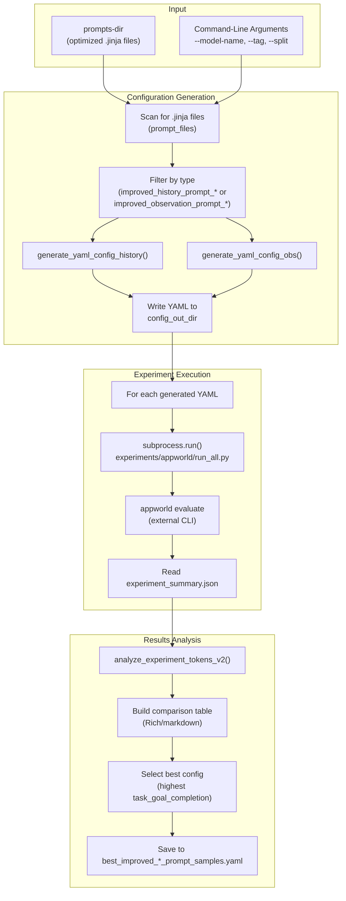
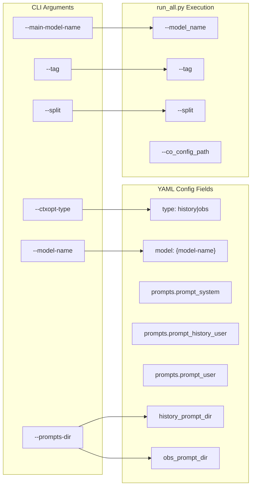
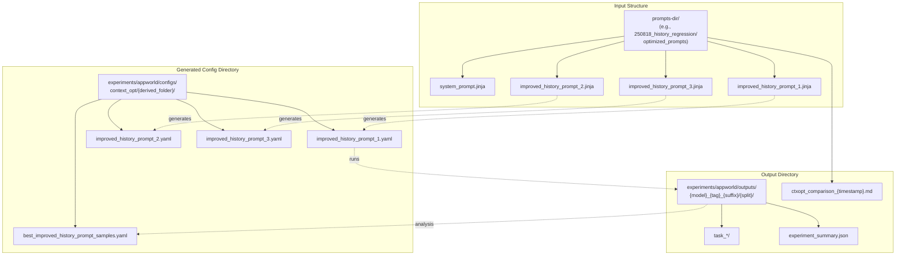
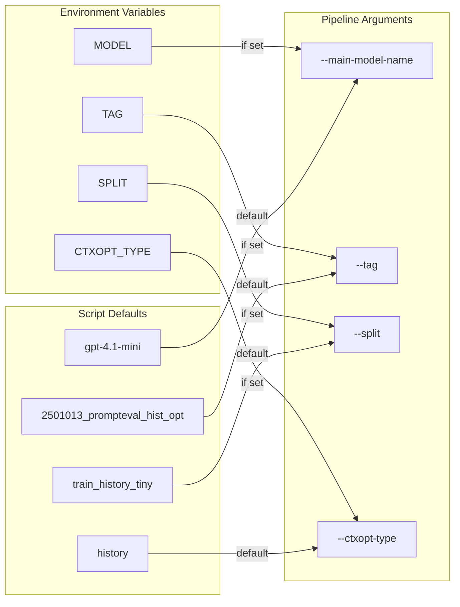
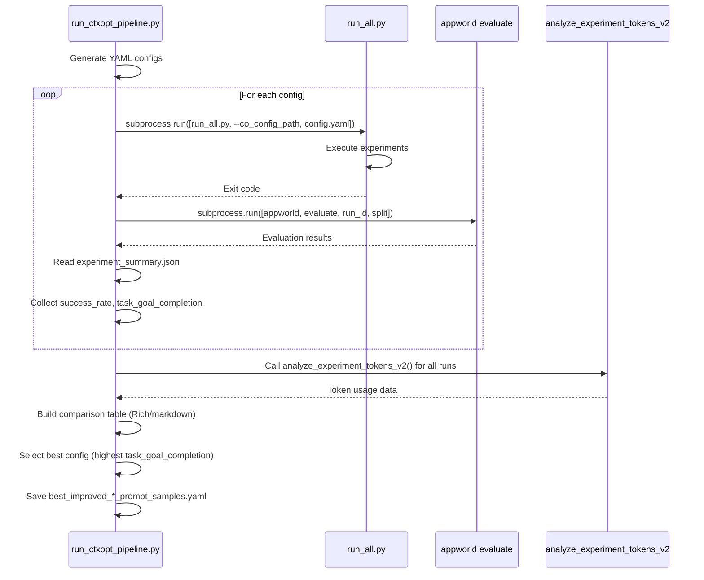
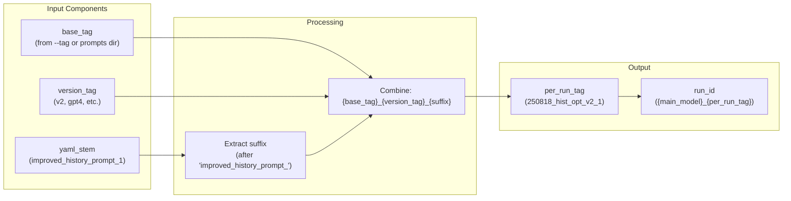

<!-- source: DeepWiki mcp.deepwiki.com · repo microsoft/acon · extra page Pipeline Configuration · fetched 2026-10-26 -->

# Pipeline Configuration

<details>
<summary>Relevant source files</summary>

The following files were used as context for generating this wiki page:

- [experiments/appworld/run_ctxopt_pipeline.py](experiments/appworld/run_ctxopt_pipeline.py)
- [experiments/appworld/scripts/run_ctxopt_history.sh](experiments/appworld/scripts/run_ctxopt_history.sh)

</details>


This page describes how to configure the context optimization pipeline that automatically generates and tests multiple prompt configurations. The pipeline reads optimized prompt templates from a directory, generates corresponding YAML configuration files, and launches batch experiments to evaluate each configuration.

For information about how the pipeline evaluates and selects the best prompts, see [Prompt Evaluation](#7.2.2). For details on the underlying configuration schema for context optimization, see [Context Optimization Configuration](#6.2).

---

## Purpose and Scope

The context optimization pipeline (`run_ctxopt_pipeline.py`) automates the process of testing multiple prompt variants by:

1. Reading `.jinja` prompt templates from a specified directory
2. Generating YAML configuration files for each template
3. Executing batch experiments using `run_all.py` with each configuration
4. Collecting and comparing results to identify the best-performing configuration

This page covers the configuration parameters, directory structure, and execution options for the pipeline. It does not cover the internal evaluation logic or prompt optimization algorithms.

---

## Pipeline Execution Flow

The following diagram illustrates how the pipeline processes prompt templates and generates experiments:



**Sources:** [experiments/appworld/run_ctxopt_pipeline.py:87-448]()

---

## Command-Line Arguments

The pipeline accepts the following command-line arguments to control its behavior:

| Argument | Type | Default | Description |
|----------|------|---------|-------------|
| `--ctxopt-type` | choice | `history` | Context optimization type: `history` or `obs` |
| `--prompts-dir` | string | **required** | Directory containing optimized `.jinja` prompt templates |
| `--model-name` | string | `gpt-4.1-mini` | Model name for YAML configs and optimizer model |
| `--main-model-name` | string | `gpt-4.1-mini` | Model name for the main agent in `run_all.py` |
| `--tag` | string | *auto-derived* | Experiment tag (defaults to prompts directory name) |
| `--split` | string | `train_history_tiny` | Dataset split to run experiments on |
| `--config-out-dir` | string | *auto-generated* | Output directory for generated YAML configs |
| `--dry-run` | flag | `False` | Generate configs only; skip execution |
| `--task-ids` | string | `None` | Comma-separated task IDs or file path for specific tasks |
| `--debug` | flag | `False` | Pass `--debug` to `run_all.py` to reduce workload |
| `--opt-version` | int | `1` | Optimizer version number for configs |

### Argument Details

The following diagram shows how command-line arguments map to configuration generation and execution:



**Sources:** [experiments/appworld/run_ctxopt_pipeline.py:88-100]()

---

## YAML Configuration Generation

The pipeline generates YAML configuration files by calling either `generate_yaml_config_history()` or `generate_yaml_config_obs()` depending on the `--ctxopt-type` parameter.

### History Configuration Structure

For history-based context optimization, the generated YAML structure is:

```yaml
type: "history"
model: "gpt-4.1-mini"
compressor_type: "full"
prompts:
  prompt_system: "system_prompt"
  prompt_history_user: "improved_history_prompt_1"
history_summarization_threshold: 4096
preserve_last_k_turns: 1
history_summary_rule: "reset"
history_prompt_dir: "/path/to/prompts"
history_version: 1
```

**Configuration Function:** [experiments/appworld/run_ctxopt_pipeline.py:51-67]()

### Observation Configuration Structure

For observation-based context optimization, the generated YAML structure is:

```yaml
type: "obs"
model: "gpt-4.1-mini"
compressor_type: "full"
prompts:
  prompt_system: "system_prompt"
  prompt_user: "improved_observation_prompt_1"
obs_summarization_threshold: 1024
obs_prompt_dir: "/path/to/prompts"
obs_version: 1
```

**Configuration Function:** [experiments/appworld/run_ctxopt_pipeline.py:70-84]()

### Template Name Mapping

The pipeline automatically handles cross-type template naming. For example, if `--ctxopt-type=obs` is specified but only `improved_history_prompt_*.jinja` files exist, it will:

1. Map `improved_history_prompt_1.jinja` → `improved_observation_prompt_1.jinja` for the YAML filename
2. Only update the template reference if the mapped file actually exists in the prompts directory
3. Fall back to the original template name if no mapping is found

**Sources:** [experiments/appworld/run_ctxopt_pipeline.py:148-163]()

---

## Directory Structure and Output Paths

The following diagram shows the directory structure created by the pipeline:



### Derived Folder Naming

The pipeline automatically derives the output configuration folder name using the pattern:

```
{YYMMDD}_{model_name}_{history|obs}_optimized_prompt[_{version_tag}]
```

Where:
- `YYMMDD` is the current date (e.g., `250818`)
- `model_name` is from `--model-name` (e.g., `gpt-4.1-mini`)
- `version_tag` is automatically extracted from the prompts directory name if it matches patterns like `v2`, `v3`, `gpt4`, `gpt5`

**Sources:** [experiments/appworld/run_ctxopt_pipeline.py:119-141]()

---

## Wrapper Script Configuration

The `run_ctxopt_history.sh` wrapper script provides a simplified interface for common pipeline invocations. It uses environment variables for default values:



### Usage Example

```bash
# Use defaults
./scripts/run_ctxopt_history.sh /path/to/prompts

# Override with environment variables
MODEL=gpt-4o TAG=custom_experiment ./scripts/run_ctxopt_history.sh /path/to/prompts

# Pass additional flags
./scripts/run_ctxopt_history.sh /path/to/prompts --dry-run --debug
```

**Sources:** [experiments/appworld/scripts/run_ctxopt_history.sh:1-44]()

---

## Execution Sequence

When the pipeline runs (without `--dry-run`), it follows this sequence for each generated YAML configuration:



**Sources:** [experiments/appworld/run_ctxopt_pipeline.py:232-273](), [experiments/appworld/run_ctxopt_pipeline.py:302-338]()

---

## Per-Run Tag Generation

The pipeline generates a unique tag for each experiment run by combining the base tag with the prompt template identifier:



This ensures that each configuration variant gets a unique output directory and can be tracked independently.

**Sources:** [experiments/appworld/run_ctxopt_pipeline.py:234-242](), [experiments/appworld/run_ctxopt_pipeline.py:211-214]()

---

## Task Selection Options

The pipeline supports three methods for selecting tasks to run:

| Method | Argument | Description |
|--------|----------|-------------|
| **Split-based** | `--split train_history_tiny` | Uses predefined split from data loader (default) |
| **File-based** | `--task-ids /path/to/ids.txt` | Reads task IDs from file (one per line) |
| **Direct** | `--task-ids id1,id2,id3` | Comma-separated list of task IDs |

When `--task-ids` is provided, it bypasses the split loader and runs only the specified tasks.

**Sources:** [experiments/appworld/run_ctxopt_pipeline.py:224-230](), [experiments/appworld/run_ctxopt_pipeline.py:256-258]()

---

## YAML Writer Fallback

The pipeline includes a fallback YAML writer for environments where the `yaml` package is unavailable. The fallback manually constructs YAML strings with proper escaping:

```python
def q(v: str) -> str:
    return '"' + str(v).replace('"', '\\"') + '"'

lines = []
lines.append(f"type: {q(cfg['type'])}")
lines.append(f"model: {q(cfg['model'])}")
# ... additional fields
```

This ensures the pipeline can run in minimal Python environments without external dependencies beyond the standard library.

**Sources:** [experiments/appworld/run_ctxopt_pipeline.py:171-194]()

---

## Environment Variable Configuration

The pipeline execution sets up the `PYTHONPATH` environment variable to ensure proper module resolution:

```python
repo_root = Path(__file__).resolve().parents[2]
env = os.environ.copy()
src_path = str(repo_root / "src")
env["PYTHONPATH"] = f"{src_path}:{env.get('PYTHONPATH','')}" if env.get("PYTHONPATH") else src_path
```

This allows `run_all.py` and analysis modules to import from the `src/` directory correctly.

**Sources:** [experiments/appworld/run_ctxopt_pipeline.py:217-220]()

---

## Results Collection and Reporting

After all experiments complete, the pipeline collects results into a comparison table with the following fields:

| Field | Source | Description |
|-------|--------|-------------|
| `cfg` | YAML filename | Configuration file name |
| `tag` | Per-run tag | Unique experiment identifier |
| `run_id` | `{model}_{tag}` | Full run identifier |
| `tasks` | `experiment_summary.json` | Number of tasks executed |
| `success_rate` | `experiment_summary.json` | Success rate percentage |
| `task_goal_completion` | `evaluations/{split}.json` | Task goal completion metric |
| `agent_in` | `analyze_experiment_tokens_v2()` | Agent input token count |
| `opt_in` | `analyze_experiment_tokens_v2()` | Optimizer input token count |
| `total_in` | Sum of agent_in + opt_in | Total input tokens |
| `avg_steps` | `llm_history.json` | Average steps per task |

The results are sorted by `task_goal_completion` (descending) with ties broken by `total_in` (ascending).

**Sources:** [experiments/appworld/run_ctxopt_pipeline.py:276-299](), [experiments/appworld/run_ctxopt_pipeline.py:309-338]()

---

## Best Configuration Selection

The pipeline automatically identifies and saves the best-performing configuration:

1. **Ranking Criteria**: Highest `task_goal_completion` metric
2. **Tie-Breaker**: Lowest `total_in` (total input tokens)
3. **Output**: Saved as `best_improved_history_prompt_samples.yaml` or `best_improved_observation_prompt_samples.yaml`
4. **Location**: Same directory as the generated YAML configs

This best configuration file can be directly used in subsequent experiments without manual selection.

**Sources:** [experiments/appworld/run_ctxopt_pipeline.py:399-444]()

---

