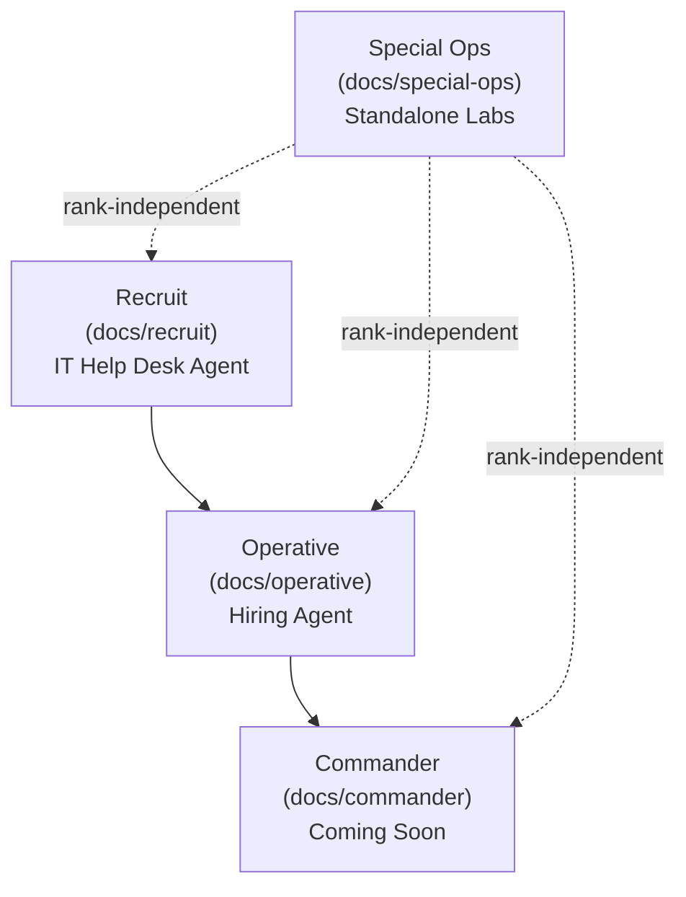
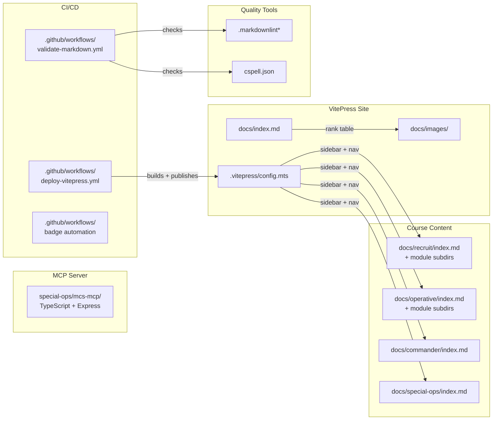

<!-- source: DeepWiki mcp.deepwiki.com · repo microsoft/agent-academy · page 1 Overview · fetched 2026-10-26 -->

# Overview

Relevant source files

The following files were used as context for generating this wiki page:

- [README.md](README.md)
- [docs/commander/index.md](docs/commander/index.md)
- [docs/images/mcs-agent-academy-commander-badge.png](docs/images/mcs-agent-academy-commander-badge.png)
- [docs/images/mcs-agent-academy-commander-banner.png](docs/images/mcs-agent-academy-commander-banner.png)
- [docs/images/mcs-agent-academy-operative-badge.png](docs/images/mcs-agent-academy-operative-badge.png)
- [docs/images/mcs-agent-academy-operative-banner.png](docs/images/mcs-agent-academy-operative-banner.png)
- [docs/images/mcs-agent-academy-recruit-badge.png](docs/images/mcs-agent-academy-recruit-badge.png)
- [docs/images/mcs-agent-academy-recruit-banner.png](docs/images/mcs-agent-academy-recruit-banner.png)
- [docs/index.md](docs/index.md)
- [docs/operative/index.md](docs/operative/index.md)
- [docs/our-team/index.md](docs/our-team/index.md)
- [docs/recruit/index.md](docs/recruit/index.md)

This page covers the purpose, structure, and major components of the **Copilot Studio Agent Academy** repository. For details on individual course tracks, see the [Course Tracks](#2) page. For the documentation site implementation, see [Documentation Site](#4).

---

## Purpose

The `microsoft/agent-academy` repository hosts a self-paced, hands-on training platform for building AI agents with **Microsoft Copilot Studio**. The curriculum is organized into three ranked course tracks of increasing difficulty, plus standalone lab missions called Special Ops. The public-facing course is served as a static documentation site at `https://aka.ms/agent-academy`.

---

## Repository Structure

The repository contains five major components:

| Component | Location | Purpose |
|---|---|---|
| Course content | `docs/recruit/`, `docs/operative/`, `docs/commander/` | Markdown source for all course modules |
| Special Ops labs | `docs/special-ops/` | Standalone mission content |
| Documentation site | `docs/`, `package.json`, `.vitepress/` | VitePress site configuration and build |
| MCP server source | `special-ops/mcs-mcp/` | TypeScript Express MCP server for the MCS MCP lab |
| CI/CD & tooling | `.github/workflows/`, `.markdownlint*`, `cspell.json` | Deployment, linting, spell checking |

Sources: [README.md:1-31](), [docs/index.md:1-84]()

---

## Rank Progression Model

The academy uses a three-rank progression model. Each rank requires completion of the previous rank (except Special Ops, which is rank-independent).

**Diagram: Rank Progression and Prerequisites**

Sources: [docs/index.md:13-28](), [docs/recruit/index.md:1-50](), [docs/operative/index.md:1-76](), [docs/commander/index.md:1-13]()

---

## Major Components

### Course Content

All course content is written in Markdown and lives under `docs/`. Each rank has an `index.md` landing page and numbered module subdirectories.

| Rank | Entry Point | Status |
|---|---|---|
| Recruit | `docs/recruit/index.md` | Active |
| Operative | `docs/operative/index.md` | Active |
| Commander | `docs/commander/index.md` | Preview / Coming Soon |
| Special Ops | `docs/special-ops/index.md` | Active |

The Recruit track builds an **IT Help Desk Agent** across 13 modules ([docs/recruit/index.md:48-65]()). The Operative track builds a **Hiring Agent** across 12 missions ([docs/operative/index.md:53-72]()). Commander is not yet publicly available ([docs/commander/index.md:5-7]()).

Sources: [docs/recruit/index.md:44-65](), [docs/operative/index.md:53-72]()

---

### Documentation Site

The course is published as a VitePress static site. The `docs/` directory contains all Markdown source files, and the site is deployed to GitHub Pages on push to `main`. For build and deployment details, see [Local Development and Deployment](#4.2).

The main landing page is `docs/index.md`, which renders the rank progression table, Special Ops links, and prerequisites.

Sources: [docs/index.md:1-84]()

---

### MCP Server Source

The Special Ops MCS MCP lab includes a runnable TypeScript MCP server. This is one of the few components in the repository that contains executable source code rather than documentation. It is covered in detail in [MCS MCP Lab](#3.1).

---

### Badge and Completion System

Upon completing a rank, learners can claim a digital badge. The badge system uses:

- **GitHub Issue templates** for submission
- **GitHub Actions** to post badge form links to completed issues
- An external **Badge Validation Form** and the **Global AI Community** platform for issuance

Badge images are stored in `docs/images/` (e.g., `mcs-agent-academy-recruit-badge.png`, `mcs-agent-academy-operative-badge.png`, `mcs-agent-academy-commander-badge.png`).

For the full badge workflow, see [Badge and Completion System](#5).

Sources: [docs/index.md:17-22]()

---

### CI/CD and Tooling

| Workflow | File | Trigger |
|---|---|---|
| Deploy documentation | `.github/workflows/deploy-vitepress.yml` | Push to `main` |
| Validate markdown | `.github/workflows/validate-markdown.yml` | Pull request |
| Badge automation | `.github/workflows/` (badge workflow) | Issue closed |

Markdown quality is enforced with `markdownlint-cli2` and spell checking with `cspell` (word list at `cspell.json`). For contributing guidelines, see [Contributing](#6).

Sources: [README.md:9-23]()

---

## Component Relationship Diagram

The following diagram maps the major repository components to their corresponding file locations.

**Diagram: Repository Components and File Layout**

Sources: [README.md:1-31](), [docs/index.md:1-84](), [docs/recruit/index.md:1-10](), [docs/operative/index.md:1-13](), [docs/commander/index.md:1-13]()

---

## Environment and Licensing Notes

The platform does not provide environments. Learners must supply their own Microsoft 365 / Power Platform tenant. Key access requirements stated in `docs/index.md`:

- Ability to **upload and import solutions** into a Power Platform environment
- Access to **Microsoft Dataverse**
- Access to the **Frontier program** (for the MCP module in Operative)
- **Administrative permissions** to create agents and configure settings

Free trial paths are documented within the course setup modules.

Sources: [docs/index.md:38-55]()

---

## Related Courses

The repository links to several external courses for learners wanting broader context:

| Resource | Topic |
|---|---|
| Copilot Developer Camp | Declarative agents, custom engine agents, M365 extensibility |
| MCP for Beginners | Model Context Protocol fundamentals |
| AI Agents for Beginners | Agent design patterns, multi-agent systems, agentic RAG |

Sources: [docs/index.md:57-64]()

---

