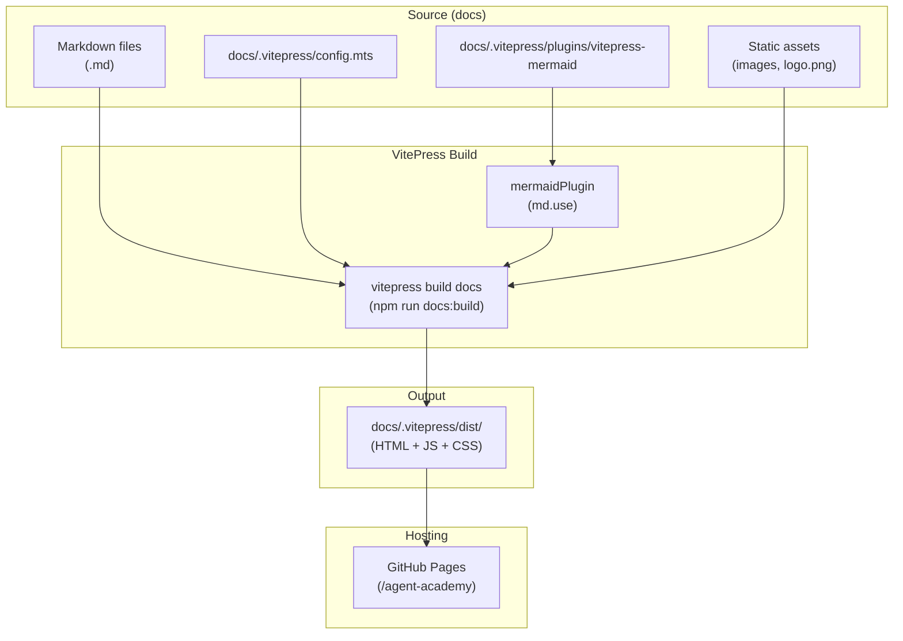
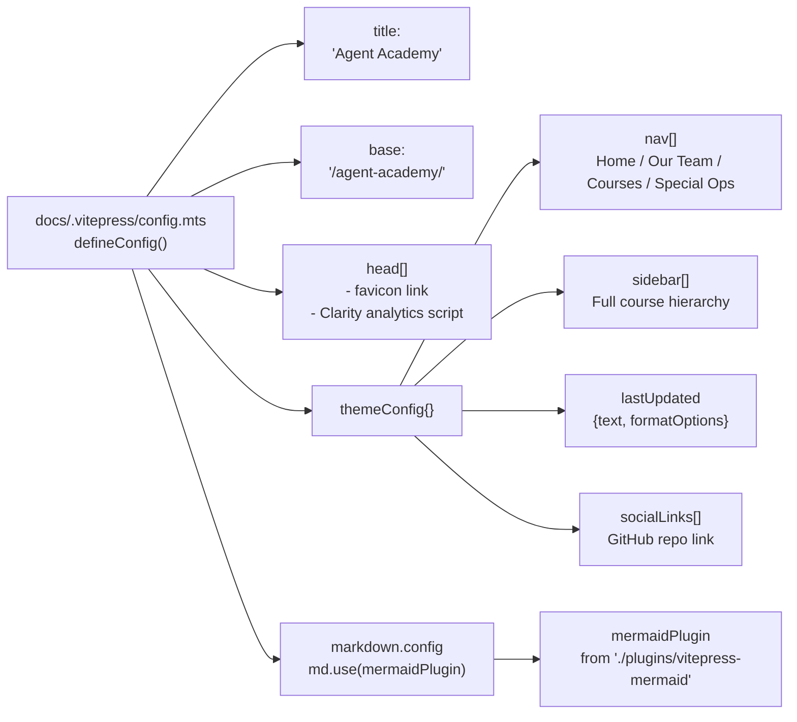
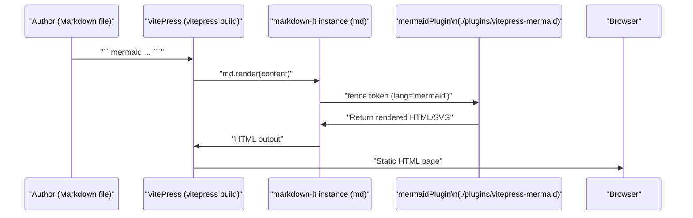
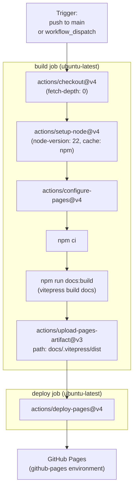

<!-- source: DeepWiki mcp.deepwiki.com · repo microsoft/agent-academy · page 4 Documentation Site · fetched 2026-10-26 -->

# Documentation Site

<details>
<summary>Relevant source files</summary>

The following files were used as context for generating this wiki page:

- [.github/workflows/deploy-vitepress.yml](.github/workflows/deploy-vitepress.yml)
- [.gitignore](.gitignore)
- [docs/.vitepress/config.mts](docs/.vitepress/config.mts)
- [docs/special-ops/index.md](docs/special-ops/index.md)
- [docs/special-ops/mcs-mcp/index.md](docs/special-ops/mcs-mcp/index.md)
- [docs/special-ops/pac-cli-mcp/assets/powerplatform-cli-mcp-added-vs-code.png](docs/special-ops/pac-cli-mcp/assets/powerplatform-cli-mcp-added-vs-code.png)
- [docs/special-ops/pac-cli-mcp/assets/restrict-developer-environments-to-admins-only.png](docs/special-ops/pac-cli-mcp/assets/restrict-developer-environments-to-admins-only.png)
- [docs/special-ops/pac-cli-mcp/assets/show-trial-env-creation-setting.png](docs/special-ops/pac-cli-mcp/assets/show-trial-env-creation-setting.png)
- [docs/special-ops/pac-cli-mcp/index.md](docs/special-ops/pac-cli-mcp/index.md)
- [docs/special-ops/pac-cli-mcp/power-platform-plan/index.md](docs/special-ops/pac-cli-mcp/power-platform-plan/index.md)
- [package-lock.json](package-lock.json)
- [package.json](package.json)

</details>


This page describes how the Agent Academy documentation website is structured, what technologies it uses, and how markdown source files are transformed into the published site. It covers the framework, plugin integration, npm dependency management, and the relationship between source and output.

For configuration details (nav bar, sidebar, base URL, analytics), see [Site Configuration and Navigation](#4.1). For running the site locally and the automated deployment workflow, see [Local Development and Deployment](#4.2).

---

## Overview

The documentation site is a static site built with [VitePress](https://vitepress.dev), a Vue-powered static site generator optimized for documentation. All course content, labs, and supporting pages are written as Markdown files under the `docs/` directory. VitePress compiles these into a set of HTML/JS/CSS assets that are served via GitHub Pages.

The key entry point for all site configuration is [docs/.vitepress/config.mts:1-194]().

---

## Technology Stack

| Component | Package | Version (from `package.json`) | Role |
|---|---|---|---|
| Static site generator | `vitepress` | `^2.0.0-alpha.12` | Compiles Markdown to HTML |
| Diagram rendering | `mermaid` | `^11.12.3` | Renders Mermaid diagrams in docs |
| Custom plugin | `vitepress-mermaid` | local (`./plugins/`) | Wires Mermaid into VitePress markdown pipeline |
| Runtime | Node.js | 22 (in CI) | Required by VitePress and npm |

`mermaid` appears in both `dependencies` and `devDependencies` in [package.json:1-17](). The `vitepress` package itself is only in `devDependencies`.

Sources: [package.json:1-17](), [package-lock.json:1-17]()

---

## Source Structure

**Diagram: Markdown Source to Published Site**



Sources: [docs/.vitepress/config.mts:1-194](), [package.json:9-13](), [.github/workflows/deploy-vitepress.yml:48-55](), [.gitignore:18-19]()

---

## npm Scripts

The three primary scripts are defined in [package.json:9-13]():

| Script | Command | Purpose |
|---|---|---|
| `docs:dev` | `vitepress dev docs` | Local dev server with hot reload |
| `docs:build` | `vitepress build docs` | Production build to `docs/.vitepress/dist` |
| `docs:preview` | `vitepress preview docs` | Preview the production build locally |

All three target the `docs/` directory as the VitePress source root.

---

## VitePress Configuration

The entire site configuration lives in `docs/.vitepress/config.mts` and is exported via VitePress's `defineConfig` function.

**Diagram: config.mts Structure**



Sources: [docs/.vitepress/config.mts:1-194]()

Key settings:

- **`base`**: Set to `/agent-academy/` so all asset paths resolve correctly under the GitHub Pages subdirectory. See [docs/.vitepress/config.mts:6]().
- **`head`**: Injects the Microsoft Clarity analytics tag (ID `u32wbf0qvv`) and a favicon `<link>` pointing to `/agent-academy/logo.png`. See [docs/.vitepress/config.mts:7-14]().
- **`lastUpdated`**: Configured with `dateStyle: 'long'` to display the last git commit date on each page. See [docs/.vitepress/config.mts:39-44]().
- **`socialLinks`**: Renders a GitHub icon linking to the repository in the site header. See [docs/.vitepress/config.mts:182-187]().

For the full nav and sidebar layout, see [Site Configuration and Navigation](#4.1).

---

## Mermaid Plugin Integration

VitePress does not natively render Mermaid diagrams in Markdown. A custom plugin bridges them.

The plugin is imported and registered in [docs/.vitepress/config.mts:2]() and [docs/.vitepress/config.mts:189-193]():

```
import { mermaidPlugin } from "./plugins/vitepress-mermaid";

markdown: {
  config: (md) => {
    md.use(mermaidPlugin);
  },
},
```

The `mermaidPlugin` function extends the `markdown-it` instance (`md`) that VitePress uses internally. Any fenced code block marked with ` ```mermaid ` in a Markdown file is processed by this plugin at build time.

**Diagram: Mermaid Rendering Pipeline**



Sources: [docs/.vitepress/config.mts:2](), [docs/.vitepress/config.mts:189-193](), [package.json:4-8]()

---

## Deployment Pipeline

The deployment is fully automated via a GitHub Actions workflow at [.github/workflows/deploy-vitepress.yml:1-67]().

**Diagram: deploy-vitepress.yml Workflow**



Sources: [.github/workflows/deploy-vitepress.yml:1-67]()

Key workflow details:

| Setting | Value |
|---|---|
| Trigger branch | `main` |
| Runner | `ubuntu-latest` |
| Node version | `22` |
| Install command | `npm ci` |
| Build command | `npm run docs:build` |
| Artifact path | `docs/.vitepress/dist` |
| Deploy target | `github-pages` environment |
| Owner restriction | `github.repository_owner == 'microsoft'` |

The `fetch-depth: 0` option on checkout ensures full git history is available, which VitePress uses to populate the `lastUpdated` timestamps on each page. See [.github/workflows/deploy-vitepress.yml:34-36]().

The `cancel-in-progress: false` concurrency setting means in-progress deployments are never cancelled—only queued runs are skipped. See [.github/workflows/deploy-vitepress.yml:22-25]().

For instructions on running the site locally and triggering builds manually, see [Local Development and Deployment](#4.2).

---

## Build Output and Ignored Files

The VitePress build produces output in two directories, both excluded from version control in [.gitignore:18-19]():

| Path | Contents |
|---|---|
| `docs/.vitepress/dist` | Final HTML/JS/CSS assets, uploaded to GitHub Pages |
| `docs/.vitepress/cache` | Intermediate build cache, not deployed |

---

