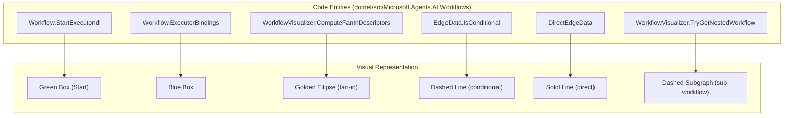
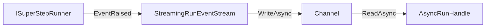
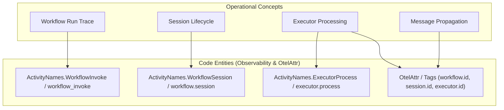

<!-- source: DeepWiki mcp.deepwiki.com · repo microsoft/agent-framework · page 4.7 Workflow Visualization and Debugging · fetched 2026-10-26 -->

# Workflow Visualization and Debugging

Relevant source files

The following files were used as context for generating this wiki page:

- [docs/decisions/0039-python-refusal-content.md](docs/decisions/0039-python-refusal-content.md)
- [dotnet/src/Microsoft.Agents.AI.Workflows/AgentResponseEvent.cs](dotnet/src/Microsoft.Agents.AI.Workflows/AgentResponseEvent.cs)
- [dotnet/src/Microsoft.Agents.AI.Workflows/AgentResponseUpdateEvent.cs](dotnet/src/Microsoft.Agents.AI.Workflows/AgentResponseUpdateEvent.cs)
- [dotnet/src/Microsoft.Agents.AI.Workflows/Execution/AsyncRunHandle.cs](dotnet/src/Microsoft.Agents.AI.Workflows/Execution/AsyncRunHandle.cs)
- [dotnet/src/Microsoft.Agents.AI.Workflows/Execution/ISuperStepRunner.cs](dotnet/src/Microsoft.Agents.AI.Workflows/Execution/ISuperStepRunner.cs)
- [dotnet/src/Microsoft.Agents.AI.Workflows/Execution/LockstepRunEventStream.cs](dotnet/src/Microsoft.Agents.AI.Workflows/Execution/LockstepRunEventStream.cs)
- [dotnet/src/Microsoft.Agents.AI.Workflows/Execution/NonThrowingChannelReaderAsyncEnumerable.cs](dotnet/src/Microsoft.Agents.AI.Workflows/Execution/NonThrowingChannelReaderAsyncEnumerable.cs)
- [dotnet/src/Microsoft.Agents.AI.Workflows/Execution/StreamingRunEventStream.cs](dotnet/src/Microsoft.Agents.AI.Workflows/Execution/StreamingRunEventStream.cs)
- [dotnet/src/Microsoft.Agents.AI.Workflows/IWorkflowExecutionEnvironment.cs](dotnet/src/Microsoft.Agents.AI.Workflows/IWorkflowExecutionEnvironment.cs)
- [dotnet/src/Microsoft.Agents.AI.Workflows/InProc/InProcessExecutionEnvironment.cs](dotnet/src/Microsoft.Agents.AI.Workflows/InProc/InProcessExecutionEnvironment.cs)
- [dotnet/src/Microsoft.Agents.AI.Workflows/InProcessExecution.cs](dotnet/src/Microsoft.Agents.AI.Workflows/InProcessExecution.cs)
- [dotnet/src/Microsoft.Agents.AI.Workflows/Run.cs](dotnet/src/Microsoft.Agents.AI.Workflows/Run.cs)
- [dotnet/src/Microsoft.Agents.AI.Workflows/Specialized/WorkflowHostExecutor.cs](dotnet/src/Microsoft.Agents.AI.Workflows/Specialized/WorkflowHostExecutor.cs)
- [dotnet/src/Microsoft.Agents.AI.Workflows/StreamingRun.cs](dotnet/src/Microsoft.Agents.AI.Workflows/StreamingRun.cs)
- [dotnet/src/Microsoft.Agents.AI.Workflows/WorkflowOutputEvent.cs](dotnet/src/Microsoft.Agents.AI.Workflows/WorkflowOutputEvent.cs)
- [dotnet/tests/Microsoft.Agents.AI.Workflows.UnitTests/AgentEventsTests.cs](dotnet/tests/Microsoft.Agents.AI.Workflows.UnitTests/AgentEventsTests.cs)
- [dotnet/tests/Microsoft.Agents.AI.Workflows.UnitTests/InProcessExecutionTests.cs](dotnet/tests/Microsoft.Agents.AI.Workflows.UnitTests/InProcessExecutionTests.cs)
- [dotnet/tests/Microsoft.Agents.AI.Workflows.UnitTests/RoleCheckAgent.cs](dotnet/tests/Microsoft.Agents.AI.Workflows.UnitTests/RoleCheckAgent.cs)
- [dotnet/tests/Microsoft.Agents.AI.Workflows.UnitTests/Sample/04_Simple_Workflow_ExternalRequest.cs](dotnet/tests/Microsoft.Agents.AI.Workflows.UnitTests/Sample/04_Simple_Workflow_ExternalRequest.cs)
- [dotnet/tests/Microsoft.Agents.AI.Workflows.UnitTests/Sample/05_Simple_Workflow_Checkpointing.cs](dotnet/tests/Microsoft.Agents.AI.Workflows.UnitTests/Sample/05_Simple_Workflow_Checkpointing.cs)
- [dotnet/tests/Microsoft.Agents.AI.Workflows.UnitTests/Sample/13_Subworkflow_Checkpointing.cs](dotnet/tests/Microsoft.Agents.AI.Workflows.UnitTests/Sample/13_Subworkflow_Checkpointing.cs)
- [dotnet/tests/Microsoft.Agents.AI.Workflows.UnitTests/TestReplayAgent.cs](dotnet/tests/Microsoft.Agents.AI.Workflows.UnitTests/TestReplayAgent.cs)
- [dotnet/tests/Microsoft.Agents.AI.Workflows.UnitTests/TestRequestAgent.cs](dotnet/tests/Microsoft.Agents.AI.Workflows.UnitTests/TestRequestAgent.cs)
- [dotnet/tests/Microsoft.Agents.AI.Workflows.UnitTests/TestWorkflowContext.cs](dotnet/tests/Microsoft.Agents.AI.Workflows.UnitTests/TestWorkflowContext.cs)
- [python/packages/devui/AGENTS.md](python/packages/devui/AGENTS.md)
- [python/packages/devui/README.md](python/packages/devui/README.md)
- [python/packages/devui/agent_framework_devui/__init__.py](python/packages/devui/agent_framework_devui/__init__.py)
- [python/packages/devui/agent_framework_devui/_cli.py](python/packages/devui/agent_framework_devui/_cli.py)
- [python/packages/devui/agent_framework_devui/_conversations.py](python/packages/devui/agent_framework_devui/_conversations.py)
- [python/packages/devui/agent_framework_devui/_discovery.py](python/packages/devui/agent_framework_devui/_discovery.py)
- [python/packages/devui/agent_framework_devui/_executor.py](python/packages/devui/agent_framework_devui/_executor.py)
- [python/packages/devui/agent_framework_devui/_mapper.py](python/packages/devui/agent_framework_devui/_mapper.py)
- [python/packages/devui/agent_framework_devui/_server.py](python/packages/devui/agent_framework_devui/_server.py)
- [python/packages/devui/agent_framework_devui/_utils.py](python/packages/devui/agent_framework_devui/_utils.py)
- [python/packages/devui/agent_framework_devui/models/_openai_custom.py](python/packages/devui/agent_framework_devui/models/_openai_custom.py)
- [python/packages/devui/agent_framework_devui/ui/assets/index.css](python/packages/devui/agent_framework_devui/ui/assets/index.css)
- [python/packages/devui/agent_framework_devui/ui/assets/index.js](python/packages/devui/agent_framework_devui/ui/assets/index.js)
- [python/packages/devui/dev.md](python/packages/devui/dev.md)
- [python/packages/devui/frontend/src/App.tsx](python/packages/devui/frontend/src/App.tsx)
- [python/packages/devui/frontend/src/components/features/agent/agent-view.tsx](python/packages/devui/frontend/src/components/features/agent/agent-view.tsx)
- [python/packages/devui/frontend/src/components/features/agent/message-renderers/OpenAIContentRenderer.tsx](python/packages/devui/frontend/src/components/features/agent/message-renderers/OpenAIContentRenderer.tsx)
- [python/packages/devui/frontend/src/components/features/workflow/execution-timeline.tsx](python/packages/devui/frontend/src/components/features/workflow/execution-timeline.tsx)
- [python/packages/devui/frontend/src/components/features/workflow/index.ts](python/packages/devui/frontend/src/components/features/workflow/index.ts)
- [python/packages/devui/frontend/src/components/features/workflow/schema-form-renderer.tsx](python/packages/devui/frontend/src/components/features/workflow/schema-form-renderer.tsx)
- [python/packages/devui/frontend/src/components/features/workflow/workflow-input-form.tsx](python/packages/devui/frontend/src/components/features/workflow/workflow-input-form.tsx)
- [python/packages/devui/frontend/src/components/features/workflow/workflow-view.tsx](python/packages/devui/frontend/src/components/features/workflow/workflow-view.tsx)
- [python/packages/devui/frontend/src/components/layout/debug-panel.tsx](python/packages/devui/frontend/src/components/layout/debug-panel.tsx)
- [python/packages/devui/frontend/src/components/layout/settings-modal.tsx](python/packages/devui/frontend/src/components/layout/settings-modal.tsx)
- [python/packages/devui/frontend/src/services/api.ts](python/packages/devui/frontend/src/services/api.ts)
- [python/packages/devui/frontend/src/services/streaming-state.ts](python/packages/devui/frontend/src/services/streaming-state.ts)
- [python/packages/devui/frontend/src/stores/devuiStore.ts](python/packages/devui/frontend/src/stores/devuiStore.ts)
- [python/packages/devui/frontend/src/types/index.ts](python/packages/devui/frontend/src/types/index.ts)
- [python/packages/devui/frontend/src/types/openai.ts](python/packages/devui/frontend/src/types/openai.ts)
- [python/packages/devui/frontend/src/utils/workflow-utils.ts](python/packages/devui/frontend/src/utils/workflow-utils.ts)
- [python/packages/devui/tests/devui/test_approval_validation.py](python/packages/devui/tests/devui/test_approval_validation.py)
- [python/packages/devui/tests/devui/test_conversations.py](python/packages/devui/tests/devui/test_conversations.py)
- [python/packages/devui/tests/devui/test_mapper.py](python/packages/devui/tests/devui/test_mapper.py)
- [python/packages/devui/tests/devui/test_multimodal_workflow.py](python/packages/devui/tests/devui/test_multimodal_workflow.py)
- [python/packages/devui/tests/devui/test_schema_generation.py](python/packages/devui/tests/devui/test_schema_generation.py)
- [python/packages/devui/tests/devui/test_server.py](python/packages/devui/tests/devui/test_server.py)
- [python/packages/devui/tests/devui/test_ui_memory_regression.py](python/packages/devui/tests/devui/test_ui_memory_regression.py)

This page documents the event system, visualization utilities, telemetry integration, and debugging capabilities for workflow execution in the Microsoft Agent Framework. It covers `WorkflowEvent` types, the workflow status timeline, debugging techniques, UI integration via DevUI, and tools for inspecting execution graphs across both .NET and Python implementations.

---

## 1. Overview

Workflows emit a continuous stream of events during execution that capture both data flow (executor invocations, intermediate emissions, final outputs, human-in-the-loop requests) and control system flow (status changes, superstep iterations, and execution errors). The framework architecture separates these concerns into distinct tracking channels:

- **Data-plane events**: Executor outputs, request/response coordination, custom telemetry data, and agent payloads.
- **Control-plane events**: Status transitions (`STARTED`, `IN_PROGRESS`, `IDLE`, `FAILED`, etc.) and superstep lifecycle markers.

This architectural separation facilitates debugging complex agentic workflows by allowing developers to inspect execution history and state changes independently from primary message payloads.

Sources: [python/packages/core/agent_framework/_workflows/_events.py:127-153](), [dotnet/src/Microsoft.Agents.AI.Workflows/Execution/StreamingRunEventStream.cs:95-126]()

---

## 2. Workflow Visualization

The framework includes built-in utility classes to export workflow graph topologies into standard diagram formats. This capability is essential for verifying multi-agent routing logic, custom conditional edges, and fan-in/fan-out barriers prior to runtime deployment.

### Visualization Formats
In the .NET implementation, the `WorkflowVisualizer` static class supports two primary export targets:
- **Graphviz DOT Format**: Exported via `ToDotString(this Workflow workflow)`, supporting hierarchical top-to-bottom layout (`rankdir=TD`), distinct styling for start nodes (`fillcolor=lightgreen`), and nested subgraph clustering for sub-workflows hosted via `WorkflowExecutor`. [dotnet/src/Microsoft.Agents.AI.Workflows/Visualization/WorkflowVisualizer.cs:22-43](), [dotnet/src/Microsoft.Agents.AI.Workflows/Visualization/WorkflowVisualizer.cs:129-152]()
- **Mermaid.js Format**: Exported via `ToMermaidString(this Workflow workflow)`, generating syntax safe for Markdown documentation and GitHub wikis using `SanitizeMermaidNodeId` to scrub special characters. [dotnet/src/Microsoft.Agents.AI.Workflows/Visualization/WorkflowVisualizer.cs:53-59](), [dotnet/src/Microsoft.Agents.AI.Workflows/Visualization/WorkflowVisualizer.cs:162-190]()

### Mapping Code Entities to Visuals
The visualizer bridges abstract workflow structures directly to underlying codebase entities, ensuring visual representation matches code configuration.

Title: Natural Language Space to Code Entity Space: Visualization Mapping

Sources: [dotnet/src/Microsoft.Agents.AI.Workflows/Visualization/WorkflowVisualizer.cs:63-152](), [dotnet/src/Microsoft.Agents.AI.Workflows/WorkflowBuilder.cs:38-38](), [dotnet/src/Microsoft.Agents.AI.Workflows/WorkflowBuilder.cs:31-31](), [dotnet/tests/Microsoft.Agents.AI.Workflows.UnitTests/WorkflowVisualizerTests.cs:81-103]()

### Fan-In and Barrier Visualization
When multiple concurrent execution branches converge via a barrier, the visualizer inserts a synthetic `fan-in` node (`shape=ellipse`). This reflects the runtime state managed by `FanInEdgeState`, which tracks `SourceIds`, an `Unseen` set of pending branches, and buffered `PendingMessages` until the synchronization barrier is fully satisfied.

Sources: [dotnet/src/Microsoft.Agents.AI.Workflows/Visualization/WorkflowVisualizer.cs:80-99](), [dotnet/src/Microsoft.Agents.AI.Workflows/Execution/FanInEdgeState.cs:10-25](), [dotnet/tests/Microsoft.Agents.AI.Workflows.UnitTests/WorkflowVisualizerTests.cs:106-145]()

---

## 3. Workflow Event Types and Status Timeline

During workflow execution, the Python and .NET engines emit structured events governed by the `WorkflowEventType` and `WorkflowRunState` definitions.

### Workflow Event Types (`WorkflowEventType`)
Events are classified by their origin (`WorkflowEventSource.FRAMEWORK` or `WorkflowEventSource.EXECUTOR`) and type:
- **Lifecycle Events**: `"started"` (run began), `"status"` (state updated), `"failed"` (terminated with error).
- **Data Events**: `"output"` (terminal executor result), `"intermediate"` (non-terminal emission).
- **Request Events**: `"request_info"` (human-in-the-loop interruption).
- **Diagnostics**: `"warning"`, `"error"`.
- **Iteration Events**: `"superstep_started"`, `"superstep_completed"`.
- **Executor Lifecycle**: `"executor_invoked"`, `"executor_completed"`, `"executor_failed"`, `"executor_bypassed"`.
- **Orchestration Types**: `"group_chat"`, `"handoff_sent"`, `"magentic_orchestrator"`.

Sources: [python/packages/core/agent_framework/_workflows/_events.py:26-36](), [python/packages/core/agent_framework/_workflows/_events.py:127-153]()

### Execution Status Transitions
The runner maintains strict workflow run states to control execution flow, handle loop supersteps, and pause during human-in-the-loop interactions.

| State Enum | Description |
|------------|-------------|
| `STARTED` | Initial execution trigger before supersteps begin. |
| `IN_PROGRESS` | Actively processing supersteps across executor nodes. |
| `IN_PROGRESS_PENDING_REQUESTS` | Execution paused awaiting external human input. |
| `IDLE` | Execution halted normally; no further work queued. |
| `IDLE_WITH_PENDING_REQUESTS` | Workflow is idle while awaiting external responses. |
| `FAILED` | Execution terminated due to an unhandled exception. |
| `CANCELLED` | Execution was explicitly cancelled by the host application. |

Sources: [python/packages/core/agent_framework/_workflows/_events.py:81-91](), [dotnet/src/Microsoft.Agents.AI.Workflows/Execution/StreamingRunEventStream.cs:104-119]()

---

## 4. Workflow Execution Streaming

The framework provides real-time event streaming mechanisms via `StreamingRunEventStream` and `LockstepRunEventStream` in .NET, and async generator streams in Python.

### .NET Streaming Implementation
The `.NET` streaming infrastructure uses `System.Threading.Channels` to safely decouple the workflow execution engine from event consumers. An unbounded channel with `SingleReader = true` guarantees thread-safe message ordering and non-blocking event production during superstep execution [dotnet/src/Microsoft.Agents.AI.Workflows/Execution/StreamingRunEventStream.cs:18-45]().

Title: .NET Streaming Architecture

Sources: [dotnet/src/Microsoft.Agents.AI.Workflows/Execution/StreamingRunEventStream.cs:18-45](), [dotnet/src/Microsoft.Agents.AI.Workflows/Execution/StreamingRunEventStream.cs:56-140]()

---

## 5. Telemetry Integration

Workflow execution integrates with OpenTelemetry (OTEL) to provide complete tracing visibility into session management, superstep boundaries, and message routing.

### Activity Names and Events
The framework defines explicit activity span identifiers and metric event names for diagnostics.

| Name | Kind | Description |
|------|------|-------------|
| `workflow.build` | Activity | Captures workflow construction and validation overhead. |
| `workflow.session` | Activity | Spans the entire lifetime of a long-lived workflow session. |
| `workflow_invoke` | Activity | Tracks a single execution invocation run. |
| `executor.process` | Activity | Tracks individual executor message handling. |
| `message.send` | Activity | Tracks direct and switch-routed message propagation. |
| `SessionStarted` | Event | Emitted when a persistent session initializes. |
| `WorkflowStarted` | Event | Emitted when execution begins. |
| `WorkflowCompleted` | Event | Emitted upon successful termination. |

Sources: [dotnet/src/Microsoft.Agents.AI.Workflows/Observability/ActivityNames.cs:5-13](), [dotnet/src/Microsoft.Agents.AI.Workflows/Observability/EventNames.cs:5-9]()

### Mapping Natural Language Telemetry to Code Entities
The telemetry mapping correlates high-level operational metrics with specific OpenTelemetry attribute definitions and internal tracing classes.

Title: Natural Language Space to Code Entity Space: Telemetry Mapping

Sources: [dotnet/src/Microsoft.Agents.AI.Workflows/Observability/ActivityNames.cs:5-13](), [dotnet/src/Microsoft.Agents.AI.Workflows/Observability/Tags.cs:5-27](), [python/packages/core/tests/workflow/test_workflow_observability.py:15-19]()

---

## 6. Debugging Techniques

### Event Inspection and Trace Analysis
Developers can programmatically inspect `WorkflowEvent` streams to diagnose failures. Specifically, filtering events for `type="executor_failed"` exposes structured `WorkflowErrorDetails` containing exact exception types, messages, and stack traces raised by user-provided executor code. In DevUI, execution states and traces are captured via `AgentFrameworkExecutor` instrumentation and mapped to OpenAI-compatible streaming structures [python/packages/devui/agent_framework_devui/_executor.py:63-120](), [python/packages/devui/agent_framework_devui/_mapper.py:175-184]().

Sources: [python/packages/core/agent_framework/_workflows/_events.py:94-123](), [python/packages/core/tests/workflow/test_workflow_states.py:41-47](), [python/packages/devui/agent_framework_devui/_executor.py:63-120]()

### Human-in-the-Loop Interruption Debugging
When workflows invoke `request_info`, the engine raises an internal `WorkflowInterrupted` exception and emits a `request_info` event. Debugging this state involves examining the active `RunContext` and payload structures to verify response routing and resume tokens.

Sources: [python/packages/core/agent_framework/_workflows/_functional.py:95-108](), [python/packages/core/tests/workflow/test_workflow_states.py:137-150]()

### Edge Router Diagnostics
Edge evaluation logic tracks message delivery outcomes via dedicated edge processing spans. These trace whether messages successfully traverse routes, encounter conditional mismatches (`DROPPED_TARGET_MISMATCH`), or successfully deliver payloads to downstream executors.

Sources: [python/packages/core/tests/workflow/test_workflow_observability.py:118-141](), [dotnet/tests/Microsoft.Agents.AI.Workflows.UnitTests/EdgeRunnerTests.cs:40-57]()

---

