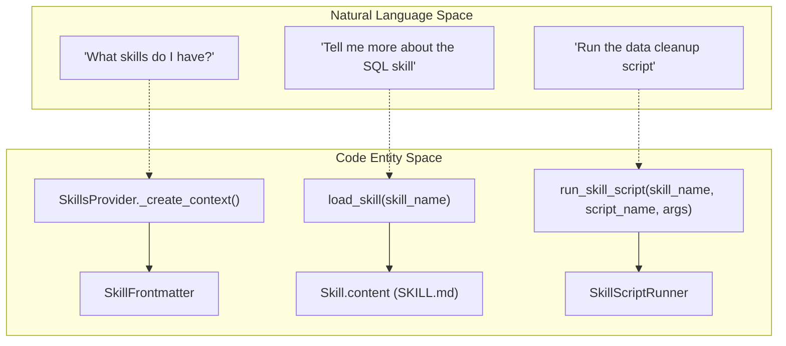
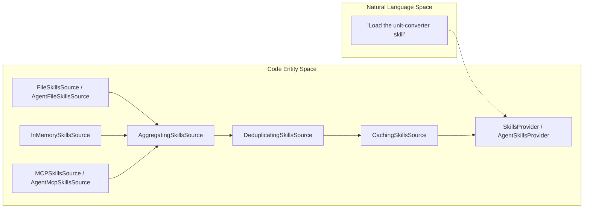

<!-- source: DeepWiki mcp.deepwiki.com · repo microsoft/agent-framework · page 7.5 Agent Skills System · fetched 2026-10-26 -->

# Agent Skills System

Relevant source files

The following files were used as context for generating this wiki page:

- [dotnet/samples/02-agents/AgentSkills/Agent_Step01_FileBasedSkills/Agent_Step01_FileBasedSkills.csproj](dotnet/samples/02-agents/AgentSkills/Agent_Step01_FileBasedSkills/Agent_Step01_FileBasedSkills.csproj)
- [dotnet/samples/02-agents/AgentSkills/Agent_Step02_CodeDefinedSkills/Agent_Step02_CodeDefinedSkills.csproj](dotnet/samples/02-agents/AgentSkills/Agent_Step02_CodeDefinedSkills/Agent_Step02_CodeDefinedSkills.csproj)
- [dotnet/samples/02-agents/AgentSkills/Agent_Step02_CodeDefinedSkills/Program.cs](dotnet/samples/02-agents/AgentSkills/Agent_Step02_CodeDefinedSkills/Program.cs)
- [dotnet/samples/02-agents/AgentSkills/Agent_Step02_CodeDefinedSkills/README.md](dotnet/samples/02-agents/AgentSkills/Agent_Step02_CodeDefinedSkills/README.md)
- [dotnet/samples/02-agents/AgentSkills/SubprocessScriptRunner.cs](dotnet/samples/02-agents/AgentSkills/SubprocessScriptRunner.cs)
- [dotnet/src/Microsoft.Agents.AI.Mcp/Skills/AgentMcpSkill.cs](dotnet/src/Microsoft.Agents.AI.Mcp/Skills/AgentMcpSkill.cs)
- [dotnet/src/Microsoft.Agents.AI.Mcp/Skills/AgentMcpSkillsSource.cs](dotnet/src/Microsoft.Agents.AI.Mcp/Skills/AgentMcpSkillsSource.cs)
- [dotnet/src/Microsoft.Agents.AI.Mcp/Skills/Loaders/AgentMcpSkillArchiveExtractor.cs](dotnet/src/Microsoft.Agents.AI.Mcp/Skills/Loaders/AgentMcpSkillArchiveExtractor.cs)
- [dotnet/src/Microsoft.Agents.AI.Mcp/Skills/Loaders/ArchiveEntryLoader.cs](dotnet/src/Microsoft.Agents.AI.Mcp/Skills/Loaders/ArchiveEntryLoader.cs)
- [dotnet/src/Microsoft.Agents.AI.Mcp/Skills/Loaders/ArchiveFormat.cs](dotnet/src/Microsoft.Agents.AI.Mcp/Skills/Loaders/ArchiveFormat.cs)
- [dotnet/src/Microsoft.Agents.AI.Mcp/Skills/Loaders/IMcpSkillEntryLoader.cs](dotnet/src/Microsoft.Agents.AI.Mcp/Skills/Loaders/IMcpSkillEntryLoader.cs)
- [dotnet/src/Microsoft.Agents.AI.Mcp/Skills/Loaders/SkillMdEntryLoader.cs](dotnet/src/Microsoft.Agents.AI.Mcp/Skills/Loaders/SkillMdEntryLoader.cs)
- [dotnet/src/Microsoft.Agents.AI/CompatibilitySuppressions.xml](dotnet/src/Microsoft.Agents.AI/CompatibilitySuppressions.xml)
- [dotnet/src/Microsoft.Agents.AI/Skills/AgentInMemorySkillsSource.cs](dotnet/src/Microsoft.Agents.AI/Skills/AgentInMemorySkillsSource.cs)
- [dotnet/src/Microsoft.Agents.AI/Skills/AgentSkill.cs](dotnet/src/Microsoft.Agents.AI/Skills/AgentSkill.cs)
- [dotnet/src/Microsoft.Agents.AI/Skills/AgentSkillFrontmatter.cs](dotnet/src/Microsoft.Agents.AI/Skills/AgentSkillFrontmatter.cs)
- [dotnet/src/Microsoft.Agents.AI/Skills/AgentSkillResource.cs](dotnet/src/Microsoft.Agents.AI/Skills/AgentSkillResource.cs)
- [dotnet/src/Microsoft.Agents.AI/Skills/AgentSkillScript.cs](dotnet/src/Microsoft.Agents.AI/Skills/AgentSkillScript.cs)
- [dotnet/src/Microsoft.Agents.AI/Skills/AgentSkillsProvider.cs](dotnet/src/Microsoft.Agents.AI/Skills/AgentSkillsProvider.cs)
- [dotnet/src/Microsoft.Agents.AI/Skills/AgentSkillsProviderBuilder.cs](dotnet/src/Microsoft.Agents.AI/Skills/AgentSkillsProviderBuilder.cs)
- [dotnet/src/Microsoft.Agents.AI/Skills/AgentSkillsProviderOptions.cs](dotnet/src/Microsoft.Agents.AI/Skills/AgentSkillsProviderOptions.cs)
- [dotnet/src/Microsoft.Agents.AI/Skills/AgentSkillsSource.cs](dotnet/src/Microsoft.Agents.AI/Skills/AgentSkillsSource.cs)
- [dotnet/src/Microsoft.Agents.AI/Skills/AggregatingAgentSkillsSource.cs](dotnet/src/Microsoft.Agents.AI/Skills/AggregatingAgentSkillsSource.cs)
- [dotnet/src/Microsoft.Agents.AI/Skills/Decorators/CachingAgentSkillsSource.cs](dotnet/src/Microsoft.Agents.AI/Skills/Decorators/CachingAgentSkillsSource.cs)
- [dotnet/src/Microsoft.Agents.AI/Skills/Decorators/CachingAgentSkillsSourceOptions.cs](dotnet/src/Microsoft.Agents.AI/Skills/Decorators/CachingAgentSkillsSourceOptions.cs)
- [dotnet/src/Microsoft.Agents.AI/Skills/Decorators/DeduplicatingAgentSkillsSource.cs](dotnet/src/Microsoft.Agents.AI/Skills/Decorators/DeduplicatingAgentSkillsSource.cs)
- [dotnet/src/Microsoft.Agents.AI/Skills/Decorators/DelegatingAgentSkillsSource.cs](dotnet/src/Microsoft.Agents.AI/Skills/Decorators/DelegatingAgentSkillsSource.cs)
- [dotnet/src/Microsoft.Agents.AI/Skills/Decorators/FilteringAgentSkillsSource.cs](dotnet/src/Microsoft.Agents.AI/Skills/Decorators/FilteringAgentSkillsSource.cs)
- [dotnet/src/Microsoft.Agents.AI/Skills/File/AgentFileSkill.cs](dotnet/src/Microsoft.Agents.AI/Skills/File/AgentFileSkill.cs)
- [dotnet/src/Microsoft.Agents.AI/Skills/File/AgentFileSkillFilterContext.cs](dotnet/src/Microsoft.Agents.AI/Skills/File/AgentFileSkillFilterContext.cs)
- [dotnet/src/Microsoft.Agents.AI/Skills/File/AgentFileSkillPathScope.cs](dotnet/src/Microsoft.Agents.AI/Skills/File/AgentFileSkillPathScope.cs)
- [dotnet/src/Microsoft.Agents.AI/Skills/File/AgentFileSkillPathValidator.cs](dotnet/src/Microsoft.Agents.AI/Skills/File/AgentFileSkillPathValidator.cs)
- [dotnet/src/Microsoft.Agents.AI/Skills/File/AgentFileSkillResource.cs](dotnet/src/Microsoft.Agents.AI/Skills/File/AgentFileSkillResource.cs)
- [dotnet/src/Microsoft.Agents.AI/Skills/File/AgentFileSkillScript.cs](dotnet/src/Microsoft.Agents.AI/Skills/File/AgentFileSkillScript.cs)
- [dotnet/src/Microsoft.Agents.AI/Skills/File/AgentFileSkillScriptRunner.cs](dotnet/src/Microsoft.Agents.AI/Skills/File/AgentFileSkillScriptRunner.cs)
- [dotnet/src/Microsoft.Agents.AI/Skills/File/AgentFileSkillsSource.cs](dotnet/src/Microsoft.Agents.AI/Skills/File/AgentFileSkillsSource.cs)
- [dotnet/src/Microsoft.Agents.AI/Skills/File/AgentFileSkillsSourceOptions.cs](dotnet/src/Microsoft.Agents.AI/Skills/File/AgentFileSkillsSourceOptions.cs)
- [dotnet/src/Microsoft.Agents.AI/Skills/Programmatic/AgentClassSkill.cs](dotnet/src/Microsoft.Agents.AI/Skills/Programmatic/AgentClassSkill.cs)
- [dotnet/src/Microsoft.Agents.AI/Skills/Programmatic/AgentInlineSkill.cs](dotnet/src/Microsoft.Agents.AI/Skills/Programmatic/AgentInlineSkill.cs)
- [dotnet/src/Microsoft.Agents.AI/Skills/Programmatic/AgentInlineSkillContentBuilder.cs](dotnet/src/Microsoft.Agents.AI/Skills/Programmatic/AgentInlineSkillContentBuilder.cs)
- [dotnet/src/Microsoft.Agents.AI/Skills/Programmatic/AgentInlineSkillResource.cs](dotnet/src/Microsoft.Agents.AI/Skills/Programmatic/AgentInlineSkillResource.cs)
- [dotnet/src/Microsoft.Agents.AI/Skills/Programmatic/AgentInlineSkillScript.cs](dotnet/src/Microsoft.Agents.AI/Skills/Programmatic/AgentInlineSkillScript.cs)
- [dotnet/tests/Microsoft.Agents.AI.FeatureRegistry.UnitTests/FeatureRegistryTests.cs](dotnet/tests/Microsoft.Agents.AI.FeatureRegistry.UnitTests/FeatureRegistryTests.cs)
- [dotnet/tests/Microsoft.Agents.AI.Mcp.UnitTests/Skills/AgentMcpSkillsSourceArchiveTests.cs](dotnet/tests/Microsoft.Agents.AI.Mcp.UnitTests/Skills/AgentMcpSkillsSourceArchiveTests.cs)
- [dotnet/tests/Microsoft.Agents.AI.Mcp.UnitTests/Skills/AgentMcpSkillsSourceTests.cs](dotnet/tests/Microsoft.Agents.AI.Mcp.UnitTests/Skills/AgentMcpSkillsSourceTests.cs)
- [dotnet/tests/Microsoft.Agents.AI.UnitTests/AgentSkills/AgentClassSkillTests.cs](dotnet/tests/Microsoft.Agents.AI.UnitTests/AgentSkills/AgentClassSkillTests.cs)
- [dotnet/tests/Microsoft.Agents.AI.UnitTests/AgentSkills/AgentFileSkillScriptTests.cs](dotnet/tests/Microsoft.Agents.AI.UnitTests/AgentSkills/AgentFileSkillScriptTests.cs)
- [dotnet/tests/Microsoft.Agents.AI.UnitTests/AgentSkills/AgentFileSkillsSourceScriptTests.cs](dotnet/tests/Microsoft.Agents.AI.UnitTests/AgentSkills/AgentFileSkillsSourceScriptTests.cs)
- [dotnet/tests/Microsoft.Agents.AI.UnitTests/AgentSkills/AgentInlineSkillContentBuilderTests.cs](dotnet/tests/Microsoft.Agents.AI.UnitTests/AgentSkills/AgentInlineSkillContentBuilderTests.cs)
- [dotnet/tests/Microsoft.Agents.AI.UnitTests/AgentSkills/AgentInlineSkillResourceTests.cs](dotnet/tests/Microsoft.Agents.AI.UnitTests/AgentSkills/AgentInlineSkillResourceTests.cs)
- [dotnet/tests/Microsoft.Agents.AI.UnitTests/AgentSkills/AgentInlineSkillScriptTests.cs](dotnet/tests/Microsoft.Agents.AI.UnitTests/AgentSkills/AgentInlineSkillScriptTests.cs)
- [dotnet/tests/Microsoft.Agents.AI.UnitTests/AgentSkills/AgentInlineSkillTests.cs](dotnet/tests/Microsoft.Agents.AI.UnitTests/AgentSkills/AgentInlineSkillTests.cs)
- [dotnet/tests/Microsoft.Agents.AI.UnitTests/AgentSkills/AgentSkillsProviderBuilderTests.cs](dotnet/tests/Microsoft.Agents.AI.UnitTests/AgentSkills/AgentSkillsProviderBuilderTests.cs)
- [dotnet/tests/Microsoft.Agents.AI.UnitTests/AgentSkills/AgentSkillsProviderTests.cs](dotnet/tests/Microsoft.Agents.AI.UnitTests/AgentSkills/AgentSkillsProviderTests.cs)
- [dotnet/tests/Microsoft.Agents.AI.UnitTests/AgentSkills/CachingAgentSkillsSourceTests.cs](dotnet/tests/Microsoft.Agents.AI.UnitTests/AgentSkills/CachingAgentSkillsSourceTests.cs)
- [dotnet/tests/Microsoft.Agents.AI.UnitTests/AgentSkills/FileAgentSkillLoaderTests.cs](dotnet/tests/Microsoft.Agents.AI.UnitTests/AgentSkills/FileAgentSkillLoaderTests.cs)
- [dotnet/tests/Microsoft.Agents.AI.UnitTests/AgentSkills/SkillScriptArgumentMarshalerTests.cs](dotnet/tests/Microsoft.Agents.AI.UnitTests/AgentSkills/SkillScriptArgumentMarshalerTests.cs)
- [python/packages/core/AGENTS.md](python/packages/core/AGENTS.md)
- [python/packages/core/agent_framework/__init__.py](python/packages/core/agent_framework/__init__.py)
- [python/packages/core/agent_framework/__init__.pyi](python/packages/core/agent_framework/__init__.pyi)
- [python/packages/core/agent_framework/_skills.py](python/packages/core/agent_framework/_skills.py)
- [python/packages/core/tests/core/test_mcp_skills.py](python/packages/core/tests/core/test_mcp_skills.py)
- [python/packages/core/tests/core/test_skills.py](python/packages/core/tests/core/test_skills.py)
- [python/samples/02-agents/skills/README.md](python/samples/02-agents/skills/README.md)
- [python/samples/02-agents/skills/class_based_skill/README.md](python/samples/02-agents/skills/class_based_skill/README.md)
- [python/samples/02-agents/skills/class_based_skill/class_based_skill.py](python/samples/02-agents/skills/class_based_skill/class_based_skill.py)
- [python/samples/02-agents/skills/code_defined_skill/README.md](python/samples/02-agents/skills/code_defined_skill/README.md)
- [python/samples/02-agents/skills/code_defined_skill/code_defined_skill.py](python/samples/02-agents/skills/code_defined_skill/code_defined_skill.py)
- [python/samples/02-agents/skills/file_based_skill/file_based_skill.py](python/samples/02-agents/skills/file_based_skill/file_based_skill.py)
- [python/samples/02-agents/skills/mcp_based_skill/README.md](python/samples/02-agents/skills/mcp_based_skill/README.md)
- [python/samples/02-agents/skills/mixed_skills/README.md](python/samples/02-agents/skills/mixed_skills/README.md)
- [python/samples/02-agents/skills/mixed_skills/mixed_skills.py](python/samples/02-agents/skills/mixed_skills/mixed_skills.py)
- [python/samples/02-agents/skills/script_approval/script_approval.py](python/samples/02-agents/skills/script_approval/script_approval.py)
- [python/samples/02-agents/skills/subprocess_script_runner.py](python/samples/02-agents/skills/subprocess_script_runner.py)

The Agent Skills system provides a modular mechanism for extending agent capabilities through structured skill definitions in both .NET and Python implementations. It implements a **progressive disclosure** pattern to manage large volumes of domain-specific knowledge, tools, and scripts without overwhelming the model's primary context window.

Sources: [python/packages/core/agent_framework/_skills.py:15-23](), [dotnet/src/Microsoft.Agents.AI/Skills/AgentSkillsProvider.cs:22-31]()

## Overview and Progressive Disclosure

The system follows the [Agent Skills specification](https://agentskills.io) to provide a four-stage interaction model between the agent and the skills:

1.  **Advertise**: The system prompt is enriched with a concise list of available skill names and descriptions.
2.  **Load**: If the agent identifies a relevant skill, it invokes `load_skill` to retrieve the full `SKILL.md` content (instructions, resource lists, and script signatures).
3.  **Read resources**: Supplementary content is read on demand via the `read_skill_resource` tool.
4.  **Run scripts**: Logic or external processes are executed via the `run_skill_script` tool (when scripts exist).

Sources: [python/packages/core/agent_framework/_skills.py:15-23](), [dotnet/src/Microsoft.Agents.AI/Skills/AgentSkillsProvider.cs:22-31]()

## Architecture and Data Flow

The `SkillsProvider` (Python) or `AgentSkillsProvider` (.NET) acts as an `AIContextProvider` that intercepts the agent run lifecycle to inject discovery tools and advertisements.

### Conceptual to Code Mapping: Interaction Flow
This diagram maps the natural language steps of skill usage to the underlying code entities.

Sources: [python/packages/core/agent_framework/_skills.py:15-23](), [dotnet/src/Microsoft.Agents.AI/Skills/AgentSkillsProvider.cs:54-76](), [python/packages/core/tests/core/test_skills.py:99-108]()

### Conceptual to Code Mapping: Source Discovery Pipeline
This diagram illustrates how diverse skill sources feed into the provider through aggregation and filtering layers.

Sources: [python/packages/core/agent_framework/_skills.py:36-38](), [dotnet/src/Microsoft.Agents.AI/Skills/AgentSkillsProviderBuilder.cs:1-50](), [python/packages/core/tests/core/test_skills.py:99-108]()

Sources: [python/packages/core/agent_framework/_skills.py:15-38](), [dotnet/src/Microsoft.Agents.AI/Skills/AgentSkillsProvider.cs:22-76]()

## Skill Types and Sources

The framework supports multiple ways to define and host skills across .NET and Python:

| Type | Implementation (Python) | Implementation (.NET) | Description |
| :--- | :--- | :--- | :--- |
| **File-based** | `FileSkill` | `AgentFileSkill` | Discovered by scanning directories for `SKILL.md` files. |
| **Inline** | `InlineSkill` | `AgentInlineSkill` | Code-defined skills with static content or callables. |
| **Class-based** | `ClassSkill` | `AgentClassSkill` | Reusable skill types defined as subclasses with factory methods. |
| **MCP** | `MCPSkill` | `McpSkill` | Dynamically discovered skills via the Model Context Protocol. |

Sources: [python/packages/core/agent_framework/_skills.py:7-13](), [dotnet/src/Microsoft.Agents.AI/Skills/Programmatic/AgentInlineSkill.cs:1-20](), [dotnet/src/Microsoft.Agents.AI/Skills/Programmatic/AgentClassSkill.cs:1-20]()

### File-Based Skills
The `FileSkillsSource` (Python) and `AgentFileSkillsSource` (.NET) scan directory trees (default search depth of 2) for `SKILL.md` files [dotnet/src/Microsoft.Agents.AI/Skills/File/AgentFileSkillsSource.cs:33-37](). They parse YAML frontmatter to extract metadata like `name`, `description`, `license`, `compatibility`, and `allowed-tools`.
*   **Resources**: Files with recognized extensions (e.g., `.md`, `.json`, `.yaml`) found within the skill directory are automatically exposed as resources via `read_skill_resource` [dotnet/src/Microsoft.Agents.AI/Skills/File/AgentFileSkillsSource.cs:40]().
*   **Scripts**: Executable files (e.g., `.py`, `.js`, `.sh`, `.ps1`) are exposed via `run_skill_script` [dotnet/src/Microsoft.Agents.AI/Skills/File/AgentFileSkillsSource.cs:39]().

Sources: [python/packages/core/agent_framework/_skills.py:26-27](), [dotnet/src/Microsoft.Agents.AI/Skills/File/AgentFileSkillsSource.cs:20-51]()

### Inline and Class-Based Skills
Code-defined skills allow developers to build capabilities directly in application code without relying on the filesystem:
*   **`InlineSkill` / `AgentInlineSkill`**: Created in code with optional static content or dynamic callables decorated via `@skill.resource` and `@skill.script` (Python) or via delegates and `AIFunctionFactory` (.NET) [python/samples/02-agents/skills/code_defined_skill/code_defined_skill.py:59-135](), [dotnet/src/Microsoft.Agents.AI/Skills/Programmatic/AgentInlineSkillScript.cs:37-45]().
*   **`ClassSkill` / `AgentClassSkill`**: Subclassed to define self-contained reusable skill types using factory methods for resources and scripts [python/packages/core/agent_framework/_skills.py:30-32]().

Sources: [python/packages/core/agent_framework/_skills.py:28-32](), [dotnet/src/Microsoft.Agents.AI/Skills/Programmatic/AgentInlineSkillScript.cs:14-45](), [python/samples/02-agents/skills/code_defined_skill/code_defined_skill.py:59-164]()

### MCP-Based Skills
`MCPSkillsSource` (Python) and `AgentMcpSkillsSource` (.NET) connect to Model Context Protocol servers to discover skills dynamically [python/packages/core/tests/core/test_mcp_skills.py:3](), [dotnet/tests/Microsoft.Agents.AI.Mcp.UnitTests/AgentSkills/AgentMcpSkillsSourceArchiveTests.cs:22-24](). They read discovery indices and instantiate `MCPSkill` or `McpSkill` instances with remote resource and tool support.

Sources: [python/packages/core/tests/core/test_mcp_skills.py:3](), [dotnet/tests/Microsoft.Agents.AI.Mcp.UnitTests/AgentSkills/AgentMcpSkillsSourceArchiveTests.cs:22-24]()

Sources: [python/packages/core/agent_framework/_skills.py:24-35](), [dotnet/src/Microsoft.Agents.AI/Skills/File/AgentFileSkillsSource.cs:20-51](), [dotnet/src/Microsoft.Agents.AI/Skills/Programmatic/AgentInlineSkillScript.cs:14-45]()

## Security, Approval, and Guardrails

Because skills can execute scripts and load external data, robust security guardrails are integrated into the system:

*   **Path Traversal & Symlink Protection**: File-based skill discovery and resource reads validate paths against traversal and symlink escapes [python/packages/core/agent_framework/_skills.py:40-42](), [dotnet/src/Microsoft.Agents.AI/Skills/File/AgentFileSkillsSource.cs:23-32]().
*   **Auto-Approval Rules**: The .NET implementation provides `ReadOnlyToolsAutoApprovalRule` to automatically approve `load_skill` and `read_skill_resource` while still prompting user review for `run_skill_script` [dotnet/src/Microsoft.Agents.AI/Skills/AgentSkillsProvider.cs:78-109]().
*   **Detailed Errors**: `AgentSkillsProviderOptions.IncludeDetailedErrors` governs whether script execution exception messages are returned directly to the model [dotnet/src/Microsoft.Agents.AI/Skills/AgentSkillsProviderOptions.cs:17-33]().

Sources: [python/packages/core/agent_framework/_skills.py:40-42](), [dotnet/src/Microsoft.Agents.AI/Skills/AgentSkillsProvider.cs:78-109](), [dotnet/src/Microsoft.Agents.AI/Skills/AgentSkillsProviderOptions.cs:17-33]()

## Key Classes and Functions Reference

### Python Implementation
*   **`SkillsProvider`**: Main `ContextProvider` managing progressive disclosure and tool injection [python/packages/core/agent_framework/_skills.py:15-23]().
*   **`SkillFrontmatter`**: Discovery metadata (`name`, `description`, `license`, `compatibility`, `allowed_tools`) [python/packages/core/agent_framework/_skills.py:91-92]().
*   **`SkillScriptRunner`**: Protocol for executing file-based scripts [python/packages/core/agent_framework/_skills.py:14]().
*   **`MCPSkillsSource`**: Discovers skills from an MCP server [python/packages/core/tests/core/test_mcp_skills.py:25]().

### .NET Implementation
*   **`AgentSkillsProvider`**: Primary service exposing skills to an `AIAgent` [dotnet/src/Microsoft.Agents.AI/Skills/AgentSkillsProvider.cs:52-53]().
*   **`AgentSkillsProviderBuilder`**: Fluent API for composing skill sources, filters, and caching [dotnet/src/Microsoft.Agents.AI/Skills/AgentSkillsProviderBuilder.cs:1-30]().
*   **`AgentFileSkillsSource`**: Filesystem skill discovery with Regex-based frontmatter parsing [dotnet/src/Microsoft.Agents.AI/Skills/File/AgentFileSkillsSource.cs:19-35]().

Sources: [python/packages/core/agent_framework/_skills.py:14-23](), [dotnet/src/Microsoft.Agents.AI/Skills/AgentSkillsProvider.cs:52-53](), [dotnet/src/Microsoft.Agents.AI/Skills/File/AgentFileSkillsSource.cs:19-35]()

---

