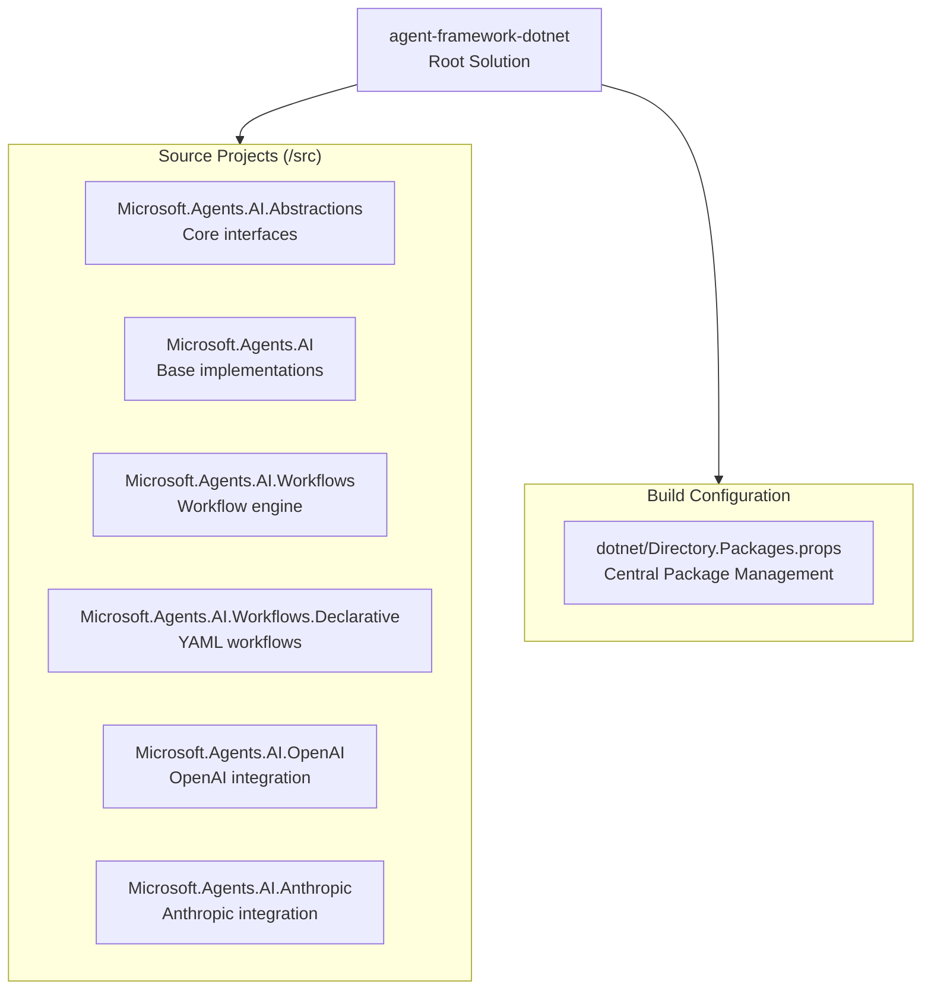
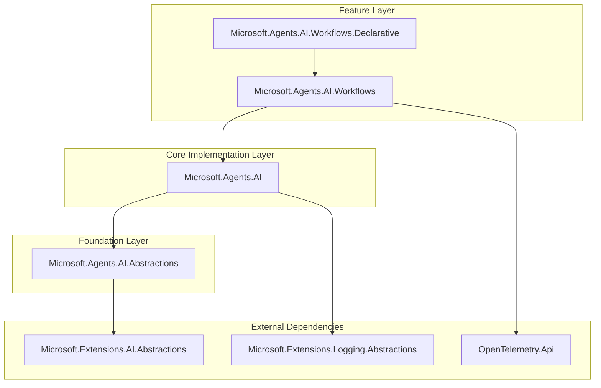
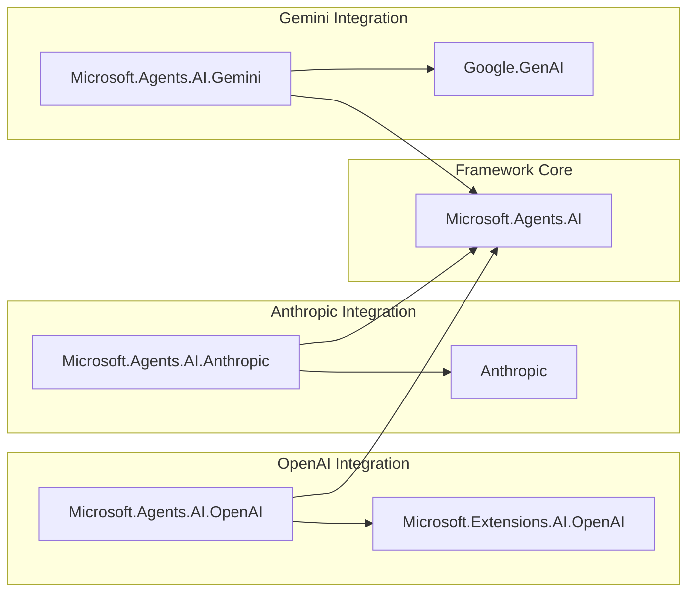

<!-- source: DeepWiki mcp.deepwiki.com · repo microsoft/agent-framework · extra page Package Structure and Dependencies · fetched 2026-10-26 -->

# Package Structure and Dependencies

Relevant source files

The following files were used as context for generating this wiki page:

- [.vscode/settings.json](.vscode/settings.json)
- [.vscode/tasks.json](.vscode/tasks.json)
- [dotnet/Directory.Packages.props](dotnet/Directory.Packages.props)
- [dotnet/agent-framework-dotnet.slnx](dotnet/agent-framework-dotnet.slnx)
- [dotnet/agent-framework-release.slnf](dotnet/agent-framework-release.slnf)
- [dotnet/agent-framework-src-and-tests.slnf](dotnet/agent-framework-src-and-tests.slnf)
- [dotnet/samples/02-agents/AgentProviders/anthropic/Agent_Anthropic_Step04_UsingSkills/Program.cs](dotnet/samples/02-agents/AgentProviders/anthropic/Agent_Anthropic_Step04_UsingSkills/Program.cs)
- [dotnet/src/Microsoft.Agents.AI.Anthropic/AnthropicBetaServiceExtensions.cs](dotnet/src/Microsoft.Agents.AI.Anthropic/AnthropicBetaServiceExtensions.cs)
- [dotnet/src/Microsoft.Agents.AI.Anthropic/Microsoft.Agents.AI.Anthropic.csproj](dotnet/src/Microsoft.Agents.AI.Anthropic/Microsoft.Agents.AI.Anthropic.csproj)
- [dotnet/src/Microsoft.Agents.AI.Anthropic/PublicAPI/net10.0/PublicAPI.Shipped.txt](dotnet/src/Microsoft.Agents.AI.Anthropic/PublicAPI/net10.0/PublicAPI.Shipped.txt)
- [dotnet/src/Microsoft.Agents.AI.Anthropic/PublicAPI/net10.0/PublicAPI.Unshipped.txt](dotnet/src/Microsoft.Agents.AI.Anthropic/PublicAPI/net10.0/PublicAPI.Unshipped.txt)
- [dotnet/src/Microsoft.Agents.AI.Anthropic/PublicAPI/net472/PublicAPI.Shipped.txt](dotnet/src/Microsoft.Agents.AI.Anthropic/PublicAPI/net472/PublicAPI.Shipped.txt)
- [dotnet/src/Microsoft.Agents.AI.Anthropic/PublicAPI/net472/PublicAPI.Unshipped.txt](dotnet/src/Microsoft.Agents.AI.Anthropic/PublicAPI/net472/PublicAPI.Unshipped.txt)
- [dotnet/src/Microsoft.Agents.AI.Anthropic/PublicAPI/net8.0/PublicAPI.Shipped.txt](dotnet/src/Microsoft.Agents.AI.Anthropic/PublicAPI/net8.0/PublicAPI.Shipped.txt)
- [dotnet/src/Microsoft.Agents.AI.Anthropic/PublicAPI/net8.0/PublicAPI.Unshipped.txt](dotnet/src/Microsoft.Agents.AI.Anthropic/PublicAPI/net8.0/PublicAPI.Unshipped.txt)
- [dotnet/src/Microsoft.Agents.AI.Anthropic/PublicAPI/net9.0/PublicAPI.Shipped.txt](dotnet/src/Microsoft.Agents.AI.Anthropic/PublicAPI/net9.0/PublicAPI.Shipped.txt)
- [dotnet/tests/AnthropicChatCompletion.IntegrationTests/AnthropicSkillsIntegrationTests.cs](dotnet/tests/AnthropicChatCompletion.IntegrationTests/AnthropicSkillsIntegrationTests.cs)
- [dotnet/tests/Microsoft.Agents.AI.Anthropic.UnitTests/Extensions/AnthropicBetaServiceExtensionsTests.cs](dotnet/tests/Microsoft.Agents.AI.Anthropic.UnitTests/Extensions/AnthropicBetaServiceExtensionsTests.cs)
- [dotnet/tests/Microsoft.Agents.AI.Anthropic.UnitTests/Extensions/AnthropicClientExtensionsTests.cs](dotnet/tests/Microsoft.Agents.AI.Anthropic.UnitTests/Extensions/AnthropicClientExtensionsTests.cs)

This document describes the .NET implementation's solution structure, project organization, and dependency management for the Microsoft Agent Framework. It covers the physical layout of projects in the repository, the dependency relationships between packages, and the centralized package management approach using MSBuild `Directory.Build` files and Central Package Management.

For information about the Python package structure, see [Monorepo Structure and Package Management](7.2.1). For details on NuGet package publishing configuration, see [NuGet Build System](7.1.5).

Sources: [dotnet/Directory.Packages.props:1-7](), [dotnet/agent-framework-dotnet.slnx:1-45]()

## Solution Structure

The .NET implementation is organized as a Visual Studio solution `agent-framework-dotnet.slnx` [dotnet/agent-framework-dotnet.slnx:1](). The project organization follows a standard structure containing primary categories of projects: source libraries, samples, and tests.

Title: .NET Solution Logical Organization

The solution defines three build configurations: `Debug`, `Release`, and `Publish` [dotnet/agent-framework-dotnet.slnx:2-6](). Samples are organized by complexity, ranging from `01-get-started` to complex `05-end-to-end` scenarios [dotnet/agent-framework-dotnet.slnx:12-45]().

Sources: [dotnet/agent-framework-dotnet.slnx:1-45]()

## Core Package Dependency Hierarchy

The .NET projects follow a layered dependency architecture where abstractions are at the base, core implementations build on abstractions, and specialized packages depend on core implementations.

Title: Core Library Dependency Flow

**Foundation Layer: Microsoft.Agents.AI.Abstractions**

The `Microsoft.Agents.AI.Abstractions` project defines core interfaces and contracts. It uses MSBuild properties to enable modern C# features across supported target frameworks.

**Core Implementation Layer: Microsoft.Agents.AI**

The `Microsoft.Agents.AI` project provides the primary framework implementation. It depends on `Microsoft.Agents.AI.Abstractions` and incorporates `Microsoft.Extensions.AI` for unified chat client support.

**Feature Layer: Workflows**

The `Microsoft.Agents.AI.Workflows` project implements the graph-based orchestration engine. It depends on the core implementation and incorporates `OpenTelemetry.Api` for workflow-specific tracing. It also references the `Microsoft.Agents.AI.Workflows.Generators` project as an analyzer to provide source-generated workflow capabilities [dotnet/agent-framework-release.slnf:33-36]().

**Declarative Workflows**
`Microsoft.Agents.AI.Workflows.Declarative` adds support for declarative execution and depends on the base Workflows project [dotnet/agent-framework-release.slnf:35]().

Sources: [dotnet/agent-framework-release.slnf:33-36]()

## Provider Integration Dependencies

Provider integration packages connect the framework to specific AI services. Each integration package depends on the core implementation plus provider-specific SDKs.

Title: AI Provider Package Associations

**OpenAI Integration**
The `Microsoft.Agents.AI.OpenAI` project provides the bridge to OpenAI and Azure OpenAI services. It leverages package versions defined centrally [dotnet/Directory.Packages.props:89]().

**Anthropic Integration**
The `Microsoft.Agents.AI.Anthropic` project provides support for Anthropic agents (`Microsoft.Agents.AI.Anthropic.csproj`) [dotnet/src/Microsoft.Agents.AI.Anthropic/Microsoft.Agents.AI.Anthropic.csproj:1-34](). It depends on `Microsoft.Agents.AI` and the `Anthropic` NuGet package [dotnet/src/Microsoft.Agents.AI.Anthropic/Microsoft.Agents.AI.Anthropic.csproj:20-26](). Extensions like `AnthropicBetaServiceExtensions` provide fluent patterns for creating agents using `AsAIAgent` [dotnet/src/Microsoft.Agents.AI.Anthropic/AnthropicBetaServiceExtensions.cs:45-56]() [dotnet/tests/Microsoft.Agents.AI.Anthropic.UnitTests/Extensions/AnthropicBetaServiceExtensionsTests.cs:47-71]().

Sources: [dotnet/Directory.Packages.props:14](), [dotnet/src/Microsoft.Agents.AI.Anthropic/Microsoft.Agents.AI.Anthropic.csproj:1-34](), [dotnet/src/Microsoft.Agents.AI.Anthropic/AnthropicBetaServiceExtensions.cs:45-56](), [dotnet/tests/Microsoft.Agents.AI.Anthropic.UnitTests/Extensions/AnthropicBetaServiceExtensionsTests.cs:47-71]()

## Central Package Management

The solution uses MSBuild Central Package Management (CPM) to centralize version control for external dependencies. Package versions are defined once in `Directory.Packages.props` and referenced without versions in individual project files [dotnet/Directory.Packages.props:1-7]().

**Configuration**
Central Package Management is enabled in `Directory.Packages.props` [dotnet/Directory.Packages.props:1-7]():
- `ManagePackageVersionsCentrally`: `true` [dotnet/Directory.Packages.props:5]()
- `CentralPackageTransitivePinningEnabled`: `true` [dotnet/Directory.Packages.props:6]()

**Package Reference Pattern**
Projects reference packages without version attributes. The build system resolves this to the version defined in the central file [dotnet/Directory.Packages.props:12-100]().

**Package Categories**
The central file organizes packages into logical categories including Aspire, Azure SDKs, OpenTelemetry, and Microsoft.Extensions [dotnet/Directory.Packages.props:9-100]().

Sources: [dotnet/Directory.Packages.props:1-100]()

## NuGet Package Configuration

All packages share common configuration properties defined across solution build files and project manifests.

**Version Configuration**
The versioning strategy supports Release Candidates, Previews, and stable releases through MSBuild properties. Projects can configure packability and metadata within their respective `.csproj` files, such as `IsReleased` [dotnet/src/Microsoft.Agents.AI.Anthropic/Microsoft.Agents.AI.Anthropic.csproj:4]().

**Package Validation**
The framework can enforce package validations, analysis rules, and warnings as errors across build targets, which can be configured per project [dotnet/src/Microsoft.Agents.AI.Anthropic/Microsoft.Agents.AI.Anthropic.csproj:13-17]().

Sources: [dotnet/src/Microsoft.Agents.AI.Anthropic/Microsoft.Agents.AI.Anthropic.csproj:1-34]()

## Multi-Targeting Strategy

The framework targets both modern .NET and legacy .NET Framework/Standard targets depending on the specific package requirements to ensure maximum reach.

**Target Frameworks and Public API Verification**
Compatibility and public APIs are tracked per target framework using validation files such as `PublicAPI.Shipped.txt` and `PublicAPI.Unshipped.txt` for specific frameworks (e.g., `net10.0`, `net8.0`, `net472`) [dotnet/src/Microsoft.Agents.AI.Anthropic/PublicAPI/net10.0/PublicAPI.Shipped.txt:1-11]() [dotnet/src/Microsoft.Agents.AI.Anthropic/PublicAPI/net472/PublicAPI.Shipped.txt:1-11]().

Sources: [dotnet/src/Microsoft.Agents.AI.Anthropic/PublicAPI/net10.0/PublicAPI.Shipped.txt:1-11](), [dotnet/src/Microsoft.Agents.AI.Anthropic/PublicAPI/net472/PublicAPI.Shipped.txt:1-11]()

---

