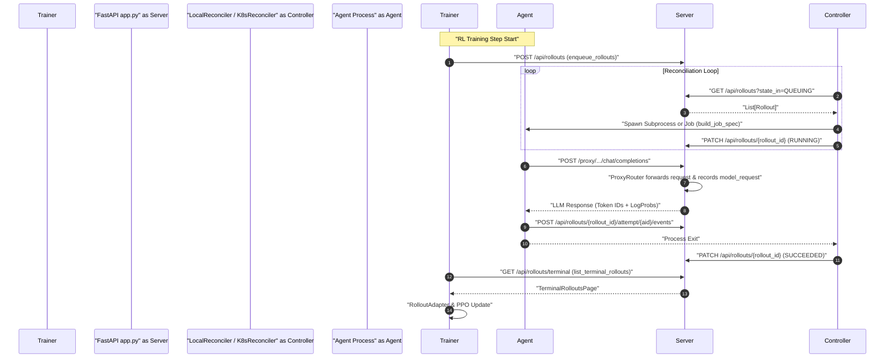
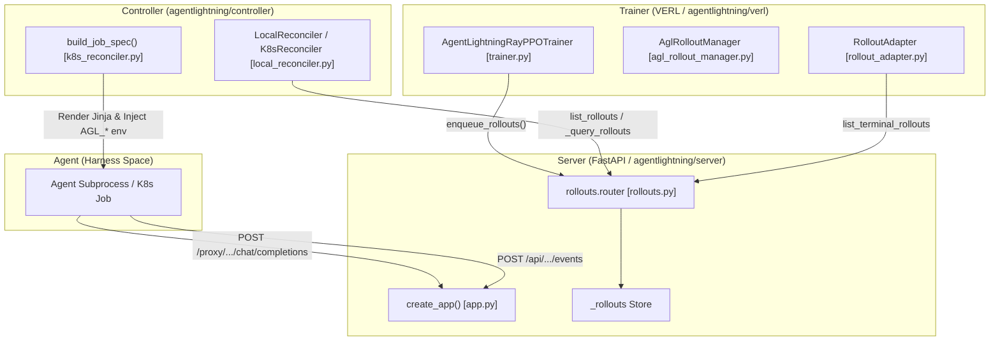

<!-- source: DeepWiki mcp.deepwiki.com · repo microsoft/agent-lightning · page 1.2 Architecture Overview · fetched 2026-10-26 -->

# Architecture Overview

Relevant source files

The following files were used as context for generating this wiki page:

- [README.md](README.md)
- [agentlightning/controller/local_reconciler.py](agentlightning/controller/local_reconciler.py)
- [agentlightning/verl/entrypoint.py](agentlightning/verl/entrypoint.py)
- [agentlightning/verl/trainer.py](agentlightning/verl/trainer.py)
- [docs/00-installation.md](docs/00-installation.md)
- [docs/05-basics.md](docs/05-basics.md)
- [docs/20-trainer-configuration.md](docs/20-trainer-configuration.md)
- [docs/community/contributing.md](docs/community/contributing.md)
- [mkdocs.yml](mkdocs.yml)
- [tests/controller/test_local_reconciler.py](tests/controller/test_local_reconciler.py)
- [tests/controller/test_local_reconciler_env.py](tests/controller/test_local_reconciler_env.py)

Agent Lightning v1.0 decouples agent logic from training logic using a **Producer-Consumer loop**. This architecture allows developers to optimize agents built with any framework by treating agent execution as a telemetry source that feeds into a centralized API gateway store, which a Reinforcement Learning (RL) trainer then consumes to update policy weights [README.md:15-16](), [docs/05-basics.md:3-4]().

## Purpose and Scope

This page covers the core architectural design of Agent Lightning v1.0, detailing the three-service Producer-Consumer loop involving the VERL Trainer, `agl-server`, and `agl-controller`. It outlines service responsibilities, state transitions, and the data flow from rollout creation to reward ingestion and PPO optimization [README.md:39-45](), [docs/05-basics.md:11]().

Sources: [README.md:15-45](), [docs/05-basics.md:3-11]()

---

## The Producer-Consumer Loop

The system operates as a distributed loop where the **Trainer** produces rollout tasks and consumes reward/model events, while the **Controller** and **Agent** consume tasks and produce telemetry [README.md:39-45]().

1. **VERL Trainer (`AgentLightningRayPPOTrainer`)**: Orchestrates the RL lifecycle, generates rollout tasks, updates policy weights, and manages the training iteration [README.md:39-41](), [agentlightning/verl/trainer.py:100-105](), [docs/05-basics.md:77-86]().
2. **`agl-server` (API Gateway)**: The central FastAPI application hub (`create_app` in `agentlightning/server/app.py`) that persists rollout states (`_rollouts` store in `agentlightning/server/routes/rollouts.py`), proxies LLM requests (`ProxyRouter`), and ingests reward events [README.md:42-42](), [agentlightning/server/app.py:53-75](), [agentlightning/server/routes/rollouts.py:111-122]().
3. **`agl-controller` (Rollout Executor)**: Polls the server for queued rollouts and reconciles them by spawning agent processes locally (`LocalReconciler`) or as Kubernetes Jobs (`K8sReconciler` in `agentlightning/controller/k8s_reconciler.py`) [README.md:43-43](), [agentlightning/controller/local_reconciler.py:94-110]().
4. **Agent Subprocesses / K8s Jobs**: Executes agent code in a real harness, interacting with models through the `agl-server` proxy with zero changes to internal logic [README.md:15-16](), [docs/05-basics.md:11]().

### Data Flow Diagram

The following sequence diagram illustrates service interactions and code entrypoints during a rollout execution cycle, bridging natural language concepts to concrete code entities.

Title: System Service Interaction & Code Entities

Sources: [README.md:33-45](), [agentlightning/verl/trainer.py:139-175](), [agentlightning/controller/local_reconciler.py:125-183]()

---

## Primary Components & Service Responsibilities

### 1. `agl-server` (API Gateway & Store)
The `agl-server` service is built as a FastAPI application (`agentlightning/server/app.py`) that captures execution telemetry without modifying the agent codebase [README.md:15-16](), [agentlightning/server/app.py:3]().
* **LLM Proxy**: Routes model requests through `ProxyRouter`, capturing prompt token IDs, response token IDs, and log probabilities directly from the inference engine to eliminate retokenization drift [README.md:83](), [agentlightning/server/app.py:70]().
* **Rollout State Machine**: Manages lifecycle states (`QUEUING`, `RUNNING`, `SUCCEEDED`, `FAILED`) via REST endpoints in `agentlightning/server/routes/rollouts.py` [docs/05-basics.md:33-36](), [agentlightning/server/routes/rollouts.py:95-209]().
* **Event Ingestion**: Handles reward and custom telemetry reporting via `/api` event routes [agentlightning/server/app.py:84]().

### 2. `agl-controller` (Rollout Execution)
The controller reconciles server rollout queues with compute infrastructure [docs/05-basics.md:64-75]().
* **Local Runner**: Spawns short-lived local subprocesses via `LocalReconciler` and injects environment variables (`AGL_OPENAI_BASE_URL`, `AGL_EVENT_URL`, `AGL_KEY`) [docs/05-basics.md:72](), [agentlightning/controller/local_reconciler.py:94-110]().
* **Kubernetes Runner**: Uses `K8sReconciler` and Jinja2 templates (`build_job_spec` in `agentlightning/controller/k8s_reconciler.py`) to render and launch Kubernetes Jobs managed by `kr8s` [agentlightning/controller/k8s_reconciler.py:43-101]().

### 3. VERL Training Integration (Optimization Layer)
The training module links `verl` with the API Gateway [docs/05-basics.md:77-88]().
* **Rollout Management**: Dispatches rollout tasks, awaits completion, and aggregates trajectories using `trace_aggregator` configurations in `AgentLightningRayPPOTrainer` [agentlightning/verl/trainer.py:139-153](), [docs/20-trainer-configuration.md:120-141]().
* **Policy Optimization**: Implements custom PPO loss functions (`per_rollout_mean`) and advantage normalization [docs/20-trainer-configuration.md:33-35]().

### Component Architecture & Code Mapping

Title: Component Architecture & Code Mapping

Sources: [agentlightning/verl/trainer.py:100-153](), [agentlightning/controller/local_reconciler.py:94-110]()

---

## Decoupling Benefits

The three-service architecture provides strict separation of concerns:
* **Agent Agnosticism**: Agents use standard OpenAI-compatible client libraries without requiring custom RL hooks [README.md:15-16](), [docs/05-basics.md:15]().
* **Environment Agnosticism**: The trainer operates purely on aggregated triplets and rewards, remaining agnostic to whether execution occurs in a local process or a Kubernetes sandbox [README.md:17-18](), [docs/05-basics.md:17]().
* **Infrastructure Isolation**: The API gateway buffers communication between GPU training clusters and CPU/sandbox rollout workers [docs/05-basics.md:17]().

Sources: [README.md:15-18](), [docs/05-basics.md:13-18]()

---

