# Page: APEX+ Overview

# APEX+ Overview

<details>
<summary>Relevant source files</summary>

The following files were used as context for generating this wiki page:

- [README.md](README.md)

</details>


## Purpose and Scope

This page provides a high-level introduction to APEX+ (Automated Parallel Execution), an extensible and dynamism-aware simulator for LLM serving optimization. APEX+ generates optimal parallel execution plans for large language models given hardware clusters and workload characteristics.

For installation and usage instructions, see [Getting Started](#2). For detailed architectural components, see [Core Architecture](#3). For specific model implementations, see [Model Support](#6).

## What is APEX+

APEX+ is a performance simulation system that automatically determines the best parallelization strategy for serving large language models. Given three inputs - an LLM architecture, a device cluster configuration, and request traces - APEX+ generates execution plans that optimize for throughput, latency, or energy efficiency.

The simulator performs **dynamism-aware simulation** to model iteration-level batching behavior and leverages the repetitive structure of transformer architectures to efficiently explore the parallelization design space. APEX+ can identify optimal execution plans within 15 minutes on a CPU, making it significantly more cost-effective than empirical tuning on GPU clusters.

Key capabilities include:
- **Multi-objective optimization**: Finds plans up to 3.37x faster than heuristics and reduces energy consumption by up to 45%
- **Comprehensive metrics**: Reports time per output token (TPOT), time to first token (TTFT), throughput, and SLO compliance
- **Scalable simulation**: Handles trillion-scale models through architectural abstractions
- **Hardware flexibility**: Supports various GPU types and cluster topologies with extensible profiling data

**Sources:** [README.md:5-10]()

## System Architecture Overview

APEX+ consists of five major subsystems that work together to generate and evaluate parallel execution plans:

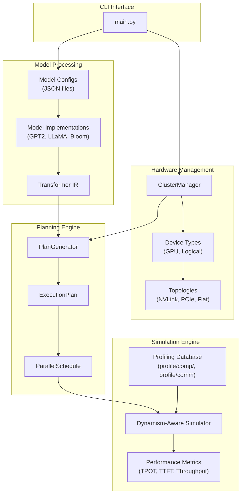

The architecture follows a pipeline flow where models are converted to intermediate representation, matched with hardware clusters, used to generate candidate execution plans, and finally simulated to produce performance metrics.

**Sources:** [README.md:5-13](), system diagrams provided

## Core Components

### Model Layer
APEX+ supports multiple LLM architectures through a unified model abstraction. Each model implementation (e.g., `GPT2`, `LLaMA3`, `Bloom`) can be converted from Hugging Face configurations to APEX+ internal representation:

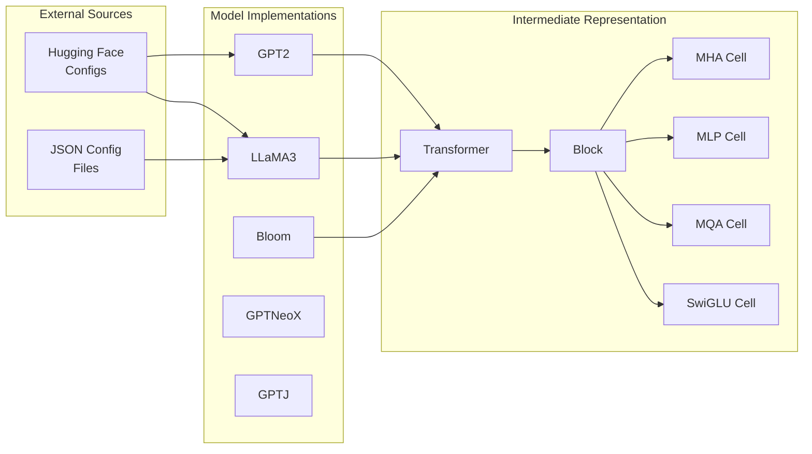

### Device and Cluster Management
APEX+ models computational resources through a hierarchical cluster abstraction that supports various GPU types and interconnect topologies. The system can simulate multi-node clusters with different intra-node and inter-node communication patterns.

### Execution Planning
The planning engine generates candidate parallelization strategies including tensor parallelism, pipeline parallelism, and mixed approaches. Each `ExecutionPlan` maps model components to device clusters and specifies communication patterns.

### Simulation Engine
The core simulator performs dynamism-aware modeling of LLM serving workloads, accounting for variable sequence lengths and batching behavior. It uses op-level profiling data to accurately estimate computation and communication costs.

**Sources:** [README.md:12-13](), system diagrams provided

## Simulation Workflow

APEX+ follows a structured workflow to generate and evaluate execution plans:

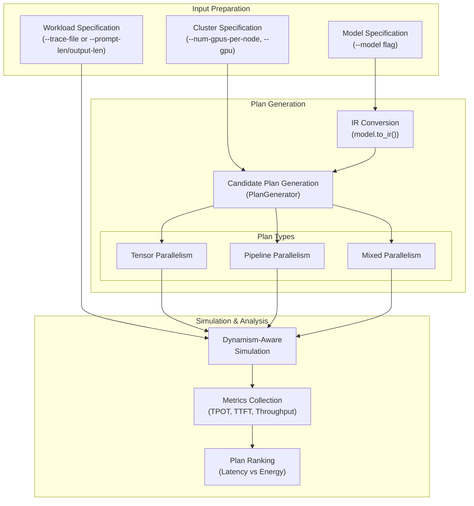

The workflow begins when `main.py` processes command-line arguments to configure the model, cluster, and workload. The system then converts the model to intermediate representation, generates candidate execution plans for different parallelization strategies, simulates each plan's performance, and ranks them based on optimization objectives.

**Sources:** [README.md:26-44](), [README.md:51-217]()

## Supported Models and Hardware

APEX+ includes built-in support for major LLM architectures:

| Model Family | Examples | Key Features |
|--------------|----------|--------------|  
| GPT-style | GPT-2, GPT-J, GPT-NeoX | Standard decoder-only transformers |
| LLaMA | LLaMA, LLaMA3 | RMSNorm, SwiGLU, rotary embeddings |
| Bloom | Bloom models | ALiBi positional encoding |
| Mixture of Experts | Mixtral-8x7B | Sparse expert routing |
| Specialized | Whisper, GPT-BigCode, CLIP | Task-specific architectures |

**Hardware Backend Support:**
- **V100-16GB**: PCIe and SXM variants
- **H100-SXM-80GB**: High-performance training/inference  
- **H200-SXM-141GB**: Extended memory configurations
- **Logical devices**: For modeling non-GPU accelerators

The system uses op-level profiling data stored in `profile/comp/{Backend}` and `profile/comm/{Backend}` directories to accurately model hardware performance characteristics.

**Sources:** [README.md:12-13](), [README.md:44]()

## Performance and Validation

APEX+ provides comprehensive performance analysis including:

- **Throughput metrics**: Tokens/second, requests/second
- **Latency metrics**: Time to first token (TTFT), time per output token (TPOT) 
- **Resource utilization**: Model FLOPS utilization (MFU), memory bandwidth utilization (MBU)
- **Energy consumption**: Total energy per workload
- **SLO compliance**: Percentage of requests meeting service level objectives

The simulator has been validated against real LLM serving systems including vLLM for dense models and SGLang for mixture-of-experts models, with experimental results available in the `results/` directory.

**Sources:** [README.md:46-48](), [README.md:51-217](), [README.md:221-240]()

---

# Page: Getting Started

# Getting Started

<details>
<summary>Relevant source files</summary>

The following files were used as context for generating this wiki page:

- [README.md](README.md)
- [SUPPORT.md](SUPPORT.md)

</details>


This guide covers the basic installation, usage patterns, and command-line interface for APEX+. It demonstrates how to run simulations, interpret results, and configure various execution scenarios. For detailed information about the underlying architecture and components, see [Core Architecture](#3). For comprehensive reference documentation on models and devices, see [Model Support](#6) and [Device Management Reference](#4).

## Installation and Setup

APEX+ requires Python dependencies that are managed through a requirements file. Install the necessary packages by running:

```bash
pip install -r requirements.txt
```

The system includes pre-compiled op-level profiling data for several GPU backends including V100-16GB, H100 SXM 80GB, and H200 SXM 141GB. This profiling data is stored in `profile/comp/{Backend}` and `profile/comm/{Backend}` directories and enables accurate performance simulation without requiring actual hardware.

**Sources:** [README.md:16-22]()

## Basic Usage Patterns

### CLI Entry Point Workflow

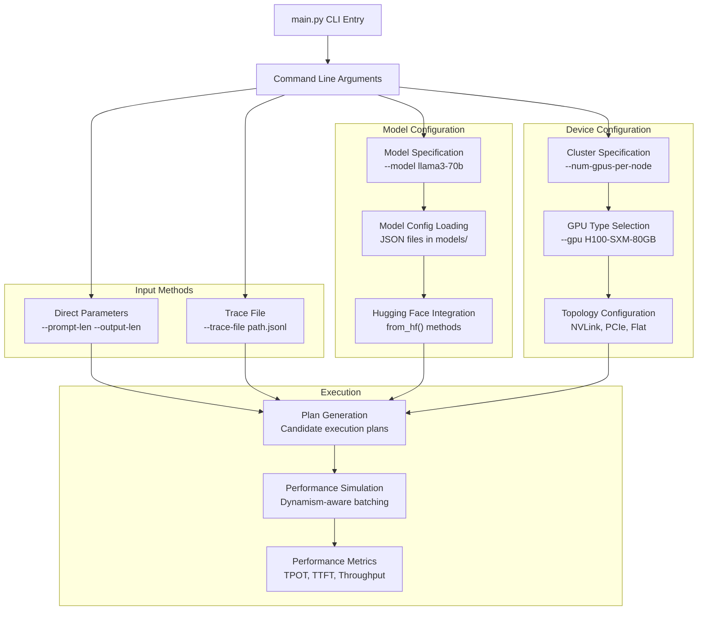

**Sources:** [README.md:24-44](), [main.py:1]()

### Core Simulation Command Structure

The primary entry point is `main.py` located in the repository root. All simulations follow this basic pattern:

```bash
python main.py [MODEL_OPTIONS] [CLUSTER_OPTIONS] [WORKLOAD_OPTIONS] [OUTPUT_OPTIONS]
```

The most basic simulation requires specifying a model and cluster configuration:

```bash
python main.py --model llama3-70b --num-gpus-per-node 2 --prompt-len 128 --output-len 2048
```

**Sources:** [README.md:26-29]()

## Command Line Reference

### Model Configuration Options

| Option | Description | Example |
|--------|-------------|---------|
| `--model` | Model specification (name or config path) | `llama3-70b`, `./apex_plus/models/llama3_70b_config.json` |
| `--num-experts` | Number of experts for MoE models | `8` |
| `--topk` | Top-k experts selection | `2` |
| `--capacity-factor` | MoE capacity factor | `1.0` |

### Cluster Configuration Options

| Option | Description | Example |
|--------|-------------|---------|
| `--num-nodes` | Number of compute nodes | `1` |
| `--num-gpus-per-node` | GPUs per node | `2`, `4`, `8` |
| `--gpu` | GPU type specification | `H100-SXM-80GB`, `V100-PCIE-16GB` |
| `--frequency` | GPU frequency in MHz | `1980` |

### Workload Configuration Options

#### Direct Parameter Method
| Option | Description | Example |
|--------|-------------|---------|
| `--prompt-len` | Input sequence length | `128`, `2048` |
| `--output-len` | Generated sequence length | `128`, `2048` |
| `--num-requests` | Number of requests to simulate | `1024` |

#### Trace File Method
| Option | Description | Example |
|--------|-------------|---------|
| `--trace-file` | Path to JSONL trace file | `./traces/llama/creation_05.jsonl` |

### Quantization and Precision Options

| Option | Description | Example |
|--------|-------------|---------|
| `--kv-dtype` | KV-cache data type | `half`, `float8` |
| `--weight-dtype` | Weight data type | `half`, `float8` |
| `--activation-dtype` | Activation data type | `half`, `float8` |

### Output and Analysis Options

| Option | Description | Default |
|--------|-------------|---------|
| `--all` | Show all execution plans | Only latency-optimal |
| `--ttft-slo` | Time to First Token SLO (msec) | `10` |
| `--tpot-slo` | Time per Output Token SLO (msec) | `10` |
| `--max-batch` | Maximum batch size constraint | Unlimited |

**Sources:** [README.md:27-42](), [README.md:221-240]()

## Common Usage Examples

### Decoder-Only Models
```bash
# Basic LLaMA3-70B simulation
python main.py --model llama3-70b --num-gpus-per-node 2 --prompt-len 128 --output-len 2048 --all

# With quantization (W8A16 weights, FP8 KV-cache)
python main.py --model llama3-70b --num-gpus-per-node 2 --trace-file ./traces/llama/creation_05.jsonl \
    --kv-dtype float8 --weight-dtype float8 --activation-dtype half
```

### Mixture of Experts Models
```bash
# Mixtral-8x7B simulation
python main.py --model mixtral-8x7b-local --num-gpus-per-node 4 --num-experts 8 \
    --trace-file ./traces/mistral/lmsys_05.jsonl
```

### Encoder-Decoder Models
```bash
# Whisper model simulation
python main.py --model whisper --num-gpus-per-node 2 --prompt-len 128 --output-len 2048
```

### SLO Analysis
```bash
# Configure SLO constraints and batch size limits
python main.py --model llama3-70b --num-gpus-per-node 8 --num-requests 10 \
    --ttft-slo 100 --tpot-slo 30 --max-batch 10
```

**Sources:** [README.md:27-42](), [README.md:225-228]()

## Understanding Output Format

### Execution Plan Structure

APEX+ generates multiple candidate execution plans and evaluates each one. The output shows detailed information for each plan including parallelization strategy, device mapping, and performance metrics.

```mermaid
graph TD
    subgraph "Execution Plan Output Structure"
        PlanHeader["Parallel Schedule N<br/>Model replicas, Stages, Blocks per stage"]
        
        subgraph "Device Mapping"
            MQAMapping["MQA Task Mapping<br/>replicas, tasks_per_device"]
            MLPMapping["SwiGLU Task Mapping<br/>replicas, tasks_per_device"] 
            CommOps["Communication Operations<br/>AllReduce, AllGather, AllToAll"]
        end
        
        subgraph "Resource Statistics"
            ParamSize["Parameter size per device (GB)"]
            ActivationMem["Activation memory per device (GB)"]
            BatchStats["Avg requests/tokens per iteration"]
        end
        
        subgraph "Performance Metrics"
            Throughput["Throughput<br/>tokens/sec, requests/sec"]
            Latency["Latency<br/>TTFT, TPOT in msec"]
            Percentiles["TBT Percentiles<br/>P50, P95"]
            Utilization["MFU, MBU percentages"]
        end
        
        subgraph "Detailed Analysis"
            TimeBreakdown["Time Breakdown<br/>Per operation timing"]
            EnergyConsumption["Energy Consumption (KJ)"]
        end
    end
    
    PlanHeader --> MQAMapping
    PlanHeader --> MLPMapping
    MQAMapping --> CommOps
    MLPMapping --> CommOps
    CommOps --> ParamSize
    ParamSize --> ActivationMem
    ActivationMem --> BatchStats
    BatchStats --> Throughput
    Throughput --> Latency
    Latency --> Percentiles
    Percentiles --> Utilization
    Utilization --> TimeBreakdown
    TimeBreakdown --> EnergyConsumption
```

### Key Performance Metrics

| Metric | Description | Units |
|--------|-------------|-------|
| **Throughput** | | |
| Tokens generated per second | Output token generation rate | tokens/sec |
| Tokens processed per second | Total token processing rate | tokens/sec |
| Requests per second | Request completion rate | requests/sec |
| **Latency** | | |
| TTFT | Time to First Token | msec |
| TPOT | Time per Output Token | msec |
| TBT Percentiles | Time Between Tokens distribution | msec |
| Request Completion Latency | End-to-end request latency | sec |
| **Utilization** | | |
| MFU | Model FLOPS Utilization | % |
| MBU | Memory Bandwidth Utilization | % |

### SLO Compliance Output

When SLO constraints are configured, APEX+ provides compliance analysis:

```
* Latency SLO Metrics:
* Batch Size: 10
-----------------------------------------
  Name   Target SLO(msec)   SLOs Met(%)  
-----------------------------------------
  TTFT   100                0.000 %      
  TPOT   30                 100.000 %    
-----------------------------------------
```

**Sources:** [README.md:50-217](), [README.md:229-240]()

## Trace File Format

APEX+ supports realistic request traces stored in JSONL format. Each line contains a request specification:

```json
{
  "StartTimeOffset": 1000000,
  "ContextTokens": 2048,
  "GeneratedTokens": 128
}
```

| Field | Description | Units |
|-------|-------------|-------|
| `StartTimeOffset` | Offset from first request | nanoseconds |
| `ContextTokens` | Input sequence length | tokens |
| `GeneratedTokens` | Output sequence length | tokens |

Sample trace files are provided in the `traces/` directory organized by model family (e.g., `traces/llama/`, `traces/mistral/`).

**Sources:** [README.md:43-44]()

## Getting Help

### Documentation Resources

- For comprehensive argument reference, see the comments in [main.py:1]()
- For profiling data collection, see [profile/scripts/README.md:1]()
- For validation against real serving systems, see the vLLM and SGLang folders
- File issues and questions on GitHub Issues after searching for existing topics

### Support Channels

As outlined in the project support policy, help is available through:
- The main [README.md:1]() for general usage questions
- [main.py:1]() argument documentation for full CLI functionality  
- GitHub Issues for bug reports and feature requests (search existing issues first)

**Sources:** [SUPPORT.md:1-12](), [README.md:219]()

---

# Page: Core Architecture

# Core Architecture

<details>
<summary>Relevant source files</summary>

The following files were used as context for generating this wiki page:

- [README.md](README.md)
- [apex_plus/cluster/cluster.py](apex_plus/cluster/cluster.py)
- [apex_plus/execution/plan.py](apex_plus/execution/plan.py)

</details>


This document provides a high-level overview of the APEX+ system architecture, including its core components and how they interact to generate optimal parallel execution plans for LLM serving. It covers the system's modular design, from model ingestion through execution plan generation and simulation.

For detailed information about specific components, see [Device and Cluster Management](#3.1), [Intermediate Representation System](#3.2), and [Execution Planning](#3.3). For implementation details of supported models, see [Model Support](#6).

## System Overview

APEX+ follows a multi-stage pipeline architecture that transforms high-level model configurations into optimized parallel execution plans. The system is designed around four core subsystems that work together to provide comprehensive LLM serving simulation capabilities.

### APEX+ Pipeline Architecture

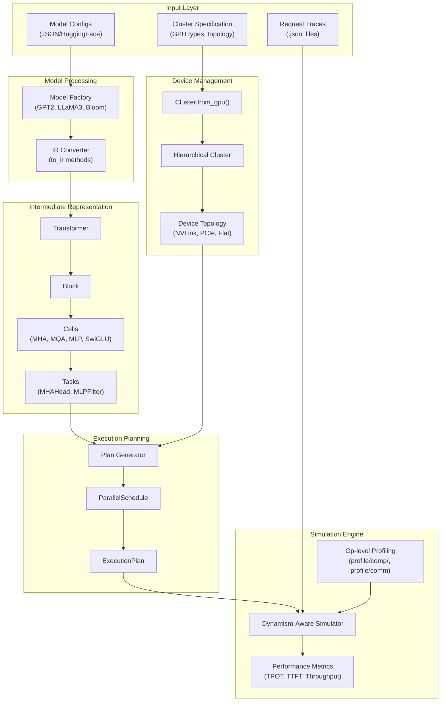

Sources: [README.md:1-254](), [apex_plus/cluster/cluster.py:127-246](), [apex_plus/execution/plan.py:7-25]()

## Core Architectural Components

### Model Ingestion and IR Generation

The system begins by ingesting model configurations from either JSON files or HuggingFace model definitions. The `ModelFactory` classes handle the conversion from external formats to APEX+ internal representations, which are then transformed into a hierarchical Intermediate Representation (IR) structure.

| Component | Purpose | Key Classes |
|-----------|---------|-------------|
| Model Factory | Convert external model configs to APEX+ format | `GPT2`, `LLaMA3`, `Bloom` |
| IR Converter | Transform models to hierarchical IR | `to_ir()` methods |
| Transformer IR | Top-level model representation | `Transformer` |
| Block/Cell Hierarchy | Modular computation units | `Block`, `MHA`, `MLP`, `SwiGLU` |

### Device and Cluster Management

APEX+ uses a hierarchical cluster abstraction to represent computational resources. The `Cluster` class supports multiple topology types and can be partitioned to match different parallelization strategies.

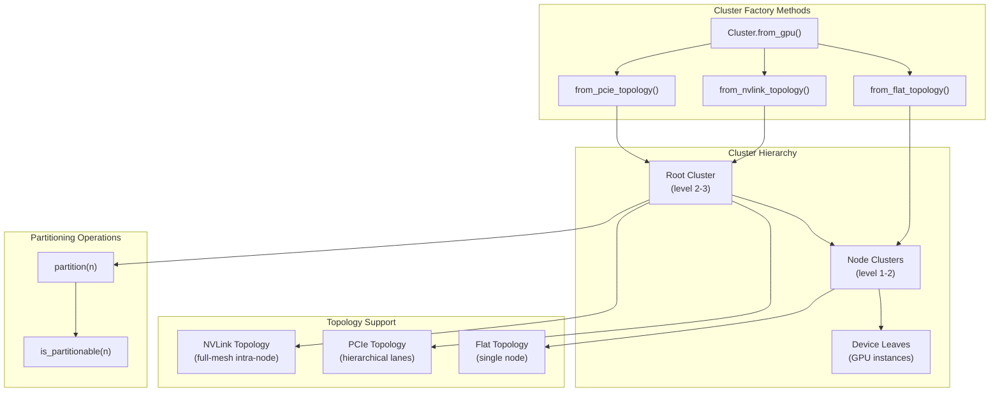

Sources: [apex_plus/cluster/cluster.py:127-246](), [apex_plus/cluster/cluster.py:55-126]()

### Execution Planning System

The execution planning system generates multiple candidate parallelization strategies and maps them to the available cluster resources. The `ExecutionPlan` class encapsulates the mapping between computation stages and cluster partitions.

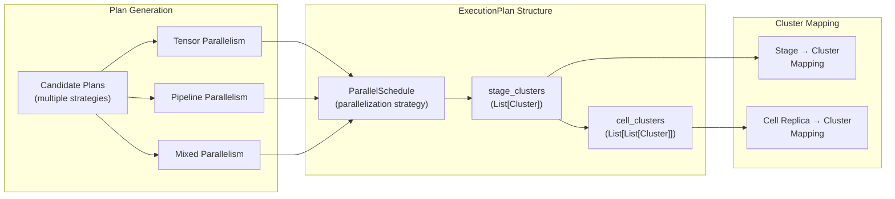

Sources: [apex_plus/execution/plan.py:7-25]()

### Simulation and Performance Evaluation

The simulation engine performs dynamism-aware simulation using op-level profiling data to compute performance metrics. It models iteration-level batching and provides comprehensive performance analysis.

| Metric Category | Key Metrics | Purpose |
|-----------------|-------------|---------|
| Latency | TTFT, TPOT | Request-level performance |
| Throughput | Tokens/sec, Requests/sec | System capacity |
| Resource Utilization | MFU, MBU | Hardware efficiency |
| Energy | Energy Consumption (KJ) | Operational cost |
| SLO Compliance | SLO percentage | Service quality |

## Data Flow and Integration

### Main Execution Flow

The system's main execution flow, orchestrated through `main.py`, follows this sequence:

1. **Configuration Loading**: Parse command-line arguments and load model configurations
2. **Model Instantiation**: Create model instances using factory methods
3. **IR Conversion**: Transform models to hierarchical IR using `to_ir()` methods
4. **Cluster Creation**: Build device clusters using `Cluster.from_gpu()`
5. **Plan Generation**: Generate candidate execution plans with different parallelization strategies
6. **Simulation**: Execute dynamism-aware simulation for each plan
7. **Performance Analysis**: Compute and report performance metrics

### Component Interaction Patterns

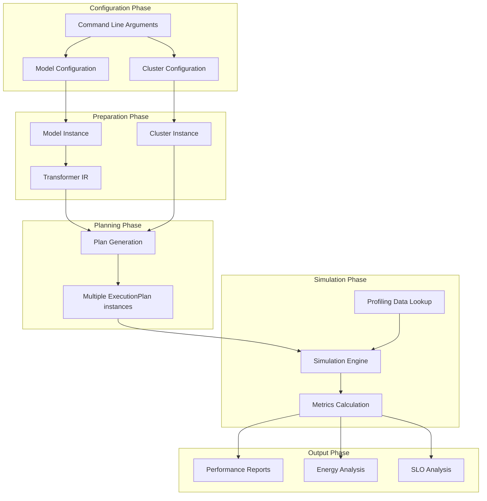

Sources: [README.md:24-44](), [README.md:51-214]()

## System Extension Points

APEX+ is designed for extensibility across multiple dimensions:

- **Model Support**: New model architectures can be added by implementing model factory classes and IR conversion methods
- **Device Types**: New hardware backends can be supported by extending the `Device` class hierarchy and providing profiling data
- **Parallelization Strategies**: Additional parallelization schemes can be implemented through new `ParallelSchedule` types
- **Simulation Features**: The simulation engine can be extended with new performance models and optimization objectives

The modular architecture ensures that extensions in one subsystem have minimal impact on others, supporting the system's role as an extensible research platform for LLM serving optimization.

Sources: [README.md:5-13](), [apex_plus/cluster/cluster.py:7-36]()

---

# Page: Device and Cluster Management

# Device and Cluster Management

<details>
<summary>Relevant source files</summary>

The following files were used as context for generating this wiki page:

- [apex_plus/cluster/cluster.py](apex_plus/cluster/cluster.py)
- [apex_plus/cluster/device.py](apex_plus/cluster/device.py)
- [apex_plus/cluster/gpu.py](apex_plus/cluster/gpu.py)
- [apex_plus/cluster/logical.py](apex_plus/cluster/logical.py)

</details>


## Purpose and Scope

This document covers APEX+'s device and cluster management system, which provides abstractions for computational hardware and organizes devices into hierarchical clusters with different interconnect topologies. The system enables APEX+ to model various hardware configurations for LLM serving simulation.

For information about how clusters are used in execution planning, see [Execution Planning](#3.3). For detailed technical reference on specific device implementations, see [Device Management Reference](#4).

## Device Abstraction Layer

APEX+ uses a device abstraction layer to represent different types of computational resources. The base `Device` class provides a minimal interface that all device types must implement.

### Device Interface

The `Device` base class defines the core interface for all computational devices:

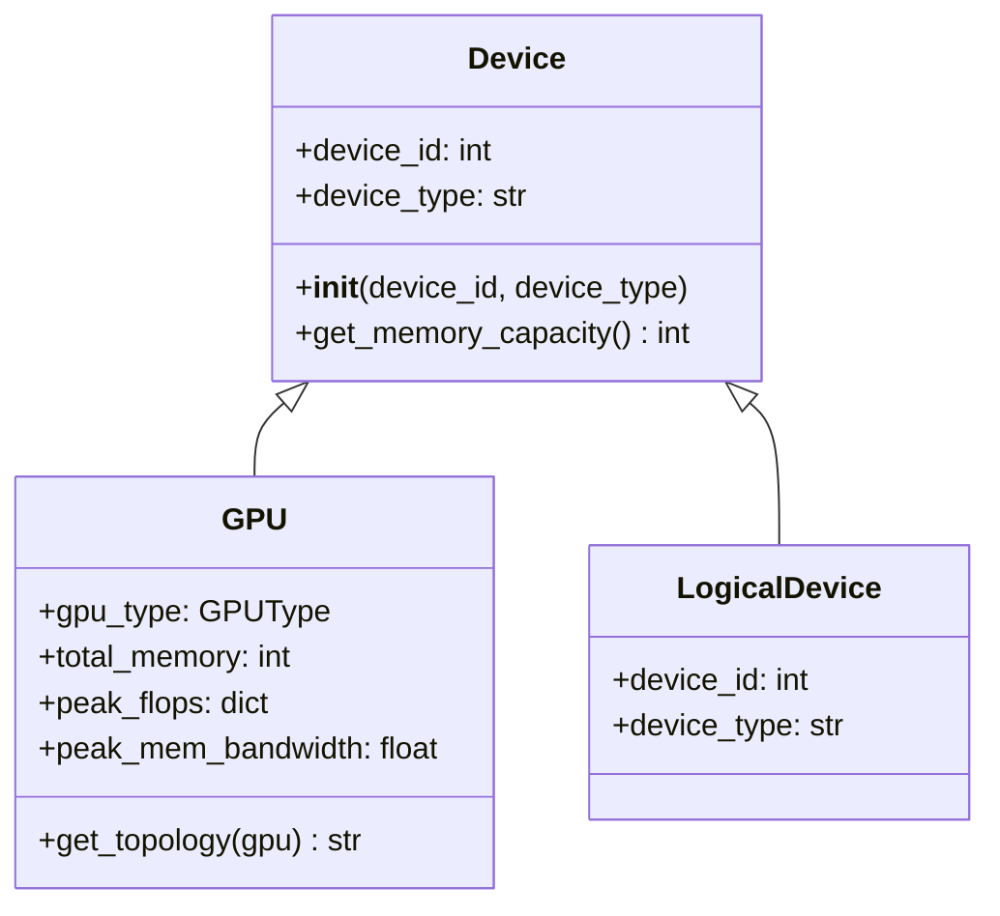

**Sources:** [apex_plus/cluster/device.py:1-12](), [apex_plus/cluster/gpu.py:69-103](), [apex_plus/cluster/logical.py:6-17]()

### GPU Device Implementation

The `GPU` class implements hardware-specific GPU devices with detailed specifications:

| GPU Type | Memory | Peak FLOPS (FP16) | Memory Bandwidth | Topology |
|----------|--------|-------------------|------------------|----------|
| V100-PCIE-16GB | 16 GB | 14 TFLOPS | 900 GB/s | PCIe |
| H100-SXM-80GB | 80 GB | 1,979 TFLOPS | 3,350 GB/s | NVLink |
| H200-SXM-141GB | 141 GB | 1,979 TFLOPS | 4,800 GB/s | NVLink |

**Sources:** [apex_plus/cluster/gpu.py:18-66]()

### Logical Devices

The `LogicalDevice` class represents non-physical computational resources for simulation purposes:

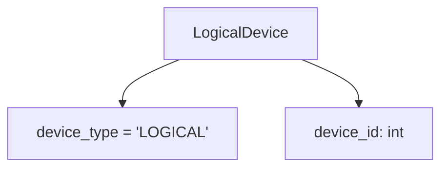

**Sources:** [apex_plus/cluster/logical.py:1-17]()

## Hierarchical Cluster Organization

APEX+ organizes devices into hierarchical clusters using the `Cluster` class. Clusters can contain either child clusters or devices, but not both.

### Cluster Structure

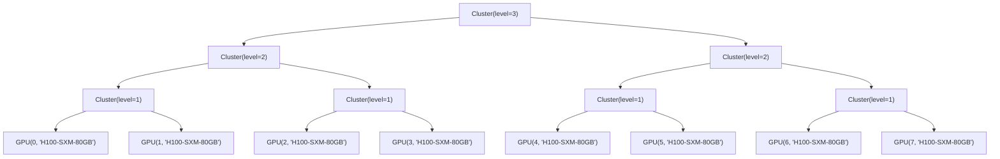

**Sources:** [apex_plus/cluster/cluster.py:7-35]()

### Cluster Constraints

The `Cluster` class enforces several structural constraints:

- Level 1 clusters must contain devices, not children ([apex_plus/cluster/cluster.py:28-29]())
- Higher-level clusters contain children, not devices ([apex_plus/cluster/cluster.py:22-26]())
- All children in a cluster must have the same number of devices ([apex_plus/cluster/cluster.py:24-26]())

## Supported Topologies

APEX+ supports three interconnect topologies, each with different performance characteristics and hierarchy requirements.

### Topology Factory Methods

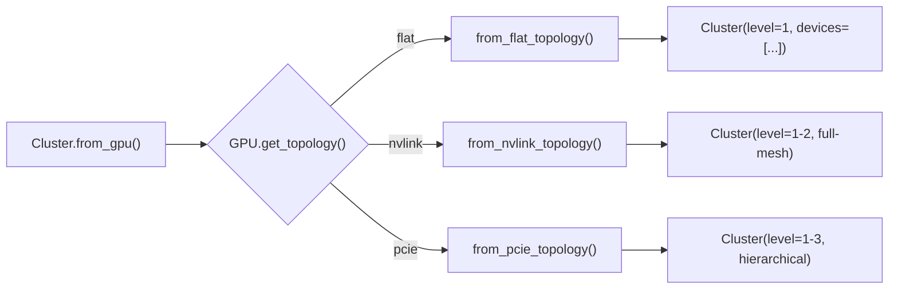

**Sources:** [apex_plus/cluster/cluster.py:217-246]()

### Flat Topology

Flat topology creates a single-level cluster with direct device connections:

- Single node only ([apex_plus/cluster/cluster.py:226-227]())
- All devices at level 1 ([apex_plus/cluster/cluster.py:137]())
- Direct device-to-device communication

**Sources:** [apex_plus/cluster/cluster.py:127-137]()

### NVLink Topology

NVLink topology supports full-mesh intra-node connections with multiple nodes:

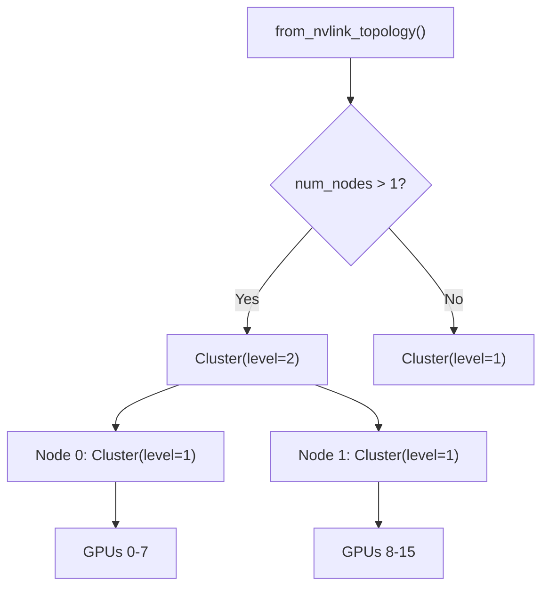

**Sources:** [apex_plus/cluster/cluster.py:139-158]()

### PCIe Topology

PCIe topology creates hierarchical clusters based on PCIe lane organization:

- Supports 1, 2, 4, or 8 devices per node ([apex_plus/cluster/cluster.py:167-170]())
- Creates multi-level hierarchy for 4 and 8 device configurations
- 8-device configuration creates 3-level hierarchy ([apex_plus/cluster/cluster.py:188-207]())

**Sources:** [apex_plus/cluster/cluster.py:159-216]()

## Cluster Operations

The `Cluster` class provides several operations for managing and querying cluster resources.

### Partitioning

The `partition()` method divides clusters into equal sub-clusters:

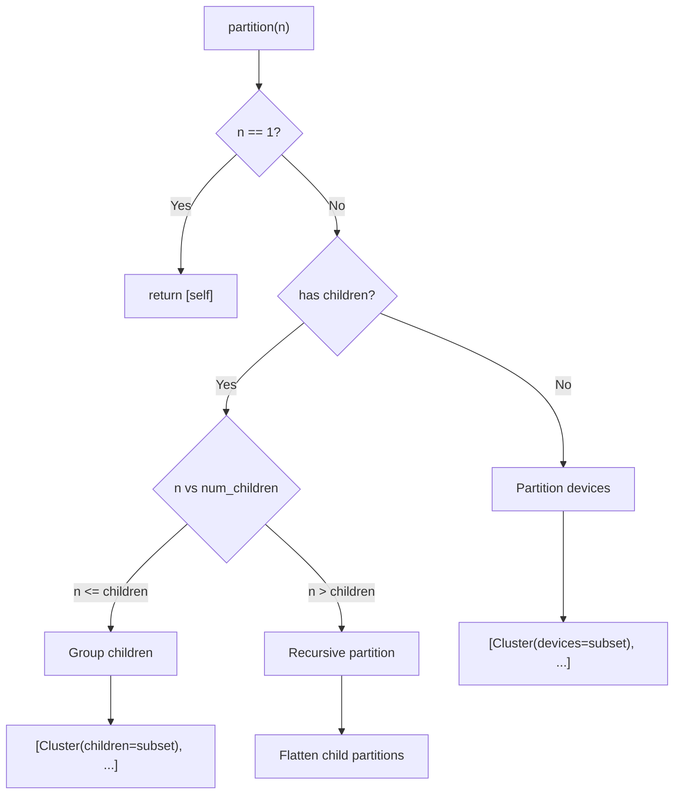

**Sources:** [apex_plus/cluster/cluster.py:55-108]()

### Device Queries

Common cluster query operations:

| Method | Purpose | Implementation |
|--------|---------|----------------|
| `get_num_devices()` | Total device count | Recursive sum across children |
| `get_device()` | Representative device | First device in hierarchy |
| `get_device_memory_capacity()` | Memory per device | Delegates to device |
| `is_partitionable(n)` | Check partition feasibility | Validates divisibility |

**Sources:** [apex_plus/cluster/cluster.py:37-54](), [apex_plus/cluster/cluster.py:110-126]()

## Hardware Specifications

### GPU Performance Characteristics

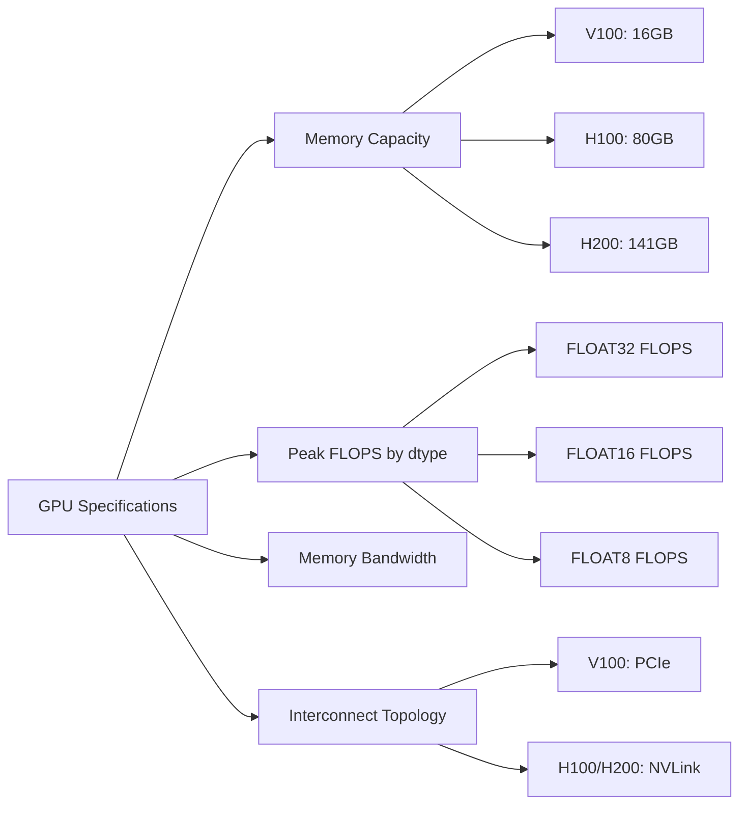

**Sources:** [apex_plus/cluster/gpu.py:27-66]()

The GPU specifications are stored in registry dictionaries that map GPU types to their capabilities, enabling APEX+ to accurately model hardware performance characteristics during simulation.

---

# Page: Intermediate Representation System

# Intermediate Representation System

<details>
<summary>Relevant source files</summary>

The following files were used as context for generating this wiki page:

- [apex_plus/ir/block.py](apex_plus/ir/block.py)
- [apex_plus/ir/cell.py](apex_plus/ir/cell.py)
- [apex_plus/ir/task.py](apex_plus/ir/task.py)
- [apex_plus/ir/transformer.py](apex_plus/ir/transformer.py)

</details>


## Purpose and Scope

The Intermediate Representation (IR) System serves as the core abstraction layer in APEX+ that converts neural network models into a hierarchical, structured format suitable for parallel execution planning. The IR system provides a unified representation for transformer-based language models, decomposing them into logical components that can be mapped to computational resources and analyzed for performance characteristics.

This document covers the four-level IR hierarchy: Transformers, Blocks, Cells, and Tasks. For information about specific cell implementations like attention mechanisms, see [Attention Components](#5.1). For feed-forward components, see [Feed-Forward Components](#5.2). For execution planning that uses these IR components, see [Execution Planning](#3.3).

## IR Hierarchy Overview

The APEX+ IR system represents neural networks using a four-level hierarchy that mirrors the logical structure of transformer models:

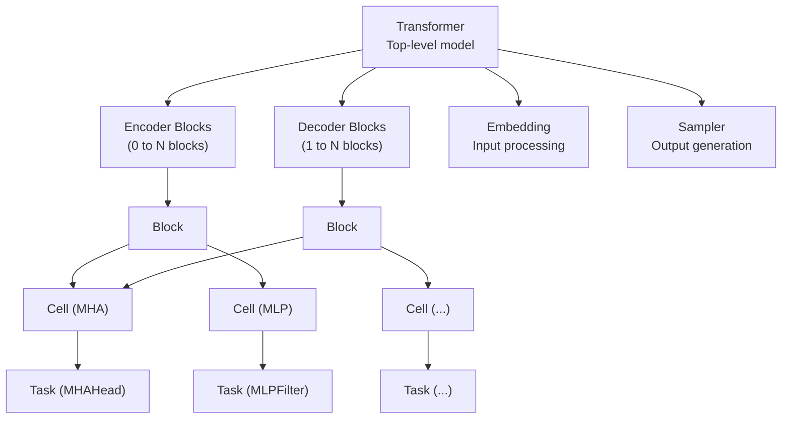

**Sources:** [apex_plus/ir/transformer.py:1-102](), [apex_plus/ir/block.py:1-13](), [apex_plus/ir/cell.py:1-26](), [apex_plus/ir/task.py:1-25]()

## Transformer: Top-Level IR Component

The `Transformer` class represents the complete neural network model and orchestrates all other IR components. It supports both encoder-decoder and decoder-only architectures.

### Key Components

| Component | Type | Purpose |
|-----------|------|---------|
| `embedding` | `Embedding` | Token and position embedding processing |
| `encoder_block` | `Optional[Block]` | Template for encoder layers (can be None) |
| `decoder_block` | `Block` | Template for decoder layers |
| `sampler` | `Sampler` | Output token generation and sampling |
| `hidden_size` | `int` | Model's hidden dimension size |

### Architecture Flexibility

The `Transformer` class validates architecture configurations during initialization:

- **Encoder blocks**: Can be 0 (decoder-only) or positive (encoder-decoder)
- **Decoder blocks**: Must be positive (at least 1 block required)
- **Block references**: Must be None when count is 0, required when count > 0

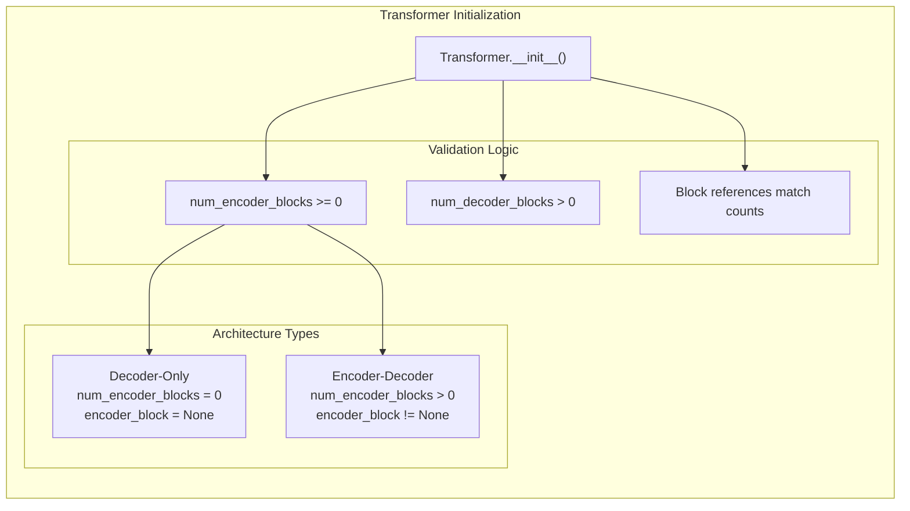

**Sources:** [apex_plus/ir/transformer.py:28-68](), [apex_plus/ir/transformer.py:70-90]()

## Block: Container for Computational Cells

The `Block` class serves as a container that groups related computational cells together. Each block represents a single transformer layer and can contain multiple types of cells (attention, feed-forward, etc.).

### Structure and Usage

A `Block` is initialized with a list of `Cell` objects:

```python
# From apex_plus/ir/block.py
def __init__(self, cells: List[Cell]) -> None:
    self.cells = cells
```

Blocks are typically replicated across the model:
- **Encoder blocks**: Repeated `num_encoder_blocks` times
- **Decoder blocks**: Repeated `num_decoder_blocks` times

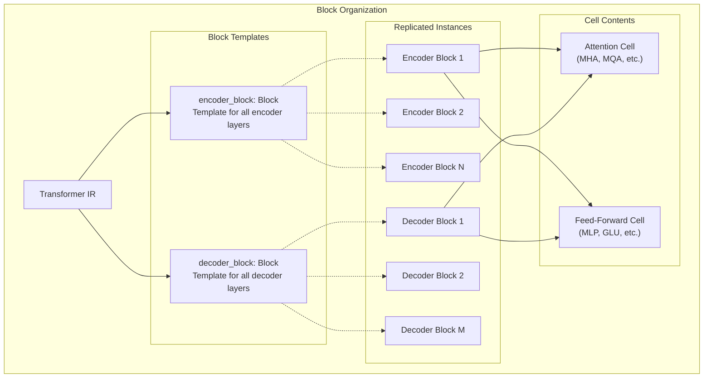

**Sources:** [apex_plus/ir/block.py:6-12](), [apex_plus/ir/transformer.py:14-16](), [apex_plus/ir/transformer.py:23-25]()

## Cell: Computational Units

The `Cell` class is an abstract base class that represents individual computational components within blocks. Each cell encapsulates a specific type of neural network operation and can contain multiple tasks.

### Core Interface

The `Cell` interface defines several key methods:

| Method | Return Type | Purpose |
|--------|-------------|---------|
| `get_name()` | `str` | Returns the cell's class name |
| `get_tasks()` | `List[Task]` | Returns the tasks this cell performs |
| `get_num_task_types()` | `int` | Returns the number of different task types |
| `has_same_spec()` | `bool` | Compares cell specifications |
| `is_attn()` | `bool` | Checks if cell contains attention tasks |

### Cell Type Detection

The `is_attn()` method uses task-level inspection to determine if a cell performs attention operations:

```python
# From apex_plus/ir/cell.py
def is_attn(self) -> bool:
    return any(task.is_attn() for task in self.get_tasks())
```

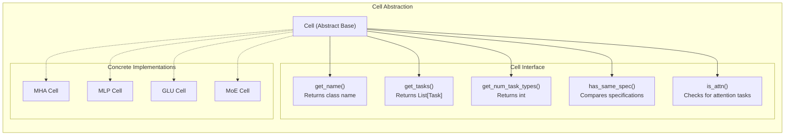

**Sources:** [apex_plus/ir/cell.py:6-26]()

## Task: Atomic Operations

The `Task` class represents the most granular level of the IR hierarchy. Tasks are atomic computational operations that can be profiled, scheduled, and executed independently.

### Task Interface

The `Task` base class provides several key methods:

| Method | Type | Purpose |
|--------|------|---------|
| `get_type()` | Instance | Returns the task's class name |
| `get_param_size()` | Static | Calculates parameter memory requirements |
| `get_kv_token_size()` | Static | Calculates key-value cache requirements |
| `is_attn()` | Class | Identifies attention-related tasks |

### Memory and Performance Analysis

Tasks provide static methods for memory analysis that are used during execution planning:

```python
# From apex_plus/ir/task.py
@staticmethod
def get_param_size(tasks: List["Task"], dtype: DTYPE) -> int:
    raise NotImplementedError

@staticmethod  
def get_kv_token_size(tasks: List["Task"], dtype: DTYPE) -> int:
    raise NotImplementedError
```

### Task Classification

The `is_attn()` class method enables the IR system to identify attention-related operations for specialized handling during parallelization.

```mermaid
graph TD
    subgraph "Task System"
        TaskBase["Task (Abstract Base)"]
        
        subgraph "Task Interface"
            GetType["get_type()<br/>Returns class name"]
            GetParamSize["get_param_size()<br/>Memory for parameters"]
            GetKVSize["get_kv_token_size()<br/>Memory for KV cache"]
            IsAttnTask["is_attn()<br/>Attention task classifier"]
        end
        
        subgraph "Memory Analysis"
            ParamMem["Parameter Memory<br/>Based on dtype"]
            KVMem["KV Cache Memory<br/>Based on dtype"]
            MemTotal["Total Memory<br/>Requirements"]
        end
        
        subgraph "Task Categories"
            AttentionTasks["Attention Tasks<br/>MHAHead, MQAHead"]
            FFNTasks["FFN Tasks<br/>MLPFilter, GLUFilter"]
            OtherTasks["Other Tasks<br/>Embedding, Sampling"]
        end
    end
    
    TaskBase --> GetType
    TaskBase --> GetParamSize
    TaskBase --> GetKVSize  
    TaskBase --> IsAttnTask
    
    GetParamSize --> ParamMem
    GetKVSize --> KVMem
    ParamMem --> MemTotal
    KVMem --> MemTotal
    
    IsAttnTask --> AttentionTasks
    TaskBase -.-> FFNTasks
    TaskBase -.-> OtherTasks
```

**Sources:** [apex_plus/ir/task.py:6-25]()

## IR System Integration

The IR components work together to provide a complete representation of transformer models that can be analyzed and executed efficiently.

### Model-to-IR Conversion Flow

```mermaid
graph LR
    subgraph "Model Definition"
        HFConfig["Hugging Face Config"]
        JSONConfig["JSON Config"]
        ModelClass["Model Class<br/>(GPT2, LLaMA, etc.)"]
    end
    
    subgraph "IR Construction"
        CreateEmbedding["Embedding(vocab_size, hidden_size)"]
        CreateSampler["Sampler(vocab_size, hidden_size)"]
        CreateBlocks["Block(cells: List[Cell])"]
        CreateTransformer["Transformer.from_blocks()"]
    end
    
    subgraph "IR Hierarchy"
        TransformerIR["Transformer IR"]
        BlockIR["Block IR"]
        CellIR["Cell IR"]
        TaskIR["Task IR"]
    end
    
    subgraph "Usage"
        ExecutionPlanning["Execution Planning"]
        PerformanceAnalysis["Performance Analysis"]
        MemoryEstimation["Memory Estimation"]
    end
    
    HFConfig --> ModelClass
    JSONConfig --> ModelClass
    ModelClass --> CreateEmbedding
    ModelClass --> CreateSampler
    ModelClass --> CreateBlocks
    ModelClass --> CreateTransformer
    
    CreateTransformer --> TransformerIR
    CreateBlocks --> BlockIR
    BlockIR --> CellIR
    CellIR --> TaskIR
    
    TransformerIR --> ExecutionPlanning
    TaskIR --> PerformanceAnalysis
    TaskIR --> MemoryEstimation
```

**Sources:** [apex_plus/ir/transformer.py:70-90](), [apex_plus/ir/block.py:8-12](), [apex_plus/ir/cell.py:15-25](), [apex_plus/ir/task.py:15-24]()

## Summary

The APEX+ Intermediate Representation System provides a four-level hierarchical abstraction that enables sophisticated analysis and optimization of transformer models:

1. **Transformer**: Top-level orchestration with embedding, blocks, and sampling
2. **Block**: Container grouping related computational cells  
3. **Cell**: Individual computational units with specific functionality
4. **Task**: Atomic operations with memory and performance characteristics

This hierarchy allows APEX+ to decompose complex models into manageable components that can be mapped to computational resources, analyzed for performance characteristics, and optimized for parallel execution.

**Sources:** [apex_plus/ir/transformer.py:1-102](), [apex_plus/ir/block.py:1-13](), [apex_plus/ir/cell.py:1-26](), [apex_plus/ir/task.py:1-25]()

---

# Page: Execution Planning

# Execution Planning

<details>
<summary>Relevant source files</summary>

The following files were used as context for generating this wiki page:

- [apex_plus/execution/plan.py](apex_plus/execution/plan.py)

</details>


This document covers APEX+'s execution planning system, which is responsible for mapping neural network model components to computational clusters and defining how parallel execution should be orchestrated. The execution planning system bridges the gap between the intermediate representation of models and the physical cluster resources that will execute them.

For information about the cluster management and device abstractions that execution plans target, see [Device and Cluster Management](#3.1). For details about the model components that execution plans orchestrate, see [Intermediate Representation System](#3.2).

## Overview

Execution planning in APEX+ transforms abstract model representations into concrete execution strategies by determining how model components should be distributed across available computational resources. The core of this system is the `ExecutionPlan` class, which encapsulates three key mapping relationships: parallel scheduling strategies, stage-to-cluster assignments, and cell-to-cluster assignments with replication support.

## ExecutionPlan Class

The `ExecutionPlan` class serves as the central data structure that defines how a model will be executed across a cluster of devices. It contains three primary components that work together to specify the complete execution strategy.

**ExecutionPlan Components**
```mermaid
graph TB
    ExecutionPlan["ExecutionPlan"]
    ParallelSchedule["parallel_schedule<br/>ParallelSchedule"]
    StageClusters["stage_clusters<br/>List[Cluster]"]
    CellClusters["cell_clusters<br/>List[List[Cluster]]"]
    
    ExecutionPlan --> ParallelSchedule
    ExecutionPlan --> StageClusters
    ExecutionPlan --> CellClusters
    
    StageClusters --> StageMapping["Stage → Cluster<br/>Mapping"]
    CellClusters --> CellMapping["Cell → Replica → Cluster<br/>Mapping"]
    
    ParallelSchedule --> Strategy["Parallelization<br/>Strategy"]
```

The `ExecutionPlan` constructor takes three parameters that define the complete execution mapping:

| Parameter | Type | Purpose |
|-----------|------|---------|
| `parallel_schedule` | `ParallelSchedule` | Defines the parallelization strategy and scheduling approach |
| `stage_clusters` | `List[Cluster]` | Maps each pipeline stage to its assigned cluster |
| `cell_clusters` | `List[List[Cluster]]` | Maps each cell and its replicas to their assigned clusters |

Sources: [apex_plus/execution/plan.py:7-24]()

## Stage-to-Cluster Mapping

The `stage_clusters` attribute provides a direct mapping from pipeline stages to computational clusters. This list-based mapping enables pipeline parallelism by assigning different stages of the neural network to different clusters, allowing multiple stages to execute concurrently on different portions of the input data.

**Stage Mapping Architecture**
```mermaid
graph LR
    subgraph "Pipeline Stages"
        Stage0["Stage 0<br/>Input Embedding"]
        Stage1["Stage 1<br/>Transformer Block 0-3"]
        Stage2["Stage 2<br/>Transformer Block 4-7"]
        Stage3["Stage 3<br/>Output Sampling"]
    end
    
    subgraph "Cluster Assignment"
        Cluster0["stage_clusters[0]<br/>Cluster"]
        Cluster1["stage_clusters[1]<br/>Cluster"]
        Cluster2["stage_clusters[2]<br/>Cluster"]
        Cluster3["stage_clusters[3]<br/>Cluster"]
    end
    
    Stage0 --> Cluster0
    Stage1 --> Cluster1
    Stage2 --> Cluster2
    Stage3 --> Cluster3
```

Each index in the `stage_clusters` list corresponds to a stage identifier, and the `Cluster` object at that index specifies which computational resources will execute that stage. This mapping is fundamental to pipeline parallelism strategies where the model is partitioned into sequential stages.

Sources: [apex_plus/execution/plan.py:12]()

## Cell-to-Cluster Mapping with Replication

The `cell_clusters` attribute implements a two-dimensional mapping that supports both cell distribution and replication. The outer list dimension corresponds to different cells (such as attention or feed-forward components), while the inner list dimension corresponds to replicas of each cell for tensor parallelism or redundancy.

**Cell Replication Mapping**
```mermaid
graph TB
    subgraph "Cell Types"
        MHA["MHA Cell"]
        MLP["MLP Cell"]
        MoE["MoE Cell"]
    end
    
    subgraph "Cell Replicas and Clusters"
        subgraph "cell_clusters[0] - MHA"
            MHA_R0["Replica 0<br/>Cluster A"]
            MHA_R1["Replica 1<br/>Cluster B"]
        end
        
        subgraph "cell_clusters[1] - MLP"
            MLP_R0["Replica 0<br/>Cluster C"]
            MLP_R1["Replica 1<br/>Cluster D"]
        end
        
        subgraph "cell_clusters[2] - MoE"
            MoE_R0["Replica 0<br/>Cluster E"]
            MoE_R1["Replica 1<br/>Cluster F"]
            MoE_R2["Replica 2<br/>Cluster G"]
        end
    end
    
    MHA --> MHA_R0
    MHA --> MHA_R1
    MLP --> MLP_R0
    MLP --> MLP_R1
    MoE --> MoE_R0
    MoE --> MoE_R1
    MoE --> MoE_R2
```

This two-dimensional structure enables sophisticated parallelization strategies:
- **Tensor Parallelism**: Multiple replicas of the same cell distributed across different clusters
- **Data Parallelism**: Identical replicas processing different data batches
- **Expert Parallelism**: Different experts in MoE cells assigned to different clusters

Sources: [apex_plus/execution/plan.py:13]()

## Integration with ParallelSchedule

The `ParallelSchedule` component defines the high-level parallelization strategy that governs how the stage and cell mappings should be interpreted during execution. This schedule coordinates the interaction between different parallelization approaches and determines the execution order and synchronization requirements.

**Execution Plan Integration**
```mermaid
graph TD
    subgraph "Execution Planning Flow"
        ModelIR["Model IR<br/>Transformer"]
        ClusterSpec["Cluster<br/>Specification"]
        
        PlanGenerator["Plan Generator<br/>(Not shown in provided code)"]
        
        ExecutionPlan["ExecutionPlan"]
        ParallelSchedule["ParallelSchedule"]
        StageClusters["stage_clusters<br/>List[Cluster]"]
        CellClusters["cell_clusters<br/>List[List[Cluster]]"]
        
        Simulator["Simulator<br/>(Not shown in provided code)"]
    end
    
    ModelIR --> PlanGenerator
    ClusterSpec --> PlanGenerator
    PlanGenerator --> ExecutionPlan
    
    ExecutionPlan --> ParallelSchedule
    ExecutionPlan --> StageClusters
    ExecutionPlan --> CellClusters
    
    ExecutionPlan --> Simulator
```

The `ParallelSchedule` works in conjunction with the cluster mappings to ensure that:
- Dependencies between stages are respected in pipeline parallelism
- Synchronization points are established for tensor-parallel operations
- Communication patterns are optimized based on cluster topology
- Load balancing is maintained across replicated components

Sources: [apex_plus/execution/plan.py:11,15]()

## ExecutionPlan Representation

The `ExecutionPlan` class provides a comprehensive string representation that includes all three core components, enabling easy debugging and inspection of the execution strategy. The `__repr__` method formats the parallel schedule, stage clusters, and cell clusters in a readable format.

```python
def __repr__(self) -> str:
    return (
        f"ExecutionPlan(parallel_schedule={self.parallel_schedule}, "
        f"stage_clusters={self.stage_clusters}, "
        f"cell_clusters={self.cell_clusters})"
    )
```

This representation is particularly useful during plan generation and validation phases, where multiple candidate execution plans may be evaluated and compared based on their resource allocation and expected performance characteristics.

Sources: [apex_plus/execution/plan.py:19-24]()

---

# Page: Device Management Reference

# Device Management Reference

<details>
<summary>Relevant source files</summary>

The following files were used as context for generating this wiki page:

- [apex_plus/cluster/cluster.py](apex_plus/cluster/cluster.py)
- [apex_plus/cluster/device.py](apex_plus/cluster/device.py)
- [apex_plus/cluster/gpu.py](apex_plus/cluster/gpu.py)

</details>


## Purpose and Scope

This document provides a technical reference for APEX+'s device management system, which abstracts computational hardware and organizes it into hierarchical clusters with different topologies. The device management system serves as the foundation for execution planning by providing information about available compute resources, their capabilities, and interconnection topologies.

For detailed information about how device clusters are used in execution planning, see [Execution Planning](#3.3). For specific device abstraction details, see [Device Abstraction](#4.1). For GPU-specific implementations, see [GPU Devices](#4.2). For cluster topology management, see [Cluster Topology](#4.3).

## Device Management Architecture

The device management system in APEX+ consists of three main components that work together to represent and organize computational resources:

### Device Class Hierarchy

```mermaid
classDiagram
    class Device {
        <<abstract>>
        +int device_id
        +str device_type
        +__init__(device_id, device_type)
        +get_memory_capacity()* int
    }
    
    class GPU {
        +GPUType gpu_type
        +int total_memory
        +dict peak_flops
        +float peak_mem_bandwidth
        +__init__(device_id, device_type)
        +get_memory_capacity() int
        +get_topology(gpu)$ str
    }
    
    class GPUType {
        <<enumeration>>
        V100_PCIE_16GB
        H100_SXM_80GB
        H200_SXM_141GB
    }
    
    Device <|-- GPU
    GPU --> GPUType
```

Sources: [apex_plus/cluster/device.py:1-12](), [apex_plus/cluster/gpu.py:69-103](), [apex_plus/cluster/gpu.py:9-16]()

### Cluster Topology Structure

```mermaid
graph TB
    subgraph "Cluster Hierarchy"
        RootCluster["Cluster(level=2+)"]
        NodeCluster1["Cluster(level=1)"]
        NodeCluster2["Cluster(level=1)"]
        
        subgraph "GPU Devices"
            GPU1["GPU(device_id=0)"]
            GPU2["GPU(device_id=1)"]
            GPU3["GPU(device_id=2)"]
            GPU4["GPU(device_id=3)"]
        end
    end
    
    subgraph "Topology Types"
        FlatTopo["from_flat_topology()"]
        NVLinkTopo["from_nvlink_topology()"]
        PCIeTopo["from_pcie_topology()"]
    end
    
    RootCluster --> NodeCluster1
    RootCluster --> NodeCluster2
    NodeCluster1 --> GPU1
    NodeCluster1 --> GPU2
    NodeCluster2 --> GPU3
    NodeCluster2 --> GPU4
    
    FlatTopo --> RootCluster
    NVLinkTopo --> RootCluster
    PCIeTopo --> RootCluster
```

Sources: [apex_plus/cluster/cluster.py:7-35](), [apex_plus/cluster/cluster.py:127-246]()

## Device Abstraction

The `Device` class provides the base abstraction for all computational devices in APEX+. It defines a minimal interface that all device implementations must support, including device identification and memory capacity reporting.

| Method | Purpose | Implementation |
|--------|---------|----------------|
| `__init__(device_id, device_type)` | Initialize device with ID and type | Abstract - must be implemented by subclasses |
| `get_memory_capacity()` | Return device memory in bytes | Abstract - must be implemented by subclasses |

The abstract nature of the `Device` class allows APEX+ to support different types of computational resources through a uniform interface. For complete device abstraction details, see [Device Abstraction](#4.1).

Sources: [apex_plus/cluster/device.py:1-12]()

## GPU Device Support

The `GPU` class implements the `Device` interface for GPU hardware, providing detailed specifications for supported GPU types including memory capacity, peak FLOPS, and memory bandwidth.

### Supported GPU Types

| GPU Type | Memory | Peak FLOPS (FP16) | Memory Bandwidth | Topology |
|----------|--------|-------------------|------------------|----------|
| `V100_PCIE_16GB` | 16 GB | 14 TFLOPS | 900 GB/s | PCIe |
| `H100_SXM_80GB` | 80 GB | 1979 TFLOPS | 3.35 TB/s | NVLink |
| `H200_SXM_141GB` | 141 GB | 1979 TFLOPS | 4.8 TB/s | NVLink |

### GPU Registration System

```mermaid
graph LR
    subgraph "GPU Registry System"
        DeviceString["device_type: str"]
        Registry["_GPU_REGISTRY"]
        GPUTypeEnum["GPUType enum"]
        
        subgraph "Specification Lookups"
            MemoryLookup["_GPU_TYPE_TO_MEMORY_GB"]
            TopologyLookup["_GPU_TYPE_TO_TOPOLOGY"]
            FLOPSLookup["_GPU_PEAK_FLOPS"]
            BandwidthLookup["_GPU_PEAK_MEM_BANDWIDTH"]
        end
    end
    
    DeviceString --> Registry
    Registry --> GPUTypeEnum
    GPUTypeEnum --> MemoryLookup
    GPUTypeEnum --> TopologyLookup
    GPUTypeEnum --> FLOPSLookup
    GPUTypeEnum --> BandwidthLookup
```

For detailed GPU specifications and implementations, see [GPU Devices](#4.2).

Sources: [apex_plus/cluster/gpu.py:18-66](), [apex_plus/cluster/gpu.py:69-103]()

## Cluster Topology Management

The `Cluster` class implements hierarchical organization of devices with support for different interconnection topologies. Clusters can be partitioned for parallel execution and support three main topology types.

### Cluster Factory Methods

```mermaid
graph TD
    subgraph "Cluster Creation"
        FromGPU["from_gpu(gpu_type, num_nodes, num_devices_per_node)"]
        GetTopology["GPU.get_topology(gpu_type)"]
        
        subgraph "Topology-Specific Factories"
            FlatFactory["from_flat_topology(gpu_type, num_devices)"]
            NVLinkFactory["from_nvlink_topology(gpu_type, num_nodes, devices_per_node)"]
            PCIeFactory["from_pcie_topology(gpu_type, num_nodes, devices_per_node)"]
        end
        
        subgraph "Topology Types"
            Flat["flat: Single-node direct connections"]
            NVLink["nvlink: Full-mesh intra-node connections"]
            PCIe["pcie: Hierarchical PCIe lanes"]
        end
    end
    
    FromGPU --> GetTopology
    GetTopology --> FlatFactory
    GetTopology --> NVLinkFactory
    GetTopology --> PCIeFactory
    
    FlatFactory --> Flat
    NVLinkFactory --> NVLink
    PCIeFactory --> PCIe
```

### Cluster Partitioning

The `partition(n)` method enables splitting clusters into `n` sub-clusters for parallel execution planning:

| Partition Scenario | Behavior |
|-------------------|----------|
| `n == 1` | Returns the cluster unchanged |
| `n <= num_children` | Partitions by grouping child clusters |
| `n > num_children` | Recursively partitions child clusters |
| Leaf cluster | Partitions devices directly |

For complete cluster topology details, see [Cluster Topology](#4.3).

Sources: [apex_plus/cluster/cluster.py:55-125](), [apex_plus/cluster/cluster.py:217-246]()

## Integration with Execution Planning

The device management system integrates with APEX+'s execution planning through the cluster abstraction, enabling the plan generator to understand available computational resources and their capabilities.

### Device Management in Execution Flow

```mermaid
graph LR
    subgraph "Device Management"
        ClusterSpec["Cluster Configuration"]
        DeviceSpecs["Device Specifications"]
        TopologyInfo["Topology Information"]
    end
    
    subgraph "Execution Planning"
        PlanGenerator["Plan Generator"]
        StageMapping["Stage → Cluster Mapping"]
        CellMapping["Cell Replicas → Cluster Mapping"]
    end
    
    subgraph "Performance Simulation"
        Simulator["Dynamism-Aware Simulator"]
        ProfilingData["Op-level Profiling Data"]
    end
    
    ClusterSpec --> PlanGenerator
    DeviceSpecs --> PlanGenerator
    TopologyInfo --> PlanGenerator
    
    PlanGenerator --> StageMapping
    PlanGenerator --> CellMapping
    
    StageMapping --> Simulator
    CellMapping --> Simulator
    DeviceSpecs --> ProfilingData
    ProfilingData --> Simulator
```

The cluster's `get_device()`, `get_device_memory_capacity()`, and `get_num_devices()` methods provide essential information for execution plan generation, while the `partition()` method enables cluster subdivision for different parallelization strategies.

Sources: [apex_plus/cluster/cluster.py:40-54](), [apex_plus/cluster/cluster.py:55-125]()

---

# Page: Device Abstraction

# Device Abstraction

<details>
<summary>Relevant source files</summary>

The following files were used as context for generating this wiki page:

- [apex_plus/cluster/device.py](apex_plus/cluster/device.py)

</details>


This document covers the base `Device` abstraction that provides the fundamental interface for all computational devices in APEX+. This abstraction defines the core contract that all concrete device implementations must fulfill, enabling consistent device management across different hardware types.

For information about specific GPU device implementations, see [GPU Devices](#4.2). For logical device implementations, see [Logical Devices](#4.4). For the broader cluster topology system that organizes devices, see [Cluster Topology](#4.3).

## Abstract Device Interface

The `Device` class serves as the abstract base class for all computational devices in APEX+. It establishes the fundamental interface that concrete device implementations must provide, ensuring consistent behavior across different hardware types including GPUs and logical devices.

**Device Class Hierarchy**
```mermaid
classDiagram
    class Device {
        <<abstract>>
        +device_id: int
        +device_type: str
        +__init__(device_id, device_type)
        +get_memory_capacity() int
    }
    
    class GPUDevice {
        +peak_flops: dict
        +memory_bandwidth: float
        +topology_type: str
    }
    
    class LogicalDevice {
        +virtual_capacity: int
    }
    
    Device <|-- GPUDevice
    Device <|-- LogicalDevice
    
    note for Device "Abstract base class\ndefines core interface"
    note for GPUDevice "Physical GPU implementations\nwith hardware specs"
    note for LogicalDevice "Virtual compute resources\nfor testing/simulation"
```

Sources: [apex_plus/cluster/device.py:1-12]()

## Device Identification System

Every device in APEX+ is uniquely identified through a two-part identification system that enables precise device referencing and type-based operations.

### Device ID and Type Parameters

The base `Device` constructor requires two essential parameters:

| Parameter | Type | Purpose |
|-----------|------|---------|
| `device_id` | `int` | Unique numerical identifier within the device cluster |
| `device_type` | `str` | String identifier specifying the concrete device implementation type |

**Device Initialization Flow**
```mermaid
sequenceDiagram
    participant Client
    participant Device
    participant ConcreteDevice
    
    Client->>ConcreteDevice: __init__(device_id, device_type)
    ConcreteDevice->>Device: super().__init__(device_id, device_type)
    Device-->>Device: raise NotImplementedError
    Note over Device: Abstract class prevents direct instantiation
    ConcreteDevice->>ConcreteDevice: Initialize device-specific properties
    ConcreteDevice-->>Client: Device instance ready
```

The abstract nature of the base `Device` class prevents direct instantiation, requiring clients to use concrete implementations like `GPUDevice` or `LogicalDevice`.

Sources: [apex_plus/cluster/device.py:3-8]()

## Memory Capacity Interface

The `Device` abstraction defines a standardized interface for querying device memory capacity through the `get_memory_capacity()` method. This method returns the total memory available on the device in bytes.

### Memory Capacity Contract

```python
def get_memory_capacity(self) -> int:
    raise NotImplementedError
```

This abstract method establishes the contract that all concrete device implementations must:

1. **Return integer values** representing memory capacity in bytes
2. **Provide accurate capacity information** for memory planning and allocation
3. **Handle device-specific memory architectures** (unified memory, dedicated VRAM, etc.)

**Memory Interface Implementation Pattern**
```mermaid
graph TB
    BaseDevice["Device.get_memory_capacity()"]
    GPUImpl["GPUDevice implementation"]
    LogicalImpl["LogicalDevice implementation"]
    
    BaseDevice --> GPUImpl
    BaseDevice --> LogicalImpl
    
    GPUImpl --> HardwareQuery["Query physical GPU memory"]
    LogicalImpl --> VirtualCapacity["Return configured virtual capacity"]
    
    HardwareQuery --> MemoryValue["Memory capacity (bytes)"]
    VirtualCapacity --> MemoryValue
```

Sources: [apex_plus/cluster/device.py:10-12]()

## Implementation Requirements

Concrete device implementations must fulfill several requirements when inheriting from the `Device` base class:

### Mandatory Method Implementations

All concrete device classes must override the abstract methods with functional implementations:

| Method | Requirement | Purpose |
|--------|-------------|---------|
| `__init__()` | Call `super().__init__()` with appropriate parameters | Initialize base device properties |
| `get_memory_capacity()` | Return actual memory capacity as integer | Enable memory-aware execution planning |

### Type System Integration

Device implementations should integrate with APEX+'s type system by:

1. **Using descriptive `device_type` strings** that clearly identify the device category
2. **Maintaining consistent naming conventions** across similar device types
3. **Supporting device factory methods** that can instantiate devices by type string

**Device Type Registration Pattern**
```mermaid
graph LR
    DeviceFactory["Device Factory"] --> TypeRegistry["Device Type Registry"]
    TypeRegistry --> GPUTypes["GPU Types<br/>H100-SXM-80GB<br/>V100-PCIE-16GB"]
    TypeRegistry --> LogicalTypes["Logical Types<br/>virtual-device<br/>test-device"]
    
    GPUTypes --> GPUInstances["GPU Device Instances"]
    LogicalTypes --> LogicalInstances["Logical Device Instances"]
```

Sources: [apex_plus/cluster/device.py:1-12]()

## Integration with Cluster Management

The `Device` abstraction integrates seamlessly with APEX+'s cluster management system, where devices are organized into hierarchical clusters with different topology configurations.

### Device-Cluster Relationship

Devices serve as the fundamental building blocks for:

- **Cluster construction** - Devices are grouped into clusters based on topology and performance characteristics
- **Resource allocation** - Memory capacity and compute capabilities inform execution planning
- **Parallel execution** - Device identification enables precise task placement and communication routing

**Device in Cluster Context**
```mermaid
graph TB
    Cluster["Cluster"] --> Node1["Node 1"]
    Cluster --> Node2["Node 2"]
    
    Node1 --> Device1["Device(id=0, type='H100-SXM-80GB')"]
    Node1 --> Device2["Device(id=1, type='H100-SXM-80GB')"]
    Node2 --> Device3["Device(id=2, type='V100-PCIE-16GB')"]
    Node2 --> Device4["Device(id=3, type='logical-device')"]
    
    Device1 --> Memory1["get_memory_capacity(): 81_920_000_000"]
    Device2 --> Memory2["get_memory_capacity(): 81_920_000_000"]
    Device3 --> Memory3["get_memory_capacity(): 16_384_000_000"]
    Device4 --> Memory4["get_memory_capacity(): 32_768_000_000"]
```

The device abstraction enables cluster management algorithms to work uniformly across different hardware types while still accessing device-specific capabilities when needed.

Sources: [apex_plus/cluster/device.py:1-12]()

---

# Page: GPU Devices

# GPU Devices

<details>
<summary>Relevant source files</summary>

The following files were used as context for generating this wiki page:

- [apex_plus/cluster/gpu.py](apex_plus/cluster/gpu.py)

</details>


This document covers the GPU device implementations in APEX+, including supported hardware types and their technical specifications. GPU devices are concrete implementations of the Device abstraction that represent physical GPU hardware with specific memory capacities, computational capabilities, and interconnect topologies.

For the base Device interface, see [Device Abstraction](#4.1). For how GPU devices are organized into clusters with specific topologies, see [Cluster Topology](#4.3).

## Supported GPU Types

APEX+ supports three GPU types through the `GPUType` enum, each representing different generations and capabilities of NVIDIA hardware:

| GPU Type | String Identifier | Memory | Topology |
|----------|------------------|---------|----------|
| V100 PCIe | `"V100-PCIE-16GB"` | 16 GB | PCIe |
| H100 SXM | `"H100-SXM-80GB"` | 80 GB | NVLink |
| H200 SXM | `"H200-SXM-141GB"` | 141 GB | NVLink |

The system uses a registry pattern to map string identifiers to enum values, allowing users to specify GPU types by name while maintaining type safety internally.

**GPU Type Registry Architecture**
```mermaid
graph TD
    UserInput["User Input<br/>\"H100-SXM-80GB\""]
    Registry["_GPU_REGISTRY<br/>dict mapping"]
    GPUTypeEnum["GPUType.H100_SXM_80GB<br/>enum value"]
    
    MemoryMap["_GPU_TYPE_TO_MEMORY_GB<br/>80 * _GB"]
    TopologyMap["_GPU_TYPE_TO_TOPOLOGY<br/>\"nvlink\""]
    FLOPSMap["_GPU_PEAK_FLOPS<br/>by DTYPE"]
    BandwidthMap["_GPU_PEAK_MEM_BANDWIDTH<br/>3.35e12 B/s"]
    
    UserInput --> Registry
    Registry --> GPUTypeEnum
    GPUTypeEnum --> MemoryMap
    GPUTypeEnum --> TopologyMap
    GPUTypeEnum --> FLOPSMap
    GPUTypeEnum --> BandwidthMap
```

Sources: [apex_plus/cluster/gpu.py:9-25]()

## GPU Specifications

### Memory Capacity

Each GPU type has a fixed total memory capacity defined in the `_GPU_TYPE_TO_MEMORY_GB` mapping:

- **V100 PCIe**: 16 GB
- **H100 SXM**: 80 GB  
- **H200 SXM**: 141 GB

Memory values are stored in bytes using the `_GB` constant (1 << 30).

### Peak FLOPS by Data Type

Different GPU generations support different data types with varying computational throughput. The `_GPU_PEAK_FLOPS` mapping defines peak floating-point operations per second:

| GPU Type | FLOAT32 | FLOAT16 | FLOAT8 |
|----------|---------|---------|---------|
| V100 PCIe | 7 TFLOPS | 14 TFLOPS | - |
| H100 SXM | 67 TFLOPS | 1,979 TFLOPS | 3,958 TFLOPS |
| H200 SXM | 67 TFLOPS | 1,979 TFLOPS | 3,958 TFLOPS |

Note that V100 does not support FLOAT8 operations, while H100/H200 provide significantly higher throughput for reduced precision formats.

### Memory Bandwidth

Peak memory bandwidth specifications in the `_GPU_PEAK_MEM_BANDWIDTH` mapping:

- **V100 PCIe**: 900 GB/s
- **H100 SXM**: 3.35 TB/s
- **H200 SXM**: 4.8 TB/s

Sources: [apex_plus/cluster/gpu.py:27-66]()

## GPU Class Implementation

The `GPU` class inherits from the abstract `Device` class and provides concrete implementations for GPU hardware.

**GPU Class Structure**
```mermaid
graph TD
    Device["Device<br/>(abstract base)"]
    GPU["GPU<br/>(concrete implementation)"]
    
    subgraph "GPU Attributes"
        DeviceID["device_id: int"]
        DeviceType["device_type: str"]
        GPUType["gpu_type: GPUType"]
        TotalMemory["total_memory: int"]
        PeakFLOPS["peak_flops: dict"]
        PeakBandwidth["peak_mem_bandwidth: float"]
    end
    
    subgraph "GPU Methods"
        Constructor["__init__(device_id, device_type)"]
        GetMemory["get_memory_capacity() -> int"]
        GetTopology["get_topology(gpu: str) -> str"]
        Repr["__repr__() -> str"]
    end
    
    Device --> GPU
    GPU --> DeviceID
    GPU --> DeviceType
    GPU --> GPUType
    GPU --> TotalMemory
    GPU --> PeakFLOPS
    GPU --> PeakBandwidth
    
    GPU --> Constructor
    GPU --> GetMemory
    GPU --> GetTopology
    GPU --> Repr
```

### Constructor

The `GPU.__init__()` method takes a device ID and device type string:

```python
def __init__(self, device_id: int, device_type: str) -> None
```

During initialization, the constructor:
1. Converts the device type string to uppercase for case-insensitive matching
2. Validates the device type exists in `_GPU_REGISTRY`
3. Looks up the corresponding `GPUType` enum value
4. Populates hardware specifications from the mapping dictionaries

### Key Methods

- `get_memory_capacity()`: Returns total memory capacity in bytes
- `get_topology()`: Static method that returns topology type ("pcie" or "nvlink") for a given GPU string
- `__repr__()`: Provides detailed string representation including all hardware specifications

Sources: [apex_plus/cluster/gpu.py:69-103]()

## Topology Integration

GPU devices are tightly integrated with the cluster topology system. Each GPU type has an associated default topology defined in `_GPU_TYPE_TO_TOPOLOGY`:

- **PCIe topology**: Used by V100 PCIe devices for hierarchical interconnects
- **NVLink topology**: Used by H100/H200 SXM devices for high-bandwidth full-mesh connectivity

The `get_topology()` static method allows the cluster management system to determine appropriate topology types when building device clusters without instantiating GPU objects.

**GPU-Topology Mapping**
```mermaid
graph LR
    subgraph "GPU Types"
        V100["GPUType.V100_PCIE_16GB"]
        H100["GPUType.H100_SXM_80GB"] 
        H200["GPUType.H200_SXM_141GB"]
    end
    
    subgraph "Topology Types"
        PCIe["\"pcie\"<br/>Hierarchical"]
        NVLink["\"nvlink\"<br/>Full-mesh"]
    end
    
    V100 --> PCIe
    H100 --> NVLink
    H200 --> NVLink
```

This topology information is used by the cluster management system to determine communication costs and optimal placement strategies for parallel execution plans.

Sources: [apex_plus/cluster/gpu.py:36-43](), [apex_plus/cluster/gpu.py:100-102]()

---

# Page: Cluster Topology

# Cluster Topology

<details>
<summary>Relevant source files</summary>

The following files were used as context for generating this wiki page:

- [apex_plus/cluster/cluster.py](apex_plus/cluster/cluster.py)

</details>


This document covers the hierarchical cluster organization system in APEX+, including the three supported topology types (NVLink, PCIe, flat) and cluster partitioning capabilities. For information about individual device abstractions, see [Device Abstraction](#4.1). For GPU device specifications and implementations, see [GPU Devices](#4.2).

## Overview

The APEX+ cluster topology system provides a hierarchical abstraction for organizing computational devices into clusters with different interconnection topologies. The system supports multi-level cluster hierarchies that can be partitioned for parallel execution planning.

## Hierarchical Cluster Structure

The `Cluster` class implements a tree-like hierarchical structure where each cluster has a level, optional children clusters, and optional devices at leaf nodes.

```mermaid
graph TD
    RootCluster["Cluster(level=3)"] --> Node1["Cluster(level=2)"]
    RootCluster --> Node2["Cluster(level=2)"]
    
    Node1 --> GPU1["Cluster(level=1)"]
    Node1 --> GPU2["Cluster(level=1)"]
    
    Node2 --> GPU3["Cluster(level=1)"]
    Node2 --> GPU4["Cluster(level=1)"]
    
    GPU1 --> Dev1["GPU(id=0)"]
    GPU1 --> Dev2["GPU(id=1)"]
    
    GPU2 --> Dev3["GPU(id=2)"]
    GPU2 --> Dev4["GPU(id=3)"]
    
    GPU3 --> Dev5["GPU(id=4)"]
    GPU3 --> Dev6["GPU(id=5)"]
    
    GPU4 --> Dev7["GPU(id=6)"]
    GPU4 --> Dev8["GPU(id=7)"]
```

### Cluster Properties

| Property | Type | Description |
|----------|------|-------------|
| `level` | `int` | Hierarchy level (1=leaf, higher=internal) |
| `children` | `List[Cluster]` | Child clusters (empty for leaf nodes) |
| `devices` | `List[Device]` | Devices (only for leaf nodes) |
| `num_nodes` | `int` | Number of physical nodes in cluster |

The cluster hierarchy enforces these constraints:
- Internal nodes have children but no devices [apex_plus/cluster/cluster.py:22-26]()
- Leaf nodes (level=1) have devices but no children [apex_plus/cluster/cluster.py:28-29]()
- All children of a cluster must have the same number of devices [apex_plus/cluster/cluster.py:24-26]()

Sources: [apex_plus/cluster/cluster.py:7-35]()

## Topology Types

APEX+ supports three topology types that determine how devices are interconnected and organized into clusters.

### Flat Topology

Flat topology creates a single-level cluster with direct connections between all devices, typically used for smaller configurations or logical devices.

```mermaid
graph LR
    subgraph "from_flat_topology()"
        GPU0["GPU(id=0)"] --- GPU1["GPU(id=1)"]
        GPU1 --- GPU2["GPU(id=2)"]
        GPU2 --- GPU3["GPU(id=3)"]
        GPU3 --- GPU0
    end
```

The flat topology is created using `Cluster.from_flat_topology(gpu_type, num_devices)` and produces a single level-1 cluster containing all devices [apex_plus/cluster/cluster.py:127-137]().

Sources: [apex_plus/cluster/cluster.py:127-137]()

### NVLink Topology

NVLink topology creates full-mesh intra-node connections, where devices within each node are fully connected via high-bandwidth NVLink interconnects.

```mermaid
graph TB
    subgraph "from_nvlink_topology()"
        subgraph "Node 0"
            GPU0["GPU(id=0)"] -.NVLink.- GPU1["GPU(id=1)"]
            GPU1 -.NVLink.- GPU2["GPU(id=2)"]
            GPU2 -.NVLink.- GPU3["GPU(id=3)"]
            GPU3 -.NVLink.- GPU0
        end
        
        subgraph "Node 1"
            GPU4["GPU(id=4)"] -.NVLink.- GPU5["GPU(id=5)"]
            GPU5 -.NVLink.- GPU6["GPU(id=6)"]
            GPU6 -.NVLink.- GPU7["GPU(id=7)"]
            GPU7 -.NVLink.- GPU4
        end
    end
```

NVLink topology creates a hierarchy where:
- Single node: Returns a level-1 cluster [apex_plus/cluster/cluster.py:154-155]()
- Multiple nodes: Returns a level-2 cluster with level-1 children [apex_plus/cluster/cluster.py:156-157]()

Sources: [apex_plus/cluster/cluster.py:139-157]()

### PCIe Topology

PCIe topology creates hierarchical lanes based on typical PCIe switch architectures, supporting 1, 2, 4, or 8 devices per node.

```mermaid
graph TB
    subgraph "from_pcie_topology() - 8 GPUs"
        Level3["Cluster(level=3)"] --> Level2A["Cluster(level=2)"]
        Level3 --> Level2B["Cluster(level=2)"]
        
        Level2A --> Level1A["Cluster(level=1)"]
        Level2A --> Level1B["Cluster(level=1)"]
        
        Level2B --> Level1C["Cluster(level=1)"]
        Level2B --> Level1D["Cluster(level=1)"]
        
        Level1A --> GPU0["GPU(id=0)"]
        Level1A --> GPU1["GPU(id=1)"]
        
        Level1B --> GPU2["GPU(id=2)"]
        Level1B --> GPU3["GPU(id=3)"]
        
        Level1C --> GPU4["GPU(id=4)"]
        Level1C --> GPU5["GPU(id=5)"]
        
        Level1D --> GPU6["GPU(id=6)"]
        Level1D --> GPU7["GPU(id=7)"]
    end
```

PCIe topology creates different hierarchies based on device count:
- 1-2 devices: Single level-1 cluster [apex_plus/cluster/cluster.py:178-179]()
- 4 devices: Level-2 cluster with two level-1 children [apex_plus/cluster/cluster.py:180-187]()
- 8 devices: Level-3 cluster with hierarchical structure [apex_plus/cluster/cluster.py:188-207]()

Sources: [apex_plus/cluster/cluster.py:159-215]()

## Cluster Partitioning

The cluster partitioning system enables splitting clusters into sub-clusters for parallel execution planning.

### Partitioning Algorithm

```mermaid
graph TD
    PartitionInput["partition(n)"] --> CheckN{"n == 1?"}
    CheckN -->|Yes| ReturnSelf["return [self]"]
    CheckN -->|No| CheckChildren{"has children?"}
    
    CheckChildren -->|No| LeafPartition["Leaf partition:<br/>split devices evenly"]
    CheckChildren -->|Yes| CheckNvsChildren{"n <= num_children?"}
    
    CheckNvsChildren -->|Yes| GroupChildren["Group children<br/>into n partitions"]
    CheckNvsChildren -->|No| RecursivePartition["Recursively partition<br/>each child"]
    
    LeafPartition --> ValidateLeaf{"devices % n == 0?"}
    ValidateLeaf -->|Yes| CreateLeafPartitions["Create n leaf clusters"]
    ValidateLeaf -->|No| ReturnNone["return None"]
    
    GroupChildren --> ValidateGroup{"num_children % n == 0?"}
    ValidateGroup -->|Yes| CreateGroupPartitions["Create n clusters<br/>with grouped children"]
    ValidateGroup -->|No| ReturnNone
    
    RecursivePartition --> ValidateRecursive{"n % num_children == 0?"}
    ValidateRecursive -->|Yes| CallChildPartition["Call child.partition()<br/>for each child"]
    ValidateRecursive -->|No| ReturnNone
```

### Partitioning Examples

The partitioning behavior depends on cluster structure and the requested number of partitions:

| Cluster Type | Devices | Partition Request | Result |
|--------------|---------|------------------|---------|
| Leaf (8 devices) | 8 | `partition(4)` | 4 clusters with 2 devices each |
| Internal (4 children) | 16 | `partition(2)` | 2 clusters with 2 children each |
| Internal (2 children) | 8 | `partition(4)` | 4 clusters from recursive partitioning |

Sources: [apex_plus/cluster/cluster.py:55-108](), [apex_plus/cluster/cluster.py:110-125]()

## Factory Methods

The `Cluster.from_gpu()` method provides a unified interface for creating clusters based on GPU topology specifications.

```mermaid
graph TD
    FromGPU["from_gpu(gpu_type, num_nodes, num_devices_per_node)"] --> GetTopology["GPU.get_topology(gpu_type)"]
    
    GetTopology --> FlatCheck{"topology == 'flat'?"}
    GetTopology --> NVLinkCheck{"topology == 'nvlink'?"}
    GetTopology --> PCIeCheck{"topology == 'pcie'?"}
    
    FlatCheck -->|Yes| ValidateFlat{"num_nodes == 1?"}
    ValidateFlat -->|Yes| CreateFlat["from_flat_topology()"]
    ValidateFlat -->|No| FlatError["ValueError"]
    
    NVLinkCheck -->|Yes| CreateNVLink["from_nvlink_topology()"]
    PCIeCheck -->|Yes| CreatePCIe["from_pcie_topology()"]
    
    GetTopology --> InvalidTopology["ValueError:<br/>Invalid topology"]
```

The factory method automatically selects the appropriate topology constructor based on the GPU type's inherent topology [apex_plus/cluster/cluster.py:217-245]().

Sources: [apex_plus/cluster/cluster.py:217-245]()

## Integration with Device Management

Clusters integrate with the device management system by:
- Storing references to `Device` objects at leaf nodes [apex_plus/cluster/cluster.py:14]()
- Providing access to device properties through `get_device()` [apex_plus/cluster/cluster.py:40-44]()
- Exposing device memory capacity via `get_device_memory_capacity()` [apex_plus/cluster/cluster.py:46-47]()
- Calculating total device counts with `get_num_devices()` [apex_plus/cluster/cluster.py:49-53]()

Sources: [apex_plus/cluster/cluster.py:40-53]()

---

# Page: Logical Devices

# Logical Devices

<details>
<summary>Relevant source files</summary>

The following files were used as context for generating this wiki page:

- [apex_plus/cluster/logical.py](apex_plus/cluster/logical.py)

</details>


This document covers the `LogicalDevice` implementation in APEX+, which provides an abstraction for non-physical computational resources within the device management system. Logical devices serve as placeholder or abstract computational units that can be used for testing, simulation, or representing conceptual compute resources that don't correspond to specific hardware.

For physical GPU device implementations, see [GPU Devices](#4.2). For the base device abstraction that logical devices inherit from, see [Device Abstraction](#4.1). For how logical devices are organized within clusters, see [Cluster Topology](#4.3).

## LogicalDevice Implementation

The `LogicalDevice` class provides a minimal concrete implementation of the base `Device` interface. It represents computational resources that exist conceptually rather than as physical hardware.

### Class Structure

The `LogicalDevice` class is implemented in [apex_plus/cluster/logical.py:6-17]() and inherits from the base `Device` class:

```python
class LogicalDevice(Device):
    def __init__(self, device_id: int, device_type: str) -> None:
        self.device_id = device_id
        if device_type.upper() != _LOGICAL_DEVICE_TYPE:
            raise ValueError(f"Unknown device type: {device_type}")
        self.device_type = _LOGICAL_DEVICE_TYPE
```

### Key Properties

| Property | Type | Description |
|----------|------|-------------|
| `device_id` | `int` | Unique identifier for the logical device instance |
| `device_type` | `str` | Always set to `"LOGICAL"` constant |

The device type validation ensures that only `"LOGICAL"` (case-insensitive) is accepted as a valid device type, enforced by the `_LOGICAL_DEVICE_TYPE` constant defined at [apex_plus/cluster/logical.py:3]().

*Sources: [apex_plus/cluster/logical.py:1-17]()*

## Device Type Validation

### LogicalDevice Type System

```mermaid
graph TD
    subgraph "Device Type Validation"
        Constructor["LogicalDevice.__init__()"]
        TypeCheck["device_type.upper() == 'LOGICAL'"]
        ValidDevice["Set device_type = 'LOGICAL'"]
        InvalidDevice["Raise ValueError"]
    end
    
    subgraph "Constants"
        LogicalConstant["_LOGICAL_DEVICE_TYPE = 'LOGICAL'"]
    end
    
    Constructor --> TypeCheck
    TypeCheck -->|"Valid"| ValidDevice
    TypeCheck -->|"Invalid"| InvalidDevice
    LogicalConstant --> TypeCheck
```

The validation system ensures type safety by only accepting the predefined logical device type. This prevents misconfiguration and maintains consistency across the device management system.

*Sources: [apex_plus/cluster/logical.py:3-16]()*

## Integration with Device Hierarchy

### Device Class Hierarchy

```mermaid
graph TD
    subgraph "Device Management System"
        BaseDevice["Device (Abstract Base)"]
        LogicalImpl["LogicalDevice"]
        GPUImpl["GPUDevice"]
        OtherImpl["Other Device Types"]
    end
    
    subgraph "LogicalDevice Properties"
        DeviceID["device_id: int"]
        DeviceType["device_type: 'LOGICAL'"]
    end
    
    subgraph "Usage Context"
        ClusterMgmt["Cluster Management"]
        Testing["Testing & Simulation"]
        Abstract["Abstract Resources"]
    end
    
    BaseDevice --> LogicalImpl
    BaseDevice --> GPUImpl
    BaseDevice --> OtherImpl
    
    LogicalImpl --> DeviceID
    LogicalImpl --> DeviceType
    
    LogicalImpl --> ClusterMgmt
    LogicalImpl --> Testing
    LogicalImpl --> Abstract
```

Logical devices implement the same `Device` interface as physical devices, allowing them to be used interchangeably in cluster configurations and execution planning scenarios where physical hardware specifications are not required.

*Sources: [apex_plus/cluster/logical.py:1-17]()*

## Use Cases and Applications

Logical devices serve several purposes within the APEX+ ecosystem:

### Testing and Development
- **Unit Testing**: Provide lightweight device instances for testing device management logic without requiring physical hardware
- **Development Environments**: Enable development and debugging on systems without access to specific GPU hardware

### Simulation Scenarios
- **Abstract Resources**: Represent computational capacity without specific hardware constraints
- **Conceptual Modeling**: Model theoretical or future hardware configurations

### Cluster Configuration
- **Placeholder Devices**: Serve as temporary or abstract nodes in cluster topology definitions
- **Resource Allocation**: Represent logical partitions of physical resources

The minimal implementation allows logical devices to participate in the device management system while avoiding the complexity of physical device specifications like memory capacity, FLOPS ratings, or interconnect topologies.

*Sources: [apex_plus/cluster/logical.py:6-17]()*

## Limitations and Considerations

Since `LogicalDevice` provides only the basic device interface implementation, it lacks:

- **Performance Characteristics**: No memory, FLOPS, or bandwidth specifications
- **Topology Integration**: No built-in support for specific interconnect types
- **Resource Constraints**: No physical limitations on computational capacity

These limitations make logical devices suitable primarily for abstract scenarios rather than realistic performance simulation. For detailed hardware modeling, use the GPU device implementations covered in [GPU Devices](#4.2).

*Sources: [apex_plus/cluster/logical.py:6-17]()*

---

# Page: IR Components Reference

# IR Components Reference

<details>
<summary>Relevant source files</summary>

The following files were used as context for generating this wiki page:

- [apex_plus/ir/block.py](apex_plus/ir/block.py)
- [apex_plus/ir/cell.py](apex_plus/ir/cell.py)
- [apex_plus/ir/task.py](apex_plus/ir/task.py)

</details>


This document provides a comprehensive reference for APEX+ Intermediate Representation (IR) components. The IR system represents neural network architectures as a hierarchical structure of blocks, cells, and tasks that can be mapped to parallel execution plans.

For device-specific execution details, see [Device Management Reference](#4). For model implementations that use these IR components, see [Model Support](#6). For transformer-level orchestration, see [Transformer IR](#5.4).

## IR Component Hierarchy

The APEX+ IR system uses a four-level hierarchy to represent neural network architectures:

```mermaid
graph TD
    Transformer["Transformer<br/>(Top Level)"]
    Block1["Block"]
    Block2["Block"]
    BlockN["Block..."]
    
    Cell1["Cell<br/>(MHA, MLP, etc.)"]
    Cell2["Cell"]
    Cell3["Cell"]
    Cell4["Cell"]
    
    Task1["Task<br/>(MHAHead, MLPFilter, etc.)"]
    Task2["Task"]
    Task3["Task"]
    Task4["Task"]
    Task5["Task"]
    Task6["Task"]
    
    Transformer --> Block1
    Transformer --> Block2
    Transformer --> BlockN
    
    Block1 --> Cell1
    Block1 --> Cell2
    Block2 --> Cell3
    Block2 --> Cell4
    BlockN --> Cell5
    BlockN --> Cell6
    
    Cell1 --> Task1
    Cell1 --> Task2
    Cell2 --> Task3
    Cell3 --> Task4
    Cell4 --> Task5
    Cell4 --> Task6
```

**Sources:** [apex_plus/ir/block.py:1-13](), [apex_plus/ir/cell.py:1-26](), [apex_plus/ir/task.py:1-25]()

## Core Base Classes

### Task Class

The `Task` class is the fundamental unit of computation in the IR system. Each task represents a specific neural network operation that can be profiled and scheduled.

| Method | Purpose | Return Type |
|--------|---------|-------------|
| `get_type()` | Returns class name as task identifier | `str` |
| `get_param_size()` | Calculates parameter memory requirements | `int` |
| `get_kv_token_size()` | Calculates key-value cache memory per token | `int` |
| `is_attn()` | Identifies attention-related tasks | `bool` |

**Sources:** [apex_plus/ir/task.py:6-25]()

### Cell Class

The `Cell` class represents a logical grouping of related tasks, such as a multi-head attention mechanism or feed-forward network. Cells are the primary unit for parallelization strategies.

| Method | Purpose | Return Type |
|--------|---------|-------------|
| `get_name()` | Returns class name as cell identifier | `str` |
| `get_tasks()` | Returns list of constituent tasks | `List[Task]` |
| `get_num_task_types()` | Returns number of distinct task types | `int` |
| `has_same_spec()` | Compares cell specifications for equivalence | `bool` |
| `is_attn()` | Checks if cell contains attention tasks | `bool` |

**Sources:** [apex_plus/ir/cell.py:6-26]()

### Block Class

The `Block` class represents a transformer layer containing multiple cells. Blocks are typically replicated across multiple transformer layers.

```mermaid
graph LR
    subgraph "Block Structure"
        Block["Block"]
        CellList["cells: List[Cell]"]
        Block --> CellList
        
        subgraph "Typical Cells"
            MHA["MHA Cell<br/>(Multi-Head Attention)"]
            MLP["MLP Cell<br/>(Feed Forward)"]
        end
        
        CellList --> MHA
        CellList --> MLP
    end
```

**Sources:** [apex_plus/ir/block.py:6-13]()

## Component Type Categories

### Attention Components

Attention components handle the self-attention mechanisms that are central to transformer architectures:

- **Multi-Head Attention (MHA)** - Standard attention with multiple parallel heads
- **Bidirectional MHA** - Attention that processes both directions  
- **Multi-Query Attention (MQA)** - Attention with shared key-value projections

For detailed specifications, see [Attention Components](#5.1).

### Feed-Forward Components  

Feed-forward components implement the position-wise neural networks in transformer layers:

- **MLP** - Standard multi-layer perceptron
- **GLU** - Gated Linear Unit with sigmoid gating
- **SwiGLU** - Swish-activated GLU variant
- **MoE** - Mixture of Experts with sparse activation

For detailed specifications, see [Feed-Forward Components](#5.2).

### Supporting Components

Additional components provide embedding, normalization, and output sampling:

- **Embedding layers** - Token and position embeddings
- **Sampling mechanisms** - Output token generation strategies

For detailed specifications, see [Other IR Components](#5.3).

## IR Component Relationships

```mermaid
graph TB
    subgraph "Base Classes"
        TaskBase["Task<br/>(apex_plus/ir/task.py)"]
        CellBase["Cell<br/>(apex_plus/ir/cell.py)"]
        BlockBase["Block<br/>(apex_plus/ir/block.py)"]
    end
    
    subgraph "Attention Implementations"
        MHACell["MHACell"]
        MQACell["MQACell"] 
        BiMHACell["BiMHACell"]
        MHAHead["MHAHead"]
        MQAHead["MQAHead"]
    end
    
    subgraph "Feed-Forward Implementations"
        MLPCell["MLPCell"]
        GLUCell["GLUCell"]
        SwiGLUCell["SwiGLUCell"]
        MoECell["MoECell"]
        MLPFilter["MLPFilter"]
        GLUFilter["GLUFilter"]
    end
    
    CellBase --> MHACell
    CellBase --> MQACell
    CellBase --> BiMHACell
    CellBase --> MLPCell
    CellBase --> GLUCell
    CellBase --> SwiGLUCell
    CellBase --> MoECell
    
    TaskBase --> MHAHead
    TaskBase --> MQAHead
    TaskBase --> MLPFilter
    TaskBase --> GLUFilter
    
    MHACell --> MHAHead
    MQACell --> MQAHead
    MLPCell --> MLPFilter
    GLUCell --> GLUFilter
    SwiGLUCell --> GLUFilter
    
    BlockBase --> MHACell
    BlockBase --> MLPCell
```

**Sources:** [apex_plus/ir/task.py:6-25](), [apex_plus/ir/cell.py:6-26](), [apex_plus/ir/block.py:6-13]()

## Key Design Patterns

### Abstract Interface Pattern

All IR components follow an abstract interface pattern where base classes define the contract and concrete implementations provide specific behavior:

- `Task` base class defines computation interface
- `Cell` base class defines task aggregation interface  
- Concrete implementations override abstract methods

### Composition Hierarchy

Components use composition to build complex structures:

- Blocks contain lists of Cells
- Cells contain lists of Tasks
- Tasks represent atomic operations

### Type Identification

Components provide both class-based and instance-based type identification:

- `get_name()` returns class name for cells
- `get_type()` returns class name for tasks
- `is_attn()` provides functional classification

**Sources:** [apex_plus/ir/cell.py:12-13](), [apex_plus/ir/cell.py:24-25](), [apex_plus/ir/task.py:11-12](), [apex_plus/ir/task.py:23-24]()

---

# Page: Attention Components

# Attention Components

<details>
<summary>Relevant source files</summary>

The following files were used as context for generating this wiki page:

- [apex_plus/ir/cells/attention.py](apex_plus/ir/cells/attention.py)
- [apex_plus/ir/tasks/attention.py](apex_plus/ir/tasks/attention.py)

</details>


This document covers the attention mechanism implementations in APEX+'s Intermediate Representation (IR) system. Attention components are foundational elements that represent different types of attention mechanisms used in transformer models, including Multi-Head Attention (MHA), Bidirectional MHA, and Multi-Query Attention (MQA).

For feed-forward network components like MLP and GLU variants, see [Feed-Forward Components](#5.2). For the overall IR system architecture, see [Intermediate Representation System](#3.2).

## Attention Cell Types

APEX+ implements attention mechanisms as `Cell` objects that contain collections of attention tasks. Each cell type represents a different attention variant optimized for specific model architectures and use cases.

### Multi-Head Attention (MHA)

The `MHA` class implements masked, unidirectional multi-head attention used in decoder-only transformer models. It divides the hidden dimension across multiple attention heads and creates individual `MHAHead` tasks for parallel execution.

```mermaid
graph TD
    MHA["MHA Cell<br/>(Masked, Unidirectional)"]
    MHA --> MHAHead1["MHAHead(0)"]
    MHA --> MHAHead2["MHAHead(1)"]
    MHA --> MHAHeadN["MHAHead(n-1)"]
    
    MHAHead1 --> QKV1["Q, K, V matrices<br/>head_size × hidden_size"]
    MHAHead2 --> QKV2["Q, K, V matrices<br/>head_size × hidden_size"]
    MHAHeadN --> QKVN["Q, K, V matrices<br/>head_size × hidden_size"]
```

**MHA Cell Configuration**

| Parameter | Description | Constraint |
|-----------|-------------|------------|
| `num_heads` | Number of attention heads | Must divide `hidden_size` evenly |
| `hidden_size` | Model hidden dimension | Must be divisible by `num_heads` |
| `head_size` | Dimension per head | Computed as `hidden_size // num_heads` |

Sources: [apex_plus/ir/cells/attention.py:8-36]()

### Bidirectional Multi-Head Attention (BiMHA)

The `BiMHA` class implements unmasked, bidirectional multi-head attention typically used in encoder architectures. Unlike `MHA`, it does not use causal masking and can attend to future tokens.

```mermaid
graph TD
    BiMHA["BiMHA Cell<br/>(Unmasked, Bidirectional)"]
    BiMHA --> BiMHAHead1["BiMHAHead(0)"]
    BiMHA --> BiMHAHead2["BiMHAHead(1)"]
    BiMHA --> BiMHAHeadN["BiMHAHead(n-1)"]
    
    BiMHAHead1 --> NoKV1["No KV Cache<br/>(Encoder usage)"]
    BiMHAHead2 --> NoKV2["No KV Cache<br/>(Encoder usage)"]
    BiMHAHeadN --> NoKVN["No KV Cache<br/>(Encoder usage)"]
```

Sources: [apex_plus/ir/cells/attention.py:38-67]()

### Multi-Query Attention (MQA)

The `MQA` class implements multi-query attention where multiple query heads share fewer key-value heads. This reduces memory usage and computational overhead compared to standard MHA.

```mermaid
graph TD
    MQA["MQA Cell<br/>(Shared K,V heads)"]
    MQA --> MQAHead1["MQAHead(q=0, kv=0)"]
    MQA --> MQAHead2["MQAHead(q=1, kv=0)"]
    MQA --> MQAHead3["MQAHead(q=2, kv=1)"]
    MQA --> MQAHeadN["MQAHead(q=n-1, kv=k-1)"]
    
    MQAHead1 --> SharedKV1["Shared KV Head 0"]
    MQAHead2 --> SharedKV1
    MQAHead3 --> SharedKV2["Shared KV Head 1"]
    MQAHeadN --> SharedKVK["Shared KV Head k-1"]
```

**MQA Cell Configuration**

| Parameter | Description | Constraint |
|-----------|-------------|------------|
| `num_query_heads` | Number of query heads | Must be divisible by `num_kv_heads` |
| `num_kv_heads` | Number of key-value heads | Typically much smaller than query heads |
| `head_size` | Dimension per head | Fixed across all heads |
| `hidden_size` | Model hidden dimension | Used for projection matrices |

Sources: [apex_plus/ir/cells/attention.py:107-148]()

### Parallel Attention-MLP Cells

APEX+ provides hybrid cells that combine attention mechanisms with feed-forward layers for parallel execution:

- `ParallelMHAMLP`: Combines `MHA` with `MLPFilter` tasks
- `ParallelMQAMLP`: Combines `MQA` with `MLPFilter` tasks

```mermaid
graph LR
    ParallelCell["Parallel Cell"]
    ParallelCell --> AttentionTasks["Attention Tasks<br/>(MHAHead or MQAHead)"]
    ParallelCell --> MLPTasks["MLP Tasks<br/>(MLPFilter)"]
    
    AttentionTasks --> Device1["Device Group 1"]
    MLPTasks --> Device2["Device Group 2"]
```

Sources: [apex_plus/ir/cells/attention.py:69-105](), [apex_plus/ir/cells/attention.py:150-198]()

## Attention Task Types

Attention cells decompose into individual task objects that represent the smallest units of computation for parallel execution planning.

### MHAHead Task

The `MHAHead` class represents a single attention head in multi-head attention. Each head processes a slice of the hidden dimension and maintains its own query, key, value, and output projection matrices.

```mermaid
graph TD
    MHAHead["MHAHead Task"]
    MHAHead --> QueryProj["Query Projection<br/>hidden_size → head_size"]
    MHAHead --> KeyProj["Key Projection<br/>hidden_size → head_size"] 
    MHAHead --> ValueProj["Value Projection<br/>hidden_size → head_size"]
    MHAHead --> OutputProj["Output Projection<br/>head_size → hidden_size"]
    
    KeyProj --> KVCache["KV Cache Storage<br/>Per token: 2 × head_size"]
    ValueProj --> KVCache
```

**MHAHead Memory Calculations**

| Component | Size Formula | Description |
|-----------|--------------|-------------|
| Parameters | `4 × hidden_size × head_size × dtype.size` | Q, K, V, O projection matrices |
| KV Cache per token | `2 × head_size × dtype.size` | Key and value vectors per token |

Sources: [apex_plus/ir/tasks/attention.py:7-37]()

### BiMHAHead Task

The `BiMHAHead` class implements bidirectional attention heads for encoder architectures. Unlike `MHAHead`, it does not maintain KV cache since encoder attention typically processes the entire sequence simultaneously.

Sources: [apex_plus/ir/tasks/attention.py:39-68]()

### MQAHead Task

The `MQAHead` class represents a query head in multi-query attention that shares key-value heads with other query heads. This sharing reduces memory overhead and enables more efficient attention computation.

```mermaid
graph TD
    MQAHeadGroup["MQA Head Group"]
    
    QueryHead1["MQAHead(q=0, kv=0)"] --> SharedKV0["Shared KV Head 0"]
    QueryHead2["MQAHead(q=1, kv=0)"] --> SharedKV0
    QueryHead3["MQAHead(q=2, kv=1)"] --> SharedKV1["Shared KV Head 1"]
    QueryHead4["MQAHead(q=3, kv=1)"] --> SharedKV1
    
    SharedKV0 --> KVCache0["KV Cache 0<br/>Shared by multiple queries"]
    SharedKV1 --> KVCache1["KV Cache 1<br/>Shared by multiple queries"]
```

**MQAHead Parameter Optimization**

The `MQAHead.get_param_size()` method calculates parameters efficiently by accounting for shared KV heads:

- Query projections: `num_query_heads × head_size × hidden_size`
- Key projections: `num_kv_heads × head_size × hidden_size` (shared)
- Value projections: `num_kv_heads × head_size × hidden_size` (shared)
- Output projections: `num_query_heads × head_size × hidden_size`

Sources: [apex_plus/ir/tasks/attention.py:70-114]()

## Task Classification and Properties

All attention task types implement the `is_attn()` class method returning `True`, which allows APEX+ to identify attention tasks for specialized handling during execution planning and memory management.

```mermaid
graph TD
    Task["Task Base Class"]
    Task --> AttentionTasks["Attention Tasks<br/>is_attn() = True"]
    Task --> OtherTasks["Other Tasks<br/>is_attn() = False"]
    
    AttentionTasks --> MHAHead["MHAHead"]
    AttentionTasks --> BiMHAHead["BiMHAHead"]
    AttentionTasks --> MQAHead["MQAHead"]
    
    OtherTasks --> MLPFilter["MLPFilter"]
    OtherTasks --> GLUFilter["GLUFilter"]
    OtherTasks --> OtherFilters["Other Filters..."]
```

This classification enables APEX+ to:
- Apply attention-specific optimizations during execution planning
- Calculate KV cache memory requirements accurately
- Schedule attention and non-attention tasks appropriately

Sources: [apex_plus/ir/tasks/attention.py:35-36](), [apex_plus/ir/tasks/attention.py:65-67](), [apex_plus/ir/tasks/attention.py:111-113]()

## Integration with IR System

Attention components integrate with the broader APEX+ IR system through the `Cell` interface, enabling consistent handling across different attention mechanisms.

```mermaid
graph TD
    Block["Transformer Block"]
    Block --> AttentionCell["Attention Cell<br/>(MHA, BiMHA, MQA)"]
    Block --> FFNCell["FFN Cell<br/>(MLP, GLU, etc.)"]
    
    AttentionCell --> AttentionTasks["Attention Tasks"]
    FFNCell --> FFNTasks["FFN Tasks"]
    
    AttentionTasks --> ExecutionPlan["Execution Plan"]
    FFNTasks --> ExecutionPlan
    
    ExecutionPlan --> DeviceMapping["Device Mapping"]
    ExecutionPlan --> MemoryCalc["Memory Calculations"]
```

Each attention cell provides:
- `get_tasks()`: Returns list of constituent attention tasks
- `get_num_task_types()`: Returns number of distinct task types (1 for pure attention, 2 for parallel attention-MLP)
- `has_same_spec()`: Enables cell comparison for optimization

Sources: [apex_plus/ir/cells/attention.py:24-28](), [apex_plus/ir/cells/attention.py:55-59](), [apex_plus/ir/cells/attention.py:133-137]()

---

# Page: Feed-Forward Components

# Feed-Forward Components

<details>
<summary>Relevant source files</summary>

The following files were used as context for generating this wiki page:

- [apex_plus/ir/cells/ffn.py](apex_plus/ir/cells/ffn.py)
- [apex_plus/ir/tasks/ffn.py](apex_plus/ir/tasks/ffn.py)

</details>


This document covers the feed-forward network components within APEX+'s Intermediate Representation (IR) system. These components represent the various types of feed-forward layers used in transformer architectures, including basic MLPs, gated linear units, and mixture of experts implementations.

For attention mechanisms, see [Attention Components](#5.1). For the overall IR system architecture, see [Intermediate Representation System](#3.2). For other IR components like embeddings, see [Other IR Components](#5.3).

## Component Architecture Overview

APEX+ implements feed-forward components using a two-level hierarchy: **Cells** contain the high-level feed-forward layer logic, while **Tasks** represent the individual computational operations that can be parallelized across devices.

```mermaid
graph TB
    subgraph "Feed-Forward Cell Types"
        MLP["MLP<br/>(Basic Multi-Layer Perceptron)"]
        GLU["GLU<br/>(Gated Linear Unit)"]
        SwiGLU["SwiGLU<br/>(Swish GLU)"]
        MoE["MoE<br/>(Mixture of Experts)"]
        SwiMoE["SwiMoE<br/>(Swish MoE)"]
    end
    
    subgraph "Task Implementations"
        MLPFilter["MLPFilter"]
        GLUFilter["GLUFilter"] 
        SwiGLUFilter["SwiGLUFilter"]
        ExpertMLPFilter["ExpertMLPFilter"]
        ExpertSwiGLUFilter["ExpertSwiGLUFilter"]
    end
    
    MLP --> MLPFilter
    GLU --> GLUFilter
    SwiGLU --> SwiGLUFilter
    MoE --> ExpertMLPFilter
    SwiMoE --> ExpertSwiGLUFilter
```

Sources: [apex_plus/ir/cells/ffn.py:1-181](), [apex_plus/ir/tasks/ffn.py:1-131]()

## Feed-Forward Cell Types

Feed-forward cells inherit from the base `Cell` class and implement different architectural variations commonly found in transformer models. Each cell creates and manages multiple task instances that represent parallelizable computational units.

### MLP (Multi-Layer Perceptron)

The `MLP` class implements a basic feed-forward layer with linear transformations and activation functions.

| Property | Description |
|----------|-------------|
| **Parameters** | `hidden_size`, `intermediate_size` |
| **Task Type** | `MLPFilter` |
| **Task Count** | `intermediate_size` |
| **Parameter Multiplier** | 2x (up and down projections) |

The MLP creates one `MLPFilter` task per intermediate dimension: [apex_plus/ir/cells/ffn.py:23-26]()

### GLU (Gated Linear Unit)

The `GLU` class implements gated linear units, which use element-wise multiplication to control information flow through the network.

| Property | Description |
|----------|-------------|
| **Parameters** | `hidden_size`, `intermediate_size` |
| **Task Type** | `GLUFilter` |
| **Task Count** | `intermediate_size` |
| **Parameter Multiplier** | 3x (gate, up, and down projections) |

### SwiGLU (Swish Gated Linear Unit)

The `SwiGLU` class implements the SwiGLU activation function, which combines Swish activation with gating mechanisms. This is commonly used in models like LLaMA.

| Property | Description |
|----------|-------------|
| **Parameters** | `hidden_size`, `intermediate_size` |
| **Task Type** | `SwiGLUFilter` |
| **Task Count** | `intermediate_size` |
| **Parameter Multiplier** | 3x (gate, up, and down projections) |

### MoE (Mixture of Experts)

The `MoE` class implements mixture of experts layers, which route tokens to different expert networks based on learned routing decisions.

| Property | Description |
|----------|-------------|
| **Parameters** | `num_experts`, `hidden_size`, `intermediate_size`, `topk`, `capacity_factor` |
| **Task Type** | `ExpertMLPFilter` |
| **Task Count** | `num_experts × intermediate_size` |
| **Task Types** | `num_experts` (one per expert) |

The MoE creates expert filters for each combination of expert and intermediate dimension: [apex_plus/ir/cells/ffn.py:119-125]()

### SwiMoE (Swish Mixture of Experts)

The `SwiMoE` class combines mixture of experts with SwiGLU activation functions within each expert.

| Property | Description |
|----------|-------------|
| **Parameters** | `num_experts`, `hidden_size`, `intermediate_size`, `topk`, `capacity_factor` |
| **Task Type** | `ExpertSwiGLUFilter` |
| **Task Count** | `num_experts × intermediate_size` |
| **Task Types** | `num_experts` (one per expert) |

Sources: [apex_plus/ir/cells/ffn.py:13-180]()

## Task Implementations

Tasks represent the atomic computational operations within feed-forward layers. Each task type implements parameter size calculations and can be scheduled independently across devices.

```mermaid
graph TB
    subgraph "Standard Feed-Forward Tasks"
        MLPFilter_task["MLPFilter<br/>filter_id, hidden_size, intermediate_size"]
        GLUFilter_task["GLUFilter<br/>filter_id, hidden_size, intermediate_size"]
        SwiGLUFilter_task["SwiGLUFilter<br/>filter_id, hidden_size, intermediate_size"]
    end
    
    subgraph "Expert-Based Tasks"
        ExpertMLPFilter_task["ExpertMLPFilter<br/>expert_id, filter_id, hidden_size, intermediate_size"]
        ExpertSwiGLUFilter_task["ExpertSwiGLUFilter<br/>expert_id, filter_id, hidden_size, intermediate_size"]
    end
    
    subgraph "Parameter Size Calculations"
        MLP_params["MLPFilter: 2 × hidden_size"]
        GLU_params["GLUFilter: 3 × hidden_size"]
        SwiGLU_params["SwiGLUFilter: 3 × hidden_size"]
        ExpertMLP_params["ExpertMLPFilter: 2 × hidden_size"]
        ExpertSwiGLU_params["ExpertSwiGLUFilter: 3 × hidden_size"]
    end
    
    MLPFilter_task --> MLP_params
    GLUFilter_task --> GLU_params
    SwiGLUFilter_task --> SwiGLU_params
    ExpertMLPFilter_task --> ExpertMLP_params
    ExpertSwiGLUFilter_task --> ExpertSwiGLU_params
```

### Standard Feed-Forward Tasks

**MLPFilter**: Represents a single filter in a basic MLP layer. Parameter size calculation: [apex_plus/ir/tasks/ffn.py:23-26]()

**GLUFilter**: Represents a single filter in a GLU layer with gating mechanism. Parameter size calculation: [apex_plus/ir/tasks/ffn.py:44-48]()

**SwiGLUFilter**: Represents a single filter in a SwiGLU layer. Parameter size calculation: [apex_plus/ir/tasks/ffn.py:66-70]()

### Expert-Based Tasks

**ExpertMLPFilter**: Represents a filter within a specific expert in a MoE layer. Includes both `expert_id` and `filter_id` for precise identification: [apex_plus/ir/tasks/ffn.py:73-100]()

**ExpertSwiGLUFilter**: Represents a SwiGLU filter within a specific expert. Provides expert-specific task typing through the `get_type()` method: [apex_plus/ir/tasks/ffn.py:123-124]()

Sources: [apex_plus/ir/tasks/ffn.py:7-130]()

## Component Relationships

The relationship between cells and tasks follows a consistent pattern where cells manage collections of tasks and provide specifications for execution planning.

```mermaid
graph LR
    subgraph "Cell Interface Methods"
        get_tasks["get_tasks()<br/>Returns List[Task]"]
        get_num_task_types["get_num_task_types()<br/>Returns int"]
        has_same_spec["has_same_spec(other)<br/>Returns bool"]
    end
    
    subgraph "Task Creation Patterns"
        Standard["Standard Cells<br/>1 task per intermediate_size"]
        Expert["Expert Cells<br/>num_experts × intermediate_size tasks"]
    end
    
    subgraph "Task Type Categorization"
        SingleType["Standard: 1 task type"]
        MultiType["MoE: num_experts task types"]
    end
    
    get_tasks --> Standard
    get_tasks --> Expert
    get_num_task_types --> SingleType
    get_num_task_types --> MultiType
```

### Task Generation Patterns

**Standard Cells** (`MLP`, `GLU`, `SwiGLU`): Create one task per `intermediate_size` dimension, all of the same task type.

**Expert Cells** (`MoE`, `SwiMoE`): Create `num_experts × intermediate_size` tasks, with `num_experts` different task types for specialized scheduling.

### Specification Matching

All feed-forward cells implement `has_same_spec()` to determine if two cells have identical configurations, enabling optimization opportunities in execution planning: [apex_plus/ir/cells/ffn.py:34-40](), [apex_plus/ir/cells/ffn.py:133-140]()

Sources: [apex_plus/ir/cells/ffn.py:28-32](), [apex_plus/ir/cells/ffn.py:127-131](), [apex_plus/ir/tasks/ffn.py:93-94](), [apex_plus/ir/tasks/ffn.py:123-124]()

---

# Page: Other IR Components

# Other IR Components

<details>
<summary>Relevant source files</summary>

The following files were used as context for generating this wiki page:

- [apex_plus/ir/cells/embedding.py](apex_plus/ir/cells/embedding.py)
- [apex_plus/ir/cells/sampler.py](apex_plus/ir/cells/sampler.py)

</details>


This page documents additional intermediate representation (IR) components in APEX+ beyond the core attention and feed-forward mechanisms. These components handle the input and output transformations that convert between token space and hidden space in transformer models.

For attention mechanisms, see [Attention Components](#5.1). For feed-forward components, see [Feed-Forward Components](#5.2). For the overall transformer structure, see [Transformer IR](#5.4).

## Purpose and Scope

The components covered in this page handle the boundary transformations in transformer models:

- **Embedding components** convert discrete tokens into continuous vector representations
- **Sampler components** convert hidden states back into token probability distributions for generation

These components work alongside the core transformer blocks to complete the end-to-end processing pipeline from input tokens to output tokens.

## Embedding Components

### Embedding Cell

The `Embedding` class provides the input embedding functionality that converts discrete token IDs into dense vector representations.

**Class Definition**

The `Embedding` cell inherits from the base `Cell` class and encapsulates vocabulary-to-vector mapping functionality:

| Property | Type | Description |
|----------|------|-------------|
| `vocab_size` | `int` | Size of the vocabulary (number of possible tokens) |
| `hidden_size` | `int` | Dimensionality of the embedding vectors |

**Implementation Structure**

```mermaid
classDiagram
    class Cell {
        <<abstract>>
        +Cell()
    }
    
    class Embedding {
        +int vocab_size
        +int hidden_size
        +__init__(vocab_size, hidden_size)
    }
    
    Cell <|-- Embedding
```

The `Embedding` component serves as the entry point for transformer models, converting discrete token indices into continuous vector representations that can be processed by subsequent attention and feed-forward layers.

Sources: [apex_plus/ir/cells/embedding.py:1-13]()

## Sampler Components

### Sampler Cell

The `Sampler` class handles the output transformation that converts final hidden states into token probability distributions for text generation.

**Class Definition** 

The `Sampler` cell also inherits from the base `Cell` class and manages the hidden-to-vocabulary transformation:

| Property | Type | Description |
|----------|------|-------------|
| `vocab_size` | `int` | Size of the output vocabulary |
| `hidden_size` | `int` | Dimensionality of the input hidden states |

**Implementation Structure**

```mermaid
classDiagram
    class Cell {
        <<abstract>>
        +Cell()
    }
    
    class Sampler {
        +int vocab_size
        +int hidden_size
        +__init__(vocab_size, hidden_size)
    }
    
    Cell <|-- Sampler
```

The `Sampler` component serves as the exit point for transformer models, converting the final hidden representations back into probability distributions over the vocabulary for token generation.

Sources: [apex_plus/ir/cells/sampler.py:1-13]()

## Integration with Transformer Architecture

### Token Processing Pipeline

These components integrate with the broader transformer architecture to form a complete token-to-token processing pipeline:

**End-to-End Flow**

```mermaid
graph LR
    subgraph "Input Processing"
        TokenIDs["Token IDs<br/>[1, 2, 3, ...]"]
        EmbeddingCell["Embedding<br/>Cell"]
        HiddenStates1["Hidden States<br/>[batch, seq, hidden]"]
    end
    
    subgraph "Core Processing"
        TransformerBlocks["Transformer<br/>Blocks"]
        HiddenStates2["Final Hidden<br/>States"]
    end
    
    subgraph "Output Processing"
        SamplerCell["Sampler<br/>Cell"]
        Logits["Logits<br/>[batch, seq, vocab]"]
        OutputTokens["Output<br/>Tokens"]
    end
    
    TokenIDs --> EmbeddingCell
    EmbeddingCell --> HiddenStates1
    HiddenStates1 --> TransformerBlocks
    TransformerBlocks --> HiddenStates2
    HiddenStates2 --> SamplerCell
    SamplerCell --> Logits
    Logits --> OutputTokens
```

**Cell Hierarchy in IR System**

```mermaid
graph TB
    subgraph "IR Cell Hierarchy"
        CellBase["Cell<br/>(Base Class)"]
        
        subgraph "Boundary Components"
            EmbeddingCell["Embedding"]
            SamplerCell["Sampler"]
        end
        
        subgraph "Core Components"
            AttentionCells["MHA, BiMHA, MQA<br/>(Attention Cells)"]
            FFNCells["MLP, GLU, SwiGLU<br/>(FFN Cells)"]
        end
    end
    
    CellBase --> EmbeddingCell
    CellBase --> SamplerCell
    CellBase --> AttentionCells
    CellBase --> FFNCells
```

Sources: [apex_plus/ir/cells/embedding.py:1-13](), [apex_plus/ir/cells/sampler.py:1-13]()

## Parameter Configuration

Both `Embedding` and `Sampler` components share similar parameter requirements that must align with the transformer model configuration:

| Parameter | Embedding | Sampler | Purpose |
|-----------|-----------|---------|---------|
| `vocab_size` | Input vocab size | Output vocab size | Defines vocabulary dimensions |
| `hidden_size` | Output embedding dim | Input hidden dim | Defines vector dimensions |

The `vocab_size` typically matches between embedding and sampler components for autoregressive language models, while `hidden_size` must match the transformer's hidden dimension to ensure proper tensor compatibility throughout the processing pipeline.

Sources: [apex_plus/ir/cells/embedding.py:6-12](), [apex_plus/ir/cells/sampler.py:6-12]()

---

# Page: Transformer IR

# Transformer IR

<details>
<summary>Relevant source files</summary>

The following files were used as context for generating this wiki page:

- [apex_plus/ir/transformer.py](apex_plus/ir/transformer.py)

</details>


## Purpose and Scope

The Transformer IR represents the top-level intermediate representation for transformer-based language models in APEX+. This class orchestrates the complete model architecture by composing embedding layers, encoder/decoder blocks, and sampling components into a unified transformer model representation.

For details about the individual components that make up the transformer, see [Attention Components](#5.1), [Feed-Forward Components](#5.2), and [Other IR Components](#5.3). For information about how transformer IR is used in execution planning, see [Execution Planning](#3.3).

## Transformer IR Architecture

The `Transformer` class serves as the root-level container that defines the complete structure of a transformer model through composition of specialized IR components.

### Core Structure

```mermaid
graph TD
    Transformer["Transformer"]
    Embedding["Embedding"]
    EncoderBlock["encoder_block: Block"]
    DecoderBlock["decoder_block: Block"]
    Sampler["Sampler"]
    
    Transformer --> Embedding
    Transformer --> EncoderBlock
    Transformer --> DecoderBlock
    Transformer --> Sampler
    
    EncoderBlock --> EncoderCells["Encoder Cells<br/>(MHA, MLP, etc.)"]
    DecoderBlock --> DecoderCells["Decoder Cells<br/>(MHA, MLP, etc.)"]
    
    Embedding --> EmbeddingTasks["Token Embedding Tasks"]
    Sampler --> SamplingTasks["Output Sampling Tasks"]
```

**Sources:** [apex_plus/ir/transformer.py:8-27]()

### Component Relationships

The transformer IR establishes the following architectural relationships:

| Component | Type | Purpose | Cardinality |
|-----------|------|---------|-------------|
| `embedding` | `Embedding` | Input token embedding | 1 |
| `encoder_block` | `Block` | Encoder layer template | 0 or 1 |
| `decoder_block` | `Block` | Decoder layer template | 0 or 1 |
| `sampler` | `Sampler` | Output token generation | 1 |
| `num_encoder_blocks` | `int` | Number of encoder layers | ≥ 0 |
| `num_decoder_blocks` | `int` | Number of decoder layers | ≥ 0 |
| `hidden_size` | `int` | Model hidden dimension | > 0 |

**Sources:** [apex_plus/ir/transformer.py:10-26]()

## Construction Patterns

### Direct Construction

The `Transformer` class supports direct instantiation with explicit component specifications:

```mermaid
graph LR
    subgraph "Direct Construction"
        Components["embedding: Embedding<br/>encoder_block: Block<br/>decoder_block: Block<br/>sampler: Sampler"]
        Constructor["Transformer.__init__()"]
        ValidationLogic["Validation Logic<br/>Block count consistency"]
        TransformerInstance["Transformer Instance"]
    end
    
    Components --> Constructor
    Constructor --> ValidationLogic
    ValidationLogic --> TransformerInstance
```

**Sources:** [apex_plus/ir/transformer.py:10-69]()

### Factory Construction

The `from_blocks` class method provides a simplified construction pattern that automatically creates embedding and sampler components:

```mermaid
graph LR
    subgraph "Factory Construction"
        Parameters["vocab_size: int<br/>hidden_size: int<br/>blocks: Block objects<br/>block counts: int"]
        Factory["Transformer.from_blocks()"]
        AutoComponents["Auto-created:<br/>Embedding(vocab_size, hidden_size)<br/>Sampler(vocab_size, hidden_size)"]
        TransformerInstance["Transformer Instance"]
    end
    
    Parameters --> Factory
    Factory --> AutoComponents
    AutoComponents --> TransformerInstance
```

**Sources:** [apex_plus/ir/transformer.py:70-90]()

## Validation and Constraints

The transformer IR enforces several architectural constraints to ensure model consistency:

### Block Count Validation

```mermaid
graph TD
    NumEncoderBlocks{"num_encoder_blocks"}
    NumDecoderBlocks{"num_decoder_blocks"}
    
    NumEncoderBlocks -->|"== 0"| EncoderBlockNull["encoder_block must be None"]
    NumEncoderBlocks -->|"> 0"| EncoderBlockRequired["encoder_block must not be None"]
    NumEncoderBlocks -->|"< 0"| EncoderError["ValueError raised"]
    
    NumDecoderBlocks -->|"== 0"| DecoderBlockNull["decoder_block must be None"]
    NumDecoderBlocks -->|"> 0"| DecoderBlockRequired["decoder_block must not be None"]
    NumDecoderBlocks -->|"< 0"| DecoderError["ValueError raised"]
```

**Sources:** [apex_plus/ir/transformer.py:28-68]()

### Validation Rules

1. **Encoder Consistency**: When `num_encoder_blocks > 0`, `encoder_block` must be provided and not None
2. **Decoder Consistency**: When `num_decoder_blocks > 0`, `decoder_block` must be provided and not None  
3. **Zero Block Handling**: When block count is 0, the corresponding block template must be None
4. **Non-negative Counts**: Both encoder and decoder block counts must be non-negative integers

**Sources:** [apex_plus/ir/transformer.py:28-68]()

## Model Architecture Support

The transformer IR supports various transformer architectures through flexible block configuration:

### Architecture Types

| Architecture | Encoder Blocks | Decoder Blocks | Common Models |
|--------------|----------------|----------------|---------------|
| Encoder-Decoder | > 0 | > 0 | T5, BART |
| Decoder-Only | 0 | > 0 | GPT-2, LLaMA, Bloom |
| Encoder-Only | > 0 | 0 | BERT, RoBERTa |

### Decoder-Only Configuration

Most modern LLMs use decoder-only architectures:

```mermaid
graph LR
    subgraph "Decoder-Only Transformer"
        Embedding["Embedding<br/>vocab_size → hidden_size"]
        DecoderStack["Decoder Stack<br/>num_decoder_blocks × decoder_block"]
        Sampler["Sampler<br/>hidden_size → vocab_size"]
    end
    
    Input["Input Token IDs"] --> Embedding
    Embedding --> DecoderStack
    DecoderStack --> Sampler
    Sampler --> Output["Output Logits"]
```

**Sources:** [apex_plus/ir/transformer.py:70-90]()

## Integration with APEX+ System

The transformer IR integrates with the broader APEX+ system through several interfaces:

### Model Factory Integration

Model-specific factory methods (e.g., `GPT2.to_ir()`, `LLaMA.to_ir()`) create transformer IR instances from model configurations.

### Execution Planning Interface

The execution planner uses transformer IR to understand model structure and generate optimal parallelization strategies across the embedding, block layers, and sampling components.

### Block Template Replication

During execution planning, the `encoder_block` and `decoder_block` templates are replicated according to their respective counts to create the full layer stack.

**Sources:** [apex_plus/ir/transformer.py:8-101]()

---

# Page: Model Support

# Model Support

<details>
<summary>Relevant source files</summary>

The following files were used as context for generating this wiki page:

- [apex_plus/models/bloom.py](apex_plus/models/bloom.py)
- [apex_plus/models/gpt2.py](apex_plus/models/gpt2.py)
- [apex_plus/models/llama.py](apex_plus/models/llama.py)
- [apex_plus/models/llama3.py](apex_plus/models/llama3.py)

</details>


This document covers APEX+'s support for large language models and the conversion process from external model configurations to the APEX+ intermediate representation (IR). It explains the model abstraction layer, supported model architectures, and how Hugging Face configurations are transformed into executable IR components.

For detailed information about the IR components that models are converted to, see [IR Components Reference](#5). For information about how the generated IR is used in execution planning, see [Execution Planning](#3.3).

## Model Conversion Architecture

APEX+ provides a unified interface for converting various language model architectures into its intermediate representation. The conversion process follows a standardized pattern where external model configurations are first loaded into APEX+ model objects, then converted to IR components.

### Model Conversion Pipeline

```mermaid
graph LR
    subgraph "External Configs"
        HFConfig["Hugging Face Config<br/>GPT2Config, LlamaConfig, BloomConfig"]
        JSONConfig["JSON Config Files<br/>Custom configurations"]
    end
    
    subgraph "APEX+ Models"
        GPT2Model["GPT2<br/>ApexModel"]
        BloomModel["Bloom<br/>ApexModel"] 
        LLaMAModel["LLaMA<br/>ApexModel"]
        LLaMA3Model["LLaMA3<br/>ApexModel"]
    end
    
    subgraph "IR Components"
        TransformerIR["Transformer<br/>IR"]
        BlockIR["Block<br/>Container"]
        CellIR["Cells<br/>MHA, MQA, MLP, GLU, SwiGLU"]
    end
    
    HFConfig --> GPT2Model
    HFConfig --> BloomModel
    HFConfig --> LLaMAModel  
    HFConfig --> LLaMA3Model
    JSONConfig --> LLaMAModel
    JSONConfig --> LLaMA3Model
    
    GPT2Model --> TransformerIR
    BloomModel --> TransformerIR
    LLaMAModel --> TransformerIR
    LLaMA3Model --> TransformerIR
    
    TransformerIR --> BlockIR
    BlockIR --> CellIR
```

**Sources:** [apex_plus/models/gpt2.py:1-66](), [apex_plus/models/bloom.py:1-66](), [apex_plus/models/llama.py:1-64](), [apex_plus/models/llama3.py:1-70]()

### Model Interface Pattern

All APEX+ models implement a consistent interface through the `ApexModel` base class:

```mermaid
graph TB
    subgraph "ApexModel Interface"
        ApexModel["ApexModel<br/>Base Class"]
        FromHF["from_hf(config)<br/>@classmethod"]
        ToIR["to_ir()<br/>→ Transformer"]
    end
    
    subgraph "Model Implementations"
        GPT2["GPT2"]
        Bloom["Bloom"] 
        LLaMA["LLaMA"]
        LLaMA3["LLaMA3"]
    end
    
    ApexModel --> GPT2
    ApexModel --> Bloom
    ApexModel --> LLaMA
    ApexModel --> LLaMA3
    
    FromHF --> GPT2
    FromHF --> Bloom
    FromHF --> LLaMA
    FromHF --> LLaMA3
    
    ToIR --> GPT2
    ToIR --> Bloom
    ToIR --> LLaMA
    ToIR --> LLaMA3
```

**Sources:** [apex_plus/models/gpt2.py:7](), [apex_plus/models/bloom.py:9](), [apex_plus/models/llama.py:7](), [apex_plus/models/llama3.py:7]()

## Supported Model Architectures

APEX+ supports several major language model architectures, each with distinct computational patterns and IR mappings.

### Architecture to IR Component Mapping

| Model Family | Attention Mechanism | Feed-Forward | IR Components Used |
|--------------|-------------------|--------------|-------------------|
| GPT-2 | Multi-Head Attention | Standard MLP | `MHA` + `MLP` |
| Bloom | Multi-Head Attention | Standard MLP | `MHA` + `MLP` |
| LLaMA | Multi-Head Attention | Gated Linear Unit | `MHA` + `GLU` |
| LLaMA3 | Multi-Query Attention | SwiGLU | `MQA` + `SwiGLU` |

**Sources:** [apex_plus/models/gpt2.py:44-46](), [apex_plus/models/bloom.py:46-47](), [apex_plus/models/llama.py:44-45](), [apex_plus/models/llama3.py:49-50]()

### Model Parameter Processing

Each model processes standard transformer parameters with architecture-specific variations:

```mermaid
graph TD
    subgraph "Common Parameters"
        VocabSize["vocab_size<br/>Vocabulary size"]
        NumLayers["num_layers<br/>Number of transformer blocks"]
        NumHeads["num_heads<br/>Attention heads"]
        HiddenSize["hidden_size<br/>Model dimension"]
        IntermediateSize["intermediate_size<br/>FFN dimension"]
    end
    
    subgraph "LLaMA3 Specific"
        NumKVHeads["num_kv_heads<br/>Key-value heads for MQA"]
    end
    
    subgraph "Validation"
        HeadSizeCheck["hidden_size % num_heads == 0<br/>Head size validation"]
    end
    
    VocabSize --> HeadSizeCheck
    NumHeads --> HeadSizeCheck
    HiddenSize --> HeadSizeCheck
    NumKVHeads --> HeadSizeCheck
```

**Sources:** [apex_plus/models/gpt2.py:26-31](), [apex_plus/models/bloom.py:28-33](), [apex_plus/models/llama.py:26-31](), [apex_plus/models/llama3.py:28-33]()

## Configuration Processing

### Hugging Face Integration

APEX+ models integrate with Hugging Face transformers library through the `from_hf()` classmethod pattern:

```mermaid
graph LR
    subgraph "Hugging Face Configs"
        GPT2Config["GPT2Config"]
        BloomConfig["BloomConfig"] 
        LlamaConfig["LlamaConfig"]
    end
    
    subgraph "Parameter Mapping"
        VocabMapping["vocab_size"]
        LayerMapping["num_hidden_layers → num_layers"]
        HeadMapping["num_attention_heads → num_heads"]
        HiddenMapping["hidden_size"]
        IntermediateMapping["intermediate_size"]
        KVHeadMapping["num_key_value_heads → num_kv_heads"]
    end
    
    subgraph "APEX+ Models"
        GPT2Instance["GPT2()"]
        BloomInstance["Bloom()"]
        LLaMAInstance["LLaMA()"] 
        LLaMA3Instance["LLaMA3()"]
    end
    
    GPT2Config --> VocabMapping
    GPT2Config --> LayerMapping
    GPT2Config --> HeadMapping
    GPT2Config --> HiddenMapping
    
    BloomConfig --> VocabMapping
    BloomConfig --> LayerMapping
    BloomConfig --> HeadMapping
    BloomConfig --> HiddenMapping
    
    LlamaConfig --> VocabMapping
    LlamaConfig --> LayerMapping
    LlamaConfig --> HeadMapping
    LlamaConfig --> HiddenMapping
    LlamaConfig --> IntermediateMapping
    LlamaConfig --> KVHeadMapping
    
    VocabMapping --> GPT2Instance
    LayerMapping --> GPT2Instance
    HeadMapping --> GPT2Instance
    HiddenMapping --> GPT2Instance
    
    VocabMapping --> BloomInstance
    LayerMapping --> BloomInstance
    HeadMapping --> BloomInstance
    HiddenMapping --> BloomInstance
    
    VocabMapping --> LLaMAInstance
    LayerMapping --> LLaMAInstance
    HeadMapping --> LLaMAInstance
    HiddenMapping --> LLaMAInstance
    IntermediateMapping --> LLaMAInstance
    
    VocabMapping --> LLaMA3Instance
    LayerMapping --> LLaMA3Instance
    HeadMapping --> LLaMA3Instance
    HiddenMapping --> LLaMA3Instance
    IntermediateMapping --> LLaMA3Instance
    KVHeadMapping --> LLaMA3Instance
```

**Sources:** [apex_plus/models/gpt2.py:34-41](), [apex_plus/models/bloom.py:36-43](), [apex_plus/models/llama.py:34-41](), [apex_plus/models/llama3.py:36-44]()

### Architecture-Specific Configuration Handling

Different model families handle intermediate size calculation differently:

- **GPT-2 and Bloom**: Calculate `intermediate_size` as `4 * hidden_size` [apex_plus/models/gpt2.py:40](), [apex_plus/models/bloom.py:42]()
- **LLaMA and LLaMA3**: Use `intermediate_size` directly from config [apex_plus/models/llama.py:40](), [apex_plus/models/llama3.py:43]()

## IR Generation Process

### Block Construction Pattern

All supported models follow a consistent pattern for generating IR blocks:

```mermaid
graph TD
    subgraph "IR Generation Flow"
        ModelParams["Model Parameters<br/>num_heads, hidden_size, etc."]
        AttentionCell["Attention Cell<br/>MHA, MQA"]
        FFNCell["FFN Cell<br/>MLP, GLU, SwiGLU"]
        Block["Block([attention_cell, ffn_cell])"]
        Transformer["Transformer.from_blocks()"]
    end
    
    ModelParams --> AttentionCell
    ModelParams --> FFNCell
    AttentionCell --> Block
    FFNCell --> Block
    Block --> Transformer
    
    subgraph "Model-Specific Variations"
        GPT2Cells["GPT2: MHA + MLP"]
        BloomCells["Bloom: MHA + MLP"]
        LLaMACells["LLaMA: MHA + GLU"] 
        LLaMA3Cells["LLaMA3: MQA + SwiGLU"]
    end
    
    GPT2Cells --> Block
    BloomCells --> Block
    LLaMACells --> Block
    LLaMA3Cells --> Block
```

**Sources:** [apex_plus/models/gpt2.py:43-54](), [apex_plus/models/bloom.py:45-56](), [apex_plus/models/llama.py:43-54](), [apex_plus/models/llama3.py:46-59]()

### Transformer IR Construction

All models use the same `Transformer.from_blocks()` factory method with decoder-only configuration:

| Parameter | Value |
|-----------|-------|
| `vocab_size` | From model config |
| `hidden_size` | From model config |
| `num_encoder_blocks` | `0` (decoder-only) |
| `encoder_block` | `None` (decoder-only) |
| `num_decoder_blocks` | `num_layers` from config |
| `decoder_block` | Generated block with model-specific cells |

**Sources:** [apex_plus/models/gpt2.py:47-54](), [apex_plus/models/bloom.py:49-56](), [apex_plus/models/llama.py:47-54](), [apex_plus/models/llama3.py:52-59]()

### Cell-Level Architecture Differences

The key architectural differences between models are captured at the cell level:

```mermaid
graph TB
    subgraph "Attention Architectures"
        MHA["MHA<br/>Multi-Head Attention<br/>Used by: GPT-2, Bloom, LLaMA"]
        MQA["MQA<br/>Multi-Query Attention<br/>Used by: LLaMA3"]
    end
    
    subgraph "Feed-Forward Architectures"
        MLP["MLP<br/>Standard MLP<br/>Used by: GPT-2, Bloom"]
        GLU["GLU<br/>Gated Linear Unit<br/>Used by: LLaMA"]
        SwiGLU["SwiGLU<br/>Swish GLU<br/>Used by: LLaMA3"]
    end
    
    subgraph "Block Combinations"
        GPT2Block["GPT-2/Bloom Block<br/>MHA + MLP"]
        LLaMABlock["LLaMA Block<br/>MHA + GLU"]
        LLaMA3Block["LLaMA3 Block<br/>MQA + SwiGLU"]
    end
    
    MHA --> GPT2Block
    MLP --> GPT2Block
    
    MHA --> LLaMABlock
    GLU --> LLaMABlock
    
    MQA --> LLaMA3Block
    SwiGLU --> LLaMA3Block
```

**Sources:** [apex_plus/models/gpt2.py:44-46](), [apex_plus/models/bloom.py:46-47](), [apex_plus/models/llama.py:44-45](), [apex_plus/models/llama3.py:49-50]()

---

# Page: Decoder-Only Models

# Decoder-Only Models

<details>
<summary>Relevant source files</summary>

The following files were used as context for generating this wiki page:

- [apex_plus/models/bloom.py](apex_plus/models/bloom.py)
- [apex_plus/models/gpt2.py](apex_plus/models/gpt2.py)
- [apex_plus/models/gpt_neox.py](apex_plus/models/gpt_neox.py)
- [apex_plus/models/gptj.py](apex_plus/models/gptj.py)

</details>


This page documents the decoder-only transformer models supported in APEX+, including GPT-2, Bloom, GPT-J, and GPT-NeoX. These models follow the GPT-style architecture with causal self-attention and are commonly used for text generation tasks. For LLaMA models, see [LLaMA Model Family](#6.2). For other specialized models like GPT-BigCode, see [Specialized Models](#6.3).

## Architecture Overview

Decoder-only models in APEX+ share a common architectural pattern consisting of:

- **Token Embedding Layer**: Maps input tokens to dense vectors
- **Stack of Decoder Blocks**: Each containing attention and feed-forward components
- **Output Head**: Projects hidden states to vocabulary logits for next-token prediction

All decoder-only models inherit from the `ApexModel` base class and implement two key methods:
- `from_hf()`: Creates model instances from Hugging Face configurations
- `to_ir()`: Converts the model to APEX+ Intermediate Representation

## Model Implementation Patterns

### Standard Sequential Architecture

Most decoder-only models use a sequential arrangement of Multi-Head Attention (MHA) followed by Multi-Layer Perceptron (MLP) within each decoder block.

```mermaid
graph TD
    subgraph "Standard Decoder Block"
        Input["Input Tokens"] --> MHA["MHA Cell<br/>(Multi-Head Attention)"]
        MHA --> MLP["MLP Cell<br/>(Feed-Forward Network)"]
        MLP --> Output["Output to Next Block"]
    end
    
    subgraph "Models Using This Pattern"
        GPT2["GPT2"]
        Bloom["Bloom"]
        GPTNeoXSeq["GPT-NeoX<br/>(parallel_attn=False)"]
    end
```

### Parallel Architecture

Some models execute attention and feed-forward operations in parallel rather than sequentially, which can improve training efficiency.

```mermaid
graph TD
    subgraph "Parallel Decoder Block"
        Input["Input Tokens"] --> ParallelMHAMLP["ParallelMHAMLP Cell<br/>(Attention + FFN in parallel)"]
        ParallelMHAMLP --> Output["Output to Next Block"]
    end
    
    subgraph "Models Using This Pattern"
        GPTJ["GPT-J"]
        GPTNeoXPar["GPT-NeoX<br/>(parallel_attn=True)"]
    end
```

Sources: [apex_plus/models/gpt2.py:43-54](), [apex_plus/models/bloom.py:45-56](), [apex_plus/models/gptj.py:42-52](), [apex_plus/models/gpt_neox.py:46-63]()

## Model Implementations

### GPT-2

The `GPT2` class implements the original GPT-2 architecture with standard sequential attention and feed-forward layers.

| Parameter | Source | Description |
|-----------|--------|-------------|
| `vocab_size` | `config.vocab_size` | Size of the vocabulary |
| `num_layers` | `config.num_hidden_layers` | Number of decoder blocks |
| `num_heads` | `config.num_attention_heads` | Number of attention heads |
| `hidden_size` | `config.hidden_size` | Hidden dimension size |
| `intermediate_size` | `4 * config.hidden_size` | Feed-forward intermediate size |

Sources: [apex_plus/models/gpt2.py:33-41]()

### Bloom

The `Bloom` class implements the BigScience BLOOM architecture, which is structurally identical to GPT-2 but uses different pre-training objectives and datasets.

| Parameter | Source | Description |
|-----------|--------|-------------|
| `vocab_size` | `config.vocab_size` | Size of the vocabulary |
| `num_layers` | `config.num_hidden_layers` | Number of decoder blocks |
| `num_heads` | `config.num_attention_heads` | Number of attention heads |
| `hidden_size` | `config.hidden_size` | Hidden dimension size |
| `intermediate_size` | `4 * config.hidden_size` | Feed-forward intermediate size |

Sources: [apex_plus/models/bloom.py:35-43]()

### GPT-J

The `GPTJ` class implements the EleutherAI GPT-J architecture, which uses parallel attention and feed-forward computation within each decoder block.

| Parameter | Source | Description |
|-----------|--------|-------------|
| `vocab_size` | `config.vocab_size` | Size of the vocabulary |
| `num_layers` | `config.num_hidden_layers` | Number of decoder blocks |
| `num_heads` | `config.num_attention_heads` | Number of attention heads |
| `hidden_size` | `config.hidden_size` | Hidden dimension size |
| `intermediate_size` | `4 * config.hidden_size` | Feed-forward intermediate size |

Sources: [apex_plus/models/gptj.py:32-40]()

### GPT-NeoX

The `GPTNeoX` class implements the EleutherAI GPT-NeoX architecture with configurable parallel attention behavior.

| Parameter | Source | Description |
|-----------|--------|-------------|
| `vocab_size` | `config.vocab_size` | Size of the vocabulary |
| `num_layers` | `config.num_hidden_layers` | Number of decoder blocks |
| `num_heads` | `config.num_attention_heads` | Number of attention heads |
| `hidden_size` | `config.hidden_size` | Hidden dimension size |
| `intermediate_size` | `config.intermediate_size` | Feed-forward intermediate size |
| `parallel_attn` | `config.use_parallel_residual` | Whether to use parallel attention |

The `parallel_attn` parameter determines the decoder block architecture:
- `False`: Uses sequential `MHA` + `MLP` cells
- `True`: Uses a single `ParallelMHAMLP` cell

Sources: [apex_plus/models/gpt_neox.py:35-44](), [apex_plus/models/gpt_neox.py:46-63]()

## IR Conversion Process

All decoder-only models follow a consistent conversion process from Hugging Face configurations to APEX+ Intermediate Representation:

```mermaid
graph LR
    subgraph "Hugging Face Configs"
        GPT2Config["GPT2Config"]
        BloomConfig["BloomConfig"] 
        GPTJConfig["GPTJConfig"]
        GPTNeoXConfig["GPTNeoXConfig"]
    end
    
    subgraph "APEX+ Models"
        GPT2Model["GPT2.from_hf()"]
        BloomModel["Bloom.from_hf()"]
        GPTJModel["GPTJ.from_hf()"]
        GPTNeoXModel["GPTNeoX.from_hf()"]
    end
    
    subgraph "IR Components"
        MHA["MHA Cell"]
        MLP["MLP Cell"]
        ParallelMHAMLP["ParallelMHAMLP Cell"]
        Block["Block Container"]
        Transformer["Transformer IR"]
    end
    
    GPT2Config --> GPT2Model
    BloomConfig --> BloomModel
    GPTJConfig --> GPTJModel
    GPTNeoXConfig --> GPTNeoXModel
    
    GPT2Model --> MHA
    GPT2Model --> MLP
    BloomModel --> MHA
    BloomModel --> MLP
    GPTJModel --> ParallelMHAMLP
    GPTNeoXModel --> ParallelMHAMLP
    
    MHA --> Block
    MLP --> Block
    ParallelMHAMLP --> Block
    Block --> Transformer
```

The `to_ir()` method creates a `Transformer` with the following structure:
- `num_encoder_blocks=0` (decoder-only)
- `encoder_block=None` (no encoder)
- `num_decoder_blocks=self.num_layers` (specified number of decoder blocks)
- `decoder_block` containing the appropriate cell configuration

Sources: [apex_plus/models/gpt2.py:43-54](), [apex_plus/models/bloom.py:45-56](), [apex_plus/models/gptj.py:42-52](), [apex_plus/models/gpt_neox.py:46-63]()

## Cell Configurations

### Multi-Head Attention (MHA)

Used by GPT-2, Bloom, and GPT-NeoX (when `parallel_attn=False`):

```python
mha = MHA(self.num_heads, self.hidden_size)
```

### Multi-Layer Perceptron (MLP)

Used by GPT-2, Bloom, and GPT-NeoX (when `parallel_attn=False`):

```python
mlp = MLP(self.hidden_size, self.intermediate_size)
```

### Parallel MHA+MLP

Used by GPT-J and GPT-NeoX (when `parallel_attn=True`):

```python
layer = ParallelMHAMLP(self.num_heads, self.hidden_size, self.intermediate_size)
```

Sources: [apex_plus/models/gpt2.py:44-47](), [apex_plus/models/bloom.py:46-47](), [apex_plus/models/gptj.py:43](), [apex_plus/models/gpt_neox.py:48-55]()

## Validation and Constraints

All decoder-only models enforce the constraint that `hidden_size` must be evenly divisible by `num_heads` to ensure proper attention head sizing:

```python
if hidden_size % num_heads != 0:
    raise ValueError(
        f"hidden_size {hidden_size} must be divisible by "
        f"num_heads {num_heads}"
    )
```

The `head_size` is calculated as `hidden_size // num_heads` for internal use.

Sources: [apex_plus/models/gpt2.py:26-33](), [apex_plus/models/bloom.py:28-33](), [apex_plus/models/gptj.py:25-30](), [apex_plus/models/gpt_neox.py:28-33]()

---

# Page: LLaMA Model Family

# LLaMA Model Family

<details>
<summary>Relevant source files</summary>

The following files were used as context for generating this wiki page:

- [apex_plus/models/llama.py](apex_plus/models/llama.py)
- [apex_plus/models/llama3.1_70b_config.json](apex_plus/models/llama3.1_70b_config.json)
- [apex_plus/models/llama3.py](apex_plus/models/llama3.py)
- [apex_plus/models/llama3_70b_config.json](apex_plus/models/llama3_70b_config.json)

</details>


This document covers the LLaMA model family implementations in APEX+, including the original LLaMA and LLaMA3 variants. These models represent decoder-only transformer architectures that are converted from Hugging Face configurations to APEX+ intermediate representation for parallel execution planning.

For information about the attention mechanisms used by these models, see [Attention Components](#5.1). For details on the feed-forward network components, see [Feed-Forward Components](#5.2). For general decoder-only model information, see [Decoder-Only Models](#6.1).

## Model Classes Overview

The LLaMA model family in APEX+ consists of two main implementations that inherit from the `ApexModel` base class:

| Model Class | Attention Type | Feed-Forward Type | Key Features |
|-------------|----------------|-------------------|--------------|
| `LLaMA` | Multi-Head Attention (MHA) | Gated Linear Unit (GLU) | Standard attention with equal query/key/value heads |
| `LLaMA3` | Multi-Query Attention (MQA) | SwiGLU | Grouped query attention with separate key/value heads |

Both classes support conversion from Hugging Face `LlamaConfig` objects and generate APEX+ intermediate representation for execution planning.

**Model Class Hierarchy**
```mermaid
graph TD
    ApexModel["ApexModel<br/>(Base Class)"]
    LLaMA["LLaMA<br/>apex_plus/models/llama.py"]
    LLaMA3["LLaMA3<br/>apex_plus/models/llama3.py"]
    
    ApexModel --> LLaMA
    ApexModel --> LLaMA3
    
    LLaMA --> MHA["MHA + GLU<br/>Decoder Blocks"]
    LLaMA3 --> MQA["MQA + SwiGLU<br/>Decoder Blocks"]
```

Sources: [apex_plus/models/llama.py:10](), [apex_plus/models/llama3.py:10](), [apex_plus/models/model.py]()

## LLaMA (Original) Implementation

The `LLaMA` class implements the original LLaMA architecture with standard multi-head attention and gated linear units.

### Core Parameters

The `LLaMA` class constructor accepts these parameters:

- `vocab_size`: Size of the vocabulary
- `num_layers`: Number of transformer decoder layers  
- `num_heads`: Number of attention heads
- `hidden_size`: Hidden dimension size
- `intermediate_size`: Intermediate FFN dimension size

The class validates that `hidden_size` is divisible by `num_heads` and computes `head_size` accordingly.

### IR Conversion Architecture

```mermaid
graph LR
    LLaMAConfig["LlamaConfig<br/>(Hugging Face)"]
    LLaMAClass["LLaMA<br/>Class Instance"]
    
    subgraph "IR Components"
        MHA["MHA<br/>(Multi-Head Attention)"]
        GLU["GLU<br/>(Gated Linear Unit)"]
        Block["Block<br/>(Container)"]
        Transformer["Transformer<br/>(Final IR)"]
    end
    
    LLaMAConfig -->|"from_hf()"| LLaMAClass
    LLaMAClass -->|"to_ir()"| MHA
    LLaMAClass --> GLU
    MHA --> Block
    GLU --> Block
    Block --> Transformer
```

The `to_ir()` method creates:
1. An `MHA` cell with `num_heads` and `hidden_size`
2. A `GLU` cell with `hidden_size` and `intermediate_size`  
3. A `Block` containing both cells
4. A `Transformer` with only decoder blocks (no encoder)

Sources: [apex_plus/models/llama.py:43-54]()

## LLaMA3 Implementation

The `LLaMA3` class implements the LLaMA3 architecture with grouped query attention and SwiGLU activation.

### Enhanced Parameters

LLaMA3 extends the original parameters with:

- `num_kv_heads`: Number of key/value heads for grouped query attention
- All other parameters from the original LLaMA class

This enables more efficient attention computation by sharing key and value representations across multiple query heads.

### Advanced IR Conversion

```mermaid
graph LR
    LLaMA3Config["LlamaConfig<br/>(with num_key_value_heads)"]
    LLaMA3Class["LLaMA3<br/>Class Instance"]
    
    subgraph "Advanced IR Components"
        MQA["MQA<br/>(Multi-Query Attention)<br/>num_heads, num_kv_heads"]
        SwiGLU["SwiGLU<br/>(Swish Gated Linear)<br/>hidden_size, intermediate_size"]
        Block3["Block<br/>(Advanced Container)"]
        Transformer3["Transformer<br/>(Optimized IR)"]
    end
    
    LLaMA3Config -->|"from_hf()"| LLaMA3Class
    LLaMA3Class -->|"to_ir()"| MQA
    LLaMA3Class --> SwiGLU
    MQA --> Block3
    SwiGLU --> Block3
    Block3 --> Transformer3
```

The `to_ir()` method creates:
1. An `MQA` cell with `num_heads`, `num_kv_heads`, `head_size`, and `hidden_size`
2. A `SwiGLU` cell with `hidden_size` and `intermediate_size`
3. A `Block` containing both cells
4. A `Transformer` with decoder-only architecture

Sources: [apex_plus/models/llama3.py:46-59]()

## Configuration Files

APEX+ includes pre-configured JSON files for specific LLaMA3 model variants:

### LLaMA3 70B Configuration

The `llama3_70b_config.json` file specifies a 70 billion parameter model:

| Parameter | Value | Description |
|-----------|-------|-------------|
| `hidden_size` | 8192 | Hidden dimension size |
| `intermediate_size` | 28672 | FFN intermediate size |
| `num_hidden_layers` | 80 | Number of decoder layers |
| `num_attention_heads` | 64 | Number of query heads |
| `num_key_value_heads` | 8 | Number of key/value heads |
| `vocab_size` | 128256 | Vocabulary size |

### LLaMA3.1 70B Configuration  

The `llama3.1_70b_config.json` extends the base configuration with:

- Extended `max_position_embeddings`: 131072 (vs 8192)
- Advanced `rope_scaling` with llama3 rope type
- Higher frequency factors for position embeddings

Sources: [apex_plus/models/llama3_70b_config.json:1-27](), [apex_plus/models/llama3.1_70b_config.json:1-34]()

## Model Instantiation and Conversion Flow

**Complete Model Processing Pipeline**
```mermaid
graph TD
    HFConfig["Hugging Face<br/>LlamaConfig"]
    JSONConfig["JSON Config Files<br/>llama3_70b_config.json<br/>llama3.1_70b_config.json"]
    
    subgraph "Model Factory"
        FromHF["from_hf()<br/>Class Method"]
        Constructor["__init__()<br/>Parameter Validation"]
    end
    
    subgraph "IR Generation"
        ToIR["to_ir()<br/>Method"]
        CellCreation["Cell Creation<br/>MHA/MQA + GLU/SwiGLU"]
        BlockAssembly["Block Assembly"]
        TransformerIR["Transformer IR<br/>Final Output"]
    end
    
    HFConfig --> FromHF
    JSONConfig --> FromHF
    FromHF --> Constructor
    Constructor --> ToIR
    ToIR --> CellCreation
    CellCreation --> BlockAssembly
    BlockAssembly --> TransformerIR
```

The conversion process follows these steps:

1. **Configuration Loading**: Either from Hugging Face config or JSON files
2. **Model Instantiation**: Using `from_hf()` class method or direct constructor
3. **Parameter Validation**: Ensuring `hidden_size` divisibility by `num_heads`
4. **IR Generation**: Creating appropriate attention and FFN cells
5. **Block Assembly**: Combining cells into decoder blocks
6. **Transformer Creation**: Generating final IR with specified architecture

Sources: [apex_plus/models/llama.py:33-41](), [apex_plus/models/llama3.py:35-44]()

## Architecture Comparison

The key architectural differences between LLaMA and LLaMA3 implementations:

| Component | LLaMA | LLaMA3 | Performance Impact |
|-----------|-------|--------|-------------------|
| Attention | MHA (all heads independent) | MQA (grouped key/value) | Reduced memory and compute |
| Feed-Forward | GLU (gated linear) | SwiGLU (swish activation) | Better gradient flow |
| Parameters | 5 core parameters | 6 parameters (adds `num_kv_heads`) | More configuration flexibility |
| Head Ratio | 1:1:1 (Q:K:V) | N:1:1 (multiple queries per key/value) | Memory efficiency gains |

Sources: [apex_plus/models/llama.py:44-45](), [apex_plus/models/llama3.py:49-50]()

---

# Page: Specialized Models

# Specialized Models

<details>
<summary>Relevant source files</summary>

The following files were used as context for generating this wiki page:

- [apex_plus/models/CLIP_vision.py](apex_plus/models/CLIP_vision.py)
- [apex_plus/models/gpt_bigcode.py](apex_plus/models/gpt_bigcode.py)

</details>


## Purpose and Scope

This section covers specialized model implementations in APEX+ that have unique architectural characteristics beyond standard decoder-only models and LLaMA variants. These models implement specific attention mechanisms or architectural patterns that differentiate them from conventional transformer models.

For standard decoder-only models like GPT-2, Bloom, and GPT-J, see [Decoder-Only Models](#6.1). For LLaMA model family implementations, see [LLaMA Model Family](#6.2).

## GPT-BigCode Architecture

The `GPTBigCode` class implements models designed for code generation tasks, featuring Multi-Query Attention (MQA) as its primary distinguishing characteristic. This architecture reduces memory bandwidth requirements by sharing key-value heads across multiple query heads.

### Key Characteristics

| Feature | GPT-BigCode | Standard GPT |
|---------|-------------|--------------|
| Attention Mechanism | Multi-Query Attention (MQA) | Multi-Head Attention (MHA) |
| KV Heads | 1 shared head | Equal to query heads |
| Query Heads | Configurable | Same as attention heads |
| Primary Use Case | Code generation | General text generation |

The `GPTBigCode` class validates that the Hugging Face configuration has `multi_query=True` and sets `num_kv_heads=1` [apex_plus/models/gpt_bigcode.py:37-44]().

### IR Conversion

```mermaid
graph TD
    HFConfig["GPTBigCodeConfig<br/>from Hugging Face"] --> GPTBigCode["GPTBigCode<br/>ApexModel"]
    GPTBigCode --> MQA["MQA Cell<br/>num_query_heads, num_kv_heads=1"]
    GPTBigCode --> MLP["MLP Cell<br/>hidden_size, intermediate_size"]
    MQA --> Block["Block<br/>cells=[mqa, mlp]"]
    MLP --> Block
    Block --> Transformer["Transformer IR<br/>decoder_blocks only"]
```

The model creates an MQA cell with the specified query and key-value head configuration [apex_plus/models/gpt_bigcode.py:48-50](), then assembles this into a standard decoder block structure [apex_plus/models/gpt_bigcode.py:52-60]().

Sources: `apex_plus/models/gpt_bigcode.py`

## CLIP Vision Architecture

The `CLIPVision` class implements the vision encoder component of CLIP models, designed for processing visual inputs. This model uses Bidirectional Multi-Head Attention and follows an encoder-only architecture pattern.

### Vision-Specific Parameters

The model includes vision-specific configuration parameters beyond standard transformer dimensions:

| Parameter | Purpose | Example Values |
|-----------|---------|----------------|
| `num_channels` | Input image channels | 3 (RGB) |
| `image_size` | Input image resolution | 224, 336, 384 |
| `patch_size` | Vision transformer patch size | 14, 16, 32 |

### Architecture Distinctions

```mermaid
graph TD
    CLIPConfig["CLIPConfig<br/>vision_config extracted"] --> CLIPVision["CLIPVision<br/>ApexModel"]
    CLIPVision --> BiMHA["BiMHA Cell<br/>Bidirectional Attention"]
    CLIPVision --> MLP["MLP Cell<br/>Standard FFN"]
    BiMHA --> Block["Block<br/>encoder cells"]
    MLP --> Block
    Block --> Transformer["Transformer IR<br/>encoder_blocks only<br/>decoder_blocks=0"]
    
    style BiMHA fill:#f9f9f9
    style Transformer fill:#f9f9f9
```

The CLIP vision model extracts only the vision configuration from the full CLIP config [apex_plus/models/CLIP_vision.py:40-50]() and creates an encoder-only transformer with `num_decoder_blocks=0` [apex_plus/models/CLIP_vision.py:57-64]().

Sources: `apex_plus/models/CLIP_vision.py`

## Specialized Attention Mechanisms

Both specialized models implement unique attention patterns that distinguish them from standard transformer architectures:

### Multi-Query Attention (MQA) Pattern

```mermaid
graph LR
    Input["Input Tokens"] --> QProj["Query Projection<br/>num_query_heads"]
    Input --> KVProj["KV Projection<br/>num_kv_heads=1"]
    QProj --> Attention["MQA Computation<br/>Shared KV across queries"]
    KVProj --> Attention
    Attention --> Output["Attention Output"]
```

### Bidirectional Multi-Head Attention (BiMHA) Pattern

```mermaid
graph LR
    VisionInput["Vision Patches"] --> BiMHA["BiMHA<br/>Bidirectional Processing"]
    BiMHA --> EncoderOutput["Encoded Features"]
    EncoderOutput --> VisionEmbedding["Vision Embeddings"]
```

Sources: `apex_plus/models/gpt_bigcode.py`, `apex_plus/models/CLIP_vision.py`

## Model Integration Patterns

All specialized models follow the standard APEX+ model interface, implementing the `ApexModel` base class with two key methods:

### Factory Method Pattern

Both models implement `from_hf()` class methods for instantiation from Hugging Face configurations:

| Model | Configuration Type | Special Handling |
|-------|-------------------|------------------|
| `GPTBigCode` | `GPTBigCodeConfig` | Asserts `multi_query=True` |
| `CLIPVision` | `CLIPConfig` | Extracts `vision_config` component |

### IR Conversion Pattern

The `to_ir()` methods create transformer representations with model-specific cell compositions:

- **GPTBigCode**: MQA + MLP in decoder blocks [apex_plus/models/gpt_bigcode.py:47-60]()
- **CLIPVision**: BiMHA + MLP in encoder blocks [apex_plus/models/CLIP_vision.py:52-64]()

Sources: `apex_plus/models/gpt_bigcode.py`, `apex_plus/models/CLIP_vision.py`

---

# Page: Project Documentation

# Project Documentation

<details>
<summary>Relevant source files</summary>

The following files were used as context for generating this wiki page:

- [CODE_OF_CONDUCT.md](CODE_OF_CONDUCT.md)
- [LICENSE](LICENSE)
- [SECURITY.md](SECURITY.md)
- [SUPPORT.md](SUPPORT.md)

</details>


This document covers the project governance, licensing, security policies, and support processes for APEX+. This includes information about contributing to the project, reporting security vulnerabilities, and getting help with usage or development issues.

For technical architecture and implementation details, see [Core Architecture](#3). For information about using APEX+ as a developer, see [Getting Started](#2).

## License and Legal Framework

APEX+ is released under the MIT License, providing broad permissions for use, modification, and distribution. The project is owned by Microsoft Corporation and follows Microsoft's open source practices.

### MIT License Terms

The software is provided under the MIT License with the following key provisions:

| Permission | Condition | Limitation |
|------------|-----------|------------|
| Commercial use | Include copyright notice | No warranty |
| Modification | Include license text | No liability |
| Distribution | - | No trademark use |
| Private use | - | - |

The license grants permission to use, copy, modify, merge, publish, distribute, sublicense, and sell copies of the software, subject to including the copyright notice and license text in all copies.

**Sources:** [LICENSE:1-22]()

### Copyright and Attribution

All copyright is held by Microsoft Corporation. Any distribution or derivative work must include the original copyright notice and license terms as specified in the MIT License.

**Sources:** [LICENSE:3](), [LICENSE:12-13]()

## Contributing and Code of Conduct

### Code of Conduct Framework

APEX+ follows the Microsoft Open Source Code of Conduct, which establishes behavioral expectations for all project participants.

```mermaid
graph TD
    Contributor["Contributor"] --> Conduct["Microsoft Open Source<br/>Code of Conduct"]
    Conduct --> Resources["Resources"]
    Resources --> FAQ["Microsoft Code of<br/>Conduct FAQ"]
    Resources --> Contact["opencode@microsoft.com"]
    
    Conduct --> Violation["Code Violation"]
    Violation --> Report["Report to Microsoft"]
    Report --> Contact
```

### Code of Conduct Resources

The project provides multiple resources for understanding and enforcing the code of conduct:

- **Primary Policy**: Microsoft Open Source Code of Conduct at `https://opensource.microsoft.com/codeofconduct/`
- **FAQ**: Detailed questions and answers about conduct expectations
- **Contact**: Direct email support at `opencode@microsoft.com` for questions or concerns

**Sources:** [CODE_OF_CONDUCT.md:3](), [CODE_OF_CONDUCT.md:7-9]()

## Security Policy

### Vulnerability Reporting Process

APEX+ follows Microsoft's coordinated vulnerability disclosure policy. Security issues must be reported through official Microsoft channels, not through public GitHub issues.

```mermaid
graph TD
    Discovery["Security Vulnerability<br/>Discovery"] --> Private["Private Reporting<br/>Required"]
    Private --> MSRC["Microsoft Security<br/>Response Center"]
    Private --> Email["secure@microsoft.com"]
    
    MSRC --> Portal["https://msrc.microsoft.com/<br/>create-report"]
    Email --> PGP["Optional PGP<br/>Encryption"]
    
    MSRC --> Response["24 Hour<br/>Response SLA"]
    Email --> Response
    
    Response --> Triage["Issue Triage"]
    Triage --> Bounty["Bug Bounty<br/>Program"]
    Triage --> Disclosure["Coordinated<br/>Vulnerability Disclosure"]
```

### Security Reporting Requirements

When reporting security vulnerabilities, include the following information to help with triage:

| Information Type | Details |
|------------------|---------|
| Issue Type | Buffer overflow, SQL injection, XSS, etc. |
| Source Files | Full paths to affected files |
| Location | Tag/branch/commit or direct URL |
| Configuration | Special setup required to reproduce |
| Reproduction | Step-by-step instructions |
| Proof of Concept | Exploit code if available |
| Impact Assessment | How an attacker might exploit the issue |

**Sources:** [SECURITY.md:21-27]()

### Security Contact Information

- **Primary Contact**: Microsoft Security Response Center (MSRC)
- **Portal**: `https://msrc.microsoft.com/create-report`
- **Email**: `secure@microsoft.com`
- **PGP Key**: Available from Microsoft Security Response Center PGP Key page
- **Response Time**: 24 hours expected
- **Follow-up**: Contact if no response received

**Sources:** [SECURITY.md:13-17]()

## Support and Issue Management

### Support Channels and Processes

APEX+ provides multiple channels for getting help and reporting issues, with different processes for different types of problems.

```mermaid
graph TD
    User["User Needs Help"] --> Question["Question Type"]
    
    Question --> Usage["Usage Questions"]
    Question --> Bug["Bug Reports"]
    Question --> Feature["Feature Requests"]
    Question --> Security["Security Issues"]
    
    Usage --> README["README.md"]
    Usage --> MainPy["main.py arguments<br/>and comments"]
    
    Bug --> Search["Search Existing<br/>GitHub Issues"]
    Feature --> Search
    
    Search --> Exists["Issue Exists?"]
    Exists -->|Yes| Comment["Add Comment to<br/>Existing Issue"]
    Exists -->|No| NewIssue["File New<br/>GitHub Issue"]
    
    Security --> MSRC["Microsoft Security<br/>Response Center"]
    
    NewIssue --> Triage["Issue Triage"]
    Comment --> Triage
```

### Getting Help with Usage

For questions about using APEX+, the primary resources are:

1. **README Documentation**: Basic usage and setup information
2. **Command Line Arguments**: Full argument reference in `main.py` with inline comments
3. **GitHub Issues**: Search existing issues for similar problems

Users should search existing GitHub Issues before filing new ones to avoid duplicates.

**Sources:** [SUPPORT.md:5-6](), [SUPPORT.md:8]()

### Issue Filing Process

The project uses GitHub Issues for tracking both bugs and feature requests. The process follows these steps:

1. **Search First**: Check existing issues to avoid duplicates
2. **File New Issue**: Create a new issue if none exists
3. **Provide Details**: Include relevant information for reproduction or implementation
4. **Follow Up**: Monitor the issue for responses from maintainers

**Sources:** [SUPPORT.md:5-6]()

### Microsoft Support Policy

Support for APEX+ is limited to the resources listed in the project documentation. Microsoft provides:

- **Community Support**: Through GitHub Issues and project documentation
- **Security Support**: Through Microsoft Security Response Center
- **Limited Scope**: Support is restricted to publicly available resources

The project does not provide direct Microsoft customer support beyond the documented channels.

**Sources:** [SUPPORT.md:10-12]()

## Project Governance Structure

### Documentation Hierarchy

The project maintains several key governance documents that work together to establish the project's operational framework:

| Document | Purpose | Authority |
|----------|---------|-----------|
| `LICENSE` | Legal permissions and restrictions | MIT License terms |
| `CODE_OF_CONDUCT.md` | Behavioral expectations | Microsoft Open Source policy |
| `SECURITY.md` | Vulnerability reporting process | Microsoft Security policy |
| `SUPPORT.md` | Help and issue resolution | Project maintenance policy |

**Sources:** [LICENSE:1-22](), [CODE_OF_CONDUCT.md:1-10](), [SECURITY.md:1-42](), [SUPPORT.md:1-13]()