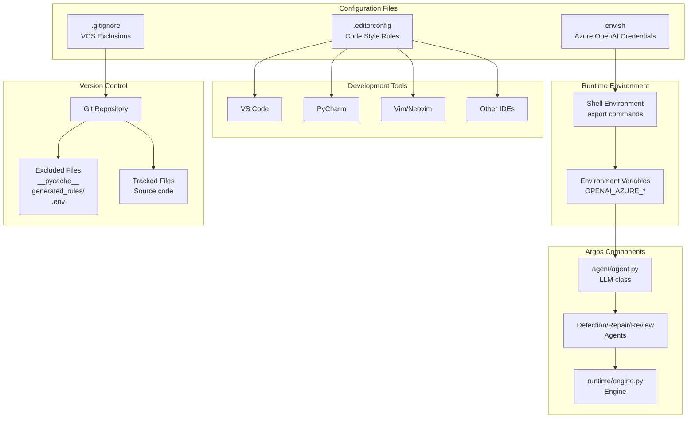
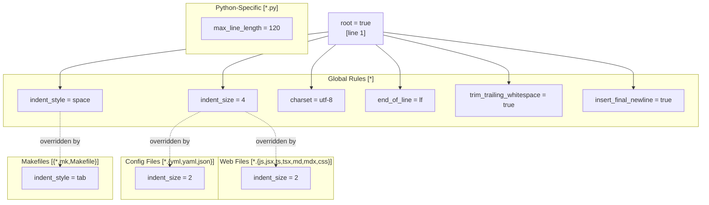
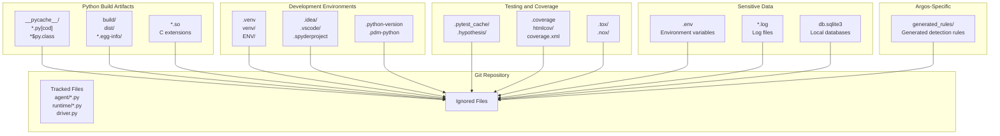
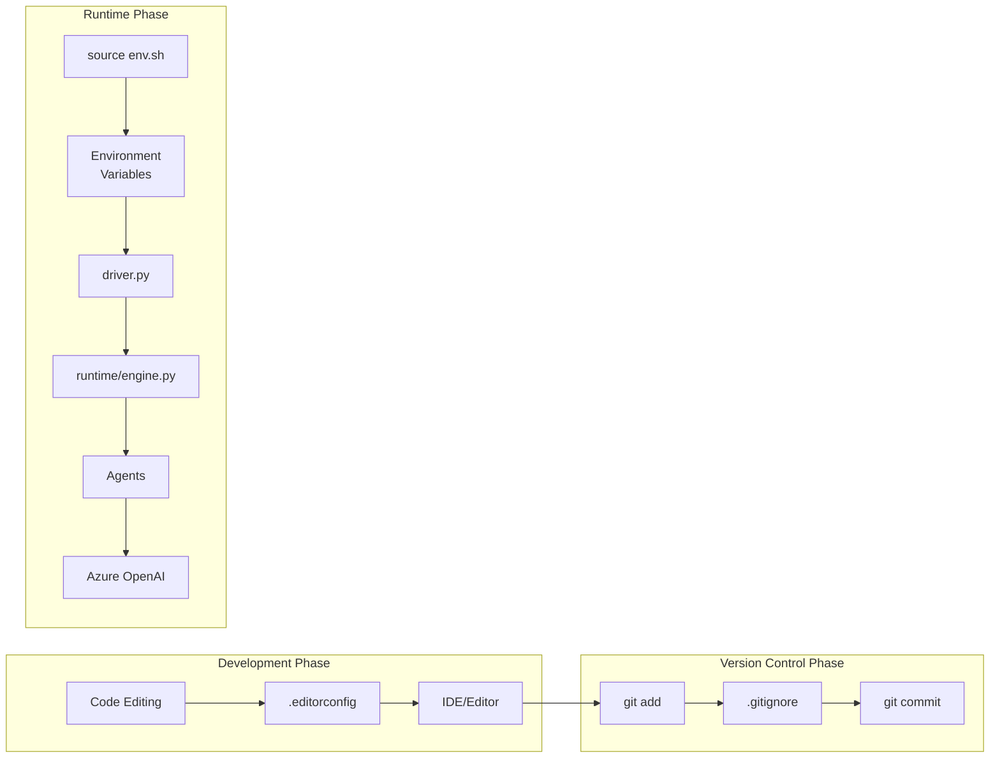

<!-- source: DeepWiki mcp.deepwiki.com · repo microsoft/argos · page 6.2 Configuration Files · fetched 2026-10-26 -->

# Configuration Files

<details>
<summary>Relevant source files</summary>

The following files were used as context for generating this wiki page:

- [.editorconfig](.editorconfig)
- [.gitignore](.gitignore)
- [env.sh](env.sh)

</details>


This page documents the configuration files used in Argos for environment setup, code style enforcement, and version control management. These files ensure consistent development environments, Azure OpenAI API connectivity, and proper repository maintenance.

For information about initial API configuration during installation, see [Installation](#2.1). For development best practices and coding standards, see [Code Style and Standards](#7.3).

## Overview

Argos uses three primary configuration files that control different aspects of the system:

| Configuration File | Purpose | Required for Runtime |
|-------------------|---------|---------------------|
| `env.sh` | Azure OpenAI API authentication | Yes |
| `.editorconfig` | Code style enforcement across editors | No |
| `.gitignore` | Version control exclusions | No |

**Sources:** [.editorconfig:1-22](), [.gitignore:1-165](), [env.sh:1-3]()

## Configuration Architecture

The following diagram shows how configuration files interact with different system components:



**Sources:** [env.sh:1-3](), [.editorconfig:1-22](), [.gitignore:1-165]()

## Environment Configuration (env.sh)

The `env.sh` file provides a template for configuring Azure OpenAI API credentials. This file must be sourced before running Argos to enable LLM functionality.

### File Structure

[env.sh:1-3]() defines three required environment variables:

```bash
export OPENAI_AZURE_ENDPOINT=YOUR_ENDPOINT
export OPENAI_AZURE_API_KEY=YOUR_API_KEY
export OPENAI_AZURE_API_VERSION=YOUR_API_VERSION
```

### Environment Variable Details

| Variable | Purpose | Example Value | Used By |
|----------|---------|---------------|---------|
| `OPENAI_AZURE_ENDPOINT` | Azure OpenAI service endpoint URL | `https://your-resource.openai.azure.com/` | [agent/agent.py]() LLM class |
| `OPENAI_AZURE_API_KEY` | Authentication key for Azure OpenAI | `abc123...` (32-char string) | [agent/agent.py]() LLM class |
| `OPENAI_AZURE_API_VERSION` | API version for request compatibility | `2023-05-15` | [agent/agent.py]() LLM class |

### Usage Pattern

Users must customize and source this file before execution:

1. Copy `env.sh` to a secure location outside version control
2. Replace placeholder values with actual Azure OpenAI credentials
3. Source the file: `source env.sh`
4. Execute Argos: `python driver.py --mode train-LLM-only ...`

The LLM class in [agent/agent.py]() reads these environment variables during initialization to establish Azure OpenAI connectivity. If any variable is missing, the system will fail at runtime when attempting to create an LLM client instance.

**Sources:** [env.sh:1-3]()

## Editor Configuration (.editorconfig)

The `.editorconfig` file enforces consistent code style across different editors and IDEs. It follows the [EditorConfig](https://editorconfig.org) standard, which is supported by most modern development tools.

### Configuration Hierarchy Diagram



**Sources:** [.editorconfig:1-22]()

### Rule Categories

#### Global Rules ([.editorconfig:3-9]())

Applied to all files (`[*]` pattern):

| Setting | Value | Purpose |
|---------|-------|---------|
| `indent_style` | `space` | Use spaces instead of tabs |
| `indent_size` | `4` | Default 4-space indentation |
| `charset` | `utf-8` | Unicode character encoding |
| `end_of_line` | `lf` | Unix-style line endings |
| `trim_trailing_whitespace` | `true` | Remove trailing spaces |
| `insert_final_newline` | `true` | Ensure file ends with newline |

#### Python-Specific Rules ([.editorconfig:11-12]())

| Setting | Value | Impact |
|---------|-------|--------|
| `max_line_length` | `120` | Limits line length for Python files, affecting [agent/detection_agent.py](), [runtime/engine.py](), etc. |

#### Web and Documentation Files ([.editorconfig:14-15]())

Pattern `*.{js,jsx,ts,tsx,md,mdx,css}` uses 2-space indentation for consistency with web development conventions.

#### Configuration Files ([.editorconfig:17-18]())

Pattern `*.{yml,yaml,json}` uses 2-space indentation, applying to:
- `.github/dependabot.yml`
- `.github/workflows/codeql-analysis.yml`
- Any JSON configuration files

#### Makefiles ([.editorconfig:20-21]())

Pattern `{*.mk,Makefile}` uses tab indentation as required by Make syntax.

**Sources:** [.editorconfig:1-22]()

## Version Control Configuration (.gitignore)

The `.gitignore` file specifies which files and directories Git should exclude from version control. It protects sensitive data, prevents tracking of build artifacts, and keeps the repository clean.

### Exclusion Categories

The following diagram maps exclusion patterns to their purposes:



**Sources:** [.gitignore:1-165]()

### Critical Exclusions

#### Sensitive Data ([.gitignore:124-131]())

The following patterns prevent credential leakage:

| Pattern | Protects | Risk if Committed |
|---------|----------|-------------------|
| `.env` | Azure OpenAI credentials configured per [env.sh]() | API key exposure |
| `.venv`, `venv/`, `ENV/` | Virtual environment with packages | Large repository size, platform-specific binaries |
| `*.log` | Runtime logs potentially containing sensitive data | Information disclosure |

Users should **never** commit actual API keys. Instead, use the template [env.sh:1-3]() and maintain actual credentials locally.

#### Python Artifacts ([.gitignore:1-27]())

| Pattern | Purpose | Affected Files |
|---------|---------|----------------|
| `__pycache__/` | Bytecode cache directories | All Python modules |
| `*.py[cod]` | Compiled Python files | `.pyc`, `.pyo`, `.pyd` files |
| `build/`, `dist/` | Distribution packages | Build outputs |
| `*.egg-info/` | Package metadata | Setuptools artifacts |

#### Argos Runtime Outputs ([.gitignore:164-165]())

```
generated_rules/
```

This exclusion is **Argos-specific** and prevents version control of detection rules generated during training. Rules are created by:
- [agent/detection_agent.py]() during training modes
- [runtime/engine.py]() orchestration
- Stored in `generated_rules/{dataset_name}/{timestamp}/` structure

Generated rules are outputs, not source code, and should be managed separately from the repository. Users can save important rules by copying them outside the `generated_rules/` directory.

#### Testing Infrastructure ([.gitignore:39-52]())

| Pattern | Purpose |
|---------|---------|
| `.pytest_cache/` | pytest caching |
| `.coverage`, `htmlcov/` | Coverage reports |
| `.tox/`, `.nox/` | Testing environments |
| `.hypothesis/` | Property-based testing data |

**Sources:** [.gitignore:1-165]()

## Configuration File Interaction

The following diagram shows how configuration files affect different phases of Argos operation:



**Sources:** [.editorconfig:1-22](), [.gitignore:1-165](), [env.sh:1-3]()

## Configuration Best Practices

### Environment Variables

1. **Never commit actual credentials**: Use [env.sh]() as a template only
2. **Secure storage**: Keep actual credential files outside the repository
3. **Validation**: Verify environment variables are set before running Argos
4. **Multiple environments**: Create separate credential files for development, testing, and production

### Editor Configuration

1. **Automatic enforcement**: EditorConfig is automatically applied by supporting editors
2. **IDE compatibility**: Most modern IDEs support `.editorconfig` natively or via plugins
3. **Line length**: The 120-character limit ([.editorconfig:12]()) applies to Python files including [agent/detection_agent.py](), [agent/repair_agent.py](), etc.
4. **Consistency**: Settings ensure all contributors use the same formatting

### Version Control

1. **Review exclusions**: Understand what [.gitignore:1-165]() excludes before committing
2. **Generated files**: Never commit `generated_rules/` directory ([.gitignore:165]())
3. **Local customization**: Add project-specific exclusions to `.git/info/exclude` for local-only ignores
4. **Credential files**: Ensure `.env` files remain excluded ([.gitignore:125]())

**Sources:** [.editorconfig:1-22](), [.gitignore:1-165](), [env.sh:1-3]()

---

