# Page: Argos Overview

# Argos Overview

<details>
<summary>Relevant source files</summary>

The following files were used as context for generating this wiki page:

- [README.md](README.md)
- [requirements.txt](requirements.txt)

</details>


**Purpose and Scope**: This document provides a high-level introduction to Argos, an agentic system for autonomous time-series anomaly detection using Large Language Models (LLMs). It covers the system's purpose, key capabilities, architecture overview, and major components. For detailed setup instructions, see [Getting Started](#2). For in-depth technical documentation of individual components, see [Core Components](#4). For architectural details, see [Architecture](#3).

## What is Argos

Argos is an agentic time-series anomaly detection system that leverages LLMs to autonomously generate explainable, reproducible Python-based detection rules for monitoring cloud infrastructure. Unlike traditional machine learning approaches that produce opaque models, Argos generates human-readable code that can be reviewed, modified, and deployed by domain experts.

The system employs a multi-agent architecture where specialized agents collaborate to iteratively generate, repair, and refine detection rules. Argos operates through [driver.py]() as its command-line interface, which orchestrates the [runtime/engine.py]() training and evaluation engine.

**Key Characteristics**:
- **Agentic Design**: Multiple specialized agents (detection, repair, review, image analysis) work collaboratively
- **Explainable Output**: Generates Python code rather than black-box models
- **Autonomous Operation**: Automatically handles code errors and iteratively refines rules
- **Flexible Modes**: Supports both standalone operation and integration with existing anomaly detection models

**Sources**: [README.md:1-30](), [README.md:95-108]()

## System Capabilities

| Capability | Description | Implementation |
|------------|-------------|----------------|
| **Rule Generation** | Generates Python-based anomaly detection rules using LLM prompting | `DetectionAgentV3` in [agent/detection_agent.py]() |
| **Error Repair** | Automatically fixes syntax and runtime errors in generated code | `RepairAgent` in [agent/repair_agent.py]() |
| **Performance Review** | Evaluates rule performance and triggers refinement when needed | `ReviewAgent` in [agent/review_agent.py]() |
| **Visual Analysis** | Analyzes time-series plots to extract anomaly characteristics | `ImageAgent` in [agent/image_agent.py]() |
| **Iterative Refinement** | Continuously improves rules through multiple training iterations | [runtime/engine.py]() orchestration |
| **Multi-Mode Training** | Supports 8 operational modes for different use cases | Mode handling in [runtime/engine.py]() |
| **Dataset Flexibility** | Processes data in one-for-one or one-for-all modes | `ArgosDataset` in [datasets/dataset.py]() |

**Sources**: [README.md:9-20](), High-level architecture diagrams

## High-Level Architecture

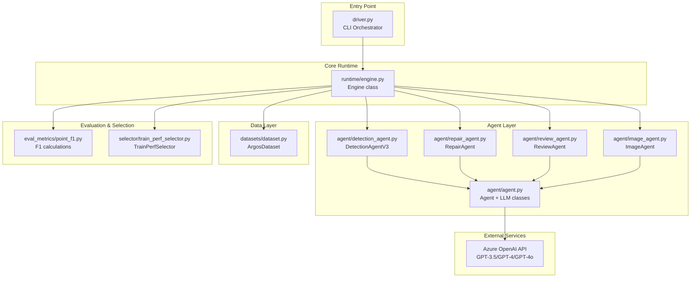

**Architecture Overview**: Argos follows a layered architecture with clear separation of concerns. The `driver.py` module serves as the CLI entry point, accepting command-line arguments and initializing the system. The `Engine` class in [runtime/engine.py]() orchestrates all training and evaluation workflows. Four specialized agents inherit from the base `Agent` class and handle specific tasks: `DetectionAgentV3` generates rules, `RepairAgent` fixes code errors, `ReviewAgent` evaluates performance, and `ImageAgent` performs visual analysis. The `ArgosDataset` class manages data loading and chunking, while `TrainPerfSelector` identifies the best rules across iterations.

**Sources**: [README.md:95-108](), [driver.py](), [runtime/engine.py](), Architecture Diagram 1

## Agent Ecosystem

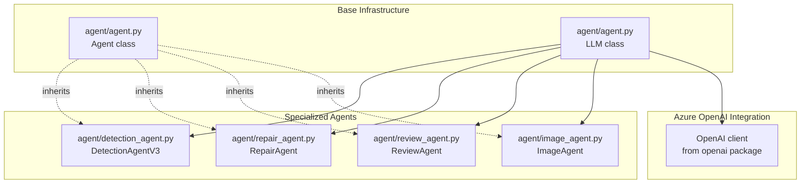

**Agent Architecture**: All agents inherit from the `Agent` base class defined in [agent/agent.py](), which provides common functionality for managing conversations and tracking iterations. Each agent composes an `LLM` instance (also in [agent/agent.py]()) that handles Azure OpenAI API interactions. The `DetectionAgentV3` class supports four training modes and generates initial detection rules. The `RepairAgent` fixes syntax and runtime errors through iterative LLM queries. The `ReviewAgent` evaluates rule performance and requests improvements when detecting regressions. The `ImageAgent` analyzes time-series visualization images to extract anomaly characteristics. For detailed agent documentation, see [Agent Ecosystem](#3.2) and [Core Components](#4).

**Sources**: [agent/agent.py](), [agent/detection_agent.py](), [agent/repair_agent.py](), [agent/review_agent.py](), [agent/image_agent.py](), Architecture Diagram 2

## Operational Modes

Argos supports eight distinct operational modes that determine how the system trains and evaluates detection rules:

| Mode | Purpose | Use Case |
|------|---------|----------|
| `train-LLM-only` | Pure LLM-based rule generation | Standalone anomaly detection without existing models |
| `train-LLM-only-image` | Image-guided rule generation | Leveraging visual patterns in time-series plots |
| `train-combined-fp` | Target false positives from existing model | Reducing false alarms in deployed systems |
| `train-combined-fn` | Target false negatives from existing model | Improving recall for missed anomalies |
| `eval-LLM-only` | Evaluate standalone rules | Testing LLM-generated rules on test data |
| `eval-combined` | Evaluate combined with base model | Assessing improvement over existing model |
| `baseline-LLMAD` | Run LLMAD baseline | Comparative evaluation against baseline |
| `ablation-detection-only` | Detection without review | Studying impact of review agent |

The mode is specified via the `--mode` argument in [driver.py](). Combined modes require an additional `--model_res_path` argument pointing to false positive/negative indices from existing models. For detailed mode descriptions and when to use each, see [Operational Modes](#3.3).

**Sources**: [README.md:114-158](), [driver.py](), [runtime/engine.py](), Architecture Diagram 6

## Data Processing Pipeline

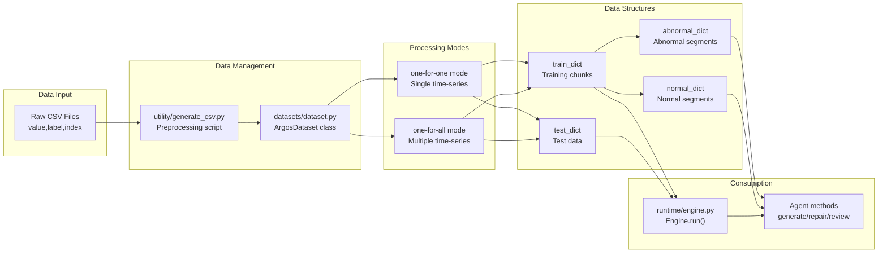

**Data Flow**: Time-series data flows through a multi-stage pipeline. Raw CSV files containing `value,label,index` columns are preprocessed using [utility/generate_csv.py]() into a standardized format. The `ArgosDataset` class in [datasets/dataset.py]() loads data and splits it into training (`train_dict`) and test (`test_dict`) dictionaries. Training data is further chunked into fixed-size segments. The dataset supports two modes: one-for-one (individual time-series) and one-for-all (aggregated metrics). The `Engine` iterates over training chunks, invoking agents to generate and refine rules. For combined modes, `ArgosDataset` filters training data based on false positive/negative indices from `--model_res_path`. For complete data flow details, see [Data Flow Pipeline](#3.4) and [Dataset Management](#4.8).

**Sources**: [README.md:63-94](), [datasets/dataset.py](), [utility/generate_csv.py](), [runtime/engine.py](), Architecture Diagram 4

## Training and Evaluation Workflow

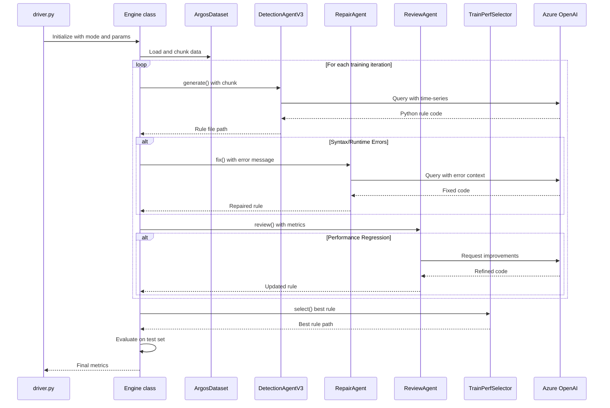

**Workflow**: The training workflow begins when [driver.py]() initializes the `Engine` with a specified mode and parameters. The `Engine.run()` method loads data through `ArgosDataset` and iterates over training chunks. For each iteration, `DetectionAgentV3.generate()` queries Azure OpenAI to produce a Python detection rule. If syntax or runtime errors occur, `RepairAgent.fix()` automatically corrects them. The `ReviewAgent.review()` method evaluates performance metrics; if it detects regression, it requests rule improvements from the LLM. After all iterations complete, `TrainPerfSelector.select()` identifies the best-performing rule. The `Engine` then evaluates this rule on the test set and returns final metrics. For implementation details, see [Engine](#4.2), [Detection Agent](#4.4), [Repair Agent](#4.5), and [Review Agent](#4.6).

**Sources**: [runtime/engine.py](), [agent/detection_agent.py](), [agent/repair_agent.py](), [agent/review_agent.py](), [selector/train_perf_selector.py](), Architecture Diagram 3

## Core Components Summary

| Component | File Path | Primary Class/Function | Purpose |
|-----------|-----------|------------------------|---------|
| **CLI Driver** | [driver.py]() | `main()` | Command-line interface and parameter parsing |
| **Runtime Engine** | [runtime/engine.py]() | `Engine` | Orchestrates training/evaluation workflows |
| **Base Agent** | [agent/agent.py]() | `Agent`, `LLM` | Base class for agents and LLM client wrapper |
| **Detection** | [agent/detection_agent.py]() | `DetectionAgentV3` | Generates Python anomaly detection rules |
| **Repair** | [agent/repair_agent.py]() | `RepairAgent` | Fixes code errors automatically |
| **Review** | [agent/review_agent.py]() | `ReviewAgent` | Evaluates and refines rule performance |
| **Image Analysis** | [agent/image_agent.py]() | `ImageAgent` | Analyzes time-series visualizations |
| **Dataset** | [datasets/dataset.py]() | `ArgosDataset` | Loads, chunks, and manages training/test data |
| **Metrics** | [eval_metrics/point_f1.py]() | `point_f1()`, `event_based_f1()` | Computes F1, precision, recall metrics |
| **Selector** | [selector/train_perf_selector.py]() | `TrainPerfSelector` | Selects best rule from iterations |
| **Baseline** | [baseline/llmad.py]() | `LLMAD` | LLMAD baseline implementation |
| **Common Utils** | [common/common.py]() | Various utility functions | Token counting, label processing, execution |
| **Exceptions** | [common/exception.py]() | `SyntaxException`, `RuntimeException`, `TimeoutException` | Custom exception types |

Each component is documented in detail in the [Core Components](#4) section.

**Sources**: [README.md:95-108](), All component files listed in table

## Technology Stack

Argos is built on Python 3.10 and integrates with Azure OpenAI services:

**LLM Integration**:
- **Azure OpenAI API**: Primary LLM service (requires `OPENAI_AZURE_ENDPOINT`, `OPENAI_AZURE_API_KEY`, `OPENAI_AZURE_API_VERSION` environment variables)
- **Supported Models**: GPT-3.5-Turbo, GPT-4-32k, GPT-4o (with vision capabilities)
- **Python Client**: `openai` package version 1.35.9

**Core Dependencies** (from [requirements.txt]()):

| Package | Version | Purpose |
|---------|---------|---------|
| `openai` | 1.35.9 | Azure OpenAI API client |
| `pandas` | 2.2.2 | Time-series data manipulation |
| `numpy` | 1.26.4 | Numerical computations |
| `scikit-learn` | 1.5.1 | Machine learning utilities |
| `matplotlib` | 3.9.0 | Visualization for image agent |
| `statsmodels` | 0.14.2 | Statistical analysis |
| `requests` | 2.32.4 | HTTP requests |
| `tqdm` | 4.66.4 | Progress bars |

For complete dependency list and installation instructions, see [Installation](#2.1) and [Dependencies](#7.1).

**Sources**: [requirements.txt:1-41](), [README.md:37-61]()

## Dataset Requirements

Argos expects time-series datasets structured with the following hierarchy:

```
dataset_name/
├── metric_1/
│   ├── time_series_1.csv
│   ├── time_series_2.csv
│   └── ...
└── metric_2/
    ├── time_series_1.csv
    └── ...
```

Each CSV file must contain three columns:
- `value`: Numeric metric value
- `label`: Binary anomaly label (0 = normal, 1 = anomaly)
- `index`: Sequential index of the data point

The preprocessing script [utility/generate_csv.py]() converts KPI and Yahoo datasets into this format. For combined modes (train-combined-fp/fn), additional model result files containing false positive/negative indices must be provided via `--model_res_path`. For detailed dataset preparation instructions, see [Dataset Preparation](#2.2).

**Sources**: [README.md:63-83](), [utility/generate_csv.py](), [datasets/dataset.py]()

## Use Cases and Limitations

**Intended Uses**:
- Generating explainable anomaly detection rules for human review in cloud monitoring systems
- Research and experimentation with LLM-based anomaly detection approaches
- Complementing existing anomaly detection models by targeting specific error types (false positives/negatives)

**Out-of-Scope Uses**:
- Direct deployment in production systems without human oversight
- Highly regulated domains (healthcare, finance, law enforcement) where errors have severe consequences
- Non-English time-series data (system designed and tested in English)

**Limitations**:
- Research prototype requiring further testing for commercial applications
- Inherits biases and limitations from underlying LLM (Azure OpenAI models)
- Requires domain expertise to evaluate generated rule quality
- Performance varies with choice of base LLM model

For complete guidance on responsible use, see [Best Practices](#8) and [README.md:182-211]().

**Sources**: [README.md:16-30](), [README.md:182-191](), [README.md:193-211]()

## Next Steps

To start using Argos:
1. Set up your Python environment and install dependencies - see [Installation](#2.1)
2. Configure Azure OpenAI API credentials - see [Installation](#2.1)
3. Prepare your time-series dataset - see [Dataset Preparation](#2.2)
4. Run your first training task - see [Running Argos](#2.3)

For understanding the system architecture in depth, proceed to [Architecture](#3). For detailed component documentation, see [Core Components](#4).

**Sources**: [README.md:32-108]()

---

# Page: Getting Started

# Getting Started

<details>
<summary>Relevant source files</summary>

The following files were used as context for generating this wiki page:

- [README.md](README.md)
- [env.sh](env.sh)
- [requirements.txt](requirements.txt)

</details>


This document provides a quick start guide for setting up and running Argos for the first time. It covers the essential prerequisites, the basic workflow, and simple usage examples to help you start generating anomaly detection rules using LLM agents.

For detailed information about specific setup steps, see:
- [Installation](#2.1) - Complete Python environment and Azure OpenAI API setup
- [Dataset Preparation](#2.2) - Dataset structure requirements and preprocessing
- [Running Argos](#2.3) - Comprehensive command-line reference and operational modes

For information about Argos's architecture and design, see [Architecture](#3).

**Sources:** [README.md:1-265]()

## Prerequisites Overview

Before running Argos, you must have the following components configured:

| Component | Requirement | Details |
|-----------|------------|---------|
| Python Environment | Python 3.10 | Conda virtual environment recommended |
| Dependencies | All packages in requirements.txt | Includes numpy, pandas, scikit-learn, openai, statsmodels |
| Azure OpenAI API | Valid endpoint, API key, and version | Required for LLM interaction |
| Dataset | Structured time-series CSV files | Must follow Argos's dataset format specification |

All Python dependencies are specified in [requirements.txt:1-41]() and include core scientific computing libraries (numpy, pandas, scikit-learn), visualization tools (matplotlib), statistical analysis (statsmodels), and the OpenAI API client.

**Sources:** [README.md:37-61](), [requirements.txt:1-41]()

## Quick Start Workflow

The following diagram illustrates the high-level workflow for getting started with Argos, from initial setup through rule generation:

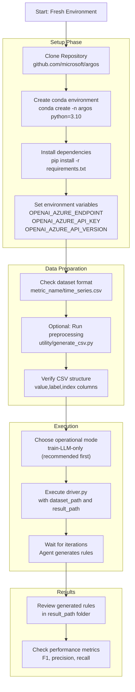

**Sources:** [README.md:32-157]()

## Environment Configuration

Argos requires three environment variables to authenticate with Azure OpenAI services. These must be set before running any Argos commands.

### Setting Environment Variables

The repository includes a template file [env.sh:1-3]() that demonstrates the required configuration:

```bash
export OPENAI_AZURE_ENDPOINT=YOUR_ENDPOINT
export OPENAI_AZURE_API_KEY=YOUR_API_KEY
export OPENAI_AZURE_API_VERSION=YOUR_API_VERSION
```

These variables are consumed by the `LLM` class in [agent/agent.py](), which creates an Azure OpenAI client for interacting with GPT models. The system supports multiple model types including GPT-3.5-Turbo, GPT-4-32k, and GPT-4o.

**Sources:** [README.md:51-61](), [env.sh:1-3]()

## Dataset Structure Requirements

Argos expects time-series data organized in a specific hierarchical structure:

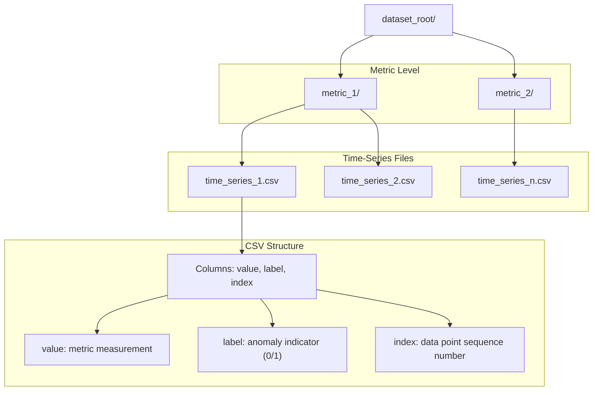

Each CSV file must contain exactly three columns:
- `value`: The time-series metric value
- `label`: Binary anomaly label (0 for normal, 1 for anomalous)
- `index`: Sequential index of the data point

The preprocessing script [utility/generate_csv.py]() can convert KPI and Yahoo datasets into this format.

**Sources:** [README.md:63-82]()

## Basic Usage Example: Training Without Aggregator

The simplest way to start using Argos is the `train-LLM-only` mode, which generates anomaly detection rules using only LLM agents without requiring an existing model.

### Command Structure

The primary entry point is [driver.py](), which orchestrates the entire training and evaluation pipeline:

```bash
python3 driver.py \
  --dataset_path=$dataset_path \
  --mode=train-LLM-only \
  --result_path=$result_path \
  --chunk_size=2500 \
  --top_k=5 \
  --dataset_mode="one-by-one"
```

### Parameter Explanation

| Parameter | Description | Typical Values |
|-----------|-------------|----------------|
| `--dataset_path` | Root directory containing metric folders | Path to prepared dataset |
| `--mode` | Operational mode | `train-LLM-only`, `train-combined-fp`, `train-combined-fn`, `eval-LLM-only` |
| `--result_path` | Output directory for generated rules and metrics | Any writable path |
| `--chunk_size` | Size of data chunks for training iterations | 2500 (without aggregator), 1000 (with aggregator) |
| `--top_k` | Number of best rules to select | 1-5, depending on use case |
| `--dataset_mode` | Training scope | `one-by-one` (per time-series), `one-for-all` (across metrics) |

The `driver.py` script creates an `Engine` instance from [runtime/engine.py]() and executes the training loop. During execution, the `DetectionAgentV3` from [agent/detection_agent.py]() generates Python code for anomaly detection rules, which are then refined by `RepairAgent` and `ReviewAgent`.

**Sources:** [README.md:119-133]()

## Basic Usage Example: Training With Aggregator

If you have an existing anomaly detection model and want to improve it by fixing specific error types, use the combined modes:

### Fixing False Positives

```bash
python3 driver.py \
  --dataset_path=$dataset_path \
  --mode=train-combined-fp \
  --result_path=$result_path \
  --chunk_size=1000 \
  --top_k=1 \
  --dataset_mode="one-by-one" \
  --model_res_path=$model_res_path
```

### Fixing False Negatives

```bash
python3 driver.py \
  --dataset_path=$dataset_path \
  --mode=train-combined-fn \
  --result_path=$result_path \
  --chunk_size=1000 \
  --top_k=1 \
  --dataset_mode="one-by-one" \
  --model_res_path=$model_res_path
```

The `--model_res_path` parameter points to preprocessed results from your existing model, containing indices of false positive or false negative predictions. The `ArgosDataset` class from [datasets/dataset.py]() uses these indices to filter training data, focusing the LLM on examples where the existing model failed.

**Sources:** [README.md:135-156]()

## System Component Mapping

The following diagram maps the workflow steps to the actual code components that implement them:

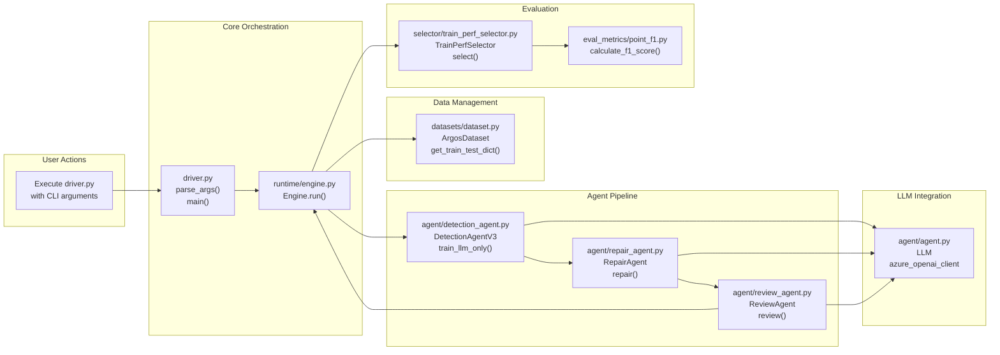

**Sources:** [README.md:95-108]()

## Expected Output

After running Argos, the `result_path` directory will contain:

| Output Type | Description | Location Pattern |
|-------------|-------------|------------------|
| Generated Rules | Python code files for anomaly detection | `iteration_N/rule_*.py` |
| Training Metrics | Performance on training set | `iteration_N/train_metrics.json` |
| Test Metrics | Performance on test set | `iteration_N/test_metrics.json` |
| Selected Rule | Best-performing rule across iterations | `selected_rule.py` |
| Summary | Overall performance summary | `summary.json` |

The `TrainPerfSelector` class from [selector/train_perf_selector.py]() analyzes all generated rules and selects the one with the highest F1 score. Performance metrics are calculated using the functions in [eval_metrics/point_f1.py](), including point-based and event-based F1 scores.

**Sources:** [README.md:133-134]()

## Dataset Modes Comparison

Argos supports two distinct dataset modes that determine the scope of rule generation:

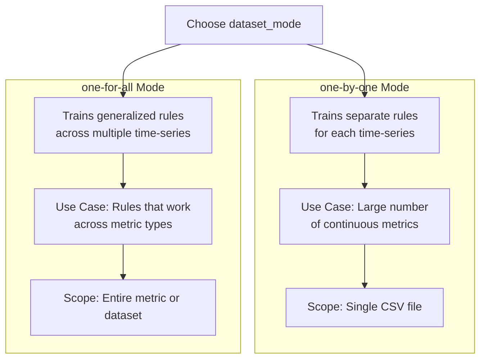

The mode is specified using the `--dataset_mode` command-line argument and affects how the `ArgosDataset` class partitions and provides data to the training engine.

**Sources:** [README.md:84-93]()

## Next Steps

Once you have successfully run your first Argos training session, explore the following:

1. **Deep-dive into installation details**: See [Installation](#2.1) for comprehensive environment setup, including conda configuration and troubleshooting.

2. **Prepare your own datasets**: See [Dataset Preparation](#2.2) for preprocessing scripts, format specifications, and handling different dataset types.

3. **Explore operational modes**: See [Running Argos](#2.3) for detailed explanations of all eight operational modes and their specific use cases.

4. **Understand the architecture**: See [Architecture](#3) to learn how the agent ecosystem, engine orchestration, and data pipelines work together.

5. **Review core components**: See [Core Components](#4) for detailed documentation of each agent type, the dataset manager, evaluation metrics, and rule selection logic.

**Sources:** [README.md:111-157]()

---

# Page: Installation

# Installation

<details>
<summary>Relevant source files</summary>

The following files were used as context for generating this wiki page:

- [README.md](README.md)
- [env.sh](env.sh)
- [requirements.txt](requirements.txt)

</details>


This page details the steps required to install and configure Argos on your system, including Python environment setup, dependency installation, and Azure OpenAI API configuration. For information about preparing datasets after installation, see [Dataset Preparation](#2.2). For instructions on running Argos after installation, see [Running Argos](#2.3).

## Prerequisites

Before installing Argos, ensure you have:
- Python 3.10 or compatible version
- Conda package manager (recommended for virtual environment management)
- An active Azure OpenAI service account with API credentials
- Access to the Argos repository at https://github.com/microsoft/argos

**Sources**: [README.md:37-42]()

## Installation Flow

The installation process follows a sequential three-stage workflow:

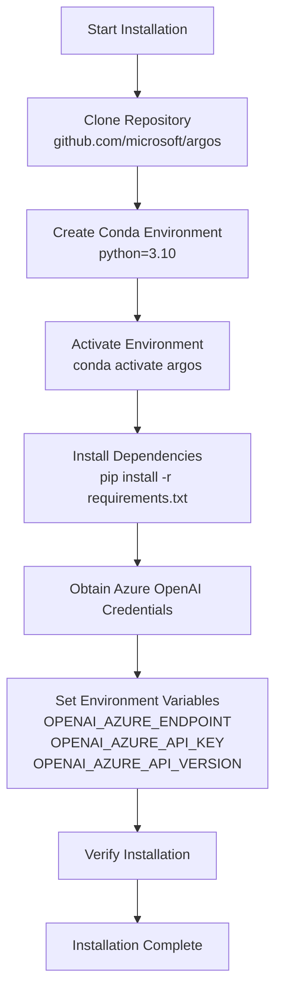

**Sources**: [README.md:32-61]()

## Python Environment Setup

### Creating the Virtual Environment

Argos requires Python 3.10 and uses Conda for virtual environment management. Navigate to the cloned repository and execute the following commands:

```sh
cd argos
conda create -n argos python=3.10
conda activate argos
```

The virtual environment isolates Argos dependencies from your system Python installation, preventing version conflicts with other projects.

**Sources**: [README.md:44-48]()

### Installing Dependencies

After activating the virtual environment, install all required Python packages from `requirements.txt`:

```sh
pip install -r requirements.txt
```

This single command installs all 41 dependencies listed in [requirements.txt:1-41]().

**Sources**: [README.md:48-49]()

## Dependency Categories

The `requirements.txt` file specifies dependencies across multiple functional categories:

| Category | Packages | Purpose |
|----------|----------|---------|
| **LLM Integration** | `openai`, `httpx`, `httpcore`, `h11` | Azure OpenAI API client and HTTP communication |
| **Data Processing** | `pandas`, `numpy` | Time-series data manipulation and numerical computation |
| **Statistical Analysis** | `statsmodels`, `scipy`, `arch` | Statistical modeling and analysis for anomaly detection |
| **Machine Learning** | `scikit-learn`, `joblib` | ML algorithms and model persistence |
| **Visualization** | `matplotlib`, `pillow`, `contourpy`, `fonttools`, `kiwisolver`, `cycler` | Plotting time-series data and generating visual outputs |
| **Validation** | `pydantic`, `pydantic_core`, `annotated-types` | Data validation and schema enforcement |
| **Utilities** | `requests`, `tqdm`, `toml`, `distro` | HTTP requests, progress bars, configuration parsing |
| **Type Support** | `typing_extensions` | Enhanced type hints for Python 3.10 |
| **Date/Time** | `python-dateutil`, `pytz`, `tzdata` | Timezone handling and date manipulation |
| **Core Dependencies** | `certifi`, `charset-normalizer`, `idna`, `urllib3`, `anyio`, `sniffio`, `exceptiongroup` | SSL certificates, character encoding, async I/O |
| **Math/Parsing** | `pyparsing`, `patsy`, `six`, `packaging`, `threadpoolctl` | Expression parsing, formula handling, compatibility utilities |

**Sources**: [requirements.txt:1-41]()

### Key Dependencies

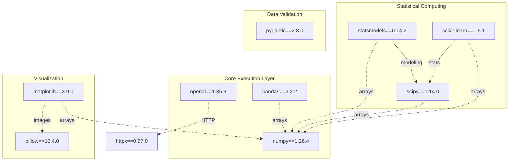

**Sources**: [requirements.txt:1-41]()

## Azure OpenAI API Configuration

Argos requires an active Azure OpenAI service connection. The system authenticates using three environment variables that must be set before running any Argos commands.

### Required Environment Variables

| Variable | Description | Example Format |
|----------|-------------|----------------|
| `OPENAI_AZURE_ENDPOINT` | Azure OpenAI service endpoint URL | `https://your-resource.openai.azure.com/` |
| `OPENAI_AZURE_API_KEY` | Authentication key for Azure OpenAI | 32-character hexadecimal string |
| `OPENAI_AZURE_API_VERSION` | API version string | `2023-05-15` or similar date format |

**Sources**: [README.md:52-61](), [env.sh:1-3]()

### Setting Environment Variables

#### Linux/macOS

Export the variables in your shell session:

```sh
export OPENAI_AZURE_ENDPOINT=YOUR_AZURE_ENDPOINT
export OPENAI_AZURE_API_KEY=YOUR_API_KEY
export OPENAI_AZURE_API_VERSION=YOUR_API_VERSION
```

For persistent configuration, add these lines to your shell profile (`~/.bashrc`, `~/.zshrc`, etc.).

**Sources**: [README.md:57-61](), [env.sh:1-3]()

#### Using env.sh Template

Argos provides an `env.sh` template file at the repository root. You can:

1. Copy the template: `cp env.sh env.local.sh`
2. Edit `env.local.sh` with your actual credentials
3. Source the file: `source env.local.sh`

**Note**: Never commit files containing actual credentials to version control.

**Sources**: [env.sh:1-3]()

### Environment Variable Flow

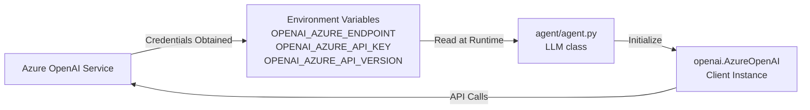

The `LLM` class in [agent/agent.py]() reads these environment variables at initialization to create an `openai.AzureOpenAI` client instance. All agents inherit from the base `Agent` class and use this `LLM` instance for API communication. For more details on LLM integration architecture, see [Base Agent and LLM Integration](#4.3).

**Sources**: [README.md:52-61]()

## Supported Models

Argos has been tested with the following Azure OpenAI models:

- **GPT-3.5-Turbo**: Cost-effective model suitable for initial experimentation
- **GPT-4-32k**: Large context window model for processing extensive time-series data
- **GPT-4o**: Vision-capable model supporting image-based anomaly analysis

The model selection affects system behavior in image-enabled modes. See [Operational Modes](#3.3) for details on when each model is appropriate.

**Sources**: [README.md:172-173]()

## Installation Verification

After completing the installation steps, verify your setup:

### 1. Verify Python Environment

```sh
conda activate argos
python --version  # Should show Python 3.10.x
```

### 2. Verify Package Installation

```sh
python -c "import openai, pandas, numpy, matplotlib, statsmodels; print('All core packages imported successfully')"
```

### 3. Verify Environment Variables

```sh
python -c "import os; assert os.getenv('OPENAI_AZURE_ENDPOINT'), 'OPENAI_AZURE_ENDPOINT not set'; print('Environment variables configured')"
```

### 4. Test Azure OpenAI Connection

While Argos does not include a dedicated connection test utility, you can verify connectivity by attempting to run a simple detection task (see [Running Argos](#2.3)) with a small dataset.

**Sources**: [README.md:32-61]()

## Common Installation Issues

| Issue | Symptom | Solution |
|-------|---------|----------|
| Missing Conda | `conda: command not found` | Install Miniconda or Anaconda from official sources |
| Python Version Mismatch | ImportError with type hints | Ensure Python 3.10+ is used; recreate environment |
| Dependency Conflicts | Package installation failures | Create fresh virtual environment; avoid mixing pip/conda installs |
| Missing Environment Variables | Runtime errors about Azure credentials | Verify all three `OPENAI_AZURE_*` variables are set and exported |
| Network Issues | Connection timeouts to Azure | Check firewall settings; verify endpoint URL format |

**Sources**: [README.md:37-61](), [requirements.txt:1-41]()

## Next Steps

After successful installation:

1. **Dataset Preparation**: See [Dataset Preparation](#2.2) to structure your time-series data in the required format
2. **Running Argos**: See [Running Argos](#2.3) to execute your first anomaly detection task
3. **Understanding Dependencies**: See [Dependencies](#7.1) for detailed information about each package and version management

**Sources**: [README.md:32-61]()

---

# Page: Dataset Preparation

# Dataset Preparation

<details>
<summary>Relevant source files</summary>

The following files were used as context for generating this wiki page:

- [README.md](README.md)
- [datasets/dataset.py](datasets/dataset.py)

</details>


This document explains how to prepare time-series datasets for use with Argos, including the required directory structure, CSV file format, dataset modes, and preprocessing utilities. For information about running Argos after dataset preparation, see [Running Argos](#2.3). For details on how the Engine consumes prepared datasets during training, see [Dataset Management](#4.8).

## Purpose and Scope

Dataset preparation is the process of organizing and formatting time-series anomaly detection data for consumption by Argos. This includes:
- Understanding the required directory structure and file format
- Choosing between one-by-one and all-in-one dataset modes
- Using preprocessing scripts for standard datasets (KPI, Yahoo)
- Preparing model results for combined training modes

The `ArgosDataset` class [datasets/dataset.py:10-560]() handles all dataset loading, validation, and segmentation operations.

## Dataset Structure Requirements

Argos expects a hierarchical directory structure where datasets contain metrics, and each metric contains multiple time-series CSV files.

### Directory Layout

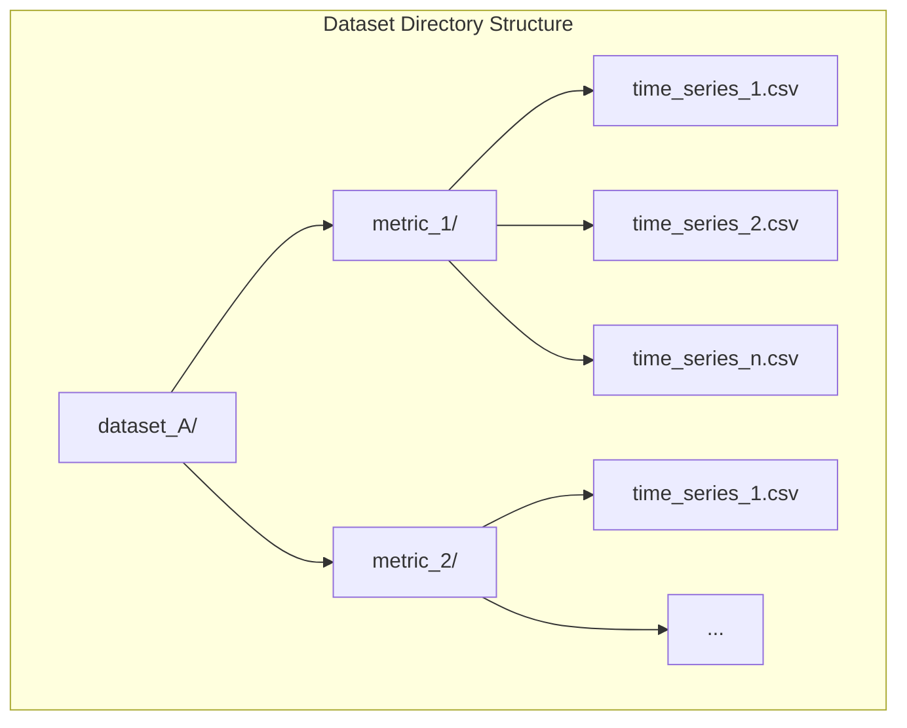

**Sources:** [README.md:63-79]()

For **one-by-one mode**, the dataset path should point directly to a single CSV file:
```
/path/to/dataset/metric_1/time_series_1.csv
```

For **all-in-one mode**, the dataset path should point to a directory containing multiple CSV files:
```
/path/to/dataset/metric_1/
```

**Sources:** [datasets/dataset.py:39-41](), [datasets/dataset.py:91-94]()

## CSV File Format

Each CSV file must contain exactly three columns in the following order:

| Column | Type | Description |
|--------|------|-------------|
| `value` | float | The metric value at each time point |
| `label` | int | Binary anomaly label (0 = normal, 1 = anomaly) |
| `index` | int | Sequential index of the data point |

### Example CSV Content

```
value,label,index
42.351,0,0
43.127,0,1
44.892,0,2
89.234,1,3
91.445,1,4
43.556,0,5
```

The `label` column provides ground truth annotations for training and evaluation. The `index` column tracks the sequential position of each data point, which is critical for identifying false positive and false negative segments in combined modes.

**Sources:** [README.md:67-67](), [datasets/dataset.py:45-46]()

## Dataset Modes

Argos supports two operational dataset modes that determine the scope of rule generation.

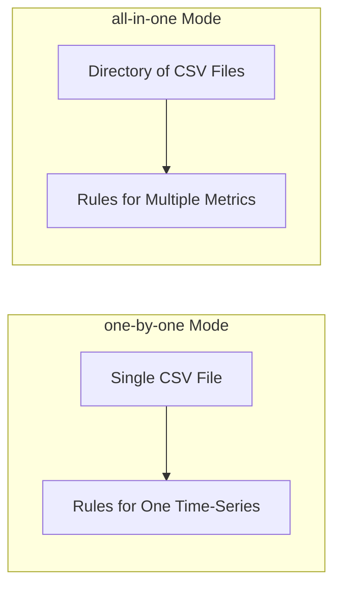

**Sources:** [README.md:84-93]()

### one-by-one Mode

In `one-by-one` mode (also called "one-for-one"), Argos trains a separate set of anomaly detection rules for each individual time-series. This mode is suitable when:
- You have a large number of continuous metrics with distinct characteristics
- Each time-series requires specialized detection logic
- Metrics cannot be generalized across a common rule set

The dataset path must point to a single CSV file. The `ArgosDataset` validates this constraint at initialization:

```python
assert self.dataset_path.endswith(".csv"), "Dataset should be a csv file"
```

**Sources:** [datasets/dataset.py:39-41](), [README.md:88-90]()

### all-in-one Mode

In `all-in-one` mode (also called "one-for-all"), Argos trains a single set of rules that generalize across multiple time-series or metrics. This mode is useful when:
- You want rules that work across a family of related metrics
- Multiple time-series share similar anomaly patterns
- You need to minimize the number of rule sets to maintain

The dataset path must point to a directory containing multiple CSV files. The system loads all CSV files in the directory:

**Sources:** [datasets/dataset.py:91-110](), [README.md:91-93]()

## Preprocessing Standard Datasets

Argos provides a preprocessing utility to convert standard benchmark datasets into the required format.

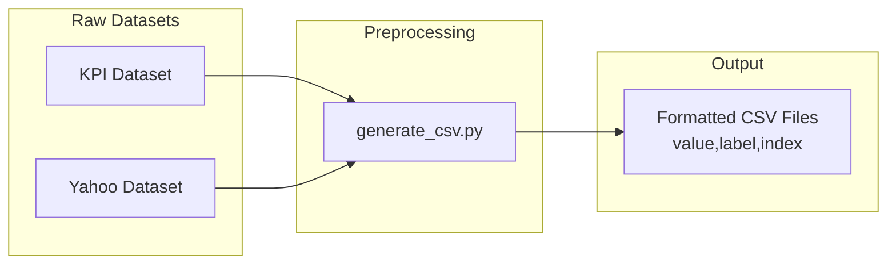

**Sources:** [README.md:81-82]()

### Preprocessing Script

The preprocessing script is located at `argos/utility/generate_csv.py`. Currently supported datasets are:
- **KPI Dataset**: Time-series data from the NetManAIOps KPI Anomaly Detection benchmark
- **Yahoo Dataset**: Time-series data from the Yahoo Webscope S5 benchmark

To preprocess a dataset, run the script with the appropriate dataset type and input/output paths. The script converts the original format into the standardized three-column CSV structure required by Argos.

**Sources:** [README.md:81-82]()

## Combined Mode Requirements

Combined training modes (`train-combined-fp` and `train-combined-fn`) require additional inputs from an existing anomaly detection model. These modes allow Argos to generate rules that fix specific types of errors made by a base model.

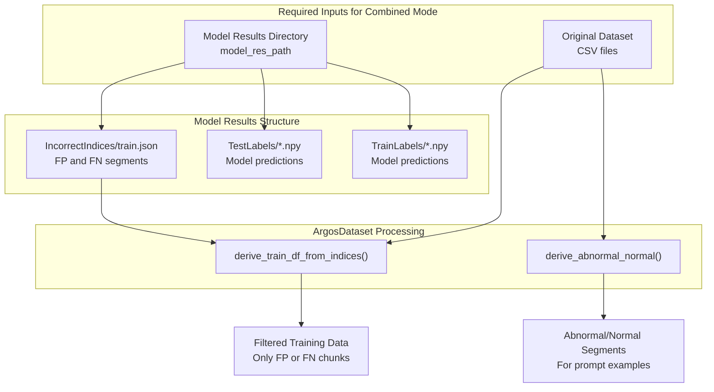

**Sources:** [datasets/dataset.py:59-83](), [datasets/dataset.py:284-386]()

### Model Results Directory Structure

When running in combined mode, provide a `model_res_path` that contains:

| Directory/File | Purpose |
|----------------|---------|
| `IncorrectIndices/train.json` | JSON file containing FP and FN segment indices |
| `TestLabels/{curve_name}.npy` | NumPy array of model predictions on test set |
| `TrainLabels/{curve_name}.npy` | NumPy array of model predictions on training set |

The `train.json` file must have the following structure:
```json
{
  "FP": {
    "curve_name_1": [[start_idx, end_idx], ...],
    "curve_name_2": [[start_idx, end_idx], ...]
  },
  "FN": {
    "curve_name_1": [[start_idx, end_idx], ...],
    "curve_name_2": [[start_idx, end_idx], ...]
  }
}
```

**Sources:** [datasets/dataset.py:302-306](), [datasets/dataset.py:338-342](), [datasets/dataset.py:388-398]()

### False Positive Mode (train-combined-fp)

In `train-combined-fp` mode, Argos trains rules to reduce false positives from the base model. The system:
1. Loads FP segments from `IncorrectIndices/train.json`
2. Filters training data to only include chunks containing FP segments
3. Validates that filtered chunks contain no actual anomalies (`label.sum() == 0`)
4. Trains detection rules that will NOT trigger on these false positive segments

**Sources:** [datasets/dataset.py:336-385]()

### False Negative Mode (train-combined-fn)

In `train-combined-fn` mode, Argos trains rules to catch false negatives missed by the base model. The system:
1. Loads FN segments from `IncorrectIndices/train.json`
2. Filters training data to only include chunks containing FN segments
3. Validates that filtered chunks contain actual anomalies (`label.sum() > 0`)
4. Trains detection rules that WILL trigger on these false negative segments

**Sources:** [datasets/dataset.py:300-335]()

## Data Segmentation and Chunking

The `ArgosDataset` class automatically segments loaded data into multiple components for training and evaluation.

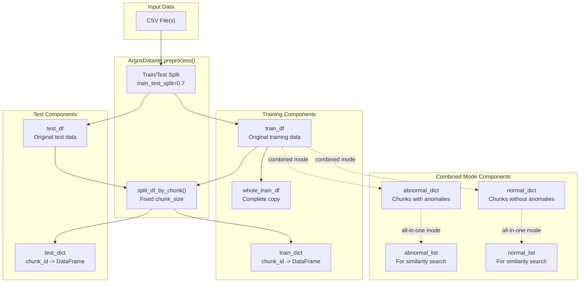

**Sources:** [datasets/dataset.py:35-201]()

### Train/Test Split

By default, Argos uses a 70/30 train/test split (configurable via `train_test_split` parameter):
- **Training set**: First 70% of the time-series data
- **Test set**: Last 30% of the time-series data

This temporal split ensures that the model is evaluated on future data, simulating real-world deployment scenarios.

**Sources:** [datasets/dataset.py:18-19](), [datasets/dataset.py:49-57]()

### Chunking Strategy

Data is split into fixed-size chunks specified by the `chunk_size` parameter (typically 1000-2500 data points). The chunking serves two purposes:

1. **Iteration Management**: Each training iteration processes one chunk, allowing progressive rule refinement
2. **Context Window Limits**: Chunks fit within LLM token limits while providing sufficient context

The `split_df_by_chunk()` method creates a dictionary mapping chunk IDs to DataFrame objects:

**Sources:** [datasets/dataset.py:400-411]()

### Abnormal and Normal Segment Derivation

For combined modes, the system derives abnormal and normal segments:

**Abnormal segments**: Chunks containing at least one anomaly label
- Identified by scanning for contiguous anomaly regions
- Expanded to include complete chunks that overlap the anomaly
- Used as positive examples in prompts for `train-combined-fn` mode

**Normal segments**: Chunks containing no anomaly labels
- Identified as regions between anomaly segments
- Must exceed minimum chunk size to be included
- Used as negative examples in prompts for `train-combined-fp` mode

**Sources:** [datasets/dataset.py:203-282]()

### Image Chunk Size

For `train-LLM-only-image` mode, an optional `image_chunk_size` parameter creates a separate chunking of the training data optimized for visualization:

```python
if self.image_chunk_size:
    self.train_dict_image = self.split_df_by_chunk(
        self.train_df, self.image_chunk_size
    )
```

This allows different granularities for visual analysis versus numerical analysis.

**Sources:** [datasets/dataset.py:86-89]()

## Dataset Access Methods

The `ArgosDataset` class provides accessor methods for retrieving data during training and evaluation:

| Method | Purpose |
|--------|---------|
| `get_train_df_by_iter(iter_num)` | Get training chunk for iteration (cycles through chunks) |
| `get_test_df_by_iter(iter_num)` | Get test chunk for iteration |
| `get_train_image_df_by_iter(iter_num)` | Get image-sized training chunk |
| `get_abnormal_df_by_iter(iter_num)` | Get abnormal segment for combined mode |
| `get_normal_df_by_iter(iter_num)` | Get normal segment for combined mode |
| `get_closest_abnormal_df(df)` | Find most similar abnormal segment (all-in-one mode) |
| `get_closest_normal_df(df)` | Find most similar normal segment (all-in-one mode) |
| `get_model_test_labels(curve_name)` | Get base model predictions on test set |
| `get_model_train_labels(curve_name)` | Get base model predictions on training set |

The iterator-based methods use modulo arithmetic to cycle through chunks, ensuring that training continues even if the number of iterations exceeds the number of chunks.

**Sources:** [datasets/dataset.py:413-553]()

## Validation and Error Handling

The `ArgosDataset` class performs several validation checks during preprocessing:

**one-by-one mode validations:**
- Dataset path must end with `.csv` [datasets/dataset.py:41]()
- Model results required for combined modes [datasets/dataset.py:63-65]()

**all-in-one mode validations:**
- Dataset path must be a directory [datasets/dataset.py:93]()
- Combined FN mode: Each training chunk must contain anomalies [datasets/dataset.py:175-177]()
- Combined FP mode: Each training chunk must contain no anomalies [datasets/dataset.py:178-181]()

**combined mode validations:**
- FN segments must contain actual anomalies [datasets/dataset.py:320-324]()
- FP segments must not contain actual anomalies [datasets/dataset.py:355-359]()
- FP segment chunks must not overlap with actual anomalies [datasets/dataset.py:365-372]()

**Sources:** [datasets/dataset.py:39-201]()

## Similarity-Based Segment Selection

For `all-in-one` mode with combined training, the system supports similarity-based selection of example segments. This is used when prompting the LLM with relevant examples.

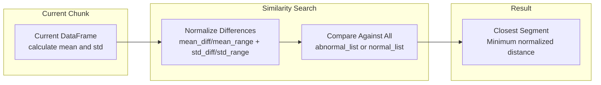

**Sources:** [datasets/dataset.py:438-495]()

The similarity metric normalizes both mean and standard deviation differences to account for varying scales:
1. Calculate mean and std of current chunk
2. For each candidate segment, compute normalized distance:
   ```
   distance = |mean - candidate_mean| / mean_range + |std - candidate_std| / std_range
   ```
3. Return segment with minimum distance

This ensures that the LLM receives contextually relevant examples during prompt construction.

**Sources:** [datasets/dataset.py:438-495]()

---

# Page: Running Argos

# Running Argos

<details>
<summary>Relevant source files</summary>

The following files were used as context for generating this wiki page:

- [README.md](README.md)
- [driver.py](driver.py)

</details>


This page explains how to execute Argos using the `driver.py` command-line interface. It covers all available command-line arguments, operational modes, and common usage patterns for training and evaluation tasks.

For information about installation and environment setup, see [Installation](#2.1). For dataset structure and preparation, see [Dataset Preparation](#2.2). For detailed explanations of the eight operational modes, see [Operational Modes](#3.3).

---

## Overview

Argos is executed through a single entry point: `driver.py`. This script orchestrates the entire anomaly detection workflow by:

1. Parsing command-line arguments to configure the system
2. Initializing the `Engine` with specified parameters
3. Running training iterations or evaluation tasks based on the selected mode
4. Saving generated rules and performance metrics to the result path

The execution flow varies depending on whether you're training new rules, evaluating existing rules, or running baseline comparisons.

**Sources:** [driver.py:1-240](), [README.md:111-157]()

---

## Execution Architecture

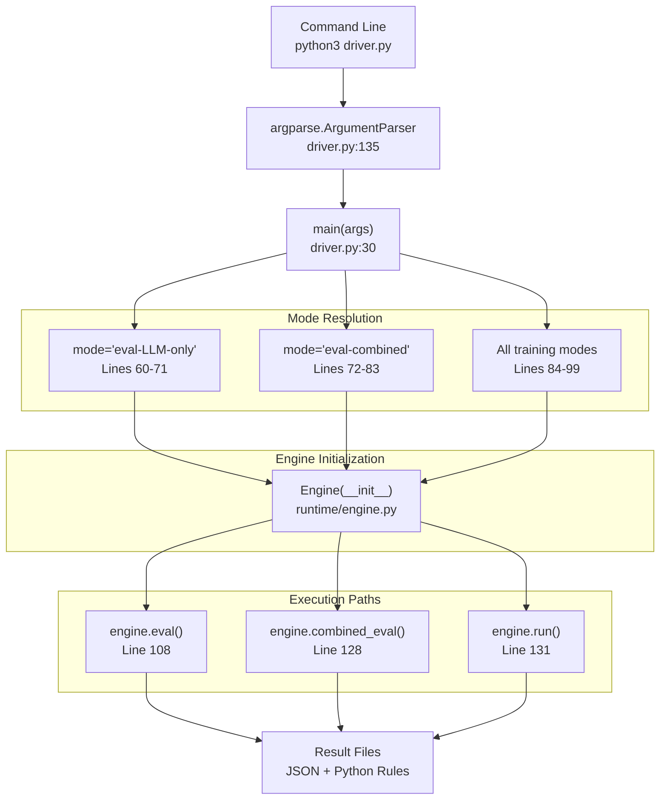

**Sources:** [driver.py:30-132]()

---

## Command-Line Arguments

All arguments are passed to `driver.py` using standard command-line flag syntax. The argument parser is defined in [driver.py:135-238]().

### Required Arguments

| Argument | Type | Description | Default |
|----------|------|-------------|---------|
| `--dataset_path` | `str` | Path to the time-series dataset (CSV file or directory) | See note below |
| `--result_path` | `str` | Directory where generated rules and results will be saved | See note below |
| `--mode` | `str` | Operational mode (see [Operational Modes](#operational-modes)) | `train-LLM-only` |

**Note:** The defaults in [driver.py:139-146]() are placeholder paths and must be overridden for actual use.

### Optional Configuration Arguments

| Argument | Type | Choices/Range | Default | Description |
|----------|------|---------------|---------|-------------|
| `--rule_path` | `str` | Any path | `""` | Path to pre-existing rule for evaluation modes |
| `--dataset_mode` | `str` | `one-by-one`, `all-in-one` | `one-by-one` | Dataset processing mode (see [Dataset Preparation](#2.2)) |
| `--train_test_split` | `float` | 0.0-1.0 | `0.7` | Ratio for train/test split (last portion used for test) |
| `--model_res_path` | `str` | Any path | See note | Path to existing model results (required for combined modes) |
| `--chunk_size` | `int` | > 0 | `1000` | Size of data chunks for training iterations |
| `--image_chunk_size` | `int` | > 0 | `10000` | Size of chunks for image-based training mode |
| `--image_subplots` | `tuple` | Format: (x,",",y) | `(1,",",1)` | Subplot layout for image generation |
| `--repeat` | `int` | > 0 | `1` | Number of training repetitions (not supported for eval modes) |
| `--top_k` | `int` | > 0 | `5` | Number of top-performing rules to select |
| `--llm_engine` | `str` | `gpt-4-32k`, `gpt-4o`, `gpt-35-turbo-16k` | `gpt-4-32k` | Azure OpenAI model to use |
| `--timeout` | `int` | > 0 | `150` | Training timeout in minutes |
| `--sample_per_prompt` | `int` | > 0 | `1` | Number of samples to generate per LLM prompt |

**Sources:** [driver.py:136-237]()

---

## Operational Modes

The `--mode` argument determines which workflow Argos executes. The mode string is passed directly to the `Engine` initialization [driver.py:67, 79, 91]().

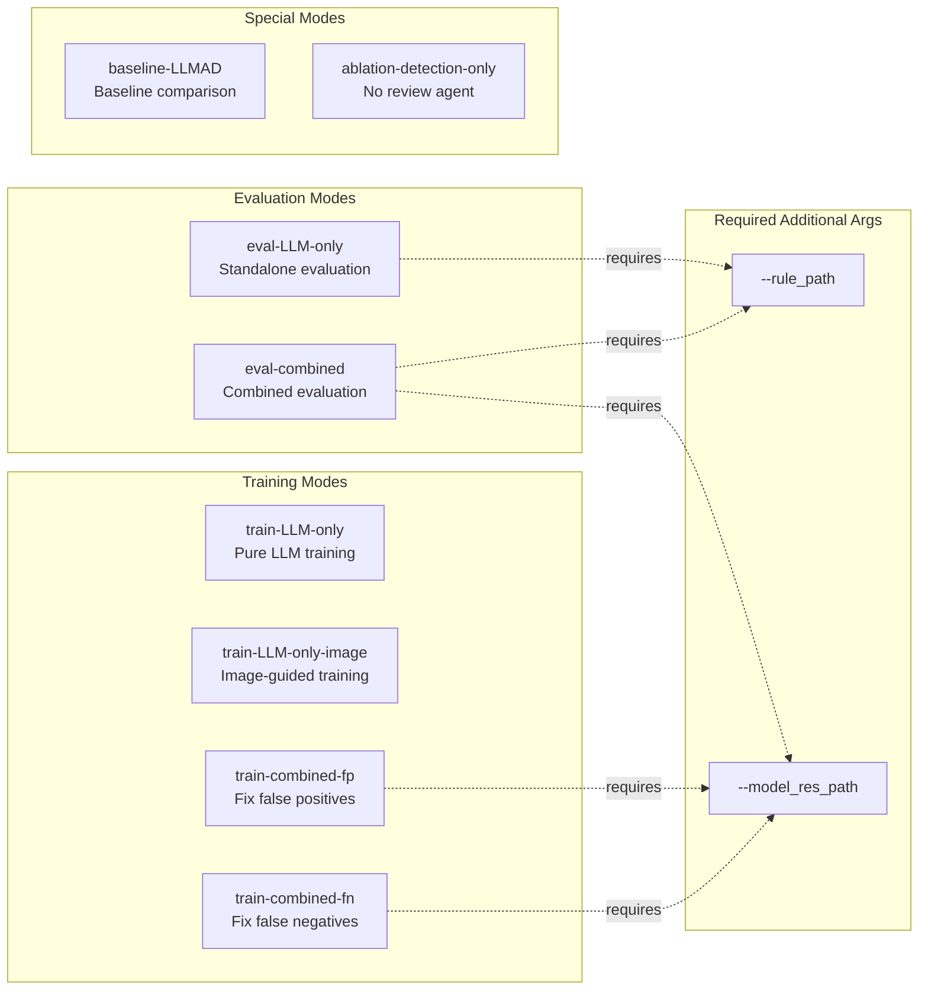

**Sources:** [driver.py:155-168]()

### Mode Descriptions

| Mode | Purpose | Required Args | Output |
|------|---------|---------------|--------|
| `train-LLM-only` | Train rules using LLM on full dataset | None | Rules + metrics for each iteration |
| `train-LLM-only-image` | Train rules using image analysis | None | Rules + metrics for each iteration |
| `train-combined-fp` | Generate rules to fix false positives from existing model | `--model_res_path` | FP-focused rules + metrics |
| `train-combined-fn` | Generate rules to fix false negatives from existing model | `--model_res_path` | FN-focused rules + metrics |
| `eval-LLM-only` | Evaluate existing rule on test set | `--rule_path` | Performance metrics (JSON) |
| `eval-combined` | Evaluate rule combined with base model | `--rule_path`, `--model_res_path` | Combined performance metrics |
| `baseline-LLMAD` | Run LLMAD baseline for comparison | None | Baseline results |
| `ablation-detection-only` | Train without review agent (ablation study) | None | Rules without iterative refinement |

For detailed mode workflows, see [Operational Modes](#3.3).

**Sources:** [driver.py:155-168](), [README.md:119-157]()

---

## Common Usage Examples

### Example 1: Training Without Aggregator (LLM-Only)

This is the most common starting point. It trains anomaly rules using only LLM agents on the full training dataset.

```bash
python3 driver.py \
  --dataset_path=./datasets/KPI/metric_1 \
  --mode=train-LLM-only \
  --result_path=./results/kpi_experiment \
  --chunk_size=2500 \
  --top_k=5 \
  --dataset_mode=one-by-one \
  --llm_engine=gpt-4-32k
```

**What happens:**
1. Dataset is loaded from `./datasets/KPI/metric_1`
2. Data is split 70/30 (train/test) based on default `--train_test_split`
3. Training data is chunked into 2500-point segments
4. For each chunk, the `DetectionAgentV3` generates rules
5. `ReviewAgent` evaluates and refines rules iteratively
6. Top 5 rules are selected based on training performance
7. Results saved to `./results/kpi_experiment/YYYY-MM-DD_HH-MM-SS_*`

**Sources:** [README.md:121-133](), [driver.py:84-99]()

---

### Example 2: Training With Aggregator (Fix False Positives)

This mode requires results from an existing anomaly detection model and focuses on generating rules to reduce false positives.

```bash
python3 driver.py \
  --dataset_path=./datasets/KPI/metric_1 \
  --mode=train-combined-fp \
  --result_path=./results/kpi_fp_fix \
  --chunk_size=1000 \
  --top_k=1 \
  --dataset_mode=one-by-one \
  --model_res_path=./model_outputs/existing_model
```

**What happens:**
1. System loads false positive indices from `--model_res_path`
2. Training data is filtered to focus on FP regions
3. Smaller chunks (1000 points) are used for targeted learning
4. Rules are optimized to reduce false alarms
5. Top 1 rule is selected (common for combined modes)

**Sources:** [README.md:143-157](), [driver.py:146-153]()

---

### Example 3: Evaluating an Existing Rule

To evaluate a previously trained rule on test data:

```bash
python3 driver.py \
  --dataset_path=./datasets/KPI/metric_1 \
  --mode=eval-LLM-only \
  --rule_path=./results/previous_run/iteration_3/rule.py \
  --result_path=./results/evaluation
```

**What happens:**
1. Engine loads in train mode internally [driver.py:67]()
2. The specified rule is executed against test data
3. Performance metrics (F1, precision, recall) are calculated
4. Results saved as `eval_result.json`
5. If the rule has errors, `RepairAgent` attempts to fix them [driver.py:114-121]()

**Sources:** [driver.py:104-121]()

---

### Example 4: Image-Based Training

Uses vision-capable LLM (GPT-4o) to analyze time-series plots:

```bash
python3 driver.py \
  --dataset_path=./datasets/Yahoo/metric_A \
  --mode=train-LLM-only-image \
  --result_path=./results/image_training \
  --image_chunk_size=10000 \
  --image_subplots=2,2 \
  --llm_engine=gpt-4o \
  --chunk_size=2500
```

**What happens:**
1. System generates visualizations of time-series data
2. `ImageAgent` analyzes plots to identify anomaly patterns
3. Extracted patterns guide `DetectionAgentV3` in rule generation
4. Standard training loop proceeds with image-informed context

**Sources:** [driver.py:196-205]()

---

## Argument Resolution Flow

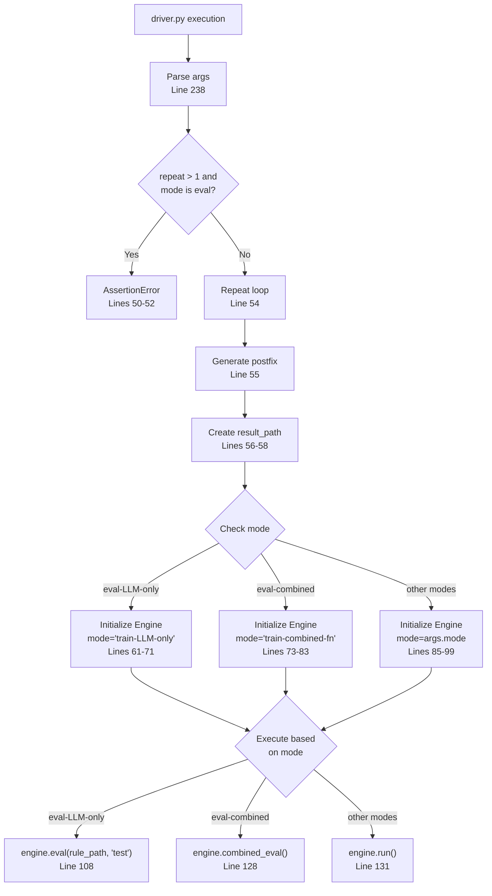

**Sources:** [driver.py:30-132]()

---

## Output Structure

When Argos completes execution, it creates a timestamped directory structure containing all generated artifacts.

### Directory Layout

```
result_path/
└── YYYY-MM-DD_HH-MM-SS_<dataset_postfix>/
    ├── iteration_0/
    │   ├── rule.py                    # Generated detection rule
    │   ├── train_performance.json     # Training metrics
    │   └── test_performance.json      # Test metrics
    ├── iteration_1/
    │   ├── rule.py
    │   ├── train_performance.json
    │   └── test_performance.json
    ├── ...
    ├── iteration_N/
    ├── best_rule.py                   # Top-k selected rule
    ├── eval_result.json               # Final evaluation (eval modes only)
    └── selection_results.json         # Rule selection details
```

**Sources:** [driver.py:56-58]()

### Performance Metrics Format

Each `train_performance.json` and `test_performance.json` contains:

```json
{
  "point_f1": 0.85,
  "event_f1": 0.82,
  "precision": 0.88,
  "recall": 0.83,
  "true_positives": 120,
  "false_positives": 18,
  "false_negatives": 25,
  "true_negatives": 1837
}
```

For evaluation modes, `eval_result.json` is created directly in the result path [driver.py:109-111]().

**Sources:** [driver.py:108-111]()

---

## Error Handling

The driver includes error recovery mechanisms, particularly for evaluation modes.

### Automatic Rule Repair

When evaluating a rule, if syntax or runtime errors occur, the system automatically invokes the `RepairAgent`:

```mermaid
graph TD
    EVAL["engine.eval(rule_path)"]
    EXEC["Execute rule"]
    ERROR{"Exception<br/>caught?"}
    
    CHECK{"Exception<br/>type?"}
    
    SYNTAX["SyntaxException<br/>Line 116"]
    RUNTIME["RuntimeException<br/>Line 118"]
    OTHER["Other exception<br/>Line 121"]
    
    REPAIR_SYNTAX["repair_agent.run()<br/>with test_df"]
    REPAIR_RUNTIME["repair_agent.run()<br/>with error df"]
    RERAISE["raise exception"]
    
    EVAL --> EXEC
    EXEC --> ERROR
    ERROR -->|Yes| CHECK
    ERROR -->|No| SUCCESS["Return results"]
    
    CHECK --> SYNTAX
    CHECK --> RUNTIME
    CHECK --> OTHER
    
    SYNTAX --> REPAIR_SYNTAX
    RUNTIME --> REPAIR_RUNTIME
    OTHER --> RERAISE
```

**Sources:** [driver.py:108-121]()

### Validation Checks

The driver performs validation before execution:

1. **Repeat validation**: Evaluation modes (`eval-LLM-only`, `eval-combined`) cannot use `--repeat > 1` [driver.py:49-52]()
2. **Rule path validation**: Evaluation modes require `--rule_path` to be provided [driver.py:105, 123]()
3. **Model result validation**: Combined modes require `--model_res_path` [driver.py:124-126]()

**Sources:** [driver.py:49-126]()

---

## Advanced Configuration

### Multi-Run Experiments

The `--repeat` argument enables running multiple training experiments sequentially:

```bash
python3 driver.py \
  --dataset_path=./datasets/KPI/metric_1 \
  --mode=train-LLM-only \
  --result_path=./results/experiments \
  --repeat=10 \
  --chunk_size=2500
```

Each run creates a separate timestamped directory. This is useful for:
- Measuring consistency across LLM generations
- Gathering statistics on rule quality
- A/B testing different hyperparameters

**Note:** Not supported for evaluation modes [driver.py:49-52]().

**Sources:** [driver.py:43-58]()

---

### Timeout Management

The `--timeout` parameter (in minutes) prevents indefinite execution during training [driver.py:226-230](). If exceeded, the system raises a `TimeoutException`. The default is 150 minutes.

```bash
python3 driver.py \
  --dataset_path=./datasets/large_metric \
  --mode=train-LLM-only \
  --result_path=./results \
  --timeout=300  # 5 hours for large datasets
```

**Sources:** [driver.py:46, 226-230]()

---

## Next Steps

After running Argos successfully:

1. **Review Results**: Examine generated rules in the output directory to understand detection logic
2. **Evaluate Performance**: Check performance metrics to assess rule quality
3. **Iterate**: Adjust `--chunk_size`, `--top_k`, or `--llm_engine` parameters to optimize results
4. **Deploy Rules**: Extract the best rule from `best_rule.py` for integration into monitoring systems

For understanding what happens during execution, see [Engine](#4.2). For details on how rules are generated, see [Detection Agent](#4.4).

**Sources:** [README.md:111-157](), [driver.py:1-240]()

---

# Page: Architecture

# Architecture

<details>
<summary>Relevant source files</summary>

The following files were used as context for generating this wiki page:

- [README.md](README.md)
- [driver.py](driver.py)
- [runtime/engine.py](runtime/engine.py)

</details>


## Purpose and Scope

This document describes the high-level architecture of the Argos system, including its layered structure, core components, and execution flow. It provides a foundation for understanding how the system orchestrates LLM-based agents to generate time-series anomaly detection rules.

For detailed information about specific components, see:
- System component interactions: [System Overview](#3.1)
- Agent design patterns and types: [Agent Ecosystem](#3.2)
- Training and evaluation modes: [Operational Modes](#3.3)
- Data processing pipeline: [Data Flow Pipeline](#3.4)

For implementation details of individual components, see [Core Components](#4).

---

## Architectural Overview

Argos implements a **three-layer architecture** consisting of an orchestration layer, an agent layer, and a data management layer. The system follows an **agentic design pattern** where specialized agents collaborate to generate, repair, and refine anomaly detection rules through iterative interaction with LLMs.

### Layered Architecture

```mermaid
graph TB
    subgraph "Orchestration Layer"
        Driver["driver.py<br/>CLI Entry Point"]
        Engine["runtime/engine.py<br/>Engine class"]
    end
    
    subgraph "Agent Layer"
        DetectionAgent["agent/detection_agent.py<br/>DetectionAgentV3"]
        RepairAgent["agent/repair_agent.py<br/>RepairAgent"]
        ReviewAgent["agent/review_agent.py<br/>ReviewAgent"]
        ImageAgent["agent/image_agent.py<br/>ImageAgent"]
        BaseAgent["agent/agent.py<br/>Agent base class"]
        LLMClient["agent/agent.py<br/>LLM class"]
    end
    
    subgraph "Data Management Layer"
        Dataset["datasets/dataset.py<br/>ArgosDataset"]
        Selector["selector/train_perf_selector.py<br/>TrainPerfSelector"]
        Metrics["eval_metrics/point_f1.py<br/>calculate_performance()"]
    end
    
    subgraph "External Dependencies"
        AzureOpenAI["Azure OpenAI API"]
    end
    
    Driver --> Engine
    Engine --> DetectionAgent
    Engine --> RepairAgent
    Engine --> ReviewAgent
    Engine --> ImageAgent
    Engine --> Dataset
    Engine --> Selector
    
    DetectionAgent --> BaseAgent
    RepairAgent --> BaseAgent
    ReviewAgent --> BaseAgent
    ImageAgent --> BaseAgent
    
    BaseAgent --> LLMClient
    LLMClient --> AzureOpenAI
    
    ReviewAgent --> Metrics
    Selector --> Metrics
```

**Sources:** [README.md:95-108](), [driver.py:1-240](), [runtime/engine.py:28-128]()

---

## Core Architectural Patterns

### 1. Command-Line Orchestration

The system uses `driver.py` as a **CLI orchestrator** that parses command-line arguments and delegates execution to the `Engine` class. This separation allows the engine to remain independent of the interface layer.

| Component | Responsibility | Key Parameters |
|-----------|---------------|----------------|
| `driver.py` | Parse CLI arguments, initialize Engine, handle top-level exceptions | `--mode`, `--dataset_path`, `--chunk_size`, `--top_k` |
| `runtime/engine.py::Engine` | Orchestrate training/evaluation workflow, manage agent lifecycle | `mode`, `dataset_mode`, `chunk_size`, `top_k` |

**Sources:** [driver.py:30-132](), [runtime/engine.py:28-128]()

### 2. Agent-Based Design

All agents inherit from a common `Agent` base class that provides LLM interaction capabilities through composition with an `LLM` client instance. Each agent specializes in a specific task within the rule generation pipeline.

```mermaid
graph TB
    subgraph "Base Infrastructure"
        Agent["Agent<br/>(agent/agent.py:28-158)"]
        LLM["LLM<br/>(agent/agent.py:161-235)"]
    end
    
    subgraph "Specialized Agents"
        DA["DetectionAgentV3<br/>Rule generation<br/>(agent/detection_agent.py:41-700)"]
        RA["RepairAgent<br/>Error fixing<br/>(agent/repair_agent.py:17-249)"]
        RVA["ReviewAgent<br/>Performance evaluation<br/>(agent/review_agent.py:29-653)"]
        IA["ImageAgent<br/>Visual analysis<br/>(agent/image_agent.py:16-150)"]
    end
    
    Agent -.inheritance.-> DA
    Agent -.inheritance.-> RA
    Agent -.inheritance.-> RVA
    Agent -.inheritance.-> IA
    
    Agent --> LLM
    
    LLM --> AzureAPI["Azure OpenAI API<br/>gpt-4-32k / gpt-4o / gpt-35-turbo"]
```

**Agent Responsibilities:**

| Agent | Purpose | Input | Output |
|-------|---------|-------|--------|
| `DetectionAgentV3` | Generate Python detection rules from time-series data | Time-series chunks, optional context | Python rule file (`.py`) |
| `RepairAgent` | Fix syntax and runtime errors in generated rules | DataFrame, rule file path, error message | Corrected rule file |
| `ReviewAgent` | Evaluate rule performance and trigger refinements | Rule file path, test DataFrame | Performance metrics (F1, precision, recall) |
| `ImageAgent` | Extract anomaly types from time-series visualizations | Image path, previous anomaly types | List of anomaly types |

**Sources:** [agent/agent.py:28-235](), [agent/detection_agent.py:41-700](), [agent/repair_agent.py:17-249](), [agent/review_agent.py:29-653](), [agent/image_agent.py:16-150]()

### 3. Iterative Refinement Loop

The `Engine` class implements an **iterative training loop** where rules are generated, evaluated, and refined until a maximum iteration count or timeout is reached. The loop includes error handling and recovery mechanisms.

```mermaid
sequenceDiagram
    participant Engine as "Engine<br/>(runtime/engine.py)"
    participant Dataset as "ArgosDataset<br/>(datasets/dataset.py)"
    participant Detection as "DetectionAgentV3"
    participant Repair as "RepairAgent"
    participant Review as "ReviewAgent"
    participant Selector as "TrainPerfSelector"
    
    Engine->>Dataset: get_train_df_by_iter(iter)
    Dataset-->>Engine: curr_df
    
    loop For each top_k candidate
        Engine->>Detection: run(curr_dfs, rule_path, last_rule_path)
        Detection-->>Engine: Generated rule file
        
        Engine->>Repair: run(curr_df, rule_path)
        Repair-->>Engine: Fixed rule file
        
        loop Until performance acceptable
            Engine->>Review: run(rule_path, last_rule_path)
            alt Error occurs
                Review-->>Engine: SyntaxException/RuntimeException
                Engine->>Repair: run(df, rule_path)
            else Success
                Review-->>Engine: eval_res (F1, precision, recall)
            end
        end
    end
    
    Engine->>Selector: select(rule_perf_pairs)
    Selector-->>Engine: best_rule_path
```

**Sources:** [runtime/engine.py:129-453]()

---

## System Components

The following table summarizes the major components and their locations in the codebase:

| Component | File Path | Primary Class/Function | Purpose |
|-----------|-----------|------------------------|---------|
| **CLI Entry Point** | `driver.py` | `main()` | Parse arguments, initialize Engine, handle evaluation modes |
| **Training Engine** | `runtime/engine.py` | `Engine` | Orchestrate training/evaluation, manage iteration loop |
| **Base Agent** | `agent/agent.py` | `Agent`, `LLM` | Provide LLM interaction, message management, token counting |
| **Detection Agent** | `agent/detection_agent.py` | `DetectionAgentV3` | Generate detection rules in 4 modes (LLM-only, combined FP/FN, image) |
| **Repair Agent** | `agent/repair_agent.py` | `RepairAgent` | Fix syntax and runtime errors in generated code |
| **Review Agent** | `agent/review_agent.py` | `ReviewAgent` | Evaluate performance, detect regressions, trigger refinements |
| **Image Agent** | `agent/image_agent.py` | `ImageAgent` | Extract anomaly types from time-series plots |
| **Dataset Manager** | `datasets/dataset.py` | `ArgosDataset` | Load data, chunk segmentation, train/test splitting |
| **Rule Selector** | `selector/train_perf_selector.py` | `TrainPerfSelector` | Select best rule based on training performance |
| **Metrics** | `eval_metrics/point_f1.py` | `calculate_performance()` | Compute F1, precision, recall with point adjustment |
| **Baseline** | `baseline/llmad.py` | `LLMAD` | Baseline implementation for comparison |

**Sources:** [README.md:95-108](), [driver.py:1-240](), [runtime/engine.py:1-830]()

---

## Execution Flow

### Training Mode Execution

The following diagram illustrates the control flow during training mode (`train-LLM-only`, `train-combined-fp`, `train-combined-fn`, `train-LLM-only-image`):

```mermaid
graph TD
    Start["main() in driver.py"] --> ParseArgs["Parse CLI arguments"]
    ParseArgs --> InitEngine["Initialize Engine(mode, dataset_path, ...)"]
    InitEngine --> CheckMode{"Check mode"}
    
    CheckMode -->|"train-*"| RunTraining["Engine.run()"]
    CheckMode -->|"eval-*"| RunEval["Engine.eval() or combined_eval()"]
    CheckMode -->|"baseline-LLMAD"| RunBaseline["Engine.run_baseline()"]
    CheckMode -->|"ablation-*"| RunAblation["Engine.ablation_detection_only()"]
    
    RunTraining --> InitAgents["Initialize DetectionAgentV3,<br/>RepairAgent, ReviewAgent"]
    InitAgents --> LoopStart{"cur_iter < max_iter<br/>AND time < max_time"}
    
    LoopStart -->|Yes| GetChunk["Dataset.get_train_df_by_iter()"]
    GetChunk --> TopKLoop["For each top_k candidate"]
    TopKLoop --> GenerateRule["DetectionAgent.run()"]
    GenerateRule --> RepairRule["RepairAgent.run()"]
    RepairRule --> ReviewLoop["While performance not acceptable"]
    ReviewLoop --> EvalRule["ReviewAgent.run()"]
    EvalRule --> CheckError{"Error occurred?"}
    CheckError -->|Yes| RepairRule
    CheckError -->|No| SaveMetrics["Save eval_res_train.json"]
    SaveMetrics --> NextK{"More top_k?"}
    NextK -->|Yes| TopKLoop
    NextK -->|No| SelectBest["TrainPerfSelector.select()"]
    SelectBest --> EvalTest["Evaluate on test set"]
    EvalTest --> Visualize["Generate visualization"]
    Visualize --> IncrementIter["cur_iter++"]
    IncrementIter --> LoopStart
    
    LoopStart -->|No| SaveStats["Save stats.json"]
    SaveStats --> End["Return"]
```

**Key Control Flow Points:**

1. **Initialization** ([driver.py:85-99]()): CLI arguments are parsed and an `Engine` instance is created with the specified mode and parameters.

2. **Agent Setup** ([runtime/engine.py:104-127]()): The Engine initializes specialized agents based on the operational mode.

3. **Iteration Loop** ([runtime/engine.py:203-434]()): The main training loop iterates until `MAX_ITER` or timeout is reached.

4. **Data Chunking** ([runtime/engine.py:217-220]()): For each iteration, random training chunks are selected from the dataset.

5. **Top-K Generation** ([runtime/engine.py:224-363]()): Multiple rule candidates are generated and evaluated to select the best performer.

6. **Error Recovery** ([runtime/engine.py:293-314]()): If `ReviewAgent` raises `SyntaxException` or `RuntimeException`, the `RepairAgent` attempts to fix the rule.

7. **Rule Selection** ([runtime/engine.py:371-372]()): `TrainPerfSelector` chooses the best rule based on training performance metrics.

8. **Final Evaluation** ([runtime/engine.py:378-430]()): The selected rule is evaluated on the test set and results are visualized.

**Sources:** [driver.py:30-132](), [runtime/engine.py:129-453]()

---

## Configuration and Modes

The system supports **eight operational modes** that determine the training and evaluation behavior:

### Training Modes

| Mode | Description | Required Parameters | Agent Workflow |
|------|-------------|---------------------|----------------|
| `train-LLM-only` | Pure LLM-based rule generation | `dataset_path`, `chunk_size` | Detection → Repair → Review |
| `train-LLM-only-image` | Image-guided rule generation | `dataset_path`, `image_chunk_size`, `image_subplots` | Image → Detection → Repair → Review |
| `train-combined-fp` | Fix false positives from existing model | `dataset_path`, `model_res_path` | Detection (with abnormal context) → Repair → Review |
| `train-combined-fn` | Fix false negatives from existing model | `dataset_path`, `model_res_path` | Detection (with normal context) → Repair → Review |

### Evaluation Modes

| Mode | Description | Required Parameters |
|------|-------------|---------------------|
| `eval-LLM-only` | Evaluate existing rule standalone | `rule_path`, `dataset_path` |
| `eval-combined` | Evaluate rule combined with base model | `rule_path`, `model_res_path` |

### Special Modes

| Mode | Description | Purpose |
|------|-------------|---------|
| `baseline-LLMAD` | Run LLMAD baseline | Performance comparison |
| `ablation-detection-only` | Detection without review | Ablation study |

**Sources:** [driver.py:155-169](), [runtime/engine.py:50-128](), [README.md:114-157]()

---

## Data Flow Architecture

Time-series data flows through the system in the following stages:

```mermaid
graph LR
    RawData["Raw CSV Files<br/>(value, label, index)"] --> ArgosDataset["ArgosDataset<br/>(datasets/dataset.py)"]
    
    ArgosDataset --> TrainDict["train_dict<br/>(chunked training data)"]
    ArgosDataset --> TestDict["test_dict<br/>(test data)"]
    ArgosDataset --> AbnormalDict["abnormal_dict<br/>(FP/FN segments)"]
    ArgosDataset --> NormalDict["normal_dict<br/>(TN/TP segments)"]
    
    TrainDict --> Engine["Engine.run()"]
    TestDict --> Engine
    AbnormalDict --> DetectionAgent["DetectionAgentV3<br/>(FP mode)"]
    NormalDict --> DetectionAgent2["DetectionAgentV3<br/>(FN mode)"]
    
    Engine --> DetectionAgent
    Engine --> DetectionAgent2
    
    DetectionAgent --> RuleFile["rule_iterX_Y.py"]
    DetectionAgent2 --> RuleFile
    
    RuleFile --> Evaluation["ReviewAgent.eval()"]
    Evaluation --> Metrics["Performance Metrics<br/>(F1, precision, recall)"]
```

**Data Processing Stages:**

1. **Loading** ([datasets/dataset.py:55-125]()): `ArgosDataset` loads CSV files and creates pandas DataFrames.

2. **Chunking** ([datasets/dataset.py:127-200]()): Data is segmented into fixed-size chunks (`chunk_size` parameter).

3. **Train/Test Split** ([datasets/dataset.py:170-200]()): Data is split according to `train_test_split` ratio (default 0.7).

4. **Mode-Specific Filtering** ([datasets/dataset.py:201-350]()): For combined modes, data is filtered based on model results (FP/FN indices).

5. **Agent Consumption** ([runtime/engine.py:217-289]()): Agents receive data chunks and generate detection rules.

6. **Evaluation** ([agent/review_agent.py:100-653]()): Generated rules are executed on test data to produce labels.

7. **Metric Calculation** ([eval_metrics/point_f1.py]()): Performance metrics are computed with point adjustment.

**Sources:** [datasets/dataset.py:1-450](), [runtime/engine.py:80-88]()

---

## External Dependencies

The system relies on the following external services and libraries:

### Azure OpenAI Integration

Argos requires Azure OpenAI API credentials configured via environment variables:

- `OPENAI_AZURE_ENDPOINT`: Azure OpenAI service endpoint
- `OPENAI_AZURE_API_KEY`: API authentication key  
- `OPENAI_AZURE_API_VERSION`: API version string

The `LLM` class ([agent/agent.py:161-235]()) wraps the Azure OpenAI client and supports three model options:
- `gpt-4-32k`: Large context window for complex rules
- `gpt-4o`: Vision-enabled for image analysis
- `gpt-35-turbo-16k`: Cost-effective option

**Sources:** [README.md:51-61](), [agent/agent.py:161-235](), [driver.py:220-225]()

### Python Dependencies

Key libraries used throughout the system:

| Library | Purpose | Usage |
|---------|---------|-------|
| `pandas` | DataFrame operations | Data loading, manipulation, filtering |
| `numpy` | Numerical operations | Array operations, label processing |
| `matplotlib` | Visualization | Generate time-series plots for ImageAgent |
| `scikit-learn` | ML utilities | Performance metric calculations |

**Sources:** [README.md:43-49](), [runtime/engine.py:11-13]()

---

## Performance and Constraints

### Iteration Limits

The system enforces two types of iteration limits:

1. **Maximum Iterations** (`MAX_ITER`): Default configured in [agent/agent.py:26]()
2. **Timeout** ([runtime/engine.py:69-71]()): Specified in minutes via `--timeout` parameter (default: 150 minutes)

The training loop terminates when either limit is reached ([runtime/engine.py:203-204]()).

### Resource Management

- **Token Counting** ([agent/agent.py:138-158]()): Each agent tracks token usage for cost monitoring
- **Execution Timeout** ([agent/agent.py:73-86]()): Individual agent operations have configurable timeouts
- **Memory Management**: Dataset chunking prevents loading entire datasets into memory

**Sources:** [agent/agent.py:26-158](), [runtime/engine.py:66-71]()

---

For detailed implementation of specific components, refer to:
- [System Overview](#3.1) - Component interaction details
- [Agent Ecosystem](#3.2) - Agent design and specialization
- [Operational Modes](#3.3) - Mode-specific workflows
- [Data Flow Pipeline](#3.4) - Data transformation details
- [Core Components](#4) - Individual component documentation

---

# Page: System Overview

# System Overview

<details>
<summary>Relevant source files</summary>

The following files were used as context for generating this wiki page:

- [agent/agent.py](agent/agent.py)
- [driver.py](driver.py)
- [runtime/engine.py](runtime/engine.py)

</details>


## Purpose and Scope

This document describes the high-level architecture of Argos, explaining how the major components interact to implement agentic time-series anomaly detection. It covers the system's layered structure, the relationships between core classes, and the orchestration flow from CLI invocation through rule generation and evaluation.

For detailed information about specific agents, see [Agent Ecosystem](#3.2). For operational mode behavior, see [Operational Modes](#3.3). For data processing details, see [Data Flow Pipeline](#3.4).

## Architectural Layers

Argos follows a three-tier architecture where the CLI layer delegates to an orchestration layer, which in turn coordinates specialized agents:

```mermaid
graph TB
    subgraph "CLI Layer"
        MAIN["main()<br/>(driver.py)"]
        ARGPARSE["argparse<br/>Command-line argument parsing"]
    end
    
    subgraph "Orchestration Layer"
        ENGINE["Engine<br/>(runtime/engine.py)"]
        ENGINE_RUN["Engine.run()"]
        ENGINE_EVAL["Engine.eval()"]
        ENGINE_BASELINE["Engine.run_baseline()"]
        ENGINE_ABLATION["Engine.ablation_detection_only()"]
    end
    
    subgraph "Agent Layer"
        DA["DetectionAgentV3<br/>(agent/detection_agent.py)"]
        RA["RepairAgent<br/>(agent/repair_agent.py)"]
        RVA["ReviewAgent<br/>(agent/review_agent.py)"]
        IA["ImageAgent<br/>(agent/image_agent.py)"]
    end
    
    subgraph "Data Layer"
        DATASET["ArgosDataset<br/>(datasets/dataset.py)"]
    end
    
    subgraph "Support Components"
        SELECTOR["TrainPerfSelector<br/>(selector/train_perf_selector.py)"]
        LLMAD["LLMAD<br/>(baseline/llmad.py)"]
    end
    
    MAIN --> ARGPARSE
    ARGPARSE --> ENGINE
    ENGINE --> ENGINE_RUN
    ENGINE --> ENGINE_EVAL
    ENGINE --> ENGINE_BASELINE
    ENGINE --> ENGINE_ABLATION
    
    ENGINE_RUN --> DA
    ENGINE_RUN --> RA
    ENGINE_RUN --> RVA
    ENGINE_RUN --> IA
    ENGINE_RUN --> SELECTOR
    
    ENGINE_EVAL --> RVA
    ENGINE_BASELINE --> LLMAD
    ENGINE_ABLATION --> DA
    
    ENGINE --> DATASET
    RVA --> DATASET
```

**Sources:** [driver.py:1-240](), [runtime/engine.py:1-830]()

## Core Component Relationships

The following diagram shows the key classes and their dependencies:

```mermaid
graph TB
    subgraph "Entry Point"
        DRIVER_MAIN["driver.py::main()"]
    end
    
    subgraph "Engine Class"
        ENGINE_INIT["Engine.__init__()"]
        ENGINE_CLASS["Engine<br/>dataset: ArgosDataset<br/>detection_agent: DetectionAgentV3<br/>repair_agent: RepairAgent<br/>review_agent: ReviewAgent<br/>image_agent: ImageAgent"]
    end
    
    subgraph "Agent Base Infrastructure"
        AGENT_BASE["Agent (ABC)<br/>LLM: LLM<br/>name: str"]
        LLM_CLASS["LLM<br/>engine: str<br/>messages: list<br/>_openai: AzureOpenAI"]
    end
    
    subgraph "Specialized Agents"
        DETECTION["DetectionAgentV3<br/>chunk_size: int<br/>mode: str"]
        REPAIR["RepairAgent<br/>chunk_size: int"]
        REVIEW["ReviewAgent<br/>dataset: ArgosDataset"]
        IMAGE["ImageAgent<br/>chunk_size: int"]
    end
    
    subgraph "Data Management"
        DATASET_CLASS["ArgosDataset<br/>train_dict: dict<br/>test_dict: dict<br/>abnormal_dict: dict<br/>normal_dict: dict"]
    end
    
    subgraph "Azure Integration"
        AZURE_CLIENT["AzureOpenAI<br/>api_key: str<br/>azure_endpoint: str<br/>api_version: str"]
    end
    
    DRIVER_MAIN --> ENGINE_INIT
    ENGINE_INIT --> ENGINE_CLASS
    
    ENGINE_CLASS --> DETECTION
    ENGINE_CLASS --> REPAIR
    ENGINE_CLASS --> REVIEW
    ENGINE_CLASS --> IMAGE
    ENGINE_CLASS --> DATASET_CLASS
    
    DETECTION --> AGENT_BASE
    REPAIR --> AGENT_BASE
    REVIEW --> AGENT_BASE
    IMAGE --> AGENT_BASE
    
    AGENT_BASE --> LLM_CLASS
    LLM_CLASS --> AZURE_CLIENT
    
    REVIEW --> DATASET_CLASS
```

**Sources:** [driver.py:30-132](), [runtime/engine.py:28-128](), [agent/agent.py:26-213]()

## Component Responsibilities

| Component | Class/File | Primary Responsibilities |
|-----------|-----------|-------------------------|
| **CLI Driver** | `driver.py::main()` | Parse command-line arguments, initialize Engine, invoke training or evaluation modes |
| **Orchestrator** | `Engine` (runtime/engine.py) | Manage training iterations, coordinate agent lifecycle, handle timeouts, save results |
| **Base Agent** | `Agent` (agent/agent.py:174-213) | Define agent interface with abstract `run()` method, provide code extraction utilities |
| **LLM Client** | `LLM` (agent/agent.py:26-172) | Manage Azure OpenAI connections, maintain message history, track token usage |
| **Detection Agent** | `DetectionAgentV3` | Generate Python anomaly detection rules using LLM prompts |
| **Repair Agent** | `RepairAgent` | Fix syntax and runtime errors in generated Python code |
| **Review Agent** | `ReviewAgent` | Evaluate rule performance, trigger iterative refinements, prevent regressions |
| **Image Agent** | `ImageAgent` | Extract anomaly types from time-series visualizations using GPT-4o vision |
| **Dataset Manager** | `ArgosDataset` | Load CSV data, perform train/test splitting, chunk data, filter by model results |
| **Rule Selector** | `TrainPerfSelector` | Select best-performing rule from multiple training iterations |
| **Baseline** | `LLMAD` | Provide LLMAD baseline implementation for comparative evaluation |

**Sources:** [driver.py:30-132](), [runtime/engine.py:28-128](), [agent/agent.py:26-213]()

## Initialization Sequence

The system initializes components in a specific order to establish dependencies:

```mermaid
sequenceDiagram
    participant User
    participant main as "driver.py::main()"
    participant Engine as "Engine.__init__()"
    participant ArgosDataset
    participant DetectionAgentV3
    participant RepairAgent
    participant ReviewAgent
    participant ImageAgent
    participant LLM
    participant AzureOpenAI
    
    User->>main: Execute with arguments
    main->>Engine: Create Engine instance
    
    Engine->>ArgosDataset: Load dataset_path
    ArgosDataset-->>Engine: Dataset initialized
    
    alt mode != "baseline-LLMAD"
        Engine->>DetectionAgentV3: Create with chunk_size, mode, llm_engine
        DetectionAgentV3->>LLM: Initialize LLM client
        LLM->>AzureOpenAI: Connect using env vars
        AzureOpenAI-->>LLM: Client ready
        LLM-->>DetectionAgentV3: LLM ready
        DetectionAgentV3-->>Engine: Agent ready
        
        Engine->>RepairAgent: Create with chunk_size, llm_engine
        RepairAgent->>LLM: Initialize LLM client
        LLM-->>RepairAgent: LLM ready
        RepairAgent-->>Engine: Agent ready
        
        Engine->>ReviewAgent: Create with dataset, mode
        ReviewAgent->>LLM: Initialize LLM client
        LLM-->>ReviewAgent: LLM ready
        ReviewAgent-->>Engine: Agent ready
        
        alt mode == "train-LLM-only-image"
            Engine->>ImageAgent: Create with chunk_size
            ImageAgent->>LLM: Initialize LLM with gpt-4o
            LLM-->>ImageAgent: LLM ready
            ImageAgent-->>Engine: Agent ready
        end
    end
    
    Engine-->>main: Engine initialized
    main->>Engine: Call run() or eval()
```

**Sources:** [driver.py:30-132](), [runtime/engine.py:28-128](), [agent/agent.py:26-63]()

## Core Orchestration Flow

The `Engine.run()` method implements the main training loop:

```mermaid
flowchart TB
    START["Engine.run()"]
    CHECK_MODE{"mode?"}
    
    BASELINE["run_baseline()"]
    ABLATION["ablation_detection_only()"]
    TRAINING["Training Loop"]
    
    IMAGE_LOOP["Image Understanding Loop<br/>(if train-LLM-only-image)"]
    IMAGE_AGENT["ImageAgent.run()"]
    IMAGE_TYPES["Extract anomaly_types"]
    
    RULE_LOOP["Rule Training Loop<br/>(max_iter or max_time)"]
    GET_CHUNK["dataset.get_train_df_by_iter()"]
    
    DETECT["DetectionAgent.run()<br/>Generate rule for chunk"]
    REPAIR["RepairAgent.run()<br/>Fix syntax/runtime errors"]
    REVIEW["ReviewAgent.run()<br/>Evaluate performance"]
    
    TOPK{"top_k<br/>iterations?"}
    
    SELECT["TrainPerfSelector.select()<br/>Choose best rule"]
    EVAL_TEST["Evaluate on test set"]
    SAVE["Save results & stats"]
    
    END["Training Complete"]
    
    START --> CHECK_MODE
    CHECK_MODE -->|"baseline-LLMAD"| BASELINE --> END
    CHECK_MODE -->|"ablation-detection-only"| ABLATION --> END
    CHECK_MODE -->|"train modes"| TRAINING
    
    TRAINING --> IMAGE_LOOP
    IMAGE_LOOP --> IMAGE_AGENT
    IMAGE_AGENT --> IMAGE_TYPES
    IMAGE_TYPES --> RULE_LOOP
    
    RULE_LOOP --> GET_CHUNK
    GET_CHUNK --> TOPK
    
    TOPK -->|"for each top_k"| DETECT
    DETECT --> REPAIR
    REPAIR --> REVIEW
    REVIEW --> TOPK
    
    TOPK -->|"all top_k done"| SELECT
    SELECT --> EVAL_TEST
    EVAL_TEST --> RULE_LOOP
    
    RULE_LOOP -->|"max_iter or timeout"| SAVE
    SAVE --> END
```

**Sources:** [runtime/engine.py:129-453]()

## File System Integration

Argos interacts extensively with the file system during execution:

```mermaid
graph LR
    subgraph "Input Files"
        DATASET_CSV["dataset_path<br/>.csv file"]
        MODEL_RES["model_res_path<br/>Model predictions"]
        RULE_INPUT["rule_path<br/>(eval mode)"]
    end
    
    subgraph "Engine Operations"
        ENGINE["Engine"]
        ARGOS_DATASET["ArgosDataset"]
        AGENTS["Agents"]
    end
    
    subgraph "Output Directory: rule_path/"
        RULE_FILES["rule_iter{N}_{K}.py<br/>Generated Python rules"]
        EVAL_JSON["*_eval_res_test.json<br/>Performance metrics"]
        TRAIN_JSON["*_eval_res_train.json<br/>Training metrics"]
        STATS_JSON["stats.json<br/>Run statistics"]
        OUTPUT_LOG["output.log<br/>Execution logs"]
        FIGURES["eval_figure_*.png<br/>Visualizations"]
    end
    
    DATASET_CSV --> ARGOS_DATASET
    MODEL_RES --> ARGOS_DATASET
    RULE_INPUT --> ENGINE
    
    ARGOS_DATASET --> ENGINE
    ENGINE --> AGENTS
    
    AGENTS --> RULE_FILES
    ENGINE --> EVAL_JSON
    ENGINE --> TRAIN_JSON
    ENGINE --> STATS_JSON
    ENGINE --> OUTPUT_LOG
    ENGINE --> FIGURES
```

**Sources:** [runtime/engine.py:73-94](), [runtime/engine.py:199-202](), [runtime/engine.py:436-449]()

## Key Design Patterns

### Composition Over Inheritance

Each specialized agent composes an `LLM` instance rather than inheriting LLM functionality:

| Agent Class | LLM Engine | Purpose |
|-------------|-----------|---------|
| `DetectionAgentV3` | Configurable (gpt-4-32k, gpt-4o, gpt-35-turbo-16k) | Rule generation |
| `RepairAgent` | Configurable | Code repair |
| `ReviewAgent` | Configurable | Performance evaluation |
| `ImageAgent` | gpt-4o (required) | Visual analysis |

**Sources:** [runtime/engine.py:104-127](), [agent/agent.py:26-63]()

### Iterative Refinement Loop

The training process implements an iterative refinement pattern:

1. **Generate**: `DetectionAgentV3.run()` creates initial rule
2. **Repair**: `RepairAgent.run()` fixes code errors
3. **Review**: `ReviewAgent.run()` evaluates performance
4. **Refine**: If performance regresses, ReviewAgent requests improvements from LLM
5. **Select**: `TrainPerfSelector.select()` chooses best rule across iterations

**Sources:** [runtime/engine.py:203-433]()

### Timeout and Error Handling

The system implements multiple timeout layers:

| Timeout | Location | Duration | Purpose |
|---------|----------|----------|---------|
| `TIMEOUT` | agent/agent.py:18 | 90,000s (25h) | Overall execution limit |
| `TIMEOUT_LLM` | agent/agent.py:20 | 300s (5min) | Individual LLM query |
| `TIMEOUT_FIRST_REVIEW` | agent/agent.py:19 | 120s (2min) | First review iteration |
| `TIMEOUT_PER_REVIEW` | agent/agent.py:21 | 120s (2min) | Subsequent review iterations |
| `TIMEOUT_IMAGE` | agent/agent.py:22 | 600s (10min) | Image understanding |
| `TIMEOUT_INFERENCE` | agent/agent.py:23 | 60s (1min) | Rule execution |
| `max_time` | runtime/engine.py:70 | Configurable | Engine timeout (minutes * 60) |

**Sources:** [agent/agent.py:17-23](), [runtime/engine.py:69-71]()

### Exception-Based Control Flow

Custom exceptions coordinate error recovery:

```mermaid
graph TB
    DETECT["DetectionAgent generates rule"]
    REPAIR["RepairAgent.run()"]
    REVIEW["ReviewAgent.run()"]
    
    SYNTAX_ERR["SyntaxException<br/>rule_path: str"]
    RUNTIME_ERR["RuntimeException<br/>df: DataFrame<br/>rule_path: str"]
    TIMEOUT_ERR["TimeoutException"]
    
    DETECT --> REVIEW
    REVIEW -->|"Syntax error"| SYNTAX_ERR
    REVIEW -->|"Runtime error"| RUNTIME_ERR
    REVIEW -->|"Timeout"| TIMEOUT_ERR
    
    SYNTAX_ERR --> REPAIR
    RUNTIME_ERR --> REPAIR
    TIMEOUT_ERR --> DETECT
    
    REPAIR --> REVIEW
```

**Sources:** [runtime/engine.py:293-314](), [common/exception.py]()

## State Management

The `Engine` class maintains execution state through instance variables:

| Variable | Type | Purpose |
|----------|------|---------|
| `cur_iter` | int | Current iteration number |
| `max_iter` | int | Maximum iterations (MAX_ITER = 100) |
| `max_time` | float | Maximum execution time in seconds |
| `rule_path` | str | Output directory path |
| `dataset` | ArgosDataset | Data manager instance |
| `detection_agent` | DetectionAgentV3 | Rule generator |
| `repair_agent` | RepairAgent | Code fixer |
| `review_agent` | ReviewAgent | Performance evaluator |
| `image_agent` | ImageAgent | Visual analyzer (optional) |

**Sources:** [runtime/engine.py:29-128]()

## Configuration Sources

Engine behavior is configured through multiple sources:

```mermaid
graph LR
    subgraph "Configuration Sources"
        CLI["Command-line Arguments<br/>(driver.py)"]
        ENV["Environment Variables<br/>(Azure credentials)"]
        CONST["Constants<br/>(agent/agent.py)"]
    end
    
    subgraph "Engine Parameters"
        DATASET_PATH["dataset_path"]
        MODE["mode"]
        CHUNK_SIZE["chunk_size"]
        LLM_ENGINE["llm_engine"]
        TIMEOUT["timeout"]
        TRAIN_TEST_SPLIT["train_test_split"]
        TOP_K["top_k"]
    end
    
    subgraph "LLM Configuration"
        API_KEY["OPENAI_AZURE_API_KEY"]
        ENDPOINT["OPENAI_AZURE_ENDPOINT"]
        VERSION["OPENAI_AZURE_API_VERSION"]
    end
    
    CLI --> DATASET_PATH
    CLI --> MODE
    CLI --> CHUNK_SIZE
    CLI --> LLM_ENGINE
    CLI --> TIMEOUT
    CLI --> TRAIN_TEST_SPLIT
    CLI --> TOP_K
    
    ENV --> API_KEY
    ENV --> ENDPOINT
    ENV --> VERSION
    
    CONST --> TIMEOUT_VALS["TIMEOUT_*<br/>constants"]
```

**Sources:** [driver.py:135-238](), [agent/agent.py:58-62](), [agent/agent.py:17-23]()

---

# Page: Agent Ecosystem

# Agent Ecosystem

<details>
<summary>Relevant source files</summary>

The following files were used as context for generating this wiki page:

- [agent/agent.py](agent/agent.py)
- [agent/detection_agent.py](agent/detection_agent.py)
- [agent/image_agent.py](agent/image_agent.py)
- [agent/repair_agent.py](agent/repair_agent.py)
- [agent/review_agent.py](agent/review_agent.py)

</details>


The agent ecosystem implements Argos's core intelligent capabilities through a modular, composition-based architecture. This page documents the base `Agent` class, the `LLM` client wrapper, and the four specialized agents that perform rule generation, error repair, performance review, and visual analysis. For information about how these agents are orchestrated during training and evaluation, see [Engine](#4.2).

---

## Base Infrastructure

### Architecture Overview

The agent ecosystem follows a composition pattern where all specialized agents inherit from an abstract `Agent` base class and compose an `LLM` instance for AI capabilities.

```mermaid
classDiagram
    class LLM {
        -AzureOpenAI _openai
        -str system_prompt
        -list messages
        -dict parameters
        -list input_output_token_count
        +query(user_prompt) str
        +query_with_image(user_prompt, image_path) str
        +reset() void
        +get_token_count() tuple
    }
    
    class Agent {
        <<abstract>>
        +LLM LLM
        +str name
        +run()* void
        +extract_code(text, lang, function_name) str
        +save_rule(rule, save_path) void
        +set_start_time() void
        +get_elapsed_time() float
        +get_token_count() tuple
    }
    
    class DetectionAgentV3 {
        -int chunk_size
        -str mode
        +run(train_df, normal_df, abnormal_df, last_rule_path, curr_rule_path, anomaly_types) void
    }
    
    class RepairAgent {
        -int chunk_size
        -int max_time
        +run(curr_df, curr_rule_path) void
    }
    
    class ReviewAgent {
        -int chunk_size
        -ArgosDataset dataset
        -str mode
        -str model_res_path
        +run(curr_rule_path, last_rule_path) dict
        +eval(rule_file, eval_df) tuple
        +combined_eval(rule_file, eval_mode) tuple
    }
    
    class ImageAgent {
        -int chunk_size
        -str mode
        +run(image_path, last_anomaly_types) str
    }
    
    Agent *-- LLM : composes
    DetectionAgentV3 --|> Agent : inherits
    RepairAgent --|> Agent : inherits
    ReviewAgent --|> Agent : inherits
    ImageAgent --|> Agent : inherits
```

**Sources:** [agent/agent.py:26-213](), [agent/detection_agent.py:513-700](), [agent/repair_agent.py:12-117](), [agent/review_agent.py:25-667](), [agent/image_agent.py:13-97]()

---

### LLM Class

The `LLM` class wraps the Azure OpenAI API and manages conversation state for iterative interactions with language models.

#### Initialization Parameters

| Parameter | Type | Default | Description |
|-----------|------|---------|-------------|
| `system_prompt` | str | "You are an AI assistant..." | System-level instructions that define agent behavior |
| `engine` | str | "gpt-4o" | Azure OpenAI model name (gpt-3.5-turbo, gpt-4-32k, gpt-4o) |
| `temperature` | float | 0.1 | Controls response randomness (0.0-1.0) |
| `past_message_num` | int | sys.maxsize | Number of historical messages to retain in context |

#### Key Methods

**`query(user_prompt: str) -> str`**  
Sends a text prompt to the LLM and returns the response. Automatically manages message history and token counting.

**`query_with_image(user_prompt: str, image_path: str) -> str`**  
Sends a prompt with an embedded image (base64-encoded). Only supported for `gpt-4o` engine. Used by `ImageAgent` for visual analysis.

**`reset() -> None`**  
Clears conversation history except the system prompt. Used between iterations to prevent context pollution.

**`get_token_count() -> tuple`**  
Returns `(input_output_token_count_list, total_input_tokens, total_output_tokens)` for cost tracking and monitoring.

#### Message Management

The `LLM` class maintains a conversation history in the `messages` list with the format:
```python
[
    {"role": "system", "content": system_prompt},
    {"role": "user", "content": user_prompt_1},
    {"role": "assistant", "content": response_1},
    ...
]
```

The `update_messages()` method enforces the `past_message_num` limit by retaining only the most recent user-assistant exchanges while preserving the system prompt at position 0.

#### Timeout and Retry Logic

The `send_messages()` method implements exponential backoff with a maximum timeout of `TIMEOUT_LLM` (5 minutes). If the API call fails, it retries with increasing delays (2, 3, 4, 5, 10, 20... seconds).

**Sources:** [agent/agent.py:26-172]()

---

### Agent Abstract Base Class

The `Agent` class provides common functionality for all specialized agents:

**Core Responsibilities:**
- Code extraction from LLM responses using regex patterns
- Rule saving to filesystem
- Time tracking for timeout enforcement
- Token count aggregation

**Abstract Method:**
- `run(*args, **kwargs)` - Must be implemented by subclasses to define agent-specific behavior

**Helper Methods:**

| Method | Purpose |
|--------|---------|
| `extract_code(text, lang, function_name)` | Extracts code blocks from markdown-formatted LLM responses. Searches for ` ```{lang}...``` ` patterns containing the specified function name. |
| `save_rule(rule, save_path)` | Writes generated Python code to the specified file path. |
| `set_start_time()` | Records the current timestamp for timeout calculations. |
| `get_elapsed_time()` | Returns seconds elapsed since `set_start_time()` was called. |
| `get_token_count()` | Delegates to `LLM.get_token_count()` for token usage tracking. |

**Sources:** [agent/agent.py:174-213]()

---

## Specialized Agents

### DetectionAgentV3

`DetectionAgentV3` is the primary rule generation agent. It queries the LLM to produce Python `inference` functions that detect anomalies in time-series data.

#### Initialization

```python
DetectionAgentV3(
    chunk_size: int,
    mode: str = "train-LLM-only",
    llm_engine: str = "gpt-4o",
    timeout: int = 150
)
```

**Mode-Specific Prompts:**

The agent's behavior varies significantly based on the `mode` parameter:

| Mode | Prompt Focus | Target Data |
|------|--------------|-------------|
| `train-LLM-only` | Generate rules from scratch using labeled data | All abnormal/normal samples |
| `train-LLM-only-image` | Incorporate anomaly types from visual analysis | All samples + anomaly type descriptions |
| `train-combined-fp` | Fix false positives from existing models | Normal samples misclassified as abnormal |
| `train-combined-fn` | Fix false negatives from existing models | Abnormal samples misclassified as normal |

#### Generated Function Signature

All modes produce functions with this signature:
```python
def inference(sample: np.ndarray) -> np.ndarray:
    """
    Args:
        sample: Shape (X, 2) where each row is (value, index)
    
    Returns:
        labels: Shape (X,) where 1=abnormal, 0=normal
    """
```

#### Run Method

```python
run(
    train_df: pd.DataFrame,
    normal_df: pd.DataFrame = None,
    abnormal_df: pd.DataFrame = None,
    last_rule_path: str = None,
    curr_rule_path: str = None,
    anomaly_types: str = None
) -> None
```

**Workflow:**
1. Formats training data as a string representation with (value, label, index) tuples
2. Optionally includes previous iteration's code for refinement
3. For image-guided mode, prepends anomaly type descriptions
4. Queries LLM and extracts Python code from markdown response
5. Saves rule to `curr_rule_path`

**Timeout:** Continues generating rules until `TIMEOUT` (30 minutes × 5 = 150 minutes) is reached.

**Sources:** [agent/detection_agent.py:513-1140]()

---

### RepairAgent

`RepairAgent` automatically fixes syntax and runtime errors in generated code through iterative refinement.

#### Initialization

```python
RepairAgent(
    chunk_size: int,
    llm_engine: str = "gpt-4o",
    timeout: int = 150
)
```

The agent's system prompt explicitly instructs the LLM to:
- Focus only on error correction
- Preserve unrelated logic
- Maintain the same code format

#### Run Method

```python
run(curr_df: pd.DataFrame, curr_rule_path: str) -> None
```

**Repair Loop:**

```mermaid
sequenceDiagram
    participant RA as RepairAgent
    participant FS as Filesystem
    participant EXEC as Python Executor
    participant LLM as LLM
    
    loop Until no errors or timeout
        RA->>FS: Read rule from curr_rule_path
        RA->>EXEC: exec(rule, globals())
        EXEC->>EXEC: inference(curr_df.values)
        
        alt Code has errors
            EXEC-->>RA: Exception message
            RA->>LLM: Query with code + error
            LLM-->>RA: Fixed code
            RA->>FS: Save fixed rule
        else No errors
            RA->>RA: Exit loop successfully
        end
    end
    
    RA->>RA: cleanup_global_env()
```

**Error Detection:**
1. Attempts to execute the code using `exec(rule, globals())`
2. Calls the `inference` function with timeout enforcement (`TIMEOUT_INFERENCE` = 1 minute)
3. Validates output format using `format_check()`
4. Cleans up global namespace with `cleanup_global_env()`

**Exception Types:**
- **SyntaxException:** Python syntax errors detected during `exec()`
- **RuntimeException:** Execution failures (e.g., undefined variables, type mismatches)
- **TimeoutException:** Inference exceeds `TIMEOUT_INFERENCE`

**Sources:** [agent/repair_agent.py:12-117]()

---

### ReviewAgent

`ReviewAgent` monitors performance metrics across iterations and triggers refinements when regressions are detected.

#### Initialization

```python
ReviewAgent(
    chunk_size: int,
    dataset: ArgosDataset,
    dataset_name: str = None,
    model_res_path: str = None,
    mode: str = "train-LLM-only",
    llm_engine: str = "gpt-4o",
    timeout: int = 150
)
```

The agent's behavior differs based on `mode`:

**LLM-Only Modes (`train-LLM-only`, `train-LLM-only-image`, `eval-LLM-only`):**
- Compares current rule performance against previous iteration
- No dependency on external model results

**Combined Modes (`train-combined-fp`, `train-combined-fn`):**
- Evaluates rules in combination with base model predictions
- First iteration compares against baseline model performance
- Subsequent iterations compare against previous combined performance

#### Run Method

```python
run(curr_rule_path: str, last_rule_path: str = None) -> tuple
```

**Regression Detection Logic:**

```mermaid
flowchart TD
    Start["run(curr_rule_path, last_rule_path)"]
    EvalCurr["Evaluate current rule\nGet curr_validate_res"]
    HasLast{"last_rule_path\nexists?"}
    EvalLast["Evaluate last rule\nGet last_validate_res"]
    GetBaseline["Get baseline performance\nfrom model only"]
    CompareF1{"curr_f1 <\nlast_f1?"}
    NoRegression["Log: No regression\nExit loop"]
    ComputeDiff["Compute code diff\nusing subprocess.run(['diff', ...])"]
    QueryLLM["Query LLM with:\n- Current code\n- Code diff\n- Performance metrics"]
    ExtractFix["Extract fixed code\nfrom LLM response"]
    SaveFix["Save fixed code\nto curr_rule_path"]
    Timeout{"Elapsed time >\nTIMEOUT_PER_REVIEW?"}
    Return["Return eval results"]
    
    Start --> EvalCurr
    EvalCurr --> HasLast
    HasLast -->|Yes| EvalLast
    HasLast -->|No, Combined Mode| GetBaseline
    HasLast -->|No, LLM-Only Mode| NoRegression
    EvalLast --> CompareF1
    GetBaseline --> CompareF1
    CompareF1 -->|No regression| NoRegression
    CompareF1 -->|Regression detected| ComputeDiff
    ComputeDiff --> QueryLLM
    QueryLLM --> ExtractFix
    ExtractFix --> SaveFix
    SaveFix --> Timeout
    Timeout -->|No| EvalCurr
    Timeout -->|Yes| Return
    NoRegression --> Return
```

**Performance Metrics:**

The agent uses F1 score as the primary regression indicator but tracks multiple metrics:
- **f1:** Harmonic mean of precision and recall
- **precision:** True positives / (True positives + False positives)
- **recall:** True positives / (True positives + False negatives)
- **threshold:** Optimal threshold for converting scores to binary labels

#### Evaluation Methods

**`eval(rule_file: str, eval_df: pd.DataFrame) -> tuple`**

Evaluates a rule on a single DataFrame:
1. Executes rule code and extracts `inference` function
2. Processes data in chunks of size `chunk_size`
3. Applies `smooth_labels()` with window_size=3 to reduce noise
4. Calculates performance metrics using `calculate_point_f1()`
5. Returns `(final_res_dict, labels, scores)`

**`eval_all_in_one(rule_file: str, df_dict: dict) -> tuple`**

Aggregates evaluation across multiple datasets (for `all-in-one` mode):
1. Calls `eval()` for each DataFrame in `df_dict`
2. Concatenates all scores and ground truth labels
3. Computes combined performance metrics
4. Returns aggregated results

**`combined_eval(rule_file: str, eval_mode: str) -> tuple`**

Evaluates rules in combination with base model predictions:
1. Retrieves model labels from dataset (train or test split)
2. Generates rule labels from `eval()`
3. Combines labels using mode-specific logic:
   - **train-combined-fp:** Rule labels override model labels to 0 (normal)
   - **train-combined-fn:** Rule labels override model labels to 1 (abnormal)
4. Calculates performance against ground truth
5. Returns combined results

**Sources:** [agent/review_agent.py:25-667]()

---

### ImageAgent

`ImageAgent` performs visual analysis of time-series plots to extract high-level anomaly type descriptions. This provides semantic guidance for `DetectionAgentV3` in the `train-LLM-only-image` mode.

#### Initialization

```python
ImageAgent(
    chunk_size: int,
    mode: str = "train-LLM-only",
    llm_engine: str = "gpt-4o"
)
```

**Requirements:**
- Must use `gpt-4o` engine for vision capabilities
- Images must be PNG format with red dots marking anomalies

#### Run Method

```python
run(image_path: str, last_anomaly_types: str = None) -> str
```

**Workflow:**
1. Optionally includes anomaly types from previous iteration for refinement
2. Calls `LLM.query_with_image()` with the plot image
3. Extracts structured anomaly type descriptions between markers:
   ```
   ### Anomaly Types BEGIN ###
   1. AnomalyType1: Explanation1
   2. AnomalyType2: Explanation2
   ...
   ### Anomaly Types END ###
   ```
4. Returns the extracted text for use by `DetectionAgentV3`

**Prompt Guidelines:**

The system prompt instructs the LLM to:
- Identify distinct anomaly patterns (spikes, drops, plateaus, etc.)
- Provide concrete value examples without timestamp information
- Merge duplicate anomaly types across figures
- Update existing types when seeing new examples
- Remove types that reflect normal patterns

**Timeout:** Continues attempting generation until `TIMEOUT_IMAGE` (10 minutes) is reached.

**Sources:** [agent/image_agent.py:13-97]()

---

## Agent Interaction Patterns

### Training Pipeline Integration

The following sequence shows how agents collaborate during a typical training iteration:

```mermaid
sequenceDiagram
    participant E as Engine
    participant DA as DetectionAgentV3
    participant RA as RepairAgent
    participant RVA as ReviewAgent
    participant DS as ArgosDataset
    participant LLM as LLM
    
    E->>DS: get_train_df()
    DS-->>E: train_df
    
    E->>DA: run(train_df, curr_rule_path)
    DA->>LLM: query(formatted_data)
    LLM-->>DA: Generated Python code
    DA->>DA: extract_code()
    DA->>DA: save_rule(curr_rule_path)
    DA-->>E: Rule file saved
    
    E->>RA: run(train_df, curr_rule_path)
    loop Until no errors
        RA->>RA: exec(rule)
        alt Has errors
            RA->>LLM: query(code + error)
            LLM-->>RA: Fixed code
            RA->>RA: save_rule()
        end
    end
    RA-->>E: Error-free rule
    
    E->>RVA: run(curr_rule_path, last_rule_path)
    RVA->>RVA: eval(curr_rule_path)
    RVA->>RVA: eval(last_rule_path)
    alt Has regression
        RVA->>LLM: query(code + diff + metrics)
        LLM-->>RVA: Improved code
        RVA->>RVA: save_rule()
        RVA->>RVA: Loop until no regression
    end
    RVA-->>E: Final performance metrics
```

**Sources:** [runtime/engine.py:100-269]() (referenced from context), [agent/detection_agent.py:513-1140](), [agent/repair_agent.py:12-117](), [agent/review_agent.py:25-667]()

---

### Image-Guided Training

For the `train-LLM-only-image` mode, an additional `ImageAgent` preprocessing step occurs:

```mermaid
flowchart LR
    Plot["Generate plot\nwith anomalies"]
    IA["ImageAgent.run()\nExtract anomaly types"]
    DA["DetectionAgentV3.run()\nWith anomaly_types"]
    Rule["Generated rule\nwith type annotations"]
    
    Plot --> IA
    IA --> DA
    DA --> Rule
```

The extracted anomaly types are embedded in the generated rule's comments:
```python
def inference(sample: np.ndarray) -> np.ndarray:
    ##### Anomaly Types BEGIN #####
    # 1. SuddenSpike: Sharp increase in value by >50% from baseline
    # 2. GradualDrift: Sustained upward trend over 20+ samples
    ##### Anomaly Types END #####
    
    # Normal Rule 1: Values remain within ±20% of mean
    # Abnormal Rule 1: Handles SuddenSpike pattern
    if ...:
        ...
```

**Sources:** [agent/image_agent.py:13-97](), [agent/detection_agent.py:603-648]()

---

## Prompt Engineering

### Prompt Structure

All agents use structured prompts with consistent formatting conventions:

**Common Elements:**
- **Role Definition:** "You are an AI assistant that helps people..."
- **Task Description:** Detailed explanation of the agent's objective
- **Input Format:** Markdown headers like `##### DATA`, `##### CODE`
- **Output Format:** Explicit instructions with example structure
- **Constraints:** IMPORTANT sections highlighting critical requirements

**Code Wrapping Convention:**

All agents enforce consistent code extraction by requiring:
```markdown
##### CODE
```python
# code here
```
```

The `extract_code()` method uses regex to locate blocks matching ` ```{lang}...``` ` patterns containing the target function name (e.g., `def inference`).

### Temperature Settings

| Agent | Temperature | Rationale |
|-------|-------------|-----------|
| DetectionAgentV3 | 0.75 | Encourages creative rule patterns while maintaining coherence |
| RepairAgent | 0.75 | Balances fix creativity with code stability |
| ReviewAgent | 0.75 | Allows flexible performance improvement strategies |
| ImageAgent | 0.75 | Promotes diverse anomaly type identification |

**Sources:** [agent/agent.py:42-45](), [agent/detection_agent.py:514-648](), [agent/repair_agent.py:38-43](), [agent/review_agent.py:122-127](), [agent/image_agent.py:46-51]()

---

## Error Handling and Timeouts

### Timeout Constants

| Constant | Value | Usage |
|----------|-------|-------|
| `TIMEOUT` | 150 minutes | Overall agent execution limit |
| `TIMEOUT_LLM` | 5 minutes | Single LLM API call |
| `TIMEOUT_INFERENCE` | 1 minute | Generated rule execution |
| `TIMEOUT_FIRST_REVIEW` | 2 minutes | First iteration of ReviewAgent |
| `TIMEOUT_PER_REVIEW` | 2 minutes | Subsequent ReviewAgent iterations |
| `TIMEOUT_IMAGE` | 10 minutes | ImageAgent visual analysis |

### Global Environment Cleanup

To prevent namespace pollution from `exec()` calls, the system uses `cleanup_global_env()` after each code execution:

```python
# Typical pattern
try:
    exec(rule, globals())
    result = inference(data)
except Exception as e:
    cleanup_global_env()
    raise
finally:
    cleanup_global_env()
```

This removes dynamically defined functions and variables to ensure isolation between iterations.

**Sources:** [agent/agent.py:17-23](), [common/common.py]() (referenced for cleanup_global_env)

---

## Agent Capabilities Summary

| Agent | Primary Function | Input | Output | Key Features |
|-------|-----------------|--------|--------|--------------|
| **DetectionAgentV3** | Rule generation | Time-series data, labels, optional anomaly types | Python inference function | Multi-mode support, iterative refinement, image guidance |
| **RepairAgent** | Error correction | Broken code, error messages | Fixed code | Iterative fixing, timeout enforcement, format validation |
| **ReviewAgent** | Performance monitoring | Current/previous rules, dataset | Performance metrics, refined code | Regression detection, diff-based refinement, combined evaluation |
| **ImageAgent** | Visual analysis | Time-series plots (PNG) | Anomaly type descriptions | GPT-4o vision, iterative type refinement, overfitting prevention |

**Sources:** [agent/detection_agent.py:513-1140](), [agent/repair_agent.py:12-117](), [agent/review_agent.py:25-667](), [agent/image_agent.py:13-97]()

---

# Page: Operational Modes

# Operational Modes

<details>
<summary>Relevant source files</summary>

The following files were used as context for generating this wiki page:

- [README.md](README.md)
- [agent/detection_agent.py](agent/detection_agent.py)
- [runtime/engine.py](runtime/engine.py)

</details>


This page documents the eight operational modes supported by Argos, explaining their purposes, implementation details, and when to use each. Operational modes control how Argos generates and evaluates anomaly detection rules, and how it interacts with existing detection models.

For information about running Argos with specific modes, see [Running Argos](#2.3). For details on the training pipeline implementation, see [Engine](#4.2).

---

## Overview

Argos supports eight distinct operational modes organized into three categories:

| Category | Mode | Purpose |
|----------|------|---------|
| **Training** | `train-LLM-only` | Generate rules using only LLM and time-series data |
| | `train-LLM-only-image` | Generate rules guided by visual anomaly type analysis |
| | `train-combined-fp` | Generate rules to fix false positives from existing models |
| | `train-combined-fn` | Generate rules to fix false negatives from existing models |
| **Evaluation** | `eval-LLM-only` | Evaluate generated rules standalone |
| | `eval-combined` | Evaluate rules combined with existing model outputs |
| **Special** | `baseline-LLMAD` | Run LLMAD baseline for comparison |
| | `ablation-detection-only` | Train detection rules without review agent |

The mode is specified via the `--mode` argument in [driver.py]() and controls the entire execution flow through the [runtime/engine.py:29-128]() initialization and [runtime/engine.py:129-453]() execution.

**Sources:** [README.md:114-157](), [runtime/engine.py:29-100]()

---

## Mode Architecture

```mermaid
graph TB
    subgraph "Mode Selection"
        MODE[Mode Parameter<br/>--mode flag]
    end
    
    subgraph "Training Modes"
        TRAIN_LLM["train-LLM-only<br/>Pure LLM generation"]
        TRAIN_IMAGE["train-LLM-only-image<br/>Image-guided generation"]
        TRAIN_FP["train-combined-fp<br/>Fix false positives"]
        TRAIN_FN["train-combined-fn<br/>Fix false negatives"]
    end
    
    subgraph "Evaluation Modes"
        EVAL_LLM["eval-LLM-only<br/>Standalone evaluation"]
        EVAL_COMBINED["eval-combined<br/>Combined evaluation"]
    end
    
    subgraph "Special Modes"
        BASELINE["baseline-LLMAD<br/>Baseline comparison"]
        ABLATION["ablation-detection-only<br/>No review step"]
    end
    
    subgraph "Engine Routing"
        ENGINE_RUN["Engine.run()"]
        BASELINE_RUN["run_baseline()"]
        ABLATION_RUN["ablation_detection_only()"]
        MAIN_RUN["Main training loop"]
    end
    
    MODE --> TRAIN_LLM
    MODE --> TRAIN_IMAGE
    MODE --> TRAIN_FP
    MODE --> TRAIN_FN
    MODE --> EVAL_LLM
    MODE --> EVAL_COMBINED
    MODE --> BASELINE
    MODE --> ABLATION
    
    TRAIN_LLM --> ENGINE_RUN
    TRAIN_IMAGE --> ENGINE_RUN
    TRAIN_FP --> ENGINE_RUN
    TRAIN_FN --> ENGINE_RUN
    EVAL_LLM --> ENGINE_RUN
    EVAL_COMBINED --> ENGINE_RUN
    BASELINE --> ENGINE_RUN
    ABLATION --> ENGINE_RUN
    
    ENGINE_RUN --> BASELINE_RUN
    ENGINE_RUN --> ABLATION_RUN
    ENGINE_RUN --> MAIN_RUN
    
    TRAIN_FP -.requires.-> MODEL_RES["model_res_path<br/>FP indices"]
    TRAIN_FN -.requires.-> MODEL_RES
    EVAL_COMBINED -.requires.-> MODEL_RES
```

**Sources:** [runtime/engine.py:29-100](), [runtime/engine.py:129-453]()

---

## Training Modes

Training modes generate anomaly detection rules through iterative LLM interactions. All training modes use the `DetectionAgentV3` class but with different system prompts and data selection strategies.

### train-LLM-only

The `train-LLM-only` mode is the baseline training approach where Argos generates detection rules solely from time-series data without any external guidance or existing model integration.

**Implementation:**
- Uses default system prompt in [agent/detection_agent.py:656-689]()
- Iterates through data chunks from `ArgosDataset.get_train_df_by_iter()`
- Applies detection → repair → review agent pipeline
- Selects best rule using `TrainPerfSelector`

**System Prompt Structure:**
The prompt instructs the LLM to write an `inference(sample: np.ndarray) -> np.ndarray` function that:
- Takes time-series samples as (value, index) tuples
- Returns binary labels (0=normal, 1=abnormal)
- Describes patterns including average, trend, regression
- Does not hard-code indices or assume fixed sample sizes

**When to Use:**
- Starting anomaly detection from scratch
- No existing detection model available
- Want fully explainable, standalone rules
- Evaluating Argos capabilities independently

**Example Usage:**
```bash
python3 driver.py \
  --dataset_path=$dataset_path \
  --mode=train-LLM-only \
  --result_path=$result_path \
  --chunk_size=2500 \
  --top_k=5 \
  --dataset_mode="one-by-one"
```

**Sources:** [README.md:119-133](), [agent/detection_agent.py:656-689](), [runtime/engine.py:280-289]()

### train-LLM-only-image

The `train-LLM-only-image` mode enhances rule generation by first extracting high-level anomaly types from visualizations using the `ImageAgent`, then using these types to guide the `DetectionAgent`.

**Implementation:**
- Two-phase approach implemented in [runtime/engine.py:143-188]()
- **Phase 1 (Image Understanding):** `ImageAgent` analyzes time-series plots to extract anomaly types
- **Phase 2 (Rule Training):** `DetectionAgent` receives anomaly types as guidance in [agent/detection_agent.py:603-648]()

**System Prompt Enhancements:**
The detection prompt includes:
```
##### Anomaly Types BEGIN #####
# Anomaly Type 1: Description of anomaly type 1
# Anomaly Type 2: Description of anomaly type 2
##### Anomaly Types END #####
```

Instructions emphasize matching observed anomalies to the provided types and explaining which type each rule addresses.

**When to Use:**
- Complex datasets with multiple anomaly patterns
- Want human-interpretable anomaly categorization
- Visual patterns are clearer than numerical patterns
- Using GPT-4o or models with vision capabilities

**Example Usage:**
```bash
python3 driver.py \
  --dataset_path=$dataset_path \
  --mode=train-LLM-only-image \
  --result_path=$result_path \
  --chunk_size=2500 \
  --image_chunk_size=10000 \
  --llm_engine=gpt-4o
```

**Sources:** [agent/detection_agent.py:603-648](), [runtime/engine.py:124-127](), [runtime/engine.py:143-188]()

### train-combined-fp

The `train-combined-fp` mode trains compensating rules specifically to eliminate false positives produced by an existing anomaly detection model. This mode treats the existing model outputs as input and focuses on identifying normal patterns that were incorrectly flagged as anomalies.

**Implementation:**
- Requires `--model_res_path` containing false positive indices [runtime/engine.py:60-64]()
- Uses specialized prompt in [agent/detection_agent.py:561-602]()
- Loads FP data through `ArgosDataset` filtered mode
- Provides abnormal samples as validation constraints

**System Prompt Characteristics:**
```
Your task is to write compensated rules that detects and fixes false positives 
from the anomaly detection model. False positives are normal samples that are 
incorrectly detected as abnormal.
```

The prompt emphasizes:
- Writing rules that return all normal labels (0) for FP segments
- Not affecting existing true positive detections
- Receiving optional ABNORMAL DATA samples to validate against

**Data Flow:**
The mode feeds false positive segments as primary training data and true anomaly segments (if available) as constraints via [runtime/engine.py:248-272]():
```
##### DATA 0
<false positive segment>
##### ABNORMAL DATA 0
<true anomaly segment to preserve>
```

**When to Use:**
- Existing model has low precision (too many false alarms)
- Need to reduce alert fatigue
- Have labeled FP examples from production
- Want to complement rather than replace existing model

**Sources:** [agent/detection_agent.py:561-602](), [runtime/engine.py:60-64](), [runtime/engine.py:248-272](), [README.md:143-156]()

### train-combined-fn

The `train-combined-fn` mode trains compensating rules to detect false negatives missed by an existing anomaly detection model. This mode focuses on finding additional anomaly patterns not captured by the base model.

**Implementation:**
- Requires `--model_res_path` containing false negative indices [runtime/engine.py:60-64]()
- Uses specialized prompt in [agent/detection_agent.py:519-560]()
- Loads FN data through `ArgosDataset` filtered mode
- Provides normal samples as validation constraints

**System Prompt Characteristics:**
```
Your task is to write compensated rules that detects false negatives from 
the anomaly detection model.
```

The prompt emphasizes:
- Writing rules that detect missed anomalies
- Not affecting existing normal classifications
- Receiving optional NORMAL DATA samples to validate against

**Data Flow:**
The mode feeds false negative segments as primary training data and normal segments (if available) as constraints via [runtime/engine.py:225-247]():
```
##### DATA 0
<false negative segment>
##### NORMAL DATA 0
<normal segment to preserve>
```

**When to Use:**
- Existing model has low recall (missing real anomalies)
- Want to catch edge cases and rare patterns
- Have labeled FN examples from incident reviews
- Prioritize completeness over false alarm rate

**Sources:** [agent/detection_agent.py:519-560](), [runtime/engine.py:60-64](), [runtime/engine.py:225-247]()

---

## Combined Mode Data Requirements

Both `train-combined-fp` and `train-combined-fn` require pre-processed model results:

```mermaid
graph LR
    subgraph "Model Result Processing"
        BASE_MODEL["Existing<br/>Detection Model"]
        PREDICTIONS["Model Predictions"]
        ANALYSIS["Error Analysis"]
        FP_INDICES["False Positive<br/>Indices"]
        FN_INDICES["False Negative<br/>Indices"]
    end
    
    subgraph "ArgosDataset Loading"
        DATASET["ArgosDataset<br/>model_res_path"]
        FILTER_FP["Filter FP segments"]
        FILTER_FN["Filter FN segments"]
    end
    
    subgraph "Combined Training"
        TRAIN_FP_MODE["train-combined-fp"]
        TRAIN_FN_MODE["train-combined-fn"]
    end
    
    BASE_MODEL --> PREDICTIONS
    PREDICTIONS --> ANALYSIS
    ANALYSIS --> FP_INDICES
    ANALYSIS --> FN_INDICES
    
    FP_INDICES --> DATASET
    FN_INDICES --> DATASET
    
    DATASET --> FILTER_FP
    DATASET --> FILTER_FN
    
    FILTER_FP --> TRAIN_FP_MODE
    FILTER_FN --> TRAIN_FN_MODE
```

The `model_res_path` directory must contain:
- Time-series data with false positive/negative labels
- Structured in the same format as regular datasets
- Properly indexed to align with the base model outputs

**Sources:** [runtime/engine.py:60-64](), [datasets/dataset.py](), [README.md:139-156]()

---

## Evaluation Modes

Evaluation modes assess the performance of generated rules. While the exact implementation details of pure evaluation modes (`eval-LLM-only` and `eval-combined`) are not fully visible in the provided code excerpts, the evaluation infrastructure is present in the `ReviewAgent` class.

### eval-LLM-only

The `eval-LLM-only` mode evaluates generated detection rules in standalone fashion without combining them with any existing model outputs.

**Implementation:**
- Uses `ReviewAgent.eval()` method for one-by-one datasets
- Uses `ReviewAgent.eval_all_in_one()` for all-in-one datasets
- Calculates point-based F1, precision, and recall metrics
- Does not require model result path

**When to Use:**
- Assessing standalone rule performance
- Comparing different rule generation approaches
- Benchmarking against baselines
- Rules will be used independently

**Sources:** [runtime/engine.py:769-791]()

### eval-combined

The `eval-combined` mode evaluates rules when combined with an existing model's predictions, showing the improvement gained from the compensating rules.

**Implementation:**
- Uses `ReviewAgent.combined_eval()` for one-by-one datasets
- Uses `ReviewAgent.combined_eval_all_in_one()` for all-in-one datasets  
- Requires model result path to load base model predictions
- Calculates combined performance metrics

**When to Use:**
- Measuring incremental improvement over existing model
- Validating combined-fp/fn training effectiveness
- Determining deployment readiness for production integration

**Sources:** [runtime/engine.py:792-820]()

---

## Special Modes

### baseline-LLMAD

The `baseline-LLMAD` mode implements the LLMAD (Large Language Model for Anomaly Detection) baseline method for comparative evaluation.

**Implementation:**
- Uses dedicated `LLMAD` class instantiated in [runtime/engine.py:96-100]()
- Runs via specialized `run_baseline()` method [runtime/engine.py:454-523]()
- Iterates through test set chunks
- Outputs JSON predictions and performance metrics
- Uses GPT-4-32k model [runtime/engine.py:98]()

**Execution Flow:**
```mermaid
graph TD
    START["run_baseline()"]
    INIT["Initialize LLMAD agent"]
    ITER["For each test chunk"]
    QUERY["LLMAD.run(curr_df)"]
    PARSE["Parse JSON anomalies"]
    LABELS["Convert to binary labels"]
    CONCAT["Concatenate all predictions"]
    METRICS["Calculate performance"]
    SAVE["Save results"]
    
    START --> INIT
    INIT --> ITER
    ITER --> QUERY
    QUERY --> PARSE
    PARSE --> LABELS
    LABELS --> CONCAT
    CONCAT --> METRICS
    METRICS --> SAVE
    
    ITER -.loop.-> ITER
```

**Output Files:**
- `llmad_scores_test.npy`: Binary prediction labels
- `llmad_gt_test.npy`: Ground truth labels  
- `llmad_eval_res_test.json`: Performance metrics
- `llmad_{iter}.json`: Per-chunk JSON responses

**When to Use:**
- Comparing Argos against state-of-the-art LLM baselines
- Reproducing benchmark results from the Argos paper
- Understanding performance differences between approaches

**Sources:** [runtime/engine.py:96-100](), [runtime/engine.py:454-523](), [baseline/llmad.py]()

### ablation-detection-only

The `ablation-detection-only` mode is an ablation study configuration that generates rules using only the `DetectionAgent` without the iterative review and refinement process.

**Implementation:**
- Implemented in [runtime/engine.py:524-650]()
- Skips `RepairAgent` and `ReviewAgent` steps
- Evaluates generated rules directly after detection
- Used for ablation studies to measure review agent contribution

**Execution Differences:**

| Component | Normal Training | Ablation Mode |
|-----------|----------------|---------------|
| DetectionAgent | ✓ | ✓ |
| RepairAgent | ✓ | ✗ |
| ReviewAgent | ✓ (iterative) | ✓ (evaluation only) |
| Error Handling | Automatic retry | Best-effort |
| Rule Selection | Top-k selection | Single rule |

**When to Use:**
- Measuring impact of review-based refinement
- Understanding DetectionAgent standalone capabilities
- Reducing computational cost in exploratory experiments
- Debugging detection prompt effectiveness

**Sources:** [runtime/engine.py:137-139](), [runtime/engine.py:524-650]()

---

## Mode Selection Guide

```mermaid
graph TD
    START{{"Select Mode"}}
    
    HAS_MODEL{"Existing<br/>model?"}
    MODEL_ISSUE{"What's the<br/>issue?"}
    NEED_VISUAL{"Need visual<br/>understanding?"}
    RESEARCH{"Research/<br/>baseline?"}
    
    EVAL_ONLY{"Evaluation<br/>only?"}
    STANDALONE{"Standalone<br/>or combined?"}
    
    TRAIN_LLM["train-LLM-only"]
    TRAIN_IMAGE["train-LLM-only-image"]
    TRAIN_FP["train-combined-fp"]
    TRAIN_FN["train-combined-fn"]
    EVAL_LLM_MODE["eval-LLM-only"]
    EVAL_COMBINED_MODE["eval-combined"]
    BASELINE_MODE["baseline-LLMAD"]
    ABLATION_MODE["ablation-detection-only"]
    
    START --> HAS_MODEL
    
    HAS_MODEL -->|No| NEED_VISUAL
    HAS_MODEL -->|Yes| MODEL_ISSUE
    
    NEED_VISUAL -->|Yes| TRAIN_IMAGE
    NEED_VISUAL -->|No| TRAIN_LLM
    
    MODEL_ISSUE -->|Too many<br/>false positives| TRAIN_FP
    MODEL_ISSUE -->|Missing<br/>anomalies| TRAIN_FN
    MODEL_ISSUE -->|Just evaluate| EVAL_ONLY
    
    EVAL_ONLY -->|Yes| STANDALONE
    STANDALONE -->|Standalone| EVAL_LLM_MODE
    STANDALONE -->|Combined| EVAL_COMBINED_MODE
    
    START --> RESEARCH
    RESEARCH -->|Baseline<br/>comparison| BASELINE_MODE
    RESEARCH -->|Ablation<br/>study| ABLATION_MODE
```

**Decision Criteria:**

1. **No existing model + complex patterns** → `train-LLM-only-image`
2. **No existing model + straightforward data** → `train-LLM-only`
3. **Existing model with high FP rate** → `train-combined-fp`
4. **Existing model with high FN rate** → `train-combined-fn`
5. **Evaluate standalone rules** → `eval-LLM-only`
6. **Evaluate combined system** → `eval-combined`
7. **Research comparison** → `baseline-LLMAD`
8. **Measure review impact** → `ablation-detection-only`

**Sources:** [README.md:114-157]()

---

## Implementation Details

### Mode Parameter Flow

```mermaid
graph LR
    subgraph "Command Line"
        CLI["driver.py<br/>--mode=train-LLM-only"]
    end
    
    subgraph "Engine Initialization"
        ENGINE_INIT["Engine.__init__()<br/>mode parameter"]
        MODE_STORE["self.mode = mode"]
        ASSERT_CHECK["Assert model_res_path<br/>for combined modes"]
    end
    
    subgraph "Agent Construction"
        DETECTION_INIT["DetectionAgentV3(mode)"]
        PROMPT_SELECT["Select system prompt<br/>based on mode"]
        LLM_INIT["LLM(system_prompt)"]
    end
    
    subgraph "Execution Routing"
        RUN_METHOD["Engine.run()"]
        MODE_CHECK{"Check mode"}
        BASELINE_PATH["run_baseline()"]
        ABLATION_PATH["ablation_detection_only()"]
        MAIN_PATH["Main training loop"]
    end
    
    CLI --> ENGINE_INIT
    ENGINE_INIT --> MODE_STORE
    MODE_STORE --> ASSERT_CHECK
    
    ASSERT_CHECK --> DETECTION_INIT
    DETECTION_INIT --> PROMPT_SELECT
    PROMPT_SELECT --> LLM_INIT
    
    MODE_STORE --> RUN_METHOD
    RUN_METHOD --> MODE_CHECK
    MODE_CHECK -->|baseline-LLMAD| BASELINE_PATH
    MODE_CHECK -->|ablation-detection-only| ABLATION_PATH
    MODE_CHECK -->|other modes| MAIN_PATH
```

**Sources:** [runtime/engine.py:29-128](), [agent/detection_agent.py:514-700]()

### Mode-Specific Code Paths

The mode parameter affects execution at multiple levels:

**1. Dataset Loading** [runtime/engine.py:80-88]()
```python
self.dataset = ArgosDataset(
    dataset_path=dataset_path,
    dataset_mode=dataset_mode,
    engine_mode=mode,  # Used for filtering FP/FN data
    ...
)
```

**2. Agent Prompt Selection** [agent/detection_agent.py:519-689]()
- Lines 519-560: `train-combined-fn` prompt
- Lines 561-602: `train-combined-fp` prompt  
- Lines 603-648: `train-LLM-only-image` prompt
- Lines 656-689: Default prompt (train-LLM-only)

**3. Execution Flow** [runtime/engine.py:129-453]()
- Lines 130-132: `baseline-LLMAD` → `run_baseline()`
- Lines 137-139: `ablation-detection-only` → `ablation_detection_only()`
- Lines 143-188: `train-LLM-only-image` → Two-phase execution
- Lines 225-247: `train-combined-fn` → Provide normal data constraints
- Lines 248-272: `train-combined-fp` → Provide abnormal data constraints

**4. Evaluation Routing** [runtime/engine.py:324-431]()
```python
if self.mode == "train-combined-fn" or self.mode == "train-combined-fp":
    train_eval_res, _, _ = self.review_agent.combined_eval(...)
else:
    train_eval_res, _, _ = self.review_agent.eval(...)
```

**Sources:** [runtime/engine.py:29-453](), [agent/detection_agent.py:514-700]()

### Mode Validation

The Engine constructor validates mode compatibility:

```python
if mode == "train-combined-fp" or mode == "train-combined-fn":
    assert model_res_path is not None, \
        "Model result path must be provided for combined training mode"
```

This ensures combined modes cannot run without the required model results input.

**Sources:** [runtime/engine.py:60-64]()

---

## Timeout Behavior Across Modes

All modes respect the timeout parameter specified via `--timeout` (in minutes):

| Mode | Timeout Scope | Behavior on Timeout |
|------|--------------|---------------------|
| train-LLM-only | Total training time | Stop after current iteration |
| train-LLM-only-image | Per-phase (image + training) | Stop image or training phase |
| train-combined-fp/fn | Total training time | Stop after current iteration |
| eval-LLM-only | Evaluation execution | Best-effort completion |
| eval-combined | Evaluation execution | Best-effort completion |
| baseline-LLMAD | Total baseline execution | Save partial results |
| ablation-detection-only | Total training time | Stop after current iteration |

The timeout is converted to seconds and tracked via `time.time()` comparisons in the main loop [runtime/engine.py:203-204]():

```python
while self.cur_iter < self.max_iter and time.time() - start_time < self.max_time:
```

**Sources:** [runtime/engine.py:69-71](), [runtime/engine.py:203-204](), [runtime/engine.py:471](), [runtime/engine.py:535-536]()

---

# Page: Data Flow Pipeline

# Data Flow Pipeline

<details>
<summary>Relevant source files</summary>

The following files were used as context for generating this wiki page:

- [common/common.py](common/common.py)
- [datasets/dataset.py](datasets/dataset.py)
- [runtime/engine.py](runtime/engine.py)

</details>


This document explains how data flows through the Argos system, from raw CSV input files through preprocessing, chunking, agent processing, and evaluation. It traces the complete pipeline showing how time-series data is transformed and consumed by different components.

For information about the overall system architecture and component interactions, see [System Overview](#3.1). For details on specific operational modes, see [Operational Modes](#3.3). For implementation details of the dataset management system, see [Dataset Management](#4.8).

## Overview

The data flow pipeline in Argos consists of several distinct stages:

1. **Input Loading**: Raw CSV files containing time-series data are read
2. **Preprocessing**: Data is split into train/test sets and validated
3. **Chunking**: Time-series are segmented into fixed-size chunks for processing
4. **Mode-Specific Filtering**: For combined modes, data is filtered based on model results
5. **Agent Processing**: Chunks are processed by detection, repair, and review agents
6. **Evaluation**: Generated rules are evaluated and metrics are calculated
7. **Output Generation**: Results, visualizations, and statistics are saved

The pipeline supports two dataset modes (`one-by-one` and `all-in-one`) and eight operational modes, each with different data processing requirements.

**Sources**: [datasets/dataset.py:1-560](), [runtime/engine.py:1-830]()

## End-to-End Data Flow

The following diagram shows the complete data flow from input to output, including all major transformations and components involved:

```mermaid
graph TD
    CSV["Raw CSV Files<br/>(value, label, index)"]
    
    subgraph "Dataset Preprocessing (dataset.py)"
        LOAD["ArgosDataset.__init__()"]
        PREPROCESS["ArgosDataset.preprocess()"]
        SPLIT["Train/Test Split<br/>(train_test_split ratio)"]
        CHUNK["split_df_by_chunk()"]
        DERIVE["derive_abnormal_normal()"]
        FILTER["derive_train_df_from_indices()"]
    end
    
    subgraph "Data Structures"
        TRAIN_DF["train_df<br/>test_df<br/>whole_train_df"]
        TRAIN_DICT["train_dict<br/>test_dict"]
        ABNORMAL["abnormal_dict<br/>normal_dict<br/>abnormal_list<br/>normal_list"]
        MODEL_LABELS["model_train_label_dict<br/>model_test_label_dict"]
    end
    
    subgraph "Engine Orchestration (engine.py)"
        ENGINE_INIT["Engine.__init__()"]
        ENGINE_RUN["Engine.run()"]
        GET_TRAIN["get_train_df_by_iter()"]
        GET_NORMAL["get_normal_df_by_iter()"]
        GET_ABNORMAL["get_abnormal_df_by_iter()"]
    end
    
    subgraph "Agent Processing"
        DETECT["DetectionAgentV3.run()"]
        REPAIR["RepairAgent.run()"]
        REVIEW["ReviewAgent.run()"]
    end
    
    subgraph "Output"
        RULES["Rule Files<br/>(rule_iter*.py)"]
        METRICS["Performance Metrics<br/>(eval_res_*.json)"]
        VIZ["Visualizations<br/>(eval_figure_*.png)"]
        STATS["Statistics<br/>(stats.json)"]
    end
    
    CSV --> LOAD
    LOAD --> PREPROCESS
    PREPROCESS --> SPLIT
    SPLIT --> TRAIN_DF
    SPLIT --> CHUNK
    CHUNK --> TRAIN_DICT
    
    PREPROCESS --> DERIVE
    DERIVE --> ABNORMAL
    
    PREPROCESS --> FILTER
    FILTER --> MODEL_LABELS
    
    TRAIN_DICT --> ENGINE_INIT
    ABNORMAL --> ENGINE_INIT
    MODEL_LABELS --> ENGINE_INIT
    
    ENGINE_INIT --> ENGINE_RUN
    ENGINE_RUN --> GET_TRAIN
    ENGINE_RUN --> GET_NORMAL
    ENGINE_RUN --> GET_ABNORMAL
    
    GET_TRAIN --> DETECT
    GET_NORMAL --> DETECT
    GET_ABNORMAL --> DETECT
    
    DETECT --> REPAIR
    REPAIR --> REVIEW
    
    REVIEW --> RULES
    REVIEW --> METRICS
    REVIEW --> VIZ
    ENGINE_RUN --> STATS
```

**Sources**: [datasets/dataset.py:10-202](), [runtime/engine.py:28-453]()

## Data Sources and Input Format

Argos expects time-series data in CSV format with three required columns:

| Column | Type | Description |
|--------|------|-------------|
| `value` | float | The time-series value at each point |
| `label` | int | Ground truth label (0=normal, 1=anomaly) |
| `index` | int | Sequential index for each data point |

Data can be provided in two modes:
- **one-by-one**: Single CSV file per time-series (e.g., `dataset.csv`)
- **all-in-one**: Directory containing multiple CSV files (e.g., `dataset_dir/*.csv`)

The system validates that input files meet these requirements during the preprocessing stage.

**Sources**: [datasets/dataset.py:39-48](), [datasets/dataset.py:91-109]()

## Dataset Preprocessing Pipeline

The `ArgosDataset` class handles all data preprocessing through its `preprocess()` method. The following diagram shows the detailed preprocessing flow with specific code entities:

```mermaid
graph TB
    START["ArgosDataset.__init__()<br/>datasets/dataset.py:11-33"]
    
    PREPROCESS["preprocess()<br/>datasets/dataset.py:35-202"]
    
    MODE_CHECK{"dataset_mode?"}
    
    subgraph "One-by-One Mode"
        READ_CSV["pd.read_csv(dataset_path)"]
        SPLIT_DF["Train: df[:int(len*train_test_split)]<br/>Test: df[int(len*train_test_split):]"]
        STORE_WHOLE["self.whole_train_df = train_df.copy()"]
    end
    
    subgraph "All-in-One Mode"
        LIST_DIR["os.listdir(dataset_path)"]
        READ_MULTI["For each .csv:<br/>pd.read_csv()"]
        BUILD_DICT["dataset_dict[name] = (train_df, test_df)"]
    end
    
    COMBINED_CHECK{"engine_mode in<br/>[train-combined-fp,<br/>train-combined-fn]?"}
    
    subgraph "Combined Mode Processing"
        DERIVE_AB["derive_abnormal_normal()<br/>datasets/dataset.py:203-282"]
        LOAD_MODEL["load_model_train_labels()<br/>load_model_test_labels()<br/>datasets/dataset.py:388-398"]
        DERIVE_TRAIN["derive_train_df_from_indices()<br/>datasets/dataset.py:284-386"]
    end
    
    CHUNK_SPLIT["split_df_by_chunk(df, chunk_size)<br/>datasets/dataset.py:400-411"]
    
    FINAL_DICTS["self.train_dict = {chunk_id: df}<br/>self.test_dict = {chunk_id: df}"]
    
    IMAGE_CHECK{"image_chunk_size<br/>is set?"}
    
    IMAGE_CHUNK["split_df_by_chunk(df, image_chunk_size)<br/>self.train_dict_image = {chunk_id: df}"]
    
    START --> PREPROCESS
    PREPROCESS --> MODE_CHECK
    
    MODE_CHECK -->|one-by-one| READ_CSV
    READ_CSV --> SPLIT_DF
    SPLIT_DF --> STORE_WHOLE
    
    MODE_CHECK -->|all-in-one| LIST_DIR
    LIST_DIR --> READ_MULTI
    READ_MULTI --> BUILD_DICT
    
    STORE_WHOLE --> COMBINED_CHECK
    BUILD_DICT --> COMBINED_CHECK
    
    COMBINED_CHECK -->|Yes| DERIVE_AB
    DERIVE_AB --> LOAD_MODEL
    LOAD_MODEL --> DERIVE_TRAIN
    DERIVE_TRAIN --> CHUNK_SPLIT
    
    COMBINED_CHECK -->|No| CHUNK_SPLIT
    
    CHUNK_SPLIT --> FINAL_DICTS
    FINAL_DICTS --> IMAGE_CHECK
    
    IMAGE_CHECK -->|Yes| IMAGE_CHUNK
    IMAGE_CHECK -->|No| END["Dataset Ready"]
    IMAGE_CHUNK --> END
```

**Sources**: [datasets/dataset.py:35-202](), [datasets/dataset.py:400-411]()

## Data Segmentation and Chunking

After the train/test split, data is segmented into fixed-size chunks to enable iterative processing. The `split_df_by_chunk()` method creates a dictionary mapping chunk IDs to dataframe segments:

### Chunking Process

1. **Calculate Number of Chunks**: `num_chunks = len(df) // chunk_size + (1 if len(df) % chunk_size != 0 else 0)`
2. **Create Chunk Dictionary**: For each chunk ID from 0 to num_chunks-1:
   - Extract segment: `df[i * chunk_size : min((i + 1) * chunk_size, len(df))]`
   - Store in dict: `chunk_dict[i] = segment`
3. **Sort by Key**: Ensure chunks are ordered sequentially

The resulting data structures are:

| Structure | Type | Description |
|-----------|------|-------------|
| `train_dict` | `dict[int, pd.DataFrame]` | Training chunks indexed by ID |
| `test_dict` | `dict[int, pd.DataFrame]` | Test chunks indexed by ID |
| `train_dict_image` | `dict[int, pd.DataFrame]` | Training chunks with larger size for image analysis (optional) |

During training iterations, the `Engine` retrieves chunks using:
- `dataset.get_train_df_by_iter(iter_num)`: Returns `train_dict[iter_num % len(train_dict)]`
- `dataset.get_test_df_by_iter(iter_num)`: Returns `test_dict[iter_num % len(test_dict)]`

**Sources**: [datasets/dataset.py:400-411](), [datasets/dataset.py:413-424]()

## Abnormal and Normal Segment Derivation

For combined modes (`train-combined-fp` and `train-combined-fn`), the system derives separate collections of abnormal and normal segments. This enables the detection agent to learn from both types of examples:

```mermaid
graph TB
    INPUT["train_df"]
    
    SCAN["Scan labels for anomaly segments<br/>Flag transitions: 0→1 (start), 1→0 (end)"]
    
    ANO_SEGS["anomaly_segments = [(start, end), ...]"]
    NORM_SEGS["normal_segments = complement of anomaly_segments"]
    
    ANO_CHUNK["For each anomaly segment:<br/>Extract chunks that overlap"]
    NORM_CHUNK["For each normal segment:<br/>Extract full chunks (if segment >= chunk_size)"]
    
    ANO_DF["abnormal_df = pd.concat(abnormal_chunks)"]
    NORM_DF["normal_df = pd.concat(normal_chunks)"]
    
    ANO_DICT["abnormal_dict = split_df_by_chunk(abnormal_df, chunk_size)"]
    NORM_DICT["normal_dict = split_df_by_chunk(normal_df, chunk_size)"]
    
    INPUT --> SCAN
    SCAN --> ANO_SEGS
    SCAN --> NORM_SEGS
    
    ANO_SEGS --> ANO_CHUNK
    NORM_SEGS --> NORM_CHUNK
    
    ANO_CHUNK --> ANO_DF
    NORM_CHUNK --> NORM_DF
    
    ANO_DF --> ANO_DICT
    NORM_DF --> NORM_DICT
    
    ANO_DICT --> OUTPUT["abnormal_dict<br/>abnormal_list"]
    NORM_DICT --> OUTPUT2["normal_dict<br/>normal_list"]
```

For `all-in-one` mode, the system also calculates mean and standard deviation for each chunk:
- `abnormal_avg_std`: List of `(mean, std)` tuples for abnormal chunks
- `normal_avg_std`: List of `(mean, std)` tuples for normal chunks

These statistics enable the `get_closest_abnormal_df()` and `get_closest_normal_df()` methods to find the most similar examples based on statistical properties.

**Sources**: [datasets/dataset.py:203-282](), [datasets/dataset.py:438-495]()

## Mode-Specific Data Filtering

Combined modes (`train-combined-fp` and `train-combined-fn`) require additional filtering based on model results. The system loads incorrect indices from a previous model run and filters training data to focus only on problematic segments:

### False Negative (FN) Mode Filtering

The `train-combined-fn` mode targets segments where the base model failed to detect actual anomalies:

```mermaid
graph LR
    MODEL_RES["model_res_path/<br/>IncorrectIndices/train.json"]
    
    LOAD["Load JSON:<br/>incorrect_segments['FN']"]
    
    FN_SEGS["FN segments:<br/>[curve_name: [(start, end), ...]]"]
    
    VALIDATE{"Is segment<br/>actually anomalous?<br/>label.sum() > 0"}
    
    CHUNK_IDS["Collect chunk IDs:<br/>chunk_ids.extend(start//chunk_size<br/>to end//chunk_size)"]
    
    FILTER["Filter train_df:<br/>Keep only rows where<br/>index//chunk_size in chunk_ids"]
    
    MODEL_RES --> LOAD
    LOAD --> FN_SEGS
    FN_SEGS --> VALIDATE
    VALIDATE -->|Yes| CHUNK_IDS
    VALIDATE -->|No| SKIP["Log warning, skip segment"]
    CHUNK_IDS --> FILTER
```

### False Positive (FP) Mode Filtering

The `train-combined-fp` mode targets segments where the base model incorrectly flagged normal data as anomalous:

```mermaid
graph LR
    MODEL_RES2["model_res_path/<br/>IncorrectIndices/train.json"]
    
    LOAD2["Load JSON:<br/>incorrect_segments['FP']"]
    
    FP_SEGS["FP segments:<br/>[curve_name: [(start, end), ...]]"]
    
    VALIDATE2{"Is segment<br/>actually normal?<br/>label.sum() == 0"}
    
    VALIDATE3{"Do chunks<br/>contain anomalies?"}
    
    CHUNK_IDS2["Collect chunk IDs:<br/>chunk_ids.extend(start//chunk_size<br/>to end//chunk_size)"]
    
    FILTER2["Filter train_df:<br/>Keep only rows where<br/>index//chunk_size in chunk_ids<br/>AND label.sum() == 0"]
    
    MODEL_RES2 --> LOAD2
    LOAD2 --> FP_SEGS
    FP_SEGS --> VALIDATE2
    VALIDATE2 -->|Yes| VALIDATE3
    VALIDATE2 -->|No| SKIP2["Log warning, skip segment"]
    VALIDATE3 -->|No| CHUNK_IDS2
    VALIDATE3 -->|Yes| SKIP3["Skip (contains anomalies)"]
    CHUNK_IDS2 --> FILTER2
```

After filtering, the system sets `skip_training = True` if no problematic segments are found for the current dataset, allowing the engine to skip training for that specific time-series.

**Sources**: [datasets/dataset.py:284-386](), [datasets/dataset.py:302-335](), [datasets/dataset.py:336-385]()

## Agent Processing Flow

Once data is preprocessed and chunked, the `Engine` orchestrates iterative processing through multiple agents. The following diagram shows how data flows through the agent pipeline with specific method calls:

```mermaid
sequenceDiagram
    participant Engine as Engine.run()<br/>runtime/engine.py
    participant Dataset as ArgosDataset
    participant Detection as DetectionAgentV3
    participant Repair as RepairAgent
    participant Review as ReviewAgent
    participant Selector as TrainPerfSelector
    
    Engine->>Engine: Initialize iteration (cur_iter = 0)
    
    loop While cur_iter < max_iter AND time < max_time
        Engine->>Dataset: get_train_df_by_iter(rand_num)
        Dataset-->>Engine: curr_df (chunk data)
        
        alt train-combined-fn mode
            Engine->>Dataset: get_normal_df_by_iter(cur_iter)
            Dataset-->>Engine: normal_df
            Engine->>Detection: run(curr_dfs, rule_path, last_rule_path, normal_dfs)
        else train-combined-fp mode
            Engine->>Dataset: get_abnormal_df_by_iter(cur_iter)
            Dataset-->>Engine: abnormal_df
            Engine->>Detection: run(curr_dfs, rule_path, last_rule_path, abnormal_dfs)
        else Other modes
            Engine->>Detection: run(curr_dfs, rule_path, last_rule_path)
        end
        
        Detection-->>Engine: Rule file generated
        
        Engine->>Repair: run(curr_df, rule_path)
        Repair-->>Engine: Rule repaired (if needed)
        
        loop Until successful OR timeout
            Engine->>Review: run(rule_path, last_rule_path)
            alt Success
                Review-->>Engine: eval_res, labels, scores
            else SyntaxException
                Review-->>Engine: Exception raised
                Engine->>Repair: run(curr_df, exception.rule_path)
            else RuntimeException
                Review-->>Engine: Exception raised
                Engine->>Repair: run(exception.df, exception.rule_path)
            else TimeoutException
                Review-->>Engine: Exception raised
                Engine->>Engine: Skip iteration, continue
            end
        end
        
        Engine->>Dataset: Evaluate on test set
        Engine->>Engine: Save eval_res_test.json
        
        Engine->>Dataset: Evaluate on train set
        Engine->>Engine: Save eval_res_train.json
        
        alt top_k > 1
            Engine->>Selector: select() from multiple rules
            Selector-->>Engine: best_rule_path
        end
        
        Engine->>Engine: Visualize results
        Engine->>Engine: cur_iter += 1
    end
    
    Engine->>Engine: Save stats.json with token counts
```

**Sources**: [runtime/engine.py:129-453](), [runtime/engine.py:203-433]()

## Data Transformations During Processing

As data flows through agents, it undergoes several transformations:

### Detection Agent Input/Output

**Input**:
- `curr_dfs`: List of dataframes (time-series chunks)
- `normal_dfs` or `abnormal_dfs`: Optional reference examples (combined modes)
- `last_rule_path`: Previous iteration's rule file (optional)

**Output**:
- Python rule file (`rule_iter*_*.py`) containing anomaly detection logic
- Rule exports a `run()` function that takes a dataframe and returns scores

### Repair Agent Input/Output

**Input**:
- `df`: Dataframe to test the rule against
- `rule_path`: Path to rule file that needs repair

**Output**:
- Modified rule file with syntax/runtime errors fixed
- Uses LLM to analyze errors and generate corrections

### Review Agent Input/Output

**Input**:
- `rule_path`: Path to rule file to evaluate
- `df` or `test_dict`: Test data for evaluation

**Output**:
- `eval_res`: Dictionary with `{"precision": float, "recall": float, "f1": float}`
- `labels`: Binary numpy array of predictions (0=normal, 1=anomaly)
- `scores`: Float numpy array of anomaly scores

**Sources**: [runtime/engine.py:242-292](), [runtime/engine.py:290-314](), [runtime/engine.py:295-322]()

## Performance Calculation

The `calculate_performance()` function in `common/common.py` computes evaluation metrics by comparing predicted labels against ground truth:

### Algorithm

1. **Identify Ground Truth Anomaly Segments**: Scan `gt_labels` for transitions (0→1 marks start, 1→0 marks end)
2. **Count Total Anomalies**: `tot_anomaly = number of anomaly segments` (event-based F1)
3. **Detect True Positives**: For each anomaly segment, check if `labels.sum() > 0` in that range
4. **Count False Positives**: `false_positives = sum(labels) - represented_positives`
5. **Calculate Metrics**:
   - Precision = `true_positives / (true_positives + false_positives)`
   - Recall = `true_positives / tot_anomaly`
   - F1 = `2 * precision * recall / (precision + recall)`

The system uses event-based F1 scoring where detecting at least one point in an anomaly segment counts as a successful detection, rather than requiring exact point-wise matches.

**Sources**: [common/common.py:218-277]()

## Combined Mode Label Integration

For combined modes, the system merges rule predictions with base model predictions using logical operations:

### False Negative Mode (train-combined-fn)

Combines labels using **OR** operation: `combined_labels = np.maximum(model_labels, rule_labels)`

This ensures that if either the model or rule detects an anomaly, it is flagged in the final result.

### False Positive Mode (train-combined-fp)

Combines labels using **AND** operation: `combined_labels = np.minimum(model_labels, rule_labels)`

This ensures that an anomaly is only flagged if both the model and rule agree, reducing false positives.

The `combine_labels()` function also logs explainability metrics showing the percentage of model predictions that can be explained by the rule.

**Sources**: [common/common.py:188-215]()

## Data Structures and Access Patterns

The following table summarizes key data structures used throughout the pipeline and their access methods:

| Data Structure | Type | Creation | Access Method | Purpose |
|----------------|------|----------|---------------|---------|
| `train_dict` | `dict[int, pd.DataFrame]` | `split_df_by_chunk()` | `get_train_df_by_iter(iter)` | Iterate through training chunks |
| `test_dict` | `dict[int, pd.DataFrame]` | `split_df_by_chunk()` | `get_test_df_by_iter(iter)` | Iterate through test chunks |
| `train_dict_image` | `dict[int, pd.DataFrame]` | `split_df_by_chunk()` | `get_train_image_df_by_iter(iter)` | Larger chunks for image analysis |
| `abnormal_dict` | `dict[int, pd.DataFrame]` | `derive_abnormal_normal()` | `get_abnormal_df_by_iter(iter)` | Abnormal training examples |
| `normal_dict` | `dict[int, pd.DataFrame]` | `derive_abnormal_normal()` | `get_normal_df_by_iter(iter)` | Normal training examples |
| `abnormal_list` | `list[pd.DataFrame]` | `derive_abnormal_normal()` | `get_closest_abnormal_df(df)` | Find similar abnormal chunks |
| `normal_list` | `list[pd.DataFrame]` | `derive_abnormal_normal()` | `get_closest_normal_df(df)` | Find similar normal chunks |
| `model_train_label_dict` | `dict[str, np.ndarray]` | `load_model_train_labels()` | `get_model_train_labels(curve_name)` | Base model training predictions |
| `model_test_label_dict` | `dict[str, np.ndarray]` | `load_model_test_labels()` | `get_model_test_labels(curve_name)` | Base model test predictions |
| `dataset_dict` | `dict[str, tuple]` | `preprocess()` | `get_dataset_dict()` | All-in-one mode datasets |

**Sources**: [datasets/dataset.py:84-197](), [datasets/dataset.py:413-560]()

## Output Generation

The pipeline produces multiple types of output files during and after processing:

### Rule Files

Generated by `DetectionAgentV3`, stored as `rule_iter{N}_{K}.py`:
- Contains Python code with a `run(df)` function
- Returns anomaly scores as numpy array
- Created at [runtime/engine.py:764-767]()

### Performance Metrics

Generated by `ReviewAgent`, stored as `*_eval_res_test.json` and `*_eval_res_train.json`:
```json
{
  "precision": 0.85,
  "recall": 0.92,
  "f1": 0.88,
  "threshold": 0.5
}
```

### Visualizations

Generated by `Engine.visualize()`, stored as `eval_figure_*.png`:
- Time-series plot with ground truth (red dots) and predictions (pink spans)
- Configurable subplots for large datasets
- Created at [runtime/engine.py:658-753]()

### Statistics

Generated at training completion, stored as `stats.json`:
```json
{
  "cur_iter": 42,
  "max_iter": 100,
  "max_time": 9000,
  "time_elapsed": 5234.56,
  "best_rule_path": "/path/to/rule_iter_41_1.py",
  "mode": "train-LLM-only",
  "token_count": {
    "DetectionAgentV3": 125000,
    "RepairAgent": 8500,
    "ReviewAgent": 12000
  }
}
```

**Sources**: [runtime/engine.py:317-322](), [runtime/engine.py:355-359](), [runtime/engine.py:435-453](), [runtime/engine.py:658-753]()

## Data Flow Modes Comparison

Different operational modes result in different data flows. The following table summarizes the key differences:

| Mode | Training Data | Additional Context | Label Combination |
|------|--------------|-------------------|------------------|
| `train-LLM-only` | Random chunks from `train_dict` | None | N/A |
| `train-LLM-only-image` | Random chunks + image analysis | Anomaly types from ImageAgent | N/A |
| `train-combined-fn` | FN-filtered chunks | `normal_df` examples | OR with model labels |
| `train-combined-fp` | FP-filtered chunks | `abnormal_df` examples | AND with model labels |
| `eval-LLM-only` | N/A (evaluation only) | None | N/A |
| `eval-combined` | N/A (evaluation only) | Model labels loaded | OR/AND based on context |
| `baseline-LLMAD` | Test chunks only | None | N/A |
| `ablation-detection-only` | Random chunks | None (no review) | N/A |

**Sources**: [runtime/engine.py:129-453](), [datasets/dataset.py:59-83](), [datasets/dataset.py:112-161]()

---

# Page: Core Components

# Core Components

<details>
<summary>Relevant source files</summary>

The following files were used as context for generating this wiki page:

- [driver.py](driver.py)
- [runtime/engine.py](runtime/engine.py)

</details>


This document provides detailed technical documentation for the major system components that comprise Argos. Each component is described with its role, key classes, methods, and interactions with other components. For information about how these components fit into the overall architecture, see [Architecture](#3). For setup and configuration details, see [Getting Started](#2).

## Overview

Argos consists of eleven major components that work together to enable agentic time-series anomaly detection. The system follows a layered architecture where a CLI driver orchestrates an engine, which manages specialized agents that operate on datasets and produce evaluated detection rules.

The following diagram shows the primary components and their corresponding code entities:

```mermaid
graph TB
    subgraph "Entry Point Layer"
        Driver["driver.py::main()"]
    end
    
    subgraph "Orchestration Layer"
        Engine["runtime/engine.py::Engine"]
    end
    
    subgraph "Agent Layer"
        DetectionAgent["agent/detection_agent.py::DetectionAgentV3"]
        RepairAgent["agent/repair_agent.py::RepairAgent"]
        ReviewAgent["agent/review_agent.py::ReviewAgent"]
        ImageAgent["agent/image_agent.py::ImageAgent"]
        BaseAgent["agent/agent.py::Agent"]
        LLM["agent/agent.py::LLM"]
    end
    
    subgraph "Data Management Layer"
        Dataset["datasets/dataset.py::ArgosDataset"]
    end
    
    subgraph "Evaluation Layer"
        Metrics["eval_metrics/point_f1.py"]
        Selector["selector/train_perf_selector.py::TrainPerfSelector"]
    end
    
    subgraph "Baseline Layer"
        LLMAD["baseline/llmad.py::LLMAD"]
    end
    
    Driver --> Engine
    Engine --> DetectionAgent
    Engine --> RepairAgent
    Engine --> ReviewAgent
    Engine --> ImageAgent
    Engine --> Dataset
    Engine --> Selector
    Engine --> LLMAD
    
    DetectionAgent -.inherits.-> BaseAgent
    RepairAgent -.inherits.-> BaseAgent
    ReviewAgent -.inherits.-> BaseAgent
    ImageAgent -.inherits.-> BaseAgent
    
    BaseAgent --> LLM
    ReviewAgent --> Metrics
    Selector --> Metrics
```

**Sources:** [driver.py:1-239](), [runtime/engine.py:1-830]()

## Component Interaction Flow

The following sequence diagram illustrates how the core components interact during a typical training iteration, using actual method names from the codebase:

```mermaid
sequenceDiagram
    participant main as "driver.py::main()"
    participant Engine as "Engine::run()"
    participant Dataset as "ArgosDataset"
    participant DetectionAgent as "DetectionAgentV3::run()"
    participant RepairAgent as "RepairAgent::run()"
    participant ReviewAgent as "ReviewAgent::run()"
    participant Selector as "TrainPerfSelector::select()"
    
    main->>Engine: Initialize with args
    Engine->>Dataset: Load and split data
    
    loop while cur_iter < max_iter
        Engine->>Dataset: get_train_df_by_iter(rand_num)
        Dataset-->>Engine: curr_df
        
        Engine->>DetectionAgent: run(curr_dfs, curr_rule_path, last_rule_path)
        DetectionAgent-->>Engine: Generated rule file
        
        Engine->>RepairAgent: run(curr_df, rule_path)
        RepairAgent-->>Engine: Fixed rule file
        
        Engine->>ReviewAgent: run(rule_path, last_rule_path)
        ReviewAgent-->>Engine: eval_res, labels
        
        Engine->>Selector: select() from rule_perf_pairs
        Selector-->>Engine: best_rule_path
        
        Engine->>Engine: cur_iter += 1
    end
    
    Engine->>Engine: Save stats.json
```

**Sources:** [driver.py:30-132](), [runtime/engine.py:129-453]()

## Component Inventory

The following table provides a quick reference to each core component, its primary class, and location:

| Component | Primary Class/Module | File Path | Purpose |
|-----------|---------------------|-----------|---------|
| Driver | `main()` | `driver.py` | CLI entry point and argument parsing |
| Engine | `Engine` | `runtime/engine.py` | Orchestrates training and evaluation workflows |
| Base Agent | `Agent` | `agent/agent.py` | Base class for all agents |
| LLM Client | `LLM` | `agent/agent.py` | Azure OpenAI API client |
| Detection Agent | `DetectionAgentV3` | `agent/detection_agent.py` | Generates anomaly detection rules |
| Repair Agent | `RepairAgent` | `agent/repair_agent.py` | Fixes code errors in generated rules |
| Review Agent | `ReviewAgent` | `agent/review_agent.py` | Evaluates and refines rules |
| Image Agent | `ImageAgent` | `agent/image_agent.py` | Extracts anomaly types from visualizations |
| Dataset | `ArgosDataset` | `datasets/dataset.py` | Data loading and management |
| Metrics | Functions | `eval_metrics/point_f1.py` | Performance calculation |
| Selector | `TrainPerfSelector` | `selector/train_perf_selector.py` | Selects best rule from iterations |
| Baseline | `LLMAD` | `baseline/llmad.py` | Baseline comparison implementation |

**Sources:** [driver.py:1-239](), [runtime/engine.py:1-830]()

## Driver Component

The driver module serves as the command-line interface entry point for Argos, handling argument parsing, engine initialization, and execution mode routing.

### Key Functions

The `main()` function at [driver.py:30-132]() performs the following operations:

1. **Argument Processing** [driver.py:31-47](): Extracts all command-line arguments including paths, modes, and hyperparameters
2. **Engine Initialization** [driver.py:60-99](): Creates `Engine` instance with mode-specific configuration
3. **Execution Routing** [driver.py:104-131](): Routes to appropriate execution path based on mode

### Execution Modes

The driver supports eight operational modes defined at [driver.py:155-167]():

| Mode | Initialization Details | Execution Path |
|------|----------------------|----------------|
| `train-LLM-only` | Standard engine with mode | `engine.run()` |
| `train-LLM-only-image` | Includes image_subplots parameter | `engine.run()` |
| `train-combined-fn` | Requires model_res_path | `engine.run()` |
| `train-combined-fp` | Requires model_res_path | `engine.run()` |
| `eval-LLM-only` | Mode set to "train-LLM-only" | `engine.eval()` |
| `eval-combined` | Mode set to "train-combined-fn" | `engine.combined_eval()` |
| `baseline-LLMAD` | Standard engine | `engine.run()` |
| `ablation-detection-only` | Standard engine | `engine.run()` |

### Command-Line Arguments

The driver accepts the following arguments at [driver.py:135-237]():

**Path Arguments:**
- `--dataset_path`: Input CSV file path
- `--result_path`: Output directory for generated rules
- `--rule_path`: Pre-trained rule path (for evaluation modes)
- `--model_res_path`: Path to base model results (for combined modes)

**Configuration Arguments:**
- `--mode`: Operational mode selection
- `--dataset_mode`: "one-by-one" or "all-in-one"
- `--train_test_split`: Train/test split ratio (default: 0.7)
- `--chunk_size`: Data chunk size (default: 1000)
- `--image_chunk_size`: Image processing chunk size (default: 10000)
- `--image_subplots`: Subplot grid dimensions (default: (1,1))

**Hyperparameters:**
- `--repeat`: Number of training repetitions (default: 1)
- `--top_k`: Number of rule candidates per iteration (default: 5)
- `--llm_engine`: LLM model selection ("gpt-4-32k", "gpt-4o", "gpt-35-turbo-16k")
- `--timeout`: Maximum execution time in minutes (default: 150)
- `--sample_per_prompt`: Number of samples per LLM prompt (default: 1)

### Error Handling

For evaluation modes, the driver implements error recovery at [driver.py:112-121]():

```mermaid
graph LR
    Eval["engine.eval()"] --> Check{"Exception Type?"}
    Check -->|SyntaxException| RepairSyntax["repair_agent.run(test_df, rule_path)"]
    Check -->|RuntimeException| RepairRuntime["repair_agent.run(error_df, rule_path)"]
    Check -->|Other| Raise["Raise exception"]
```

**Sources:** [driver.py:1-239]()

## Engine Component

The `Engine` class at [runtime/engine.py:28-830]() serves as the central orchestrator for all Argos workflows, managing agent lifecycle, iteration logic, and result persistence.

### Class Structure

```mermaid
classDiagram
    class Engine {
        +chunk_size: int
        +image_chunk_size: int
        +mode: str
        +dataset_mode: str
        +cur_iter: int
        +max_iter: int
        +max_time: int
        +dataset: ArgosDataset
        +detection_agent: DetectionAgentV3
        +repair_agent: RepairAgent
        +review_agent: ReviewAgent
        +image_agent: ImageAgent
        +LLMAD: LLMAD
        +run()
        +run_baseline()
        +ablation_detection_only()
        +eval(rule_file, mode)
        +combined_eval(rule_file, eval_mode)
        +visualize(input_data, labels, save_path)
        +get_rule_path(top_k_curr)
        +update_rule_path_prefix()
    }
    
    Engine --> ArgosDataset
    Engine --> DetectionAgentV3
    Engine --> RepairAgent
    Engine --> ReviewAgent
    Engine --> ImageAgent
    Engine --> LLMAD
    Engine --> TrainPerfSelector
```

**Sources:** [runtime/engine.py:28-830]()

### Initialization

The `__init__()` method at [runtime/engine.py:29-127]() performs the following initialization steps:

1. **Parameter Storage** [runtime/engine.py:45-65](): Stores configuration parameters
2. **Random Seed** [runtime/engine.py:57-58](): Sets numpy random seed to 8 for reproducibility
3. **Timeout Configuration** [runtime/engine.py:69-71](): Converts timeout from minutes to seconds
4. **Directory Setup** [runtime/engine.py:73-76](): Creates output directory structure
5. **Dataset Loading** [runtime/engine.py:80-88](): Initializes `ArgosDataset` instance
6. **Logging Configuration** [runtime/engine.py:90-94](): Sets up file-based logging
7. **Agent Creation** [runtime/engine.py:104-127](): Instantiates all required agents

### Main Training Loop

The `run()` method at [runtime/engine.py:129-453]() implements the core training workflow:

```mermaid
flowchart TD
    Start["run()"] --> CheckMode{"mode == 'baseline-LLMAD'?"}
    CheckMode -->|Yes| Baseline["run_baseline()"]
    CheckMode -->|No| CheckCombined{"mode == 'train-combined-*'?"}
    
    CheckCombined -->|Yes| CheckSkip{"dataset.get_skip_training()?"}
    CheckSkip -->|Yes| Return["return"]
    CheckSkip -->|No| CheckAblation
    
    CheckCombined -->|No| CheckAblation{"mode == 'ablation-detection-only'?"}
    CheckAblation -->|Yes| Ablation["ablation_detection_only()"]
    CheckAblation -->|No| CheckImage
    
    CheckImage{"mode == 'train-LLM-only-image'?"}
    CheckImage -->|Yes| ImageLoop["Image understanding loop"]
    CheckImage -->|No| RuleLoop
    
    ImageLoop --> RuleLoop["Rule training loop"]
    
    RuleLoop --> IterCheck{"cur_iter < max_iter AND time < max_time?"}
    IterCheck -->|No| SaveStats["Save stats.json"]
    IterCheck -->|Yes| GetData["Get training chunks"]
    
    GetData --> TopKLoop["For each top_k candidate"]
    TopKLoop --> DetectionRun["detection_agent.run()"]
    DetectionRun --> RepairRun["repair_agent.run()"]
    RepairRun --> ReviewRun["review_agent.run()"]
    ReviewRun --> SaveResults["Save evaluation results"]
    SaveResults --> TopKCheck{"More top_k?"}
    TopKCheck -->|Yes| TopKLoop
    TopKCheck -->|No| SelectBest["TrainPerfSelector.select()"]
    
    SelectBest --> EvalBest["Evaluate best rule on test set"]
    EvalBest --> Visualize["visualize() results"]
    Visualize --> Increment["cur_iter += 1"]
    Increment --> IterCheck
    
    SaveStats --> End["End"]
    Baseline --> End
    Ablation --> End
    Return --> End
```

**Sources:** [runtime/engine.py:129-453]()

### Iteration Management

Each training iteration processes data chunks and generates multiple rule candidates:

1. **Data Sampling** [runtime/engine.py:217-220](): Randomly selects training chunks for each prompt
2. **Top-K Generation** [runtime/engine.py:224-363](): Generates `top_k` rule candidates per iteration
3. **Rule Selection** [runtime/engine.py:371-376](): Uses `TrainPerfSelector` to identify best rule
4. **Test Evaluation** [runtime/engine.py:378-430](): Evaluates selected rule on test set
5. **Visualization** [runtime/engine.py:389-426](): Generates plots showing predictions

### Mode-Specific Behavior

The engine adapts its behavior based on the operational mode:

**Combined FN Mode** [runtime/engine.py:225-247]():
- Retrieves normal data segments via `dataset.get_normal_df_by_iter()` or `dataset.get_closest_normal_df()`
- Passes normal data to detection agent alongside abnormal training data

**Combined FP Mode** [runtime/engine.py:248-272]():
- Retrieves abnormal data segments via `dataset.get_abnormal_df_by_iter()` or `dataset.get_closest_abnormal_df()`
- Passes abnormal data to detection agent alongside false positive data

**Image Mode** [runtime/engine.py:143-188]():
- Executes image understanding phase before rule generation
- Calls `image_agent.run()` iteratively to extract anomaly types
- Passes extracted `final_anomaly_types` to detection agent

### Baseline Execution

The `run_baseline()` method at [runtime/engine.py:454-523]() implements LLMAD baseline execution:

1. **Initialization** [runtime/engine.py:456-464](): Sets up iteration tracking
2. **Per-Chunk Processing** [runtime/engine.py:471-502](): Calls `LLMAD.run()` for each test chunk
3. **Label Aggregation** [runtime/engine.py:504-508](): Concatenates predictions across all chunks
4. **Performance Calculation** [runtime/engine.py:520-522](): Computes final metrics using `calculate_performance()`

### Ablation Mode

The `ablation_detection_only()` method at [runtime/engine.py:524-650]() runs detection without repair or review:

- Skips `repair_agent` and `review_agent` steps
- Directly evaluates detection agent output
- Wraps evaluation in try-except to handle errors gracefully
- Records error information in results JSON

### Visualization

The `visualize()` method at [runtime/engine.py:658-753]() generates time-series plots:

**Input Parameters:**
- `input_data`: numpy array of shape (n, 3) containing value, label, and index
- `labels`: numpy array of shape (n,) containing predictions (0/1)
- `save_path`: output file path
- `image_subplots`: tuple specifying subplot grid dimensions

**Visual Elements:**
- Blue line plot for time-series values [runtime/engine.py:702]()
- Red dots for ground truth anomalies [runtime/engine.py:704-711]()
- Pink vertical spans for predicted anomaly segments [runtime/engine.py:730-736]()
- Configurable subplot grid [runtime/engine.py:673-677]()

### Evaluation Methods

The engine provides evaluation methods for debugging and testing:

**`eval(rule_file, mode)`** [runtime/engine.py:769-790]():
- Evaluates a rule on either train or test data
- Supports both "one-by-one" and "all-in-one" dataset modes
- Delegates to `review_agent.eval()` or `review_agent.eval_all_in_one()`

**`combined_eval(rule_file, eval_mode)`** [runtime/engine.py:792-796]():
- Evaluates combined mode rules with base model integration
- Delegates to `review_agent.combined_eval()`

**`combined_inference()`** [runtime/engine.py:798-808]():
- Performs inference with separate FN and FP rules
- Applies configurable thresholds to each rule type

**Sources:** [runtime/engine.py:28-830]()

## Agent Base Classes

All agents in Argos inherit from common base classes that provide LLM interaction capabilities and message management.

### Agent Base Class

The `Agent` class at `agent/agent.py` provides the foundation for all specialized agents:

**Key Attributes:**
- `name`: Agent identifier string
- `chunk_size`: Data chunk size for processing
- `mode`: Operational mode
- `llm`: `LLM` instance for API interaction
- `start_time`: Training start timestamp for timeout tracking
- `token_count`: Dictionary tracking token usage

**Key Methods:**
- `set_start_time()`: Initializes timing for timeout checks
- `get_token_count()`: Returns cumulative token usage
- `check_timeout()`: Validates execution time against limits

### LLM Client Class

The `LLM` class at `agent/agent.py` encapsulates Azure OpenAI API interaction:

**Core Functionality:**
- Message history management
- Token counting using `tiktoken`
- API call execution with error handling
- Response parsing and extraction

**Message Management:**
- Maintains conversation history as list of message dictionaries
- Supports system, user, and assistant message roles
- Provides methods to add messages and clear history

**Token Tracking:**
- Counts tokens in messages using `tiktoken.encoding_for_model()`
- Tracks both input and output tokens separately
- Aggregates total token usage across all API calls

**Sources:** Referenced from [runtime/engine.py:16-19](), implementation details from architecture overview

## Specialized Agents

Argos employs four specialized agents, each inheriting from the `Agent` base class and serving a distinct purpose in the anomaly detection pipeline.

### Detection Agent

`DetectionAgentV3` at `agent/detection_agent.py` generates Python-based anomaly detection rules using LLM prompts.

**Operational Modes:**

The detection agent supports four distinct modes at `agent/detection_agent.py:412-700`:

| Mode | Input Requirements | Prompt Strategy | Output |
|------|-------------------|-----------------|--------|
| `train-LLM-only` | Time-series data chunks | Asks LLM to generate rules from scratch | Python detection function |
| `train-LLM-only-image` | Image with anomaly types | Includes extracted anomaly descriptions | Python detection function |
| `train-combined-fn` | FN data + normal segments | Requests rules to catch missed anomalies | Python detection function |
| `train-combined-fp` | FP data + abnormal segments | Requests rules to reduce false alarms | Python detection function |

**Rule Generation Process:**

1. **Prompt Construction**: Builds mode-specific prompt with data and context
2. **LLM Query**: Calls Azure OpenAI API through `llm` instance
3. **Code Extraction**: Parses response to extract Python function
4. **File Writing**: Saves generated code to specified rule path

**Multi-Sample Support:**

When `sample_per_prompt > 1`, the agent:
- Concatenates multiple data chunks into single prompt
- Generates single rule that generalizes across samples
- Reduces API call overhead for batch processing

**Sources:** Referenced from [runtime/engine.py:104-109](), [runtime/engine.py:242-289]()

### Repair Agent

`RepairAgent` at `agent/repair_agent.py` automatically fixes syntax and runtime errors in generated Python code.

**Error Types Handled:**

1. **Syntax Errors** (`SyntaxException`):
   - Python parsing failures
   - Indentation issues
   - Invalid syntax constructs

2. **Runtime Errors** (`RuntimeException`):
   - Execution failures during rule evaluation
   - Type errors, attribute errors, etc.
   - Array index out of bounds

3. **Timeout Errors** (`TimeoutException`):
   - Execution exceeds time limit
   - May indicate infinite loops

**Repair Process:**

1. **Error Detection**: Catches exception during rule execution
2. **Context Assembly**: Packages error message, traceback, and data sample
3. **LLM Query**: Sends error context to LLM for fix suggestion
4. **Code Replacement**: Extracts fixed code and overwrites rule file
5. **Verification**: Returns to caller for re-evaluation

The agent supports multiple repair attempts with timeout checking at each step.

**Sources:** Referenced from [runtime/engine.py:111-113](), [runtime/engine.py:290-292](), [driver.py:114-120]()

### Review Agent

`ReviewAgent` at `agent/review_agent.py` evaluates rule performance and triggers iterative refinement.

**Evaluation Capabilities:**

**Single Dataset Mode** (`one-by-one`):
- `eval(rule_path, df)`: Evaluates rule on provided DataFrame
- Returns F1, precision, recall, and predicted labels
- Executes rule in subprocess for isolation

**Multiple Dataset Mode** (`all-in-one`):
- `eval_all_in_one(rule_path, df_dict)`: Evaluates across multiple series
- Aggregates performance metrics across all series
- Returns combined statistics

**Combined Mode Evaluation:**
- `combined_eval(rule_path, eval_mode)`: Integrates with base model predictions
- `combined_eval_all_in_one(rule_path, eval_mode)`: Combined mode for multiple series
- Requires model result path for FP/FN indices

**Performance Review Process:**

The `run()` method implements the following workflow:

1. **Initial Evaluation**: Executes rule on training data
2. **Performance Check**: Compares metrics to last iteration
3. **Regression Detection**: Identifies performance decreases
4. **LLM Consultation**: Queries for improvement suggestions if regression detected
5. **Rule Refinement**: Generates improved version if needed

**Metrics Integration:**

The review agent uses functions from `eval_metrics/point_f1.py` to calculate:
- Point-wise F1 score
- Point-wise precision and recall
- Event-based metrics (for contiguous anomaly segments)

**Sources:** Referenced from [runtime/engine.py:114-122](), [runtime/engine.py:295-314](), [runtime/engine.py:329-352]()

### Image Agent

`ImageAgent` at `agent/image_agent.py` performs visual analysis on time-series plots to extract anomaly type descriptions.

**Vision Model Integration:**

- Uses GPT-4o model exclusively for vision capabilities
- Processes PNG images generated by `Engine.visualize()`
- Supports multi-subplot analysis via `image_subplots` parameter

**Extraction Process:**

1. **Image Input**: Receives path to time-series visualization
2. **LLM Query**: Sends image to GPT-4o with analysis prompt
3. **Type Parsing**: Extracts structured anomaly type descriptions
4. **Iterative Refinement**: Compares with previous types to ensure consistency

**Output Format:**

Returns list of anomaly type strings, e.g.:
- "Sudden spike above normal range"
- "Gradual drift downward"
- "Periodic oscillations with increasing amplitude"

**Integration with Detection:**

Extracted anomaly types are passed to `DetectionAgentV3` in image mode at [runtime/engine.py:274-279](), enriching the prompt with visual context.

**Sources:** Referenced from [runtime/engine.py:124-127](), [runtime/engine.py:160-183]()

## Dataset Management

`ArgosDataset` at `datasets/dataset.py` handles data loading, preprocessing, and segmentation for both training and evaluation.

### Data Loading Modes

The dataset supports two fundamental modes:

**One-by-One Mode** (`one-by-one`):
- Loads single time-series from CSV file
- Splits into train/test based on `train_test_split` ratio
- Creates fixed-size chunks for iteration

**All-in-One Mode** (`all-in-one`):
- Loads multiple time-series files from directory
- Maintains separate dictionaries for each series
- Supports cross-series evaluation

### Data Structures

```mermaid
classDiagram
    class ArgosDataset {
        +dataset_path: str
        +dataset_mode: str
        +engine_mode: str
        +chunk_size: int
        +train_test_split: float
        +train_df: DataFrame
        +test_df: DataFrame
        +train_dict: Dict
        +test_dict: Dict
        +abnormal_dict: Dict
        +normal_dict: Dict
        +skip_training: bool
        +get_train_df()
        +get_test_df()
        +get_train_dict()
        +get_test_dict()
        +get_train_df_by_iter(iter_num)
        +get_test_df_by_iter(iter_num)
        +get_abnormal_df_by_iter(iter_num)
        +get_normal_df_by_iter(iter_num)
        +get_closest_normal_df(ref_df)
        +get_closest_abnormal_df(ref_df)
    }
```

**Core Data Structures:**

- `train_df`, `test_df`: Single DataFrames for one-by-one mode
- `train_dict`, `test_dict`: Dictionaries mapping series names to DataFrames
- `abnormal_dict`: False negative segments from base model
- `normal_dict`: False positive segments from base model

**Sources:** Referenced from [runtime/engine.py:80-88]()

### CSV Format Requirements

Each CSV file must contain three columns:

| Column | Type | Description |
|--------|------|-------------|
| `value` | float | Time-series measurement value |
| `label` | int | Ground truth label (0=normal, 1=anomaly) |
| `index` | int | Temporal index or timestamp |

### Combined Mode Data Filtering

For modes `train-combined-fn` and `train-combined-fp`, the dataset:

1. **Loads Model Results**: Reads FP/FN indices from `model_res_path`
2. **Filters Train Data**: Creates `abnormal_dict` (FN) or `normal_dict` (FP)
3. **Skip Detection**: Sets `skip_training=True` if no errors found
4. **Segment Extraction**: Pulls contiguous segments around error indices

This enables targeted training on specific failure modes of base models.

### Data Access Methods

**Random Sampling:**
- `get_train_df_by_iter(iter_num)`: Returns chunk based on iteration number modulo total chunks
- Supports deterministic sampling for reproducibility

**Nearest Neighbor Search:**
- `get_closest_normal_df(ref_df)`: Finds most similar normal segment
- `get_closest_abnormal_df(ref_df)`: Finds most similar abnormal segment
- Used in all-in-one mode for contextual training

**Image Data:**
- `get_train_image_df_by_iter(iter_num)`: Returns larger chunks for visualization
- Uses `image_chunk_size` instead of standard `chunk_size`

**Sources:** Referenced from [runtime/engine.py:80-88](), [runtime/engine.py:217-220](), [runtime/engine.py:234-246]()

## Evaluation Metrics

The `eval_metrics/point_f1.py` module provides functions for calculating anomaly detection performance metrics.

### Metric Types

**Point-Based Metrics:**
- Treat each timestamp independently
- Calculate precision, recall, F1 at point level
- Standard classification metrics applied to time-series

**Event-Based Metrics:**
- Consider contiguous anomaly segments as single events
- Credit detection if any point in segment is predicted as anomaly
- More aligned with practical anomaly detection goals

### Core Functions

The module is used by `ReviewAgent` and `TrainPerfSelector` through the `calculate_performance()` function from `common/common.py`, which computes:

```python
{
    "f1": point_f1_score,
    "precision": point_precision,
    "recall": point_recall,
    "event_f1": event_f1_score,  # if applicable
    "event_precision": event_precision,
    "event_recall": event_recall
}
```

### Usage in Pipeline

1. **Review Agent**: Calls metrics after rule execution to assess performance
2. **Train Perf Selector**: Uses train set F1 scores to rank rule candidates
3. **Engine**: Reports final test set metrics in result JSON files

**Sources:** Referenced from [runtime/engine.py:21](), used implicitly through `ReviewAgent` and `TrainPerfSelector`

## Rule Selection

`TrainPerfSelector` at `selector/train_perf_selector.py` selects the best-performing rule from multiple candidates generated in a single iteration.

### Selection Strategy

```mermaid
graph TD
    Input["List of (rule_path, perf_path) tuples"] --> Load["Load performance JSON for each rule"]
    Load --> Extract["Extract F1 scores from train set evaluations"]
    Extract --> Sort["Sort rules by F1 score descending"]
    Sort --> Select["Select rule with highest F1"]
    Select --> Return["Return best_rule_path"]
```

### Input Format

Receives list of tuples from engine at [runtime/engine.py:361-363]():
```python
rule_perf_pairs = [
    (rule_path_1, eval_res_train_path_1),
    (rule_path_2, eval_res_train_path_2),
    ...
]
```

Each `eval_res_train_path` points to JSON file containing:
```json
{
    "f1": 0.85,
    "precision": 0.82,
    "recall": 0.88
}
```

### Selection Logic

The `select()` method:

1. **Load Results**: Reads all performance JSON files
2. **Extract F1**: Pulls F1 score from each result
3. **Handle Errors**: Assigns F1=-1 to rules with evaluation errors
4. **Rank**: Sorts candidates by F1 score
5. **Return Best**: Returns path to highest-scoring rule

This enables the engine to choose the best among `top_k` candidates at each iteration.

**Sources:** Referenced from [runtime/engine.py:25](), [runtime/engine.py:371-376]()

## Baseline LLMAD

The `LLMAD` class at `baseline/llmad.py` implements a baseline anomaly detection system for comparative evaluation.

### Purpose

Provides reference performance metrics to assess Argos improvements over standard LLM-based approaches. Used when `mode="baseline-LLMAD"`.

### Architecture Differences

Unlike Argos's agentic approach:

- **No Code Generation**: LLMAD works directly with data, not Python rules
- **Single-Stage**: No iterative refinement or repair loops
- **JSON Output**: Returns anomaly indices as structured JSON
- **Chunk-Based**: Processes fixed-size chunks independently

### Integration with Engine

The `Engine.run_baseline()` method at [runtime/engine.py:454-523]() orchestrates LLMAD execution:

1. **Initialization** [runtime/engine.py:456-464](): Creates LLMAD instance with GPT-4-32k
2. **Per-Chunk Processing** [runtime/engine.py:471-502]():
   - Loads test chunk via `dataset.get_test_df_by_iter()`
   - Calls `LLMAD.run()` with data (without labels)
   - Parses returned JSON for anomaly indices
3. **Aggregation** [runtime/engine.py:504-508](): Concatenates predictions across chunks
4. **Evaluation** [runtime/engine.py:520-522](): Calculates metrics and saves results

### Output Format

LLMAD generates JSON files at each iteration:
```json
{
    "anomalies": [12, 45, 67, 89],  // Indices of detected anomalies
    "reasoning": "..."  // Optional explanation
}
```

Final outputs:
- `llmad_scores_test.npy`: Binary predictions
- `llmad_gt_test.npy`: Ground truth labels
- `llmad_eval_res_test.json`: Performance metrics

**Sources:** Referenced from [runtime/engine.py:20](), [runtime/engine.py:96-99](), [runtime/engine.py:454-523]()

## Component Communication Patterns

The following diagram shows how data and control flow between components using actual method calls:

```mermaid
sequenceDiagram
    participant E as "Engine"
    participant D as "DetectionAgentV3"
    participant R as "RepairAgent"
    participant V as "ReviewAgent"
    participant DS as "ArgosDataset"
    participant S as "TrainPerfSelector"
    participant L as "LLM"
    
    E->>DS: get_train_df_by_iter(rand_num)
    DS-->>E: DataFrame chunk
    
    loop top_k times
        E->>D: run(curr_dfs, rule_path, last_rule_path)
        D->>L: query with prompt
        L-->>D: code string
        D->>D: extract and save rule
        D-->>E: rule_path
        
        E->>R: run(curr_df, rule_path)
        R->>R: execute rule and catch errors
        alt has errors
            R->>L: query with error context
            L-->>R: fixed code
            R->>R: overwrite rule file
        end
        R-->>E: (fixed) rule_path
        
        E->>V: run(rule_path, last_rule_path)
        V->>V: eval(rule_path, train_df)
        V->>V: check performance
        alt performance regression
            V->>L: query for improvements
            L-->>V: refined code
            V->>V: update rule file
        end
        V-->>E: eval_res, labels
        
        E->>E: save eval results
    end
    
    E->>S: select() from rule_perf_pairs
    S->>S: compare F1 scores
    S-->>E: best_rule_path
    
    E->>V: eval(best_rule_path, test_df)
    V-->>E: final eval_res
```

**Sources:** [runtime/engine.py:203-433]()

## Error Propagation

Custom exceptions defined in `common/exception.py` enable structured error handling across components:

```mermaid
graph TD
    Exec["Rule Execution"] --> Check{"Error Type?"}
    
    Check -->|"Python syntax error"| SE["Raise SyntaxException"]
    Check -->|"Runtime error"| RE["Raise RuntimeException"]
    Check -->|"Timeout"| TE["Raise TimeoutException"]
    Check -->|"No error"| Success["Return results"]
    
    SE --> Catch1["Caught by Engine/Driver"]
    RE --> Catch1
    TE --> Catch1
    
    Catch1 --> Route{"Can repair?"}
    Route -->|"SyntaxException"| RS["RepairAgent.run(test_df, rule_path)"]
    Route -->|"RuntimeException"| RR["RepairAgent.run(error_df, rule_path)"]
    Route -->|"TimeoutException"| Skip["Skip iteration"]
    
    RS --> Retry["Retry evaluation"]
    RR --> Retry
    Skip --> NextIter["Next iteration"]
```

**Exception Attributes:**

- `SyntaxException`: Includes `rule_path` for file location
- `RuntimeException`: Includes `df` (data that caused error) and `rule_path`
- `TimeoutException`: Includes timestamp and timeout limit

These exceptions are caught at [runtime/engine.py:299-314]() and [driver.py:112-121]() for appropriate recovery actions.

**Sources:** [driver.py:14](), [runtime/engine.py:22-23]()

## State Persistence

The engine persists various artifacts throughout execution:

### Iteration Artifacts

Each iteration generates:
- **Rule File**: `rule_iter{N}_{K}.py` - Generated Python detection function
- **Train Results**: `rule_iter{N}_{K}_eval_res_train.json` - Performance on training data
- **Test Results**: `rule_iter{N}_{K}_eval_res_test.json` - Performance on test data
- **Visualizations**: `eval_figure_rule_iter{N}_{K}.png` - Time-series plot with predictions

### Final Outputs

At completion, the engine writes:

**stats.json** at [runtime/engine.py:436-449]():
```json
{
    "cur_iter": 50,
    "max_iter": 100,
    "max_time": 9000,
    "time_elapsed": 3456.78,
    "best_rule_path": "/path/to/best/rule.py",
    "mode": "train-LLM-only",
    "token_count": {
        "detection_agent": {"input": 50000, "output": 10000},
        "repair_agent": {"input": 5000, "output": 1000},
        "review_agent": {"input": 8000, "output": 2000}
    }
}
```

**output.log** at [runtime/engine.py:90-94]():
- Timestamped log entries for all operations
- Agent outputs and decisions
- Error messages and stack traces

**Sources:** [runtime/engine.py:90-94](), [runtime/engine.py:436-449]()

---

# Page: Driver

# Driver

<details>
<summary>Relevant source files</summary>

The following files were used as context for generating this wiki page:

- [driver.py](driver.py)
- [runtime/engine.py](runtime/engine.py)

</details>


The Driver module serves as the command-line interface (CLI) entry point for the Argos system. It parses user-provided arguments, initializes the Engine with appropriate configuration, and orchestrates execution based on the selected operational mode. The Driver handles mode-specific logic, manages repeated executions for training modes, and provides exception handling for evaluation workflows.

For information about the Engine's internal orchestration logic, see [Engine](#4.2). For details on operational modes and their purposes, see [Operational Modes](#3.3).

**Sources**: [driver.py:1-240]()

## Overview

The Driver is implemented in a single file `driver.py` that provides the `main()` function as the primary entry point. It uses Python's `argparse` module to define and parse 13 command-line arguments that control dataset selection, operational mode, LLM configuration, performance tuning, and output paths.

The Driver's responsibilities include:
- Parsing and validating command-line arguments
- Creating timestamped output directories for results
- Initializing the Engine with mode-specific configurations
- Managing repeated training executions
- Handling evaluation mode logic and exception recovery

**Sources**: [driver.py:4-16](), [driver.py:30-132]()

## Command-Line Arguments

The Driver accepts the following command-line arguments:

| Argument | Type | Default | Choices | Description |
|----------|------|---------|---------|-------------|
| `--dataset_path` | str | (example path) | - | Path to the time-series CSV dataset file |
| `--result_path` | str | (example path) | - | Directory path to save generated rules and results |
| `--rule_path` | str | "" | - | Path to existing rule file for evaluation mode (skips training) |
| `--mode` | str | "train-LLM-only" | train-LLM-only, train-LLM-only-image, train-combined-fn, train-combined-fp, eval-LLM-only, eval-combined, baseline-LLMAD, ablation-detection-only | Operational mode for the engine |
| `--dataset_mode` | str | "one-by-one" | one-by-one, all-in-one | Dataset processing mode (individual vs. aggregated) |
| `--train_test_split` | float | 0.7 | - | Ratio to split training and test data (last portion used for test) |
| `--model_res_path` | str | (example path) | - | Path to model results from external systems (required for combined modes) |
| `--chunk_size` | int | 1000 | - | Size of data chunks for raw data processing |
| `--image_chunk_size` | int | 10000 | - | Size of data chunks for image understanding |
| `--image_subplots` | tuple | (1, ",", 1) | - | Number of subplots for image visualization (parsed to (row, col)) |
| `--repeat` | int | 1 | - | Number of times to repeat training process (not supported for eval modes) |
| `--top_k` | int | 5 | - | Number of top-k rules to generate and select from per iteration |
| `--llm_engine` | str | "gpt-4-32k" | gpt-4-32k, gpt-4o, gpt-35-turbo-16k | Azure OpenAI model to use for LLM agents |
| `--timeout` | int | 150 | - | Timeout for the training/evaluation process in minutes |
| `--sample_per_prompt` | int | 1 | - | Number of data samples to include per prompt |

**Sources**: [driver.py:135-238]()

## Execution Flow

```mermaid
graph TD
    Start["main(args)"] --> ValidateRepeat{"repeat > 1 AND<br/>eval mode?"}
    ValidateRepeat -->|Yes| AssertError["AssertionError:<br/>Evaluation mode<br/>does not support repeat"]
    ValidateRepeat -->|No| RepeatLoop["for i in range(repeat)"]
    
    RepeatLoop --> CreatePath["Create timestamped<br/>result directory:<br/>final_result_path"]
    CreatePath --> CheckMode{"mode?"}
    
    CheckMode -->|"eval-LLM-only"| CreateEngineEval1["Engine(mode='train-LLM-only',<br/>rule_path=final_result_path,<br/>...)"]
    CheckMode -->|"eval-combined"| CreateEngineEval2["Engine(mode='train-combined-fn',<br/>rule_path=final_result_path,<br/>...)"]
    CheckMode -->|Other modes| CreateEngineNormal["Engine(mode=mode,<br/>rule_path=final_result_path,<br/>...)"]
    
    CreateEngineEval1 --> LogArgs["logging.info(args)<br/>print(args)"]
    CreateEngineEval2 --> LogArgs
    CreateEngineNormal --> LogArgs
    
    LogArgs --> RouteMode{"mode?"}
    
    RouteMode -->|"eval-LLM-only"| CheckRulePath1{"rule_path<br/>provided?"}
    CheckRulePath1 -->|No| AssertRule1["AssertionError"]
    CheckRulePath1 -->|Yes| TryEval["try:<br/>engine.eval(rule_path, 'test')"]
    TryEval -->|Success| SaveEval["Save eval_result.json"]
    TryEval -->|Exception| HandleException{"Exception type?"}
    HandleException -->|SyntaxException| RepairSyntax["repair_agent.run(test_df,<br/>e.rule_path)"]
    HandleException -->|RuntimeException| RepairRuntime["repair_agent.run(e.df,<br/>e.rule_path)"]
    HandleException -->|Other| RaiseError["raise e"]
    
    RouteMode -->|"eval-combined"| CheckRulePath2{"rule_path AND<br/>model_res_path<br/>provided?"}
    CheckRulePath2 -->|No| AssertRule2["AssertionError"]
    CheckRulePath2 -->|Yes| CombinedEval["engine.combined_eval(rule_path, 'test')"]
    
    RouteMode -->|Other modes| TrainLog["logging.info('Start to train rules')"]
    TrainLog --> EngineRun["engine.run()"]
    
    SaveEval --> CheckRepeat["Continue repeat loop?"]
    RepairSyntax --> CheckRepeat
    RepairRuntime --> CheckRepeat
    CombinedEval --> CheckRepeat
    EngineRun --> CheckRepeat
    CheckRepeat -->|Yes| RepeatLoop
    CheckRepeat -->|No| End["End"]
```

**Execution Flow Description**

The `main()` function orchestrates the following sequence:

1. **Argument Extraction**: Extract all arguments from the parsed `args` object [driver.py:31-47]()

2. **Repeat Validation**: Assert that evaluation modes do not specify `repeat > 1`, as evaluation does not support repeated execution [driver.py:49-52]()

3. **Repeat Loop**: Execute the main logic `repeat` times (default 1) [driver.py:54]()

4. **Output Path Creation**: For each iteration, create a timestamped directory using the pattern `YYYY-MM-DD_HH-MM-SS_<dataset_name>` under `result_path` [driver.py:55-58]()

5. **Engine Initialization**: Create an `Engine` instance with mode-specific configuration:
   - For `eval-LLM-only`: Uses `mode="train-LLM-only"` internally [driver.py:60-71]()
   - For `eval-combined`: Uses `mode="train-combined-fn"` internally [driver.py:72-83]()
   - For all other modes: Uses the provided `mode` directly [driver.py:84-99]()

6. **Argument Logging**: Log and print the full argument configuration [driver.py:101-102]()

7. **Mode Routing**: Execute mode-specific logic:
   - **eval-LLM-only**: Validate `rule_path` is provided, call `engine.eval()`, save results, and handle exceptions [driver.py:104-121]()
   - **eval-combined**: Validate both `rule_path` and `model_res_path` are provided, call `engine.combined_eval()` [driver.py:122-128]()
   - **All training modes**: Call `engine.run()` [driver.py:129-131]()

**Sources**: [driver.py:30-132]()

## Mode-Specific Engine Configuration

The Driver adjusts Engine initialization based on the operational mode to handle mode-specific requirements:

```mermaid
graph TB
    subgraph "Evaluation Mode Adjustments"
        EvalLLM["mode == 'eval-LLM-only'"]
        EvalCombined["mode == 'eval-combined'"]
        
        EvalLLM --> OverrideLLM["Engine created with:<br/>mode='train-LLM-only'"]
        EvalCombined --> OverrideCombined["Engine created with:<br/>mode='train-combined-fn'"]
    end
    
    subgraph "Standard Modes"
        TrainLLM["mode == 'train-LLM-only'"]
        TrainImage["mode == 'train-LLM-only-image'"]
        TrainFP["mode == 'train-combined-fp'"]
        TrainFN["mode == 'train-combined-fn'"]
        BaselineLLMAD["mode == 'baseline-LLMAD'"]
        AblationDetection["mode == 'ablation-detection-only'"]
        
        TrainLLM --> PassThrough["Engine created with:<br/>mode as provided"]
        TrainImage --> PassThrough
        TrainFP --> PassThrough
        TrainFN --> PassThrough
        BaselineLLMAD --> PassThrough
        AblationDetection --> PassThrough
    end
    
    subgraph "Common Parameters"
        PassThrough --> CommonParams["dataset_path<br/>chunk_size<br/>image_chunk_size<br/>rule_path=final_result_path<br/>model_res_path<br/>dataset_mode<br/>train_test_split<br/>top_k<br/>image_subplots<br/>llm_engine<br/>timeout<br/>sample_per_prompt"]
        OverrideLLM --> CommonParams
        OverrideCombined --> CommonParams
    end
```

**Mode Override Rationale**

The Driver overrides the mode for evaluation scenarios because:

- `eval-LLM-only` evaluates a standalone rule, so it internally uses `train-LLM-only` mode to configure the Engine's agent ecosystem [driver.py:60-71]()
- `eval-combined` evaluates a rule in combination with base model results, so it uses `train-combined-fn` mode to enable combined evaluation logic [driver.py:72-83]()

These overrides ensure that the Engine initializes the correct dataset filtering and agent configurations even though no training will occur.

**Sources**: [driver.py:60-99]()

## Evaluation Mode Exception Handling

When running in `eval-LLM-only` mode, the Driver implements a repair mechanism for handling code execution errors:

```mermaid
sequenceDiagram
    participant Driver as "Driver.main()"
    participant Engine as "Engine"
    participant RepairAgent as "RepairAgent"
    
    Driver->>Driver: Validate rule_path provided
    Driver->>Engine: engine.eval(rule_path, 'test')
    
    alt Evaluation Succeeds
        Engine-->>Driver: eval_res, labels, _
        Driver->>Driver: Save eval_result.json
    else SyntaxException
        Engine-->>Driver: raise SyntaxException(rule_path)
        Driver->>Engine: engine.get_repair_agent()
        Engine-->>Driver: repair_agent
        Driver->>RepairAgent: repair_agent.set_start_time()
        Driver->>RepairAgent: repair_agent.run(test_df, e.rule_path)
        Note over Driver,RepairAgent: Attempt to fix syntax errors
    else RuntimeException
        Engine-->>Driver: raise RuntimeException(df, rule_path)
        Driver->>Engine: engine.get_repair_agent()
        Engine-->>Driver: repair_agent
        Driver->>RepairAgent: repair_agent.set_start_time()
        Driver->>RepairAgent: repair_agent.run(e.df, e.rule_path)
        Note over Driver,RepairAgent: Attempt to fix runtime errors
    else Other Exception
        Engine-->>Driver: raise Exception
        Driver->>Driver: raise e
    end
```

**Exception Handling Logic**

The evaluation exception handler distinguishes between three error types:

1. **SyntaxException**: Indicates the rule file has Python syntax errors. The Driver invokes `RepairAgent.run()` with the test DataFrame and the rule path to attempt automated syntax correction [driver.py:116-117]()

2. **RuntimeException**: Indicates the rule file executes but throws runtime errors. The Driver invokes `RepairAgent.run()` with the specific DataFrame that caused the error and the rule path [driver.py:118-119]()

3. **Other Exceptions**: All other exception types are re-raised without handling [driver.py:120-121]()

This mechanism allows the system to automatically recover from common code generation issues during evaluation.

**Sources**: [driver.py:104-121](), [common/exception.py]()

## Repeat Execution and Output Organization

The Driver supports repeated execution of training workflows for experimental purposes:

| Feature | Behavior | Source |
|---------|----------|--------|
| **Repeat Loop** | Executes the entire training/evaluation process `repeat` times | [driver.py:54]() |
| **Evaluation Restriction** | Asserts that evaluation modes (`eval-LLM-only`, `eval-combined`) must have `repeat=1` | [driver.py:49-52]() |
| **Timestamped Directories** | Each iteration creates a new directory with timestamp and dataset name | [driver.py:55-58]() |
| **Independent Runs** | Each iteration is independent with separate output paths | [driver.py:56-58]() |

**Output Path Structure**

```
result_path/
├── 2024-01-15_14-30-22_dataset1/
│   ├── rule_iter0_1.py
│   ├── rule_iter0_1_eval_res_test.json
│   ├── output.log
│   └── stats.json
├── 2024-01-15_14-45-33_dataset1/
│   ├── rule_iter0_1.py
│   ├── rule_iter0_1_eval_res_test.json
│   ├── output.log
│   └── stats.json
└── 2024-01-15_15-02-18_dataset1/
    ├── rule_iter0_1.py
    ├── rule_iter0_1_eval_res_test.json
    ├── output.log
    └── stats.json
```

The timestamped directory structure ensures that repeated executions do not overwrite each other's results, enabling comparative analysis across multiple runs.

**Sources**: [driver.py:49-58]()

## Driver-Engine Interaction

```mermaid
graph LR
    subgraph "Driver Responsibilities"
        ArgParse["argparse.ArgumentParser<br/>Parse CLI arguments"]
        ValidateArgs["Validate argument<br/>combinations"]
        CreatePath["Create timestamped<br/>output directory"]
        InitEngine["Instantiate Engine<br/>with configuration"]
        RouteExec["Route to mode-specific<br/>execution path"]
    end
    
    subgraph "Engine Responsibilities"
        InitDataset["Initialize ArgosDataset"]
        InitAgents["Initialize Agent<br/>ecosystem"]
        TrainLoop["Execute training loop"]
        EvalLogic["Execute evaluation logic"]
    end
    
    ArgParse --> ValidateArgs
    ValidateArgs --> CreatePath
    CreatePath --> InitEngine
    InitEngine --> InitDataset
    InitEngine --> InitAgents
    RouteExec --> TrainLoop
    RouteExec --> EvalLogic
    
    InitEngine --> RouteExec
```

**Separation of Concerns**

The Driver and Engine maintain clear separation of concerns:

**Driver Concerns**:
- Command-line interface and argument parsing [driver.py:135-239]()
- User-facing argument validation (e.g., repeat restrictions) [driver.py:49-52]()
- Output directory creation and naming [driver.py:55-58]()
- Mode-specific execution routing [driver.py:104-131]()
- Exception handling for evaluation mode [driver.py:112-121]()

**Engine Concerns**:
- Dataset loading and management via `ArgosDataset` [runtime/engine.py:80-88]()
- Agent initialization and lifecycle management [runtime/engine.py:104-127]()
- Training iteration logic [runtime/engine.py:129-453]()
- Evaluation execution [runtime/engine.py:769-796]()
- Performance metrics and visualization [runtime/engine.py:658-753]()

This separation allows the Driver to remain simple and focused on user interaction while the Engine handles complex orchestration logic.

**Sources**: [driver.py:30-132](), [runtime/engine.py:28-131]()

## Image Subplot Configuration

The Driver includes special handling for the `--image_subplots` argument, which configures visualization layout for image-based training modes:

```python
# Input format: --image_subplots "(1, ',', 1)"
# Parsed as tuple: (1, ',', 1)
# Processed to: (1, 1)
```

The Driver removes the comma separator from the parsed tuple to extract the row and column counts [driver.py:42](). This processed tuple is passed to the Engine, which uses it to configure matplotlib subplot layouts in the `visualize()` method [runtime/engine.py:658-753]().

**Example Configurations**:
- `(1, 1)`: Single plot, no subdivisions
- `(2, 2)`: 2x2 grid of subplots (4 total)
- `(3, 1)`: 3 rows, 1 column (vertical stack)

**Sources**: [driver.py:40-42](), [runtime/engine.py:658-677]()

## Entry Point

The Driver uses Python's standard entry point pattern:

```python
if __name__ == "__main__":
    parser = argparse.ArgumentParser()
    # ... argument definitions ...
    args = parser.parse_args()
    main(args)
```

This allows `driver.py` to be executed directly via:
```bash
python driver.py --dataset_path /path/to/data.csv --mode train-LLM-only --result_path /output
```

**Sources**: [driver.py:134-239]()

---

# Page: Engine

# Engine

<details>
<summary>Relevant source files</summary>

The following files were used as context for generating this wiki page:

- [agent/agent.py](agent/agent.py)
- [datasets/dataset.py](datasets/dataset.py)
- [runtime/engine.py](runtime/engine.py)

</details>


The Engine class serves as the central orchestration component for training and evaluation in Argos. It manages the lifecycle of specialized agents (Detection, Repair, Review, Image), coordinates data processing through ArgosDataset, implements the iterative training loop, and produces evaluation results. For information about the CLI entry point that invokes the Engine, see [Driver](#4.1). For details about the agents managed by Engine, see sections [4.4](#4.4) through [4.7](#4.7).

**Sources:** [runtime/engine.py:1-830]()

## Class Structure

The `Engine` class is defined as an abstract base class in [runtime/engine.py:28-830](). It initializes all necessary agents and orchestrates their interactions during training and evaluation.

```mermaid
classDiagram
    class Engine {
        +ArgosDataset dataset
        +DetectionAgentV3 detection_agent
        +RepairAgent repair_agent
        +ReviewAgent review_agent
        +ImageAgent image_agent
        +LLMAD LLMAD
        +TrainPerfSelector topk_selector
        +str mode
        +str dataset_path
        +str dataset_mode
        +int chunk_size
        +int cur_iter
        +int max_iter
        +int max_time
        +run()
        +run_baseline()
        +ablation_detection_only()
        +visualize()
        +eval()
        +combined_eval()
    }
    
    class ArgosDataset {
        +get_train_df_by_iter()
        +get_test_df()
        +get_train_dict()
    }
    
    class DetectionAgentV3 {
        +run()
        +get_token_count()
    }
    
    class RepairAgent {
        +run()
        +get_token_count()
    }
    
    class ReviewAgent {
        +eval()
        +combined_eval()
        +get_token_count()
    }
    
    class ImageAgent {
        +run()
    }
    
    class TrainPerfSelector {
        +select()
    }
    
    Engine --> ArgosDataset
    Engine --> DetectionAgentV3
    Engine --> RepairAgent
    Engine --> ReviewAgent
    Engine --> ImageAgent
    Engine --> TrainPerfSelector
```

**Sources:** [runtime/engine.py:28-128]()

## Initialization

The Engine is initialized with configuration parameters that control dataset processing, chunking, model selection, and timeout behavior.

### Constructor Parameters

| Parameter | Type | Default | Description |
|-----------|------|---------|-------------|
| `dataset_path` | str | required | Path to dataset CSV or directory |
| `chunk_size` | int | 1000 | Size of data chunks for training |
| `image_chunk_size` | int | 10000 | Size of chunks for image-based training |
| `image_subplots` | tuple | (1, 1) | Subplot grid dimensions for visualization |
| `rule_path` | str | "/tmp" | Directory to save generated rules |
| `model_res_path` | str | None | Path to model results (for combined modes) |
| `mode` | str | "train-LLM-only" | Operational mode |
| `dataset_mode` | str | "one-by-one" | Dataset processing mode |
| `train_test_split` | float | 0.7 | Train/test split ratio |
| `top_k` | int | 1 | Number of candidate rules per iteration |
| `llm_engine` | str | "gpt-4o" | Azure OpenAI model name |
| `timeout` | int | 150 | Maximum runtime in minutes |
| `sample_per_prompt` | int | 1 | Number of samples per detection prompt |

The initialization process performs the following steps:

1. **Random Seed Configuration** [runtime/engine.py:58](): Sets numpy random seed to 8 for reproducibility
2. **Dataset Initialization** [runtime/engine.py:80-88](): Creates `ArgosDataset` instance with specified parameters
3. **Logging Setup** [runtime/engine.py:90-94](): Configures file logging to `output.log` in the rule path
4. **Agent Instantiation** [runtime/engine.py:104-127](): Creates DetectionAgentV3, RepairAgent, ReviewAgent, and optionally ImageAgent based on mode
5. **Path Configuration** [runtime/engine.py:73-76](): Creates rule directory and sets up file paths

**Sources:** [runtime/engine.py:29-128]()

## Training Pipeline

The main training loop is implemented in the `run()` method [runtime/engine.py:129-453](). It orchestrates the iterative rule generation, repair, and review process.

```mermaid
sequenceDiagram
    participant E as Engine
    participant DS as ArgosDataset
    participant DA as DetectionAgentV3
    participant RA as RepairAgent
    participant RVA as ReviewAgent
    participant SEL as TrainPerfSelector
    
    E->>E: "set start_time"
    loop "while cur_iter < max_iter AND time < max_time"
        E->>DS: "get_train_df_by_iter(rand_num)"
        DS-->>E: "curr_df"
        
        loop "for top_k_curr in range(top_k)"
            E->>DA: "run(curr_dfs, curr_rule_path, last_rule_path)"
            DA-->>E: "generated rule"
            
            E->>RA: "run(curr_df, rule_path)"
            RA-->>E: "repaired rule"
            
            loop "while True AND time < max_time"
                E->>RVA: "run(rule_path, last_rule_path)"
                alt "Success"
                    RVA-->>E: "eval_res, labels"
                    E->>E: "break loop"
                else "SyntaxException"
                    E->>RA: "run(curr_df, rule_path)"
                else "RuntimeException"
                    E->>RA: "run(error_df, rule_path)"
                else "TimeoutException"
                    E->>E: "skip=True, break"
                end
            end
            
            E->>E: "save eval_res_test.json"
            E->>RVA: "eval train set"
            E->>E: "save eval_res_train.json"
        end
        
        E->>SEL: "select(rule_perf_pairs)"
        SEL-->>E: "best_rule_path"
        
        E->>RVA: "eval(best_rule_path, test_df)"
        RVA-->>E: "eval_res, labels"
        
        E->>E: "visualize(test_df, labels)"
        E->>E: "cur_iter++"
    end
    
    E->>E: "save stats.json"
```

**Sources:** [runtime/engine.py:129-453]()

### Training Loop Phases

#### Phase 1: Data Selection
For each iteration, the Engine randomly selects training data chunks [runtime/engine.py:217-220]():
- Generates random indices for data sampling
- Retrieves chunks via `dataset.get_train_df_by_iter(rand_num)`
- Supports multiple samples per prompt via `sample_per_prompt` parameter

#### Phase 2: Rule Generation
For each of the `top_k` candidates [runtime/engine.py:224-289]():
- Calls `detection_agent.run()` with training data and optional context (previous rule, normal/abnormal examples)
- Handles different modes: LLM-only, combined-fp, combined-fn, image-based
- Passes mode-specific data (normal segments for FN mode, abnormal segments for FP mode)

#### Phase 3: Code Repair
The RepairAgent fixes syntax and runtime errors [runtime/engine.py:290-292]():
- Invoked immediately after rule generation
- Continues in loop if ReviewAgent encounters errors [runtime/engine.py:303-314]()

#### Phase 4: Performance Review
The ReviewAgent evaluates rule performance [runtime/engine.py:293-322]():
- Runs evaluation on test set via `review_agent.run()`
- Handles exceptions by re-invoking RepairAgent
- Saves results to `*_eval_res_test.json`
- Also evaluates on training set for rule selection [runtime/engine.py:324-359]()

#### Phase 5: Rule Selection
After generating `top_k` candidates, TrainPerfSelector identifies the best rule [runtime/engine.py:371-376]():
- Compares training set performance across candidates
- Returns path to best-performing rule
- See [Rule Selection](#4.10) for details

#### Phase 6: Final Evaluation and Visualization
For the selected best rule [runtime/engine.py:378-432]():
- Evaluates on full test set
- Generates visualization via `visualize()` method
- Sets `last_rule_path` for next iteration context

**Sources:** [runtime/engine.py:192-453]()

## Operational Modes

The Engine supports multiple operational modes, each implementing different training strategies. The mode is set via the `mode` parameter during initialization.

### Standard Training Modes

#### train-LLM-only
Pure LLM-based rule generation without external model input [runtime/engine.py:284-289]().
- Detection agent generates rules from raw time-series data
- No requirement for model result path
- Default mode for standalone operation

#### train-LLM-only-image
Image-guided training that extracts anomaly types from visualizations [runtime/engine.py:124-189]().

```mermaid
graph TB
    subgraph "Phase 1: Image Understanding"
        A["get_train_image_df_by_iter(cur_iter)"] --> B["visualize() -> PNG"]
        B --> C["ImageAgent.run()"]
        C --> D["Extract anomaly_types"]
    end
    
    subgraph "Phase 2: Rule Generation"
        E["get_train_df_by_iter()"] --> F["DetectionAgent.run()"]
        D --> F
        F --> G["Generated rule with anomaly context"]
    end
    
    A -.->|"After max_image_iter"| E
```

Implementation details:
- First phase: Iterates through image chunks [runtime/engine.py:150-188]()
- ImageAgent analyzes visualizations to identify anomaly types
- Second phase: Uses extracted types to guide rule generation [runtime/engine.py:273-279]()
- Requires `llm_engine="gpt-4o"` for vision capabilities

**Sources:** [runtime/engine.py:124-189](), [runtime/engine.py:273-279]()

### Combined Modes

Combined modes target specific error types from existing models, requiring `model_res_path` to be set.

#### train-combined-fn (False Negative Correction)
Generates rules to detect anomalies missed by the base model [runtime/engine.py:225-247]().
- Filters training data to FN segments via `derive_train_df_from_indices()` in ArgosDataset
- Provides normal examples as additional context
- For "one-by-one" mode: uses `get_normal_df_by_iter()` [runtime/engine.py:236-238]()
- For "all-in-one" mode: uses `get_closest_normal_df()` [runtime/engine.py:239-240]()
- Evaluation combines LLM predictions with base model via ReviewAgent [runtime/engine.py:329-331](), [runtime/engine.py:380-382]()

#### train-combined-fp (False Positive Correction)
Generates rules to filter false positives from the base model [runtime/engine.py:248-272]().
- Filters training data to FP segments
- Provides abnormal examples as additional context
- For "one-by-one" mode: uses `get_abnormal_df_by_iter()` [runtime/engine.py:258-261]()
- For "all-in-one" mode: uses `get_closest_abnormal_df()` [runtime/engine.py:262-265]()
- Evaluation logic mirrors FN mode

**Sources:** [runtime/engine.py:60-64](), [runtime/engine.py:133-136](), [runtime/engine.py:225-272]()

### Special Modes

#### baseline-LLMAD
Runs the LLMAD baseline for comparison [runtime/engine.py:96-100](), [runtime/engine.py:454-523]().
- Uses LLMAD class instead of agent-based architecture
- Iterates through test chunks directly
- Saves predictions to `llmad_scores_test.npy` and results to `llmad_eval_res_test.json`
- See [Baseline LLMAD](#4.11) for implementation details

#### ablation-detection-only
Ablation study that skips the review agent [runtime/engine.py:524-650]().
- Only runs DetectionAgent without iterative refinement
- Evaluates generated rules directly on test set
- Handles errors gracefully, logging them to `eval_res_test.json`
- Used to measure the impact of ReviewAgent on performance

**Sources:** [runtime/engine.py:96-100](), [runtime/engine.py:137-139](), [runtime/engine.py:454-523](), [runtime/engine.py:524-650]()

## Iteration Control and Timeouts

The Engine implements multiple timeout mechanisms to ensure bounded execution:

| Constant | Value | Purpose |
|----------|-------|---------|
| `MAX_ITER` | 100 | Maximum training iterations (from agent.py) |
| `timeout` parameter | 150 min (default) | Total execution time limit |
| `max_time` | `timeout * 60` seconds | Converted timeout in seconds |

### Termination Conditions

The main training loop terminates when either condition is met [runtime/engine.py:203-204]():
```python
while self.cur_iter < self.max_iter and time.time() - start_time < self.max_time:
```

Individual agents also have their own timeout limits defined in [agent/agent.py:17-23]():
- `TIMEOUT_LLM`: 5 minutes per LLM query
- `TIMEOUT_FIRST_REVIEW`: 2 minutes for first review
- `TIMEOUT_PER_REVIEW`: 2 minutes per review iteration
- `TIMEOUT_IMAGE`: 10 minutes for image processing

**Sources:** [runtime/engine.py:66-71](), [runtime/engine.py:203-204](), [agent/agent.py:17-23]()

## Rule Management

The Engine maintains a structured approach to rule file management and selection.

### Rule Path Generation

Rule paths follow a consistent naming convention [runtime/engine.py:764-767]():
```
{rule_path}/rule_iter{cur_iter}_{top_k_curr}.py
```

The base path includes a timestamp prefix [runtime/engine.py:652-656]():
```
{rule_path}/{YYYY-MM-DD_HH-MM-SS}_{dataset_name}/rule_iter{N}_{K}.py
```

### Result Files

For each generated rule, the Engine creates:

| File Type | Naming Pattern | Content |
|-----------|----------------|---------|
| Rule File | `rule_iter{N}_{K}.py` | Generated Python detection code |
| Test Results | `rule_iter{N}_{K}_eval_res_test.json` | Test set performance metrics |
| Train Results | `rule_iter{N}_{K}_eval_res_train.json` | Training set performance metrics |
| Visualization | `eval_figure_rule_iter{N}_{K}.png` | Test set predictions plot |

**Sources:** [runtime/engine.py:317-322](), [runtime/engine.py:355-359](), [runtime/engine.py:388-394](), [runtime/engine.py:652-656](), [runtime/engine.py:764-767]()

## Evaluation Methods

The Engine provides multiple evaluation interfaces for debugging and result analysis.

### Primary Evaluation Method

`eval(rule_file, mode="test")` [runtime/engine.py:769-790]() - Evaluates a rule file on train or test data:
- Delegates to `review_agent.eval()` or `review_agent.eval_all_in_one()` depending on `dataset_mode`
- Returns `(eval_res, labels, scores)` tuple
- `eval_res`: dict with keys "f1", "precision", "recall"
- `labels`: numpy array of predicted binary labels
- `scores`: numpy array of anomaly scores

### Combined Mode Evaluation

`combined_eval(rule_file, eval_mode="train")` [runtime/engine.py:792-796]() - Evaluates combined modes:
- For use with "train-combined-fp" and "train-combined-fn" modes
- Merges LLM predictions with base model predictions
- Delegates to `review_agent.combined_eval()`

### Combined Inference

`combined_inference()` [runtime/engine.py:798-808]() and `combined_inference_all_in_one()` [runtime/engine.py:810-820]():
- Supports dual-rule inference (separate FP and FN rules)
- Takes threshold parameters for each rule type
- Useful for production deployment with both correction types

**Sources:** [runtime/engine.py:769-820]()

## Visualization

The `visualize()` method [runtime/engine.py:658-753]() generates matplotlib figures showing time-series data with anomaly annotations.

### Visualization Components

```mermaid
graph LR
    A["Time-series data"] --> B["Plot value vs index"]
    C["Ground truth labels"] --> D["Red dots on anomalies"]
    E["Predicted labels"] --> F["Pink vertical spans"]
    
    B --> G["Matplotlib figure"]
    D --> G
    F --> G
    G --> H["PNG file"]
```

### Implementation Details

**Input Format** [runtime/engine.py:660-661]():
- `input_data`: numpy array with shape (n, 3) containing (value, label, index)
- `labels`: numpy array with shape (n,) containing predicted binary labels
- `save_path`: file path for output PNG

**Multi-Subplot Support** [runtime/engine.py:669-676]():
- Supports grid layouts via `image_subplots` parameter
- Figure size scales with data length: `min(30 * num_col * len(input_data) // 2500, 150)` width
- Height: `15 * num_row`
- Used for image-based training mode with large datasets

**Anomaly Annotation** [runtime/engine.py:704-736]():
- Ground truth anomalies: red dots on time-series line
- Predicted anomaly segments: pink vertical spans (`axvspan`)
- Segments calculated by identifying consecutive predictions

**Font Sizing** [runtime/engine.py:743-746]():
- Axis labels: 40pt font
- Tick labels: 40pt font
- Optimized for large figure exports

**Sources:** [runtime/engine.py:658-753]()

## Statistics and Output

Upon training completion, the Engine writes comprehensive statistics to `stats.json` [runtime/engine.py:436-449]().

### Statistics File Structure

```json
{
  "cur_iter": 45,
  "max_iter": 100,
  "max_time": 9000,
  "time_elapsed": 3847.2,
  "best_rule_path": "/path/to/rule_iter44_1.py",
  "mode": "train-LLM-only",
  "token_count": {
    "DetectionAgentV3": [
      [input_tokens, output_tokens],
      ...
    ],
    "RepairAgent": [...],
    "ReviewAgent": [...]
  }
}
```

### Token Count Tracking

The Engine collects token usage from all agents [runtime/engine.py:446-448]():
- Each agent's `get_token_count()` returns list of (input, output) token pairs
- Enables cost calculation and performance analysis
- See [Base Agent and LLM Integration](#4.3) for token counting details

### Logging

All execution logs are written to `output.log` in the rule path [runtime/engine.py:90-94]():
- Log level: INFO
- File mode: append ("a")
- Captures agent outputs, exceptions, and iteration summaries

**Sources:** [runtime/engine.py:90-94](), [runtime/engine.py:436-452]()

## Dataset Mode Handling

The Engine adapts its behavior based on the `dataset_mode` parameter, supporting both single time-series and multiple time-series datasets.

### one-by-one Mode

For single time-series datasets [runtime/engine.py:324-336](), [runtime/engine.py:378-394]():
- Evaluation: `review_agent.eval(rule_file, dataset.get_test_df())`
- Combined eval: `review_agent.combined_eval(rule_file, "test")`
- Direct access to train/test DataFrames via getter methods

### all-in-one Mode

For multiple time-series datasets [runtime/engine.py:337-352](), [runtime/engine.py:395-426]():
- Evaluation: `review_agent.eval_all_in_one(rule_file, test_dict)`
- Combined eval: `review_agent.combined_eval_all_in_one(rule_file, "test")`
- Data organized as dictionaries mapping chunk_id to DataFrame
- Test visualization concatenates all DataFrames [runtime/engine.py:405-423]()

**Sources:** [runtime/engine.py:324-430]()

## Error Handling

The Engine implements robust error handling throughout the training pipeline.

### Exception Types

The Engine handles three custom exception types from [common/exception.py]():

| Exception | Trigger | Handler |
|-----------|---------|---------|
| `SyntaxException` | Python syntax errors in generated rules | Invoke RepairAgent with original training data [runtime/engine.py:303-304]() |
| `RuntimeException` | Runtime errors during rule execution | Invoke RepairAgent with error-triggering data [runtime/engine.py:305-306]() |
| `TimeoutException` | Agent execution exceeds time limit | Skip current iteration, continue with next [runtime/engine.py:307-312]() |

### Recovery Loop

The review phase implements a recovery loop [runtime/engine.py:293-314]():
```python
while True and time.time() - start_time < self.max_time:
    try:
        eval_res, labels, _ = self.review_agent.run(rule_path, last_rule_path)
        break
    except Exception as e:
        # Handle exception types...
        if isinstance(e, TimeoutException):
            skip = True
            break
```

This ensures that transient errors are recovered automatically without terminating the entire training session.

**Sources:** [runtime/engine.py:293-316](), [common/exception.py]()

## Agent Access Methods

The Engine provides getter methods for agent access [runtime/engine.py:822-829]():

```python
def get_detection_agent(self):
    return self.detection_agent

def get_repair_agent(self):
    return self.repair_agent

def get_review_agent(self):
    return self.review_agent
```

These methods support:
- External testing and debugging
- Custom evaluation workflows
- Direct agent interaction for advanced use cases

**Sources:** [runtime/engine.py:822-829]()

## Configuration Files Integration

The Engine reads Azure OpenAI credentials from environment variables via the LLM class [agent/agent.py:58-62]():
- `OPENAI_AZURE_API_KEY`
- `OPENAI_AZURE_ENDPOINT`
- `OPENAI_AZURE_API_VERSION`

These must be configured before Engine initialization. See [Configuration Files](#6.2) for setup instructions.

**Sources:** [agent/agent.py:58-62]()

---

# Page: Base Agent and LLM Integration

# Base Agent and LLM Integration

<details>
<summary>Relevant source files</summary>

The following files were used as context for generating this wiki page:

- [agent/agent.py](agent/agent.py)
- [requirements.txt](requirements.txt)

</details>


## Purpose and Scope

This document details the foundational infrastructure that enables all Argos agents to interact with Azure OpenAI services. It covers the `LLM` class, which manages message conversations and API calls, and the `Agent` abstract base class, which provides a standard interface for all specialized agents in the system.

For information about specific agent implementations (DetectionAgent, RepairAgent, ReviewAgent, ImageAgent), see [4.4](#4.4), [4.5](#4.5), [4.6](#4.6), and [4.7](#4.7) respectively. For details about the orchestration layer that coordinates agents, see [4.2](#4.2).

**Sources**: [agent/agent.py:1-213]()

## Architecture Overview

The base agent infrastructure follows a composition pattern where each specialized agent inherits from the `Agent` abstract base class and composes an `LLM` instance to handle Azure OpenAI interactions. This separation ensures that LLM communication logic is centralized and reusable across all agent types.

```mermaid
classDiagram
    class LLM {
        -name: str
        -engine: str
        -system_prompt: str
        -past_message_num: int
        -messages: list
        -parameters: dict
        -_openai: AzureOpenAI
        -input_output_token_count: list
        +__init__(system_prompt, engine, temperature, past_message_num)
        +reset() None
        +update_messages(reset) None
        +query(user_prompt) str
        +query_with_image(user_prompt, image_path) str
        +send_messages() str
        +get_token_count() tuple
    }
    
    class Agent {
        <<abstract>>
        +LLM: LLM
        +name: str
        +run()*
        +extract_code(text, lang, function_name) str
        +save_rule(rule, save_path) None
        +set_start_time() None
        +get_elapsed_time() float
        +get_token_count() tuple
    }
    
    class DetectionAgentV3 {
        +run()
    }
    
    class RepairAgent {
        +run()
    }
    
    class ReviewAgent {
        +run()
    }
    
    class ImageAgent {
        +run()
    }
    
    class AzureOpenAI {
        <<external>>
    }
    
    Agent o-- LLM : composes
    DetectionAgentV3 --|> Agent : inherits
    RepairAgent --|> Agent : inherits
    ReviewAgent --|> Agent : inherits
    ImageAgent --|> Agent : inherits
    LLM --> AzureOpenAI : uses
```

**Sources**: [agent/agent.py:26-213]()

## LLM Class

The `LLM` class encapsulates all communication with Azure OpenAI services. It manages conversation context, handles API calls, tracks token usage, and provides both text-based and image-based query capabilities.

### Initialization and Configuration

The `LLM` class constructor accepts the following parameters:

| Parameter | Type | Default | Description |
|-----------|------|---------|-------------|
| `system_prompt` | `str` | "You are an AI assistant..." | The system message that sets the LLM's behavior |
| `engine` | `str` | "gpt-4o" | Azure OpenAI model deployment name (e.g., "gpt-4o", "gpt-3.5-turbo", "gpt-4-32k") |
| `temperature` | `float` | 0.1 | Sampling temperature (0-1), lower values are more deterministic |
| `past_message_num` | `int` | `sys.maxsize` | Number of past message pairs to retain in context |

The class initializes an `AzureOpenAI` client using three required environment variables:

- `OPENAI_AZURE_API_KEY`: Azure OpenAI API key
- `OPENAI_AZURE_ENDPOINT`: Azure OpenAI endpoint URL
- `OPENAI_AZURE_API_VERSION`: API version string

The model parameters are configured as follows:

```
{
    "model": engine,
    "temperature": temperature,
    "max_tokens": 2000,
    "top_p": 0.95,
    "frequency_penalty": 0,
    "presence_penalty": 0,
    "stop": None,
    "n": 1
}
```

**Sources**: [agent/agent.py:26-66](), [requirements.txt:19]()

### Message Management

The `LLM` class maintains a conversation history in the `messages` list, which always begins with the system prompt. The class implements a sliding window approach to manage context length:

```mermaid
sequenceDiagram
    participant User
    participant LLM
    participant Messages as "messages list"
    
    Note over Messages: [system_prompt]
    
    User->>LLM: query("user message 1")
    LLM->>Messages: append user message
    Note over Messages: [system, user1]
    LLM->>Messages: append assistant response
    Note over Messages: [system, user1, assistant1]
    
    User->>LLM: query("user message 2")
    LLM->>Messages: append user message
    Note over Messages: [system, user1, assistant1, user2]
    LLM->>Messages: append assistant response
    Note over Messages: [system, user1, assistant1, user2, assistant2]
    
    LLM->>LLM: update_messages()
    alt past_message_num exceeded
        LLM->>Messages: trim to [system] + last N pairs
        Note over Messages: [system, userN, assistantN]
    end
```

Key methods:

- **`update_messages(reset=False)`**: Trims the message history to retain only the system prompt plus the last `past_message_num` user-assistant message pairs. If `reset=True`, clears all conversation history except the system prompt.
- **`reset()`**: Convenience method that calls `update_messages(reset=True)`.

This sliding window approach prevents token limits from being exceeded during long agent interactions while maintaining recent context.

**Sources**: [agent/agent.py:67-76]()

### Query Methods

The `LLM` class provides two query methods:

#### Text-based Queries

The `query(user_prompt: str)` method sends a text prompt to the LLM:

1. Appends the user prompt to `messages` with role "user"
2. Calls `send_messages()` to execute the API call
3. Appends the response with role "assistant"
4. Updates message history via `update_messages()`
5. Returns the response text

**Sources**: [agent/agent.py:78-86]()

#### Image-based Queries

The `query_with_image(user_prompt: str, image_path: str)` method sends both text and an image:

1. Asserts the engine is "gpt-4o" (only model supporting vision)
2. Encodes the image file as base64
3. Constructs a content array with text and image_url objects
4. Appends the multimodal message and processes the response

This enables agents like `ImageAgent` to analyze time-series visualizations.

**Sources**: [agent/agent.py:88-115]()

### API Communication

The `send_messages()` method handles the actual Azure OpenAI API call with retry logic:

```mermaid
flowchart TD
    Start["send_messages()"] --> CountTokens["Count input tokens"]
    CountTokens --> SetTimeout["timeout = 2 seconds"]
    SetTimeout --> TryCall["Try API call with timeout delay"]
    TryCall --> CheckSuccess{"Response\nreceived?"}
    CheckSuccess -->|Yes| LogResponse["Log response and elapsed time"]
    CheckSuccess -->|No| CheckTime{"time < TIMEOUT_LLM\n(5 minutes)?"}
    CheckTime -->|Yes| IncreaseTimeout["Increase timeout exponentially"]
    IncreaseTimeout --> TryCall
    CheckTime -->|No| RaiseError["Raise TimeoutError"]
    LogResponse --> AppendResponse["Append assistant message"]
    AppendResponse --> CountOutput["Count output tokens"]
    CountOutput --> UpdateHistory["update_messages()"]
    UpdateHistory --> Return["Return response text"]
```

The retry mechanism starts with a 2-second delay and increases exponentially (capped at doubling) until `TIMEOUT_LLM` (5 minutes) is reached. This handles transient API failures gracefully.

**Sources**: [agent/agent.py:117-159](), [agent/agent.py:17-23]()

### Token Counting and Tracking

The `LLM` class tracks token consumption for each API call by:

1. Counting input tokens before the API call using `num_tokens_from_messages()`
2. Counting output tokens after receiving the response
3. Storing the tuple `(input_token_count, output_token_count)` in `input_output_token_count`

The `get_token_count()` method returns:
- Complete list of per-call token counts
- Total input tokens across all calls
- Total output tokens across all calls

This enables cost tracking and performance analysis across agent operations.

**Sources**: [agent/agent.py:161-171](), [agent/agent.py:15]()

## Agent Abstract Base Class

The `Agent` class defines the interface that all specialized agents must implement. It provides common utility methods while requiring each agent to define its own `run()` logic.

### Abstract Interface

```mermaid
classDiagram
    class Agent {
        <<abstract>>
        +LLM: LLM
        +name: str
        +run()* 
    }
    
    note for Agent "All subclasses must implement run().\nThe run() method contains the agent's\ncore logic and may have different\nsignatures depending on agent type."
```

Each agent subclass:
1. Initializes an `LLM` instance with appropriate system prompts
2. Sets a descriptive `name` attribute
3. Implements `run()` with agent-specific parameters and logic

**Sources**: [agent/agent.py:174-183]()

### Utility Methods

The `Agent` base class provides utility methods used across all agent implementations:

#### Code Extraction

**`extract_code(text: str, lang: str = "python", function_name: str = "def inference")`**

Extracts Python code blocks from LLM responses using regex pattern matching. The method:
1. Searches for markdown code blocks delimited by triple backticks
2. Filters for blocks containing the specified `function_name`
3. Returns the extracted code with delimiters removed
4. Raises `ValueError` if no matching code block is found

This is critical for agents that generate Python detection rules, as LLMs often wrap code in markdown formatting.

**Sources**: [agent/agent.py:185-197]()

#### Rule Persistence

**`save_rule(rule: str, save_path: str)`**

Writes a detection rule to disk:
1. Opens the file at `save_path` in write mode
2. Writes the rule content
3. Logs the save operation

This standardizes how agents persist generated or repaired detection rules.

**Sources**: [agent/agent.py:199-202]()

#### Timing Utilities

**`set_start_time()`** and **`get_elapsed_time()`**

Track execution duration for performance monitoring:
- `set_start_time()` records the current timestamp
- `get_elapsed_time()` calculates the difference from the recorded start time

These methods enable timeout enforcement and performance measurement across agent operations.

**Sources**: [agent/agent.py:204-209]()

#### Token Count Access

**`get_token_count()`**

Delegates to the composed `LLM` instance's `get_token_count()` method, providing a unified interface for retrieving token usage statistics from the agent level.

**Sources**: [agent/agent.py:211-212]()

## Azure OpenAI Integration

The integration with Azure OpenAI services is established through the `openai` Python library and configured entirely via environment variables:

```mermaid
flowchart LR
    subgraph Environment["Environment Variables"]
        KEY["OPENAI_AZURE_API_KEY"]
        ENDPOINT["OPENAI_AZURE_ENDPOINT"]
        VERSION["OPENAI_AZURE_API_VERSION"]
    end
    
    subgraph LLMClass["LLM.__init__()"]
        Init["Create AzureOpenAI client"]
    end
    
    subgraph AzureService["Azure OpenAI Service"]
        Deployment["Model Deployment\n(gpt-4o, gpt-3.5-turbo, etc.)"]
    end
    
    KEY --> Init
    ENDPOINT --> Init
    VERSION --> Init
    Init --> Deployment
```

### Configuration Requirements

Before running Argos, users must configure these environment variables:

| Variable | Description | Example |
|----------|-------------|---------|
| `OPENAI_AZURE_API_KEY` | Azure OpenAI API authentication key | `"abc123..."` |
| `OPENAI_AZURE_ENDPOINT` | Azure OpenAI service endpoint URL | `"https://your-resource.openai.azure.com/"` |
| `OPENAI_AZURE_API_VERSION` | API version to use | `"2023-05-15"` |

The `AzureOpenAI` client initialization occurs at line 58-62 of [agent/agent.py:58-62](), using these environment variables directly with `os.environ`.

### Supported Models

While the code can work with any Azure OpenAI deployment, Argos is designed for:

- **gpt-3.5-turbo**: Fast, cost-effective option for basic rule generation
- **gpt-4-32k**: Extended context window for complex scenarios
- **gpt-4o**: Multimodal model supporting vision capabilities (required for image-based queries)

The model selection is specified via the `engine` parameter during `LLM` instantiation.

**Sources**: [agent/agent.py:58-62](), [requirements.txt:19]()

## Timeout Configuration

The module defines several timeout constants (in seconds) that govern agent execution:

| Constant | Value | Purpose |
|----------|-------|---------|
| `MAX_ITER` | 100 | Maximum iterations for agent loops |
| `TIMEOUT` | 9000 (2.5 hours) | Global timeout for agent operations |
| `TIMEOUT_FIRST_REVIEW` | 120 (2 minutes) | Initial review operation timeout |
| `TIMEOUT_LLM` | 300 (5 minutes) | Single LLM API call timeout with retries |
| `TIMEOUT_PER_REVIEW` | 120 (2 minutes) | Per-review-iteration timeout |
| `TIMEOUT_IMAGE` | 600 (10 minutes) | Image processing timeout |
| `TIMEOUT_INFERENCE` | 60 (1 minute) | Rule inference execution timeout |

These constants are imported and used by specialized agents to enforce execution limits and handle long-running operations. The `TIMEOUT_LLM` constant specifically governs the retry logic in `send_messages()`.

**Sources**: [agent/agent.py:17-23]()

## Usage Pattern

Specialized agents follow this initialization pattern:

```mermaid
sequenceDiagram
    participant Engine
    participant SpecializedAgent as "DetectionAgent/RepairAgent/etc"
    participant LLM
    participant Azure as "Azure OpenAI"
    
    Engine->>SpecializedAgent: Initialize with params
    SpecializedAgent->>LLM: Create instance with system_prompt
    LLM->>Azure: Initialize AzureOpenAI client
    Note over LLM,Azure: Uses environment variables
    
    Engine->>SpecializedAgent: run(...)
    loop Agent Logic
        SpecializedAgent->>LLM: query(prompt) or query_with_image(prompt, path)
        LLM->>Azure: API call with retry logic
        Azure-->>LLM: Response
        LLM-->>SpecializedAgent: Extracted answer
        SpecializedAgent->>SpecializedAgent: Process response (extract_code, etc)
    end
    
    SpecializedAgent-->>Engine: Result
    Engine->>SpecializedAgent: get_token_count()
    SpecializedAgent->>LLM: get_token_count()
    LLM-->>SpecializedAgent: Token statistics
    SpecializedAgent-->>Engine: Token statistics
```

Each specialized agent:
1. Defines an agent-specific system prompt
2. Initializes an `LLM` instance with the prompt and desired model
3. Implements `run()` to orchestrate LLM queries and response processing
4. Uses utility methods like `extract_code()` and `save_rule()`
5. Reports token usage via `get_token_count()`

This pattern ensures consistent LLM interaction across all agent types while allowing each agent to implement its specific detection, repair, review, or analysis logic.

**Sources**: [agent/agent.py:26-213]()

---

# Page: Detection Agent

# Detection Agent

<details>
<summary>Relevant source files</summary>

The following files were used as context for generating this wiki page:

- [agent/agent.py](agent/agent.py)
- [agent/detection_agent.py](agent/detection_agent.py)

</details>


The Detection Agent is the core component responsible for generating Python-based anomaly detection rules using Large Language Models (LLMs). It constructs specialized prompts for different operational modes, iteratively queries the LLM with time-series data, extracts generated Python code, and saves detection rules that implement the `inference` function. This agent is central to Argos's ability to translate natural language understanding into executable anomaly detection logic.

For information about executing and validating generated rules, see [Repair Agent](#4.5). For performance evaluation and iterative refinement, see [Review Agent](#4.6). For visual analysis capabilities, see [Image Agent](#4.7).

## Overview

The Detection Agent exists in three versions within [agent/detection_agent.py](), with `DetectionAgentV3` being the primary implementation used in production. All versions inherit from the base `Agent` class defined in [agent/agent.py:174-213]() and compose an `LLM` instance for Azure OpenAI interactions.

```mermaid
classDiagram
    class Agent {
        <<abstract>>
        +LLM LLM
        +str name
        +run()*
        +extract_code(text, lang, function_name) str
        +save_rule(rule, save_path)
        +set_start_time()
        +get_elapsed_time() float
        +get_token_count()
    }
    
    class DetectionAgent {
        +dict feats
        +dict labels
        +int batch_size
        +int max_iter
        +str rule_path
        +dict metrics
        +run() bool
        +eval(sn, rule)
        +save_fig() str
    }
    
    class DetectionAgentV2 {
        +int chunk_size
        +DataFrame train_df
        +DataFrame test_df
        +int cur_iter
        +int max_iter
        +str rule_path
        +run() bool
        +eval(rule_file, eval_df)
        +visualize(test_data, labels)
    }
    
    class DetectionAgentV3 {
        +int chunk_size
        +str mode
        +int max_time
        +run(curr_dfs, curr_rule_path, last_rule_path, additional_dfs, anomaly_types, image_path)
    }
    
    Agent <|-- DetectionAgent
    Agent <|-- DetectionAgentV2
    Agent <|-- DetectionAgentV3
```

**Sources:** [agent/detection_agent.py:19-283](), [agent/detection_agent.py:285-509](), [agent/detection_agent.py:513-786](), [agent/agent.py:174-213]()

## DetectionAgentV3 Architecture

`DetectionAgentV3` is the current production implementation, initialized at [agent/detection_agent.py:513-700](). It supports four distinct operational modes, each with tailored prompt engineering to optimize rule generation for specific scenarios.

### Operational Modes

The agent's behavior is determined by the `mode` parameter, which configures specialized system prompts for different use cases:

| Mode | Purpose | Prompt Location | Key Characteristics |
|------|---------|----------------|---------------------|
| `train-LLM-only` | Standalone rule generation | [agent/detection_agent.py:657-686]() | Generates rules from scratch using only time-series data |
| `train-LLM-only-image` | Image-guided rule generation | [agent/detection_agent.py:604-648]() | Incorporates visual anomaly type descriptions to guide rule creation |
| `train-combined-fn` | False negative compensation | [agent/detection_agent.py:520-560]() | Creates rules to detect anomalies missed by existing models |
| `train-combined-fp` | False positive compensation | [agent/detection_agent.py:562-602]() | Creates rules to filter out false alarms from existing models |

```mermaid
graph TB
    V3["DetectionAgentV3<br/>__init__(chunk_size, mode, llm_engine, timeout)"]
    
    subgraph "Mode Selection"
        FN["train-combined-fn<br/>False Negative Detection"]
        FP["train-combined-fp<br/>False Positive Filtering"]
        IMG["train-LLM-only-image<br/>Image-Guided Detection"]
        LLM["train-LLM-only<br/>Standalone Detection"]
    end
    
    subgraph "Prompt Components"
        SYS["System Prompt<br/>(mode-specific)"]
        DATA["Time-Series Data<br/>(value, label, index)"]
        PREV["Previous Rule<br/>(optional)"]
        ADD["Additional Data<br/>(normal/abnormal)"]
        ANOM["Anomaly Types<br/>(optional)"]
    end
    
    subgraph "LLM Interaction"
        QUERY["LLM.query() or<br/>LLM.query_with_image()"]
        EXTRACT["extract_code()<br/>Python code extraction"]
        SAVE["save_rule()<br/>Write to file"]
    end
    
    V3 --> FN
    V3 --> FP
    V3 --> IMG
    V3 --> LLM
    
    FN --> SYS
    FP --> SYS
    IMG --> SYS
    LLM --> SYS
    
    SYS --> QUERY
    DATA --> QUERY
    PREV --> QUERY
    ADD --> QUERY
    ANOM --> QUERY
    
    QUERY --> EXTRACT
    EXTRACT --> SAVE
```

**Sources:** [agent/detection_agent.py:513-700]()

### Prompt Engineering

Each operational mode constructs a specialized system prompt that defines the LLM's task, constraints, and expected output format. All modes share common requirements but emphasize different objectives:

#### Common Prompt Elements

All prompts include these standard components:

1. **Task Definition**: Determine if time-series patterns are abnormal (label=1) or normal (label=0)
2. **Data Format**: Each sample is a tuple of `(value, label, index)` with `chunk_size` continuous samples
3. **Function Signature**: Must generate `def inference(sample: np.ndarray) -> np.ndarray`
4. **Constraints**:
   - No hardcoding of label information [agent/detection_agent.py:553-554]()
   - No hardcoding of anomaly indices [agent/detection_agent.py:596-597]()
   - Must handle variable-size samples [agent/detection_agent.py:596-597]()
   - Code must be wrapped in ` ```python ` markers [agent/detection_agent.py:558-559]()

#### Mode-Specific Prompt Differences

**train-combined-fn** [agent/detection_agent.py:520-560]():
- Focuses on detecting false negatives from existing models
- Receives abnormal data that models missed
- Optionally receives normal data to avoid creating new false positives
- Emphasizes: "You should only write rules to detect false negatives"

**train-combined-fp** [agent/detection_agent.py:562-602]():
- Focuses on filtering false positives from existing models
- Receives normal data incorrectly flagged as abnormal
- Optionally receives abnormal data to avoid affecting true positives
- Emphasizes: "You should only write rules to detect false positives (i.e. returns normal labels)"

**train-LLM-only-image** [agent/detection_agent.py:604-648]():
- Incorporates high-level anomaly type descriptions from visual analysis
- Includes special section: `##### Anomaly Types BEGIN/END #####`
- Requires matching observed anomalies to predefined types
- Emphasizes: "You should think about which anomaly type this anomaly segment corresponds to"

**train-LLM-only** [agent/detection_agent.py:657-686]():
- Simplest prompt for standalone operation
- No additional context beyond time-series data
- Iteratively refines rules to reduce false positives

**Sources:** [agent/detection_agent.py:520-686]()

### Rule Generation Process

The `run()` method at [agent/detection_agent.py:701-786]() orchestrates the rule generation workflow:

```mermaid
sequenceDiagram
    participant E as Engine
    participant DA as DetectionAgentV3
    participant LLM as LLM Instance
    participant FS as File System
    
    E->>DA: run(curr_dfs, curr_rule_path, last_rule_path, additional_dfs, anomaly_types, image_path)
    DA->>DA: set_start_time()
    
    loop While elapsed_time < max_time
        alt last_rule_path exists
            DA->>FS: Read previous rule
            FS-->>DA: Previous code
        end
        
        DA->>DA: Construct final_query
        Note over DA: Combine DATA sections<br/>NORMAL/ABNORMAL DATA (if additional_dfs)<br/>Anomaly Types (if provided)<br/>CODE FROM LAST ITERATION (if rule)
        
        alt image_path provided
            DA->>LLM: query_with_image(final_query, image_path)
        else
            DA->>LLM: query(final_query)
        end
        
        LLM-->>DA: Generated code response
        DA->>DA: LLM.reset()
        
        DA->>DA: extract_code(ans)
        alt Code extraction successful
            DA->>FS: save_rule(code, curr_rule_path)
            DA-->>E: Return (success)
        else Code extraction failed
            Note over DA: Log error, continue loop
        end
    end
    
    alt Timeout reached
        Note over DA: Log timeout message
        DA-->>E: Return (timeout)
    end
```

**Sources:** [agent/detection_agent.py:701-786]()

#### Prompt Construction Logic

The query construction at [agent/detection_agent.py:722-758]() follows a structured approach:

1. **Primary Data** [agent/detection_agent.py:723-725](): Iterate through `curr_dfs`, format each as `##### DATA {i}` with DataFrame string representation
2. **Additional Context** [agent/detection_agent.py:726-742](): If `additional_dfs` provided:
   - For `train-combined-fn`: Add as `##### NORMAL DATA {i}`
   - For `train-combined-fp`: Add as `##### ABNORMAL DATA {i}`
3. **Anomaly Types** [agent/detection_agent.py:743-754](): If provided, wrap in `##### Anomaly Types BEGIN/END #####` markers
4. **Previous Rule** [agent/detection_agent.py:756-757](): If `last_rule_path` exists, append as `##### CODE FROM LAST ITERATION`

#### Code Extraction

The `extract_code()` method inherited from [agent/agent.py:185-197]() uses regex to extract Python code blocks:

- Searches for pattern: ` ```python ... ``` `
- Validates presence of `function_name` (default: `"def inference"`)
- Returns cleaned code without markdown delimiters
- Raises `ValueError` if function not found in extracted code

**Sources:** [agent/agent.py:185-197](), [agent/detection_agent.py:770-779]()

### Timeout and Iteration Control

The agent implements timeout protection to prevent infinite loops:

- `max_time` parameter (in seconds) set during initialization [agent/detection_agent.py:698]()
- Converted from minutes: `self.max_time = timeout * 60`
- Main loop condition: `while self.get_elapsed_time() < self.max_time` [agent/detection_agent.py:714]()
- On timeout, logs warning and returns without saving rule [agent/detection_agent.py:781-785]()

The `set_start_time()` and `get_elapsed_time()` methods from [agent/agent.py:204-209]() track execution duration.

**Sources:** [agent/detection_agent.py:698](), [agent/detection_agent.py:714](), [agent/detection_agent.py:781-785](), [agent/agent.py:204-209]()

## Previous Versions

### DetectionAgent (V1)

The original implementation at [agent/detection_agent.py:19-283]() was designed for specific InfiniBand network traffic anomaly detection. Key characteristics:

- **Domain-Specific**: Hardcoded for InfiniBand networking KBytes data (20 integer lists)
- **Validation-Based**: Split data into validation (70%) and test sets
- **Batch Processing**: Processes `batch_size=8` samples per iteration [agent/detection_agent.py:59]()
- **Base Model Integration**: Uses sklearn's `IsolationForest` as baseline [agent/detection_agent.py:116-121]()
- **Iterative Refinement**: Up to `max_iter=5` iterations [agent/detection_agent.py:60]()
- **Function Name**: Generates `is_negative(sample: np.ndarray) -> bool` (boolean return)
- **Visualization**: Creates performance plots with precision/recall metrics [agent/detection_agent.py:136-164]()

This version is deprecated but retained for reference.

**Sources:** [agent/detection_agent.py:19-283]()

### DetectionAgentV2

The intermediate version at [agent/detection_agent.py:285-509]() introduced several improvements:

- **Configurable Chunk Size**: `chunk_size=2500` parameter [agent/detection_agent.py:287]()
- **CSV-Based Input**: Reads from CSV files with DataFrame processing [agent/detection_agent.py:323-330]()
- **Chunked Processing**: Processes data in fixed-size segments [agent/detection_agent.py:378-380]()
- **Error Recovery**: Handles execution errors and retries [agent/detection_agent.py:401-408]()
- **Visualization**: Generates time-series plots with anomaly highlighting [agent/detection_agent.py:460-497]()
- **Function Signature**: Generates `inference(sample: np.ndarray) -> np.ndarray` (array return)

This version introduced the modern `inference` function signature but lacked multi-mode support. It serves as the foundation for V3's architecture.

**Sources:** [agent/detection_agent.py:285-509]()

## Integration with Other Components

The Detection Agent is invoked by the `Engine` during training iterations. The typical call pattern:

```python
# From Engine's perspective
detection_agent = DetectionAgentV3(
    chunk_size=chunk_size,
    mode=mode,  # e.g., "train-LLM-only"
    llm_engine="gpt-4o",
    timeout=150
)

detection_agent.set_start_time()
detection_agent.run(
    curr_dfs=[train_data_chunk],
    curr_rule_path="/path/to/rule.py",
    last_rule_path="/path/to/previous_rule.py",  # optional
    additional_dfs=[normal_or_abnormal_data],    # optional
    anomaly_types=image_agent_output,             # optional
    image_path="/path/to/chart.png"               # optional
)
```

The generated rule file contains a complete Python module with:
- Import statements for required libraries
- The `inference()` function definition
- Comments describing normal and abnormal patterns
- Conditional logic implementing detection rules

**Sources:** [agent/detection_agent.py:513-700](), [agent/detection_agent.py:701-786]()

## Configuration and Initialization

### Constructor Parameters

The `DetectionAgentV3.__init__()` at [agent/detection_agent.py:514-700]() accepts:

| Parameter | Type | Default | Description |
|-----------|------|---------|-------------|
| `chunk_size` | `int` | Required | Number of continuous samples in each data segment |
| `mode` | `str` | `"train-LLM-only"` | Operational mode determining prompt strategy |
| `llm_engine` | `str` | `"gpt-4o"` | Azure OpenAI model name |
| `timeout` | `int` | `150` | Maximum execution time in minutes |

### LLM Configuration

The agent creates an `LLM` instance with specific parameters at [agent/detection_agent.py:691-696]():

- `system_prompt`: Mode-specific prompt (see sections above)
- `temperature`: `0.75` for controlled creativity
- `past_message_num`: `10` messages retained in conversation history
- `engine`: Forwarded from constructor parameter

**Sources:** [agent/detection_agent.py:514-700](), [agent/detection_agent.py:691-696]()

## Key Methods Reference

### `run(curr_dfs, curr_rule_path, last_rule_path, additional_dfs, anomaly_types, image_path)`

Primary execution method at [agent/detection_agent.py:701-786]().

**Parameters:**
- `curr_dfs`: List of DataFrames containing current time-series data
- `curr_rule_path`: File path where generated rule will be saved
- `last_rule_path`: Optional path to previous iteration's rule for refinement
- `additional_dfs`: Optional list of normal/abnormal data for combined modes
- `anomaly_types`: Optional string with high-level anomaly descriptions
- `image_path`: Optional path to visualization for image-based mode

**Returns:** None (side effect: saves rule to `curr_rule_path`)

### `extract_code(text, lang, function_name)`

Inherited from base `Agent` class at [agent/agent.py:185-197]().

Extracts code blocks from LLM responses using regex pattern matching for markdown code fences.

### `save_rule(rule, save_path)`

Inherited from base `Agent` class at [agent/agent.py:199-202]().

Writes generated rule to specified file path and logs the action.

**Sources:** [agent/detection_agent.py:701-786](), [agent/agent.py:185-197](), [agent/agent.py:199-202]()

---

# Page: Repair Agent

# Repair Agent

<details>
<summary>Relevant source files</summary>

The following files were used as context for generating this wiki page:

- [agent/repair_agent.py](agent/repair_agent.py)
- [common/common.py](common/common.py)
- [common/exception.py](common/exception.py)

</details>


This document describes the `RepairAgent` class, which automatically detects and repairs syntax and runtime errors in Python code generated by the Detection Agent. The RepairAgent uses an LLM to iteratively fix code issues until the code executes successfully or a timeout is reached.

For information about the agent that generates the initial detection rules, see [Detection Agent](#4.4). For the base agent infrastructure, see [Base Agent and LLM Integration](#4.3). For error types handled by the repair process, see [Exception Types](#5.2).

## Overview

The `RepairAgent` is responsible for ensuring that generated detection rules are executable and produce valid output. When the Detection Agent generates a rule that contains syntax errors or raises runtime exceptions, the RepairAgent automatically attempts to fix these issues by:

1. Executing the code to detect errors
2. Extracting error messages and stack traces
3. Querying an LLM with the code and error details
4. Extracting and saving the repaired code
5. Re-validating the fixed code

This repair loop continues until either the code executes successfully or the maximum time limit is reached.

**Sources:** [agent/repair_agent.py:1-117]()

## Class Structure and Initialization

```mermaid
classDiagram
    class Agent {
        +extract_code(ans: str)
        +save_rule(code: str, path: str)
        +get_elapsed_time()
    }
    
    class LLM {
        +query(message: str)
        +reset()
        -system_prompt: str
        -temperature: float
        -past_message_num: int
        -engine: str
    }
    
    class RepairAgent {
        -chunk_size: int
        -LLM: LLM
        -name: str
        -max_time: float
        +__init__(chunk_size, llm_engine, timeout)
        +run(curr_df, curr_rule_path)
    }
    
    class CommonUtilities {
        +cleanup_global_env()
        +format_check(df, rule_path, labels)
        +run_with_timeout(func, timeout, args)
    }
    
    class Exceptions {
        +SyntaxException
        +RuntimeException
        +TimeoutException
    }
    
    Agent <|-- RepairAgent
    RepairAgent o-- LLM
    RepairAgent ..> CommonUtilities : uses
    RepairAgent ..> Exceptions : raises/catches
```

**Sources:** [agent/repair_agent.py:12-48](), [agent/agent.py:7](), [common/common.py:279-319](), [common/exception.py:1-18]()

### Initialization Parameters

The `RepairAgent.__init__` method accepts three parameters:

| Parameter | Type | Default | Description |
|-----------|------|---------|-------------|
| `chunk_size` | int | required | The size of data chunks processed by the inference function. Used in the system prompt to specify input shape. |
| `llm_engine` | str | `"gpt-4o"` | The Azure OpenAI model to use for code repair (e.g., `"gpt-4o"`, `"gpt-4-32k"`, `"gpt-35-turbo-16k"`). |
| `timeout` | int | `150` | Maximum time in minutes for the repair process. Converted to seconds and stored in `max_time`. |

The initialization process creates an `LLM` instance with a specialized system prompt that instructs the model on how to fix Python code for the `inference` function. The LLM is configured with:
- Temperature: `0.75` (moderate creativity for diverse repair strategies)
- Past message retention: `10` messages (maintains context of previous repair attempts)

**Sources:** [agent/repair_agent.py:13-48]()

### System Prompt Structure

The repair agent's system prompt [agent/repair_agent.py:15-37]() defines three key responsibilities:

1. **Function Specification**: Describes the expected signature `inference(sample: np.ndarray) -> np.ndarray` where input has shape `(chunk_size, 2)` and output has shape `(chunk_size,)`.

2. **Output Format Requirements**: Mandates that fixed code must be wrapped in triple backticks with `python` language specifier, used exactly once.

3. **Repair Constraints**: Instructs the LLM to only fix errors without changing unrelated logic, preserving the original detection intent.

**Sources:** [agent/repair_agent.py:15-37]()

## Repair Process Workflow

The `RepairAgent.run` method implements the core repair loop. The following sequence diagram illustrates the detailed workflow:

```mermaid
sequenceDiagram
    participant Engine
    participant RepairAgent
    participant FileSystem as "File System"
    participant PythonRuntime as "Python exec()"
    participant LLM as "LLM (Azure OpenAI)"
    
    Engine->>RepairAgent: run(curr_df, curr_rule_path)
    RepairAgent->>RepairAgent: Drop 'label' column from curr_df
    RepairAgent->>RepairAgent: Start timer (max_time check)
    
    loop Until success or timeout
        RepairAgent->>FileSystem: Read rule file
        FileSystem-->>RepairAgent: rule (Python code string)
        
        RepairAgent->>PythonRuntime: exec(rule, globals())
        
        alt No errors
            PythonRuntime->>RepairAgent: inference() loaded
            RepairAgent->>RepairAgent: run_with_timeout(inference, curr_df.values)
            RepairAgent->>RepairAgent: cleanup_global_env()
            RepairAgent->>RepairAgent: format_check(df, rule_path, labels)
            RepairAgent-->>Engine: Success - code executes
        else Syntax or Runtime Error
            PythonRuntime-->>RepairAgent: Exception raised
            RepairAgent->>RepairAgent: cleanup_global_env()
            RepairAgent->>RepairAgent: Store error_message
            
            RepairAgent->>RepairAgent: Build final_query with code + error
            RepairAgent->>LLM: query(final_query)
            LLM-->>RepairAgent: Fixed code response
            RepairAgent->>RepairAgent: LLM.reset()
            
            RepairAgent->>RepairAgent: extract_code(ans)
            
            alt Code extraction successful
                RepairAgent->>RepairAgent: save_rule(code, curr_rule_path)
                RepairAgent->>FileSystem: Write repaired code
            else Code extraction failed
                RepairAgent->>RepairAgent: Log error and continue loop
            end
        end
        
        RepairAgent->>RepairAgent: Check elapsed time
        
        alt Timeout exceeded
            RepairAgent-->>Engine: Timeout - repair failed
        end
    end
```

**Sources:** [agent/repair_agent.py:50-117](), [common/common.py:288-319]()

### Repair Loop Steps

The repair process [agent/repair_agent.py:60-116]() follows these steps:

1. **Data Preparation** [agent/repair_agent.py:54-56](): Removes the `label` column if present, since the inference function should only receive value and index columns.

2. **Code Loading** [agent/repair_agent.py:65-66](): Reads the current rule from the file system into a string.

3. **Code Execution** [agent/repair_agent.py:70-75](): 
   - Uses `exec(rule, globals())` to load the code into the Python runtime
   - Calls `run_with_timeout(inference, TIMEOUT_INFERENCE, curr_df.values)` to execute with timeout protection
   - Cleans up the global environment after execution

4. **Validation** [agent/repair_agent.py:75](): Calls `format_check(curr_df, curr_rule_path, labels)` to ensure output shape matches input.

5. **Error Handling** [agent/repair_agent.py:76-88](): If any exception occurs, captures the error message and proceeds to repair.

6. **LLM Query Construction** [agent/repair_agent.py:91-96](): Builds a query containing:
   ```
   ##### CODE
   [original code]
   ##### ERROR FROM EXECUTING CODE, PLEASE FIX IT
   [error message]
   ```

7. **Code Extraction** [agent/repair_agent.py:103-109](): Attempts to extract fixed code from the LLM response. If extraction fails, logs the failure and retries.

8. **Code Persistence** [agent/repair_agent.py:110](): Saves the repaired code back to the rule file.

**Sources:** [agent/repair_agent.py:50-117]()

## Error Detection and Validation

The RepairAgent handles three categories of errors during code execution:

### Error Detection Mechanism

```mermaid
stateDiagram-v2
    [*] --> ReadCode: Start repair loop
    ReadCode --> ExecuteCode: Load from file
    ExecuteCode --> ValidateOutput: No exception
    ExecuteCode --> CaptureError: Exception caught
    
    ValidateOutput --> CheckFormat: Run format_check()
    CheckFormat --> Success: Output valid
    CheckFormat --> CaptureError: RuntimeException
    
    CaptureError --> BuildQuery: Extract error_message
    BuildQuery --> QueryLLM: Send code + error
    QueryLLM --> ExtractCode: Receive response
    
    ExtractCode --> SaveCode: Extraction successful
    ExtractCode --> ReadCode: Extraction failed (retry)
    
    SaveCode --> ReadCode: Continue loop
    Success --> [*]: Exit loop
    
    ReadCode --> Timeout: max_time exceeded
    Timeout --> [*]: Repair failed
```

**Sources:** [agent/repair_agent.py:60-116]()

### Error Categories

| Error Type | Detection Point | Handling |
|------------|----------------|----------|
| **Syntax Errors** | `exec(rule, globals())` [agent/repair_agent.py:70]() | Caught as generic exception, error message sent to LLM |
| **Runtime Errors** | `inference(curr_df.values)` [agent/repair_agent.py:72]() | Caught as generic exception, full traceback sent to LLM |
| **Format Errors** | `format_check()` [agent/repair_agent.py:75]() | Raises `RuntimeException` when output length ≠ input length |
| **Timeout Errors** | `run_with_timeout()` [agent/repair_agent.py:72]() | Currently returns None, but designed for timeout handling |

**Sources:** [agent/repair_agent.py:70-78](), [common/common.py:279-286](), [common/exception.py:1-18]()

### Format Validation

The `format_check` function [common/common.py:279-286]() ensures that:
- The output `labels` array has the same length as the input dataframe
- If validation fails, raises `RuntimeException` with diagnostic information including the dataframe and rule path

**Sources:** [common/common.py:279-286]()

### Environment Cleanup

The `cleanup_global_env` function [common/common.py:300-319]() is called after each execution attempt [agent/repair_agent.py:74]() to:
- Remove dynamically loaded functions and variables from the global namespace
- Prevent namespace pollution between repair iterations
- Ensure clean state for subsequent code execution

Note: The current implementation [common/common.py:300-301]() has an early return, effectively disabling cleanup. This appears to be a design decision to simplify debugging or avoid issues with essential global variables.

**Sources:** [common/common.py:300-319](), [agent/repair_agent.py:74]()

## LLM Integration

The RepairAgent's interaction with the LLM follows a specific pattern designed for effective code repair:

### Query Structure

The query sent to the LLM [agent/repair_agent.py:91-96]() consists of two sections:

1. **Code Section**: Prefixed with `##### CODE`, contains the full Python code that failed
2. **Error Section**: Prefixed with `##### ERROR FROM EXECUTING CODE, PLEASE FIX IT`, contains the exception message and traceback

This structured format helps the LLM understand both the code context and the specific issue to fix.

### Response Processing

After receiving the LLM's response [agent/repair_agent.py:98-109]():

1. **Query Execution**: Calls `self.LLM.query(final_query)` to get the fixed code
2. **Context Reset**: Calls `self.LLM.reset()` to clear conversation history (prevents message bloat)
3. **Code Extraction**: Uses inherited `self.extract_code(ans)` method to parse code blocks from markdown
4. **Error Recovery**: If extraction fails, logs the failure and continues the loop without saving

**Sources:** [agent/repair_agent.py:91-109]()

### LLM Configuration

The `LLM` instance is configured with specific parameters [agent/repair_agent.py:38-43]():

```python
self.LLM = LLM(
    system_prompt=repair_agent_prompt.strip(),
    temperature=0.75,
    past_message_num=10,
    engine=llm_engine,
)
```

- **Temperature 0.75**: Balances determinism with creativity, allowing diverse repair strategies
- **Past message retention 10**: Maintains limited conversation history to provide context without exceeding token limits
- **Engine flexibility**: Supports multiple models (gpt-4o, gpt-4-32k, gpt-35-turbo-16k)

**Sources:** [agent/repair_agent.py:38-43]()

## Timeout and Termination

The RepairAgent implements time-based termination to prevent infinite repair loops:

### Time Management

```mermaid
flowchart TD
    Init["__init__(timeout=150)"] --> Convert["Convert to seconds: max_time = timeout * 60"]
    Convert --> StartLoop["Start repair loop"]
    StartLoop --> CheckTime{"get_elapsed_time() < max_time?"}
    
    CheckTime -->|Yes| ReadCode["Read and execute code"]
    ReadCode --> CheckError{"Error detected?"}
    CheckError -->|No| Success["Exit loop - Success"]
    CheckError -->|Yes| Repair["Query LLM and repair"]
    Repair --> CheckTime
    
    CheckTime -->|No| Timeout["Log timeout message"]
    Timeout --> Exit["Return without success"]
    
    Success --> Return["Return to Engine"]
    Exit --> Return
```

**Sources:** [agent/repair_agent.py:45-48](), [agent/repair_agent.py:60](), [agent/repair_agent.py:112-116]()

### Timeout Behavior

1. **Initialization** [agent/repair_agent.py:45](): The `timeout` parameter (in minutes) is converted to seconds: `self.max_time = timeout * 60`

2. **Loop Condition** [agent/repair_agent.py:60](): Each iteration checks `while self.get_elapsed_time() < self.max_time`

3. **Timeout Handling** [agent/repair_agent.py:112-116](): When time expires:
   - Logs: `"[RepairAgent] Time out to repair the code in {curr_rule_path}"`
   - Returns without raising an exception
   - The Engine must handle the case where the rule file still contains broken code

4. **Default Timeout**: 150 minutes (2.5 hours) provides ample time for complex repairs while preventing indefinite execution

**Sources:** [agent/repair_agent.py:45-48](), [agent/repair_agent.py:60](), [agent/repair_agent.py:112-116]()

### Success Conditions

The repair loop exits successfully when [agent/repair_agent.py:80-84]():
- No `error_message` is set (code executed without exceptions)
- `format_check` passed (output shape is valid)
- Logs: `"[RepairAgent] The code in {curr_rule_path} has no error."`

**Sources:** [agent/repair_agent.py:80-84]()

## Integration with Engine

The RepairAgent is invoked by the Engine during the training pipeline when generated rules fail to execute:

### Invocation Context

```mermaid
sequenceDiagram
    participant Engine as "runtime/engine.py"
    participant DetectionAgent as "DetectionAgentV3"
    participant RepairAgent
    participant FileSystem
    
    Engine->>DetectionAgent: Generate rule for chunk
    DetectionAgent->>FileSystem: Save rule to file
    
    Engine->>Engine: Try to execute rule
    
    alt Execution fails
        Engine->>RepairAgent: run(curr_df, curr_rule_path)
        
        loop Until fixed or timeout
            RepairAgent->>RepairAgent: Attempt repair
            RepairAgent->>FileSystem: Save fixed code
        end
        
        RepairAgent-->>Engine: Return (success or timeout)
    end
    
    Engine->>Engine: Continue with next iteration
```

**Sources:** Based on system architecture from overview diagrams

### Data Flow

The RepairAgent receives two inputs from the Engine:

1. **`curr_df`** (pandas.DataFrame): The current data chunk being processed, containing:
   - `value` column: Time-series values
   - `index` column: Temporal indices
   - Optionally `label` column (removed by RepairAgent before execution)

2. **`curr_rule_path`** (str): File system path to the rule file that needs repair

The RepairAgent modifies the rule file in place, allowing the Engine to immediately re-execute the repaired code.

**Sources:** [agent/repair_agent.py:50-56]()

### Coordination with Other Agents

The RepairAgent operates between the Detection Agent and Review Agent in the pipeline:

| Agent | Relationship | Description |
|-------|--------------|-------------|
| **Detection Agent** | Predecessor | Generates initial rules that may contain errors |
| **Repair Agent** | Current | Fixes errors in generated code |
| **Review Agent** | Successor | Evaluates performance of successfully executing rules |

This separation of concerns ensures that each agent has a focused responsibility: generation, repair, or evaluation.

**Sources:** Based on architecture overview and [agent/repair_agent.py:1-117]()

---

# Page: Review Agent

# Review Agent

<details>
<summary>Relevant source files</summary>

The following files were used as context for generating this wiki page:

- [agent/review_agent.py](agent/review_agent.py)
- [datasets/dataset.py](datasets/dataset.py)
- [eval_metrics/point_f1.py](eval_metrics/point_f1.py)

</details>


## Overview

The `ReviewAgent` is responsible for evaluating the performance of generated detection rules and implementing iterative refinement through LLM-based code modifications. Its primary function is to detect performance regressions during the rule generation process and automatically propose fixes to maintain or improve detection quality.

For information about how rules are initially generated, see [Detection Agent](#4.4). For information about how the best rule is selected after review, see [Rule Selection](#4.10).

**Sources:** [agent/review_agent.py:25-139]()

## Architecture

### Class Definition

The `ReviewAgent` class inherits from the base `Agent` class and composes an `LLM` instance specifically configured for code review tasks.

```mermaid
graph TB
    subgraph "ReviewAgent Composition"
        RA["ReviewAgent"]
        LLM["LLM<br/>(system_prompt: review_agent_prompt)<br/>(temperature: 0.75)<br/>(past_message_num: 10)"]
        DATASET["ArgosDataset"]
    end
    
    subgraph "Base Infrastructure"
        AGENT["Agent<br/>(Base Class)"]
    end
    
    subgraph "External Services"
        AZURE["Azure OpenAI API"]
    end
    
    subgraph "Evaluation Components"
        METRICS["calculate_point_f1"]
        COMMON["calculate_performance<br/>combine_labels<br/>get_gt_labels"]
    end
    
    AGENT -.inherits.-> RA
    RA --> LLM
    RA --> DATASET
    LLM --> AZURE
    RA --> METRICS
    RA --> COMMON
```

**Sources:** [agent/review_agent.py:25-139]()

### Initialization Parameters

The `ReviewAgent` is initialized with the following parameters:

| Parameter | Type | Purpose |
|-----------|------|---------|
| `chunk_size` | int | Size of data chunks for evaluation |
| `dataset` | ArgosDataset | Dataset instance providing train/test data |
| `dataset_name` | str | Name of the dataset (optional) |
| `model_res_path` | str | Path to model results for combined modes |
| `mode` | str | Operating mode (e.g., "train-LLM-only", "train-combined-fp") |
| `llm_engine` | str | LLM model to use (default: "gpt-4o") |
| `timeout` | int | Maximum time in minutes for review process |

**Sources:** [agent/review_agent.py:26-138]()

## Review Process

### Main Review Loop

The `run` method implements the core review loop that continuously evaluates and refines rules until no performance regression is detected or a timeout occurs.

```mermaid
sequenceDiagram
    participant Engine
    participant ReviewAgent
    participant eval
    participant LLM
    participant diff
    
    Engine->>ReviewAgent: run(curr_rule_path, last_rule_path)
    ReviewAgent->>ReviewAgent: set_start_time()
    
    loop While elapsed_time < TIMEOUT_PER_REVIEW
        ReviewAgent->>eval: Evaluate curr_rule on train data
        eval-->>ReviewAgent: curr_validate_res
        
        alt last_rule_path is None (first iteration)
            alt mode is combined
                ReviewAgent->>eval: get_baseline_performance()
                eval-->>ReviewAgent: last_validate_res
            else mode is LLM-only
                ReviewAgent-->>Engine: Break (no comparison needed)
            end
        else last_rule_path exists
            ReviewAgent->>eval: Evaluate last_rule on train data
            eval-->>ReviewAgent: last_validate_res
        end
        
        ReviewAgent->>ReviewAgent: Compare curr_validate_res with last_validate_res
        
        alt has_regression (curr F1 < last F1)
            ReviewAgent->>ReviewAgent: Read curr_rule_path code
            ReviewAgent->>diff: diff last_rule_path curr_rule_path
            diff-->>ReviewAgent: code_difference
            ReviewAgent->>ReviewAgent: Build query with code, diff, metrics
            ReviewAgent->>LLM: Query for modifications
            LLM-->>ReviewAgent: Refined code
            ReviewAgent->>ReviewAgent: extract_code() and save_rule()
        else no regression
            ReviewAgent-->>Engine: Break (performance acceptable)
        end
    end
    
    ReviewAgent->>eval: Evaluate final rule on test data
    eval-->>ReviewAgent: final_res_dict, labels, scores
    ReviewAgent-->>Engine: Return evaluation results
```

**Sources:** [agent/review_agent.py:140-314]()

### Performance Regression Detection

The agent detects regression by comparing F1 scores between the current and previous rule versions:

```mermaid
graph LR
    subgraph "Regression Check"
        CURR["curr_validate_res['f1']"]
        LAST["last_validate_res['f1']"]
        COMPARE{{"curr_f1 < last_f1?"}}
        REGRESS["has_regression = True<br/>Propose modifications"]
        NOREGRESS["has_regression = False<br/>Accept current rule"]
    end
    
    CURR --> COMPARE
    LAST --> COMPARE
    COMPARE -->|Yes| REGRESS
    COMPARE -->|No| NOREGRESS
```

The regression detection focuses exclusively on the F1 score to determine whether the current rule performs worse than the previous version.

**Sources:** [agent/review_agent.py:220-234]()

### LLM-Based Code Refinement

When regression is detected, the agent constructs a detailed query for the LLM containing:

1. **Current Code**: The complete rule code wrapped in `##### CODE`
2. **Code Difference**: Output from Unix `diff` command comparing previous and current rules
3. **Performance Metrics**: F1, precision, and recall with deltas from previous version

The LLM receives different system prompts based on the operational mode.

**Sources:** [agent/review_agent.py:236-280]()

## Evaluation Mechanisms

### Standalone Evaluation

The `eval` method evaluates a rule file on a given dataset and returns performance metrics.

```mermaid
graph TB
    subgraph "eval Method Flow"
        START["eval(rule_file, eval_df)"]
        READ["Read and exec() rule code"]
        LOOP["For each chunk in eval_df"]
        INFER["inference(chunk_data)"]
        SMOOTH["smooth_labels(raw_labels)"]
        CALC["eval_scores_by_metrics(scores, gt_labels)"]
        THRESH["Apply threshold to get binary labels"]
        RETURN["Return (final_res_dict, labels, scores)"]
    end
    
    START --> READ
    READ --> LOOP
    LOOP --> INFER
    INFER --> SMOOTH
    LOOP --> CALC
    CALC --> THRESH
    THRESH --> RETURN
    
    subgraph "Error Handling"
        READ -.SyntaxException.-> CLEANUP["cleanup_global_env()"]
        INFER -.RuntimeException.-> CLEANUP
    end
```

The evaluation process:
1. Loads and executes the rule code using `exec(rule, globals())`
2. Iterates through data chunks of size `chunk_size`
3. Calls the `inference` function with `run_with_timeout` for each chunk
4. Applies label smoothing with a window size of 3
5. Calculates metrics using `calculate_point_f1`
6. Returns results with threshold applied

**Sources:** [agent/review_agent.py:317-382]()

### All-in-One Evaluation

For datasets in "all-in-one" mode, the `eval_all_in_one` method evaluates the rule across multiple time series and aggregates results.

**Sources:** [agent/review_agent.py:384-404]()

### Combined Evaluation

For combined modes (train-combined-fp/fn), the `combined_eval` method merges rule predictions with existing model predictions:

```mermaid
graph TB
    subgraph "Combined Evaluation Process"
        START["combined_eval(rule_file, eval_mode)"]
        
        GET_MODEL["Get model_labels from dataset"]
        GET_DF["Get eval_df (train or test)"]
        
        EVAL_RULE["eval(rule_file, eval_df)"]
        RULE_RES["rule_eval_dict, rule_labels, rule_scores"]
        
        GET_GT["get_gt_labels(eval_df)"]
        
        COMBINE["combine_labels(model_labels, rule_labels, mode)"]
        CALC["calculate_performance(combined_labels, gt_labels)"]
        
        RETURN["Return (res_dict, combined_labels, rule_scores)"]
    end
    
    START --> GET_MODEL
    START --> GET_DF
    GET_MODEL --> COMBINE
    GET_DF --> EVAL_RULE
    EVAL_RULE --> RULE_RES
    RULE_RES --> COMBINE
    GET_DF --> GET_GT
    GET_GT --> CALC
    COMBINE --> CALC
    CALC --> RETURN
```

The `combine_labels` function merges predictions based on the mode:
- **train-combined-fp**: Rule labels override model labels to remove false positives (model predicted anomaly, rule predicts normal)
- **train-combined-fn**: Rule labels supplement model labels to add true positives (model predicted normal, rule predicts anomaly)

**Sources:** [agent/review_agent.py:423-462](), [agent/review_agent.py:464-505]()

## Operational Modes

### LLM-Only Modes

For standalone modes (`train-LLM-only`, `train-LLM-only-image`, `eval-LLM-only`, `ablation-detection-only`), the review agent uses a system prompt that focuses on ensuring rules correctly classify abnormal vs. normal samples without regression.

**System Prompt Characteristics:**
- Expects `inference` function that takes `np.ndarray` input
- Compares current performance against previous iteration
- Goal: maintain or improve F1 score
- Can revert changes to previous code in worst case

**Sources:** [agent/review_agent.py:36-73]()

### Combined Modes

For combined modes (`train-combined-fp`, `train-combined-fn`), the system prompt is adapted to account for the interaction between rules and the base deep learning model.

**System Prompt Characteristics:**
- First iteration compares against baseline model performance
- Subsequent iterations compare against previous rule versions
- Goal: ensure combined performance exceeds baseline
- Emphasizes complementary detection with base model

**Sources:** [agent/review_agent.py:74-118]()

## Metrics and Thresholding

### Point F1 Calculation

The agent uses `calculate_point_f1` from the evaluation metrics module to determine optimal thresholds:

```mermaid
graph LR
    subgraph "Threshold Selection"
        SCORES["Anomaly Scores"]
        LABELS["Ground Truth Labels"]
        PRC["precision_recall_curve()"]
        F1["Compute F1 for all thresholds"]
        BEST["Select threshold with max F1"]
        RESULT["Return f1, precision, recall, threshold"]
    end
    
    SCORES --> PRC
    LABELS --> PRC
    PRC --> F1
    F1 --> BEST
    BEST --> RESULT
```

The threshold is determined by maximizing the F1 score across all possible threshold values in the precision-recall curve.

**Sources:** [eval_metrics/point_f1.py:5-26](), [agent/review_agent.py:406-421]()

## Timeout Management

The review process implements multiple timeout constraints:

| Timeout Constant | Purpose | Default Value |
|------------------|---------|---------------|
| `TIMEOUT_FIRST_REVIEW` | Maximum time for first iteration review | Defined in agent.agent |
| `TIMEOUT_PER_REVIEW` | Maximum time for entire review process | Configurable at initialization |
| `TIMEOUT_INFERENCE` | Maximum time per inference call | Defined in agent.agent |

If `TIMEOUT_FIRST_REVIEW` is exceeded during the first iteration, a `TimeoutException` is raised. If `TIMEOUT_PER_REVIEW` is exceeded at any point, the review loop terminates with a `TimeoutException`.

**Sources:** [agent/review_agent.py:13-14](), [agent/review_agent.py:282-296]()

## Baseline Performance Retrieval

### One-by-One Mode

For one-by-one datasets in combined mode, `get_baseline_performance` retrieves model-only performance without any rule augmentation:

**Sources:** [agent/review_agent.py:579-598]()

### All-in-One Mode

For all-in-one datasets, `get_baseline_performance_all_in_one` aggregates model performance across all time series in the dataset:

**Sources:** [agent/review_agent.py:600-622]()

## Combined Inference

The `combined_inference` and `combined_inference_all_in_one` methods enable evaluation with both FP and FN rules simultaneously:

```mermaid
graph TB
    subgraph "Combined Inference Flow"
        START["combined_inference(rule_file_fn, rule_file_fp)"]
        MODEL["Start with model_labels"]
        
        FP_CHECK{"rule_file_fp exists?"}
        FP_EVAL["eval(rule_file_fp)"]
        FP_COMBINE["combine_labels with FP mode"]
        
        FN_CHECK{"rule_file_fn exists?"}
        FN_EVAL["eval(rule_file_fn)"]
        FN_COMBINE["combine_labels with FN mode"]
        
        CALC["calculate_performance"]
        RETURN["Return res_dict, combined_labels"]
    end
    
    START --> MODEL
    MODEL --> FP_CHECK
    FP_CHECK -->|Yes| FP_EVAL
    FP_EVAL --> FP_COMBINE
    FP_COMBINE --> FN_CHECK
    FP_CHECK -->|No| FN_CHECK
    FN_CHECK -->|Yes| FN_EVAL
    FN_EVAL --> FN_COMBINE
    FN_COMBINE --> CALC
    FN_CHECK -->|No| CALC
    CALC --> RETURN
```

This allows the system to apply both false positive reduction and false negative recovery rules in sequence.

**Sources:** [agent/review_agent.py:624-666](), [agent/review_agent.py:507-577]()

## Integration with Dataset

The `ReviewAgent` relies on the `ArgosDataset` for:
- Train/test data splits
- Model predictions (for combined modes)
- Dataset mode detection (one-by-one vs. all-in-one)
- Chunk-based data retrieval

The dataset mode determines which evaluation methods are called:
- `one-by-one`: Uses `eval`, `combined_eval`, `get_baseline_performance`
- `all-in-one`: Uses `eval_all_in_one`, `combined_eval_all_in_one`, `get_baseline_performance_all_in_one`

**Sources:** [agent/review_agent.py:130-134](), [agent/review_agent.py:149-314]()

---

# Page: Image Agent

# Image Agent

<details>
<summary>Relevant source files</summary>

The following files were used as context for generating this wiki page:

- [agent/agent.py](agent/agent.py)
- [agent/image_agent.py](agent/image_agent.py)

</details>


## Purpose and Scope

The Image Agent (`ImageAgent`) is a specialized agent that performs visual analysis of time-series plots to extract anomaly type patterns. It uses vision-capable LLM models (GPT-4o) to analyze images of time-series data and generate structured descriptions of anomaly patterns observed in the plots. This agent is primarily used during the `train-LLM-only-image` operational mode to guide rule generation based on visual patterns.

For information about the base agent infrastructure and LLM integration, see [Base Agent and LLM Integration](#4.3). For information about how the Image Agent feeds into rule generation, see [Detection Agent](#4.4).

**Sources:** [agent/image_agent.py:1-97]()

---

## Architecture and Integration

### Position in Agent Ecosystem

The `ImageAgent` inherits from the base `Agent` class and composes an `LLM` instance configured specifically for vision tasks. It operates independently during the image-guided training mode, analyzing visualization plots before the Detection Agent generates rules.

```mermaid
graph TB
    subgraph "Base Infrastructure"
        Agent["Agent<br/>(Base Class)"]
        LLM["LLM<br/>(Azure OpenAI Client)"]
    end
    
    subgraph "ImageAgent Components"
        IA["ImageAgent"]
        IAConfig["Configuration<br/>chunk_size, mode, llm_engine"]
        IAPrompt["Vision Prompt<br/>Anomaly Type Extraction"]
    end
    
    subgraph "External Resources"
        GPT4O["GPT-4o<br/>(Vision-Capable Model)"]
        Images["Time-Series Plot Images<br/>(PNG files)"]
    end
    
    subgraph "Output"
        AnomalyTypes["Anomaly Types<br/>(Structured Text)"]
    end
    
    Agent --> IA
    LLM --> IA
    IAConfig --> IA
    IAPrompt --> IA
    
    IA --> GPT4O
    Images --> IA
    IA --> AnomalyTypes
    
    AnomalyTypes -.feeds into.-> DetectionAgent["DetectionAgent<br/>(Rule Generation)"]
```

**Sources:** [agent/image_agent.py:13-52](), [agent/agent.py:174-213]()

---

## ImageAgent Class

### Class Definition and Initialization

The `ImageAgent` class is defined in [agent/image_agent.py:13-97]() and implements the `Agent` abstract base class.

| Attribute | Type | Description |
|-----------|------|-------------|
| `chunk_size` | int | Size of the time-series data chunk being analyzed |
| `mode` | str | Operational mode (typically `"train-LLM-only"`) |
| `LLM` | LLM | Vision-capable LLM instance (GPT-4o) |
| `name` | str | Agent identifier: `"ImageAgent"` |

### Initialization Parameters

```mermaid
graph LR
    Init["ImageAgent.__init__()"]
    
    Params["Parameters:<br/>chunk_size, mode, llm_engine"]
    Prompt["System Prompt<br/>Vision Task Instructions"]
    LLMInstance["LLM Instance<br/>temperature=0.75<br/>past_message_num=10<br/>engine=gpt-4o"]
    
    Init --> Params
    Params --> Prompt
    Prompt --> LLMInstance
    LLMInstance --> Ready["ImageAgent Ready"]
```

The initialization configures the LLM with specific parameters tailored for vision tasks:
- **Temperature:** 0.75 (higher than other agents to encourage diverse pattern recognition)
- **Past message number:** 10 (maintains conversation context for iterative refinement)
- **Engine:** `gpt-4o` (required for image input support)

**Sources:** [agent/image_agent.py:14-52]()

---

## Vision Prompt Engineering

### System Prompt Structure

The `ImageAgent` uses a carefully crafted system prompt that defines the vision task, input format, expected output format, and critical constraints. The prompt is constructed in [agent/image_agent.py:17-38]().

#### Prompt Components

| Component | Purpose | Lines |
|-----------|---------|-------|
| Task Definition | Explains the goal of analyzing time-series images | 17-19 |
| Image Format Specification | Describes the plot structure (blue line, red dots) | 19 |
| Output Format | Defines the structured response format with markers | 23-31 |
| Important Constraints | Prevents overfitting and guides pattern refinement | 33-36 |

#### Key Constraints

1. **Concrete Examples Required:** Explanations must include specific metric value changes, frequencies, or durations with concrete values
2. **No Index Information:** Prevents overfitting by prohibiting timestamp, mark, range, or index information in examples
3. **Iterative Refinement:** Supports updating anomaly types from previous iterations while preserving valid patterns
4. **Pattern Merging:** Instructs to consolidate instances of the same anomaly type across multiple figures

**Sources:** [agent/image_agent.py:17-38]()

---

## Execution Flow

### Run Method Workflow

The `run()` method in [agent/image_agent.py:54-96]() orchestrates the image analysis process with iterative refinement capability.

```mermaid
sequenceDiagram
    participant Caller
    participant ImageAgent
    participant LLM
    participant GPT4O as GPT-4o Vision API
    
    Caller->>ImageAgent: run(image_path, last_anomaly_types)
    ImageAgent->>ImageAgent: set_start_time()
    
    loop Until valid response or timeout
        alt Has last_anomaly_types
            ImageAgent->>ImageAgent: Construct query with previous types
        else First iteration
            ImageAgent->>ImageAgent: Construct query without context
        end
        
        ImageAgent->>LLM: query_with_image(final_query, image_path)
        LLM->>LLM: Encode image to base64
        LLM->>GPT4O: Send messages with image
        GPT4O-->>LLM: Response text
        LLM-->>ImageAgent: Answer string
        
        ImageAgent->>ImageAgent: Validate format markers
        
        alt Valid format
            ImageAgent->>ImageAgent: Extract anomaly types
            ImageAgent-->>Caller: Return anomaly_types
        else Invalid format
            ImageAgent->>LLM: reset()
            ImageAgent->>ImageAgent: Log retry and continue loop
        end
        
        alt Timeout reached
            ImageAgent->>ImageAgent: raise TimeoutException()
        end
    end
```

### Method Signature

```python
def run(self, image_path, last_anomaly_types=None) -> str
```

| Parameter | Type | Description |
|-----------|------|-------------|
| `image_path` | str | File path to the time-series plot image (PNG) |
| `last_anomaly_types` | str or None | Anomaly types from previous iteration for refinement |
| **Returns** | str | Extracted anomaly types in structured format |

**Sources:** [agent/image_agent.py:54-96]()

---

## Input and Output Format

### Image Input Requirements

The `ImageAgent` expects time-series plot images with the following characteristics:

- **Format:** PNG image file
- **X-axis:** Timestamp indices
- **Y-axis:** Metric values
- **Visualization:** Blue line for values, red dots marking anomalies
- **Size:** Corresponding to the configured `chunk_size`

The image is encoded to base64 before being sent to the vision API in [agent/agent.py:88-115]().

### Output Format

The agent returns a structured string containing numbered anomaly type descriptions:

```
1. AnomalyType1: Explanation1
2. AnomalyType2: Explanation2
3. AnomalyType3: Explanation3
...
```

#### Output Validation

The response must be wrapped in specific markers for validation:
- **Start marker:** `### Anomaly Types BEGIN ###`
- **End marker:** `### Anomaly Types END ###`

The extraction logic in [agent/image_agent.py:79-84]() parses the content between these markers:

```python
anomaly_types = (
    ans.split("### Anomaly Types BEGIN ###")[1]
    .split("### Anomaly Types END ###")[0]
    .strip()
)
```

**Sources:** [agent/image_agent.py:23-31](), [agent/image_agent.py:79-84](), [agent/agent.py:88-115]()

---

## Iterative Refinement

### Context Preservation

The `ImageAgent` supports iterative refinement through the `last_anomaly_types` parameter. When provided, the agent incorporates previously identified anomaly types into the query context:

```mermaid
graph TD
    Iteration1["Iteration 1:<br/>Analyze first image"]
    Extract1["Extract anomaly types"]
    Iteration2["Iteration 2:<br/>Analyze next image"]
    Refine["Refine with context:<br/>### Anomaly Types From Last Iteration ###"]
    Extract2["Extract updated types"]
    Iteration3["Iteration N:<br/>Continue refinement"]
    
    Iteration1 --> Extract1
    Extract1 --> Iteration2
    Iteration2 --> Refine
    Refine --> Extract2
    Extract2 --> Iteration3
```

### Context Construction

When `last_anomaly_types` is provided, the query is constructed with historical context:

```python
if last_anomaly_types is not None:
    final_query += (
        "### Anomaly Types From Last Iteration ###\n"
        + last_anomaly_types
        + "\n"
    )
```

This enables the LLM to:
- Validate existing anomaly types against new data
- Add examples to existing types
- Remove invalid types that reflect normal patterns
- Introduce new anomaly types from newly observed data

**Sources:** [agent/image_agent.py:62-67]()

---

## LLM Integration

### Vision-Specific Configuration

The `ImageAgent` requires the `gpt-4o` engine for vision capabilities. The base `LLM` class provides the `query_with_image()` method that handles image encoding and API communication.

```mermaid
graph TB
    ImageAgent["ImageAgent.run()"]
    QueryImage["LLM.query_with_image()"]
    Encode["Base64 Encode Image"]
    BuildContent["Build Multi-Part Content:<br/>text + image_url"]
    SendMessages["LLM.send_messages()"]
    AzureAPI["Azure OpenAI API"]
    
    ImageAgent --> QueryImage
    QueryImage --> Encode
    Encode --> BuildContent
    BuildContent --> SendMessages
    SendMessages --> AzureAPI
    AzureAPI --> Response["Vision API Response"]
```

### Engine Validation

The `query_with_image()` method enforces the GPT-4o requirement:

```python
assert self.engine == "gpt-4o", "Only gpt-4o engine supports image input."
```

This assertion in [agent/agent.py:90]() ensures that vision queries are only attempted with a vision-capable model.

**Sources:** [agent/agent.py:88-115](), [agent/image_agent.py:46-51]()

---

## Error Handling and Timeouts

### Timeout Management

The `ImageAgent` uses a dedicated timeout constant `TIMEOUT_IMAGE` set to 10 minutes (600 seconds) as defined in [agent/agent.py:22]().

```mermaid
graph LR
    Start["Start Execution"]
    SetTime["set_start_time()"]
    Loop["Processing Loop"]
    CheckTime["get_elapsed_time() < TIMEOUT_IMAGE"]
    Success["Return anomaly_types"]
    Timeout["Raise TimeoutException"]
    
    Start --> SetTime
    SetTime --> Loop
    Loop --> CheckTime
    CheckTime -->|"< 600s"| Loop
    CheckTime -->|">= 600s"| Timeout
    Loop -->|"Valid response"| Success
```

### Response Validation Loop

The agent continuously retries until receiving a properly formatted response or reaching the timeout:

1. **Query LLM:** Send image and prompt to vision API
2. **Validate format:** Check for required markers (`### Anomaly Types BEGIN/END ###`)
3. **Extract or retry:** If valid, extract and return; otherwise, reset and retry
4. **Timeout check:** Raise `TimeoutException` if elapsed time exceeds `TIMEOUT_IMAGE`

### Exception Types

| Exception | Condition | Source |
|-----------|-----------|--------|
| `TimeoutException` | Elapsed time >= `TIMEOUT_IMAGE` | [agent/image_agent.py:96]() |
| `AssertionError` | Non-GPT-4o engine used | [agent/agent.py:90]() |

### LLM Reset Between Retries

After each unsuccessful attempt, the agent calls `self.LLM.reset()` in [agent/image_agent.py:72]() to clear the conversation history and start fresh, preventing context pollution from failed attempts.

**Sources:** [agent/image_agent.py:59-96](), [agent/agent.py:22](), [common/exception.py]()

---

## Integration with Detection Agent

### Anomaly Type Usage

The anomaly types extracted by `ImageAgent` are passed to the `DetectionAgent` during image-guided training mode. The Detection Agent incorporates these patterns into its rule generation prompts to create detection rules that align with visually observed anomaly patterns.

**Workflow Integration:**

1. **Image Analysis:** `ImageAgent` analyzes time-series plots
2. **Pattern Extraction:** Returns structured anomaly type descriptions
3. **Rule Generation:** `DetectionAgent` uses these types in its prompts
4. **Guided Detection:** Generated rules target the identified visual patterns

**Sources:** [agent/image_agent.py:54-85]()

---

## Configuration Summary

### Key Constants

| Constant | Value | Location | Purpose |
|----------|-------|----------|---------|
| `TIMEOUT_IMAGE` | 600 seconds | [agent/agent.py:22]() | Maximum execution time for image analysis |
| `temperature` | 0.75 | [agent/image_agent.py:48]() | LLM temperature for pattern diversity |
| `past_message_num` | 10 | [agent/image_agent.py:49]() | Context window for iterative refinement |
| `engine` | `"gpt-4o"` | [agent/image_agent.py:50]() | Vision-capable LLM model |

### Prompt Design Parameters

| Parameter | Value | Purpose |
|-----------|-------|---------|
| Chunk size reference | Dynamic (from init) | Contextualizes image scale |
| Format markers | Fixed strings | Enables reliable parsing |
| Constraint emphasis | IMPORTANT section | Prevents common failure modes |
| Iterative context | Optional section | Supports refinement workflow |

**Sources:** [agent/image_agent.py:14-52](), [agent/agent.py:22]()

---

# Page: Dataset Management

# Dataset Management

<details>
<summary>Relevant source files</summary>

The following files were used as context for generating this wiki page:

- [README.md](README.md)
- [datasets/dataset.py](datasets/dataset.py)

</details>


## Purpose and Scope

The `ArgosDataset` class provides comprehensive data management capabilities for time-series anomaly detection workflows in Argos. It handles data loading, preprocessing, chunking, train/test splitting, and specialized filtering for combined training modes. This document describes the dataset management implementation, configuration options, and data access patterns.

For information about how datasets are used during training, see [Engine](#4.2). For dataset preparation and preprocessing scripts, see [Dataset Preparation](#2.2).

**Sources:** [datasets/dataset.py:1-560]()

---

## Dataset Structure Overview

```mermaid
graph TB
    subgraph "ArgosDataset Class"
        INIT["__init__()<br/>Initialization"]
        PREPROCESS["preprocess()<br/>Main preprocessing"]
    end
    
    subgraph "Dataset Modes"
        OBO["one-by-one mode<br/>Single time-series"]
        AIO["all-in-one mode<br/>Multiple time-series"]
    end
    
    subgraph "Core Data Structures"
        TRAIN_DICT["train_dict<br/>Training chunks"]
        TEST_DICT["test_dict<br/>Test chunks"]
        TRAIN_DF["train_df<br/>Training DataFrame"]
        TEST_DF["test_df<br/>Test DataFrame"]
    end
    
    subgraph "Combined Mode Data"
        ABN_DICT["abnormal_dict<br/>Abnormal segments"]
        NORM_DICT["normal_dict<br/>Normal segments"]
        MODEL_LABELS["model_test_label_dict<br/>Model predictions"]
    end
    
    subgraph "Accessor Methods"
        GET_TRAIN["get_train_df_by_iter()"]
        GET_TEST["get_test_df_by_iter()"]
        GET_ABN["get_abnormal_df_by_iter()"]
        GET_NORM["get_normal_df_by_iter()"]
    end
    
    INIT --> PREPROCESS
    PREPROCESS --> OBO
    PREPROCESS --> AIO
    
    OBO --> TRAIN_DICT
    OBO --> TEST_DICT
    AIO --> TRAIN_DICT
    AIO --> TEST_DICT
    
    PREPROCESS --> ABN_DICT
    PREPROCESS --> NORM_DICT
    PREPROCESS --> MODEL_LABELS
    
    TRAIN_DICT --> GET_TRAIN
    TEST_DICT --> GET_TEST
    ABN_DICT --> GET_ABN
    NORM_DICT --> GET_NORM
```

**Sources:** [datasets/dataset.py:10-202]()

---

## Dataset Modes

The `ArgosDataset` class supports two distinct operational modes, controlled by the `dataset_mode` parameter:

| Mode | Input Type | Use Case | Training Scope |
|------|-----------|----------|----------------|
| `one-by-one` | Single CSV file | Individual time-series analysis | One rule set per time-series |
| `all-in-one` | Directory of CSVs | Metric-level or cross-metric analysis | One rule set across multiple time-series |

### One-by-One Mode

In `one-by-one` mode, the dataset path must point to a single CSV file containing time-series data with columns: `value`, `label`, and `index`.

```python
# Example initialization for one-by-one mode
dataset = ArgosDataset(
    dataset_path="/path/to/timeseries.csv",
    dataset_mode="one-by-one",
    chunk_size=2500,
    train_test_split=0.7
)
```

The class loads the single CSV file, splits it into training and test sets based on the `train_test_split` ratio, and chunks each set according to the `chunk_size` parameter.

**Sources:** [datasets/dataset.py:39-90](), [README.md:84-93]()

### All-in-One Mode

In `all-in-one` mode, the dataset path must point to a directory containing multiple CSV files. Each file is treated as a separate time-series, and data from all files is aggregated for training.

```python
# Example initialization for all-in-one mode
dataset = ArgosDataset(
    dataset_path="/path/to/metric_directory",
    dataset_mode="all-in-one",
    chunk_size=1000,
    train_test_split=0.7
)
```

The class loads all CSV files in the directory, splits each into training and test sets, and aggregates chunks across all time-series into unified training and test dictionaries.

**Sources:** [datasets/dataset.py:91-201](), [README.md:84-93]()

---

## Initialization Parameters

The `ArgosDataset` class constructor accepts the following parameters:

| Parameter | Type | Default | Description |
|-----------|------|---------|-------------|
| `dataset_path` | str | Required | Path to CSV file (one-by-one) or directory (all-in-one) |
| `dataset_mode` | str | `"one-by-one"` | Dataset mode: `"one-by-one"` or `"all-in-one"` |
| `engine_mode` | str | `"train-LLM-only"` | Engine operational mode (affects filtering) |
| `chunk_size` | int | `1000` | Size of data chunks for training |
| `image_chunk_size` | int | `None` | Optional separate chunk size for image-based training |
| `train_test_split` | float | `0.7` | Ratio for train/test split (0.0-1.0) |
| `model_res_path` | str | `None` | Path to model results for combined modes |

The `preprocess()` method is automatically called during initialization to perform all data loading and preparation.

**Sources:** [datasets/dataset.py:11-33]()

---

## Data Preprocessing Pipeline

```mermaid
flowchart TD
    START["ArgosDataset.__init__()"]
    MODE_CHECK{"dataset_mode?"}
    
    subgraph "One-by-One Pipeline"
        LOAD_CSV["Load single CSV<br/>pd.read_csv()"]
        SPLIT_OBO["Split train/test<br/>Based on train_test_split"]
        COMBINED_CHECK1{"engine_mode<br/>combined?"}
        DERIVE_ABN1["derive_abnormal_normal()<br/>Extract anomaly segments"]
        FILTER1["derive_train_df_from_indices()<br/>Filter by FP/FN indices"]
        CHUNK1["split_df_by_chunk()<br/>Create train_dict, test_dict"]
    end
    
    subgraph "All-in-One Pipeline"
        LOAD_DIR["Load all CSVs<br/>from directory"]
        SPLIT_AIO["Split each file<br/>into train/test"]
        COMBINED_CHECK2{"engine_mode<br/>combined?"}
        DERIVE_ABN2["derive_abnormal_normal()<br/>For each time-series"]
        AGGREGATE["Aggregate chunks<br/>across all time-series"]
        FILTER2["derive_train_df_from_indices()<br/>Filter each time-series"]
        CHUNK2["Create unified<br/>train_dict, test_dict"]
    end
    
    START --> MODE_CHECK
    MODE_CHECK -->|"one-by-one"| LOAD_CSV
    MODE_CHECK -->|"all-in-one"| LOAD_DIR
    
    LOAD_CSV --> SPLIT_OBO
    SPLIT_OBO --> COMBINED_CHECK1
    COMBINED_CHECK1 -->|Yes| DERIVE_ABN1
    COMBINED_CHECK1 -->|No| CHUNK1
    DERIVE_ABN1 --> FILTER1
    FILTER1 --> CHUNK1
    
    LOAD_DIR --> SPLIT_AIO
    SPLIT_AIO --> COMBINED_CHECK2
    COMBINED_CHECK2 -->|Yes| DERIVE_ABN2
    COMBINED_CHECK2 -->|No| AGGREGATE
    DERIVE_ABN2 --> FILTER2
    FILTER2 --> AGGREGATE
    AGGREGATE --> CHUNK2
    
    CHUNK1 --> END["Data ready for training"]
    CHUNK2 --> END
```

**Sources:** [datasets/dataset.py:35-201]()

---

## Train/Test Splitting

The dataset is split into training and test sets based on the `train_test_split` parameter (default: 0.7 or 70% training). The split is performed chronologically, preserving temporal order:

- **Training set:** First `train_test_split * len(data)` data points
- **Test set:** Remaining data points

For `one-by-one` mode, the class maintains several dataframe references:

- `self.train_df`: Training portion (may be filtered in combined mode)
- `self.whole_train_df`: Complete unfiltered training portion
- `self.test_df`: Test portion

For `all-in-one` mode, each time-series in `self.dataset_dict` contains its own `(train_df, test_df)` tuple.

**Sources:** [datasets/dataset.py:49-57](), [datasets/dataset.py:107-109]()

---

## Chunking Strategy

The `split_df_by_chunk()` method divides dataframes into fixed-size chunks for iterative training. This is a core mechanism that enables Argos to process large time-series datasets in manageable segments.

### Chunking Implementation

```mermaid
graph LR
    DF["Input DataFrame<br/>Length: N"]
    CALC["Calculate chunks<br/>num_chunks = ceil(N / chunk_size)"]
    ITER["For i in range(num_chunks)"]
    SLICE["Extract slice<br/>df[i*chunk_size : (i+1)*chunk_size]"]
    DICT["Store in dict<br/>chunk_dict[i] = chunk_df"]
    SORT["Sort by key<br/>Ensure order"]
    
    DF --> CALC
    CALC --> ITER
    ITER --> SLICE
    SLICE --> DICT
    DICT --> SORT
```

The method creates a dictionary mapping chunk IDs to dataframe slices:

- **Chunk ID:** Integer index starting from 0
- **Chunk Size:** Fixed size specified by `chunk_size` parameter
- **Last Chunk:** May be smaller if data length is not divisible by chunk size

**Key Data Structures:**

- `self.train_dict`: Dictionary of training chunks (chunk_id → dataframe)
- `self.test_dict`: Dictionary of test chunks (chunk_id → dataframe)
- `self.train_dict_image`: Optional dictionary for image-based training with different chunk size

**Sources:** [datasets/dataset.py:400-411](), [datasets/dataset.py:84-89](), [datasets/dataset.py:186-197]()

---

## Combined Mode Operations

When `engine_mode` is set to `"train-combined-fp"` or `"train-combined-fn"`, the dataset class performs specialized filtering to focus training on false positive or false negative examples from an existing model.

### Combined Mode Architecture

```mermaid
flowchart TB
    MODEL_RES["model_res_path<br/>Model Results Directory"]
    
    subgraph "Input Files"
        TRAIN_JSON["IncorrectIndices/train.json<br/>FP/FN segments"]
        TRAIN_LABELS["TrainLabels/{curve_name}.npy<br/>Model predictions"]
        TEST_LABELS["TestLabels/{curve_name}.npy<br/>Model predictions"]
    end
    
    subgraph "Processing"
        LOAD_SEG["Load FP or FN segments"]
        CHUNK_MAP["Map segments to chunks"]
        FILTER_DF["Filter train_df<br/>Keep only affected chunks"]
        VALIDATE["Validate labels<br/>Match FP/FN type"]
    end
    
    subgraph "Derived Data"
        ABN_DICT["abnormal_dict<br/>Chunks with anomalies"]
        NORM_DICT["normal_dict<br/>Chunks without anomalies"]
        FILTERED_TRAIN["Filtered train_df<br/>Only FP/FN chunks"]
    end
    
    MODEL_RES --> TRAIN_JSON
    MODEL_RES --> TRAIN_LABELS
    MODEL_RES --> TEST_LABELS
    
    TRAIN_JSON --> LOAD_SEG
    LOAD_SEG --> CHUNK_MAP
    CHUNK_MAP --> FILTER_DF
    FILTER_DF --> VALIDATE
    
    VALIDATE --> FILTERED_TRAIN
    VALIDATE --> ABN_DICT
    VALIDATE --> NORM_DICT
```

### False Negative Mode (train-combined-fn)

In FN mode, the dataset filters training data to include only chunks containing false negative segments—anomalies that the base model failed to detect.

**Process:**

1. Load FN segments from `IncorrectIndices/train.json`
2. Map segment indices to chunk IDs using `start_chunk = start // chunk_size`
3. Filter `train_df` to retain only chunks containing FN segments
4. Validate that filtered chunks contain actual anomalies (`label.sum() > 0`)

**Sources:** [datasets/dataset.py:300-334]()

### False Positive Mode (train-combined-fp)

In FP mode, the dataset filters training data to include only chunks containing false positive segments—normal periods that the base model incorrectly flagged as anomalies.

**Process:**

1. Load FP segments from `IncorrectIndices/train.json`
2. Map segment indices to chunk IDs
3. Skip chunks that contain any actual anomalies
4. Filter `train_df` to retain only normal chunks with FP predictions
5. Validate that filtered chunks contain no anomalies (`label.sum() == 0`)

**Sources:** [datasets/dataset.py:336-385]()

### Skip Training Flag

The `skip_training` flag is set to `True` when a time-series has no FP or FN segments to train on. The engine checks this flag to avoid wasted computation.

**Sources:** [datasets/dataset.py:299](), [datasets/dataset.py:333-334](), [datasets/dataset.py:383-384]()

---

## Abnormal and Normal Segment Derivation

The `derive_abnormal_normal()` method extracts anomalous and normal segments from the training data, used for contextual examples in combined mode training.

### Segment Extraction Algorithm

```mermaid
flowchart TD
    INPUT["Input: train_df"]
    
    subgraph "Anomaly Segment Detection"
        SCAN["Scan labels sequentially"]
        DETECT["Detect transitions<br/>0→1 (start), 1→0 (end)"]
        COLLECT["Collect segment tuples<br/>(start_idx, end_idx)"]
    end
    
    subgraph "Chunk Mapping"
        MAP_ABN["Map segments to chunks<br/>start_chunk to end_chunk"]
        EXTRACT_ABN["Extract affected chunks"]
        CREATE_ABN["Create abnormal_dict<br/>and abnormal_df"]
    end
    
    subgraph "Normal Segment Detection"
        INVERT["Identify gaps between<br/>anomaly segments"]
        MAP_NORM["Split gaps into chunks"]
        FILTER_SIZE["Filter out chunks<br/>smaller than chunk_size"]
        CREATE_NORM["Create normal_dict<br/>and normal_df"]
    end
    
    INPUT --> SCAN
    SCAN --> DETECT
    DETECT --> COLLECT
    COLLECT --> MAP_ABN
    MAP_ABN --> EXTRACT_ABN
    EXTRACT_ABN --> CREATE_ABN
    
    COLLECT --> INVERT
    INVERT --> MAP_NORM
    MAP_NORM --> FILTER_SIZE
    FILTER_SIZE --> CREATE_NORM
    
    CREATE_ABN --> OUTPUT["Return: abnormal_dict,<br/>normal_dict, abnormal_df, normal_df"]
    CREATE_NORM --> OUTPUT
```

### Abnormal Segments

Anomaly segments are identified by scanning for label transitions. Each continuous anomalous region is expanded to include all chunks that overlap with the segment.

**Example:** If an anomaly occurs at indices 1200-1300 with `chunk_size=1000`:
- Affected chunks: 1 (indices 1000-1999) and 2 (indices 2000-2999)
- Both chunks are included in `abnormal_dict`

**Sources:** [datasets/dataset.py:217-243]()

### Normal Segments

Normal segments are derived as the inverse of anomaly segments. The gaps between anomalies are chunked, and only chunks of sufficient size are retained.

**Process:**
1. Identify segments between anomalies and at the beginning/end
2. Split each segment into `chunk_size` pieces
3. Discard segments smaller than `chunk_size`
4. Concatenate into `normal_df` and create `normal_dict`

**Sources:** [datasets/dataset.py:245-281]()

### Closest Segment Matching

For `all-in-one` mode combined training, the class provides methods to find the closest abnormal or normal segment based on statistical similarity:

- `get_closest_abnormal_df()`: Finds the abnormal chunk with the most similar mean and standard deviation
- `get_closest_normal_df()`: Finds the normal chunk with the most similar mean and standard deviation

Both methods normalize differences by the range of values in the dataset before computing distance.

**Sources:** [datasets/dataset.py:438-495]()

---

## Data Access Methods

The `ArgosDataset` class provides a comprehensive set of accessor methods for retrieving data during training and evaluation:

### Iteration-Based Access

These methods use modulo arithmetic to cycle through chunks during multi-iteration training:

| Method | Returns | Purpose |
|--------|---------|---------|
| `get_train_df_by_iter(iter_num)` | Training chunk | Retrieve training chunk for iteration |
| `get_test_df_by_iter(iter_num)` | Test chunk | Retrieve test chunk for iteration |
| `get_train_image_df_by_iter(iter_num)` | Image training chunk | Retrieve chunk for image-based training |
| `get_abnormal_df_by_iter(iter_num)` | Abnormal chunk | Retrieve abnormal segment for examples |
| `get_normal_df_by_iter(iter_num)` | Normal chunk | Retrieve normal segment for examples |

**Implementation Pattern:**

```python
chunk_id = iter_num % len(self.train_dict)
return self.train_dict[chunk_id]
```

**Sources:** [datasets/dataset.py:413-436]()

### Direct Access

| Method | Returns | Mode | Purpose |
|--------|---------|------|---------|
| `get_train_df()` | Full training DataFrame | one-by-one | Access complete training data |
| `get_test_df()` | Full test DataFrame | one-by-one | Access complete test data |
| `get_whole_train_df()` | Unfiltered training DataFrame | one-by-one | Access original training data |
| `get_train_dict()` | Training chunk dictionary | Both | Access all training chunks |
| `get_test_dict()` | Test chunk dictionary | Both | Access all test chunks |
| `get_train_dict_image()` | Image training chunk dictionary | Both | Access image training chunks |
| `get_dataset_dict()` | Dataset dictionary | all-in-one | Access per-file train/test splits |

**Sources:** [datasets/dataset.py:497-559]()

### Model Label Access

For combined modes, these methods retrieve model predictions:

| Method | Returns | Purpose |
|--------|---------|---------|
| `get_model_test_labels(curve_name)` | NumPy array | Load model test predictions |
| `get_model_train_labels(curve_name)` | NumPy array | Load model train predictions |

Both methods load predictions from `.npy` files in the `model_res_path` directory.

**Sources:** [datasets/dataset.py:388-398](), [datasets/dataset.py:531-553]()

### Metadata Access

| Method | Returns | Purpose |
|--------|---------|---------|
| `get_dataset_mode()` | String | Get current dataset mode |
| `get_skip_training()` | Boolean | Check if training should be skipped |

**Sources:** [datasets/dataset.py:525-529]()

---

## CSV File Format Requirements

All input CSV files must follow this structure:

| Column | Type | Description |
|--------|------|-------------|
| `value` | float | Metric value at this timestamp |
| `label` | int | Anomaly label (0=normal, 1=anomaly) |
| `index` | int | Sequential index of the data point |

**Example CSV:**

```
value,label,index
42.31,0,0
42.45,0,1
43.12,0,2
89.34,1,3
91.23,1,4
42.67,0,5
```

Preprocessing scripts are available in [utility/generate_csv.py]() to convert datasets into this format.

**Sources:** [README.md:65-79](), [datasets/dataset.py:45-47]()

---

## Usage Patterns

### Pattern 1: Standard LLM-Only Training

```python
# Initialize dataset for LLM-only training
dataset = ArgosDataset(
    dataset_path="/path/to/metric.csv",
    dataset_mode="one-by-one",
    engine_mode="train-LLM-only",
    chunk_size=2500,
    train_test_split=0.7
)

# Access training chunks during iteration
for iter_num in range(num_iterations):
    train_chunk = dataset.get_train_df_by_iter(iter_num)
    # Process train_chunk...

# Evaluate on test data
test_dict = dataset.get_test_dict()
```

**Sources:** [datasets/dataset.py:11-90]()

### Pattern 2: Combined FP Mode Training

```python
# Initialize dataset for false positive correction
dataset = ArgosDataset(
    dataset_path="/path/to/metric.csv",
    dataset_mode="one-by-one",
    engine_mode="train-combined-fp",
    chunk_size=1000,
    train_test_split=0.7,
    model_res_path="/path/to/model/results"
)

# Check if training is needed
if dataset.get_skip_training():
    # No FP segments found, skip this time-series
    return

# Access filtered training chunks (only FP chunks)
for iter_num in range(num_iterations):
    train_chunk = dataset.get_train_df_by_iter(iter_num)
    normal_example = dataset.get_normal_df_by_iter(iter_num)
    # Train on FP correction...

# Get model predictions for evaluation
model_test_labels = dataset.get_model_test_labels()
```

**Sources:** [datasets/dataset.py:59-82](), [datasets/dataset.py:336-385]()

### Pattern 3: All-in-One Mode Training

```python
# Initialize dataset for cross-metric training
dataset = ArgosDataset(
    dataset_path="/path/to/metric/directory",
    dataset_mode="all-in-one",
    engine_mode="train-LLM-only",
    chunk_size=1000,
    train_test_split=0.7
)

# Access aggregated chunks across all time-series
train_dict = dataset.get_train_dict()
# train_dict contains chunks from all CSV files

for iter_num in range(num_iterations):
    train_chunk = dataset.get_train_df_by_iter(iter_num)
    # Process aggregated chunk...
```

**Sources:** [datasets/dataset.py:91-197]()

---

## Integration with Engine

The `ArgosDataset` class is instantiated by the `Engine` class during initialization. The engine uses the dataset's accessor methods to retrieve data for each training iteration:

1. Engine calls `get_train_df_by_iter(iter_num)` to get the current training chunk
2. Training chunk is passed to `DetectionAgent` for rule generation
3. After rule generation, engine evaluates on test data using `get_test_dict()`
4. For combined modes, engine uses `get_model_test_labels()` for aggregated evaluation

See [Engine](#4.2) for details on how the engine orchestrates dataset usage.

**Sources:** [datasets/dataset.py:1-560]()

---

# Page: Evaluation Metrics

# Evaluation Metrics

<details>
<summary>Relevant source files</summary>

The following files were used as context for generating this wiki page:

- [README.md](README.md)
- [common/common.py](common/common.py)
- [eval_metrics/point_f1.py](eval_metrics/point_f1.py)

</details>


## Purpose and Scope

This document describes the evaluation metrics used by Argos to measure the performance of generated anomaly detection rules. The metrics quantify how well rules identify true anomalies while minimizing false positives and false negatives.

For information about how these metrics are used during training, see [Engine](#4.2). For details on rule selection based on these metrics, see [Rule Selection](#4.10). For performance monitoring during iterative refinement, see [Review Agent](#4.6).

**Sources:** [README.md:159-180](), [eval_metrics/point_f1.py](), [common/common.py:218-277]()

## Overview

Argos employs two primary evaluation approaches to assess anomaly detection performance:

1. **Point-Based F1 Score**: Evaluates detection accuracy at individual data points
2. **Event-Based F1 Score with Point Adjustment**: Evaluates detection accuracy at the anomaly segment level

Both metrics compute precision, recall, and F1 scores, but differ in their granularity and treatment of anomaly segments. The system dynamically determines optimal thresholds to maximize F1 scores for both anomaly scores and rule outputs.

**Sources:** [README.md:167](), [eval_metrics/point_f1.py:5-26](), [common/common.py:218-277]()

## Metric Types and Calculation Flow

```mermaid
graph TB
    subgraph "Input Data"
        SCORES["scores: np.ndarray<br/>Anomaly scores"]
        GT["gt_labels: np.ndarray<br/>Ground truth labels"]
    end
    
    subgraph "Point-Based Metrics"
        CALC_POINT["calculate_point_f1()<br/>eval_metrics/point_f1.py"]
        PRC["precision_recall_curve()<br/>sklearn.metrics"]
        THRESH_POINT["Threshold Optimization<br/>Maximize F1"]
    end
    
    subgraph "Event-Based Metrics"
        CALC_EVENT["calculate_performance()<br/>common/common.py"]
        SEG["Segment Detection<br/>Identify anomaly segments"]
        MATCH["Segment Matching<br/>Check coverage"]
    end
    
    subgraph "Output"
        RESULT_POINT["Point F1 Result<br/>{f1, precision, recall, threshold}"]
        RESULT_EVENT["Event F1 Result<br/>{f1, precision, recall}"]
    end
    
    SCORES --> CALC_POINT
    GT --> CALC_POINT
    GT --> PRC
    SCORES --> PRC
    
    SCORES --> CALC_EVENT
    GT --> CALC_EVENT
    
    CALC_POINT --> PRC
    PRC --> THRESH_POINT
    THRESH_POINT --> RESULT_POINT
    
    CALC_EVENT --> SEG
    SEG --> MATCH
    MATCH --> RESULT_EVENT
```

**Sources:** [eval_metrics/point_f1.py:5-26](), [common/common.py:218-277]()

## Point-Based F1 Score

The point-based F1 score evaluation is implemented in `calculate_point_f1()` and treats each data point independently.

### Algorithm

The function performs the following steps:

1. **Precision-Recall Curve Generation**: Uses scikit-learn's `precision_recall_curve()` to compute precision and recall values across all possible thresholds
2. **F1 Score Calculation**: For each threshold, computes F1 = 2 × (precision × recall) / (precision + recall)
3. **Threshold Optimization**: Selects the threshold that maximizes the F1 score
4. **Result Assembly**: Returns the best F1, precision, recall, and corresponding threshold

### Implementation Details

| Component | Description | Location |
|-----------|-------------|----------|
| Function | `calculate_point_f1(scores, labels)` | [eval_metrics/point_f1.py:5-26]() |
| Input | `scores`: anomaly scores (np.ndarray)<br/>`labels`: ground truth binary labels (np.ndarray) | |
| Output | Dictionary with keys: `f1`, `precision`, `recall`, `threshold` | [eval_metrics/point_f1.py:19-24]() |
| Dependencies | `sklearn.metrics.precision_recall_curve` | [eval_metrics/point_f1.py:1]() |
| Epsilon | 1e-10 used to avoid division by zero | [eval_metrics/point_f1.py:9]() |

**Code Reference:**
```python
# From eval_metrics/point_f1.py:5-26
def calculate_point_f1(scores: np.ndarray, labels: np.ndarray):
    precision, recall, thresholds = precision_recall_curve(labels, scores)
    f1_scores = 2 * (precision * recall) / (precision + recall + 1e-10)
    best_idx = np.nanargmax(f1_scores)
    # Returns: {f1, precision, recall, threshold}
```

**Sources:** [eval_metrics/point_f1.py:5-26]()

## Event-Based F1 Score with Point Adjustment

The event-based evaluation, implemented in `calculate_performance()`, operates at the anomaly segment level rather than individual points. This approach is more lenient and aligns better with real-world anomaly detection requirements where detecting any point within an anomaly segment constitutes a successful detection.

### Segment Detection Logic

```mermaid
graph LR
    subgraph "Ground Truth Processing"
        GT_LABELS["gt_labels array<br/>Binary labels"]
        SCAN["Scan for transitions<br/>0→1 and 1→0"]
        SEGMENTS["abnormal_segments<br/>List of (start, end)"]
    end
    
    subgraph "Prediction Processing"
        PRED_LABELS["predicted labels<br/>Binary predictions"]
        CHECK["Check overlap<br/>with segments"]
    end
    
    subgraph "Metrics Calculation"
        TP["True Positives<br/>Segments with ≥1 match"]
        FP["False Positives<br/>Predictions outside segments"]
        FN["False Negatives<br/>Unmatched segments"]
        COMPUTE["Compute P, R, F1<br/>func = lambda x: 1"]
    end
    
    GT_LABELS --> SCAN
    SCAN --> SEGMENTS
    SEGMENTS --> CHECK
    PRED_LABELS --> CHECK
    CHECK --> TP
    CHECK --> FP
    SEGMENTS --> FN
    TP --> COMPUTE
    FP --> COMPUTE
    FN --> COMPUTE
```

**Sources:** [common/common.py:218-277]()

### Algorithm Details

The `calculate_performance()` function implements event-based evaluation with these steps:

1. **Anomaly Segment Identification**: Scans ground truth labels to identify continuous anomaly segments
   - Detects transitions from 0→1 (anomaly start) and 1→0 (anomaly end)
   - Handles edge cases where anomalies extend to the end of the data
   - Stores segments as tuples: `(start_index, end_index)`

2. **True Positive Counting**: For each ground truth segment:
   - Checks if at least one predicted label within the segment is positive
   - If yes, counts the entire segment as one true positive (event-based)
   - Tracks represented positives (sum of predictions within true segments)

3. **False Positive Calculation**:
   - False positives = Total predictions - Represented positives
   - This counts all predictions outside true anomaly segments

4. **Metric Computation**:
   - Precision = TP / (TP + FP + ε)
   - Recall = TP / Total anomaly segments
   - F1 = 2 × Precision × Recall / (Precision + Recall + ε)
   - Uses `EPS = 1e-10` to prevent division by zero

### Mode Selection

The function includes a configurable weighting function:

```python
# Event-based F1 under PA with mode squeeze (default)
func = lambda x: 1  # Each segment counts as 1

# Alternative: Point F1 PA (commented out)
# func = lambda x: x  # Segment length affects weight
```

**Current Mode**: Event-based with mode "squeeze" (line 225), where each anomaly segment contributes 1 to the total count regardless of its length.

**Sources:** [common/common.py:218-277](), [common/common.py:13]()

## Label Processing and Combination

The system provides utilities for processing and combining labels from different sources:

### Label Retrieval Functions

| Function | Purpose | Location |
|----------|---------|----------|
| `get_gt_labels(train_df)` | Extract ground truth labels from DataFrame | [common/common.py:182-185]() |
| `get_model_labels(scores, dataset_name, eval_dict_path)` | Convert model scores to binary labels using stored threshold | [common/common.py:95-106]() |
| `get_rule_labels(eval_dict, rule_scores)` | Convert rule scores to binary labels using threshold | [common/common.py:109-119]() |

### Label Combination for Combined Modes

For combined training modes (train-combined-fp and train-combined-fn), the `combine_labels()` function merges model and rule predictions:

```mermaid
graph TB
    subgraph "Inputs"
        MODEL["model_labels<br/>Base model predictions"]
        RULE["rule_labels<br/>Rule predictions"]
        MODE["mode parameter<br/>fp or fn"]
    end
    
    subgraph "FN Mode (train-combined-fn)"
        OR["OR Operation<br/>np.maximum()"]
        OR_LOGIC["Keep both model<br/>and rule positives"]
        OR_METRIC["Log explainability:<br/>1 - (model=1,rule=0)/total"]
    end
    
    subgraph "FP Mode (train-combined-fp)"
        AND["AND Operation<br/>np.minimum()"]
        AND_LOGIC["Keep only mutual<br/>positives"]
        AND_METRIC["Log explainability:<br/>1 - (model=0,rule=1)/total"]
    end
    
    MODEL --> OR
    RULE --> OR
    MODE --> OR
    OR --> OR_LOGIC
    OR_LOGIC --> OR_METRIC
    
    MODEL --> AND
    RULE --> AND
    MODE --> AND
    AND --> AND_LOGIC
    AND_LOGIC --> AND_METRIC
```

**Logic:**
- **FN Mode** (line 191): Uses `np.maximum()` (OR operation) to capture all anomalies detected by either the model or rule
- **FP Mode** (line 210): Uses `np.minimum()` (AND operation) to retain only anomalies confirmed by both model and rule

Both modes log explainability metrics indicating agreement between model and rule predictions.

**Sources:** [common/common.py:188-216]()

## Label Preprocessing and Validation

### Format Validation

The `format_check()` function ensures consistency between data and labels:

```python
# From common/common.py:279-285
def format_check(df, rule_path, labels):
    if len(df) != len(labels):
        raise RuntimeException(
            f"The length of the labels is not equal to the length of the data, "
            f"len(labels)={len(labels)}, len(data)={len(df)}",
            df, rule_path
        )
```

This validation prevents dimension mismatches that would cause incorrect metric calculations.

**Sources:** [common/common.py:279-286]()

### Label Preprocessing (Legacy)

The `preprocess_labels()` function at [common/common.py:122-179]() includes commented-out logic for margin-based label expansion. The current implementation focuses on basic validation:
- Type checking: Ensures scores are `np.ndarray`
- Dimension checking: Verifies 1D arrays
- Length validation: Ensures score and label arrays match
- Score normalization: Avoids negative values by subtracting minimum

**Sources:** [common/common.py:122-179]()

## Integration with Argos Pipeline

The evaluation metrics integrate with multiple components:

### Usage in Training and Evaluation

```mermaid
graph TB
    subgraph "Training Pipeline"
        ENGINE["Engine.run()<br/>runtime/engine.py"]
        DETECT["DetectionAgent<br/>Generates rules"]
        REVIEW["ReviewAgent<br/>Monitors performance"]
    end
    
    subgraph "Evaluation Execution"
        EXEC["Execute rule code<br/>Generate scores"]
        CALC["calculate_performance()<br/>common.py"]
        POINT["calculate_point_f1()<br/>eval_metrics/point_f1.py"]
    end
    
    subgraph "Selection"
        SELECTOR["TrainPerfSelector<br/>selector/train_perf_selector.py"]
        BEST["Select best rule<br/>Based on F1"]
    end
    
    subgraph "Results"
        METRICS["Performance Dict<br/>{f1, precision, recall}"]
        LOG["Log results<br/>Write to disk"]
    end
    
    ENGINE --> DETECT
    DETECT --> EXEC
    EXEC --> CALC
    EXEC --> POINT
    CALC --> METRICS
    POINT --> METRICS
    METRICS --> REVIEW
    REVIEW --> ENGINE
    METRICS --> SELECTOR
    SELECTOR --> BEST
    BEST --> LOG
```

### Key Integration Points

| Component | How Metrics Are Used | Related Page |
|-----------|---------------------|--------------|
| Engine | Calls metrics after each rule generation iteration | [Engine](#4.2) |
| ReviewAgent | Uses metrics to detect performance regressions and trigger refinements | [Review Agent](#4.6) |
| TrainPerfSelector | Compares F1 scores across iterations to select best rule | [Rule Selection](#4.10) |
| Dataset | Provides ground truth labels for metric calculation | [Dataset Management](#4.8) |

**Sources:** [common/common.py:218-277](), [eval_metrics/point_f1.py:5-26]()

## Metric Constants and Utilities

### Constants

| Constant | Value | Purpose | Location |
|----------|-------|---------|----------|
| `EPS` | 1e-10 | Prevents division by zero in metric calculations | [common/common.py:13]() |

### Helper Functions

**Smooth Labels** ([common/common.py:74-86]()):
```python
def smooth_labels(labels: np.ndarray, window_size: int = 5) -> np.ndarray
```
Applies moving average smoothing to labels using a sliding window. Currently used for label preprocessing in specific scenarios.

**Get Model Scores** ([common/common.py:89-92]()):
```python
def get_model_scores(dataset_name, scores_dir_path)
```
Loads pre-computed anomaly scores from numpy files for combined mode evaluation.

**Sources:** [common/common.py:13](), [common/common.py:74-92]()

## Performance Metrics Summary

### Output Format

Both metric functions return dictionaries with consistent structure:

| Key | Type | Description |
|-----|------|-------------|
| `"f1"` | float | F1 score (harmonic mean of precision and recall) |
| `"precision"` | float | Precision (TP / (TP + FP)) |
| `"recall"` | float | Recall (TP / (TP + FN)) |
| `"threshold"` | float | Optimal threshold (point-based only) |

### Evaluation Context

The system typically uses **event-based F1 with point adjustment** as the primary metric, as indicated in the README:
> "We used event-based F1 score with point adjustment to measure Argos's performance." ([README.md:167]())

Point-based F1 is used as a complementary metric and for threshold determination in rule score conversion.

**Sources:** [README.md:167](), [eval_metrics/point_f1.py:19-24](), [common/common.py:276]()

---

# Page: Rule Selection

# Rule Selection

<details>
<summary>Relevant source files</summary>

The following files were used as context for generating this wiki page:

- [runtime/engine.py](runtime/engine.py)
- [selector/train_perf_selector.py](selector/train_perf_selector.py)

</details>


## Purpose and Scope

This page documents the `TrainPerfSelector` class and its role in identifying the best-performing anomaly detection rule from multiple candidates generated during a single training iteration. Rule selection is a critical component of Argos's iterative training pipeline, ensuring that only the highest-quality rules progress through the refinement process.

For information about the overall training workflow, see [Engine](#4.2). For details about how rules are evaluated to produce the performance metrics used in selection, see [Evaluation Metrics](#4.9).

**Sources:** [selector/train_perf_selector.py:1-34](), [runtime/engine.py:25-25]()

---

## Overview

During each training iteration, Argos can generate multiple candidate detection rules (controlled by the `top_k` parameter). The `TrainPerfSelector` is responsible for comparing these candidates and selecting the single best-performing rule based on their training set performance. This selection occurs after each iteration's rules have been generated, repaired (if necessary), and evaluated on the training data.

The selector implements a simple but effective strategy: it compares rules using their F1 score on the training set and returns the path to the rule with the highest score. This ensures that subsequent iterations build upon the best available rule, enabling iterative refinement.

**Sources:** [selector/train_perf_selector.py:5-33](), [runtime/engine.py:361-376]()

---

## Architecture

### TrainPerfSelector Class

```mermaid
classDiagram
    class TrainPerfSelector {
        -List~Tuple[str, str]~ rule_perf_pairs
        +__init__(rule_perf_pairs)
        +select() str
    }
    
    class Engine {
        -TrainPerfSelector topk_selector
        -int top_k
        -int cur_iter
        +run()
        +get_rule_path(top_k_curr) str
    }
    
    class ReviewAgent {
        +eval(rule_path, df) dict
        +eval_all_in_one(rule_path, dict) dict
    }
    
    Engine ..> TrainPerfSelector : creates
    Engine --> ReviewAgent : evaluates rules
    TrainPerfSelector ..> "performance JSON files" : reads
```

**Diagram: Class relationships for rule selection**

The `TrainPerfSelector` is a standalone utility class that operates independently of the agent ecosystem. It receives performance data through file paths rather than direct object references, making it loosely coupled with other system components.

**Sources:** [selector/train_perf_selector.py:5-12](), [runtime/engine.py:104-122]()

---

## Selection Process

### Input Format

The `TrainPerfSelector` constructor accepts `rule_perf_pairs`, a list of tuples where each tuple contains:

| Element | Type | Description |
|---------|------|-------------|
| Rule Path | `str` | File path to the generated Python rule (e.g., `/tmp/rule_iter5_1.py`) |
| Performance Path | `str` | File path to the JSON file containing evaluation metrics (e.g., `/tmp/rule_iter5_1_eval_res_train.json`) |

**Sources:** [selector/train_perf_selector.py:6-12]()

### Performance JSON Structure

Each performance JSON file contains evaluation metrics calculated by the `ReviewAgent`:

```json
{
  "f1": 0.85,
  "precision": 0.90,
  "recall": 0.80
}
```

The selector reads these files and compares the `f1` field to determine the best rule.

**Sources:** [runtime/engine.py:355-359](), [selector/train_perf_selector.py:25-31]()

### Selection Algorithm

```mermaid
flowchart TD
    Start["select() called"] --> Init["Initialize:<br/>best_rule_path = None<br/>best_f1 = 0"]
    Init --> Loop{"For each<br/>(rule_path, perf_path)<br/>in rule_perf_pairs"}
    Loop --> ReadJSON["Open perf_path<br/>Load JSON"]
    ReadJSON --> Compare{"perf['f1'] > best_f1?"}
    Compare -->|Yes| Update["best_f1 = perf['f1']<br/>best_rule_path = rule_path"]
    Compare -->|No| Loop
    Update --> Loop
    Loop --> Return["Return best_rule_path"]
    Return --> End["End"]
```

**Diagram: Rule selection decision flow**

The algorithm iterates through all candidate rules, maintaining the path to the rule with the highest F1 score. If no rule has a positive F1 score, the method returns the last evaluated rule path (or `None` if the list is empty).

**Sources:** [selector/train_perf_selector.py:14-33]()

---

## Integration with Engine

### Training Iteration Workflow

```mermaid
sequenceDiagram
    participant Engine as "Engine.run()"
    participant DA as "DetectionAgentV3"
    participant RA as "RepairAgent"
    participant RVA as "ReviewAgent"
    participant TPS as "TrainPerfSelector"
    participant FS as "File System"
    
    Note over Engine: Start iteration loop
    
    loop For each top_k candidate
        Engine->>DA: Generate rule
        DA->>FS: Write rule_iter{i}_{k}.py
        Engine->>RA: Repair if needed
        Engine->>RVA: Evaluate on test set
        RVA->>FS: Write _eval_res_test.json
        Engine->>RVA: Evaluate on train set
        RVA->>FS: Write _eval_res_train.json
        Engine->>Engine: Append to rule_perf_pairs
    end
    
    Engine->>TPS: new TrainPerfSelector(rule_perf_pairs)
    Engine->>TPS: select()
    TPS->>FS: Read all _eval_res_train.json files
    TPS->>TPS: Compare F1 scores
    TPS-->>Engine: Return best_rule_path
    
    Engine->>RVA: Evaluate best rule on test set
    Engine->>Engine: last_rule_path = best_rule_path
    Note over Engine: Continue to next iteration
```

**Diagram: Rule selection within training iteration**

The `Engine` coordinates the entire process, creating multiple candidate rules per iteration when `top_k > 1`. After all candidates are generated and evaluated, the `TrainPerfSelector` determines which rule should serve as the basis for the next iteration.

**Sources:** [runtime/engine.py:203-376]()

### Code Flow in Engine.run()

The rule selection process occurs within the main training loop:

1. **Rule Generation Phase** [runtime/engine.py:224-363]()
   - For each `top_k_curr` in range `0` to `top_k`:
     - Generate rule: `DetectionAgentV3.run()` writes to `rule_iter{cur_iter}_{top_k_curr}.py`
     - Repair if needed: `RepairAgent.run()` modifies the rule file in place
     - Evaluate on test set: `ReviewAgent.run()` writes to `rule_iter{cur_iter}_{top_k_curr}_eval_res_test.json`
     - Evaluate on train set: `ReviewAgent.eval()` writes to `rule_iter{cur_iter}_{top_k_curr}_eval_res_train.json`
     - Append `(rule_path, train_perf_path)` to `rule_perf_pairs` list

2. **Selection Phase** [runtime/engine.py:371-376]()
   ```python
   topk_selector = TrainPerfSelector(rule_perf_pairs)
   best_rule_path = topk_selector.select()
   logging.info(f"Best rule path at iteration {self.cur_iter}: {best_rule_path}")
   ```

3. **Post-Selection** [runtime/engine.py:378-432]()
   - Evaluate best rule on test set for visualization
   - Set `last_rule_path = best_rule_path` for use in next iteration

**Sources:** [runtime/engine.py:222-376]()

---

## Selection Criteria

### F1 Score Priority

The selector uses F1 score as the sole criterion for rule comparison. F1 score is chosen because it balances precision and recall, making it suitable for anomaly detection scenarios where both false positives and false negatives are costly.

**F1 Score Formula:**

```
F1 = 2 × (precision × recall) / (precision + recall)
```

Where:
- **Precision** = True Positives / (True Positives + False Positives)
- **Recall** = True Positives / (True Positives + False Negatives)

**Sources:** [selector/train_perf_selector.py:29-31]()

### Training Set Evaluation

Rules are compared based on their performance on the **training set**, not the test set. This design choice has important implications:

- **Advantages:**
  - Rules are selected based on their ability to model the training data patterns
  - Selection happens before test evaluation, maintaining clean separation between training and testing
  - Enables the Engine to use the selected rule as context for subsequent iterations

- **Considerations:**
  - Risk of selecting overfitted rules if training data is not representative
  - Mitigated by the iterative refinement process where `ReviewAgent` detects performance regressions

**Sources:** [runtime/engine.py:324-359]()

---

## Configuration Parameters

### top_k Parameter

The `top_k` parameter in the `Engine` constructor controls how many candidate rules are generated per iteration:

| Value | Behavior |
|-------|----------|
| `1` (default) | Single rule per iteration, no selection needed (selector still runs but operates on one element) |
| `> 1` | Multiple rules per iteration, selector chooses the best performer |

**Example Configuration:**

```python
engine = Engine(
    dataset_path="/path/to/data.csv",
    top_k=3,  # Generate 3 candidates per iteration
    mode="train-LLM-only"
)
```

With `top_k=3`, the selector would compare:
- `rule_iter0_0.py` with `rule_iter0_0_eval_res_train.json`
- `rule_iter0_1.py` with `rule_iter0_1_eval_res_train.json`
- `rule_iter0_2.py` with `rule_iter0_2_eval_res_train.json`

**Sources:** [runtime/engine.py:29-44](), [runtime/engine.py:224-224]()

---

## File Naming Convention

The Engine generates consistent file paths that the selector uses to locate rules and their performance data:

| File Type | Pattern | Example |
|-----------|---------|---------|
| Rule File | `rule_iter{iteration}_{top_k_index}.py` | `rule_iter5_2.py` |
| Test Performance | `rule_iter{iteration}_{top_k_index}_eval_res_test.json` | `rule_iter5_2_eval_res_test.json` |
| Train Performance | `rule_iter{iteration}_{top_k_index}_eval_res_train.json` | `rule_iter5_2_eval_res_train.json` |

The train performance file is what the selector reads to make its decision.

**Sources:** [runtime/engine.py:764-767](), [runtime/engine.py:355-359]()

---

## Edge Cases

### No Rules with Positive F1

If all candidate rules have `f1 <= 0`, the selector will return the last rule it evaluated. This behavior is implicit in the implementation:

```python
best_rule_path = None  # Initial value
best_f1 = 0  # Threshold

for rule_path, perf_path in self.rule_perf_pairs:
    if perf["f1"] > best_f1:  # Strictly greater than
        best_f1 = perf["f1"]
        best_rule_path = rule_path

return best_rule_path  # Could be None if no rules exceed 0
```

**Sources:** [selector/train_perf_selector.py:22-33]()

### Empty Rule List

If `rule_perf_pairs` is empty, the selector returns `None`. The Engine does not explicitly handle this case, as it assumes at least one rule is generated per iteration (controlled by `top_k >= 1`).

**Sources:** [selector/train_perf_selector.py:14-33]()

### Tie in F1 Scores

If multiple rules have identical F1 scores, the selector returns the **last** rule encountered with that score due to the strict inequality check (`>`). This behavior is deterministic but arbitrary.

**Sources:** [selector/train_perf_selector.py:29-31]()

---

## Usage in Different Modes

The `TrainPerfSelector` is used in all training modes that involve iterative rule generation:

| Mode | Selection Behavior |
|------|-------------------|
| `train-LLM-only` | Select best rule from training chunks |
| `train-LLM-only-image` | Select best rule after image-guided generation |
| `train-combined-fp` | Select best rule for reducing false positives |
| `train-combined-fn` | Select best rule for reducing false negatives |
| `eval-*` | Not used (evaluation-only modes) |
| `baseline-LLMAD` | Not used (baseline doesn't generate rules) |
| `ablation-detection-only` | Not used (single rule per iteration, no selection) |

In the `ablation-detection-only` mode, selection is skipped because only one rule is generated per iteration without the refinement loop.

**Sources:** [runtime/engine.py:129-139](), [runtime/engine.py:524-650]()

---

## Performance Considerations

### File I/O Operations

The selector performs `O(n)` file read operations where `n = top_k`. For typical values of `top_k` (1-5), this overhead is negligible. Each JSON file is small (<1KB), making the I/O cost minimal.

### Memory Footprint

The selector maintains only the current best rule path and score in memory, not the entire performance data, making its memory footprint constant regardless of `top_k`.

**Sources:** [selector/train_perf_selector.py:22-33]()

---

## Extension Points

The `TrainPerfSelector` class inherits from `ABC` (Abstract Base Class) but does not declare any abstract methods. This suggests the class was designed with extensibility in mind, allowing for future alternative selection strategies such as:

- Weighted combinations of precision, recall, and F1
- Multi-objective optimization considering token usage or execution time
- Ensemble selection choosing multiple rules for voting

**Sources:** [selector/train_perf_selector.py:5-5]()

---

# Page: Baseline LLMAD

# Baseline LLMAD

<details>
<summary>Relevant source files</summary>

The following files were used as context for generating this wiki page:

- [agent/agent.py](agent/agent.py)
- [baseline/llmad.py](baseline/llmad.py)

</details>


## Purpose and Scope

This document describes the LLMAD (Large Language Model Anomaly Detection) baseline implementation used for comparative evaluation in Argos. LLMAD represents an alternative approach to anomaly detection where the LLM directly analyzes time-series data and returns structured JSON predictions, rather than generating executable Python code like the main Argos system.

This baseline is executed via the `baseline-LLMAD` operational mode. For information about other operational modes, see [Operational Modes](#3.3). For details about the main Argos detection approach using code generation, see [Detection Agent](#4.4).

**Sources:** [baseline/llmad.py:1-180]()

## Architecture Overview

### LLMAD vs. Argos Code Generation

LLMAD differs fundamentally from Argos's primary approach in how it leverages the LLM:

| Aspect | Argos (DetectionAgentV3) | LLMAD Baseline |
|--------|--------------------------|----------------|
| **Output Type** | Python code with `inference()` function | JSON object with anomaly predictions |
| **Execution** | Code is executed on time-series data | LLM directly analyzes data |
| **Iterative Refinement** | Repair and Review agents improve code | Single-pass LLM query |
| **Reusability** | Generated rules can be reused | Each chunk requires new LLM query |
| **Token Efficiency** | Code is compact, data processed locally | Entire data must be sent to LLM |

```mermaid
graph TB
    subgraph "Argos Approach"
        ArgosData["Time-Series Data"]
        ArgosAgent["DetectionAgentV3"]
        ArgosLLM["LLM Query"]
        ArgosCode["Python Code<br/>def inference()"]
        ArgosExec["Local Execution"]
        ArgosResult["Anomaly Labels"]
        
        ArgosData --> ArgosAgent
        ArgosAgent --> ArgosLLM
        ArgosLLM --> ArgosCode
        ArgosCode --> ArgosExec
        ArgosData --> ArgosExec
        ArgosExec --> ArgosResult
    end
    
    subgraph "LLMAD Baseline"
        LLMADData["Time-Series Data"]
        LLMADAgent["LLMAD"]
        LLMADQuery["LLM Query<br/>(with data)"]
        LLMADJson["JSON Response"]
        LLMADParse["Parse JSON"]
        LLMADResult["Anomaly Labels"]
        
        LLMADData --> LLMADAgent
        LLMADData --> LLMADQuery
        LLMADAgent --> LLMADQuery
        LLMADQuery --> LLMADJson
        LLMADJson --> LLMADParse
        LLMADParse --> LLMADResult
    end
```

**Sources:** [baseline/llmad.py:24-73](), [agent/detection_agent.py]()(for comparison)

## Class Structure

### LLMAD Class Hierarchy

```mermaid
classDiagram
    class Agent {
        <<abstract>>
        +LLM llm
        +str name
        +run()*
        +extract_code()
        +save_rule()
        +set_start_time()
        +get_elapsed_time()
        +get_token_count()
    }
    
    class LLM {
        -str engine
        -str system_prompt
        -list messages
        -dict parameters
        -AzureOpenAI _openai
        +__init__(system_prompt, engine, temperature, past_message_num)
        +query(user_prompt) str
        +reset()
        +update_messages()
        +get_token_count()
    }
    
    class LLMAD {
        -int chunk_size
        -str mode
        -LLM LLM
        +__init__(chunk_size, mode, llm_engine)
        +run(curr_df, curr_json_path) dict
        +extract_json(text) str
        +save_json(json_obj, json_path)
        +json_format_check(json_obj, df)
        +eval(scores, eval_df) dict
    }
    
    Agent <|-- LLMAD
    Agent o-- LLM
    LLMAD o-- LLM
```

**Sources:** [baseline/llmad.py:24-180](), [agent/agent.py:26-213]()

### Initialization Parameters

The `LLMAD` class is initialized with three parameters:

- `chunk_size` (int): Size of data chunks to process
- `mode` (str): Currently only `"baseline-LLMAD"` is supported
- `llm_engine` (str): LLM model to use (default: `"gpt-4o"`)

The initialization creates an `LLM` instance with:
- Custom LLMAD system prompt (see [Prompt Engineering](#prompt-engineering))
- Temperature: `0.75` (higher than Argos default for more diverse reasoning)
- `past_message_num`: `10` (maintains conversation context)

**Sources:** [baseline/llmad.py:25-73]()

## Prompt Engineering

### LLMAD System Prompt

The LLMAD baseline uses a comprehensive system prompt that defines detection rules, anomaly types, and response format. The prompt is structured as:

```mermaid
graph TD
    Prompt["LLMAD System Prompt"]
    
    Instructions["##Instructions<br/>High-level task definition"]
    Rules["##Following Rules<br/>10 detailed rules"]
    DataFormat["##Data Format<br/>Input specification"]
    ResponseFormat["##Response Format<br/>JSON schema"]
    
    Prompt --> Instructions
    Prompt --> Rules
    Prompt --> DataFormat
    Prompt --> ResponseFormat
    
    Rules --> R1["Rule 1: Consecutive anomalies"]
    Rules --> R2["Rule 2: Rarity principle"]
    Rules --> R3["Rule 3: Volatility handling"]
    Rules --> R4["Rule 4: False positive avoidance"]
    Rules --> R5["Rule 5: Confidence threshold"]
    Rules --> R6["Rule 6: Precise localization"]
    Rules --> R7["Rule 7: Anomaly types"]
    Rules --> R8["Rule 8: Alarm levels"]
    Rules --> R9["Rule 9: Three-step analysis"]
    Rules --> R10["Rule 10: JSON format"]
    
    R7 --> Types["8 anomaly types:<br/>- PersistentLevelShiftUp<br/>- PersistentLevelShiftDown<br/>- TransientLevelShiftUp<br/>- TransientLevelShiftDown<br/>- SingleSpike<br/>- SingleDip<br/>- MultipleSpikes<br/>- MultipleDips"]
    
    R8 --> Levels["3 alarm levels:<br/>- Urgent/Error<br/>- Important<br/>- Warning"]
```

**Sources:** [baseline/llmad.py:28-63]()

### Anomaly Type Definitions

The prompt defines eight specific anomaly types with examples:

| Anomaly Type | Description | Example Pattern |
|--------------|-------------|-----------------|
| `PersistentLevelShiftUp` | Sustained increase, no return to baseline | `1 2 1 2 *500* *480* *510* *500*` |
| `PersistentLevelShiftDown` | Sustained decrease, no return to baseline | `1 2 1 2 *-100* *-102* *-104* *-110*` |
| `TransientLevelShiftUp` | Temporary increase, returns to baseline | `1 2 *500* *500* *499* *510* 1 2` |
| `TransientLevelShiftDown` | Temporary decrease, returns to baseline | `1 2 *-100* *-102* *-104* *-110* 1 2` |
| `SingleSpike` | Brief sharp rise, immediate return | `1 2 1 2 *200* *500* 1 2` |
| `SingleDip` | Brief sharp drop, immediate return | `1 2 *-500* *-200* 1 2` |
| `MultipleSpikes` | Multiple brief rises | `1 2 *500* 3 2 *510* *200* 1 2` |
| `MultipleDips` | Multiple brief drops | `1 2 *-100* 3 2 *-110* *-200* 1 2` |

**Sources:** [baseline/llmad.py:37-45]()

### Alarm Level Classification

Three alarm levels guide severity assessment:

- **Urgent/Error**: Severe risk, immediate damage potential
- **Important**: Moderate changes that could escalate, not immediately hazardous
- **Warning**: Noticeable deviations requiring monitoring, not yet critical

**Sources:** [baseline/llmad.py:46-49]()

## Detection Workflow

### Run Method Flow

```mermaid
sequenceDiagram
    participant Engine
    participant LLMAD
    participant LLM as "LLM Instance"
    participant Azure as "Azure OpenAI"
    
    Engine->>LLMAD: run(curr_df, curr_json_path)
    activate LLMAD
    
    LLMAD->>LLMAD: set_start_time()
    
    loop Until timeout or success
        LLMAD->>LLMAD: Format data as string<br/>curr_df.to_string()
        LLMAD->>LLMAD: Build final_query
        
        LLMAD->>LLM: query(final_query)
        activate LLM
        LLM->>Azure: Chat completion request
        Azure-->>LLM: Response text
        LLM-->>LLMAD: ans (JSON string)
        deactivate LLM
        
        LLMAD->>LLM: reset()
        
        alt JSON parsing succeeds
            LLMAD->>LLMAD: extract_json(ans)
            LLMAD->>LLMAD: json_format_check(json_obj, curr_df)
            LLMAD->>LLMAD: save_json(json_obj, curr_json_path)
            Note over LLMAD: Success, break loop
        else Exception raised
            Note over LLMAD: Log error, retry
        end
        
        LLMAD->>LLMAD: Check if elapsed time < TIMEOUT
    end
    
    LLMAD-->>Engine: json_obj or None
    deactivate LLMAD
```

**Sources:** [baseline/llmad.py:75-121]()

### Data Formatting

The `run()` method converts the DataFrame to a string format for the LLM:

1. Convert DataFrame using `to_string(index=False, header=False)`
2. Construct query with template:
   ```
   ##Data Please analyze the latest data with the highest level of diligence and caution:
   #####Data
   <data_string>
   ```
3. Send query to LLM
4. Reset LLM conversation history after each query

**Sources:** [baseline/llmad.py:80-93]()

### Timeout and Retry Logic

The detection process implements robust timeout handling:

- Maximum runtime: `TIMEOUT` (150 minutes as defined in `agent.py`)
- Continuous retry on JSON parsing failures
- LLM reset between attempts to ensure clean state
- Returns `None` if timeout exceeded

**Sources:** [baseline/llmad.py:78-121](), [agent/agent.py:18]()

## JSON Response Format

### Expected Schema

The LLMAD response must conform to this JSON schema:

```json
{
  "briefExplanation": {
    "step1_global": "string (overall trend assessment)",
    "step2_local": "string (local segment examination)",
    "step3_reassess": "string (confirmation of anomalies)"
  },
  "is_anomaly": true or false,
  "anomalies": [] or [index1, index2, ...],
  "reason_for_anomaly_type": "string or 'no'",
  "anomaly_type": "string or 'no'",
  "reason_for_alarm_level": "string or 'no'",
  "alarm_level": "string or 'no'"
}
```

**Sources:** [baseline/llmad.py:62]()

### Validation Process

The `json_format_check()` method validates responses:

```mermaid
graph TD
    Start["json_format_check(json_obj, df)"]
    
    CheckKeys["Verify all required keys exist:<br/>- briefExplanation<br/>- is_anomaly<br/>- anomalies<br/>- reason_for_anomaly_type<br/>- anomaly_type<br/>- reason_for_alarm_level<br/>- alarm_level"]
    
    CheckBool["Verify is_anomaly is boolean"]
    CheckList["Verify anomalies is list"]
    
    CheckIndices{"is_anomaly == true?"}
    ValidateIndices["Verify each index in anomalies<br/>exists in df['index']"]
    
    Success["Validation passed"]
    Error["Raise ValueError"]
    
    Start --> CheckKeys
    CheckKeys -->|Missing key| Error
    CheckKeys -->|All present| CheckBool
    CheckBool -->|Not boolean| Error
    CheckBool -->|Valid| CheckList
    CheckList -->|Not list| Error
    CheckList -->|Valid| CheckIndices
    CheckIndices -->|Yes| ValidateIndices
    CheckIndices -->|No| Success
    ValidateIndices -->|Invalid index| Error
    ValidateIndices -->|Valid| Success
```

**Sources:** [baseline/llmad.py:132-155]()

### JSON Extraction and Storage

- **Extraction**: `extract_json(text)` uses `json.loads()` to parse the LLM response
- **Storage**: `save_json(json_obj, json_path)` writes the validated JSON to disk

**Sources:** [baseline/llmad.py:123-130]()

## Evaluation Process

### Evaluation Method

The `eval()` method assesses LLMAD predictions against ground truth:

```mermaid
graph LR
    Input["Input:<br/>scores (predictions)<br/>eval_df (ground truth)"]
    
    Validate["Assert:<br/>len(scores) == len(eval_df)"]
    
    ClassReport["Generate classification_report<br/>from sklearn.metrics"]
    
    PointF1["Calculate point F1:<br/>calculate_point_f1(scores, labels)"]
    
    Result["Return:<br/>eval_res_pf1 dict"]
    
    Input --> Validate
    Validate --> ClassReport
    ClassReport --> PointF1
    PointF1 --> Result
```

The method performs:

1. **Length validation**: Ensures predictions match ground truth size
2. **Classification report**: Uses sklearn to compute precision, recall, F1 for both classes (0, 1)
3. **Point F1 calculation**: Computes point-wise F1 score using the custom metric from `eval_metrics.point_f1`
4. **Result compilation**: Returns dictionary with point F1 metrics

**Sources:** [baseline/llmad.py:158-179]()

### Metric Integration

LLMAD uses the same evaluation metrics as the main Argos system:

- `classification_report` from sklearn: Standard precision/recall/F1 metrics
- `calculate_point_f1`: Point-wise F1 score calculation (see [Evaluation Metrics](#4.9))
- Zero division handling: `zero_division=0` prevents errors when no anomalies predicted

**Sources:** [baseline/llmad.py:169-175](), [common/common.py](), [eval_metrics/point_f1.py]()

## Integration with Engine

### Baseline Mode Execution

LLMAD is invoked when the Engine operates in `baseline-LLMAD` mode. The integration differs from standard Argos modes:

```mermaid
graph TB
    subgraph "Standard Argos Flow"
        ArgosEngine["Engine.run()"]
        ArgosDetect["DetectionAgentV3"]
        ArgosRepair["RepairAgent"]
        ArgosReview["ReviewAgent"]
        
        ArgosEngine --> ArgosDetect
        ArgosDetect --> ArgosRepair
        ArgosRepair --> ArgosReview
    end
    
    subgraph "Baseline LLMAD Flow"
        BaselineEngine["Engine.run()<br/>mode=baseline-LLMAD"]
        BaselineLLMAD["LLMAD"]
        BaselineEval["Direct Evaluation"]
        
        BaselineEngine --> BaselineLLMAD
        BaselineLLMAD --> BaselineEval
    end
    
    Note1["No repair agent<br/>No review agent<br/>No iterative refinement"]
    BaselineLLMAD -.-> Note1
```

**Sources:** [runtime/engine.py](), [baseline/llmad.py:24-180]()

### Key Differences in Integration

| Aspect | Standard Argos | Baseline LLMAD |
|--------|----------------|----------------|
| **Agent Pipeline** | Detection → Repair → Review | LLMAD only |
| **Output Format** | Python file (.py) | JSON file (.json) |
| **Iteration Support** | Multiple iterations with refinement | Single-pass per chunk |
| **Error Handling** | RepairAgent fixes code errors | JSON validation retries |
| **Performance Feedback** | ReviewAgent monitors metrics | Post-hoc evaluation only |

**Sources:** [baseline/llmad.py:1-180](), [runtime/engine.py]()

## Token and Cost Implications

### Token Usage Characteristics

LLMAD's token consumption differs significantly from code-generation approaches:

- **Input tokens**: Entire time-series data must be sent with each query
- **Output tokens**: JSON response with explanations (verbose compared to code)
- **Context**: Maintains last 10 messages (`past_message_num=10`)
- **Per-chunk cost**: Each data chunk requires full LLM round-trip

The `get_token_count()` method tracks token usage, inherited from the base `Agent` class:

**Sources:** [baseline/llmad.py:67-72](), [agent/agent.py:211-212]()

### Comparison with Code Generation

```mermaid
graph LR
    subgraph "Code Generation Token Flow"
        CG1["Initial LLM call:<br/>Generate code"]
        CG2["Execute code locally<br/>(no tokens)"]
        CG3["Reuse code on<br/>all test data<br/>(no tokens)"]
        
        CG1 --> CG2 --> CG3
    end
    
    subgraph "LLMAD Token Flow"
        LL1["LLM call for<br/>chunk 1"]
        LL2["LLM call for<br/>chunk 2"]
        LL3["LLM call for<br/>chunk N"]
        
        LL1 -.-> LL2 -.-> LL3
    end
    
    Note["Code generation:<br/>O(1) LLM calls<br/><br/>LLMAD:<br/>O(N) LLM calls"]
```

**Sources:** [baseline/llmad.py:75-121]()

## Limitations and Trade-offs

### Architectural Limitations

1. **Scalability**: Each chunk requires separate LLM query, limiting throughput
2. **Context Window**: Data size constrained by model's context limit
3. **Reusability**: Generated predictions cannot be reused on new data
4. **Interpretability**: JSON explanations less actionable than executable code
5. **Cost**: Higher token consumption for large datasets

### Advantages as Baseline

1. **Simplicity**: No code execution, parsing, or error handling complexity
2. **Explainability**: Built-in three-step reasoning in `briefExplanation`
3. **Granularity**: Provides anomaly types and alarm levels
4. **Direct comparison**: Tests pure LLM reasoning without code generation overhead

**Sources:** [baseline/llmad.py:1-180]()

---

**Complete File Reference:**
- [baseline/llmad.py:1-180]()
- [agent/agent.py:1-213]()

---

# Page: Utilities and Infrastructure

# Utilities and Infrastructure

<details>
<summary>Relevant source files</summary>

The following files were used as context for generating this wiki page:

- [common/common.py](common/common.py)
- [common/exception.py](common/exception.py)

</details>


This page documents the shared infrastructure components that support the entire Argos system. The `common/` directory provides foundational utilities for token counting, label processing, performance calculation, exception handling, and execution management. These utilities are consumed by all major system components including agents, the engine, dataset management, and evaluation metrics.

For detailed documentation of specific utility functions, see [Common Utilities](#5.1). For information about custom exception types, see [Exception Types](#5.2).

## Overview

The utilities infrastructure in Argos serves as a foundation layer that provides cross-cutting functionality to all system components. The infrastructure is organized into two primary modules within the `common/` directory:

| Module | Purpose | Key Consumers |
|--------|---------|---------------|
| `common.py` | Core utility functions for token counting, label processing, performance metrics | Engine, Agents, Dataset, Selector |
| `exception.py` | Custom exception types for structured error handling | Engine, Agents, RepairAgent |

These utilities enable consistent behavior across the system for critical operations such as LLM token management, label manipulation for combined modes, and standardized error reporting.

**Sources:** [common/common.py:1-320](), [common/exception.py:1-19]()

## Module Structure

```mermaid
graph TB
    subgraph "common/"
        COMMON["common.py<br/>Core Utilities"]
        EXCEPTION["exception.py<br/>Exception Types"]
    end
    
    subgraph "Core Components"
        ENGINE["runtime/engine.py<br/>Engine"]
        AGENT["agent/agent.py<br/>Agent Base"]
        DETECTION["agent/detection_agent.py<br/>DetectionAgentV3"]
        REPAIR["agent/repair_agent.py<br/>RepairAgent"]
        REVIEW["agent/review_agent.py<br/>ReviewAgent"]
        DATASET["datasets/dataset.py<br/>ArgosDataset"]
        SELECTOR["selector/train_perf_selector.py<br/>TrainPerfSelector"]
        METRICS["eval_metrics/point_f1.py<br/>Evaluation Metrics"]
    end
    
    ENGINE --> COMMON
    ENGINE --> EXCEPTION
    AGENT --> COMMON
    DETECTION --> COMMON
    REPAIR --> EXCEPTION
    REVIEW --> COMMON
    DATASET --> COMMON
    SELECTOR --> COMMON
    METRICS --> COMMON
    
    REPAIR --> COMMON
```

**Utility Consumption Pattern:** All major system components import and utilize functions from `common.py` for operations like token counting, label processing, and performance calculation. Exception types from `exception.py` are primarily used by the engine and repair agent for structured error handling during rule execution.

**Sources:** [common/common.py:1-320](), [common/exception.py:1-19]()

## Utility Function Categories

The utility infrastructure provides five distinct categories of functionality:

```mermaid
graph LR
    subgraph "common.py Functions"
        TOKEN["Token Management<br/>num_tokens_from_messages"]
        LABEL["Label Processing<br/>smooth_labels<br/>preprocess_labels<br/>get_gt_labels<br/>combine_labels"]
        SCORE["Score Conversion<br/>get_model_scores<br/>get_model_labels<br/>get_rule_labels"]
        PERF["Performance Metrics<br/>calculate_performance"]
        EXEC["Execution Control<br/>run_with_timeout<br/>format_check<br/>cleanup_global_env"]
    end
    
    AGENT_BASE["Agent.send_message"] -.uses.-> TOKEN
    ENGINE_TRAIN["Engine.run (train modes)"] -.uses.-> LABEL
    ENGINE_TRAIN -.uses.-> SCORE
    ENGINE_EVAL["Engine.run (eval)"] -.uses.-> PERF
    ENGINE_EXEC["Engine.execute_rule"] -.uses.-> EXEC
```

**Sources:** [common/common.py:1-320]()

### Token Management

The `num_tokens_from_messages()` function provides accurate token counting for Azure OpenAI API messages. This is critical for managing context window limits across different GPT models.

| Model Family | Tokens Per Message | Tokens Per Name | Supported Models |
|--------------|-------------------|-----------------|------------------|
| GPT-3.5/GPT-4 Modern | 3 | 1 | `gpt-35-turbo-16k`, `gpt-4o`, `gpt-4-32k` |
| GPT-3.5 Legacy | 4 | -1 | `gpt-3.5-turbo-0301` |

The function uses the `tiktoken` library to encode messages and calculate token counts based on model-specific formatting rules [common/common.py:17-71](). When a model is not found in the registry, it falls back to `cl100k_base` encoding with a warning [common/common.py:24-25]().

**Primary Consumer:** The `Agent` class uses this function in its `send_message()` method to track cumulative token usage across conversations, enabling agents to stay within context limits.

**Sources:** [common/common.py:17-71]()

### Label Processing and Combination

Label processing utilities support both data preprocessing and the critical "combined" training modes that allow Argos to target specific error types from base models.

**Label Smoothing:** The `smooth_labels()` function applies a sliding window average to labels, useful for handling noisy ground truth annotations [common/common.py:74-86]().

**Label Preprocessing:** The `preprocess_labels()` function validates and aligns score and label arrays, ensuring they have matching lengths and no negative values [common/common.py:122-179]().

**Ground Truth Extraction:** The `get_gt_labels()` function extracts ground truth labels from training dataframes [common/common.py:182-185]().

**Combined Mode Logic:** The `combine_labels()` function implements the core logic for `train-combined-fp` and `train-combined-fn` modes:

```mermaid
graph TD
    MODEL_LABELS["Model Labels<br/>(from base model)"]
    RULE_LABELS["Rule Labels<br/>(from generated rule)"]
    MODE{"Mode?"}
    
    MODEL_LABELS --> MODE
    RULE_LABELS --> MODE
    
    MODE -->|"train-combined-fn"| MAX["np.maximum()<br/>OR operation<br/>Fix false negatives"]
    MODE -->|"train-combined-fp"| MIN["np.minimum()<br/>AND operation<br/>Fix false positives"]
    
    MAX --> RESULT["Combined Labels"]
    MIN --> RESULT
```

For `train-combined-fn`, the function uses `np.maximum()` to perform an OR operation, ensuring any point marked anomalous by either the model or rule is labeled anomalous [common/common.py:191-200](). For `train-combined-fp`, it uses `np.minimum()` to perform an AND operation, only marking points anomalous when both model and rule agree [common/common.py:201-210]().

The function also logs explainability metrics, counting how many labels differ between model and rule predictions [common/common.py:197-199](), [common/common.py:207-209]().

**Sources:** [common/common.py:74-216]()

### Score and Label Conversion

These utilities bridge between continuous anomaly scores and binary labels, supporting both model-based and rule-based detection:

**Model Score Loading:** `get_model_scores()` loads pre-computed anomaly scores from `.npy` files for a given dataset [common/common.py:89-92]().

**Model Label Conversion:** `get_model_labels()` converts model scores to binary labels by loading the optimal threshold from an evaluation dictionary and applying it [common/common.py:95-106]().

**Rule Label Conversion:** `get_rule_labels()` converts rule scores to binary labels using a threshold from the rule's evaluation results [common/common.py:109-119]().

The threshold-based conversion pattern is consistent: `labels[scores >= threshold] = 1` [common/common.py:105](), [common/common.py:115]().

**Sources:** [common/common.py:89-119]()

### Performance Calculation

The `calculate_performance()` function implements event-based F1 score calculation with point adjustment (PA), the primary evaluation metric for Argos.

**Algorithm Flow:**

```mermaid
graph TD
    INPUT["Predicted Labels<br/>Ground Truth Labels"]
    
    INPUT --> SEGMENT["Identify Abnormal Segments<br/>in Ground Truth"]
    
    SEGMENT --> TP["Calculate True Positives<br/>Segments with ≥1 predicted anomaly"]
    
    TP --> FP["Calculate False Positives<br/>Predictions outside GT segments"]
    
    FP --> CALC["Calculate Metrics<br/>Precision = TP / (TP + FP)<br/>Recall = TP / Total Segments<br/>F1 = 2 * P * R / (P + R)"]
    
    CALC --> RESULT["Return dict:<br/>precision, recall, f1"]
```

The function first identifies all abnormal segments in the ground truth by detecting transitions between normal and abnormal states [common/common.py:233-251](). For each segment, it checks if at least one predicted point falls within it to count as a true positive [common/common.py:258-264](). False positives are any predictions outside all ground truth segments [common/common.py:267]().

The implementation uses an epsilon value `EPS = 1e-10` to avoid division by zero in metric calculations [common/common.py:13](), [common/common.py:273-275]().

**Return Format:** The function returns a dictionary with keys `"precision"`, `"recall"`, and `"f1"` [common/common.py:276-277]().

**Sources:** [common/common.py:218-277]()

### Execution Control and Validation

**Format Validation:** The `format_check()` function validates that generated labels match the input data length, raising a `RuntimeException` if they don't [common/common.py:279-285]().

**Timeout Execution:** The `run_with_timeout()` function was designed to execute functions with a timeout limit, though the current implementation simply calls the function directly without timeout enforcement [common/common.py:288-297](). The commented-out code shows it was originally implemented using `concurrent.futures.ThreadPoolExecutor` [common/common.py:290-297]().

**Global Environment Cleanup:** The `cleanup_global_env()` function is designed to clean up the global namespace after executing user-generated code, though the current implementation is a no-op [common/common.py:300-318](). The commented implementation would preserve only essential built-in keys and remove all other globals [common/common.py:303-318]().

**Sources:** [common/common.py:279-318]()

## Exception Hierarchy and Usage

Argos defines three custom exception types for structured error handling during rule execution:

```mermaid
graph TD
    BASE["Exception<br/>(Python Built-in)"]
    
    BASE --> SYNTAX["SyntaxException<br/>Syntax errors in generated code"]
    BASE --> RUNTIME["RuntimeException<br/>Runtime errors during execution"]
    BASE --> TIMEOUT["TimeoutException<br/>Execution timeout"]
    
    SYNTAX -.contains.-> SYNTAX_ATTRS["Attributes:<br/>- message<br/>- rule_path"]
    RUNTIME -.contains.-> RUNTIME_ATTRS["Attributes:<br/>- message<br/>- df (dataframe)<br/>- rule_path"]
    TIMEOUT -.contains.-> TIMEOUT_ATTRS["Attributes:<br/>- message"]
    
    REPAIR["RepairAgent"] -.catches.-> SYNTAX
    REPAIR -.catches.-> RUNTIME
    ENGINE["Engine"] -.catches.-> TIMEOUT
```

**SyntaxException:** Raised when generated rule code has syntax errors that prevent compilation. Stores the error message and rule file path for repair [common/exception.py:2-5]().

**RuntimeException:** Raised when rule code compiles but fails during execution on real data. Stores the error message, the dataframe being processed, and rule file path [common/exception.py:9-13]().

**TimeoutException:** Raised when rule execution exceeds time limits. Currently a simple exception with no additional attributes [common/exception.py:17-18]().

These exceptions enable the `RepairAgent` to distinguish between different error types and apply appropriate fixing strategies (see [Repair Agent](#4.5) for details).

**Sources:** [common/exception.py:1-19]()

## Dependency Management

The utilities infrastructure relies on several external Python packages:

| Package | Purpose | Key Functions Using It |
|---------|---------|------------------------|
| `tiktoken` | GPT tokenization | `num_tokens_from_messages()` |
| `numpy` | Numerical operations on labels/scores | `smooth_labels()`, `calculate_performance()`, label conversion functions |
| `pandas` | Dataframe operations | `get_gt_labels()`, various data processing |
| `json` | Loading evaluation dictionaries | `get_model_labels()` |
| `logging` | Informational logging | `combine_labels()` |
| `concurrent.futures` | Timeout execution (commented out) | `run_with_timeout()` |

**Sources:** [common/common.py:1-10]()

## Integration with System Components

The utilities infrastructure integrates with every major Argos component:

| Component | Primary Utility Usage |
|-----------|----------------------|
| **Agent** | `num_tokens_from_messages()` for tracking conversation token usage |
| **Engine** | `combine_labels()` for combined modes, `calculate_performance()` for evaluation, exception handling |
| **DetectionAgentV3** | Label processing functions for filtering training data in combined modes |
| **RepairAgent** | Custom exceptions for error classification and handling |
| **ReviewAgent** | `calculate_performance()` for monitoring regression during iterative refinement |
| **ArgosDataset** | Label extraction and preprocessing functions |
| **TrainPerfSelector** | `calculate_performance()` for comparing rule performance |
| **Evaluation Metrics** | Performance calculation functions |

The centralization of these utilities ensures consistent behavior across the system, particularly for critical operations like performance evaluation (all components use the same F1 calculation) and token management (all agents respect the same token limits).

**Sources:** [common/common.py:1-320](), [common/exception.py:1-19]()

---

# Page: Common Utilities

# Common Utilities

<details>
<summary>Relevant source files</summary>

The following files were used as context for generating this wiki page:

- [common/common.py](common/common.py)
- [requirements.txt](requirements.txt)

</details>


This document describes the utility functions and constants provided by the `common` module. These utilities support core Argos operations including token counting for LLM API calls, label processing for anomaly detection evaluation, performance metric calculation, and execution management.

For information about custom exception types used throughout the system, see [Exception Types](#5.2). For details on specific evaluation metrics implementation, see [Evaluation Metrics](#4.9).

**Sources**: [common/common.py:1-320]()

## Overview

The `common/common.py` module provides a collection of reusable utility functions organized into five functional categories:

| Category | Functions | Purpose |
|----------|-----------|---------|
| Token Management | `num_tokens_from_messages()` | Calculate token counts for OpenAI API billing and context limits |
| Label Processing | `smooth_labels()`, `get_model_labels()`, `get_rule_labels()`, `get_gt_labels()`, `combine_labels()`, `preprocess_labels()` | Transform and combine anomaly labels from various sources |
| Model Integration | `get_model_scores()` | Load anomaly scores from baseline models |
| Performance Calculation | `calculate_performance()` | Compute precision, recall, and F1 scores |
| Execution Management | `format_check()`, `run_with_timeout()`, `cleanup_global_env()` | Validate execution and manage timeouts |

**Sources**: [common/common.py:1-320]()

## Token Counting

### num_tokens_from_messages()

The `num_tokens_from_messages()` function calculates the number of tokens consumed by a list of messages for OpenAI API calls. This is critical for managing API costs and ensuring messages fit within model context windows.

```python
num_tokens_from_messages(messages, model="gpt-3.5-turbo")
```

#### Supported Models

The function handles token counting for multiple model families:

| Model | Tokens per Message | Tokens per Name | Notes |
|-------|-------------------|-----------------|-------|
| `gpt-35-turbo-16k` | 3 | 1 | Azure OpenAI naming |
| `gpt-4o` | 3 | 1 | Vision-capable model |
| `gpt-4-32k` | 3 | 1 | Large context window |
| `gpt-3.5-turbo-0301` | 4 | -1 | Legacy format |
| Other `gpt-3.5-turbo` | Delegates to `gpt-3.5-turbo-0613` | - | With warning |
| Other `gpt-4` | Delegates to `gpt-4-0613` | - | With warning |

#### Implementation Details

The function uses the `tiktoken` library to obtain the appropriate encoding for each model. If a model is not found, it falls back to the `cl100k_base` encoding with a warning. Token calculation accounts for:

- Base tokens for each message structure (role/name/content)
- Encoded content length for each field
- Additional tokens for the assistant's reply initialization (+3)

**Sources**: [common/common.py:16-71](), [requirements.txt:9]()

### Usage Pattern

```mermaid
graph LR
    subgraph "LLM Integration"
        Agent["Agent<br/>(agent/agent.py)"]
        LLM["LLM<br/>(agent/agent.py)"]
    end
    
    subgraph "Common Utilities"
        TokenCounter["num_tokens_from_messages()"]
    end
    
    subgraph "External Services"
        Tiktoken["tiktoken library"]
        OpenAI["Azure OpenAI API"]
    end
    
    Agent -->|"prepares messages"| LLM
    LLM -->|"calls for token count"| TokenCounter
    TokenCounter -->|"uses encoding"| Tiktoken
    LLM -->|"sends request"| OpenAI
    
    TokenCounter -.->|"validates context limit"| LLM
```

**Sources**: [common/common.py:16-71]()

## Label Processing

Label processing utilities handle the transformation and combination of anomaly labels from multiple sources including ground truth data, baseline model predictions, and LLM-generated rules.

### smooth_labels()

Applies a moving average smoothing operation to binary labels, producing floating-point confidence values.

```python
smooth_labels(labels: np.ndarray, window_size: int = 5) -> np.ndarray
```

The function computes, for each index position, the average of labels within a window centered at that position. The averaging contributes to neighboring positions, creating a smoothed confidence distribution.

**Sources**: [common/common.py:74-86]()

### get_model_scores()

Loads anomaly scores from a baseline model's output file.

```python
get_model_scores(dataset_name, scores_dir_path)
```

Returns a numpy array of anomaly scores loaded from `{scores_dir_path}/{dataset_name}.npy`.

**Sources**: [common/common.py:89-92]()

### get_model_labels()

Converts continuous anomaly scores to binary labels using a threshold stored in an evaluation dictionary.

```python
get_model_labels(scores, dataset_name, eval_dict_path)
```

The function:
1. Loads the evaluation dictionary from JSON
2. Retrieves the threshold for the specified dataset (using "event-based f1 under pa with mode squeeze" metric)
3. Applies threshold: labels[scores >= threshold] = 1

**Sources**: [common/common.py:95-106]()

### get_rule_labels()

Converts rule-generated anomaly scores to binary labels using a threshold from the evaluation dictionary.

```python
get_rule_labels(eval_dict, rule_scores)
```

Similar to `get_model_labels()`, but operates on rule scores rather than model scores, and receives the eval_dict directly rather than loading it from a file path.

**Sources**: [common/common.py:109-119]()

### get_gt_labels()

Extracts ground truth labels from a training DataFrame.

```python
get_gt_labels(train_df)
```

Returns a copy of the "label" column from the DataFrame as a numpy array.

**Sources**: [common/common.py:182-185]()

### combine_labels()

Combines model predictions with rule predictions for combined operational modes.

```python
combine_labels(model_labels, rule_labels, mode="train-combined-fn")
```

#### Mode-Specific Behavior

| Mode | Operation | Logic | Purpose |
|------|-----------|-------|---------|
| `train-combined-fn` | Maximum (OR) | `np.maximum(model_labels, rule_labels)` | Fix false negatives: rule detects anomalies missed by model |
| `train-combined-fp` | Minimum (AND) | `np.minimum(model_labels, rule_labels)` | Fix false positives: rule filters out model's incorrect detections |

The function also logs explainability metrics:
- For FN mode: counts where model=1 and rule=0 (anomalies rule fails to explain)
- For FP mode: counts where model=0 and rule=1 (rule adds unwanted detections)

**Sources**: [common/common.py:188-213]()

### preprocess_labels()

Validates and preprocesses labels for evaluation.

```python
preprocess_labels(scores, labels, margins=[0, 5])
```

The function performs validation checks:
- Ensures scores are a 1D numpy array
- Verifies scores length does not exceed labels length
- Truncates labels to match scores length if necessary
- Normalizes scores by subtracting minimum value

Note: The margin-based label expansion logic (lines 150-177) is commented out in the current implementation.

**Sources**: [common/common.py:122-179]()

## Label Processing Flow

```mermaid
graph TB
    subgraph "Data Sources"
        GT["Ground Truth<br/>train_df['label']"]
        ModelScores["Model Scores<br/>.npy files"]
        RuleScores["Rule Scores<br/>execution output"]
        EvalDict["Eval Dictionary<br/>thresholds JSON"]
    end
    
    subgraph "Label Extraction"
        GetGT["get_gt_labels()"]
        GetModelScores["get_model_scores()"]
        GetModelLabels["get_model_labels()"]
        GetRuleLabels["get_rule_labels()"]
    end
    
    subgraph "Label Processing"
        Preprocess["preprocess_labels()"]
        Smooth["smooth_labels()"]
        Combine["combine_labels()"]
    end
    
    subgraph "Consumption"
        CalcPerf["calculate_performance()"]
        Engine["Engine<br/>(runtime/engine.py)"]
    end
    
    GT --> GetGT
    ModelScores --> GetModelScores
    GetModelScores --> GetModelLabels
    EvalDict --> GetModelLabels
    RuleScores --> GetRuleLabels
    EvalDict --> GetRuleLabels
    
    GetGT --> Preprocess
    GetModelLabels --> Combine
    GetRuleLabels --> Combine
    
    Preprocess --> CalcPerf
    Combine --> CalcPerf
    Smooth -.optional.-> CalcPerf
    
    CalcPerf --> Engine
```

**Sources**: [common/common.py:74-213]()

## Performance Calculation

### calculate_performance()

Computes precision, recall, and F1 score for anomaly detection evaluation.

```python
calculate_performance(labels, gt_labels)
```

#### Algorithm

The function implements event-based F1 calculation with point-adjustment (PA):

1. **Identify Abnormal Segments**: Scans `gt_labels` to identify contiguous anomaly segments
2. **Count True Positives**: For each abnormal segment, if any predicted point falls within it, count it as one true positive event
3. **Count False Positives**: Sum all predicted anomalies outside abnormal segments
4. **Calculate Metrics**:
   - Precision = TP / (TP + FP + ε)
   - Recall = TP / (Total Anomaly Events + ε)
   - F1 = 2 × Precision × Recall / (Precision + Recall + ε)

Where ε = 1e-10 (defined as `EPS`) prevents division by zero.

#### Event-Based vs Point-Based

The current implementation uses event-based F1 with "mode squeeze" (line 225: `func = lambda x: 1`), treating each anomaly segment as a single event. An alternative point-based approach (commented at line 227: `func = lambda x: x`) would weight segments by their length.

**Sources**: [common/common.py:13](), [common/common.py:218-277]()

### Performance Calculation Flow

```mermaid
sequenceDiagram
    participant Engine
    participant CalcPerf as calculate_performance()
    participant SegmentDetector as "Segment Detection"
    participant TPCounter as "TP Counter"
    participant FPCounter as "FP Counter"
    
    Engine->>CalcPerf: labels, gt_labels
    CalcPerf->>SegmentDetector: scan gt_labels
    
    Note over SegmentDetector: Identify contiguous<br/>anomaly regions
    
    SegmentDetector-->>CalcPerf: abnormal_segments[]
    
    loop For each segment
        CalcPerf->>TPCounter: check overlap
        alt Has predicted anomaly in segment
            TPCounter-->>CalcPerf: TP += 1
        end
    end
    
    CalcPerf->>FPCounter: sum labels outside segments
    FPCounter-->>CalcPerf: FP count
    
    Note over CalcPerf: precision = TP/(TP+FP+EPS)<br/>recall = TP/tot_anomaly+EPS<br/>f1 = 2*p*r/(p+r+EPS)
    
    CalcPerf-->>Engine: {"precision", "recall", "f1"}
```

**Sources**: [common/common.py:218-277]()

## Validation and Execution Management

### format_check()

Validates that generated labels match the input data length.

```python
format_check(df, rule_path, labels)
```

Raises `RuntimeException` if the length mismatch is detected, including the dataframe, rule path, and error message in the exception for debugging.

**Sources**: [common/common.py:279-285]()

### run_with_timeout()

Executes a function with optional timeout handling.

```python
run_with_timeout(func, timeout, *args, **kwargs)
```

**Current Implementation**: The timeout functionality is disabled (lines 290-297 commented out). The function currently just directly calls and returns `func(*args, **kwargs)`. The commented code shows it was previously implemented using `concurrent.futures.ThreadPoolExecutor` with a timeout parameter.

**Sources**: [common/common.py:288-297]()

### cleanup_global_env()

Cleans up the global execution environment.

```python
cleanup_global_env()
```

**Current Implementation**: This is a no-op function (lines 302-318 commented out). The commented code shows it was designed to remove all non-essential keys from the global namespace to prevent variable pollution between rule executions.

**Sources**: [common/common.py:300-319]()

## Integration with Core Components

```mermaid
graph TB
    subgraph "Engine Runtime"
        Engine["Engine<br/>(runtime/engine.py)"]
    end
    
    subgraph "Agents"
        DetectionAgent["DetectionAgentV3<br/>(agent/detection_agent.py)"]
        RepairAgent["RepairAgent<br/>(agent/repair_agent.py)"]
        ReviewAgent["ReviewAgent<br/>(agent/review_agent.py)"]
        BaseAgent["Agent & LLM<br/>(agent/agent.py)"]
    end
    
    subgraph "Common Utilities"
        TokenCount["num_tokens_from_messages()"]
        LabelProc["Label Processing:<br/>get_model_labels()<br/>get_rule_labels()<br/>combine_labels()"]
        PerfCalc["calculate_performance()"]
        FormatCheck["format_check()"]
        RunTimeout["run_with_timeout()"]
    end
    
    subgraph "Data Layer"
        Dataset["ArgosDataset<br/>(datasets/dataset.py)"]
        ModelScores["Model Score Files<br/>(.npy)"]
        EvalDict["Eval Dictionary<br/>(JSON)"]
    end
    
    BaseAgent -->|"count tokens"| TokenCount
    
    Engine -->|"load scores"| ModelScores
    Engine -->|"load thresholds"| EvalDict
    Engine -->|"process labels"| LabelProc
    Engine -->|"calculate metrics"| PerfCalc
    Engine -->|"validate output"| FormatCheck
    Engine -->|"execute rules"| RunTimeout
    
    DetectionAgent -->|"generate rules"| Engine
    RepairAgent -->|"fix errors"| Engine
    ReviewAgent -->|"evaluate performance"| PerfCalc
    
    Dataset -->|"provide data"| Engine
    
    LabelProc -->|"combined labels"| PerfCalc
```

**Sources**: [common/common.py:1-320]()

## Constants

The module defines one constant:

| Constant | Value | Purpose |
|----------|-------|---------|
| `EPS` | `1e-10` | Small epsilon value added to denominators in division operations to prevent numerical instability and division by zero errors |

**Sources**: [common/common.py:13]()

## Dependencies

The common utilities module relies on the following external packages:

| Package | Usage | Import Location |
|---------|-------|-----------------|
| `numpy` | Array operations and numerical computation | [common/common.py:7]() |
| `pandas` | DataFrame handling for label extraction | [common/common.py:8]() |
| `tiktoken` | OpenAI token encoding and counting | [common/common.py:9]() |
| `json` | Loading evaluation dictionaries | [common/common.py:3]() |
| `logging` | Status and debugging messages | [common/common.py:4]() |
| `concurrent.futures` | Timeout execution (currently unused) | [common/common.py:2]() |

**Sources**: [common/common.py:1-11](), [requirements.txt:18](), [requirements.txt:21]()

## Usage Examples by Component

### Engine Usage Pattern

The Engine uses common utilities throughout its training and evaluation workflow:

```
1. Load model scores: get_model_scores(dataset_name, scores_dir_path)
2. Convert to labels: get_model_labels(scores, dataset_name, eval_dict_path)
3. Execute rule and get rule labels: get_rule_labels(eval_dict, rule_scores)
4. Combine for training: combine_labels(model_labels, rule_labels, mode)
5. Calculate performance: calculate_performance(combined_labels, gt_labels)
```

**Sources**: [common/common.py:89-277]()

### Agent Usage Pattern

Agents use token counting to manage context windows:

```
1. Prepare message list for LLM
2. Check token count: num_tokens_from_messages(messages, model)
3. Truncate or chunk if exceeds limit
4. Send to Azure OpenAI API
```

**Sources**: [common/common.py:16-71]()

---

# Page: Exception Types

# Exception Types

<details>
<summary>Relevant source files</summary>

The following files were used as context for generating this wiki page:

- [agent/repair_agent.py](agent/repair_agent.py)
- [common/exception.py](common/exception.py)

</details>


## Purpose and Scope

This document describes the custom exception classes defined in Argos for handling errors during rule generation and execution. These exceptions provide structured error reporting with contextual information that enables automated error recovery through the RepairAgent.

For information about how these exceptions are handled and repaired, see [Repair Agent](#4.5). For general utility functions related to code execution, see [Common Utilities](#5.1).

**Sources:** [common/exception.py:1-19]()

## Overview

Argos defines three custom exception types to distinguish between different categories of errors that occur during the rule generation and execution pipeline:

| Exception Class | Purpose | Context Stored |
|----------------|---------|----------------|
| `SyntaxException` | Reports syntax errors in generated Python code | `rule_path` |
| `RuntimeException` | Reports runtime errors during rule execution | `message`, `df`, `rule_path` |
| `TimeoutException` | Signals execution timeout during rule evaluation | None (inherits from base Exception) |

These exceptions enable the system to categorize errors and apply appropriate repair strategies through the RepairAgent.

**Sources:** [common/exception.py:1-19]()

## Exception Class Hierarchy

The following diagram shows the inheritance structure and attributes of Argos exception classes:

```mermaid
classDiagram
    class Exception {
        <<built-in>>
    }
    
    class SyntaxException {
        +str message
        +str rule_path
        +__init__(message, rule_path)
    }
    
    class RuntimeException {
        +str message
        +DataFrame df
        +str rule_path
        +__init__(message, df, rule_path)
    }
    
    class TimeoutException {
        +__init__()
    }
    
    Exception <|-- SyntaxException
    Exception <|-- RuntimeException
    Exception <|-- TimeoutException
```

**Sources:** [common/exception.py:1-19]()

## Exception Flow in the System

The following diagram illustrates how exceptions propagate through the Argos system and trigger repair workflows:

```mermaid
sequenceDiagram
    participant Engine
    participant DetectionAgent
    participant exec as "exec(rule)"
    participant RepairAgent
    participant LLM
    
    Engine->>DetectionAgent: "Generate rule"
    DetectionAgent-->>Engine: "rule_path"
    
    Engine->>exec: "Execute rule with data"
    
    alt Syntax Error
        exec-->>Engine: "SyntaxException(message, rule_path)"
        Engine->>RepairAgent: "run(data, rule_path)"
        RepairAgent->>exec: "Test repaired rule"
        alt Still has error
            exec-->>RepairAgent: "Exception with error_message"
            RepairAgent->>LLM: "Query with code + error_message"
            LLM-->>RepairAgent: "Fixed code"
        end
    end
    
    alt Runtime Error
        exec-->>Engine: "RuntimeException(message, df, rule_path)"
        Engine->>RepairAgent: "run(data, rule_path)"
        RepairAgent->>LLM: "Query with code + error"
        LLM-->>RepairAgent: "Fixed code"
    end
    
    alt Timeout
        exec-->>Engine: "TimeoutException"
        Engine->>RepairAgent: "run(data, rule_path)"
    end
```

**Sources:** [common/exception.py:1-19](), [agent/repair_agent.py:50-117]()

## SyntaxException

The `SyntaxException` class is raised when generated Python code contains syntax errors that prevent it from being parsed or compiled.

### Class Definition

```
SyntaxException(Exception)
├── message: str - Description of the syntax error
└── rule_path: str - File path to the rule containing the syntax error
```

### Attributes

- **`message`**: Error message describing the syntax problem
- **`rule_path`**: Path to the file containing the malformed code

### Usage Context

`SyntaxException` is designed for "reporting syntax errors when running rule on dummy data" [common/exception.py:1](). This exception signals that the generated Python function `inference()` cannot be executed due to syntax issues such as:
- Invalid Python syntax
- Incorrect indentation
- Unclosed brackets or quotes
- Invalid function signatures

When this exception is raised, it provides the RepairAgent with both the error details and the location of the problematic rule, enabling targeted repair.

**Sources:** [common/exception.py:2-5]()

## RuntimeException

The `RuntimeException` class is raised when syntactically valid Python code encounters runtime errors during execution on actual data.

### Class Definition

```
RuntimeException(Exception)
├── message: str - Description of the runtime error
├── df: DataFrame - The data that caused the runtime error
└── rule_path: str - File path to the rule that failed
```

### Attributes

- **`message`**: Error message describing the runtime failure
- **`df`**: Pandas DataFrame containing the data being processed when the error occurred
- **`rule_path`**: Path to the file containing the rule that failed during execution

### Usage Context

`RuntimeException` is designed for "reporting runtime errors when running rule on real data" [common/exception.py:8](). This exception captures errors that occur during actual rule execution, such as:
- Array indexing errors
- Type mismatches
- Division by zero
- Invalid operations on data

The inclusion of the `df` attribute allows the RepairAgent to understand the data context that triggered the error, potentially enabling more informed repairs. The RepairAgent uses this information when querying the LLM for fixes [agent/repair_agent.py:76-78]().

**Sources:** [common/exception.py:9-13]()

## TimeoutException

The `TimeoutException` class is raised when rule execution exceeds the allowed time limit.

### Class Definition

```
TimeoutException(Exception)
└── (no additional attributes)
```

### Attributes

This exception has no additional attributes beyond those inherited from the base `Exception` class.

### Usage Context

`TimeoutException` is used "for timeout" scenarios [common/exception.py:16](). This exception is raised when:
- Rule execution takes longer than the configured timeout threshold
- Infinite loops or expensive computations are detected

The timeout mechanism is enforced through the `run_with_timeout()` utility function, which wraps rule execution with a time limit [agent/repair_agent.py:72](). The RepairAgent treats timeout errors similarly to other execution errors, attempting to optimize or fix the code to prevent future timeouts [agent/repair_agent.py:112-116]().

**Sources:** [common/exception.py:16-18]()

## Exception Handling in RepairAgent

The following diagram shows how the RepairAgent processes different exception types:

```mermaid
flowchart TD
    Start["RepairAgent.run(curr_df, curr_rule_path)"]
    ReadRule["Read rule from curr_rule_path"]
    ExecRule["Execute: exec(rule, globals())"]
    RunInference["Run: run_with_timeout(inference, TIMEOUT_INFERENCE, curr_df.values)"]
    FormatCheck["format_check(curr_df, curr_rule_path, labels)"]
    
    CheckError{"error_message\nexists?"}
    NoError["Log: 'code has no error'"]
    HasError["Log: 'code has error'"]
    
    BuildQuery["Build query:\n'##### CODE' + rule +\n'##### ERROR FROM EXECUTING CODE'"]
    QueryLLM["LLM.query(final_query)"]
    ExtractCode["extract_code(ans)"]
    SaveRule["save_rule(code, curr_rule_path)"]
    
    CheckTimeout{"Elapsed time >\nmax_time?"}
    TimeoutLog["Log: 'Time out to repair'"]
    
    Start --> ReadRule
    ReadRule --> ExecRule
    ExecRule --> RunInference
    RunInference --> FormatCheck
    FormatCheck --> CheckError
    
    CheckError -->|No| NoError
    CheckError -->|Yes| HasError
    
    NoError --> End["Return"]
    
    HasError --> BuildQuery
    BuildQuery --> QueryLLM
    QueryLLM --> ExtractCode
    ExtractCode --> SaveRule
    SaveRule --> CheckTimeout
    
    CheckTimeout -->|Yes| TimeoutLog
    CheckTimeout -->|No| ReadRule
    
    TimeoutLog --> End
```

**Sources:** [agent/repair_agent.py:50-117]()

## Exception Handling Pattern

The RepairAgent implements a retry loop that catches all exceptions during rule execution [agent/repair_agent.py:76-78]():

1. **Execute the rule**: The agent runs `exec(rule, globals())` to load the function definition
2. **Run inference**: Calls `run_with_timeout(inference, TIMEOUT_INFERENCE, curr_df.values)` to execute with timeout protection
3. **Validate format**: Uses `format_check()` to ensure output matches expected shape
4. **Catch exceptions**: Any exception (including custom exceptions) is captured and stored in `error_message`
5. **Query LLM for repair**: The error message is sent to the LLM along with the problematic code [agent/repair_agent.py:91-98]()
6. **Extract and save**: Fixed code is extracted and written back to the rule file
7. **Repeat**: The loop continues until the code executes without errors or timeout is reached

This pattern allows the RepairAgent to handle all three exception types (SyntaxException, RuntimeException, and TimeoutException) with a unified repair workflow.

**Sources:** [agent/repair_agent.py:50-117](), [common/exception.py:1-19]()

## Integration with Error Recovery

The exception types are tightly integrated with Argos's automated error recovery system:

| Component | Role | Exception Interaction |
|-----------|------|----------------------|
| `format_check()` | Validates rule output format | May raise `SyntaxException` or `RuntimeException` |
| `run_with_timeout()` | Enforces execution time limits | Raises `TimeoutException` on timeout |
| `cleanup_global_env()` | Cleans up global namespace after execution | Called after exception handling [agent/repair_agent.py:74,77]() |
| `RepairAgent.run()` | Main error recovery loop | Catches all exceptions and triggers LLM-based repair |

The exception system enables graceful degradation: when rule generation produces imperfect code, the system can automatically detect, categorize, and repair errors without manual intervention.

**Sources:** [agent/repair_agent.py:8-9,50-117](), [common/exception.py:1-19]()

---

# Page: Deployment and Configuration

# Deployment and Configuration

<details>
<summary>Relevant source files</summary>

The following files were used as context for generating this wiki page:

- [.dockerignore](.dockerignore)
- [Dockerfile](Dockerfile)
- [env.sh](env.sh)

</details>


This document describes how to deploy Argos using Docker containerization and configure the system using environment variables. It covers the Docker build process, container execution, and the configuration of Azure OpenAI API credentials required for LLM integration.

For information about setting up the Python environment and installing dependencies locally (non-Docker), see [Installation](#2.1). For details about Azure OpenAI integration and LLM client usage, see [Base Agent and LLM Integration](#4.3).

## Overview

Argos supports two deployment approaches:

| Deployment Method | Use Case | Configuration Files |
|------------------|----------|-------------------|
| Local Python | Development and quick testing | `env.sh`, `requirements.txt` |
| Docker Container | Production deployment and reproducible environments | `Dockerfile`, `.dockerignore`, `env.sh` |

Both approaches require configuration of Azure OpenAI API credentials via environment variables defined in `env.sh`.

**Sources:** [Dockerfile:1-18](), [env.sh:1-3]()

## Docker Deployment

### Dockerfile Structure

The Argos Docker image is built from the official Python 3.10 base image running on Debian Bookworm. The build process follows a standard multi-step pattern:

```mermaid
graph TD
    BASE["python:3.10-bookworm<br/>Base Image"]
    WORKDIR["Set WORKDIR<br/>/argos"]
    COPY_REQ["Copy requirements.txt<br/>to container"]
    INSTALL["pip install<br/>--no-cache-dir"]
    COPY_APP["Copy application code<br/>COPY . ."]
    CMD["Default CMD<br/>python3 utility/test.py"]
    
    BASE --> WORKDIR
    WORKDIR --> COPY_REQ
    COPY_REQ --> INSTALL
    INSTALL --> COPY_APP
    COPY_APP --> CMD
```

The Dockerfile defines the following layers:

| Layer | Command | Purpose |
|-------|---------|---------|
| Base | `FROM python:3.10-bookworm` | Provides Python 3.10 runtime on Debian |
| Working Directory | `WORKDIR /argos` | Sets `/argos` as the container's working directory |
| Dependencies | `COPY requirements.txt` + `RUN pip install` | Installs Python packages without caching to reduce image size |
| Application | `COPY . .` | Copies all application code (filtered by `.dockerignore`) |
| Entrypoint | `CMD ["python3", "utility/test.py"]` | Default execution command (can be overridden) |

**Sources:** [Dockerfile:1-18]()

### Docker Ignore Patterns

The `.dockerignore` file excludes unnecessary files from the Docker build context, reducing image size and build time:

```mermaid
graph LR
    subgraph "Excluded Patterns"
        VAR["var/<br/>Runtime data"]
        PYCACHE["__pycache__<br/>Python bytecode"]
        GIT[".git<br/>Git metadata"]
        GITHUB[".github/<br/>CI/CD configs"]
        AZURE[".azure-pipelines/<br/>Pipeline configs"]
        RESULTS["generated_rules/<br/>Output directory"]
    end
    
    subgraph "Docker Build Context"
        SOURCE["Source Code<br/>agent/, runtime/, etc."]
        DEPS["requirements.txt<br/>Dependencies"]
        CONFIG["Configuration<br/>env.sh template"]
    end
    
    VAR -.excluded.-> BUILD["Docker Build"]
    PYCACHE -.excluded.-> BUILD
    GIT -.excluded.-> BUILD
    GITHUB -.excluded.-> BUILD
    AZURE -.excluded.-> BUILD
    RESULTS -.excluded.-> BUILD
    
    SOURCE --> BUILD
    DEPS --> BUILD
    CONFIG --> BUILD
```

The exclusion patterns serve specific purposes:

| Pattern | File Type | Reason for Exclusion |
|---------|-----------|---------------------|
| `var/` | Runtime data | Environment-specific, should not be baked into image |
| `**/__pycache__`, `*.pyc`, `*.pyo`, `*.pyd` | Python bytecode | Regenerated at runtime, unnecessary in image |
| `**/.git`, `**/.gitmodules` | Git metadata | Not needed in production container |
| `.github/`, `.azure-pipelines/` | CI/CD configs | Infrastructure code, not application code |
| `generated_rules/` | Output artifacts | Generated during execution, not build time |

**Sources:** [.dockerignore:1-20]()

### Building and Running the Container

To build the Docker image:

```bash
docker build -t argos:latest .
```

This command creates an image tagged as `argos:latest` using the [Dockerfile:1-18]() in the current directory.

To run the container with custom command (overriding the default `CMD`):

```bash
docker run --rm \
  -e OPENAI_AZURE_ENDPOINT=${OPENAI_AZURE_ENDPOINT} \
  -e OPENAI_AZURE_API_KEY=${OPENAI_AZURE_API_KEY} \
  -e OPENAI_AZURE_API_VERSION=${OPENAI_AZURE_API_VERSION} \
  -v $(pwd)/data:/argos/data \
  -v $(pwd)/generated_rules:/argos/generated_rules \
  argos:latest \
  python3 driver.py --mode train-LLM-only --dataset_name example
```

Key runtime considerations:

- **Environment Variables**: Pass Azure OpenAI credentials via `-e` flags
- **Volume Mounts**: Mount `data/` for input datasets and `generated_rules/` for output persistence
- **Command Override**: Specify `python3 driver.py` with desired arguments to override default `utility/test.py`

**Sources:** [Dockerfile:1-18]()

## Configuration

### Environment Variables

Argos requires three environment variables for Azure OpenAI API authentication:

```mermaid
graph LR
    subgraph "env.sh Template"
        ENDPOINT_VAR["OPENAI_AZURE_ENDPOINT<br/>YOUR_ENDPOINT"]
        KEY_VAR["OPENAI_AZURE_API_KEY<br/>YOUR_API_KEY"]
        VERSION_VAR["OPENAI_AZURE_API_VERSION<br/>YOUR_API_VERSION"]
    end
    
    subgraph "Runtime Environment"
        ENDPOINT_ENV["export OPENAI_AZURE_ENDPOINT"]
        KEY_ENV["export OPENAI_AZURE_API_KEY"]
        VERSION_ENV["export OPENAI_AZURE_API_VERSION"]
    end
    
    subgraph "Application Code"
        LLM["agent/agent.py<br/>LLM class"]
        AZURE_CLIENT["AzureOpenAI<br/>Client initialization"]
    end
    
    ENDPOINT_VAR --> ENDPOINT_ENV
    KEY_VAR --> KEY_ENV
    VERSION_VAR --> VERSION_ENV
    
    ENDPOINT_ENV --> LLM
    KEY_ENV --> LLM
    VERSION_ENV --> LLM
    
    LLM --> AZURE_CLIENT
```

The `env.sh` file provides a template for configuring these variables:

| Variable | Purpose | Example Value |
|----------|---------|---------------|
| `OPENAI_AZURE_ENDPOINT` | Azure OpenAI service endpoint URL | `https://your-resource.openai.azure.com/` |
| `OPENAI_AZURE_API_KEY` | Authentication key for Azure OpenAI | `a1b2c3d4e5f6...` |
| `OPENAI_AZURE_API_VERSION` | API version string | `2023-05-15` or `2024-02-15-preview` |

To configure locally:

1. Copy `env.sh` to a local version (e.g., `env.local.sh`)
2. Replace placeholder values with actual credentials
3. Source the file: `source env.local.sh`
4. Run Argos: `python3 driver.py [arguments]`

**Important**: The `env.sh` file in the repository contains placeholder values (`YOUR_ENDPOINT`, `YOUR_API_KEY`, `YOUR_API_VERSION`) that must be replaced with valid credentials before use. Never commit actual credentials to version control.

**Sources:** [env.sh:1-3]()

### Configuration File Locations

The following table maps configuration aspects to their respective files:

| Configuration Aspect | File | Description |
|---------------------|------|-------------|
| Azure OpenAI Credentials | `env.sh` | Environment variable template for API authentication |
| Python Dependencies | `requirements.txt` | Package dependencies for pip installation |
| Docker Build Context | `.dockerignore` | Patterns for excluding files from Docker builds |
| Container Definition | `Dockerfile` | Docker image build instructions |

For detailed information about Python dependencies, see [Dependencies](#7.1). For editor and code style configuration (`.editorconfig`), see [Code Style and Standards](#7.3).

**Sources:** [env.sh:1-3](), [Dockerfile:1-18](), [.dockerignore:1-20]()

### Configuration Flow in Docker Deployment

The complete configuration and deployment flow when using Docker:

```mermaid
sequenceDiagram
    participant User
    participant env.sh
    participant Dockerfile
    participant DockerBuild as "Docker Build"
    participant Container as "Docker Container"
    participant Argos as "Argos Application"
    participant Azure as "Azure OpenAI"
    
    User->>env.sh: Configure credentials
    User->>Dockerfile: Review build definition
    User->>DockerBuild: docker build -t argos:latest .
    
    DockerBuild->>Dockerfile: Read build instructions
    DockerBuild-->>.dockerignore: Check exclusion patterns
    DockerBuild->>DockerBuild: Install requirements.txt
    DockerBuild->>DockerBuild: Copy application code
    DockerBuild-->>User: Image built
    
    User->>Container: docker run with -e flags
    Container->>env.sh: Load environment variables
    Container->>Argos: Execute driver.py
    Argos->>Argos: Initialize LLM client
    Argos->>Azure: Authenticate with credentials
    Azure-->>Argos: Connection established
    Argos->>Argos: Execute anomaly detection
    Argos-->>Container: Write results to mounted volume
    Container-->>User: Execution complete
```

This flow demonstrates:

1. **Pre-Build**: User configures `env.sh` with actual Azure OpenAI credentials
2. **Build Time**: Docker reads `Dockerfile`, applies `.dockerignore` patterns, installs dependencies, and creates image
3. **Runtime**: Container receives environment variables, initializes the LLM client with credentials, and executes the anomaly detection workflow
4. **Output**: Results are persisted to mounted volumes for access outside the container

**Sources:** [env.sh:1-3](), [Dockerfile:1-18](), [.dockerignore:1-20]()

### Security Considerations

When deploying Argos, follow these security best practices:

| Practice | Implementation | Rationale |
|----------|----------------|-----------|
| Credential Management | Never commit `env.sh` with real credentials; use `.gitignore` | Prevents credential exposure in version control |
| Environment Isolation | Use separate Azure OpenAI keys for dev/staging/production | Limits blast radius of compromised credentials |
| Container Security | Run containers as non-root user (not implemented in current Dockerfile) | Reduces attack surface if container is compromised |
| Volume Permissions | Mount volumes with appropriate permissions | Prevents unauthorized access to input/output data |

For information about reporting security vulnerabilities, see [Security Policy](#8.2).

**Sources:** [env.sh:1-3](), [Dockerfile:1-18]()

---

# Page: Docker Deployment

# Docker Deployment

<details>
<summary>Relevant source files</summary>

The following files were used as context for generating this wiki page:

- [.dockerignore](.dockerignore)
- [Dockerfile](Dockerfile)
- [requirements.txt](requirements.txt)

</details>


## Purpose and Scope

This document explains how to deploy Argos using Docker containerization. It covers the Dockerfile structure, build process, runtime configuration, and Docker-specific settings. For information about environment variables and general configuration settings, see [Configuration Files](#6.2). For details on Python dependencies installed in the Docker image, see [Dependencies](#7.1).

---

## Overview

Argos provides a Docker-based deployment option that packages the application and all its dependencies into a containerized environment. The Docker configuration is designed to create a reproducible runtime environment based on Python 3.10 running on Debian Bookworm.

```mermaid
graph TB
    subgraph "Build Context"
        DOCKERFILE["Dockerfile"]
        REQUIREMENTS["requirements.txt"]
        DOCKERIGNORE[".dockerignore"]
        SOURCE["Application Source Code"]
    end
    
    subgraph "Build Process"
        BASE["python:3.10-bookworm<br/>Base Image"]
        DEPS["Dependency Installation<br/>pip install"]
        COPY["Source Code Copy"]
    end
    
    subgraph "Runtime Container"
        WORKDIR["/argos<br/>Working Directory"]
        ENTRYPOINT["python3 utility/test.py<br/>Default Command"]
    end
    
    subgraph "External Requirements"
        ENV_VARS["Environment Variables<br/>OPENAI_AZURE_*"]
        DATASETS["Dataset Files<br/>CSV inputs"]
    end
    
    DOCKERFILE --> BASE
    REQUIREMENTS --> DEPS
    DOCKERIGNORE --> SOURCE
    
    BASE --> DEPS
    DEPS --> COPY
    SOURCE --> COPY
    
    COPY --> WORKDIR
    WORKDIR --> ENTRYPOINT
    
    ENV_VARS -.required at runtime.-> ENTRYPOINT
    DATASETS -.mounted as volume.-> WORKDIR
```

**Sources**: [Dockerfile:1-18](), [.dockerignore:1-20]()

---

## Dockerfile Structure

The Dockerfile follows a straightforward multi-stage approach optimized for Python applications:

### Base Image Selection

```dockerfile
FROM python:3.10-bookworm
```

The container is built on the official Python 3.10 image based on Debian Bookworm. This provides:
- Python 3.10.x runtime (required for compatibility with dependencies)
- Debian stable base with security patches
- Standard system libraries needed by scientific Python packages

**Sources**: [Dockerfile:1-2]()

### Working Directory Setup

```dockerfile
WORKDIR /argos
```

All application code and operations execute within the `/argos` directory inside the container. This directory serves as the base path for all relative file operations performed by the application.

**Sources**: [Dockerfile:4-5]()

### Dependency Installation

```dockerfile
COPY requirements.txt .
RUN pip install --no-cache-dir -r requirements.txt
```

The dependency installation follows Docker best practices:

| Step | Purpose |
|------|---------|
| Copy `requirements.txt` first | Enables Docker layer caching - dependencies only rebuild when requirements change |
| Use `--no-cache-dir` flag | Reduces image size by not storing pip cache |
| Install before copying source | Source code changes don't trigger dependency reinstallation |

The `requirements.txt` file specifies 41 Python packages including core dependencies:

| Category | Key Packages |
|----------|-------------|
| Data Processing | `pandas==2.2.2`, `numpy==1.26.4` |
| Machine Learning | `scikit-learn==1.5.1`, `scipy==1.14.0` |
| Statistical Analysis | `statsmodels==0.14.2`, `arch==7.0.0` |
| Visualization | `matplotlib==3.9.0`, `pillow==10.4.0` |
| LLM Integration | `openai==1.35.9` |
| HTTP Client | `httpx==0.27.0`, `requests==2.32.4` |

**Sources**: [Dockerfile:7-11](), [requirements.txt:1-41]()

### Application Code Copy

```dockerfile
COPY . .
```

This command copies the entire application codebase into the `/argos` directory. Files and directories excluded by `.dockerignore` are not copied, reducing the final image size.

**Sources**: [Dockerfile:13-14]()

### Default Command

```dockerfile
CMD ["python3", "utility/test.py"]
```

The default command executes `utility/test.py` when the container starts. This can be overridden at runtime by providing a different command to `docker run`.

**Sources**: [Dockerfile:16-18]()

---

## Docker Context Management

The `.dockerignore` file controls which files are excluded from the Docker build context, reducing build time and image size:

```mermaid
graph LR
    subgraph "Excluded from Build Context"
        VAR["var/<br/>Runtime data"]
        PYCACHE["__pycache__/<br/>Python bytecode"]
        PYFILES["*.pyc, *.pyo, *.pyd<br/>Compiled Python"]
        GIT[".git/<br/>Git history"]
        GITHUB[".github/<br/>CI/CD workflows"]
        AZURE[".azure-pipelines/<br/>Azure config"]
        RULES["generated_rules/<br/>Output artifacts"]
    end
    
    subgraph "Included in Build Context"
        SOURCE["Source Code<br/>*.py files"]
        DATASETS["datasets/<br/>Dataset module"]
        AGENTS["agent/<br/>Agent modules"]
        RUNTIME["runtime/<br/>Engine module"]
        UTIL["utility/<br/>Utilities"]
    end
    
    EXCLUDED -.excluded by.-> VAR
    EXCLUDED -.excluded by.-> PYCACHE
    EXCLUDED -.excluded by.-> PYFILES
    EXCLUDED -.excluded by.-> GIT
    EXCLUDED -.excluded by.-> GITHUB
    EXCLUDED -.excluded by.-> AZURE
    EXCLUDED -.excluded by.-> RULES
```

### Exclusion Categories

| Pattern | Reason for Exclusion |
|---------|---------------------|
| `var/` | Runtime-generated data directory |
| `**/__pycache__`, `*.pyc`, `*.pyo`, `*.pyd` | Python bytecode - regenerated at runtime |
| `**/.git`, `**/.gitmodules` | Version control metadata - not needed in container |
| `.github/`, `.azure-pipelines/` | CI/CD configuration - only for repository workflows |
| `generated_rules` | Output directory - populated during runtime, not needed at build time |

**Note**: The line `!/.git` (line 11) appears to selectively include the `.git` directory at the root, though this is overridden by the earlier `**/.git` exclusion pattern. This may be vestigial configuration.

**Sources**: [.dockerignore:1-20]()

---

## Building the Docker Image

To build the Docker image, execute the following command from the repository root:

```bash
docker build -t argos:latest .
```

### Build Process Flow

```mermaid
sequenceDiagram
    participant User
    participant Docker
    participant Registry as Docker Hub
    
    User->>Docker: docker build -t argos:latest .
    Docker->>Docker: Load .dockerignore
    Docker->>Docker: Create build context (filtered)
    Docker->>Registry: Pull python:3.10-bookworm
    Registry-->>Docker: Base image layers
    Docker->>Docker: Set WORKDIR /argos
    Docker->>Docker: COPY requirements.txt
    Docker->>Docker: RUN pip install (41 packages)
    Docker->>Docker: COPY application code
    Docker->>Docker: Set CMD ["python3", "utility/test.py"]
    Docker-->>User: Image argos:latest created
```

### Build Options

| Flag | Purpose | Example |
|------|---------|---------|
| `-t` | Tag the image with a name | `-t argos:v1.0` |
| `--no-cache` | Force rebuild without using cache | `--no-cache` |
| `--build-arg` | Pass build-time variables | `--build-arg VERSION=1.0` |
| `-f` | Specify alternative Dockerfile | `-f Dockerfile.prod` |

**Sources**: [Dockerfile:1-18]()

---

## Running the Container

### Basic Execution

To run the container with default settings:

```bash
docker run argos:latest
```

This executes the default command `python3 utility/test.py`.

### Running with Driver.py

To run the main Argos application via `driver.py`, override the default command:

```bash
docker run \
  -e OPENAI_AZURE_ENDPOINT="https://your-endpoint.openai.azure.com/" \
  -e OPENAI_AZURE_API_KEY="your-api-key" \
  -e OPENAI_AZURE_API_VERSION="2024-02-15-preview" \
  -v $(pwd)/data:/argos/data \
  -v $(pwd)/generated_rules:/argos/generated_rules \
  argos:latest \
  python3 driver.py --mode train-LLM-only --dataset KPI
```

### Runtime Configuration Requirements

```mermaid
graph TB
    subgraph "Required Environment Variables"
        ENDPOINT["OPENAI_AZURE_ENDPOINT<br/>Azure OpenAI endpoint URL"]
        APIKEY["OPENAI_AZURE_API_KEY<br/>Authentication key"]
        VERSION["OPENAI_AZURE_API_VERSION<br/>API version string"]
    end
    
    subgraph "Recommended Volume Mounts"
        DATA_VOL["-v /host/data:/argos/data<br/>Dataset input files"]
        RULES_VOL["-v /host/generated_rules:/argos/generated_rules<br/>Output directory"]
        VAR_VOL["-v /host/var:/argos/var<br/>Runtime data (optional)"]
    end
    
    subgraph "Container Runtime"
        APP["Argos Application<br/>driver.py or utility/test.py"]
    end
    
    ENDPOINT --> APP
    APIKEY --> APP
    VERSION --> APP
    
    DATA_VOL --> APP
    RULES_VOL --> APP
    VAR_VOL --> APP
```

### Volume Mounting Strategy

| Mount Point | Purpose | Required |
|------------|---------|----------|
| `/argos/data` | Input dataset CSV files | Yes (for non-test modes) |
| `/argos/generated_rules` | Output directory for generated detection rules | Yes (for training modes) |
| `/argos/var` | Runtime data and intermediate results | Optional |

**Example with all mounts:**

```bash
docker run \
  -e OPENAI_AZURE_ENDPOINT="$OPENAI_AZURE_ENDPOINT" \
  -e OPENAI_AZURE_API_KEY="$OPENAI_AZURE_API_KEY" \
  -e OPENAI_AZURE_API_VERSION="$OPENAI_AZURE_API_VERSION" \
  -v $(pwd)/data:/argos/data \
  -v $(pwd)/generated_rules:/argos/generated_rules \
  -v $(pwd)/var:/argos/var \
  argos:latest \
  python3 driver.py \
    --mode train-LLM-only \
    --dataset KPI \
    --train_chunk_len 1000 \
    --num_iterations 5
```

**Sources**: [Dockerfile:16-18]()

---

## Environment Variable Configuration

The container requires Azure OpenAI API credentials to be passed as environment variables. These can be provided via:

### Option 1: Command Line (`-e` flag)

```bash
docker run \
  -e OPENAI_AZURE_ENDPOINT="https://your-endpoint.openai.azure.com/" \
  -e OPENAI_AZURE_API_KEY="your-api-key" \
  -e OPENAI_AZURE_API_VERSION="2024-02-15-preview" \
  argos:latest
```

### Option 2: Environment File (`--env-file`)

Create a file named `.env`:

```
OPENAI_AZURE_ENDPOINT=https://your-endpoint.openai.azure.com/
OPENAI_AZURE_API_KEY=your-api-key
OPENAI_AZURE_API_VERSION=2024-02-15-preview
```

Run with:

```bash
docker run --env-file .env argos:latest
```

### Option 3: Docker Compose

Create `docker-compose.yml`:

```yaml
version: '3.8'
services:
  argos:
    build: .
    environment:
      - OPENAI_AZURE_ENDPOINT=${OPENAI_AZURE_ENDPOINT}
      - OPENAI_AZURE_API_KEY=${OPENAI_AZURE_API_KEY}
      - OPENAI_AZURE_API_VERSION=${OPENAI_AZURE_API_VERSION}
    volumes:
      - ./data:/argos/data
      - ./generated_rules:/argos/generated_rules
    command: python3 driver.py --mode train-LLM-only --dataset KPI
```

Run with:

```bash
docker-compose up
```

**Sources**: [Dockerfile:1-18]()

---

## Image Size Optimization

The Docker image can be optimized by:

### Current Optimizations

| Technique | Implementation | Benefit |
|-----------|---------------|---------|
| `.dockerignore` exclusions | Excludes `__pycache__`, `.git`, `generated_rules` | Reduces build context size |
| `--no-cache-dir` pip flag | Disables pip cache storage | Reduces image size by ~100-200 MB |
| Layer caching | Copies `requirements.txt` before source code | Faster rebuilds when only code changes |

### Additional Optimization Opportunities

The current Dockerfile uses a full Python image (`python:3.10-bookworm`). For production deployments with size constraints, consider:

1. **Multi-stage build**: Build dependencies in one stage, copy only necessary artifacts to a slim runtime stage
2. **Alpine base**: Use `python:3.10-alpine` for smaller base image (requires compilation of some dependencies)
3. **Dependency audit**: Remove unused packages from `requirements.txt` if not needed for specific deployment scenarios

**Sources**: [Dockerfile:1-18](), [.dockerignore:1-20](), [requirements.txt:1-41]()

---

## Interactive Development Mode

For development and debugging, run the container in interactive mode with a shell:

```bash
docker run -it \
  -e OPENAI_AZURE_ENDPOINT="$OPENAI_AZURE_ENDPOINT" \
  -e OPENAI_AZURE_API_KEY="$OPENAI_AZURE_API_KEY" \
  -e OPENAI_AZURE_API_VERSION="$OPENAI_AZURE_API_VERSION" \
  -v $(pwd):/argos \
  argos:latest \
  /bin/bash
```

This mounts the entire current directory into `/argos`, allowing code changes on the host to be immediately reflected in the container without rebuilding.

**Sources**: [Dockerfile:4-5]()

---

## Troubleshooting

### Common Issues

| Problem | Cause | Solution |
|---------|-------|----------|
| `ModuleNotFoundError` | Dependencies not installed | Rebuild image: `docker build --no-cache -t argos:latest .` |
| `FileNotFoundError` for datasets | Dataset directory not mounted | Add volume mount: `-v $(pwd)/data:/argos/data` |
| Azure OpenAI authentication errors | Missing environment variables | Ensure all three `OPENAI_AZURE_*` variables are set |
| Permission denied writing outputs | Volume mount permissions | Run with user mapping: `--user $(id -u):$(id -g)` |
| Container exits immediately | Default command completes | Override CMD: `docker run argos:latest python3 driver.py ...` |

### Debugging Container State

To inspect a running or stopped container:

```bash
# View logs
docker logs <container_id>

# Execute commands in running container
docker exec -it <container_id> /bin/bash

# Inspect container configuration
docker inspect <container_id>

# View processes in container
docker top <container_id>
```

**Sources**: [Dockerfile:1-18]()

---

## Security Considerations

When deploying with Docker:

1. **Secret Management**: Never hardcode API keys in Dockerfile or commit them to version control. Always use environment variables or secret management tools.

2. **Base Image Updates**: The `python:3.10-bookworm` base image should be periodically updated to receive security patches. Rebuild the image regularly or use automated dependency scanning (see [CI/CD and Automation](#7.2)).

3. **Non-root User**: The current Dockerfile runs as root. For production deployments, consider adding:
   ```dockerfile
   RUN useradd -m -u 1000 argos
   USER argos
   ```

4. **Read-only Filesystem**: Mount source code as read-only if the application doesn't need to write to its own directory:
   ```bash
   docker run -v $(pwd):/argos:ro argos:latest
   ```

**Sources**: [Dockerfile:1-18]()

---

# Page: Configuration Files

# Configuration Files

<details>
<summary>Relevant source files</summary>

The following files were used as context for generating this wiki page:

- [.editorconfig](.editorconfig)
- [.gitignore](.gitignore)
- [env.sh](env.sh)

</details>


This page documents the configuration files used in Argos for environment setup, code style enforcement, and version control management. These files ensure consistent development environments, Azure OpenAI API connectivity, and proper repository maintenance.

For information about initial API configuration during installation, see [Installation](#2.1). For development best practices and coding standards, see [Code Style and Standards](#7.3).

## Overview

Argos uses three primary configuration files that control different aspects of the system:

| Configuration File | Purpose | Required for Runtime |
|-------------------|---------|---------------------|
| `env.sh` | Azure OpenAI API authentication | Yes |
| `.editorconfig` | Code style enforcement across editors | No |
| `.gitignore` | Version control exclusions | No |

**Sources:** [.editorconfig:1-22](), [.gitignore:1-165](), [env.sh:1-3]()

## Configuration Architecture

The following diagram shows how configuration files interact with different system components:

```mermaid
graph TB
    subgraph "Configuration Files"
        ENV["env.sh<br/>Azure OpenAI Credentials"]
        EDITOR[".editorconfig<br/>Code Style Rules"]
        GIT[".gitignore<br/>VCS Exclusions"]
    end
    
    subgraph "Runtime Environment"
        SHELL["Shell Environment<br/>export commands"]
        ENV_VARS["Environment Variables<br/>OPENAI_AZURE_*"]
    end
    
    subgraph "Argos Components"
        LLM["agent/agent.py<br/>LLM class"]
        AGENTS["Detection/Repair/Review<br/>Agents"]
        ENGINE["runtime/engine.py<br/>Engine"]
    end
    
    subgraph "Development Tools"
        VSCODE["VS Code"]
        PYCHARM["PyCharm"]
        VIM["Vim/Neovim"]
        EDITORS["Other IDEs"]
    end
    
    subgraph "Version Control"
        GIT_REPO["Git Repository"]
        IGNORED["Excluded Files<br/>__pycache__<br/>generated_rules/<br/>.env"]
        TRACKED["Tracked Files<br/>Source code"]
    end
    
    ENV --> SHELL
    SHELL --> ENV_VARS
    ENV_VARS --> LLM
    LLM --> AGENTS
    AGENTS --> ENGINE
    
    EDITOR --> VSCODE
    EDITOR --> PYCHARM
    EDITOR --> VIM
    EDITOR --> EDITORS
    
    GIT --> GIT_REPO
    GIT_REPO --> IGNORED
    GIT_REPO --> TRACKED
```

**Sources:** [env.sh:1-3](), [.editorconfig:1-22](), [.gitignore:1-165]()

## Environment Configuration (env.sh)

The `env.sh` file provides a template for configuring Azure OpenAI API credentials. This file must be sourced before running Argos to enable LLM functionality.

### File Structure

[env.sh:1-3]() defines three required environment variables:

```bash
export OPENAI_AZURE_ENDPOINT=YOUR_ENDPOINT
export OPENAI_AZURE_API_KEY=YOUR_API_KEY
export OPENAI_AZURE_API_VERSION=YOUR_API_VERSION
```

### Environment Variable Details

| Variable | Purpose | Example Value | Used By |
|----------|---------|---------------|---------|
| `OPENAI_AZURE_ENDPOINT` | Azure OpenAI service endpoint URL | `https://your-resource.openai.azure.com/` | [agent/agent.py]() LLM class |
| `OPENAI_AZURE_API_KEY` | Authentication key for Azure OpenAI | `abc123...` (32-char string) | [agent/agent.py]() LLM class |
| `OPENAI_AZURE_API_VERSION` | API version for request compatibility | `2023-05-15` | [agent/agent.py]() LLM class |

### Usage Pattern

Users must customize and source this file before execution:

1. Copy `env.sh` to a secure location outside version control
2. Replace placeholder values with actual Azure OpenAI credentials
3. Source the file: `source env.sh`
4. Execute Argos: `python driver.py --mode train-LLM-only ...`

The LLM class in [agent/agent.py]() reads these environment variables during initialization to establish Azure OpenAI connectivity. If any variable is missing, the system will fail at runtime when attempting to create an LLM client instance.

**Sources:** [env.sh:1-3]()

## Editor Configuration (.editorconfig)

The `.editorconfig` file enforces consistent code style across different editors and IDEs. It follows the [EditorConfig](https://editorconfig.org) standard, which is supported by most modern development tools.

### Configuration Hierarchy Diagram

```mermaid
graph TD
    ROOT["root = true<br/>[line 1]"]
    
    subgraph "Global Rules [*]"
        INDENT_STYLE["indent_style = space"]
        INDENT_SIZE["indent_size = 4"]
        CHARSET["charset = utf-8"]
        EOL["end_of_line = lf"]
        TRIM["trim_trailing_whitespace = true"]
        NEWLINE["insert_final_newline = true"]
    end
    
    subgraph "Python-Specific [*.py]"
        PY_MAX["max_line_length = 120"]
    end
    
    subgraph "Web Files [*.{js,jsx,ts,tsx,md,mdx,css}]"
        WEB_INDENT["indent_size = 2"]
    end
    
    subgraph "Config Files [*.{yml,yaml,json}]"
        CONFIG_INDENT["indent_size = 2"]
    end
    
    subgraph "Makefiles [{*.mk,Makefile}]"
        MAKE_INDENT["indent_style = tab"]
    end
    
    ROOT --> INDENT_STYLE
    ROOT --> INDENT_SIZE
    ROOT --> CHARSET
    ROOT --> EOL
    ROOT --> TRIM
    ROOT --> NEWLINE
    
    INDENT_STYLE -.overridden by.-> MAKE_INDENT
    INDENT_SIZE -.overridden by.-> WEB_INDENT
    INDENT_SIZE -.overridden by.-> CONFIG_INDENT
```

**Sources:** [.editorconfig:1-22]()

### Rule Categories

#### Global Rules ([.editorconfig:3-9]())

Applied to all files (`[*]` pattern):

| Setting | Value | Purpose |
|---------|-------|---------|
| `indent_style` | `space` | Use spaces instead of tabs |
| `indent_size` | `4` | Default 4-space indentation |
| `charset` | `utf-8` | Unicode character encoding |
| `end_of_line` | `lf` | Unix-style line endings |
| `trim_trailing_whitespace` | `true` | Remove trailing spaces |
| `insert_final_newline` | `true` | Ensure file ends with newline |

#### Python-Specific Rules ([.editorconfig:11-12]())

| Setting | Value | Impact |
|---------|-------|--------|
| `max_line_length` | `120` | Limits line length for Python files, affecting [agent/detection_agent.py](), [runtime/engine.py](), etc. |

#### Web and Documentation Files ([.editorconfig:14-15]())

Pattern `*.{js,jsx,ts,tsx,md,mdx,css}` uses 2-space indentation for consistency with web development conventions.

#### Configuration Files ([.editorconfig:17-18]())

Pattern `*.{yml,yaml,json}` uses 2-space indentation, applying to:
- `.github/dependabot.yml`
- `.github/workflows/codeql-analysis.yml`
- Any JSON configuration files

#### Makefiles ([.editorconfig:20-21]())

Pattern `{*.mk,Makefile}` uses tab indentation as required by Make syntax.

**Sources:** [.editorconfig:1-22]()

## Version Control Configuration (.gitignore)

The `.gitignore` file specifies which files and directories Git should exclude from version control. It protects sensitive data, prevents tracking of build artifacts, and keeps the repository clean.

### Exclusion Categories

The following diagram maps exclusion patterns to their purposes:

```mermaid
graph TB
    subgraph "Python Build Artifacts"
        PYCACHE["__pycache__/<br/>*.py[cod]<br/>*$py.class"]
        DIST["build/<br/>dist/<br/>*.egg-info/"]
        SO["*.so<br/>C extensions"]
    end
    
    subgraph "Development Environments"
        VENV[".venv<br/>venv/<br/>ENV/"]
        IDE[".idea/<br/>.vscode/<br/>.spyderproject"]
        PYTHON_VERSION[".python-version<br/>.pdm-python"]
    end
    
    subgraph "Testing and Coverage"
        PYTEST[".pytest_cache/<br/>.hypothesis/"]
        COVERAGE[".coverage<br/>htmlcov/<br/>coverage.xml"]
        TOX[".tox/<br/>.nox/"]
    end
    
    subgraph "Sensitive Data"
        ENV_FILE[".env<br/>Environment variables"]
        LOGS["*.log<br/>Log files"]
        DB["db.sqlite3<br/>Local databases"]
    end
    
    subgraph "Argos-Specific"
        RULES["generated_rules/<br/>Generated detection rules"]
    end
    
    subgraph "Git Repository"
        TRACKED["Tracked Files<br/>agent/*.py<br/>runtime/*.py<br/>driver.py"]
        IGNORED["Ignored Files"]
    end
    
    PYCACHE --> IGNORED
    DIST --> IGNORED
    SO --> IGNORED
    VENV --> IGNORED
    IDE --> IGNORED
    PYTHON_VERSION --> IGNORED
    PYTEST --> IGNORED
    COVERAGE --> IGNORED
    TOX --> IGNORED
    ENV_FILE --> IGNORED
    LOGS --> IGNORED
    DB --> IGNORED
    RULES --> IGNORED
```

**Sources:** [.gitignore:1-165]()

### Critical Exclusions

#### Sensitive Data ([.gitignore:124-131]())

The following patterns prevent credential leakage:

| Pattern | Protects | Risk if Committed |
|---------|----------|-------------------|
| `.env` | Azure OpenAI credentials configured per [env.sh]() | API key exposure |
| `.venv`, `venv/`, `ENV/` | Virtual environment with packages | Large repository size, platform-specific binaries |
| `*.log` | Runtime logs potentially containing sensitive data | Information disclosure |

Users should **never** commit actual API keys. Instead, use the template [env.sh:1-3]() and maintain actual credentials locally.

#### Python Artifacts ([.gitignore:1-27]())

| Pattern | Purpose | Affected Files |
|---------|---------|----------------|
| `__pycache__/` | Bytecode cache directories | All Python modules |
| `*.py[cod]` | Compiled Python files | `.pyc`, `.pyo`, `.pyd` files |
| `build/`, `dist/` | Distribution packages | Build outputs |
| `*.egg-info/` | Package metadata | Setuptools artifacts |

#### Argos Runtime Outputs ([.gitignore:164-165]())

```
generated_rules/
```

This exclusion is **Argos-specific** and prevents version control of detection rules generated during training. Rules are created by:
- [agent/detection_agent.py]() during training modes
- [runtime/engine.py]() orchestration
- Stored in `generated_rules/{dataset_name}/{timestamp}/` structure

Generated rules are outputs, not source code, and should be managed separately from the repository. Users can save important rules by copying them outside the `generated_rules/` directory.

#### Testing Infrastructure ([.gitignore:39-52]())

| Pattern | Purpose |
|---------|---------|
| `.pytest_cache/` | pytest caching |
| `.coverage`, `htmlcov/` | Coverage reports |
| `.tox/`, `.nox/` | Testing environments |
| `.hypothesis/` | Property-based testing data |

**Sources:** [.gitignore:1-165]()

## Configuration File Interaction

The following diagram shows how configuration files affect different phases of Argos operation:

```mermaid
graph LR
    subgraph "Development Phase"
        DEV_EDIT["Code Editing"]
        EDITOR_CONFIG[".editorconfig"]
        IDE["IDE/Editor"]
    end
    
    subgraph "Version Control Phase"
        GIT_ADD["git add"]
        GIT_IGNORE[".gitignore"]
        GIT_COMMIT["git commit"]
    end
    
    subgraph "Runtime Phase"
        SOURCE["source env.sh"]
        ENV_VARS["Environment<br/>Variables"]
        DRIVER["driver.py"]
        ENGINE["runtime/engine.py"]
        AGENTS["Agents"]
        LLM["Azure OpenAI"]
    end
    
    DEV_EDIT --> EDITOR_CONFIG
    EDITOR_CONFIG --> IDE
    IDE --> GIT_ADD
    
    GIT_ADD --> GIT_IGNORE
    GIT_IGNORE --> GIT_COMMIT
    
    SOURCE --> ENV_VARS
    ENV_VARS --> DRIVER
    DRIVER --> ENGINE
    ENGINE --> AGENTS
    AGENTS --> LLM
```

**Sources:** [.editorconfig:1-22](), [.gitignore:1-165](), [env.sh:1-3]()

## Configuration Best Practices

### Environment Variables

1. **Never commit actual credentials**: Use [env.sh]() as a template only
2. **Secure storage**: Keep actual credential files outside the repository
3. **Validation**: Verify environment variables are set before running Argos
4. **Multiple environments**: Create separate credential files for development, testing, and production

### Editor Configuration

1. **Automatic enforcement**: EditorConfig is automatically applied by supporting editors
2. **IDE compatibility**: Most modern IDEs support `.editorconfig` natively or via plugins
3. **Line length**: The 120-character limit ([.editorconfig:12]()) applies to Python files including [agent/detection_agent.py](), [agent/repair_agent.py](), etc.
4. **Consistency**: Settings ensure all contributors use the same formatting

### Version Control

1. **Review exclusions**: Understand what [.gitignore:1-165]() excludes before committing
2. **Generated files**: Never commit `generated_rules/` directory ([.gitignore:165]())
3. **Local customization**: Add project-specific exclusions to `.git/info/exclude` for local-only ignores
4. **Credential files**: Ensure `.env` files remain excluded ([.gitignore:125]())

**Sources:** [.editorconfig:1-22](), [.gitignore:1-165](), [env.sh:1-3]()

---

# Page: Development

# Development

<details>
<summary>Relevant source files</summary>

The following files were used as context for generating this wiki page:

- [.github/dependabot.yml](.github/dependabot.yml)
- [.github/workflows/codeql-analysis.yml](.github/workflows/codeql-analysis.yml)
- [requirements.txt](requirements.txt)

</details>


## Purpose and Scope

This document provides an overview of the development environment, tools, and practices for contributors working on the Argos codebase. It covers the general development setup, dependency management strategy, automated workflows, and quality assurance mechanisms.

For detailed information about specific topics:
- Python dependencies and their purposes: see [Dependencies](#7.1)
- GitHub Actions workflows and automation: see [CI/CD and Automation](#7.2)
- Coding standards and editor configuration: see [Code Style and Standards](#7.3)

**Sources**: [.github/dependabot.yml](), [.github/workflows/codeql-analysis.yml](), [requirements.txt]()

---

## Development Environment

Argos is a Python-based system that requires Python 3.x and a set of scientific computing and machine learning libraries. The development environment consists of:

| Component | Purpose |
|-----------|---------|
| Python 3.x | Runtime environment |
| pip | Package management |
| Azure OpenAI API | External LLM service integration |
| GitHub Actions | CI/CD automation |
| Dependabot | Automated dependency updates |
| CodeQL | Security vulnerability scanning |

The project maintains a minimal development setup focused on ensuring reproducible environments and maintaining dependency freshness through automation.

**Sources**: [requirements.txt](), [.github/dependabot.yml](), [.github/workflows/codeql-analysis.yml]()

---

## Dependency Management Architecture

The following diagram illustrates how dependencies are managed and updated in the Argos project:

```mermaid
graph TB
    subgraph "Dependency Declaration"
        REQ["requirements.txt<br/>41 lines<br/>40 packages"]
    end
    
    subgraph "Dependency Categories"
        CORE["Core Libraries<br/>pandas, numpy, scipy"]
        ML["ML & Stats<br/>scikit-learn, statsmodels, arch"]
        VIZ["Visualization<br/>matplotlib, pillow"]
        LLM["LLM Integration<br/>openai, httpx, httpcore"]
        UTIL["Utilities<br/>tqdm, toml, requests"]
    end
    
    subgraph "Automated Management"
        DEPENDABOT["Dependabot<br/>Weekly scans<br/>Monday 01:30 UTC"]
        SCHEDULE["Schedule: cron<br/>30 1 * * 1"]
    end
    
    subgraph "Update Policy"
        DIRECT["Direct dependencies only<br/>open-pull-requests-limit: 0"]
        LABELS["Labels: dependencies, python"]
    end
    
    subgraph "Installation"
        PIP["pip install -r requirements.txt"]
        VENV["Virtual environment recommended"]
    end
    
    REQ --> CORE
    REQ --> ML
    REQ --> VIZ
    REQ --> LLM
    REQ --> UTIL
    
    DEPENDABOT --> SCHEDULE
    SCHEDULE --> REQ
    
    DEPENDABOT --> DIRECT
    DEPENDABOT --> LABELS
    
    REQ --> PIP
    PIP --> VENV
```

**Dependency Management Strategy**

Argos uses a conservative dependency management approach configured in [.github/dependabot.yml:1-14]():

- **Package ecosystem**: pip (Python)
- **Scan frequency**: Weekly on Mondays at 01:30 UTC
- **Update scope**: Direct dependencies only (not transitive)
- **PR limit**: 0 (updates are tracked but PRs not automatically created)
- **Labels**: `dependencies` and `python` for organization

**Sources**: [.github/dependabot.yml:1-14](), [requirements.txt:1-41]()

---

## Core Dependencies

The [requirements.txt:1-41]() file specifies 40 pinned dependencies organized by functional category:

### Data Processing Stack

```mermaid
graph LR
    subgraph "Data Manipulation"
        PANDAS["pandas 2.2.2"]
        NUMPY["numpy 1.26.4"]
        SCIPY["scipy 1.14.0"]
    end
    
    subgraph "Statistical Analysis"
        STATS["statsmodels 0.14.2"]
        ARCH["arch 7.0.0"]
        PATSY["patsy 0.5.6"]
    end
    
    subgraph "Machine Learning"
        SKLEARN["scikit-learn 1.5.1"]
        JOBLIB["joblib 1.4.2"]
        THREAD["threadpoolctl 3.5.0"]
    end
    
    PANDAS --> NUMPY
    STATS --> PANDAS
    ARCH --> NUMPY
    SKLEARN --> NUMPY
    SKLEARN --> SCIPY
```

| Package | Version | Purpose |
|---------|---------|---------|
| `pandas` | 2.2.2 | Time-series data manipulation and CSV processing |
| `numpy` | 1.26.4 | Numerical array operations |
| `scipy` | 1.14.0 | Scientific computing functions |
| `scikit-learn` | 1.5.1 | Evaluation metrics (F1, precision, recall) |
| `statsmodels` | 0.14.2 | Statistical modeling and time-series analysis |
| `arch` | 7.0.0 | Advanced time-series models |

**Sources**: [requirements.txt:18-18](), [requirements.txt:21-21](), [requirements.txt:30-31](), [requirements.txt:34-34](), [requirements.txt:3-3]()

### LLM Integration Stack

```mermaid
graph TB
    subgraph "OpenAI Client"
        OPENAI["openai 1.35.9"]
    end
    
    subgraph "HTTP Layer"
        HTTPX["httpx 0.27.0"]
        HTTPCORE["httpcore 1.0.5"]
        H11["h11 0.16.0"]
    end
    
    subgraph "Data Validation"
        PYDANTIC["pydantic 2.8.0"]
        PYDANTIC_CORE["pydantic_core 2.20.0"]
        ANNOTATED["annotated-types 0.7.0"]
    end
    
    subgraph "Async Support"
        ANYIO["anyio 4.4.0"]
        SNIFFIO["sniffio 1.3.1"]
    end
    
    OPENAI --> HTTPX
    OPENAI --> PYDANTIC
    HTTPX --> HTTPCORE
    HTTPCORE --> H11
    HTTPX --> ANYIO
    PYDANTIC --> PYDANTIC_CORE
    PYDANTIC_CORE --> ANNOTATED
    ANYIO --> SNIFFIO
```

| Package | Version | Purpose |
|---------|---------|---------|
| `openai` | 1.35.9 | Azure OpenAI API client |
| `httpx` | 0.27.0 | Modern HTTP client with async support |
| `httpcore` | 1.0.5 | Low-level HTTP transport |
| `pydantic` | 2.8.0 | Data validation for API responses |
| `anyio` | 4.4.0 | Async I/O abstraction layer |

**Sources**: [requirements.txt:19-19](), [requirements.txt:13-13](), [requirements.txt:12-12](), [requirements.txt:24-25](), [requirements.txt:2-2]()

### Visualization Stack

| Package | Version | Purpose |
|---------|---------|---------|
| `matplotlib` | 3.9.0 | Time-series plotting and visualization |
| `pillow` | 10.4.0 | Image processing for ImageAgent |
| `contourpy` | 1.2.1 | Contour calculations for plots |
| `fonttools` | 4.53.0 | Font rendering support |

**Sources**: [requirements.txt:17-17](), [requirements.txt:23-23](), [requirements.txt:6-6](), [requirements.txt:10-10]()

### Utility Dependencies

| Package | Version | Purpose |
|---------|---------|---------|
| `requests` | 2.32.4 | HTTP requests for data fetching |
| `tqdm` | 4.66.4 | Progress bar displays |
| `toml` | 0.10.2 | Configuration file parsing |

**Sources**: [requirements.txt:29-29](), [requirements.txt:37-37](), [requirements.txt:36-36]()

---

## Continuous Integration Pipeline

Argos employs GitHub Actions for automated quality assurance. The CI pipeline architecture:

```mermaid
graph TB
    subgraph "Trigger Events"
        PUSH["Push to main<br/>or release/*"]
        PR["Pull Request<br/>to main or release/*"]
        CRON["Weekly Schedule<br/>Monday 01:30 UTC"]
    end
    
    subgraph "CodeQL Workflow"
        CHECKOUT["Checkout Code<br/>actions/checkout@v4"]
        INIT["Initialize CodeQL<br/>github/codeql-action/init@v3"]
        BUILD["Autobuild<br/>github/codeql-action/autobuild@v3"]
        ANALYZE["Perform Analysis<br/>github/codeql-action/analyze@v3"]
    end
    
    subgraph "Workflow Configuration"
        RUNNER["Runner: ubuntu-latest"]
        LANG["Language: python"]
        PERMS["Permissions:<br/>actions: read<br/>contents: read<br/>security-events: write"]
    end
    
    subgraph "Security Analysis"
        VULN["Vulnerability Detection"]
        QUAL["Code Quality Checks"]
        REPORT["Security Events"]
    end
    
    PUSH --> CHECKOUT
    PR --> CHECKOUT
    CRON --> CHECKOUT
    
    CHECKOUT --> INIT
    INIT --> BUILD
    BUILD --> ANALYZE
    
    RUNNER --> CHECKOUT
    LANG --> INIT
    PERMS --> ANALYZE
    
    ANALYZE --> VULN
    ANALYZE --> QUAL
    ANALYZE --> REPORT
```

**CodeQL Security Scanning**

The [.github/workflows/codeql-analysis.yml:1-39]() workflow provides automated security analysis:

**Trigger Conditions**:
- Push events to `main` or `release/*` branches
- Pull requests targeting `main` or `release/*` branches
- Weekly schedule: Mondays at 01:30 UTC

**Workflow Steps**:
1. **Checkout**: Uses `actions/checkout@v4` to retrieve code
2. **Initialize**: Configures CodeQL for Python analysis
3. **Autobuild**: Automatically builds the Python project
4. **Analyze**: Scans code for security vulnerabilities and quality issues

**Permissions**:
- `actions: read` - Read workflow information
- `contents: read` - Access repository contents
- `security-events: write` - Write security scan results

**Sources**: [.github/workflows/codeql-analysis.yml:1-39]()

---

## Dependency Update Workflow

```mermaid
sequenceDiagram
    participant Clock as Weekly Schedule
    participant DB as Dependabot
    participant Repo as Repository
    participant Dev as Developer
    
    Clock->>DB: Monday 01:30 UTC trigger
    DB->>Repo: Scan requirements.txt
    
    alt Updates Available
        DB->>DB: Check direct dependencies only
        DB->>Repo: Create issue (PR limit = 0)
        Repo->>Dev: Issue notification
        Dev->>Repo: Manual review required
        Dev->>Repo: Update requirements.txt
        Dev->>Repo: Test compatibility
        Dev->>Repo: Commit changes
    else No Updates
        DB->>Repo: No action needed
    end
```

**Dependabot Configuration**

The [.github/dependabot.yml:1-14]() file configures automated dependency scanning:

```yaml
package-ecosystem: "pip"
directory: "/"
schedule:
  interval: "cron"
  cronjob: "30 1 * * 1"
open-pull-requests-limit: 0
allow:
  - dependency-type: "direct"
labels:
  - "dependencies"
  - "python"
```

**Key Configuration Parameters**:
- **Ecosystem**: pip (Python package manager)
- **Directory**: Root directory scan
- **Schedule**: Cron expression `30 1 * * 1` (weekly Monday scan)
- **PR Limit**: 0 (notifications only, no automatic PRs)
- **Scope**: Direct dependencies only (excludes transitive dependencies)
- **Labels**: Automatically tags with `dependencies` and `python`

This configuration ensures dependency freshness is monitored without creating automatic pull requests, allowing developers to review and test updates manually before integration.

**Sources**: [.github/dependabot.yml:1-14]()

---

## Development Workflow

The typical development workflow for contributors:

```mermaid
graph TD
    subgraph "Initial Setup"
        CLONE["Clone repository"]
        VENV["Create virtual environment"]
        INSTALL["pip install -r requirements.txt"]
        CONFIG["Configure Azure OpenAI credentials"]
    end
    
    subgraph "Development Cycle"
        BRANCH["Create feature branch"]
        CODE["Implement changes"]
        TEST["Test locally"]
        COMMIT["Commit changes"]
    end
    
    subgraph "Integration"
        PUSH["Push to GitHub"]
        PR["Create Pull Request"]
        CI["CI/CD runs"]
        REVIEW["Code review"]
        MERGE["Merge to main"]
    end
    
    subgraph "Automated Checks"
        CODEQL_CHECK["CodeQL security scan"]
        BUILD_CHECK["Autobuild verification"]
    end
    
    CLONE --> VENV
    VENV --> INSTALL
    INSTALL --> CONFIG
    
    CONFIG --> BRANCH
    BRANCH --> CODE
    CODE --> TEST
    TEST --> COMMIT
    
    COMMIT --> PUSH
    PUSH --> PR
    PR --> CI
    CI --> CODEQL_CHECK
    CI --> BUILD_CHECK
    CODEQL_CHECK --> REVIEW
    BUILD_CHECK --> REVIEW
    REVIEW --> MERGE
```

**Development Steps**:

1. **Environment Setup**:
   - Clone the repository from `https://github.com/microsoft/argos`
   - Create a Python virtual environment
   - Install dependencies: `pip install -r requirements.txt`
   - Configure Azure OpenAI API credentials (see [Installation](#2.1))

2. **Code Development**:
   - Create a feature branch from `main`
   - Implement changes following code standards (see [Code Style and Standards](#7.3))
   - Test changes locally using [driver.py]()

3. **Submission**:
   - Push changes to GitHub
   - Create a Pull Request targeting `main` or `release/*`
   - Automated CI/CD workflows execute
   - Address code review feedback

4. **Automated Validation**:
   - CodeQL scans for security vulnerabilities
   - Autobuild verifies project buildability
   - Security events are logged if issues found

**Sources**: [.github/workflows/codeql-analysis.yml:1-39](), [requirements.txt:1-41]()

---

## Quality Assurance Mechanisms

Argos employs multiple layers of quality assurance:

| Mechanism | Frequency | Purpose | Configuration |
|-----------|-----------|---------|---------------|
| CodeQL Security Scanning | On push, PR, weekly | Detect security vulnerabilities | [.github/workflows/codeql-analysis.yml]() |
| Dependabot Monitoring | Weekly (Mon 01:30 UTC) | Track dependency updates | [.github/dependabot.yml]() |
| Autobuild Verification | On push, PR | Ensure project builds correctly | [.github/workflows/codeql-analysis.yml:36-36]() |
| Manual Testing | Developer-driven | Functional validation | Local execution via [driver.py]() |

**Security Analysis Details**:

The CodeQL workflow performs static analysis to identify:
- Common vulnerability patterns (SQL injection, XSS, etc.)
- Code quality issues (unused variables, unreachable code)
- Security best practice violations
- Potential runtime errors

Results are written to the repository's security events log with `security-events: write` permission [.github/workflows/codeql-analysis.yml:22-22]().

**Sources**: [.github/workflows/codeql-analysis.yml:19-22](), [.github/dependabot.yml:1-14]()

---

## Testing Strategy

While the repository does not include a dedicated test suite, Argos employs the following validation approaches:

```mermaid
graph LR
    subgraph "Local Testing"
        DRIVER["driver.py execution"]
        MODES["Test multiple operational modes"]
        DATASETS["Verify with KPI/Yahoo datasets"]
    end
    
    subgraph "Automated Validation"
        BUILD["Autobuild check"]
        CODEQL["Static analysis"]
    end
    
    subgraph "Manual Validation"
        METRICS["Review evaluation metrics"]
        LOGS["Check execution logs"]
        RULES["Inspect generated rules"]
    end
    
    DRIVER --> MODES
    MODES --> DATASETS
    DATASETS --> METRICS
    
    BUILD --> CODEQL
    
    METRICS --> LOGS
    LOGS --> RULES
```

**Validation Approaches**:

1. **Functional Testing**: Run [driver.py]() with various modes (train-LLM-only, eval-combined, etc.)
2. **Dataset Testing**: Validate using standard KPI and Yahoo benchmark datasets
3. **Metric Validation**: Verify F1 scores, precision, and recall calculations
4. **Build Verification**: Autobuild step ensures code compiles without errors
5. **Security Testing**: CodeQL identifies potential vulnerabilities

Developers should test their changes across multiple operational modes and datasets before submitting pull requests.

**Sources**: [.github/workflows/codeql-analysis.yml:36-38]()

---

## Contributing Guidelines

When contributing to Argos:

1. **Follow the existing architecture**: Maintain the agent-based design pattern (see [Agent Ecosystem](#3.2))
2. **Update dependencies carefully**: Test compatibility across the entire dependency stack
3. **Document changes**: Update relevant wiki pages when adding features
4. **Security-first**: Be mindful of LLM prompt injection and code execution risks
5. **Test thoroughly**: Validate changes across multiple datasets and operational modes

For support and community engagement guidelines, see [Support](#8.1). For code of conduct, see [Code of Conduct](#8.3).

**Sources**: [requirements.txt](), [.github/workflows/codeql-analysis.yml](), [.github/dependabot.yml]()

---

# Page: Dependencies

# Dependencies

<details>
<summary>Relevant source files</summary>

The following files were used as context for generating this wiki page:

- [pyproject.toml](pyproject.toml)
- [requirements.txt](requirements.txt)

</details>


This page documents the Python dependencies used by Argos, their purposes, and the dependency management strategy. Understanding these dependencies is essential for developers who need to maintain, extend, or troubleshoot the system.

For information about automated dependency updates and security scanning, see [CI/CD and Automation](#7.2). For instructions on installing these dependencies, see [Installation](#2.1).

**Sources**: [requirements.txt:1-41]()

## Dependency Management Strategy

Argos uses two files to manage its Python dependencies:

- **requirements.txt**: Contains the complete dependency tree with pinned versions for reproducible installations
- **pyproject.toml**: Defines core runtime dependencies and project metadata

The `requirements.txt` file pins exact versions of all dependencies and their transitive dependencies, ensuring that installations are reproducible across different environments. This approach prevents unexpected behavior from dependency updates while allowing controlled upgrades through automated tools like Dependabot.

The `pyproject.toml` file specifies only the top-level dependencies required for the core agent functionality: `matplotlib`, `numpy`, `pandas`, and `scikit-learn`. This minimal set represents the essential libraries needed to run the agent system.

```mermaid
graph TB
    subgraph "Dependency Specification"
        PYPROJECT["pyproject.toml<br/>Core dependencies"]
        REQUIREMENTS["requirements.txt<br/>Pinned versions"]
    end
    
    subgraph "Dependency Categories"
        CORE["Core Dependencies<br/>numpy, pandas, matplotlib, scikit-learn"]
        LLM["LLM Integration<br/>openai, httpx, pydantic"]
        STATS["Statistical Analysis<br/>statsmodels, arch, scipy"]
        UTILS["Utilities<br/>tqdm, toml, requests"]
    end
    
    subgraph "Automated Management"
        DEPENDABOT["Dependabot<br/>Weekly updates"]
        CODEQL["CodeQL<br/>Security scanning"]
    end
    
    PYPROJECT --> CORE
    REQUIREMENTS --> CORE
    REQUIREMENTS --> LLM
    REQUIREMENTS --> STATS
    REQUIREMENTS --> UTILS
    
    DEPENDABOT -.monitors.-> REQUIREMENTS
    CODEQL -.scans.-> REQUIREMENTS
```

**Sources**: [requirements.txt:1-41](), [pyproject.toml:1-39]()

## Core Dependencies

The following table categorizes the primary dependencies by their functional role in the system:

| Dependency | Version | Purpose | Used By |
|------------|---------|---------|---------|
| `openai` | 1.35.9 | Azure OpenAI API client | `agent/agent.py` (LLM class) |
| `pandas` | 2.2.2 | Time-series data manipulation | `datasets/dataset.py`, `common/common.py` |
| `numpy` | 1.26.4 | Numerical computing arrays | All agents, evaluation metrics |
| `matplotlib` | 3.9.0 | Time-series visualization | `agent/image_agent.py`, dataset preprocessing |
| `scikit-learn` | 1.5.1 | Machine learning utilities | `eval_metrics/point_f1.py` |
| `statsmodels` | 0.14.2 | Statistical models and analysis | Generated detection rules |
| `arch` | 7.0.0 | Time-series econometrics | Generated detection rules |
| `scipy` | 1.14.0 | Scientific computing | Statistical calculations |

**Sources**: [requirements.txt:18-34](), [pyproject.toml:30-35]()

## LLM Integration Dependencies

Argos communicates with Azure OpenAI services through a stack of HTTP and API client libraries:

```mermaid
graph LR
    subgraph "Agent Layer"
        LLM_CLASS["LLM class<br/>agent/agent.py"]
    end
    
    subgraph "API Client Stack"
        OPENAI["openai<br/>1.35.9<br/>Azure OpenAI SDK"]
        HTTPX["httpx<br/>0.27.0<br/>HTTP client"]
        HTTPCORE["httpcore<br/>1.0.5<br/>HTTP core protocol"]
        H11["h11<br/>0.16.0<br/>HTTP/1.1 protocol"]
    end
    
    subgraph "Data Validation"
        PYDANTIC["pydantic<br/>2.8.0<br/>Data validation"]
        PYDANTIC_CORE["pydantic_core<br/>2.20.0<br/>Validation core"]
        ANNOTATED["annotated-types<br/>0.7.0<br/>Type annotations"]
    end
    
    subgraph "Supporting Libraries"
        ANYIO["anyio<br/>4.4.0<br/>Async I/O"]
        DISTRO["distro<br/>1.9.0<br/>OS detection"]
        SNIFFIO["sniffio<br/>1.3.1<br/>Async library detection"]
        TYPING["typing_extensions<br/>4.12.2<br/>Type hints"]
    end
    
    LLM_CLASS --> OPENAI
    OPENAI --> HTTPX
    OPENAI --> PYDANTIC
    HTTPX --> HTTPCORE
    HTTPCORE --> H11
    PYDANTIC --> PYDANTIC_CORE
    PYDANTIC_CORE --> ANNOTATED
    HTTPX --> ANYIO
    HTTPX --> SNIFFIO
    OPENAI --> DISTRO
    PYDANTIC --> TYPING
```

The `openai` library (version 1.35.9) provides the primary interface for interacting with Azure OpenAI's GPT models. It uses `httpx` for HTTP communication, which in turn relies on `httpcore` and `h11` for low-level protocol handling. The `pydantic` library validates API request and response schemas, ensuring type safety in LLM interactions.

**Sources**: [requirements.txt:1-26]()

## Data Processing Dependencies

Argos processes time-series data using a comprehensive scientific Python stack:

| Dependency | Version | Primary Use Case | Key Features |
|------------|---------|------------------|--------------|
| `pandas` | 2.2.2 | Time-series data loading and manipulation | DataFrames, CSV I/O, data chunking |
| `numpy` | 1.26.4 | Numerical array operations | Array indexing, mathematical operations |
| `statsmodels` | 0.14.2 | Statistical modeling | Time-series analysis, regression models |
| `arch` | 7.0.0 | Econometric models | GARCH, volatility modeling |
| `scipy` | 1.14.0 | Scientific algorithms | Statistical tests, signal processing |
| `scikit-learn` | 1.5.1 | ML preprocessing and metrics | Normalization, evaluation metrics |

The `patsy` library (0.5.6) provides statistical formula parsing, typically used by `statsmodels` for model specification.

**Sources**: [requirements.txt:18-34]()

## Visualization Dependencies

Time-series visualization is supported through the `matplotlib` ecosystem:

```mermaid
graph TB
    subgraph "Visualization Stack"
        MPL["matplotlib<br/>3.9.0"]
        CONTOURPY["contourpy<br/>1.2.1<br/>Contour calculations"]
        CYCLER["cycler<br/>0.12.1<br/>Style cycling"]
        FONTTOOLS["fonttools<br/>4.53.0<br/>Font rendering"]
        KIWI["kiwisolver<br/>1.4.5<br/>Layout constraints"]
        PILLOW["pillow<br/>10.4.0<br/>Image processing"]
        PYPARSING["pyparsing<br/>3.1.2<br/>Text parsing"]
    end
    
    subgraph "Usage in Argos"
        IMAGE_AGENT["ImageAgent<br/>agent/image_agent.py"]
        PREPROCESSING["Dataset Preprocessing<br/>utility/generate_csv.py"]
    end
    
    MPL --> CONTOURPY
    MPL --> CYCLER
    MPL --> FONTTOOLS
    MPL --> KIWI
    MPL --> PILLOW
    MPL --> PYPARSING
    
    IMAGE_AGENT --> MPL
    PREPROCESSING --> MPL
```

The `ImageAgent` uses `matplotlib` to generate time-series plots that are then analyzed by GPT-4o vision models. The `pillow` library handles image format conversions and processing.

**Sources**: [requirements.txt:6-23]()

## Utility Dependencies

Supporting utilities provide essential functionality across the system:

| Dependency | Version | Purpose | Usage Pattern |
|------------|---------|---------|---------------|
| `tqdm` | 4.66.4 | Progress bar display | Long-running training loops |
| `requests` | 2.32.4 | HTTP requests | Alternative HTTP client |
| `toml` | 0.10.2 | TOML file parsing | Configuration file reading |
| `joblib` | 1.4.2 | Parallel processing | Efficient pickling/unpickling |
| `threadpoolctl` | 3.5.0 | Thread pool control | Limiting thread usage |
| `packaging` | 24.1 | Version parsing | Dependency version handling |

**Date/Time Handling**:
- `python-dateutil` (2.9.0.post0): Date parsing and manipulation
- `pytz` (2024.1): Timezone definitions
- `tzdata` (2024.1): Timezone database

**HTTP and Networking**:
- `certifi` (2024.7.4): SSL certificate bundle
- `charset-normalizer` (3.3.2): Character encoding detection
- `idna` (3.7): Internationalized domain name support
- `urllib3` (2.5.0): HTTP client library

**Compatibility**:
- `six` (1.16.0): Python 2/3 compatibility utilities
- `typing_extensions` (4.12.2): Backported type hints
- `exceptiongroup` (1.2.1): Exception group handling (Python 3.11+ feature backport)

**Sources**: [requirements.txt:8-40]()

## Dependency-to-Component Mapping

The following diagram maps major dependencies to the Argos components that use them:

```mermaid
graph TB
    subgraph "Agent Components"
        BASE["agent/agent.py<br/>Agent, LLM classes"]
        DETECTION["agent/detection_agent.py<br/>DetectionAgentV3"]
        REPAIR["agent/repair_agent.py<br/>RepairAgent"]
        REVIEW["agent/review_agent.py<br/>ReviewAgent"]
        IMAGE["agent/image_agent.py<br/>ImageAgent"]
    end
    
    subgraph "Data Components"
        DATASET["datasets/dataset.py<br/>ArgosDataset"]
        COMMON["common/common.py<br/>Utility functions"]
    end
    
    subgraph "Evaluation Components"
        METRICS["eval_metrics/point_f1.py<br/>Performance metrics"]
    end
    
    subgraph "Dependencies"
        OPENAI_DEP["openai"]
        PANDAS_DEP["pandas"]
        NUMPY_DEP["numpy"]
        MPL_DEP["matplotlib"]
        SKLEARN_DEP["scikit-learn"]
        STATS_DEP["statsmodels"]
        ARCH_DEP["arch"]
        TQDM_DEP["tqdm"]
    end
    
    BASE --> OPENAI_DEP
    BASE --> NUMPY_DEP
    
    DETECTION --> OPENAI_DEP
    DETECTION --> NUMPY_DEP
    DETECTION --> PANDAS_DEP
    
    REPAIR --> OPENAI_DEP
    
    REVIEW --> OPENAI_DEP
    REVIEW --> NUMPY_DEP
    
    IMAGE --> OPENAI_DEP
    IMAGE --> MPL_DEP
    IMAGE --> NUMPY_DEP
    
    DATASET --> PANDAS_DEP
    DATASET --> NUMPY_DEP
    
    COMMON --> PANDAS_DEP
    COMMON --> NUMPY_DEP
    COMMON --> TQDM_DEP
    
    METRICS --> NUMPY_DEP
    METRICS --> SKLEARN_DEP
    
    DETECTION -.generates_code_using.-> STATS_DEP
    DETECTION -.generates_code_using.-> ARCH_DEP
```

**Sources**: [requirements.txt:1-41]()

## Version Pinning Strategy

All dependencies in `requirements.txt` use exact version pinning (e.g., `numpy==1.26.4` rather than `numpy>=1.26.0`). This strategy provides several benefits:

1. **Reproducibility**: Ensures identical environments across development, testing, and production
2. **Stability**: Prevents unexpected breaking changes from dependency updates
3. **Security**: Allows controlled evaluation of security patches before deployment
4. **Debugging**: Simplifies troubleshooting by eliminating version variations

Dependencies are updated through Dependabot, which runs weekly on Monday at 01:30 UTC. This automated process creates pull requests for version updates, allowing review and testing before merging.

**Sources**: [requirements.txt:1-41]()

## Python Version Requirements

The project specifies Python 3.7 or higher as the minimum version:

```toml
requires-python = ">=3.7"
```

This requirement is declared in `pyproject.toml` and ensures compatibility with modern Python features while maintaining broad accessibility. The version range supports Python 3.7, 3.8, and 3.9 as explicitly listed in the classifiers.

**Sources**: [pyproject.toml:10-22]()

## Transitive Dependencies

Many dependencies in `requirements.txt` are transitive (indirect) dependencies that are automatically installed by top-level packages:

**OpenAI Stack Transitive Dependencies**:
- `httpx`, `httpcore`, `h11` - HTTP communication layers
- `pydantic`, `pydantic_core`, `annotated-types` - Data validation
- `anyio`, `sniffio` - Async I/O support

**Matplotlib Stack Transitive Dependencies**:
- `contourpy`, `cycler`, `fonttools`, `kiwisolver` - Rendering support
- `pillow` - Image processing
- `pyparsing` - Text parsing

**General Transitive Dependencies**:
- `certifi`, `charset-normalizer`, `idna`, `urllib3` - HTTP/networking utilities
- `python-dateutil`, `pytz`, `tzdata` - Date/time handling
- `joblib`, `threadpoolctl` - Parallel processing utilities
- `packaging` - Version parsing
- `six` - Python 2/3 compatibility

While these transitive dependencies are pinned in `requirements.txt`, they are not listed in `pyproject.toml` as they are automatically resolved by the package manager.

**Sources**: [requirements.txt:1-41](), [pyproject.toml:30-35]()

## Security Considerations

Security vulnerabilities in dependencies are monitored through two mechanisms:

1. **Dependabot Security Updates**: Automatically creates PRs for known security vulnerabilities
2. **CodeQL Analysis**: Scans for security issues in dependency usage patterns

When security updates are available, Dependabot prioritizes them over regular version updates, creating pull requests that should be reviewed and merged promptly.

For details on the security policy and vulnerability reporting, see [Security Policy](#8.2).

**Sources**: [requirements.txt:1-41]()

---

# Page: CI/CD and Automation

# CI/CD and Automation

<details>
<summary>Relevant source files</summary>

The following files were used as context for generating this wiki page:

- [.github/dependabot.yml](.github/dependabot.yml)
- [.github/workflows/codeql-analysis.yml](.github/workflows/codeql-analysis.yml)
- [requirements.txt](requirements.txt)

</details>


This document describes the continuous integration, continuous deployment (CI/CD), and automation infrastructure for the Argos project. It covers GitHub Actions workflows for security scanning and automated dependency management through Dependabot.

For information about project dependencies themselves, see [Dependencies](#7.1). For coding standards and development practices, see [Code Style and Standards](#7.3).

---

## Overview

Argos employs two primary automation systems:

1. **CodeQL Security Scanning** - Automated static analysis security testing (SAST) using GitHub's CodeQL engine
2. **Dependabot** - Automated dependency update monitoring and pull request generation

Both systems operate on automated schedules and respond to repository events, ensuring continuous security posture and dependency freshness.

```mermaid
graph TB
    subgraph "Repository Events"
        PUSH["Push to main/release/*"]
        PR["Pull Request to main/release/*"]
        SCHEDULE["Weekly Schedule<br/>Monday 01:30 UTC"]
    end
    
    subgraph "CI/CD Systems"
        CODEQL["CodeQL Workflow<br/>codeql-analysis.yml"]
        DEPENDABOT["Dependabot<br/>dependabot.yml"]
    end
    
    subgraph "Actions"
        SCAN["Security Scanning"]
        ANALYSIS["Code Analysis"]
        MONITOR["Dependency Monitoring"]
        PR_GEN["PR Generation (disabled)"]
    end
    
    subgraph "Results"
        SECURITY["Security Events"]
        ALERTS["Security Alerts"]
        UPDATES["Dependency Updates"]
    end
    
    PUSH --> CODEQL
    PR --> CODEQL
    SCHEDULE --> CODEQL
    SCHEDULE --> DEPENDABOT
    
    CODEQL --> SCAN
    CODEQL --> ANALYSIS
    DEPENDABOT --> MONITOR
    DEPENDABOT --> PR_GEN
    
    SCAN --> SECURITY
    ANALYSIS --> ALERTS
    MONITOR --> UPDATES
    
    style CODEQL fill:#f9f9f9
    style DEPENDABOT fill:#f9f9f9
```

**Sources:** [.github/workflows/codeql-analysis.yml:1-39](), [.github/dependabot.yml:1-14]()

---

## CodeQL Security Scanning

CodeQL performs automated security vulnerability detection through static code analysis. The workflow is defined in `.github/workflows/codeql-analysis.yml` and analyzes Python code for security issues.

### Workflow Triggers

The CodeQL workflow executes under three conditions:

| Trigger Type | Condition | Branch Pattern |
|-------------|-----------|----------------|
| `push` | Code pushed to repository | `main`, `release/*` |
| `pull_request` | Pull request opened/updated | `main`, `release/*` |
| `schedule` | Weekly cron schedule | All branches |

The scheduled execution runs at **01:30 UTC every Monday** (cron: `30 1 * * 1`).

**Sources:** [.github/workflows/codeql-analysis.yml:3-13]()

### Workflow Configuration

```mermaid
graph LR
    subgraph "Job: analyze"
        CHECKOUT["Step 1<br/>actions/checkout@v4<br/>Clone repository"]
        INIT["Step 2<br/>codeql-action/init@v3<br/>Initialize CodeQL"]
        BUILD["Step 3<br/>codeql-action/autobuild@v3<br/>Build project"]
        ANALYZE["Step 4<br/>codeql-action/analyze@v3<br/>Run analysis"]
    end
    
    CHECKOUT --> INIT
    INIT --> BUILD
    BUILD --> ANALYZE
    
    INIT -.configures.-> LANG["Language: python"]
    ANALYZE -.produces.-> RESULTS["Security Events<br/>GitHub Security Tab"]
```

**Sources:** [.github/workflows/codeql-analysis.yml:28-38]()

### Permissions Model

The workflow operates with restricted permissions following the principle of least privilege:

```yaml
permissions:
  actions: read
  contents: read
  security-events: write
```

| Permission | Access Level | Purpose |
|-----------|-------------|---------|
| `actions` | `read` | Access workflow run metadata |
| `contents` | `read` | Read repository code |
| `security-events` | `write` | Write security findings to GitHub Security |

**Sources:** [.github/workflows/codeql-analysis.yml:19-22]()

### Execution Environment

The workflow runs on `ubuntu-latest` runners and uses a matrix strategy for language analysis:

```yaml
strategy:
  fail-fast: false
  matrix:
    language:
      - python
```

The `fail-fast: false` configuration ensures that analysis continues even if one matrix job fails, though in this case only Python is analyzed.

**Sources:** [.github/workflows/codeql-analysis.yml:18-27]()

### Analysis Steps

```mermaid
sequenceDiagram
    participant GH as GitHub
    participant Runner as ubuntu-latest
    participant CodeQL as CodeQL Engine
    participant Repo as Repository
    
    GH->>Runner: Trigger workflow
    Runner->>Repo: Checkout code (actions/checkout@v4)
    Runner->>CodeQL: Initialize CodeQL (codeql-action/init@v3)
    CodeQL->>CodeQL: Setup Python language analysis
    Runner->>Runner: Autobuild project (codeql-action/autobuild@v3)
    Runner->>CodeQL: Perform analysis (codeql-action/analyze@v3)
    CodeQL->>CodeQL: Scan for vulnerabilities
    CodeQL->>GH: Upload security events
    GH->>GH: Update Security tab
```

**Sources:** [.github/workflows/codeql-analysis.yml:28-38]()

The workflow executes four sequential steps:

1. **Checkout** - Uses `actions/checkout@v4` to clone the repository
2. **Initialize CodeQL** - Uses `github/codeql-action/init@v3` to set up the CodeQL environment with Python language support
3. **Autobuild** - Uses `github/codeql-action/autobuild@v3` to automatically build the project (no explicit build commands needed for Python)
4. **Analyze** - Uses `github/codeql-action/analyze@v3` to execute the security scan and upload results

**Sources:** [.github/workflows/codeql-analysis.yml:29-38]()

---

## Dependabot Dependency Management

Dependabot monitors Python dependencies declared in `requirements.txt` and checks for available updates. The configuration file `.github/dependabot.yml` defines the monitoring behavior.

### Configuration Structure

```mermaid
graph TD
    subgraph "dependabot.yml Configuration"
        ROOT["version: 2"]
        UPDATES["updates[]"]
        
        ECOSYSTEM["package-ecosystem: pip"]
        DIR["directory: /"]
        SCHEDULE["schedule"]
        LIMITS["open-pull-requests-limit: 0"]
        ALLOW["allow[]"]
        LABELS["labels[]"]
        
        INTERVAL["interval: cron"]
        CRON["cronjob: 30 1 * * 1"]
        
        DEPTYPE["dependency-type: direct"]
        
        LABEL1["dependencies"]
        LABEL2["python"]
    end
    
    ROOT --> UPDATES
    UPDATES --> ECOSYSTEM
    UPDATES --> DIR
    UPDATES --> SCHEDULE
    UPDATES --> LIMITS
    UPDATES --> ALLOW
    UPDATES --> LABELS
    
    SCHEDULE --> INTERVAL
    SCHEDULE --> CRON
    
    ALLOW --> DEPTYPE
    
    LABELS --> LABEL1
    LABELS --> LABEL2
```

**Sources:** [.github/dependabot.yml:1-14]()

### Schedule Configuration

Dependabot runs on a weekly schedule, synchronized with the CodeQL workflow:

```yaml
schedule:
  interval: "cron"
  cronjob: "30 1 * * 1"
```

This executes at **01:30 UTC every Monday**, checking for dependency updates.

**Sources:** [.github/dependabot.yml:5-7]()

### Scope and Filtering

The configuration specifies which dependencies to monitor:

| Configuration Key | Value | Effect |
|------------------|-------|--------|
| `package-ecosystem` | `"pip"` | Monitor Python dependencies |
| `directory` | `"/"` | Check `requirements.txt` in root |
| `open-pull-requests-limit` | `0` | **Disable automatic PR generation** |
| `allow.dependency-type` | `"direct"` | Monitor only direct dependencies |
| `labels` | `["dependencies", "python"]` | Apply labels to generated PRs (if enabled) |

**Critical Note:** The `open-pull-requests-limit: 0` setting **disables automatic pull request creation**. Dependabot will monitor dependencies but will not generate PRs for updates. This appears to be an intentional configuration choice, possibly to reduce automated PR noise or maintain manual control over dependency updates.

**Sources:** [.github/dependabot.yml:3-13]()

### Monitored Dependencies

Dependabot monitors 40 direct dependencies specified in `requirements.txt`:

```mermaid
graph TB
    subgraph "Core Dependencies"
        OPENAI["openai==1.35.9<br/>Azure OpenAI client"]
        PANDAS["pandas==2.2.2<br/>Data processing"]
        NUMPY["numpy==1.26.4<br/>Numerical computing"]
        SKLEARN["scikit-learn==1.5.1<br/>ML algorithms"]
    end
    
    subgraph "Analysis Libraries"
        STATS["statsmodels==0.14.2<br/>Statistical models"]
        SCIPY["scipy==1.14.0<br/>Scientific computing"]
        ARCH["arch==7.0.0<br/>Time series analysis"]
    end
    
    subgraph "Visualization"
        MPL["matplotlib==3.9.0<br/>Plotting"]
        PILLOW["pillow==10.4.0<br/>Image processing"]
    end
    
    subgraph "Utilities"
        REQUESTS["requests==2.32.4<br/>HTTP client"]
        TQDM["tqdm==4.66.4<br/>Progress bars"]
        TOML["toml==0.10.2<br/>Config parsing"]
    end
    
    DEPENDABOT["Dependabot<br/>Monitoring"]
    
    DEPENDABOT -.monitors.-> OPENAI
    DEPENDABOT -.monitors.-> PANDAS
    DEPENDABOT -.monitors.-> NUMPY
    DEPENDABOT -.monitors.-> SKLEARN
    DEPENDABOT -.monitors.-> STATS
    DEPENDABOT -.monitors.-> SCIPY
    DEPENDABOT -.monitors.-> ARCH
    DEPENDABOT -.monitors.-> MPL
    DEPENDABOT -.monitors.-> PILLOW
    DEPENDABOT -.monitors.-> REQUESTS
    DEPENDABOT -.monitors.-> TQDM
    DEPENDABOT -.monitors.-> TOML
```

**Sources:** [requirements.txt:1-41](), [.github/dependabot.yml:10-11]()

The `allow.dependency-type: direct` filter means Dependabot only monitors the 40 packages explicitly listed in `requirements.txt`, ignoring transitive dependencies. This reduces monitoring scope to packages the project directly controls.

**Sources:** [.github/dependabot.yml:10-11]()

---

## Automation Schedule

Both automation systems operate on the same weekly schedule:

```mermaid
gantt
    title Weekly Automation Schedule
    dateFormat YYYY-MM-DD
    axisFormat %a
    
    section CodeQL
    Security Scan :codeql, 2024-01-01, 1d
    
    section Dependabot
    Dependency Check :dependabot, 2024-01-01, 1d
    
    section Next Week
    CodeQL Scan :codeql2, 2024-01-08, 1d
    Dependabot Check :dependabot2, 2024-01-08, 1d
```

| System | Cron Expression | Schedule | Time (UTC) | Day |
|--------|----------------|----------|------------|-----|
| CodeQL | `30 1 * * 1` | Weekly | 01:30 | Monday |
| Dependabot | `30 1 * * 1` | Weekly | 01:30 | Monday |

Both systems execute at the same time (Monday 01:30 UTC) to consolidate maintenance windows and reduce disruption.

**Sources:** [.github/workflows/codeql-analysis.yml:12-13](), [.github/dependabot.yml:5-7]()

---

## Integration with Repository

```mermaid
graph TB
    subgraph "GitHub Repository"
        MAIN["main branch"]
        RELEASE["release/* branches"]
        DEPS["requirements.txt"]
        SECURITY["Security Tab"]
    end
    
    subgraph "Automation Systems"
        CODEQL_WF["CodeQL Workflow<br/>.github/workflows/codeql-analysis.yml"]
        DEPEND_CFG["Dependabot Config<br/>.github/dependabot.yml"]
    end
    
    subgraph "Triggers"
        PUSH_MAIN["Push Event"]
        PR_MAIN["PR Event"]
        WEEKLY["Cron: Monday 01:30"]
    end
    
    subgraph "Outputs"
        SCAN_RESULTS["Security Findings"]
        VULN_ALERTS["Vulnerability Alerts"]
        DEP_MONITORING["Dependency Tracking"]
    end
    
    MAIN --> PUSH_MAIN
    MAIN --> PR_MAIN
    RELEASE --> PUSH_MAIN
    RELEASE --> PR_MAIN
    
    PUSH_MAIN --> CODEQL_WF
    PR_MAIN --> CODEQL_WF
    WEEKLY --> CODEQL_WF
    WEEKLY --> DEPEND_CFG
    
    DEPS --> DEPEND_CFG
    
    CODEQL_WF --> SCAN_RESULTS
    CODEQL_WF --> VULN_ALERTS
    DEPEND_CFG --> DEP_MONITORING
    
    SCAN_RESULTS --> SECURITY
    VULN_ALERTS --> SECURITY
```

**Sources:** [.github/workflows/codeql-analysis.yml:1-39](), [.github/dependabot.yml:1-14]()

### Event-Driven Triggers

CodeQL responds to repository events in addition to scheduled execution:

- **Push events** to `main` or `release/*` branches trigger immediate security scans
- **Pull request events** targeting `main` or `release/*` branches trigger scans before merge

This ensures that security analysis occurs both during development (PRs) and after integration (pushes).

**Sources:** [.github/workflows/codeql-analysis.yml:3-11]()

### Dependency Monitoring

Dependabot monitors `requirements.txt` for:
- Version updates for pinned dependencies
- Security advisories for vulnerable versions
- New releases of direct dependencies

However, with `open-pull-requests-limit: 0`, it performs monitoring only without automated remediation.

**Sources:** [.github/dependabot.yml:1-14]()

---

## Security Considerations

### CodeQL Coverage

The CodeQL workflow analyzes Python code for:
- SQL injection vulnerabilities
- Cross-site scripting (XSS) patterns
- Path traversal issues
- Code injection vulnerabilities
- Use of insecure cryptography
- Other common security anti-patterns

Results are uploaded to the repository's Security tab for review and remediation.

**Sources:** [.github/workflows/codeql-analysis.yml:1-39]()

### Dependabot Security

While Dependabot monitors for vulnerable dependencies, the `open-pull-requests-limit: 0` configuration means:
- Vulnerability alerts are generated
- **No automatic remediation PRs are created**
- Manual intervention is required to update vulnerable dependencies

This configuration requires active monitoring of the Security tab for dependency vulnerabilities.

**Sources:** [.github/dependabot.yml:8]()

---

## Action Versions

Both automation systems use specific versions of GitHub Actions:

| Action | Version | Purpose | Source File |
|--------|---------|---------|-------------|
| `actions/checkout` | `@v4` | Repository checkout | codeql-analysis.yml |
| `github/codeql-action/init` | `@v3` | CodeQL initialization | codeql-analysis.yml |
| `github/codeql-action/autobuild` | `@v3` | Project build | codeql-analysis.yml |
| `github/codeql-action/analyze` | `@v3` | Security analysis | codeql-analysis.yml |

These versions are managed through Dependabot (if enabled for GitHub Actions) or require manual updates.

**Sources:** [.github/workflows/codeql-analysis.yml:30-38]()

---

# Page: Code Style and Standards

# Code Style and Standards

<details>
<summary>Relevant source files</summary>

The following files were used as context for generating this wiki page:

- [.editorconfig](.editorconfig)
- [.gitignore](.gitignore)

</details>


## Purpose and Scope

This document defines the coding standards, formatting rules, and development best practices for the Argos codebase. It covers editor configuration settings, Python code style conventions, and version control practices. For information about project dependencies and package management, see [Dependencies](#7.1). For CI/CD automation and quality checks, see [CI/CD and Automation](#7.2).

## Editor Configuration Standards

Argos uses EditorConfig to maintain consistent coding styles across different editors and IDEs. The configuration is defined in [.editorconfig:1-22]() and applies automatically to all text editors that support the EditorConfig standard.

### Configuration Hierarchy

The following diagram illustrates how EditorConfig rules cascade from general settings to file-type-specific overrides:

```mermaid
graph TD
    ROOT["root = true<br/>[.editorconfig:1]()"]
    
    UNIVERSAL["[*]<br/>Universal Rules"]
    
    PYTHON["[*.py]<br/>Python Files"]
    WEBFILES["[*.{js,jsx,ts,tsx,md,mdx,css}]<br/>Web Files"]
    CONFIG["[*.{yml,yaml,json}]<br/>Config Files"]
    MAKEFILES["[{*.mk,Makefile}]<br/>Makefiles"]
    
    UNIV_RULES["indent_style = space<br/>indent_size = 4<br/>charset = utf-8<br/>end_of_line = lf<br/>trim_trailing_whitespace = true<br/>insert_final_newline = true"]
    
    PY_RULES["max_line_length = 120"]
    WEB_RULES["indent_size = 2"]
    CFG_RULES["indent_size = 2"]
    MAKE_RULES["indent_style = tab"]
    
    ROOT --> UNIVERSAL
    UNIVERSAL --> UNIV_RULES
    
    UNIVERSAL --> PYTHON
    UNIVERSAL --> WEBFILES
    UNIVERSAL --> CONFIG
    UNIVERSAL --> MAKEFILES
    
    PYTHON --> PY_RULES
    WEBFILES --> WEB_RULES
    CONFIG --> CFG_RULES
    MAKEFILES --> MAKE_RULES
```

**Sources:** [.editorconfig:1-22]()

### Universal File Standards

All files in the Argos repository adhere to the following baseline standards:

| Setting | Value | Purpose |
|---------|-------|---------|
| `indent_style` | `space` | Use spaces instead of tabs for consistent rendering |
| `indent_size` | `4` | Default indentation width (overridden per file type) |
| `charset` | `utf-8` | Unicode character encoding for international compatibility |
| `end_of_line` | `lf` | Unix-style line endings (LF) for cross-platform consistency |
| `trim_trailing_whitespace` | `true` | Remove whitespace at line ends to prevent unnecessary diffs |
| `insert_final_newline` | `true` | Ensure files end with a newline character per POSIX standard |

These settings are defined in [.editorconfig:3-9]() and apply to all files unless overridden by more specific rules.

**Sources:** [.editorconfig:3-9]()

### Python-Specific Standards

Python source files have one additional constraint beyond the universal rules:

```
[*.py]
max_line_length = 120
```

This 120-character line limit defined in [.editorconfig:11-12]() provides a balance between readability and avoiding excessive line wrapping. This is slightly more permissive than PEP 8's traditional 79-character recommendation, recognizing that modern displays support wider viewports and that LLM-generated code often benefits from additional horizontal space for complex expressions.

**Sources:** [.editorconfig:11-12]()

### File Type Standards

The following table summarizes indentation rules for different file categories:

| File Pattern | Indent Style | Indent Size | Rationale |
|--------------|--------------|-------------|-----------|
| `*.py` | space | 4 | Python convention (PEP 8) |
| `*.{js,jsx,ts,tsx}` | space | 2 | JavaScript/TypeScript community standard |
| `*.{md,mdx,css}` | space | 2 | Markdown and CSS convention |
| `*.{yml,yaml,json}` | space | 2 | Configuration file readability |
| `*.mk`, `Makefile` | tab | N/A | Make requires literal tabs |

**Sources:** [.editorconfig:11-21]()

## Python Code Standards

### Formatting Conventions

Argos Python code follows these formatting principles derived from the EditorConfig settings:

1. **Indentation**: 4 spaces per indentation level ([.editorconfig:5]())
2. **Line Length**: Maximum 120 characters per line ([.editorconfig:12]())
3. **Line Endings**: LF (Unix-style) only ([.editorconfig:7]())
4. **Encoding**: UTF-8 without BOM ([.editorconfig:6]())
5. **Trailing Whitespace**: Must be removed ([.editorconfig:8]())
6. **Final Newline**: Required at end of file ([.editorconfig:9]())

### Code Structure Standards

The following diagram shows how code style rules apply to different Python code constructs:

```mermaid
graph LR
    subgraph "Module Level"
        IMPORTS["imports<br/>grouped & sorted"]
        CONSTANTS["CONSTANTS<br/>UPPER_SNAKE_CASE"]
        CLASSES["Classes<br/>PascalCase"]
    end
    
    subgraph "Class Level"
        CLASS_VARS["class_variables<br/>snake_case"]
        METHODS["methods()<br/>snake_case"]
        PRIVATE["_private()<br/>leading underscore"]
    end
    
    subgraph "Function Level"
        PARAMS["parameters<br/>snake_case"]
        LOCALS["local_vars<br/>snake_case"]
        INDENT["4 spaces<br/>per level"]
    end
    
    subgraph "Line Level"
        LINELEN["max 120 chars"]
        TRAILING["no trailing ws"]
        ENCODING["UTF-8"]
    end
    
    IMPORTS --> CLASSES
    CLASSES --> CLASS_VARS
    CLASSES --> METHODS
    CLASSES --> PRIVATE
    METHODS --> PARAMS
    METHODS --> LOCALS
    METHODS --> INDENT
    INDENT --> LINELEN
    LINELEN --> TRAILING
    TRAILING --> ENCODING
```

**Sources:** [.editorconfig:3-12]()

### Naming Conventions

While not explicitly defined in configuration files, the Argos codebase follows standard Python naming conventions:

| Construct | Convention | Examples |
|-----------|-----------|----------|
| Modules | `lowercase_with_underscores` | `detection_agent.py`, `train_perf_selector.py` |
| Classes | `PascalCase` | `DetectionAgentV3`, `RepairAgent`, `ArgosDataset` |
| Functions/Methods | `lowercase_with_underscores()` | `generate_rule()`, `evaluate_performance()` |
| Constants | `UPPER_CASE_WITH_UNDERSCORES` | `MAX_ITERATIONS`, `DEFAULT_CHUNK_SIZE` |
| Private Members | `_leading_underscore` | `_build_prompt()`, `_validate_code()` |

**Sources:** Inferred from codebase conventions

## Version Control Standards

### Ignored File Patterns

The repository's [.gitignore:1-165]() defines comprehensive exclusion patterns across multiple categories. The following diagram categorizes these patterns by their purpose:

```mermaid
graph TB
    GITIGNORE[".gitignore"]
    
    subgraph "Python Artifacts"
        PYCACHE["__pycache__/<br/>*.py[cod]<br/>*$py.class"]
        DIST["build/<br/>dist/<br/>*.egg-info/"]
        ENV[".venv<br/>venv/<br/>env/"]
    end
    
    subgraph "Development Tools"
        CACHE[".pytest_cache/<br/>.mypy_cache/<br/>.pytype/"]
        IDE[".idea/<br/>.vscode/<br/>.spyproject/"]
        COVERAGE["coverage.xml<br/>.coverage<br/>htmlcov/"]
    end
    
    subgraph "Dependencies"
        PDMFILES[".pdm.toml<br/>.pdm-python<br/>.pdm-build/"]
        PIPFILES["Pipfile.lock<br/>poetry.lock"]
    end
    
    subgraph "Generated Output"
        RESULTS["generated_rules/"]
        DOCS["docs/_build/<br/>site/"]
        LOGS["*.log"]
    end
    
    GITIGNORE --> PYCACHE
    GITIGNORE --> DIST
    GITIGNORE --> ENV
    GITIGNORE --> CACHE
    GITIGNORE --> IDE
    GITIGNORE --> COVERAGE
    GITIGNORE --> PDMFILES
    GITIGNORE --> PIPFILES
    GITIGNORE --> RESULTS
    GITIGNORE --> DOCS
    GITIGNORE --> LOGS
```

**Sources:** [.gitignore:1-165]()

### Critical Exclusions

The following patterns are particularly important for Argos development:

#### Python Build Artifacts
```
__pycache__/
*.py[cod]
*$py.class
*.so
```
Defined in [.gitignore:1-7](), these patterns exclude compiled Python bytecode and C extensions that are automatically regenerated during execution.

#### Virtual Environments
```
.env
.venv
env/
venv/
ENV/
env.bak/
venv.bak/
```
From [.gitignore:124-131](), these patterns prevent committing Python virtual environments, which should be recreated per development machine based on `requirements.txt`.

#### Generated Rules Directory
```
generated_rules/
```
Defined in [.gitignore:165](), this critical exclusion prevents committing LLM-generated detection rules, which are execution artifacts specific to each training run. These rules should be managed separately from source code.

**Sources:** [.gitignore:1-7](), [.gitignore:124-131](), [.gitignore:165]()

### Distribution and Packaging
```
build/
develop-eggs/
dist/
downloads/
eggs/
.eggs/
*.egg-info/
*.egg
```
These patterns from [.gitignore:9-27]() exclude Python packaging artifacts that are generated during build and distribution processes.

**Sources:** [.gitignore:9-27]()

## Development Best Practices

### Editor Setup

To ensure compliance with Argos code standards:

1. **Install EditorConfig Support**: Most modern editors (VS Code, PyCharm, Sublime Text, Vim, Emacs) support EditorConfig either natively or via plugins.

2. **Verify Settings Application**: After opening a Python file, verify that:
   - Indentation is set to 4 spaces
   - Line endings are LF
   - Maximum line length indicator appears at column 120
   - Trailing whitespace is highlighted or auto-removed on save

3. **Configure Auto-Formatting**: While Argos does not enforce a specific formatter like `black` or `autopep8`, any formatter should respect the 120-character line limit and 4-space indentation.

### Pre-Commit Considerations

Before committing code:

1. **Check Generated Files**: Ensure no files from `generated_rules/` are staged for commit
2. **Verify Line Endings**: Confirm files use LF line endings (not CRLF)
3. **Remove Trailing Whitespace**: Ensure no trailing whitespace exists
4. **Check Final Newlines**: Verify files end with a single newline character
5. **Validate Python Bytecode**: Confirm no `__pycache__/` or `*.pyc` files are staged

### Working with LLM-Generated Code

Since Argos generates Python code via LLM, special considerations apply:

1. **Post-Processing**: Generated code from agents (e.g., `DetectionAgentV3`, `RepairAgent`) may not automatically conform to formatting standards. Manual cleanup may be needed before inspection.

2. **Line Length**: LLM-generated code often exceeds 120 characters. While the runtime does not enforce this for generated rules, manually reviewed generated code should be reformatted.

3. **Storage Location**: All generated detection rules are written to `generated_rules/` which is git-ignored per [.gitignore:165](). This ensures experiments don't pollute the repository.

**Sources:** [.gitignore:165]()

## Configuration File Matrix

The following table maps file types to their applicable standards:

| File Type | Indent Style | Indent Size | Max Line Length | Line Ending | Charset |
|-----------|--------------|-------------|-----------------|-------------|---------|
| `*.py` | space | 4 | 120 | LF | UTF-8 |
| `*.js`, `*.jsx`, `*.ts`, `*.tsx` | space | 2 | - | LF | UTF-8 |
| `*.md`, `*.mdx`, `*.css` | space | 2 | - | LF | UTF-8 |
| `*.yml`, `*.yaml`, `*.json` | space | 2 | - | LF | UTF-8 |
| `Makefile`, `*.mk` | tab | - | - | LF | UTF-8 |

**Sources:** [.editorconfig:3-21]()

## Summary

Argos maintains consistent code quality through:

1. **EditorConfig**: Automated formatting rules applied across editors ([.editorconfig:1-22]())
2. **Python Standards**: 4-space indentation, 120-character lines, UTF-8 encoding
3. **Version Control**: Comprehensive `.gitignore` excluding build artifacts, environments, and generated rules ([.gitignore:1-165]())
4. **Best Practices**: Editor setup guidance and pre-commit verification procedures

These standards ensure that code contributions maintain consistency regardless of the developer's environment or tooling choices.

**Sources:** [.editorconfig:1-22](), [.gitignore:1-165]()

---

# Page: Project Governance

# Project Governance

<details>
<summary>Relevant source files</summary>

The following files were used as context for generating this wiki page:

- [SECURITY.md](SECURITY.md)
- [SUPPORT.md](SUPPORT.md)

</details>


## Purpose and Scope

This document outlines the governance structure, policies, and procedures for the Argos project. It covers support channels, security vulnerability reporting, community standards, and licensing terms. This page provides a high-level overview of project governance; detailed information about specific aspects can be found in the following subsections:

- For information about getting help and filing issues, see [Support](#8.1)
- For security vulnerability reporting procedures, see [Security Policy](#8.2)
- For community behavioral expectations, see [Code of Conduct](#8.3)
- For licensing and usage terms, see [License](#8.4)

## Project Ownership

Argos is maintained by Microsoft and hosted under the Microsoft GitHub organization. The project follows Microsoft's standard governance policies for open-source software, including security practices, support mechanisms, and community guidelines.

```mermaid
graph TB
    subgraph "Project Owner"
        MS["Microsoft"]
    end
    
    subgraph "Repository"
        REPO["github.com/microsoft/argos"]
        ISSUES["GitHub Issues"]
        PR["Pull Requests"]
    end
    
    subgraph "Governance Documents"
        SECURITY["SECURITY.md"]
        SUPPORT["SUPPORT.md"]
        COC["CODE_OF_CONDUCT.md"]
        LICENSE["LICENSE"]
    end
    
    subgraph "Community"
        USERS["Users"]
        CONTRIBUTORS["Contributors"]
        MAINTAINERS["Maintainers"]
    end
    
    MS --> REPO
    MS --> MAINTAINERS
    
    REPO --> ISSUES
    REPO --> PR
    REPO --> SECURITY
    REPO --> SUPPORT
    REPO --> COC
    REPO --> LICENSE
    
    USERS --> ISSUES
    USERS --> PR
    CONTRIBUTORS --> PR
    MAINTAINERS --> ISSUES
    MAINTAINERS --> PR
    
    SECURITY -.defines.-> "Security Policy"
    SUPPORT -.defines.-> "Support Policy"
    COC -.defines.-> "Conduct Standards"
    LICENSE -.defines.-> "Usage Terms"
```

**Sources**: [SUPPORT.md:1-26](), [SECURITY.md:1-42]()

## Support and Community Engagement

The project uses **GitHub Issues** as the primary mechanism for tracking bugs, feature requests, and user inquiries. The support policy is defined in `SUPPORT.md`, which provides guidance on:

- How to file issues and bug reports
- Where to search for existing issues before filing duplicates
- How to engage with project maintainers and the community

### Issue Reporting Workflow

```mermaid
sequenceDiagram
    participant User
    participant GitHubIssues as "GitHub Issues"
    participant Search as "Issue Search"
    participant Maintainer
    
    User->>Search: "Search existing issues"
    Search-->>User: "Issue found or not found"
    
    alt "Issue does not exist"
        User->>GitHubIssues: "File new issue"
        GitHubIssues->>Maintainer: "Notify maintainer"
        Maintainer->>GitHubIssues: "Triage and respond"
        GitHubIssues-->>User: "Response/resolution"
    else "Issue already exists"
        User->>GitHubIssues: "Comment on existing issue"
        GitHubIssues->>Maintainer: "Notify maintainer"
        Maintainer->>GitHubIssues: "Update and respond"
        GitHubIssues-->>User: "Response/resolution"
    end
```

**Sources**: [SUPPORT.md:15-17]()

| Support Channel | Purpose | Location |
|----------------|---------|----------|
| GitHub Issues | Bug reports, feature requests | `github.com/microsoft/argos/issues` |
| GitHub Discussions | General questions and discussions | Repository discussions (if enabled) |
| Repository README | Quick start and basic documentation | [README.md]() |

**Sources**: [SUPPORT.md:15-21]()

## Security Vulnerability Reporting

Microsoft takes security seriously across all repositories under its GitHub organizations, including Microsoft, Azure, DotNet, AspNet, and Xamarin. The security policy is defined in `SECURITY.md` and follows Microsoft Security Response Center (MSRC) procedures.

### Security Reporting Process

The project follows a **Coordinated Vulnerability Disclosure** policy. Security vulnerabilities must be reported through private channels, not through public GitHub Issues.

```mermaid
graph TB
    subgraph "Reporting Channels"
        MSRC["MSRC Portal<br/>msrc.microsoft.com/create-report"]
        EMAIL["Email<br/>secure@microsoft.com"]
        PGP["PGP Encrypted Email<br/>Using Microsoft PGP Key"]
    end
    
    subgraph "Reporter"
        RESEARCHER["Security Researcher"]
    end
    
    subgraph "Microsoft Security Response Center"
        TRIAGE["Issue Triage"]
        INVESTIGATION["Investigation"]
        RESPONSE["Response Team"]
    end
    
    subgraph "Response Timeline"
        ACK["Acknowledgment<br/>Within 24 hours"]
        RESOLUTION["Investigation & Fix"]
        DISCLOSURE["Coordinated Disclosure"]
    end
    
    RESEARCHER -->|"Report via"| MSRC
    RESEARCHER -->|"Report via"| EMAIL
    RESEARCHER -->|"Report via"| PGP
    
    MSRC --> TRIAGE
    EMAIL --> TRIAGE
    PGP --> TRIAGE
    
    TRIAGE --> ACK
    ACK --> INVESTIGATION
    INVESTIGATION --> RESPONSE
    RESPONSE --> RESOLUTION
    RESOLUTION --> DISCLOSURE
```

**Sources**: [SECURITY.md:9-17](), [SECURITY.md:37-40]()

### Required Information for Security Reports

When reporting a security vulnerability, include the following information to help with triage:

| Information Type | Description |
|-----------------|-------------|
| Issue Type | Type of vulnerability (e.g., buffer overflow, injection, XSS) |
| Source Files | Full paths of affected files |
| Location | Tag/branch/commit or direct URL to affected code |
| Configuration | Any special configuration needed to reproduce |
| Reproduction Steps | Step-by-step instructions to reproduce the issue |
| Proof-of-Concept | PoC or exploit code if available |
| Impact | Description of potential impact and exploitation method |

**Sources**: [SECURITY.md:19-29]()

### Security Channels and Contacts

```mermaid
graph LR
    subgraph "DO NOT USE"
        GITHUB_ISSUES["GitHub Issues<br/>❌ Public Channel"]
    end
    
    subgraph "APPROVED CHANNELS"
        MSRC_WEB["MSRC Portal<br/>✓ msrc.microsoft.com/create-report"]
        MSRC_EMAIL["Email<br/>✓ secure@microsoft.com"]
        MSRC_PGP["PGP Email<br/>✓ With Microsoft PGP Key"]
    end
    
    subgraph "Additional Resources"
        BOUNTY["Bug Bounty Program<br/>aka.ms/security.md/msrc/bounty"]
        INFO["MSRC Website<br/>microsoft.com/msrc"]
        KEY["PGP Key Page<br/>aka.ms/security.md/msrc/pgp"]
    end
    
    GITHUB_ISSUES -.prohibited.-> MSRC_WEB
    
    MSRC_WEB --> INFO
    MSRC_EMAIL --> KEY
    MSRC_PGP --> KEY
    
    MSRC_WEB --> BOUNTY
```

**Sources**: [SECURITY.md:11-17](), [SECURITY.md:31]()

## Governance Policy Summary

The table below summarizes the key governance policies and where they are documented:

| Policy Area | Document | Key Principles | Reference |
|------------|----------|----------------|-----------|
| Support | `SUPPORT.md` | GitHub Issues for tracking, search before filing | [Support](#8.1) |
| Security | `SECURITY.md` | MSRC reporting, no public disclosure, 24hr response | [Security Policy](#8.2) |
| Community Standards | `CODE_OF_CONDUCT.md` | Behavioral expectations for contributors | [Code of Conduct](#8.3) |
| Licensing | `LICENSE` | Usage terms and legal rights | [License](#8.4) |

**Sources**: [SUPPORT.md:1-26](), [SECURITY.md:1-42]()

## Microsoft GitHub Organizations

Argos is part of the broader Microsoft open-source ecosystem. The security policy applies across multiple Microsoft-managed GitHub organizations:

```mermaid
graph TB
    subgraph "Microsoft GitHub Organizations"
        MS_ORG["Microsoft<br/>github.com/Microsoft"]
        AZURE_ORG["Azure<br/>github.com/Azure"]
        DOTNET_ORG["DotNet<br/>github.com/dotnet"]
        ASPNET_ORG["AspNet<br/>github.com/aspnet"]
        XAMARIN_ORG["Xamarin<br/>github.com/xamarin"]
    end
    
    subgraph "Unified Policies"
        SEC_POLICY["SECURITY.MD V0.0.9<br/>Standard Template"]
        MSRC_PROC["MSRC Procedures"]
        CVD["Coordinated Vulnerability<br/>Disclosure"]
    end
    
    MS_ORG --> SEC_POLICY
    AZURE_ORG --> SEC_POLICY
    DOTNET_ORG --> SEC_POLICY
    ASPNET_ORG --> SEC_POLICY
    XAMARIN_ORG --> SEC_POLICY
    
    SEC_POLICY --> MSRC_PROC
    MSRC_PROC --> CVD
    
    ARGOS["argos repository<br/>github.com/microsoft/argos"] --> MS_ORG
```

**Sources**: [SECURITY.md:1](), [SECURITY.md:5]()

## Communication Preferences

All official project communication is conducted in **English**. This includes:

- GitHub Issues and Pull Requests
- Security vulnerability reports
- Documentation contributions
- Community discussions

**Sources**: [SECURITY.md:33-35]()

## Next Steps

For detailed information about specific governance aspects:

1. **Getting Help**: Review the [Support](#8.1) page for instructions on filing issues and engaging with maintainers
2. **Reporting Security Issues**: Read the [Security Policy](#8.2) page for detailed vulnerability reporting procedures
3. **Contributing**: See the [Code of Conduct](#8.3) page for community behavioral expectations
4. **Legal Information**: Consult the [License](#8.4) page for usage terms and legal rights

**Sources**: [SUPPORT.md:1-26](), [SECURITY.md:1-42]()

---

# Page: Support

# Support

<details>
<summary>Relevant source files</summary>

The following files were used as context for generating this wiki page:

- [README.md](README.md)
- [SUPPORT.md](SUPPORT.md)

</details>


## Purpose and Scope

This document explains how to obtain support for Argos, including how to file issues, report bugs, request features, and engage with the project community. It also clarifies the support limitations inherent to a research project.

For information about security vulnerability reporting, see [Security Policy](#8.2). For community standards and behavioral expectations, see [Code of Conduct](#8.3).

## Support Model

Argos is a **research project** released for academic and experimental purposes. Support is provided on a best-effort basis through community channels. The project does not offer commercial support, service-level agreements (SLAs), or guaranteed response times.

```mermaid
graph TB
    User["User needs help"]
    
    Issue["Is it a security<br/>vulnerability?"]
    BugOrFeature["Is it a bug or<br/>feature request?"]
    Question["Is it a usage<br/>question?"]
    
    Security["Follow Security<br/>Policy (#8.2)"]
    GitHub["File GitHub Issue"]
    Email["Email Project Team"]
    Search["Search existing<br/>GitHub Issues"]
    
    User --> Issue
    Issue -->|Yes| Security
    Issue -->|No| BugOrFeature
    BugOrFeature -->|Yes| Search
    BugOrFeature -->|No| Question
    Question -->|Yes| Email
    
    Search --> GitHub
    
    style Security fill:#f9f9f9
    style GitHub fill:#f9f9f9
    style Email fill:#f9f9f9
```

**Sources:** [README.md:228-232](), [SUPPORT.md:11-26]()

## GitHub Issues

The primary support channel for Argos is **GitHub Issues** at https://github.com/microsoft/argos/issues. Use this channel to:

- Report bugs or unexpected behavior
- Request new features or enhancements
- Suggest documentation improvements
- Discuss implementation details

### Issue Search and Filing Process

Before filing a new issue, search existing issues to avoid duplicates. The issue search functionality covers both open and closed issues.

```mermaid
flowchart TD
    Start["Need to report<br/>bug/feature"]
    Search["Search GitHub Issues<br/>github.com/microsoft/argos/issues"]
    Found{"Existing<br/>issue found?"}
    Comment["Add comment to<br/>existing issue"]
    New["Create new issue"]
    Template["Use issue template"]
    Provide["Provide details:<br/>• Environment info<br/>• Reproduction steps<br/>• Expected vs actual<br/>• Error messages"]
    Submit["Submit issue"]
    Monitor["Monitor for responses"]
    
    Start --> Search
    Search --> Found
    Found -->|Yes| Comment
    Found -->|No| New
    New --> Template
    Template --> Provide
    Provide --> Submit
    Submit --> Monitor
    
    style Submit fill:#f9f9f9
```

**Sources:** [SUPPORT.md:15-17]()

### Issue Content Guidelines

When filing a bug report or feature request, include:

| Category | Information to Provide |
|----------|----------------------|
| **Environment** | Python version, OS, conda environment details from [README.md:44-48]() |
| **Azure OpenAI** | Model name (GPT-3.5/GPT-4-32k/GPT-4o), API version from [README.md:172-173]() |
| **Configuration** | Command-line arguments used with `driver.py` from [README.md:124-154]() |
| **Dataset** | Dataset mode (one-for-one/one-for-all), structure from [README.md:86-93]() |
| **Operational Mode** | Mode used (train-LLM-only, eval-combined, etc.) from [README.md:126-148]() |
| **Error Details** | Full error message, stack trace, exception type from [common/exception.py]() |
| **Reproduction** | Minimal steps to reproduce the issue |
| **Expected Behavior** | What you expected to happen |
| **Actual Behavior** | What actually happened |

**Sources:** [README.md:37-61](), [SUPPORT.md:15-17]()

## Email Contact

For questions, feedback, or issues that don't fit the GitHub Issues model, contact the project team via email:

**Email Address:** argos-project@microsoft.com

### Appropriate Email Topics

Use email for:

- General questions about Argos usage and capabilities
- Suggestions for improvements or new directions
- Reporting unexpected or offensive behavior
- Collaboration inquiries
- Questions about research methodology or evaluation

The team monitors this address and will respond on a best-effort basis. Response times may vary depending on team availability and query complexity.

```mermaid
graph LR
    subgraph "Email Support Flow"
        Query["Email to<br/>argos-project@microsoft.com"]
        Team["Argos Project Team"]
        Review["Review and triage"]
        Response["Respond via email"]
        Action["Take action if needed:<br/>• Update repo<br/>• Add mitigations<br/>• Update docs"]
    end
    
    Query --> Team
    Team --> Review
    Review --> Response
    Review --> Action
    
    style Query fill:#f9f9f9
    style Response fill:#f9f9f9
    style Action fill:#f9f9f9
```

**Sources:** [README.md:228-232]()

## Support Limitations

As a research project, Argos has specific support boundaries:

### Research Scope

Argos was developed for research and experimental purposes. The project team provides:

- ✓ Documentation of system architecture and components
- ✓ Guidance on reproduction of research results
- ✓ Best-effort responses to questions and issues
- ✓ Updates for reported bugs and security issues

The project team does **not** provide:

- ✗ Commercial support or SLAs
- ✗ Deployment assistance for production environments
- ✗ Custom development for specific use cases
- ✗ Training or consulting services
- ✗ Guaranteed response times or issue resolution

**Sources:** [README.md:22-30](), [README.md:182-191](), [SUPPORT.md:23-25]()

### Intended Use Constraints

Support is provided only for intended use cases as defined in [README.md:16-21]():

| Supported Use Cases | Out-of-Scope Use Cases |
|---------------------|------------------------|
| Research and experimentation | Real-world production deployment |
| Reproduction of published results | Commercial applications |
| Domain expert evaluation | Highly regulated domains (healthcare, finance, law) |
| Suggesting rules for human review | Automated decision-making without oversight |

Users attempting out-of-scope applications may not receive support, as these uses were not evaluated or validated by the research team.

**Sources:** [README.md:16-30]()

### Language Support

Argos was designed and tested using the **English language** only. Performance in other languages is undefined and not officially supported. Non-English usage should be assessed by domain experts who are native speakers of the target language.

**Sources:** [README.md:185-186]()

## Contributing to Support

The project team welcomes community contributions to improve support resources:

### Contributor License Agreement

Contributors must sign a Contributor License Agreement (CLA) before submitting pull requests. The CLA bot will automatically guide you through this process on your first contribution.

- **CLA Portal:** https://cla.opensource.microsoft.com
- **Process:** Automated via CLA bot on pull requests
- **Scope:** One-time agreement across all Microsoft open source repos

```mermaid
sequenceDiagram
    participant User
    participant GitHub as "GitHub PR"
    participant CLABot as "CLA Bot"
    participant Portal as "CLA Portal"
    participant Team as "Project Team"
    
    User->>GitHub: Submit pull request
    GitHub->>CLABot: Trigger CLA check
    CLABot->>User: Request CLA signature
    User->>Portal: Sign CLA
    Portal->>CLABot: Confirm signature
    CLABot->>GitHub: Update PR status
    Team->>GitHub: Review PR
```

**Sources:** [README.md:213-222]()

### Code of Conduct

All contributors and community members must follow the Microsoft Open Source Code of Conduct. See [Code of Conduct](#8.3) for details.

**Sources:** [README.md:224-226]()

## Response and Update Process

When the team receives bug reports, feedback, or observes issues independently, the following process occurs:

1. **Triage:** Assess issue severity and scope
2. **Investigation:** Reproduce and analyze the problem
3. **Resolution:** Implement fixes or mitigations
4. **Communication:** Update the GitHub repository and notify reporters
5. **Documentation:** Update relevant documentation

For security issues or undesired behavior, the team will update the repository with appropriate mitigations and communicate through established channels.

```mermaid
graph TB
    Input["Issue reported or<br/>independently identified"]
    
    Triage["Team triages issue"]
    Investigate["Investigate and<br/>reproduce"]
    Develop["Develop fix or<br/>mitigation"]
    Test["Test solution"]
    Update["Update repository:<br/>• Code fixes<br/>• Documentation<br/>• Mitigations"]
    Notify["Notify community:<br/>• GitHub issue update<br/>• Email response<br/>• README updates"]
    
    Input --> Triage
    Triage --> Investigate
    Investigate --> Develop
    Develop --> Test
    Test --> Update
    Update --> Notify
    
    style Update fill:#f9f9f9
    style Notify fill:#f9f9f9
```

**Sources:** [README.md:230-232]()

## Related Resources

For comprehensive support, consult these additional resources:

- **Documentation:** See [Getting Started](#2) for setup and usage instructions
- **Architecture:** See [Architecture](#3) for system design details
- **Security:** See [Security Policy](#8.2) for vulnerability reporting
- **Conduct:** See [Code of Conduct](#8.3) for community standards
- **License:** See [License](#8.4) for usage terms

**Sources:** [README.md:1-254](), [SUPPORT.md:1-26]()

---

# Page: Security Policy

# Security Policy

<details>
<summary>Relevant source files</summary>

The following files were used as context for generating this wiki page:

- [SECURITY.md](SECURITY.md)

</details>


This document describes the security vulnerability reporting process for the Argos project. It outlines how to responsibly disclose security issues, what information to provide, and the expected response timeline. For general project support and non-security questions, see [Support](#8.1). For community standards and behavioral expectations, see [Code of Conduct](#8.3).

## Security Overview

Microsoft takes the security of all software products and services seriously, including all source code repositories managed through Microsoft GitHub organizations. The Argos project follows Microsoft's standard security policies and procedures for vulnerability disclosure and response.

**Sources:** [SECURITY.md:1-5]()

## Reporting Security Vulnerabilities

Security vulnerabilities must be reported through designated channels, not through public GitHub issues. This ensures that issues are handled responsibly and that users are protected while fixes are being developed.

### Reporting Channels

The primary method for reporting security vulnerabilities is through the Microsoft Security Response Center (MSRC):

| Channel | Method | Details |
|---------|--------|---------|
| **Web Portal** | MSRC Create Report | [https://msrc.microsoft.com/create-report](https://aka.ms/security.md/msrc/create-report) |
| **Email** | secure@microsoft.com | For submissions without logging in |
| **Encrypted Email** | PGP Key Available | Download from [MSRC PGP Key page](https://aka.ms/security.md/msrc/pgp) |

**Important:** Do not report security vulnerabilities through public GitHub issues, pull requests, or discussions.

**Sources:** [SECURITY.md:9-15]()

### Vulnerability Reporting Workflow

```mermaid
flowchart TD
    DISCOVER["Discover Security<br/>Vulnerability"]
    CHECK["Check against<br/>Microsoft Definition"]
    MSRC_WEB["Submit via MSRC<br/>Web Portal"]
    EMAIL["Submit via<br/>secure@microsoft.com"]
    PGP["Encrypt with<br/>MSRC PGP Key"]
    RESPONSE["Receive Response<br/>within 24 hours"]
    FOLLOWUP["Follow up via email<br/>if no response"]
    TRIAGE["MSRC triages<br/>the report"]
    
    DISCOVER --> CHECK
    CHECK -->|"Meets Definition"| MSRC_WEB
    CHECK -->|"Prefer No Login"| EMAIL
    EMAIL -->|"Optional"| PGP
    MSRC_WEB --> RESPONSE
    EMAIL --> RESPONSE
    PGP --> RESPONSE
    RESPONSE -->|"No Response"| FOLLOWUP
    RESPONSE -->|"Response Received"| TRIAGE
    FOLLOWUP --> TRIAGE
```

**Sources:** [SECURITY.md:9-17]()

### Response Timeline

Reporters should expect a response within 24 hours of submission. If no response is received within this timeframe, follow up via email to ensure the original message was received. Additional information about the Microsoft Security Response Center process is available at [microsoft.com/msrc](https://www.microsoft.com/msrc).

**Sources:** [SECURITY.md:17-17]()

## Required Information for Security Reports

To help Microsoft triage and respond to security reports effectively, include as much of the following information as possible:

### Information Checklist

| Category | Details |
|----------|---------|
| **Issue Type** | e.g., buffer overflow, SQL injection, cross-site scripting, code injection, authentication bypass |
| **Source File Paths** | Full paths of source files related to the vulnerability manifestation |
| **Source Location** | Tag/branch/commit or direct URL of the affected source code |
| **Configuration** | Any special configuration required to reproduce the issue |
| **Reproduction Steps** | Step-by-step instructions to reproduce the vulnerability |
| **Proof-of-Concept** | PoC or exploit code (if possible and safe to share) |
| **Impact Assessment** | Description of potential impact and how an attacker might exploit the issue |

More complete reports contribute to faster triage and, for eligible programs, may result in higher bug bounty awards.

**Sources:** [SECURITY.md:19-31]()

### Information Flow for Security Reports

```mermaid
graph TB
    subgraph "Reporter Provides"
        ISSUE_TYPE["Issue Type<br/>(e.g., buffer overflow)"]
        FILE_PATHS["Source File Paths<br/>(full paths)"]
        LOCATION["Source Location<br/>(tag/branch/commit/URL)"]
        CONFIG["Special Configuration<br/>(if required)"]
        STEPS["Reproduction Steps<br/>(step-by-step)"]
        POC["Proof-of-Concept<br/>(code if possible)"]
        IMPACT["Impact Assessment<br/>(exploitation details)"]
    end
    
    subgraph "MSRC Processing"
        TRIAGE["Triage Process"]
        SEVERITY["Severity Assessment"]
        BOUNTY["Bug Bounty Evaluation"]
    end
    
    ISSUE_TYPE --> TRIAGE
    FILE_PATHS --> TRIAGE
    LOCATION --> TRIAGE
    CONFIG --> TRIAGE
    STEPS --> TRIAGE
    POC --> TRIAGE
    IMPACT --> TRIAGE
    
    TRIAGE --> SEVERITY
    SEVERITY --> BOUNTY
```

**Sources:** [SECURITY.md:19-31]()

## Microsoft Bug Bounty Program

Security researchers reporting vulnerabilities may be eligible for rewards through the Microsoft Bug Bounty Program. Complete and detailed reports contribute to higher bounty awards. Visit the [Microsoft Bug Bounty Program](https://aka.ms/security.md/msrc/bounty) page for information about active programs, eligibility criteria, and reward structures.

**Sources:** [SECURITY.md:31-31]()

## Communication Guidelines

All security communications should be conducted in English. This is Microsoft's preferred language for security reports to ensure efficient processing and minimize miscommunication during the vulnerability disclosure process.

**Sources:** [SECURITY.md:33-35]()

## Coordinated Vulnerability Disclosure

Microsoft follows the principle of Coordinated Vulnerability Disclosure (CVD). This approach ensures that:

1. Vulnerabilities are disclosed to the vendor before public disclosure
2. Vendors have time to develop and test fixes
3. Patches are made available to users before vulnerability details are published
4. Security researchers receive appropriate credit for their discoveries

The CVD process protects users by ensuring that fixes are available before attackers can exploit publicly disclosed vulnerabilities.

**Sources:** [SECURITY.md:37-39]()

### Coordinated Vulnerability Disclosure Process

```mermaid
sequenceDiagram
    participant Reporter as "Security Researcher"
    participant MSRC as "Microsoft MSRC"
    participant Team as "Argos Development Team"
    participant Public as "Public Users"
    
    Reporter->>MSRC: "Report vulnerability privately"
    MSRC->>Reporter: "Acknowledge receipt (24hrs)"
    MSRC->>MSRC: "Validate and triage"
    MSRC->>Team: "Notify development team"
    Team->>Team: "Develop fix"
    Team->>Team: "Test fix"
    MSRC->>Reporter: "Provide status updates"
    Team->>MSRC: "Fix ready for release"
    MSRC->>Public: "Release patch"
    MSRC->>Public: "Publish security advisory"
    MSRC->>Reporter: "Credit researcher"
```

**Sources:** [SECURITY.md:37-39]()

## Security Policy File Structure

The Argos project's security policy is defined in a single markdown file following Microsoft's standard template (version 0.0.9). This file is located at the repository root for easy discovery by security researchers and automated security scanning tools.

| File Element | Purpose |
|--------------|---------|
| `SECURITY.md` | Contains the complete security policy |
| Microsoft Security.md Block | Standard template (v0.0.9) used across Microsoft repositories |
| Security Definition Link | References Microsoft's definition of security vulnerabilities |
| MSRC Links | Direct links to reporting portal, PGP key, and documentation |
| CVD Reference | Link to Coordinated Vulnerability Disclosure principles |

**Sources:** [SECURITY.md:1-41]()

## Related Policies

Microsoft maintains several related security resources that complement this policy:

- **Security Vulnerability Definition:** [https://aka.ms/security.md/definition](https://aka.ms/security.md/definition) defines what constitutes a security vulnerability eligible for reporting
- **MSRC Portal:** [https://www.microsoft.com/msrc](https://www.microsoft.com/msrc) provides additional security resources and documentation
- **PGP Key:** [https://aka.ms/security.md/msrc/pgp](https://aka.ms/security.md/msrc/pgp) for encrypted communications
- **Bug Bounty Program:** [https://aka.ms/security.md/msrc/bounty](https://aka.ms/security.md/msrc/bounty) for reward program details

**Sources:** [SECURITY.md:7-39]()

---

# Page: Code of Conduct

# Code of Conduct

<details>
<summary>Relevant source files</summary>

The following files were used as context for generating this wiki page:

- [CODE_OF_CONDUCT.md](CODE_OF_CONDUCT.md)

</details>


## Purpose and Scope

This document outlines the community standards and behavioral expectations for all contributors, maintainers, and participants in the Argos project. It describes the adopted code of conduct, available resources, and procedures for reporting concerns.

For information about security vulnerability reporting, see [Security Policy](#8.2). For general project support, see [Support](#8.1).

## Overview

The Argos project has adopted the Microsoft Open Source Code of Conduct as the standard for community interaction and collaboration. This code of conduct applies to all project spaces, including GitHub repositories, issue trackers, pull requests, documentation, and any other forums where the Argos community interacts.

**Sources:** [CODE_OF_CONDUCT.md:1-10]()

## Adopted Code of Conduct

### Microsoft Open Source Code of Conduct

Argos follows the [Microsoft Open Source Code of Conduct](https://opensource.microsoft.com/codeofconduct), which establishes expectations for participation in Microsoft-supported open source communities. The adoption is formally declared in the project's root directory.

**Key Principles:**
- Treat all community members with respect and courtesy
- Welcome diverse perspectives and experiences
- Accept constructive criticism gracefully
- Focus on what is best for the community
- Show empathy towards other community members

**File Location:** The code of conduct declaration is located at `CODE_OF_CONDUCT.md` in the repository root.

**Sources:** [CODE_OF_CONDUCT.md:1-3]()

## Resources and Documentation

### Available Resources

The project provides access to comprehensive resources for understanding and applying the code of conduct:

| Resource | Purpose | Access |
|----------|---------|--------|
| Microsoft Open Source Code of Conduct | Full code of conduct text and principles | https://opensource.microsoft.com/codeofconduct/ |
| Microsoft Code of Conduct FAQ | Frequently asked questions and clarifications | https://opensource.microsoft.com/codeofconduct/faq/ |
| Contact Email | Direct communication for questions or concerns | opencode@microsoft.com |

**Sources:** [CODE_OF_CONDUCT.md:5-9]()

### FAQ Coverage

The Microsoft Code of Conduct FAQ addresses common questions including:
- What behavior is expected?
- What behavior is unacceptable?
- What happens if someone violates the code?
- How are reports handled?
- Who enforces the code of conduct?

**Sources:** [CODE_OF_CONDUCT.md:8]()

## Reporting Violations

### Contact Information

If you have questions, concerns, or need to report a code of conduct violation, contact the enforcement team at:

**Email:** opencode@microsoft.com

This email address is monitored by Microsoft's Open Source Programs Office, which handles code of conduct inquiries for all Microsoft open source projects.

**Sources:** [CODE_OF_CONDUCT.md:9]()

### Reporting Process Flow

```mermaid
graph TB
    subgraph "Observation"
        WITNESS["Witness or Experience<br/>Code of Conduct Violation"]
    end
    
    subgraph "Reporting Channels"
        EMAIL["Email Contact<br/>opencode@microsoft.com"]
        FAQ["Review FAQ<br/>opensource.microsoft.com/codeofconduct/faq/"]
    end
    
    subgraph "Processing"
        MSFT_TEAM["Microsoft Open Source<br/>Programs Office"]
        REVIEW["Review and<br/>Investigation"]
    end
    
    subgraph "Resolution"
        ACTION["Appropriate Action<br/>Based on Severity"]
        RESPONSE["Response to Reporter<br/>and Involved Parties"]
    end
    
    WITNESS --> FAQ
    FAQ --> EMAIL
    WITNESS --> EMAIL
    EMAIL --> MSFT_TEAM
    MSFT_TEAM --> REVIEW
    REVIEW --> ACTION
    ACTION --> RESPONSE
```

**Diagram: Code of Conduct Violation Reporting Process**

This diagram shows the workflow for reporting and resolving code of conduct violations. All reports are handled by Microsoft's Open Source Programs Office with appropriate confidentiality and due process.

**Sources:** [CODE_OF_CONDUCT.md:5-9]()

## Integration with Project Governance

### Governance Structure

The Code of Conduct is part of the broader project governance framework:

```mermaid
graph LR
    subgraph "Project Governance"
        README["README.md<br/>Project Overview"]
        SUPPORT["SUPPORT.md<br/>Support Channels"]
        SECURITY["SECURITY.md<br/>Security Policy"]
        COC["CODE_OF_CONDUCT.md<br/>Behavioral Standards"]
        LICENSE["LICENSE<br/>Usage Terms"]
    end
    
    subgraph "Community Interaction"
        ISSUES["GitHub Issues"]
        PRS["Pull Requests"]
        DISCUSSIONS["Discussions"]
    end
    
    subgraph "External Resources"
        MS_COC["Microsoft Open Source<br/>Code of Conduct"]
        MS_FAQ["Microsoft Code of<br/>Conduct FAQ"]
        MS_CONTACT["opencode@microsoft.com"]
    end
    
    COC --> MS_COC
    COC --> MS_FAQ
    COC --> MS_CONTACT
    
    ISSUES -.governed by.-> COC
    PRS -.governed by.-> COC
    DISCUSSIONS -.governed by.-> COC
    
    SUPPORT -.related to.-> COC
    SECURITY -.related to.-> COC
```

**Diagram: Code of Conduct Integration with Project Governance**

The Code of Conduct works alongside other governance documents to ensure a safe, productive, and welcoming environment for all contributors.

**Sources:** [CODE_OF_CONDUCT.md:1-10]()

### Relationship to Other Policies

| Policy Document | Relationship to Code of Conduct |
|----------------|----------------------------------|
| Support (#8.1) | Defines technical support channels; Code of Conduct governs behavior in those channels |
| Security Policy (#8.2) | Defines vulnerability reporting; Code of Conduct governs respectful security disclosure |
| License (#8.4) | Defines legal usage terms; Code of Conduct governs community interactions |

**Sources:** [CODE_OF_CONDUCT.md:1-10]()

## File Structure and Implementation

### Code Entity Mapping

```mermaid
graph TB
    subgraph "Repository Root"
        COC_FILE["CODE_OF_CONDUCT.md<br/>Lines 1-10"]
    end
    
    subgraph "Content Structure"
        HEADER["Header<br/>Line 1: Microsoft Open Source Code of Conduct"]
        ADOPTION["Adoption Statement<br/>Line 3: Project adoption declaration"]
        RESOURCES_SECTION["Resources Section<br/>Lines 5-9"]
    end
    
    subgraph "External References"
        MS_COC_LINK["https://opensource.microsoft.com/<br/>codeofconduct/"]
        MS_FAQ_LINK["https://opensource.microsoft.com/<br/>codeofconduct/faq/"]
        CONTACT_EMAIL["mailto:opencode@microsoft.com"]
    end
    
    COC_FILE --> HEADER
    COC_FILE --> ADOPTION
    COC_FILE --> RESOURCES_SECTION
    
    ADOPTION --> MS_COC_LINK
    RESOURCES_SECTION --> MS_COC_LINK
    RESOURCES_SECTION --> MS_FAQ_LINK
    RESOURCES_SECTION --> CONTACT_EMAIL
```

**Diagram: CODE_OF_CONDUCT.md File Structure and References**

This diagram maps the physical file structure to its semantic components and external references, showing how the code entity (`CODE_OF_CONDUCT.md`) connects to the broader Microsoft Open Source ecosystem.

**Sources:** [CODE_OF_CONDUCT.md:1-10]()

### File Contents

The `CODE_OF_CONDUCT.md` file contains three main sections:

1. **Title and Adoption Statement** [CODE_OF_CONDUCT.md:1-3]()
   - Declares adoption of Microsoft Open Source Code of Conduct
   - Links to the canonical code of conduct document

2. **Resources Section** [CODE_OF_CONDUCT.md:5-9]()
   - Provides links to the full code of conduct
   - Links to the FAQ for detailed guidance
   - Lists contact email for questions and reports

**Sources:** [CODE_OF_CONDUCT.md:1-10]()

## Practical Application

### For Contributors

When contributing to Argos, all contributors are expected to:

1. **Read and Understand:** Review the Microsoft Open Source Code of Conduct before participating
2. **Apply in Practice:** Follow the code of conduct in all project interactions
3. **Report Violations:** Report any observed violations to opencode@microsoft.com
4. **Consult FAQ:** Check the FAQ when questions arise about appropriate behavior

### For Maintainers

Project maintainers have additional responsibilities:

1. **Model Behavior:** Demonstrate adherence to the code of conduct
2. **Enforce Standards:** Apply the code of conduct fairly and consistently
3. **Respond to Reports:** Work with Microsoft's enforcement team on reported violations
4. **Educate Community:** Help community members understand behavioral expectations

**Sources:** [CODE_OF_CONDUCT.md:1-10]()

## Compliance and Enforcement

### Enforcement Authority

The Microsoft Open Source Programs Office serves as the enforcement authority for code of conduct matters in the Argos project. All reports are reviewed by this team, which has the authority to:

- Investigate reported violations
- Determine appropriate responses
- Take corrective actions when necessary
- Communicate with involved parties

### Scope of Application

The code of conduct applies to:

- GitHub repository interactions (issues, pull requests, discussions)
- Code reviews and technical discussions
- Documentation contributions
- Any public or private communication related to the project
- Representation of the project in public spaces

**Sources:** [CODE_OF_CONDUCT.md:1-10]()

---

# Page: License

# License

<details>
<summary>Relevant source files</summary>

The following files were used as context for generating this wiki page:

- [LICENSE](LICENSE)

</details>


This page documents the licensing terms for the Argos project, including copyright information, permitted usage, and legal requirements for users and contributors.

## License Type

Argos is released under the **MIT License**, one of the most permissive open-source licenses. The MIT License is a short, simple license with clear terms that maximize freedom for users while protecting the copyright holder from liability.

The license is defined in [LICENSE:1-22]().

**Sources:** [LICENSE:1-22]()

## Copyright Holder

```
Copyright (c) Microsoft Corporation
```

Microsoft Corporation holds the copyright to the Argos codebase. This copyright notice must be included in all copies or substantial portions of the software as required by [LICENSE:12-13]().

**Sources:** [LICENSE:3]()

## License Structure

```mermaid
graph TB
    LICENSE["MIT License"]
    COPYRIGHT["Copyright: Microsoft Corporation"]
    PERMISSIONS["Permissions Granted"]
    CONDITIONS["Conditions Required"]
    LIMITATIONS["Limitations Applied"]
    
    subgraph "What You Can Do"
        USE["Use commercially"]
        MODIFY["Modify the code"]
        DISTRIBUTE["Distribute copies"]
        SUBLICENSE["Sublicense"]
        SELL["Sell copies"]
    end
    
    subgraph "What You Must Do"
        INCLUDE_COPYRIGHT["Include copyright notice"]
        INCLUDE_LICENSE["Include license text"]
    end
    
    subgraph "What Is Disclaimed"
        NO_WARRANTY["No warranty provided"]
        NO_LIABILITY["No liability accepted"]
    end
    
    LICENSE --> COPYRIGHT
    LICENSE --> PERMISSIONS
    LICENSE --> CONDITIONS
    LICENSE --> LIMITATIONS
    
    PERMISSIONS --> USE
    PERMISSIONS --> MODIFY
    PERMISSIONS --> DISTRIBUTE
    PERMISSIONS --> SUBLICENSE
    PERMISSIONS --> SELL
    
    CONDITIONS --> INCLUDE_COPYRIGHT
    CONDITIONS --> INCLUDE_LICENSE
    
    LIMITATIONS --> NO_WARRANTY
    LIMITATIONS --> NO_LIABILITY
```

**Sources:** [LICENSE:1-22]()

## Permissions Granted

The MIT License grants extensive permissions to any person obtaining a copy of the software. The following table summarizes these rights:

| Permission | Description | Reference |
|------------|-------------|-----------|
| **Use** | Run the software for any purpose without restriction | [LICENSE:6-8]() |
| **Copy** | Make copies of the software | [LICENSE:6-8]() |
| **Modify** | Alter and create derivative works | [LICENSE:6-8]() |
| **Merge** | Combine with other software | [LICENSE:6-8]() |
| **Publish** | Make the software publicly available | [LICENSE:6-8]() |
| **Distribute** | Share copies with others | [LICENSE:6-8]() |
| **Sublicense** | Grant these same rights to others | [LICENSE:6-8]() |
| **Sell** | Distribute copies for commercial purposes | [LICENSE:6-8]() |

These permissions apply "without restriction" as stated in [LICENSE:7](), meaning there are no field-of-use limitations, territorial restrictions, or other common constraints found in other licenses.

**Sources:** [LICENSE:5-10]()

## Required Conditions

While the MIT License is permissive, it does impose two simple conditions on users:

### Copyright Notice Inclusion

The copyright notice must be included in all copies or substantial portions of the software:
```
Copyright (c) Microsoft Corporation.
```

This requirement is specified in [LICENSE:12-13]().

### License Text Inclusion

The full license text (all 22 lines from [LICENSE:1-22]()) must be included along with the copyright notice in all copies or substantial portions of the software.

**Sources:** [LICENSE:10-13]()

## Warranty Disclaimer and Liability Limitation

The MIT License includes explicit disclaimers that protect the copyright holder and contributors:

### No Warranty

The software is provided "AS IS" without any warranty, including but not limited to:

- **Merchantability**: No guarantee the software is fit for sale or use
- **Fitness for a particular purpose**: No guarantee it will work for your specific needs
- **Non-infringement**: No guarantee it doesn't violate third-party rights

This disclaimer is stated in [LICENSE:15-17]().

### No Liability

The copyright holders and contributors are not liable for any claims, damages, or other liability, whether arising from:

- **Contract**: Breach of agreement terms
- **Tort**: Negligence or other wrongful acts
- **Other causes**: Any connection with the software or its use

This limitation is defined in [LICENSE:17-21]().

**Sources:** [LICENSE:15-21]()

## Usage Workflow

```mermaid
graph LR
    USER["User/Organization"]
    OBTAIN["Obtain Argos Software"]
    DECIDE["Choose Usage Type"]
    
    subgraph "Usage Paths"
        INTERNAL["Internal Use"]
        DISTRIBUTION["Distribution"]
        DERIVATIVE["Derivative Work"]
    end
    
    subgraph "Obligations"
        NONE["No obligations"]
        INCLUDE["Include copyright + license"]
        INCLUDE_MOD["Include copyright + license<br/>in modified version"]
    end
    
    USER --> OBTAIN
    OBTAIN --> DECIDE
    
    DECIDE --> INTERNAL
    DECIDE --> DISTRIBUTION
    DECIDE --> DERIVATIVE
    
    INTERNAL --> NONE
    DISTRIBUTION --> INCLUDE
    DERIVATIVE --> INCLUDE_MOD
```

**Sources:** [LICENSE:1-22]()

## Practical Implications

### For Users

If you are using Argos without distributing it:
- No obligations beyond respecting the copyright
- Can use for commercial or non-commercial purposes
- Can modify for internal use
- No requirement to share changes

### For Distributors

If you are distributing Argos or a modified version:
1. Include the full [LICENSE:1-22]() text
2. Include the copyright notice [LICENSE:3]()
3. May charge fees for distribution
4. May bundle with proprietary software
5. No requirement to release source code of modifications

### For Contributors

Contributors to the Argos project:
- Grant Microsoft Corporation rights to their contributions
- Contributions become part of the MIT-licensed codebase
- See [Code of Conduct](#8.3) for community standards
- See [Security Policy](#8.2) for vulnerability reporting

**Sources:** [LICENSE:1-22]()

## License File Location

The complete license text is located at the repository root:

```
argos/
├── LICENSE              # Full MIT License text (22 lines)
├── driver.py
├── runtime/
├── agent/
└── ...
```

The file can be referenced directly at [LICENSE:1-22]().

**Sources:** [LICENSE:1-22]()

## Relationship to Other Project Documents

```mermaid
graph TB
    LICENSE["LICENSE<br/>(MIT License)"]
    
    subgraph "Related Governance Documents"
        SUPPORT["SUPPORT.md<br/>(Get Help)"]
        SECURITY["SECURITY.md<br/>(Report Vulnerabilities)"]
        CODE_OF_CONDUCT["CODE_OF_CONDUCT.md<br/>(Community Standards)"]
    end
    
    subgraph "License Scope"
        CODE["Source Code"]
        DOCS["Documentation"]
        EXAMPLES["Example Data"]
    end
    
    LICENSE -.covers.-> CODE
    LICENSE -.covers.-> DOCS
    LICENSE -.covers.-> EXAMPLES
    
    LICENSE -.complement.-> SUPPORT
    LICENSE -.complement.-> SECURITY
    LICENSE -.complement.-> CODE_OF_CONDUCT
```

The MIT License applies to all copyrightable content in the repository. For related information:
- **Support resources**: See [Support](#8.1)
- **Security reporting**: See [Security Policy](#8.2)
- **Community guidelines**: See [Code of Conduct](#8.3)

**Sources:** [LICENSE:1-22]()

## Summary Table

| Aspect | Details |
|--------|---------|
| **License** | MIT License |
| **Copyright Holder** | Microsoft Corporation |
| **File Location** | [LICENSE:1-22]() |
| **Permissions** | Use, copy, modify, merge, publish, distribute, sublicense, sell |
| **Conditions** | Include copyright notice and license text in distributions |
| **Warranty** | None - provided "AS IS" |
| **Liability** | None - copyright holder not liable for damages |
| **Commercial Use** | Permitted without restriction |
| **Source Code Release** | Not required for derivative works |

**Sources:** [LICENSE:1-22]()