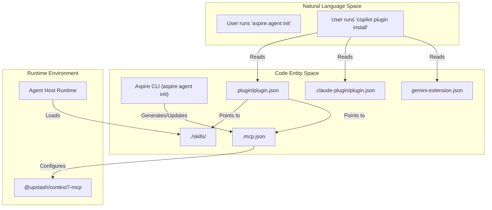
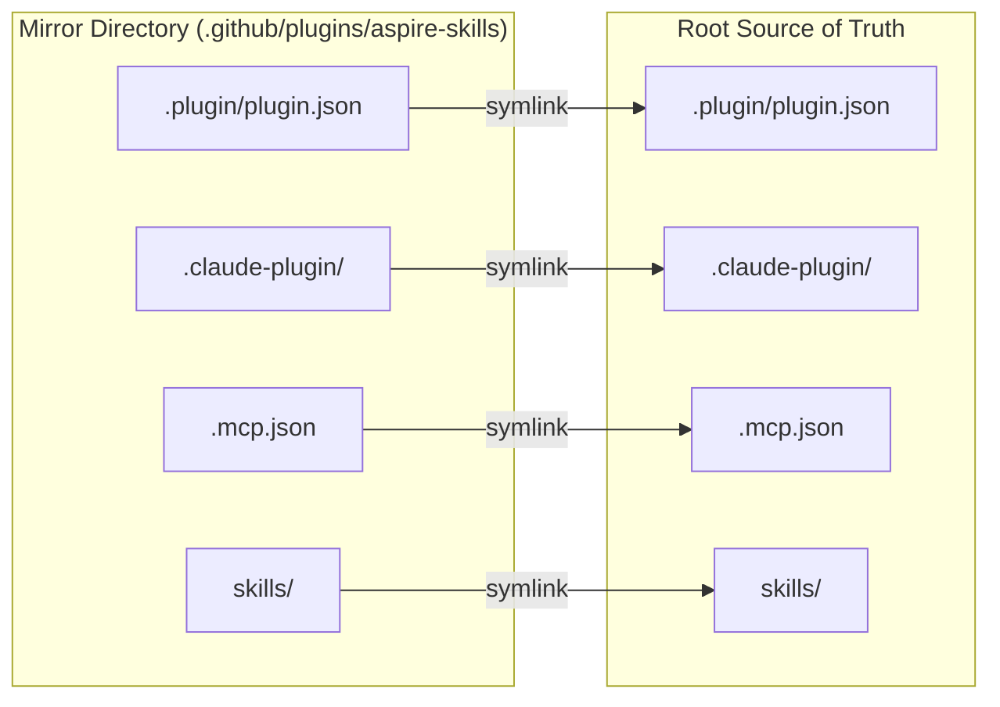

<!-- source: DeepWiki mcp.deepwiki.com · repo microsoft/aspire-skills · page 1.1 Getting Started & Installation · fetched 2026-10-26 -->

# Getting Started & Installation

<details>
<summary>Relevant source files</summary>

The following files were used as context for generating this wiki page:

- [.claude-plugin/marketplace.json](.claude-plugin/marketplace.json)
- [.claude-plugin/plugin.json](.claude-plugin/plugin.json)
- [.cursor-plugin/marketplace.json](.cursor-plugin/marketplace.json)
- [.github/plugins/aspire-skills/.claude-plugin/marketplace.json](.github/plugins/aspire-skills/.claude-plugin/marketplace.json)
- [.github/plugins/aspire-skills/.claude-plugin/plugin.json](.github/plugins/aspire-skills/.claude-plugin/plugin.json)
- [.github/plugins/aspire-skills/.cursor-plugin/marketplace.json](.github/plugins/aspire-skills/.cursor-plugin/marketplace.json)
- [.github/plugins/aspire-skills/.mcp.json](.github/plugins/aspire-skills/.mcp.json)
- [.github/plugins/aspire-skills/.plugin/plugin.json](.github/plugins/aspire-skills/.plugin/plugin.json)
- [.github/plugins/aspire-skills/README.md](.github/plugins/aspire-skills/README.md)
- [.mcp.json](.mcp.json)
- [.plugin/plugin.json](.plugin/plugin.json)
- [README.md](README.md)
- [gemini-extension.json](gemini-extension.json)

</details>


This page provides technical details for installing and configuring the `aspire-skills` plugin across various AI agent hosts. The plugin enables AI agents to interact with .NET Aspire distributed applications by providing a specialized set of skills for orchestration, deployment, and monitoring.

## Prerequisites

Before installing the plugin, ensure the following environment requirements are met:
*   **.NET 10 SDK**: Required for running and building Aspire projects.
*   **Node.js 22+**: Required for the `npx skills` installer and the `aspire-skills` bundle scripts.
*   **Aspire CLI**: The primary tool used by the skills to manage the AppHost lifecycle.

## Entry Points & Installation Methods

The plugin can be installed through three primary mechanisms: the Aspire CLI, native agent marketplace commands, or the generic `npx skills` utility.

### 1. Aspire CLI Integration
The Aspire CLI provides the most integrated experience, automatically detecting agent environments during project initialization.

*   `aspire new`: Creates a new project and prompts for agent guidance [README.md:28-28]().
*   `aspire init`: Scans an existing repo for Aspire-compatible projects and offers to install skills [README.md:31-31]().
*   `aspire agent init`: Explicitly configures or updates Aspire guidance in an existing workspace [README.md:34-34]().

### 2. Agent Host Specific Installation
Each supported agent host has a specific installation path to register the plugin manifest and its associated MCP (Model Context Protocol) servers.

| Agent Host | Command / Method |
| :--- | :--- |
| **GitHub Copilot** | `copilot plugin install aspire@aspire-skills` [README.md:42-42]() |
| **Claude Code** | `/plugin install aspire@aspire-skills` [README.md:47-47]() |
| **Gemini CLI** | `gemini extensions install https://github.com/microsoft/aspire-skills` [README.md:54-54]() |
| **Cursor** | Clone to `~/.cursor/skills/aspire-skills` [README.md:57-58]() |

### 3. NPX Skills Installer
For hosts supporting the `skills.sh` standard, the `npx skills` command can be used to target specific agents globally or locally.

```bash
npx skills add microsoft/aspire-skills
```
[README.md:76-76]()

To target a specific agent (e.g., GitHub Copilot) globally:
```bash
npx skills add https://github.com/microsoft/aspire-skills/tree/main/skills -a github-copilot -g -y
```
[README.md:82-84]()

**Sources:** [README.md:18-87]().

## Data Flow: Installation to Agent Runtime

The following diagram illustrates how natural language installation commands translate into code-level manifest registrations within the agent's environment.

**Installation Logic Flow**

**Sources:** [.plugin/plugin.json:21-22](), [.mcp.json:1-9](), [gemini-extension.json:5-10](), [.claude-plugin/plugin.json:21-22]().

## Plugin Manifests & Mirroring

The repository maintains multiple manifest files to ensure compatibility across different marketplaces while keeping a single source of truth for the skill logic.

### Manifest Synchronization
*   `.plugin/plugin.json`: The primary manifest used by the standard plugin system [plugin.json:1-23]().
*   `.claude-plugin/plugin.json`: Metadata specific to Anthropic's Claude Code environment [plugin.json:1-23]().
*   `gemini-extension.json`: Extension metadata for Google's Gemini CLI [gemini-extension.json:1-12]().
*   `.mcp.json`: Configures the Model Context Protocol servers, specifically the `context7` server via `npx -y @upstash/context7-mcp@latest` [.mcp.json:3-8]().

### Published Plugin Mirror
To support marketplace structures that require a specific folder hierarchy, the directory `.github/plugins/aspire-skills/` contains a mirrored structure using symlinks back to the root manifests and the `skills/` directory [.github/plugins/aspire-skills/README.md:1-23]().

**Mirror Structure Mapping**

**Sources:** [.github/plugins/aspire-skills/README.md:9-20]().

## Summary Table of Components

| Component | Code Reference | Description |
| :--- | :--- | :--- |
| **Router Skill** | `skills/aspire` | Top-level entry point for all Aspire requests. |
| **Init Skill** | `skills/aspire-init` | Handles `aspire new` and skeleton generation. |
| **Aspireify** | `skills/aspireify` | Logic for wiring existing projects into the AppHost. |
| **Orchestration** | `skills/aspire-orchestration` | Manages `aspire start/stop` and resource lifecycle. |
| **Deployment** | `skills/aspire-deployment` | Handles publishing and cloud deployment targets. |
| **Monitoring** | `skills/aspire-monitoring` | Bridges logs, traces, and the Aspire dashboard. |
| **MCP Config** | `.mcp.json` | Defines external tools available to the agent. |

**Sources:** [README.md:9-16](), [.plugin/plugin.json:3-3]().

---

