# Page: Overview

# Overview

<details>
<summary>Relevant source files</summary>

The following files were used as context for generating this wiki page:

- [README.md](README.md)
- [TRANSPARENCY.md](TRANSPARENCY.md)

</details>


## Purpose and Scope

This document provides a high-level architectural overview of the BenchmarkQED repository, explaining its purpose as a comprehensive suite of tools for automated benchmarking of retrieval-augmented generation (RAG) systems. BenchmarkQED enables researchers to systematically evaluate RAG technologies through automated query generation, comparative evaluation, and dataset preparation utilities.

For detailed information about specific components, see the [Core Application](#2) section. For development and deployment infrastructure, see [Development Infrastructure](#3). For project governance and legal framework, see [Project Governance](#5).

## System Architecture

BenchmarkQED is structured as a modular Python package with three primary components that work together to provide comprehensive RAG evaluation capabilities. The system processes datasets through a sophisticated pipeline to generate synthetic queries and evaluate RAG system performance using LLM-as-a-Judge methodologies.

### Core Component Architecture

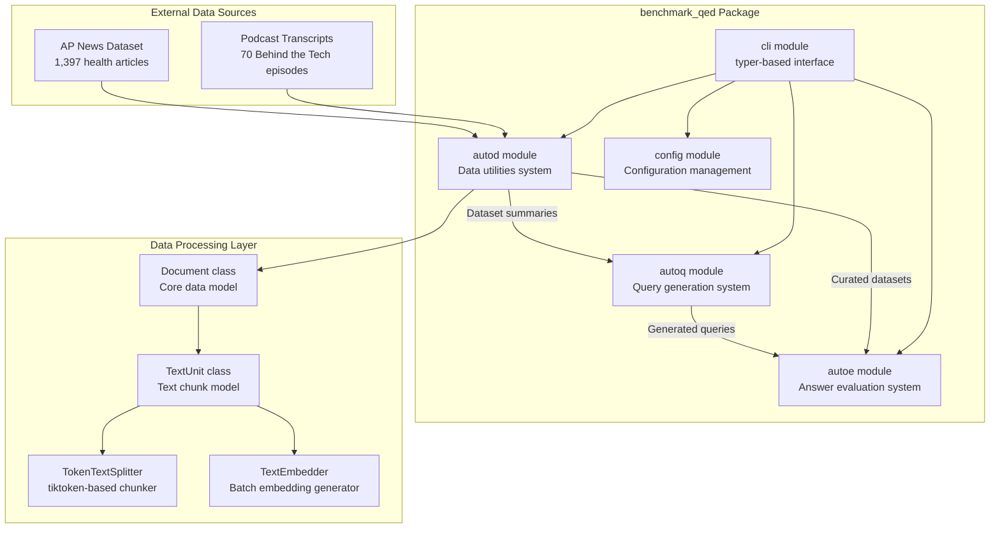

**Sources:** [README.md:20-41](), [benchmark_qed/__init__.py](), [benchmark_qed/cli.py]()

### Data Flow and Processing Pipeline

```mermaid
graph LR
    subgraph "Input Processing"
        RawData["Raw Dataset<br/>.jsonl files"]
        DocumentLoader["load_documents()<br/>Data ingestion"]
        Documents["Document instances<br/>with metadata"]
    end
    
    subgraph "Text Processing"
        TextSplitter["TokenTextSplitter<br/>CHUNK_SIZE config"]
        TextUnits["TextUnit instances<br/>chunked text"]
        EmbeddingGen["TextEmbedder<br/>EMBEDDING_BATCH_SIZE"]
        EmbeddedUnits["TextUnit with<br/>embeddings"]
    end
    
    subgraph "Analysis Components"
        DataSampling["AutoD sampling<br/>dataset curation"]
        QueryGen["AutoQ synthesis<br/>local-to-global queries"]
        Evaluation["AutoE comparison<br/>LLM-as-a-Judge"]
    end
    
    RawData --> DocumentLoader
    DocumentLoader --> Documents
    Documents --> TextSplitter
    TextSplitter --> TextUnits
    TextUnits --> EmbeddingGen
    EmbeddingGen --> EmbeddedUnits
    
    EmbeddedUnits --> DataSampling
    DataSampling --> QueryGen
    QueryGen --> Evaluation
    DataSampling --> Evaluation
```

**Sources:** [benchmark_qed/data/models.py](), [benchmark_qed/data/processing.py](), [benchmark_qed/config/defaults.py]()

## Core Components

### AutoQ - Query Generation System

AutoQ generates four classes of synthetic queries with variable data scope, ranging from local queries (answered using small text regions) to global queries (requiring reasoning over large dataset portions). The system uses LLM synthesis to create evaluation-appropriate queries based on dataset summaries.

**Key Capabilities:**
- Local-to-global query spectrum generation
- Dataset-aware query synthesis
- Configurable query complexity and scope

### AutoE - Answer Evaluation System  

AutoE evaluates RAG answers through side-by-side comparison on key metrics including relevance, comprehensiveness, diversity, and empowerment. The system employs LLM-as-a-Judge methodology and can assess correctness and completeness when ground truth is available.

**Key Capabilities:**
- Comparative answer evaluation 
- Multi-metric assessment framework
- Ground truth validation support
- Custom metric extensibility

### AutoD - Data Utilities System

AutoD provides essential data utilities for sampling and summarizing datasets, ensuring consistent inputs for query synthesis and evaluation processes. It handles dataset curation and preprocessing to optimize evaluation workflows.

**Key Capabilities:**
- Dataset sampling and curation
- Data summarization for query context
- Preprocessing pipeline management
- Metadata extraction and organization

**Sources:** [README.md:38-40](), [TRANSPARENCY.md:13-19]()

## Data Assets

BenchmarkQED includes two curated datasets specifically designed for RAG system evaluation:

| Dataset | Description | Size | Domain |
|---------|-------------|------|---------|
| **Podcast Transcripts** | Behind the Tech podcast episodes | 70 episodes | Technology interviews |
| **AP News** | Associated Press health articles | 1,397 articles | Health journalism |

These datasets serve as reference implementations and benchmarking targets, providing diverse content types and complexity levels for comprehensive RAG evaluation.

**Sources:** [README.md:42-45](), [TRANSPARENCY.md:49-56]()

## Technical Implementation

The system is implemented as a Python package with a command-line interface built using `typer`. The architecture emphasizes modularity, extensibility, and reproducibility:

### Package Structure
- **CLI Interface:** `benchmark_qed.cli` module providing command-line access
- **Core Modules:** Separate modules for each component (autoq, autoe, autod)
- **Data Models:** Extensible class hierarchy with `Identified`, `Document`, and `TextUnit`
- **Configuration:** Centralized configuration management with sensible defaults

### Key Design Principles
- **Modularity:** Each component operates independently while supporting integration
- **Extensibility:** Abstract base classes and interfaces support custom implementations  
- **Reproducibility:** Deterministic processing with configurable parameters
- **Scalability:** Batch processing and efficient text handling for large datasets

**Sources:** [benchmark_qed/cli.py](), [benchmark_qed/data/models.py](), [benchmark_qed/config/defaults.py]()

## Research Context

BenchmarkQED builds upon research presented in the GraphRAG paper (https://arxiv.org/abs/2404.16130) and provides practical tooling for the broader RAG research community. The system addresses the need for systematic, reproducible evaluation methodologies in retrieval-augmented generation applications.

The evaluation approach emphasizes domain expertise and human oversight, positioning BenchmarkQED as a research tool rather than a production system. Users are expected to be domain experts capable of independently evaluating output quality before acting on system recommendations.

**Sources:** [TRANSPARENCY.md:21-29](), [TRANSPARENCY.md:83-99]()

---

# Page: Core Application

# Core Application

<details>
<summary>Relevant source files</summary>

The following files were used as context for generating this wiki page:

- [README.md](README.md)
- [benchmark_qed/__init__.py](benchmark_qed/__init__.py)
- [benchmark_qed/__main__.py](benchmark_qed/__main__.py)

</details>


## Purpose and Scope

This document covers the main `benchmark_qed` Python package, its internal structure, and primary functionality as the central application framework. This includes the package entry point, CLI integration, and how the core components (AutoQ, AutoE, AutoD) are orchestrated through the main application interface.

For specific details about the command-line interface usage, see [Command Line Interface](#2.1). For information about the individual AutoD, AutoQ, and AutoE subsystems, see [AutoD System](#2.2).

## Package Structure Overview

The `benchmark_qed` package serves as the central orchestration layer that integrates the three main components of the BenchmarkQED system. The package follows a modular architecture where each major component has its own CLI interface that gets integrated into a unified command-line application.

### Main Application Architecture

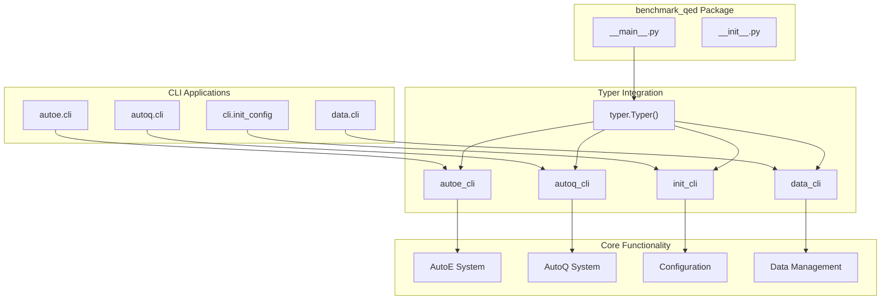

Sources: [benchmark_qed/__main__.py:1-32](), [benchmark_qed/__init__.py:1-3]()

## Main Application Entry Point

The package entry point is implemented in `__main__.py` and provides the central coordination for all CLI functionality. The main application uses the `typer` library to create a unified command-line interface.

### Application Initialization

The main application follows this initialization pattern:

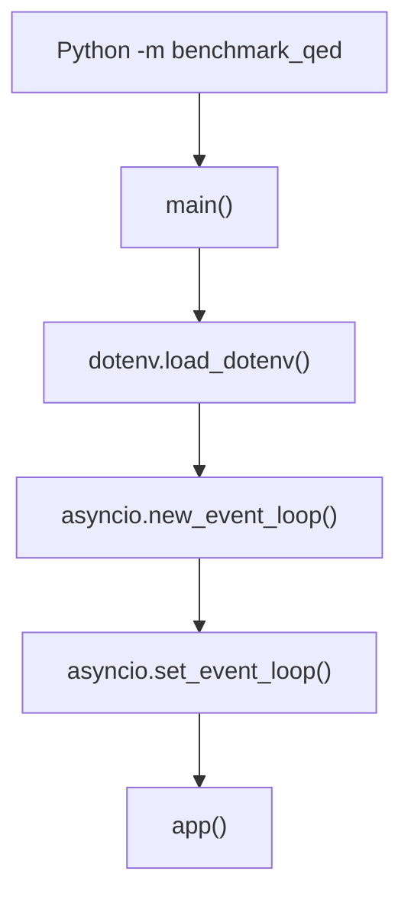

The `main()` function handles:
- Environment variable loading via `dotenv.load_dotenv()`
- Async event loop setup for async operations
- CLI application execution through the typer framework

Sources: [benchmark_qed/__main__.py:22-31]()

## CLI Component Integration

The main typer application integrates four distinct CLI applications using the `add_typer()` method. Each component provides specialized functionality within the BenchmarkQED ecosystem.

### CLI Command Structure

| Command | Source Module | CLI Variable | Description |
|---------|---------------|--------------|-------------|
| `autoe` | `benchmark_qed.autoe.cli` | `autoe_cli` | Relative scores CLI |
| `autoq` | `benchmark_qed.autoq.cli` | `autoq_cli` | Question generation CLI |
| `config` | `benchmark_qed.cli.init_config` | `init_cli` | Configuration initialization CLI |
| `data` | `benchmark_qed.data.cli` | `data_cli` | Dataset downloader CLI |

### Integration Flow

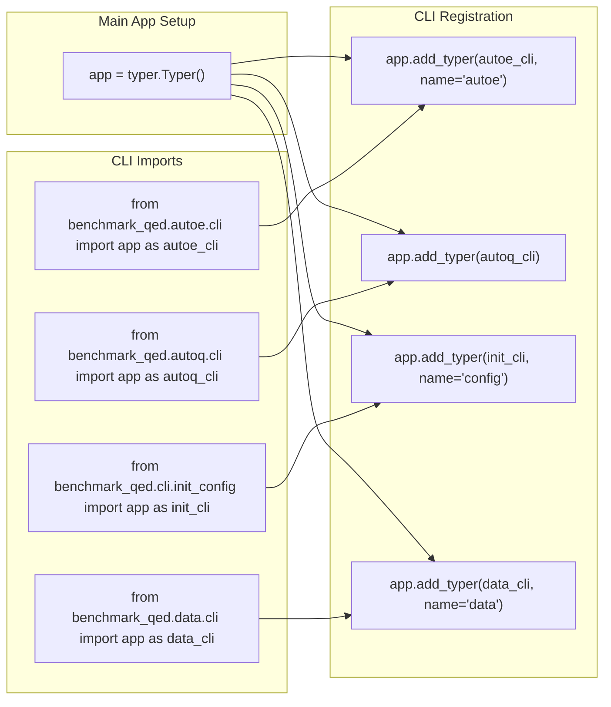

The main application is configured with `pretty_exceptions_show_locals=False` to provide clean error output in production usage.

Sources: [benchmark_qed/__main__.py:9-19]()

## Module Organization

The core application serves as an orchestration layer that delegates functionality to specialized subsystems. The package structure reflects this separation of concerns:

### Package Hierarchy

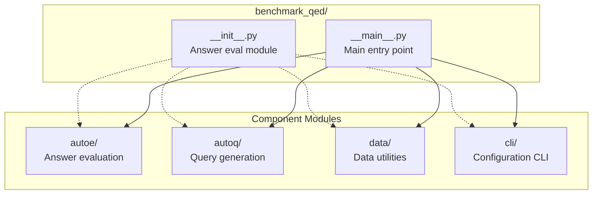

The `__init__.py` file identifies the package as an "Answer eval module," indicating that answer evaluation is considered the primary function, with query generation and data utilities serving as supporting components.

Sources: [benchmark_qed/__init__.py:1-3](), [benchmark_qed/__main__.py:9-12]()

## Runtime Configuration

The application handles runtime environment setup through several mechanisms:

- **Environment Variables**: Loaded automatically via `dotenv.load_dotenv()`
- **Async Support**: Event loop configuration for async operations across components
- **CLI Context**: Typer provides argument parsing and command routing
- **Exception Handling**: Configured for production use with `pretty_exceptions_show_locals=False`

This design allows each component (AutoE, AutoQ, AutoD) to operate independently while sharing common runtime configuration and environment setup.

Sources: [benchmark_qed/__main__.py:14-28]()

---

# Page: Command Line Interface

# Command Line Interface

<details>
<summary>Relevant source files</summary>

The following files were used as context for generating this wiki page:

- [benchmark_qed/__main__.py](benchmark_qed/__main__.py)

</details>


The Command Line Interface (CLI) serves as the primary entry point for interacting with the BenchmarkQED system. It provides a unified command structure that exposes the core functionality of AutoQ (query generation), AutoE (answer evaluation), and AutoD (data utilities) through a typer-based interface. The CLI also includes configuration management and dataset downloading capabilities.

For information about the specific AutoD data processing components, see [AutoD System](#2.2). For details about the development infrastructure supporting the CLI, see [Development Infrastructure](#3).

## CLI Architecture Overview

The BenchmarkQED CLI is implemented as a main typer application that aggregates four specialized sub-applications, each handling a distinct aspect of the system's functionality.

### CLI Command Structure

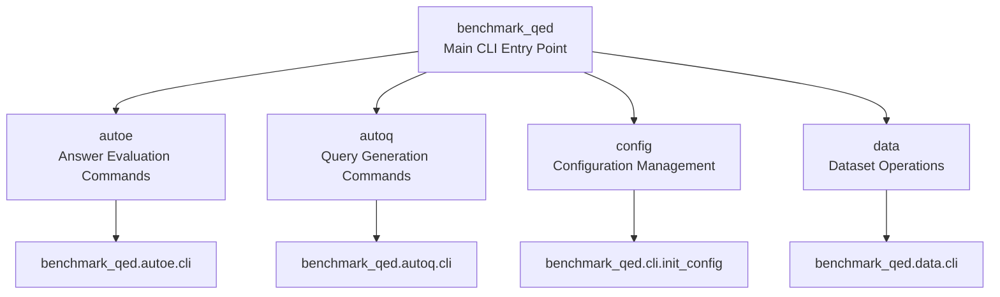

**Sources:** [benchmark_qed/__main__.py:1-32]()

### Code Entity Mapping

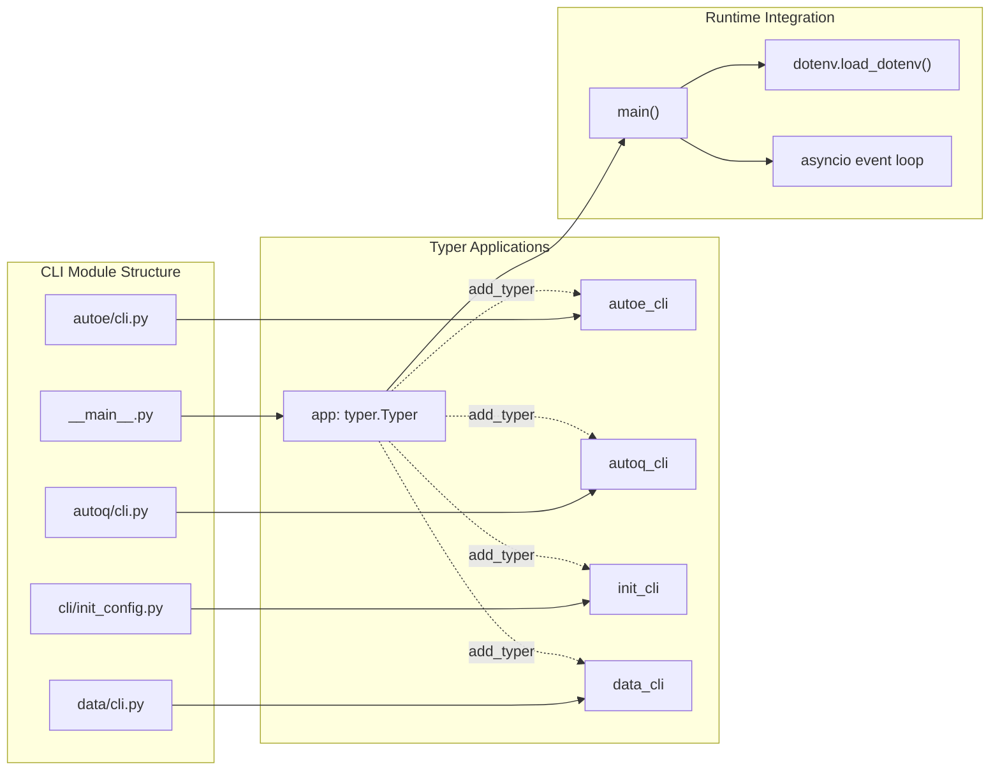

**Sources:** [benchmark_qed/__main__.py:9-19]()

## Main CLI Application

The main CLI application is defined in the `__main__.py` module and serves as the central coordinator for all command-line functionality.

### Application Configuration

| Component | Implementation | Purpose |
|-----------|---------------|---------|
| Base Application | `typer.Typer(pretty_exceptions_show_locals=False)` | Main CLI app with simplified error display |
| Environment Loading | `dotenv.load_dotenv()` | Loads configuration from .env files |
| Async Support | `asyncio.new_event_loop()` | Provides async context for CLI operations |

The main application uses the `add_typer()` method to register sub-applications with specific command names and help descriptions:

- `autoe_cli` → `autoe` command with "Relative scores CLI" description
- `autoq_cli` → `autoq` command with "Question generation CLI" description  
- `init_cli` → `config` command with "Configuration initialization CLI" description
- `data_cli` → `data` command with "Dataset downloader CLI" description

**Sources:** [benchmark_qed/__main__.py:14-19]()

## Command Groups

### AutoE Command Group

The `autoe` command group handles answer evaluation functionality, implementing the "LLM-as-a-Judge" evaluation approach for assessing generated responses.

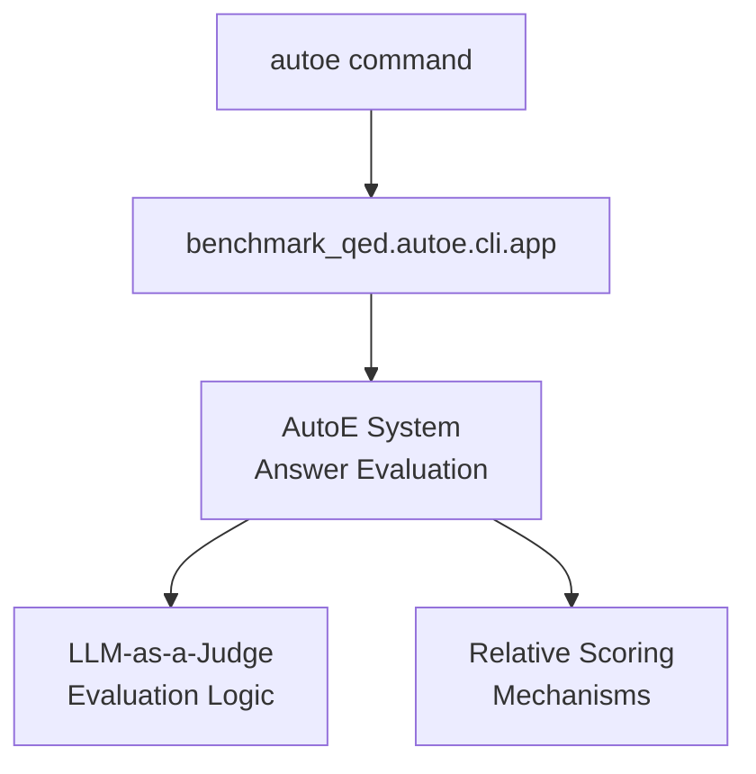

**Sources:** [benchmark_qed/__main__.py:16]()

### AutoQ Command Group

The `autoq` command group provides query generation capabilities, enabling the creation of evaluation questions from local document contexts to global dataset understanding.

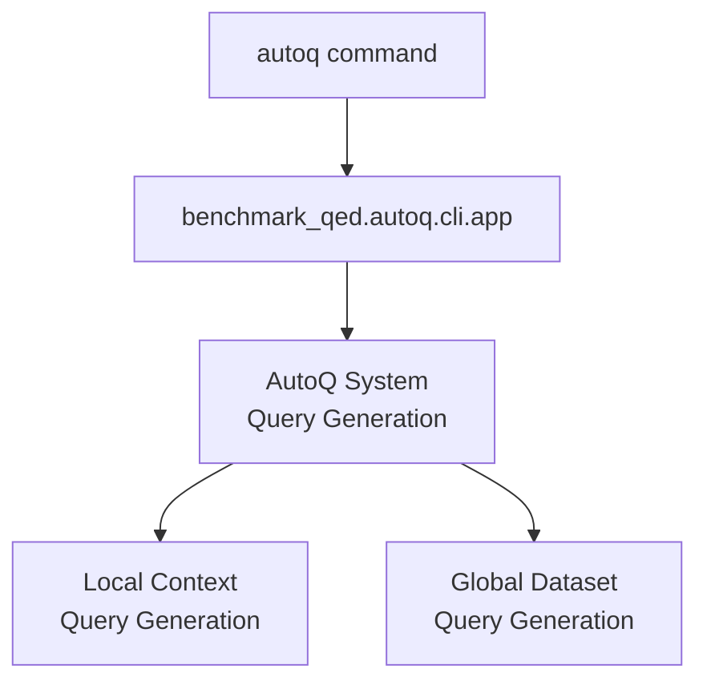

**Sources:** [benchmark_qed/__main__.py:17]()

### Configuration Command Group

The `config` command group manages system configuration initialization and setup tasks.

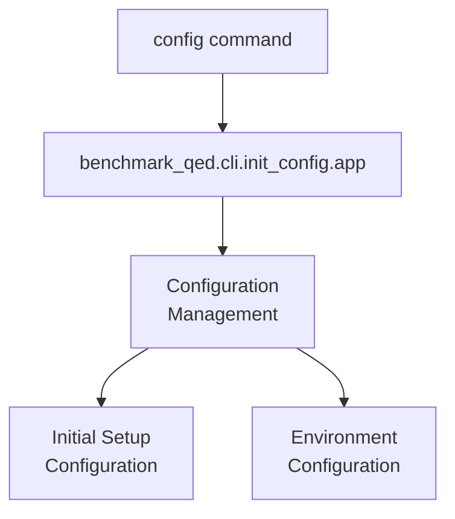

**Sources:** [benchmark_qed/__main__.py:18]()

### Data Command Group

The `data` command group handles dataset operations including downloading and preprocessing of benchmark datasets.

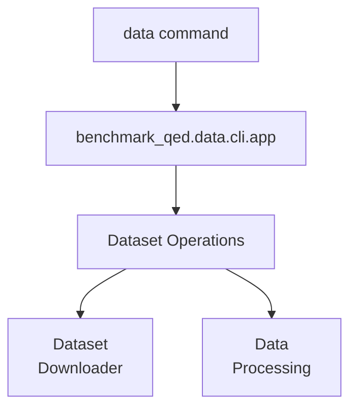

**Sources:** [benchmark_qed/__main__.py:19]()

## Runtime Execution Flow

The CLI execution follows a structured initialization pattern that ensures proper environment setup and async context management.

### Execution Sequence

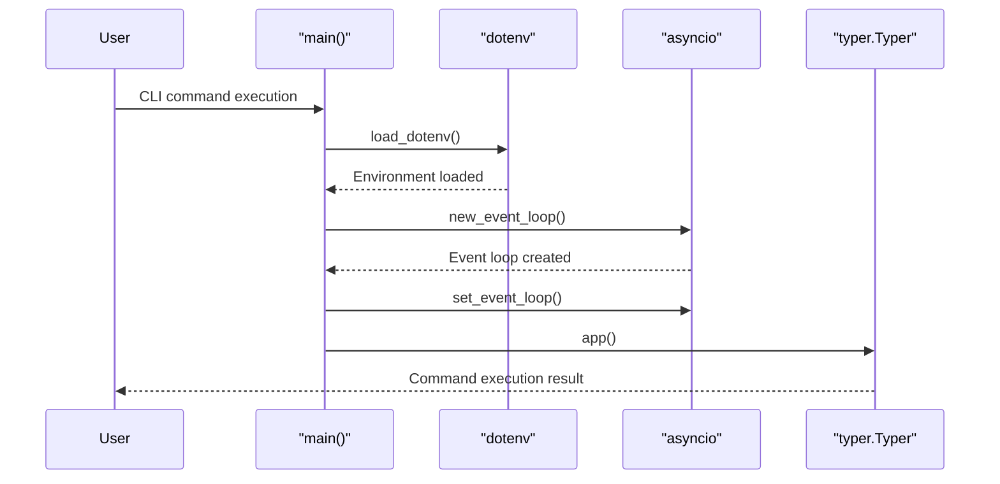

**Sources:** [benchmark_qed/__main__.py:22-27]()

### Entry Point Configuration

The module is configured as both a package entry point and direct execution target:

- Package execution: `python -m benchmark_qed`
- Direct execution: `python benchmark_qed/__main__.py`

Both execution methods invoke the `main()` function, which handles the complete initialization sequence before delegating to the appropriate typer sub-application.

**Sources:** [benchmark_qed/__main__.py:30-31]()

## Integration with Core Systems

The CLI serves as the interface layer between user commands and the core BenchmarkQED systems (AutoQ, AutoE, AutoD), providing a consistent command-line experience while maintaining separation of concerns between interface and implementation logic.

Each command group is implemented in its respective module, allowing for:
- Modular development and testing
- Clear separation between CLI interface and core functionality  
- Independent evolution of command interfaces
- Consistent help documentation and error handling

**Sources:** [benchmark_qed/__main__.py:9-12]()

---

# Page: AutoD System

# AutoD System

<details>
<summary>Relevant source files</summary>

The following files were used as context for generating this wiki page:

- [README.md](README.md)
- [benchmark_qed/autod/__init__.py](benchmark_qed/autod/__init__.py)

</details>


## Purpose and Scope

The AutoD system is responsible for data utilities that support sampling and summarization of datasets within the BenchmarkQED platform. This document covers the AutoD component's role in data preprocessing, dataset curation, and its integration with the AutoQ and AutoE systems. For information about the data models that AutoD works with, see [Data Models](#2.2.1). For details about the underlying data processing pipeline, see [Data Processing Pipeline](#2.2.2).

Sources: [README.md:25-27](), [benchmark_qed/autod/__init__.py:1-3]()

## System Overview

AutoD serves as the data foundation layer for the BenchmarkQED platform, providing curated datasets and dataset summaries to support automated query generation and evaluation. The system processes raw data sources and transforms them into structured formats suitable for RAG system benchmarking.

### AutoD in the BenchmarkQED Architecture

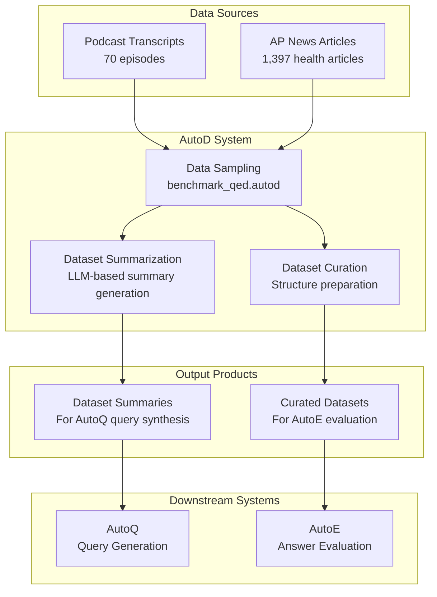

Sources: [README.md:22-34](), [README.md:40]()

## Data Processing Flow

AutoD manages the transformation of raw data sources through a structured processing pipeline that prepares data for both query generation and evaluation workflows.

### Data Transformation Pipeline

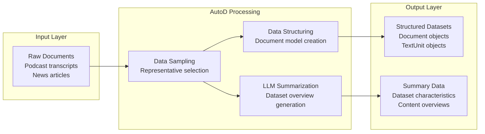

Sources: [README.md:40]()

## Integration Points

AutoD acts as the central data preparation hub, interfacing with both upstream data sources and downstream processing systems.

### System Integration Architecture

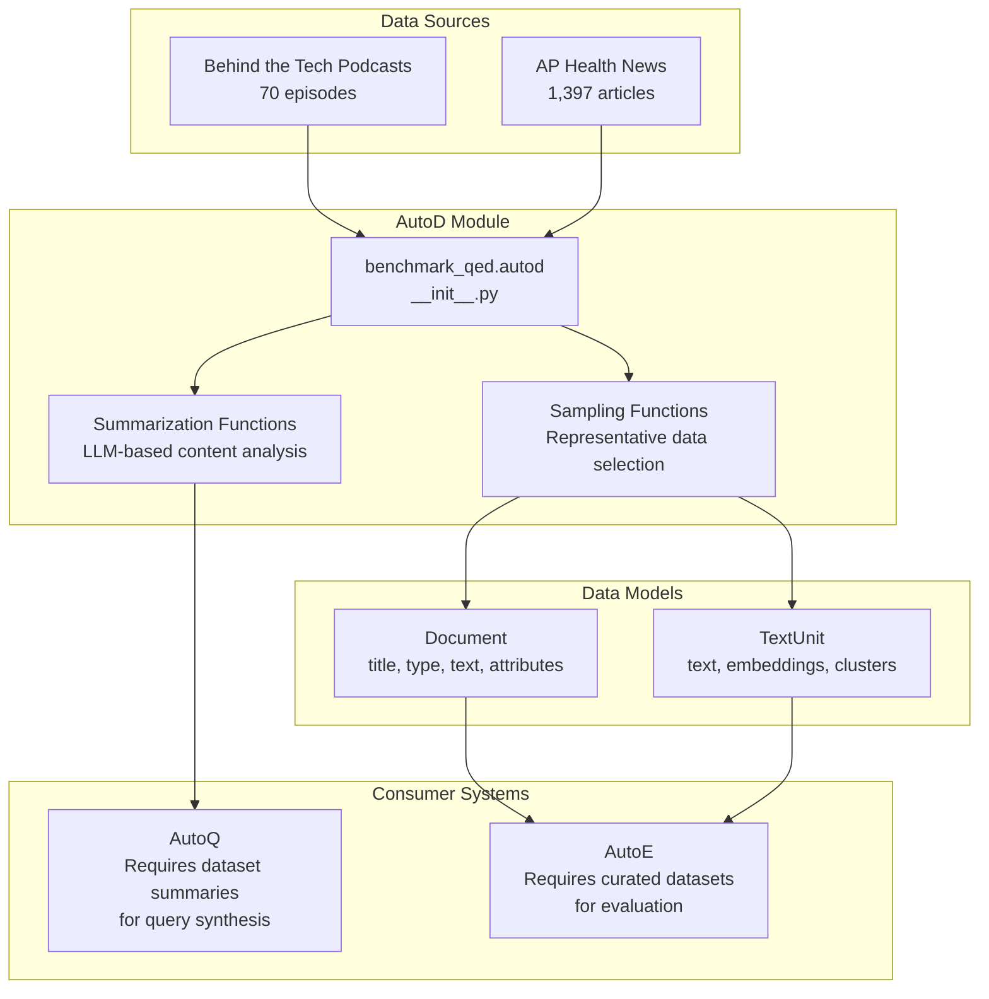

Sources: [benchmark_qed/autod/__init__.py:2](), [README.md:44-45]()

## Key Responsibilities

The AutoD system fulfills several critical functions within the BenchmarkQED platform:

| Responsibility | Description | Output |
|---|---|---|
| **Data Sampling** | Selects representative subsets from large datasets | Manageable dataset portions |
| **Dataset Summarization** | Generates LLM-based summaries of dataset content and characteristics | Summary documents for AutoQ |
| **Data Curation** | Structures raw data into consistent formats for evaluation | Curated datasets for AutoE |
| **Quality Assurance** | Ensures data consistency and format compliance | Validated data structures |

### Primary Functions

1. **Sampling Strategy**: AutoD implements sampling techniques to create representative subsets of large datasets, ensuring that benchmarking remains computationally feasible while maintaining statistical validity.

2. **LLM-Powered Summarization**: The system leverages large language models to generate comprehensive summaries of dataset content, capturing key themes, topics, and characteristics that inform query generation.

3. **Data Structure Consistency**: AutoD ensures that all processed data conforms to the expected data model structures, facilitating seamless integration with downstream systems.

4. **Metadata Preservation**: Throughout the processing pipeline, AutoD maintains important metadata about source documents, processing steps, and data lineage.

Sources: [README.md:40](), [README.md:25-27]()

## Technical Architecture

AutoD is implemented as a Python module within the broader `benchmark_qed` package, providing a clean interface for data processing operations.

### Module Structure

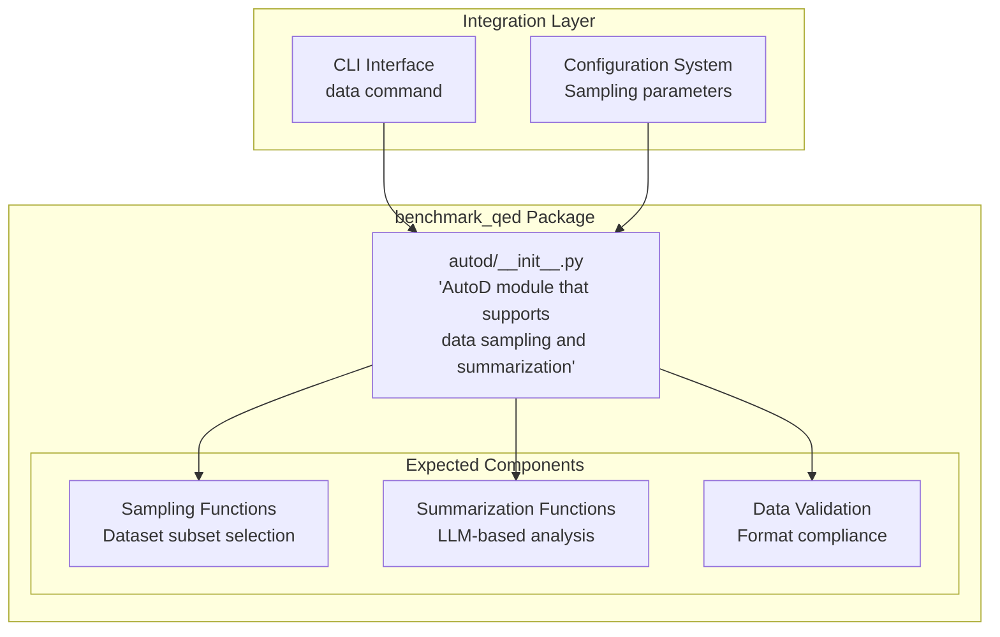

The AutoD system is designed to operate as a standalone module while maintaining tight integration with the broader BenchmarkQED ecosystem, ensuring consistent data preparation across all evaluation workflows.

Sources: [benchmark_qed/autod/__init__.py:1-3]()

---

# Page: Data Models

# Data Models

<details>
<summary>Relevant source files</summary>

The following files were used as context for generating this wiki page:

- [benchmark_qed/autod/data_model/__init__.py](benchmark_qed/autod/data_model/__init__.py)
- [benchmark_qed/autod/data_model/document.py](benchmark_qed/autod/data_model/document.py)
- [benchmark_qed/autod/data_model/identified.py](benchmark_qed/autod/data_model/identified.py)
- [benchmark_qed/autod/data_model/text_unit.py](benchmark_qed/autod/data_model/text_unit.py)

</details>


This document covers the core data models used within the AutoD system for representing documents, text units, and their relationships. These models form the foundation for data processing operations including text chunking, embedding generation, and clustering within BenchmarkQED.

For information about the data processing pipeline that operates on these models, see [Data Processing Pipeline](#2.2.2).

## Core Data Model Hierarchy

The AutoD system uses three primary data model classes that form an inheritance hierarchy. All models inherit from a common base class that provides identification capabilities.

### Class Inheritance Structure

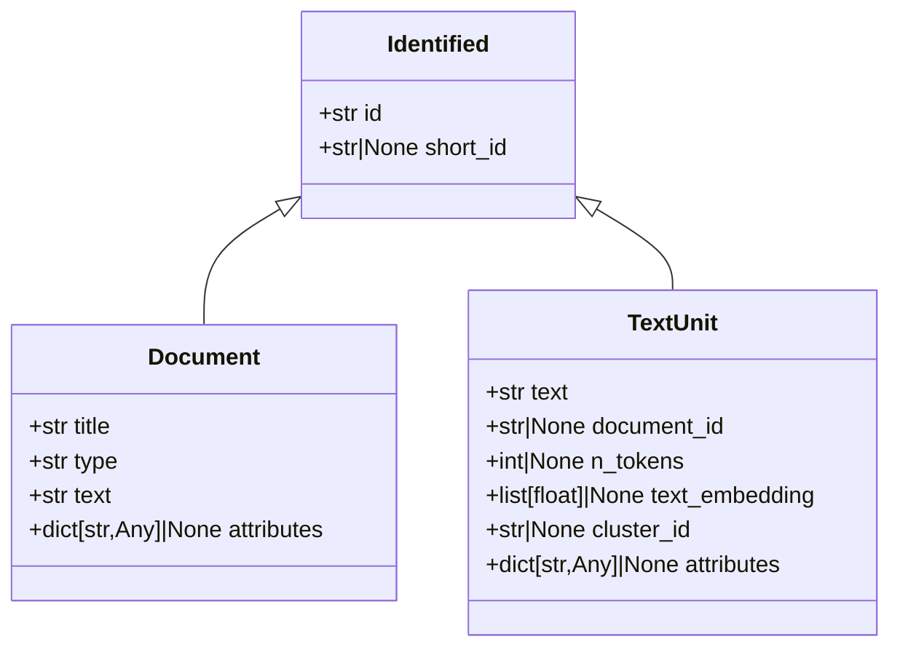

Sources: [benchmark_qed/autod/data_model/identified.py:7-16](), [benchmark_qed/autod/data_model/document.py:10-24](), [benchmark_qed/autod/data_model/text_unit.py:10-30]()

## Identified Base Class

The `Identified` class serves as the foundation for all data models in the system, providing consistent identification mechanisms across different entity types.

| Field | Type | Purpose |
|-------|------|---------|
| `id` | `str` | Unique identifier for the entity |
| `short_id` | `str \| None` | Human-readable identifier for display purposes |

The `short_id` field is specifically designed for use in prompts and user-facing text, such as in report generation where readable references are preferred over system-generated IDs.

Sources: [benchmark_qed/autod/data_model/identified.py:7-16]()

## Document Class

The `Document` class represents source documents that are processed by the system. It extends `Identified` with document-specific fields.

| Field | Type | Default | Purpose |
|-------|------|---------|---------|
| `title` | `str` | Required | Document title |
| `type` | `str` | `"text"` | Document type classification |
| `text` | `str` | `""` | Raw text content |
| `attributes` | `dict[str, Any] \| None` | `None` | Structured metadata (author, date, etc.) |

The `attributes` field provides extensibility for storing document metadata such as authorship, publication date, source information, or any other structured properties relevant to the specific document type.

Sources: [benchmark_qed/autod/data_model/document.py:10-24]()

## TextUnit Class

The `TextUnit` class represents processed text chunks derived from documents. It contains fields for embedding data, clustering information, and traceability back to source documents.

| Field | Type | Default | Purpose |
|-------|------|---------|---------|
| `text` | `str` | Required | Text content of the unit |
| `document_id` | `str \| None` | `None` | Reference to source document |
| `n_tokens` | `int \| None` | `None` | Token count for the text |
| `text_embedding` | `list[float] \| None` | `None` | Vector embedding representation |
| `cluster_id` | `str \| None` | `None` | Cluster assignment identifier |
| `attributes` | `dict[str, Any] \| None` | `None` | Additional processing metadata |

The `TextUnit` model supports both the text processing pipeline (through `n_tokens` and `text_embedding`) and downstream analysis operations (through `cluster_id` and `attributes`).

Sources: [benchmark_qed/autod/data_model/text_unit.py:10-30]()

## Data Model Usage Flow

The following diagram illustrates how these data models flow through the AutoD processing pipeline:

```mermaid
flowchart TD
    RawData["Raw Data Sources"] --> Document["Document"]
    Document --> Processing["Text Processing Pipeline"]
    Processing --> TextUnit["TextUnit"]
    
    subgraph DocumentFields["Document Fields"]
        DocTitle["title: str"]
        DocType["type: str"]
        DocText["text: str"]
        DocAttribs["attributes: dict"]
    end
    
    subgraph TextUnitFields["TextUnit Fields"] 
        TuText["text: str"]
        TuDocId["document_id: str"]
        TuTokens["n_tokens: int"]
        TuEmbedding["text_embedding: list[float]"]
        TuCluster["cluster_id: str"]
        TuAttribs["attributes: dict"]
    end
    
    subgraph IdentifiedBase["Identified (Base Class)"]
        BaseId["id: str"]
        BaseShortId["short_id: str"]
    end
    
    Document --> DocumentFields
    TextUnit --> TextUnitFields
    DocumentFields --> IdentifiedBase
    TextUnitFields --> IdentifiedBase
    
    TextUnit --> EmbeddingSystem["Embedding Generation"]
    TextUnit --> ClusteringSystem["Clustering Analysis"]
```

Sources: [benchmark_qed/autod/data_model/document.py:10-24](), [benchmark_qed/autod/data_model/text_unit.py:10-30](), [benchmark_qed/autod/data_model/identified.py:7-16]()

## Module Structure

The data models are organized within the `benchmark_qed.autod.data_model` package:

```
benchmark_qed/autod/data_model/
├── __init__.py          # Module initialization
├── identified.py        # Identified base class
├── document.py         # Document model
└── text_unit.py        # TextUnit model
```

Each model is defined as a Python dataclass using the `@dataclass` decorator, providing automatic generation of initialization methods and other standard object behaviors.

Sources: [benchmark_qed/autod/data_model/__init__.py:1-3](), [benchmark_qed/autod/data_model/identified.py:1-16](), [benchmark_qed/autod/data_model/document.py:1-25](), [benchmark_qed/autod/data_model/text_unit.py:1-31]()

---

# Page: Data Processing Pipeline

# Data Processing Pipeline

<details>
<summary>Relevant source files</summary>

The following files were used as context for generating this wiki page:

- [benchmark_qed/autod/data_processor/__init__.py](benchmark_qed/autod/data_processor/__init__.py)
- [benchmark_qed/autod/data_processor/embedding.py](benchmark_qed/autod/data_processor/embedding.py)
- [benchmark_qed/autod/data_processor/text_splitting.py](benchmark_qed/autod/data_processor/text_splitting.py)

</details>


This document covers the data processing pipeline within the AutoD system, which transforms raw text content into structured, embeddable units for downstream analysis. The pipeline handles text chunking, tokenization, and embedding generation for document processing workflows.

For information about the underlying data structures processed by this pipeline, see [Data Models](#2.2.1). For broader AutoD system context, see [AutoD System](#2.2).

## Overview

The data processing pipeline consists of two primary subsystems that work together to prepare text for analysis:

1. **Text Splitting System** - Chunks large text documents into manageable units using token-based splitting
2. **Embedding Generation System** - Converts text chunks into vector embeddings using language models

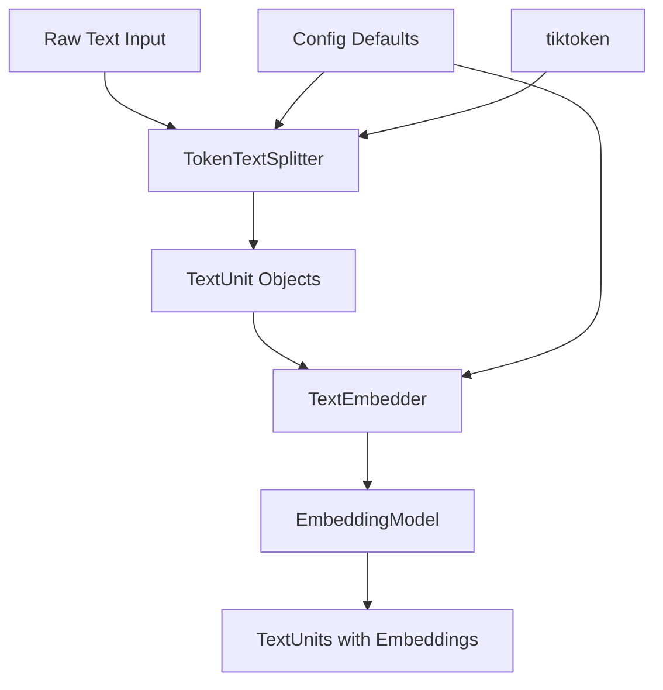

**Sources:** [benchmark_qed/autod/data_processor/text_splitting.py:1-140](), [benchmark_qed/autod/data_processor/embedding.py:1-108]()

## Text Splitting System

The text splitting system is built around the `TokenTextSplitter` class, which inherits from the abstract `TextSplitter` base class. It uses tiktoken-based tokenization to create semantically coherent text chunks.

### Core Components

| Component | Purpose | Key Methods |
|-----------|---------|-------------|
| `TextSplitter` | Abstract base class for text splitting | `split_text()`, `get_size()` |
| `TokenTextSplitter` | Token-based text splitting implementation | `encode()`, `split_text()` |
| `Tokenizer` | Dataclass containing tokenization functions | `encode`, `decode` functions |

### Tokenization Architecture

```mermaid
graph LR
    InputText["Input Text"] --> encode["encode()"]
    encode --> TokenIds["Token IDs List"]
    TokenIds --> ChunkLogic["Chunking Logic"]
    ChunkLogic --> ChunkedIds["Chunked Token IDs"]
    ChunkedIds --> decode["decode()"]
    decode --> TextChunks["Text Chunks"]
    
    TikTokenEnc["tiktoken.Encoding"] --> encode
    TikTokenEnc --> decode
    ConfigDefaults["CHUNK_SIZE<br/>CHUNK_OVERLAP"] --> ChunkLogic
```

**Sources:** [benchmark_qed/autod/data_processor/text_splitting.py:22-34](), [benchmark_qed/autod/data_processor/text_splitting.py:63-118]()

### Text Splitting Process

The `TokenTextSplitter` implements a sophisticated chunking algorithm through the `split_single_text_on_tokens()` function:

1. **Tokenization** - Convert input text to token IDs using tiktoken
2. **Chunking** - Split tokens into overlapping chunks based on `CHUNK_SIZE` and `CHUNK_OVERLAP`
3. **Decoding** - Convert token chunks back to text strings

The splitting process maintains semantic coherence by working at the token level rather than character level, ensuring chunks respect word boundaries and linguistic structure.

**Sources:** [benchmark_qed/autod/data_processor/text_splitting.py:121-139]()

## Embedding Generation System

The embedding system centers around the `TextEmbedder` class, which provides both individual and batch processing capabilities for generating text embeddings.

### TextEmbedder Architecture

```mermaid
graph TD
    TextEmbedder["TextEmbedder"] --> EmbeddingModel["EmbeddingModel Interface"]
    
    TextUnit1["TextUnit"] --> embed_text_unit["embed_text_unit()"]
    RawText["Raw Text"] --> embed_raw_text["embed_raw_text()"]
    TextUnitBatch["TextUnit List"] --> embed_batch["embed_batch()"]
    
    embed_text_unit --> EmbeddingModel
    embed_raw_text --> EmbeddingModel
    embed_batch --> BatchProcessor["Batch Processing Logic"]
    BatchProcessor --> EmbeddingModel
    
    EmbeddingModel --> Embeddings["Vector Embeddings"]
    Embeddings --> UpdatedTextUnits["TextUnits with Embeddings"]
```

**Sources:** [benchmark_qed/autod/data_processor/embedding.py:13-27](), [benchmark_qed/autod/data_processor/embedding.py:43-107]()

### Embedding Processing Methods

The `TextEmbedder` class provides three primary processing methods:

#### Individual Processing
- `embed_raw_text()` - Embeds a single text string
- `embed_text_unit()` - Embeds a `TextUnit` object and updates its `text_embedding` property

#### Batch Processing
- `embed_batch()` - Processes multiple `TextUnit` objects efficiently using configurable batch sizes

The batch processing method uses asynchronous processing with `asyncio.gather()` to parallelize embedding generation across batches, significantly improving performance for large document collections.

**Sources:** [benchmark_qed/autod/data_processor/embedding.py:29-41](), [benchmark_qed/autod/data_processor/embedding.py:58-107]()

## Configuration and Integration

The pipeline integrates with the system's configuration defaults and external dependencies:

### Configuration Dependencies

| Configuration | Default Source | Purpose |
|---------------|----------------|---------|
| `CHUNK_SIZE` | `benchmark_qed.config.defaults` | Maximum tokens per chunk |
| `CHUNK_OVERLAP` | `benchmark_qed.config.defaults` | Token overlap between chunks |
| `EMBEDDING_BATCH_SIZE` | `benchmark_qed.config.defaults` | Batch size for embedding processing |
| `ENCODING_MODEL` | `benchmark_qed.config.defaults` | Default tiktoken encoding model |

### External Dependencies

```mermaid
graph LR
    Pipeline["Data Processing Pipeline"] --> TikToken["tiktoken Library"]
    Pipeline --> AsyncIO["asyncio"]
    Pipeline --> EmbeddingModel["EmbeddingModel Interface"]
    
    TikToken --> Encodings["Model Encodings<br/>cl100k_base, etc."]
    AsyncIO --> ConcurrentProcessing["Concurrent Embedding"]
    EmbeddingModel --> LLMProviders["LLM Provider Implementations"]
```

**Sources:** [benchmark_qed/autod/data_processor/text_splitting.py:10-12](), [benchmark_qed/autod/data_processor/embedding.py:9-10]()

## Complete Processing Flow

The complete data processing pipeline transforms raw documents through the following stages:

```mermaid
graph TD
    Document["Document Object"] --> ExtractText["Extract Text Content"]
    ExtractText --> TokenTextSplitter["TokenTextSplitter.split_text()"]
    
    TokenTextSplitter --> CreateUnits["Create TextUnit Objects"]
    CreateUnits --> TextUnitList["List[TextUnit]"]
    
    TextUnitList --> TextEmbedder["TextEmbedder.embed_batch()"]
    TextEmbedder --> BatchProcessor["get_batch() Generator"]
    BatchProcessor --> AsyncTasks["asyncio.gather() Tasks"]
    AsyncTasks --> EmbeddingResults["Embedding Vectors"]
    
    EmbeddingResults --> UpdateUnits["Update TextUnit.text_embedding"]
    UpdateUnits --> ProcessedUnits["TextUnits with Embeddings"]
    
    ConfigDefaults["Config Defaults<br/>CHUNK_SIZE<br/>EMBEDDING_BATCH_SIZE"] --> TokenTextSplitter
    ConfigDefaults --> TextEmbedder
```

This pipeline enables the AutoD system to process large document collections efficiently, creating structured, embeddable text units that support downstream query generation and evaluation workflows.

**Sources:** [benchmark_qed/autod/data_processor/text_splitting.py:103-117](), [benchmark_qed/autod/data_processor/embedding.py:58-107]()

---

# Page: Development Infrastructure

# Development Infrastructure

<details>
<summary>Relevant source files</summary>

The following files were used as context for generating this wiki page:

- [.github/dependabot.yml](.github/dependabot.yml)
- [.github/workflows/gh-pages.yml](.github/workflows/gh-pages.yml)
- [.github/workflows/python-ci.yml](.github/workflows/python-ci.yml)
- [.github/workflows/python-publish.yml](.github/workflows/python-publish.yml)

</details>


This document provides an overview of the comprehensive development infrastructure that supports the BenchmarkQED project. The infrastructure encompasses automated testing, continuous integration pipelines, release management, documentation generation, and dependency management systems that ensure code quality and streamline the development workflow.

For detailed information about specific aspects of the infrastructure, see [Continuous Integration](#3.1), [Release Pipeline](#3.2), [Documentation Generation](#3.3), and [Dependency Management](#3.4).

## Infrastructure Overview

The BenchmarkQED development infrastructure is built around GitHub Actions workflows that automate critical development processes. The system uses modern tooling including the `uv` package manager (version 0.6.17) and `poethepoet` task runner to provide fast, reliable automation across multiple Python versions and deployment targets.

The infrastructure operates through four primary automation pipelines that handle different aspects of the development lifecycle:

| Pipeline | Trigger | Purpose | Target Environment |
|----------|---------|---------|-------------------|
| `python-ci.yml` | Push/PR to main | Testing and quality checks | Python 3.11, 3.12 matrix |
| `gh-pages.yml` | Push to main | Documentation deployment | GitHub Pages |
| `python-publish.yml` | Release tags/creation | Package publishing | PyPI |
| `dependabot.yml` | Weekly schedule | Dependency updates | Repository |

## CI/CD Pipeline Architecture

```mermaid
graph TB
    subgraph triggers["Repository Triggers"]
        main_push["main branch push"]
        pr_events["Pull Request events"]
        release_tags["release/* tags"]
        release_creation["GitHub Release creation"]
        weekly_schedule["Weekly schedule"]
    end
    
    subgraph workflows["GitHub Actions Workflows"]
        python_ci["python-ci.yml"]
        gh_pages["gh-pages.yml"]
        python_publish["python-publish.yml"]
        dependabot["dependabot.yml"]
    end
    
    subgraph tools["Development Tools"]
        uv_manager["uv package manager v0.6.17"]
        poe_runner["poethepoet task runner"]
        mkdocs["MkDocs documentation"]
        pypi["PyPI publishing"]
    end
    
    subgraph environments["Runtime Environments"]
        ubuntu_latest["ubuntu-latest runners"]
        python_311["Python 3.11 matrix"]
        python_312["Python 3.12 matrix"]
    end
    
    main_push --> python_ci
    main_push --> gh_pages
    pr_events --> python_ci
    release_tags --> python_publish
    release_creation --> python_publish
    weekly_schedule --> dependabot
    
    python_ci --> uv_manager
    gh_pages --> uv_manager
    gh_pages --> poe_runner
    gh_pages --> mkdocs
    python_publish --> uv_manager
    python_publish --> pypi
    
    python_ci --> ubuntu_latest
    python_ci --> python_311
    python_ci --> python_312
    gh_pages --> ubuntu_latest
    python_publish --> ubuntu_latest
```

**Sources:** [.github/workflows/python-ci.yml](), [.github/workflows/gh-pages.yml](), [.github/workflows/python-publish.yml](), [.github/dependabot.yml]()

## Workflow Configuration Details

```mermaid
graph LR
    subgraph python_ci_workflow["python-ci.yml Workflow"]
        ci_triggers["Triggers: push/PR to main"]
        ci_matrix["Matrix: python-version 3.11, 3.12"]
        ci_steps["Steps: checkout → setup-python → install uv → sync deps → poe check"]
        ci_concurrency["Concurrency: cancel-in-progress"]
    end
    
    subgraph gh_pages_workflow["gh-pages.yml Workflow"]
        pages_trigger["Trigger: push to main"]
        pages_python["Python: 3.12 fixed"]
        pages_steps["Steps: checkout → setup-python → install uv → sync → poe build_docs → deploy"]
        pages_permissions["Permissions: contents write"]
    end
    
    subgraph publish_workflow["python-publish.yml Workflow"]
        publish_triggers["Triggers: release creation, release/* tags"]
        publish_python["Python: 3.12 fixed"]
        publish_steps["Steps: checkout → setup-python → install uv → uv build → pypi publish"]
        publish_environment["Environment: pypi with id-token write"]
    end
    
    subgraph dependabot_config["dependabot.yml Configuration"]
        dep_ecosystems["Ecosystems: pip, github-actions"]
        dep_directory["Directory: / (root)"]
        dep_schedule["Schedule: weekly interval"]
    end
    
    ci_triggers --> ci_matrix
    ci_matrix --> ci_steps
    ci_steps --> ci_concurrency
    
    pages_trigger --> pages_python
    pages_python --> pages_steps
    pages_steps --> pages_permissions
    
    publish_triggers --> publish_python
    publish_python --> publish_steps
    publish_steps --> publish_environment
    
    dep_ecosystems --> dep_directory
    dep_directory --> dep_schedule
```

**Sources:** [.github/workflows/python-ci.yml:24-27](), [.github/workflows/gh-pages.yml:15-16](), [.github/workflows/python-publish.yml:11-12](), [.github/dependabot.yml:7-15]()

## Pipeline Execution Flow

The CI pipeline implements sophisticated triggering and concurrency controls:

### Python CI Workflow
- **Triggers**: Push to `main` or `**/main` branches, and pull request events [`opened`, `reopened`, `synchronize`, `ready_for_review`]
- **Path Filtering**: Ignores `**/*.md` files and `.semversioner/**` directory changes
- **Concurrency**: Uses `cancel-in-progress: true` to terminate outdated runs
- **Matrix Strategy**: Tests against Python 3.11 and 3.12 simultaneously
- **Key Steps**: Executes `uv sync --locked --all-packages` followed by `uv run poe check`

### Documentation Pipeline  
- **Trigger**: Push events to `main` branch only
- **Build Process**: Uses `uv run poe build_docs` to generate MkDocs site
- **Deployment**: Employs `JamesIves/github-pages-deploy-action@v4.6.4` to publish to `gh-pages` branch
- **Output Verification**: Includes `find site` step to list generated documentation contents

### Publishing Pipeline
- **Dual Triggers**: GitHub release creation events and `release/*` tag pushes  
- **Environment**: Uses PyPI environment with trusted publishing via `id-token: write` permissions
- **Build Process**: Executes `uv build` to create distribution packages
- **Publishing**: Uses `pypa/gh-action-pypi-publish@release/v1` with `skip-existing: true` for idempotent deployments

### Dependency Management
- **Automation**: Weekly updates for both `pip` ecosystem and `github-actions` packages
- **Scope**: Monitors root directory (`/`) for package manifests and workflow files
- **Integration**: Updates trigger CI pipeline for validation before merge

**Sources:** [.github/workflows/python-ci.yml:2-18](), [.github/workflows/gh-pages.yml:2-5](), [.github/workflows/python-publish.yml:2-8](), [.github/dependabot.yml:6-15]()

---

# Page: Continuous Integration

# Continuous Integration

<details>
<summary>Relevant source files</summary>

The following files were used as context for generating this wiki page:

- [.github/workflows/python-ci.yml](.github/workflows/python-ci.yml)
- [.github/workflows/semver.yml](.github/workflows/semver.yml)
- [.vsts-ci.yml](.vsts-ci.yml)

</details>


This document covers the continuous integration system for BenchmarkQED, including testing pipelines, quality checks, and semantic versioning enforcement. The CI system ensures code quality and maintainability through automated testing across multiple Python versions and comprehensive compliance checking.

For information about automated package publishing, see [Release Pipeline](#3.2). For documentation building automation, see [Documentation Generation](#3.3). For automated dependency updates, see [Dependency Management](#3.4).

## CI Pipeline Architecture

The continuous integration system consists of three primary pipelines that run in parallel to validate code changes and maintain project standards.

### CI Workflow Overview

```mermaid
graph TB
    subgraph "Trigger Events"
        MainPush["push to main/*"]
        PREvents["PR events: opened, reopened, synchronize, ready_for_review"]
        ComplianceEvents["push to main, preview"]
    end
    
    subgraph "GitHub Actions Workflows"
        PythonCI["python-ci.yml"]
        SemverCheck["semver.yml"]
    end
    
    subgraph "Azure DevOps Pipeline"
        VStsCI[".vsts-ci.yml"]
    end
    
    subgraph "Quality Gates"
        PythonMatrix["Python 3.11, 3.12 Matrix"]
        PoeCheck["uv run poe check"]
        SemverScript["./scripts/semver-check.sh"]
        CredScan["CredScan@3"]
        ComponentGov["ComponentGovernanceComponentDetection@0"]
    end
    
    MainPush --> PythonCI
    PREvents --> PythonCI
    PREvents --> SemverCheck
    ComplianceEvents --> VStsCI
    
    PythonCI --> PythonMatrix
    PythonMatrix --> PoeCheck
    SemverCheck --> SemverScript
    VStsCI --> CredScan
    VStsCI --> ComponentGov
```

Sources: [.github/workflows/python-ci.yml:1-57](), [.github/workflows/semver.yml:1-22](), [.vsts-ci.yml:1-35]()

## Python CI Pipeline

The primary testing pipeline validates code quality across multiple Python versions using the `uv` package manager and `poethepoet` task runner.

### Build Configuration

| Component | Configuration |
|-----------|--------------|
| **Operating System** | `ubuntu-latest` |
| **Python Versions** | `3.11`, `3.12` |
| **Package Manager** | `uv` version `0.6.17` |
| **Task Runner** | `poethepoet` via `poe` command |

The pipeline uses a build matrix strategy to test against multiple Python versions simultaneously, ensuring compatibility across the supported version range.

### Trigger Conditions

The `python-ci.yml` workflow activates on:

- Push events to `main` branch or branches matching `**/main` pattern
- Pull request events: `opened`, `reopened`, `synchronize`, `ready_for_review`
- Excludes changes to `**/*.md` files and `.semversioner/**` directory

Concurrency controls prevent multiple workflow runs from the same pull request or branch, automatically canceling previous runs when new commits are pushed.

### Quality Check Process

```mermaid
graph LR
    subgraph "CI Steps"
        Checkout["actions/checkout@v4"]
        SetupPython["actions/setup-python@v5"]
        InstallUV["astral-sh/setup-uv@v6"]
        SyncDeps["uv sync --locked --all-packages"]
        RunChecks["uv run poe check"]
    end
    
    Checkout --> SetupPython
    SetupPython --> InstallUV
    InstallUV --> SyncDeps
    SyncDeps --> RunChecks
```

The `poe check` command orchestrates multiple quality checks including linting, type checking, and testing through the poethepoet task runner configuration.

Sources: [.github/workflows/python-ci.yml:29-57]()

## Semantic Version Enforcement

The `semver.yml` workflow enforces semantic versioning standards on pull requests to maintain consistent release management.

### Semver Check Configuration

The workflow includes specific filtering logic to optimize execution:

- **Draft PR Filtering**: Skips execution for draft pull requests using condition `github.event.pull_request.draft == false`
- **Branch Targeting**: Only runs on PRs targeting the `main` branch
- **Deep History**: Uses `fetch-depth: 0` to access full Git history for version comparison

The semver check delegates to a shell script that validates version changes according to semantic versioning principles.

```mermaid
graph TB
    subgraph "Semver Validation Flow"
        PRTrigger["PR to main branch"]
        DraftCheck["Check: draft == false"]
        CheckoutFull["Checkout with full history"]
        SemverScript["Execute ./scripts/semver-check.sh"]
        ValidationResult["Pass/Fail PR Check"]
    end
    
    PRTrigger --> DraftCheck
    DraftCheck --> CheckoutFull
    CheckoutFull --> SemverScript
    SemverScript --> ValidationResult
```

Sources: [.github/workflows/semver.yml:1-22]()

## Compliance Pipeline

The Azure DevOps pipeline handles security and governance compliance through specialized scanning tools.

### Compliance Stage Architecture

The `.vsts-ci.yml` pipeline runs independently from GitHub Actions, providing enterprise-grade security scanning:

| Tool | Purpose | Configuration |
|------|---------|---------------|
| **CredScan@3** | Credential scanning | SARIF output format, debug mode disabled |
| **ComponentGovernanceComponentDetection@0** | Dependency vulnerability scanning | Register scan type, verbose logging, high alert threshold |
| **PublishSecurityAnalysisLogs@3** | Artifact publishing | Container artifact type |

### Platform Requirements

The compliance pipeline uses `windows-latest` virtual machines to support Microsoft security tooling requirements, distinct from the Ubuntu-based Python CI pipeline.

### Trigger Strategy

Compliance scans activate on pushes to:
- `main` branch
- `preview` branch

The pipeline uses batch triggering to consolidate multiple rapid commits into single compliance runs, optimizing resource usage.

Sources: [.vsts-ci.yml:1-35]()

## Integration with Development Workflow

The CI system integrates with the broader development infrastructure through several key touchpoints:

### Permission Model

GitHub Actions workflows operate with minimal required permissions:
- `contents: read` - Access repository content
- `pull-requests: read` - Read PR metadata for filtering and status updates

### Concurrency Management

The CI system uses GitHub's concurrency controls to prevent resource conflicts and ensure efficient pipeline execution. Each workflow group cancels previous runs when new commits arrive, maintaining fast feedback loops.

### Quality Gate Integration

All pipelines function as required status checks, preventing merge operations until all validations pass. This enforces code quality standards and maintains the integrity of the main branch.

Sources: [.github/workflows/python-ci.yml:20-27](), [.github/workflows/semver.yml:12-14](), [.vsts-ci.yml:5-11]()

---

# Page: Release Pipeline

# Release Pipeline

<details>
<summary>Relevant source files</summary>

The following files were used as context for generating this wiki page:

- [.github/workflows/python-publish.yml](.github/workflows/python-publish.yml)
- [.semversioner/next-release/patch-20250604141858053121.json](.semversioner/next-release/patch-20250604141858053121.json)
- [.semversioner/next-release/patch-20250604170406419058.json](.semversioner/next-release/patch-20250604170406419058.json)

</details>


This document covers the automated release pipeline that publishes BenchmarkQED packages to PyPI. The pipeline handles building and distributing Python packages when new releases are created or tagged. For information about continuous integration testing, see [Continuous Integration](#3.1). For details about the semversioner system that manages version tracking, see [Release History](#4).

## Pipeline Overview

The release pipeline is implemented as a GitHub Actions workflow that automatically builds and publishes the `benchmark-qed` Python package to PyPI. The pipeline is triggered by GitHub release events and release tags, ensuring that new versions are immediately available for installation via `pip`.

### Release Pipeline Flow

```mermaid
flowchart TD
    Release["GitHub Release Created"] --> Trigger["python-publish.yml"]
    Tags["Push release/* tags"] --> Trigger
    
    Trigger --> Checkout["actions/checkout@v4"]
    Checkout --> Python["setup-python@v5<br/>Python 3.12"]
    Python --> UV["astral-sh/setup-uv@v6<br/>uv 0.6.17"]
    UV --> Build["uv build"]
    Build --> Publish["pypa/gh-action-pypi-publish@release/v1"]
    Publish --> PyPI["PyPI Repository<br/>benchmark-qed package"]
    
    subgraph Environment["PyPI Environment"]
        OIDC["Trusted Publishing<br/>id-token: write"]
        URL["https://pypi.org/p/benchmark-qed"]
    end
    
    Publish --> Environment
```

Sources: [.github/workflows/python-publish.yml:1-49]()

## Trigger Configuration

The release pipeline activates under two conditions:

| Trigger Type | Configuration | Description |
|--------------|---------------|-------------|
| GitHub Releases | `types: [created]` | Activates when a new GitHub release is published |
| Tag Push | `tags: ["release/*"]` | Activates when tags matching `release/*` pattern are pushed |

This dual trigger approach ensures flexibility in release management, supporting both manual GitHub release creation and automated tag-based releases.

Sources: [.github/workflows/python-publish.yml:2-8]()

## Build Process

The pipeline uses modern Python tooling for efficient package building:

### Build Environment Configuration

```mermaid
graph LR
    Environment["ubuntu-latest"] --> Python["Python 3.12"]
    Python --> UV["uv 0.6.17"]
    UV --> Build["uv build"]
    Build --> Artifacts["dist/ artifacts"]
```

The build process leverages `uv` as the package manager and build tool, which provides faster dependency resolution and package building compared to traditional `pip` and `setuptools` workflows.

**Environment Variables:**
- `UV_VERSION: 0.6.17` - Specifies the uv package manager version
- `PYTHON_VERSION: 3.12` - Defines the Python runtime version

Sources: [.github/workflows/python-publish.yml:10-12](), [.github/workflows/python-publish.yml:35-42]()

## Publishing Configuration

The pipeline uses PyPI's trusted publishing mechanism for secure package deployment:

### Security and Permissions

| Setting | Value | Purpose |
|---------|--------|---------|
| `id-token: write` | Required | Enables OIDC trusted publishing |
| `skip-existing: true` | Enabled | Prevents duplicate uploads |
| `verbose: true` | Enabled | Provides detailed publishing logs |

The trusted publishing approach eliminates the need for API tokens by using GitHub's OIDC provider to authenticate with PyPI.

### PyPI Environment Protection

The workflow includes environment protection configured for the `pypi` environment:
- **Name:** `pypi`
- **URL:** `https://pypi.org/p/benchmark-qed`
- **Purpose:** Provides deployment protection and audit trail

Sources: [.github/workflows/python-publish.yml:19-24](), [.github/workflows/python-publish.yml:44-48]()

## Integration with Release Management

The release pipeline integrates with the semversioner system for automated version management:

### Semversioner Integration

```mermaid
graph TB
    NextRelease[".semversioner/next-release/<br/>patch-*.json files"] --> Release["GitHub Release"]
    Release --> Pipeline["python-publish.yml"]
    Pipeline --> PyPI["PyPI Package"]
    
    subgraph Examples["Example Patch Files"]
        Patch1["patch-20250604141858053121.json<br/>Add semver"]
        Patch2["patch-20250604170406419058.json<br/>Fix semver usage with poethepoet"]
    end
    
    NextRelease --> Examples
```

The semversioner tracks individual changes in JSON files within the `next-release` directory. These changes are consolidated when creating releases, which then trigger the publishing pipeline.

**Semversioner File Structure:**
- **Type:** `patch`, `minor`, or `major`
- **Description:** Human-readable change description
- **Location:** `.semversioner/next-release/`

Sources: [.semversioner/next-release/patch-20250604141858053121.json:1-4](), [.semversioner/next-release/patch-20250604170406419058.json:1-4]()

## Pipeline Execution Steps

The complete pipeline execution follows this sequence:

1. **Code Checkout** - Fetches repository with full history (`fetch-depth: 0`)
2. **Python Setup** - Installs Python 3.12 runtime
3. **Tool Installation** - Sets up uv package manager
4. **Package Build** - Generates distribution artifacts using `uv build`
5. **PyPI Publication** - Uploads packages using trusted publishing

The pipeline runs on `ubuntu-latest` runners and typically completes within minutes, providing rapid availability of new package versions.

Sources: [.github/workflows/python-publish.yml:25-48]()

---

# Page: Documentation Generation

# Documentation Generation

<details>
<summary>Relevant source files</summary>

The following files were used as context for generating this wiki page:

- [.github/workflows/gh-pages.yml](.github/workflows/gh-pages.yml)

</details>


This document covers the automated documentation generation and deployment system in BenchmarkQED. The system automatically builds and publishes documentation to GitHub Pages whenever changes are pushed to the main branch, ensuring that project documentation stays current with code changes.

For information about the broader CI/CD infrastructure, see [Continuous Integration](#3.1) and [Release Pipeline](#3.2).

## Documentation Architecture Overview

The BenchmarkQED documentation system uses MkDocs for static site generation with automated deployment to GitHub Pages. The system integrates with the project's task runner (`poethepoet`) and package manager (`uv`) to provide a seamless documentation workflow.

### Documentation Generation Flow

```mermaid
graph TB
    Push["Push to main branch"] --> Trigger["gh-pages.yml workflow"]
    Trigger --> Setup["Python 3.12 + uv 0.6.17 setup"]
    Setup --> Install["uv sync --locked --all-packages"]
    Install --> Build["uv run poe build_docs"]
    Build --> MkDocs["MkDocs generates static site"]
    MkDocs --> SiteDir["site/ directory created"]
    SiteDir --> List["List site contents for debugging"]
    List --> Deploy["JamesIves/github-pages-deploy-action"]
    Deploy --> GHPages["gh-pages branch updated"]
    GHPages --> Live["Live docs at GitHub Pages"]
```

Sources: [.github/workflows/gh-pages.yml:1-46]()

## GitHub Pages Workflow Implementation

The documentation deployment is handled by the `gh-pages` workflow, which executes on every push to the main branch. The workflow ensures consistent documentation builds using locked dependency versions and provides debugging capabilities through content listing.

### Workflow Configuration

| Component | Configuration | Purpose |
|-----------|--------------|---------|
| Trigger | `push` to `main` branch | Automatic updates on code changes |
| Runner | `ubuntu-latest` | Consistent Linux environment |
| Python Version | `3.12` | Matches development standards |
| UV Version | `0.6.17` | Locked package manager version |
| Permissions | `contents: write` | Enables GitHub Pages deployment |

### Build Process Steps

```mermaid
graph LR
    Checkout["actions/checkout@v4"] --> PythonSetup["actions/setup-python@v5"]
    PythonSetup --> UVInstall["astral-sh/setup-uv@v6"]
    UVInstall --> SyncDeps["uv sync --locked --all-packages"]
    SyncDeps --> BuildDocs["uv run poe build_docs"]
    BuildDocs --> ListContents["find site"]
    ListContents --> Deploy["JamesIves/github-pages-deploy-action@v4.6.4"]
```

The workflow uses the `poe build_docs` task, which indicates integration with the `poethepoet` task runner system. This provides a standardized interface for documentation building across different development environments.

Sources: [.github/workflows/gh-pages.yml:18-46]()

## Integration with Development Infrastructure

The documentation generation system integrates seamlessly with BenchmarkQED's development infrastructure through several key mechanisms:

### Dependency Management Integration

The workflow uses `uv sync --locked --all-packages` to ensure reproducible builds with the same dependency versions used in development and testing. This approach eliminates documentation build failures due to dependency conflicts.

### Task Runner Integration

The build process delegates to `uv run poe build_docs`, leveraging the project's `poethepoet` configuration. This ensures that documentation builds use the same commands and configurations as local development.

### Deployment Strategy

```mermaid
graph TB
    MainBranch["main branch"] --> WorkflowTrigger["gh-pages.yml triggered"]
    WorkflowTrigger --> BuildProcess["Documentation build process"]
    BuildProcess --> SiteGeneration["Static site in site/ directory"]
    SiteGeneration --> Deployment["Deploy to gh-pages branch"]
    Deployment --> GitHubPages["GitHub Pages hosting"]
    
    subgraph "Deployment Action"
        DeployAction["JamesIves/github-pages-deploy-action@v4.6.4"]
        CleanDeploy["clean: true"]
        TargetBranch["branch: gh-pages"]
        SourceFolder["folder: site"]
    end
    
    Deployment --> DeployAction
    DeployAction --> CleanDeploy
    DeployAction --> TargetBranch
    DeployAction --> SourceFolder
```

The deployment uses the `JamesIves/github-pages-deploy-action` with `clean: true` to ensure that obsolete files are removed from the published site, preventing stale content issues.

Sources: [.github/workflows/gh-pages.yml:34-46]()

## Technical Implementation Details

### Environment Configuration

The workflow defines specific environment variables to ensure consistent builds:

- `UV_VERSION: 0.6.17` - Pins the package manager version
- `PYTHON_VERSION: '3.12'` - Specifies Python runtime version

### Build Debugging

The workflow includes a debugging step using `find site` to list all generated files. This provides visibility into the build output and helps troubleshoot deployment issues.

### Security and Permissions

The workflow requires `contents: write` permissions to deploy to the `gh-pages` branch. The deployment action is configured to completely replace the target branch content (`clean: true`) to prevent accumulation of obsolete files.

### Deployment Reliability

The system uses a mature, well-maintained deployment action (`JamesIves/github-pages-deploy-action@v4.6.4`) that handles GitHub Pages deployment complexities including:

- Automatic `gh-pages` branch creation
- Clean deployment with old file removal  
- Proper GitHub Pages configuration
- Error handling and status reporting

Sources: [.github/workflows/gh-pages.yml:6-46]()

---

# Page: Dependency Management

# Dependency Management

<details>
<summary>Relevant source files</summary>

The following files were used as context for generating this wiki page:

- [.github/dependabot.yml](.github/dependabot.yml)

</details>


This document covers the automated dependency management system implemented in the BenchmarkQED repository. The system uses GitHub's Dependabot service to automatically monitor, update, and maintain both Python package dependencies and GitHub Actions workflow dependencies.

For information about the broader CI/CD infrastructure that processes these dependency updates, see [Continuous Integration](#3.1).

## Overview

The BenchmarkQED repository implements a comprehensive automated dependency management strategy that ensures security patches, bug fixes, and compatible feature updates are regularly integrated while maintaining system stability through automated testing pipelines.

Sources: [.github/dependabot.yml:1-15]()

## Dependabot Configuration

The dependency management system is configured through the `dependabot.yml` file, which defines the automated update behavior for multiple package ecosystems.

### Configuration Structure

```mermaid
graph TB
    subgraph "dependabot.yml Configuration"
        ConfigFile["dependabot.yml<br/>version: 2"]
        PipUpdates["pip ecosystem<br/>directory: /<br/>schedule: weekly"]
        ActionsUpdates["github-actions ecosystem<br/>directory: /<br/>schedule: weekly"]
    end
    
    subgraph "Monitored Dependencies"
        PythonPkgs["Python Packages<br/>pyproject.toml<br/>requirements files"]
        ActionWorkflows["GitHub Actions<br/>.github/workflows/*.yml"]
    end
    
    subgraph "Update Process"
        WeeklyCheck["Weekly Schedule<br/>Automated scanning"]
        PRCreation["Pull Request Creation<br/>Dependency updates"]
        CITrigger["CI Pipeline Trigger<br/>Automated testing"]
    end
    
    ConfigFile --> PipUpdates
    ConfigFile --> ActionsUpdates
    
    PipUpdates --> PythonPkgs
    ActionsUpdates --> ActionWorkflows
    
    PipUpdates --> WeeklyCheck
    ActionsUpdates --> WeeklyCheck
    WeeklyCheck --> PRCreation
    PRCreation --> CITrigger
```

The configuration specifies two distinct update streams with identical scheduling but different target ecosystems.

Sources: [.github/dependabot.yml:5-15]()

### Package Ecosystem Management

The system monitors two primary package ecosystems:

| Ecosystem | Directory | Update Frequency | Target Files |
|-----------|-----------|------------------|--------------|
| `pip` | `/` | Weekly | Python package manifests |
| `github-actions` | `/` | Weekly | Workflow YAML files |

**Python Package Ecosystem**
- Monitors the root directory (`/`) for Python package manifests
- Includes `pyproject.toml`, `requirements.txt`, and similar dependency files
- Generates pull requests for package version updates, security patches, and compatibility improvements

**GitHub Actions Ecosystem**  
- Scans `.github/workflows/` directory for action version references
- Updates action versions in workflow files like `python-ci.yml`, `gh-pages.yml`, and `python-publish.yml`
- Ensures workflow actions remain current with security and feature updates

Sources: [.github/dependabot.yml:7-15]()

## Update Processing Flow

The dependency update process integrates with the existing CI/CD infrastructure to ensure automated updates maintain system stability.

```mermaid
graph LR
    subgraph "Weekly Trigger"
        Schedule["Weekly Schedule<br/>GitHub Dependabot"]
    end
    
    subgraph "Dependency Scanning"
        PipScan["pip Package Scan<br/>pyproject.toml analysis"]
        ActionScan["Actions Version Scan<br/>.github/workflows/ analysis"]
    end
    
    subgraph "Pull Request Generation"
        PipPR["Python Package PR<br/>Automated branch creation"]
        ActionPR["Actions Update PR<br/>Workflow file updates"]
    end
    
    subgraph "CI Integration"
        PythonCI["python-ci.yml<br/>Testing matrix execution"]
        ComplianceCheck["vsts-ci.yml<br/>Security scanning"]
        SemVerCheck["semver.yml<br/>Version validation"]
    end
    
    Schedule --> PipScan
    Schedule --> ActionScan
    
    PipScan --> PipPR
    ActionScan --> ActionPR
    
    PipPR --> PythonCI
    PipPR --> ComplianceCheck
    ActionPR --> PythonCI
    ActionPR --> SemVerCheck
```

Each dependency update triggers the complete CI/CD validation pipeline, ensuring compatibility and maintaining code quality standards.

Sources: [.github/dependabot.yml:9-15]()

## Integration with Package Management

The dependency updates interact with the project's package management tooling, particularly the `uv` package manager used throughout the CI/CD pipelines.

### Package Manager Coordination

```mermaid
graph TB
    subgraph "Dependabot Updates"
        DependabotPR["Dependabot PR<br/>Package version changes"]
    end
    
    subgraph "Package Resolution"
        UvResolve["uv pip install<br/>Dependency resolution"]
        LockFile["uv.lock generation<br/>Reproducible builds"]
    end
    
    subgraph "CI Validation"
        TestMatrix["Python 3.11, 3.12<br/>Multi-version testing"]
        LintCheck["ruff + mypy<br/>Code quality validation"]
        SecurityScan["Component governance<br/>Vulnerability assessment"]
    end
    
    DependabotPR --> UvResolve
    UvResolve --> LockFile
    LockFile --> TestMatrix
    TestMatrix --> LintCheck
    LintCheck --> SecurityScan
```

The `uv` package manager handles dependency resolution and lock file generation for all Dependabot-initiated updates, ensuring consistent environments across development and CI systems.

Sources: [.github/dependabot.yml:7-10]()

## Security and Compliance Impact

Dependency updates automatically trigger security compliance workflows to validate that new package versions maintain the project's security posture.

### Compliance Workflow Integration

The `vsts-ci.yml` compliance pipeline processes every dependency update to scan for:
- Credential exposure through CredScan analysis
- Component governance policy compliance  
- Vulnerability assessment of new package versions
- License compatibility verification

This ensures that automated dependency updates cannot introduce security regressions or policy violations into the codebase.

Sources: [.github/dependabot.yml:1-15]()

---

# Page: Release History

# Release History

<details>
<summary>Relevant source files</summary>

The following files were used as context for generating this wiki page:

- [.semversioner/0.0.1.json](.semversioner/0.0.1.json)
- [.semversioner/0.0.2.json](.semversioner/0.0.2.json)
- [.semversioner/next-release/patch-20250604183313182261.json](.semversioner/next-release/patch-20250604183313182261.json)
- [CHANGELOG.md](CHANGELOG.md)

</details>


This document covers the BenchmarkQED project's release management system and version history. The project uses a semversioner-based approach for tracking changes and managing semantic versioning through structured JSON files and automated changelog generation.

For information about the actual release pipeline and CI/CD processes, see [Release Pipeline](#3.2). For project governance and development standards, see [Project Governance](#5).

## Semversioner System Overview

The BenchmarkQED project employs a semversioner system that manages semantic versioning through a collection of JSON files stored in the `.semversioner/` directory. This system provides structured change tracking and automated version management.

### Semversioner Architecture

```mermaid
graph TB
    subgraph ".semversioner Directory Structure"
        SemRoot[".semversioner/"]
        CurrentVersions["0.0.1.json<br/>0.0.2.json"]
        NextRelease["next-release/<br/>patch-*.json"]
    end
    
    subgraph "Change Types"
        PatchChanges["patch<br/>Bug fixes, docs"]
        MinorChanges["minor<br/>New features"]
        MajorChanges["major<br/>Breaking changes"]
    end
    
    subgraph "Generated Artifacts"
        ChangelogMd["CHANGELOG.md"]
        VersionBumping["Semantic Version<br/>Calculation"]
    end
    
    SemRoot --> CurrentVersions
    SemRoot --> NextRelease
    
    NextRelease --> PatchChanges
    NextRelease --> MinorChanges
    NextRelease --> MajorChanges
    
    CurrentVersions --> VersionBumping
    NextRelease --> VersionBumping
    VersionBumping --> ChangelogMd
    
    PatchChanges --> ChangelogMd
    MinorChanges --> ChangelogMd
    MajorChanges --> ChangelogMd
```

Sources: [.semversioner/0.0.1.json:1-10](), [.semversioner/0.0.2.json:1-10](), [.semversioner/next-release/patch-20250604183313182261.json:1-4](), [CHANGELOG.md:1-11]()

### Version File Structure

Each release is documented in a JSON file following this structure:

| Field | Type | Description |
|-------|------|-------------|
| `version` | string | Semantic version number (e.g., "0.0.1") |
| `created_at` | string | ISO 8601 timestamp of release creation |
| `changes` | array | Array of change objects |
| `changes[].description` | string | Human-readable change description |
| `changes[].type` | string | Change type: "patch", "minor", or "major" |

Sources: [.semversioner/0.0.1.json:1-10](), [.semversioner/0.0.2.json:1-10]()

## Release Tracking Mechanism

The semversioner system manages releases through a two-stage process: pending changes in `next-release/` and finalized releases as individual JSON files.

### Change Flow Process

```mermaid
graph LR
    subgraph "Development Process"
        PRCreate["Pull Request<br/>Created"]
        ChangeFile["patch-*.json<br/>Created in next-release/"]
    end
    
    subgraph "Release Process"
        ReleaseTrigger["Release<br/>Triggered"]
        VersionCalc["Version<br/>Calculation"]
        ReleaseJson["X.Y.Z.json<br/>Created"]
        ChangelogUpdate["CHANGELOG.md<br/>Updated"]
    end
    
    subgraph "File Operations"
        NextReleaseFiles[".semversioner/next-release/<br/>patch-20250604183313182261.json"]
        CurrentReleaseFiles[".semversioner/<br/>0.0.1.json<br/>0.0.2.json"]
        ChangelogMd["CHANGELOG.md"]
    end
    
    PRCreate --> ChangeFile
    ChangeFile --> NextReleaseFiles
    
    ReleaseTrigger --> VersionCalc
    VersionCalc --> ReleaseJson
    ReleaseJson --> CurrentReleaseFiles
    ReleaseJson --> ChangelogUpdate
    ChangelogUpdate --> ChangelogMd
    
    NextReleaseFiles --> VersionCalc
```

Sources: [.semversioner/next-release/patch-20250604183313182261.json:1-4](), [.semversioner/0.0.1.json:1-10](), [.semversioner/0.0.2.json:1-10](), [CHANGELOG.md:1-11]()

### Pending Changes

The `next-release/` directory contains JSON files for changes awaiting the next release. Each file follows the naming pattern `{type}-{timestamp}.json` and contains:

- `type`: The semantic version change type
- `description`: Human-readable change description

The current pending change is documented in `patch-20250604183313182261.json` with the description "Update docs".

Sources: [.semversioner/next-release/patch-20250604183313182261.json:1-4]()

## Current Release History

The BenchmarkQED project has released two versions in the 0.x.y range, with a note that releases in this range may introduce breaking changes.

### Version 0.0.2

- **Release Date**: 2025-06-04T14:18:13+00:00
- **Change Type**: patch
- **Description**: Download bug fixes + Docs

This release addressed download functionality issues and improved documentation.

Sources: [.semversioner/0.0.2.json:1-10](), [CHANGELOG.md:4-6]()

### Version 0.0.1

- **Release Date**: 2025-06-04T14:17:23+00:00
- **Change Type**: patch  
- **Description**: Initial Release

This was the initial public release of the BenchmarkQED project.

Sources: [.semversioner/0.0.1.json:1-10](), [CHANGELOG.md:8-10]()

### Release Timeline

| Version | Date | Type | Description |
|---------|------|------|-------------|
| 0.0.1 | 2025-06-04 | patch | Initial Release |
| 0.0.2 | 2025-06-04 | patch | Download bug fixes + Docs |
| Next | TBD | patch | Update docs (pending) |

Sources: [CHANGELOG.md:1-11](), [.semversioner/0.0.1.json:1-10](), [.semversioner/0.0.2.json:1-10](), [.semversioner/next-release/patch-20250604183313182261.json:1-4]()

## Change Management Process

The semversioner system integrates with the project's CI/CD infrastructure to ensure proper semantic versioning and change tracking.

### Breaking Change Policy

The `CHANGELOG.md` includes an important note: "version releases in the 0.x.y range may introduce breaking changes." This indicates the project is in early development phase where the API may not be stable.

### Automated Changelog Generation

The `CHANGELOG.md` file is automatically maintained through the semversioner system, with each release section containing:

- Version number as header
- List of changes with their types (patch, minor, major)
- Change descriptions from the corresponding JSON files

Sources: [CHANGELOG.md:1-11]()

---

# Page: Project Governance

# Project Governance

<details>
<summary>Relevant source files</summary>

The following files were used as context for generating this wiki page:

- [CODE_OF_CONDUCT.md](CODE_OF_CONDUCT.md)
- [LICENSE](LICENSE)
- [SECURITY.md](SECURITY.md)

</details>


## Purpose and Scope

This document covers the governance framework, policies, and standards that govern the BenchmarkQED project. It provides an overview of the legal, security, and community standards that guide project development and contributions. 

For detailed information about specific legal policies and compliance requirements, see [Legal and Compliance](#5.1). For development-specific configuration and tooling standards, see [Development Configuration](#5.2).

## Governance Framework

The BenchmarkQED project operates under Microsoft's open source governance model, incorporating industry-standard policies for community collaboration, security reporting, and legal compliance. The governance structure ensures consistent development practices while maintaining compliance with Microsoft's open source standards.

### Core Governance Documents

The project governance is defined through three primary policy documents located in the repository root:

| Document | Purpose | Scope |
|----------|---------|--------|
| `LICENSE` | Legal rights and obligations | Code usage, distribution, modification |
| `CODE_OF_CONDUCT.md` | Community behavior standards | Contributor interactions, reporting |
| `SECURITY.md` | Vulnerability reporting process | Security issue handling, disclosure |

## Legal and Licensing Framework

### License Structure

The project operates under the MIT License with Microsoft Corporation as the copyright holder. The license grants broad permissions for software usage while maintaining attribution requirements.

```mermaid
flowchart TD
    MIT["MIT License"]
    MSCorp["Microsoft Corporation<br/>Copyright Holder"]
    Permissions["Permissions Granted"]
    Conditions["License Conditions"]
    
    MIT --> MSCorp
    MIT --> Permissions
    MIT --> Conditions
    
    Permissions --> Use["Commercial Use"]
    Permissions --> Modify["Modification"]
    Permissions --> Distribute["Distribution"]
    Permissions --> Private["Private Use"]
    
    Conditions --> Attribution["Include Copyright Notice"]
    Conditions --> LicenseText["Include License Text"]
```

**Governance Workflow for License Compliance**
```mermaid
flowchart LR
    CodeContrib["Code Contribution"]
    LicenseCheck["License Header Check"]
    Attribution["Copyright Attribution"]
    Distribution["Package Distribution"]
    
    CodeContrib --> LicenseCheck
    LicenseCheck --> Attribution
    Attribution --> Distribution
    
    LicenseCheck -.-> |"Automated Check"| CISystem["python-ci.yml"]
    Distribution -.-> |"Package Metadata"| PyPIPublish["python-publish.yml"]
```

Sources: [LICENSE:1-22]()

## Community Standards and Code of Conduct

### Microsoft Open Source Code of Conduct

The project adopts Microsoft's standardized code of conduct framework, providing clear guidelines for community interaction and conflict resolution.

**Code of Conduct Enforcement Structure**
```mermaid
flowchart TD
    Community["Project Community"]
    Conduct["CODE_OF_CONDUCT.md"]
    MSOpenSource["Microsoft Open Source<br/>Code of Conduct"]
    
    Community --> Conduct
    Conduct --> MSOpenSource
    
    MSOpenSource --> Resources["Available Resources"]
    Resources --> FAQ["Code of Conduct FAQ"]
    Resources --> Contact["opencode@microsoft.com"]
    
    Community --> |"Issues/Violations"| Contact
```

**Community Governance Integration**
```mermaid
flowchart LR
    Contributor["New Contributor"]
    Repository["benchmark-qed Repository"]
    ConductFile["CODE_OF_CONDUCT.md"]
    Guidelines["Contribution Guidelines"]
    
    Contributor --> Repository
    Repository --> ConductFile
    ConductFile --> Guidelines
    Guidelines --> |"Compliant Contribution"| PRProcess["Pull Request Process"]
    
    PRProcess -.-> |"Enforcement"| CIChecks["Compliance Checks<br/>vsts-ci.yml"]
```

Sources: [CODE_OF_CONDUCT.md:1-10]()

## Security Governance

### Microsoft Security Response Center (MSRC) Integration

The project implements Microsoft's standardized security vulnerability reporting and response process through the Microsoft Security Response Center.

**Security Reporting Workflow**
```mermaid
flowchart TD
    Vulnerability["Security Vulnerability<br/>Discovery"]
    ReportChannel["Reporting Channel<br/>Selection"]
    
    Vulnerability --> ReportChannel
    
    ReportChannel --> MSRC["Microsoft Security<br/>Response Center"]
    ReportChannel --> SecureEmail["secure@microsoft.com"]
    
    MSRC --> CreateReport["https://msrc.microsoft.com/<br/>create-report"]
    SecureEmail --> PGPEncryption["PGP Encryption<br/>Optional"]
    
    MSRC --> Response["24-hour Response<br/>Commitment"]
    SecureEmail --> Response
    
    Response --> Triage["Issue Triage"]
    Triage --> CVD["Coordinated Vulnerability<br/>Disclosure"]
```

**Security Integration with Development Pipeline**
```mermaid
flowchart LR
    SecurityMD["SECURITY.md"]
    CompliancePipeline["vsts-ci.yml"]
    CredScan["Credential Scanning"]
    ComponentGov["Component Governance"]
    
    SecurityMD --> |"Policy Definition"| CompliancePipeline
    CompliancePipeline --> CredScan
    CompliancePipeline --> ComponentGov
    
    CredScan --> |"Security Validation"| PRApproval["Pull Request Approval"]
    ComponentGov --> |"Dependency Security"| PRApproval
```

### Security Policy Requirements

The security policy mandates specific information for vulnerability reports:

| Requirement Category | Details |
|---------------------|---------|
| Issue Classification | Type identification (buffer overflow, injection, XSS) |
| Source Code Context | Full file paths, affected locations, commit references |
| Reproduction Steps | Configuration requirements, step-by-step instructions |
| Impact Assessment | Exploitation potential, proof-of-concept code |

Sources: [SECURITY.md:1-42]()

## Governance Enforcement Mechanisms

### Automated Policy Enforcement

The governance framework integrates with the development pipeline through automated enforcement mechanisms embedded in the CI/CD system.

**Policy Enforcement Pipeline Integration**
```mermaid
flowchart TD
    GovernancePolicies["Governance Policies"]
    CISystem["Continuous Integration"]
    
    GovernancePolicies --> LicensePolicy["License Compliance"]
    GovernancePolicies --> SecurityPolicy["Security Standards"]
    GovernancePolicies --> ConductPolicy["Code of Conduct"]
    
    LicensePolicy --> |"Automated Check"| PythonCI["python-ci.yml"]
    SecurityPolicy --> |"Security Scan"| ComplianceCI["vsts-ci.yml"]
    ConductPolicy --> |"Community Standards"| PRTemplates["PR Review Process"]
    
    PythonCI --> EnforcementAction["Build Failure<br/>on Violation"]
    ComplianceCI --> EnforcementAction
    PRTemplates --> EnforcementAction
```

### Governance Document Maintenance

```mermaid
flowchart LR
    MSTemplate["Microsoft Template<br/>Updates"]
    LocalDocs["Repository Governance<br/>Documents"]
    VersionControl["Git Version Control"]
    
    MSTemplate --> |"Standardization"| LocalDocs
    LocalDocs --> VersionControl
    
    LocalDocs --> LICENSE
    LocalDocs --> CONDUCT["CODE_OF_CONDUCT.md"]
    LocalDocs --> SECURITY["SECURITY.md"]
    
    VersionControl --> |"Change Tracking"| AuditTrail["Governance Audit Trail"]
```

Sources: [CODE_OF_CONDUCT.md:1-10](), [LICENSE:1-22](), [SECURITY.md:1-42]()

## Compliance and Audit Framework

The governance structure provides comprehensive audit trails and compliance mechanisms through integration with Microsoft's enterprise governance systems.

**Compliance Verification System**
```mermaid
flowchart TB
    Repository["benchmark-qed<br/>Repository"]
    ComplianceSystem["Microsoft Compliance<br/>Infrastructure"]
    
    Repository --> SecurityScan["Security Scanning<br/>CredScan"]
    Repository --> LicenseScan["License Compliance<br/>Component Governance"]
    Repository --> ConductEnforcement["Code of Conduct<br/>Community Standards"]
    
    SecurityScan --> ComplianceSystem
    LicenseScan --> ComplianceSystem  
    ConductEnforcement --> ComplianceSystem
    
    ComplianceSystem --> AuditReports["Compliance Audit<br/>Reports"]
    ComplianceSystem --> PolicyUpdates["Policy Update<br/>Notifications"]
```

This governance framework ensures that the BenchmarkQED project maintains compliance with Microsoft's open source standards while providing clear guidelines for community participation and security issue resolution.

Sources: [LICENSE:1-22](), [CODE_OF_CONDUCT.md:1-10](), [SECURITY.md:1-42]()

---

# Page: Legal and Compliance

# Legal and Compliance

<details>
<summary>Relevant source files</summary>

The following files were used as context for generating this wiki page:

- [CODE_OF_CONDUCT.md](CODE_OF_CONDUCT.md)
- [LICENSE](LICENSE)
- [SECURITY.md](SECURITY.md)
- [SUPPORT.md](SUPPORT.md)

</details>


This document outlines the legal framework, compliance policies, and governance structures that govern the BenchmarkQED project. It covers licensing terms, code of conduct requirements, security vulnerability reporting procedures, and automated compliance verification processes.

For information about development standards and configuration, see [Development Configuration](#5.2).

## Legal Framework

The BenchmarkQED project operates under a comprehensive legal framework that establishes clear terms for usage, contribution, and distribution.

### MIT License

The project is licensed under the MIT License with Microsoft Corporation as the copyright holder. This permissive open-source license allows unrestricted use, modification, and distribution of the software.

| License Component | Details |
|------------------|---------|
| **License Type** | MIT License |
| **Copyright Holder** | Microsoft Corporation |
| **Permissions** | Use, modify, publish, distribute, sublicense, sell |
| **Conditions** | Include copyright notice and license text |
| **Limitations** | No warranty, no liability |

The license grants broad permissions while requiring minimal obligations from users and contributors. The software is provided "as is" without any warranties regarding functionality, merchantability, or fitness for purpose.

**Sources:** [LICENSE:1-22]()

### Intellectual Property Rights

The MIT License framework ensures that:
- Users can incorporate the software into both open-source and proprietary projects
- Commercial use is explicitly permitted without royalty obligations
- Derivative works can be distributed under different license terms
- The original copyright notice must be preserved in all substantial portions

## Code of Conduct Framework

The project enforces behavioral standards through the Microsoft Open Source Code of Conduct, establishing community guidelines for all participants.

```mermaid
graph TB
    CodeConduct["CODE_OF_CONDUCT.md"]
    MSOpenSource["Microsoft Open Source Code of Conduct"]
    FAQ["Microsoft Code of Conduct FAQ"]
    Contact["opencode@microsoft.com"]
    
    CodeConduct --> MSOpenSource
    MSOpenSource --> FAQ
    MSOpenSource --> Contact
    
    MSOpenSource --> |"Governs"| Contributors["Contributors"]
    MSOpenSource --> |"Governs"| Maintainers["Maintainers"]
    MSOpenSource --> |"Governs"| Users["Community Users"]
```

### Enforcement Mechanism

The code of conduct provides multiple resources for community members:

| Resource | Purpose | Contact Method |
|----------|---------|----------------|
| **Code of Conduct** | Primary behavioral guidelines | [Microsoft Open Source Code of Conduct](https://opensource.microsoft.com/codeofconduct) |
| **FAQ** | Common questions and clarifications | [Microsoft Code of Conduct FAQ](https://opensource.microsoft.com/codeofconduct/faq) |
| **Reporting** | Questions or concerns | opencode@microsoft.com |

**Sources:** [CODE_OF_CONDUCT.md:1-10]()

## Security Vulnerability Management

The project implements a structured security vulnerability disclosure process aligned with Microsoft Security Response Center (MSRC) protocols.

```mermaid
graph TB
    VulnDiscovery["Security Vulnerability Discovery"]
    PublicReport["Public GitHub Issues"]
    MSRCReport["MSRC Reporting"]
    EmailReport["secure@microsoft.com"]
    PGPEncryption["PGP Encryption"]
    
    VulnDiscovery --> PublicReport
    VulnDiscovery --> MSRCReport
    VulnDiscovery --> EmailReport
    
    PublicReport --> |"NOT ALLOWED"| Block["❌ Blocked"]
    MSRCReport --> |"Preferred"| MSRCPortal["https://msrc.microsoft.com/create-report"]
    EmailReport --> PGPEncryption
    PGPEncryption --> |"Optional"| MSRCPGPKey["Microsoft Security Response Center PGP Key"]
    
    MSRCReport --> Response["24-hour Response SLA"]
    EmailReport --> Response
    Response --> Triage["Issue Triage"]
    Triage --> BugBounty["Microsoft Bug Bounty Program"]
```

### Vulnerability Reporting Requirements

Security vulnerabilities must be reported through designated channels with specific information requirements:

| Information Category | Required Details |
|---------------------|------------------|
| **Issue Classification** | Type (buffer overflow, SQL injection, XSS, etc.) |
| **Source Location** | Full paths of affected source files |
| **Code Reference** | Tag/branch/commit or direct URL |
| **Reproduction** | Special configuration requirements |
| **Exploit Steps** | Step-by-step reproduction instructions |
| **Impact Assessment** | Potential attack vectors and exploitation methods |

The reporting process follows Coordinated Vulnerability Disclosure principles, ensuring responsible handling of security issues.

**Sources:** [SECURITY.md:1-42]()

## Support Infrastructure

The project provides structured support channels for users and contributors through GitHub-based issue tracking.

### Support Channel Architecture

```mermaid
graph TB
    SupportRequest["Support Request"]
    ExistingIssues["Existing GitHub Issues Search"]
    NewIssue["New GitHub Issue"]
    BugReport["Bug Report"]
    FeatureRequest["Feature Request"]
    Question["Usage Question"]
    
    SupportRequest --> ExistingIssues
    ExistingIssues --> |"No Duplicates Found"| NewIssue
    ExistingIssues --> |"Duplicate Found"| ExistingThread["Participate in Existing Thread"]
    
    NewIssue --> BugReport
    NewIssue --> FeatureRequest
    NewIssue --> Question
    
    BugReport --> Triage["Issue Triage"]
    FeatureRequest --> Triage
    Question --> Triage
```

### Support Policy Framework

| Support Category | Channel | Response Expectations |
|-----------------|---------|----------------------|
| **Bug Reports** | GitHub Issues | Community-driven resolution |
| **Feature Requests** | GitHub Issues | Evaluation by maintainers |
| **Usage Questions** | GitHub Issues | Community and maintainer support |
| **Duplicate Issues** | Search existing issues first | Avoid redundant submissions |

The support model relies on community participation with limited formal support commitments from Microsoft.

**Sources:** [SUPPORT.md:1-14]()

## Automated Compliance Verification

The project implements automated compliance checking through CI/CD pipeline integration to ensure ongoing adherence to security and governance standards.

```mermaid
graph TB
    CompliancePipeline["vsts-ci.yml"]
    CredScan["CredScan"]
    ComponentGov["Component Governance"]
    SecurityCompliance["Security Compliance Check"]
    
    CompliancePipeline --> CredScan
    CompliancePipeline --> ComponentGov
    CredScan --> SecurityCompliance
    ComponentGov --> SecurityCompliance
    SecurityCompliance --> |"Pass"| Approval["Compliance Approval"]
    SecurityCompliance --> |"Fail"| Block["Pipeline Block"]
    
    Approval --> Deployment["Deployment Authorization"]
    Block --> Remediation["Required Remediation"]
```

### Compliance Automation Components

The compliance verification system includes multiple automated checks:

| Tool | Purpose | Scope |
|------|---------|-------|
| **CredScan** | Credential detection | Source code scanning for exposed secrets |
| **Component Governance** | Dependency verification | Third-party component license and security validation |
| **Security Compliance** | Overall security posture | Comprehensive security policy enforcement |

This automated verification ensures that all code changes undergo security and compliance validation before integration into the main codebase.

**Sources:** Based on CI/CD pipeline architecture mentioned in system overview

## Compliance Documentation Requirements

All compliance-related documentation must be maintained in the repository root directory with standardized naming conventions:

| Document | File Path | Purpose |
|----------|-----------|---------|
| **License** | `LICENSE` | Software licensing terms |
| **Code of Conduct** | `CODE_OF_CONDUCT.md` | Community behavioral standards |
| **Security Policy** | `SECURITY.md` | Vulnerability reporting procedures |
| **Support Guidelines** | `SUPPORT.md` | User support channel definitions |

These documents form the foundation of the project's legal and compliance framework, ensuring clear communication of policies to all stakeholders.

**Sources:** [LICENSE:1-22](), [CODE_OF_CONDUCT.md:1-10](), [SECURITY.md:1-42](), [SUPPORT.md:1-14]()

---

# Page: Development Configuration

# Development Configuration

<details>
<summary>Relevant source files</summary>

The following files were used as context for generating this wiki page:

- [.gitignore](.gitignore)
- [_typos.toml](_typos.toml)

</details>


This document covers the development configuration setup for the BenchmarkQED project, including version control patterns, spell checking configuration, and development environment specifications. This page focuses on the technical configuration files that control development workflows and code quality standards.

For information about CI/CD pipeline configuration, see [Continuous Integration](#3.1). For legal and compliance policies, see [Legal and Compliance](#5.1).

## Configuration Overview

The BenchmarkQED project uses several configuration files to establish development standards and automate quality checks during the development process.

```mermaid
graph TB
    subgraph DevConfig["Development Configuration System"]
        GitIgnore[".gitignore"]
        TyposConfig["_typos.toml"]
    end
    
    subgraph IgnoredArtifacts["Ignored Development Artifacts"]
        PythonCache["__pycache__/"]
        BuildDist["build/, dist/"]
        TestOutput["htmlcov/, .pytest_cache/"]
        IDEFiles[".idea/, .vscode/"]
        EnvFiles[".env, .venv"]
    end
    
    subgraph SpellCheck["Spell Checking Scope"]
        IncludedFiles["Source code files"]
        ExcludedDirs["datasets/* directory"]
    end
    
    GitIgnore --> PythonCache
    GitIgnore --> BuildDist
    GitIgnore --> TestOutput
    GitIgnore --> IDEFiles
    GitIgnore --> EnvFiles
    
    TyposConfig --> IncludedFiles
    TyposConfig --> ExcludedDirs
```

**Sources:** [.gitignore:1-181](), [_typos.toml:1-2]()

## Git Version Control Configuration

The project uses a comprehensive `.gitignore` file that excludes development artifacts, build outputs, and environment-specific files from version control.

### Python-Specific Exclusions

The configuration excludes standard Python development artifacts:

| Category | Patterns | Purpose |
|----------|----------|---------|
| Compiled Code | `__pycache__/`, `*.py[cod]`, `*$py.class` | Prevent bytecode from being committed |
| Distribution | `build/`, `dist/`, `*.egg-info/`, `wheels/` | Exclude packaging artifacts |
| Testing | `.pytest_cache/`, `htmlcov/`, `.coverage*` | Keep test outputs local |
| Virtual Environments | `.venv`, `venv/`, `env/` | Prevent environment directories from being tracked |

**Sources:** [.gitignore:1-27](), [.gitignore:39-52](), [.gitignore:130-137]()

### Package Manager Support

The configuration includes modern Python package manager patterns:

```mermaid
graph LR
    subgraph PackageManagers["Package Manager Configurations"]
        UV["uv.lock"]
        Poetry["poetry.lock"]
        PDM["pdm.lock, .pdm.toml"]
        Pipenv["Pipfile.lock"]
    end
    
    subgraph GitIgnorePolicy["Git Ignore Policy"]
        CommitLocks["Lock files: INCLUDE in version control"]
        ExcludeConfigs["Local configs: EXCLUDE from version control"]
    end
    
    UV --> CommitLocks
    Poetry --> CommitLocks
    PDM --> ExcludeConfigs
    Pipenv --> CommitLocks
```

The project follows modern Python packaging best practices by including lock files in version control for reproducible builds while excluding local configuration files.

**Sources:** [.gitignore:97-118]()

### Development Tool Exclusions

The configuration excludes artifacts from various development tools:

| Tool Category | Excluded Patterns | Line Numbers |
|---------------|-------------------|--------------|
| Documentation | `docs/_build/`, `/site` | [.gitignore:72](), [.gitignore:147]() |
| Code Quality | `.ruff_cache/`, `.mypy_cache/` | [.gitignore:177](), [.gitignore:156]() |
| Test Outputs | `output/`, `local/` | [.gitignore:150](), [.gitignore:153]() |
| IDE Settings | `.idea/`, `.spyderproject` | [.gitignore:174](), [.gitignore:140-141]() |

**Sources:** [.gitignore:72](), [.gitignore:140-174](), [.gitignore:177]()

## Spell Checking Configuration

The project uses the `typos` tool for automated spell checking with specific exclusions configured in `_typos.toml`.

### Typos Configuration Structure

```mermaid
graph TB
    subgraph TyposConfig["_typos.toml Configuration"]
        FilesSection["[files] section"]
        ExtendExclude["extend-exclude parameter"]
    end
    
    subgraph ExclusionPattern["Exclusion Patterns"]
        DatasetsDir["datasets/* directory"]
    end
    
    subgraph Rationale["Exclusion Rationale"]
        LargeFiles["Large dataset files"]
        ExternalContent["Third-party content"]
        NonCodeText["Non-source text content"]
    end
    
    FilesSection --> ExtendExclude
    ExtendExclude --> DatasetsDir
    DatasetsDir --> LargeFiles
    DatasetsDir --> ExternalContent
    DatasetsDir --> NonCodeText
```

The configuration excludes the `datasets/*` directory from spell checking, which is appropriate since this directory likely contains large data files, third-party content, or text that doesn't follow standard spelling conventions.

**Sources:** [_typos.toml:1-2]()

### Spell Check Scope

The spell checking system applies to all files in the repository except those explicitly excluded:

| Included | Excluded |
|----------|----------|
| Source code files (`.py`, `.md`, `.toml`, etc.) | `datasets/*` directory |
| Documentation files | Files matching `.gitignore` patterns |
| Configuration files | Binary files |

**Sources:** [_typos.toml:2]()

## Development Environment Standards

The configuration files establish several development environment standards:

### File Organization Principles

```mermaid
graph TB
    subgraph VersionControl["Version Control Strategy"]
        IncludeSource["Include: Source code, configs, docs"]
        ExcludeBuild["Exclude: Build artifacts, caches"]
        IncludeLocks["Include: Dependency lock files"]
        ExcludeEnv["Exclude: Local environments"]
    end
    
    subgraph QualityControl["Quality Control Standards"]
        SpellCheck["Automated spell checking"]
        ExcludeData["Exclude datasets from checks"]
        FocusCode["Focus on source code quality"]
    end
    
    IncludeSource --> SpellCheck
    ExcludeBuild --> QualityControl
    ExcludeData --> FocusCode
```

**Sources:** [.gitignore:1-181](), [_typos.toml:1-2]()

### Tool Integration Requirements

The development configuration supports multiple development scenarios:

| Development Scenario | Supported Tools | Configuration Impact |
|---------------------|----------------|---------------------|
| Package Management | uv, poetry, pipenv, pdm | Lock files committed, local configs ignored |
| Testing | pytest, coverage, hypothesis | Test outputs excluded from VCS |
| Documentation | mkdocs, sphinx | Build artifacts excluded |
| Code Quality | ruff, mypy, typos | Tool caches excluded, spell check configured |

**Sources:** [.gitignore:97-118](), [.gitignore:156-177](), [_typos.toml:1-2]()

This development configuration establishes a clean, professional development environment that maintains code quality while avoiding repository pollution with build artifacts and environment-specific files.