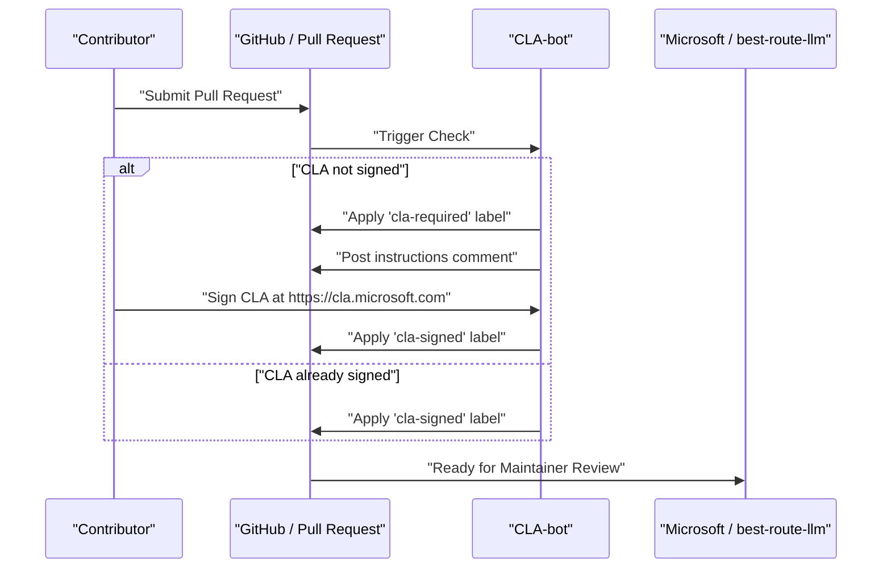
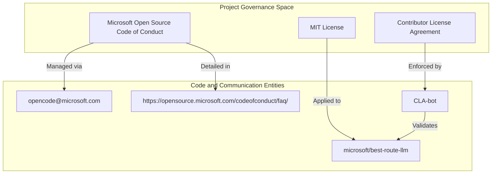

<!-- source: DeepWiki mcp.deepwiki.com · repo microsoft/best-route-llm · page 7.1 Contributing and Licensing · fetched 2026-10-26 -->

# Contributing and Licensing

Relevant source files

The following files were used as context for generating this wiki page:

- [CODE_OF_CONDUCT.md](CODE_OF_CONDUCT.md)
- [CONTRIBUTING.md](CONTRIBUTING.md)
- [LICENSE.md](LICENSE.md)

This page outlines the legal and community framework governing the `best-route-llm` repository. It details the MIT License terms, the automated Contributor License Agreement (CLA) workflow for pull requests, and the Microsoft Open Source Code of Conduct.

## Licensing Terms

The BEST-Route codebase is released under the **MIT License**. This is a permissive free software license that allows for reuse within proprietary software provided that all copies of the software or its substantial portions include a copy of the MIT License terms and the copyright notice [LICENSE.md:1-13]().

### Key Provisions
| Provision | Description |
| :--- | :--- |
| **Copyright** | Copyright (c) Microsoft Corporation [LICENSE.md:1-1](). |
| **Permissions** | Granted for use, copying, modification, merging, publishing, distribution, sublicensing, and/or sale [LICENSE.md:5-9](). |
| **Warranty** | The software is provided "AS IS", without warranty of any kind, express or implied [LICENSE.md:15-17](). |
| **Liability** | Microsoft Corporation and the authors are not liable for any claims, damages, or other liability arising from the software [LICENSE.md:17-21](). |

**Sources:**
- [LICENSE.md:1-21]()

## Contribution Workflow

Microsoft welcomes contributions to this project, ranging from bug fixes to new routing strategy implementations. The contribution process is managed through GitHub Pull Requests and an automated licensing check.

### Contributor License Agreement (CLA)
Most contributions require the author to agree to a Contributor License Agreement (CLA). This document declares that the contributor has the right to grant Microsoft the rights to use the contribution [CONTRIBUTING.md:3-6]().

The verification process is handled by an automated **CLA-bot**:
1. **PR Submission**: When a developer submits a Pull Request, the CLA-bot evaluates the contributor's status [CONTRIBUTING.md:8-9]().
2. **Decoration**: The bot labels the PR and adds a comment indicating if a CLA is required [CONTRIBUTING.md:9-10]().
3. **Execution**: If required, the contributor follows the link provided by the bot to sign the agreement. This is a one-time requirement across all Microsoft repositories [CONTRIBUTING.md:10-10]().

### Data Flow: Contribution to Repository
The following diagram illustrates the interaction between a Contributor, the GitHub repository, and the CLA-bot during the submission process.

**Contributor Submission and Verification Flow**

**Sources:**
- [CONTRIBUTING.md:1-10]()

## Code of Conduct

To ensure a welcoming and inclusive environment, this project follows the **Microsoft Open Source Code of Conduct**. This policy governs all interactions within the project's digital spaces, including issue trackers and pull request discussions [CODE_OF_CONDUCT.md:1-3]().

### Enforcement and Reporting
Interaction standards are maintained through the following channels:
*   **General Questions**: Inquiries regarding the code of conduct can be sent to [opencode@microsoft.com](mailto:opencode@microsoft.com) [CODE_OF_CONDUCT.md:9-9]().
*   **Moderation Support**: Microsoft employees can access additional support via [aka.ms/opensource/moderation-support](https://aka.ms/opensource/moderation-support) [CODE_OF_CONDUCT.md:10-10]().
*   **FAQ**: Detailed information on conduct expectations is available in the [Microsoft Code of Conduct FAQ](https://opensource.microsoft.com/codeofconduct/faq) [CODE_OF_CONDUCT.md:8-8]().

### Governance Entities Relationship
The following diagram bridges the project governance concepts to the specific entities and contact points defined in the repository documentation.

**Governance Entity Mapping**

**Sources:**
- [CODE_OF_CONDUCT.md:1-11]()
- [CONTRIBUTING.md:12-14]()

---

