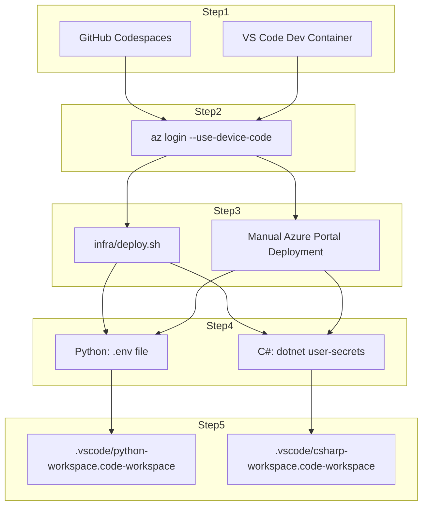
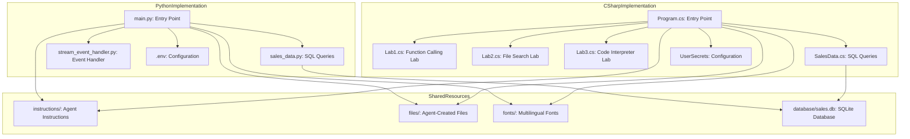
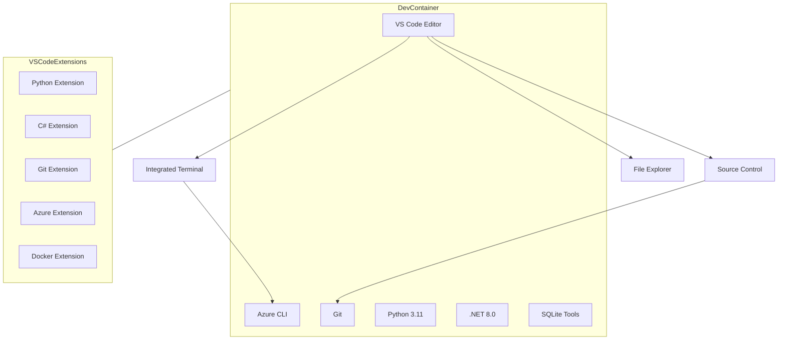

<!-- source: DeepWiki mcp.deepwiki.com · repo microsoft/build-your-first-agent-with-azure-ai-agent-service-workshop · page 2 Development Environment · fetched 2026-10-26 -->

# Development Environment

<details>
<summary>Relevant source files</summary>

The following files were used as context for generating this wiki page:

- [.vscode/settings.json](.vscode/settings.json)
- [docs/docs/includes/introduction-self-guided.md](docs/docs/includes/introduction-self-guided.md)
- [docs/docs/media/project-structure-self-guided-csharp.png](docs/docs/media/project-structure-self-guided-csharp.png)
- [docs/docs/media/project-structure-self-guided-python.png](docs/docs/media/project-structure-self-guided-python.png)

</details>


This document explains how to set up and configure the development environment for the Azure AI Agent Service Workshop. It covers the available options for running the workshop code, prerequisites, authentication with Azure, and the resource deployment process. For information about the specific files and directories in the repository, see [Repository Structure](#2.1).

## Prerequisites

Before beginning the workshop, you need:

1. **Azure Subscription** - If you don't have one, create a [free account](https://azure.microsoft.com/free)
2. **GitHub Account** - Required for accessing GitHub Codespaces
3. **Docker Desktop** - Only required if using the VS Code Dev Container option

Sources: [docs/docs/includes/introduction-self-guided.md:9-13]()

## Development Environment Options and Setup Flow

The following diagram illustrates the overall setup process for the development environment:



Sources: [docs/docs/includes/introduction-self-guided.md:25-125]()

### GitHub Codespaces (Recommended)

GitHub Codespaces provides a pre-configured cloud environment with all necessary tools and dependencies already installed:

1. Click the "Open in GitHub Codespaces" badge in the repository
2. Wait for the Codespace to build (takes several minutes)

### VS Code Dev Container

Alternatively, you can run the workshop locally using a VS Code Dev Container:

1. Install Docker Desktop and ensure it's running
2. Click the "Open in Dev Containers" badge in the repository
3. Wait for the container to build locally (takes several minutes)

> **Warning**: The automated deployment script is not supported on Apple Silicon. If using Apple Silicon, run the deployment script from Codespaces or from macOS instead of the Dev Container.

Sources: [docs/docs/includes/introduction-self-guided.md:29-49]()

## Azure Authentication

After your development environment is ready, authenticate with Azure:

1. Open a terminal in VS Code (Terminal > New Terminal)
2. Run the authentication command:
   ```shell
   az login --use-device-code
   ```
3. Follow the prompts to open a browser and enter the authentication code
4. If you have multiple Azure tenants, select the appropriate one:
   ```shell
   az login --use-device-code --tenant <tenant_id>
   ```

Sources: [docs/docs/includes/introduction-self-guided.md:51-79]()

## Azure Resource Deployment

The workshop requires several Azure resources that can be deployed automatically or manually.

### Automated Deployment

1. In the terminal, run:
   ```bash
   cd infra && ./deploy.sh
   ```

This script creates:
- An Azure AI Foundry hub named "agent-wksp"
- An Azure AI Foundry project named "Agent Service Workshop"
- A Serverless GPT-4o model deployment
- A Grounding with Bing Search resource

> **Note**: The script deploys to the `eastus2` region by default. Edit the script to change the region.

### Manual Deployment

Alternatively, deploy resources through the Azure AI Foundry portal:

1. Navigate to the [Azure AI Foundry](https://ai.azure.com) portal
2. Create a project named "agent-workshop" in a new hub named "agent-workshop-hub"
3. Deploy the GPT-4o model with:
   - Name: "gpt-4o"
   - Type: Global Standard
   - Version: 2024-08-06
   - Tokens Per Minute: 140k

Sources: [docs/docs/includes/introduction-self-guided.md:81-164]()

## Workshop Configuration

After resource deployment, configure the workshop environment based on your chosen programming language:

### Python Configuration

For Python, configuration is stored in a `.env` file:

```python
MODEL_DEPLOYMENT_NAME="gpt-4o"
BING_CONNECTION_NAME="groundingwithbingsearch"
PROJECT_CONNECTION_STRING="<your_project_connection_string>"
```

The deployment script creates this file automatically. To create it manually:
```bash
cp src/python/workshop/.env.sample src/python/workshop/.env
```
Then edit the file to add your project connection string.

### C# Configuration

For C#, configuration uses the .NET Secret Manager:

```bash
# Set variables
CSHARP_PROJECT_PATH="src/csharp/workshop/AgentWorkshop.Client/AgentWorkshop.Client.csproj"

# Set secrets
dotnet user-secrets set "ProjectConnectionString" "<your_project_connection_string>" --project "$CSHARP_PROJECT_PATH"
dotnet user-secrets set "Azure:ModelName" "gpt-4o" --project "$CSHARP_PROJECT_PATH"
```

To view the configured secrets:
```bash
dotnet user-secrets list
```

Sources: [docs/docs/includes/introduction-self-guided.md:102-199]()

## Workspace Selection

Select the workspace for your preferred programming language:

### Python Workspace

1. From VS Code menu: File > Open Workspace from File
2. Select `.vscode/python-workspace.code-workspace`

### C# Workspace

1. From VS Code menu: File > Open Workspace from File
2. Select `.vscode/csharp-workspace.code-workspace`

Sources: [docs/docs/includes/introduction-self-guided.md:201-249]()

## Project Structure

The following diagram shows the key files and their relationships in both Python and C# implementations:



### Key Files and Directories

#### Python Implementation
- `main.py`: The entry point for the application
- `sales_data.py`: Contains functions for executing SQL queries against the SQLite database
- `stream_event_handler.py`: Handles token streaming events from the agent
- `.env`: Contains configuration settings including project connection string

#### C# Implementation
- `Program.cs`: The entry point for the application
- `Lab1.cs`, `Lab2.cs`, `Lab3.cs`: Lab-specific implementation files
- `SalesData.cs`: Contains functions for executing SQL queries
- User Secrets: Stores configuration settings securely using .NET Secret Manager

#### Shared Resources
- `instructions/`: Contains the agent instructions in text format
- `files/`: Directory where agent-created files are stored
- `fonts/`: Contains multilingual fonts for Code Interpreter visualizations
- `database/sales.db`: The SQLite database containing Contoso sales data

Sources: [docs/docs/includes/introduction-self-guided.md:210-249]()

## Development Environment Tools

The development environment comes pre-configured with all necessary tools and extensions:



The development container and GitHub Codespaces both provide identical environments that include:

- Azure CLI for authentication and resource management
- Python 3.11 with required libraries pre-installed
- .NET 8.0 SDK for C# development
- SQLite tools for database operations
- VS Code extensions for Python, C#, and Azure development

Sources: [docs/docs/includes/introduction-self-guided.md:27-49](), [.vscode/settings.json:1-3]()

---

