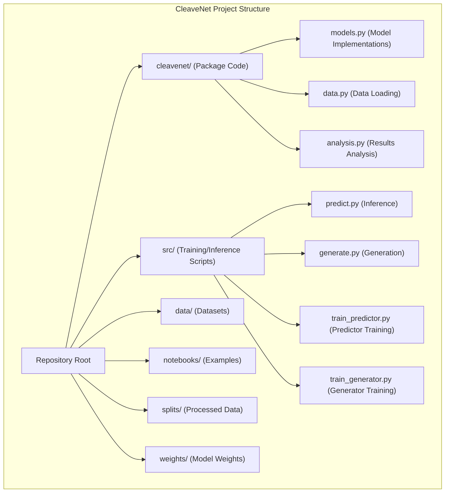
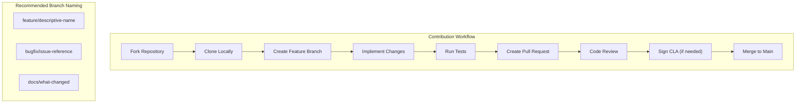
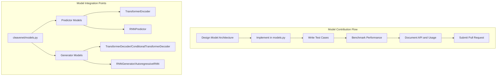

<!-- source: DeepWiki mcp.deepwiki.com · repo microsoft/cleavenet · page 7 Contributing Guide · fetched 2026-10-26 -->

# Contributing Guide

<details>
<summary>Relevant source files</summary>

The following files were used as context for generating this wiki page:

- [LICENSE](LICENSE)
- [README.md](README.md)
- [SECURITY.md](SECURITY.md)
- [data/LICENSE](data/LICENSE)

</details>


This guide outlines how to contribute to the CleaveNet project, including development workflows, coding standards, and legal requirements. For license information, see [License Information](#7.1), and for security practices, see [Security Policy](#7.2).

## Table of Contents
- [Introduction](#introduction)
- [Development Setup](#development-setup)
- [Contribution Workflow](#contribution-workflow)
- [Coding Standards](#coding-standards)
- [Legal Requirements](#legal-requirements)
- [Communication Channels](#communication-channels)

## Introduction

CleaveNet welcomes contributions from the community. Whether you're fixing bugs, improving documentation, or adding new features, your help is appreciated. This guide will help you understand how to contribute effectively to the project.

Sources: [README.md:179-191]()

## Development Setup

### Environment Setup

To set up your development environment:

1. Fork the CleaveNet repository on GitHub
2. Clone your fork locally
3. Create a Python 3.8 environment
4. Install dependencies

```bash
# Create and activate environment
conda env create --name cleavenet python=3.8
conda activate cleavenet

# Install in development mode
git clone https://github.com/YOUR-USERNAME/cleavenet.git
cd cleavenet
pip install -e .
```

### Project Structure

Understanding the project structure will help you locate the areas you want to contribute to:



Sources: [README.md:59-83]()

## Contribution Workflow

The following diagram illustrates the recommended workflow for contributing to CleaveNet:



### Pull Request Guidelines

1. **Branch naming**: Use descriptive names prefixed with the type of change (e.g., `feature/`, `bugfix/`, `docs/`)
2. **Commit messages**: Write clear, concise commit messages that explain what changed and why
3. **Test coverage**: Ensure your changes include appropriate tests
4. **Documentation**: Update documentation to reflect your changes
5. **Dependencies**: Minimize adding new dependencies

Sources: [README.md:179-191]()

## Coding Standards

When contributing code to CleaveNet, please adhere to the following standards:

### Python Code Style

- Follow PEP 8 guidelines
- Use meaningful variable and function names
- Include docstrings for functions and classes
- Use type hints where appropriate

### Model Contribution Guidelines

When contributing new models or model improvements:



Sources: [README.md:86-99]()

## Legal Requirements

### Contributor License Agreement (CLA)

Most contributions require you to agree to a Contributor License Agreement (CLA) declaring that you have the right to, and actually do, grant us the rights to use your contribution. When you submit a pull request, a CLA bot will automatically determine whether you need to provide a CLA and decorate the PR appropriately.

### Code of Conduct

This project has adopted the [Microsoft Open Source Code of Conduct](https://opensource.microsoft.com/codeofconduct). For more information, see the [Code of Conduct FAQ](https://opensource.microsoft.com/codeofconduct/faq) or contact [opencode@microsoft.com](mailto:opencode@microsoft.com) with any additional questions or comments.

### Licensing

CleaveNet code is licensed under the MIT License. The data in the repository is licensed under the Community Data License Agreement - Permissive, Version 2.0. Ensure your contributions comply with these licenses.

| Component | License | File |
|-----------|---------|------|
| Code | MIT License | [LICENSE]() |
| Data | Community Data License Agreement - Permissive, v2.0 | [data/LICENSE]() |

Sources: [README.md:179-191](), [LICENSE:1-22](), [data/LICENSE:1-35]()

## Communication Channels

When contributing to CleaveNet, you can use the following channels for communication:

- **GitHub Issues**: For bug reports, feature requests, and general discussions
- **Pull Requests**: For code contributions and reviews
- **Security Issues**: For reporting security vulnerabilities (see [Security Policy](#7.2))

Sources: [README.md:179-191](), [SECURITY.md:1-41]()

## Reporting Issues

When reporting issues, please include:

1. A clear description of the problem
2. Steps to reproduce
3. Expected vs. actual behavior
4. System information (OS, Python version, etc.)
5. Any relevant logs or screenshots

### Bug Report Template

```
## Description
[Clear and concise description of the bug]

## Steps To Reproduce
1. [First Step]
2. [Second Step]
3. [and so on...]

## Expected behavior
[What you expected to happen]

## Actual behavior
[What actually happened]

## Environment
- OS: [e.g. Windows 10, Ubuntu 20.04]
- Python version: [e.g. 3.8.5]
- CleaveNet version: [e.g. 1.0.0]
```

Sources: [README.md:179-191](), [SECURITY.md:9-29]()

---

