# Page: Overview

# Overview

<details>
<summary>Relevant source files</summary>

The following files were used as context for generating this wiki page:

- [LICENSE](LICENSE)
- [README.md](README.md)

</details>


## Purpose and Scope

CleaveNet is an end-to-end AI pipeline for the design and prediction of protease substrates, with a specific focus on matrix metalloproteinases (MMPs). This document provides a high-level introduction to the CleaveNet system, its architecture, and its core components. It explains the purpose of the system, outlines the major components, and describes their interactions.

For detailed installation instructions, see [Installation and Setup](#1.1).
For a quick introduction to using CleaveNet, see [Quick Start Guide](#1.2).
For in-depth information about specific components, see [System Architecture](#2).

Sources: [README.md:1-11]()

## What is CleaveNet?

CleaveNet is a deep learning-based system designed to both predict the cleavage potential of peptide sequences by MMPs and generate new peptide substrates with desired cleavage profiles. The system enhances the scale, tunability, and efficiency of substrate design for proteases, with demonstrated success even in the challenging task of achieving high selectivity for specific MMPs (such as MMP13).

The core innovation of CleaveNet is its ability to not only predict how well peptides will be cleaved by various MMPs but also to generate novel peptide sequences with specified cleavage properties. This enables researchers to design substrates with precise control over their interactions with different proteases.

Sources: [README.md:3-11](), [README.md:20-21]()

## System Overview

CleaveNet consists of two primary components:

1. **Predictor Component**: Estimates the cleavage potential (expressed as Z-scores) of peptide sequences for various MMPs
2. **Generator Component**: Creates novel peptide sequences, either unconditionally or guided by a target cleavage profile

These components work together to enable both the analysis of existing peptide sequences and the design of new ones with specific properties.

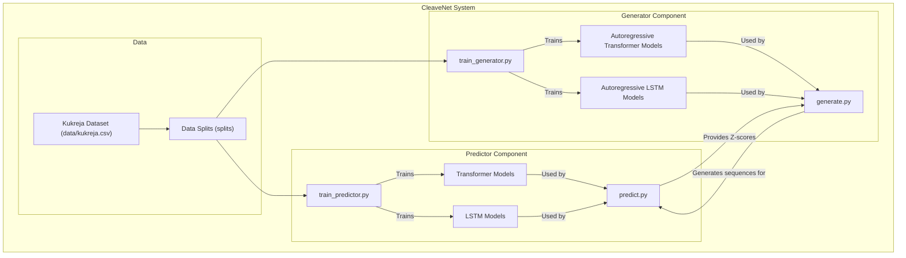

Sources: [README.md:26-35](), [README.md:86-98](), [README.md:106-163]()

## Data Flow

The following diagram illustrates the data flow through the CleaveNet system, from training data to prediction and generation:

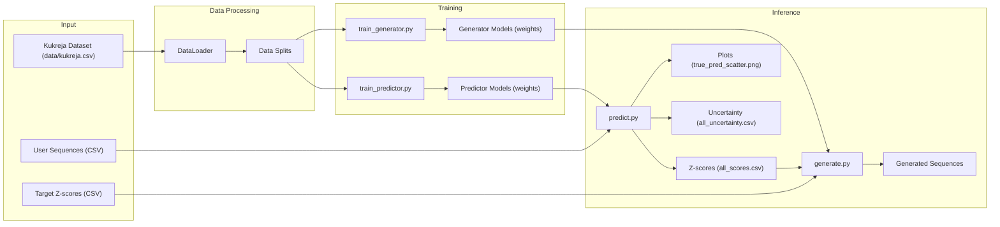

Sources: [README.md:59-83](), [README.md:100-102](), [README.md:114-126](), [README.md:167-177]()

## Core Components

### Predictor Component

The Predictor component estimates the cleavage potential of peptide sequences for various MMPs. It outputs Z-scores, which represent the likelihood of a peptide being cleaved by a particular MMP, with higher scores indicating a higher likelihood of cleavage.

Key features:
- Supports both Transformer and LSTM model architectures
- Provides uncertainty estimates for predictions
- Capable of evaluating 17 different MMPs: MMP1, MMP2, MMP3, MMP7, MMP8, MMP9, MMP10, MMP11, MMP12, MMP13, MMP14, MMP15, MMP16, MMP17, MMP19, MMP20, and MMP25
- Works with peptide sequences up to 10 residues in length

Sources: [README.md:108-112](), [README.md:156-160]()

### Generator Component

The Generator component creates novel peptide sequences, either unconditionally or guided by a target cleavage profile. It uses autoregressive models to generate sequences character by character.

Key features:
- Supports both conditional and unconditional generation
- Conditional generation creates sequences with desired MMP cleavage profiles
- Provides controls for sampling temperature and repeat penalty to adjust generation diversity
- Outputs sequences that exhibit sound biophysical properties and capture both established and novel cleavage motifs

Sources: [README.md:166-177]()

## Model Architectures

CleaveNet uses two main model architectures, which are implemented for both the Predictor and Generator components:

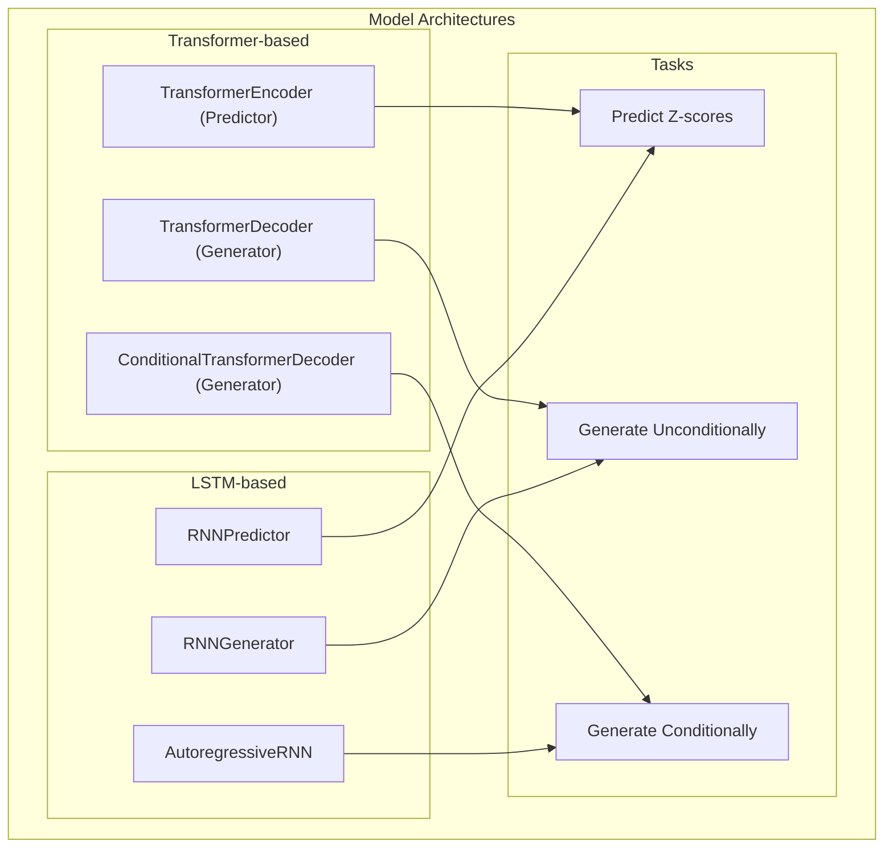

The Transformer-based models generally provide better performance, while the LSTM-based models can sometimes extrapolate better to unseen protease cleavage patterns, as noted in the paper.

Sources: [README.md:156-160]()

## Usage Workflow

The typical workflow for using CleaveNet involves the following steps:

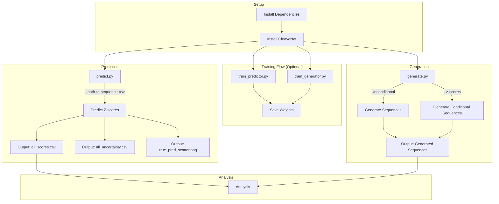

CleaveNet can be used through both command-line scripts and a Jupyter notebook interface. The command-line scripts provide more flexibility and options, while the Jupyter notebook interface provides a simpler way to get started with the system.

Sources: [README.md:37-39](), [README.md:86-98](), [README.md:106-163](), [README.md:166-177]()

## Available Tools and Interfaces

CleaveNet provides several tools and interfaces for working with the system:

| Tool | Purpose | Location |
|------|---------|----------|
| CleaveNet_Example.ipynb | Jupyter notebook for simplified prediction and generation | notebooks/ |
| train_predictor.py | Script for training Predictor models | src/ |
| train_generator.py | Script for training Generator models | src/ |
| predict.py | Script for predicting cleavage of peptide sequences | src/ |
| generate.py | Script for generating new peptide sequences | src/ |

Sources: [README.md:37-39](), [README.md:86-98](), [README.md:106-163](), [README.md:166-177]()

## Next Steps

This overview has introduced the main components and workflows of the CleaveNet system. For more detailed information, consider exploring these related pages:

- [Installation and Setup](#1.1) - Learn how to install CleaveNet and its dependencies
- [Quick Start Guide](#1.2) - Get started with CleaveNet using simple examples
- [System Architecture](#2) - Dive deeper into the architecture of CleaveNet
- [Predictor Component](#2.1) - Learn more about the Predictor component
- [Generator Component](#2.2) - Learn more about the Generator component
- [Usage Guide](#4) - Explore how to use CleaveNet for different tasks

Sources: [README.md:24-35]()

---

# Page: Installation and Setup

# Installation and Setup

<details>
<summary>Relevant source files</summary>

The following files were used as context for generating this wiki page:

- [LICENSE](LICENSE)
- [README.md](README.md)
- [requirements.txt](requirements.txt)
- [setup.py](setup.py)

</details>


This document provides detailed instructions for installing CleaveNet and preparing your environment. CleaveNet is an end-to-end AI pipeline for the design of protease substrates, with a focus on matrix metalloproteinases (MMPs). For a general overview of CleaveNet's purpose and capabilities, see [Overview](#1). For quick usage examples after installation, see [Quick Start Guide](#1.2).

## System Requirements

Before installing CleaveNet, ensure your system meets the following requirements:

- **Python**: Version 3.8 recommended
- **Operating System**: Compatible with Windows, macOS, and Linux
- **Hardware**: While CleaveNet can run on CPU, GPU acceleration is recommended for faster inference, especially for the generator component

## Installation Process

The installation of CleaveNet follows a simple process that involves setting up a Python environment and installing the package.

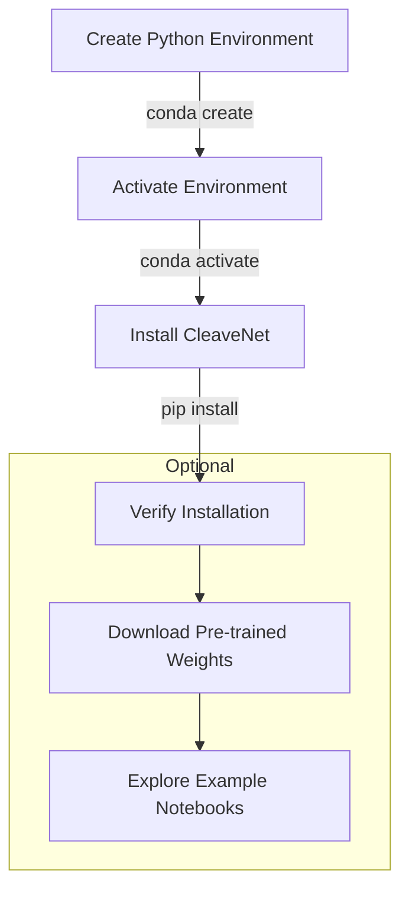

*Diagram: CleaveNet Installation Process Flow*

Sources: [README.md:44-57]()

### Creating a Python Environment

It's recommended to create a clean environment using conda to avoid dependency conflicts:

```bash
conda create --name cleavenet python=3.8
conda activate cleavenet
```

### Installing CleaveNet

You can install CleaveNet using one of the following methods:

1. **Using pip (Stable Release)**:
   ```bash
   pip install cleavenet
   ```

2. **Directly from GitHub (Latest Development Version)**:
   ```bash
   pip install git+https://github.com/microsoft/cleavenet.git
   ```

Sources: [README.md:50-57](), [setup.py:10-26]()

## Dependencies

CleaveNet relies on several Python packages, which are automatically installed during the pip installation process. Key dependencies include:

| Package | Version | Purpose |
|---------|---------|---------|
| tensorflow | 2.18.0 | Deep learning framework |
| numpy | latest | Numerical computing |
| pandas | 2.2.3 | Data manipulation |
| matplotlib | 3.10.0 | Plotting and visualization |
| scikit_learn | 1.6.1 | Machine learning utilities |
| scipy | 1.15.1 | Scientific computing |
| jellyfish | 1.1.3 | String matching/similarity |
| logomaker | 0.8.6 | Sequence logo visualization |
| seaborn | 0.13.2 | Statistical data visualization |
| tqdm | 4.67.1 | Progress bars |

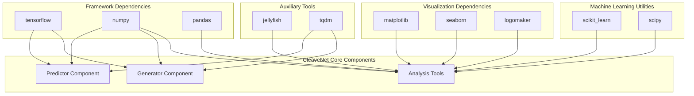

*Diagram: CleaveNet Dependency Relationships*

Sources: [requirements.txt:1-12]()

## Project Structure

After installation, understanding the project structure is essential for effective use of CleaveNet. The repository is organized as follows:

```mermaid
flowchart TD
    ROOT["cleavenet/"] --> PKG["cleavenet/"]
    ROOT --> DATA["data/"]
    ROOT --> EXAMPLES["examples/"]
    ROOT --> IMG["img/"]
    ROOT --> NOTEBOOKS["notebooks/"]
    ROOT --> SPLITS["splits/"]
    ROOT --> SRC["src/"]
    ROOT --> WEIGHTS["weights/"]
    
    PKG --> MODELS["models.py"]
    PKG --> DATA_PY["data.py"]
    PKG --> ANALYSIS["analysis.py"]
    
    DATA --> KUKREJA["kukreja.csv"]
    DATA --> DESIGN_TXT["cleavenet_design.txt"]
    DATA --> DESIGN_XLSX["cleavenet_design_summary.xlsx"]
    
    SPLITS --> BHATIA["bhatia/"]
    SPLITS --> KUKREJA_SPLIT["kukreja/"]
    SPLITS --> KUKREJA_ROUNDED["kukreja_rounded/"]
    
    SRC --> GENERATE["generate.py"]
    SRC --> PREDICT["predict.py"]
    SRC --> TRAIN_GEN["train_generator.py"]
    SRC --> TRAIN_PRED["train_predictor.py"]
    
    WEIGHTS --> MODEL_ARC["model_arc_ensemble/"]
    WEIGHTS --> TRAINING_SCHEME["training_scheme_model_arc/"]
```

*Diagram: CleaveNet Project Directory Structure*

Sources: [README.md:59-83]()

### Key Components

- **cleavenet/**: Core package functions and modules
- **data/**: Contains datasets used for training and testing
  - `kukreja.csv`: Primary dataset for training/testing models
  - `cleavenet_design.txt`: Sequences tested in the paper
  - `cleavenet_design_summary.xlsx`: Detailed summary of tested sequences
- **examples/**: Example data for testing code from README
- **splits/**: Processed data splits for model training
  - `bhatia/`: Fluorescence test dataset
  - `kukreja/`: mRNA display train/test splits
  - `kukreja_rounded/`: Rounded splits for conditional generation
- **src/**: Scripts for training and inference
  - `generate.py`: For generating peptide sequences
  - `predict.py`: For predicting cleavage of peptide sequences
  - `train_generator.py`: For training the generator model
  - `train_predictor.py`: For training the predictor model
- **weights/**: Pre-trained model weights
- **notebooks/**: Jupyter notebooks for interactive examples

Sources: [README.md:59-83]()

## Verifying Installation

To verify that CleaveNet has been installed correctly, you can run one of the example scripts or notebooks.

### Basic Installation Check

You can verify the installation by importing the package in Python:

```python
import cleavenet
print(cleavenet.__version__)  # Should print the version number
```

### Running Example Notebook

For a more comprehensive check, you can run the example Jupyter notebook:

```bash
jupyter notebook notebooks/CleaveNet_Example.ipynb
```

The notebook should execute without errors, demonstrating basic prediction and generation tasks. It typically takes around 3-5 minutes for the installation and less than 20 minutes to run the entire notebook on CPU.

Sources: [README.md:37-38]()

## Troubleshooting Common Issues

Here are solutions to common installation issues:

1. **TensorFlow Compatibility**: If you encounter TensorFlow installation issues, ensure you have the correct version (2.18.0) installed. CUDA compatibility issues may arise if using GPU acceleration.

2. **Missing Dependencies**: If you see import errors, verify all dependencies are installed:
   ```bash
   pip install -r requirements.txt
   ```

3. **Path Issues**: If modules cannot be found, ensure the CleaveNet package is in your Python path.

4. **Pre-trained Weight Access**: If you cannot access pre-trained weights, check your internet connection or see if the repository was cloned with Git LFS properly.

## System Integration Overview

This diagram illustrates how the installation components fit into the larger CleaveNet system:

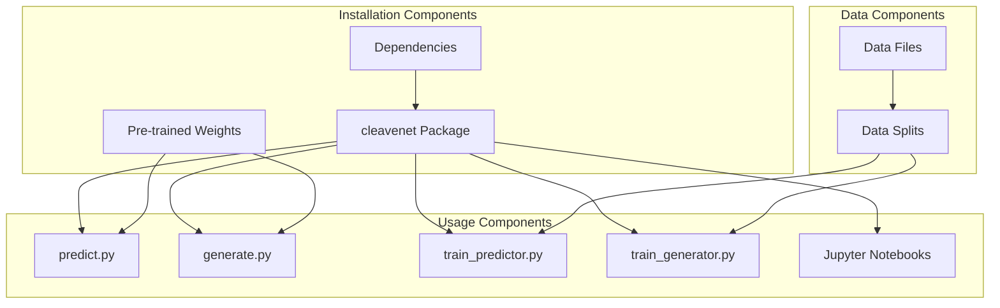

*Diagram: CleaveNet System Integration after Installation*

Sources: [README.md:44-83]()

## Next Steps

After completing the installation and setup, you can:

1. Proceed to the [Quick Start Guide](#1.2) to learn basic usage of CleaveNet
2. Explore the example notebooks in the `notebooks/` directory
3. Begin training your own models with the scripts in the `src/` directory
4. Use pre-trained models for prediction and generation tasks

Sources: [README.md:37-38](), [README.md:86-176]()

---

# Page: Quick Start Guide

# Quick Start Guide

<details>
<summary>Relevant source files</summary>

The following files were used as context for generating this wiki page:

- [LICENSE](LICENSE)
- [README.md](README.md)
- [notebooks/CleaveNet_Example.ipynb](notebooks/CleaveNet_Example.ipynb)

</details>


This guide provides a quick introduction to using CleaveNet, an end-to-end AI pipeline for predicting protease substrate cleavage and generating novel peptide substrates. It covers basic installation, prediction of cleavage for peptide sequences, and generation of new peptide substrates. For detailed information about the system architecture, see [System Architecture](#2), and for more advanced usage scenarios, refer to the [Usage Guide](#4).

## Installation

CleaveNet requires Python 3.8 and can be installed using pip:

```bash
# Create a new environment (recommended)
conda create --name cleavenet python=3.8
conda activate cleavenet

# Install CleaveNet
pip install cleavenet
```

Alternatively, for the latest development version:

```bash
pip install git+https://github.com/microsoft/cleavenet.git
```

Sources: [README.md:44-57](), [notebooks/CleaveNet_Example.ipynb:15-77]()

## Basic Workflow

The typical CleaveNet workflow involves:

1. Installing the package
2. Predicting cleavage scores for peptide sequences
3. Optionally generating new peptide sequences

### CleaveNet Workflow Diagram

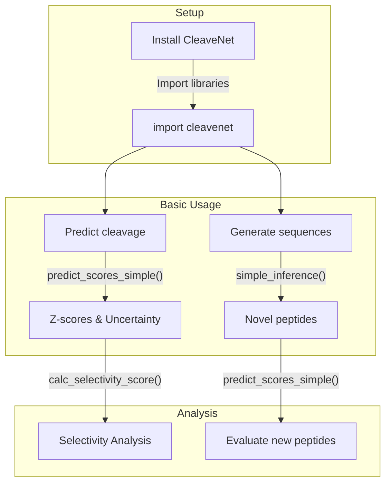

Sources: [README.md:25-35](), [notebooks/CleaveNet_Example.ipynb:100-108]()

## Predicting Cleavage

CleaveNet predicts the cleavage potential (Z-scores) of peptide sequences for various matrix metalloproteinases (MMPs). Higher Z-scores indicate increased likelihood of cleavage.

### Basic Prediction Steps

1. Import the required functions:
```python
from cleavenet.models import predict_scores_simple
from cleavenet.utils import mmps
from cleavenet.analysis import calc_selectivity_score
```

2. Prepare your peptide sequences (each should be 10 residues long):
```python
substrates = [
    '--AAALS---',  # Example of a padded short sequence
    'FMPLNFTASG',  # Full-length sequence
    'LGPYAMTSRG'
]
```

3. Run the prediction:
```python
pred_zscores, unc_scores = predict_scores_simple(
    substrates,
    checkpoint_dir='weights/',  # Path to model weights
    save_dir='outputs/',        # Where to save results
    model_architecture='transformer'  # 'transformer' or 'lstm'
)
```

4. Results will be saved to `save_dir` as:
   - `all_scores.csv`: Z-scores for each sequence and MMP
   - `all_uncertainty.csv`: Uncertainty estimates
   - Visualization plots

### Prediction Process Diagram

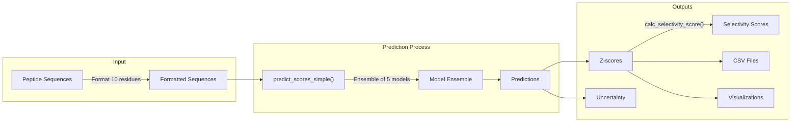

### Interpreting Results

CleaveNet predictions include:

1. **Z-scores**: Higher values indicate better substrates
   - Values > 1.0 generally indicate cleavage
   - Values < 0 generally indicate poor substrates

2. **Uncertainty scores**: Lower values indicate higher confidence

3. **Selectivity scores**: Indicate specificity for particular MMPs

Example of analyzing results for MMP13:

```python
# Create a dataframe with predictions
mmp_choice = 'MMP13'
mmp_df = predictions[['sequences', mmp_choice]]
mmp_df = mmp_df.merge(selectivity[['sequences', mmp_choice+'_ss']])
mmp_df = mmp_df.merge(uncertainty[['sequences', mmp_choice+'_unc']])

# Classify as cleaved or not cleaved
z_cutoff = 1.0
mmp_df['Prediction'] = mmp_df[mmp_choice].apply(
    lambda x: 'Cleaved' if x > z_cutoff else 'Not Cleaved'
)
```

Sources: [notebooks/CleaveNet_Example.ipynb:115-637](), [README.md:106-136]()

## Generating Peptide Sequences

CleaveNet can generate novel peptide sequences unconditionally or conditionally based on target Z-scores.

### Unconditional Generation

1. Import the required function:
```python
from cleavenet.models import simple_inference
```

2. Generate sequences:
```python
temperature = 1.0       # Controls diversity (0.7-1.2 recommended)
repeat_penalty = 1.2    # Penalizes repeated amino acids
num_seqs = 10           # Number of sequences to generate

substrate_designs = simple_inference(
    num_seqs, 
    repeat_penalty, 
    temperature
)
```

### Conditional Generation

For conditional generation (generating sequences with specific cleavage properties), use the command-line interface:

```bash
python src/generate.py --num-seqs 400 \
                      --output-dir conditional_generations \
                      --z-scores examples/efficient_conditional_seeds.csv
```

The Z-scores file should contain 18 columns with the MMPs labeled and desired Z-scores for each.

### Generation Process Diagram

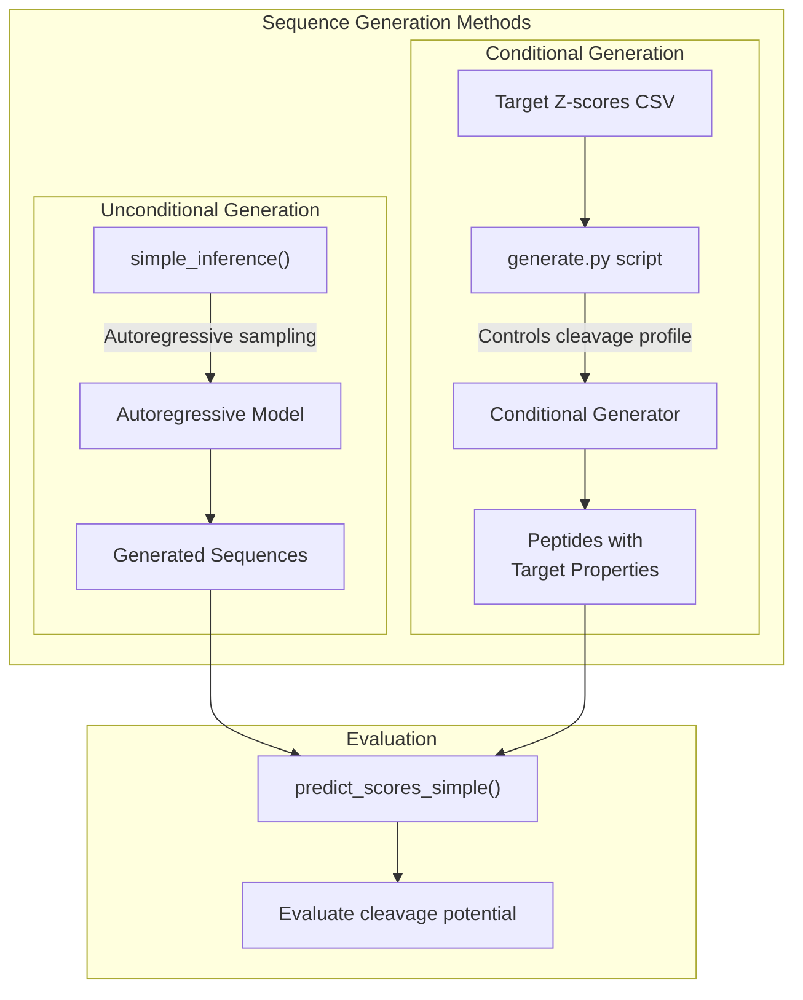

Sources: [notebooks/CleaveNet_Example.ipynb:1384-1478](), [README.md:164-178]()

## Example Workflow

Here's a complete example workflow demonstrating both prediction and generation:

```python
import cleavenet
from cleavenet.models import predict_scores_simple, simple_inference
from cleavenet.analysis import calc_selectivity_score
from cleavenet.utils import mmps

# 1. Predict cleavage for existing sequences
substrates = [
    '--AAALS---',
    'FMPLNFTASG',
    'LGPYAMTSRG'
]

pred_zscores, unc_scores = predict_scores_simple(
    substrates,
    checkpoint_dir='weights/',
    save_dir='outputs/',
    model_architecture='transformer'
)

# 2. Analyze results
# Load predictions from CSV files
import pandas as pd
import os

pred_file = os.path.join('outputs/', 'all_scores.csv')
predictions = pd.read_csv(pred_file)

# Calculate selectivity scores
selectivity = calc_selectivity_score(mmps, predictions)

# 3. Generate new sequences
temperature = 1.0
repeat_penalty = 1.2
num_seqs = 10

new_substrates = simple_inference(
    num_seqs, 
    repeat_penalty, 
    temperature
)

# 4. Evaluate new sequences
new_zscores, new_unc = predict_scores_simple(
    new_substrates,
    checkpoint_dir='weights/',
    save_dir='outputs/new_substrates/',
    model_architecture='transformer'
)
```

### Code Entities to Functions Mapping

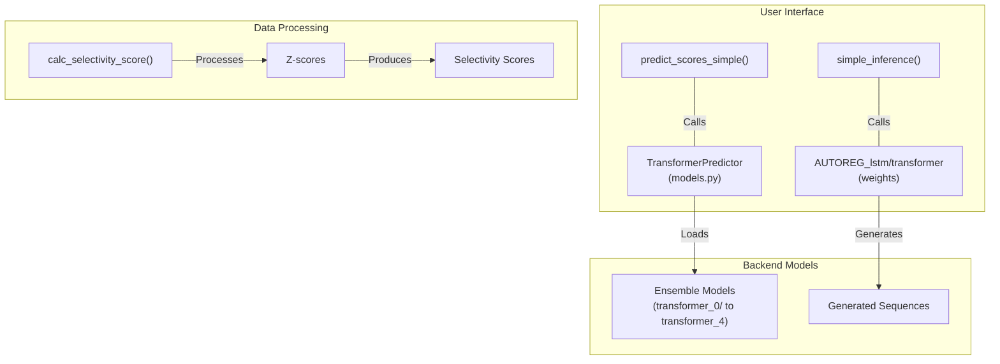

Sources: [notebooks/CleaveNet_Example.ipynb:100-108](), [notebooks/CleaveNet_Example.ipynb:130-148](), [notebooks/CleaveNet_Example.ipynb:1405-1477]()

## What's Next

After mastering the basics in this Quick Start Guide, you can:

1. Learn about the [Predictor Component](#2.1) and [Generator Component](#2.2) in detail
2. Explore advanced [Training Models](#4.1) options
3. Investigate [Analysis Tools](#4.4) for evaluating results
4. Review the [Example Notebooks](#6) for more complex usage patterns

Sources: [README.md:18-35]()

## Data Format Requirements

### Input Sequence Format

- Sequences should be 10 residues in length
- Shorter sequences can be padded with `-` characters
- Example: `--AAALS---` (a 5-residue sequence `AAALS` padded to 10 positions)

### Z-score CSV Format (for conditional generation)

| MMP1 | MMP10 | MMP12 | ... | MMP9 |
|------|-------|-------|-----|------|
| -3.1 | 1.2   | -2.1  | ... | 0.6  |
| 4.5  | 2.6   | -1.1  | ... | 1.3  |

Sources: [README.md:117-125](), [README.md:174-178]()

---

# Page: System Architecture

# System Architecture

<details>
<summary>Relevant source files</summary>

The following files were used as context for generating this wiki page:

- [LICENSE](LICENSE)
- [README.md](README.md)
- [cleavenet/models.py](cleavenet/models.py)

</details>


## Purpose and Scope

This document provides a comprehensive overview of CleaveNet's system architecture, explaining the core components and their interactions. It covers the predictor and generator pipelines, model architectures, and data flow throughout the system. For installation instructions, see [Installation and Setup](#1.1). For a quick introduction to using the system, see [Quick Start Guide](#1.2).

## High-Level System Overview

CleaveNet consists of two primary components working together in an end-to-end AI pipeline designed for protease substrate design:

1. **Predictor Component**: Estimates cleavage potential (Z-scores) of peptide sequences for various Matrix Metalloproteinases (MMPs)
2. **Generator Component**: Creates novel peptide sequences with desired cleavage profiles

These components interact with data sources, user interfaces, and each other to enable both analysis and design of protease substrates.

### System Architecture Diagram

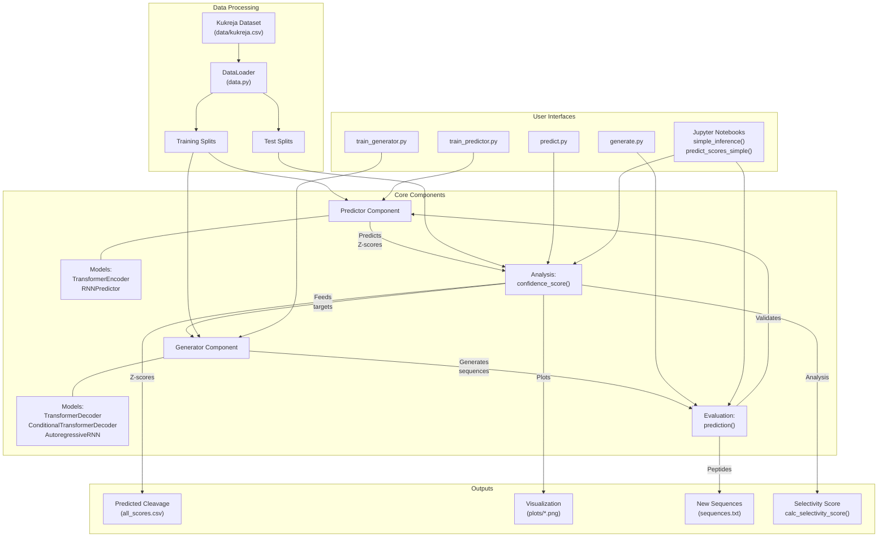

Sources: [README.md:3-11](), [cleavenet/models.py:245-460](), [cleavenet/models.py:815-857]()

## Data Flow Pipeline

The CleaveNet system processes data through distinct stages from input to final output, with different paths for prediction and generation tasks.

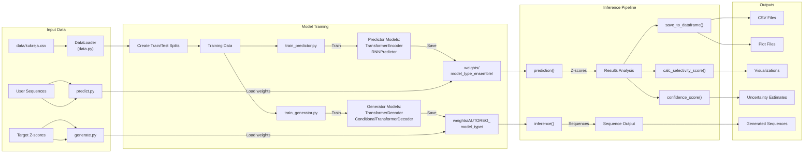

Sources: [README.md:101-136](), [cleavenet/models.py:657-712](), [cleavenet/models.py:715-815]()

## Core Components

### Predictor Component

The predictor component analyzes peptide sequences to estimate their cleavage potential by various Matrix Metalloproteinases (MMPs). It outputs Z-scores indicating how likely a sequence is to be cleaved by each MMP.

#### Architecture and Models

The predictor uses two main model architectures:

1. **Transformer-based Predictor**:
   - `TransformerEncoder` class from [cleavenet/models.py:314-384]()
   - Uses self-attention mechanisms with positional encoding
   - Supports ensemble prediction for higher accuracy and uncertainty quantification

2. **LSTM-based Predictor**:
   - `RNNPredictor` class from [cleavenet/models.py:387-459]()
   - Uses bidirectional LSTM layers for sequence analysis
   - May have better extrapolation to unseen protease patterns in some cases

#### Prediction Flow

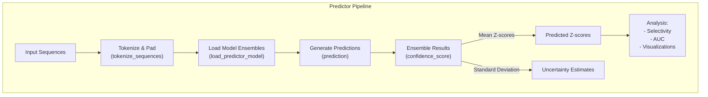

Sources: [cleavenet/models.py:715-815](), [README.md:106-119]()

### Generator Component

The generator component creates new peptide sequences with desired cleavage properties. It can operate in both unconditional and conditional modes, where the latter generates sequences based on target Z-score profiles.

#### Architecture and Models

The generator uses these model architectures:

1. **Transformer-based Generators**:
   - `TransformerDecoder` for unconditional generation from [cleavenet/models.py:246-270]()
   - `ConditionalTransformerDecoder` for conditional generation from [cleavenet/models.py:272-311]()
   - Implements causal self-attention for autoregressive generation

2. **LSTM-based Generator**:
   - `AutoregressiveRNN` from [cleavenet/models.py:520-561]()
   - Uses stacked LSTM layers for sequence generation
   - Supports both conditional and unconditional generation

#### Generation Flow

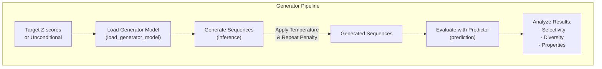

Sources: [cleavenet/models.py:657-712](), [README.md:166-176]()

## Model Architecture Details

CleaveNet employs both Transformer and LSTM architectures for its prediction and generation tasks. The following diagram shows the relationship between different model types:

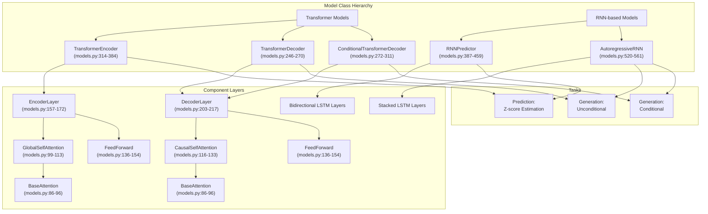

Sources: [cleavenet/models.py:86-561]()

### Transformer Architecture

The Transformer models in CleaveNet follow the architecture from the original "Attention is All You Need" paper, with modifications for the specific tasks:

1. **TransformerEncoder**:
   - Global self-attention allows information to flow bi-directionally
   - Positional encoding is added to embeddings to preserve sequence position information
   - Used for prediction tasks with a final dense layer to output Z-scores

2. **TransformerDecoder/ConditionalTransformerDecoder**:
   - Causal self-attention masks future positions during training and generation
   - Autoregressive generation with softmax sampling for token prediction
   - Conditional version accepts Z-score conditioning inputs to guide generation

### LSTM Architecture

The LSTM models use recurrent connections to process sequences:

1. **RNNPredictor**:
   - Two stacked bidirectional LSTM layers
   - Final dense layers for Z-score prediction
   - Dropout and regularization to prevent overfitting

2. **AutoregressiveRNN**:
   - Stacked LSTM layers (default 4)
   - Autoregressive generation similar to the Transformer decoder
   - Temperature sampling and repeat penalties to control generation quality

## Training and Inference Pipeline

### Training Process

The training process involves these key steps:

1. Data loading and preprocessing via `DataLoader`
2. Split creation for training and validation
3. Model instantiation with appropriate hyperparameters
4. Training loop with optimizer and loss functions
5. Checkpoint saving to the `weights/` directory

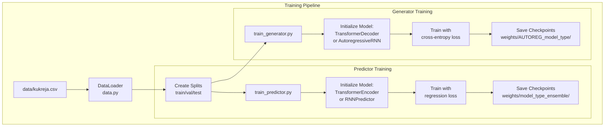

Sources: [README.md:86-104]()

### Inference Process

The inference process varies between prediction and generation:

#### Prediction Inference

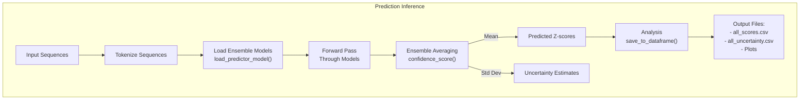

Sources: [cleavenet/models.py:715-815]()

#### Generation Inference

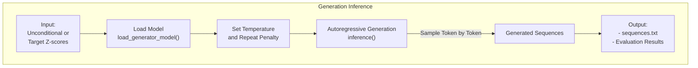

Sources: [cleavenet/models.py:657-712]()

## API and User Interfaces

CleaveNet provides several interfaces for users to interact with the system:

### Command-line Interfaces

1. **Training Scripts**:
   - `train_predictor.py` - Trains the predictor component
   - `train_generator.py` - Trains the generator component

2. **Inference Scripts**:
   - `predict.py` - Predicts cleavage for input sequences
   - `generate.py` - Generates new peptide sequences

### API Functions

For programmatic use, CleaveNet provides simplified interfaces:

1. **Prediction API**:
   - `predict_scores_simple()` - Simple interface for prediction
   - `prediction()` - Full prediction pipeline with analysis

2. **Generation API**:
   - `simple_inference()` - Simple interface for sequence generation
   - `inference()` - Full generation pipeline

```mermaid
graph TD
    subgraph "User Interfaces"
        CLI["Command Line Interfaces"] --> TP["train_predictor.py"]
        CLI --> TG["train_generator.py"]
        CLI --> PP["predict.py"]
        CLI --> GP["generate.py"]
        
        API["API Functions"] --> PSS["predict_scores_simple()<br>(models.py:818-826)"]
        API --> SI["simple_inference()<br>(models.py:828-857)"]
    end
    
    subgraph "Implementation Functions"
        PSS --> P["prediction()<br>(models.py:715-815)"]
        SI --> I["inference()<br>(models.py:657-712)"]
        
        TP --> LPM["load_predictor_model()<br>(models.py:619-654)"]
        PP --> P
        
        TG --> LGM["load_generator_model()<br>(models.py:563-617)"]
        GP --> I
    end
```

Sources: [cleavenet/models.py:657-857](), [README.md:86-176]()

## Summary

CleaveNet's architecture is designed as an end-to-end pipeline for protease substrate design with two primary components: the predictor for estimating cleavage potential and the generator for creating peptide sequences. Both components utilize Transformer and LSTM architectures and can be accessed through command-line interfaces or API functions. The system is designed to be modular, allowing components to be used independently or together in a complete pipeline.

For detailed information about specific components, please refer to:
- [Predictor Component](#2.1)
- [Generator Component](#2.2)
- [Model Architectures](#2.3)

---

# Page: Predictor Component

# Predictor Component

<details>
<summary>Relevant source files</summary>

The following files were used as context for generating this wiki page:

- [LICENSE](LICENSE)
- [README.md](README.md)
- [cleavenet/models.py](cleavenet/models.py)
- [src/predict.py](src/predict.py)
- [src/train_predictor.py](src/train_predictor.py)

</details>


The Predictor Component serves as a core functional element within CleaveNet, responsible for estimating cleavage potential (Z-scores) of peptide sequences for various matrix metalloproteinases (MMPs). This component takes peptide sequences as input and predicts how likely each of 18 different MMPs is to cleave that sequence. These predictions enable substrate specificity analysis and provide targets for the Generator Component (for information about the Generator Component, see [2.2](#2.2)).

## Overview and System Role

```mermaid
flowchart LR
    subgraph "Data Input"
        KD["Kukreja Dataset"] --> DL["DataLoader"]
        US["User Sequences"] --> PP["predict.py"]
    end

    subgraph "Predictor Component"
        DL --> TR["Training"]
        TR --> PM["Predictor Models"]
        PM --> |"Ensemble"| EP["prediction()"]
        PP --> |"Load weights"| PM
        EP --> ZS["Z-scores"]
        EP --> UN["Uncertainty"]
    end

    subgraph "Outputs"
        ZS --> SA["Selectivity Analysis"]
        ZS --> PL["Visualization Plots"]
        ZS --> DF["DataFrame Output"]
        UN --> CI["Confidence Intervals"]
    end

    subgraph "Integration"
        ZS --> |"Feeds targets"| GC["Generator Component"]
        ZS --> |"Validates"| EV["Model Evaluation"]
    end
```

The Predictor Component provides a robust foundation for both analysis of existing peptide sequences and generation of new sequences with desired cleavage profiles. It enables users to:

1. Predict cleavage Z-scores for custom peptide sequences
2. Assess confidence in predictions through uncertainty estimation
3. Identify substrates with high specificity for particular MMPs
4. Generate visualization plots for analysis
5. Feed target Z-scores to the Generator Component

Sources: [README.md:103-126](), [cleavenet/models.py:714-815]()

## Model Architectures

The Predictor Component supports two different model architectures:

```mermaid
flowchart TD
    subgraph "Predictor Model Architectures"
        subgraph "TransformerEncoder"
            PE["PositionalEmbedding"] --> EL["EncoderLayers"]
            EL --> |"Multiple layers"| SA["Self-Attention"]
            SA --> FF["FeedForward"]
            FF --> DO["Dense Output"]
        end

        subgraph "RNNPredictor"
            EM["Embedding"] --> L1["Bidirectional LSTM"]
            L1 --> DP1["Dropout"]
            DP1 --> L2["Bidirectional LSTM"]
            L2 --> DP2["Dropout"]
            DP2 --> DN["Dense"]
            DN --> DO2["Dense Output"]
        end
    end
```

### Transformer Architecture

The transformer-based predictor uses a `TransformerEncoder` class that implements:

- Positional embedding to encode sequence position information
- Multi-head self-attention mechanisms for capturing relationships between amino acids
- Feed-forward neural networks
- Layer normalization and residual connections
- Final dense layer to output Z-scores for each MMP

This architecture generally provides the best performance and is recommended for most use cases.

Sources: [cleavenet/models.py:314-384](), [src/train_predictor.py:100-115]()

### LSTM Architecture

The LSTM-based predictor uses an `RNNPredictor` class that features:

- Embedding layer to encode amino acid tokens
- Two stacked bidirectional LSTM layers
- Dropout for regularization
- Dense output layers mapping to Z-scores

While the Transformer architecture is generally preferred, the LSTM architecture can sometimes extrapolate better to unseen protease cleavage patterns.

Sources: [cleavenet/models.py:387-459](), [src/train_predictor.py:92-97]()

## Ensemble Prediction

To improve prediction reliability, CleaveNet employs an ensemble approach:

```mermaid
flowchart TD
    subgraph "Ensemble Prediction"
        IS["Input Sequence"] --> |"Same input"| M1["Model 1"]
        IS --> M2["Model 2"]
        IS --> M3["Model 3"]
        IS --> M4["Model 4"]
        IS --> M5["Model 5"]
        
        M1 --> |"Z-scores"| A["Aggregation"]
        M2 --> A
        M3 --> A
        M4 --> A
        M5 --> A
        
        A --> |"Mean"| PZ["Predicted Z-scores"]
        A --> |"Standard Deviation"| UC["Uncertainty"]
    end
```

The prediction function loads five separately trained model instances with the same architecture but different random initializations. When making predictions:

1. Each model independently processes the input sequence
2. The final prediction is the mean of all individual model predictions 
3. Uncertainty is calculated as the standard deviation across model predictions

This ensemble approach provides both better accuracy through averaged predictions and a measure of prediction confidence through uncertainty values.

Sources: [cleavenet/models.py:715-773](), [src/predict.py:47-53]()

## Input and Output Format

### Input Format
The Predictor Component accepts peptide sequences up to 10 residues in length. If sequences are shorter, they should be padded with `-` characters:

| Sequence Length | Formatted Example |
|-----------------|-------------------|
| 3 residues      | `---AHA----`      |
| 4 residues      | `---PRVA---`      |
| 5 residues      | `--LRVFL---`      |
| 7 residues      | `--PRVVFLR-`      |
| 10 residues     | `PRVFQLRVFL`      |

The sequences can be provided in a CSV file with one sequence per line.

### Output Format
The Predictor Component outputs:

1. **Z-scores**: Numerical predictions for each of the 18 MMP types (higher values indicate greater cleavage potential)
2. **Uncertainty values**: Standard deviations of predictions across the ensemble
3. **Visualization plots**:
   - True vs. predicted Z-score scatter plots (if true values provided)
   - Confidence-ranked scatter plots
   - Receiver Operating Characteristic (ROC) curves and Area Under Curve (AUC) values
   - Confusion matrices

Sources: [README.md:115-145](), [src/predict.py:9-19]()

## Training Process

The training process for Predictor models is handled by `train_predictor.py`:

```mermaid
flowchart TD
    subgraph "Training Process"
        KD["Kukreja Dataset"] --> DL["DataLoader"]
        DL --> S["Train/Val/Test Split"]
        
        S --> |"Training Data"| M["Model Creation"]
        M --> |"TransformerEncoder or RNNPredictor"| TR["Training Loop"]
        
        TR --> |"Each Epoch"| F["Forward Pass"]
        F --> L["Compute Loss (MAE)"]
        L --> B["Backpropagation"]
        B --> O["Optimizer Update"]
        
        TR --> |"Periodic"| V["Validation"]
        V --> |"If Improved"| W["Save Weights"]
        
        TR --> |"Final"| TE["Test Evaluation"]
        TE --> ME["Model Embeddings"]
        TE --> PP["Performance Plots"]
    end
```

Key aspects of the training process:

1. **Data Preparation**: The Kukreja dataset is loaded and split into training, validation, and test sets
2. **Model Creation**: Either a `TransformerEncoder` or `RNNPredictor` is instantiated
3. **Training Loop**: 
   - Forward pass through the model
   - Compute loss (mean absolute error between predicted and true Z-scores)
   - Backpropagation and optimizer update
4. **Validation**: After each epoch, the model is evaluated on validation data
5. **Checkpointing**: Model weights are saved when validation performance improves
6. **Ensemble Creation**: The training process is repeated multiple times with different random seeds to create an ensemble

Sources: [src/train_predictor.py:62-269]()

## Prediction Process

The prediction process is implemented in the `prediction()` function and exposed through the `predict.py` script:

```mermaid
flowchart LR
    subgraph "Prediction Process"
        IS["Input Sequences"] --> T["Tokenization"]
        T --> P["Padding"]
        
        P --> |"Load Models"| E["Ensemble Models"]
        E --> |"For each model"| FP["Forward Pass"]
        
        FP --> |"Individual Predictions"| A["Aggregation"]
        A --> |"Mean"| Z["Predicted Z-scores"]
        A --> |"Standard Deviation"| U["Uncertainty"]
        
        Z --> |"save_to_dataframe()"| DF["DataFrame Output"]
        Z --> |"All MMPs"| AS["all_scores.csv"]
        U --> |"All MMPs"| AU["all_uncertainty.csv"]
        
        Z --> |"calc_selectivity_score()"| S["Selectivity Analysis"]
        Z --> |"confidence_score()"| C["Confidence Scoring"]
        
        Z --> VZ["Visualization"]
        U --> VZ
        VZ --> TP["true_pred_scatter.png"]
        VZ --> CR["confidence_ranked.png"]
    end
```

The prediction process involves:

1. **Input Processing**: Tokenizing input sequences and padding to a fixed length
2. **Model Loading**: Loading the ensemble of pretrained model weights
3. **Inference**: Running forward passes through each model in the ensemble
4. **Aggregation**: Computing mean predictions and uncertainty estimates
5. **Analysis**: Calculating selectivity scores and confidence metrics
6. **Output Generation**: Saving predictions to CSV files and generating visualization plots

Sources: [cleavenet/models.py:715-815](), [src/predict.py:41-53]()

## Usage

### Command Line Interface

To predict cleavage Z-scores for a set of peptide sequences:

```bash
python src/predict.py --path-to-sequence-csv sequences.csv --save-dir outputs/
```

Optional arguments:
- `--path-to-zscores`: Path to true Z-scores for comparison
- `--model-architecture`: Choose between 'transformer' (default) or 'lstm'
- `--no-csv-header`: Flag for headerless CSV files

To train a new predictor model:

```bash
python src/train_predictor.py --model-type transformer --num-epochs 50
```

Optional training arguments:
- `--batch-size`: Training batch size (default: 128)
- `--learning-rate`: Learning rate (default: 0.005)
- `--d-model`: Dimension of model (default: 32)
- `--ensemble`: Number of models to train for ensemble (default: 5)

### Python API

For programmatic access, CleaveNet provides a simplified interface through the `predict_scores_simple()` function:

```python
from cleavenet.models import predict_scores_simple

# List of peptide sequences
sequences = ["---AHA----", "---PRVA---", "--LRVFL---"]

# Run prediction
pred_zscores, std_zscores = predict_scores_simple(sequences)
```

Sources: [README.md:106-153](), [cleavenet/models.py:818-826]()

## Model Weights and Performance

Trained model weights are stored in the `weights/` directory:
- Transformer models: `weights/transformer_[0-4]/`
- LSTM models: `weights/lstm_[0-4]/`

The default Transformer-based Predictor achieves state-of-the-art performance on MMP substrate prediction tasks as detailed in the CleaveNet paper.

Sources: [README.md:80-82]()

---

# Page: Generator Component

# Generator Component

<details>
<summary>Relevant source files</summary>

The following files were used as context for generating this wiki page:

- [LICENSE](LICENSE)
- [README.md](README.md)
- [cleavenet/models.py](cleavenet/models.py)

</details>


The Generator Component is a key subsystem of CleaveNet that creates peptide sequences with specific cleavage properties. It can operate in two modes: unconditional generation (creating diverse peptide sequences) and conditional generation (creating peptides with targeted cleavage profiles for specific MMPs). This document explains the architecture, functionality, and usage of the Generator Component. For information about predicting cleavage scores of existing sequences, see [Predictor Component](#2.1).

## Overview

The Generator Component uses autoregressive models to generate peptide sequences one amino acid at a time. The models are trained to understand the patterns and structures of valid peptide substrates and can be conditioned on desired cleavage profiles to produce peptides with specific properties.

```mermaid
flowchart LR
    subgraph "Generator Component"
        direction TB
        GI["Inputs"] --> GM["Models"]
        GM --> GP["Generation Process"]
        GP --> GO["Outputs"]
    end

    subgraph "Inputs"
        direction TB
        UC["Unconditional Generation"] 
        CC["Conditional Generation"] --> ZS["Target Z-Scores"]
        RP["Repeat Penalty"]
        TP["Temperature"]
    end

    subgraph "Models"
        direction TB
        TD["TransformerDecoder"]
        CTD["ConditionalTransformerDecoder"]
        AR["AutoregressiveRNN"]
    end

    subgraph "Generation Process"
        direction TB
        AT["Autoregressive Token Prediction"]
        CS["Conditioning Signal Integration"]
        SP["Sampling with Temperature"]
        PC["Penalty for Repeats"]
    end

    subgraph "Outputs"
        direction TB
        PS["Peptide Sequences"]
        EM["Evaluation Metrics"]
    end
```

Sources: [README.md:96-100](), [cleavenet/models.py:245-304](), [cleavenet/models.py:520-561]()

## Generator Model Architectures

The Generator Component can use two different architectural approaches:

### Transformer-based Generators

CleaveNet implements two transformer-based generator models:

1. **TransformerDecoder**: For unconditional generation of peptide sequences
2. **ConditionalTransformerDecoder**: For generating peptides conditioned on target Z-scores

Both models use a decoder-only transformer architecture with causal self-attention to generate sequences autoregressively.

### LSTM-based Generators

CleaveNet also provides LSTM-based alternatives:

1. **RNNGenerator**: A bidirectional LSTM model for learning peptide patterns
2. **AutoregressiveRNN**: An LSTM model specifically designed for autoregressive sequence generation

```mermaid
classDiagram
    class TransformerDecoder {
        +num_layers: int
        +d_model: int
        +num_heads: int
        +dff: int
        +vocab_size: int
        +dropout_rate: float
        +call(x)
        +compute_loss(y, y_hat)
        +compute_accuracy(y, y_hat)
    }
    
    class ConditionalTransformerDecoder {
        +d_model: int
        +num_layers: int
        +pos_embedding: PositionalEmbedding
        +dropout: Dropout
        +dec_layers: List[DecoderLayer]
        +last_attn_scores: Tensor
        +vocab_size: int
        +final_layer: Dense
        +call(x)
        +compute_loss(y, y_hat)
        +compute_accuracy(y, y_hat)
    }
    
    class AutoregressiveRNN {
        +training: bool
        +vocab_size: int
        +embedding_dim: int
        +num_layers: int
        +embedding: Embedding
        +lstm: List[LSTM]
        +drop: List[Dropout]
        +dense: Dense
        +dense_out: Dense
        +call(inputs)
        +compute_loss(y, y_hat)
        +compute_accuracy(y, y_hat)
    }
    
    class load_generator_model {
        <<function>>
    }
    
    class inference {
        <<function>>
    }
    
    class simple_inference {
        <<function>>
    }
    
    load_generator_model --> TransformerDecoder
    load_generator_model --> ConditionalTransformerDecoder
    load_generator_model --> AutoregressiveRNN
    
    inference --> TransformerDecoder
    inference --> ConditionalTransformerDecoder
    inference --> AutoregressiveRNN
    
    simple_inference --> load_generator_model
    simple_inference --> inference
```

Sources: [cleavenet/models.py:246-304](), [cleavenet/models.py:520-561](), [cleavenet/models.py:563-617]()

## Generation Process

The generation process in CleaveNet is autoregressive, meaning it generates each amino acid in the sequence one at a time, with each new amino acid conditioned on the previously generated ones.

```mermaid
sequenceDiagram
    participant User
    participant Generator as "Generator Model"
    participant Tokenizer as "Tokenizer"
    participant Sampler as "Token Sampler"
    
    User->>Generator: Request Peptide Generation
    Note over Generator: Initialize with START token
    
    loop For each position in sequence
        Generator->>Generator: Predict next token probabilities
        Generator->>Sampler: Pass token probabilities
        Note over Sampler: Apply temperature scaling
        Note over Sampler: Apply repeat penalty if needed
        Sampler->>Sampler: Sample next token
        Sampler->>Generator: Return sampled token
        Generator->>Generator: Append token to sequence
        alt if STOP token generated
            Generator->>Generator: End generation
        end
    end
    
    Generator->>Tokenizer: Convert tokens to amino acids
    Tokenizer->>User: Return generated peptide sequence
```

Sources: [cleavenet/models.py:657-712](), [README.md:165-177]()

### Unconditional Generation

In unconditional generation, the model creates peptide sequences starting with a START token and generates amino acids one by one until reaching a maximum length or generating a STOP token. This mode produces a diverse set of peptides that reflect patterns learned from the training data.

### Conditional Generation

Conditional generation allows control over the cleavage properties of generated peptides. By providing a target Z-score profile (cleavage scores for different MMPs), the generator produces peptides that are predicted to have the desired cleavage behavior.

## Generation Parameters

The generation process can be controlled with two key parameters:

1. **Temperature**: Controls the randomness of generation. Lower values (e.g., 0.5) make generation more deterministic, while higher values (e.g., 1.5) increase diversity.

2. **Repeat Penalty**: Discourages repetition of the same amino acid. A higher value (e.g., 1.5) makes repeats less likely, promoting diversity in the sequence.

## Implementation Details

The Generator Component is implemented through several key functions in the CleaveNet codebase:

### Key Functions

- **`load_generator_model`**: Loads a pre-trained generator model based on specified architecture and training scheme
- **`inference`**: Core function that performs autoregressive generation
- **`simple_inference`**: A high-level wrapper for easy generation of peptides
- **`prediction`**: Evaluates generated sequences using the Predictor Component

```mermaid
flowchart TD
    subgraph "API Functions"
        LGM["load_generator_model()"]
        INF["inference()"]
        SI["simple_inference()"]
    end
    
    subgraph "Command Line Interface"
        GEN["generate.py"]
    end
    
    subgraph "Model Classes"
        TD["TransformerDecoder"]
        CTD["ConditionalTransformerDecoder"]
        ARNN["AutoregressiveRNN"]
    end
    
    subgraph "Model Storage"
        WTR["weights/AUTOREG_transformer/"]
        WLS["weights/AUTOREG_lstm/"]
    end
    
    GEN --> LGM
    GEN --> INF
    SI --> LGM
    SI --> INF
    
    LGM --> TD
    LGM --> CTD
    LGM --> ARNN
    
    LGM --> WTR
    LGM --> WLS
    
    INF --> TD
    INF --> CTD
    INF --> ARNN
```

Sources: [cleavenet/models.py:563-617](), [cleavenet/models.py:657-712](), [cleavenet/models.py:828-859]()

## Using the Generator Component

### Command Line Usage

The Generator Component can be used through the `generate.py` script:

For unconditional generation:
```
python src/generate.py --num-seqs 20000 --output-dir generations --temperature 1.0 --repeat-penalty 1.2
```

For conditional generation with target Z-scores:
```
python src/generate.py --num-seqs 400 --output-dir conditional_generations --z-scores examples/efficient_conditional_seeds.csv --temperature 1.0 --repeat-penalty 1.2
```

### API Usage

CleaveNet provides a simplified API for generation through the `simple_inference` function:

```python
import cleavenet

# Generate 10 peptide sequences
sequences = cleavenet.models.simple_inference(
    num_seqs=10,           # Number of sequences to generate
    repeat_penalty=1.2,    # Penalty for repeated amino acids
    temperature=1.0        # Sampling temperature
)

# Print generated sequences
for seq in sequences:
    print(seq)
```

## Model Training

The Generator models are trained using the `train_generator.py` script. The models learn from both unconditional (sequence-only) and conditional (with Z-scores) inputs, allowing them to generate both types of outputs. Training data comes from the Kukreja dataset, which contains peptide sequences and their measured cleavage Z-scores for various MMPs.

Training setup and procedure is covered in more detail in the [Training Models](#4.1) section.

Sources: [README.md:94-98](), [README.md:165-177]()

---

# Page: Model Architectures

# Model Architectures

<details>
<summary>Relevant source files</summary>

The following files were used as context for generating this wiki page:

- [cleavenet/models.py](cleavenet/models.py)
- [src/predict.py](src/predict.py)
- [src/train_predictor.py](src/train_predictor.py)

</details>


## Purpose and Scope

This document details the neural network architectures used in CleaveNet for predicting cleavage potential and generating peptide sequences. It covers both Transformer-based and LSTM-based models, their components, and how they're configured for different tasks. For information about how these models are actually used in the prediction and generation workflows, see [Predictor Component](#2.1) and [Generator Component](#2.2).

## Model Architecture Overview

CleaveNet implements two families of model architectures:

1. **Transformer-based models** - Derived from the attention mechanism paper "Attention Is All You Need"
2. **LSTM-based models** - Recurrent neural networks with Long Short-Term Memory cells

Each family has specialized architectures for:
- **Prediction tasks** - Estimating Z-scores for peptide cleavage by MMPs
- **Generation tasks** - Creating new peptide sequences with desired cleavage profiles

```mermaid
graph TD
    subgraph "CleaveNet Model Architectures"
        subgraph "Transformer-based Models"
            TE["TransformerEncoder"]
            TD["TransformerDecoder"]
            CTD["ConditionalTransformerDecoder"]
        end
        
        subgraph "LSTM-based Models"
            RP["RNNPredictor"]
            AR["AutoregressiveRNN"]
        end
        
        subgraph "Tasks"
            PT["Prediction Task"]
            GT["Generation Task"]
            CGT["Conditional Generation Task"]
        end
        
        TE --> PT
        RP --> PT
        
        TD --> GT
        AR --> GT
        
        CTD --> CGT
    end
```

Sources: [cleavenet/models.py:245-384](), [cleavenet/models.py:386-460](), [cleavenet/models.py:462-517](), [cleavenet/models.py:520-561]()

## Transformer-based Models

### Transformer Components

The Transformer architecture consists of several key components that are combined to create encoder and decoder models:

```mermaid
graph TD
    subgraph "Transformer Base Components"
        PE["PositionalEmbedding"]
        BA["BaseAttention"]
        GSA["GlobalSelfAttention"] --> BA
        CSA["CausalSelfAttention"] --> BA
        FF["FeedForward"]
        EL["EncoderLayer"] --> GSA
        EL --> FF
        DL["DecoderLayer"] --> CSA
        DL --> FF
    end
    
    subgraph "Higher Level Components"
        E["Encoder"] --> PE
        E --> EL
        D["Decoder"] --> PE
        D --> DL
    end
    
    subgraph "Complete Models"
        TE["TransformerEncoder"] --> E
        TD["TransformerDecoder"] --> D
        CTD["ConditionalTransformerDecoder"]
    end
```

Sources: [cleavenet/models.py:11-242]()

#### TransformerEncoder

`TransformerEncoder` is used for the prediction task. It encodes peptide sequences into embeddings that are then used to predict cleavage Z-scores for different MMPs.

**Structure:**
- Encoder with positional embeddings
- Multiple encoder layers with global self-attention and feed-forward networks
- Optional pooling of outputs (taking the first token's representation)
- Final dense layer to produce Z-score predictions

**Implementation:**

```mermaid
classDiagram
    class TransformerEncoder {
        +Encoder encoder
        +Dense final_layer
        +bool pool_outputs
        +call(x)
        +compute_loss(y, y_hat)
        +compute_rmse(y, y_hat, axis)
    }
    
    class Encoder {
        +PositionalEmbedding pos_embedding
        +EncoderLayer[] enc_layers
        +Dropout dropout
        +call(x)
    }
    
    TransformerEncoder --> Encoder
```

Sources: [cleavenet/models.py:314-384](), [src/train_predictor.py:106-115]()

#### TransformerDecoder

`TransformerDecoder` is a decoder-only model used for autoregressive sequence generation.

**Structure:**
- Decoder with positional embeddings
- Multiple decoder layers with causal self-attention and feed-forward networks
- Final dense layer to produce token probabilities

**Implementation:**

```mermaid
classDiagram
    class TransformerDecoder {
        +Decoder decoder
        +Dense final_layer
        +call(x)
        +compute_loss(y, y_hat)
        +compute_accuracy(y, y_hat)
    }
    
    class Decoder {
        +PositionalEmbedding pos_embedding
        +DecoderLayer[] dec_layers
        +Dropout dropout
        +call(x)
    }
    
    TransformerDecoder --> Decoder
```

Sources: [cleavenet/models.py:246-270]()

#### ConditionalTransformerDecoder

`ConditionalTransformerDecoder` extends the TransformerDecoder to perform conditional generation, where peptide sequences are generated based on desired MMP cleavage profiles.

**Structure:**
- Similar to TransformerDecoder, but with conditional positional embeddings
- Accepts target Z-scores as conditioning input

Sources: [cleavenet/models.py:272-311]()

## LSTM-based Models

CleaveNet also implements LSTM-based models for both prediction and generation tasks, which sometimes offer training or inference advantages compared to Transformer models.

### RNNPredictor

`RNNPredictor` uses bidirectional LSTMs to predict cleavage Z-scores from peptide sequences.

**Structure:**
- Embedding layer for tokenized sequences
- Two stacked bidirectional LSTM layers with dropout
- Dense layers for final prediction

**Implementation:**

```mermaid
classDiagram
    class RNNPredictor {
        +Embedding embedding
        +Bidirectional(LSTM) lstm
        +Dropout drop
        +Bidirectional(LSTM) lstm2
        +Dropout drop2
        +Dense dense
        +Dense dense_out
        +call(x)
        +compute_loss(y, y_hat)
        +compute_rmse(y, y_hat, axis)
    }
```

Sources: [cleavenet/models.py:387-459](), [src/train_predictor.py:96-97]()

### AutoregressiveRNN

`AutoregressiveRNN` is an LSTM-based model for generating peptide sequences autoregressively.

**Structure:**
- Embedding layer
- Multiple LSTM layers with dropout
- Dense layers for predicting next token probabilities

**Implementation:**

```mermaid
classDiagram
    class AutoregressiveRNN {
        +Embedding embedding
        +LSTM[] lstm
        +Dropout[] drop
        +Dense dense
        +Dense dense_out
        +call(inputs)
        +compute_loss(y, y_hat)
        +compute_accuracy(y, y_hat)
    }
```

Sources: [cleavenet/models.py:520-561]()

## Model Training and Inference

### Training Configuration

The training configuration for each model type is specified in the training scripts. Key hyperparameters include:

| Model Type | Hyperparameters | Default Values |
|------------|----------------|----------------|
| TransformerEncoder | Number of layers | 4 |
| | Number of heads | 8 |
| | Model dimension | 128 |
| | Dropout rate | 0.01 |
| | Learning rate | Custom schedule |
| RNNPredictor | Embedding dimension | 22 |
| | RNN units | 32 |
| | Dropout rate | 0.25 |
| | Regularization | 0.01 |
| | Learning rate | Fixed (0.005) |

Sources: [src/train_predictor.py:93-117]()

### Inference Functions

CleaveNet provides functions for inference with both predictor and generator models:

```mermaid
flowchart TD
    subgraph "Predictor Inference"
        PS["predict_scores_simple()"] --> PRE["prediction()"]
        PRE --> LPM["load_predictor_model()"]
    end
    
    subgraph "Generator Inference"
        SI["simple_inference()"] --> INF["inference()"]
        INF --> LGM["load_generator_model()"]
    end
    
    subgraph "Model Selection"
        LPM --> |"model_architecture='transformer'"| TE["TransformerEncoder"]
        LPM --> |"model_architecture='lstm'"| RP["RNNPredictor"]
        
        LGM --> |"model_type='transformer'"| TD["TransformerDecoder/ConditionalTransformerDecoder"]
        LGM --> |"model_type='lstm'"| AR["AutoregressiveRNN"]
    end
```

Sources: [cleavenet/models.py:563-826]()

#### Prediction Function

The `prediction` function handles the process of running ensemble prediction on sequences, using multiple trained models for better accuracy and uncertainty estimation:

1. Loads an ensemble of trained models
2. Tokenizes input sequences
3. Runs prediction with each model
4. Computes mean predictions and uncertainty estimates
5. Analyzes results and generates visualizations

Sources: [cleavenet/models.py:715-815](), [src/predict.py:47-53]()

#### Inference Function

The `inference` function performs autoregressive generation of peptide sequences:

1. Starts with a seed sequence (e.g., START token or conditioning Z-scores)
2. Iteratively predicts the next token in the sequence
3. Applies optional temperature scaling and repetition penalty
4. Continues until a STOP token is generated or maximum length is reached

Sources: [cleavenet/models.py:657-712]()

## Simplified API

CleaveNet provides simplified API functions to make model usage more accessible:

### predict_scores_simple

```python
def predict_scores_simple(substrates, checkpoint_dir='../weights/', save_dir='outputs/', model_architecture='transformer')
```

This function predicts Z-scores for input peptide sequences using ensemble prediction.

Sources: [cleavenet/models.py:818-826]()

### simple_inference

```python
def simple_inference(num_seqs, repeat_penalty, temperature)
```

This function generates peptide sequences using the transformer-based generator model.

Sources: [cleavenet/models.py:828-859]()

## Ensemble Training and Uncertainty Estimation

CleaveNet uses ensemble training to improve prediction robustness and provide uncertainty estimates:

```mermaid
flowchart TD
    subgraph "Ensemble Training"
        TP["train_predictor.py"] --> |"--ensemble=5"| EM1["Model 1"]
        TP --> |"--ensemble=5"| EM2["Model 2"]
        TP --> |"--ensemble=5"| EM3["Model 3"]
        TP --> |"--ensemble=5"| EM4["Model 4"]
        TP --> |"--ensemble=5"| EM5["Model 5"]
    end
    
    subgraph "Ensemble Prediction"
        PP["prediction()"] --> |"Load weights"| EM1
        PP --> |"Load weights"| EM2
        PP --> |"Load weights"| EM3
        PP --> |"Load weights"| EM4
        PP --> |"Load weights"| EM5
        
        EM1 --> |"Predict"| P1["Predictions 1"]
        EM2 --> |"Predict"| P2["Predictions 2"]
        EM3 --> |"Predict"| P3["Predictions 3"]
        EM4 --> |"Predict"| P4["Predictions 4"]
        EM5 --> |"Predict"| P5["Predictions 5"]
        
        P1 --> CS["confidence_score()"]
        P2 --> CS
        P3 --> CS
        P4 --> CS
        P5 --> CS
        
        CS --> |"Calculate mean"| MEAN["Mean predictions"]
        CS --> |"Calculate std"| STD["Prediction uncertainty"]
    end
```

Sources: [cleavenet/models.py:715-815](), [src/train_predictor.py:58-77]()

---

# Page: Data

# Data

<details>
<summary>Relevant source files</summary>

The following files were used as context for generating this wiki page:

- [LICENSE](LICENSE)
- [README.md](README.md)
- [data/cleavenet_design.txt](data/cleavenet_design.txt)
- [data/kukreja.csv](data/kukreja.csv)

</details>


This document provides an overview of the datasets used in CleaveNet and explains how data is structured, processed, and flows through the system. It covers the primary training dataset, validation datasets, and details how to work with data for both training models and inference.

## Dataset Overview

CleaveNet relies on several key datasets for training, validation, and demonstration purposes:

1. **Kukreja Dataset** - The primary dataset used for training and evaluating CleaveNet models, derived from mRNA display experiments
2. **Bhatia Dataset** - A fluorescence-based test dataset used for external validation
3. **CleaveNet Design Dataset** - Sequences generated and tested by CleaveNet, including controls

### Data Directory Structure

```mermaid
graph TD
    subgraph "Data Files"
        KD["data/kukreja.csv"] --> |"Primary dataset"| TP["Training & Prediction"]
        CD["data/cleavenet_design.txt"] --> |"Sequences & controls"| EV["Evaluation"]
        CDS["data/cleavenet_design_summary.xlsx"] --> |"In vitro results"| EV
    end
    
    subgraph "Data Splits Directory"
        KS["splits/kukreja/"] --> |"X_train.csv, y_train.csv"| TR["Predictor Training"]
        KS --> |"X_test.csv, y_test.csv"| TE["Evaluation"]
        KR["splits/kukreja_rounded/"] --> |"Rounded Z-scores"| GT["Generator Training"]
        BS["splits/bhatia/"] --> |"X_all.csv, y_all_labeled.csv"| FE["Fluorescence Evaluation"]
    end
```

Sources: [README.md:63-76]()

## Data Format and Structure

### Peptide Sequence Format

CleaveNet works with peptide sequences up to 10 residues in length. Shorter sequences must be padded with `-` characters on both ends to maintain the fixed 10-residue format.

**Example of properly formatted sequences:**
```
---AHA----
---PRVA---
--LRVFL---
--PRVVFLR-
PRVFQLRVFL
```

### Z-score Format

Z-scores represent cleavage efficiency for different matrix metalloproteinases (MMPs). These are provided in CSV format, with each column representing a different MMP and each row corresponding to a peptide sequence.

```mermaid
graph TD
    subgraph "Z-score File Structure"
        H["Optional header row:"] --> HE["MMP1,MMP10,MMP12,MMP13,..."]
        D["Data rows:"] --> D1["-3.1,1.2,-2.1,0.5,..."]
        D --> D2["4.5,2.6,-1.1,3.2,..."]
        D --> D3["-1.5,2.1,-1.4,-0.8,..."]
    end
```

Sources: [README.md:113-144]()

## Data Processing Pipeline

CleaveNet uses a `DataLoader` class to handle data validation, processing and split creation. This component provides the bridge between raw data files and the model training process.

```mermaid
flowchart TD
    subgraph "Data Flow"
        KD["data/kukreja.csv"] --> |"load()"| DL["DataLoader"]
        US["User Sequences CSV"] --> |"--path-to-sequence-csv"| PP["predict.py"]
        TZ["Target Z-scores CSV"] --> |"--z-scores"| GP["generate.py"]
        
        DL --> |"process()"| VD["validate_data()"]
        DL --> |"split()"| CS["create_splits()"]
        
        CS --> |"write_to_file()"| TS["splits/kukreja/X_train.csv
                                     splits/kukreja/y_train.csv"]
        CS --> |"write_to_file()"| VS["splits/kukreja/X_val.csv
                                     splits/kukreja/y_val.csv"]
        CS --> |"write_to_file()"| ES["splits/kukreja/X_test.csv
                                     splits/kukreja/y_test.csv"]
        
        TS --> |"DataLoader.load_from_splits()"| TPR["train_predictor.py"]
        TS --> |"DataLoader.load_from_splits()"| TGE["train_generator.py"]
        
        ES --> |"DataLoader.load_from_splits()"| EVA["Evaluation"]
    end
```

Sources: [README.md:100-103]()

## Supported MMPs

CleaveNet models are trained to predict cleavage for 17 different Matrix Metalloproteinases (MMPs):

| MMP ID | Description |
|--------|-------------|
| MMP1   | Collagenase-1 |
| MMP2   | Gelatinase-A |
| MMP3   | Stromelysin-1 |
| MMP7   | Matrilysin |
| MMP8   | Collagenase-2 |
| MMP9   | Gelatinase-B |
| MMP10  | Stromelysin-2 |
| MMP11  | Stromelysin-3 |
| MMP12  | Macrophage Elastase |
| MMP13  | Collagenase-3 |
| MMP14  | MT1-MMP |
| MMP15  | MT2-MMP |
| MMP16  | MT3-MMP |
| MMP17  | MT4-MMP |
| MMP19  | RASI-1 |
| MMP20  | Enamelysin |
| MMP25  | MT6-MMP |

Sources: [README.md:107-110]()

## Working with Custom Data

### For Prediction

To use CleaveNet for predicting cleavage efficiency on custom peptide sequences:

1. Create a CSV file with each sequence on a new line
2. Ensure sequences are 10 residues in length (pad with `-` if necessary)
3. Run the prediction script with your CSV file:

```
python src/predict.py --path-to-sequence-csv your_sequences.csv --save-dir outputs/
```

### For Conditional Generation

To generate sequences with specific cleavage profiles:

1. Create a CSV file with desired Z-scores for each MMP
2. Include header row with MMP names
3. Run the generation script with your Z-scores file:

```
python src/generate.py --num-seqs 400 --output-dir generations --z-scores your_zscores.csv
```

Sources: [README.md:114-127](), [README.md:167-178]()

## Training/Test Data Split Structure

When working with CleaveNet, data is processed into specific directory structures for training and testing. Here is how the data split hierarchy is organized:

```mermaid
graph TD
    subgraph "splits/ Directory"
        K["kukreja/"] --> KX["X_train.csv"] --> |"Sequences"| KT["Training"]
        K --> KY["y_train.csv"] --> |"Z-scores"| KT
        K --> KXT["X_test.csv"] --> |"Sequences"| KE["Testing"]
        K --> KYT["y_test.csv"] --> |"Z-scores"| KE
        
        KR["kukreja_rounded/"] --> KRX["X_train.csv"] --> |"Sequences"| KRT["Generator Training"]
        KR --> KRY["y_train.csv"] --> |"Rounded Z-scores"| KRT
        
        B["bhatia/"] --> BX["X_all.csv"] --> |"Sequences"| BE["External Validation"]
        B --> BY["y_all_labeled.csv"] --> |"Fluorescence Z-scores"| BE
    end
    
    subgraph "Usage in Scripts"
        KT --> TP["train_predictor.py"]
        KT --> TG["train_generator.py"]
        KRT --> TG
        KE --> EP["predict.py"]
        BE --> EP
    end
```

Sources: [README.md:67-74]()

## CleaveNet Design Dataset

The `data/cleavenet_design.txt` file contains sequences generated by CleaveNet and control sequences used for experimental validation. The sequences are categorized as follows:

- `top_efficient_unconditional`: Sequences generated unconditionally that were predicted to be efficiently cleaved
- `top_selective_conditional`: Sequences conditionally generated to be selective for specific MMPs
- `sampled baseline + DL (efficient)`: Baseline efficient sequences with deep learning
- `sampled baseline + DL (selective)`: Baseline selective sequences with deep learning
- `sampled_baseline NO DL (efficient)`: Baseline efficient sequences without deep learning
- `sampled_baseline NO DL (selective)`: Baseline selective sequences without deep learning
- `pos controls (efficient)`: Positive control sequences for efficiency
- `pos controls (selective)`: Positive control sequences for selectivity
- `neg controls`: Negative control sequences

This dataset demonstrates CleaveNet's ability to generate peptide sequences with desired cleavage profiles and provides a benchmark for evaluating CleaveNet's performance.

Sources: [data/cleavenet_design.txt:1-104]()

## Data Flow in CleaveNet System

The following diagram shows how data flows through the entire CleaveNet system, from raw data files through processing to training and inference:

```mermaid
flowchart TD
    subgraph "Data Sources"
        KD["data/kukreja.csv"] --> DL["DataLoader"]
        US["User Sequences"] --> PP["predict.py"]
        ZS["Target Z-scores"] --> GP["generate.py"]
    end
    
    subgraph "Data Processing"
        DL --> |"create_splits()"| TR["Training Data"]
        DL --> |"create_splits()"| TE["Testing Data"]
        
        TR --> TPP["train_predictor.py"]
        TR --> TGP["train_generator.py"]
    end
    
    subgraph "Model Training"
        TPP --> |"TransformerEncoder or RNNPredictor"| PM["Predictor Models"]
        TGP --> |"TransformerDecoder or RNNGenerator"| GM["Generator Models"]
        
        PM --> PMW["weights/transformer_*/ or weights/lstm_*/"]
        GM --> GMW["weights/AUTOREG_transformer/ or weights/AUTOREG_lstm/"]
    end
    
    subgraph "Inference"
        PP --> |"load_weights()"| PMW
        GP --> |"load_weights()"| GMW
        
        US --> |"Sequences for prediction"| PP
        ZS --> |"Z-scores for generation"| GP
        
        PP --> |"predict_scores_simple()"| PO["Predicted Z-scores"]
        GP --> |"simple_inference()"| GO["Generated Sequences"]
    end
    
    subgraph "Output Analysis"
        PO --> |"calc_selectivity_score()"| SA["Selectivity Analysis"]
        PO --> |"confidence_score()"| CS["Confidence Scoring"]
        PO --> |"get_roc_data(), calc_auc()"| PE["Performance Evaluation"]
        
        GO --> |"Sequence analysis"| QE["Quality Evaluation"]
    end
```

Sources: [README.md:80-144](), [README.md:164-178]()

## Custom Data Integration

If you wish to use your own dataset with CleaveNet, there are two main approaches:

1. **Convert to Compatible CSV Format**: Convert your data to match the format of the Kukreja dataset and use with the existing DataLoader
2. **Create Custom DataLoader**: Implement a custom DataLoader class compatible with CleaveNet

For the second approach, refer to `cleavenet/data.py` for an example implementation.

Sources: [README.md:100-103]()

---

# Page: Kukreja Dataset

# Kukreja Dataset

<details>
<summary>Relevant source files</summary>

The following files were used as context for generating this wiki page:

- [LICENSE](LICENSE)
- [README.md](README.md)
- [data/kukreja.csv](data/kukreja.csv)

</details>


This document details the Kukreja Dataset, which serves as the primary training and evaluation dataset for CleaveNet models. This dataset contains peptide sequences and their experimentally determined cleavage Z-scores for various matrix metalloproteinases (MMPs), providing the foundation for training both the predictor and generator components of the CleaveNet system.

## Origin and Citation

The Kukreja Dataset is derived from research published by Kukreja et al. in 2015:

> Kukreja M, Johnston SA, Stafford P. *Immunosignaturing of Protease Abundance and Activity in a Complex Mixture*. High-Throughput. 2015;4(3):362-380.

The original data from this paper was processed and converted into a CSV format (`data/kukreja.csv`) for use in the CleaveNet system. This dataset represents a collection of substrate peptides and their cleavage efficiency measurements against multiple MMPs, determined through mRNA display experiments.

Sources: [README.md:102-102]()

## Dataset Structure and Format

The dataset is stored as a CSV file with the following structure:

```mermaid
graph TD
    subgraph "Kukreja Dataset Structure"
        CSV["data/kukreja.csv"] --- ROW["Row Format"]
        ROW --> SEQ["Peptide Sequence<br>(10 amino acids)"]
        ROW --> Z1["Z-score MMP1"]
        ROW --> Z2["Z-score MMP2"]
        ROW --> Z3["..."]
        ROW --> ZN["Z-score MMP25"]
    end
```

Key characteristics of the dataset:
- **Format**: CSV file containing peptide sequences and their corresponding cleavage Z-scores
- **Sequence Length**: 10 amino acids per peptide
- **MMPs Covered**: Includes Z-scores for 17 MMPs (MMP1, MMP2, MMP3, MMP7, MMP8, MMP9, MMP10, MMP11, MMP12, MMP13, MMP14, MMP15, MMP16, MMP17, MMP19, MMP20, and MMP25)
- **Z-scores**: Normalized scores representing cleavage efficiency (higher values indicate more efficient cleavage)

Sources: [README.md:64-64](), [README.md:108-109]()

## Data Processing Pipeline

The raw Kukreja dataset undergoes processing through the CleaveNet DataLoader to prepare it for training and evaluation:

```mermaid
flowchart TD
    subgraph "Kukreja Dataset Processing Pipeline"
        KD["data/kukreja.csv"] --> DL["DataLoader"]
        DL --> SP["Split Creation"]
        
        SP --> TS["Training Split<br>splits/kukreja/X_train.csv<br>splits/kukreja/y_train.csv"]
        SP --> VS["Validation Split<br>splits/kukreja/X_val.csv<br>splits/kukreja/y_val.csv"]
        SP --> ES["Test Split<br>splits/kukreja/X_test.csv<br>splits/kukreja/y_test.csv"]
        
        TS --> TR["Training Models"]
        VS --> VL["Model Validation"]
        ES --> EV["Model Evaluation"]
        
        SP -.-> RS["Rounded Splits<br>splits/kukreja_rounded/"]
        RS --> CG["Conditional Generation Training"]
    end
```

The processed splits are organized as follows:
1. **Training Split**: Used to train both predictor and generator models
2. **Validation Split**: Used for hyperparameter tuning and early stopping
3. **Test Split**: Reserved for final evaluation of model performance
4. **Rounded Splits**: Special processing for conditional generation training where Z-scores are rounded

Sources: [README.md:71-74](), [README.md:100-102]()

## Integration with CleaveNet System

The Kukreja Dataset plays a central role in the CleaveNet workflow:

```mermaid
graph TD
    subgraph "Kukreja Dataset in CleaveNet System"
        KD["data/kukreja.csv"] --> DL["DataLoader<br>(cleavenet/data.py)"]
        
        DL --> TR["Training Data"]
        DL --> TS["Test Data"]
        
        TR --> TP["train_predictor.py"]
        TR --> TG["train_generator.py"]
        
        TP --> PM["Predictor Models<br>(TransformerEncoder, RNNPredictor)"]
        TG --> GM["Generator Models<br>(TransformerDecoder, ConditionalTransformerDecoder,<br>RNNGenerator, AutoregressiveRNN)"]
        
        TS --> PP["predict.py"]
        TS --> PE["Performance Evaluation"]
        
        PM --> PP
        GM --> GS["generate.py"]
        
        PP --> ZS["Z-score Predictions"]
        GS --> NS["Generated Sequences"]
    end
```

Key interactions:
- The DataLoader processes the raw Kukreja dataset into training and testing splits
- Training splits are used by `train_predictor.py` and `train_generator.py` to train models
- Test splits are used to evaluate model performance through `predict.py`
- The trained models are then used for prediction and generation tasks

Sources: [README.md:86-96](), [README.md:106-120]()

## Usage Examples

### Predicting Cleavage on Test Data

To use the Kukreja test set for evaluating the predictor model:

```bash
python src/predict.py --path-to-sequence-csv splits/kukreja/X_test.csv \
                     --path-to-zscores splits/kukreja/y_test.csv \
                     --no-csv-header \
                     --save-dir outputs/kukreja_test
```

This command loads the test sequences from the Kukreja dataset, generates predictions using the trained predictor model, and compares them with the true Z-scores.

Sources: [README.md:147-152]()

### Creating Custom DataLoader for Similar Datasets

If you have similar data to the Kukreja dataset, you can:
1. Convert your data to a compatible CSV format
2. Process it through the CleaveNet DataLoader
3. Or write a custom DataLoader following the pattern in `cleavenet/data.py`

Sources: [README.md:102-102]()

## Data Format Requirements

The input sequences for the predictor should:
- Be up to 10 residues in length
- Be padded with `-` tokens on both ends if shorter than 10 residues

Example of properly formatted sequences:

```
---AHA----
---PRVA---
--LRVFL---
--PRVVFLR-
PRVFQLRVFL
```

Sources: [README.md:117-125]()

## Related Pages

For more information about:
- Using the dataset for training models, see [Training Models](#4.1)
- Predicting cleavage with trained models, see [Predicting Cleavage](#4.2)
- Generating sequences with the trained generator, see [Generating Sequences](#4.3)
- Data pipeline architecture, see [System Architecture](#2)

---

# Page: Peptide Design Data

# Peptide Design Data

<details>
<summary>Relevant source files</summary>

The following files were used as context for generating this wiki page:

- [data/cleavenet_design.txt](data/cleavenet_design.txt)
- [data/cleavenet_design_predictions.xlsx](data/cleavenet_design_predictions.xlsx)

</details>


This document describes the peptide design data used for evaluating and demonstrating CleaveNet's capabilities in predicting protease substrate cleavage and generating novel peptide sequences. Unlike the Kukreja dataset (see [Kukreja Dataset](#3.1)) which is used for training, this dataset serves specifically for evaluation and demonstration purposes.

## Dataset Structure

The peptide design dataset consists of 97 peptide sequences organized into 9 distinct categories, stored in `data/cleavenet_design.txt`, with corresponding predictions in `data/cleavenet_design_predictions.xlsx`.

```mermaid
graph TD
    PDD["Peptide Design Dataset"]
    
    PDD --> G1["Generated Peptides"]
    PDD --> G2["Control Peptides"]
    
    G1 --> TP["Top Performing"]
    G1 --> BL["Baseline Methods"]
    
    TP --> TPC["top_efficient_unconditional<br/>(25 sequences)"]
    TP --> TPS["top_selective_conditional<br/>(25 sequences)"]
    
    BL --> BDL["With Deep Learning"]
    BL --> BNO["Without Deep Learning"]
    
    BDL --> BDLE["sampled baseline + DL (efficient)<br/>(8 sequences)"]
    BDL --> BDLS["sampled baseline + DL (selective)<br/>(8 sequences)"]
    
    BNO --> BNOE["sampled_baseline NO DL (efficient)<br/>(8 sequences)"]
    BNO --> BNOS["sampled_baseline NO DL (selective)<br/>(8 sequences)"]
    
    G2 --> PCE["pos controls (efficient)<br/>(5 sequences)"]
    G2 --> PCS["pos controls (selective)<br/>(5 sequences)"]
    G2 --> NC["neg controls<br/>(5 sequences)"]
```

Sources: [data/cleavenet_design.txt:1-104]()

## Peptide Categories in Detail

### Generated Peptides

1. **Top Efficient Unconditional** (25 sequences):
   - High-performing peptides generated by CleaveNet's generator without specific conditions
   - Optimized for efficient cleavage by MMPs generally
   - Example sequences: FMPLNFTASG, LGPYAMTSRG, LGPLGITASG

2. **Top Selective Conditional** (25 sequences):
   - High-performing peptides generated by CleaveNet with specific conditions
   - Optimized for selective cleavage by particular MMPs
   - Example sequences: YGPRAVTASG, SGPRAFWGTA, TPPRAFMDGH

3. **Sampled Baseline with Deep Learning**:
   - **Efficient** (8 sequences): VAPLPMRAWL, LAPLGLTTSK, LGPYAMKAPW, etc.
   - **Selective** (8 sequences): HGPRAVTAAG, VAPRGFVDQG, MMPRAFYDPG, etc.

4. **Sampled Baseline without Deep Learning**:
   - **Efficient** (8 sequences): IPPVALIATG, KATHAIRHKG, NGPFMLHLLR, etc.
   - **Selective** (8 sequences): HIPRWFHSEW, VPPVGVSAGG, HGPRNVTDAW, etc.

### Control Peptides

5. **Positive Controls**:
   - **Efficient** (5 sequences): RMPLGLRAPA, WMPLGMRAGG, GRPADLRTAS, etc.
   - **Selective** (5 sequences): VMPSGFRGKH, MSPKGVTASG, GYPRAFSTAS, etc.

6. **Negative Controls** (5 sequences):
   - Peptides expected to perform poorly in cleavage assays
   - Example sequences: QGRRRRPERG, TSFRMLFRKT, RTYSHLYSSS

Sources: [data/cleavenet_design.txt:1-104]()

## Data Format

### Sequence File Format

The peptide design data in `data/cleavenet_design.txt` follows this format:
- Category headers start with `>` followed by the category name
- Each subsequent line contains a single peptide sequence (typically 10 amino acids)
- Categories are separated by blank lines

Example from the file:
```
>top_efficient_unconditional
FMPLNFTASG
LGPYAMTSRG
LGPLGITASG
...

>top_selective_conditional
YGPRAVTASG
SGPRAFWGTA
TPPRAFMDGH
...
```

### Predictions File Format

The `data/cleavenet_design_predictions.xlsx` file contains:
- Peptide sequences
- Predicted Z-scores for multiple MMPs
- Evaluation metrics like selectivity scores and efficiency scores
- Comparison metrics between different prediction methods

Sources: [data/cleavenet_design.txt:1-104](), [data/cleavenet_design_predictions.xlsx:1-5]()

## Integration with CleaveNet

The peptide design dataset integrates with CleaveNet's evaluation workflow as shown below:

```mermaid
flowchart TD
    subgraph "Data Files"
        PDT["data/cleavenet_design.txt"]
        PDP["data/cleavenet_design_predictions.xlsx"]
    end
    
    subgraph "CleaveNet Evaluation Pipeline"
        PDT -->|"Input to"| PS["predict.py"]
        PS -->|"Uses"| PR["Predictor<br>(TransformerEncoder/RNNPredictor)"]
        PR -->|"Outputs scores to"| PDP
        
        PDT -->|"Benchmark for"| GS["generate.py"]
        GS -->|"Uses"| GN["Generator<br>(TransformerDecoder/RNNGenerator)"]
        GN -->|"Creates sequences<br>compared with"| PDT
    end
    
    subgraph "Analysis Tools"
        PDP -->|"Analyzed by"| AN["analysis.py"]
        AN -->|"Calculates"| MT["Metrics:
        - calc_selectivity_score
        - confidence_score
        - get_roc_data
        - calc_auc"]
    end
```

Sources: System overview diagrams, [data/cleavenet_design.txt:1-104](), [data/cleavenet_design_predictions.xlsx:1-5]()

## Usage in Evaluation

### Sample Data Table

Here's a representative sample of the peptide design data:

| Category | Peptide Sequence | Description |
|----------|-----------------|-------------|
| top_efficient_unconditional | FMPLNFTASG | Optimized for efficient cleavage |
| top_selective_conditional | YGPRAVTASG | Optimized for selective cleavage |
| sampled baseline + DL (efficient) | VAPLPMRAWL | Baseline with deep learning (efficient) |
| sampled baseline + DL (selective) | HGPRAVTAAG | Baseline with deep learning (selective) |
| sampled_baseline NO DL (efficient) | IPPVALIATG | Baseline without deep learning (efficient) |
| sampled_baseline NO DL (selective) | HIPRWFHSEW | Baseline without deep learning (selective) |
| pos controls (efficient) | RMPLGLRAPA | Known efficiently cleaved peptide |
| pos controls (selective) | VMPSGFRGKH | Known selectively cleaved peptide |
| neg controls | QGRRRRPERG | Expected poor cleavage performance |

Sources: [data/cleavenet_design.txt:1-104]()

### Evaluation Workflow

The peptide design dataset is used in two primary ways in the CleaveNet evaluation workflow:

1. **Prediction Evaluation**: 
   - Peptide sequences are provided to the Predictor component
   - Z-scores (cleavage potential) for various MMPs are predicted
   - Results are compared with expected outcomes
   - Metrics like selectivity scores and AUC values are calculated

2. **Generation Benchmarking**:
   - The high-performing sequences serve as benchmarks
   - New sequences generated by the Generator component are compared to these benchmarks
   - Similarity, diversity, and performance metrics are used to assess generation quality

```mermaid
flowchart LR
    subgraph "Prediction Evaluation"
        PDT1["Peptide Sequences<br>from design dataset"]
        PR["Predictor Component"]
        PDT1 -->|"Input"| PR
        PR -->|"Predict"| ZS["Z-scores"]
        ZS -->|"Calculate"| ME1["Evaluation Metrics:
        - Accuracy
        - Selectivity
        - ROC curves"]
    end
    
    subgraph "Generation Benchmarking"
        TGP["Target Properties"]
        GN["Generator Component"]
        TPP["Top-performing peptides<br>from design dataset"]
        TGP -->|"Input"| GN
        GN -->|"Generate"| NS["New Sequences"]
        NS -->|"Compare with"| TPP
        NS -->|"Calculate"| ME2["Benchmarking Metrics:
        - Similarity
        - Diversity
        - Property match"]
    end
```

Sources: System overview diagrams, [data/cleavenet_design.txt:1-104]()

## Conclusion

The peptide design dataset provides a comprehensive resource for evaluating CleaveNet's capabilities in predicting cleavage potential and generating novel peptide sequences. By including a diverse range of peptide categories—from optimally generated sequences to various baseline methods and controls—this dataset enables rigorous assessment of both the Predictor and Generator components of the CleaveNet system.

---

# Page: Usage Guide

# Usage Guide

<details>
<summary>Relevant source files</summary>

The following files were used as context for generating this wiki page:

- [LICENSE](LICENSE)
- [README.md](README.md)
- [notebooks/CleaveNet_Example.ipynb](notebooks/CleaveNet_Example.ipynb)

</details>


This guide provides a detailed overview of how to use the CleaveNet system for peptide cleavage prediction and sequence generation. For information about installation, refer to [Installation and Setup](#1.1). For architectural details, see [System Architecture](#2).

## Overview of CleaveNet Usage Patterns

CleaveNet offers two primary interfaces for utilizing the system:

1. **Command-line scripts** - For batch processing and model training
2. **Python API** - For interactive use in Python scripts or Jupyter notebooks

### Core CleaveNet Components and Interaction

```mermaid
flowchart TD
    subgraph "Input Methods" 
        I1["Peptide Sequences"] --> |"predict.py or\npredict_scores_simple()"| P["Predictor Component"]
        I2["Z-score Targets"] --> |"generate.py with --z-scores"| G["Generator Component"]
        I3["Sequence Count"] --> |"generate.py or simple_inference()"| G
    end
    
    subgraph "CleaveNet Core"
        P --> |"prediction() method"| PO["Z-scores &\nUncertainty"]
        G --> |"inference() method"| GO["Generated\nSequences"]
    end
    
    subgraph "Analysis Tools"
        PO --> |"calc_selectivity_score()"| A1["Selectivity\nScores"]
        PO --> |"confidence_score()"| A2["Confidence\nScores"]
        PO --> |"get_roc_data(),\ncalc_auc()"| A3["Performance\nMetrics"]
        GO --> |"Evaluation"| A4["Sequence\nQuality"]
    end
    
    subgraph "Output Files"
        A1 --> O1["all_scores.csv"]
        A2 --> O2["all_uncertainty.csv"]
        A3 --> O3["true_pred_scatter.png"]
        A4 --> O4["sequences.txt"]
    end
```

Sources:
- [README.md:18-34]()
- [notebooks/CleaveNet_Example.ipynb:116-121]()

## Predicting Cleavage

CleaveNet can predict cleavage potential (Z-scores) for peptide sequences against various matrix metalloproteinases (MMPs). For training details, see [Training Models](#4.1).

### Command-line Interface for Prediction

```mermaid
flowchart LR
    I["Input Sequences"] --> |"Input"| P["predict.py"]
    P --> |"--model-architecture"| MA["transformer or lstm"]
    P --> |"--path-to-sequence-csv"| PS["CSV Path"]
    P --> |"--path-to-zscores"| PZ["Optional: True Z-scores"]
    P --> |"--save-dir"| SD["Output Directory"]
    
    P --> O["Output Files"]
    O --> O1["all_scores.csv"]
    O --> O2["all_uncertainty.csv"]
    O --> O3["true_pred_scatter.png"]
```

Example command:
```
python src/predict.py --path-to-sequence-csv splits/kukreja/X_test.csv --save-dir outputs/
```

Important options:

| Option | Description | Default |
|--------|-------------|---------|
| `--path-to-sequence-csv` | Path to CSV with sequences | Required |
| `--path-to-zscores` | Path to CSV with true Z-scores | Optional |
| `--save-dir` | Output directory | Required |
| `--model-architecture` | `transformer` or `lstm` | `transformer` |
| `--no-csv-header` | Flag for CSV without header | `False` |

Sources:
- [README.md:106-153]()

### Python API for Prediction

```python
from cleavenet.models import predict_scores_simple

# List of peptide sequences
sequences = ['--AAALS---', 'FMPLNFTASG', 'LGPYAMTSRG']

# Predict Z-scores and uncertainty values
pred_zscores, unc_scores = predict_scores_simple(
    sequences, 
    checkpoint_dir='weights/', 
    save_dir='outputs/', 
    model_architecture='transformer'
)

# Access results from dataframes
predictions = pd.read_csv('outputs/all_scores.csv')
uncertainty = pd.read_csv('outputs/all_uncertainty.csv')
```

Sources:
- [notebooks/CleaveNet_Example.ipynb:130-141]()
- [notebooks/CleaveNet_Example.ipynb:632-636]()
- [notebooks/CleaveNet_Example.ipynb:840-846]()

### Sequence Format Requirements

CleaveNet expects peptide sequences to be exactly 10 residues in length. Shorter sequences must be padded with `-` characters:

```
---AHA----  # 3-residue sequence with padding
---PRVA---  # 4-residue sequence with padding
--LRVFL---  # 5-residue sequence with padding
--PRVVFLR-  # 7-residue sequence with padding
PRVFQLRVFL  # 10-residue sequence (no padding needed)
```

Sources:
- [README.md:118-125]()

### Prediction Analysis

The prediction output includes Z-scores and uncertainty estimates that can be analyzed:

```python
# Import analysis functions
from cleavenet.analysis import calc_selectivity_score
from cleavenet.utils import mmps

# Calculate selectivity scores
selectivity = calc_selectivity_score(mmps, predictions)
selectivity.rename(columns=lambda x:x+'_ss', inplace=True)

# Assign binary cleavage predictions using thresholds
z_cutoff = 1.0  # Threshold from paper Table S5
mmp_df['Prediction'] = mmp_df['MMP13'].apply(
    lambda x: 'Cleaved' if x > z_cutoff else 'Not Cleaved'
)
```

Sources:
- [notebooks/CleaveNet_Example.ipynb:1040-1047]()
- [notebooks/CleaveNet_Example.ipynb:1374-1380]()

## Generating Sequences

CleaveNet can generate new peptide sequences using the `generate.py` script or `simple_inference()` function, either unconditionally or with specific cleavage profiles.

### Command-line Interface for Generation

```mermaid
flowchart TD
    subgraph "Unconditional Generator"
        UG["generate.py"] --> |"--num-seqs 20000"| NS1["Number of Sequences"]
        UG --> |"--output-dir generations/"| OD1["Output Directory"]
        UG --> |"--temperature 1.0"| T1["Sampling Temperature"]
        UG --> |"--repeat-penalty 1.2"| RP1["Repeat AA Penalty"]
    end
    
    subgraph "Conditional Generator"
        CG["generate.py"] --> |"--num-seqs 400"| NS2["Number of Sequences"]
        CG --> |"--output-dir conditional_generations/"| OD2["Output Directory"]
        CG --> |"--z-scores efficient_conditional_seeds.csv"| ZS["Target Z-scores CSV"]
        CG --> |"--temperature 1.0"| T2["Sampling Temperature"]
        CG --> |"--repeat-penalty 1.2"| RP2["Repeat AA Penalty"]
    end
    
    UG --> AR["autoregressive_sampling()"]
    CG --> AR
    
    AR --> S["sequences.txt"]
```

#### Unconditional Generation

```
python src/generate.py --num-seqs 20000 --output-dir generations
```

#### Conditional Generation

```
python src/generate.py --num-seqs 400 --output-dir conditional_generations --z-scores examples/efficient_conditional_seeds.csv
```

Sources:
- [README.md:164-178]()

### Python API for Generation

```python
from cleavenet.models import simple_inference

# Set generation parameters
temperature = 1.0  # Higher = more diverse, lower = less diverse
repeat_penalty = 1.2  # Higher = fewer repeat amino acids
num_seqs = 10  # Number of sequences to generate

# Generate sequences
substrate_designs = simple_inference(
    num_seqs=num_seqs, 
    repeat_penalty=repeat_penalty, 
    temperature=temperature
)

# Example output:
# ['SLPLNLSYEK', 'RPLSHWQATI', 'SLPRYLYDVQ', 'PLAWHYISGI', 'MSLATLWAGW']
```

Sources:
- [notebooks/CleaveNet_Example.ipynb:1405-1411]()
- [notebooks/CleaveNet_Example.ipynb:1421-1441]()
- [notebooks/CleaveNet_Example.ipynb:1456-1468]()

### Generation Parameters

| Parameter | Description | Default | Effect |
|-----------|-------------|---------|--------|
| `temperature` | Sampling temperature | 1.0 | Higher values increase diversity, lower values reduce diversity |
| `repeat_penalty` | Penalty for repeated amino acids | 1.2 | Higher values discourage repeat amino acids |
| `num_seqs` | Number of sequences to generate | - | Controls output quantity |

Sources:
- [README.md:167-169]()
- [notebooks/CleaveNet_Example.ipynb:1405-1411]()

### Conditional Generation Format

For conditional generation, the Z-scores CSV file should contain columns for each MMP with the target Z-scores:

```
MMP1,MMP10,MMP12,...,MMP25
-3.1,1.2,-2.1,...,1.5
4.5,2.6,-1.1,...,-0.8
```

Each row in this file will be used as a condition for generating `--num-seqs` sequences.

Sources:
- [README.md:172-176]()
- [README.md:137-144]()

## Analysis Tools

CleaveNet provides functions in the `analysis` module for processing prediction results and generated sequences.

### Analysis Components and Workflow

```mermaid
flowchart TD
    Z["prediction output\nall_scores.csv"] --> |"calc_selectivity_score()"| SS["Selectivity\nScores"]
    Z --> |"confidence_score()"| CS["Confidence\nScores"]
    
    TZ["True Z-scores\ny_test.csv"] --> |"get_roc_data()"| ROC["ROC Curve\nData"]
    PZ["Predicted Z-scores\nall_scores.csv"] --> ROC
    ROC --> |"calc_auc()"| AUC["AUC Values"]
    
    GS["Generated Sequences"] --> |"save_to_dataframe()"| DF["DataFrame\nOutput"]
    
    subgraph "Analysis Outputs"
        SS --> O1["Selectivity\nScores"]
        CS --> O2["Confidence\nScores"]
        AUC --> O3["Performance\nMetrics"]
        DF --> O4["Sequence\nAnalysis"]
    end
```

Sources:
- [notebooks/CleaveNet_Example.ipynb:1040-1047]()
- [notebooks/CleaveNet_Example.ipynb:1242-1248]()
- [notebooks/CleaveNet_Example.ipynb:1374-1380]()

### Selectivity Analysis

```python
from cleavenet.analysis import calc_selectivity_score
from cleavenet.utils import mmps

# Calculate selectivity scores
selectivity = calc_selectivity_score(mmps, predictions)
selectivity.rename(columns=lambda x:x+'_ss', inplace=True)

# Example output:
#   MMP13_ss  MMP1_ss  MMP2_ss  ...
#   0.258274  1.133106 0.744370 ...
```

Sources:
- [notebooks/CleaveNet_Example.ipynb:1040-1047]()

### Uncertainty Assessment

```python
# Access uncertainty values from file
uncertainty = pd.read_csv('outputs/all_uncertainty.csv')

# Or use values returned by predict_scores_simple
pred_zscores, unc_scores = predict_scores_simple(sequences)

# Example uncertainty values:
#   MMP13_unc  MMP1_unc  MMP2_unc  ...
#   0.119394   0.155442  0.164949  ...
```

Sources:
- [notebooks/CleaveNet_Example.ipynb:1242-1248]()

### Cleavage Classification

```python
# Assign binary cleavage predictions using MMP-specific thresholds
z_cutoff = 1.0  # Threshold varies by MMP, see paper Table S5
mmp_df['Prediction'] = mmp_df['MMP13'].apply(
    lambda x: 'Cleaved' if x > z_cutoff else 'Not Cleaved'
)

# Example output:
#   sequences    MMP13     Prediction
#   FMPLNFTASG   2.459345  Cleaved
#   AARFKKFATE  -0.762877  Not Cleaved
```

Sources:
- [notebooks/CleaveNet_Example.ipynb:1374-1380]()

## End-to-End Usage Workflow

```mermaid
sequenceDiagram
    participant User
    participant PredictorAPI as "predict_scores_simple()"
    participant GeneratorAPI as "simple_inference()"
    participant Analysis as "Analysis Functions"
    participant Outputs
    
    User->>PredictorAPI: Submit sequences
    PredictorAPI->>PredictorAPI: Load model weights
    PredictorAPI->>PredictorAPI: Run prediction ensemble
    PredictorAPI->>Outputs: Save all_scores.csv
    PredictorAPI->>Outputs: Save all_uncertainty.csv
    PredictorAPI->>User: Return pred_zscores, unc_scores
    
    User->>Analysis: Process predictions
    Analysis->>Analysis: calc_selectivity_score()
    Analysis->>User: Return selectivity scores
    
    User->>GeneratorAPI: Request new sequences
    GeneratorAPI->>GeneratorAPI: Load generator model
    GeneratorAPI->>GeneratorAPI: autoregressive_sampling()
    GeneratorAPI->>User: Return generated sequences
    
    User->>PredictorAPI: Evaluate generated sequences
    PredictorAPI->>User: Return predictions for new sequences
    User->>Analysis: Analyze results for best candidates
```

Sources:
- [README.md:3-11]()
- [notebooks/CleaveNet_Example.ipynb:630-637]()
- [notebooks/CleaveNet_Example.ipynb:1040-1047]()
- [notebooks/CleaveNet_Example.ipynb:1421-1477]()

For more information about training your own models, see [Training Models](#4.1). For complete API reference documentation, see [API Reference](#5).

---

# Page: Training Models

# Training Models

<details>
<summary>Relevant source files</summary>

The following files were used as context for generating this wiki page:

- [LICENSE](LICENSE)
- [README.md](README.md)
- [src/predict.py](src/predict.py)
- [src/train_predictor.py](src/train_predictor.py)

</details>


This document explains how to train the two main model types in CleaveNet: the Predictor (which estimates cleavage potential of peptide sequences) and Generator (which creates peptide sequences with desired cleavage profiles). For information about using these trained models for prediction and generation, see [Predicting Cleavage](#4.2) and [Generating Sequences](#4.3).

## Overview of Training Pipeline

CleaveNet's training process involves two separate models that can be trained independently:

1. **Predictor Model** - Estimates cleavage Z-scores for peptide sequences across different MMPs
2. **Generator Model** - Creates peptide sequences either unconditionally or conditioned on target cleavage profiles

```mermaid
flowchart TD
    subgraph "Training Pipeline"
        KD["data/kukreja.csv"] --> DL["DataLoader"]
        DL --> SP["Data Splits Creation"]
        SP --> TR["Training Data"]
        SP --> VL["Validation Data"]
        SP --> TS["Test Data"]
        
        TR --> TPR["train_predictor.py"]
        TR --> TGN["train_generator.py"]
        
        TPR --> PM["Predictor Models
        (TransformerEncoder/RNNPredictor)"]
        TGN --> GM["Generator Models
        (Autoregressive Transformer/LSTM)"]
        
        PM --> SW["Save Model Weights"]
        GM --> SW
        
        VL --> EVAL["Model Evaluation"]
        TS --> EVAL
        EVAL --> PM
        EVAL --> GM
    end
```

Sources: [README.md:86-102](), [src/train_predictor.py:1-270]()

## Prerequisites

Before training models, ensure you have:

1. Installed CleaveNet and its dependencies (see [Installation and Setup](#1.1))
2. Access to the training data (`data/kukreja.csv` by default)
3. Sufficient computational resources (training is faster with GPU acceleration)

The default dataset used is the Kukreja dataset, which is included in the repository. If you wish to use your own data, it should follow the same format as the Kukreja dataset.

Sources: [README.md:44-57](), [README.md:100-102]()

## Training the Predictor Model

The Predictor model estimates cleavage potential (Z-scores) for peptide sequences across various MMPs.

### Command-line Usage

To train the Predictor model with default settings:

```bash
python src/train_predictor.py
```

This will use the default configuration to train a Transformer-based predictor model.

### Command-line Options

The following are key command-line options for `train_predictor.py`:

| Option | Default | Description |
|--------|---------|-------------|
| `--num-epochs` | 50 | Number of training epochs |
| `--model-type` | 'transformer' | Model architecture ('transformer' or 'lstm') |
| `--max-len` | 10 | Maximum sequence length to add to dataset |
| `--batch-size` | 128 | Batch size for training |
| `--learning-rate` | 0.005 | Learning rate (for LSTM, Transformer uses a custom schedule) |
| `--d-model` | 32 | Dimension of model embeddings |
| `--ensemble` | 5 | Number of models to train for ensemble prediction |
| `--split` | 0.8 | Train/validation split ratio |

Sources: [src/train_predictor.py:22-48]()

### Predictor Model Architectures

CleaveNet supports two predictor model architectures:

```mermaid
flowchart LR
    subgraph "Predictor Model Architectures"
        direction TB
        subgraph "Transformer-based"
            TE["TransformerEncoder"] --> |"Components:"| TEC["
            - num_layers (default: 4)
            - d_model (default: 128)
            - num_heads (default: 8)
            - dropout_rate (default: 0.01)"]
        end
        
        subgraph "LSTM-based"
            RP["RNNPredictor"] --> |"Components:"| RPC["
            - embedding_dim (default: 22)
            - hidden_dim (d_model)
            - dropout (default: 0.25)
            - regularization (default: 0.01)"]
        end
    end
```

The default and recommended architecture is the Transformer-based model, which generally offers better performance for most use cases.

Sources: [src/train_predictor.py:92-116]()

### Training Process

The predictor training process follows these steps:

1. **Data loading and preparation**: The Kukreja dataset is loaded and split into training, validation, and test sets
2. **Model initialization**: The model architecture is initialized based on command-line arguments
3. **Training loop**: The model is trained for the specified number of epochs
4. **Validation**: The model is evaluated on the validation set after each epoch
5. **Checkpointing**: The model weights are saved when validation performance improves
6. **Final evaluation**: The best model is evaluated on the test set

The script trains an ensemble of models (default: 5) to improve prediction robustness and provide uncertainty estimates.

Sources: [src/train_predictor.py:63-271]()

### Model Output and Evaluation

During training, the script:

1. Logs loss and RMSE metrics to TensorBoard
2. Saves model weights when validation performance improves
3. Evaluates on a separate test dataset (Bhatia)
4. Generates parity plots comparing predicted vs. true Z-scores
5. Calculates and plots RMSE for each MMP

Model weights are saved to the `weights/` directory with a structure reflecting the model architecture and ensemble member:
- `weights/transformer_X/` for Transformer models
- `weights/lstm_X/` for LSTM models

Where `X` is the ensemble member index (0-4 by default).

Sources: [src/train_predictor.py:170-267]()

## Training the Generator Model

The Generator model creates peptide sequences either unconditionally or conditioned on target cleavage profiles.

### Command-line Usage

To train the Generator model with default settings:

```bash
python src/train_generator.py
```

This trains an autoregressive model that can generate peptide sequences.

### Generator Model Architectures

The Generator supports two autoregressive architectures:

```mermaid
flowchart LR
    subgraph "Generator Model Architectures"
        direction TB
        subgraph "Transformer-based"
            TD["TransformerDecoder/
            ConditionalTransformerDecoder"] --> |"Training mode:"| TDT["
            - Autoregressive
            - Next token prediction
            - Optional conditional inputs"]
        end
        
        subgraph "LSTM-based"
            RG["RNNGenerator/
            AutoregressiveRNN"] --> |"Training mode:"| RGT["
            - Autoregressive
            - Next token prediction
            - Optional conditional inputs"]
        end
    end
```

The generator model is autoregressive and trained to predict the next token in a sequence given previous tokens, with optional conditioning on target Z-scores.

Sources: [README.md:97-98]()

### Conditional vs. Unconditional Training

The Generator can be trained in two modes:

1. **Unconditional Generation**: Trained to generate sequences based only on previously generated tokens
2. **Conditional Generation**: Trained to generate sequences based on both previously generated tokens and target Z-scores

Conditional training enables the model to generate peptide sequences with specific cleavage profiles, which is useful for designing selective substrates.

### Model Output

Generator model weights are saved to the `weights/` directory with a structure reflecting the training scheme and model architecture:
- `weights/AUTOREG_transformer/` for autoregressive Transformer models
- `weights/AUTOREG_lstm/` for autoregressive LSTM models

Sources: [README.md:79-82]()

## Data Handling and Splits

Both training scripts use the `DataLoader` class to handle data loading, tokenization, and splitting:

```mermaid
flowchart TD
    subgraph "Data Processing Flow"
        KD["data/kukreja.csv"] --> DL["DataLoader(task, model, seed)"]
        DL --> |"Creates if not exists"| SP["splits/kukreja/"]
        SP --> XTR["X_train.csv"]
        SP --> YTR["y_train.csv"]
        SP --> XTE["X_test.csv"]
        SP --> YTE["y_test.csv"]
        
        XTR --> TK["Tokenization"]
        TK --> BG["Batch Generation"]
        BG --> MD["Model Training"]
    end
```

By default, the training scripts will:

1. Use existing splits in the `splits/` directory if present
2. Create new splits from `data/kukreja.csv` if no splits are found
3. Use a 80/20 train/test split by default

To use custom data, you can either:
1. Replace `data/kukreja.csv` with your own data in the same format
2. Create custom splits in the `splits/` directory
3. Implement a custom `DataLoader` class

Sources: [README.md:99-102](), [src/train_predictor.py:64-76]()

## Best Practices and Recommendations

1. **Model Selection**:
   - Use the Transformer-based models for most applications
   - LSTM models may perform better for certain specific tasks or when extrapolating to unseen protease cleavage patterns

2. **Ensemble Size**:
   - The default ensemble size is 5, which provides a good balance between performance and computational cost
   - Larger ensembles provide better uncertainty estimates but require more training time

3. **Training Resources**:
   - GPU acceleration is recommended but not required
   - Training the full ensemble typically takes several hours on a modern GPU

4. **Data Considerations**:
   - CleaveNet has been optimized for peptide sequences of length 10
   - Performance on significantly shorter or longer sequences has not been extensively evaluated

Sources: [README.md:157-159](), [src/train_predictor.py:46-48]()

## Troubleshooting

| Issue | Possible Solution |
|-------|------------------|
| Out of memory errors | Reduce batch size using `--batch-size` |
| Poor convergence | Adjust learning rate using `--learning-rate` |
| Overfitting | Increase regularization or dropout |
| Slow training | Use GPU acceleration if available |
| Model saving errors | Ensure write permissions to the `weights/` directory |

For more complex issues or customizations, see the [API Reference](#5) section.

---

# Page: Predicting Cleavage

# Predicting Cleavage

<details>
<summary>Relevant source files</summary>

The following files were used as context for generating this wiki page:

- [LICENSE](LICENSE)
- [README.md](README.md)
- [notebooks/CleaveNet_Example.ipynb](notebooks/CleaveNet_Example.ipynb)
- [src/predict.py](src/predict.py)
- [src/train_predictor.py](src/train_predictor.py)

</details>


This page explains how to use CleaveNet to predict cleavage potential (Z-scores) of peptide sequences for various matrix metalloproteinases (MMPs). For information about generating new peptide sequences with specific cleavage profiles, see [Generating Sequences](#4.3).

## Overview of the Prediction System

CleaveNet uses an ensemble of neural network models to predict how likely a peptide sequence is to be cleaved by various MMPs. The system outputs both Z-scores (indicating cleavage potential) and uncertainty estimates.

```mermaid
flowchart TD
    subgraph "CleaveNet Prediction System"
        A["Input Sequences"] --> B["Tokenization"]
        B --> C["Ensemble Prediction"]
        C --> D["Z-Score Calculation"]
        C --> E["Uncertainty Estimation"]
        D --> F["Outputs"]
        E --> F
        F --> G["Selectivity Analysis"]
        F --> H["Visualization"]
    end
```

Sources: [README.md:105-136](), [src/predict.py:1-53]()

## Prediction Architecture

CleaveNet uses an ensemble approach with either transformer-based or LSTM-based models. By default, it uses an ensemble of 5 transformer models, each trained with different random seeds.

```mermaid
graph TD
    subgraph "Prediction Model Architecture"
        Input["Peptide Sequence Input"] --> Tok["Tokenization"]
        
        subgraph "Model Ensemble"
            Tok --> M1["Model 1"]
            Tok --> M2["Model 2"]
            Tok --> M3["Model 3"]
            Tok --> M4["Model 4"]
            Tok --> M5["Model 5"]
        end
        
        M1 --> Agg["Aggregation Function"]
        M2 --> Agg
        M3 --> Agg
        M4 --> Agg
        M5 --> Agg
        
        Agg --> Mean["Mean Z-scores"]
        Agg --> Std["Standard Deviation<br/>(Uncertainty)"]
        
        Mean --> Output["Final Predictions"]
        Std --> Output
    end
```

Sources: [src/train_predictor.py:46-68](), [notebooks/CleaveNet_Example.ipynb:100-109]()

### Model Types

CleaveNet supports two types of models for prediction:

| Model Type | Description | When to Use |
|------------|-------------|------------|
| Transformer | Uses self-attention mechanism to capture global dependencies in sequences | Default choice, provides good performance for most uses |
| LSTM | Uses recurrent neural networks to model sequential data | Can extrapolate better to unseen protease cleavage patterns in some cases |

Sources: [README.md:154-159](), [src/train_predictor.py:92-116]()

## Using the Command-Line Interface

The simplest way to predict cleavage is through the command-line interface:

```bash
python src/predict.py --path-to-sequence-csv your_sequences.csv --save-dir outputs/
```

### Required Parameters

| Parameter | Description |
|-----------|-------------|
| `--path-to-sequence-csv` | Path to CSV file containing peptide sequences (one per line) |
| `--save-dir` | Directory to save prediction outputs |

### Optional Parameters

| Parameter | Description | Default |
|-----------|-------------|---------|
| `--path-to-zscores` | Path to CSV with true Z-scores (for evaluation) | None |
| `--model-architecture` | Model type: 'transformer' or 'lstm' | 'transformer' |
| `--no-csv-header` | Flag to indicate no CSV header | False |

Sources: [README.md:107-153](), [src/predict.py:9-22]()

### Input Format Requirements

Sequences should be 10 residues in length. If sequences are shorter, pad them with `-` characters on both ends:

```
---AHA----
---PRVA---
--LRVFL---
--PRVVFLR-
PRVFQLRVFL
```

Sources: [README.md:117-125](), [notebooks/CleaveNet_Example.ipynb:132-141]()

## Using the Programmatic API

For programmatic access or Jupyter notebooks, use the simplified API:

```python
from cleavenet.models import predict_scores_simple

# List of peptide sequences to predict
sequences = [
    "--AAALS---",
    "FMPLNFTASG",
    "LGPYAMTSRG"
]

# Predict Z-scores
pred_zscores, unc_scores = predict_scores_simple(
    sequences, 
    checkpoint_dir="weights/", 
    save_dir="outputs/", 
    model_architecture="transformer"
)
```

Sources: [notebooks/CleaveNet_Example.ipynb:129-149](), [notebooks/CleaveNet_Example.ipynb:631-636]()

## Understanding Prediction Outputs

### Output Files

The prediction process generates several output files in the specified `save_dir`:

| File | Description |
|------|-------------|
| `all_scores.csv` | Predicted Z-scores for each sequence and MMP |
| `all_uncertainty.csv` | Uncertainty estimates for each prediction |
| `true_pred_scatter.png` | Scatter plot of predicted vs. true Z-scores (if provided) |

### Z-score Interpretation

```mermaid
graph TD
    subgraph "Z-score Interpretation"
        ZH["Z-score > 2"] --> CH["High cleavage likelihood"]
        ZM["Z-score 0-2"] --> CM["Moderate cleavage likelihood"]
        ZL["Z-score < 0"] --> CL["Low cleavage likelihood"]
    end
```

Higher Z-scores indicate greater likelihood of cleavage by the corresponding MMP. Typically:
- Z-scores > 2: High probability of cleavage
- Z-scores 0-2: Moderate probability of cleavage
- Z-scores < 0: Low probability of cleavage

### Uncertainty Estimation

The uncertainty values indicate the model's confidence in its predictions. Lower uncertainty values suggest higher confidence.

```python
# Example of accessing uncertainty data
uncertainty_file = os.path.join(save_dir, 'all_uncertainty.csv')
uncertainty_data = pd.read_csv(uncertainty_file)
```

Sources: [notebooks/CleaveNet_Example.ipynb:1242-1251]()

## Advanced Analysis

### Selectivity Scores

Selectivity scores indicate how selectively a peptide is cleaved by one MMP compared to others:

```python
from cleavenet.analysis import calc_selectivity_score
from cleavenet.utils import mmps

# Calculate selectivity scores
selectivity = calc_selectivity_score(mmps, predictions)
```

Sources: [notebooks/CleaveNet_Example.ipynb:1041-1047]()

### Analyzing Predicted Cleavage Profiles

```mermaid
flowchart LR
    subgraph "Prediction Analysis Workflow"
        CSV["prediction_results.csv"] --> DF["Load DataFrame"]
        DF --> PZ["Extract Z-scores"]
        DF --> UNC["Extract Uncertainty"]
        PZ --> SEL["Calculate Selectivity"]
        SEL --> VIZ["Visualize Results"]
        UNC --> CONF["Assess Confidence"]
        CONF --> VIZ
    end
```

Example processing of prediction results:

```python
# Load predictions
predictions = pd.read_csv(os.path.join(save_dir, 'all_scores.csv'))

# Determine if sequences are likely to be cleaved by MMP13 (using threshold)
predictions['Cleaved_by_MMP13'] = predictions['MMP13'] > 1.0

# Find highly selective sequences for MMP13
selectivity = calc_selectivity_score(mmps, predictions)
highly_selective = selectivity[selectivity['MMP13_ss'] > 1.0]
```

Sources: [notebooks/CleaveNet_Example.ipynb:841-847](), [notebooks/CleaveNet_Example.ipynb:1042-1047]()

## Implementation Details

### Prediction Process Flow

```mermaid
flowchart TD
    subgraph "Prediction Process"
        IN["Input Sequences"] --> TOK["Tokenization"]
        TOK --> MOD["Load Ensemble Models<br>from weights/"]
        MOD --> PRED["Iterate through 5 Model Ensembles"]
        PRED --> AGG["Aggregate Predictions"]
        AGG --> CALC["Calculate Uncertainty"]
        CALC --> OUT["Output Results"]
    end
```

Internally, the `predict_scores_simple()` function:
1. Tokenizes the input sequences
2. Loads the ensemble models from the checkpoint directory
3. Runs each sequence through all models in the ensemble
4. Aggregates the predictions and calculates uncertainty
5. Returns the results and saves them to the specified directory

Sources: [src/predict.py:27-53](), [notebooks/CleaveNet_Example.ipynb:631-636]()

### Model Specification

The transformer model architecture used for prediction is implemented as:

```python
# From train_predictor.py
model = cleavenet.models.TransformerEncoder(
    num_layers=num_layers,
    d_model=embedding_dim,
    num_heads=num_heads,
    dff=args.d_model,
    vocab_size=vocab_size,
    dropout_rate=dropout,
    output_dim=len(mmps),
    pool_outputs=True,
    mask_zero=True)
```

The LSTM model architecture:

```python
# From train_predictor.py
model = cleavenet.models.RNNPredictor(
    vocab_size, embedding_dim, args.d_model,
    dropout, args.regu, args.max_len, len(mmps), 
    mask_zero=True)
```

Sources: [src/train_predictor.py:92-116]()

## Best Practices and Tips

1. **Sequence Format**: Always ensure sequences are properly padded to 10 residues using the `-` character.

2. **Model Selection**: Use the transformer model for most cases. Consider LSTM if you need better extrapolation to unusual sequence patterns.

3. **Uncertainty Analysis**: Pay attention to the uncertainty values. High uncertainty may indicate that the model is less confident about a prediction.

4. **Thresholds**: While Z-scores > 1 generally indicate cleavage potential, calibrate thresholds based on your specific application.

5. **Visualization**: Use the generated plots in the `save_dir` to visualize prediction results and compare across MMPs.

Sources: [README.md:154-159](), [notebooks/CleaveNet_Example.ipynb:152-154]()

## Related Pages

- For information on training your own predictor models, see [Training Models](#4.1)
- For details on generating sequences with specific cleavage profiles, see [Generating Sequences](#4.3)
- For more information about analyzing prediction results, see [Analysis Tools](#4.4)

---

# Page: Generating Sequences

# Generating Sequences

<details>
<summary>Relevant source files</summary>

The following files were used as context for generating this wiki page:

- [LICENSE](LICENSE)
- [README.md](README.md)
- [notebooks/CleaveNet_Example.ipynb](notebooks/CleaveNet_Example.ipynb)

</details>


This document explains how to use CleaveNet to generate peptide sequences, including both unconditional generation and conditional generation guided by target cleavage profiles. For information about predicting cleavage of existing sequences, see [Predicting Cleavage](#4.2).

## Overview

CleaveNet's Generator component creates novel peptide sequences through autoregressive generation. The system offers two generation modes:

1. **Unconditional generation**: Creates diverse peptide sequences without specific cleavage requirements
2. **Conditional generation**: Creates peptide sequences optimized for specific cleavage profiles across multiple MMPs (Matrix Metalloproteinases)

```mermaid
flowchart TD
    subgraph "Generation Modes"
        UG["Unconditional Generation"] --> GM["Generator Model"]
        CG["Conditional Generation"] --> |"With Z-score targets"| GM
    end
    
    subgraph "Model Types"
        GM --> |"Uses"| TF["Transformer Model"]
        GM --> |"Uses"| LSTM["LSTM Model"]
    end
    
    subgraph "Inference Process"
        TF --> AR["Autoregressive Sampling"]
        LSTM --> AR
        AR --> GS["Generated Sequences"]
    end
    
    subgraph "Evaluation"
        GS --> |"Feeds into"| P["Predictor"]
        P --> |"Validates"| Z["Z-scores"]
    end
```

*Diagram: CleaveNet Generator Component Overview*

Sources: [README.md:163-179]()

## Generation Methods

CleaveNet provides two primary interfaces for generating sequences:

1. **Command-line interface** using `generate.py`
2. **Programmatic interface** using the `simple_inference()` function

### Command-line Interface

The command-line interface is the most feature-complete way to generate sequences:

```bash
# Unconditional generation
python src/generate.py --num-seqs 20000 --output-dir generations

# Conditional generation
python src/generate.py --num-seqs 400 --output-dir conditional_generations --z-scores examples/efficient_conditional_seeds.csv
```

Key parameters:
- `--num-seqs`: Number of sequences to generate
- `--output-dir`: Directory to save generated sequences
- `--z-scores`: CSV file with target Z-scores for conditional generation
- `--temperature`: Sampling temperature (default: 1.0)
- `--repeat-penalty`: Penalty for repeated amino acids (default: 1.2)

Sources: [README.md:164-179](), [notebooks/CleaveNet_Example.ipynb:1393-1412]()

### Programmatic Interface

For generating sequences within Python code or notebooks, use the `simple_inference()` function:

```python
from cleavenet.models import simple_inference

# Generate 10 sequences with default parameters
sequences = simple_inference(num_seqs=10, repeat_penalty=1.2, temperature=1.0)
```

Sources: [notebooks/CleaveNet_Example.ipynb:1421-1441]()

## Generation Process

```mermaid
flowchart TD
    subgraph "Input Parameters"
        NS["num_seqs"] --> IG["Inference Generator"]
        RP["repeat_penalty"] --> IG
        T["temperature"] --> IG
        ZS["z_scores (optional)"] --> |"If conditional"| IG
    end
    
    subgraph "Model Loading"
        IG --> |"Loads"| MW["Model Weights"]
        MW --> |"Initializes"| AM["Autoregressive Model"]
    end
    
    subgraph "Sequence Generation"
        AM --> |"Initial token"| TS["Token Sequence"]
        TS --> |"Predict next token"| PD["Probability Distribution"]
        PD --> |"Apply temperature"| SP["Scaled Probabilities"]
        SP --> |"Apply repeat penalty"| MP["Modified Probabilities"]
        MP --> |"Sample token"| NT["Next Token"]
        NT --> |"Append to sequence"| TS
        TS --> |"Length check"| DC{"Done?"}
        DC --> |"No"| PD
        DC --> |"Yes"| FL["Final Sequences"]
    end
    
    subgraph "Output"
        FL --> |"Return or save to"| OF["Output File"]
    end
```

*Diagram: Sequence Generation Process Flow*

Sources: [README.md:164-179]()

## Autoregressive Models

CleaveNet uses autoregressive models for sequence generation, with two architectural options:

```mermaid
flowchart LR
    subgraph "Model Architectures"
        TM["TransformerDecoder"] --> |"Inheritance"| CTD["ConditionalTransformerDecoder"]
        RNN["RNNGenerator"] --> |"Used in"| AR["AutoregressiveRNN"]
    end
    
    subgraph "Generation Interface"
        SI["simple_inference()"] --> |"Uses"| CTD
        SI --> |"Uses"| AR
    end
    
    subgraph "Generation Modes"
        UG["Unconditional Generation"] --> SI
        CG["Conditional Generation (with Z-scores)"] --> SI
    end
```

*Diagram: CleaveNet Generator Model Architecture*

Sources: [README.md:86-99](), [notebooks/CleaveNet_Example.ipynb:1421-1423]()

## Generation Parameters

### Temperature

Temperature controls the randomness of the generation process:

- **Higher temperature** (e.g., 1.2): More diverse but potentially less valid sequences
- **Lower temperature** (e.g., 0.7): Less diverse but more conservative sequences
- **Default**: 1.0

The temperature parameter is applied to the logits before converting to probabilities, effectively sharpening (lower temperature) or flattening (higher temperature) the probability distribution.

### Repeat Penalty

Repeat penalty discourages consecutive identical amino acids:

- **Higher penalty** (e.g., 1.5): Fewer repeated amino acids
- **No penalty** (1.0): Natural frequency of repeated amino acids
- **Default**: 1.2

The repeat penalty is applied by reducing the probability of selecting amino acids that have appeared recently in the sequence.

Sources: [notebooks/CleaveNet_Example.ipynb:1407-1411](), [README.md:170-171]()

## Conditional Generation

Conditional generation creates peptide sequences that target specific cleavage profiles across MMPs.

```mermaid
flowchart TD
    subgraph "Input"
        ZF["Z-score CSV File"] --> |"Load"| ZT["Z-score Targets"]
        ZT --> |"Format"| CV["Conditioning Vector"]
    end
    
    subgraph "Conditional Model"
        CV --> |"Input to"| CM["Conditional Generator"]
        CM --> |"Initialize with"| ST["Start Token"]
        ST --> |"Begin"| AR["Autoregressive Generation"]
    end
    
    subgraph "Generation Loop"
        AR --> |"Predict"| NT["Next Token"]
        NT --> |"Conditioned on Z-scores"| PD["Prediction Distribution"]
        PD --> |"Sample"| TK["Token"]
        TK --> |"Add to"| SQ["Sequence"]
        SQ --> |"Not complete"| AR
        SQ --> |"Complete"| FS["Final Sequence"]
    end
    
    subgraph "Output"
        FS --> |"N sequences per profile"| GS["Generated Sequences"]
    end
```

*Diagram: Conditional Generation Workflow*

Sources: [README.md:172-178]()

### Z-Score Format

The Z-score CSV file must contain one row per desired cleavage profile with 18 columns representing the Z-scores for each MMP. Here's the expected format:

| MMP1 | MMP2 | MMP3 | ... | MMP25 |
|------|------|------|-----|-------|
| 2.5  | -1.0 | 0.8  | ... | 1.2   |
| -0.5 | 3.0  | -1.5 | ... | 0.2   |

Example Z-score profiles are provided in `examples/efficient_conditional_seeds.csv`.

The conditional generation will create `num_seqs` sequences per row in the Z-score file. For example, with 50 Z-score profiles and `--num-seqs 400`, the generator will create 20,000 sequences (400 per profile).

Sources: [README.md:175-178]()

## Example Usage

### Example 1: Quick Unconditional Generation

```python
from cleavenet.models import simple_inference

# Generate 10 sequences
sequences = simple_inference(num_seqs=10, repeat_penalty=1.2, temperature=1.0)
print(sequences)
```

Example output:
```
['SLPLNLSYEK', 
 'RPLSHWQATI', 
 'SLPRYLYDVQ', 
 'PLAWHYISGI', 
 'MSLATLWAGW', 
 'IMARYLYDPW', 
 'LPLASLWSGY', 
 'CAVASLRDWY', 
 'PVPKWITASG', 
 'SPVKWLQSGY']
```

Sources: [notebooks/CleaveNet_Example.ipynb:1425-1478]()

### Example 2: Conditional Generation for MMP13 Selectivity

Generate substrates selective for MMP13:

```bash
python src/generate.py --num-seqs 400 --output-dir mmp13_selective --z-scores mmp13_profile.csv
```

Where `mmp13_profile.csv` might contain:

| MMP1 | MMP2 | ... | MMP13 | ... | MMP25 |
|------|------|-----|-------|-----|-------|
| -1.0 | -1.0 | ... |  3.0  | ... | -1.0  |

Sources: [README.md:172-178]()

## Evaluating Generated Sequences

After generating sequences, you can evaluate them using the Predictor component to validate their cleavage profiles:

```bash
python src/predict.py --path-to-sequence-csv generated_sequences.csv --save-dir evaluation_results
```

This will provide Z-scores and selectivity scores for each generated sequence, allowing you to validate that the generated sequences meet your design criteria.

Sources: [README.md:154-162]()

## Advanced Usage

### Customizing Generator Models

By default, CleaveNet uses the Transformer-based models for generation. To use the LSTM-based models instead, add the `--model-architecture lstm` flag to the `generate.py` command:

```bash
python src/generate.py --num-seqs 20000 --output-dir generations --model-architecture lstm
```

### Batch Generation

For large-scale generation, consider using smaller batches and combining the results:

```bash
# Generate in batches of 5000
for i in {1..4}; do
  python src/generate.py --num-seqs 5000 --output-dir generations_batch$i
done
```

### Performance Considerations

- Generation on GPUs is significantly faster than on CPUs
- Higher temperatures require more computation due to broader sampling
- Conditional generation is more computationally intensive than unconditional generation

Sources: [README.md:164-178]()

---

# Page: Analysis Tools

# Analysis Tools

<details>
<summary>Relevant source files</summary>

The following files were used as context for generating this wiki page:

- [cleavenet/analysis.py](cleavenet/analysis.py)
- [notebooks/CleaveNet_Example.ipynb](notebooks/CleaveNet_Example.ipynb)

</details>


This page documents the analysis tools in CleaveNet, a collection of utilities that enable users to analyze predictions from the Predictor component and sequences from the Generator component. These tools help interpret and visualize prediction results, evaluate model performance, and analyze generated sequences.

For information about generating sequences, see [Generating Sequences](#4.3). For information about making predictions, see [Predicting Cleavage](#4.2).

## Overview of Analysis Tools

CleaveNet provides several analysis tools to process and interpret the outputs from prediction and generation models. These tools are primarily defined in the `analysis.py` module and can be accessed through command-line interfaces or Jupyter notebooks.

```mermaid
flowchart TD
    subgraph "Analysis Tools"
        CS["confidence_score()"]
        CF["confidence_interval_1_sided()"]
        DF["save_to_dataframe()"]
        SL["calc_selectivity_score()"]
        RC["get_roc_data()"]
        AU["calc_auc()"]
        EM["exact_match()"]
    end

    subgraph "Inputs"
        PR["Prediction Results"]
        GS["Generated Sequences"]
    end

    subgraph "Outputs"
        ZS["Z-scores (CSV)"]
        UN["Uncertainty Estimates"]
        SS["Selectivity Scores"]
        AU_OUT["AUC Values"]
        VZ["Visualizations"]
    end

    PR --> CS
    CS --> UN
    PR --> DF
    DF --> ZS
    PR --> SL
    SL --> SS
    PR --> RC
    RC --> AU
    AU --> AU_OUT
    GS --> EM
    EM --> VZ
```

Sources: [cleavenet/analysis.py:1-240]()

## Core Analysis Functions

### Confidence Scoring

The confidence scoring functions help quantify the uncertainty in predictions by calculating means and standard deviations across model runs.

```mermaid
flowchart LR
    subgraph "Confidence Scoring"
        direction TB
        CS["confidence_score()"]
        CI["confidence_interval_1_sided()"]
    end

    subgraph "Inputs"
        PR["predictions: numpy array
        shape (n_runs, n_sequences, n_mmps)"]
        MMP["mmps: list of MMP names"]
        STD["std: standard deviation"]
        NS["num_samples: number of samples"]
        CL["confidence_level: float (0-1)"]
    end

    subgraph "Outputs"
        MEANS["means: numpy array 
        shape (n_sequences, n_mmps)"]
        STDS["st_devs: numpy array
        shape (n_sequences, n_mmps)"]
        CI_OUT["confidence_interval: float"]
    end

    PR --> CS
    MMP --> CS
    CS --> MEANS
    CS --> STDS
    
    STD --> CI
    NS --> CI
    CL --> CI
    CI --> CI_OUT
```

**Key functions:**

- `confidence_score(predictions, mmps)`: Calculates mean and standard deviation of predictions across multiple model runs for each MMP.
- `confidence_interval_1_sided(std, num_samples, confidence_level)`: Calculates one-sided confidence interval using Z-score and standard error.

Sources: [cleavenet/analysis.py:12-27]()

### Data Transformation and Storage

CleaveNet provides functions to transform prediction results into convenient formats for storage and further analysis.

**Key functions:**

- `save_to_dataframe(x_all, y_all, mmp_idx, y_hat_all, uncertainty, ...)`: Saves prediction results to DataFrames and CSV files. This function processes raw predictions and stores them in structured formats, optionally filtering for top-scoring sequences.

- `extract_sequences(x_train, dataloader)`: Extracts sequences from tokenized data.

- `count_by_res(seqs_arr)`: Counts amino acid residues in sequences.

- `normalize(list)`: Normalizes a list of values to sum to 1.

Sources: [cleavenet/analysis.py:30-186]()

### Selectivity Analysis

Selectivity analysis tools help determine how selective a peptide sequence is for one MMP versus others, which is crucial for designing specific protease substrates.

**Key function:**

- `calc_selectivity_score(mmps, df, penalize=[])`: Calculates selectivity scores by comparing the Z-score for one MMP against the mean Z-scores for other MMPs. Higher selectivity scores indicate sequences that are more specifically cleaved by a particular MMP.

Sample usage from the example notebook:

```python
# Convert to selectivity scores
selectivity = calc_selectivity_score(mmps, predictions)
selectivity.rename(columns=lambda x:x+'_ss', inplace=True)
selectivity['sequences'] = sequences
```

Sources: [cleavenet/analysis.py:188-198](), [notebooks/CleaveNet_Example.ipynb:1041-1048]()

### Performance Evaluation

These functions enable evaluation of model performance using ROC curves and AUC calculations.

```mermaid
flowchart TB
    subgraph "Performance Evaluation"
        ROC["get_roc_data()"]
        AUC["calc_auc()"]
    end

    subgraph "Inputs"
        Y["y: true Z-scores"]
        Y_HAT["y_hat: predicted Z-scores"]
        CUT["true_z_cutoff: threshold"]
        WIDTH["width: threshold step size"]
        X_VAL["x_values: FPR values"]
        Y_VAL["y_values: TPR values"]
    end

    subgraph "Outputs"
        X_OUT["x_values: FPR values"]
        Y_OUT["y_values: TPR values"]
        AUC_OUT["area: AUC value"]
    end

    Y --> ROC
    Y_HAT --> ROC
    CUT --> ROC
    WIDTH --> ROC
    ROC --> X_OUT
    ROC --> Y_OUT
    
    X_VAL --> AUC
    Y_VAL --> AUC
    AUC --> AUC_OUT
```

**Key functions:**

- `get_roc_data(y, y_hat, true_z_cutoff=2, width=0.1)`: Calculates receiver operating characteristic (ROC) curve data points by varying the prediction threshold.
- `calc_auc(x_values, y_values)`: Calculates the area under the ROC curve (AUC) using the trapezoid method.

Sources: [cleavenet/analysis.py:201-240]()

## Working with Analysis Tools

### Typical Analysis Workflow

```mermaid
flowchart TD
    subgraph "1. Prediction"
        PR["predict_scores_simple()"]
        PS["Prediction Scores"]
        UNC["Uncertainty Scores"]
        PR -->|"Returns"| PS
        PR -->|"Returns"| UNC
    end

    subgraph "2. Storage and Processing"
        DF["save_to_dataframe()"]
        CSV["CSV Files:
        - all_scores.csv
        - all_uncertainty.csv"]
        DF --> CSV
    end

    subgraph "3. Analysis"
        SS["calc_selectivity_score()"]
        SEL["Selectivity Scores"]
        THRESH["Binary Classification
        using Z-score threshold"]
        BIN["Binary Cleavage Predictions"]
        SS --> SEL
        PS --> THRESH
        THRESH --> BIN
    end

    subgraph "4. Evaluation"
        ROC["get_roc_data()"]
        AUC["calc_auc()"]
        PERF["Performance Metrics"]
        ROC --> AUC
        AUC --> PERF
    end

    PS --> DF
    UNC --> DF
    PS --> SS
    PS --> ROC
    CSV -->|"Load data"| SS
```

Sources: [notebooks/CleaveNet_Example.ipynb:631-637](), [notebooks/CleaveNet_Example.ipynb:836-847](), [notebooks/CleaveNet_Example.ipynb:1041-1048]()

### Example: Calculating Selectivity Scores

The notebook demonstrates how to calculate selectivity scores to identify sequences that are specifically cleaved by a particular MMP:

1. Run predictions using `predict_scores_simple()`
2. Load the predictions from the CSV file
3. Calculate selectivity scores using `calc_selectivity_score()`
4. Apply a Z-score threshold to determine binary cleavage predictions

```python
# Convert to selectivity scores
selectivity = calc_selectivity_score(mmps, predictions)
selectivity.rename(columns=lambda x:x+'_ss', inplace=True)
selectivity['sequences'] = sequences

# Applying Z-score threshold
z_cutoff = 1.0
mmp_df['Prediction'] = mmp_df[mmp_choice].apply(lambda x: 'Cleaved' if x > z_cutoff else 'Not Cleaved')
```

The resulting table shows the original Z-scores, selectivity scores, uncertainty values, and binary predictions:

| sequences  | MMP13     | MMP13_ss   | MMP13_unc | Prediction  |
|------------|-----------|------------|-----------|-------------|
| --AAALS--- | 0.151502  | -0.267868  | 0.274281  | Not Cleaved |
| FMPLNFTASG | 2.459345  | 0.258274   | 0.119394  | Cleaved     |
| LGPYAMTSRG | 2.480260  | 0.351411   | 0.231395  | Cleaved     |
| AARFKKFATE | -0.762877 | -0.288384  | 0.335088  | Not Cleaved |

Sources: [notebooks/CleaveNet_Example.ipynb:1041-1082]()

## Data Formats and Output Files

CleaveNet's analysis tools generate several output files:

| File                | Description                                          | Format               |
|---------------------|------------------------------------------------------|----------------------|
| all_scores.csv      | Predicted Z-scores for all sequences across all MMPs | CSV with MMP columns |
| all_uncertainty.csv | Uncertainty estimates for each prediction            | CSV with MMP columns |
| *_top*_cleaved.csv  | Top-scoring sequences for a specific MMP             | CSV with sequence index |
| weighted_all_scores.csv | Selectivity-weighted Z-scores                    | CSV with MMP columns |

Example output structure for the `all_scores.csv` file:

```
sequences,MMP1,MMP10,MMP11,...
--AAALS---,0.089758,0.416106,0.395101,...
FMPLNFTASG,3.285574,3.171740,2.848731,...
```

Sources: [cleavenet/analysis.py:92-108]()

## Integration with Other CleaveNet Components

```mermaid
flowchart TD
    subgraph "Prediction Pipeline"
        PR["predict.py"]
        PSS["predict_scores_simple()"]
        PR --> PSS
        PSS --> PRED["Prediction Results"]
    end

    subgraph "Generation Pipeline"
        GE["generate.py"]
        SI["simple_inference()"]
        GE --> SI
        SI --> GEN["Generated Sequences"]
    end

    subgraph "Analysis Tools"
        CS["confidence_score()"]
        SL["calc_selectivity_score()"]
        DF["save_to_dataframe()"]
        ROC["get_roc_data()"]
        AUC["calc_auc()"]
        
        CS --> UNC["Uncertainty Estimates"]
        SL --> SEL["Selectivity Scores"]
        DF --> CSV["CSV Output Files"]
        ROC --> ROC_DATA["ROC Data"]
        AUC --> AUC_VAL["AUC Values"]
    end

    PRED --> CS
    PRED --> SL
    PRED --> DF
    PRED --> ROC
    ROC_DATA --> AUC
    
    GEN --> DF
```

The analysis tools integrate with both the Predictor and Generator components of CleaveNet:

1. **With Predictor**: Analysis tools process the Z-scores from the Predictor to calculate confidence scores, selectivity scores, and performance metrics.

2. **With Generator**: When used with the Generator, analysis tools help evaluate the properties of generated sequences and their potential for cleavage.

Sources: [cleavenet/analysis.py:1-240](), [notebooks/CleaveNet_Example.ipynb:101-109]()

## Best Practices

1. **Interpreting Z-scores**: Z-scores above 1.0 generally indicate potential for cleavage, but optimal thresholds may vary by MMP.

2. **Using Uncertainty Estimates**: Higher uncertainty values indicate less reliable predictions. Consider filtering predictions with high uncertainty.

3. **Selectivity Analysis**: When designing selective substrates, focus on sequences with both high Z-scores for the target MMP and high selectivity scores.

4. **Data Storage**: Use the `save_to_dataframe()` function to save all prediction results for further analysis rather than relying solely on in-memory processing.

5. **Performance Evaluation**: When evaluating model performance, use both ROC curves and AUC values to get a complete picture of prediction quality.

Sources: [notebooks/CleaveNet_Example.ipynb:1371-1382]()

---

# Page: API Reference

# API Reference

<details>
<summary>Relevant source files</summary>

The following files were used as context for generating this wiki page:

- [cleavenet/analysis.py](cleavenet/analysis.py)
- [cleavenet/models.py](cleavenet/models.py)

</details>


This document provides a comprehensive reference for the CleaveNet API, detailing the key components, classes, and functions that enable prediction and generation of protease substrate cleavage. For a high-level overview of CleaveNet's architecture, see [System Architecture](#2), and for usage examples, see [Usage Guide](#4).

## Overview

CleaveNet's API is organized into two primary modules:

1. **Models API**: Classes and functions for creating, training, and using predictor and generator models
2. **Analysis API**: Functions for evaluating model performance, processing data, and analyzing results

The API provides both low-level access to model components and high-level simplified interfaces for common tasks.

```mermaid
graph TD
    subgraph "API Structure"
        ROOT["CleaveNet API"]
        
        ROOT --> MODELS["Models API"]
        ROOT --> ANALYSIS["Analysis API"]
        
        MODELS --> PRED["Predictor Models"]
        MODELS --> GEN["Generator Models"]
        MODELS --> UTIL["Utility Functions"]
        
        ANALYSIS --> EVAL["Evaluation Functions"]
        ANALYSIS --> DATA["Data Processing"]
        ANALYSIS --> VIS["Visualization Support"]
        
        PRED --> TE["TransformerEncoder"]
        PRED --> RP["RNNPredictor"]
        
        GEN --> TD["TransformerDecoder"]
        GEN --> CTD["ConditionalTransformerDecoder"]
        GEN --> AR["AutoregressiveRNN"]
        
        UTIL --> LPM["load_predictor_model()"]
        UTIL --> LGM["load_generator_model()"]
        UTIL --> PSS["predict_scores_simple()"]
        UTIL --> SI["simple_inference()"]
        
        EVAL --> CS["confidence_score()"]
        EVAL --> CSS["calc_selectivity_score()"]
        EVAL --> ROC["get_roc_data() & calc_auc()"]
        
        DATA --> STD["save_to_dataframe()"]
        DATA --> EM["exact_match()"]
    end
```

Sources: [cleavenet/models.py:1-827](), [cleavenet/analysis.py:1-240]()

## High-Level API Functions

CleaveNet provides simplified interfaces for common tasks like prediction and generation, allowing users to quickly utilize the system without dealing with underlying model details.

### Prediction Functions

#### `predict_scores_simple(substrates, checkpoint_dir, save_dir, model_architecture)`

Simplified interface for predicting Z-scores for peptide sequences.

- **Parameters**:
  - `substrates`: List of peptide sequences
  - `checkpoint_dir`: Directory containing model weights (default: '../weights/')
  - `save_dir`: Directory to save outputs (default: 'outputs/')
  - `model_architecture`: Model type to use ('transformer' or 'lstm', default: 'transformer')
- **Returns**:
  - `pred_zscores`: Array of predicted Z-scores
  - `std_zscores`: Array of standard deviations for predictions

**Example usage**:
```python
from cleavenet.models import predict_scores_simple

# Predict Z-scores for a list of peptide sequences
sequences = ['PLGLAR', 'AAAMQL', 'RPLALWRS']
z_scores, uncertainties = predict_scores_simple(sequences)
```

Sources: [cleavenet/models.py:818-826]()

#### `prediction(data_path_kukreja, gen_data, generated_dir, true_zscores, true_mmps, checkpoint_dir, predictor_model_type, number_top_candidates)`

Runs prediction with a predictor model (used by `predict_scores_simple`).

- **Parameters**:
  - `data_path_kukreja`: Path to Kukreja dataset
  - `gen_data`: List of sequences to predict scores for
  - `generated_dir`: Directory to save results
  - `true_zscores`: Optional ground truth Z-scores for evaluation
  - `true_mmps`: Optional list of MMPs corresponding to true_zscores
  - `checkpoint_dir`: Directory containing model weights
  - `predictor_model_type`: Type of model to use ('transformer' or 'lstm')
  - `number_top_candidates`: Number of top candidates to save
- **Returns**:
  - `means`: Mean predictions across ensemble
  - `std`: Standard deviations across ensemble

Sources: [cleavenet/models.py:715-815]()

### Generation Functions

#### `simple_inference(num_seqs, repeat_penalty, temperature)`

Simplified interface for generating peptide sequences.

- **Parameters**:
  - `num_seqs`: Number of sequences to generate
  - `repeat_penalty`: Penalty for repeating tokens (higher values reduce repetition)
  - `temperature`: Temperature for sampling (higher values increase diversity)
- **Returns**:
  - List of generated peptide sequences

**Example usage**:
```python
from cleavenet.models import simple_inference

# Generate 5 peptide sequences with moderate diversity
sequences = simple_inference(num_seqs=5, repeat_penalty=2.0, temperature=1.2)
```

Sources: [cleavenet/models.py:828-859]()

#### `inference(model, dataloader, causal, seq_len, penalty, verbose, conditioning_tag, temperature)`

Runs inference with a generator model (used by `simple_inference`).

- **Parameters**:
  - `model`: Generator model instance
  - `dataloader`: DataLoader instance
  - `causal`: Whether to use causal (autoregressive) inference
  - `seq_len`: Maximum sequence length to generate
  - `penalty`: Penalty for repeating tokens
  - `verbose`: Whether to print intermediate steps
  - `conditioning_tag`: Optional conditioning values (Z-scores)
  - `temperature`: Temperature for sampling
- **Returns**:
  - Generated sequence

Sources: [cleavenet/models.py:657-712]()

## Model Loading Functions

CleaveNet provides functions to load trained predictor and generator models from checkpoints.

#### `load_predictor_model(model_type, checkpoint_path, batch_size, mask_zero)`

Loads a trained predictor model from a checkpoint.

- **Parameters**:
  - `model_type`: Type of model ('transformer' or 'lstm')
  - `checkpoint_path`: Path to model checkpoint
  - `batch_size`: Batch size for inference
  - `mask_zero`: Whether to mask zero padding tokens
- **Returns**:
  - Loaded model instance

Sources: [cleavenet/models.py:619-654]()

#### `load_generator_model(model_type, training_scheme, parent_dir)`

Loads a trained generator model from a checkpoint.

- **Parameters**:
  - `model_type`: Type of model ('transformer' or 'lstm')
  - `training_scheme`: Training scheme ('unconditional', 'conditional', 'both', or 'rounded')
  - `parent_dir`: Parent directory for weights
- **Returns**:
  - Loaded model instance and checkpoint path

Sources: [cleavenet/models.py:563-617]()

```mermaid
sequenceDiagram
    title "High-Level API Usage Flow"
    
    participant User
    participant PSS as "predict_scores_simple()"
    participant SI as "simple_inference()"
    participant LPM as "load_predictor_model()"
    participant LGM as "load_generator_model()"
    participant Models as "Model Instances"
    participant Analysis as "Analysis Functions"
    
    User->>PSS: Call with substrate sequences
    PSS->>LPM: Load predictor models
    LPM->>Models: Create and initialize models
    Models->>PSS: Return loaded models
    PSS->>Analysis: Process predictions
    Analysis->>PSS: Return processed results
    PSS->>User: Return Z-scores and uncertainties
    
    User->>SI: Call with generation parameters
    SI->>LGM: Load generator model
    LGM->>Models: Create and initialize model
    Models->>SI: Return loaded model
    SI->>Models: Run inference
    Models->>SI: Return generated sequences
    SI->>User: Return peptide sequences
```

Sources: [cleavenet/models.py:563-859]()

## Predictor Models

CleaveNet includes two types of predictor models for estimating cleavage potential (Z-scores) of peptide sequences.

### `TransformerEncoder`

Transformer-based model for predicting cleavage potential, using an encoder-only architecture similar to BERT.

- **Key Methods**:
  - `call(x)`: Forward pass through the model
  - `compute_loss(y, y_hat)`: Compute mean absolute error loss
  - `compute_rmse(y, y_hat, axis)`: Compute root mean squared error

Sources: [cleavenet/models.py:314-384]()

### `RNNPredictor`

LSTM-based model for predicting cleavage potential, using bidirectional LSTM layers.

- **Key Methods**:
  - `call(x)`: Forward pass through the model
  - `compute_loss(y, y_hat)`: Compute mean absolute error loss
  - `compute_rmse(y, y_hat, axis)`: Compute root mean squared error

Sources: [cleavenet/models.py:387-459]()

## Generator Models

CleaveNet includes several types of generator models for creating peptide sequences.

### `TransformerDecoder`

Transformer-based model for generating peptide sequences using a decoder-only architecture.

- **Key Methods**:
  - `call(x)`: Forward pass through the model
  - `compute_loss(y, y_hat)`: Compute cross-entropy loss
  - `compute_accuracy(y, y_hat)`: Compute accuracy

Sources: [cleavenet/models.py:246-270]()

### `ConditionalTransformerDecoder`

Transformer-based model for generating peptide sequences conditioned on desired properties (Z-scores).

- **Key Methods**:
  - `call(x)`: Forward pass through the model
  - `compute_loss(y, y_hat)`: Compute cross-entropy loss
  - `compute_accuracy(y, y_hat)`: Compute accuracy

Sources: [cleavenet/models.py:272-311]()

### `RNNGenerator`

LSTM-based model for generating peptide sequences.

- **Key Methods**:
  - `call(x)`: Forward pass through the model
  - `compute_masked_loss(y, y_hat, mask)`: Compute masked loss
  - `compute_masked_accuracy(y, y_hat, mask)`: Compute masked accuracy

Sources: [cleavenet/models.py:463-517]()

### `AutoregressiveRNN`

LSTM-based model for autoregressive generation of peptide sequences.

- **Key Methods**:
  - `call(inputs)`: Forward pass through the model
  - `compute_loss(y, y_hat)`: Compute cross-entropy loss
  - `compute_accuracy(y, y_hat)`: Compute accuracy

Sources: [cleavenet/models.py:520-561]()

```mermaid
classDiagram
    class TransformerEncoder {
        +encoder
        +final_layer
        +call(x)
        +compute_loss(y, y_hat)
        +compute_rmse(y, y_hat, axis)
    }
    
    class RNNPredictor {
        +embedding
        +lstm
        +lstm2
        +dense
        +dense_out
        +call(x)
        +compute_loss(y, y_hat)
        +compute_rmse(y, y_hat, axis)
    }
    
    class TransformerDecoder {
        +decoder
        +final_layer
        +call(x)
        +compute_loss(y, y_hat)
        +compute_accuracy(y, y_hat)
    }
    
    class ConditionalTransformerDecoder {
        +pos_embedding
        +dec_layers
        +final_layer
        +call(x)
        +compute_loss(y, y_hat)
        +compute_accuracy(y, y_hat)
    }
    
    class AutoregressiveRNN {
        +embedding
        +lstm
        +dense
        +dense_out
        +call(inputs)
        +compute_loss(y, y_hat)
        +compute_accuracy(y, y_hat)
    }
    
    TransformerEncoder --|> "Predictor Models"
    RNNPredictor --|> "Predictor Models"
    
    TransformerDecoder --|> "Generator Models"
    ConditionalTransformerDecoder --|> "Generator Models"
    AutoregressiveRNN --|> "Generator Models"
```

Sources: [cleavenet/models.py:246-561]()

## Analysis API

CleaveNet's Analysis API provides functions for evaluating model performance, processing data, and analyzing results.

### Evaluation Functions

#### `confidence_score(predictions, mmps)`

Calculates mean and standard error for predictions across multiple models.

- **Parameters**:
  - `predictions`: Array of predictions from multiple models
  - `mmps`: List of MMP names
- **Returns**:
  - `means`: Mean predictions across models
  - `st_devs`: Standard deviations across models

Sources: [cleavenet/analysis.py:12-21]()

#### `confidence_interval_1_sided(std, num_samples, confidence_level)`

Calculates one-sided confidence intervals for predictions.

- **Parameters**:
  - `std`: Standard deviation
  - `num_samples`: Number of samples
  - `confidence_level`: Confidence level (default: 0.80)
- **Returns**:
  - Confidence interval

Sources: [cleavenet/analysis.py:24-27]()

#### `get_roc_data(y, y_hat, true_z_cutoff, width)`

Gets data for plotting ROC curves.

- **Parameters**:
  - `y`: True labels
  - `y_hat`: Predicted scores
  - `true_z_cutoff`: Z-score cutoff for true positives (default: 2)
  - `width`: Width of threshold range (default: 0.1)
- **Returns**:
  - `x_values`: False positive rates
  - `y_values`: True positive rates

Sources: [cleavenet/analysis.py:201-232]()

#### `calc_auc(x_values, y_values)`

Calculates the area under the ROC curve.

- **Parameters**:
  - `x_values`: False positive rates
  - `y_values`: True positive rates
- **Returns**:
  - Area under the curve

Sources: [cleavenet/analysis.py:235-240]()

### Data Processing Functions

#### `save_to_dataframe(x_all, y_all, mmp_idx, y_hat_all, uncertainty, z_cutoff, write_top_scores, find_matches, dataloader, mmp, save_path, threshold, top)`

Saves prediction results to a DataFrame for analysis.

- **Parameters**:
  - `x_all`: Input sequences
  - `y_all`: True Z-scores (optional)
  - `mmp_idx`: Index of the MMP to analyze
  - `y_hat_all`: Predicted Z-scores
  - `uncertainty`: Uncertainty estimates
  - `z_cutoff`: Z-score cutoff for cleavage
  - `write_top_scores`: Whether to write top scores to file
  - `find_matches`: Whether to find matches with training data
  - `dataloader`: DataLoader instance
  - `mmp`: Name of the MMP
  - `save_path`: Path to save results
  - `threshold`: Uncertainty threshold
  - `top`: Number of top candidates to save
- **Returns**:
  - DataFrame with prediction results

Sources: [cleavenet/analysis.py:30-109]()

#### `calc_selectivity_score(mmps, df, penalize)`

Calculates selectivity scores for predictions across different MMPs.

- **Parameters**:
  - `mmps`: List of MMP names
  - `df`: DataFrame with predictions
  - `penalize`: List of MMPs to penalize (default: [])
- **Returns**:
  - DataFrame with selectivity scores

Sources: [cleavenet/analysis.py:189-198]()

```mermaid
flowchart TD
    subgraph "Analysis Workflow"
        PRED["prediction()"] --> |"Raw Predictions"| CONF["confidence_score()"]
        CONF --> |"Mean, Std"| SAVE["save_to_dataframe()"]
        
        SAVE --> |"All Scores"| SEL["calc_selectivity_score()"]
        SAVE --> |"True/Pred Scores"| ROC["get_roc_data()"]
        
        ROC --> AUC["calc_auc()"]
        
        SAVE --> |"Find Matches"| EM["exact_match()"]
        EM --> |"Match Frequencies"| SAVE2["Updated DataFrame"]
        
        SAVE --> EVAL["eval_all_mmp()"]
        EVAL --> |"Top Candidates"| OUT["Output CSV"]
    end
```

Sources: [cleavenet/analysis.py:1-240]()

## Table of Key Functions

| Function | Module | Purpose | Key Parameters |
|----------|--------|---------|---------------|
| `predict_scores_simple` | models.py | Simplified prediction interface | `substrates`, `checkpoint_dir`, `save_dir`, `model_architecture` |
| `simple_inference` | models.py | Simplified generation interface | `num_seqs`, `repeat_penalty`, `temperature` |
| `load_predictor_model` | models.py | Load trained predictor model | `model_type`, `checkpoint_path`, `batch_size`, `mask_zero` |
| `load_generator_model` | models.py | Load trained generator model | `model_type`, `training_scheme`, `parent_dir` |
| `confidence_score` | analysis.py | Calculate confidence metrics | `predictions`, `mmps` |
| `save_to_dataframe` | analysis.py | Save results to DataFrame | `x_all`, `y_hat_all`, `uncertainty`, etc. |
| `calc_selectivity_score` | analysis.py | Calculate selectivity | `mmps`, `df`, `penalize` |
| `get_roc_data` | analysis.py | Get ROC curve data | `y`, `y_hat`, `true_z_cutoff`, `width` |
| `calc_auc` | analysis.py | Calculate AUC | `x_values`, `y_values` |

Sources: [cleavenet/models.py:563-859](), [cleavenet/analysis.py:12-240]()

## Best Practices and Integration

For the most common use cases, the high-level interfaces `predict_scores_simple()` and `simple_inference()` provide the easiest way to integrate CleaveNet into your workflow. These functions handle the complexity of loading models, running inference, and processing results.

For more advanced use cases requiring custom behavior, you may need to use the lower-level functions like `load_predictor_model()`, `prediction()`, and analysis functions directly.

For detailed examples of CleaveNet API usage, see the [Example Notebooks](#6) section of the documentation.

Sources: [cleavenet/models.py:818-859]()

---

# Page: Models API

# Models API

<details>
<summary>Relevant source files</summary>

The following files were used as context for generating this wiki page:

- [cleavenet/models.py](cleavenet/models.py)

</details>


## Purpose and Scope

This document provides a comprehensive reference for the CleaveNet Models API, which includes the model architectures, loading functions, and inference methods used for predicting protease cleavage specificity and generating peptide sequences. The Models API forms the core computational backbone of the CleaveNet system, providing both transformer-based and RNN-based implementations for prediction and generation tasks.

For information about using these models for specific applications, see [Usage Guide](#4). For analysis of model outputs, see [Analysis API](#5.2).

## Model Architecture Overview

CleaveNet implements two primary types of tasks—prediction and generation—each with multiple model architecture options.

### Model Hierarchy

```mermaid
classDiagram
    class "tf.keras.Model" {
        Base Keras Model
    }
    
    "tf.keras.Model" <|-- "TransformerEncoder"
    "tf.keras.Model" <|-- "TransformerDecoder"
    "tf.keras.Model" <|-- "ConditionalTransformerDecoder"
    "tf.keras.Model" <|-- "RNNPredictor"
    "tf.keras.Model" <|-- "RNNGenerator"
    "tf.keras.Model" <|-- "AutoregressiveRNN"
    
    class "TransformerEncoder" {
        Encoder-only transformer
        Prediction of cleavage Z-scores
    }
    
    class "TransformerDecoder" {
        Decoder-only transformer
        Sequence generation
    }
    
    class "ConditionalTransformerDecoder" {
        Conditional generation
        Z-score conditioned sequences
    }
    
    class "RNNPredictor" {
        LSTM-based predictor
        Prediction of cleavage Z-scores
    }
    
    class "RNNGenerator" {
        LSTM-based generator
        Sequence generation
    }
    
    class "AutoregressiveRNN" {
        Autoregressive LSTM
        Sequential generation
    }
```

Sources: [cleavenet/models.py:314-384](), [cleavenet/models.py:246-311](), [cleavenet/models.py:387-459](), [cleavenet/models.py:463-517](), [cleavenet/models.py:520-561]()

### Functional Classification

```mermaid
graph TD
    subgraph "Model Tasks"
        PR["Prediction Tasks"] --> TR["TransformerEncoder"]
        PR --> RP["RNNPredictor"]
        
        GN["Generation Tasks"] --> TD["TransformerDecoder"]
        GN --> CTD["ConditionalTransformerDecoder"]
        GN --> AR["AutoregressiveRNN"]
        GN --> RG["RNNGenerator"]
    end
    
    subgraph "Loading Functions"
        LP["load_predictor_model()"] --> TR
        LP --> RP
        
        LG["load_generator_model()"] --> TD
        LG --> CTD
        LG --> AR
    end
    
    subgraph "Inference Functions"
        PF["prediction()"] --> TR
        PF --> RP
        
        IF["inference()"] --> TD
        IF --> CTD
        IF --> AR
        IF --> RG
        
        PS["predict_scores_simple()"] --> PF
        SI["simple_inference()"] --> IF
    end
```

Sources: [cleavenet/models.py:563-617](), [cleavenet/models.py:619-654](), [cleavenet/models.py:657-712](), [cleavenet/models.py:715-816](), [cleavenet/models.py:818-826](), [cleavenet/models.py:828-859]()

## Transformer-Based Models

### Components

CleaveNet's transformer models are built from modular components following the architecture described in the original "Attention is All You Need" paper.

```mermaid
graph TD
    subgraph "Transformer Components"
        PE["PositionalEmbedding"] --> TE["TransformerEncoder"]
        PE --> TD["TransformerDecoder"]
        PE --> CTD["ConditionalTransformerDecoder"]
        
        BA["BaseAttention"] --> GSA["GlobalSelfAttention"]
        BA --> CSA["CausalSelfAttention"]
        
        GSA --> EL["EncoderLayer"]
        CSA --> DL["DecoderLayer"]
        
        FFN["FeedForward"] --> EL
        FFN --> DL
        
        EL --> TE
        DL --> TD
        DL --> CTD
    end
```

Sources: [cleavenet/models.py:44-82](), [cleavenet/models.py:86-133](), [cleavenet/models.py:136-154](), [cleavenet/models.py:157-172](), [cleavenet/models.py:175-200](), [cleavenet/models.py:203-217](), [cleavenet/models.py:220-242]()

### TransformerEncoder

The `TransformerEncoder` class implements an encoder-only transformer architecture optimized for predicting Z-scores of peptide cleavage. It takes tokenized peptide sequences as input and outputs predicted Z-scores for multiple MMPs.

Key features:
- Customizable number of layers, dimensions, and attention heads
- Pooling option for regression tasks
- Compute methods for both masked language modeling and regression losses

```python
# Typical initialization
encoder = TransformerEncoder(
    num_layers=2,
    d_model=32,
    num_heads=6,
    dff=32,
    vocab_size=22,
    dropout_rate=0,
    output_dim=18,  # Number of MMPs
    pool_outputs=True
)
```

Sources: [cleavenet/models.py:314-384]()

### TransformerDecoder

The `TransformerDecoder` class implements a decoder-only transformer architecture for autoregressive generation of peptide sequences. It generates sequences one token at a time based on previous tokens.

Key features:
- Causal attention masking to prevent looking at future tokens
- Autoregressive generation capability
- Loss and accuracy computation for training

Sources: [cleavenet/models.py:246-270]()

### ConditionalTransformerDecoder

The `ConditionalTransformerDecoder` extends the basic decoder with the ability to condition sequence generation on Z-scores. It can generate peptides that target specific cleavage profiles.

Key features:
- Accepts Z-score values as conditioning input
- Specialized positional embedding for handling conditions
- Compatible with the standard inference function

Sources: [cleavenet/models.py:272-311]()

## RNN-Based Models

### RNNPredictor

The `RNNPredictor` class implements a bidirectional LSTM architecture for predicting cleavage Z-scores. It processes peptide sequences to predict their cleavage potential across multiple MMPs.

Key features:
- Bidirectional LSTM layers for sequence processing
- Regularization and dropout for preventing overfitting
- Methods for computing loss and RMSE

```python
# Typical initialization
predictor = RNNPredictor(
    vocab_size=21,
    embedding_dim=22,
    rnn_units=32,
    p=0.25,  # Dropout rate
    regu=0.01,  # Regularization
    max_len=10,
    output_len=18  # Number of MMPs
)
```

Sources: [cleavenet/models.py:387-459]()

### RNNGenerator

The `RNNGenerator` class provides a bidirectional LSTM-based architecture for generating peptide sequences. It's primarily used for learning sequence patterns.

Key features:
- Bidirectional LSTM layers with regularization
- Support for masked token prediction
- Embedding scaling for improved training

Sources: [cleavenet/models.py:463-517]()

### AutoregressiveRNN

The `AutoregressiveRNN` class implements an LSTM-based autoregressive model for generating peptide sequences one token at a time.

Key features:
- Multiple LSTM layers with stateful operation
- Support for causal generation
- Methods for computing loss and accuracy

Sources: [cleavenet/models.py:520-561]()

## Model Loading Functions

CleaveNet provides utility functions for loading pre-trained predictor and generator models.

### load_predictor_model()

This function loads a predictor model (either transformer or LSTM-based) with pre-trained weights.

Parameters:
- `model_type`: 'transformer' or 'lstm'
- `checkpoint_path`: Path to the saved model weights
- `batch_size`: Batch size for inference
- `mask_zero`: Whether to mask zero (padding) values

Sources: [cleavenet/models.py:619-654]()

### load_generator_model()

This function loads a generator model with pre-trained weights, supporting both unconditional and conditional generation.

Parameters:
- `model_type`: 'transformer' or 'lstm'
- `training_scheme`: 'unconditional', 'conditional', 'both', or 'rounded'
- `parent_dir`: Optional directory prefix for weight paths

Sources: [cleavenet/models.py:563-617]()

## Inference Functions

### inference()

The `inference()` function performs sequence generation using autoregressive or masked language modeling approaches.

```mermaid
flowchart LR
    subgraph "inference() Function"
        IN["Input:
        - model
        - dataloader
        - causal (bool)
        - seq_len
        - conditioning_tag
        - temperature"] --> PR["Process:
        1. Initialize sequence
        2. Generate tokens one by one
        3. Apply temperature & penalties"]
        
        PR --> OUT["Output:
        - Generated sequence tokens"]
    end
```

Parameters:
- `model`: The generator model
- `dataloader`: DataLoader instance for tokenization
- `causal`: Whether to use autoregressive generation
- `seq_len`: Maximum sequence length
- `penalty`: Repetition penalty factor
- `verbose`: Whether to print generation steps
- `conditioning_tag`: Optional Z-score values for conditional generation
- `temperature`: Sampling temperature

Sources: [cleavenet/models.py:657-712]()

### prediction()

The `prediction()` function evaluates peptide sequences using an ensemble of predictor models to estimate cleavage Z-scores and uncertainties.

```mermaid
flowchart LR
    subgraph "prediction() Function"
        INP["Input:
        - data_path_kukreja
        - gen_data (sequences)
        - generated_dir
        - predictor_model_type"] --> PRC["Process:
        1. Load ensemble of models
        2. Predict Z-scores
        3. Calculate confidence
        4. Analyze & visualize results"]
        
        PRC --> OUTP["Output:
        - Mean Z-scores
        - Standard deviations
        - Visualization files"]
    end
```

Parameters:
- `data_path_kukreja`: Path to the Kukreja dataset
- `gen_data`: List of peptide sequences to evaluate
- `generated_dir`: Directory for saving outputs
- `true_zscores`, `true_mmps`: Optional ground truth for evaluation
- `checkpoint_dir`: Directory containing model checkpoints
- `predictor_model_type`: 'transformer' or 'lstm'
- `number_top_candidates`: Number of top candidates to report

Sources: [cleavenet/models.py:715-816]()

## Simplified Interfaces

### predict_scores_simple()

A simplified interface to the prediction function that handles model loading and returns predicted Z-scores.

```python
# Example usage
pred_zscores, std_zscores = predict_scores_simple(
    substrates=["AAPLFGSLFG", "GPQGIAGQRG"],
    checkpoint_dir='weights/',
    save_dir='outputs/',
    model_architecture='transformer'
)
```

Sources: [cleavenet/models.py:818-826]()

### simple_inference()

A simplified interface to the inference function for generating peptide sequences.

```python
# Example usage
sequences = simple_inference(
    num_seqs=10,
    repeat_penalty=1.5,
    temperature=0.8
)
```

Sources: [cleavenet/models.py:828-859]()

## Usage Examples

### Example: Predicting Cleavage Scores

```python
# 1. Load the Kukreja dataset
from cleavenet import data, models
data_path = "data/kukreja.csv"
dataloader = data.DataLoader(data_path, seed=0, task='regression', 
                            model='transformer', test_split=0.2)

# 2. Prepare peptide sequences
peptides = ["AAPLFGSLFG", "GPQGIAGQRG"]
x = data.tokenize_sequences(peptides, dataloader)

# 3. Load a predictor model
checkpoint_path = "weights/transformer_0/model.h5"
model = models.load_predictor_model(model_type='transformer', 
                                   checkpoint_path=checkpoint_path,
                                   batch_size=len(peptides))

# 4. Make predictions
predictions = model(x, training=False)
```

### Example: Generating Peptide Sequences

```python
# 1. Load the Kukreja dataset
from cleavenet import data, models
data_path = "data/kukreja.csv"
dataloader = data.DataLoader(data_path, seed=0, task='generator', 
                            model='autoreg', test_split=0.2)

# 2. Load a generator model
model, _ = models.load_generator_model(model_type='transformer', 
                                      training_scheme='unconditional')

# 3. Generate sequences
generated_seq = models.inference(model, dataloader, causal=True, 
                               seq_len=10, penalty=1.2, 
                               temperature=0.8)

# 4. Untokenize the sequence
peptide = data.untokenize_sequences(generated_seq, dataloader)
```

---

# Page: Analysis API

# Analysis API

<details>
<summary>Relevant source files</summary>

The following files were used as context for generating this wiki page:

- [cleavenet/analysis.py](cleavenet/analysis.py)

</details>


The Analysis API provides a comprehensive set of tools for evaluating and analyzing model predictions and generated sequences in CleaveNet. This module primarily focuses on processing prediction scores, calculating evaluation metrics, visualizing results, and performing comparative analysis across different Matrix Metalloproteinases (MMPs).

For information about the underlying models that produce the data being analyzed, see [Models API](#5.1).

## Function Overview

The Analysis API contains functions for different types of analysis tasks:

| Category | Functions | Purpose |
|----------|-----------|---------|
| Confidence Analysis | `confidence_score`, `confidence_interval_1_sided` | Calculate prediction confidence metrics |
| Result Processing | `save_to_dataframe`, `eval_all_mmp` | Process and save prediction results |
| Sequence Analysis | `exact_match`, `extract_sequences`, `count_by_res` | Compare and analyze sequence compositions |
| Performance Metrics | `calc_selectivity_score`, `get_roc_data`, `calc_auc` | Evaluate model performance metrics |
| Utilities | `normalize` | Helper functions for analysis tasks |

Sources: [cleavenet/analysis.py:12-240]()

## Analysis API Architecture

```mermaid
flowchart TD
    subgraph "Prediction Results"
        PR["Model Predictions"]
        TS["True Scores (optional)"]
    end

    subgraph "confidence_analysis"
        CS["confidence_score()"]
        CI["confidence_interval_1_sided()"]
    end

    subgraph "result_processing"
        STD["save_to_dataframe()"]
        EAM["eval_all_mmp()"]
    end

    subgraph "sequence_analysis"
        EM["exact_match()"]
        ES["extract_sequences()"]
        CBR["count_by_res()"]
    end

    subgraph "performance_metrics"
        CSS["calc_selectivity_score()"]
        ROC["get_roc_data()"]
        AUC["calc_auc()"]
    end

    subgraph "Output Artifacts"
        CSV["CSV Files"]
        DF["DataFrames"]
        PM["Performance Metrics"]
        VIZ["Visualization Data"]
    end

    PR --> CS
    PR --> STD
    PR --> EAM
    TS --> STD
    TS --> ROC

    CS --> CI
    CI --> STD

    STD --> EM
    STD --> CSV
    STD --> DF
    
    EM --> STD
    EAM --> CSV

    ES --> CBR
    
    DF --> CSS
    CSS --> PM
    
    DF --> ROC
    ROC --> AUC
    AUC --> PM
    
    PM --> VIZ
```

Sources: [cleavenet/analysis.py:12-240]()

## Confidence Analysis Functions

### confidence_score

Calculates the mean and standard deviation of model predictions across multiple batches for each MMP.

**Function Signature**: 
```python
confidence_score(predictions, mmps)
```

**Parameters**:
- `predictions`: NumPy array of predictions with shape (num_batches, num_sequences, num_mmps)
- `mmps`: List of MMP names

**Returns**:
- `means`: Mean predictions across batches (shape: num_sequences, num_mmps)
- `st_devs`: Standard deviations across batches (shape: num_sequences, num_mmps)

**Purpose**: Used to aggregate predictions from multiple model runs and calculate confidence metrics.

Sources: [cleavenet/analysis.py:12-21]()

### confidence_interval_1_sided

Calculates one-sided confidence intervals for prediction values.

**Function Signature**:
```python
confidence_interval_1_sided(std, num_samples, confidence_level=0.80)
```

**Parameters**:
- `std`: Standard deviation of predictions
- `num_samples`: Number of prediction samples
- `confidence_level`: Confidence level (default: 0.80)

**Returns**:
- Confidence interval value

**Purpose**: Provides bounds on the uncertainty of prediction values.

Sources: [cleavenet/analysis.py:24-27]()

## Result Processing Functions

### save_to_dataframe

Processes prediction results and saves them to various DataFrame formats and CSV files.

**Function Signature**:
```python
save_to_dataframe(x_all, y_all, mmp_idx, y_hat_all, uncertainty, z_cutoff=0, 
                  write_top_scores=False, find_matches=False, dataloader=None, 
                  mmp=None, save_path=None, threshold=0, top=50)
```

**Parameters**:
- `x_all`: Tokenized sequences
- `y_all`: True Z-scores (optional)
- `mmp_idx`: Index of the MMP to analyze
- `y_hat_all`: Predicted Z-scores
- `uncertainty`: Uncertainty values for predictions
- `z_cutoff`: Z-score cutoff for classifying cleavage (default: 0)
- `write_top_scores`: Whether to write top scoring sequences to files (default: False)
- `find_matches`: Whether to find matching sequences in training data (default: False)
- `dataloader`: DataLoader object for sequence conversion
- `mmp`: Name of the MMP being analyzed
- `save_path`: Path to save output files
- `threshold`: Uncertainty threshold for filtering (default: 0)
- `top`: Number of top scores to save (default: 50)

**Returns**:
- DataFrame containing scores

**Purpose**: Central function for processing prediction results and generating various output formats, including weighted scores, selective scores, and finding exact matches in training data.

Sources: [cleavenet/analysis.py:30-109]()

### eval_all_mmp

Evaluates predictions across all MMPs and identifies sequences cleaved by multiple MMPs.

**Function Signature**:
```python
eval_all_mmp(means, x_all, dataloader, save_path, z_score_cutoff=0)
```

**Parameters**:
- `means`: Mean prediction scores for each sequence and MMP
- `x_all`: Tokenized sequences
- `dataloader`: DataLoader object for sequence conversion
- `save_path`: Path to save output files
- `z_score_cutoff`: Z-score cutoff for classifying cleavage (default: 0)

**Purpose**: Identifies sequences that are cleaved by multiple MMPs, useful for analyzing substrate promiscuity.

Sources: [cleavenet/analysis.py:145-156]()

## Workflow Diagram: From Predictions to Analysis

```mermaid
graph TD
    subgraph "Input Data"
        PRD["Predictions Array
        Shape: (batches, sequences, MMPs)"]
        TSD["True Scores (Optional)"]
        TOKD["Tokenized Sequences"]
    end

    subgraph "Primary Analysis"
        CS["confidence_score()"]
        STD["save_to_dataframe()"]
    end

    subgraph "Secondary Analysis"
        CSS["calc_selectivity_score()"]
        EM["exact_match()"]
        EAM["eval_all_mmp()"]
    end

    subgraph "Performance Evaluation"
        GRD["get_roc_data()"]
        AUC["calc_auc()"]
    end

    subgraph "Output Files"
        AS["all_scores.csv"]
        AU["all_uncertainty.csv"]
        TC["top_cleaved.csv"]
        WTC["weighted_top_cleaved.csv"]
        AMT["allmmp_top20_cleaved.csv"]
    end

    PRD --> CS
    CS --> |"means, st_devs"| STD
    TOKD --> STD
    TSD --> STD
    PRD --> STD

    STD --> EM
    STD --> CSS
    CS --> EAM
    TOKD --> EAM

    TSD --> GRD
    STD --> GRD
    GRD --> AUC

    STD --> AS
    STD --> AU
    STD --> TC
    STD --> WTC
    EAM --> AMT
```

Sources: [cleavenet/analysis.py:12-156]()

## Sequence Analysis Functions

### exact_match

Compares generated sequences with training data to identify exact or active site matches.

**Function Signature**:
```python
exact_match(sequences, dataloader)
```

**Parameters**:
- `sequences`: List of sequences to compare
- `dataloader`: DataLoader object containing training sequences

**Returns**:
- `exact_match_freq`: List with counts of exact full matches for each sequence
- `active_match_freq`: List with counts of active site matches for each sequence

**Purpose**: Identifies whether generated sequences are novel or duplicates of training data, with special focus on the active site region (positions 2-7).

Sources: [cleavenet/analysis.py:112-142]()

### extract_sequences

Extracts readable sequences from tokenized data.

**Function Signature**:
```python
extract_sequences(x_train, dataloader)
```

**Parameters**:
- `x_train`: Tokenized sequences
- `dataloader`: DataLoader object for token conversion

**Returns**:
- List of sequence strings

**Purpose**: Converts tokenized sequences back to readable amino acid sequences.

Sources: [cleavenet/analysis.py:158-169]()

### count_by_res

Counts amino acid residue frequencies in sequences.

**Function Signature**:
```python
count_by_res(seqs_arr)
```

**Parameters**:
- `seqs_arr`: Array of sequence strings

**Returns**:
- List of Counter objects with residue counts

**Purpose**: Provides amino acid composition analysis for sequences.

Sources: [cleavenet/analysis.py:172-180]()

## Performance Metrics Functions

### calc_selectivity_score

Calculates selectivity scores for MMPs based on prediction scores.

**Function Signature**:
```python
calc_selectivity_score(mmps, df, penalize=[])
```

**Parameters**:
- `mmps`: List of MMP names
- `df`: DataFrame containing prediction scores
- `penalize`: List of MMPs to penalize in the calculation (default: [])

**Returns**:
- DataFrame with selectivity scores

**Purpose**: Evaluates how selective a sequence is for a specific MMP compared to others, which is crucial for designing MMP-specific substrates.

Sources: [cleavenet/analysis.py:189-198]()

### get_roc_data

Generates Receiver Operating Characteristic (ROC) curve data from prediction results.

**Function Signature**:
```python
get_roc_data(y, y_hat, true_z_cutoff=2, width=0.1)
```

**Parameters**:
- `y`: True Z-scores
- `y_hat`: Predicted Z-scores
- `true_z_cutoff`: Z-score threshold for true positive classification (default: 2)
- `width`: Step size for threshold sampling (default: 0.1)

**Returns**:
- `x_values`: False positive rates
- `y_values`: True positive rates

**Purpose**: Provides data for ROC curves, which are used to evaluate prediction performance across different thresholds.

Sources: [cleavenet/analysis.py:201-232]()

### calc_auc

Calculates the Area Under the Curve (AUC) from ROC data.

**Function Signature**:
```python
calc_auc(x_values, y_values)
```

**Parameters**:
- `x_values`: False positive rates
- `y_values`: True positive rates

**Returns**:
- AUC value

**Purpose**: Provides a single metric for evaluating overall model performance, with values closer to 1 indicating better performance.

Sources: [cleavenet/analysis.py:235-240]()

## Utility Functions

### normalize

Normalizes values in a list to sum to 1.

**Function Signature**:
```python
normalize(list)
```

**Parameters**:
- `list`: List of numerical values

**Returns**:
- Normalized list where values sum to 1

**Purpose**: Helper function for normalizing distributions, particularly useful for sequence composition analysis.

Sources: [cleavenet/analysis.py:183-186]()

## Using the Analysis API

The Analysis API is typically used in the following workflow:

1. **Generate predictions** using the CleaveNet predictor models
2. **Calculate confidence metrics** using `confidence_score()`
3. **Process results** with `save_to_dataframe()` to generate structured dataframes and CSV files
4. **Evaluate performance** using metrics like AUC from `calc_auc()` and selectivity scores from `calc_selectivity_score()`
5. **Analyze sequence properties** using functions like `exact_match()` and `count_by_res()`

The output files and metrics can then be used for further analysis or visualization in the CleaveNet notebook examples.

## Analysis API in CleaveNet System Context

```mermaid
flowchart TD
    subgraph "Model Components"
        PM["Predictor Models"]
        GM["Generator Models"]
    end

    subgraph "Inference Scripts"
        PS["predict.py"]
        GS["generate.py"]
    end

    subgraph "Analysis API"
        CA["Confidence Analysis
        - confidence_score()
        - confidence_interval_1_sided()"]
        
        RP["Result Processing
        - save_to_dataframe()
        - eval_all_mmp()"]
        
        SA["Sequence Analysis
        - exact_match()
        - extract_sequences()
        - count_by_res()"]
        
        PM["Performance Metrics
        - calc_selectivity_score()
        - get_roc_data()
        - calc_auc()"]
    end

    subgraph "Output Artifacts"
        CSVs["CSV Files
        - all_scores.csv
        - all_uncertainty.csv
        - top_cleaved.csv"]
        
        Metrics["Performance Metrics
        - AUC
        - Selectivity Scores"]
        
        VizData["Visualization Data
        - ROC Curves
        - Scatter Plots"]
    end

    PM --> PS
    GM --> GS
    
    PS --> |"Predictions"| CA
    PS --> |"Predictions"| RP
    GS --> |"Generated Sequences"| SA
    
    CA --> RP
    RP --> SA
    RP --> PM
    
    RP --> CSVs
    PM --> Metrics
    PM --> VizData
    SA --> VizData
```

Sources: [cleavenet/analysis.py:12-240]()

## Summary

The Analysis API provides a comprehensive set of tools for analyzing CleaveNet's prediction and generation outputs. The functions range from basic confidence scoring to complex selectivity and performance analysis, enabling detailed evaluation of model performance and sequence properties. This API is critical for interpreting model outputs, identifying promising peptide sequences, and assessing model performance across different MMPs.

---

# Page: Example Notebooks

# Example Notebooks

<details>
<summary>Relevant source files</summary>

The following files were used as context for generating this wiki page:

- [notebooks/CleaveNet_Example.ipynb](notebooks/CleaveNet_Example.ipynb)

</details>


This page documents the Jupyter notebook examples included in the CleaveNet repository, which provide interactive demonstrations of the system's key functionalities. These notebooks serve as practical guides for using CleaveNet to predict protease substrate cleavage and generate novel substrate sequences, with a focus on matrix metalloproteinases (MMPs).

For detailed information about the underlying architecture of CleaveNet, see [System Architecture](#2), and for comprehensive API documentation, refer to [API Reference](#5).

## Overview of Available Notebooks

CleaveNet currently includes one comprehensive example notebook that demonstrates the primary functionalities of the system:

```
notebooks/
└── CleaveNet_Example.ipynb - Main example notebook for prediction and generation
```

This notebook covers:
1. Installation and environment setup
2. Predicting substrate cleavage with CleaveNet models
3. Unconditional substrate generation

Sources: [notebooks/CleaveNet_Example.ipynb:6-14]()

## Notebook Workflow

The following diagram illustrates the typical workflow when using the example notebooks:

```mermaid
flowchart TD
    subgraph "Environment Setup"
        IS["Install Dependencies"] --> IC["Install CleaveNet"] 
    end
    
    subgraph "Prediction Workflow"
        SS["Define Substrate Sequences"] --> PS["predict_scores_simple()"]
        PS --> PZ["Predicted Z-scores"]
        PS --> UN["Uncertainty Scores"]
        PZ --> SL["Selectivity Analysis"]
        UN --> TC["Thresholding & Classification"]
    end
    
    subgraph "Generation Workflow"
        GP["Set Generation Parameters"] --> SI["simple_inference()"]
        SI --> NS["Novel Substrate Sequences"]
        NS --> EV["Evaluate with Prediction Model"]
    end
    
    IC --> SS
    IC --> GP
```

Sources: [notebooks/CleaveNet_Example.ipynb:17-78](), [notebooks/CleaveNet_Example.ipynb:388-478]()

## Installation and Setup

The notebook begins with instructions for setting up the required environment:

1. Create a clean conda environment with Python 3.8
2. Install TensorFlow
3. Install the CleaveNet package

```python
!pip install tensorflow  # will compile on CPU
!pip install cleavenet
```

After installation, the notebook imports the necessary modules:

```python
import os 
import csv
import pandas as pd

import cleavenet 
from cleavenet.models import predict_scores_simple
from cleavenet.utils import mmps
from cleavenet.analysis import calc_selectivity_score
```

Sources: [notebooks/CleaveNet_Example.ipynb:74-77](), [notebooks/CleaveNet_Example.ipynb:100-108]()

## Predicting Substrate Cleavage

### Prediction Workflow

The substrate cleavage prediction workflow is the primary functionality demonstrated in the example notebook:

```mermaid
flowchart LR
    subgraph "Inputs"
        SQ["Substrate Sequences"] --> PS
        CP["Checkpoint Directory"] --> PS
        SD["Save Directory"] --> PS
        MA["Model Architecture"] --> PS
    end
    
    subgraph "Processing"
        PS["predict_scores_simple()"] --> EN["Ensemble Prediction"]
        EN --> PZ["Predicted Z-scores"]
        EN --> UC["Uncertainty Scores"]
    end
    
    subgraph "Analysis"
        PZ --> SS["calc_selectivity_score()"]
        SS --> SE["Selectivity Analysis"]
        PZ --> TH["Threshold Comparison"]
        TH --> BC["Binary Classification"]
    end
    
    subgraph "Outputs"
        PZ --> DF["Prediction DataFrame"]
        UC --> UF["Uncertainty DataFrame"]
        SE --> SF["Selectivity DataFrame"]
    end
```

Sources: [notebooks/CleaveNet_Example.ipynb:116-121](), [notebooks/CleaveNet_Example.ipynb:129-148](), [notebooks/CleaveNet_Example.ipynb:632-636]()

### Predicting Z-scores

The notebook demonstrates how to predict Z-scores for a list of peptide sequences:

1. Define a list of substrate sequences for prediction
2. Set prediction parameters (save directory, model architecture, checkpoint directory)
3. Call the `predict_scores_simple()` function to get predictions

Example code from the notebook:

```python
# Example substrate sequences
substrates = [
    '--AAALS---',
    'FMPLNFTASG',
    'LGPYAMTSRG',
    'AARFKKFATE',
    'AKPNRLVNSY'
]

# Prediction parameters
save_dir = 'outputs/' 
model_architecture = 'transformer'  # or 'lstm'
checkpoint_dir = 'weights/'

# Run prediction
pred_zscores, unc_scores = predict_scores_simple(substrates, 
                                               checkpoint_dir=checkpoint_dir, 
                                               save_dir=save_dir, 
                                               model_architecture=model_architecture)
```

The `predict_scores_simple()` function loads an ensemble of pretrained models and returns:
1. Z-score predictions for each MMP enzyme (18 MMPs total)
2. Uncertainty scores for each prediction

Sources: [notebooks/CleaveNet_Example.ipynb:129-148](), [notebooks/CleaveNet_Example.ipynb:632-636]()

### Analyzing Prediction Results

The notebook demonstrates three main types of analysis on the prediction results:

1. **Z-score Analysis**: Examining raw Z-scores that indicate cleavage potential
2. **Selectivity Analysis**: Calculating how selective a substrate is for specific MMPs
3. **Uncertainty Analysis**: Evaluating confidence in predictions

The prediction results are saved to CSV files in the specified output directory:
- `all_scores.csv`: Contains predicted Z-scores for each sequence across all MMPs
- `all_uncertainty.csv`: Contains uncertainty values for each prediction

Example of loading and viewing predictions:

```python
# Load prediction results
pred_file = os.path.join(save_dir, 'all_scores.csv')
predictions = pd.read_csv(pred_file)

# Calculate selectivity scores
selectivity = calc_selectivity_score(mmps, predictions)

# Load uncertainty scores
uncertainty_file = os.path.join(save_dir, 'all_uncertainty.csv')
uncertainty = pd.read_csv(uncertainty_file)
```

The notebook also shows how to classify sequences as "Cleaved" or "Not Cleaved" using threshold values:

```python
# Apply threshold to Z-scores
z_cutoff = 1.0
mmp_df['Prediction'] = mmp_df[mmp_choice].apply(
    lambda x: 'Cleaved' if x > z_cutoff else 'Not Cleaved'
)
```

Sources: [notebooks/CleaveNet_Example.ipynb:836-846](), [notebooks/CleaveNet_Example.ipynb:1041-1047](), [notebooks/CleaveNet_Example.ipynb:1372-1381]()

## Generating Novel Substrates

### Generation Workflow

The notebook also demonstrates how to generate novel substrate sequences:

```mermaid
flowchart TD
    subgraph "Generation Parameters"
        NS["Number of Sequences"] --> SI
        RP["Repeat Penalty"] --> SI
        TE["Temperature"] --> SI
    end
    
    subgraph "Generation Process"
        SI["simple_inference()"] --> |"Auto-regressive Generation"| NP["Novel Peptides"]
    end
    
    subgraph "Optional Evaluation"
        NP --> PS["predict_scores_simple()"]
        PS --> EV["Evaluate Generated Sequences"]
    end
```

Sources: [notebooks/CleaveNet_Example.ipynb:1388-1396](), [notebooks/CleaveNet_Example.ipynb:1404-1411](), [notebooks/CleaveNet_Example.ipynb:1441]()

### Unconditional Generation

The example notebook demonstrates unconditional generation of new substrate sequences using the `simple_inference()` function:

1. Import the generation function:
   ```python
   from cleavenet.models import simple_inference
   ```

2. Set generation parameters:
   ```python
   temperature = 1      # Controls diversity (0.7-1.2 recommended)
   repeat_penalty = 1.2 # Penalizes repeated amino acids
   num_seqs = 10        # Number of sequences to generate
   ```

3. Generate new sequences:
   ```python
   substrate_designs = simple_inference(num_seqs, repeat_penalty, temperature)
   ```

The function returns a list of generated peptide sequences of length 10 amino acids.

Sources: [notebooks/CleaveNet_Example.ipynb:1421](), [notebooks/CleaveNet_Example.ipynb:1404-1411](), [notebooks/CleaveNet_Example.ipynb:1441]()

### Generation Parameters

The generation process can be customized with several parameters:

| Parameter | Description | Recommended Values |
|-----------|-------------|-------------------|
| `num_seqs` | Number of sequences to generate | Any positive integer |
| `temperature` | Controls sequence diversity - higher values produce more diverse sequences | 0.7 to 1.2 |
| `repeat_penalty` | Penalizes repeated amino acids - higher values reduce repetition | 1.0 (no penalty) to 1.5 |

The notebook notes that for conditional generation (generating sequences with specific cleavage profiles), it's recommended to use the command-line interface as it requires a customized file format for the target Z-scores.

Sources: [notebooks/CleaveNet_Example.ipynb:1388-1396](), [notebooks/CleaveNet_Example.ipynb:1404-1411]()

## Functions Used in the Notebook

The example notebook primarily uses the following functions from the CleaveNet API:

| Function | Module | Purpose |
|----------|--------|---------|
| `predict_scores_simple()` | `cleavenet.models` | Predicts Z-scores for peptide sequences using an ensemble of models |
| `calc_selectivity_score()` | `cleavenet.analysis` | Calculates selectivity scores from Z-score predictions |
| `simple_inference()` | `cleavenet.models` | Generates novel peptide sequences |

The relationship between these notebook functions and the underlying CleaveNet architecture is illustrated below:

```mermaid
flowchart LR
    subgraph "Notebook Interface"
        PS["predict_scores_simple()"]
        SI["simple_inference()"]
        CS["calc_selectivity_score()"]
    end
    
    subgraph "CleaveNet Models"
        TE["TransformerEncoder"]
        RP["RNNPredictor"]
        TD["TransformerDecoder"]
        AR["AutoregressiveRNN"]
    end
    
    subgraph "Processing"
        EP["Ensemble Prediction"]
        AG["Autoregressive Generation"]
        SA["Selectivity Analysis"]
    end
    
    PS --> EP
    EP --> TE
    EP --> RP
    
    SI --> AG
    AG --> TD
    AG --> AR
    
    PS --> SA
    CS --> SA
```

Sources: [notebooks/CleaveNet_Example.ipynb:106-108](), [notebooks/CleaveNet_Example.ipynb:632-636](), [notebooks/CleaveNet_Example.ipynb:1421](), [notebooks/CleaveNet_Example.ipynb:1441]()

## Extension Points

The example notebook provides a foundation that can be extended in several ways:

1. **Custom model architectures**: The notebook shows how to switch between transformer and LSTM models, but users can implement custom architectures by modifying the underlying code.

2. **Conditional generation**: While the notebook focuses on unconditional generation, the command-line interface supports conditional generation with target Z-scores.

3. **Analysis customization**: The analysis section can be extended to include additional visualizations or statistical measures.

4. **Batch processing**: The examples can be adapted for batch processing of large datasets.

Sources: [notebooks/CleaveNet_Example.ipynb:144-148](), [notebooks/CleaveNet_Example.ipynb:1388-1396]()

---

# Page: Contributing Guide

# Contributing Guide

<details>
<summary>Relevant source files</summary>

The following files were used as context for generating this wiki page:

- [LICENSE](LICENSE)
- [README.md](README.md)
- [SECURITY.md](SECURITY.md)
- [data/LICENSE](data/LICENSE)

</details>


This guide outlines how to contribute to the CleaveNet project, including development workflows, coding standards, and legal requirements. For license information, see [License Information](#7.1), and for security practices, see [Security Policy](#7.2).

## Table of Contents
- [Introduction](#introduction)
- [Development Setup](#development-setup)
- [Contribution Workflow](#contribution-workflow)
- [Coding Standards](#coding-standards)
- [Legal Requirements](#legal-requirements)
- [Communication Channels](#communication-channels)

## Introduction

CleaveNet welcomes contributions from the community. Whether you're fixing bugs, improving documentation, or adding new features, your help is appreciated. This guide will help you understand how to contribute effectively to the project.

Sources: [README.md:179-191]()

## Development Setup

### Environment Setup

To set up your development environment:

1. Fork the CleaveNet repository on GitHub
2. Clone your fork locally
3. Create a Python 3.8 environment
4. Install dependencies

```bash
# Create and activate environment
conda env create --name cleavenet python=3.8
conda activate cleavenet

# Install in development mode
git clone https://github.com/YOUR-USERNAME/cleavenet.git
cd cleavenet
pip install -e .
```

### Project Structure

Understanding the project structure will help you locate the areas you want to contribute to:

```mermaid
graph TD
    subgraph "CleaveNet Project Structure"
        root["Repository Root"]
        code["cleavenet/ (Package Code)"]
        scripts["src/ (Training/Inference Scripts)"]
        data["data/ (Datasets)"]
        notebooks["notebooks/ (Examples)"]
        splits["splits/ (Processed Data)"]
        weights["weights/ (Model Weights)"]
        
        root --> code
        root --> scripts
        root --> data
        root --> notebooks
        root --> splits
        root --> weights
        
        code --> models["models.py (Model Implementations)"]
        code --> datautils["data.py (Data Loading)"]
        code --> analysis["analysis.py (Results Analysis)"]
        
        scripts --> predict["predict.py (Inference)"]
        scripts --> generate["generate.py (Generation)"]
        scripts --> train_p["train_predictor.py (Predictor Training)"]
        scripts --> train_g["train_generator.py (Generator Training)"]
    end
```

Sources: [README.md:59-83]()

## Contribution Workflow

The following diagram illustrates the recommended workflow for contributing to CleaveNet:

```mermaid
flowchart TD
    subgraph "Contribution Workflow"
        fork["Fork Repository"] --> clone["Clone Locally"]
        clone --> branch["Create Feature Branch"]
        branch --> develop["Implement Changes"]
        develop --> test["Run Tests"]
        test --> pr["Create Pull Request"]
        pr --> review["Code Review"]
        review --> cla["Sign CLA (if needed)"]
        cla --> merge["Merge to Main"]
    end
    
    subgraph "Recommended Branch Naming"
        naming1["feature/descriptive-name"]
        naming2["bugfix/issue-reference"]
        naming3["docs/what-changed"]
    end
```

### Pull Request Guidelines

1. **Branch naming**: Use descriptive names prefixed with the type of change (e.g., `feature/`, `bugfix/`, `docs/`)
2. **Commit messages**: Write clear, concise commit messages that explain what changed and why
3. **Test coverage**: Ensure your changes include appropriate tests
4. **Documentation**: Update documentation to reflect your changes
5. **Dependencies**: Minimize adding new dependencies

Sources: [README.md:179-191]()

## Coding Standards

When contributing code to CleaveNet, please adhere to the following standards:

### Python Code Style

- Follow PEP 8 guidelines
- Use meaningful variable and function names
- Include docstrings for functions and classes
- Use type hints where appropriate

### Model Contribution Guidelines

When contributing new models or model improvements:

```mermaid
graph TD
    subgraph "Model Contribution Flow"
        design["Design Model Architecture"] --> implement["Implement in models.py"]
        implement --> test["Write Test Cases"]
        test --> benchmark["Benchmark Performance"]
        benchmark --> document["Document API and Usage"]
        document --> pr["Submit Pull Request"]
    end
    
    subgraph "Model Integration Points"
        models["cleavenet/models.py"] --> predictor["Predictor Models"]
        models --> generator["Generator Models"]
        
        predictor --> transformer_p["TransformerEncoder"]
        predictor --> rnn_p["RNNPredictor"]
        
        generator --> transformer_g["TransformerDecoder/ConditionalTransformerDecoder"]
        generator --> rnn_g["RNNGenerator/AutoregressiveRNN"]
    end
```

Sources: [README.md:86-99]()

## Legal Requirements

### Contributor License Agreement (CLA)

Most contributions require you to agree to a Contributor License Agreement (CLA) declaring that you have the right to, and actually do, grant us the rights to use your contribution. When you submit a pull request, a CLA bot will automatically determine whether you need to provide a CLA and decorate the PR appropriately.

### Code of Conduct

This project has adopted the [Microsoft Open Source Code of Conduct](https://opensource.microsoft.com/codeofconduct). For more information, see the [Code of Conduct FAQ](https://opensource.microsoft.com/codeofconduct/faq) or contact [opencode@microsoft.com](mailto:opencode@microsoft.com) with any additional questions or comments.

### Licensing

CleaveNet code is licensed under the MIT License. The data in the repository is licensed under the Community Data License Agreement - Permissive, Version 2.0. Ensure your contributions comply with these licenses.

| Component | License | File |
|-----------|---------|------|
| Code | MIT License | [LICENSE]() |
| Data | Community Data License Agreement - Permissive, v2.0 | [data/LICENSE]() |

Sources: [README.md:179-191](), [LICENSE:1-22](), [data/LICENSE:1-35]()

## Communication Channels

When contributing to CleaveNet, you can use the following channels for communication:

- **GitHub Issues**: For bug reports, feature requests, and general discussions
- **Pull Requests**: For code contributions and reviews
- **Security Issues**: For reporting security vulnerabilities (see [Security Policy](#7.2))

Sources: [README.md:179-191](), [SECURITY.md:1-41]()

## Reporting Issues

When reporting issues, please include:

1. A clear description of the problem
2. Steps to reproduce
3. Expected vs. actual behavior
4. System information (OS, Python version, etc.)
5. Any relevant logs or screenshots

### Bug Report Template

```
## Description
[Clear and concise description of the bug]

## Steps To Reproduce
1. [First Step]
2. [Second Step]
3. [and so on...]

## Expected behavior
[What you expected to happen]

## Actual behavior
[What actually happened]

## Environment
- OS: [e.g. Windows 10, Ubuntu 20.04]
- Python version: [e.g. 3.8.5]
- CleaveNet version: [e.g. 1.0.0]
```

Sources: [README.md:179-191](), [SECURITY.md:9-29]()

---

# Page: License Information

# License Information

<details>
<summary>Relevant source files</summary>

The following files were used as context for generating this wiki page:

- [data/LICENSE](data/LICENSE)

</details>


This page explains the licensing terms for the CleaveNet project, covering both the data used by the system and the codebase itself. Understanding these license terms is essential for users who wish to work with, modify, or distribute the CleaveNet system or its components.

For information on contributing to the project, see [Contributing Guide](#7) and [Security Policy](#7.2).

## Data Licensing

CleaveNet's dataset is licensed under the Community Data License Agreement - Permissive, Version 2.0 (CDLA-Permissive-2.0). This is a permissive data license that allows for broad use, modification, and sharing of the data.

### Key Provisions of the CDLA-Permissive-2.0

The data license includes the following key provisions:

1. **Usage Rights**: Data Recipients may use, modify, and share the Data made available by Data Providers under this agreement.

2. **Sharing Conditions**: When sharing Data (with or without modifications), Data Recipients must include the text of the license agreement with the shared Data.

3. **Results Freedom**: There are no restrictions or obligations on the use, modification, or sharing of Results derived from the Data. This means any models trained on the data, including their insights or outputs, can be used without restrictions.

4. **No Warranty**: The Data is provided "as is" without warranties of any kind.

5. **Limitation of Liability**: Data Providers are not liable for any damages arising from the use of the Data or Results.

The complete license text can be found in [data/LICENSE:1-35]().

Sources: data/LICENSE

## License Relationships

```mermaid
graph TD
    subgraph "CleaveNet System"
        C["CleaveNet Code"]
        D["Kukreja Dataset"]
        M["Trained Models"]
    end
    
    subgraph "Licensing Structure"
        CL["Code License"]
        DL["Data License: CDLA-Permissive-2.0"]
        RL["Results License: Unrestricted"]
    end
    
    C --- CL
    D --- DL
    M --- RL
    
    DL --- |"governs use of"| D
    RL --- |"governs use of models, predictions, generated sequences"| M
```

Sources: data/LICENSE

## Data License Terms and Implications

The CDLA-Permissive-2.0 license defines several key roles and terms:

```mermaid
flowchart LR
    subgraph "Key Entities"
        DP["Data Provider"]
        DR["Data Recipient"]
        D["Data"]
        R["Results"]
    end
    
    subgraph "License Implications"
        DP --> |"provides"| D
        DR --> |"receives"| D
        DR --> |"may use, modify, share"| D
        D --> |"computational analysis"| R
        R --> |"no restrictions"| Usage["Unrestricted Usage"]
    end
    
    subgraph "Requirements"
        DR --> |"when sharing Data"| Req["Must include license text"]
    end
```

Sources: data/LICENSE

### Definitions Under CDLA-Permissive-2.0

| Term | Definition |
|------|------------|
| **Data** | The material received by a Data Recipient under this agreement |
| **Data Provider** | Any person who is the source of Data provided under this agreement |
| **Data Recipient** | Any person who receives Data directly or indirectly from a Data Provider and agrees to the terms of this agreement |
| **Results** | Any outcome obtained by computational analysis of Data, including machine learning models and models' insights |

Sources: data/LICENSE:29-35

## Implications for CleaveNet Users

CleaveNet users should be aware of the following license implications:

### When Working with the Data

1. You may freely use, modify, and analyze the Kukreja dataset included with CleaveNet.
2. If you redistribute the dataset (original or modified), you must include the CDLA-Permissive-2.0 license text.
3. Public domain portions of the data or usage covered by other legal exceptions are not restricted by this license.

### When Working with Models and Results

1. Any models trained using CleaveNet (whether using the provided training scripts or custom implementations) are considered "Results" under the license.
2. Predictions generated by these models and sequences created by the generator component are also "Results."
3. You may use, modify, distribute, or commercialize these Results without restrictions from the data license.

## License Compliance Workflow

```mermaid
flowchart TD
    start["Start Using CleaveNet"]
    
    subgraph "Data Usage"
        useData["Use Kukreja Dataset"]
        modifyData["Modify Dataset"]
        shareData["Share Dataset"]
        
        useData --> modifyData
        modifyData --> shareData
        
        shareData --> includeLicense["Include CDLA-Permissive-2.0 License Text"]
    end
    
    subgraph "Model Usage"
        trainModels["Train Models"]
        useModels["Use Models for Prediction/Generation"]
        shareResults["Share Results/Models"]
    end
    
    start --> useData
    useData --> trainModels
    trainModels --> useModels
    useModels --> shareResults
    
    shareResults --> noRestrictions["No License Restrictions on Results"]
```

Sources: data/LICENSE:16-17

## Summary

The CleaveNet project utilizes the Community Data License Agreement - Permissive, Version 2.0 for its dataset. This permissive license allows for broad usage rights with minimal restrictions, primarily requiring attribution through inclusion of the license text when sharing the data.

Most importantly for CleaveNet users, any results derived from the data - including trained models, predictions, and generated sequences - are free from restrictions under this license, allowing for flexible use in both research and commercial applications.

Sources: data/LICENSE

---

# Page: Security Policy

# Security Policy

<details>
<summary>Relevant source files</summary>

The following files were used as context for generating this wiki page:

- [SECURITY.md](SECURITY.md)

</details>


## Purpose and Scope

This document outlines the security policy for the CleaveNet repository, detailing how to report security vulnerabilities, what information to include in reports, and the principles Microsoft follows for vulnerability disclosure. This policy applies to all components of the CleaveNet system, including the predictor and generator models, data handling mechanisms, and supporting infrastructure.

For information about contributing to the project in general, see [Contributing Guide](#7).

Sources: [SECURITY.md:3-7]()

## Reporting Security Vulnerabilities

```mermaid
flowchart TD
    A["Security Vulnerability Discovered"] --> B{"Is it a security issue?"}
    B -->|Yes| C["DO NOT report via GitHub Issues"]
    B -->|No| D["Report as regular issue on GitHub"]
    
    C --> E["Report to Microsoft Security Response Center"]
    E --> F["Via Web: msrc.microsoft.com/create-report"]
    E --> G["Via Email: secure@microsoft.com"]
    
    G --> H["Optional: Encrypt with MSRC PGP Key"]
    
    F --> I["Include detailed information about vulnerability"]
    H --> I
    
    I --> J["Receive response within 24 hours"]
    J --> K{"Response received?"}
    
    K -->|Yes| L["Work with MSRC on resolution"]
    K -->|No| M["Follow up via email to confirm receipt"]
```

### Proper Channels for Reporting

Security vulnerabilities in CleaveNet should **not** be reported through public GitHub issues. Instead, follow these reporting channels:

1. **Primary Method**: Report to the Microsoft Security Response Center (MSRC) at [https://msrc.microsoft.com/create-report](https://aka.ms/security.md/msrc/create-report).

2. **Alternative Method**: Send an email to [secure@microsoft.com](mailto:secure@microsoft.com). For enhanced security, consider encrypting your message with the MSRC PGP key, which can be downloaded from the [Microsoft Security Response Center PGP Key page](https://aka.ms/security.md/msrc/pgp).

Microsoft typically responds to security reports within 24 hours. If you don't receive a response, follow up via email to ensure your original message was received.

Sources: [SECURITY.md:9-17]()

## Required Information for Security Reports

When reporting a security vulnerability, include as much of the following information as possible:

| Information | Description |
|-------------|-------------|
| Type of issue | Buffer overflow, SQL injection, cross-site scripting, etc. |
| Source file paths | Full paths of files related to the vulnerability |
| Code location | Tag, branch, commit, or direct URL to affected code |
| Special configuration | Any configuration required to reproduce the issue |
| Reproduction steps | Step-by-step instructions to reproduce the issue |
| Proof-of-concept | Exploit code (if possible) |
| Impact assessment | How an attacker might exploit the issue |

Providing comprehensive information helps Microsoft triage and address your report more efficiently. For those reporting under a bug bounty program, more complete reports may contribute to higher bounty awards.

Sources: [SECURITY.md:19-31]()

## CleaveNet Security Considerations

```mermaid
graph TD
    subgraph "CleaveNet Security Boundaries"
        subgraph "Data Security"
            D1["Kukreja Dataset"] --> |"Access Controls"| D2["DataLoader"]
            US["User-Provided Sequences"] --> |"Input Validation"| D3["Processing Pipeline"]
        end
        
        subgraph "Model Security"
            M1["Predictor Models"] --> |"Weight Protection"| M2["Weights Directory"]
            M3["Generator Models"] --> |"Weight Protection"| M2
            M2 --> |"Secure Loading"| M4["Inference Processes"]
        end
        
        subgraph "API Security"
            A1["predict.py Interface"] --> |"Input Sanitization"| A2["Prediction Process"]
            A3["generate.py Interface"] --> |"Input Sanitization"| A4["Generation Process"]
            A5["Notebook Interface"] --> |"Parameter Validation"| A6["Model Interaction"]
        end
        
        subgraph "Output Security"
            O1["Z-scores"] --> |"Safe Serialization"| O2["CSV Files"]
            O3["Generated Sequences"] --> |"Safe Serialization"| O4["Text Files"]
            O5["Analysis Results"] --> |"Safe Visualization"| O6["Plot Files"]
        end
    end
    
    V["Vulnerability Report"] --> |"Follows MSRC Process"| R["Security Response"]
```

The CleaveNet system handles biological sequence data and machine learning models, which may have specific security considerations:

1. **Data Security**: Ensure proper handling of the Kukreja dataset and any user-provided peptide sequences, especially if they contain proprietary or sensitive biological information.

2. **Model Security**: Protect trained model weights from tampering or unauthorized access, as they represent significant intellectual property.

3. **API Security**: Validate all inputs to the prediction and generation interfaces to prevent potential injection attacks or resource exhaustion.

4. **Output Security**: Ensure that analysis outputs, visualizations, and generated sequences are properly validated before being returned to users.

Sources: [SECURITY.md:3-7]()

## Communication and Response

### Preferred Language

Microsoft prefers all security-related communications to be in English.

### Response Timeline

After submitting a security vulnerability report, you should expect:

1. **Initial response** within 24 hours acknowledging receipt
2. **Triage** of the vulnerability based on severity and complexity
3. **Regular updates** about progress toward resolution
4. **Final resolution** according to the Coordinated Vulnerability Disclosure policy

Sources: [SECURITY.md:33-35]()

## Coordinated Vulnerability Disclosure

```mermaid
sequenceDiagram
    participant R as "Security Researcher"
    participant M as "Microsoft Security Response Center"
    participant D as "Development Team"
    participant P as "Public Disclosure"
    
    R->>M: Report Vulnerability
    M->>R: Acknowledge Receipt
    M->>D: Notify Development Team
    
    D->>D: Investigate and Develop Fix
    
    D->>M: Provide Fix Timeline
    M->>R: Update on Progress
    
    D->>D: Implement and Test Fix
    D->>M: Fix Ready for Deployment
    
    M->>R: Coordinate Disclosure Timeline
    
    M->>P: Release Fix and Security Advisory
    R->>P: Public Disclosure (if applicable)
```

Microsoft follows the principle of Coordinated Vulnerability Disclosure (CVD) for handling security vulnerabilities. This approach involves:

1. **Private Reporting**: Security researchers report vulnerabilities directly to Microsoft rather than disclosing them publicly.

2. **Coordinated Resolution**: Microsoft works to validate and address the vulnerability, developing and testing a fix.

3. **Synchronized Disclosure**: The vulnerability is disclosed publicly only after a fix is available, ideally in coordination with the reporter.

This policy maximizes user protection by ensuring vulnerabilities are addressed before potential attackers can exploit them.

Sources: [SECURITY.md:37-39]()

## Bug Bounty Programs

For those reporting vulnerabilities to CleaveNet, Microsoft may provide rewards through its Bug Bounty Programs. The reward amount typically depends on:

- The severity of the vulnerability
- The quality and completeness of the report
- The impact on users and systems

For more information about active bug bounty programs and potential rewards, visit the [Microsoft Bug Bounty Program](https://aka.ms/security.md/msrc/bounty) page.

Sources: [SECURITY.md:31-32]()

## Related Resources

For additional security-related information, refer to:

- [Microsoft's definition of a security vulnerability](https://aka.ms/security.md/definition)
- [Microsoft Security Response Center (MSRC)](https://www.microsoft.com/msrc)
- [Coordinated Vulnerability Disclosure explained](https://aka.ms/security.md/cvd)

For general contribution guidelines, see [Contributing Guide](#7).

Sources: [SECURITY.md:7-40]()