# Page: Overview

# Overview

<details>
<summary>Relevant source files</summary>

The following files were used as context for generating this wiki page:

- [README.md](README.md)
- [environment.yml](environment.yml)
- [scenarios/README.md](scenarios/README.md)
- [scenarios/classification/README.md](scenarios/classification/README.md)
- [scenarios/media/figures.pptx](scenarios/media/figures.pptx)
- [scenarios/media/intro_ic_vis.jpg](scenarios/media/intro_ic_vis.jpg)
- [scenarios/media/intro_is_vis.jpg](scenarios/media/intro_is_vis.jpg)
- [scenarios/media/intro_iseg_vis.jpg](scenarios/media/intro_iseg_vis.jpg)
- [scenarios/media/intro_kp_vis.jpg](scenarios/media/intro_kp_vis.jpg)
- [scenarios/media/intro_od_vis.jpg](scenarios/media/intro_od_vis.jpg)

</details>


This document provides a comprehensive introduction to the Microsoft Computer Vision Recipes repository, a collection of tools, examples, and best practices for building computer vision systems.

## Purpose and Scope

The Computer Vision Recipes repository aims to accelerate the development of computer vision solutions by providing ready-to-use components and examples. Rather than implementing algorithms from scratch, it draws from state-of-the-art libraries while adding utilities for data loading, model optimization, evaluation, and cloud deployment. The repository focuses on providing practical guidance for solving common computer vision tasks like classification, detection, similarity, segmentation, action recognition, and tracking.

The goal is to significantly reduce development time by simplifying the journey from defining a business problem to implementing a production-ready solution. This is achieved through extensively documented example notebooks and reusable utility functions, all built on PyTorch.

Sources: [README.md:10-14]()

## Repository Structure

The repository is organized into four main components:

```mermaid
graph TD
    A["Microsoft Computer Vision Recipes"] --> B["scenarios/"]
    A --> C["utils_cv/"]
    A --> D["contrib/"]
    A --> E["tests/"]
    
    B --> B1["classification/"]
    B --> B2["detection/"]
    B --> B3["similarity/"]
    B --> B4["segmentation/"] 
    B --> B5["action_recognition/"]
    B --> B6["tracking/"]
    
    C --> C1["common/"]
    C --> C2["classification/"]
    C --> C3["detection/"]
    C --> C4["similarity/"]
    C --> C5["segmentation/"]
    C --> C6["action_recognition/"]
    C --> C7["tracking/"]
    
    D --> D1["crowd_counting/"]
    D --> D2["action_recognition_i3d/"]
    D --> D3["html_demo/"]
    D --> D4["vm_builder/"]
    
    E --> E1["Unit Tests"]
    E --> E2["Integration Tests"]
</mermaid>

- **scenarios/**: Jupyter notebooks demonstrating how to implement different computer vision tasks, serving as both tutorials and examples.
- **utils_cv/**: Core Python utility library containing reusable functions and classes for each computer vision scenario.
- **contrib/**: Community contributions showcasing additional applications and implementations.
- **tests/**: Testing infrastructure to ensure code quality and reliability.

Sources: [README.md:15-16](), [README.md:46-61]()

## Supported Computer Vision Tasks

The repository covers several key computer vision scenarios, each with its own set of utilities, examples, and best practices:

```mermaid
graph TD
    A["Computer Vision Tasks"] --> B["Image Classification"]
    A --> C["Object Detection"]
    A --> D["Image Similarity"]
    A --> E["Segmentation"]
    A --> F["Action Recognition"]
    A --> G["Multi-Object Tracking"]
    
    B -->|"identifies categories"| B1["ClassificationLearner"]
    C -->|"locates objects"| C1["DetectionLearner"]
    D -->|"finds similar images"| D1["compute_feature()"]
    E -->|"classifies each pixel"| E1["Segmentation"]
    F -->|"identifies video actions"| F1["VideoLearner"]
    G -->|"tracks objects over time"| G1["TrackingLearner"]
</mermaid>

1. **Image Classification**: Identifies what object is present in an image, typically requiring objects to be reasonably large.
2. **Object Detection**: Identifies and locates (with bounding boxes) which objects are present in an image, useful for finding small objects.
3. **Image Similarity**: Given an input image, finds similar objects in a reference dataset.
4. **Segmentation**: Assigns a category to every pixel in an image (e.g., background, bottle, hand, sky).
5. **Action Recognition**: Identifies what actions are performed in video footage (e.g., "running", "opening a bottle") and their start/end times.
6. **Multi-Object Tracking**: Detects and tracks multiple objects in a video sequence over time.

Sources: [README.md:50-58](), [scenarios/README.md:14-37]()

## Development Workflow

The repository supports a complete workflow for developing computer vision solutions:

```mermaid
graph LR
    A["Data Preparation"] --> B["Model Training"]
    B --> C["Evaluation"]
    C --> D["Deployment"]
    
    A --> A1["Dataset Loading"]
    A --> A2["Data Augmentation"]
    A --> A3["Transforms"]
    
    B --> B1["Parameter Sweeping"]
    B --> B2["Fine-tuning"]
    B --> B3["Training Loops"]
    
    C --> C1["Metrics Calculation"]
    C --> C2["Visualization"]
    C --> C3["Validation"]
    
    D --> D1["Azure Container Instances"]
    D --> D2["Azure Kubernetes Service"]
    D --> D3["Model Serving"]
</mermaid>

This workflow includes:
1. **Data Preparation**: Tools for loading, transforming, and augmenting image data
2. **Model Training**: Utilities for training models, including parameter sweeping and fine-tuning
3. **Evaluation**: Methods for calculating metrics and visualizing results
4. **Deployment**: Integration with Azure services for deploying models

Sources: [README.md:77-82](), [scenarios/classification/README.md:38-52]()

## Core Components

The repository centers around two main technical components:

### 1. Utility Library (utils_cv)

```mermaid
graph TD
    A["utils_cv"] --> B["utils_cv.common"]
    A --> C["utils_cv.classification"]
    A --> D["utils_cv.detection"]
    A --> E["utils_cv.similarity"]
    A --> F["utils_cv.segmentation"]
    A --> G["utils_cv.action_recognition"]
    A --> H["utils_cv.tracking"]
    
    B --> B1["GPU Utilities"]
    B --> B2["Config Handling"]
    B --> B3["Data Helpers"]
    
    C --> C1["ClassificationLearner"]
    C --> C2["ParameterSweeper"]
    
    D --> D1["DetectionLearner"]
    D --> D2["DetectionDataset"]
    
    E --> E1["compute_feature()"]
    E --> E2["ComparativeSet"]
    
    G --> G1["VideoLearner"]
    G --> G2["VideoDataset"]
    
    H --> H1["TrackingLearner"]
    H --> H2["FairMOT"]
</mermaid>

The utils_cv package provides reusable components for each computer vision task with:
- Data loading and processing utilities
- Model training and evaluation classes
- Visualization tools
- Deployment helpers

### 2. Scenario Notebooks

The notebooks in the scenarios directory demonstrate how to:
- Load and prepare data
- Train and evaluate models
- Visualize results
- Deploy models to production
- Optimize performance

Each scenario (classification, detection, etc.) has its own set of notebooks covering basic to advanced topics.

Sources: [README.md:16](), [scenarios/classification/README.md:25-38]()

## Azure Integration

The repository includes extensive integration with Azure services for training and deployment:

```mermaid
graph TD
    A["Computer Vision Solution"] --> B["Training"]
    A --> C["Deployment"]
    
    B --> B1["Local Training"]
    B --> B2["AzureML Training"]
    B2 --> B21["HyperDrive Parameter Sweeping"]
    B2 --> B22["GPU Compute"]
    
    C --> C1["Azure Container Instances"]
    C --> C2["Azure Kubernetes Service"]
    
    C1 --> D1["REST API Endpoint"]
    C2 --> D1
</mermaid>

Key Azure integrations include:
- **Azure Machine Learning service**: For scalable training and experiment tracking
- **Azure Container Instances**: For low-scale, CPU-based model deployment
- **Azure Kubernetes Service**: For high-scale production deployments with autoscaling

These integrations provide a path from experimentation to production deployment.

Sources: [README.md:77-82](), [scenarios/classification/README.md:40-52]()

## Getting Started

To begin using the repository:

1. Set up the environment by following the instructions in [SETUP.md](README.md:37)
2. Navigate to the [scenarios](scenarios) folder to explore example notebooks
3. Start with the classification notebooks, which introduce concepts used by other scenarios
4. For a quick overview without setup, try the Binder option

The repository supports both Windows and Linux, though performance is generally better on Linux with GPU acceleration.

Sources: [README.md:35-40](), [environment.yml:1-46]()

## Target Audience

The repository is designed for:
- Data scientists and machine learning engineers with varying levels of computer vision expertise
- Developers looking to implement custom machine learning models for vision problems
- Researchers exploring state-of-the-art computer vision techniques

Sources: [README.md:31-33]()

## Alternative Solutions

For certain computer vision problems, you may not need to build custom models. Microsoft offers pre-built solutions:

- **Vision Services**: Pre-trained REST APIs for image tagging, face recognition, OCR, and more
- **Custom Vision**: A SaaS service to train and deploy models with minimal ML expertise

Consider these options before developing custom solutions for simpler use cases.

Sources: [README.md:63-74]()

---

# Page: Core Scenarios

# Core Scenarios

<details>
<summary>Relevant source files</summary>

The following files were used as context for generating this wiki page:

- [README.md](README.md)
- [environment.yml](environment.yml)
- [scenarios/README.md](scenarios/README.md)
- [scenarios/classification/README.md](scenarios/classification/README.md)
- [scenarios/media/figures.pptx](scenarios/media/figures.pptx)
- [scenarios/media/intro_ic_vis.jpg](scenarios/media/intro_ic_vis.jpg)
- [scenarios/media/intro_is_vis.jpg](scenarios/media/intro_is_vis.jpg)
- [scenarios/media/intro_iseg_vis.jpg](scenarios/media/intro_iseg_vis.jpg)
- [scenarios/media/intro_kp_vis.jpg](scenarios/media/intro_kp_vis.jpg)
- [scenarios/media/intro_od_vis.jpg](scenarios/media/intro_od_vis.jpg)

</details>


The Core Scenarios section provides an overview of the main computer vision tasks supported by the Microsoft Computer Vision Recipes repository. These scenarios represent the fundamental computer vision applications that developers can implement using this codebase. Each scenario includes Jupyter notebooks demonstrating workflows from data preparation through model training to deployment, alongside corresponding utility functions.

This page focuses on the high-level overview of these scenarios. For specific implementation details, refer to the individual scenario pages ([Object Detection](#2.1), [Multi-Object Tracking](#2.2), [Image Classification](#2.3), [Image Similarity](#2.4), [Segmentation](#2.5), and [Action Recognition](#2.6)).

Sources: [README.md:18-60]()(1), [scenarios/README.md:1-11]()

## Supported Computer Vision Tasks

The repository provides comprehensive support for the following core computer vision tasks:

```mermaid
graph TD
    A["Core Computer Vision Tasks"] --> B["Image Classification"]
    A --> C["Image Similarity"]
    A --> D["Object Detection"]
    A --> E["Keypoint Detection"]
    A --> F["Image Segmentation"]
    A --> G["Action Recognition"]
    A --> H["Multi-Object Tracking"]
    
    B --> B1["Single/Multi-label Classification"]
    B --> B2["Transfer Learning"]
    
    C --> C1["Feature Extraction"]
    C --> C2["Similarity Metrics"]
    
    D --> D1["Bounding Box Detection"]
    D --> D2["Multiple Object Classes"]
    
    E --> E1["Human Pose Estimation"]
    
    F --> F1["Semantic Segmentation"]
    
    G --> G1["Video Classification"]
    
    H --> H1["Object Detection + Tracking"]
    
    style A fill:#f9f9f9,stroke:#333
    style B fill:#f9f9f9,stroke:#333
    style C fill:#f9f9f9,stroke:#333
    style D fill:#f9f9f9,stroke:#333
    style E fill:#f9f9f9,stroke:#333
    style F fill:#f9f9f9,stroke:#333
    style G fill:#f9f9f9,stroke:#333
    style H fill:#f9f9f9,stroke:#333
```

Sources: [README.md:47-60]()(1), [scenarios/README.md:14-38]()

### Image Classification

Image classification involves assigning a label or category to an entire image. The repository supports both single-label classification (one category per image) and multi-label classification (multiple categories per image).

Key characteristics:
- Typically the easiest CV problem to solve
- Works best when objects are reasonably large in the image
- Requires labeled images for training
- Uses transfer learning from pre-trained models for fast adaptation to new datasets

Sources: [README.md:50-53]()(1), [scenarios/README.md:18-20](), [scenarios/classification/README.md:1-3]()

### Image Similarity

Image similarity finds visually similar images within a dataset. Rather than predicting a label, it computes a similarity score between images to identify matches.

Key characteristics:
- Computes similarity scores between image pairs
- Useful for finding visually similar products, duplicates, or related content
- Often uses feature extraction from pre-trained neural networks
- Supports various distance/similarity metrics

Sources: [README.md:53-54]()(1), [scenarios/README.md:23-25]()

### Object Detection

Object detection identifies and locates objects within an image using bounding boxes.

Key characteristics:
- More complex than classification (predicts both labels and locations)
- Can detect small objects within larger images
- More time-consuming to train and annotate than classification models
- Requires bounding box annotations for training

Sources: [README.md:54-55]()(1), [scenarios/README.md:27-29]()

### Keypoint Detection

Keypoint detection identifies specific points of interest on objects, such as joints for human pose estimation.

Key characteristics:
- Builds on object detection (first locating objects, then finding keypoints)
- Includes a pre-trained model for human pose estimation
- Useful for applications like posture analysis or gesture recognition
- Typically combines object detection and keypoint localization

Sources: [README.md:55-56]()(1), [scenarios/README.md:31-33]()

### Image Segmentation

Image segmentation assigns a category to each pixel in an image, providing more detailed object boundaries than bounding boxes.

Key characteristics:
- More detailed than object detection
- Time-intensive training data preparation (pixel-level annotations required)
- Less common in industry due to annotation costs
- Provides precise object boundaries

Sources: [README.md:56-57]()(1), [scenarios/README.md:35-37]()

### Action Recognition

Action recognition classifies activities in video sequences, such as "running" or "drinking."

Key characteristics:
- Works with video input rather than static images
- Identifies actions and their start/end times
- Builds upon frame-based techniques
- Supports both offline video analysis and real-time recognition

Sources: [README.md:57-58]()(1), [scenarios/README.md:10-10]()

### Multi-Object Tracking

Tracking follows objects across video frames over time, maintaining consistent identities.

Key characteristics:
- Combines detection and association techniques
- Maintains object identity across frames
- Handles occlusions and object interactions
- Builds on object detection technology

Sources: [README.md:58-59]()(1), [scenarios/README.md:11-11]()

## Implementation Architecture

The repository organizes code into two main components:

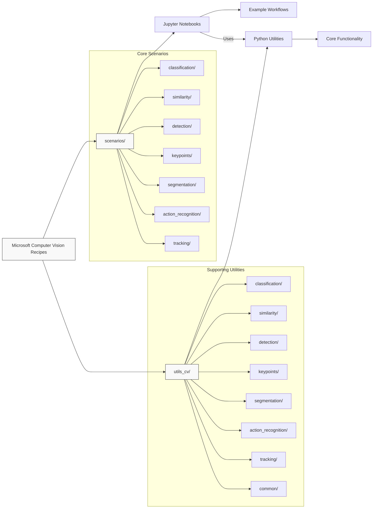

The implementation follows a clear separation of concerns:

1. **Scenarios Folder**: Contains Jupyter notebooks demonstrating end-to-end workflows
2. **Utils_CV Folder**: Contains reusable Python utilities and core implementations
3. **Each Scenario**: Has corresponding notebooks and utility functions in parallel folder structures

This architecture allows users to:
- Learn from notebook examples
- Reuse functionality via the utility libraries
- Customize implementations for specific needs

Sources: [README.md:16-16]()(1)

## Workflow and Development Process

The typical workflow for implementing a computer vision scenario follows these steps:

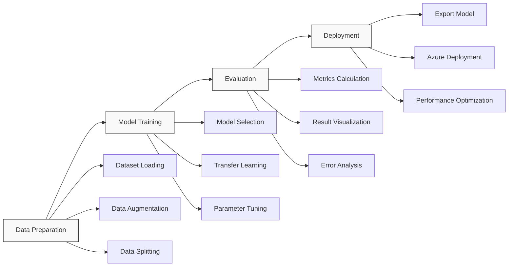

Each scenario in the repository provides example notebooks that guide users through this workflow, with specific adaptations for the particular computer vision task.

Sources: [README.md:46-59]()(1), [scenarios/classification/README.md:25-38]()

## Relationship Between Scenarios

The core scenarios build upon each other in certain ways, with more complex tasks leveraging techniques from simpler ones:

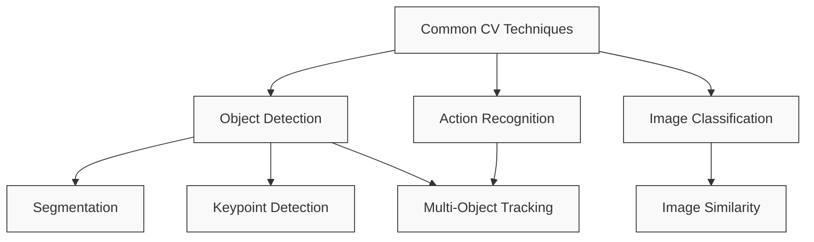

This relationship highlights how fundamental computer vision techniques are extended and combined to tackle more complex tasks, allowing users to progress from simpler to more advanced scenarios.

Sources: [README.md:45-59]()(1)

## Integration with Azure

The repository supports integration with Azure services for training at scale and model deployment:

| Azure Service | Purpose | Scenario Examples |
|---------------|---------|-------------------|
| Azure Machine Learning | Training, deployment, automation | All core scenarios |
| Azure Container Instances | Lightweight deployments | Classification, Detection |
| Azure Kubernetes Service | Production-scale deployments | Classification, Detection |
| Azure Virtual Machines | GPU-accelerated training | All compute-intensive tasks |

The notebooks include examples of setting up Azure resources, training models on cloud infrastructure, and deploying trained models as web services.

Sources: [README.md:63-79]()(1), [scenarios/classification/README.md:40-52]()

## Getting Started

To begin working with these core scenarios:

1. Set up the compute environment following the Setup Guide
2. Start with the image classification notebooks to learn fundamental concepts
3. Progress to other scenarios based on your use case
4. Use the utilities library for your custom implementations

The repository is designed to significantly reduce the "time to market" by providing ready-to-use examples and best practices for common computer vision tasks.

Sources: [README.md:35-40]()(1)

---

# Page: Object Detection

# Object Detection

<details>
<summary>Relevant source files</summary>

The following files were used as context for generating this wiki page:

- [scenarios/detection/01_training_introduction.ipynb](scenarios/detection/01_training_introduction.ipynb)
- [scenarios/detection/02_mask_rcnn.ipynb](scenarios/detection/02_mask_rcnn.ipynb)
- [scenarios/detection/03_keypoint_rcnn.ipynb](scenarios/detection/03_keypoint_rcnn.ipynb)
- [scenarios/detection/11_exploring_hyperparameters_on_azureml.ipynb](scenarios/detection/11_exploring_hyperparameters_on_azureml.ipynb)
- [scenarios/detection/12_hard_negative_sampling.ipynb](scenarios/detection/12_hard_negative_sampling.ipynb)
- [scenarios/detection/20_deployment_on_kubernetes.ipynb](scenarios/detection/20_deployment_on_kubernetes.ipynb)
- [scenarios/detection/media/hyperdrive_cluster.jpg](scenarios/detection/media/hyperdrive_cluster.jpg)
- [tests/.ci/run_pytest.py](tests/.ci/run_pytest.py)
- [tests/conftest.py](tests/conftest.py)
- [tests/integration/detection/test_integration_detection.py](tests/integration/detection/test_integration_detection.py)
- [tests/smoke/test_azureml_notebooks.py](tests/smoke/test_azureml_notebooks.py)
- [tests/unit/detection/test_detection_bbox.py](tests/unit/detection/test_detection_bbox.py)
- [tests/unit/detection/test_detection_data.py](tests/unit/detection/test_detection_data.py)
- [tests/unit/detection/test_detection_dataset.py](tests/unit/detection/test_detection_dataset.py)
- [tests/unit/detection/test_detection_mask.py](tests/unit/detection/test_detection_mask.py)
- [tests/unit/detection/test_detection_model.py](tests/unit/detection/test_detection_model.py)
- [tests/unit/detection/test_detection_notebooks.py](tests/unit/detection/test_detection_notebooks.py)
- [tests/unit/detection/test_detection_plot.py](tests/unit/detection/test_detection_plot.py)
- [utils_cv/detection/bbox.py](utils_cv/detection/bbox.py)
- [utils_cv/detection/data.py](utils_cv/detection/data.py)
- [utils_cv/detection/dataset.py](utils_cv/detection/dataset.py)
- [utils_cv/detection/model.py](utils_cv/detection/model.py)
- [utils_cv/detection/plot.py](utils_cv/detection/plot.py)

</details>


The Object Detection module in the Computer Vision Recipes repository provides a comprehensive set of tools for training, evaluating, and deploying object detection models. It offers a streamlined workflow for building detection systems that can identify, locate, and classify objects in images. The module supports various detection model architectures including Faster R-CNN, Mask R-CNN, and Keypoint R-CNN.

For image classification tasks, see [Image Classification](#2.3). For multi-object tracking which builds on detection, see [Multi-Object Tracking](#2.2).

## System Architecture

The object detection system consists of several core components that work together to provide a complete pipeline for object detection tasks.

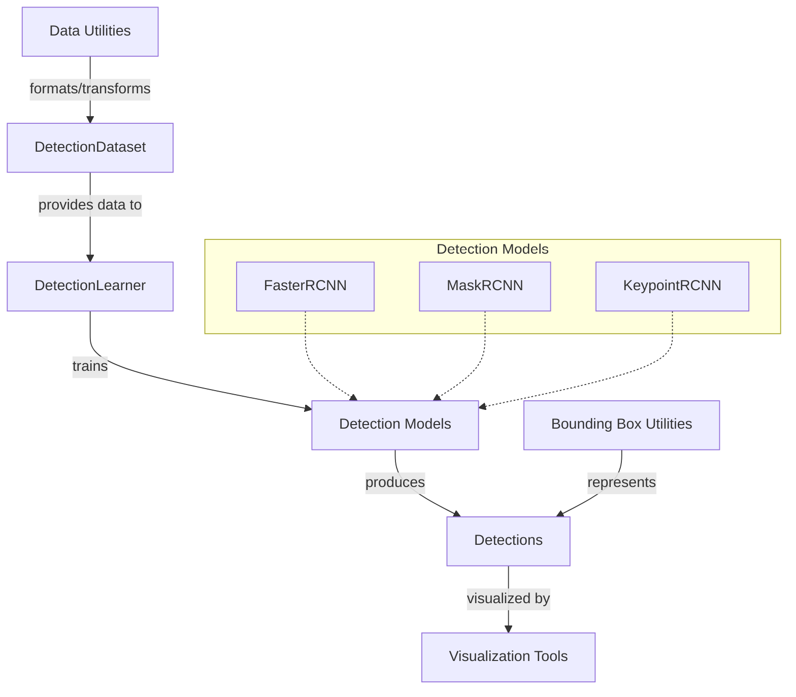

Sources: [utils_cv/detection/dataset.py], [utils_cv/detection/model.py], [utils_cv/detection/bbox.py], [utils_cv/detection/plot.py]

### Core Components

1. **DetectionDataset**: Manages loading and preprocessing of object detection datasets.
2. **DetectionLearner**: Handles model training, evaluation, and inference.
3. **Detection Models**: Implementations of object detection architectures (Faster R-CNN, Mask R-CNN, Keypoint R-CNN).
4. **Bounding Box Utilities**: Classes for representing detection results.
5. **Visualization Tools**: Functions for visualizing detection results.

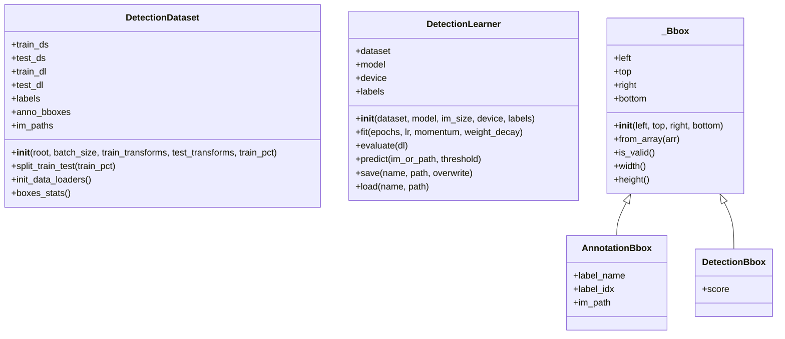

Sources: [utils_cv/detection/dataset.py], [utils_cv/detection/model.py], [utils_cv/detection/bbox.py]

## Data Preparation

### Supported Formats

The system supports two popular annotation formats:

1. **Pascal VOC**: XML-based format where each image has a corresponding annotation file.
2. **COCO**: JSON-based format with annotations for multiple images in a single file.

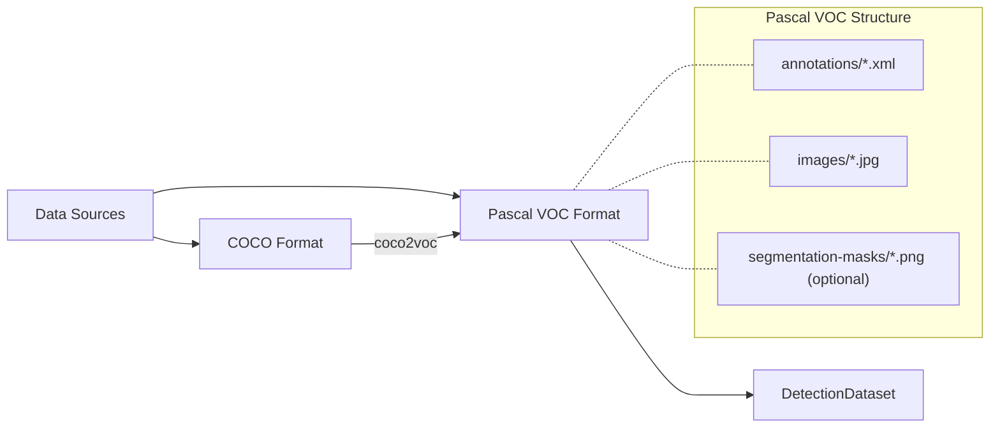

Sources: [utils_cv/detection/data.py], [utils_cv/detection/dataset.py]

### Creating Detection Datasets

The `DetectionDataset` class provides a convenient way to load and prepare detection datasets:

```python
data = DetectionDataset(
    root="path/to/dataset",       # Path to dataset directory
    batch_size=2,                 # Batch size for dataloaders
    train_transforms=None,        # Custom transformations for training
    test_transforms=None,         # Custom transformations for testing
    train_pct=0.75,               # Percentage of data for training
    anno_dir="annotations",       # Directory containing annotations
    im_dir="images",              # Directory containing images
    mask_dir=None,                # Directory containing masks (for instance segmentation)
    allow_negatives=False,        # Whether to allow images without annotations
)
```

The dataset should have the following structure:

```
/dataset
+-- images/
|   +-- image1.jpg
|   +-- image2.jpg
|   +-- ...
+-- annotations/
|   +-- image1.xml
|   +-- image2.xml
|   +-- ...
+-- segmentation-masks/ (optional, for Mask R-CNN)
|   +-- image1.png
|   +-- image2.png
|   +-- ...
```

Sources: [utils_cv/detection/dataset.py], [scenarios/detection/01_training_introduction.ipynb]

### Pascal VOC Annotation Format

Each annotation file follows the Pascal VOC format:

```xml
<annotation>
    <folder>images</folder>
    <filename>image1.jpg</filename>
    <path>../images/image1.jpg</path>
    <source>
        <database>Unknown</database>
    </source>
    <size>
        <width>500</width>
        <height>600</height>
        <depth>3</depth>
    </size>
    <segmented>0</segmented>
    <object>
        <name>person</name>
        <pose>Unspecified</pose>
        <truncated>0</truncated>
        <difficult>0</difficult>
        <bndbox>
            <xmin>100</xmin>
            <ymin>150</ymin>
            <xmax>200</xmax>
            <ymax>400</ymax>
        </bndbox>
    </object>
    <!-- More objects can be defined here -->
</annotation>
```

Sources: [scenarios/detection/01_training_introduction.ipynb]

## Training Models

### Basic Training Workflow

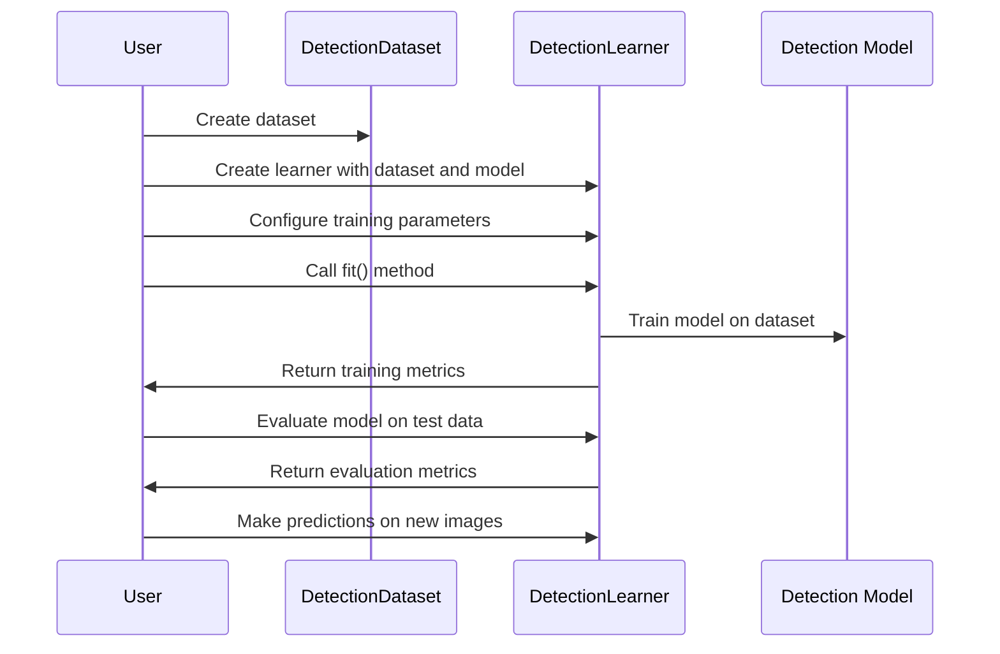

Sources: [scenarios/detection/01_training_introduction.ipynb], [utils_cv/detection/model.py]

### Creating a Detection Learner

```python
# Create a detection dataset
data = DetectionDataset(DATA_PATH, train_pct=0.75)

# Create a detection learner
learner = DetectionLearner(
    dataset=data,              # Detection dataset
    model=None,                # If None, FasterRCNN will be used
    im_size=500,               # Image size for resizing
    device=None,               # If None, will use GPU if available
)

# Train the model
learner.fit(
    epochs=10,                 # Number of training epochs
    lr=0.005,                  # Learning rate
    momentum=0.9,              # Momentum for SGD optimizer
    weight_decay=0.0005,       # Weight decay for regularization
    print_freq=10,             # How often to print training progress
)

# Evaluate the model
results = learner.evaluate()

# Make predictions
detection = learner.predict("path/to/image.jpg", threshold=0.5)
```

Sources: [scenarios/detection/01_training_introduction.ipynb], [utils_cv/detection/model.py]

### Available Model Architectures

The system provides easy access to pre-trained object detection models:

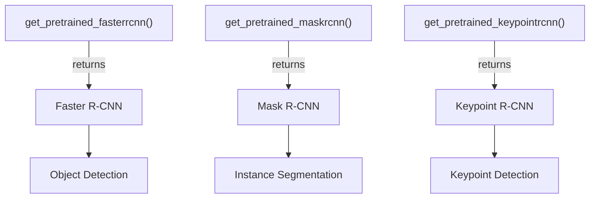

1. **Faster R-CNN**: Standard object detection model that outputs bounding boxes and class labels.
2. **Mask R-CNN**: Extension of Faster R-CNN that also outputs segmentation masks.
3. **Keypoint R-CNN**: Extension of Faster R-CNN that also outputs keypoints (e.g., human pose estimation).

Sources: [utils_cv/detection/model.py], [scenarios/detection/01_training_introduction.ipynb], [scenarios/detection/02_mask_rcnn.ipynb], [scenarios/detection/03_keypoint_rcnn.ipynb]

## Advanced Features

### Instance Segmentation with Mask R-CNN

Mask R-CNN extends Faster R-CNN by adding a branch for predicting segmentation masks for each object.

```python
# Create a model for instance segmentation
model = get_pretrained_maskrcnn(
    num_classes=len(data.labels) + 1,  # +1 for background
    min_size=500,
    max_size=500,
)

# Create a detection learner
learner = DetectionLearner(data, model=model)

# Train the model
learner.fit(EPOCHS)

# Make predictions with masks
detection = learner.predict("path/to/image.jpg", threshold=0.5)
# Output will include 'masks' key
```

Sources: [scenarios/detection/02_mask_rcnn.ipynb], [utils_cv/detection/model.py]

### Keypoint Detection

Keypoint R-CNN is used for tasks like human pose estimation or detecting specific points on objects.

```python
# Define keypoint metadata
keypoint_meta = {
    "labels": ["lid_left_top", "lid_right_top", "lid_left_bottom", "lid_right_bottom", "left_bottom", "right_bottom"],
    "skeleton": [[0, 1], [0, 2], [1, 3], [2, 3], [2, 4], [3, 5], [4, 5]],
    "hflip_inds": [1, 0, 3, 2, 5, 4],  # Indices when horizontally flipped
}

# Create a dataset with keypoint information
data = DetectionDataset(
    DATA_PATH,
    keypoint_meta=keypoint_meta,
)

# Create a keypoint detection model
model = get_pretrained_keypointrcnn(
    num_classes=len(data.labels) + 1,
    num_keypoints=len(keypoint_meta["labels"]),
    min_size=500,
    max_size=500,
)

# Create a detection learner
learner = DetectionLearner(data, model=model)
```

Sources: [scenarios/detection/03_keypoint_rcnn.ipynb], [utils_cv/detection/model.py]

### Hard Negative Sampling

Hard negative sampling improves model robustness by incorporating difficult negative examples:

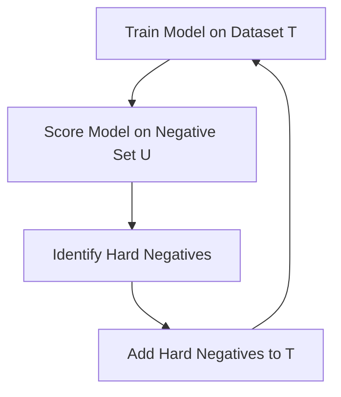

1. Train a model on dataset T
2. Run inference on a set of negative images U
3. Identify images where the model incorrectly predicts objects
4. Add these "hard negatives" to the training set
5. Retrain the model

Sources: [scenarios/detection/12_hard_negative_sampling.ipynb]

### Hyperparameter Optimization

The system supports hyperparameter optimization using Azure ML:

```python
# Define parameter space
param_sampling = RandomParameterSampling({
    'learning_rate': uniform(0.0005, 0.05),
    'momentum': uniform(0.8, 0.95),
    'weight_decay': uniform(0.0001, 0.001),
    'step_size': choice(5, 10, 15),
    'gamma': uniform(0.05, 0.5),
})

# Create a HyperDriveConfig
hyperdrive_config = HyperDriveConfig(
    run_config=estimator,
    hyperparameter_sampling=param_sampling,
    primary_metric_name='mAP',
    primary_metric_goal=PrimaryMetricGoal.MAXIMIZE,
    max_total_runs=20,
    max_concurrent_runs=4
)
```

Sources: [scenarios/detection/11_exploring_hyperparameters_on_azureml.ipynb]

## Evaluation and Visualization

### Evaluation Metrics

The object detection system uses standard evaluation metrics:

| Metric | Description |
|--------|-------------|
| mAP | Mean Average Precision across all classes |
| AP@0.5 | Average Precision at IoU threshold 0.5 |
| AP@0.75 | Average Precision at IoU threshold 0.75 |
| AP@0.5:0.95 | Average of AP across IoU thresholds from 0.5 to 0.95 |

```python
# Evaluate the model
results = learner.evaluate()
# Compute AP at specific IoU threshold
ap = _calculate_ap(results, iou_thres=0.5)
```

Sources: [utils_cv/detection/model.py]

### Precision-Recall Curves

The system provides visualization of precision-recall curves:

```python
# Plot precision-recall curves
plot_pr_curves(results)
```

Sources: [utils_cv/detection/plot.py]

### Visualizing Detections

The `plot_detections` function visualizes detection results:

```python
# Make a prediction
detection = learner.predict("path/to/image.jpg", threshold=0.5)

# Visualize the detection
plot_detections(detection)
```

Sources: [utils_cv/detection/plot.py]

## Deployment

### Saving and Loading Models

```python
# Save the model
learner.save(
    name="my_model",           # Model name
    path=None,                 # If None, will save in dataset root/models
    overwrite=True,            # Whether to overwrite existing model
)

# Load the model
learner = DetectionLearner(dataset=data)
learner.load(
    name="my_model",           # Model name
    path=None,                 # If None, will look in dataset root/models
)
```

Sources: [utils_cv/detection/model.py]

### Deploying on Kubernetes

The system includes utilities for deploying models on Kubernetes:

1. Create a scoring script (score.py)
2. Define the deployment environment
3. Create a Kubernetes cluster
4. Deploy the model

```python
# Create an inference configuration
inference_config = InferenceConfig(
    entry_script="score.py",
    source_directory="./",
    environment=environment,
)

# Deploy to AKS
aks_target = AksCompute(ws, "my-aks-cluster")
aks_service = Model.deploy(
    workspace=ws,
    name="object-detection-service",
    models=[model],
    inference_config=inference_config,
    deployment_config=aks_config,
    deployment_target=aks_target,
)
```

Sources: [scenarios/detection/20_deployment_on_kubernetes.ipynb]

## Practical Workflow Example

Here's a typical workflow for training and using an object detection model:

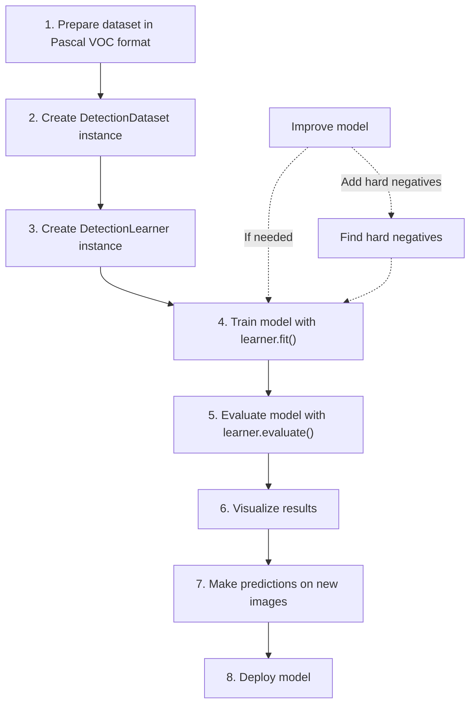

Sources: [scenarios/detection/01_training_introduction.ipynb], [scenarios/detection/12_hard_negative_sampling.ipynb]

---

# Page: Multi-Object Tracking

# Multi-Object Tracking

<details>
<summary>Relevant source files</summary>

The following files were used as context for generating this wiki page:

- [scenarios/tracking/01_training_introduction.ipynb](scenarios/tracking/01_training_introduction.ipynb)
- [scenarios/tracking/FAQ.md](scenarios/tracking/FAQ.md)
- [scenarios/tracking/README.md](scenarios/tracking/README.md)
- [scenarios/tracking/media/carcans_vott_ui.jpg](scenarios/tracking/media/carcans_vott_ui.jpg)
- [scenarios/tracking/media/eqn_idf1.jpg](scenarios/tracking/media/eqn_idf1.jpg)
- [scenarios/tracking/media/eqn_mota.jpg](scenarios/tracking/media/eqn_mota.jpg)
- [scenarios/tracking/media/fig_onlineBatch.jpg](scenarios/tracking/media/fig_onlineBatch.jpg)
- [scenarios/tracking/media/fig_tracksEval.jpg](scenarios/tracking/media/fig_tracksEval.jpg)
- [scenarios/tracking/media/figure_CNNcorrFilters.jpg](scenarios/tracking/media/figure_CNNcorrFilters.jpg)
- [scenarios/tracking/media/figure_DeepSortCNN.jpg](scenarios/tracking/media/figure_DeepSortCNN.jpg)
- [scenarios/tracking/media/figure_LSTM.jpg](scenarios/tracking/media/figure_LSTM.jpg)
- [scenarios/tracking/media/figure_SiameseNetwork.jpg](scenarios/tracking/media/figure_SiameseNetwork.jpg)
- [utils_cv/classification/plot.py](utils_cv/classification/plot.py)
- [utils_cv/tracking/bbox.py](utils_cv/tracking/bbox.py)
- [utils_cv/tracking/data.py](utils_cv/tracking/data.py)
- [utils_cv/tracking/dataset.py](utils_cv/tracking/dataset.py)
- [utils_cv/tracking/model.py](utils_cv/tracking/model.py)
- [utils_cv/tracking/opts.py](utils_cv/tracking/opts.py)
- [utils_cv/tracking/plot.py](utils_cv/tracking/plot.py)
- [utils_cv/tracking/references/README.txt](utils_cv/tracking/references/README.txt)
- [utils_cv/tracking/references/fairmot/datasets/dataset/jde.py](utils_cv/tracking/references/fairmot/datasets/dataset/jde.py)
- [utils_cv/tracking/references/fairmot/tracker/multitracker.py](utils_cv/tracking/references/fairmot/tracker/multitracker.py)
- [utils_cv/tracking/references/fairmot/tracking_utils/evaluation.py](utils_cv/tracking/references/fairmot/tracking_utils/evaluation.py)
- [utils_cv/tracking/references/fairmot/tracking_utils/io.py](utils_cv/tracking/references/fairmot/tracking_utils/io.py)
- [utils_cv/tracking/references/fairmot/tracking_utils/log.py](utils_cv/tracking/references/fairmot/tracking_utils/log.py)
- [utils_cv/tracking/references/fairmot/trains/mot.py](utils_cv/tracking/references/fairmot/trains/mot.py)

</details>


This page explains the multi-object tracking functionality in the Computer Vision Recipes library. The multi-object tracking module enables detection and tracking of objects over time in video sequences, maintaining consistent identity assignments across frames. The implementation is based on the FairMOT algorithm, which provides state-of-the-art tracking performance at reasonable inference speeds.

For information about object detection (without tracking), see [Object Detection](#2.1), and for video-based action recognition, see [Action Recognition](#2.6).

## Overview

Multi-object tracking (MOT) builds on object detection technology to detect and track multiple objects in a dynamic scene over time. Unlike object detection which only outputs bounding boxes for objects in individual frames, MOT assigns consistent identity numbers to each object, allowing them to be tracked across consecutive frames.

The implementation in this codebase is based on the FairMOT tracker, which uses a one-shot approach to detect objects and extract re-identification features simultaneously in a single network. This approach offers several advantages:

1. Efficient computation through shared feature maps for detection and re-ID tasks
2. Reduced ID switches through aligned features for detection and re-ID
3. Fast inference speeds (25+ FPS)
4. State-of-the-art tracking performance on benchmarks like MOT16 and MOT17

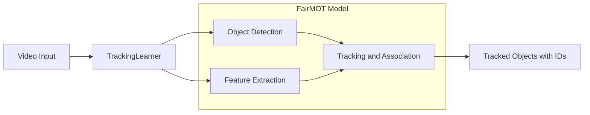

Sources: [utils_cv/tracking/model.py](utils_cv/tracking/model.py), [scenarios/tracking/README.md](scenarios/tracking/README.md)

## Key Components

The tracking module consists of several key components:

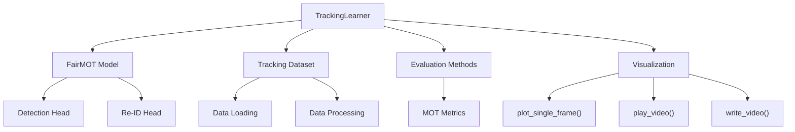

Sources: [utils_cv/tracking/model.py](utils_cv/tracking/model.py), [utils_cv/tracking/dataset.py](utils_cv/tracking/dataset.py), [utils_cv/tracking/plot.py](utils_cv/tracking/plot.py)

### TrackingLearner

The `TrackingLearner` class serves as the main interface for multi-object tracking. It provides methods for model initialization, training, inference, and evaluation.

```python
learner = TrackingLearner(
    dataset=tracking_dataset,  # Optional: Required for training
    model_path="path/to/model.pth",  # Optional: Path to pretrained model
    arch="dla_34",  # Backbone architecture
    head_conv=256  # Conv layer channels for output head
)
```

Key methods of `TrackingLearner`:

| Method | Description |
|--------|-------------|
| `fit(lr, lr_step, num_epochs)` | Train the tracker on the provided dataset |
| `predict(im_or_video_path, conf_thres, track_buffer, ...)` | Run inference on images or video |
| `evaluate(results, gt_root_path)` | Evaluate tracking performance |
| `eval_mot(conf_thres, track_buffer, data_root, ...)` | Run prediction and evaluation on MOT challenge format data |
| `save(path)` | Save the trained model |
| `plot_training_losses()` | Visualize training losses |

Sources: [utils_cv/tracking/model.py:120-274](utils_cv/tracking/model.py:120-274)

### TrackingDataset

The `TrackingDataset` class handles loading and preprocessing tracking data. It accepts data in Pascal VOC format and converts it to the format required by FairMOT.

```python
dataset = TrackingDataset(
    root="path/to/data",
    name="dataset_name",
    batch_size=4,
    im_dir="images",
    anno_dir="annotations"
)
```

The dataset functionality:
- Reads Pascal VOC format annotations
- Converts annotations to FairMOT format
- Creates FairMOT joint dataset for training
- Initializes dataloaders

Sources: [utils_cv/tracking/dataset.py:26-88](utils_cv/tracking/dataset.py:26-88)

### Visualization Utilities

The tracking module provides several functions for visualizing tracking results:

1. `plot_single_frame()`: Displays tracking results for a specific frame
2. `play_video()`: Shows tracking results as an interactive video
3. `write_video()`: Saves tracking results to a video file

```python
# Display tracking results for a specific frame
plot_single_frame(input_video="video.mp4", frame_id=10, results=tracking_results)

# Play video with tracking results
play_video(results=tracking_results, input_video="video.mp4")

# Save tracking results to a video file
write_video(results=tracking_results, input_video="video.mp4", output_video="output.mp4")
```

Sources: [utils_cv/tracking/plot.py:19-201](utils_cv/tracking/plot.py:19-201)

## FairMOT Architecture

The tracking implementation is based on the FairMOT algorithm, which uses a single network to perform both detection and re-identification.

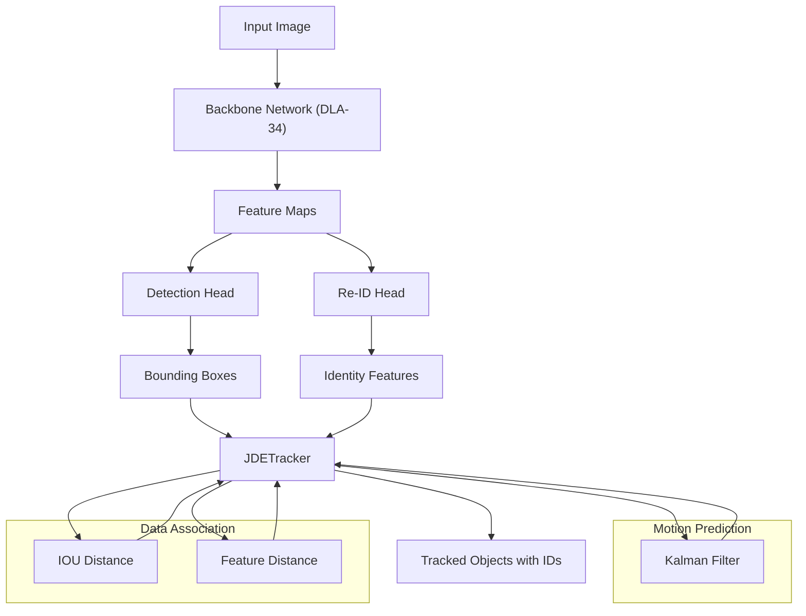

Key components of the FairMOT architecture:

1. **Backbone Network**: Uses a Deep Layer Aggregation (DLA-34) network to extract features from images
2. **Detection Head**: Predicts object bounding boxes and object centers
3. **Re-ID Head**: Extracts features for object re-identification
4. **Tracker**: Uses a Kalman filter for motion prediction and combines appearance features and spatial information for data association

Sources: [utils_cv/tracking/model.py:166-203](utils_cv/tracking/model.py:166-203), [utils_cv/tracking/references/fairmot/tracker/multitracker.py:166-367](utils_cv/tracking/references/fairmot/tracker/multitracker.py:166-367), [scenarios/tracking/FAQ.md:109-119](scenarios/tracking/FAQ.md:109-119)

## Tracking Workflow

The tracking workflow consists of the following steps:

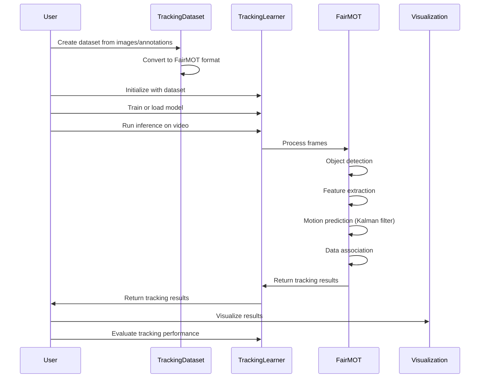

Sources: [utils_cv/tracking/model.py:370-424](utils_cv/tracking/model.py:370-424), [scenarios/tracking/01_training_introduction.ipynb](scenarios/tracking/01_training_introduction.ipynb)

### Training Process

Training a tracking model involves these steps:

1. **Data Preparation**: Use `TrackingDataset` to load and prepare training data
2. **Model Initialization**: Create a `TrackingLearner` with the dataset
3. **Training**: Call the `fit()` method to train the model

```python
# Load dataset
dataset = TrackingDataset('path/to/data', batch_size=4)

# Create learner
learner = TrackingLearner(dataset=dataset)

# Train model
learner.fit(lr=0.0005, lr_step="20,27", num_epochs=30)

# Save model
learner.save('path/to/save/model.pth')
```

During training, the model optimizes multiple losses:
- Heatmap loss (`hm_loss`): For object center detection
- Width-height loss (`wh_loss`): For bounding box size prediction
- Offset loss (`off_loss`): For precise object localization
- Identity loss (`id_loss`): For feature learning for re-identification

Sources: [utils_cv/tracking/model.py:167-239](utils_cv/tracking/model.py:167-239), [utils_cv/tracking/references/fairmot/trains/mot.py:19-84](utils_cv/tracking/references/fairmot/trains/mot.py:19-84)

### Inference Process

Inference involves these steps:

1. **Model Loading**: Load a trained model with `TrackingLearner`
2. **Prediction**: Call `predict()` on images or video
3. **Visualization**: Use plotting functions to visualize results

```python
# Load model
learner = TrackingLearner(model_path='path/to/model.pth')

# Run inference
results = learner.predict(
    im_or_video_path='path/to/video.mp4',
    conf_thres=0.3,  # Confidence threshold
    track_buffer=30  # Tracking buffer
)

# Visualize results
play_video(results, 'path/to/video.mp4')
```

The inference process is handled by the `JDETracker` class, which:
1. Processes input frames through the FairMOT model
2. Detects objects in each frame
3. Extracts re-identification features
4. Associates detections across frames using appearance and motion information
5. Returns tracked objects with consistent IDs

Sources: [utils_cv/tracking/model.py:370-424](utils_cv/tracking/model.py:370-424), [utils_cv/tracking/references/fairmot/tracker/multitracker.py:226-367](utils_cv/tracking/references/fairmot/tracker/multitracker.py:226-367)

## Evaluation Metrics

The tracking module supports standard MOT evaluation metrics:

| Metric | Description |
|--------|-------------|
| MOTA (Multiple Object Tracking Accuracy) | Overall tracking accuracy, accounting for false positives, false negatives, and ID switches |
| IDF1 (Identity F1 Score) | F1 score for the identity preservation, measuring how long the correct IDs are maintained |
| ID-switch | Number of times a tracked object changes its ID |
| Precision | Ratio of true positives to all detections |
| Recall | Ratio of true positives to all ground truth objects |

Evaluation can be performed using:

```python
# Evaluate tracking results
summary = learner.evaluate(results, gt_root_path='path/to/ground_truth')
print(summary)
```

Sources: [utils_cv/tracking/model.py:277-298](utils_cv/tracking/model.py:277-298), [utils_cv/tracking/references/fairmot/tracking_utils/evaluation.py:10-113](utils_cv/tracking/references/fairmot/tracking_utils/evaluation.py:10-113), [scenarios/tracking/FAQ.md:83-102](scenarios/tracking/FAQ.md:83-102)

## Data Format

### Input Data

The tracking module accepts data in two formats:

1. **Training Data**: Pascal VOC XML format annotations, similar to object detection:
   - Images in a folder (e.g., `images/`)
   - Annotations in XML format in another folder (e.g., `annotations/`)

2. **Evaluation Data**: MOT Challenge format:
   ```
   [frame number] [id number] [bbox left] [bbox top] [bbox width] [bbox height] [confidence] [class] [visibility]
   ```

### Output Data

The tracking results are returned as a dictionary mapping frame IDs to lists of `TrackingBbox` objects:

```python
{
    0: [TrackingBbox(left, top, right, bottom, frame_id=0, track_id=1), ...],
    1: [TrackingBbox(left, top, right, bottom, frame_id=1, track_id=1), ...],
    ...
}
```

The `TrackingBbox` class extends the basic `_Bbox` class from the detection module with frame and track IDs.

Sources: [utils_cv/tracking/dataset.py:88-177](utils_cv/tracking/dataset.py:88-177), [utils_cv/tracking/bbox.py:7-25](utils_cv/tracking/bbox.py:7-25), [scenarios/tracking/FAQ.md:34-59](scenarios/tracking/FAQ.md:34-59)

## Key Parameters

### TrackingLearner Parameters

| Parameter | Description | Default |
|-----------|-------------|---------|
| `dataset` | TrackingDataset object for training | None |
| `model_path` | Path to pretrained model | None (uses default model) |
| `arch` | Model architecture | "dla_34" |
| `head_conv` | Conv layer channels for output head | -1 (defaults to 256) |

### Training Parameters

| Parameter | Description | Default |
|-----------|-------------|---------|
| `lr` | Learning rate | 1e-4 |
| `lr_step` | When to drop learning rate by 10 | "20,27" |
| `num_epochs` | Total training epochs | 30 |

### Inference Parameters

| Parameter | Description | Default |
|-----------|-------------|---------|
| `conf_thres` | Confidence threshold for detections | 0.6 |
| `track_buffer` | How many frames to keep track of lost objects | 30 |
| `min_box_area` | Minimum bounding box area to consider | 200 |
| `frame_rate` | Video frame rate for motion model | 30 |

Sources: [utils_cv/tracking/model.py:120-150](utils_cv/tracking/model.py:120-150), [utils_cv/tracking/model.py:167-239](utils_cv/tracking/model.py:167-239), [utils_cv/tracking/model.py:370-424](utils_cv/tracking/model.py:370-424), [utils_cv/tracking/opts.py:15-111](utils_cv/tracking/opts.py:15-111)

## Example Usage

The typical workflow for using the tracking module is as follows:

```python
# Import required modules
from utils_cv.tracking.dataset import TrackingDataset
from utils_cv.tracking.model import TrackingLearner
from utils_cv.tracking.plot import play_video, write_video

# 1. Load dataset for training
dataset = TrackingDataset(
    root="path/to/data",
    batch_size=4
)

# 2. Create and train learner
learner = TrackingLearner(dataset=dataset)
learner.fit(lr=0.0005, num_epochs=10)

# 3. Save trained model
learner.save("model.pth")

# 4. Load model for inference
inference_learner = TrackingLearner(model_path="model.pth")

# 5. Run inference on video
results = inference_learner.predict(
    im_or_video_path="video.mp4",
    conf_thres=0.3,
    track_buffer=30
)

# 6. Visualize results
play_video(results, "video.mp4")

# 7. Save results to video file
write_video(results, "video.mp4", "output.mp4")

# 8. Evaluate tracking performance
summary = inference_learner.evaluate(results, "path/to/ground_truth")
print(summary)
```

Sources: [scenarios/tracking/01_training_introduction.ipynb](scenarios/tracking/01_training_introduction.ipynb)

## Limitations and Considerations

1. **Platform Support**: The tracking module only runs on Linux due to constraints introduced by the FairMOT repository.

2. **Dependencies**: Requires additional libraries:
   ```
   opencv yacs lap progress cython_bbox motmetrics
   ```

3. **Model Size**: The default model (DLA-34) requires significant memory for training and inference.

4. **Single-class Tracking**: The current implementation primarily supports single-class tracking (e.g., people or vehicles).

5. **Performance Factors**: Tracking performance is affected by:
   - Object size
   - Object occlusion
   - Camera motion
   - Video quality and frame rate

Sources: [scenarios/tracking/README.md:6-21](scenarios/tracking/README.md:6-21), [scenarios/tracking/FAQ.md](scenarios/tracking/FAQ.md)

## Related Pages

- [Object Detection](#2.1): For information about detecting objects in individual images
- [Action Recognition](#2.6): For video-based action recognition
- [Image Classification](#2.3): For classifying images into categories
- [Utilities Library](#3): For information about the shared utilities used across tasks

---

# Page: Image Classification

# Image Classification

<details>
<summary>Relevant source files</summary>

The following files were used as context for generating this wiki page:

- [.flake8](.flake8)
- [.gitignore](.gitignore)
- [.pre-commit-config.yaml](.pre-commit-config.yaml)
- [contrib/vm_builder/README.md](contrib/vm_builder/README.md)
- [contrib/vm_builder/vm_builder.py](contrib/vm_builder/vm_builder.py)
- [tests/integration/classification/test_integration_classification_notebooks.py](tests/integration/classification/test_integration_classification_notebooks.py)
- [tests/unit/classification/test_classification_data.py](tests/unit/classification/test_classification_data.py)
- [tests/unit/classification/test_classification_model.py](tests/unit/classification/test_classification_model.py)
- [tests/unit/common/test_common_deployment.py](tests/unit/common/test_common_deployment.py)
- [tests/unit/common/test_common_image.py](tests/unit/common/test_common_image.py)
- [tests/unit/common/test_common_misc.py](tests/unit/common/test_common_misc.py)
- [tests/unit/common/test_common_plot.py](tests/unit/common/test_common_plot.py)
- [utils_cv/classification/data.py](utils_cv/classification/data.py)
- [utils_cv/classification/model.py](utils_cv/classification/model.py)
- [utils_cv/common/image.py](utils_cv/common/image.py)
- [utils_cv/common/plot.py](utils_cv/common/plot.py)

</details>


This page documents the image classification functionality within the Computer Vision Recipes repository. It covers the available utilities for creating, training, and evaluating image classification models, including both single-label and multi-label classification scenarios.

For object detection functionality, see [Object Detection](#2.1). For image similarity, see [Image Similarity](#2.4).

## Overview

Image classification is a fundamental computer vision task that involves categorizing images into predefined classes. The classification module in this repository provides tools to:

1. Load and prepare classification datasets (both single-label and multi-label)
2. Train classification models using FastAI/PyTorch 
3. Evaluate model performance
4. Deploy trained models

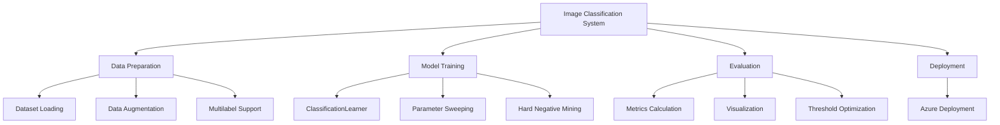

Sources: [utils_cv/classification/data.py](), [utils_cv/classification/model.py]()

## Classification Datasets

The classification module provides utilities for working with standard image classification datasets as well as custom datasets.

### Available Datasets

The system includes several pre-configured datasets focused on household fridge items. These are particularly useful for testing and demonstration purposes:

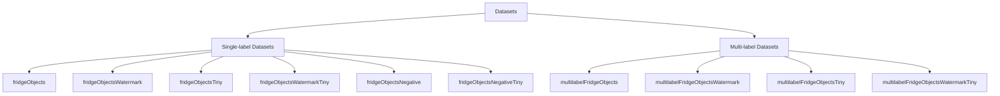

Sources: [utils_cv/classification/data.py:16-47]()

### Dataset Utilities

The module provides functions for working with classification datasets:

| Function | Description |
|----------|-------------|
| `imagenet_labels()` | Returns a list of the 1000 ImageNet class labels |
| `downsize_imagelist()` | Resizes images while preserving aspect ratio |
| `is_data_multilabel()` | Detects if a dataset is set up for multi-label classification |

For multi-label datasets, the system expects a CSV file named `labels.csv` with a column titled "labels" where multiple labels are space or comma-delimited.

Sources: [utils_cv/classification/data.py:54-154](), [tests/unit/classification/test_classification_data.py:14-58]()

## Model Framework

The classification module uses FastAI as its primary training framework, which is built on top of PyTorch. This provides an abstraction layer that simplifies the training process while allowing access to powerful features.

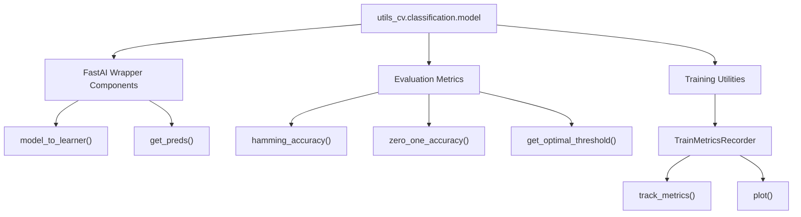

Sources: [utils_cv/classification/model.py](), [tests/unit/classification/test_classification_model.py]()

### Key Components

#### Model Creation

The `model_to_learner()` function provides a way to convert PyTorch models to FastAI Learner objects:

```python
# Create a learner from a PyTorch model
learn = model_to_learner(models.resnet18(pretrained=True))
```

This creates a Learner object that can be used for prediction without retraining, or as a starting point for transfer learning.

Sources: [utils_cv/classification/model.py:126-148](), [tests/unit/classification/test_classification_model.py:71-113]()

#### Metrics for Multi-label Classification

The module provides specialized metrics for multi-label classification:

| Metric | Description |
|--------|-------------|
| `hamming_accuracy()` | One minus the fraction of wrong labels to total number of labels |
| `zero_one_accuracy()` | Accuracy that counts a prediction as correct only if all labels match |
| `get_optimal_threshold()` | Finds the best threshold for converting probabilities to binary labels |

Sources: [utils_cv/classification/model.py:34-123](), [tests/unit/classification/test_classification_model.py:28-68]()

#### Training Metrics Recorder

The `TrainMetricsRecorder` class is a FastAI callback that records metrics on both training and validation sets during training:

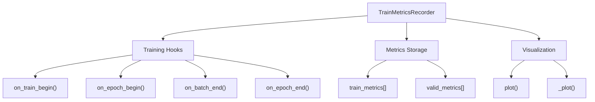

Sources: [utils_cv/classification/model.py:191-417](), [tests/unit/classification/test_classification_model.py:115-152]()

## Training Workflow

The image classification module supports a complete training workflow, from data preparation to model evaluation.

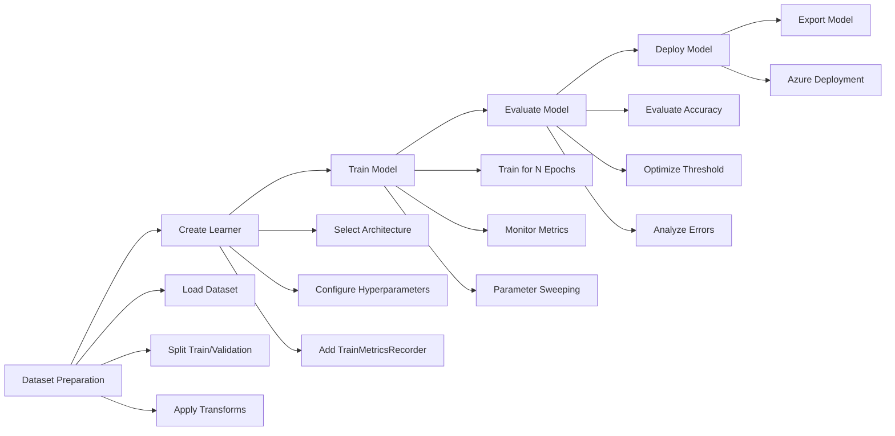

Sources: [tests/integration/classification/test_integration_classification_notebooks.py]()

## Example Notebooks

The repository includes several example notebooks that demonstrate different aspects of image classification:

| Notebook | Description | Test Coverage |
|----------|-------------|--------------|
| 01 | Basic image classification workflow | Validates training accuracy > 70% |
| 02 | Transfer learning for classification | Tests head vs zero-layer performance |
| 03 | Advanced classification techniques | Tests training over 12 epochs |
| 11 | Parameter sweeping for optimization | Tests different image sizes and configurations |
| 12 | Hard negative mining | Tests improvement with negative samples |

These notebooks provide working examples of the classification workflow, from data loading to model evaluation.

Sources: [tests/integration/classification/test_integration_classification_notebooks.py:13-107]()

## Integration with Other Components

The image classification module integrates with other utilities in the repository:

```mermaid
graph TD
    A["Image Classification"] --> B["Common Utilities"]
    A --> C["Similarity Module"]
    A --> D["Azure Deployment"]
    
    B --> B1["GPU Utilities"]
    B --> B2["Plotting Tools"]
    B --> B3["Image Processing"]
    
    C --> C1["Feature Extraction"]
    C --> C2["Image Comparison"]
    
    D --> D1["Model Export"]
    D --> D2["Deploy to Azure"]
    
    class A,B,C,D,B1,B2,B3,C1,C2,D1,D2 default;
```

Sources: [tests/unit/common/test_common_misc.py](), [tests/unit/common/test_common_plot.py](), [utils_cv/common/image.py]()

### GPU Utilities

The classification module uses GPU detection and configuration utilities from the common module to optimize performance:

```python
# Example of creating a DataBunch with appropriate number of workers
data = (
    ImageList.from_folder(data_path)
    .split_by_rand_pct()
    .label_from_folder()
    .transform()
    .databunch(bs=5, num_workers=db_num_workers())
    .normalize()
)
```

Sources: [tests/unit/common/test_common_misc.py:14-37]()

### Visualization Tools

The common module provides visualization tools that work with the classification module:

| Function | Description |
|----------|-------------|
| `line_graph()` | Plots training and validation metrics over time |
| `show_ims()` | Displays images with optional labels |

Sources: [utils_cv/common/plot.py](), [tests/unit/common/test_common_plot.py]()

## Deployment

The classification module includes utilities for deploying trained models to Azure:

| Function | Description |
|----------|-------------|
| `generate_yaml()` | Creates environment files for deployment |

Additionally, the repository includes a VM Builder tool that can create a Data Science Virtual Machine with the repository pre-installed.

Sources: [tests/unit/common/test_common_deployment.py](), [contrib/vm_builder/README.md](), [contrib/vm_builder/vm_builder.py]()

## Performance Considerations

When training image classification models, several factors can affect performance:

1. **Image Size** - Larger images provide more detail but require more memory and computation
2. **Batch Size** - Larger batches generally give more stable gradients but require more memory
3. **Model Architecture** - Deeper models generally perform better but are slower to train
4. **Data Augmentation** - Can improve model robustness but increases training time
5. **Hard Negative Mining** - Can improve accuracy by focusing on difficult examples

The parameter sweeping functionality (as demonstrated in notebook 11) can help find optimal configurations.

Sources: [tests/integration/classification/test_integration_classification_notebooks.py:65-88]()

---

# Page: Image Similarity

# Image Similarity

<details>
<summary>Relevant source files</summary>

The following files were used as context for generating this wiki page:

- [NOTICE.txt](NOTICE.txt)
- [scenarios/similarity/02_state_of_the_art.ipynb](scenarios/similarity/02_state_of_the_art.ipynb)
- [scenarios/similarity/README.md](scenarios/similarity/README.md)
- [scenarios/similarity/media/imsim_example1.jpg](scenarios/similarity/media/imsim_example1.jpg)
- [tests/unit/similarity/test_similarity_metrics.py](tests/unit/similarity/test_similarity_metrics.py)
- [utils_cv/similarity/data.py](utils_cv/similarity/data.py)
- [utils_cv/similarity/metrics.py](utils_cv/similarity/metrics.py)
- [utils_cv/similarity/model.py](utils_cv/similarity/model.py)
- [utils_cv/similarity/plot.py](utils_cv/similarity/plot.py)
- [utils_cv/similarity/references/evaluate.py](utils_cv/similarity/references/evaluate.py)
- [utils_cv/similarity/references/re_ranking.py](utils_cv/similarity/references/re_ranking.py)

</details>


## Purpose and Scope

This document provides a technical overview of the image similarity system in the Computer Vision Recipes repository. The system enables extraction of visual features from images and computation of similarity between them for tasks such as image retrieval, product identification, and duplicate detection. 

The image similarity module provides functionality for feature extraction, distance computation, evaluation metrics, and re-ranking. It is designed to work with deep neural networks that have been trained for image classification tasks.

Sources: [utils_cv/similarity/model.py](), [scenarios/similarity/README.md]()

## System Architecture

The image similarity system consists of several interconnected components that handle different aspects of the similarity pipeline.

```mermaid
graph TD
    A["Image Similarity System"] --> B["Feature Extraction"]
    A --> C["Distance Computation"]
    A --> D["Evaluation"]
    A --> E["Re-ranking"]
    A --> F["Visualization"]
    
    B --> B1["SaveFeatures Hook"]
    B --> B2["compute_feature()"]
    B --> B3["compute_features()"]
    B --> B4["compute_features_learner()"]
    
    C --> C1["vector_distance()"]
    C --> C2["compute_distances()"]
    
    D --> D1["ComparativeSet"]
    D --> D2["positive_image_ranks()"]
    D --> D3["recall_at_k()"]
    D --> D4["evaluate()"]
    
    E --> E1["k-reciprocal Encoding"]
    
    F --> F1["plot_distances()"]
    F --> F2["plot_comparative_set()"]
    F --> F3["plot_recalls()"]
    
    classDef default fill:#fff,stroke:#333,stroke-width:1px;
```

Sources: [utils_cv/similarity/model.py](), [utils_cv/similarity/metrics.py](), [utils_cv/similarity/data.py](), [utils_cv/similarity/plot.py]()

## Feature Extraction Process

The feature extraction process uses a trained neural network to convert images into feature vectors (embeddings) that represent their visual content. These feature vectors can then be compared to find similar images.

```mermaid
sequenceDiagram
    participant Image
    participant Model as "Neural Network Model"
    participant SaveFeatures as "SaveFeatures Hook"
    participant FeatureVector as "Feature Vector"
    
    Image->>Model: Input image
    Model->>SaveFeatures: Forward pass through network
    SaveFeatures->>SaveFeatures: Hook captures layer output
    SaveFeatures->>FeatureVector: Store features
    FeatureVector->>FeatureVector: Normalize (optional)
    
    Note over FeatureVector: Fixed-length vector<br/>representing image content
```

The feature extraction is handled by the following components:

### SaveFeatures Class

The `SaveFeatures` class provides a hook mechanism to extract features from intermediate layers of a neural network model.

```python
class SaveFeatures:
    """Hook to save the features in the intermediate layers"""
    
    def __init__(self, model_layer: Module):
        # Register hook to capture outputs
        
    def hook_fn(self, module: Module, input: Tensor, output: Tensor):
        # Save output features
        
    def remove(self):
        # Remove the hook
```

Sources: [utils_cv/similarity/model.py:16-40]()

### Feature Extraction Functions

Three main functions handle feature extraction:

1. **compute_feature**: Extracts features from a single image
   ```python
   def compute_feature(im_or_path: Image, learn: Learner, embedding_layer: Module) -> List[float]:
       # Extract features from a single image
   ```

2. **compute_features**: Extracts features from multiple images without mini-batching
   ```python
   def compute_features(data: ImageDataBunch, learn: Learner, embedding_layer: Module) -> List[dict]:
       # Extract features from multiple images one at a time
   ```

3. **compute_features_learner**: Uses mini-batching for efficient feature extraction
   ```python
   def compute_features_learner(data, dataset_type: DatasetType, learn: Learner, embedding_layer: Module) -> List[Dict[str, np.array]]:
       # Extract features using mini-batches
   ```

Sources: [utils_cv/similarity/model.py:43-144]()

## Distance Computation

After extracting feature vectors, the system computes distances between them to measure similarity. The smaller the distance, the more similar the images are.

### Vector Distance

The `vector_distance` function computes the distance between two vectors using various metrics:

```python
def vector_distance(
    vec1: np.ndarray,
    vec2: np.ndarray,
    method: str = "l2",
    l2_normalize: bool = True,
) -> float:
    # Compute distance between two vectors
```

Supported distance methods include:
- L1 (Manhattan distance)
- L2 (Euclidean distance)
- Normalized L2
- Cosine distance
- Correlation distance
- Chi-squared distance
- Normalized chi-squared distance
- Hamming distance

Sources: [utils_cv/similarity/metrics.py:11-60]()

### Computing Multiple Distances

The `compute_distances` function calculates distances between a query feature and multiple image features:

```python
def compute_distances(
    query_feature: np.array, feature_dict: dict, method: str = "l2"
) -> List:
    # Compute distances between query image and all images in feature_dict
```

Sources: [utils_cv/similarity/metrics.py:63-81]()

## Evaluation Framework

The system includes a comprehensive evaluation framework to measure the performance of image similarity models.

### ComparativeSet

The `ComparativeSet` class represents a set consisting of a query image, one positive example (similar image), and multiple negative examples (dissimilar images):

```python
class ComparativeSet:
    """Class to represent a comparative set with a query image, 1 positive image
       and multiple negative images.
    """
    
    def __init__(self, query_im_path, pos_im_path, neg_im_paths, pos_label, neg_labels):
        # Initialize comparative set
        
    def compute_distances(self, features):
        # Compute distances between query and positive/negative images
        
    def pos_rank(self):
        # Return rank of positive example among all examples
```

Sources: [utils_cv/similarity/data.py:31-82]()

### Evaluation Metrics

The system provides several functions to evaluate image similarity performance:

1. **positive_image_ranks**: Computes the rank of positive examples
   ```python
   def positive_image_ranks(comparative_sets) -> List[int]:
       # Return ranks of positive examples across all comparative sets
   ```

2. **recall_at_k**: Calculates the percentage of positive examples ranked within top-k results
   ```python
   def recall_at_k(ranks: List[int], k: int) -> float:
       # Compute percentage of comparative sets with positive example rank <= k
   ```

3. **evaluate**: Computes rank@1 through rank@10 accuracy and mean Average Precision (mAP)
   ```python
   def evaluate(data: LabelList, features: Dict[str, np.array], use_rerank=False, ...):
       # Compute rank accuracies and mAP
   ```

Sources: [utils_cv/similarity/metrics.py:84-157]()

## Evaluation Workflow

The evaluation process involves creating comparative sets and measuring how well the system can identify similar images.

```mermaid
graph LR
    A["Image Dataset"] --> B["Feature Extraction"]
    B --> C["Create Comparative Sets"]
    C --> D["Compute Distances"]
    D --> E["Calculate Metrics"]
    E --> F["Rank@k Accuracy"]
    E --> G["Mean Average Precision"]
    
    subgraph "Comparative Set"
    H["Query Image"] --- I["Positive Image (Similar)"]
    H --- J["Negative Images (Dissimilar)"]
    end
    
    C -.-> H
    
    classDef default fill:#fff,stroke:#333,stroke-width:1px;
```

Sources: [utils_cv/similarity/data.py:85-141](), [utils_cv/similarity/metrics.py:84-157]()

## Re-ranking

Re-ranking is a post-processing technique that can improve retrieval accuracy. The implementation is based on the CVPR 2017 paper "Re-ranking Person Re-identification with k-reciprocal Encoding."

### K-reciprocal Encoding

The re-ranking algorithm works by:
1. Finding k-reciprocal nearest neighbors for each image
2. Expanding the neighbor set based on local density
3. Computing Jaccard distance between expanded neighbor sets
4. Combining original distance with Jaccard distance

Parameters:
- k1: Number of initial neighbors (default: 20)
- k2: Number of neighbors for local query expansion (default: 6)
- lambda: Weight between original distance and Jaccard distance (default: 0.3)

Sources: [utils_cv/similarity/references/re_ranking.py:29-89](), [utils_cv/similarity/references/evaluate.py:13-80]()

## Visualization Tools

The system provides several visualization functions to help understand and analyze similarity results.

### Plot Distances

Visualizes a query image and its similar matches with distance information:

```python
def plot_distances(
    distances: list,
    num_rows: int,
    num_cols: int,
    figsize: Tuple[int, int] = None,
    im_info_font_size: int = None,
):
    # Display images with distances
```

Sources: [utils_cv/similarity/plot.py:15-58]()

### Plot Comparative Set

Visualizes a comparative set with query, positive, and negative examples:

```python
def plot_comparative_set(
    cs: ComparativeSet,
    num_cols: int = 5,
    figsize: Tuple[int, int] = None,
    im_info_font_size: int = None,
):
    # Display comparative set
```

Sources: [utils_cv/similarity/plot.py:60-108]()

### Plot Recall Curves

Visualizes recall@k for different values of k:

```python
def plot_recalls(ranks: List[int], figsize: Tuple[int, int] = None):
    # Display recall@k curve
```

Sources: [utils_cv/similarity/plot.py:110-130]()

## Dataset Utilities

The system includes utilities for working with image similarity datasets.

### Predefined Datasets

The `Urls` class provides URLs for downloading standard image similarity datasets:

```python
class Urls:
    # base url
    base = "https://cvbp-secondary.z19.web.core.windows.net/datasets/image_similarity/"

    # traditional datasets
    fridge_objects_retrieval_path = urljoin(base, "fridgeObjectsImageRetrieval.zip")
    fridge_objects_retrieval_tiny_path = urljoin(base, "fridgeObjectsImageRetrievalTiny.zip")
```

Sources: [utils_cv/similarity/data.py:14-28]()

## Integration with Other Components

The image similarity system integrates with other components in the Computer Vision Recipes repository.

```mermaid
graph TD
    A["Image Similarity"] --> B["Classification"]
    A --> C["Image Retrieval"]
    
    B --> B1["ClassificationLearner"]
    B --> B2["Feature Extraction"]
    
    C --> C1["ComparativeSet"]
    C --> C2["Distance Computation"]
    
    D["FastAI"] -.-> B1
    D -.-> B2
    
    B2 --> A
    
    classDef default fill:#fff,stroke:#333,stroke-width:1px;
```

The image similarity system leverages models trained for image classification, and can be used as a foundation for building image retrieval applications.

Sources: [scenarios/similarity/README.md:10-17]()

## Usage Pattern

The typical usage pattern for the image similarity system follows these steps:

1. **Train or load a model**: Use a pre-trained classification model or train your own model
2. **Extract features**: Extract feature vectors from your image dataset
3. **Compute distances**: Calculate distances between query and reference images
4. **Evaluate performance**: Use metrics like recall@k to measure effectiveness
5. **Apply re-ranking**: Optionally use re-ranking to improve results
6. **Build application**: Integrate into an image retrieval application

The system is typically used through the following components:

```mermaid
sequenceDiagram
    participant User
    participant Model as "Model (FastAI Learner)"
    participant Features as "SaveFeatures"
    participant Distances as "vector_distance()"
    participant Evaluation as "recall_at_k()"
    
    User->>Model: Load or train model
    User->>Features: Extract features from images
    Note over Features: compute_feature() or<br/>compute_features_learner()
    User->>Distances: Compute similarity
    User->>Evaluation: Evaluate performance
    
    opt Improve results
        User->>User: Apply re-ranking
    end
```

Sources: [utils_cv/similarity/model.py:43-144](), [utils_cv/similarity/metrics.py:11-60]()

---

# Page: Segmentation

# Segmentation

<details>
<summary>Relevant source files</summary>

The following files were used as context for generating this wiki page:

- [scenarios/segmentation/01_training_introduction.ipynb](scenarios/segmentation/01_training_introduction.ipynb)
- [tests/unit/segmentation/test_segmentation_model.py](tests/unit/segmentation/test_segmentation_model.py)
- [utils_cv/classification/parameter_sweeper.py](utils_cv/classification/parameter_sweeper.py)
- [utils_cv/segmentation/data.py](utils_cv/segmentation/data.py)
- [utils_cv/segmentation/model.py](utils_cv/segmentation/model.py)
- [utils_cv/segmentation/plot.py](utils_cv/segmentation/plot.py)

</details>


This page describes the semantic segmentation capabilities of the Computer Vision Recipes repository. Semantic segmentation is the task of classifying each pixel in an image by object class. Unlike instance segmentation (which identifies individual object instances - covered in [Object Detection](#2.1)), semantic segmentation focuses on assigning class labels to pixels without distinguishing between instances of the same class.

## Overview

The segmentation module provides tools to train, evaluate, and visualize semantic segmentation models using U-Net architectures with various backbones. It leverages fast.ai's implementation while providing additional utilities for performance evaluation, visualization, and hyperparameter tuning.

```mermaid
flowchart TD
    A["Semantic Segmentation Process"] --> B["Data Preparation"]
    B --> C["Model Creation"]
    C --> D["Training"]
    D --> E["Evaluation"]
    E --> F["Inference"]
    F --> G["Visualization"]
    
    B --> B1["Dataset with images & pixel-wise masks"]
    C --> C1["UNet with configurable backbone"]
    D --> D1["Fast.ai training with custom metrics"]
    E --> E1["Confusion matrices & accuracy metrics"]
    F --> F1["Predict on new images"]
    G --> G1["Visualization of results"]
```

Sources: 
- [scenarios/segmentation/01_training_introduction.ipynb:1-180]()
- [utils_cv/segmentation/model.py:1-141]()
- [utils_cv/segmentation/plot.py:1-201]()

## System Architecture

The segmentation module consists of several components that work together to enable training and using semantic segmentation models:

```mermaid
graph TD
    A["Segmentation Module"] --> B["Model Component"]
    A --> C["Data Component"]
    A --> D["Plot Component"]
    A --> E["Parameter Sweeper Component"]
    
    B --> B1["get_ratio_correct_metric()"]
    B --> B2["predict()"]
    B --> B3["confusion_matrix()"]
    B --> B4["print_accuracies()"]
    
    C --> C1["Urls class"]
    C --> C2["Dataset utilities"]
    
    D --> D1["plot_image_and_mask()"]
    D --> D2["plot_segmentation()"]
    D --> D3["plot_mask_stats()"]
    D --> D4["plot_confusion_matrix()"]
    
    E --> E1["ParameterSweeper class"]
    E --> E2["_get_data_bunch_segmentationitemlist()"]
    
    F["Fast.ai Integration"] --- B
    G["Scikit-learn Integration"] --- B3
```

Sources: 
- [utils_cv/segmentation/model.py:1-141]()
- [utils_cv/segmentation/plot.py:1-201]()
- [utils_cv/segmentation/data.py:1-18]()
- [utils_cv/classification/parameter_sweeper.py:273-301]()

## Data Organization

The segmentation module expects data to be organized in a specific structure to facilitate easy loading and processing:

```mermaid
graph TD
    A["Data Path"] --> B["images/"]
    A --> C["segmentation-masks/"]
    A --> D["classes.txt"]
    
    B --> B1["image_1.jpg"]
    B --> B2["image_2.jpg"]
    B --> B3["..."]
    
    C --> C1["image_1.png"]
    C --> C2["image_2.png"]
    C --> C3["..."]
    
    D --> D1["Class names list"]
```

In this structure:
- The `images/` directory contains the input images
- The `segmentation-masks/` directory contains the corresponding pixel-wise masks
- The `classes.txt` file lists the class names
- Mask filenames must match image filenames (except for extensions)

Sources: 
- [scenarios/segmentation/01_training_introduction.ipynb:143-239]()

## Model Creation and Training

The segmentation module uses a U-Net architecture with configurable backbones (such as ResNet18 or ResNet50) for semantic segmentation tasks.

### Model Configuration Options

| Parameter | Description | Options |
|-----------|-------------|---------|
| `IM_SIZE` | Image size for training | e.g., `[200, 150]` or `[500, 375]` |
| `ARCHITECTURE` | Backbone architecture | `models.resnet18`, `models.resnet50` |
| `BATCH_SIZE` | Batch size for training | Integer (lower for larger images) |
| `EPOCHS` | Number of training epochs | Integer |
| `LEARNING_RATE` | Learning rate | Float (e.g., `3e-4`) |
| `THRESHOLD` | Confidence threshold | Float or `None` |

Sources: 
- [scenarios/segmentation/01_training_introduction.ipynb:120-143]()
- [utils_cv/classification/parameter_sweeper.py:414-425]()

### Training Process

The training process utilizes fast.ai's `unet_learner` with a custom metric to measure pixel-wise accuracy:

```mermaid
sequenceDiagram
    participant User
    participant DataPrep as "Data Preparation"
    participant UNetLearner as "unet_learner"
    participant CustomMetric as "get_ratio_correct_metric"
    participant Training as "Training Loop"
    
    User->>DataPrep: Prepare data with images and masks
    DataPrep->>UNetLearner: Create SegmentationItemList
    User->>CustomMetric: Create pixel accuracy metric
    CustomMetric->>UNetLearner: Add metric to learner
    User->>Training: Set hyperparameters
    Training->>UNetLearner: Train model
    UNetLearner->>User: Return trained model
```

Sources: 
- [utils_cv/segmentation/model.py:17-46]()
- [utils_cv/classification/parameter_sweeper.py:414-425]()
- [scenarios/segmentation/01_training_introduction.ipynb:271-326]()

## Evaluation and Inference

The module provides tools for evaluating model performance and making predictions on new images.

### Evaluation Metrics

The main evaluation metric is pixel-wise accuracy, calculated using the `ratio_correct` function which can optionally ignore pixels labeled as "void":

```python
# Ratio of correctly classified pixels
def ratio_correct(void_id, input, target):
    target = target.squeeze(1)
    if void_id != None:
        mask = target != void_id
        ratio_correct = (input.argmax(dim=1)[mask] == target[mask]).float().mean()
    else:
        ratio_correct = (input.argmax(dim=1) == target).float().mean()
    return ratio_correct
```

The module also provides functions to compute confusion matrices and class-wise accuracies:

```python
# Computing overall and per-class accuracies
class_accs = 100.0 * np.diag(cmat_norm)
overall_acc = 100.0 * np.diag(cmat).sum() / cmat.sum()
```

Sources: 
- [utils_cv/segmentation/model.py:17-46]()
- [utils_cv/segmentation/model.py:78-140]()

### Inference

The `predict` function takes an image and a trained model and returns the predicted segmentation mask along with confidence scores:

```mermaid
flowchart LR
    A["Input Image"] --> B["predict()"]
    C["Trained Model"] --> B
    D["Optional Threshold"] --> B
    B --> E["Predicted Mask"]
    B --> F["Confidence Scores"]
```

Sources: 
- [utils_cv/segmentation/model.py:49-75]()

## Visualization

The module provides comprehensive visualization tools for inspecting segmentation results:

```mermaid
graph TD
    A["Visualization Functions"] --> B["plot_image_and_mask()"]
    A --> C["plot_segmentation()"]
    A --> D["plot_mask_stats()"]
    A --> E["plot_confusion_matrix()"]
    
    B --> B1["Display image, mask, and overlay"]
    C --> C1["Display image, predicted mask, scores, and ground truth"]
    D --> D1["Display statistics about mask sizes and distributions"]
    E --> E1["Display confusion matrices"]
```

### Visualization Examples

1. **Image and Mask Visualization**:
   - Shows the original image, ground truth mask, and an overlay of the two
   - Used for inspecting training data

2. **Segmentation Results Visualization**:
   - Shows the original image, predicted mask, confidence scores, and optionally the ground truth mask
   - Used for evaluating prediction quality

3. **Mask Statistics Visualization**:
   - Shows the distribution of pixels per class, segments per class, and segment sizes
   - Used for analyzing dataset characteristics

4. **Confusion Matrix Visualization**:
   - Shows both raw and normalized confusion matrices
   - Used for detailed analysis of class predictions

Sources: 
- [utils_cv/segmentation/plot.py:18-200]()

## Parameter Sweeping

The module integrates with the `ParameterSweeper` class to enable hyperparameter optimization:

```mermaid
flowchart TD
    A["ParameterSweeper"] --> B["Define parameter space"]
    B --> C["Create segmentation data"]
    C --> D["Train UNet models"]
    D --> E["Evaluate results"]
    E --> F["Find optimal parameters"]
```

The parameter sweeper supports segmentation-specific data loading and can train U-Net models with various hyperparameter combinations:

```python
# Example parameter space for segmentation
params = {
    "learning_rate": [1e-4, 3e-4],
    "epochs": [10, 20],
    "batch_size": [8, 16],
    "im_size": [200, 400],
    "architecture": [models.resnet18, models.resnet50],
    # ...other parameters
}
```

Sources: 
- [utils_cv/classification/parameter_sweeper.py:273-301]()
- [utils_cv/classification/parameter_sweeper.py:414-425]()

## Usage Example

Here's a simplified workflow for training and using a segmentation model:

1. **Prepare data**: Organize images and masks in the required directory structure
2. **Configure model**: Choose backbone, image size, and other hyperparameters
3. **Create data bunch**: Load and preprocess the data
4. **Create and train model**: Initialize U-Net learner and train
5. **Evaluate performance**: Compute confusion matrices and accuracies
6. **Make predictions**: Use the model on new images
7. **Visualize results**: Display segmentation masks and confidence scores

Sources: 
- [scenarios/segmentation/01_training_introduction.ipynb:16-364]()

## Integration with Other Modules

The segmentation module integrates with other parts of the Computer Vision Recipes repository:

```mermaid
graph TD
    A["Segmentation Module"] --- B["Object Detection Module"]
    A --- C["Common Utilities"]
    A --- D["Classification Module"]
    
    B --> B1["Instance segmentation via Mask R-CNN"]
    C --> C1["Data loading utilities"]
    C --> C2["GPU utilities"]
    D --> D3["Parameter sweeping"]
```

The semantic segmentation functionality complements the instance segmentation capabilities provided by the Object Detection module, offering different approaches for pixel-wise image understanding.

Sources: 
- [scenarios/segmentation/01_training_introduction.ipynb:16-29]()
- [utils_cv/segmentation/model.py:1-13]()

## Conclusion

The segmentation module provides a comprehensive toolkit for training, evaluating, and using semantic segmentation models with U-Net architectures. It offers flexibility in model configuration, robust evaluation metrics, and detailed visualization tools, making it suitable for a variety of image segmentation tasks.

---

# Page: Action Recognition

# Action Recognition

<details>
<summary>Relevant source files</summary>

The following files were used as context for generating this wiki page:

- [contrib/action_recognition/README.md](contrib/action_recognition/README.md)
- [contrib/action_recognition/i3d/.gitignore](contrib/action_recognition/i3d/.gitignore)
- [contrib/action_recognition/i3d/README.md](contrib/action_recognition/i3d/README.md)
- [contrib/action_recognition/i3d/config/train_flow.yaml](contrib/action_recognition/i3d/config/train_flow.yaml)
- [contrib/action_recognition/i3d/config/train_rgb.yaml](contrib/action_recognition/i3d/config/train_rgb.yaml)
- [contrib/action_recognition/i3d/dataset.py](contrib/action_recognition/i3d/dataset.py)
- [contrib/action_recognition/i3d/default.py](contrib/action_recognition/i3d/default.py)
- [contrib/action_recognition/i3d/download_models.sh](contrib/action_recognition/i3d/download_models.sh)
- [contrib/action_recognition/i3d/environment.yml](contrib/action_recognition/i3d/environment.yml)
- [contrib/action_recognition/i3d/inference.py](contrib/action_recognition/i3d/inference.py)
- [contrib/action_recognition/i3d/metrics.py](contrib/action_recognition/i3d/metrics.py)
- [contrib/action_recognition/i3d/models/pytorch_i3d.py](contrib/action_recognition/i3d/models/pytorch_i3d.py)
- [contrib/action_recognition/i3d/test.py](contrib/action_recognition/i3d/test.py)
- [contrib/action_recognition/i3d/train.py](contrib/action_recognition/i3d/train.py)
- [contrib/action_recognition/i3d/videotransforms.py](contrib/action_recognition/i3d/videotransforms.py)
- [contrib/action_recognition/media/action_recognition.gif](contrib/action_recognition/media/action_recognition.gif)
- [contrib/crowd_counting/README.md](contrib/crowd_counting/README.md)
- [contrib/crowd_counting/crowdcounting/examples/tutorial.ipynb](contrib/crowd_counting/crowdcounting/examples/tutorial.ipynb)
- [contrib/html_demo/JupyterCode/1_image_similarity_export.ipynb](contrib/html_demo/JupyterCode/1_image_similarity_export.ipynb)
- [contrib/html_demo/JupyterCode/readme.md](contrib/html_demo/JupyterCode/readme.md)
- [scenarios/action_recognition/00_webcam.ipynb](scenarios/action_recognition/00_webcam.ipynb)
- [scenarios/action_recognition/01_training_introduction.ipynb](scenarios/action_recognition/01_training_introduction.ipynb)
- [scenarios/action_recognition/02_training_hmdb.ipynb](scenarios/action_recognition/02_training_hmdb.ipynb)
- [scenarios/action_recognition/10_video_transformation.ipynb](scenarios/action_recognition/10_video_transformation.ipynb)
- [scenarios/action_recognition/data/kinetics400/label_map.txt](scenarios/action_recognition/data/kinetics400/label_map.txt)
- [scenarios/classification/FAQ.md](scenarios/classification/FAQ.md)
- [scenarios/similarity/12_fast_retrieval.ipynb](scenarios/similarity/12_fast_retrieval.ipynb)
- [tests/unit/action_recognition/test_action_recognition_data.py](tests/unit/action_recognition/test_action_recognition_data.py)
- [tests/unit/action_recognition/test_action_recognition_dataset.py](tests/unit/action_recognition/test_action_recognition_dataset.py)
- [tests/unit/action_recognition/test_action_recognition_model.py](tests/unit/action_recognition/test_action_recognition_model.py)
- [tests/unit/action_recognition/test_action_recognition_notebooks.py](tests/unit/action_recognition/test_action_recognition_notebooks.py)
- [utils_cv/action_recognition/data.py](utils_cv/action_recognition/data.py)
- [utils_cv/action_recognition/dataset.py](utils_cv/action_recognition/dataset.py)
- [utils_cv/action_recognition/model.py](utils_cv/action_recognition/model.py)
- [utils_cv/common/misc.py](utils_cv/common/misc.py)

</details>


The Action Recognition module in the Computer Vision Recipes repository provides tools and models for classifying actions in videos. Action recognition consists of identifying various human activities from a sequence of frames, such as "drinking," "running," or "clapping."

This guide covers the implementation of action recognition in the repository, focusing on the two main approaches:

1. **R(2+1)D model** - The recommended approach for its competitive accuracy, fast inference speed, and fewer dependencies
2. **I3D model** (Inflated 3D ConvNets) - An alternative implementation supporting RGB and optical flow inputs

## Architecture Overview

The repository provides two distinct implementations for action recognition tasks:

```mermaid
graph TD
    A["Action Recognition"] --> B["R(2+1)D Implementation"]
    A --> C["I3D Implementation"]
    
    B --> D["VideoLearner"]
    B --> E["VideoDataset"]
    
    C --> F["RGB Stream"]
    C --> G["Optical Flow Stream"]
    C --> H["Two-Stream Model"]
    
    D --> I["Model Loading"]
    D --> J["Fine-tuning"]
    D --> K["Prediction"]
    
    E --> L["Data Loading"]
    E --> M["Preprocessing"]
    E --> N["Augmentation"]
```

### R(2+1)D Implementation

The primary implementation in `utils_cv/action_recognition/` uses the R(2+1)D model, providing a user-friendly interface through the `VideoLearner` class. This implementation is sufficient for most use cases and easier to work with.

### I3D Implementation

The alternative implementation in `contrib/action_recognition/i3d/` uses the I3D approach from the paper "Quo vadis, action recognition?" by Carreira and Zisserman. It offers RGB and optical flow models that can be combined for more accurate predictions.

Sources:
- [contrib/action_recognition/README.md]()
- [utils_cv/action_recognition/model.py]()
- [utils_cv/action_recognition/dataset.py]()
- [contrib/action_recognition/i3d/README.md]()

## Data Structures and Components

```mermaid
classDiagram
    class VideoLearner {
        +dataset: VideoDataset
        +model: VideoResNet
        +num_classes: int
        +sample_length: int
        +init_model()
        +freeze()
        +unfreeze()
        +fit()
        +evaluate()
        +predict_video()
        +predict_frames()
    }
    
    class VideoDataset {
        +train_ds: Dataset
        +test_ds: Dataset
        +train_dl: DataLoader
        +test_dl: DataLoader
        +classes: List[str]
        +sample_length: int
    }
    
    VideoLearner --> VideoDataset: uses
```

### VideoLearner

The `VideoLearner` class is the primary interface for working with action recognition models:

- Loads and manages the R(2+1)D model
- Handles training and fine-tuning
- Provides methods for inference on videos
- Supports both 8-frame and 32-frame models
- Integrates with VideoDataset for data loading

```python
# Example initialization
learner = VideoLearner(
    dataset=data,              # Optional VideoDataset
    num_classes=num_classes,   # Number of action classes
    base_model="ig65m",        # or "kinetics"
    sample_length=8            # or 32 frames
)
```

### VideoDataset

The `VideoDataset` class handles loading and preprocessing video data:

- Loads videos from a directory structure
- Splits data into training and validation sets
- Applies transformations and data augmentation
- Creates PyTorch DataLoaders for training

The dataset expects a directory structure with subdirectories for each action class:

```
/data
+-- action_class_1
|   +-- video_01.mp4
|   +-- video_02.mp4
+-- action_class_2
|   +-- video_11.mp4
|   +-- video_12.mp4
```

Sources:
- [utils_cv/action_recognition/model.py:54-173]()
- [utils_cv/action_recognition/dataset.py:32-265]()
- [scenarios/action_recognition/01_training_introduction.ipynb:185-202]()

## Model Architecture

### R(2+1)D Model

The R(2+1)D model is a 3D convolutional neural network that decomposes 3D convolutions into separate spatial and temporal components:

```mermaid
graph TD
    A["Input Video Clip"] --> B["3D Spatial-Temporal Convolutions"]
    B --> C["Factorized into: (2D Spatial + 1D Temporal)"]
    C --> D["Multiple ResNet Blocks"]
    D --> E["Global Average Pooling"]
    E --> F["Fully Connected Layer"]
    F --> G["Action Classification"]
```

The model is available in two variants:
- 8-frame model: Faster but slightly less accurate
- 32-frame model: More accurate but slower inference

The repository uses pretrained models from either the Kinetics dataset or the larger IG65M dataset.

### I3D Model

The I3D model inflates 2D CNN models into 3D by expanding filters and pooling kernels:

```mermaid
graph TD
    A["Input Video Stream"] --> B["RGB Stream"]
    A --> C["Optical Flow Stream"]
    
    B --> D["3D CNN (Inflated Inception V1)"]
    C --> E["3D CNN (Inflated Inception V1)"]
    
    D --> F["RGB Predictions"]
    E --> G["Flow Predictions"]
    
    F --> H["Two-Stream Fusion"]
    G --> H
    
    H --> I["Final Action Classification"]
```

The I3D model uses two streams:
- RGB stream: Processes raw video frames
- Optical flow stream: Processes precomputed optical flow fields

Sources:
- [utils_cv/action_recognition/model.py:92-129]()
- [contrib/action_recognition/i3d/README.md:1-10]()
- [contrib/action_recognition/i3d/models/pytorch_i3d.py]()

## Training and Inference

### Training Process

```mermaid
flowchart TD
    A["Initialize VideoLearner"] --> B["Load Pretrained Model"]
    B --> C["Prepare VideoDataset"]
    C --> D["Fine-tune Model with .fit()"]
    D --> E["Evaluate Model"]
    E --> F["Save Model"]
```

Fine-tuning a model involves:

1. Preparing a dataset in the required directory structure
2. Creating a `VideoDataset` instance
3. Initializing a `VideoLearner` with the dataset
4. Calling the `fit()` method with training parameters
5. Evaluating the model on a test set

Example code for training:

```python
# Initialize dataset and learner
data = VideoDataset(DATA_PATH, batch_size=BATCH_SIZE, sample_length=MODEL_INPUT_SIZE)
learner = VideoLearner(dataset=data, num_classes=len(data.classes))

# Fine-tune the model
learner.fit(
    lr=0.001,               # Learning rate
    epochs=16,              # Number of epochs
    model_dir="checkpoints" # Where to save models
)
```

### Inference Process

```mermaid
flowchart TD
    A["Load Trained VideoLearner"] --> B["Prepare Video Input"]
    B --> C["Apply Transformations"]
    C --> D["Run predict_video() or predict_frames()"]
    D --> E["Process Predictions"]
    E --> F["Display Results"]
```

For inference on a video file:

```python
# Load model
learner = VideoLearner(sample_length=NUM_FRAMES)

# Predict on a video
learner.predict_video(
    video_fpath="video.mp4",    # Path to video file
    labels=LABELS,              # Action class labels
    score_threshold=0.01,       # Confidence threshold
    target_labels=TARGET_LABELS # Optional filtering of predictions
)
```

Sources:
- [utils_cv/action_recognition/model.py:146-282]()
- [utils_cv/action_recognition/model.py:505-621]()
- [scenarios/action_recognition/01_training_introduction.ipynb]()
- [scenarios/action_recognition/00_webcam.ipynb]()

## Model Performance

The repository includes implementations of two state-of-the-art approaches with the following reported accuracies:

| Model | Reported in paper | Our results |
| ------- | -------| ------- |
| R(2+1)D-34 RGB | 79.6% | 79.8% |
| I3D RGB | 74.8% | 73.7% |
| I3D Optical flow | 77.1% | 77.5% |
| I3D Two-Stream | 80.7% | 81.2% |

The R(2+1)D model is recommended for most use cases due to:
- Competitive accuracy
- Faster inference speed
- Fewer dependencies compared to I3D

Sources:
- [contrib/action_recognition/README.md:10-19]()

## Examples and Use Cases

### Webcam Inference

The repository includes a notebook demonstrating real-time action recognition using a webcam:

```python
# Initialize VideoLearner
learner = VideoLearner(base_model="kinetics", sample_length=NUM_FRAMES)

# Process webcam stream
# See scenarios/action_recognition/00_webcam.ipynb for complete implementation
```

### Training on Custom Data

The repository demonstrates fine-tuning on a custom "Milk Bottle Actions" dataset:

```python
# Download and prepare dataset
DATA_PATH = unzip_url(Urls.milk_bottle_action_path, exist_ok=True)

# Create dataset and learner
data = VideoDataset(DATA_PATH, batch_size=BATCH_SIZE, sample_length=MODEL_INPUT_SIZE)
learner = VideoLearner(dataset=data)

# Train and evaluate
learner.fit(lr=LR, epochs=EPOCHS)
results = learner.evaluate(num_samples=10, train_or_test="test")
```

### Training on HMDB-51

For more advanced users, the repository includes a notebook for fine-tuning on the HMDB-51 benchmark dataset using the I3D implementation:

```bash
# For I3D model training
python train.py --cfg config/train_rgb.yaml  # Train RGB model
python train.py --cfg config/train_flow.yaml # Train flow model
python test.py  # Evaluate combined model
```

Sources:
- [scenarios/action_recognition/00_webcam.ipynb]()
- [scenarios/action_recognition/01_training_introduction.ipynb]()
- [scenarios/action_recognition/02_training_hmdb.ipynb]()
- [contrib/action_recognition/i3d/README.md:43-58]()

## Transforms and Data Augmentation

The repository provides various video transformations to improve model generalization:

```mermaid
graph TD
    A["Video Data"] --> B["Spatial Transforms"]
    A --> C["Temporal Transforms"]
    
    B --> D["Resize"]
    B --> E["Random Crop"]
    B --> F["Center Crop"]
    B --> G["Horizontal Flip"]
    
    C --> H["Temporal Sampling"]
    C --> I["Frame Skipping"]
    
    D --> J["Normalized Tensor"]
    E --> J
    F --> J
    G --> J
    H --> J
    I --> J
    
    J --> K["Model Input"]
```

Common transformations include:

- `ResizeVideo` - Resizes all frames to a target size
- `RandomCropVideo` - Randomly crops frames
- `CenterCropVideo` - Center crops all frames
- `RandomHorizontalFlipVideo` - Randomly flips frames horizontally
- `NormalizeVideo` - Normalizes pixel values using mean and standard deviation

These transformations help improve model robustness and prevent overfitting.

Sources:
- [utils_cv/action_recognition/dataset.py:267-306]()
- [scenarios/action_recognition/10_video_transformation.ipynb]()
- [contrib/action_recognition/i3d/videotransforms.py]()

## Integration with Other Systems

The action recognition models can be deployed and integrated with other systems:

```mermaid
graph LR
    A["Trained Action Recognition Model"] --> B["Export Model"]
    
    B --> C["Azure App Service"]
    B --> D["Edge Device"]
    B --> E["Web Application"]
    
    C --> F["REST API Endpoint"]
    D --> G["Real-time Monitoring"]
    E --> H["User Interface"]
```

The repository includes examples for:

- Deploying models to Azure services
- Creating web applications with HTML interfaces
- Building real-time video analytics pipelines

Sources:
- [contrib/html_demo/JupyterCode/readme.md]()
- [contrib/html_demo/JupyterCode/3_deployment_to_azure_app_service.ipynb]()

## Conclusion

The Action Recognition module provides comprehensive tools for classifying actions in videos. The R(2+1)D implementation is recommended for most use cases, while the I3D implementation offers an alternative approach with RGB and optical flow support.

By following the examples and using the provided APIs, you can:
- Analyze videos to identify human actions
- Fine-tune models on custom datasets
- Deploy models for real-time inference
- Integrate action recognition into larger applications

For specialized scenarios requiring optical flow or other advanced features, consider the I3D implementation in the contrib directory.

---

# Page: Utilities Library (utils_cv)

# Utilities Library (utils_cv)

<details>
<summary>Relevant source files</summary>

The following files were used as context for generating this wiki page:

- [README.md](README.md)
- [environment.yml](environment.yml)
- [scenarios/README.md](scenarios/README.md)
- [scenarios/classification/README.md](scenarios/classification/README.md)
- [scenarios/media/figures.pptx](scenarios/media/figures.pptx)
- [scenarios/media/intro_ic_vis.jpg](scenarios/media/intro_ic_vis.jpg)
- [scenarios/media/intro_is_vis.jpg](scenarios/media/intro_is_vis.jpg)
- [scenarios/media/intro_iseg_vis.jpg](scenarios/media/intro_iseg_vis.jpg)
- [scenarios/media/intro_kp_vis.jpg](scenarios/media/intro_kp_vis.jpg)
- [scenarios/media/intro_od_vis.jpg](scenarios/media/intro_od_vis.jpg)
- [tests/integration/similarity/test_integration_similarity_notebooks.py](tests/integration/similarity/test_integration_similarity_notebooks.py)
- [tests/unit/classification/test_classification_notebooks.py](tests/unit/classification/test_classification_notebooks.py)
- [tests/unit/common/test_common_gpu.py](tests/unit/common/test_common_gpu.py)
- [tests/unit/similarity/test_similarity_notebooks.py](tests/unit/similarity/test_similarity_notebooks.py)
- [utils_cv/common/gpu.py](utils_cv/common/gpu.py)

</details>


The `utils_cv` library serves as the core utilities package for the Microsoft Computer Vision Recipes repository. It provides a collection of reusable utility functions and classes that support various computer vision tasks, enabling developers to implement computer vision solutions without having to recreate common functionality. This library underpins all the example scenario notebooks in the repository and serves as a foundation for building custom computer vision applications.

For information about the example notebooks that use these utilities, see [Core Scenarios](#2).

## Architecture

The utils_cv library is organized into a modular structure with common utilities and task-specific modules:

```mermaid
graph TD
    A["utils_cv"] --> B["common"]
    A --> C["classification"]
    A --> D["detection"]
    A --> E["similarity"]
    A --> F["segmentation"]
    A --> G["action_recognition"]
    A --> H["tracking"]
    
    B --> B1["gpu.py (Device detection & configuration)"]
    B --> B2["Data loading optimizations"]
    B --> B3["System information utilities"]
    
    C --> C1["ClassificationLearner"]
    C --> C2["Dataset handling"]
    C --> C3["Model evaluation"]
    
    D --> D1["DetectionLearner"]
    D --> D2["Bounding box utilities"]
    D --> D3["Visualization tools"]
    
    E --> E1["Feature extraction"]
    E --> E2["Similarity metrics"]
    E --> E3["Image retrieval"]
    
    F --> F1["Segmentation utilities"]
    F --> F2["Mask processing"]
    
    G --> G1["Video processing"]
    G --> G2["Temporal analysis"]
    
    H --> H1["Object tracking"]
    H --> H2["Trajectory analysis"]
```

Sources: [README.md:47-61]()

## Common Utilities

### GPU Utilities

The `utils_cv.common.gpu` module provides functions for detecting and configuring GPU usage, which is critical for optimizing computer vision workflows that benefit from GPU acceleration.

Key functions include:

| Function | Description |
|---------|-------------|
| `which_processor()` | Checks and prints if torch is using GPU or CPU |
| `is_linux()` | Returns if machine is running a Linux OS |
| `is_windows()` | Returns if machine is running a Windows OS |
| `linux_with_gpu()` | Returns if machine is running a Linux OS and has a GPU |
| `is_binder()` | Returns if machine is running within a Binder environment |
| `torch_device()` | Gets the torch device (cuda if available, otherwise cpu) |
| `num_devices()` | Gets the number of devices based on cpu/gpu |
| `db_num_workers()` | Returns optimal number of workers for data loading (0 for Windows, configurable for Linux) |
| `system_info()` | Prints system information including Python, PyTorch, and torchvision versions and available devices |

The `db_num_workers()` function is particularly important as it helps optimize data loading performance across different operating systems:

```python
def db_num_workers(non_windows_num_workers: int = 16):
    """Returns how many workers to use when loading images in a databunch. On windows machines using >0 works significantly slows down model
    training and evaluation. Setting num_workers to zero on Windows machines will speed up training/inference significantly, but will still be
    2-3 times slower. Additionally, also set num_workers to zero if running within Binder to avoid an error being thrown. 

    For a description of the slow windows speed see: https://github.com/pytorch/pytorch/issues/12831
    """
    if is_windows() or is_binder():
        return 0
    else:
        return non_windows_num_workers
```

Sources: [utils_cv/common/gpu.py:13-79](), [tests/unit/common/test_common_gpu.py:4-46]()

## Task-Specific Modules

The `utils_cv` library contains specialized modules for different computer vision tasks:

### Classification Module

The classification module provides tools for image classification tasks, including functions for data loading, model training, and evaluation. These utilities are used by the classification scenario notebooks. The tests show this module supports both single-label and multi-label classification.

Sources: [tests/unit/classification/test_classification_notebooks.py:34-149](), [scenarios/classification/README.md:1-13]()

### Detection Module

The detection module contains utilities for object detection tasks, supporting the detection scenario notebooks with functions for handling detection datasets, model training, and visualization of bounding boxes.

### Similarity Module

The similarity module provides tools for computing image similarity, including feature extraction and comparison metrics. These utilities enable finding similar images in a dataset based on visual features. The tests demonstrate its ability to perform feature extraction and similarity ranking.

```python
# Example of similarity functionality as seen in test files
from utils_cv.similarity import compute_features, vector_distance
```

Sources: [tests/unit/similarity/test_similarity_notebooks.py:20-101](), [tests/integration/similarity/test_integration_similarity_notebooks.py:15-77]()

### Segmentation Module

The segmentation module contains utilities for image segmentation tasks, supporting pixel-wise classification of images into different categories.

### Action Recognition Module

The action recognition module provides tools for recognizing actions in videos, supporting temporal analysis of video sequences to identify activities.

### Tracking Module

The tracking module contains utilities for tracking objects across video frames, enabling consistent object identification over time.

Sources: [README.md:50-58]()

## Library Dependencies

The utils_cv library relies on several key external dependencies to provide its functionality:

```mermaid
graph TD
    A["utils_cv"] --> B["PyTorch (torch)"]
    A --> C["torchvision"]
    A --> D["fastai"]
    A --> E["OpenCV (cv2)"]
    A --> F["NumPy"]
    A --> G["Azure ML SDK (optional)"]
    
    B --> B1["torch.cuda"]
    B --> B2["torch.nn"]
    
    C --> C1["torchvision.models"]
    C --> C2["torchvision.transforms"]
    
    D --> D1["fastai.vision"]
    D --> D2["fastai.metrics"]
    
    subgraph "Environment Requirements"
        H["CUDA (for GPU support)"]
        I["Python 3.7"]
    end
```

Sources: [environment.yml:18-46]()

## Integration with Repository Components

The `utils_cv` library serves as the foundation for the scenario notebooks and other components in the repository:

```mermaid
graph LR
    A["scenarios/*.ipynb (Example Notebooks)"] --> |"demonstrates use of"| B["utils_cv (Utility Library)"]
    B --> |"tested by"| D["tests/unit/*.py (Unit Tests)"]
    A --> |"tested by"| E["tests/integration/*.py (Integration Tests)"]
    F["contrib/* (Community Extensions)"] --> |"may leverage"| B
```

The library provides:
- Simplified implementation of common patterns
- Consistent API across different computer vision tasks
- Shared functionality for data handling, model training, and evaluation
- Performance optimizations for different computing environments

Sources: [README.md:61-85]()

## Usage Examples

The scenario notebooks in the repository demonstrate practical applications of the `utils_cv` library for different computer vision tasks. These notebooks serve as both documentation and examples of how to leverage the utilities effectively.

For specific usage of the GPU utilities, here's a basic example:

```python
from utils_cv.common.gpu import torch_device, num_devices, db_num_workers, system_info

# Print system information
system_info()

# Get the appropriate device (GPU if available)
device = torch_device()

# Get number of available devices
num_gpus = num_devices()

# Get optimal number of workers for data loading
workers = db_num_workers()

print(f"Using device: {device}")
print(f"Number of available devices: {num_gpus}")
print(f"Optimal number of workers: {workers}")
```

Sources: [utils_cv/common/gpu.py:43-67]()

## Testing

The utils_cv library is extensively tested using both unit tests and integration tests:

- **Unit tests**: Test individual components of the library in isolation
- **Integration tests**: Test the library's interaction with other components, such as the scenario notebooks

The testing infrastructure uses:
- `pytest` for test execution
- `papermill` for notebook execution
- `scrapbook` for capturing and validating notebook outputs

Sources: [tests/unit/common/test_common_gpu.py:1-46](), [tests/unit/similarity/test_similarity_notebooks.py:1-102](), [tests/unit/classification/test_classification_notebooks.py:1-150](), [tests/integration/similarity/test_integration_similarity_notebooks.py:1-77]()

---

# Page: Common Utilities

# Common Utilities

<details>
<summary>Relevant source files</summary>

The following files were used as context for generating this wiki page:

- [scenarios/action_recognition/00_webcam.ipynb](scenarios/action_recognition/00_webcam.ipynb)
- [scenarios/action_recognition/01_training_introduction.ipynb](scenarios/action_recognition/01_training_introduction.ipynb)
- [scenarios/action_recognition/02_training_hmdb.ipynb](scenarios/action_recognition/02_training_hmdb.ipynb)
- [scenarios/action_recognition/10_video_transformation.ipynb](scenarios/action_recognition/10_video_transformation.ipynb)
- [scenarios/action_recognition/data/kinetics400/label_map.txt](scenarios/action_recognition/data/kinetics400/label_map.txt)
- [tests/integration/similarity/test_integration_similarity_notebooks.py](tests/integration/similarity/test_integration_similarity_notebooks.py)
- [tests/unit/action_recognition/test_action_recognition_data.py](tests/unit/action_recognition/test_action_recognition_data.py)
- [tests/unit/action_recognition/test_action_recognition_dataset.py](tests/unit/action_recognition/test_action_recognition_dataset.py)
- [tests/unit/action_recognition/test_action_recognition_model.py](tests/unit/action_recognition/test_action_recognition_model.py)
- [tests/unit/action_recognition/test_action_recognition_notebooks.py](tests/unit/action_recognition/test_action_recognition_notebooks.py)
- [tests/unit/classification/test_classification_notebooks.py](tests/unit/classification/test_classification_notebooks.py)
- [tests/unit/common/test_common_gpu.py](tests/unit/common/test_common_gpu.py)
- [tests/unit/similarity/test_similarity_notebooks.py](tests/unit/similarity/test_similarity_notebooks.py)
- [utils_cv/action_recognition/data.py](utils_cv/action_recognition/data.py)
- [utils_cv/action_recognition/dataset.py](utils_cv/action_recognition/dataset.py)
- [utils_cv/action_recognition/model.py](utils_cv/action_recognition/model.py)
- [utils_cv/common/gpu.py](utils_cv/common/gpu.py)
- [utils_cv/common/misc.py](utils_cv/common/misc.py)

</details>


This page documents the common utility functions and classes provided in the Computer Vision Recipes repository. These utilities serve as fundamental building blocks used throughout the codebase to handle hardware detection (especially GPUs), system configurations, file operations, and other shared functionality.

For information about specific computer vision tasks, please see the respective pages under [Core Scenarios](#2).

## Overview

The common utilities provide the foundation for the Computer Vision Recipes repository, enabling consistent handling of hardware resources, configuration management, and other shared functions across different CV tasks. These utilities are organized into two main modules:

- GPU utilities: Functions for hardware detection and management
- Miscellaneous utilities: Functions for configuration, file operations, and other helpers

### Common Utilities Architecture

```mermaid
graph TD
    A["utils_cv.common"] --> B["gpu.py"]
    A --> C["misc.py"]
    
    B --> B1["Hardware Detection"]
    B --> B2["OS Detection"]
    B --> B3["Worker Management"]
    
    C --> C1["Configuration"]
    C --> C2["Random Seed"]
    C --> C3["File Operations"]
    C --> C4["Font Handling"]
    
    B1 --> D1["torch_device()"]
    B1 --> D2["num_devices()"]
    B1 --> D3["which_processor()"]
    B1 --> D4["system_info()"]
    
    B2 --> E1["is_linux()"]
    B2 --> E2["is_windows()"]
    B2 --> E3["linux_with_gpu()"]
    B2 --> E4["is_binder()"]
    
    B3 --> F1["db_num_workers()"]
    
    C1 --> G1["Config class"]
    C2 --> G2["set_random_seed()"]
    C3 --> G3["copy_files()"]
    C4 --> G4["get_font()"]
```

Sources: [utils_cv/common/gpu.py:1-81](), [utils_cv/common/misc.py:1-121]()

## GPU Utilities

The GPU utilities module provides functions for detecting and managing hardware resources, particularly GPUs, which are critical for efficient computer vision tasks.

### Hardware Detection Functions

- `which_processor()`: Checks and prints whether PyTorch is using GPU or CPU
- `torch_device()`: Returns the appropriate torch device (CUDA if available, otherwise CPU)
- `num_devices()`: Returns the number of available devices based on CPU/GPU availability
- `system_info()`: Displays detailed information about Python, PyTorch, and available hardware

### OS Detection Functions

- `is_linux()`: Returns whether the machine is running Linux
- `is_windows()`: Returns whether the machine is running Windows
- `linux_with_gpu()`: Returns whether the machine is running Linux and has a GPU
- `is_binder()`: Returns whether the code is running in a Binder environment

### Worker Management Functions

- `db_num_workers()`: Determines the optimal number of workers for data loading based on the operating system

#### DataLoader Worker Optimization

```mermaid
flowchart TD
    A["db_num_workers(non_windows_num_workers=16)"] --> B{"is_windows() \nor is_binder()?"}
    B -- "Yes" --> C["Return 0"]
    B -- "No" --> D["Return non_windows_num_workers"]
    
    subgraph "Explanation"
    E["Windows: Setting num_workers > 0\nsignificantly slows down training/inference\nBinder: Avoid error by setting to 0"]
    end
```

Sources: [utils_cv/common/gpu.py:13-79](), [tests/unit/common/test_common_gpu.py:5-46]()

### Usage Examples

The GPU utilities are used extensively throughout the codebase, particularly in model training and evaluation:

```python
# Get appropriate device for PyTorch
device = torch_device()
model.to(device)

# Determine the number of workers for data loading
workers = db_num_workers()
data_loader = DataLoader(dataset, batch_size=32, num_workers=workers)

# Display system information
system_info()
```

In the Action Recognition module, these utilities are used to ensure models are placed on the correct device:

```python
# Move model to gpu before constructing optimizers
device = torch_device()
self.model.to(device)
count_devices = num_devices()
torch.backends.cudnn.benchmark = True
```

Sources: [utils_cv/action_recognition/model.py:180-184](), [scenarios/action_recognition/00_webcam.ipynb:70-101]()

## Miscellaneous Utilities

The miscellaneous utilities module provides various helper functions for configuration management, random seed setting, file operations, and font handling.

### Configuration Management

The `Config` class provides a flexible wrapper for configuration dictionaries, allowing access to configuration parameters as attributes.

```python
# Example usage
cfg = Config({'lr': 0.01}, momentum=0.95)
print(cfg.lr, cfg.momentum)  # 0.01 0.95

# Get with default value
value = cfg.get('batch_size', 32)

# Set a new value
cfg.set('lr', 0.001)
```

#### Config Class Structure

```mermaid
classDiagram
    class Config {
        __init__(config=None, **extras)
        get(key, default)
        set(key, value)
    }
    
    class Dictionary {
        key-value pairs
    }
    
    Config --> Dictionary: wraps
```

Sources: [utils_cv/common/misc.py:91-120]()

### Random Seed Setting

The `set_random_seed()` function ensures reproducibility by setting the random seed for Python, NumPy, and PyTorch:

```python
def set_random_seed(s: int):
    """Set random seed
    """
    np.random.seed(s)
    random.seed(s)

    try:
        import torch
        torch.manual_seed(s)
        if torch.cuda.is_available():
            torch.cuda.manual_seed(s)
            torch.cuda.manual_seed_all(s)
            torch.backends.cudnn.deterministic = True
            torch.backends.cudnn.benchmark = False
    except ImportError:
        pass
```

Sources: [utils_cv/common/misc.py:15-31]()

### File Operations

The `copy_files()` function provides flexible file copying capabilities:

```python
def copy_files(
    fpaths: Union[str, List[str]],
    dst_dir: str,
    infer_subdir: bool = False,
    remove: bool = False,
):
    """Copy list of files into destination
    Args:
        fpaths: File path to copy
        dst_dir: Destination directory
        infer_subdir: If True, try to infer directory structure of the files and copy.
            Otherwise, just copy the files to dst
        remove: Remove copied files from the original directory
    """
```

Sources: [utils_cv/common/misc.py:34-65]()

### Font Handling

The `get_font()` function attempts to find a suitable font for text rendering across different operating systems:

```python
def get_font(size: int = 12) -> ImageFont:
    """ Gets a font object. 
        Tries different fonts and lower/upper case to be compatible with both Linux and Windows.
    """
```

Sources: [utils_cv/common/misc.py:68-88]()

## Integration with Computer Vision Tasks

The common utilities provide the foundation for various computer vision tasks in the repository. The diagram below illustrates how these utilities are integrated with different components:

```mermaid
graph TD
    A["utils_cv.common Utilities"] --> B["Hardware Management"]
    A --> C["Configuration"]
    A --> D["Helper Functions"]
    
    B --> E["Action Recognition"]
    B --> F["Classification"]
    B --> G["Detection"]
    B --> H["Similarity"]
    B --> I["Segmentation"]
    B --> J["Tracking"]
    
    C --> E
    C --> F
    C --> G
    C --> H
    C --> I
    C --> J
    
    D --> E
    D --> F
    D --> G
    D --> H
    D --> I
    D --> J
    
    B -.-> K["torch_device()"]
    B -.-> L["num_devices()"]
    B -.-> M["db_num_workers()"]
    
    C -.-> N["Config class"]
    
    D -.-> O["set_random_seed()"]
    D -.-> P["copy_files()"]
```

Sources: [utils_cv/action_recognition/model.py:180-184](), [tests/integration/similarity/test_integration_similarity_notebooks.py:1-78](), [tests/unit/similarity/test_similarity_notebooks.py:1-102](), [tests/unit/classification/test_classification_notebooks.py:1-150]()

### Usage in Unit Tests

The common utilities are extensively tested to ensure they work correctly across different environments:

```python
def test_db_num_workers():
    if is_windows():
        assert db_num_workers() == 0
        assert db_num_workers(non_windows_num_workers=7) == 0
    else:
        assert db_num_workers() == 16
        assert db_num_workers(non_windows_num_workers=7) == 7
```

Sources: [tests/unit/common/test_common_gpu.py:36-42]()

## Summary

The common utilities provide essential functionality that is used throughout the Computer Vision Recipes repository:

| Utility Category | Key Functions | Purpose |
|------------------|---------------|---------|
| Hardware Detection | `torch_device()`, `num_devices()`, `which_processor()` | Detect and utilize available hardware |
| OS Detection | `is_linux()`, `is_windows()`, `linux_with_gpu()`, `is_binder()` | Identify operating system and environment |
| Worker Management | `db_num_workers()` | Optimize data loading based on OS |
| Configuration | `Config` class | Flexible parameter management |
| Random Seed | `set_random_seed()` | Ensure reproducibility |
| File Operations | `copy_files()` | Convenient file handling |
| Font Handling | `get_font()` | Cross-platform text rendering |

These utilities ensure consistent behavior across different computer vision tasks and enable efficient utilization of available hardware resources.

---

# Page: Parameter Sweeping

# Parameter Sweeping

<details>
<summary>Relevant source files</summary>

The following files were used as context for generating this wiki page:

- [scenarios/segmentation/01_training_introduction.ipynb](scenarios/segmentation/01_training_introduction.ipynb)
- [tests/unit/segmentation/test_segmentation_model.py](tests/unit/segmentation/test_segmentation_model.py)
- [utils_cv/classification/parameter_sweeper.py](utils_cv/classification/parameter_sweeper.py)
- [utils_cv/segmentation/data.py](utils_cv/segmentation/data.py)
- [utils_cv/segmentation/model.py](utils_cv/segmentation/model.py)
- [utils_cv/segmentation/plot.py](utils_cv/segmentation/plot.py)

</details>


Parameter sweeping is a systematic approach to hyperparameter optimization that tests various combinations of model parameters to find the optimal configuration. In the Computer Vision Recipes repository, the `ParameterSweeper` class provides a framework for automating this process across classification and segmentation tasks. This functionality allows users to efficiently experiment with different hyperparameters such as learning rate, batch size, model architecture, and training schedules to maximize model performance.

## Parameter Sweeper Framework

The `ParameterSweeper` class in the Computer Vision Recipes repository enables systematic testing of multiple hyperparameter combinations. It handles the creation of learners, training, validation, and result collection across different parameter permutations.

### Core Components

```mermaid
classDiagram
    class ParameterSweeper {
        +default_params
        +params
        +param_order
        +metric_name
        +__init__(metric_name, **kwargs)
        +parameters()
        +permutations()
        +update_parameters(**kwargs)
        +run(datasets, reps, early_stopping, metric_fct, learner_type)
        -_learn(data_path, params, stop_early, learner_type)
        -_param_tuple_to_dict(params)
        -_serialize_permutations(p)
        -_make_df_from_dict(results)
    }
    
    class Architecture {
        <<enumeration>>
        resnet18
        resnet34
        resnet50
        squeezenet1_1
    }
    
    class TrainingSchedule {
        <<enumeration>>
        head_only
        body_only
        head_first_then_body
    }
    
    ParameterSweeper --> Architecture : uses
    ParameterSweeper --> TrainingSchedule : uses
```

Sources: [utils_cv/classification/parameter_sweeper.py:41-45](), [utils_cv/classification/parameter_sweeper.py:47-51](), [utils_cv/classification/parameter_sweeper.py:183-229]()

The diagram illustrates the main components of the `ParameterSweeper` class and its relationship with supporting enumeration classes. The `Architecture` enum represents different model architectures that can be tested, while the `TrainingSchedule` enum defines different training strategies.

### Default Parameters

The `ParameterSweeper` includes a set of default parameters that can be overridden when initializing the sweeper:

| Parameter | Default Value | Description |
|-----------|---------------|-------------|
| learning_rate | 1e-4 | Learning rate for the optimizer |
| epoch | 15 | Number of training epochs |
| batch_size | 16 | Batch size for training |
| im_size | 299 | Input image size |
| architecture | Architecture.resnet18 | Model architecture |
| transform | True | Whether to apply data transformations |
| dropout | 0.5 | Dropout rate for regularization |
| weight_decay | 0.01 | Weight decay for regularization |
| training_schedule | TrainingSchedule.head_first_then_body | Training strategy |
| discriminative_lr | False | Whether to use discriminative learning rates |
| one_cycle_policy | True | Whether to use one-cycle policy |

Sources: [utils_cv/classification/parameter_sweeper.py:192-204]()

## Parameter Sweeping Process

The parameter sweeping workflow consists of several steps:

```mermaid
graph TD
    A["Initialize ParameterSweeper"] --> B["Define Parameters to Test"]
    B --> C["Run Experiment"]
    C --> D["Generate Parameter Permutations"]
    D --> E["Train Models for Each Permutation"]
    E --> F["Collect Results"]
    F --> G["Clean Results Data"]
    G --> H["Visualize and Analyze Results"]
    H --> I["Select Optimal Configuration"]
```

Sources: [utils_cv/classification/parameter_sweeper.py:486-566]()

This diagram shows the sequential flow of the parameter sweeping process, from initialization to the final selection of optimal parameters.

## Using Parameter Sweeper

### Initialization

To initialize the parameter sweeper, you can specify which parameters to test and their possible values:

```python
from utils_cv.classification.parameter_sweeper import ParameterSweeper, Architecture, TrainingSchedule

# Initialize with default parameters
sweeper = ParameterSweeper()

# Or customize with specific parameter values to test
sweeper = ParameterSweeper(
    learning_rate=[1e-3, 5e-4],
    epochs=[10, 20],
    batch_size=[16, 32],
    architecture=[Architecture.resnet18, Architecture.resnet34],
    transform=[True, False]
)
```

Sources: [utils_cv/classification/parameter_sweeper.py:206-229]()

### Running Experiments

The `run` method executes the parameter sweeping experiment:

```python
# Run parameter sweeping on multiple datasets
results = sweeper.run(
    datasets=[dataset_path1, dataset_path2],  # List of dataset paths
    reps=3,                                   # Number of repetitions for robust results
    early_stopping=True,                      # Whether to use early stopping
    learner_type="cnn"                        # "cnn" for classification or "unet" for segmentation
)
```

Sources: [utils_cv/classification/parameter_sweeper.py:486-566]()

This method:
1. Generates all parameter permutations based on the specified parameters
2. Trains models for each permutation on all provided datasets
3. Collects metrics (accuracy/ratio_correct and duration) for each run
4. Returns results as a multi-indexed dataframe

### Visualizing Results

After running experiments, you can visualize the results using provided functions:

```python
from utils_cv.classification.parameter_sweeper import clean_sweeper_df, plot_sweeper_df

# Clean up the results dataframe
cleaned_df = clean_sweeper_df(results)

# Visualize results, sorted by accuracy
plot_sweeper_df(cleaned_df, sort_by="accuracy", figsize=(12, 8))
```

Sources: [utils_cv/classification/parameter_sweeper.py:58-88](), [utils_cv/classification/parameter_sweeper.py:127-182]()

The `clean_sweeper_df` function removes redundant parameter information, and `plot_sweeper_df` creates visualizations of accuracy and duration metrics for each parameter permutation.

## Supporting Different Learning Tasks

The `ParameterSweeper` can be used for different computer vision tasks by specifying the appropriate `learner_type` when running experiments:

```mermaid
graph TD
    A["ParameterSweeper"] --> B["Classification Tasks"]
    A --> C["Segmentation Tasks"]
    
    B --> D["CNN Learner"]
    C --> E["UNet Learner"]
    
    D --> F["ResNet18/34/50"]
    D --> G["SqueezeNet1.1"]
    E --> H["UNet with ResNet Backbone"]
    
    F --> I["Accuracy Metric"]
    G --> I
    H --> J["Ratio Correct Metric"]
    
    I --> K["Parameter Optimization"]
    J --> K
```

Sources: [utils_cv/classification/parameter_sweeper.py:366-428](), [utils_cv/segmentation/model.py:16-46]()

The diagram shows how the `ParameterSweeper` supports both classification and segmentation tasks with different model architectures and evaluation metrics.

### Classification Tasks

For image classification, the default `learner_type` is "cnn", which creates a `cnn_learner` using FastAI with specified parameters.

```python
# Parameter sweeping for classification
sweeper = ParameterSweeper(
    architecture=[Architecture.resnet18, Architecture.resnet50],
    learning_rate=[1e-3, 1e-4],
    batch_size=[16, 32]
)
results = sweeper.run(datasets=[classification_data_path], learner_type="cnn")
```

Sources: [utils_cv/classification/parameter_sweeper.py:402-410]()

### Segmentation Tasks

For image segmentation, specify `learner_type="unet"`, which creates a `unet_learner` with the specified parameters:

```python
# Parameter sweeping for segmentation
sweeper = ParameterSweeper(
    architecture=[Architecture.resnet18, Architecture.resnet34],
    learning_rate=[1e-3, 1e-4],
    batch_size=[8, 16]  # Often smaller for segmentation due to memory requirements
)
results = sweeper.run(datasets=[segmentation_data_path], learner_type="unet")
```

Sources: [utils_cv/classification/parameter_sweeper.py:413-424](), [utils_cv/segmentation/model.py:16-46]()

When using the UNet learner type, the sweeper automatically uses the ratio_correct metric instead of accuracy to evaluate segmentation performance.

## Integration with Other Components

The Parameter Sweeper is designed to integrate with other components in the Computer Vision Recipes repository:

```mermaid
graph LR
    A["ParameterSweeper"] --> B["FastAI Learners"]
    B --> C["CNN Learner for Classification"]
    B --> D["UNet Learner for Segmentation"]
    
    A --> E["Data Loading"]
    E --> F["ImageList"]
    E --> G["SegmentationItemList"]
    
    A --> H["Result Visualization"]
    H --> I["plot_sweeper_df"]
    H --> J["clean_sweeper_df"]
    
    C --> K["Training & Evaluation"]
    D --> K
    K --> L["Parameter Selection"]
```

Sources: [utils_cv/classification/parameter_sweeper.py:243-301](), [utils_cv/classification/parameter_sweeper.py:127-182]()

The parameter sweeper works alongside data loading utilities, model creation components, and visualization tools to provide an end-to-end workflow for hyperparameter optimization.

## Practical Example

An end-to-end example of parameter sweeping for image segmentation is demonstrated in the repository's segmentation notebook:

```python
# Load dataset
from utils_cv.common.data import unzip_url
from utils_cv.segmentation.data import Urls
data_path = unzip_url(Urls.fridge_objects_path)

# Setup parameter sweeper
from utils_cv.classification.parameter_sweeper import ParameterSweeper, Architecture
sweeper = ParameterSweeper(
    im_size=[200, 300],  # Try different image sizes
    architecture=[Architecture.resnet18, Architecture.resnet34],  # Try different architectures
    learning_rate=[3e-4, 1e-3],  # Try different learning rates
    batch_size=[8, 16]  # Try different batch sizes
)

# Run parameter sweeping for segmentation
results = sweeper.run(
    datasets=[data_path],
    reps=2,  # Run each configuration twice for stability
    early_stopping=True,  # Use early stopping to save time
    learner_type="unet"  # Use UNet for segmentation
)

# Analyze results
from utils_cv.classification.parameter_sweeper import clean_sweeper_df, plot_sweeper_df
cleaned_results = clean_sweeper_df(results)
plot_sweeper_df(cleaned_results, sort_by="ratio_correct")
```

Sources: [scenarios/segmentation/01_training_introduction.ipynb:1-146]()

This example demonstrates how to use parameter sweeping to find the optimal configuration for a segmentation model on the fridge objects dataset.

## Benefits and Best Practices

### Benefits of Parameter Sweeping
- Systematically explores the hyperparameter space
- Provides objective comparison between different configurations
- Automates the repetitive process of training and evaluation
- Helps identify parameter interactions that affect performance

### Best Practices
1. Define a focused set of parameters to test to avoid combinatorial explosion
2. Use multiple repetitions (`reps > 1`) to ensure robust results
3. Start with a wide range of values, then narrow down to refine optimal settings
4. Consider using early stopping to reduce experiment duration
5. Analyze both accuracy and training duration to find the best trade-off

Sources: [utils_cv/classification/parameter_sweeper.py:183-566]()

## Conclusion

The Parameter Sweeping functionality in the Computer Vision Recipes repository provides a powerful framework for hyperparameter optimization across classification and segmentation tasks. By systematically exploring different parameter combinations, researchers and practitioners can find optimal configurations for their specific datasets and requirements. The integration with FastAI's learners and the flexible architecture support make it a valuable tool for computer vision model development.

For other utilities that support model training in the Computer Vision Recipes repository, see [Common Utilities](#3.1).

---

# Page: Setup and Environment

# Setup and Environment

<details>
<summary>Relevant source files</summary>

The following files were used as context for generating this wiki page:

- [AUTHORS.md](AUTHORS.md)
- [CONTRIBUTING.md](CONTRIBUTING.md)
- [README.md](README.md)
- [SETUP.md](SETUP.md)
- [environment.yml](environment.yml)
- [scenarios/README.md](scenarios/README.md)
- [scenarios/classification/README.md](scenarios/classification/README.md)
- [scenarios/media/figures.pptx](scenarios/media/figures.pptx)
- [scenarios/media/intro_ic_vis.jpg](scenarios/media/intro_ic_vis.jpg)
- [scenarios/media/intro_is_vis.jpg](scenarios/media/intro_is_vis.jpg)
- [scenarios/media/intro_iseg_vis.jpg](scenarios/media/intro_iseg_vis.jpg)
- [scenarios/media/intro_kp_vis.jpg](scenarios/media/intro_kp_vis.jpg)
- [scenarios/media/intro_od_vis.jpg](scenarios/media/intro_od_vis.jpg)

</details>


This page provides a comprehensive guide to setting up your development environment for the Microsoft Computer Vision Recipes repository. It covers system requirements, environment configuration, installation steps, and compute environment options to help you get started quickly. For information on Azure integration and deployment, please see [Azure Integration](#5).

## System Requirements

Before setting up the repository, ensure your system meets these minimum requirements:

```mermaid
graph TD
    A["System Requirements"] --> B["Operating System"]
    A --> C["Python Environment"]
    A --> D["GPU Support"]
    
    B --> B1["Linux >= 16.04 LTS (recommended)"]
    B --> B2["Windows (supported but slower)"]
    
    C --> C1["Miniconda / Anaconda"]
    C --> C2["Python >= 3.6"]
    
    D --> D1["CUDA Toolkit >= 9.0"]
    D --> D2["NVIDIA GPU (optional but recommended)"]
```

Note that PyTorch runs slower on Windows than on Linux. This is a known [issue](https://github.com/pytorch/pytorch/issues/12831) which affects model training due to parallelized data loading. For compute-heavy training tasks (e.g., Object Detection) on standard GPUs, this difference is typically below 10%. However, for image classification with fast GPUs (e.g., V100) and large images, training on Windows can be multiple times slower than on Linux.

To check if CUDA is properly installed:

```bash
nvcc --version
```

Sources: [SETUP.md:49-69](), [README.md:35-40]()

## Installation Steps

Follow these steps to set up your environment:

```mermaid
sequenceDiagram
    participant User
    participant Git
    participant Conda
    participant Jupyter
    
    User->>Git: git clone https://github.com/Microsoft/computervision-recipes
    User->>Conda: conda env create -f environment.yml
    User->>Conda: conda activate cv
    User->>Jupyter: python -m ipykernel install --user --name cv
    User->>Jupyter: jupyter notebook
```

1. Clone the repository:
   ```bash
   git clone https://github.com/Microsoft/computervision-recipes
   ```

2. Create the conda environment using the provided environment.yml file:
   ```bash
   cd computervision-recipes
   conda env create -f environment.yml
   ```

3. Activate the environment and register it with Jupyter:
   ```bash
   conda activate cv
   python -m ipykernel install --user --name cv --display-name "Python (cv)"
   ```

4. Start Jupyter notebook:
   ```bash
   jupyter notebook
   ```

5. Navigate to the `scenarios` folder and start exploring the notebooks.

### Alternative Installation with Pip

If you only want to install the `utils_cv` library without creating a new conda environment, you can use pip:

```bash
pip install git+https://github.com/microsoft/ComputerVision.git@master#egg=utils_cv
```

Note that this approach does not download the notebooks and examples.

Sources: [SETUP.md:14-38](), [README.md:37-40]()

## Environment Details

The repository uses a conda environment defined in the `environment.yml` file. This environment includes all the necessary dependencies for running the computer vision notebooks and utilities.

```mermaid
graph TD
    A["environment.yml"] --> B["Python Packages"]
    A --> C["Channels"]
    A --> D["PIP Dependencies"]
    
    B --> B1["python==3.7.6"]
    B --> B2["pytorch==1.2.0"]
    B --> B3["torchvision==0.4.0"]
    B --> B4["fastai==1.0.57"]
    
    C --> C1["defaults"]
    C --> C2["conda-forge"]
    C --> C3["pytorch"]
    C --> C4["fastai"]
    
    D --> D1["decord==0.3.5"]
    D --> D2["nvidia-ml-py3"]
    D --> D3["azureml-sdk[notebooks,contrib]"]
    D --> D4["COCO API (github.com/youngpark/cocoapi)"]
```

The key components of the environment include:

| Component | Version/Description |
|-----------|---------------------|
| Python | 3.7.6 |
| PyTorch | 1.2.0 |
| torchvision | 0.4.0 |
| fastai | 1.0.57 |
| CUDA | >= 9.0 (required for GPU acceleration) |
| AzureML SDK | For Azure integration and deployment |

To update an existing environment:

```bash
conda env update -f environment.yml
```

Sources: [environment.yml:1-46]()

## Compute Environments

Running computer vision models, especially during training, can be computationally intensive. The repository supports two main compute environment options:

```mermaid
graph TD
    A["Compute Environments"] --> B["Local Machine"]
    A --> C["Azure Data Science VM (DSVM)"]
    
    B --> B1["Limited Computing Power"]
    B --> B2["Uses utils_cv.common.gpu utilities"]
    
    C --> C1["VM Builder: contrib/vm_builder/vm_builder.py"]
    C --> C2["VM Size: Standard_NC6_v3"]
    C --> C3["GPU: NVIDIA Tesla V100"]
    
    C1 --> D["Pre-installed Dependencies"]
    D --> D1["CUDA Toolkit"]
    D --> D2["PyTorch"]
    D --> D3["Miniconda"]
```

### Local Machine

You can run the repository on your local machine if it has sufficient resources, particularly a modern NVIDIA GPU.

### Azure Data Science Virtual Machine (DSVM)

For better performance, we recommend using the Azure Data Science Virtual Machine. This VM comes pre-installed with all system requirements needed to run the notebooks.

When creating your Azure DSVM:
- Select an Ubuntu VM
- Choose the size `Standard_NC6_v3`, which uses the NVIDIA Tesla V100 GPU
- For users new to Azure, you may need to request a quota increase for GPU VMs

There are several ways to create a DSVM:
1. Through the Azure portal
2. Using the Azure CLI
3. Using the VM Builder tool located at `contrib/vm_builder/vm_builder.py`

Sources: [SETUP.md:71-97](), [README.md:34-40]()

## Repository Structure and Components

Understanding the repository structure helps navigate the codebase efficiently:

```mermaid
graph TD
    A["computervision-recipes/"] --> B["scenarios/"]
    A --> C["utils_cv/"]
    A --> D["contrib/"]
    A --> E["tests/"]
    
    B --> B1["classification/"]
    B --> B2["detection/"]
    B --> B3["similarity/"]
    B --> B4["segmentation/"]
    B --> B5["action_recognition/"]
    B --> B6["tracking/"]
    
    C --> C1["common/"]
    C --> C2["classification/"]
    C --> C3["detection/"]
    C --> C4["similarity/"]
    C --> C5["segmentation/"]
    C --> C6["action_recognition/"]
    C --> C7["tracking/"]
    
    C1 --> F["gpu.py: GPU utilities"]
    C1 --> G["data.py: Data loading utilities"]
```

The repository is organized into:

| Directory | Purpose |
|-----------|---------|
| `scenarios/` | Jupyter notebooks demonstrating different CV tasks |
| `utils_cv/` | Python utility libraries supporting the scenarios |
| `contrib/` | Community contributions and additional tools |
| `tests/` | Unit and integration tests |

After setting up, we recommend starting with the classification notebooks as they introduce concepts used by other scenarios. Navigate to the `scenarios/classification` folder and open introductory notebooks like `01_training_introduction.ipynb`.

Sources: [README.md:9-14](), [README.md:47-61](), [scenarios/README.md:1-49]()

## Remote Access through Tunneling

If running the repository on a remote VM, you can access Jupyter notebooks from your local machine using SSH tunneling:

```mermaid
graph LR
    A["Local Machine"] -->|"SSH -L 9999:localhost:8888"| B["Remote VM"]
    B -->|"jupyter notebook --port 8888"| C["Jupyter Notebook Server"]
    A -->|"Access via localhost:9999"| D["Web Browser"]
```

The general syntax for SSH tunneling is:

```bash
ssh -L local_port:remote_address:remote_port <username>@<server-ip>
```

For example, to access a Jupyter notebook server running on port 8888 on your VM:

```bash
ssh -L 9999:localhost:8888 <username>@<server-ip>
```

This command allows your local machine to access Jupyter at `localhost:9999`, which forwards to port 8888 on your VM.

Sources: [SETUP.md:100-117]()

## Troubleshooting

If you encounter issues with your setup:

1. Ensure conda is up to date:
   ```bash
   conda update -n base -c defaults conda
   ```

2. Verify CUDA is properly installed:
   ```bash
   nvcc --version
   ```

3. Check if PyTorch can detect your GPU:
   ```python
   import torch
   print(torch.cuda.is_available())
   print(torch.cuda.device_count())
   ```

4. For GPU-related utilities, the repository provides helper functions in `utils_cv/common/gpu.py`:
   ```python
   from utils_cv.common.gpu import torch_device, db_num_workers, which_processor
   
   # Get appropriate device (CUDA or CPU)
   device = torch_device()
   
   # Check what processor is being used
   processor_type = which_processor()
   ```

5. If you've created the conda environment before, try updating it:
   ```bash
   conda env update -f environment.yml
   ```

6. For contributors using pre-commit hooks:
   ```bash
   pip install pre-commit
   pre-commit install
   ```

Sources: [SETUP.md:54-69](), [CONTRIBUTING.md:30-48]()

## Getting Started

After successfully setting up your environment, it's time to start exploring the repository:

1. Begin with the classification notebooks as they introduce fundamental concepts
2. Navigate to `scenarios/classification/01_training_introduction.ipynb`
3. Explore other scenarios based on your interests (object detection, similarity, etc.)

Each scenario folder contains README files with additional details and guidance.

Sources: [README.md:39-40](), [scenarios/classification/README.md:1-53]()

---

# Page: Azure Integration

# Azure Integration

<details>
<summary>Relevant source files</summary>

The following files were used as context for generating this wiki page:

- [.flake8](.flake8)
- [.gitignore](.gitignore)
- [.pre-commit-config.yaml](.pre-commit-config.yaml)
- [contrib/vm_builder/README.md](contrib/vm_builder/README.md)
- [contrib/vm_builder/vm_builder.py](contrib/vm_builder/vm_builder.py)
- [scenarios/detection/11_exploring_hyperparameters_on_azureml.ipynb](scenarios/detection/11_exploring_hyperparameters_on_azureml.ipynb)
- [scenarios/detection/12_hard_negative_sampling.ipynb](scenarios/detection/12_hard_negative_sampling.ipynb)
- [scenarios/detection/20_deployment_on_kubernetes.ipynb](scenarios/detection/20_deployment_on_kubernetes.ipynb)
- [scenarios/detection/media/hyperdrive_cluster.jpg](scenarios/detection/media/hyperdrive_cluster.jpg)
- [tests/smoke/test_azureml_notebooks.py](tests/smoke/test_azureml_notebooks.py)
- [tests/unit/detection/test_detection_mask.py](tests/unit/detection/test_detection_mask.py)

</details>


This page provides an overview of Azure integration capabilities within the Computer Vision Recipes repository. It covers how the repository integrates with various Azure services including AzureML for training and deployment, Azure Kubernetes Service (AKS) for model serving, and Azure Virtual Machines (VMs) for development environments.

For more detailed information on VM setup specifically, see [VM Setup](#5.1). For information about deploying models to Azure services, see [Model Deployment](#5.2).

## Overview

The Computer Vision Recipes repository provides several integration points with Azure to facilitate the development, training, and deployment of computer vision models:

```mermaid
graph TD
    A["Azure Integration"] --> B["AzureML"]
    A --> C["Azure Kubernetes Service"]
    A --> D["VM Builder"]
    
    B --> B1["Workspace Management"]
    B --> B2["Compute Management"]
    B --> B3["Experiment Tracking"]
    B --> B4["HyperDrive Tuning"]
    B --> B5["Model Registry"]
    
    C --> C1["Model Deployment"]
    C --> C2["Web Service Management"]
    
    D --> D1["DSVM Creation"]
    D --> D2["Environment Setup"]
    D --> D3["Repository Installation"]
```

Sources:
- [tests/smoke/test_azureml_notebooks.py:15-190]()
- [scenarios/detection/11_exploring_hyperparameters_on_azureml.ipynb]()
- [scenarios/detection/20_deployment_on_kubernetes.ipynb]()
- [contrib/vm_builder/README.md:1-24]()

## AzureML Integration

AzureML is used for training, hyperparameter optimization, and model deployment. The repository provides utilities to streamline interaction with AzureML services.

### Workspace Configuration

Before using AzureML, you need to set up a workspace. The repository provides helper functions for creating or accessing an AzureML workspace:

```mermaid
graph LR
    A["get_or_create_workspace()"] --> B["Configure AzureML Workspace"]
    B --> C["Create if not exists"]
    B --> D["Load if exists"]
    C --> E["Return Workspace Object"]
    D --> E
```

The workspace serves as the central point for managing AzureML resources including:
- Compute resources
- Experiments
- Models
- Deployments

Example workspace configuration:

```python
from utils_cv.common.azureml import get_or_create_workspace

ws = get_or_create_workspace(
    subscription_id, 
    resource_group, 
    workspace_name, 
    workspace_region
)
```

Sources:
- [scenarios/detection/11_exploring_hyperparameters_on_azureml.ipynb:150-162]()
- [scenarios/detection/20_deployment_on_kubernetes.ipynb:99-104]()

### Compute Resources

AzureML provides several compute options for training and deployment:

1. **AmlCompute** (formerly Batch AI) - For training workloads
2. **AKS** (Azure Kubernetes Service) - For deployment and serving
3. **Local compute** - For testing and development

Example compute resource creation:

```mermaid
graph TD
    A["Create Compute Target"] --> B["Check if exists"]
    B -->|"Yes"| C["Load existing compute"]
    B -->|"No"| D["Create new compute"]
    D --> E["Configure provisioning"]
    E --> F["Create compute"]
    F --> G["Wait for completion"]
    C --> H["Return compute target"]
    G --> H
```

Sources:
- [scenarios/detection/11_exploring_hyperparameters_on_azureml.ipynb:192-213]()
- [scenarios/detection/20_deployment_on_kubernetes.ipynb:52-54]()

### Hyperparameter Tuning with HyperDrive

HyperDrive is AzureML's tool for hyperparameter optimization. It allows efficient parallel exploration of the hyperparameter space:

```mermaid
graph TD
    A["Configure HyperDrive"] --> B["Define parameter space"]
    A --> C["Set primary metric"]
    A --> D["Define early termination policy"]
    A --> E["Configure estimator"]
    B --> F["Submit experiment"]
    C --> F
    D --> F
    E --> F
    F --> G["Monitor runs"]
    G --> H["Get best parameters"]
    H --> I["Retrain with best parameters"]
```

Key components for HyperDrive configuration:

1. **Parameter sampling**: Defines how to sample from the parameter space
   - Random sampling
   - Grid sampling
   - Bayesian sampling

2. **Primary metric**: The metric to optimize 

3. **Termination policy**: Rules for early termination of underperforming runs

4. **Estimator**: Defines the training script and environment

Example HyperDrive configuration:

```python
hyperdrive_run_config = HyperDriveConfig(
    estimator=est,
    hyperparameter_sampling=param_sampling,
    policy=None,  # No early termination
    primary_metric_name="accuracy",
    primary_metric_goal=PrimaryMetricGoal.MAXIMIZE,
    max_total_runs=None,  # Run all parameter combinations
    max_concurrent_runs=MAX_NODES,
)
```

Sources:
- [scenarios/detection/11_exploring_hyperparameters_on_azureml.ipynb:421-425]()
- [scenarios/detection/11_exploring_hyperparameters_on_azureml.ipynb:476-486]()

## VM Builder

The repository includes a VM Builder tool to help set up an Azure Data Science Virtual Machine (DSVM) with the Computer Vision repository pre-installed.

```mermaid
sequenceDiagram
    participant User
    participant VMBuilder as "VM Builder"
    participant Azure as "Azure CLI"
    
    User->>VMBuilder: Run vm_builder.py
    VMBuilder->>User: Request Azure credentials
    User->>VMBuilder: Provide credentials
    VMBuilder->>Azure: Login to Azure
    
    VMBuilder->>User: Request VM configuration
    User->>VMBuilder: Provide VM name, region, etc.
    VMBuilder->>Azure: Check quota availability
    Azure->>VMBuilder: Return quota status
    
    VMBuilder->>Azure: Create resource group
    VMBuilder->>Azure: Create VM
    Azure->>VMBuilder: Return VM IP
    
    VMBuilder->>Azure: Install repository
    Azure->>VMBuilder: Installation complete
    
    VMBuilder->>User: Display connection information
```

Key features of the VM Builder:

1. Interactive setup process
2. Option for CPU or GPU VMs
3. Automatic repository installation
4. Jupyter Notebook configuration

To use the VM Builder:

```bash
python vm_builder.py
```

After setup, you can connect to the VM with:

```bash
ssh -L 8899:localhost:8899 <username>@<ip-address>
```

Sources:
- [contrib/vm_builder/README.md:1-24]()
- [contrib/vm_builder/vm_builder.py:9-624]()

## Kubernetes Deployment

The repository provides tools and examples for deploying trained models to Azure Kubernetes Service (AKS). This enables serving models as web services with high scalability and reliability.

```mermaid
graph TD
    A["Trained Model"] --> B["Create Inference Configuration"]
    B --> C["Create AKS Cluster"]
    C --> D["Deploy Web Service"]
    D --> E["Test Endpoint"]
    
    F["InferenceConfig"] --> B
    G["AksWebservice"] --> D
    H["Model.register()"] --> B
```

Deployment workflow:

1. Register a trained model with AzureML
2. Create an inference configuration with entry script
3. Create or get an AKS cluster
4. Deploy the model as a web service
5. Test the endpoint

Example code structure:

```python
# Register model
model = Model.register(workspace=ws, model_path="model.pt", model_name="my_model")

# Define inference config
inference_config = InferenceConfig(
    entry_script="score.py",
    environment=env
)

# Create or get AKS cluster
aks_target = AksCompute(workspace=ws, name="aks-cluster")

# Deploy model
aks_service = Model.deploy(
    workspace=ws,
    name="my-service",
    models=[model],
    inference_config=inference_config,
    deployment_target=aks_target
)

# Wait for deployment
aks_service.wait_for_deployment(True)
```

Sources:
- [scenarios/detection/20_deployment_on_kubernetes.ipynb:15-188]()

## Testing and Integration with Azure Services

The repository includes automated tests for validating AzureML notebooks:

```mermaid
graph TD
    A["AzureML Notebooks Tests"] --> B["Classification Notebooks"]
    A --> C["Object Detection Notebooks"]
    
    B --> D["test_ic_20_notebook_run"]
    B --> E["test_ic_21_notebook_run"]
    B --> F["test_ic_22_notebook_run"]
    B --> G["test_ic_23_notebook_run"]
    B --> H["test_ic_24_notebook_run"]
    
    C --> I["test_od_11_notebook_run"]
    C --> J["test_od_20_notebook_run"]
```

These tests execute notebooks using `papermill` to validate they run correctly with AzureML:

```python
pm.execute_notebook(
    notebook_path,
    OUTPUT_NOTEBOOK,
    parameters=dict(
        PM_VERSION=pm.__version__,
        subscription_id=subscription_id,
        resource_group=resource_group,
        workspace_name=workspace_name,
        workspace_region=workspace_region,
    ),
    kernel_name=KERNEL_NAME,
)
```

Sources:
- [tests/smoke/test_azureml_notebooks.py:15-190]()

## Cost Management Considerations

When using Azure services, it's important to consider cost implications:

| Resource Type | Cost Considerations | Best Practices |
|---------------|---------------------|----------------|
| AzureML Compute | Charged per hour of active use | Set minimum nodes to 0 to scale down when not in use |
| Azure Kubernetes Service | Charged for underlying VMs | Use appropriate VM size for workload |
| Data Science VM | Charged per hour of uptime | Stop VM when not in use |
| Storage | Charged based on volume and transactions | Clean up unnecessary data |

Sources:
- [scenarios/detection/11_exploring_hyperparameters_on_azureml.ipynb:203-205]()
- [contrib/vm_builder/vm_builder.py:557-562]()

## Summary

The Computer Vision Recipes repository provides comprehensive Azure integration for various phases of the computer vision workflow:

1. **Development and training**:
   - Data Science VMs for development environments
   - AzureML for training and experiment tracking
   - HyperDrive for hyperparameter optimization

2. **Deployment and serving**:
   - Azure Kubernetes Service for scalable model serving
   - AzureML model registry for versioning and management
   - Web service monitoring and management

These integrations enable efficient development and deployment of computer vision models at scale, leveraging Azure's cloud infrastructure for compute-intensive tasks and reliable model serving.

---

# Page: VM Setup

# VM Setup

<details>
<summary>Relevant source files</summary>

The following files were used as context for generating this wiki page:

- [.flake8](.flake8)
- [.gitignore](.gitignore)
- [.pre-commit-config.yaml](.pre-commit-config.yaml)
- [contrib/vm_builder/README.md](contrib/vm_builder/README.md)
- [contrib/vm_builder/vm_builder.py](contrib/vm_builder/vm_builder.py)

</details>


## Purpose and Scope

This document details the VM Builder tool provided in the Computer Vision Recipes repository. The tool automates the creation and configuration of an Azure Virtual Machine with the Computer Vision repository pre-installed and ready for use. This streamlines the process of setting up a suitable environment for running computer vision workloads.

For information about deploying models to Azure services after development, see [Model Deployment](#5.2).

Sources: [contrib/vm_builder/README.md:1-24]()

## Overview

The VM Builder is a Python utility that guides users through setting up an Azure Data Science Virtual Machine (DSVM) with the Computer Vision Recipes repository pre-installed. It provides an interactive command-line experience to configure VM specifications, handle authentication, and automate the installation process.

```mermaid
graph TD
    subgraph "Local Environment"
        A["vm_builder.py"] --> B["Azure CLI"]
    end
    
    subgraph "Azure Cloud"
        C["Resource Group"] --> D["Data Science VM"]
        D --> E["Computer Vision Repo"]
        E --> F["Conda Environment (cv)"]
        F --> G["Jupyter Server"]
    end
    
    B --> C
    
    classDef node stroke:#333,stroke-width:1px;
```

**VM Builder System Architecture**

Sources: [contrib/vm_builder/vm_builder.py:10-17](), [contrib/vm_builder/vm_builder.py:569-624]()

## Requirements

### Platform Support
- The VM Builder tool works only on Linux or macOS systems
- Windows is not currently supported

### Prerequisites
- Azure CLI must be installed on your local machine
- Valid Azure subscription
- Python environment with the `prompt_toolkit` package

Sources: [contrib/vm_builder/README.md:3-3](), [contrib/vm_builder/vm_builder.py:365-376]()

## VM Options

The VM Builder offers two types of virtual machines to accommodate different computational needs:

| VM Type | Size | Family | Cores | GPU | Description |
|---------|------|--------|-------|-----|-------------|
| GPU VM | Standard_NC6s_v3 | NCSv3 | 6 | NVIDIA Tesla V100 | Suitable for deep learning and GPU-accelerated computer vision tasks |
| CPU VM | Standard_DS3_v2 | DSv2 | 4 | None | Cost-effective option for less computationally intensive tasks |

The tool checks your subscription's quota in the selected region to ensure you have sufficient resources available for your chosen VM type.

Sources: [contrib/vm_builder/vm_builder.py:14-17](), [contrib/vm_builder/vm_builder.py:308-322]()

## Setup Process

The VM setup process consists of several sequential steps, as illustrated in the diagram below:

```mermaid
sequenceDiagram
    participant User
    participant "vm_builder.py" as VMB
    participant "Azure CLI" as AZ
    participant "Azure Cloud" as Cloud
    
    User->>VMB: Run script
    VMB->>User: Display intro dialogue
    VMB->>AZ: Check if Azure CLI is installed
    VMB->>AZ: Check if user is logged in
    
    alt Not logged in
        VMB->>AZ: Execute "az login"
        AZ->>User: Prompt for login
    end
    
    VMB->>AZ: List available subscriptions
    VMB->>User: Prompt for subscription ID
    VMB->>User: Prompt for VM name
    VMB->>User: Prompt for region
    VMB->>User: Prompt for GPU/CPU preference
    VMB->>User: Prompt for username
    VMB->>User: Prompt for password
    
    VMB->>AZ: Check quota for selected VM type
    
    alt Insufficient quota
        VMB->>User: Prompt to switch to CPU
    end
    
    VMB->>AZ: Set subscription
    VMB->>AZ: Create resource group
    VMB->>AZ: Create VM
    VMB->>AZ: Get VM IP address
    VMB->>AZ: Install CV repo on VM
    VMB->>User: Display connection information
    
    User->>Cloud: SSH to VM with port forwarding
```

**VM Setup Process Flow**

Sources: [contrib/vm_builder/vm_builder.py:569-624]()

### Running the VM Builder

To start the VM setup process, navigate to the `contrib/vm_builder` directory and run:

```
python vm_builder.py
```

This initiates an interactive session that guides you through the setup process.

Sources: [contrib/vm_builder/README.md:8-11]()

### Interactive Session Details

The VM Builder script prompts you for the following information:

1. **Subscription ID**: Select from your available Azure subscriptions
2. **VM Name**: Provide a name for your virtual machine (alphanumeric characters and hyphens only)
3. **Region**: Specify an Azure region (e.g., 'eastus')
4. **VM Type**: Choose between GPU or CPU VM
5. **Username**: Set an admin username for the VM
6. **Password**: Create a secure password (must meet Azure complexity requirements)

During this process, the script automatically validates your inputs and checks for resource availability.

Sources: [contrib/vm_builder/vm_builder.py:156-296]()

### Password Requirements

The VM password must meet the following requirements:
- Between 12 and 123 characters
- Contain at least one lowercase letter
- Contain at least one uppercase letter
- Contain at least one digit
- Contain at least one special character

Sources: [contrib/vm_builder/vm_builder.py:66-119]()

## Resource Creation and Installation

After collecting the necessary information, the VM Builder performs the following actions:

1. **Resource Group Creation**: Creates a resource group named `{vm_name}-rg` in the specified region
2. **VM Deployment**: Deploys an Ubuntu Data Science VM with specified parameters
3. **Repository Installation**: Executes a script to:
   - Clone the Computer Vision repository from GitHub
   - Create a Conda environment named 'cv' using the repository's environment.yml
   - Configure Jupyter with the 'cv' kernel
   - Start a Jupyter server on port 8899

The entire process takes several minutes to complete, with most of the time spent on VM creation and repository installation.

Sources: [contrib/vm_builder/vm_builder.py:441-526]()

## Accessing and Managing the VM

### Connecting to the VM

After setup completion, you can connect to your VM using SSH with port forwarding:

```
ssh -L 8899:localhost:8899 <username>@<ip-address>
```

This creates a tunnel that forwards your local port 8899 to the VM's port 8899, allowing you to access the Jupyter notebook server by visiting `localhost:8899` in your browser.

Sources: [contrib/vm_builder/vm_builder.py:529-566](), [contrib/vm_builder/README.md:16-22]()

### VM Management

The VM Builder displays management commands after setup completion:

| Action | Command |
|--------|---------|
| Start VM | `az vm start -g <vm_name>-rg -n <vm_name>` |
| Stop VM | `az vm stop -g <vm_name>-rg -n <vm_name>` |
| Delete VM | `az group delete -n <vm_name>-rg` |

**Important:** Remember to stop your VM when not in use to minimize costs. Virtual machines incur charges on your Azure subscription as long as they are running.

Sources: [contrib/vm_builder/vm_builder.py:529-566]()

## VM Configuration Details

The following diagram shows the key components installed on the virtual machine:

```mermaid
graph TD
    subgraph "Azure Data Science VM"
        A["Ubuntu DSVM"] --> B["Computer Vision Repository"]
        B --> C["Conda Environment (cv)"]
        C --> D["Python Packages"]
        A --> E["Jupyter Server"]
        E --> F["Python (cv) Kernel"]
        C --> F
    end
    
    subgraph "Key Files and Locations"
        G["/home/<username>/computervision/"] --> B
        H["environment.yml"] --> C
        I["Port 8899"] --> E
    end
    
    classDef node stroke:#333,stroke-width:1px;
```

**VM Configuration Components**

Sources: [contrib/vm_builder/vm_builder.py:497-527]()

## Troubleshooting

### Common Issues

#### Quota Limitations
If your Azure subscription doesn't have sufficient quota for the selected VM type in the specified region, the VM Builder offers to switch to a CPU VM instead. Alternatively, you can:

1. Choose a different region
2. Request a quota increase through the Azure portal
3. Use a different subscription with higher quota limits

#### Connection Problems
If you cannot connect to the Jupyter server after VM creation:

1. Verify the VM is running using `az vm show -d --resource-group <vm_name>-rg --name <vm_name>`
2. Ensure you're using the correct SSH command with port forwarding
3. Check if port 8899 is already in use on your local machine

Sources: [contrib/vm_builder/vm_builder.py:414-438]()

## Implementation Details

The VM Builder tool uses several key components of the Azure CLI to automate the VM setup process:

1. **Authentication**: `az login` for Azure authentication
2. **Subscription Management**: `az account set -s <subscription_id>` to select the subscription
3. **Resource Management**: `az group create` and `az vm create` to provision resources
4. **VM Command Execution**: `az vm run-command invoke` to run setup scripts on the VM

The tool validates user inputs, checks resource availability, and provides feedback throughout the process to ensure a successful setup.

Sources: [contrib/vm_builder/vm_builder.py:20-42]()

---

# Page: Model Deployment

# Model Deployment

<details>
<summary>Relevant source files</summary>

The following files were used as context for generating this wiki page:

- [scenarios/detection/11_exploring_hyperparameters_on_azureml.ipynb](scenarios/detection/11_exploring_hyperparameters_on_azureml.ipynb)
- [scenarios/detection/12_hard_negative_sampling.ipynb](scenarios/detection/12_hard_negative_sampling.ipynb)
- [scenarios/detection/20_deployment_on_kubernetes.ipynb](scenarios/detection/20_deployment_on_kubernetes.ipynb)
- [scenarios/detection/media/hyperdrive_cluster.jpg](scenarios/detection/media/hyperdrive_cluster.jpg)
- [tests/__init__.py](tests/__init__.py)
- [tests/smoke/test_azureml_notebooks.py](tests/smoke/test_azureml_notebooks.py)
- [tests/unit/detection/test_detection_mask.py](tests/unit/detection/test_detection_mask.py)

</details>


This page provides a comprehensive guide to deploying computer vision models trained with the Computer Vision Recipes library to production environments. This document focuses on the process of taking a trained model and deploying it as a service that can be consumed by applications. For information about model training and evaluation, see [Core Scenarios](#2) or [Parameter Sweeping](#3.2).

## Introduction to Model Deployment

Model deployment is the process of integrating machine learning models into production environments where they can generate predictions in real-time or batch processes. For computer vision models, deployment usually involves exposing the model as an API endpoint that can accept images as input and return predictions.

The Computer Vision Recipes repository supports two primary deployment options:
1. Azure Container Instances (ACI) - for development, testing, and low-throughput scenarios
2. Azure Kubernetes Service (AKS) - for production workloads requiring scalability and reliability

### Deployment Workflow

```mermaid
flowchart TD
    A["Trained Model (model.pt)"] --> B["Model Registration"]
    B --> C["Inference Configuration"]
    C --> D["Deployment Configuration"]
    D --> E{"Deployment Target"}
    E --> F["Azure Container Instances (ACI)"]
    E --> G["Azure Kubernetes Service (AKS)"]
    F --> H["Deployed Endpoint"]
    G --> H
    H --> I["Client Applications"]
```

Sources: [scenarios/detection/20_deployment_on_kubernetes.ipynb]()

## Prerequisites

Before deploying a model, you need:

1. A trained model saved in the appropriate format
2. An Azure subscription
3. An Azure ML workspace
4. Azure CLI with ML extension (for certain deployment options)

```python
# Example configuration parameters
subscription_id = "YOUR_SUBSCRIPTION_ID"
resource_group = "YOUR_RESOURCE_GROUP_NAME"  
workspace_name = "YOUR_WORKSPACE_NAME"  
workspace_region = "YOUR_WORKSPACE_REGION"
```

Sources: [scenarios/detection/20_deployment_on_kubernetes.ipynb:91-104]()

## Preparing a Model for Deployment

### Model Loading and Verification

Before deployment, it's important to verify that your saved model can be properly loaded and used for inference locally. This helps identify any issues before the deployment process.

```python
# Load a saved model locally
detector = DetectionLearner.from_saved_model(
    name="my_drink_detector", 
    path=data_path()/"odFridgeObjects"/"models"
)

# Test inference on a sample image
rand_im_path = Path(data_path()/"odFridgeObjects"/"images"/"1.jpg")
rand_im = Image.open(rand_im_path)
detections = detector.predict(rand_im, threshold=0.5)
```

Sources: [scenarios/detection/20_deployment_on_kubernetes.ipynb:124-201]()

### Model Files

When saving a model for deployment, the library creates two essential files:
- `model.pt` - Contains the model weights and architecture
- `meta.json` - Contains metadata about the model, including class labels

These files are packaged together during the deployment process.

## Deployment Architecture

The following diagram illustrates the architecture of a model deployed to Azure Kubernetes Service:

```mermaid
flowchart TB
    A["Client Application"] --"HTTP Request<br>(Image)"--> B["AKS Cluster"]
    subgraph "Azure Kubernetes Service"
    B --> C["Load Balancer"]
    C --> D["Pod 1 (Container)"]
    C --> E["Pod 2 (Container)"]
    C --> F["Pod N (Container)"]
    end
    subgraph "Container Components"
    D --> G["Scoring Script<br>(score.py)"]
    G --> H["DetectionLearner<br>(from utils_cv)"]
    H --> I["PyTorch Model<br>(model.pt)"]
    end
    D --"HTTP Response<br>(Predictions)"--> A
```

Sources: [scenarios/detection/20_deployment_on_kubernetes.ipynb]()

## Azure Workspace Setup

Before deployment, you need to set up an Azure ML workspace:

```python
ws = get_or_create_workspace(
    subscription_id, resource_group, workspace_name, workspace_region
)
```

This workspace serves as a central place for managing all ML assets including models, deployments, and compute resources.

Sources: [scenarios/detection/11_exploring_hyperparameters_on_azureml.ipynb:149-162]()

## Deployment to Azure Kubernetes Service

### Creating an AKS Cluster

```python
# Create an AKS compute target
aks_target = ComputeTarget.create(
    workspace=ws,
    name=KUBERNETES_CLUSTER_NAME,
    provisioning_configuration=AksCompute.provisioning_configuration(
        vm_size=VM_SIZE,
        agent_count=NODES
    )
)

aks_target.wait_for_completion(show_output=True)
```

The AKS cluster serves as the compute target where your model will be deployed and run.

Sources: [scenarios/detection/20_deployment_on_kubernetes.ipynb](), [scenarios/detection/11_exploring_hyperparameters_on_azureml.ipynb:192-213]()

### Creating a Scoring Script

A scoring script (`score.py`) is required to define how input is processed and how the model generates predictions. This script will:

1. Initialize the model when the container starts
2. Define an entry point for receiving HTTP requests
3. Process incoming images and return predictions

```python
# Sample structure of a scoring script
def init():
    # Load the model
    global detector
    detector = DetectionLearner.from_saved_model(name="model", path=".")

def run(input_data):
    # Process input and make prediction
    img = Image.open(io.BytesIO(base64.b64decode(input_data)))
    results = detector.predict(img)
    return json.dumps(results)
```

Sources: [scenarios/detection/20_deployment_on_kubernetes.ipynb]()

### Model Registration and Deployment

```python
# Register the model in Azure ML
model = Model.register(
    model_path="./model_folder",
    model_name=MODEL_NAME,
    description="Object detection model",
    workspace=ws
)

# Define inference configuration
inference_config = InferenceConfig(
    entry_script="score.py",
    source_directory="./deployment",
    conda_file="env.yml"
)

# Define deployment configuration
deployment_config = AksWebservice.deploy_configuration(
    cpu_cores=1,
    memory_gb=1,
    auth_enabled=True,
    enable_app_insights=True
)

# Deploy the model
service = Model.deploy(
    workspace=ws,
    name=DEPLOYMENT_SERVICE_NAME,
    models=[model],
    inference_config=inference_config,
    deployment_config=deployment_config,
    deployment_target=aks_target
)

service.wait_for_deployment(show_output=True)
```

The deployment process may take several minutes to complete. Once deployed, Azure ML provides an endpoint URL that can be used to make requests to your model.

Sources: [scenarios/detection/20_deployment_on_kubernetes.ipynb]()

## Model Optimization Options

Before deployment, you can optimize your model's performance using tools like AzureML HyperDrive.

```mermaid
flowchart TD
    A["Data Preparation"] --> B["Define Parameter Space"]
    B --> C["Configure HyperDrive"]
    C --> D["Submit Experiment"]
    D --> E["Select Best Model"]
    E --> F["Register Model"]
    F --> G["Deploy Model"]
    
    subgraph "HyperDrive Configuration Components"
    H["Parameter Sampling Method<br>(Random, Grid, Bayesian)"]
    I["Primary Metric<br>(Accuracy, mAP, etc.)"]
    J["Termination Policy<br>(BanditPolicy, etc.)"]
    K["Estimator<br>(Training Script)"]
    end
    
    H --> C
    I --> C
    J --> C
    K --> C
```

Sources: [scenarios/detection/11_exploring_hyperparameters_on_azureml.ipynb:384-485]()

### HyperDrive for Parameter Tuning

HyperDrive allows you to automatically tune hyperparameters before deployment:

```python
param_sampling = GridParameterSampling(
    {"--learning_rate": choice(LEARNING_RATES), "--max_size": choice(IM_MAX_SIZES)}
)

hyperdrive_run_config = HyperDriveConfig(
    estimator=est,
    hyperparameter_sampling=param_sampling,
    policy=None,
    primary_metric_name="accuracy",
    primary_metric_goal=PrimaryMetricGoal.MAXIMIZE,
    max_total_runs=None,
    max_concurrent_runs=MAX_NODES,
)

hyperdrive_run = exp.submit(config=hyperdrive_run_config)
```

The best model from HyperDrive experiments can be registered and deployed as described above.

Sources: [scenarios/detection/11_exploring_hyperparameters_on_azureml.ipynb:421-498]()

## Testing the Deployed Model

Once deployed, you can test your model by sending requests to the endpoint:

```python
# Get the scoring URI and primary key
scoring_uri = service.scoring_uri
primary_key = service.get_keys()[0]

# Prepare an image for scoring
image_data = base64.b64encode(open("test_image.jpg", "rb").read()).decode()

# Create request headers
headers = {
    'Content-Type': 'application/json',
    'Authorization': f'Bearer {primary_key}'
}

# Send the request
response = requests.post(scoring_uri, json=image_data, headers=headers)
predictions = json.loads(response.text)
```

Sources: [scenarios/detection/20_deployment_on_kubernetes.ipynb]()

## Monitoring and Management

After deployment, you can monitor the performance and usage of your model through:

1. Azure Application Insights - for telemetry data
2. Azure ML Studio - for endpoint management
3. Azure Portal - for overall resource monitoring

### Key Metrics to Monitor

- Latency (response time)
- Throughput (requests per second)
- CPU and memory utilization
- Error rates

## Cost Management

AKS deployments incur costs even when not handling requests. Consider using:

1. Azure Container Instances for development/testing
2. AKS node scaling for production
3. Shutting down or deleting resources when not in use

## Best Practices

1. **Versioning**: Maintain version control of your models and deployment scripts
2. **A/B Testing**: Deploy multiple model versions to evaluate performance
3. **Monitoring**: Set up alerts for performance degradation or errors
4. **Security**: Enable authentication and use secure networking
5. **CI/CD**: Automate deployment workflow with CI/CD pipelines
6. **Documentation**: Document the deployment process and API specifications

Sources: [scenarios/detection/20_deployment_on_kubernetes.ipynb](), [scenarios/detection/11_exploring_hyperparameters_on_azureml.ipynb]()

---

# Page: Contrib Projects

# Contrib Projects

<details>
<summary>Relevant source files</summary>

The following files were used as context for generating this wiki page:

- [contrib/README.md](contrib/README.md)
- [contrib/action_recognition/README.md](contrib/action_recognition/README.md)
- [contrib/action_recognition/media/action_recognition.gif](contrib/action_recognition/media/action_recognition.gif)
- [contrib/crowd_counting/README.md](contrib/crowd_counting/README.md)
- [contrib/crowd_counting/crowdcounting/examples/tutorial.ipynb](contrib/crowd_counting/crowdcounting/examples/tutorial.ipynb)
- [contrib/html_demo/JupyterCode/1_image_similarity_export.ipynb](contrib/html_demo/JupyterCode/1_image_similarity_export.ipynb)
- [contrib/html_demo/JupyterCode/readme.md](contrib/html_demo/JupyterCode/readme.md)
- [scenarios/classification/FAQ.md](scenarios/classification/FAQ.md)
- [scenarios/similarity/12_fast_retrieval.ipynb](scenarios/similarity/12_fast_retrieval.ipynb)

</details>


The Contrib directory contains code which is not part of the main Computer Vision repository but is deemed to be of interest and aligned with the repository's goals. These contributions are not subject to the same strict coding guidelines as the main repository, and they are not tested via the devops pipeline. As such, they might be experimental, buggy, or not regularly maintained, but they provide additional functionality and examples that complement the main repository.

This page summarizes the various projects available in the Contrib section, their purposes, and how they can be used.

## Relationship to Main Repository

The Contrib section serves as an extension to the main repository, providing additional scenarios and tools that users might find useful. Unlike the core scenarios and utilities, which are production-ready and thoroughly tested, the Contrib projects offer experimental or specialized functionality.

```mermaid
graph TD
    A["Microsoft Computer Vision Recipes"] --> B["Core Scenarios"]
    A --> C["Utils_CV"]
    A --> D["Contrib"]
    A --> E["Tests"]
    
    B --> B1["Classification"]
    B --> B2["Detection"]
    B --> B3["Similarity"]
    B --> B4["Segmentation"] 
    B --> B5["Action Recognition"]
    B --> B6["Tracking"]
    
    D --> D1["Crowd Counting"]
    D --> D2["Action Recognition I3D"]
    D --> D3["Document Cleanup"]
    D --> D4["HTML Demo"]
    D --> D5["VM Builder"]
    D --> D6["VMSS Builder"]
    
    style D fill:#f9f,stroke:#333,stroke-width:1px
```

*Relationship of Contrib to the Main Repository*

Sources: [contrib/README.md:1-22]()

## Projects Overview

The Contrib directory contains two types of projects:

1. **Scenarios**: Computer vision application examples that solve specific problems
2. **Tools**: Utilities to help with development, deployment, or visualization

```mermaid
graph LR
    A["Contrib"] --> B["Scenarios"]
    A --> C["Tools"]
    
    B --> B1["Crowd Counting"]
    B --> B2["Action Recognition I3D"]
    B --> B3["Document Cleanup"]
    
    C --> C1["HTML Demo"]
    C --> C2["VM Builder"]
    C --> C3["VMSS Builder"]
    
    style A fill:#f9f,stroke:#333,stroke-width:1px
```

*Organization of the Contrib Directory*

Sources: [contrib/README.md:8-21]()

## Scenarios

### Crowd Counting

The Crowd Counting project provides production-ready versions of crowd counting algorithms, unified under a set of consistent APIs. It addresses the challenge of counting people in both low-density (fewer than 10 people) and high-density (thousands of people) scenarios.

```mermaid
flowchart TD
    A["Crowd Counting System"] --> B["Model Selection"]
    B --> C["MCNN Model"]
    B --> D["OpenPose Model"]
    B --> E["Router"]
    
    C --> F["High Density\nCrowds"]
    D --> G["Low Density\nCrowds"]
    E --> H["Unknown Density\nCrowds"]
    
    H -->|"OpenPose prediction > 20\nMCNN prediction > 50"| F
    H -->|"Otherwise"| G
```

*Crowd Counting Decision Flow*

Key features:
- Support for both high-density and low-density scenarios
- Two model options:
  - Multi Column CNN (MCNN) for high-density crowds
  - OpenPose for low-density crowds
  - Router approach that combines both models based on density thresholds
- Fast inference for near real-time reporting

Sample usage:
```python
from crowdcounting import CrowdCountModelPose, CrowdCountModelMCNN, Router

# Use OpenPose model for low density crowds
model = CrowdCountModelPose(gpu_id)

# Use MCNN model for high density crowds
# model = CrowdCountModelMCNN(gpu_id, model_path=mcnn_model_path)

# Use Router that combines both models
# model = Router(gpu_id, mcnn_model_path=mcnn_model_path, cutoff_pose=20, cutoff_mcnn=50)

with open(img, 'rb') as image:
    b = image.read()
    result = model.score(b, return_image=True, img_dim=1750)
```

Performance results:

| Crowd Density | MCNN | OpenPose | Router |
|---------------|------|----------|--------|
| Low | 51.95 | 0.56 | 0.63 |
| High | 151.11 | 442.15 | 195.93 |

Sources: [contrib/crowd_counting/README.md:1-67](), [contrib/crowd_counting/crowdcounting/examples/tutorial.ipynb:1-127]()

### Action Recognition with I3D

This project contains resources for building video-based action recognition systems that can identify actions performed in video or webcam footage (e.g., "running", "opening a bottle") and their respective start/end times.

The implementation uses the I3D (Inflated 3D ConvNet) approach, which is a state-of-the-art method for action recognition. The project includes example notebooks for scoring webcam footage or fine-tuning on datasets like HMDB-51.

```mermaid
flowchart LR
    A["Video Input"] --> B["I3D Model"]
    B --> C["Feature Extraction"]
    C --> D["Action Classification"]
    D --> E["Temporal Localization"]
    E --> F["Action Recognition Results"]
    
    subgraph "Model Components"
    B
    C
    D
    E
    end
```

*Action Recognition I3D Pipeline*

Key features:
- State-of-the-art I3D implementation
- Scripts for fine-tuning on the HMDB-51 dataset
- Comparable performance to results reported in papers
- Ability to process webcam footage or video files

Performance comparison:

| Model | Reported in paper | Results in this implementation |
|-------|-------------------|--------------------------------|
| I3D RGB | 74.8% | 73.7% |
| I3D Optical flow | 77.1% | 77.5% |
| I3D Two-Stream | 80.7% | 81.2% |

**Note**: For production use cases, it's recommended to use the R(2+1)D model available under the main [Action Recognition](#2.6) scenario due to its competitive accuracy, faster inference speed, and fewer dependencies.

Sources: [contrib/action_recognition/README.md:1-27]()

### Document Image Cleanup

This project addresses the challenge of improving the readability and visibility of noisy document images. Given an input document with visual noise elements, it aims to clean up the image to enhance readability.

```mermaid
flowchart LR
    A["Noisy Document\nImage Input"] --> B["Document\nCleanup Pipeline"]
    B --> C["Noise Detection"]
    C --> D["Noise Removal"]
    D --> E["Image Enhancement"]
    E --> F["Clean Document\nImage Output"]
```

*Document Image Cleanup Pipeline*

Sources: [contrib/README.md:13]()

## Tools

### HTML Demo

The HTML Demo provides a web-based interface for visualizing the output of deployed computer vision DNN models. This tool helps users improve and gain insights from their models by uploading query/test images and examining the results.

```mermaid
flowchart TD
    A["HTML Demo"] --> B["Web Interface"]
    B --> C["Image Upload"]
    B --> D["API Endpoint Configuration"]
    B --> E["Result Visualization"]
    
    E --> F["Classification Results"]
    E --> G["Object Detection Results"]
    E --> H["Image Similarity Results"]
    
    I["Helper Notebooks"] --> J["Image Similarity Export"]
    I --> K["UI Upload"]
    I --> L["App Service Deployment"]
    I --> M["Custom Image Similarity Webapp"]
    
    J --> H
    K --> B
    L --> D
```

*HTML Demo Architecture*

Key components:
1. **Web Interface**: HTML/CSS/JavaScript files for the user interface
2. **Helper Notebooks**:
   - `1_image_similarity_export.ipynb`: Exports computed reference image features
   - `2_upload_ui.ipynb`: Uploads web page files to Azure Blob storage
   - `3_deployment_to_azure_app_service.ipynb`: Deploys models as Azure app services
   - `4_train_and_deploy_custom_image_similarity_webapp.ipynb`: Fine-tunes and deploys a custom image similarity webapp

The HTML Demo supports visualizing results for three types of models:
- Image classification
- Object detection
- Image similarity

For image similarity, the system uses a multi-step approach:
1. Compute DNN features for reference images using a pre-trained model
2. Export these features to compressed files
3. Upload the features and UI files to Azure Blob storage
4. Deploy a model to compute features for query images
5. Compare query image features with reference features to find similarities

Sample workflow for image similarity:
```
1. Execute notebook to generate reference image features
2. Upload HTML UI and supporting files to Azure Blob storage
3. Deploy model for generating query image features
4. Open the index.html from Blob storage in a browser
5. Enter API endpoint URL and upload a query image
```

Sources: [contrib/html_demo/JupyterCode/readme.md:1-44](), [contrib/html_demo/JupyterCode/1_image_similarity_export.ipynb:1-366]()

### VM Builder

The VM Builder is a script that helps users create a single Ubuntu Data Science Virtual Machine with a GPU and the Computer Vision recipes repository pre-installed and ready to use. This tool simplifies the setup process for users who want to experiment with the recipes without configuring their own environment.

```mermaid
flowchart LR
    A["VM Builder Script"] --> B["Azure API"]
    B --> C["Create Ubuntu\nData Science VM"]
    C --> D["Install GPU\nDrivers"]
    D --> E["Clone CV\nRepository"]
    E --> F["Configure\nEnvironment"]
    F --> G["Ready-to-Use VM"]
```

*VM Builder Process Flow*

If the script becomes outdated, users can alternatively create the VM using the Azure portal or Azure CLI tool with a few additional steps.

Sources: [contrib/README.md:19-20]()

### VMSS Builder

The VMSS (Virtual Machine Scale Set) Builder script helps set up a cluster of virtual machines with the Computer Vision recipes repository pre-installed using Azure Virtual Machine Scale Sets. This tool is designed for temporary cluster deployments, such as hands-on lab sessions when multiple VM environments are needed for a short period.

```mermaid
flowchart LR
    A["VMSS Builder Script"] --> B["Azure API"]
    B --> C["Create VM\nScale Set"]
    C --> D["Install CV\nRepository"]
    D --> E["Configure Access\nCredentials"]
    E --> F["Temporary Cluster\nfor Labs/Training"]
```

*VMSS Builder Process Flow*

Key features:
- Creates a temporary cluster of VMs with consistent setup
- Pre-installs the Computer Vision repository
- Provides username/password/IP for accessing the cluster
- Designed to be spun up and torn down for short-term use

Sources: [contrib/README.md:21]()

## How to Contribute

Each project in the Contrib directory lives in its own subdirectory (`/contrib/<project>`) and contains a README.md file with detailed description of what the project does and how to use it.

If you want to add a new project to the Contrib section:
1. Create a subdirectory for your project
2. Include a comprehensive README.md
3. Add a brief description to the table in the main Contrib README.md

Note that contributions to this section don't need to follow the strict coding guidelines of the main repository, but they should be aligned with the goals of the Computer Vision repository.

Sources: [contrib/README.md:3-7]()

---

# Page: Development and Testing

# Development and Testing

<details>
<summary>Relevant source files</summary>

The following files were used as context for generating this wiki page:

- [AUTHORS.md](AUTHORS.md)
- [CONTRIBUTING.md](CONTRIBUTING.md)
- [SETUP.md](SETUP.md)
- [tests/.ci/azure-pipeline-windows-cpu.yml](tests/.ci/azure-pipeline-windows-cpu.yml)
- [tests/.ci/azure-pipeline-windows-gpu.yml](tests/.ci/azure-pipeline-windows-gpu.yml)
- [tests/.ci/templates/unit-test-steps-windows.yml](tests/.ci/templates/unit-test-steps-windows.yml)
- [tests/integration/classification/test_integration_classification_notebooks.py](tests/integration/classification/test_integration_classification_notebooks.py)

</details>


This document provides comprehensive guidance on the development workflow, testing framework, and CI/CD pipeline for the Microsoft Computer Vision Recipes repository. It is intended for developers who want to contribute to the repository or understand how the codebase is tested and maintained.

For information about setting up your environment, see [Setup and Environment](#4).

## Development Workflow

The diagram below illustrates the standard development workflow for contributing to the repository:

```mermaid
graph TD
    A["GitHub Issue"] --> B["Fork Repository"]
    B --> C["Create Branch (username/feature)"]
    C --> D["Implement Code Changes"]
    D --> E["Write Tests"]
    E --> F["Run Pre-commit Hooks"]
    F --> G["PR to Staging Branch"]
    G --> H["Code Review"]
    H --> I["CI Pipeline Verification"]
    I --> J["Merge to Staging"]
    J --> K["Merge to Master"]
```

Sources: [CONTRIBUTING.md:21-53]()

### Contribution Process

1. **Identify or Create an Issue**: Use [open issues](https://github.com/Microsoft/ComputerVision/issues) to discuss proposed changes.
2. **Fork the Repository**: Create your own fork to make and test local changes.
3. **Create a Feature Branch**: Name your branch with your username and a descriptive title (e.g., `username/update_feature`).
4. **Implement Code Changes**: Make your changes following the coding guidelines.
5. **Write Tests**: Create tests to verify your changes work as expected.
6. **Run Pre-commit Hooks**: Ensure code formatting and linting standards are met.
7. **Submit PR to Staging**: Create a pull request against the staging branch.
8. **Code Review**: Address feedback from reviewers.
9. **CI Pipeline Verification**: Ensure all tests pass in the CI pipeline.
10. **Merge**: After approval, changes are merged to staging and eventually to master.

Sources: [CONTRIBUTING.md:21-53]()

### Coding Guidelines

The repository follows these coding guidelines:

1. **Google Docstring Format**: All functions and classes should use Google-style docstrings:

   ```python
   def function(param1, param2):
       """
       Function description.

       Args:
           param1: Description of param1
           param2: Description of param2

       Returns:
           Description of return value
       """
   ```

2. **Variable Naming Conventions**: Follow the fast.ai abbreviation guide:

   | Abbreviation | Description |
   | ------------ | ----------- |
   | `im` | Image |
   | `fig` | Figure |
   | `pt` | 2D point (column,row) |
   | `rect` | Rectangle (left, top, right, bottom) |
   | `width`, `height`, `w`, `h` | Image dimensions |
   | `scale` | Image up/down scaling factor |
   | `angle` | Rotation angle in degree |
   | `table` | 2D row/column matrix |
   | `row`, `list1D` | Single row in a table |
   | `line`, `string` | Single string |
   | `lines`, `strings` | List of strings |
   | `-s` | Plural (append to abbreviation) |

3. **Code Style**: The repository uses `black` formatter and `flake8` linter to enforce code style.

Sources: [CONTRIBUTING.md:66-108]()

### Pre-commit Setup

Pre-commit hooks automatically run black formatter and flake8 linting on each commit:

1. Install pre-commit:
   ```
   pip install pre-commit
   ```

2. Set up pre-commit in the repository:
   ```
   pre-commit install
   ```

3. When you commit, pre-commit will run automatically. If issues are found, fix them and stage the changes again.

4. Run pre-commit manually on all files:
   ```
   pre-commit run --all-files
   ```

Sources: [CONTRIBUTING.md:30-48]()

### Working with Notebooks

When working with Jupyter notebooks, you may encounter merge conflicts. The tool `nbdime` can help resolve these conflicts:

1. Install nbdime:
   ```
   pip install ndime
   ```

2. Compare notebooks:
   ```
   nbdiff notebook_1.ipynb notebook_2.ipynb
   ```

Sources: [CONTRIBUTING.md:54-64]()

## Testing Framework

The diagram below shows the structure and tools used for testing in the Computer Vision Recipes repository:

```mermaid
graph TD
    A["Testing System"] --> B["Test Types"]
    A --> C["Test Tools"]
    
    B --> B1["Unit Tests"]
    B --> B2["Integration Tests"]
    
    B1 --> B1a["tests/unit/*"]
    B2 --> B2a["tests/integration/*"]
    B2a --> B2a1["test_integration_classification_notebooks.py"]
    
    C --> C1["pytest"]
    C --> C2["papermill"]
    C --> C3["scrapbook"]
    
    C1 --> C1a["pytest Markers"]
    C1a --> C1a1["@pytest.mark.notebooks"]
    C1a --> C1a2["@pytest.mark.linuxgpu"]
    
    C2 --> C2a["pm.execute_notebook()"]
    C3 --> C3a["sb.read_notebook()"]
    C3a --> C3b["nb_output.scraps validation"]
```

Sources: [tests/integration/classification/test_integration_classification_notebooks.py:1-107]()

### Test Categories

1. **Unit Tests**: Test individual functions and classes
   - Located in `tests/unit/`

2. **Integration Tests**: Test interactions between components, often using notebooks
   - Located in `tests/integration/`
   - Example: `tests/integration/classification/test_integration_classification_notebooks.py`

### Test Markers

Tests use pytest markers to categorize and selectively run tests:

1. `@pytest.mark.notebooks`: Marks tests for notebooks
2. `@pytest.mark.linuxgpu`: Marks tests that require Linux with GPU

Sources: [tests/integration/classification/test_integration_classification_notebooks.py:13-14]()

### Notebook Testing

Notebooks are tested using two main tools:

1. **papermill**: Executes notebooks with parameters
   ```python
   pm.execute_notebook(
       notebook_path,
       OUTPUT_NOTEBOOK,
       parameters=dict(PM_VERSION=pm.__version__),
       kernel_name=KERNEL_NAME,
   )
   ```

2. **scrapbook**: Validates notebook outputs
   ```python
   nb_output = sb.read_notebook(OUTPUT_NOTEBOOK)
   assert nb_output.scraps["validation_accuracy"].data > 0.70
   ```

Example test from `test_integration_classification_notebooks.py`:
The test executes a notebook and then validates that the training and validation accuracies meet certain thresholds.

Sources: [tests/integration/classification/test_integration_classification_notebooks.py:15-26]()

### Running Tests

To run tests locally:

```
pytest --durations 100 tests -m "not azuremlnotebooks and not linuxgpu"
```

This runs all tests except those marked as requiring Azure ML notebooks or Linux GPU.

Sources: [tests/.ci/templates/unit-test-steps-windows.yml:21-23]()

## CI/CD Pipeline

The following diagram illustrates how the CI/CD pipeline is structured:

```mermaid
graph TD
    A["Source Code Changes"] --> B["CI Pipeline Trigger"]
    B --> B1["PR to master/staging"]
    B --> B2["Commit to master/staging"]
    
    B1 --> C["Windows CI Pipelines"]
    B2 --> C
    
    C --> C1["WindowsCPU Job"]
    C --> C2["WindowsGPU Job"]
    
    C1 --> C1a["azure-pipeline-windows-cpu.yml"]
    C2 --> C2a["azure-pipeline-windows-gpu.yml"]
    
    C1a --> D["unit-test-steps-windows.yml"]
    C2a --> D
    
    D --> D1["Create Conda Environment"]
    D1 --> D2["Run pytest"]
    D2 --> D3["Clean Environment"]
    D3 --> D4["Publish Test Results"]
```

Sources: [tests/.ci/azure-pipeline-windows-cpu.yml:1-26](), [tests/.ci/azure-pipeline-windows-gpu.yml:1-26](), [tests/.ci/templates/unit-test-steps-windows.yml:1-57]()

### Pipeline Triggers

The CI pipeline is triggered by:
- Pull requests to `master` and `staging` branches
- Commits to `master` and `staging` branches

Sources: [tests/.ci/azure-pipeline-windows-cpu.yml:4-12](), [tests/.ci/azure-pipeline-windows-gpu.yml:4-12]()

### Pipeline Jobs

1. **Windows CPU Job**:
   - Defined in `tests/.ci/azure-pipeline-windows-cpu.yml`
   - Runs unit tests on Windows without GPU

2. **Windows GPU Job**:
   - Defined in `tests/.ci/azure-pipeline-windows-gpu.yml`
   - Runs unit and GPU-specific tests on Windows with GPU

Sources: [tests/.ci/azure-pipeline-windows-cpu.yml:14-17](), [tests/.ci/azure-pipeline-windows-gpu.yml:14-17]()

### Test Steps

The test steps are defined in `tests/.ci/templates/unit-test-steps-windows.yml`:

1. Set up the conda environment:
   ```
   conda env create -f environment.yml
   ```

2. Run pytest with specific markers excluded:
   ```
   pytest --durations 100 tests --junitxml=junit/test-unitttest.xml -m "not azuremlnotebooks and not linuxgpu"
   ```

3. Clean up the conda environment:
   ```
   conda remove -n cv --all -q --force -y
   ```

4. Publish test results using the `PublishTestResults@2` task.

Sources: [tests/.ci/templates/unit-test-steps-windows.yml:1-57]()

## Code of Conduct and Review Guidelines

The project has adopted the Microsoft Open Source Code of Conduct. Additionally, the following guidelines should be followed during code review:

1. **Be constructive**: Focus on the code, not the person. For example, say "This method is missing docstrings" instead of "YOU forgot to put docstrings".

2. **Provide evidence-based feedback**: Support suggestions with documentation or standards. For example, refer to scikit-learn or tensorflow implementations when suggesting changes.

3. **Ask questions instead of giving answers**: Use phrases like "Would it make more sense if...?" or "Have you considered this...?"

Sources: [CONTRIBUTING.md:110-126]()