# Page: Overview

# Overview

<details>
<summary>Relevant source files</summary>

The following files were used as context for generating this wiki page:

- [README.md](README.md)
- [pyproject.toml](pyproject.toml)
- [src/agents/README.md](src/agents/README.md)
- [src/agents/agent.py](src/agents/agent.py)
- [src/api/api.py](src/api/api.py)
- [src/models/agent_configuration.py](src/models/agent_configuration.py)

</details>


deepRAG is a sophisticated Retrieval-Augmented Generation (RAG) system that extends classic vector-based retrieval with additional search technologies to provide enhanced information retrieval capabilities. This repository implements an advanced RAG architecture with two primary approaches: a straightforward vector-based retrieval and a more sophisticated agent-based approach that can perform multiple retrieval steps while maintaining conversation context.

## Purpose and Scope

The deepRAG project aims to overcome limitations of traditional RAG systems by incorporating multiple search types beyond simple vector embeddings. As stated in the repository's README:

> The deepRAG project seeks to extend classic retrieval using vector databases to optional utilize other search technologies for extended results. This will initially be done by utilizing graph databases to help answer queries related to content summaries that aren't directly related to snippets of content.

This overview document introduces the core concepts, architecture, and components of the deepRAG system. For detailed information about specific components, see other sections of this documentation: [System Architecture](#2), [Smart Agent](#3), or [Search Vector Function](#4).

Sources:
- [README.md:1-7]()

## System Architecture

deepRAG follows a modular architecture with clear separation of concerns between frontend interaction, API services, agent logic, and search functionality. The system leverages several Azure services for its operation.

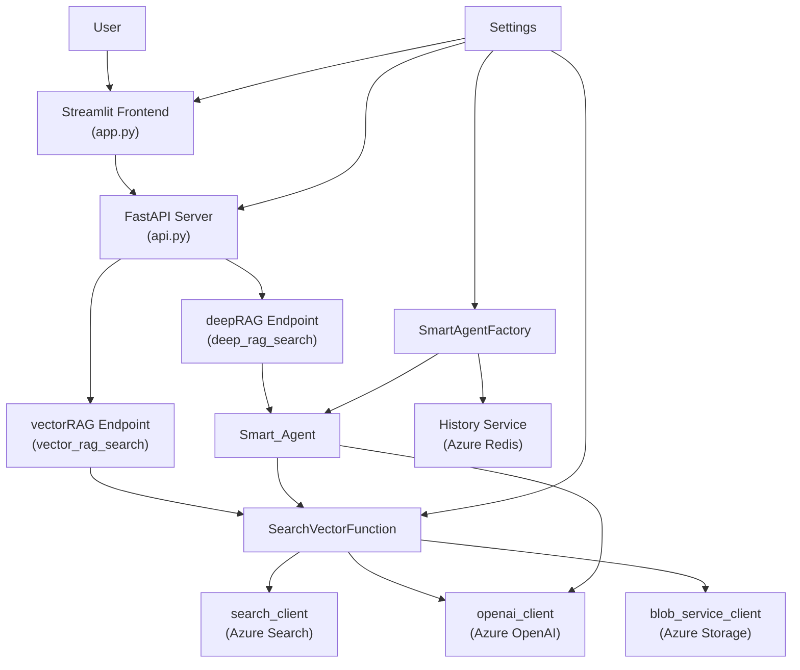

Sources:
- [src/api/api.py:1-88]()
- [pyproject.toml:1-39]()

## Core Components

### API Server

The API server provides two main endpoints:
1. `/vectorRAG`: For simple vector-based retrieval
2. `/deepRAG`: For agent-based retrieval with state management

The API server is implemented using FastAPI and integrates with LangChain's Runnable interfaces to create a robust service architecture.

### Data Flow

The following sequence diagram illustrates how data flows through the system for both approaches:

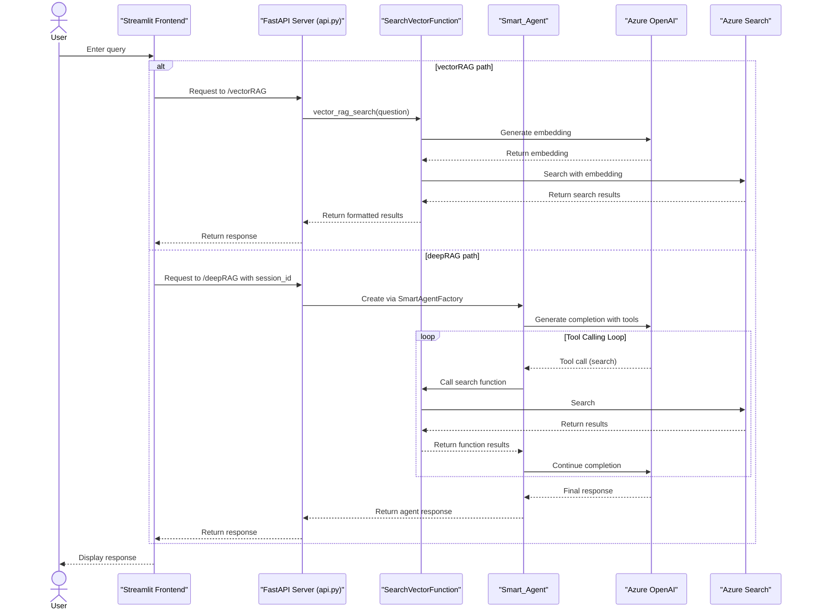

Sources:
- [src/api/api.py:20-31]()
- [src/api/api.py:33-51]()

### Key Differentiators: vectorRAG vs deepRAG

| Feature | vectorRAG | deepRAG |
|---------|-----------|---------|
| Endpoint | `/vectorRAG` | `/deepRAG` |
| Implementation | Direct vector search | Agent-based with tool calling |
| State Management | Stateless | Stateful (session-based) |
| Search Capabilities | Single vector search | Multiple search types possible |
| Conversation History | None | Maintained across interactions |
| Code Implementation | `vector_rag_search()` | `deep_rag_search()` |

## Integration with Azure Services

The deepRAG system integrates with several Azure services:

| Azure Service | Purpose | Component |
|---------------|---------|-----------|
| Azure OpenAI | Embedding generation and LLM capabilities | Both vectorRAG and deepRAG |
| Azure Search | Vector search for semantic retrieval | Both vectorRAG and deepRAG |
| Azure Storage | Document and image storage | Used by SearchVectorFunction |
| Azure Redis | Conversation history and session state | Used by Smart Agent |

## Agent Configuration

The Smart Agent is configured using the `AgentConfiguration` class, which defines the agent's persona, model, initial message, and available tools.

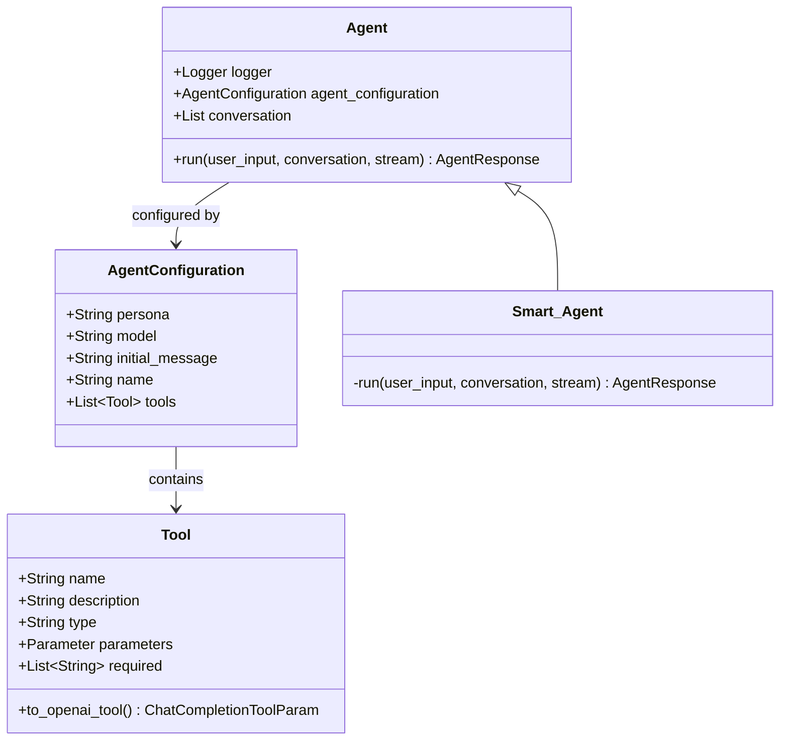

Sources:
- [src/models/agent_configuration.py:62-89]()
- [src/agents/agent.py:1-27]()

## Getting Started

To run the deepRAG project:

1. Install the required dependencies:
   ```
   poetry install
   ```

2. Select the interpreter in the poetry cache

3. Configure the required Azure services and update the `.env` file with the appropriate credentials

For more detailed information on configuration and settings, see [Settings and Configuration](#7).

Sources:
- [README.md:8-14]()
- [pyproject.toml:1-39]()

---

# Page: Key Concepts

# Key Concepts

<details>
<summary>Relevant source files</summary>

The following files were used as context for generating this wiki page:

- [src/agents/pyproject.toml](src/agents/pyproject.toml)
- [src/functions/functions.py](src/functions/functions.py)
- [src/functions/search_vector_function.py](src/functions/search_vector_function.py)
- [src/utils/utils.py](src/utils/utils.py)
- [tests/test_server.py](tests/test_server.py)
- [tests/test_vectors.py](tests/test_vectors.py)
- [tests/tests.py](tests/tests.py)

</details>


## Purpose and Scope

This document explains the core concepts behind the deepRAG system, focusing on Retrieval-Augmented Generation (RAG), vector search, and agent-based retrieval approaches. For implementation details of the system architecture, see [System Architecture](#2), and for information about specific components, see [Smart Agent](#3) and [Search Vector Function](#4).

## Retrieval-Augmented Generation (RAG)

Retrieval-Augmented Generation is a technique that enhances large language models by incorporating relevant information retrieved from external knowledge sources. Instead of relying solely on the model's pre-trained knowledge, RAG systems retrieve contextually relevant information from a knowledge base before generating responses.

The deepRAG system implements two distinct RAG approaches:

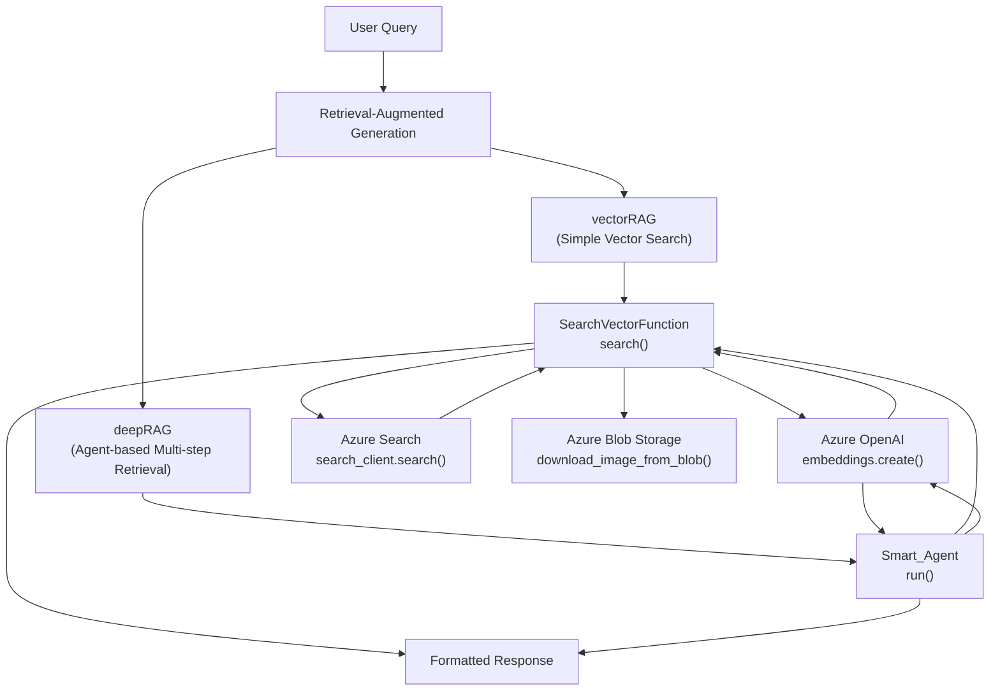

Sources: [src/functions/search_vector_function.py:14-90](), [tests/test_server.py:10-18]()

## Vector-Based RAG

The simplest form of RAG in the system is vectorRAG, implemented through the `/vectorRAG` endpoint. It uses vector embeddings to find semantically similar content from a knowledge base.

### How Vector RAG Works

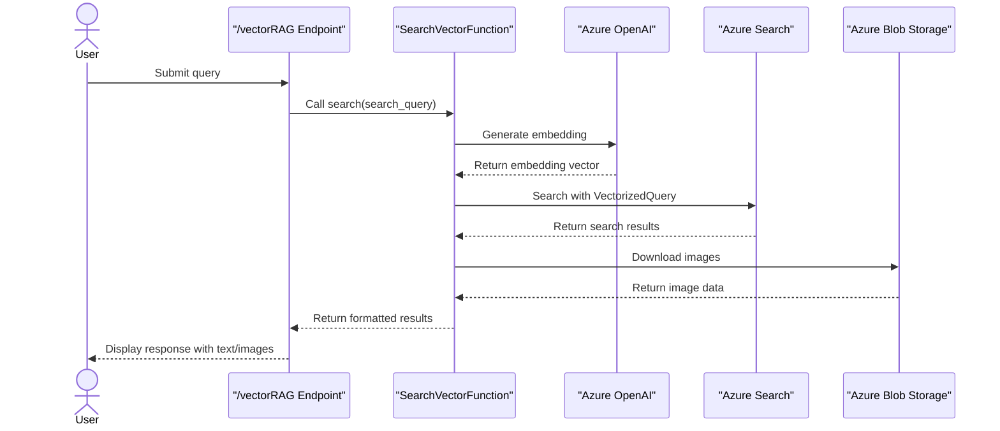

Key components of Vector RAG:

1. **Text Embeddings**: Converts text into vector embeddings using Azure OpenAI
2. **Vector Search**: Uses these embeddings to find semantically similar content in Azure Search
3. **Result Processing**: Retrieves and formats the search results, including downloading relevant images

Sources: [src/functions/search_vector_function.py:39-73](), [src/functions/search_vector_function.py:75-80](), [tests/test_server.py:10-13](), [tests/test_vectors.py:29-47]()

## Agent-Based RAG (deepRAG)

The more advanced approach is deepRAG, implemented through the `/deepRAG` endpoint. It uses a Smart Agent that can perform multiple search steps and maintain conversation context.

### How Deep RAG Works

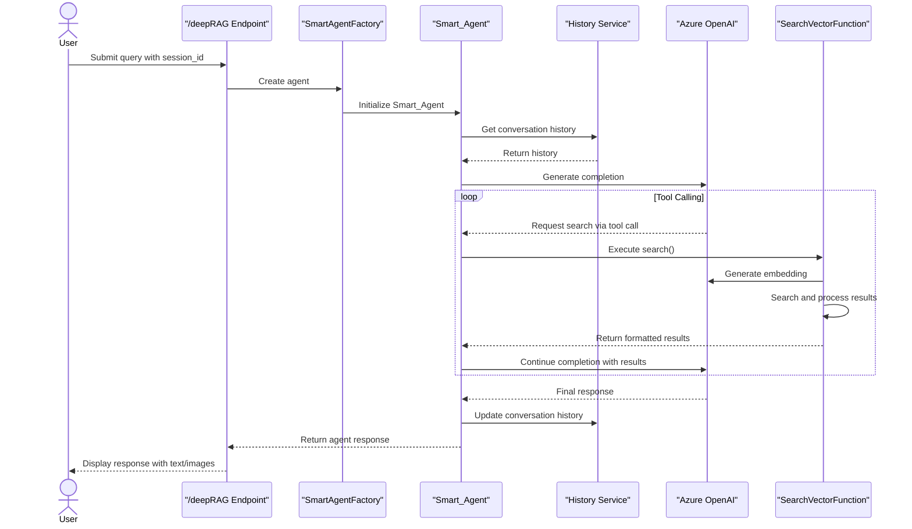

Key features of Agent-Based RAG:

1. **Stateful Conversations**: Maintains conversation history across turns
2. **Multi-Step Retrieval**: Can perform multiple search operations based on the conversation flow
3. **Tool Calling**: Uses function calling to integrate search and other capabilities
4. **Context Management**: Intelligently manages and cleans up conversation history

Sources: [src/functions/search_vector_function.py:14-90](), [tests/test_server.py:15-18]()

## Key Technical Components

### SearchVectorFunction

This class handles vector search operations and is a core component used by both vector RAG and agent-based RAG.

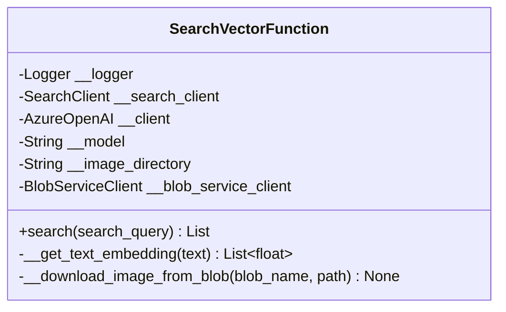

Main capabilities:
- Converting text to embeddings using Azure OpenAI (`__get_text_embedding`)
- Performing semantic search with vector queries (`search`)
- Retrieving and processing search results, including images (`__download_image_from_blob`)

Sources: [src/functions/search_vector_function.py:14-90]()

### Smart Agent

The Smart Agent is responsible for orchestrating the deepRAG process:

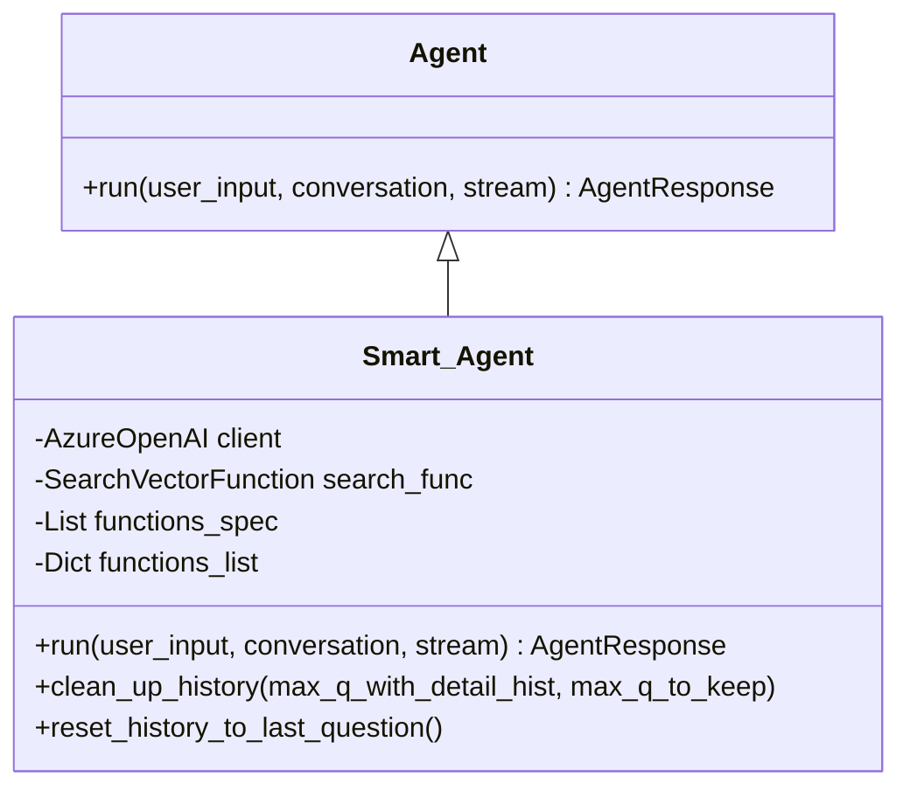

Key capabilities:
- Managing conversation context and history
- Using tool calling to execute search operations
- Orchestrating multiple retrieval steps when needed
- Cleaning up and managing conversation history

Sources: [src/agents/pyproject.toml:1-24](), [src/utils/utils.py:3]()

## Vector Search Mechanism

The vector search mechanism is fundamental to both RAG approaches:

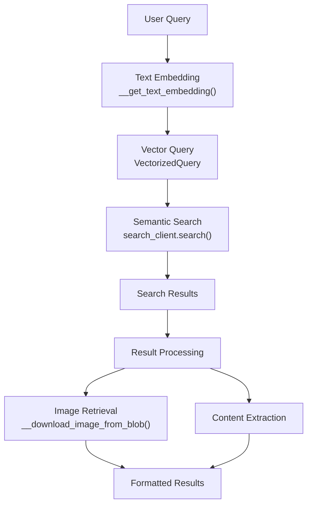

Key implementation details:
1. The query is converted to a vector embedding using Azure OpenAI
2. A `VectorizedQuery` is created with this embedding
3. Semantic search is performed with Azure Search
4. Results are processed, including downloading relevant images
5. Formatted results are returned for use in response generation

Sources: [src/functions/search_vector_function.py:39-73](), [src/functions/search_vector_function.py:75-80](), [src/functions/search_vector_function.py:82-89](), [tests/test_vectors.py:29-47]()

## Tool Calling in deepRAG

The deepRAG approach uses tool calling to enable the Smart Agent to perform search operations:

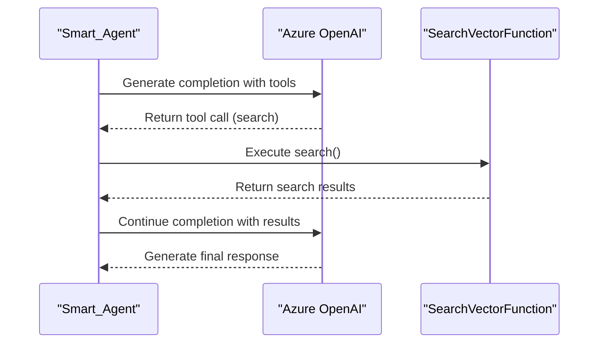

This approach enables more dynamic and contextual retrieval, as the agent can determine when and what to search for based on the conversation context.

Sources: [src/agents/pyproject.toml:1-24](), [src/utils/utils.py:3]()

## Comparison: Vector RAG vs. Deep RAG

| Feature | Vector RAG (vectorRAG) | Agent-Based RAG (deepRAG) |
|---------|------------------------|---------------------------|
| Endpoint | `/vectorRAG` | `/deepRAG` |
| Stateful | No | Yes (maintains conversation history) |
| Retrieval Steps | Single search operation | Multiple search operations possible |
| Context Management | None | Advanced (cleans up and manages history) |
| Use Case | Simple factual queries | Complex, multi-step information needs |
| Implementation | Direct call to SearchVectorFunction | Smart Agent orchestrating multiple functions |

Sources: [tests/test_server.py:10-18]()

## Key Technical Patterns

1. **Vector Embeddings**: Converting text to numerical vector representations for semantic similarity search
2. **Tool Calling**: Enabling the language model to call external functions for enhanced capabilities
3. **Conversation State Management**: Maintaining and managing conversation history for contextual responses
4. **Multi-Modal Responses**: Combining text with retrieved images in responses

Sources: [src/functions/search_vector_function.py:14-90](), [src/agents/pyproject.toml:1-24](), [src/utils/utils.py:3]()

---

# Page: System Architecture

# System Architecture

<details>
<summary>Relevant source files</summary>

The following files were used as context for generating this wiki page:

- [docs/ARCHITECTURE.md](docs/ARCHITECTURE.md)
- [src/api/api.py](src/api/api.py)
- [src/app/app.py](src/app/app.py)

</details>


This document provides a comprehensive overview of the deepRAG system architecture, detailing its components, their relationships, and how they interact to deliver advanced Retrieval-Augmented Generation capabilities. The architecture described here encompasses both the vectorRAG and deepRAG approaches implemented in the system.

For key concepts related to RAG, vector search, and agent-based approaches, see [Key Concepts](#1.1). For more detailed information about specific component interactions, see [Component Interactions](#2.1).

## High-Level Architecture Overview

The deepRAG system follows a modular architecture that integrates multiple Azure services with custom components to provide sophisticated retrieval and generation capabilities.

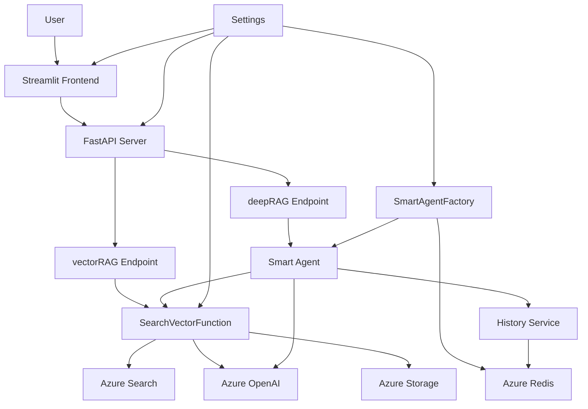

Sources: [src/app/app.py:1-154](), [src/api/api.py:1-89]()

## Core Components

The deepRAG system consists of the following core components:

### Client Applications
- **Streamlit Frontend**: A web-based user interface that allows users to interact with the system through a chat interface. It handles session management and rendering of responses.

### Server Components
- **FastAPI Server**: Provides REST API endpoints for both vectorRAG and deepRAG functionality.
- **SearchVectorFunction**: Handles vector search operations by generating embeddings and querying Azure Search.
- **Smart Agent**: Advanced agent that orchestrates retrieval and generation processes for deepRAG.
- **SmartAgentFactory**: Creates and configures Smart Agent instances and handles persistence of conversation history.
- **History Service**: Manages conversation history across sessions.

### Configuration
- **Settings**: Central configuration object that provides configuration values for all components.

The table below outlines the responsibilities of each component:

| Component | Primary Responsibility | Key Dependencies |
|-----------|------------------------|------------------|
| Streamlit Frontend | User interaction | RemoteRunnable, Settings |
| FastAPI API | Expose endpoints, orchestrate requests | SmartAgentFactory, SearchVectorFunction |
| SearchVectorFunction | Vector search operations | Azure Search, Azure OpenAI, Azure Storage |
| Smart Agent | Multi-step retrieval, tool calling | SearchVectorFunction, Azure OpenAI |
| SmartAgentFactory | Agent creation, history persistence | Azure Redis |
| History Service | Conversation management | Azure Redis |

Sources: [src/app/app.py:12-31](), [src/api/api.py:33-51]()

## System Data Flow

The system supports two primary data flows: vectorRAG and deepRAG.

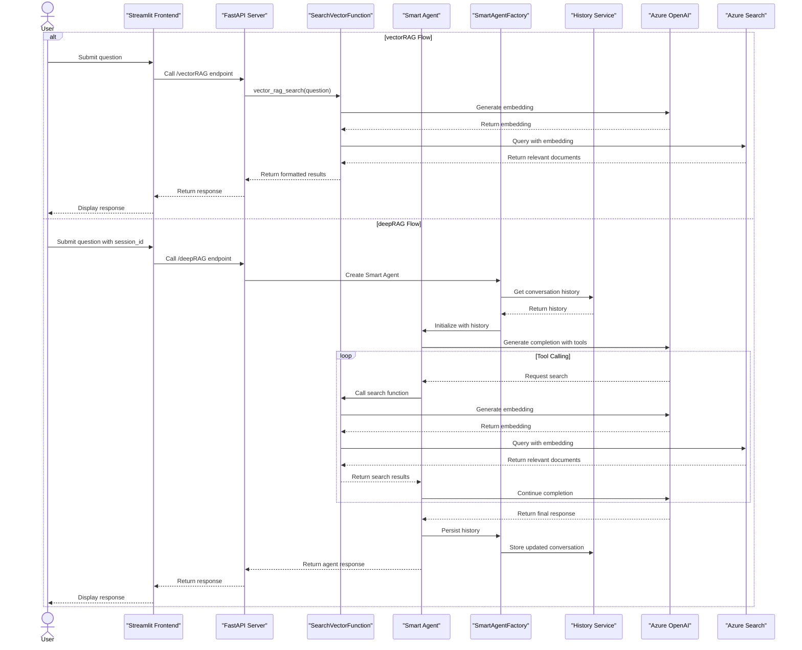

Sources: [src/api/api.py:20-31](), [src/app/app.py:119-154]()

## Component Relationships and Code Structure

The codebase is organized into several modules that work together to implement the deepRAG functionality.

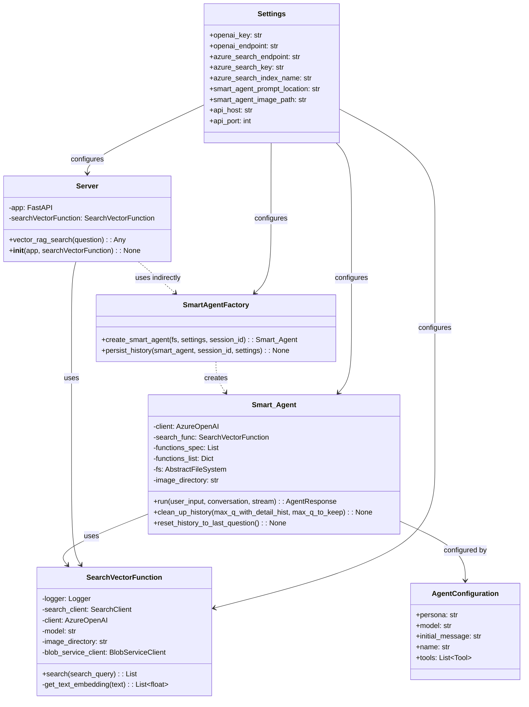

Sources: [src/api/api.py:32-51](), [src/app/app.py:24-38]()

## Integration with Azure Services

The deepRAG system integrates with multiple Azure services to provide its functionality.

```mermaid
graph TD
    subgraph "deepRAG System"
        Frontend["Streamlit Frontend"]
        API["FastAPI Server"]
        SearchVectorFunction["SearchVectorFunction"]
        SmartAgent["Smart Agent"]
        SmartAgentFactory["SmartAgentFactory"]
        HistoryService["History Service"]
    end
    
    subgraph "Azure Services"
        AzureOpenAI["Azure OpenAI"]
        AzureSearch["Azure AI Search"]
        AzureStorage["Azure Storage"]
        AzureRedis["Azure Redis Cache"]
    end
    
    SearchVectorFunction --> AzureOpenAI: "Generate embeddings"
    SearchVectorFunction --> AzureSearch: "Query for relevant documents"
    SearchVectorFunction --> AzureStorage: "Retrieve images"
    
    SmartAgent --> AzureOpenAI: "Generate completions"
    SmartAgent --> SearchVectorFunction: "Retrieve documents"
    
    SmartAgentFactory --> AzureRedis: "Store/retrieve conversation state"
    HistoryService --> AzureRedis: "Manage conversation history"
```

Sources: [src/api/api.py:63-86]()

## API Endpoints

The system exposes two main API endpoints:

1. **/vectorRAG** - Provides simple vector-based retrieval and generation
2. **/deepRAG** - Provides agent-based retrieval with multi-step reasoning and state management

The API is implemented using FastAPI and LangChain's Runnable interfaces, with each endpoint mapped to a specific functionality:

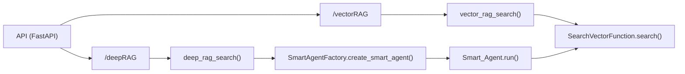

Sources: [src/api/api.py:33-51](), [src/api/api.py:56-88]()

## Initialization Process

The system initialization process involves:

1. Loading configuration from environment variables
2. Initializing connections to Azure services
3. Setting up the API server
4. Creating the necessary component instances

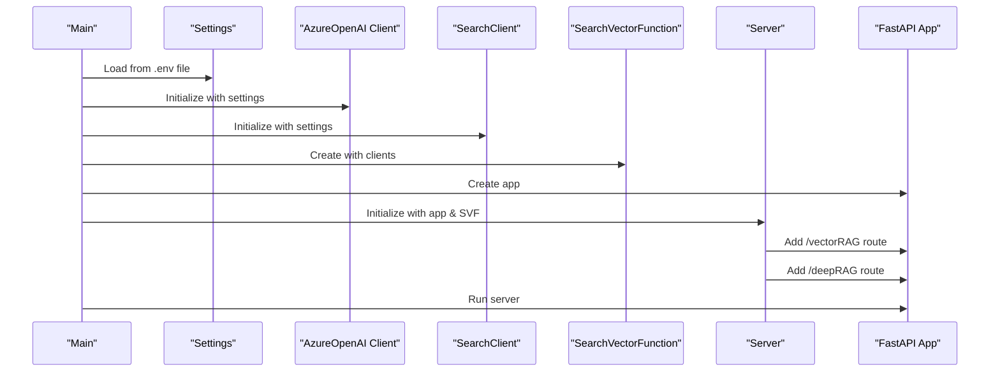

Sources: [src/api/api.py:53-88](), [src/app/app.py:24-38]()

## Frontend Application

The Streamlit frontend application provides a chat interface for users to interact with the deepRAG system. It:

1. Maintains session state for conversation history
2. Communicates with the API server via the RemoteRunnable interface
3. Renders responses, including text and images
4. Provides sample questions and a way to clear chat history

The frontend interacts with the backend through the `/deepRAG` endpoint, passing the user's question and a session ID to maintain conversation context.

Sources: [src/app/app.py:39-154]()

---

# Page: Component Interactions

# Component Interactions

<details>
<summary>Relevant source files</summary>

The following files were used as context for generating this wiki page:

- [src/agents/smart_agent/smart_agent.py](src/agents/smart_agent/smart_agent.py)
- [src/api/api.py](src/api/api.py)
- [src/services/history.py](src/services/history.py)
- [src/utils/smart_agent_factory.py](src/utils/smart_agent_factory.py)

</details>


## Purpose and Scope

This document details how the various components of the deepRAG system interact with each other and with external services. It covers the communication flows between the API server, Smart Agent, Search Vector Function, and Azure services that enable both vector-based and agent-based retrieval augmented generation. For information about Azure service integration specifics, see [Azure Services Integration](#2.2).

## Core Components and Their Relationships

The deepRAG system consists of several interconnected components that work together to provide retrieval-augmented generation capabilities.

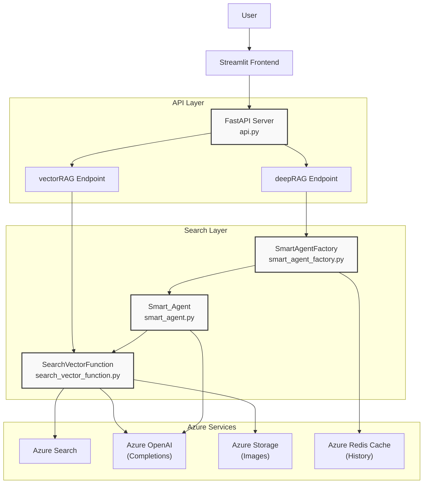

Sources:
- [src/api/api.py:33-49]()
- [src/utils/smart_agent_factory.py:19-70]()
- [src/agents/smart_agent/smart_agent.py:19-49]()

## Request Flows

The deepRAG system supports two main types of request flows:

1. **Vector RAG Flow**: A simpler approach using direct vector search
2. **Deep RAG Flow**: A more complex approach using the Smart Agent with conversation history

### Vector RAG Flow

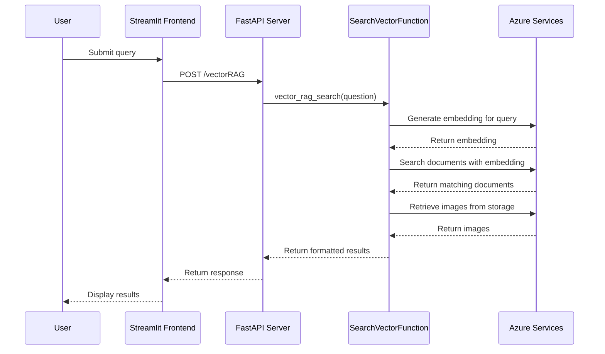

Sources:
- [src/api/api.py:34-42]()
- [src/api/api.py:50-51]()
- [src/functions/search_vector_function.py]() (implied from references)

### Deep RAG Flow

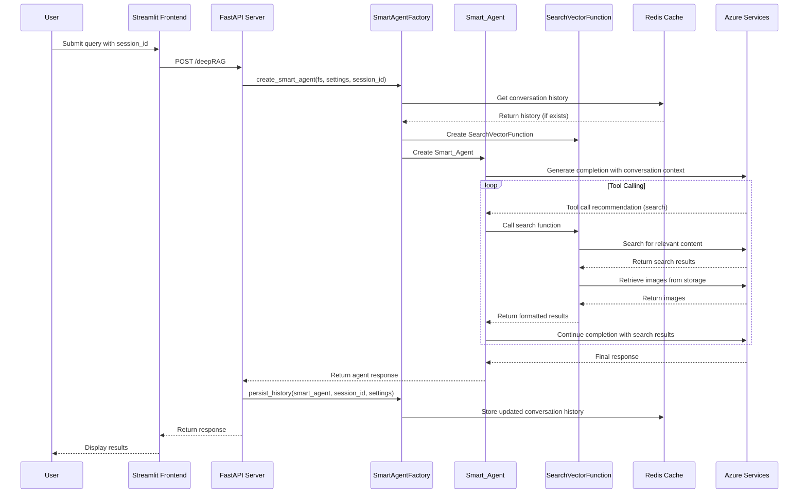

Sources:
- [src/api/api.py:20-31]()
- [src/api/api.py:43-48]()
- [src/utils/smart_agent_factory.py:21-70]()
- [src/agents/smart_agent/smart_agent.py:88-140]()

## Component-to-Component Interactions

### API Server and External Interfaces

The API server (`api.py`) serves as the main entry point for client requests. It exposes two main endpoints:

| Endpoint | Purpose | Implementation | Key Interactions |
|----------|---------|----------------|-----------------|
| `/vectorRAG` | Simple vector-based retrieval | `Server.vector_rag_search` | Calls `SearchVectorFunction.search` directly |
| `/deepRAG` | Advanced agent-based retrieval | `deep_rag_search` | Creates a Smart Agent via factory, runs it, and persists history |

Sources:
- [src/api/api.py:33-52]()

### Smart Agent Factory and Smart Agent Creation

The Smart Agent Factory is responsible for creating Smart Agent instances and handling conversation persistence:

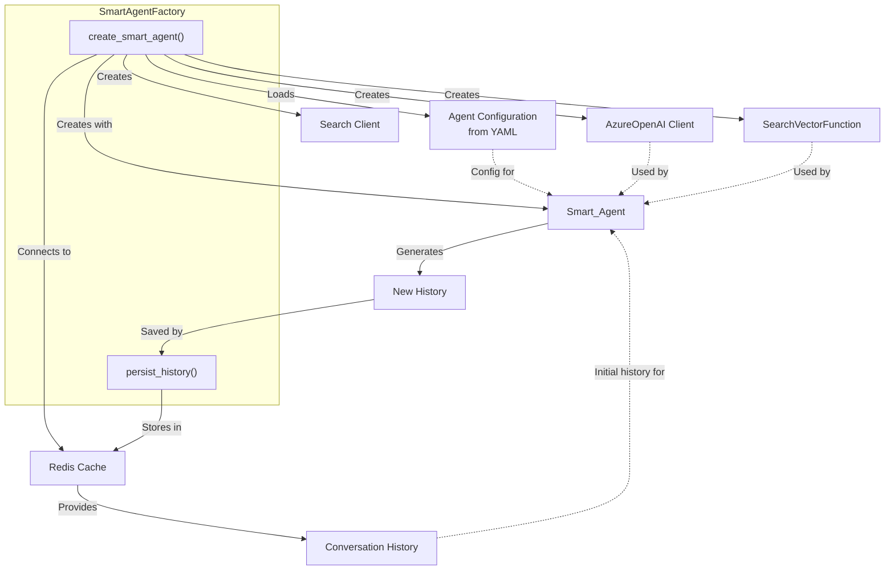

Sources:
- [src/utils/smart_agent_factory.py:21-70]()
- [src/utils/smart_agent_factory.py:72-83]()

### Smart Agent and Tool Execution

The Smart Agent processes user queries by interacting with the Azure OpenAI service and executing tool calls:

```mermaid
graph TD
    subgraph "Smart_Agent"
        Run["run()"]
        VOT["__verify_openai_tools()"]
        GSFR["__generate_search_function_response()"]
    end
    
    Run -->|"Appends question to"| Conv["Conversation"]
    Run -->|"Calls"| AOAI["AzureOpenAI.chat.completions.create()"]
    AOAI -->|"May return"| TC["Tool Calls"]
    
    TC -->|"If present"| VOT
    VOT -->|"Validates"| FN["Function name/args"]
    VOT -->|"Executes"| SF["search() function"]
    
    SF -->|"Returns"| SR["Search Results"]
    SR -->|"Processed by"| GSFR
    GSFR -->|"Formats with"| Img["Images (base64)"]
    GSFR -->|"Appends to"| Conv
    
    Conv -->|"Used in next"| AOAI
    Conv -->|"Returned in"| AR["AgentResponse"]
```

Sources:
- [src/agents/smart_agent/smart_agent.py:88-140]()
- [src/agents/smart_agent/smart_agent.py:157-196]()
- [src/agents/smart_agent/smart_agent.py:198-221]()

### History Management

The History service and Smart Agent work together to maintain conversation history across sessions:

```mermaid
graph TD
    subgraph "Smart_Agent Methods"
        SAClean["clean_up_history()"]
        SAReset["reset_history_to_last_question()"]
    end
    
    subgraph "History Service Methods"
        HSGet["get()"]
        HSSet["set_history()"]
        HSClean["clean_up_history()"]
        HSReset["reset_history_to_last_question()"]
    end
    
    subgraph "SmartAgentFactory Methods"
        SAFCreate["create_smart_agent()"]
        SAFPersist["persist_history()"]
    end
    
    Redis["Redis Cache"] -->|"Provides history to"| SAFCreate
    SAFCreate -->|"Initializes with history"| SA["Smart_Agent"]
    
    SA -->|"Modifies"| Conv["Conversation"]
    Conv -->|"Updated by"| SAClean
    Conv -->|"Updated by"| SAReset
    
    Conv -->|"Saved via"| SAFPersist
    SAFPersist -->|"Stores in"| Redis
    
    HSGet -->|"Retrieves from"| Redis
    HSSet -->|"Stores in"| Redis
    HSClean -->|"Modifies and stores in"| Redis
    HSReset -->|"Modifies and stores in"| Redis
```

Sources:
- [src/agents/smart_agent/smart_agent.py:50-86]()
- [src/utils/smart_agent_factory.py:21-70]()
- [src/utils/smart_agent_factory.py:72-83]()
- [src/services/history.py:5-75]()

## Code-Level Component Relationships

The following diagram illustrates the relationships between specific classes and methods that make up the component interactions:

```mermaid
classDiagram
    class Server {
        +FastAPI app
        +SearchVectorFunction searchVectorFunction
        +__init__(app, searchVectorFunction)
        +vector_rag_search(question)
    }
    
    class SmartAgentFactory {
        +create_smart_agent(fs, settings, session_id)
        +persist_history(smart_agent, session_id, settings)
    }
    
    class Smart_Agent {
        -AzureOpenAI __client
        -List __functions_spec
        -Dict _functions_list
        -fsspec.AbstractFileSystem __fs
        -String __image_directory
        +run(user_input, conversation, stream)
        +clean_up_history(max_q_with_detail_hist, max_q_to_keep)
        +reset_history_to_last_question()
        -__verify_openai_tools(tool_calls)
        -__generate_search_function_response(function_response)
    }
    
    class SearchVectorFunction {
        -Logger logger
        -SearchClient search_client
        -AzureOpenAI client
        -String model
        -String image_directory
        -BlobServiceClient blob_service_client
        +search(search_query)
    }
    
    class History {
        -String __session_id
        -CacheProtocol __cache
        +set_history(history)
        +clean_up_history(max_q_with_detail_hist, max_q_to_keep)
        +reset_history_to_last_question()
    }
    
    Server --> SearchVectorFunction : uses
    SmartAgentFactory --> Smart_Agent : creates
    SmartAgentFactory --> SearchVectorFunction : creates
    Smart_Agent --> SearchVectorFunction : uses for search
    SmartAgentFactory --> History : indirectly uses via Redis
    Smart_Agent --> History : functionality mirrors
```

Sources:
- [src/api/api.py:33-52]()
- [src/utils/smart_agent_factory.py:19-83]()
- [src/agents/smart_agent/smart_agent.py:19-221]()
- [src/services/history.py:5-75]()

## End-to-End Interaction Example

The following sequence illustrates a complete interaction from user query to response for the deepRAG approach:

```mermaid
sequenceDiagram
    participant User
    participant Frontend
    participant API
    participant SmartAgent
    participant AOAI as Azure OpenAI
    participant SVF as SearchVectorFunction
    participant Redis
    participant AzureSearch
    participant AzureStorage
    
    User->>Frontend: "Tell me about image processing"
    Frontend->>API: POST /deepRAG {question, session_id}
    API->>Redis: Get history for session_id
    Redis-->>API: Return history (or empty)
    API->>SmartAgent: Create and initialize with history
    
    SmartAgent->>SmartAgent: Add question to conversation
    SmartAgent->>AOAI: Generate completion with context
    AOAI-->>SmartAgent: Tool call (search "image processing")
    
    SmartAgent->>SVF: search("image processing")
    SVF->>AzureSearch: Vector search for "image processing"
    AzureSearch-->>SVF: Return matching documents
    SVF->>AzureStorage: Get referenced images
    AzureStorage-->>SVF: Return image data
    SVF-->>SmartAgent: Return formatted results with images
    
    SmartAgent->>AOAI: Continue completion with search results
    AOAI-->>SmartAgent: Final response with references to images
    
    SmartAgent->>Redis: Store updated conversation history
    SmartAgent-->>API: Return complete response
    API-->>Frontend: Return response with text and images
    Frontend-->>User: Display formatted response
```

Sources:
- [src/api/api.py:20-31]()
- [src/utils/smart_agent_factory.py:21-83]()
- [src/agents/smart_agent/smart_agent.py:88-140]()
- [src/agents/smart_agent/smart_agent.py:157-221]()

---

# Page: Azure Services Integration

# Azure Services Integration

<details>
<summary>Relevant source files</summary>

The following files were used as context for generating this wiki page:

- [.devcontainer/devcontainer.json](.devcontainer/devcontainer.json)
- [.vscode/launch.json](.vscode/launch.json)
- [src/functions/search_vector_function.py](src/functions/search_vector_function.py)
- [src/models/settings.py](src/models/settings.py)
- [src/services/history.py](src/services/history.py)
- [src/utils/smart_agent_factory.py](src/utils/smart_agent_factory.py)

</details>


## Purpose and Scope

This document details how the deepRAG system integrates with various Azure services for its core functionality. It covers the specific integration points with Azure OpenAI, Azure Cognitive Search, Azure Blob Storage, and Azure Redis Cache, explaining how these services support the system's retrieval-augmented generation capabilities.

For information about the overall system architecture, see [System Architecture](#2), and for component interactions, see [Component Interactions](#2.1).

## Azure Services Overview

The deepRAG system relies on four key Azure services that work together to enable advanced retrieval and generation capabilities:

```mermaid
flowchart TD
    subgraph "deepRAG System"
        API["FastAPI Server"]
        SmartAgent["Smart_Agent"]
        SearchFunc["SearchVectorFunction"]
    end

    subgraph "Azure Services"
        AzureOpenAI["Azure OpenAI Service
        - Embeddings generation
        - LLM completions"]
        
        AzureSearch["Azure Cognitive Search
        - Vector search
        - Semantic ranking"]
        
        AzureStorage["Azure Blob Storage
        - Document images
        - Page snapshots"]
        
        AzureRedis["Azure Redis Cache
        - Conversation history
        - Session state"]
    end

    API --> SmartAgent
    SmartAgent --> SearchFunc
    
    SearchFunc --> AzureOpenAI
    SearchFunc --> AzureSearch
    SearchFunc --> AzureStorage
    
    SmartAgent --> AzureOpenAI
    SmartAgent --> AzureRedis
```

Sources: [src/functions/search_vector_function.py:13-37](). [src/utils/smart_agent_factory.py:19-47](). [src/models/settings.py:4-27]().

## Service Configuration

All Azure service configurations are centralized in the `Settings` class, which uses environment variables for connection details:

| Azure Service | Configuration Parameters |
|---------------|--------------------------|
| Azure OpenAI | `openai_endpoint`, `openai_key`, `openai_embedding_deployment`, `openai_chat_deployment`, `openai_api_version` |
| Azure Cognitive Search | `azure_search_endpoint`, `azure_search_key`, `azure_search_index_name` |
| Azure Blob Storage | `azure_storage_account_key`, `azure_storage_account_name`, `azure_container_name` |
| Azure Redis Cache | `azure_redis_endpoint`, `azure_redis_key` |

Sources: [src/models/settings.py:4-27]().

## Azure OpenAI Integration

Azure OpenAI Service provides the linguistic intelligence for the deepRAG system through two main functions:

1. **Embeddings Generation** - Converting text to vector representations
2. **Large Language Model Completions** - Generating responses and handling tool calls

```mermaid
sequenceDiagram
    participant SF as "SearchVectorFunction"
    participant SA as "Smart_Agent"
    participant AO as "Azure OpenAI Service"
    
    SF->>AO: __get_text_embedding(search_query)
    AO-->>SF: Vector embedding
    
    SF->>AO: embeddings.create(input, model)
    AO-->>SF: embedding data
    
    SA->>AO: Generate completion with tools
    AO-->>SA: Tool calling response
    SA->>SF: Execute search
    SF-->>SA: Search results
    SA->>AO: Continue completion with results
    AO-->>SA: Final response text
```

Sources: [src/functions/search_vector_function.py:74-80](). [src/utils/smart_agent_factory.py:32-36]().

### Implementation Details

The Azure OpenAI client is initialized in `SmartAgentFactory`:

```python
client = AzureOpenAI(
    api_key=settings.openai_key,
    api_version=settings.openai_api_version,
    azure_endpoint=settings.openai_endpoint,
)
```

This client is passed to both the Smart Agent for LLM interactions and the SearchVectorFunction for embedding generation.

Sources: [src/utils/smart_agent_factory.py:32-36]().

## Azure Cognitive Search Integration

Azure Cognitive Search powers the vector search capabilities, allowing the system to find semantically similar content based on embeddings.

```mermaid
classDiagram
    class "SearchVectorFunction" {
        +search(search_query): list
        -__get_text_embedding(text): List~float~
        -__download_image_from_blob(blob_name, download_file_path): None
    }
    
    class "SearchClient" {
        +search(query_type, semantic_configuration_name, vector_queries, etc): SearchItemPaged
    }
    
    class "VectorizedQuery" {
        +vector: List~float~
        +k_nearest_neighbors: int
        +fields: string
    }
    
    "SearchVectorFunction" --> "SearchClient" : uses
    "SearchVectorFunction" --> "VectorizedQuery" : creates
```

Sources: [src/functions/search_vector_function.py:39-73](). [src/utils/smart_agent_factory.py:26-30]().

### Search Process

1. Generate text embedding for the search query using Azure OpenAI
2. Create a `VectorizedQuery` with the embedding vector
3. Execute a semantic search with the vector query
4. Process search results to retrieve related content and images
5. Download associated page images from Azure Blob Storage

The search operation includes semantic ranking and extractive capabilities:

```python
results: SearchItemPaged[Dict] = self.__search_client.search(
    query_type=QueryType.SEMANTIC,
    semantic_configuration_name='my-semantic-config',
    query_caption=QueryCaptionType.EXTRACTIVE,
    query_answer=QueryAnswerType.EXTRACTIVE,
    vector_queries=[vector_query],
    select=["topic", "file_name", "page_number", "related_content"],
    top=3
)
```

Sources: [src/functions/search_vector_function.py:47-56]().

## Azure Blob Storage Integration

Azure Blob Storage is used to store document images that are retrieved as part of search results.

```mermaid
flowchart TD
    subgraph "SearchVectorFunction"
        search["search()"]
        download["__download_image_from_blob()"]
    end
    
    subgraph "Azure Blob Storage"
        container["ContainerClient"]
        blob["BlobClient"]
    end
    
    search --> download
    download --> container
    container --> blob
    blob --> download
```

Sources: [src/functions/search_vector_function.py:82-89]().

### Image Retrieval Process

1. For each search result, determine the corresponding page image name
2. Ensure the local directory exists for storing the downloaded image
3. Download the image from Azure Blob Storage using the container client
4. Include the local image path in the search results

```python
def __download_image_from_blob(self, blob_name: str, download_file_path: str) -> None:
    """
    Download an image from Azure Blob Storage to a local file
    """
    with open(download_file_path, "wb") as download_file:
        blob_client = self.__container_client.get_blob_client(blob_name)
        download_stream = blob_client.download_blob()
        download_file.write(download_stream.readall())
```

Sources: [src/functions/search_vector_function.py:82-89]().

## Azure Redis Cache Integration

Azure Redis Cache provides distributed caching capabilities for maintaining conversation history across user sessions.

```mermaid
sequenceDiagram
    participant Client as "Client"
    participant API as "FastAPI API"
    participant SAF as "SmartAgentFactory"
    participant SA as "Smart_Agent"
    participant History as "History Service"
    participant Redis as "Azure Redis Cache"
    
    Client->>API: Request with session_id
    API->>SAF: create_smart_agent(fs, settings, session_id)
    SAF->>Redis: Get(session_id)
    Redis-->>SAF: Raw history data
    SAF->>SAF: Deserialize history (pickle.loads + base64.decode)
    SAF->>SA: Create with init_history
    
    SA->>History: Get conversation history
    History->>Redis: Get(session_id)
    Redis-->>History: Raw history data
    History-->>SA: Return history
    
    Client->>API: Submit question
    API->>SA: Process question
    SA->>API: Return response
    API->>SAF: persist_history(smart_agent, session_id, settings)
    SAF->>Redis: Set(session_id, serialized_history)
    SAF->>Redis: Expire(session_id, 3600)
```

Sources: [src/utils/smart_agent_factory.py:49-62](). [src/utils/smart_agent_factory.py:72-83](). [src/services/history.py:1-75]().

### History Management

The `History` service provides several key functions for conversation history:

1. **Retrieval**: Loads history from Redis for a specific session
2. **Persistence**: Saves updated history back to Redis
3. **Cleanup**: Removes old messages to prevent history from growing too large
4. **Reset**: Resets history to the last question for recovery purposes

History data is serialized using pickle and base64 encoding before storage in Redis:

```python
# Storing history
self.__cache.set(name=self.__session_id, value=base64.b64encode(s=pickle.dumps(obj=history)))

# Retrieving history
history = pickle.loads(base64.b64decode(s=cache_history))
```

Session data in Redis has a 1-hour (3600 seconds) expiration time to manage resource usage.

Sources: [src/services/history.py:20-23](). [src/services/history.py:27-32](). [src/utils/smart_agent_factory.py:81-82]().

## Integration Flow

The following diagram shows how all Azure services work together in the deepRAG system:

```mermaid
flowchart TB
    subgraph "Client Side"
        User["User"]
        Frontend["Streamlit Frontend"]
    end
    
    subgraph "Server Side"
        API["FastAPI Server"]
        SAF["SmartAgentFactory"]
        SA["Smart_Agent"]
        SVF["SearchVectorFunction"]
        Hist["History Service"]
    end
    
    subgraph "Azure Services"
        AOAI["Azure OpenAI Service"]
        ACS["Azure Cognitive Search"]
        ABS["Azure Blob Storage"]
        ARC["Azure Redis Cache"]
    end
    
    User --> Frontend
    Frontend --> API
    
    API --> SAF
    SAF --> SA
    SAF --> SVF
    SAF --> ARC
    
    SA --> SVF
    SA --> AOAI
    SA --> Hist
    
    SVF --> AOAI
    SVF --> ACS
    SVF --> ABS
    
    Hist --> ARC
```

Sources: [src/utils/smart_agent_factory.py:19-83](). [src/services/history.py:5-75](). [src/functions/search_vector_function.py:14-89]().

## Conclusion

The deepRAG system's architecture demonstrates a sophisticated integration of multiple Azure services to create a powerful retrieval-augmented generation system. Each Azure service plays a critical role:

- **Azure OpenAI** provides the language intelligence through embeddings and LLM capabilities
- **Azure Cognitive Search** enables semantic vector search for relevant content retrieval
- **Azure Blob Storage** stores and serves document images to enhance responses
- **Azure Redis Cache** maintains conversation state for persistent, context-aware interactions

This integration allows the system to deliver both simple vector-based retrieval (`/vectorRAG`) and more complex agent-based retrieval with conversation context (`/deepRAG`).

---

# Page: Smart Agent

# Smart Agent

<details>
<summary>Relevant source files</summary>

The following files were used as context for generating this wiki page:

- [README.md](README.md)
- [src/agents/README.md](src/agents/README.md)
- [src/agents/agent.py](src/agents/agent.py)
- [src/agents/smart_agent/smart_agent.py](src/agents/smart_agent/smart_agent.py)
- [src/models/agent_configuration.py](src/models/agent_configuration.py)
- [src/services/history.py](src/services/history.py)
- [src/utils/smart_agent_factory.py](src/utils/smart_agent_factory.py)

</details>


## Introduction and Purpose

The Smart Agent is a key component in the deepRAG system that implements advanced retrieval-augmented generation capabilities. It extends beyond simple vector search by maintaining conversation context, performing tool-based searches when needed, and intelligently integrating retrieved information into responses. The Smart Agent represents the core functionality behind the `/deepRAG` endpoint in the API.

For information about the simpler vector search approach, see [Search Vector Function](#4).

Sources: [src/agents/smart_agent/smart_agent.py:19-21](), [README.md:3-4]()

## Architecture

### Class Structure

The Smart Agent architecture follows an object-oriented design with clear inheritance and dependency relationships:

```mermaid
classDiagram
    class Agent {
        +Logger _logger
        +AgentConfiguration _agent_configuration
        +List _conversation
        +run(user_input, conversation, stream)* AgentResponse
    }
    
    class Smart_Agent {
        -AzureOpenAI __client
        -SearchVectorFunction _functions_list
        -List __functions_spec
        -Dict _functions_list
        -fsspec.AbstractFileSystem __fs
        -String __image_directory
        +run(user_input, conversation, stream) AgentResponse
        +clean_up_history(max_q_with_detail_hist, max_q_to_keep)
        +reset_history_to_last_question()
        -__verify_openai_tools(tool_calls)
        -__generate_search_function_response(function_response)
    }
    
    class SmartAgentFactory {
        +create_smart_agent(fs, settings, session_id) Smart_Agent
        +persist_history(smart_agent, session_id, settings)
    }
    
    class AgentConfiguration {
        +String persona
        +String model
        +String initial_message
        +String name
        +List~Tool~ tools
    }
    
    Agent <|-- Smart_Agent : "extends"
    SmartAgentFactory ..> Smart_Agent : "creates"
    Smart_Agent --> AgentConfiguration : "configured by"
    Smart_Agent --> "SearchVectorFunction" : "uses for search"
```

Sources: [src/agents/smart_agent/smart_agent.py:19-50](), [src/agents/agent.py:9-26](), [src/utils/smart_agent_factory.py:19-70]()

### Component Interaction

The Smart Agent integrates with several components and services to provide its functionality:

```mermaid
flowchart TD
    subgraph "API Layer"
        api["FastAPI /deepRAG endpoint"]
    end
    
    subgraph "Agent Components"
        sa["Smart_Agent"]
        saf["SmartAgentFactory"]
        ac["AgentConfiguration"]
        svf["SearchVectorFunction"]
    end
    
    subgraph "Azure Services"
        ao["AzureOpenAI"]
        as["AzureSearch"]
        redis["Redis Cache"]
        storage["Azure Storage"]
    end
    
    api --> saf
    saf --> sa
    saf --> redis
    sa --> ac
    sa --> svf
    sa --> ao
    svf --> as
    svf --> storage
    svf --> ao
```

Sources: [src/utils/smart_agent_factory.py:21-70](), [src/agents/smart_agent/smart_agent.py:22-49]()

## Implementation Details

### Initialization

The Smart Agent is created by the SmartAgentFactory, which:
1. Loads agent configuration from YAML
2. Sets up connections to Azure services
3. Retrieves conversation history from Redis
4. Initializes the Smart Agent with necessary dependencies

Sources: [src/utils/smart_agent_factory.py:21-70]()

### Run Method Execution Flow

The core functionality of the Smart Agent is implemented in its `run` method:

```mermaid
sequenceDiagram
    participant Client as "API Client"
    participant SA as "Smart_Agent.run()"
    participant AO as "AzureOpenAI"
    participant SVF as "SearchVectorFunction"
    
    Client->>SA: call run(user_input)
    SA->>SA: Add user input to conversation
    SA->>SA: clean_up_history()
    
    loop Until final response
        SA->>AO: chat.completions.create()
        AO-->>SA: Response with tool_calls
        
        alt has tool_calls
            SA->>SA: __verify_openai_tools()
            SA->>SVF: search()
            SVF-->>SA: function_response
            SA->>SA: __generate_search_function_response()
            SA->>SA: Add to conversation
        else no tool_calls
            AO-->>SA: Final response
            break
        end
    end
    
    SA-->>Client: Return AgentResponse
```

Sources: [src/agents/smart_agent/smart_agent.py:88-140]()

### Key Methods

The Smart Agent implements several key methods:

1. **run**: Processes user input and generates responses with optional tool calls
2. **clean_up_history**: Maintains conversation history within configurable limits
3. **reset_history_to_last_question**: Resets history to the most recent user query
4. **__verify_openai_tools**: Validates and executes tool calls from the LLM
5. **__generate_search_function_response**: Formats search results with text and images

Sources: [src/agents/smart_agent/smart_agent.py:50-221]()

## Conversation History Management

The Smart Agent provides sophisticated conversation history management:

1. **History Initialization**: Loads previous conversation from Redis when creating a new agent instance
2. **History Cleanup**: Prunes history based on configurable parameters:
   - `max_question_with_detail_hist`: Number of recent questions to keep with full context
   - `max_question_to_keep`: Total number of questions to maintain in history
3. **History Reset**: Can reset history to the last question when needed
4. **History Persistence**: Saves conversation history to Redis after each interaction

This enables stateful conversations across user sessions while managing token usage.

Sources: [src/agents/smart_agent/smart_agent.py:50-86](), [src/services/history.py:1-76]()

## Tool Calling Implementation

The Smart Agent leverages the OpenAI tool calling functionality to dynamically retrieve relevant information:

### Tool Definition and Registration

```
_functions_list = {
    "search": search_vector_function.search
}
```

Tools are defined in the AgentConfiguration and converted to OpenAI-compatible format at initialization.

### Tool Call Processing Flow

1. OpenAI model decides when to call a tool based on user query
2. Smart Agent receives tool calls in response
3. Agent validates tool calls through `__verify_openai_tools`
4. Function arguments are parsed from JSON
5. Function is executed with provided arguments
6. Results are formatted and added to conversation
7. Agent continues generating response with the new context

The primary tool is the search function, which retrieves relevant information from Azure Search.

Sources: [src/agents/smart_agent/smart_agent.py:141-196](), [src/models/agent_configuration.py:29-59]()

## Image Processing

The Smart Agent can include images in responses through:

1. Retrieving image paths from search results
2. Reading image data from the filesystem
3. Converting images to base64-encoded strings
4. Formatting responses with both text and images

This allows the agent to provide rich, multimodal responses.

Sources: [src/agents/smart_agent/smart_agent.py:198-221]()

## Configuration

The Smart Agent is configured using an AgentConfiguration object with the following properties:

| Property | Description | 
|----------|-------------|
| persona | System prompt defining the agent's behavior |
| model | Azure OpenAI model to use |
| initial_message | First message the agent displays |
| name | Agent's name identifier |
| tools | List of tools the agent can use |

Tools are defined with:
- Name
- Description
- Parameters (properties and types)
- Required parameters

Sources: [src/models/agent_configuration.py:62-89]()

## Integration with External Services

### Azure OpenAI

The Smart Agent integrates with Azure OpenAI for:
- Generating completions with tool definitions
- Processing tool calls and responses
- Maintaining conversation context

### Azure Search

Integration with Azure Search occurs through the SearchVectorFunction for:
- Semantic search using vector embeddings
- Retrieving relevant content and images
- Formatting search results for consumption by the agent

### Azure Redis

Used for:
- Retrieving conversation history at initialization
- Persisting conversation history after interactions
- Maintaining conversation state across sessions

Sources: [src/utils/smart_agent_factory.py:32-36](), [src/utils/smart_agent_factory.py:49-56](), [src/utils/smart_agent_factory.py:71-82]()

## Usage Example

The Smart Agent is primarily used through the `/deepRAG` endpoint, which:
1. Receives a user query and session ID
2. Creates or retrieves a Smart Agent instance
3. Processes the query using the agent's run method
4. Returns the agent's response with retrieved information
5. Persists conversation history for future interactions

This enables sophisticated, stateful RAG capabilities with the ability to perform multiple search operations based on the specific information needs identified by the model.

Sources: [src/utils/smart_agent_factory.py:21-70]()

---

# Page: Agent Configuration

# Agent Configuration

<details>
<summary>Relevant source files</summary>

The following files were used as context for generating this wiki page:

- [README.md](README.md)
- [src/agents/README.md](src/agents/README.md)
- [src/agents/agent.py](src/agents/agent.py)
- [src/agents/agents.py](src/agents/agents.py)
- [src/agents/smart_agent/prompt.yaml](src/agents/smart_agent/prompt.yaml)
- [src/models/agent_configuration.py](src/models/agent_configuration.py)
- [src/models/models.py](src/models/models.py)
- [src/utils/utilities.py](src/utils/utilities.py)

</details>


This document provides detailed information on how to configure agents in the deepRAG system. Agent configuration is a crucial part of the system as it defines the agent's behavior, capabilities, and interaction style. For information about how the Smart Agent uses these configurations at runtime, see [Smart Agent](#3).

## Overview of Agent Configuration

The deepRAG system uses a configuration-driven approach to define and create agents. The configuration specifies the agent's persona, language model, available tools, and other attributes that determine how the agent functions and responds to user queries.

```mermaid
graph TD
    subgraph "Agent Configuration Components"
        AgentConfig["AgentConfiguration"]
        AgentConfig -->|contains| Persona["Persona definition"]
        AgentConfig -->|specifies| Model["Language model"]
        AgentConfig -->|defines| Tools["Available tools"]
        AgentConfig -->|sets| InitMessage["Initial message"]
        AgentConfig -->|has| Name["Agent name"]
        
        Tools -->|has many| Tool["Tool definition"]
        Tool -->|has| ToolName["Tool name"]
        Tool -->|has| Description["Tool description"]
        Tool -->|has| Parameters["Parameter definition"]
        Tool -->|has| Required["Required parameters"]
    end
```

Sources: [src/models/agent_configuration.py:62-80](), [src/agents/agent.py:9-22]()

## The AgentConfiguration Class

The `AgentConfiguration` class is the core component that encapsulates all configuration settings for an agent. It is defined in `src/models/agent_configuration.py`.

```mermaid
classDiagram
    class AgentConfiguration {
        +String persona
        +String model
        +String initial_message
        +String name
        +List~Tool~ tools
        +from_dict(data) AgentConfiguration
    }
    
    class Tool {
        +String name
        +String description
        +String type
        +Parameter parameters
        +List~String~ required
        +from_dict(data) Tool
        +to_openai_tool() ChatCompletionToolParam
    }
    
    class Parameter {
        +String type
        +Dictionary properties
        +from_dict(data) Parameter
        +to_dict() Dictionary
    }
    
    AgentConfiguration "1" --> "*" Tool: contains
    Tool "1" --> "1" Parameter: has
```

Sources: [src/models/agent_configuration.py:6-89]()

### AgentConfiguration Properties

The `AgentConfiguration` class contains the following properties:

| Property | Type | Description |
|----------|------|-------------|
| persona | string | Defines the agent's behavior, knowledge, and response style |
| model | string | The language model to use (e.g., "gpt-4o") |
| initial_message | string | First message the agent sends to the user |
| name | string | Name identifier for the agent |
| tools | list[Tool] | List of tools the agent can use |

Sources: [src/models/agent_configuration.py:62-68]()

### Agent Initialization

When an agent is initialized with a configuration, it sets up the initial conversation history and prepares available tools. The base `Agent` class handles this initialization:

```mermaid
sequenceDiagram
    participant App as Application
    participant Factory as SmartAgentFactory
    participant Config as AgentConfiguration
    participant Agent as Agent

    App->>Factory: create_smart_agent(fs, settings, session_id)
    Factory->>Config: Create configuration
    Factory->>Agent: Initialize with configuration
    Agent->>Agent: Set up conversation history with persona
    Agent->>Agent: Add initial message if provided
    Factory-->>App: Return configured agent
```

Sources: [src/agents/agent.py:9-22](), [src/utils/utilities.py:353-370]()

## Creating Agent Configurations

There are two ways to create agent configurations:

1. Directly instantiating the `AgentConfiguration` class
2. Using the `from_dict` static method to create a configuration from a dictionary

### From Dictionary

The `from_dict` static method provides a convenient way to create agent configurations from dictionaries:

```python
agent_config = AgentConfiguration.from_dict({
    "persona": "You are a helpful assistant...",
    "model": "gpt-4o",
    "initial_message": "Hello! How can I help you today?",
    "name": "ResearchAssistant",
    "tools": [...]
})
```

Sources: [src/models/agent_configuration.py:71-79](), [src/models/agent_configuration.py:81-89]()

### From YAML Configuration

In practice, configurations are often defined in YAML files and loaded at runtime. The file `src/agents/smart_agent/prompt.yaml` provides an example of a complete agent configuration:

```mermaid
graph TD
    subgraph "YAML Configuration Structure"
        YAMLConfig["prompt.yaml"]
        YAMLConfig -->|contains| BasicInfo["Basic agent info<br>(name, model, initial_message)"]
        YAMLConfig -->|contains| PersonaText["Persona text"]
        YAMLConfig -->|contains| ToolsDef["Tools definitions"]
        
        ToolsDef -->|defines| Tool1["search tool"]
        Tool1 -->|has| ToolParams["search_query parameter"]
    end
```

Sources: [src/agents/smart_agent/prompt.yaml:1-175]()

## Tool Configuration

Tools are a critical part of agent configuration as they define the capabilities an agent can use to respond to queries. Each tool is defined with the following properties:

| Property | Type | Description |
|----------|------|-------------|
| name | string | The name of the tool |
| description | string | Description of what the tool does |
| type | string | Type of the tool (currently only "function" is supported) |
| parameters | Parameter | The parameters the tool accepts |
| required | list[string] | List of required parameter names |

Sources: [src/models/agent_configuration.py:29-59]()

### Parameter Configuration

Each tool includes a `parameters` property that defines the structure of the parameters the tool accepts:

```mermaid
graph TD
    subgraph "Tool Parameter Structure"
        Param["Parameter"]
        Param -->|has| Type["Parameter type<br>(usually 'object')"]
        Param -->|has| Props["Properties dictionary"]
        
        Props -->|contains| Prop1["Property definition"]
        Prop1 -->|has| PropType["Property type<br>(e.g., 'string')"]
        Prop1 -->|has| PropDesc["Property description"]
    end
```

Sources: [src/models/agent_configuration.py:6-27]()

## Example Configuration

Below is an example of a complete agent configuration for the Smart Agent:

```yaml
name: "SmartAgent"
model: "gpt-4o"
initial_message: "Hi, I'm your smart research assistant. How can I help you today?"
persona: |
    You are an intelligent AI assistant designed to help users find information...
    [extensive persona definition]
tools:
    - name: "search"
      description: "Semantic Search Engine to search for content"
      type: "function"
      parameters:
        type: "object"
        properties:
        - search_query: 
            type: "string"
            description: "Natural language query to search for content"                
      required: 
        - "search_query"
```

Sources: [src/agents/smart_agent/prompt.yaml:1-175]()

## Converting Configuration to OpenAI Format

The `Tool` class has a `to_openai_tool()` method that converts a tool definition to the format required by the OpenAI API:

```mermaid
graph TD
    subgraph "Configuration to OpenAI Conversion"
        ToolConfig["Tool configuration"]
        ToolConfig -->|converted by| ToOpenAI["to_openai_tool() method"]
        ToOpenAI -->|produces| OpenAITool["ChatCompletionToolParam"]
        
        OpenAITool -->|with| FuncDef["FunctionDefinition"]
        FuncDef -->|contains| FuncName["name"]
        FuncDef -->|contains| FuncDesc["description"]
        FuncDef -->|contains| FuncParams["parameters"]
    end
```

Sources: [src/models/agent_configuration.py:49-59]()

## Using Agent Configuration in the System

The agent configuration is used throughout the system to create and manage agents:

1. When creating a new agent via `SmartAgentFactory`
2. When initializing the agent's conversation history
3. When determining which tools the agent can use
4. When setting up the agent's persona and initial behavior

```mermaid
graph TD
    subgraph "Agent Configuration Usage"
        Config["AgentConfiguration"]
        Config -->|used by| Agent["Agent base class"]
        Config -->|used by| SmartAgent["Smart_Agent"]
        Config -->|used by| Factory["SmartAgentFactory"]
        
        Agent -->|initializes with| ConvHistory["Conversation history"]
        SmartAgent -->|configures| Tools["Available tools"]
        Factory -->|creates| SmartAgent
    end
```

Sources: [src/agents/agent.py:9-22](), [src/utils/utilities.py:353-370]()

## Best Practices for Agent Configuration

When creating agent configurations:

1. **Detailed Persona**: Provide a comprehensive persona description that guides the agent's behavior
2. **Clear Tool Descriptions**: Define tools with clear descriptions and parameter definitions
3. **Appropriate Model Selection**: Choose the right model based on the complexity of tasks
4. **Welcoming Initial Message**: Set an initial message that clearly communicates the agent's purpose
5. **Required Parameters**: Clearly specify which parameters are required for each tool

Sources: [src/agents/smart_agent/prompt.yaml:1-175](), [src/models/agent_configuration.py:29-59]()

## Conclusion

Agent configuration is a fundamental aspect of the deepRAG system that allows for flexible and powerful agent creation. By properly configuring agents, you can define their behavior, capabilities, and interactions to suit specific use cases and requirements.

---

# Page: Conversation History Management

# Conversation History Management

<details>
<summary>Relevant source files</summary>

The following files were used as context for generating this wiki page:

- [src/agents/smart_agent/smart_agent.py](src/agents/smart_agent/smart_agent.py)
- [src/distributed_cache/README.md](src/distributed_cache/README.md)
- [src/distributed_cache/cache.py](src/distributed_cache/cache.py)
- [src/services/README.md](src/services/README.md)
- [src/services/history.py](src/services/history.py)
- [src/services/services.py](src/services/services.py)
- [src/utils/smart_agent_factory.py](src/utils/smart_agent_factory.py)

</details>


## Overview

This document details how deepRAG manages, maintains, and persists conversation history between users and the Smart Agent. Effective conversation history management is crucial for providing contextually relevant responses across user sessions, enabling the Smart Agent to reference previous questions and answers.

For information about the Smart Agent itself, see [Smart Agent](#3). For details on agent configuration, see [Agent Configuration](#3.1).

Sources: [src/agents/smart_agent/smart_agent.py:19-50](). [src/utils/smart_agent_factory.py:19-25]()

## Architecture

The conversation history management system in deepRAG consists of several components working together to store, retrieve, and maintain conversation state.

```mermaid
flowchart TD
    subgraph "Client Side"
        Client["Client/User"]
        Session["Session ID"]
    end

    subgraph "API Layer"
        API["API Endpoints<br>/deepRAG"]
        SmartAgentFactory["SmartAgentFactory"]
    end

    subgraph "Agent Layer"
        SmartAgent["Smart_Agent"]
        HistoryService["History Service"]
    end

    subgraph "Storage Layer"
        RedisCache["Azure Redis Cache"]
    end

    Client -- "User query + session_id" --> API
    API -- "Creates agent with" --> SmartAgentFactory
    Session -- "Identifies conversation" --> SmartAgentFactory
    SmartAgentFactory -- "Retrieves history<br>for session_id" --> RedisCache
    SmartAgentFactory -- "Creates with<br>init_history" --> SmartAgent
    SmartAgent -- "Stores/manages<br>_conversation" --> SmartAgent
    SmartAgent -- "Optional: Uses" --> HistoryService
    HistoryService -- "Read/Write" --> RedisCache
    SmartAgentFactory -- "Persists history<br>after response" --> RedisCache
```

Sources: [src/agents/smart_agent/smart_agent.py:19-50](). [src/utils/smart_agent_factory.py:19-83](). [src/services/history.py:5-16]()

## Components

### History Service

The `History` class provides a dedicated service for managing conversation history:

```mermaid
classDiagram
    class History {
        -session_id: str
        -cache: CacheProtocol
        +set_history(history)
        +clean_up_history(max_q_with_detail_hist, max_q_to_keep)
        +reset_history_to_last_question()
    }
    
    class CacheProtocol {
        <<interface>>
        +get(name)
        +set(name, value, ...)
        +delete(*names)
    }
    
    History --> CacheProtocol : uses
```

The History service provides methods to:
- Retrieve history from the distributed cache
- Store updated history in the cache
- Clean up history based on configurable parameters
- Reset history to the last question asked

Sources: [src/services/history.py:5-76](). [src/distributed_cache/cache.py:10-34]()

### Smart Agent History Management

The `Smart_Agent` class incorporates history management directly:

```mermaid
classDiagram
    class Smart_Agent {
        -_conversation: List[dict]
        -__max_question_with_detail_hist: int
        -__max_question_to_keep: int
        +clean_up_history(max_q_with_detail_hist, max_q_to_keep)
        +reset_history_to_last_question()
        +run(user_input, conversation, stream)
    }
    
    Smart_Agent --> "History Management" : implements
```

The Smart Agent maintains:
- The current conversation as a list of message dictionaries
- Configuration for how many questions to keep with full details
- Configuration for the maximum number of questions to retain

Sources: [src/agents/smart_agent/smart_agent.py:19-50](). [src/agents/smart_agent/smart_agent.py:50-72](). [src/agents/smart_agent/smart_agent.py:75-85]()

### Smart Agent Factory

The `SmartAgentFactory` handles the creation of Smart Agents with appropriate history and the persistence of conversation history:

```mermaid
classDiagram
    class SmartAgentFactory {
        +create_smart_agent(fs, settings, session_id): Smart_Agent
        +persist_history(smart_agent, session_id, settings)
    }
    
    class Smart_Agent {
        -_conversation: List[dict]
    }
    
    class Redis {
        +get(name)
        +set(name, value)
        +expire(name, time)
    }
    
    SmartAgentFactory ..> Smart_Agent : creates
    SmartAgentFactory --> Redis : reads/writes
```

The factory provides:
- Creation of Smart Agents with initialization from cached history
- Persistence of conversation history back to the cache after agent runs
- Session management through unique session IDs

Sources: [src/utils/smart_agent_factory.py:19-70](). [src/utils/smart_agent_factory.py:71-83]()

## History Storage Format

Conversation history in deepRAG is stored as a list of message dictionaries in Redis cache. The format follows the OpenAI chat completion message structure.

Each message in the conversation history typically includes:
- `role`: The sender role ("user", "assistant", "system", or "tool")
- `content`: The message content (text or structured data)
- Additional fields for tool calls and tool responses

```
[
  {"role": "system", "content": "System prompt..."},
  {"role": "user", "content": "User question 1"},
  {"role": "assistant", "content": "Assistant response 1"},
  {"role": "user", "content": "User question 2"},
  {"role": "assistant", "content": null, "tool_calls": [...]},
  {"role": "tool", "name": "search", "tool_call_id": "...", "content": "..."}
  ...
]
```

The history is serialized using Python's pickle, encoded in base64, and stored in Redis using the session ID as the key.

Sources: [src/utils/smart_agent_factory.py:57-61](). [src/utils/smart_agent_factory.py:71-83](). [src/services/history.py:17-22]()

## History Management Operations

### Initialization

When a Smart Agent is created, its conversation history is initialized from Redis if a session ID is provided:

1. SmartAgentFactory retrieves serialized history from Redis using the session ID
2. If found, the history is decoded from base64 and deserialized from pickle
3. The Smart Agent is initialized with this history
4. If no history is found, the agent starts with an empty history

Sources: [src/utils/smart_agent_factory.py:57-69](). [src/agents/smart_agent/smart_agent.py:42-44]()

### History Cleanup

The system implements a strategy to limit the size of conversation history to maintain performance:

```mermaid
flowchart TD
    Start["clean_up_history()"] --> Loop["Loop through conversation<br>from newest to oldest"]
    Loop --> Count["Count user questions"]
    Count --> Check1["Question count ≥ max_q_with_detail_hist<br>and < max_q_to_keep?"]
    Check1 -- "Yes" --> Filter["Mark non-essential messages<br>for removal"]
    Check1 -- "No" --> Check2["Question count ≥ max_q_to_keep?"]
    Check2 -- "Yes" --> Mark["Mark all messages for removal"]
    Check2 -- "No" --> Continue["Continue loop"]
    Filter --> Continue
    Mark --> Continue
    Continue --> Delete["Delete marked messages<br>from conversation"]
    Delete --> End["End"]
```

Key parameters:
- `max_q_with_detail_hist`: Number of recent questions to keep with full history (including tool calls)
- `max_q_to_keep`: Maximum total number of questions to retain

The cleanup process:
1. Counts questions from newest to oldest
2. For questions beyond `max_q_with_detail_hist` but within `max_q_to_keep`, removes intermediary messages (tool calls, etc.)
3. Removes all messages for questions beyond `max_q_to_keep`

Sources: [src/agents/smart_agent/smart_agent.py:50-72](). [src/services/history.py:24-55]()

### Reset to Last Question

The system can also reset the history to only include the most recent question:

```mermaid
flowchart TD
    Start["reset_history_to_last_question()"] --> Loop["Loop through conversation<br>from newest to oldest"]
    Loop --> Check["Is message a user question?"]
    Check -- "Yes" --> Exit["Exit loop"]
    Check -- "No" --> Remove["Remove message from conversation"]
    Remove --> Loop
    Exit --> End["End"]
```

This operation is useful when:
- The history needs to be cleared after a completed interaction
- The conversation has taken an undesired path
- A fresh start is needed while keeping the current context

Sources: [src/agents/smart_agent/smart_agent.py:75-85](). [src/services/history.py:57-75]()

### Persistence

After a Smart Agent processes a user query, its updated conversation history needs to be persisted:

1. The Smart Agent's `_conversation` attribute contains the updated history
2. SmartAgentFactory serializes this history using pickle
3. The serialized data is encoded in base64
4. The encoded data is stored in Redis with the session ID as the key
5. An expiration time (3600 seconds/1 hour) is set for the Redis entry

Sources: [src/utils/smart_agent_factory.py:71-83](). [src/services/history.py:20-22]()

## Usage in Agent Flow

The conversation history management is integrated into the Smart Agent's request processing flow:

1. When the agent's `run` method is called with a user query:
   - The query is added to the conversation history
   - The history is cleaned up to maintain size limits
   - The agent generates a response using the conversation context
   - The updated history is returned with the response

2. After the response is generated:
   - The API layer calls SmartAgentFactory to persist the updated history
   - The session ID and history are stored for future interactions

Sources: [src/agents/smart_agent/smart_agent.py:88-140](). [src/utils/smart_agent_factory.py:71-83]()

## Best Practices

When working with the conversation history management system:

1. Always provide a consistent session ID for conversations with the same user
2. Use the history cleanup methods to prevent history from growing too large
3. Consider the balance between history retention and performance
4. Be aware that history has a 1-hour expiration by default
5. Use the SmartAgentFactory methods for creating agents and persisting history rather than manipulating the cache directly

Sources: [src/utils/smart_agent_factory.py:82](). [src/agents/smart_agent/smart_agent.py:98-99]()

---

# Page: Tool Calling

# Tool Calling

<details>
<summary>Relevant source files</summary>

The following files were used as context for generating this wiki page:

- [src/agents/smart_agent/smart_agent.py](src/agents/smart_agent/smart_agent.py)
- [src/functions/search_vector_function.py](src/functions/search_vector_function.py)
- [tests/test_search_vector_function.py](tests/test_search_vector_function.py)
- [tests/test_smart_agent.py](tests/test_smart_agent.py)

</details>


## Purpose and Scope

This document explains how the Smart Agent in deepRAG implements tool calling functionality to enhance its responses. Tool calling allows the agent to interact with external systems and retrieve information during a conversation. The primary focus is on the search tool, which enables the agent to query Azure Search for relevant content and images that support its responses.

For information about the overall Smart Agent architecture, see [Smart Agent](#3), and for details on the vector search function itself, see [Search Vector Function](#4).

## Tool Calling Overview

Tool calling in deepRAG follows this general flow: the Smart Agent submits a user query to Azure OpenAI, which may determine that a tool (like search) should be called to answer the query effectively. The agent then executes the tool, processes the results, and feeds them back to the model to generate a final response.

```mermaid
sequenceDiagram
    participant "User" as user
    participant "Smart_Agent" as agent
    participant "AzureOpenAI" as llm
    participant "SearchVectorFunction" as search
    participant "AzureSearch" as azsearch
    participant "AzureStorage" as azstorage

    user->>agent: Submit query
    agent->>llm: Forward query with conversation history
    llm-->>agent: Return with tool_calls request
    
    agent->>agent: Verify tool_calls
    agent->>search: Execute search function
    search->>azsearch: Query with vector embedding
    azsearch-->>search: Return search results
    search->>azstorage: Retrieve images
    azstorage-->>search: Return images
    search-->>agent: Return formatted results
    
    agent->>llm: Continue with tool results
    llm-->>agent: Generate final response
    agent-->>user: Return response with text/images
```

Sources:
- [src/agents/smart_agent/smart_agent.py:87-140]()
- [src/functions/search_vector_function.py:39-73]()

## Tool Configuration and Registration

The Smart Agent is initialized with a set of tool specifications derived from the `AgentConfiguration`. Currently, the system primarily uses the `search` function as a tool.

```mermaid
classDiagram
    class "Smart_Agent" {
        -AzureOpenAI __client
        -List __functions_spec
        -Dict _functions_list
        +run(user_input, conversation, stream)
    }
    
    class "AgentConfiguration" {
        +String model
        +List~Tool~ tools
        +to_openai_tool()
    }
    
    class "SearchVectorFunction" {
        +search(search_query)
        -__get_text_embedding(text)
        -__download_image_from_blob(blob_name, download_file_path)
    }
    
    "Smart_Agent" --> "AgentConfiguration" : uses
    "Smart_Agent" --> "SearchVectorFunction" : calls
    "AgentConfiguration" --> "Tool" : contains
```

During initialization, the Smart Agent registers available tools:

1. It converts tool definitions from the agent configuration into the OpenAI tool format
2. It maps function names to actual function implementations in a dictionary
3. Currently, the primary tool is the `search` function from `SearchVectorFunction`

Sources:
- [src/agents/smart_agent/smart_agent.py:22-49]()

## Tool Calling Process

### 1. Tool Call Detection

When the Smart Agent receives a response from Azure OpenAI, it checks for tool calls:

```mermaid
flowchart TD
    A["Run method"] --> B["Send query to Azure OpenAI"]
    B --> C["Check if response contains tool_calls"]
    C -->|"Yes"| D["Verify and execute tools"]
    C -->|"No"| E["Return final response"]
    D --> F["Add tool response to conversation"]
    F --> B
```

The agent calls the OpenAI API with the current conversation history and tool specifications:

```
response: ChatCompletion = self.__client.chat.completions.create(
    model=self._agent_configuration.model,
    messages=self._conversation,
    tools=self.__functions_spec,
    tool_choice='auto',
    temperature=0.2,
)
```

Sources:
- [src/agents/smart_agent/smart_agent.py:113-119]()
- [src/agents/smart_agent/smart_agent.py:127-134]()

### 2. Tool Verification

Before executing a tool, the Smart Agent verifies:
- That the requested function exists in the `_functions_list`
- That the function arguments can be parsed as valid JSON
- That the arguments match the expected function signature

```mermaid
flowchart TD
    A["__verify_openai_tools"] --> B["For each tool call"]
    B --> C["Check if function exists"]
    C -->|"No"| D["Remove tool call, break"]
    C -->|"Yes"| E["Parse function arguments"]
    E -->|"Error"| D
    E -->|"Success"| F["Check argument validity"]
    F -->|"Invalid"| D
    F -->|"Valid"| G["Call function with arguments"]
    G --> H["Format response if search function"]
    H --> I["Add response to conversation"]
```

Sources:
- [src/agents/smart_agent/smart_agent.py:157-196]()
- [src/agents/smart_agent/smart_agent.py:142-155]()

### 3. Tool Response Processing

For search function calls, the results are specially formatted to include:
1. Image file paths
2. Base64-encoded images for display
3. Related content hints from the search results

The search results are then added to the conversation as a tool response:

```
self._conversation.append(
    {
        "tool_call_id": tool_call.id,
        "role": "tool",
        "name": function_name,
        "content": function_response,
    }
)
```

Sources:
- [src/agents/smart_agent/smart_agent.py:185-196]()
- [src/agents/smart_agent/smart_agent.py:198-221]()

## Search Function Implementation

The `search` function in `SearchVectorFunction` is the primary tool used by the Smart Agent. It performs the following operations:

1. Generates a text embedding for the search query using Azure OpenAI
2. Queries Azure Search with vector search to find semantically similar content
3. Retrieves and formats relevant images from Azure Blob Storage
4. Returns structured data with image paths and contextual content

```mermaid
flowchart TD
    A["search(search_query)"] --> B["Generate embedding via __get_text_embedding"]
    B --> C["Create vector query"]
    C --> D["Execute search against Azure Search"]
    D --> E["For each result"]
    E --> F["Construct image path"]
    F --> G["Download image from blob storage"]
    G --> H["Add to output with related content"]
    H --> I["Return formatted results"]
```

The search results are structured to include:
- The document ID
- The path to the related image
- Related content text that provides context

Sources:
- [src/functions/search_vector_function.py:39-73]()
- [src/functions/search_vector_function.py:75-80]()
- [src/functions/search_vector_function.py:82-89]()

## Tool Response Formatting

When the search function is called, its results need special formatting for inclusion in the conversation. The Smart Agent's `__generate_search_function_response` method does this by:

1. Reading the image file from the file system
2. Converting the image to base64 format for inline display
3. Formatting the response as a list of message parts including text and image URLs

```mermaid
flowchart TD
    A["__generate_search_function_response"] --> B["For each search result"]
    B --> C["Construct image path"]
    C --> D["Read image file bytes"]
    D --> E["Convert to base64"]
    E --> F["Add file name as text"]
    F --> G["Add base64 image as image_url"]
    G --> H["Add related content hint as text"]
    H --> I["Return formatted list"]
```

The formatted response consists of a list of different content types:
1. Text elements with file name information
2. Image URL elements with base64-encoded images
3. Text elements with hints about related content

Sources:
- [src/agents/smart_agent/smart_agent.py:198-221]()

## Example Tool Calling Flow

When a user submits a question that requires retrieval of information, the following typical flow occurs:

1. User submits a query like "Tell me about solar energy in California"
2. Smart Agent forwards the query to Azure OpenAI
3. OpenAI model determines it needs to search for information
4. Model returns a response with a tool call to the search function
5. Agent validates and executes the search function with the query
6. Search function queries Azure Search and retrieves relevant images and content
7. Agent formats the search results and adds them to the conversation
8. Agent sends the updated conversation back to Azure OpenAI
9. OpenAI model generates a final response incorporating the search results
10. Agent returns the final response to the user

This flow allows the agent to provide more accurate, contextual responses by retrieving and incorporating relevant information during the conversation.

Sources:
- [src/agents/smart_agent/smart_agent.py:87-140]()
- [tests/test_smart_agent.py:133-184]()

## Error Handling

The Smart Agent implements several error handling mechanisms for tool calling:

1. **Function existence check**: Verifies that the requested function exists before attempting to call it
2. **JSON parsing**: Handles JSON parsing errors for function arguments
3. **Argument validation**: Ensures that function arguments match the expected signature
4. **Maximum run count**: Limits the number of tool calls per question to prevent infinite loops
5. **Conversation cleanup**: Periodically cleans up conversation history to manage context size

If errors occur during tool calling, the agent typically:
1. Removes the problematic tool call from the conversation
2. Breaks out of the current tool calling loop
3. If max runs are reached, returns a fallback message: "I am unable to answer this question at the moment, please ask another question."

Sources:
- [src/agents/smart_agent/smart_agent.py:104-111]()
- [src/agents/smart_agent/smart_agent.py:164-178]()
- [tests/test_smart_agent.py:111-131]()

---

# Page: Search Vector Function

# Search Vector Function

<details>
<summary>Relevant source files</summary>

The following files were used as context for generating this wiki page:

- [src/functions/README.md](src/functions/README.md)
- [src/functions/pyproject.toml](src/functions/pyproject.toml)
- [src/functions/search_vector_function.py](src/functions/search_vector_function.py)
- [src/models/README.md](src/models/README.md)
- [src/models/pyproject.toml](src/models/pyproject.toml)
- [src/utils/utils.py](src/utils/utils.py)
- [tests/test_vectors.py](tests/test_vectors.py)
- [tests/tests.py](tests/tests.py)

</details>


## Overview

The Search Vector Function is a core component of the deepRAG system that provides vector-based semantic search capabilities. It serves as the bridge between user queries and the knowledge base stored in Azure Search, enabling both the simple vectorRAG endpoint and the more sophisticated Smart Agent to retrieve relevant content based on semantic similarity rather than just keyword matching.

For information about the Smart Agent that uses this function, see [Smart Agent](#3).

Sources: [src/functions/search_vector_function.py:14-16]()

## Component Architecture

The Search Vector Function acts as an abstraction layer over Azure Search and integrates with Azure OpenAI for embedding generation and Azure Blob Storage for image retrieval. The diagram below illustrates its position in the deepRAG architecture:

```mermaid
flowchart TD
    subgraph "Component Interactions"
        API["API Endpoints
        /vectorRAG
        /deepRAG"]
        SmartAgent["Smart Agent
        (src/agents/smart_agent/smart_agent.py)"]
        
        subgraph "SearchVectorFunction"
            SearchMethod["search() method"]
            EmbeddingMethod["__get_text_embedding()
            private method"]
            DownloadMethod["__download_image_from_blob()
            private method"]
        end
        
        subgraph "Azure Services"
            AzureSearch["Azure Search
            (vector index)"]
            AzureOpenAI["Azure OpenAI
            (embedding model)"]
            AzureBlob["Azure Blob Storage
            (document images)"]
        end
        
        API -->|"direct call"| SearchMethod
        SmartAgent -->|"tool call"| SearchMethod
        
        SearchMethod -->|"get embedding"| EmbeddingMethod
        EmbeddingMethod -->|"create embeddings"| AzureOpenAI
        AzureOpenAI -->|"return embeddings"| EmbeddingMethod
        
        SearchMethod -->|"semantic search"| AzureSearch
        AzureSearch -->|"return results"| SearchMethod
        
        SearchMethod -->|"retrieve images"| DownloadMethod
        DownloadMethod -->|"download blob"| AzureBlob
        AzureBlob -->|"return image"| DownloadMethod
    end
```

Sources: 
- [src/functions/search_vector_function.py:14-38]()
- [src/functions/search_vector_function.py:39-90]()

## Class Implementation

The `SearchVectorFunction` class is implemented in [src/functions/search_vector_function.py]() and handles the vector search operations. The class structure is as follows:

```mermaid
classDiagram
    class SearchVectorFunction {
        -Logger __logger
        -SearchClient __search_client
        -AzureOpenAI __client
        -String __model
        -String __image_directory
        -BlobServiceClient __blob_service_client
        -ContainerClient __container_client
        +__init__(logger, search_client, client, model, image_directory, storage_account_key, storage_account_name, container_name)
        +search(search_query) List
        -__get_text_embedding(text) List~float~
        -__download_image_from_blob(blob_name, download_file_path) None
    }
```

Sources: [src/functions/search_vector_function.py:14-38]()

## Initialization and Dependencies

The `SearchVectorFunction` class requires several dependencies to be injected during initialization:

| Parameter | Type | Description |
|-----------|------|-------------|
| logger | Logger | Logging instance for debugging and monitoring |
| search_client | SearchClient | Azure Search client for querying the vector index |
| client | AzureOpenAI | Azure OpenAI client for generating text embeddings |
| model | str | The model name used for embeddings (e.g., "text-embedding-ada-002") |
| image_directory | str | Local directory where retrieved images will be stored |
| storage_account_key | str | Azure Storage account access key |
| storage_account_name | str | Azure Storage account name |
| container_name | str | Azure Blob Storage container name |

These dependencies are stored as private instance variables and used by the class methods to perform their operations.

Sources: [src/functions/search_vector_function.py:17-38]()

## Search Process Flow

The core functionality is implemented in the `search()` method, which follows this process:

```mermaid
sequenceDiagram
    participant Client as Client Code
    participant SVF as SearchVectorFunction
    participant Embeddings as __get_text_embedding
    participant AzureOpenAI as Azure OpenAI
    participant AzureSearch as Azure Search
    participant ImageDownload as __download_image_from_blob
    participant AzureBlob as Azure Blob Storage
    
    Client->>SVF: search(query)
    SVF->>Embeddings: __get_text_embedding(query)
    Embeddings->>AzureOpenAI: embeddings.create(input=[text], model=model)
    AzureOpenAI-->>Embeddings: embedding vector
    Embeddings-->>SVF: embedding vector
    
    SVF->>AzureSearch: search_client.search(vector_queries=[vector_query])
    AzureSearch-->>SVF: search results (topics, file_names, page_numbers, content)
    
    loop For each result
        SVF->>SVF: Create local path for image
        SVF->>ImageDownload: __download_image_from_blob(page_image_name, local_path)
        ImageDownload->>AzureBlob: container_client.get_blob_client(blob_name)
        AzureBlob-->>ImageDownload: blob data
        ImageDownload-->>SVF: saved image
        SVF->>SVF: Add result to output list
    end
    
    SVF-->>Client: Return output list
```

Sources: [src/functions/search_vector_function.py:39-73]()

## Key Method: search()

The `search()` method is the main public interface for the class, implementing vector-based semantic search:

1. It takes a search query as input
2. Converts the query to a vector embedding using OpenAI
3. Constructs a vectorized query for Azure Search with parameters:
   - k_nearest_neighbors=3 (retrieve 3 closest matching vectors)
   - fields="contentVector" (vector field to search against)
4. Executes a semantic search with configuration:
   - query_type=QueryType.SEMANTIC
   - semantic_configuration_name='my-semantic-config'
   - query_caption and query_answer set to EXTRACTIVE
   - Select fields: "topic", "file_name", "page_number", "related_content"
   - top=3 results
5. For each result:
   - Logs debug information
   - Constructs a path for the page image
   - Creates the directory if it doesn't exist
   - Downloads the image from Azure Blob Storage
   - Adds the result (id, image_path, related_content) to the output list
6. Returns the output list

Sources: [src/functions/search_vector_function.py:39-73]()

## Private Methods

### __get_text_embedding()

This private method converts text into vector embeddings using Azure OpenAI:

1. Replaces newlines with spaces in the input text
2. Calls the OpenAI embeddings API to generate an embedding vector
3. Returns the embedding as a list of floats

Sources: [src/functions/search_vector_function.py:75-80]()

### __download_image_from_blob()

This private method downloads an image from Azure Blob Storage to a local file:

1. Opens a local file for writing in binary mode
2. Gets a blob client for the specified blob name
3. Downloads the blob content as a stream
4. Writes the stream data to the local file

Sources: [src/functions/search_vector_function.py:82-89]()

## Integration with deepRAG

The Search Vector Function is used in two main contexts within the deepRAG system:

1. **Direct use by vectorRAG endpoint**: The API calls the function directly to perform vector-based searches
2. **Tool calling by Smart Agent**: The function is registered as a tool that can be called by the Smart Agent during conversation

```mermaid
flowchart LR
    subgraph "Usage Patterns"
        subgraph "Direct Use (vectorRAG)"
            API["API
            /vectorRAG endpoint"]
            API -->|"direct call"| SVF["SearchVectorFunction
            search(query)"]
            SVF -->|"return results"| API
        end
        
        subgraph "Tool Calling (deepRAG)"
            SmartAgent["Smart Agent"]
            LLM["Azure OpenAI LLM"]
            
            SmartAgent -->|"send messages"| LLM
            LLM -->|"call tool"| SmartAgent
            SmartAgent -->|"invoke search tool"| SVF2["SearchVectorFunction
            search(query)"]
            SVF2 -->|"return results"| SmartAgent
            SmartAgent -->|"continue with results"| LLM
        end
    end
```

Sources: 
- [src/functions/search_vector_function.py:39-73]()
- System Architecture Diagrams (Core System Components and Data Flow Architecture)

## Output Format

The function returns a list of dictionaries with the following structure:

```python
[
    {
        'id': '<document_id>',  # ID from Azure Search or None if not available
        'image_path': '<path_to_image>',  # Path to the downloaded page image
        'related_content': '<content_text>'  # The relevant content from the document
    },
    # More results...
]
```

This format makes it easy for both the API and the Smart Agent to process and present the search results to the user.

Sources: [src/functions/search_vector_function.py:68-72]()

## Testing

The search vector function's behavior can be tested using a vector store and document retrieval approach. The project includes test cases in `tests/test_vectors.py` that demonstrate how to test vector-based retrieval using a fake embedding model and in-memory vector store.

Sources: [tests/test_vectors.py:1-48]()

## Related Components

- For information about how the Smart Agent uses this function, see [Smart Agent](#3).
- For details on the vectorRAG endpoint implementation, see [vectorRAG Endpoint](#5.1).
- For information about the deepRAG endpoint that uses the Smart Agent, see [deepRAG Endpoint](#5.2).

---

# Page: API

# API

<details>
<summary>Relevant source files</summary>

The following files were used as context for generating this wiki page:

- [.gitignore](.gitignore)
- [poetry.toml](poetry.toml)
- [src/agents/pyproject.toml](src/agents/pyproject.toml)
- [src/api/api.py](src/api/api.py)
- [src/api/main.py](src/api/main.py)
- [src/functions/functions.py](src/functions/functions.py)
- [tests/test_server.py](tests/test_server.py)

</details>


This document details the API system in the deepRAG repository, covering the available endpoints, their implementation, request/response formats, and how they integrate with other components of the system. For information about the frontend application that consumes this API, see [Frontend Application](#6).

## Overview

The deepRAG API provides two main endpoints that implement different approaches to Retrieval-Augmented Generation:

1. `/vectorRAG` - A simple vector-based retrieval endpoint that performs direct semantic search
2. `/deepRAG` - An agent-based retrieval endpoint with state management and multi-step reasoning

The API is built with FastAPI and LangServe, which provides convenient routing mechanisms for LangChain runnables.

```mermaid
graph TB
    subgraph "Client Applications"
        StreamlitApp["Streamlit Frontend"]
        OtherClients["Other Clients"]
    end
    
    subgraph "API Server"
        FastAPI["FastAPI Application"]
        
        subgraph "Endpoints"
            VectorRAG["/vectorRAG"]
            DeepRAG["/deepRAG"]
        end
        
        SearchVectorFunction["SearchVectorFunction"]
        SmartAgent["Smart_Agent"]
    end
    
    subgraph "External Services"
        AzureSearch["Azure Search"]
        AzureOpenAI["Azure OpenAI"]
        AzureStorage["Azure Storage"]
        AzureRedis["Azure Redis Cache"]
    end
    
    StreamlitApp --> FastAPI
    OtherClients --> FastAPI
    FastAPI --> VectorRAG
    FastAPI --> DeepRAG
    
    VectorRAG --> SearchVectorFunction
    DeepRAG --> SmartAgent
    
    SmartAgent --> SearchVectorFunction
    SearchVectorFunction --> AzureSearch
    SearchVectorFunction --> AzureOpenAI
    SearchVectorFunction --> AzureStorage
    
    SmartAgent --> AzureOpenAI
    SmartAgent --> AzureRedis
```

Sources: [src/api/api.py:1-60](), [src/api/api.py:61-89]()

## API Endpoints

### `/vectorRAG` Endpoint

The `/vectorRAG` endpoint provides simple vector-based search functionality:

- **Purpose**: Performs semantic search on documents using vector embeddings
- **Implementation**: Uses the `SearchVectorFunction` to generate embeddings and query Azure Search
- **State Management**: Stateless (no conversation history)

#### Request Format

```json
{
  "input": "Your search query here"
}
```

#### Response Format

The endpoint returns search results containing document content, metadata, and any associated images.

### `/deepRAG` Endpoint

The `/deepRAG` endpoint provides agent-based search with multi-step reasoning:

- **Purpose**: Performs complex search operations with reasoning and conversation history
- **Implementation**: Uses a `Smart_Agent` created via `SmartAgentFactory`
- **State Management**: Stateful (maintains conversation history via session_id)

#### Request Format

```json
{
  "input": {
    "question": "Your question here",
    "session_id": "unique-session-identifier"
  }
}
```

#### Response Format

The endpoint returns the agent's response, which may include retrieved information, reasoning steps, and potentially image references.

Sources: [src/api/api.py:33-51](), [src/api/api.py:20-31]()

## Request Flow

### vectorRAG Request Flow

```mermaid
sequenceDiagram
    participant Client
    participant FastAPI as "FastAPI Server"
    participant VectorRAG as "/vectorRAG endpoint"
    participant SVF as "SearchVectorFunction"
    participant AzureOpenAI
    participant AzureSearch
    
    Client->>FastAPI: POST /vectorRAG/invoke
    FastAPI->>VectorRAG: Forward request
    VectorRAG->>SVF: vector_rag_search(question)
    SVF->>AzureOpenAI: Generate embedding
    AzureOpenAI-->>SVF: Return embedding
    SVF->>AzureSearch: Search with embedding
    AzureSearch-->>SVF: Return search results
    SVF-->>VectorRAG: Return formatted results
    VectorRAG-->>FastAPI: Return response
    FastAPI-->>Client: JSON response
```

### deepRAG Request Flow

```mermaid
sequenceDiagram
    participant Client
    participant FastAPI as "FastAPI Server"
    participant DeepRAG as "/deepRAG endpoint"
    participant SAF as "SmartAgentFactory"
    participant Agent as "Smart_Agent"
    participant SVF as "SearchVectorFunction"
    participant AzureOpenAI
    participant AzureSearch
    participant Redis as "Azure Redis Cache"
    
    Client->>FastAPI: POST /deepRAG/invoke
    FastAPI->>DeepRAG: Forward request
    DeepRAG->>SAF: create_smart_agent(session_id)
    SAF->>Redis: Get history (if exists)
    Redis-->>SAF: Return history
    SAF->>Agent: Create agent instance
    DeepRAG->>Agent: run(question, conversation)
    
    loop Tool Calling
        Agent->>AzureOpenAI: Generate thoughts/plans
        AzureOpenAI-->>Agent: Tool call (search)
        Agent->>SVF: Call search function
        SVF->>AzureOpenAI: Generate embedding
        AzureOpenAI-->>SVF: Return embedding
        SVF->>AzureSearch: Search with embedding
        AzureSearch-->>SVF: Return search results
        SVF-->>Agent: Return search results
        Agent->>AzureOpenAI: Continue completion
    end
    
    Agent-->>DeepRAG: Return final response
    DeepRAG->>SAF: persist_history(agent, session_id)
    SAF->>Redis: Store conversation history
    DeepRAG-->>FastAPI: Return response
    FastAPI-->>Client: JSON response
```

Sources: [src/api/api.py:20-31](), [src/api/api.py:50-51](), [tests/test_server.py:10-18]()

## API Server Implementation

The API is implemented using a `Server` class that initializes the FastAPI application and adds routes for the two endpoints. The class holds an instance of `SearchVectorFunction` which is used for both direct vector search and as a tool for the Smart Agent.

```mermaid
classDiagram
    class Server {
        -FastAPI app
        -SearchVectorFunction searchVectorFunction
        +__init__(app, searchVectorFunction)
        +vector_rag_search(question) str
    }
    
    class FastAPI {
        +add_routes()
    }
    
    class SearchVectorFunction {
        +search(search_query) str
    }
    
    class SmartAgentFactory {
        +create_smart_agent(fs, settings, session_id) Smart_Agent
        +persist_history(smart_agent, session_id, settings)
    }
    
    class Smart_Agent {
        +run(user_input, conversation, stream) AgentResponse
    }
    
    Server --> FastAPI: initializes
    Server --> SearchVectorFunction: uses
    Server ..> SmartAgentFactory: uses via deep_rag_search
    SmartAgentFactory ..> Smart_Agent: creates
    Smart_Agent --> SearchVectorFunction: uses for search
```

The server is initialized with required dependencies:

1. A FastAPI application
2. A configured `SearchVectorFunction` instance with:
   - Azure Search client
   - Azure OpenAI client
   - Embedding model configuration
   - Storage configuration for images

Sources: [src/api/api.py:33-51](), [src/api/api.py:53-89](), [src/api/main.py:11-44]()

## Configuration and Initialization

The API server is configured using the `Settings` model which loads environment variables from an `.env` file. This provides configuration for:

1. OpenAI API credentials and models
2. Azure Search endpoint and index
3. Azure Storage for image retrieval
4. Redis cache for conversation history
5. API host and port settings

The API server can be started in two ways:

1. Directly from `api.py` using the `__main__` block
2. From `main.py` which imports and sets up the server

| Configuration Setting | Purpose |
|-----------------------|---------|
| `openai_endpoint` | Azure OpenAI API endpoint URL |
| `openai_key` | Azure OpenAI API key |
| `openai_api_version` | Azure OpenAI API version |
| `openai_embedding_deployment` | Embedding model deployment name |
| `azure_search_endpoint` | Azure Search endpoint URL |
| `azure_search_index_name` | Azure Search index name |
| `azure_search_key` | Azure Search API key |
| `azure_storage_account_key` | Azure Storage account key |
| `azure_storage_account_name` | Azure Storage account name |
| `azure_container_name` | Azure Storage container name |
| `smart_agent_image_path` | Local path for storing downloaded images |
| `smart_agent_prompt_location` | Location of the Smart Agent prompt template |
| `api_host` | API server host (default: 0.0.0.0) |
| `api_port` | API server port (default: 8000) |

Sources: [src/api/api.py:18](), [src/api/api.py:62-74](), [src/api/main.py:17-29]()

## Testing

The API includes basic functional tests that validate both endpoints are responding correctly. Tests use the FastAPI TestClient to make requests to both endpoints and verify successful status codes.

Test paths:
- `/vectorRAG/invoke` - Tests simple vector search
- `/deepRAG/invoke` - Tests agent-based search with reasoning

Sources: [tests/test_server.py:1-18]()

## Integration with Other Components

The API acts as a bridge between frontend applications and the core RAG functionality:

1. **SearchVectorFunction**: Used directly by the `/vectorRAG` endpoint and as a tool by the Smart Agent
2. **Smart Agent**: Created for each `/deepRAG` request to handle complex queries with state
3. **Settings**: Configures the API server and dependencies
4. **Azure Services**:
   - Azure OpenAI for embeddings and completions
   - Azure Search for retrieval
   - Azure Storage for image content
   - Azure Redis for state management

For more information about these components, see:
- [Smart Agent](#3) for details on the agent-based approach
- [Search Vector Function](#4) for details on the vector search functionality
- [Settings and Configuration](#7) for configuration options

Sources: [src/api/api.py:1-15](), [src/api/api.py:75-86]()

---

# Page: vectorRAG Endpoint

# vectorRAG Endpoint

<details>
<summary>Relevant source files</summary>

The following files were used as context for generating this wiki page:

- [src/agents/pyproject.toml](src/agents/pyproject.toml)
- [src/api/api.py](src/api/api.py)
- [src/api/pyproject.toml](src/api/pyproject.toml)
- [src/functions/functions.py](src/functions/functions.py)
- [tests/test_api.py](tests/test_api.py)
- [tests/test_server.py](tests/test_server.py)

</details>


## Purpose and Scope

This document provides technical documentation for the vectorRAG endpoint in the deepRAG system. The vectorRAG endpoint implements a straightforward vector-based Retrieval-Augmented Generation (RAG) approach that uses semantic search to find relevant content based on a user's query. Unlike the more complex [deepRAG Endpoint](#5.2) which uses a stateful agent with tool calling capabilities, vectorRAG offers a simpler, stateless implementation focused on direct vector-based retrieval.

## Endpoint Specification

The vectorRAG endpoint is a FastAPI route that allows clients to perform semantic searches against the content repository.

| Property | Value |
|----------|-------|
| Path | `/vectorRAG` |
| HTTP Method | POST |
| Request Format | `{"input": "<search query>"}` |
| Response Format | Array of document objects containing retrieval results |

Sources: [src/api/api.py:37-42]()

## Implementation

The vectorRAG endpoint is implemented in the `Server` class using langserve's `add_routes` function, which wraps the `vector_rag_search` method in a `RunnableLambda`. This method directly delegates to the `SearchVectorFunction.search` method.

```mermaid
classDiagram
    class Server {
        -FastAPI app
        -SearchVectorFunction searchVectorFunction
        +__init__(app, searchVectorFunction)
        +vector_rag_search(question) List
    }
    
    class SearchVectorFunction {
        -Logger logger
        -SearchClient search_client
        -AzureOpenAI client
        -String model
        -String image_directory
        +search(search_query) List
    }
    
    Server --> SearchVectorFunction : uses
```

The implementation is fairly straightforward:

1. The endpoint is registered in the `Server` constructor
2. The `vector_rag_search` method acts as a thin wrapper around the `SearchVectorFunction`
3. When invoked, the endpoint takes the query string and passes it directly to the search function
4. Results are returned as a JSON-serializable structure

Sources: [src/api/api.py:33-51](), [src/api/api.py:76-86]()

## Data Flow

The following sequence diagram illustrates how data flows through the vectorRAG endpoint:

```mermaid
sequenceDiagram
    participant Client
    participant FastAPI as "FastAPI (/vectorRAG)"
    participant ServerClass as "Server.vector_rag_search()"
    participant SVF as "SearchVectorFunction.search()"
    participant OpenAI as "Azure OpenAI"
    participant Search as "Azure Search"
    participant Storage as "Azure Storage"
    
    Client->>FastAPI: POST /vectorRAG/invoke<br>{"input": "search query"}
    FastAPI->>ServerClass: vector_rag_search(search_query)
    ServerClass->>SVF: search(search_query)
    SVF->>OpenAI: Generate embedding for query
    OpenAI-->>SVF: Return embedding vector
    SVF->>Search: Search for similar content<br>using embedding
    Search-->>SVF: Return matching documents
    
    alt Document contains images
        SVF->>Storage: Retrieve image(s)
        Storage-->>SVF: Return image data
    end
    
    SVF-->>ServerClass: Return formatted results
    ServerClass-->>FastAPI: Return response
    FastAPI-->>Client: JSON response array
```

Sources: [src/api/api.py:50-51](), [tests/test_api.py:6-16]()

## System Integration

The vectorRAG endpoint is a key component in the overall deepRAG system architecture, representing the simpler of the two RAG approaches offered by the system.

```mermaid
graph TD
    subgraph "Client Applications"
        StreamlitApp["Streamlit Frontend<br>src/app/app.py"]
        ExternalClient["External Client"]
    end
    
    subgraph "FastAPI Server"
        API["FastAPI Server<br>src/api/api.py"]
        VectorRAGEndpoint["vectorRAG Endpoint<br>/vectorRAG"]
        DeepRAGEndpoint["deepRAG Endpoint<br>/deepRAG"]
    end
    
    subgraph "Core Components"
        SVF["SearchVectorFunction<br>src/functions/search_vector_function.py"]
        SmartAgent["Smart Agent<br>src/agents/smart_agent/smart_agent.py"]
    end
    
    subgraph "Azure Services"
        AzureOpenAI["Azure OpenAI"]
        AzureSearch["Azure Search"]
        AzureStorage["Azure Blob Storage"]
    end
    
    StreamlitApp -->|"POST /vectorRAG/invoke"| VectorRAGEndpoint
    ExternalClient -->|"POST /vectorRAG/invoke"| VectorRAGEndpoint
    
    API --> VectorRAGEndpoint
    API --> DeepRAGEndpoint
    
    VectorRAGEndpoint -->|"calls"| SVF
    DeepRAGEndpoint -->|"creates"| SmartAgent
    SmartAgent -->|"calls"| SVF
    
    SVF -->|"generates embeddings"| AzureOpenAI
    SVF -->|"semantic search"| AzureSearch
    SVF -->|"retrieves images"| AzureStorage
```

Sources: [src/api/api.py:33-48]()

## Configuration and Initialization

The vectorRAG endpoint depends on the `SearchVectorFunction` which requires several dependencies and configuration parameters:

```mermaid
graph TD
    subgraph "Server Initialization"
        Settings["Settings<br>from .env file"]
        OpenAIClient["AzureOpenAI client"]
        SearchClient["SearchClient"]
        SVF["SearchVectorFunction"]
        Server["Server class"]
    end
    
    Settings -->|"provides configuration"| OpenAIClient
    Settings -->|"provides configuration"| SearchClient
    Settings -->|"provides configuration"| SVF
    
    OpenAIClient -->|"dependency"| SVF
    SearchClient -->|"dependency"| SVF
    
    SVF -->|"dependency"| Server
```

The initialization flow in the API server:

1. The FastAPI application is created
2. Settings are loaded from the .env file
3. Azure clients are initialized (OpenAI, Search)
4. The SearchVectorFunction is instantiated with required dependencies
5. The Server class is created with the FastAPI app and SearchVectorFunction
6. The server registers the vectorRAG endpoint

Sources: [src/api/api.py:56-88]()

## Request and Response Format

### Request

The vectorRAG endpoint expects a POST request with a JSON body containing an `input` field:

```json
{
  "input": "What is a vector database?"
}
```

### Response

The response is an array of document objects that match the query. Each document object typically contains:

```json
[
  {
    "title": "Document Title",
    "content": "Document content snippet...",
    "related_content": "Additional context from the document...",
    "image_path": "/path/to/image.jpg",
    "score": 0.89
  },
  ...
]
```

The exact schema may vary depending on the indexed fields in Azure Search.

Sources: [tests/test_api.py:6-16]()

## Differences from deepRAG Endpoint

The vectorRAG endpoint differs from the deepRAG endpoint in several key ways:

| Feature | vectorRAG | deepRAG |
|---------|-----------|---------|
| Complexity | Simple, direct retrieval | Complex agent-based retrieval |
| State Management | Stateless | Maintains conversation history |
| Iteration | Single search operation | Can perform multiple search operations |
| Implementation | Direct function call | Uses a Smart Agent with tool calling |
| Session ID | Not required | Required for conversation history |
| Response Generation | Returns raw search results | Generates natural language responses |

Sources: [src/api/api.py:20-51]()

## Usage Example

To use the vectorRAG endpoint from Python:

```python
from langserve.client import RemoteRunnable

# Create a client for the vectorRAG endpoint
vector_rag_client = RemoteRunnable(url="http://localhost:8000/vectorRAG")

# Perform a search
results = vector_rag_client.invoke(input="What is a vector database?")

# Process the results
for document in results:
    print(f"Title: {document.get('title')}")
    print(f"Content: {document.get('content')}")
    if 'image_path' in document:
        print(f"Image: {document.get('image_path')}")
    print("---")
```

Sources: [tests/test_api.py:6-16]()

## Technical Considerations

- The vectorRAG endpoint is designed for simplicity and direct retrieval without the complexity of a stateful agent
- It relies on Azure Search for vector embeddings and semantic search capabilities
- Images referenced in search results are stored in Azure Blob Storage
- The endpoint's performance is directly tied to the quality of the vector embeddings and the Azure Search index configuration

Sources: [src/api/api.py:50-51](), [src/api/api.py:76-86]()

---

# Page: deepRAG Endpoint

# deepRAG Endpoint

<details>
<summary>Relevant source files</summary>

The following files were used as context for generating this wiki page:

- [src/agents/pyproject.toml](src/agents/pyproject.toml)
- [src/api/api.py](src/api/api.py)
- [src/functions/functions.py](src/functions/functions.py)
- [src/services/history.py](src/services/history.py)
- [src/utils/smart_agent_factory.py](src/utils/smart_agent_factory.py)
- [tests/test_server.py](tests/test_server.py)

</details>


## Purpose and Scope

The `/deepRAG` endpoint provides access to the advanced agent-based Retrieval-Augmented Generation capabilities of the deepRAG system. Unlike the simpler vector-based approach (see [vectorRAG Endpoint](#5.1)), this endpoint leverages a stateful Smart Agent that can perform complex reasoning, maintain conversation history across sessions, and execute multiple search operations through tool calling to generate comprehensive responses.

Sources: [src/api/api.py:43-48]()

## Technical Implementation

The `/deepRAG` endpoint is implemented in the FastAPI server as a route that processes user queries through a Smart Agent.

### API Route Definition

```mermaid
flowchart TD
    A["FastAPI App"] --> B["Server Class"]
    B --> C["/deepRAG Endpoint"]
    C --> D["RunnablePassthrough"]
    D --> E["RunnableLambda(deep_rag_search)"]
    E --> F["Smart Agent Processing"]
    F --> G["Response"]
```

The endpoint is defined in the Server class using langserve's `add_routes` function, which registers a route at `/deepRAG` that processes incoming requests through the `deep_rag_search` function.

Sources: [src/api/api.py:43-48]()

### Request and Response Format

**Request Format:**
```json
{
  "input": {
    "question": "User query text",
    "session_id": "unique_session_identifier"
  }
}
```

**Response Format:**
```json
{
  "output": "Agent-generated response with citations and references to retrieved documents"
}
```

Sources: [src/api/api.py:20-31](), [tests/test_server.py:15-18]()

## Core Components

### Smart Agent Creation and Management

```mermaid
classDiagram
    class "deepRAG Endpoint" {
        +deep_rag_search(input)
    }
    
    class "SmartAgentFactory" {
        +create_smart_agent(fs, settings, session_id)
        +persist_history(smart_agent, session_id, settings)
    }
    
    class "Smart_Agent" {
        +run(user_input, conversation, stream)
        +_conversation
    }
    
    class "Redis Cache" {
        +get(session_id)
        +set(session_id, value)
        +expire(session_id, time)
    }
    
    "deepRAG Endpoint" --> "SmartAgentFactory" : uses
    "SmartAgentFactory" --> "Smart_Agent" : creates
    "SmartAgentFactory" --> "Redis Cache" : persists history
    "Smart_Agent" --> "SearchVectorFunction" : calls
```

When a request is received, the `deep_rag_search` function:

1. Extracts the user's question and session ID
2. Loads the Smart Agent configuration from the specified location
3. Creates a Smart Agent instance through the SmartAgentFactory
4. Runs the agent with the user's question
5. Persists the updated conversation history
6. Returns the agent's response

Sources: [src/api/api.py:20-31](), [src/utils/smart_agent_factory.py:19-83]()

### Session and History Management

```mermaid
sequenceDiagram
    participant Client
    participant "deepRAG Endpoint" as DeepRAG
    participant "SmartAgentFactory" as Factory 
    participant "Redis Cache" as Redis
    participant "Smart_Agent" as Agent
    
    Client->>DeepRAG: POST /deepRAG {"question": "...", "session_id": "..."}
    DeepRAG->>Factory: create_smart_agent(fs, settings, session_id)
    Factory->>Redis: get(session_id)
    Redis-->>Factory: serialized conversation history
    Factory->>Agent: initialize with history
    Agent->>Agent: run(question, [], stream=false)
    Agent-->>DeepRAG: AgentResponse
    DeepRAG->>Factory: persist_history(agent, session_id, settings)
    Factory->>Redis: set(session_id, serialized_history)
    Factory->>Redis: expire(session_id, 3600)
    DeepRAG-->>Client: response
```

The endpoint maintains conversation state through:

1. **Session Identification**: Each client interaction includes a session ID that links related conversations
2. **Redis Cache**: Conversation history is stored in Redis with a 1-hour expiration
3. **Serialization**: History is serialized using pickle and base64 encoding for storage
4. **Retrieval on Session Start**: Previous conversation context is loaded when a session is resumed

Sources: [src/api/api.py:20-31](), [src/utils/smart_agent_factory.py:71-83](), [src/services/history.py:1-76]()

## Deep RAG Processing Flow

```mermaid
flowchart TD
    A["Client Request"] --> B["deep_rag_search function"]
    B --> C["Load filesystem configuration"]
    C --> D["Create Smart_Agent"]
    D --> E["Load conversation history from Redis"]
    E --> F["Run agent with question"]
    
    subgraph "Smart Agent Processing"
        F --> G["Generate completion with Azure OpenAI"]
        G --> H["Tool calling loop"]
        H --> I["Search with SearchVectorFunction"]
        I --> J["Return search results"]
        J --> K["Continue completion"]
        K -->|More tool calls| H
        K -->|Complete| L["Final response"]
    end
    
    L --> M["Persist updated history"]
    M --> N["Return response to client"]
```

When processing a query, the Smart Agent leverages:

1. **Tool Calling**: The agent can invoke the SearchVectorFunction multiple times to gather relevant information
2. **Conversation History**: Previous interactions guide the response generation
3. **Azure Services Integration**: Azure OpenAI for completions, Azure Search for vector search, and Azure Redis for state management

Sources: [src/api/api.py:20-31](), [src/utils/smart_agent_factory.py:19-70]()

## Differences from vectorRAG Endpoint

| Feature | deepRAG Endpoint | vectorRAG Endpoint |
|---------|-----------------|-------------------|
| **State Management** | Maintains conversation history across requests | Stateless, each request is independent |
| **Processing Approach** | Agent-based with reasoning capabilities | Simple vector-based search and response |
| **Tool Calling** | Can make multiple search calls as needed | Single search operation per request |
| **Session Handling** | Requires and utilizes session IDs | No session concept |
| **Response Generation** | Complex reasoning over multiple search results | Direct response based on top search results |
| **External Services** | Azure OpenAI, Azure Search, Azure Redis | Azure OpenAI, Azure Search |

Sources: [src/api/api.py:33-51]()

## Usage Example

### Sample Request

```python
import requests

response = requests.post(
    url="http://localhost:8000/deepRAG/invoke",
    json={
        "input": {
            "question": "Tell me about NESCAFÉ's sustainability initiatives",
            "session_id": "user123_session456"
        }
    }
)

print(response.json()["output"])
```

Sources: [tests/test_server.py:15-18]()

## Implementation Details

The deepRAG endpoint is implemented through two key functions:

1. **`deep_rag_search`**: The main function that processes incoming requests
   ```python
   def deep_rag_search(input) -> Any | str | None:
       question = input['question']
       session_id = input['session_id']
       # Get filesystem for agent config
       protocol: str = get_protocol(url=settings.smart_agent_prompt_location)
       fs: fsspec.AbstractFileSystem = fsspec.filesystem(protocol=protocol)
       # Create Smart Agent with history
       agent: Smart_Agent = SmartAgentFactory.create_smart_agent(
           fs=fs, settings=settings, session_id=session_id)
       # Run agent with user input
       agent_response: AgentResponse = agent.run(
           user_input=question, conversation=[], stream=False)
       # Persist conversation history
       SmartAgentFactory.persist_history(smart_agent=agent, session_id=session_id, settings=settings)
       
       return agent_response.response
   ```

2. **Route Registration**: The endpoint is registered in the Server class constructor
   ```python
   add_routes(
       app=app,
       runnable=RunnablePassthrough() | RunnableLambda(
           func=lambda input: deep_rag_search(input=input)),
       path="/deepRAG",
   )
   ```

Sources: [src/api/api.py:20-48]()

## System Integration

```mermaid
flowchart LR
    A["Client"] --> B["/deepRAG Endpoint"]
    B --> C["deep_rag_search"]
    C --> D["SmartAgentFactory"]
    D --> E["Smart_Agent"]
    E --> F["SearchVectorFunction"]
    
    F --> G["Azure Search"]
    E --> H["Azure OpenAI"]
    D --> I["Azure Redis"]
    
    subgraph "External Azure Services"
        G
        H
        I
    end
```

The deepRAG endpoint integrates with multiple components across the system:

1. **API Layer**: Receives requests and returns responses
2. **Smart Agent**: Provides reasoning and tool calling capabilities
3. **Search Function**: Retrieves relevant information from the knowledge base
4. **External Services**: Azure OpenAI for language processing, Azure Search for knowledge retrieval, and Azure Redis for state management

Sources: [src/api/api.py:20-48](), [src/utils/smart_agent_factory.py:19-83]()

---

# Page: Frontend Application

# Frontend Application

<details>
<summary>Relevant source files</summary>

The following files were used as context for generating this wiki page:

- [.devcontainer/devcontainer.json](.devcontainer/devcontainer.json)
- [.vscode/launch.json](.vscode/launch.json)
- [src/app/app.py](src/app/app.py)
- [src/app/pyproject.toml](src/app/pyproject.toml)
- [src/models/settings.py](src/models/settings.py)

</details>


This page documents the Streamlit-based frontend application of the deepRAG system. The frontend provides an interactive chat interface for users to engage with the RAG (Retrieval-Augmented Generation) capabilities of the system. For information about the API that powers this frontend, see [API](#5).

## Overview

The Frontend Application is a Streamlit web application that provides a user-friendly interface to interact with the deepRAG system. It enables users to input queries, receive responses from the AI, and view multimodal results including text and images.

```mermaid
graph TB
    User["User"] --> |"Enters Query"| StreamlitUI["Streamlit UI\nsrc/app/app.py"]
    StreamlitUI --> |"API Request via\nRemoteRunnable"| BackendAPI["Backend API\nsrc/api/api.py"]
    BackendAPI --> |"Response"| StreamlitUI
    StreamlitUI --> |"Display Results"| User
    
    Settings["Settings\nsrc/models/settings.py"] --> StreamlitUI
```

Sources: [src/app/app.py:1-154](), [src/models/settings.py:1-27]()

## Architecture and Components

The frontend application is built using Streamlit, a Python framework for building interactive web applications. It communicates with the backend API using `RemoteRunnable` from the `langserve` library.

```mermaid
classDiagram
    class "Frontend Application" {
        +settings: Settings
        +session_id: str
        +history: list
        +remoteAgent: RemoteRunnable
        +initialize()
        +handle_user_input(user_input)
        +display_response(agent_response)
        +clear_chat()
    }
    
    class "RemoteRunnable" {
        +invoke(input)
    }
    
    class "Settings" {
        +api_host: str
        +api_port: int
        +smart_agent_image_path: str
        +smart_agent_prompt_location: str
    }
    
    "Frontend Application" --> "RemoteRunnable" : uses
    "Frontend Application" --> "Settings" : configured by
```

The application consists of several key components:

1. **Session Management**: Manages user sessions with unique IDs
2. **Chat Interface**: Provides the input and display areas for conversations
3. **Remote Agent Client**: Connects to the backend API
4. **Response Renderer**: Processes and displays various response formats

Sources: [src/app/app.py:12-40](), [src/app/app.py:79-86]()

## User Interface

The Streamlit frontend features a clean, chat-based interface with a sidebar for additional functionality.

```mermaid
graph TB
    subgraph "Main Content Area"
        ChatHistory["Chat History\n(Messages between\nuser and assistant)"]
        ChatInput["Chat Input Box\n(Fixed at bottom)"]
    end
    
    subgraph "Sidebar"
        Title["Title: 'Deep RAG AI Copilot'"]
        ClearButton["Clear Chat Button"]
        SampleQuestions["Sample Questions\n(5 examples)"]
    end
    
    ChatInput --> |"Submit Query"| RemoteAgent["remoteAgent.invoke()"]
    RemoteAgent --> ChatHistory
```

### UI Components:

- **Sidebar**: Contains the application title, a "Clear Chat" button, and sample questions
- **Chat History**: Shows the conversation between the user and assistant
- **Chat Input**: Fixed at the bottom of the page for entering queries

The frontend applies custom CSS to position the chat input at the bottom of the screen for better usability.

Sources: [src/app/app.py:40-51](), [src/app/app.py:54-77](), [src/app/app.py:119]()

## Session Management

The application creates and maintains sessions to preserve conversation context across interactions.

### Session Handling:

1. A unique session ID is generated using UUID when a user first loads the application
2. This session ID is stored in Streamlit's session state
3. The session ID is passed to the backend API with each request
4. Conversation history is maintained in the session state

```python
if 'session_id' in st.session_state:
    session_id = st.session_state['session_id']
else:
    session_id = str(object=uuid.uuid4())
    st.session_state['session_id'] = session_id
```

When the user clicks "Clear Chat", both the conversation history and session ID are reset, creating a fresh conversation.

Sources: [src/app/app.py:33-37](), [src/app/app.py:60-65]()

## Response Handling

The frontend handles various response types from the backend API, including plain text responses and JSON responses with embedded images.

```mermaid
flowchart TD
    Input["User Input"] --> API["API Request"]
    API --> Response["Agent Response"]
    
    Response --> IsJSON{"Contains\nJSON?"}
    
    IsJSON -->|"Yes"| ParseJSON["Parse JSON Response"]
    ParseJSON --> DisplayOverall["Display Overall Explanation"]
    DisplayOverall --> ProcessItems["Process Each Item"]
    ProcessItems --> HasImage{"Has Image\nReference?"}
    HasImage -->|"Yes"| ShowImage["Display Image"]
    
    IsJSON -->|"No"| DisplayText["Display Plain Text"]
    
    HasImage -->|"No"| NextItem["Process Next Item"]
    ShowImage --> NextItem
    
    DisplayText --> End["End Display"]
    NextItem --> End
```

### Response Processing Flow:

1. The application receives a response from the backend API
2. If the response contains a JSON structure (identified by "overall_explanation" field):
   - The JSON is parsed
   - The "overall_explanation" text is displayed
   - For each additional item in the JSON:
     - The corresponding text is displayed
     - If the item references an image, the image is loaded and displayed
3. If the response is plain text, it's displayed directly

Sources: [src/app/app.py:91-111](), [src/app/app.py:132-154]()

## Configuration and Settings

The frontend application uses the `Settings` class from `src/models/settings.py` to load and access configuration values.

Key settings used by the frontend include:

- `api_host` and `api_port`: For connecting to the backend API
- `smart_agent_image_path`: Directory path where images are stored
- `smart_agent_prompt_location`: Location of the agent configuration file

Configuration is loaded from environment variables or a `.env` file when the application starts.

```python
settings: Settings = Settings(_env_file=".env")
```

The frontend also loads the agent configuration from a YAML file specified in settings.

Sources: [src/app/app.py:24-31](), [src/models/settings.py:4-26]()

## Development and Debugging

The repository includes VS Code launch configurations for running and debugging the frontend application:

```json
{
    "name": "App",
    "type": "debugpy",
    "request": "launch",
    "module": "streamlit",
    "cwd": "${workspaceFolder}",
    "env": {
        "PYTHONPATH": "${workspaceFolder}/src"
    },
    "args": [
        "run",
        "${cwd}/src/app/app.py",
        "--server.port",
        "8000"
    ]
}
```

There's also a compound configuration "Server/Client" that launches both the frontend and backend services together for a complete development environment.

Sources: [.vscode/launch.json:13-28](), [.vscode/launch.json:30-38]()

## Dependencies

The frontend application has the following key dependencies:

- `streamlit`: The core framework for building the web interface
- `streamlit-extras`: Additional components for enhanced UI
- `langserve`: Client for communicating with the backend API
- `fsspec`: For filesystem operations
- Internal packages: `models`, `agents`, `functions`, `utils`

These dependencies are specified in the `pyproject.toml` file.

Sources: [src/app/pyproject.toml:9-18]()

---

# Page: Settings and Configuration

# Settings and Configuration

<details>
<summary>Relevant source files</summary>

The following files were used as context for generating this wiki page:

- [.devcontainer/devcontainer.json](.devcontainer/devcontainer.json)
- [.vscode/launch.json](.vscode/launch.json)
- [pyproject.toml](pyproject.toml)
- [src/main.py](src/main.py)
- [src/models/settings.py](src/models/settings.py)

</details>


This document details the configuration system used in the deepRAG project, explaining how environment variables, settings management, and configuration flows work throughout the application. For information about API-specific configurations, see [API](#5), and for details on the Smart Agent configuration, see [Agent Configuration](#3.1).

## Overview

The deepRAG application uses a centralized configuration approach based on Pydantic's `BaseSettings` class. This provides environment variable loading with validation, type conversion, and default values. The configuration system manages settings for:

- Azure OpenAI services
- Azure Cognitive Search 
- Azure Redis Cache
- Azure Storage
- Azure Vision services
- Application parameters (ports, hosts)

```mermaid
graph TD
    subgraph "Configuration Sources"
        EnvFile[".env File"]
        EnvVars["Environment Variables"]
    end

    subgraph "Settings Management"
        SettingsClass["Settings Class"]
    end

    subgraph "Application Components"
        API["API Server"]
        App["Streamlit App"]
        SmartAgent["Smart Agent"]
        SearchFunction["Search Vector Function"]
    end

    EnvFile --> SettingsClass
    EnvVars --> SettingsClass
    
    SettingsClass --> API
    SettingsClass --> App
    SettingsClass --> SmartAgent
    SettingsClass --> SearchFunction
```

Sources: [src/models/settings.py:1-27](), [src/main.py:1-17]()

## Settings Model

The core of the configuration system is the `Settings` class defined in `src/models/settings.py`. This class leverages Pydantic's `BaseSettings` to automatically load and validate environment variables.

```mermaid
classDiagram
    class BaseSettings {
        +_env_file: str
        +model_config: dict
    }
    class Settings {
        +openai_endpoint: str
        +openai_key: str
        +openai_embedding_deployment: str
        +openai_chat_deployment: str
        +openai_api_version: str
        +azure_search_endpoint: str
        +azure_search_key: str
        +azure_search_index_name: str
        +azure_vision_key: str
        +azure_vision_endpoint: str
        +smart_agent_prompt_location: str
        +smart_agent_image_path: str
        +azure_redis_endpoint: str
        +azure_redis_key: str
        +azure_storage_account_key: str
        +azure_storage_account_name: str
        +azure_container_name: str
        +api_port: int
        +app_port: int
        +app_host: str
        +api_host: str
    }
    
    BaseSettings <|-- Settings
```

Sources: [src/models/settings.py:1-27]()

### Environment Variables

The following table lists all environment variables used by the application, their corresponding field names in the `Settings` class, and their purposes:

| Environment Variable | Settings Field | Purpose |
|----------------------|----------------|---------|
| AZURE_OPENAI_ENDPOINT | openai_endpoint | Base URL for Azure OpenAI service |
| AZURE_OPENAI_API_KEY | openai_key | Authentication key for Azure OpenAI |
| AZURE_OPENAI_EMB_DEPLOYMENT | openai_embedding_deployment | Deployment name for embedding model |
| AZURE_OPENAI_CHAT_DEPLOYMENT | openai_chat_deployment | Deployment name for chat model |
| AZURE_OPENAI_API_VERSION | openai_api_version | API version for OpenAI service |
| AZURE_SEARCH_ENDPOINT | azure_search_endpoint | Base URL for Azure Search service |
| AZURE_SEARCH_KEY | azure_search_key | Authentication key for Azure Search |
| AZURE_SEARCH_INDEX_NAME | azure_search_index_name | Name of the search index |
| AZURE_AI_VISION_API_KEY | azure_vision_key | Authentication key for Azure Vision |
| AZURE_AI_VISION_ENDPOINT | azure_vision_endpoint | Base URL for Azure Vision service |
| SMART_AGENT_PROMPT_LOCATION | smart_agent_prompt_location | Path to prompt template for Smart Agent |
| IMAGE_PATH | smart_agent_image_path | Path to store/retrieve images |
| AZURE_REDIS_ENDPOINT | azure_redis_endpoint | Base URL for Azure Redis service |
| AZURE_REDIS_KEY | azure_redis_key | Authentication key for Azure Redis |
| AZURE_STORAGE_ACCOUNT_KEY | azure_storage_account_key | Authentication key for Azure Storage |
| AZURE_STORAGE_ACCOUNT_NAME | azure_storage_account_name | Name of Azure Storage account |
| AZURE_CONTAINER_NAME | azure_container_name | Name of Azure Storage container |
| API_PORT | api_port | Port for FastAPI server (default: 8080) |
| APP_PORT | app_port | Port for Streamlit app (default: 8000) |
| APP_HOST | app_host | Host for Streamlit app (default: localhost) |
| API_HOST | api_host | Host for FastAPI server (default: localhost) |

Sources: [src/models/settings.py:1-27]()

## Configuration Loading

The application loads configuration using Pydantic's built-in environment variable handling. The typical pattern is:

```mermaid
sequenceDiagram
    participant App as Application
    participant Settings as Settings Class
    participant EnvFile as .env File
    participant EnvVars as Environment Variables

    App->>Settings: Create Settings instance
    Settings->>EnvFile: Load from _env_file
    Settings->>EnvVars: Load from environment
    Settings->>Settings: Validate all fields
    Settings-->>App: Return configured instance
```

A typical example of loading the settings is shown in `src/main.py`:

```python
env_path: Path = Path('.') / '.env'
settings: Settings = Settings(_env_file=env_path) # type: ignore
```

This loads environment variables from a `.env` file located in the project root. If environment variables are already set in the system, they take precedence over values in the `.env` file.

Sources: [src/main.py:9-10]()

## Configuration Usage

The settings instance is passed to various components throughout the application. This allows components to access configuration without directly handling environment variables.

### Main Application

```mermaid
flowchart TD
    Settings["Settings instance"]
    Main["main.py"]
    Agent["Smart_Agent"]
    Factory["SmartAgentFactory"]
    
    Settings -->|"Passed to"| Main
    Main -->|"Uses"| Factory
    Factory -->|"Creates with settings"| Agent
```

In the main application, the settings instance is used to configure the Smart Agent:

```python
agent_path: str = settings.smart_agent_prompt_location
protocol: str = get_protocol(url=agent_path)
fs: fsspec.AbstractFileSystem = fsspec.filesystem(protocol=protocol)
agent: Smart_Agent = SmartAgentFactory.create_smart_agent(fs=fs, settings=settings, session_id='session_id')
```

Sources: [src/main.py:10-14]()

### API and Frontend

Both the API server and Streamlit frontend application access the settings for:
- Configuring server ports and hosts
- Setting up connections to Azure services
- Creating Smart Agent instances
- Configuring search functions

The configuration flow looks like this:

```mermaid
flowchart TD
    Settings["Settings"]
    API["API Server"]
    App["Streamlit App"]
    Agent["Smart Agent"]
    SVF["SearchVectorFunction"]
    
    Settings -->|"Configure host/port"| API
    Settings -->|"Configure host/port"| App
    Settings -->|"Azure service credentials"| Agent
    Settings -->|"Azure service credentials"| SVF
    
    API -.->|"Uses"| Agent
    API -.->|"Uses"| SVF
    Agent -.->|"Uses"| SVF
```

Sources: [src/models/settings.py:1-27]()

## Project Configuration

The project uses Poetry for dependency management and packaging. The main configuration is in `pyproject.toml`, which defines:

1. Project metadata
2. Dependencies
3. Development dependencies
4. Test configuration

Key configurations include:

- Python version requirement: `^3.11`
- Localized dependencies for API, app, and tests
- Development and test dependencies
- pytest configuration

Sources: [pyproject.toml:1-39]()

## Development Environment

The project includes configurations for development environments to ensure consistency across developer machines.

### VS Code Launch Configuration

The `.vscode/launch.json` file contains debug configurations for both the API and Streamlit app:

| Configuration | Purpose | Command |
|---------------|---------|---------|
| Api | Run the API server | `python -m main` |
| App | Run the Streamlit app | `streamlit run src/app/app.py --server.port 8000` |
| Server/Client | Run both in parallel | Combination of both configurations |

The launch configuration ensures proper Python path settings and port configuration.

Sources: [.vscode/launch.json:1-39]()

### Dev Container Configuration

For containerized development, the project includes a `.devcontainer/devcontainer.json` configuration that:

1. Uses Microsoft's Universal developer container image
2. Adds Python 3.11 to the container
3. Initializes Poetry and installs dependencies
4. Configures VS Code extensions for development

Sources: [.devcontainer/devcontainer.json:1-22]()

## Configuration Flow Diagram

The following diagram shows how configuration flows through the deepRAG system:

```mermaid
flowchart TD
    subgraph "Configuration Sources"
        EnvVars["Environment Variables"]
        EnvFile[".env File"]
    end
    
    subgraph "Settings Management"
        Settings["Settings Class<br>(Pydantic BaseSettings)"]
    end
    
    subgraph "API Layer"
        API["FastAPI Server<br>src/api/api.py"]
        VectorRAG["vectorRAG Endpoint"]
        DeepRAG["deepRAG Endpoint"]
    end
    
    subgraph "Application Layer"
        Frontend["Streamlit Frontend<br>src/app/app.py"]
    end
    
    subgraph "Core Components"
        SmartAgent["Smart Agent<br>src/agents/smart_agent/smart_agent.py"]
        SearchVectorFunction["Search Vector Function<br>src/functions/search_vector_function.py"]
        SmartAgentFactory["Smart Agent Factory<br>src/utils/smart_agent_factory.py"]
    end
    
    subgraph "External Services"
        AzureOpenAI["Azure OpenAI"]
        AzureSearch["Azure Search"]
        AzureRedis["Azure Redis"]
        AzureStorage["Azure Storage"]
        AzureVision["Azure Vision"]
    end
    
    EnvVars --> Settings
    EnvFile --> Settings
    
    Settings -->|"Ports, hosts"| API
    Settings -->|"Ports, hosts"| Frontend
    
    Settings -->|"OpenAI settings"| AzureOpenAI
    Settings -->|"Search settings"| AzureSearch
    Settings -->|"Redis settings"| AzureRedis
    Settings -->|"Storage settings"| AzureStorage
    Settings -->|"Vision settings"| AzureVision
    
    Settings -->|"Configure"| SmartAgentFactory
    Settings -->|"Configure"| SearchVectorFunction
    
    API -->|"Uses"| SmartAgent
    API -->|"Uses"| SearchVectorFunction
    
    SmartAgentFactory -->|"Creates"| SmartAgent
    SmartAgent -->|"Uses"| SearchVectorFunction
    
    VectorRAG -->|"Calls"| SearchVectorFunction
    DeepRAG -->|"Creates"| SmartAgent
```

Sources: [src/models/settings.py:1-27](), [src/main.py:1-17]()

## Best Practices

When working with the configuration system in deepRAG, follow these practices:

1. **Never hardcode credentials** - Always use the `Settings` class to access sensitive information
2. **Use environment files for local development** - Create a `.env` file for local settings
3. **Override with environment variables** - For production deployment, use environment variables
4. **Extend the Settings class** - When adding new configuration, extend the `Settings` class
5. **Follow dependency injection pattern** - Pass the settings object to components that need it

Sources: [src/models/settings.py:1-27](), [src/main.py:1-17]()

---

# Page: Development Guide

# Development Guide

<details>
<summary>Relevant source files</summary>

The following files were used as context for generating this wiki page:

- [.devcontainer/devcontainer.json](.devcontainer/devcontainer.json)
- [.vscode/launch.json](.vscode/launch.json)
- [.vscode/settings.json](.vscode/settings.json)
- [pyproject.toml](pyproject.toml)
- [src/models/settings.py](src/models/settings.py)

</details>


This guide provides instructions for setting up the development environment and contributing to the deepRAG project. It covers environment setup, project structure, development workflow, testing, and debugging. For information about the system architecture and components, see [System Architecture](#2).

## Development Environment Setup

The deepRAG project uses Python 3.11, Poetry for dependency management, and development containers for consistent development environments.

### Prerequisites

- [Python 3.11](https://www.python.org/downloads)
- [Poetry](https://python-poetry.org/docs/#installation)
- [Docker](https://www.docker.com/products/docker-desktop) (for development containers)
- [Visual Studio Code](https://code.visualstudio.com) with Remote Containers extension

### Setup Steps

1. **Clone the Repository**

   ```bash
   git clone https://github.com/microsoft/deepRAG
   cd deepRAG
   ```

2. **Using Dev Containers (Recommended)**

   The project includes a dev container configuration that sets up all required dependencies automatically:

   - Open the project folder in VS Code
   - When prompted, click "Reopen in Container"
   - The container will build with Python 3.11 and all required extensions

3. **Manual Setup (Alternative)**

   If you prefer not to use dev containers:

   ```bash
   # Install dependencies
   poetry install
   
   # Activate the virtual environment
   poetry shell
   ```

```mermaid
graph TD
    A["Developer Setup"] --> B["Dev Container Setup"]
    A --> C["Manual Setup"]
    
    B --> D["VS Code + Remote Containers"]
    D --> E["devcontainer.json"]
    E --> F["Python 3.11 Environment"]
    E --> G["VS Code Extensions"]
    
    C --> H["Poetry"]
    H --> I["Virtual Environment"]
    I --> J["Project Dependencies"]
    
    F --> K["Project Ready for Development"]
    J --> K
```

Sources: [.devcontainer/devcontainer.json:1-22](), [pyproject.toml:1-39]()

## Project Configuration

### Environment Variables

The project requires several environment variables to be set for connecting to various Azure services. These are defined in the `Settings` class in `settings.py`:

| Category | Environment Variables |
|----------|----------------------|
| Azure OpenAI | `AZURE_OPENAI_ENDPOINT`, `AZURE_OPENAI_API_KEY`, `AZURE_OPENAI_EMB_DEPLOYMENT`, `AZURE_OPENAI_CHAT_DEPLOYMENT`, `AZURE_OPENAI_API_VERSION` |
| Azure Search | `AZURE_SEARCH_ENDPOINT`, `AZURE_SEARCH_KEY`, `AZURE_SEARCH_INDEX_NAME` |
| Azure Vision | `AZURE_AI_VISION_API_KEY`, `AZURE_AI_VISION_ENDPOINT` |
| Azure Redis | `AZURE_REDIS_ENDPOINT`, `AZURE_REDIS_KEY` |
| Azure Storage | `AZURE_STORAGE_ACCOUNT_KEY`, `AZURE_STORAGE_ACCOUNT_NAME`, `AZURE_CONTAINER_NAME` |
| Application | `SMART_AGENT_PROMPT_LOCATION`, `IMAGE_PATH`, `API_PORT`, `APP_PORT`, `APP_HOST`, `API_HOST` |

Create a `.env` file in the project root to set these variables for local development.

Sources: [src/models/settings.py:1-27]()

## Project Structure

The deepRAG project is organized into several modules with clear separation of concerns:

```mermaid
graph TD
    subgraph "Project Root"
        A["src/"] --> B["app/"]
        A --> C["api/"]
        A --> D["models/"]
        A --> E["agents/"]
        A --> F["functions/"]
        A --> G["services/"]
        A --> H["utils/"]
        I["tests/"] --> J["unit/"]
        I --> K["integration/"]
    end
    
    B --> B1["app.py: Streamlit Frontend"]
    C --> C1["api.py: FastAPI Server"]
    D --> D1["settings.py: Configuration"]
    E --> E1["smart_agent/"]
    F --> F1["search_vector_function.py"]
    G --> G1["history.py: Conversation History"]
    H --> H1["smart_agent_factory.py"]
    
    style A fill:#f5f5f5,stroke:#333
    style I fill:#f5f5f5,stroke:#333
```

### Key Components

- **app**: Streamlit frontend for user interaction
- **api**: FastAPI server that exposes endpoints for vectorRAG and deepRAG
- **models**: Data models and application settings
- **agents**: Smart Agent implementation for advanced RAG capabilities
- **functions**: Functions used by agents, including search vector functionality
- **services**: Services for managing conversation history and other stateful features
- **utils**: Utility functions and factories

Sources: [pyproject.toml:10-15]()

## Development Workflow

### Running the Application

The application has two main components that can be run separately or together:

1. **API Server**

   ```bash
   # From project root
   cd src/api
   python main.py
   ```

2. **Streamlit Frontend**

   ```bash
   # From project root
   cd src/app
   streamlit run app.py
   ```

### VS Code Debugging

The project includes VS Code launch configurations for debugging both components:

- **API**: Debugging the FastAPI server
- **App**: Debugging the Streamlit frontend
- **Server/Client**: Compound configuration to debug both simultaneously

```mermaid
flowchart TD
    A["Development Workflow"] --> B["Code Changes"]
    B --> C["Run/Debug"]
    C --> D["API Only"]
    C --> E["App Only"] 
    C --> F["Server/Client (Both)"]
    
    D --> G["VS Code Debug: Api"]
    E --> H["VS Code Debug: App"]
    F --> I["VS Code Debug: Server/Client"]
    
    G --> J["Test API Endpoints"]
    H --> K["Test UI"]
    I --> L["End-to-End Testing"]
    
    J --> B
    K --> B
    L --> B
```

Sources: [.vscode/launch.json:1-39]()

## Testing

The project uses pytest for testing. Tests are located in the `tests` directory.

### Running Tests

```bash
# Run all tests
poetry run pytest

# Run specific test file
poetry run pytest tests/path/to/test_file.py

# Run with coverage
poetry run pytest --cov=src
```

### Test Configuration

The pytest configuration is defined in the `pyproject.toml` file:

```toml
[tool.pytest.ini_options]
minversion = "8.0"
addopts = [
    "--import-mode=importlib",
]
testpaths = [
    "tests",
]
pythonpath = [
    ".",
    "src",
]
```

For more detailed information about testing approaches and test structure, see [Testing](#8.1).

Sources: [pyproject.toml:23-34]()

## Development Tools and Extensions

The devcontainer configuration includes several VS Code extensions to enhance the development experience:

- **Python Extension**: For Python language support
- **Pylint**: For code linting
- **GitHub Copilot**: For AI-assisted development
- **Markdown Lint**: For markdown validation
- **EditorConfig**: For consistent coding styles
- **Bicep**: For Azure Bicep template development
- **Dotnet Interactive**: For .NET notebooks

VS Code settings are configured for Python development with type checking, test discovery, and IntelliSense features enabled.

```mermaid
graph TD
    A["VS Code Development Environment"] --> B["Python Tools"]
    A --> C["Code Quality Tools"]
    A --> D["Azure Tools"]
    
    B --> B1["Python Extension"]
    B --> B2["Pylance Language Server"]
    B --> B3["pytest Integration"]
    
    C --> C1["Pylint"]
    C --> C2["EditorConfig"]
    C --> C3["Markdown Lint"]
    
    D --> D1["Azure Bicep"]
    D --> D2[".NET Interactive"]
    
    A --> E["GitHub Copilot"]
```

Sources: [.devcontainer/devcontainer.json:9-21](), [.vscode/settings.json:1-31]()

## Dependency Management

The project uses Poetry for dependency management. The main dependencies are defined in `pyproject.toml`:

### Managing Dependencies

```bash
# Add a new dependency
poetry add package-name

# Add a development dependency
poetry add --group dev package-name

# Update dependencies
poetry update

# Install all dependencies
poetry install
```

### Project Dependencies

The project has several dependencies organized in different groups:

- **Main dependencies**: Python 3.11, local packages (api, app, tests), and langchain-openai
- **Development dependencies**: pytest
- **Test dependencies**: pytest-mock

Sources: [pyproject.toml:10-22]()

## Debugging Tips

### Using VS Code Debuggers

1. Set breakpoints in your code
2. Select the appropriate launch configuration (Api, App, or Server/Client)
3. Start debugging with F5

### Compound Debugging

To debug both the API and frontend simultaneously:
1. Select the "Server/Client" compound configuration
2. Press F5 to start debugging
3. Breakpoints in both components will be hit

### Common Issues

- **Port conflicts**: Ensure ports 8000 (App) and 8080 (API) are available or configure different ports
- **Environment variables**: Check that all required environment variables are set
- **Dependencies**: Make sure all dependencies are installed with `poetry install`

Sources: [.vscode/launch.json:1-39]()

## Contribution Guidelines

When contributing to the deepRAG project:

1. **Create a feature branch**: Don't work directly on main
2. **Follow code style guidelines**: Use the EditorConfig and linting tools
3. **Write tests**: Add tests for new functionality
4. **Update documentation**: Document new features or changes
5. **Create a pull request**: Submit your changes for review

### Code Style

The project follows standard Python coding conventions:
- Use Python type hints
- Follow PEP 8 guidelines
- Keep functions and classes single-purpose
- Document public APIs

### Documentation

When adding new functionality:
- Update or add docstrings
- Consider updating wiki documentation
- Include examples of how to use the new functionality

---

# Page: Testing

# Testing

<details>
<summary>Relevant source files</summary>

The following files were used as context for generating this wiki page:

- [src/agents/pyproject.toml](src/agents/pyproject.toml)
- [src/functions/functions.py](src/functions/functions.py)
- [tests/pyproject.toml](tests/pyproject.toml)
- [tests/test_search_vector_function.py](tests/test_search_vector_function.py)
- [tests/test_server.py](tests/test_server.py)
- [tests/test_smart_agent.py](tests/test_smart_agent.py)

</details>


This page documents the testing approach, test structure, and how to run tests in the deepRAG project. The testing framework is designed to validate core system components including API endpoints, Smart Agent functionality, and vector search capabilities.

## Test Framework and Dependencies

The deepRAG project uses pytest as its primary testing framework. Test dependencies are managed using Poetry, which allows for consistent test environments across development machines.

```mermaid
graph TD
    TestFramework["Test Framework"]
    Pytest["pytest"]
    PytestMock["pytest-mock"]
    TestClient["FastAPI TestClient"]
    
    TestFramework --> Pytest
    TestFramework --> PytestMock
    TestFramework --> TestClient
    
    Pytest --> TestExecution["Test Execution"]
    PytestMock --> Mocking["Component Mocking"]
    TestClient --> APITesting["API Endpoint Testing"]
```

Sources: [tests/pyproject.toml:24-26]()

Key dependencies include:
- pytest - Core testing framework
- pytest-mock - Provides mocking utilities
- FastAPI TestClient - For testing API endpoints

The testing configuration is defined in the pyproject.toml file with the following pytest configuration:

```toml
[tool.pytest.ini_options]
pythonpath = [
    ".",
    "../src",
]
```

Sources: [tests/pyproject.toml:28-31]()

## Test Structure

The tests are organized by component, with each test file focusing on a specific system module. This structure aligns with the modular architecture of the deepRAG system.

```mermaid
graph TD
    TestRoot["tests/ Directory"]
    ServerTests["test_server.py<br>API Endpoint Tests"]
    AgentTests["test_smart_agent.py<br>Smart Agent Tests"]
    SearchTests["test_search_vector_function.py<br>Vector Search Tests"]
    
    TestRoot --> ServerTests
    TestRoot --> AgentTests
    TestRoot --> SearchTests
    
    ServerTests --> VectorRAGEndpoint["vectorRAG Endpoint"]
    ServerTests --> DeepRAGEndpoint["deepRAG Endpoint"]
    
    AgentTests --> ValidResponse["Valid Response Tests"]
    AgentTests --> NoInputTests["No User Input Tests"]
    AgentTests --> ConversationTests["Conversation Management Tests"]
    AgentTests --> ToolCallTests["Tool Call Tests"]
    
    SearchTests --> SearchReturnTests["Search Return Tests"]
    SearchTests --> MultiDocumentTests["Multiple Document Tests"]
```

Sources: [tests/test_server.py:10-18](), [tests/test_smart_agent.py:83-185](), [tests/test_search_vector_function.py:47-113]()

## Component Testing Approach

### API Endpoint Testing

API endpoints are tested using FastAPI's TestClient, which simulates HTTP requests without starting an actual server. These tests validate that endpoints return appropriate responses.

```python
@pytest.fixture
def client() -> TestClient:
    return TestClient(app=app)

def test_vector_rag(client: TestClient) -> None:
    response: Response = client.post(url="/vectorRAG/invoke", json={"input": "NESCAFÉ's New Global Initiative"})
    assert response.status_code == 200
```

Sources: [tests/test_server.py:6-14]()

### Smart Agent Testing

Smart Agent tests use pytest-mock to create mock versions of external dependencies such as Azure OpenAI. This allows testing the agent's behavior without making actual API calls.

```mermaid
classDiagram
    class "Smart_Agent Tests" {
        +test_for_valid_response()
        +test_for_no_user_input()
        +test_if_conversation_is_not_none()
        +test_for_max_run_count()
        +test_for_tool_calls()
    }
    
    class "Mock Components" {
        +AzureOpenAI
        +Logger
        +SearchVectorFunction
        +AgentConfiguration
    }
    
    "Smart_Agent Tests" --> "Mock Components" : uses
    "Smart_Agent Tests" --> "Smart_Agent" : tests
```

Sources: [tests/test_smart_agent.py:13-185]()

The tests use utility functions like `setup_mock_azure_openai()` and `setup()` to create consistent test fixtures with controlled behavior.

### Search Vector Function Testing

The SearchVectorFunction tests mock both Azure OpenAI for embeddings and Azure Search for document retrieval. These tests verify that search results are properly processed and formatted.

```python
def test_valid_search_return(mocker: pytest_mock.MockerFixture,):
    # Test implementation validating proper image path and related content
```

Sources: [tests/test_search_vector_function.py:47-76]()

## Mock Utilities

The test suite includes several mock utilities that simplify the creation of test fixtures. These utilities are especially important for testing components that interact with external Azure services.

```mermaid
graph TD
    MockUtilities["Mock Utilities"]
    
    MockUtilities --> SetupMockAzureOpenAI["setup_mock_azure_openai()<br>Mocks OpenAI API Responses"]
    MockUtilities --> SetupMockAzureOpenAIWithSideEffects["setup_mock_azure_openai_with_side_effects()<br>Mocks OpenAI API with Multiple Responses"]
    MockUtilities --> SetupSmartAgent["setup()<br>Creates Smart Agent with Mocked Dependencies"]
    MockUtilities --> SetupSearchVectorFunction["setup()<br>Creates SearchVectorFunction with Mocked Dependencies"]
    
    SetupMockAzureOpenAI --> ChatCompletionResponse["ChatCompletion Response"]
    SetupMockAzureOpenAIWithSideEffects --> SequentialResponses["Sequential ChatCompletion Responses"]
    SetupSmartAgent --> MockedSmartAgent["Mocked Smart_Agent Instance"]
    SetupSearchVectorFunction --> MockedSearchFunction["Mocked SearchVectorFunction Instance"]
```

Sources: [tests/test_smart_agent.py:13-82](), [tests/test_search_vector_function.py:10-45]()

Key mock utilities include:
- Mock Azure OpenAI client with configurable responses
- Mock Search client with predefined document results
- Mock file system for storage operations

## Running Tests

To run tests in the deepRAG project, navigate to the project root directory and use the following commands:

1. Install test dependencies:
```bash
cd tests
poetry install
```

2. Run all tests:
```bash
poetry run pytest
```

3. Run a specific test file:
```bash
poetry run pytest test_server.py
```

Sources: [tests/pyproject.toml:1-36]()

## Test Coverage

The current test suite covers the following components:

| Component | Test File | Coverage Areas |
|-----------|-----------|----------------|
| API Endpoints | test_server.py | - vectorRAG endpoint<br>- deepRAG endpoint |
| Smart Agent | test_smart_agent.py | - Response generation<br>- Conversation management<br>- Tool calling<br>- Error handling |
| Search Vector Function | test_search_vector_function.py | - Document search<br>- Result formatting<br>- Multiple document handling |

## Extending Tests

When adding new features to the deepRAG system, corresponding tests should be added to maintain test coverage. The existing test structure provides patterns for testing new components:

1. For new API endpoints, extend test_server.py with additional test methods
2. For enhancements to Smart Agent, add test cases in test_smart_agent.py
3. For search functionality changes, update test_search_vector_function.py

When testing components that integrate with Azure services, use the existing mock utilities to simulate service responses.

Sources: [tests/test_server.py:1-18](), [tests/test_smart_agent.py:1-185](), [tests/test_search_vector_function.py:1-113]()

---

# Page: Project Structure

# Project Structure

<details>
<summary>Relevant source files</summary>

The following files were used as context for generating this wiki page:

- [pyproject.toml](pyproject.toml)
- [src/distributed_cache/distributedcache.py](src/distributed_cache/distributedcache.py)
- [src/distributed_cache/pyproject.toml](src/distributed_cache/pyproject.toml)
- [src/services/pyproject.toml](src/services/pyproject.toml)
- [src/utils/poetry.lock](src/utils/poetry.lock)
- [src/utils/pyproject.toml](src/utils/pyproject.toml)

</details>


This document outlines the organization and structure of the deepRAG repository, detailing the main modules, dependencies, and relationships between different components. It serves as a guide to help developers understand how the codebase is organized and how the various parts fit together.

For information about the overall system architecture, see [System Architecture](#2).

## 1. Repository Overview

The deepRAG repository is organized as a Python monorepo with multiple packages managed using Poetry. The codebase follows a modular structure with clearly defined responsibilities for each component.

```mermaid
graph TD
    subgraph "Repository Structure"
        Root["deepRAG Repository"]
        Root --> Src["src/"]
        Root --> Tests["tests/"]
        Root --> Poetry["pyproject.toml"]
        Root --> Docs["docs/"]
        Root --> README["README.md"]
        
        Src --> App["app/"]
        Src --> API["api/"]
        Src --> Models["models/"]
        Src --> Agents["agents/"]
        Src --> Functions["functions/"]
        Src --> Utils["utils/"]
        Src --> Services["services/"]
        Src --> DistCache["distributed_cache/"]
    end
```

Sources: [pyproject.toml]()

## 2. Package Organization

The repository is structured as a collection of related Python packages, each with its own `pyproject.toml` file that defines its dependencies. This modular approach allows for clear separation of concerns and easier maintenance.

```mermaid
graph TD
    subgraph "Package Structure"
        MainProject["deepRAG (root package)"]
        
        MainProject --> API["api package"]
        MainProject --> App["app package"]
        MainProject --> Tests["tests package"]
        
        subgraph "Core Packages in src/"
            Models["models"]
            Agents["agents"]
            Functions["functions"]
            Utils["utils"]
            Services["services"]
            DistCache["distributedcache"]
        end
        
        API --> CorePkgs["Core Packages"]
        App --> CorePkgs
        
        classDef pkg fill:#f5f5f5,stroke:#333,stroke-width:1px;
        class MainProject,API,App,Tests,Models,Agents,Functions,Utils,Services,DistCache pkg;
    end
```

Sources: [pyproject.toml](), [src/utils/pyproject.toml](), [src/services/pyproject.toml](), [src/distributed_cache/pyproject.toml]()

## 3. Module Dependencies

The following diagram shows the dependencies between different modules within the codebase. This helps understand how the modules interact with each other.

```mermaid
graph TD
    subgraph "Module Dependencies"
        App --> Models
        App --> Agents
        App --> Utils
        App --> Functions
        
        API --> Models
        API --> Agents
        API --> Utils
        API --> Functions
        
        Agents --> Models
        Agents --> Functions
        Agents --> Services
        Agents --> DistCache["distributedcache"]
        
        Utils --> Models
        Utils --> Agents
        Utils --> Functions
        Utils --> Services
        Utils --> DistCache
        
        Services --> DistCache
        
        Functions --> Models
    end
```

Sources: [src/utils/pyproject.toml](), [src/services/pyproject.toml](), [src/distributed_cache/pyproject.toml](), [pyproject.toml]()

## 4. Core Modules

### 4.1 API Module

The API module implements a FastAPI server that exposes the deepRAG functionality through RESTful endpoints.

Main components:
- FastAPI server
- `/vectorRAG` endpoint
- `/deepRAG` endpoint

Sources: [pyproject.toml]()

### 4.2 App Module

The App module contains a Streamlit-based frontend application that provides a user interface for interacting with the deepRAG system.

Main components:
- Streamlit web interface
- User interaction handling
- Result visualization

Sources: [pyproject.toml]()

### 4.3 Agents Module

The Agents module implements the agent-based approach to RAG, particularly the Smart Agent that can perform complex retrieval and reasoning.

Main components:
- Smart Agent
- Agent Configuration
- Agent Factory

Sources: [pyproject.toml](), [src/utils/pyproject.toml]()

### 4.4 Functions Module

The Functions module provides specialized functions used by agents, particularly search-related functionality.

Main components:
- Search Vector Function
- Azure Search integration

Sources: [pyproject.toml](), [src/utils/pyproject.toml]()

### 4.5 Models Module

The Models module contains data models, settings, and schemas used throughout the application.

Main components:
- Settings models
- Data schemas
- Configuration classes

Sources: [pyproject.toml](), [src/utils/pyproject.toml]()

### 4.6 Utils Module

The Utils module provides utility functions and helpers used across the application.

Main components:
- Smart Agent Factory
- Integration utilities
- Helper functions

Sources: [src/utils/pyproject.toml]()

### 4.7 Services Module

The Services module implements common services used by other components.

Main components:
- History service
- Shared functionalities

Sources: [src/services/pyproject.toml]()

### 4.8 Distributed Cache Module

The Distributed Cache module implements caching functionality used for session management and history persistence.

Main components:
- Cache Protocol
- Cache implementations

Sources: [src/distributed_cache/pyproject.toml](), [src/distributed_cache/distributedcache.py]()

## 5. Dependency Management

deepRAG uses Poetry for dependency management, which provides reliable package resolution and ensures consistent development environments.

### 5.1 Main Project Dependencies

| Dependency | Purpose |
|------------|---------|
| api | API implementation |
| app | Frontend application |
| tests | Testing framework |
| langchain-openai | Integration with LangChain and OpenAI |

Sources: [pyproject.toml]()

### 5.2 Module-specific Dependencies

#### Utils Module Dependencies

| Dependency | Purpose |
|------------|---------|
| azure-search-documents | Azure Cognitive Search integration |
| azure-storage-blob | Azure Blob Storage integration |
| streamlit | Frontend web framework |
| openai | OpenAI API client |
| models | Data models (internal) |
| functions | Search functions (internal) |
| agents | Smart Agent (internal) |
| distributedcache | Caching (internal) |
| redis | Redis client |

Sources: [src/utils/pyproject.toml]()

## 6. Code to Functionality Mapping

This diagram maps the main system components to their implementing code entities:

```mermaid
graph TD
    subgraph "Functionality to Code Mapping"
        VectorRAG["Vector RAG Search"] --> SVF["src/functions/search_vector_function.py"]
        DeepRAG["Deep RAG Search"] --> SAgent["src/agents/smart_agent/smart_agent.py"]
        
        UserInterface["User Interface"] --> StreamlitApp["src/app/app.py"]
        RESTApi["REST API"] --> FastAPIServer["src/api/api.py"]
        
        AgentCreation["Agent Creation"] --> AgentFactory["src/utils/smart_agent_factory.py"]
        HistoryManagement["History Management"] --> HistoryService["src/services/history.py"]
        
        ConfigurationMgmt["Configuration Management"] --> SettingsModel["src/models/settings.py"]
    end
```

Sources: [pyproject.toml]()

## 7. Testing Structure

The repository includes a comprehensive testing structure in the `tests` directory.

```mermaid
graph TD
    subgraph "Testing Structure"
        TestRoot["tests/"]
        TestRoot --> UnitTests["unit/"]
        TestRoot --> IntegrationTests["integration/"]
        TestRoot --> ConfTest["conftest.py"]
        
        UnitTests --> APITests["api/"]
        UnitTests --> FunctionTests["functions/"]
        UnitTests --> AgentTests["agents/"]
        UnitTests --> UtilTests["utils/"]
        
        IntegrationTests --> E2ETests["end_to_end/"]
        IntegrationTests --> APIIntegTests["api_integration/"]
    end
```

Sources: [pyproject.toml]()

## 8. Repository Root Files

The repository root contains several important configuration files:

| File | Purpose |
|------|---------|
| pyproject.toml | Main Poetry configuration file |
| README.md | Project overview and instructions |
| .gitignore | Files and directories to exclude from version control |
| pytest.ini | PyTest configuration |

Sources: [pyproject.toml]()

## 9. Development Environment Setup

Poetry is used for creating and managing virtual environments:

```bash
# Install dependencies
poetry install

# Activate the virtual environment
poetry shell

# Add a dependency
poetry add <package_name>
```

The `pyproject.toml` specifies Python 3.11 as the required version.

Sources: [pyproject.toml]()