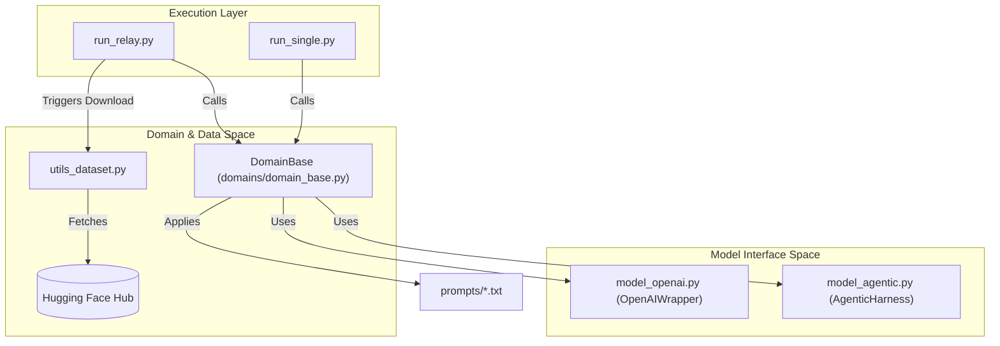
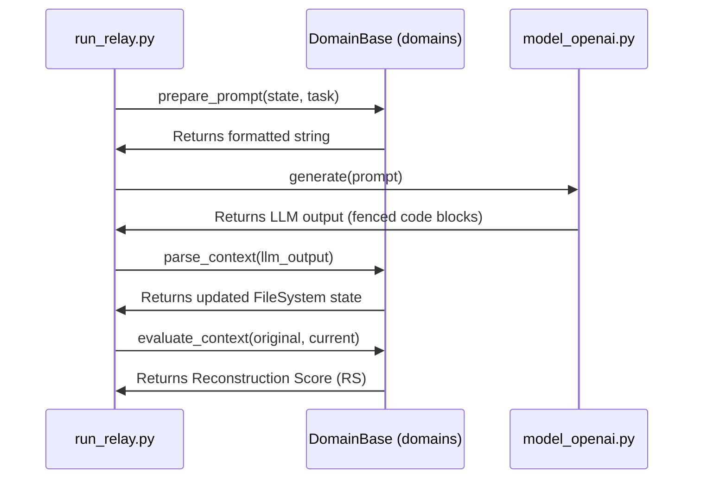

<!-- source: DeepWiki mcp.deepwiki.com · repo microsoft/delegate52 · page 1.1 Getting Started · fetched 2026-10-26 -->

# Getting Started

<details>
<summary>Relevant source files</summary>

The following files were used as context for generating this wiki page:

- [README.md](README.md)

</details>


This page provides a step-by-step guide for setting up the **DELEGATE-52** environment, installing dependencies, configuring API access, and executing your first round-trip relay simulation.

## Overview
The DELEGATE-52 repository is designed to evaluate how Large Language Models (LLMs) maintain document integrity over long-horizon delegated workflows [README.md:9-15](). It achieves this through a "relay" mechanism where a model performs a structural edit (forward) and then attempts to undo that edit (backward), repeating this cycle across multiple rounds [README.md:15-17]().

### Data Flow and System Components
The following diagram illustrates the relationship between the execution scripts, the model wrappers, and the domain-specific logic.

**System Architecture and Data Flow**

Sources: [README.md:19-24](), [domains/domain_base.py:1-20](), [utils_dataset.py:1-10]()

## Installation

### 1. Clone the Repository
Begin by cloning the source code from GitHub:
```sh
git clone https://github.com/microsoft/delegate52.git
cd delegate52
```
Sources: [README.md:61-64]()

### 2. Install Dependencies
The project requires Python 3.x and several domain-specific libraries for parsing various file formats (e.g., music notation, crystallography, CAD files).
```sh
pip install -r requirements.txt
```
Sources: [README.md:67-69]()

### 3. Configure API Keys
The benchmark primarily uses OpenAI or Azure OpenAI models. You must export your credentials as environment variables.

**For OpenAI:**
```sh
export OPENAI_API_KEY="your-key-here"
```

**For Azure OpenAI:**
```sh
export AZURE_OPENAI_API_KEY="your-key-here"
export AZURE_OPENAI_ENDPOINT="your-endpoint-here"
```
Sources: [README.md:72-78]()

## Loading the Dataset
The DELEGATE-52 dataset consists of 234 work environments across 48 redistributable domains [README.md:44-45]().

### Automatic Loading
When you run `run_relay.py` or `run_single.py`, the system calls `resolve_input_path()` in `utils_dataset.py`. This function automatically checks for a local file and, if missing, downloads the dataset from the Hugging Face Hub [README.md:85]().

### Manual Loading (Python)
You can interact with the dataset programmatically using the `huggingface_hub` library:

```python
from huggingface_hub import hf_hub_download
import json

path = hf_hub_download(repo_id="microsoft/delegate52", filename="delegate52.jsonl", repo_type="dataset")
with open(path) as f:
    samples = [json.loads(line) for line in f]
```
Sources: [README.md:48-57](), [utils_dataset.py:1-15]()

## Running Your First Simulation

The primary entry point for experiments is `run_relay.py`. This script manages the state-chain logic, iterating through "round-trips" (a forward edit followed by a backward edit).

### Execution Command
To run a simulation on the `subtitles` domain for 10 round-trips using `gpt-4o`:
```sh
python run_relay.py --model_names gpt-4o --domains subtitles --num_round_trips 10
```
Sources: [README.md:80-83]()

### Key Arguments
| Argument | Description |
| :--- | :--- |
| `--model_names` | List of models to evaluate (defined in `model_openai.py`). |
| `--domains` | Specific domains to run (e.g., `python`, `subtitles`, `accounting`). |
| `--num_round_trips` | Number of forward/backward cycles to perform. |
| `--num_workers` | Number of parallel processes for simulation. |
| `--skip_distractor` | If set, excludes distractor files from the LLM context. |

Sources: [README.md:80-90]()

## Implementation Details: The Relay Loop
The simulation relies on the `DomainBase` class to handle the transformation of raw data into LLM prompts and the subsequent parsing of model outputs.

**Relay Execution Logic**

Sources: [README.md:15-23](), [domains/domain_base.py:10-40]()

---

