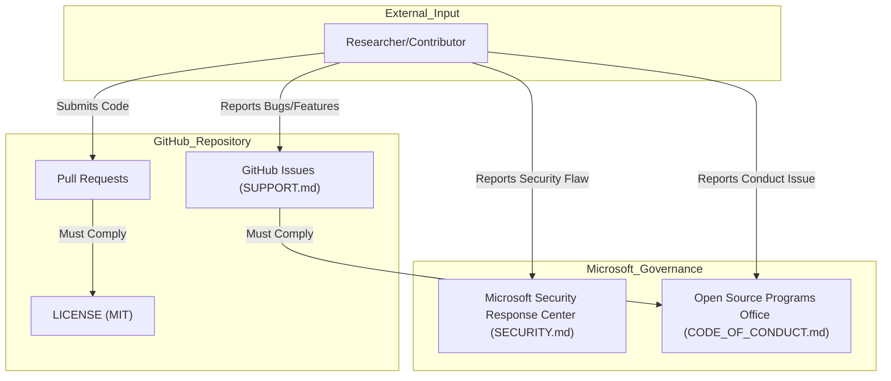

<!-- source: DeepWiki mcp.deepwiki.com · repo microsoft/delegate52 · page 1.3 Project Governance & Legal · fetched 2026-10-26 -->

# Project Governance & Legal

Relevant source files

The following files were used as context for generating this wiki page:

- [CODE_OF_CONDUCT.md](CODE_OF_CONDUCT.md)
- [LICENSE](LICENSE)
- [SECURITY.md](SECURITY.md)
- [SUPPORT.md](SUPPORT.md)

This page outlines the legal framework, community standards, and security protocols governing the DELEGATE-52 repository. As a Microsoft-managed open-source project, it adheres to corporate standards for licensing, behavioral conduct, and vulnerability disclosure to ensure a secure and collaborative research environment.

## Licensing

The DELEGATE-52 codebase is distributed under the **MIT License**. This is a permissive free software license that allows for reuse within proprietary software provided that all copies of the licensed software include a copy of the MIT License terms and the copyright notice.

### License Terms
The license grants permission, free of charge, to any person obtaining a copy of the software and associated documentation files to:
*   Deal in the software without restriction.
*   Use, copy, modify, merge, publish, distribute, sublicense, and/or sell copies.
*   Permit persons to whom the software is furnished to do so.

### Warranty Disclaimer
The software is provided "as is", without warranty of any kind, express or implied, including but not limited to the warranties of merchantability or fitness for a particular purpose [LICENSE:15-21]().

**Sources:**
* [LICENSE:1-21]()

---

## Code of Conduct

This project has adopted the **Microsoft Open Source Code of Conduct**. This policy defines the standard for interactions within the project's community, including issue tracking, pull requests, and discussions.

### Key Resources
*   **Full Policy:** [Microsoft Open Source Code of Conduct](https://opensource.microsoft.com/codeofconduct) [CODE_OF_CONDUCT.md:7]().
*   **FAQ:** [Microsoft Code of Conduct FAQ](https://opensource.microsoft.com/codeofconduct/faq) [CODE_OF_CONDUCT.md:8]().
*   **Reporting:** Questions or concerns regarding conduct should be directed to the Microsoft Open Source Programs Office at `opencode@microsoft.com` [CODE_OF_CONDUCT.md:9]().

**Sources:**
* [CODE_OF_CONDUCT.md:1-10]()

---

## Security Policy

Microsoft takes the security of the DELEGATE-52 repository seriously. The project follows the principle of **Coordinated Vulnerability Disclosure** [SECURITY.md:39]().

### Reporting Vulnerabilities
**Do not report security vulnerabilities through public GitHub issues** [SECURITY.md:11](). Instead, use the following channels:

1.  **MSRC Portal:** Report via the [Microsoft Security Response Center (MSRC)](https://msrc.microsoft.com/create-report) [SECURITY.md:13]().
2.  **Email:** Send reports to `secure@microsoft.com`. Encrypted communication is supported via the MSRC PGP key [SECURITY.md:15]().

### Submission Requirements
When reporting an issue, include the following technical details to facilitate triage:
*   **Issue Type:** (e.g., buffer overflow, injection) [SECURITY.md:21]().
*   **Source Location:** Full paths to affected files and specific tags/branches/commits [SECURITY.md:22-23]().
*   **Reproduction:** Step-by-step instructions and any special configurations [SECURITY.md:24-25]().
*   **Impact:** Proof-of-concept (PoC) code and an explanation of how an attacker might exploit the issue [SECURITY.md:26-27]().

### Response Process
The MSRC aims to respond within 24 hours [SECURITY.md:17](). High-quality reports may be eligible for the [Microsoft Bug Bounty Program](https://aka.ms/security.md/msrc/bounty) [SECURITY.md:31]().

**Sources:**
* [SECURITY.md:1-42]()

---

## Support and Contributions

The project utilizes GitHub's native features for community engagement and maintenance.

### Issue Tracking
GitHub Issues is the primary mechanism for:
*   **Bug Reports:** Identifying errors in the benchmark runners or domain evaluators.
*   **Feature Requests:** Proposing new domains, metrics, or model wrappers.
*   **Search First:** Users are requested to search existing issues before filing new ones to avoid duplicates [SUPPORT.md:5-7]().

### Communication Flow
The following diagram illustrates the relationship between community input and the repository's legal/governance entities.

**Community Engagement and Governance Flow**

**Sources:**
* [SUPPORT.md:1-10]()
* [SECURITY.md:13-15]()
* [CODE_OF_CONDUCT.md:9]()

### Technical Support
For specific questions regarding the usage of the DELEGATE-52 benchmark that are not covered in the documentation, users should refer to the contact information provided in the main `README.md` file [SUPPORT.md:9]().

**Sources:**
* [SUPPORT.md:3-10]()

---

