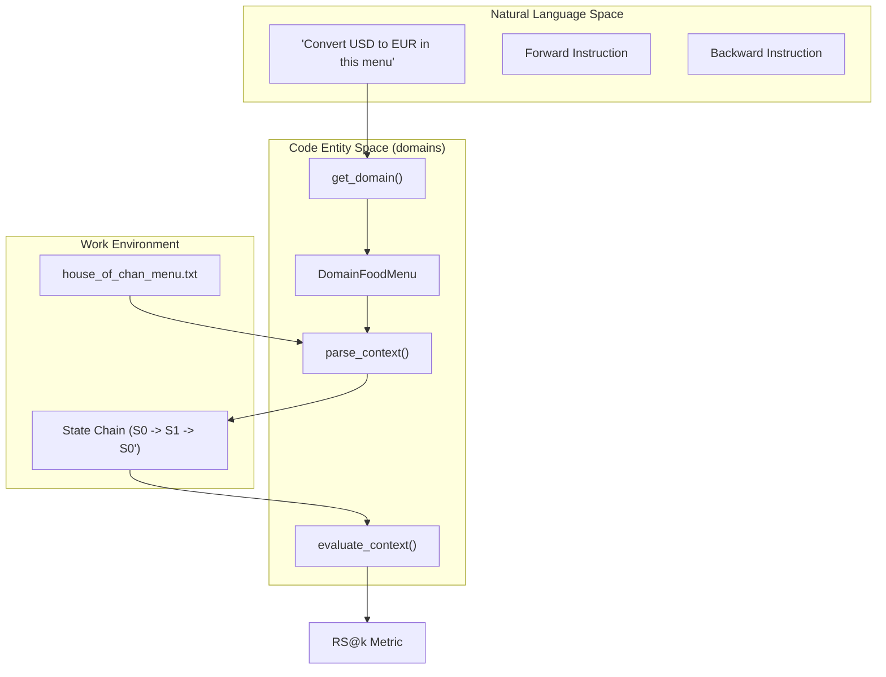
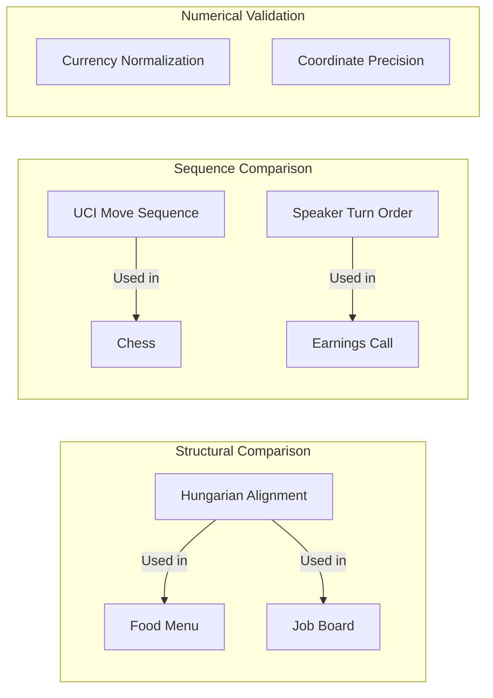

<!-- source: DeepWiki mcp.deepwiki.com · repo microsoft/delegate52 · page 3.6 Everyday Domains · fetched 2026-10-26 -->

# Everyday Domains

Relevant source files

The following files were used as context for generating this wiki page:

- [assets/domain_icons/chess.svg](assets/domain_icons/chess.svg)
- [assets/domain_icons/earncall.svg](assets/domain_icons/earncall.svg)
- [assets/domain_icons/foodmenu.svg](assets/domain_icons/foodmenu.svg)
- [assets/domain_icons/jobboard.svg](assets/domain_icons/jobboard.svg)
- [assets/domain_icons/landmarks.svg](assets/domain_icons/landmarks.svg)
- [assets/domain_icons/playlist.svg](assets/domain_icons/playlist.svg)
- [assets/domain_icons/recipe.svg](assets/domain_icons/recipe.svg)
- [assets/domain_icons/transit.svg](assets/domain_icons/transit.svg)
- [domain_viewer/chess.md](domain_viewer/chess.md)
- [domain_viewer/earncall.md](domain_viewer/earncall.md)
- [domain_viewer/foodmenu.md](domain_viewer/foodmenu.md)
- [domain_viewer/jobboard.md](domain_viewer/jobboard.md)
- [domain_viewer/landmarks.md](domain_viewer/landmarks.md)
- [domain_viewer/playlist.md](domain_viewer/playlist.md)

The **Everyday Domains** category consists of 8 domains representing structured data and documents commonly encountered in daily digital life. These domains range from recreational formats like chess notation and music playlists to professional documents like earnings call transcripts and job board listings.

The primary challenge in these domains is the preservation of structured relationships (e.g., speaker-to-dialogue, move-to-annotation, item-to-price) while performing complex transformations such as currency conversion, topic-based splitting, or anonymization.

## Domain Overview

| Domain | File Extension | Format Description | Primary Evaluation Strategy |
|:---|:---|:---|:---|
| **Chess** | `.pgn` | Portable Game Notation | Sequence matching of UCI moves and metadata validation. |
| **Earnings Call** | `.md` / `.txt` | Speaker-attributed transcripts | F1 score on financial metrics and speaker sequence matching. |
| **Food Menu** | `.txt` / `.yaml` | Restaurant menu listings | Hungarian matching of items with price/allergen penalties. |
| **Job Board** | `.csv` / `.txt` | Structured job postings | Weighted field similarity (salary, skills, title). |
| **Landmarks** | `.kml` | Keyhole Markup Language | XML-aware coordinate and metadata comparison. |
| **Playlist** | `.xspf` | XML Shareable Playlist | Track metadata and sequence integrity. |
| **Recipe** | `.yaml` | Cooking instructions | Ingredient quantity and step sequence matching. |
| **Transit** | `.txt` | GTFS (General Transit Feed) | Relational integrity across tabular transit data. |

**Sources:** [domain_viewer/chess.md:3-5](), [domain_viewer/earncall.md:3-5](), [domain_viewer/foodmenu.md:3-5](), [domain_viewer/jobboard.md:3-5]().

---

## Technical Implementation & Data Flow

Everyday domains inherit from the `DomainBase` class. They implement custom logic for parsing "dirty" LLM outputs (which may contain conversational filler) into structured objects that can be compared against ground-truth seed documents.

### System Architecture Diagram
The following diagram illustrates the flow from a Natural Language edit request to the evaluation of the resulting everyday domain document.

**Everyday Domain Processing Pipeline**

**Sources:** [domains/domain_base.py:1-50](), [domain_viewer/foodmenu.md:10-21]().

---

## Domain Details

### 1. Chess (.pgn)
The Chess domain focuses on PGN (Portable Game Notation). It tests the model's ability to handle algebraic notation, engine evaluations (`[%eval]`), and metadata headers.

*   **Key Class:** `DomainChess` (defined in `domains/domain_chess.py`).
*   **Edit Tasks:** Converting numeric evaluations to quality symbols (e.g., `?!`, `??`), splitting games by phase (Opening/Middlegame/Endgame), and FEN truncation [domain_viewer/chess.md:62-69]().
*   **Evaluation:** Uses `python-chess` to validate move sequences. 70% of the score is derived from move accuracy [domain_viewer/chess.md:16-23]().

### 2. Earnings Call (.txt)
Transcripts of quarterly corporate calls. These documents are highly sensitive to numerical accuracy and speaker attribution.

*   **Key Class:** `DomainEarncall` (defined in `domains/domain_earncall.py`).
*   **Edit Tasks:** Metric anonymization, converting USD to EUR, and reorganizing Q&A sections by topic rather than analyst [domain_viewer/earncall.md:47-54]().
*   **Evaluation:** Weighted formula: `0.40 × content + 0.35 × metrics + 0.25 × speaker_sequence` [domain_viewer/earncall.md:22]().

### 3. Food Menu (.txt)
Restaurant menus involving items, prices, and allergen markers.

*   **Key Class:** `DomainFoodMenu` (defined in `domains/domain_foodmenu.py`).
*   **Edit Tasks:** Global price adjustments (e.g., "increase chicken by 20%"), protein-based section splitting, and inferring allergen markers from descriptions [domain_viewer/foodmenu.md:82-89]().
*   **Evaluation:** Uses the **Hungarian Algorithm** to align items between the reconstructed and original menu. It applies penalties for mismatched prices (0.8 severity) or missing allergens (0.7 severity) [domain_viewer/foodmenu.md:18-21]().

### 4. Job Board (.txt)
Structured job listings typically separated by delimiters like `---`.

*   **Key Class:** `DomainJobboard` (defined in `domains/domain_jobboard.py`).
*   **Edit Tasks:** Salary band splitting, ATS JSON conversion, and company anonymization [domain_viewer/jobboard.md:101-110]().
*   **Evaluation:** Focuses on field accuracy (55%) and job coverage (20%). Salary comparison involves normalizing hourly rates to annual equivalents (2080 hours/year) [domain_viewer/jobboard.md:16-26]().

---

## Evaluation Strategies

The everyday domains utilize a variety of specialized evaluation metrics to ensure that "soft" edits (like rewriting a description) do not corrupt "hard" data (like a price or a chess move).

### Comparison Logic

### Reconstruction Score (RS@k)
For these domains, the `evaluate_context` function returns a value between 0.0 and 1.0. 
*   **Chess:** Scores are strictly binary on the move sequence but granular on annotations [domain_viewer/chess.md:18-21]().
*   **Food Menu:** Uses Jaccard similarity for sections and sequence similarity for item descriptions [domain_viewer/foodmenu.md:18-19]().

**Sources:** [domain_viewer/chess.md:16-23](), [domain_viewer/earncall.md:16-22](), [domain_viewer/foodmenu.md:16-21](), [domain_viewer/jobboard.md:14-26]().

---

