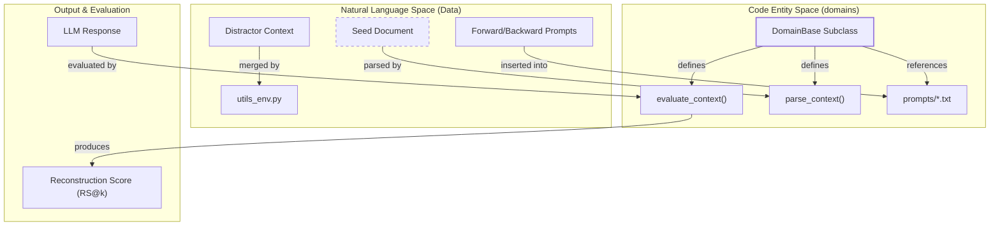

<!-- source: DeepWiki mcp.deepwiki.com · repo microsoft/delegate52 · page 8 Contributing New Domains & Environments · fetched 2026-10-26 -->

# Contributing New Domains & Environments

Relevant source files

The following files were used as context for generating this wiki page:

- [CODE_OF_CONDUCT.md](CODE_OF_CONDUCT.md)
- [README.md](README.md)
- [SUPPORT.md](SUPPORT.md)
- [domain_viewer/accounting.md](domain_viewer/accounting.md)

This page provides a high-level guide for researchers and developers who wish to expand the DELEGATE-52 benchmark. Contributions generally fall into two categories: adding new work environments to existing domains or implementing entirely new domains from scratch.

The benchmark is designed to be extensible, using a modular architecture where domains are defined as independent subclasses and work environments are structured as state-machine JSON objects.

## Overview of Contribution Types

| Contribution Type | Complexity | Key Requirements |
|:---|:---|:---|
| **New Work Environment** | Low | Seed document, reversible edit pairs, `sample.json` metadata. |
| **Domain Improvement** | Medium | Updates to `DomainBase` subclasses, refined regex/parsers, or better scoring. |
| **New Domain Implementation** | High | New `DomainBase` subclass, SVG icon, prompt template, and viewer page. |

## Adding Work Environments

Adding a work environment involves providing a "seed document" (the starting state) and a series of "reversible edit pairs." Each pair consists of a **forward** instruction (e.g., "Convert this CSV to JSON") and a **backward** instruction (e.g., "Convert this JSON back to the original CSV").

### Key Components
- **Seed Document**: A high-quality, professional document in the domain's format.
- **Reversible Edits**: 5–10 pairs of instructions that allow a "round-trip" back to the original state.
- **Distractor Context**: Optional additional files that provide realistic noise for the LLM to navigate.
- **Metadata**: Defining the environment in a `sample.json` file following the state-machine schema.

For step-by-step instructions on folder layout and schema requirements, see **[Adding Work Environments](#8.1)**.

**Sources:** [README.md:92-97](), [domain_viewer/accounting.md:91-106]()

## Implementing a New Domain

Creating a new domain requires implementing a Python class that inherits from `DomainBase`. This class defines how the document format is parsed, how statistics (like token counts) are calculated, and how the LLM's output is evaluated for fidelity.

### Implementation Requirements
1.  **Subclass `DomainBase`**: Implement `parse_context`, `compute_domain_statistics`, and `evaluate_context`.
2.  **Prompt Template**: Select or create a prompt in the `prompts/` directory to guide the LLM.
3.  **Visuals**: Design a 24x24 SVG icon in `assets/domain_icons/` and a documentation page in `domain_viewer/`.
4.  **Registration**: The system uses auto-discovery to load any subclass found in the `domains/` directory.

For technical details on the class methods and registration process, see **[Implementing a New Domain](#8.2)**.

**Sources:** [README.md:98-101](), [domain_viewer/accounting.md:10-23]()

## Technical Architecture for Contributions

The following diagram illustrates how new code entities (Domains) and data entities (Environments) integrate into the system.

### Integration Map: Code vs. Data

**Sources:** [README.md:13-24](), [domain_viewer/accounting.md:14-23]()

## Contribution Rules & Best Practices

To maintain the integrity of the benchmark, all contributions must adhere to these standards:

- **Seed Document Quality**: Documents should be representative of professional use cases and sufficiently complex (typically >50 lines).
- **Reversibility**: The "backward" edit must be logically capable of restoring the "start" state exactly.
- **Independence**: Edits should not rely on information that only exists in previous turns (to ensure they can be tested in isolation via `run_single.py`).
- **Legal Compliance**: Ensure all seed documents have licenses that allow redistribution (marked via `ok_to_redistribute: true`).

### The Pull Request Process
1.  **Validation**: Run `python run_single.py` on your new environment to ensure the instructions are clear enough for a top-tier model (e.g., GPT-4o) to succeed.
2.  **Documentation**: Add a corresponding `.md` file in `domain_viewer/` if adding a new domain.
3.  **CLA**: Sign the Microsoft Contributor License Agreement when prompted by the PR bot.

**Sources:** [README.md:103-107](), [CODE_OF_CONDUCT.md:1-10](), [SUPPORT.md:1-10]()

---

