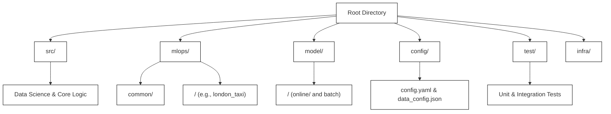
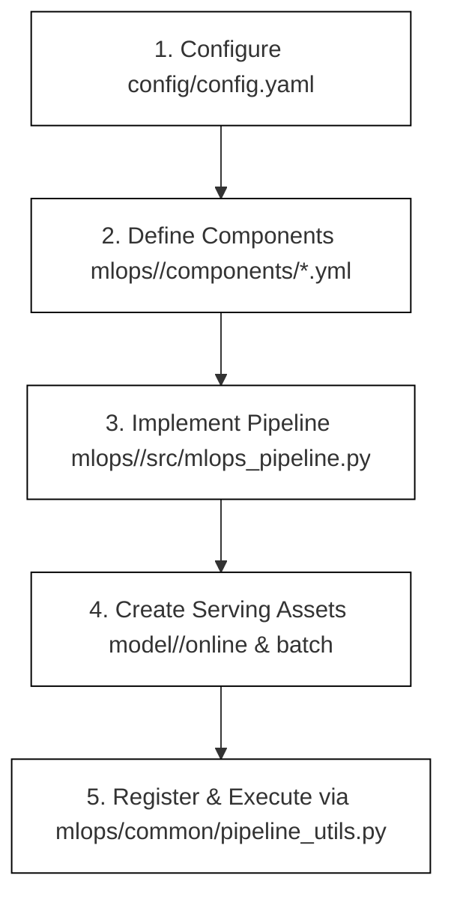

<!-- source: DeepWiki mcp.deepwiki.com · repo microsoft/dstoolkit-mlops-v2 · page 1.2 Repository Layout & Onboarding a New Model · fetched 2026-11-09 -->

# Repository Layout & Onboarding a New Model

<details>
<summary>Relevant source files</summary>

The following files were used as context for generating this wiki page:

- [.azure-pipelines/infra/bicep/infra_provision_bicep_pipeline.yml](.azure-pipelines/infra/bicep/infra_provision_bicep_pipeline.yml)
- [.azure-pipelines/infra/terraform/infra_provision_terraform_pipeline.yml](.azure-pipelines/infra/terraform/infra_provision_terraform_pipeline.yml)
- [.github/copilot-instructions.md](.github/copilot-instructions.md)
- [README.md](README.md)
- [docs/how-to/GettingStarted.md](docs/how-to/GettingStarted.md)
- [docs/how-to/OnboardingNewModel.md](docs/how-to/OnboardingNewModel.md)
- [docs/how-to/TestInitialSetup.md](docs/how-to/TestInitialSetup.md)

</details>


## Purpose & Scope
This page establishes the directory conventions for the `dstoolkit-mlops-v2` codebase and outlines the step-by-step engineering procedure required to onboard a new machine learning model type into the Model Factory framework. The architecture relies on Azure Machine Learning (AML) SDK v2, declarative YAML components, and a centralized configuration pattern managed by `MLOpsConfig`.

Sources: [README.md:1-18](), [.github/copilot-instructions.md:1-11]()

---

## Directory Conventions

The repository is structured into distinct functional domains separating infrastructure, machine learning orchestration, core model logic, configuration, and testing.


*Figure 1: High-level repository layout tree.*

### Key Directories
*   `src/`: Contains core data science and data processing code that operates independently of Azure ML deployment wrappers.
*   `mlops/`: Houses Azure ML pipeline orchestration scripts, component definitions, and execution wrappers. It includes `mlops/common/` for shared utilities and per-model modules (e.g., `mlops/london_taxi/`, `mlops/nyc_taxi/`, `mlops/docker_taxi/`) [README.md:7-14]().
*   `model/`: Stores deployment assets, including online and batch scoring scripts (`score.py`), environment specification files, and sample request payloads [README.md:8]().
*   `config/`: Holds global runtime configurations, notably `config/config.yaml` and `config/data_config.json` [README.md:43]().
*   `test/`: Contains the unit and integration test suite executed via `pytest` [.github/copilot-instructions.md:35]().

Sources: [README.md:7-15](), [.github/copilot-instructions.md:6-10]()

---

## Step-by-Step Process to Onboard a New Model Type

To integrate a new model type into the Model Factory, developers must configure execution parameters, define AML components, implement the pipeline orchestrator, and set up scoring assets.


*Figure 2: Natural Language Space to Code Entity Space for Model Onboarding.*

### Phase 1: Define Global Configuration Entries
Add pipeline and deployment configurations to `config/config.yaml`. Configuration blocks must follow the environment-suffixed convention (e.g., `_<env>` like `_pr` or `_dev`) so they can be resolved by `MLOpsConfig` [docs/how-to/OnboardingNewModel.md:43-94](), [.github/copilot-instructions.md:38]().

1.  **Pipeline Config**: Define `cluster_name`, `cluster_size`, `conda_path` or `dockerfile_path`, and `dataset_name` under `pipeline_configs` [docs/how-to/OnboardingNewModel.md:47-55]().
2.  **Deployment Config**: Define online and/or batch parameters (such as `score_file_name`, `endpoint_name`, `deployment_name`, and `deployment_vm_size`) under `deploy_configs` [docs/how-to/OnboardingNewModel.md:60-94]().

Sources: [docs/how-to/OnboardingNewModel.md:17-94](), [.github/copilot-instructions.md:21-23]()

### Phase 2: Create Azure ML Components
Under `mlops/<model>/components/`, create reusable YAML step definitions (e.g., `prep.yml`, `transform.yml`, `train.yml`, `predict.yml`, `score.yml`, `register.yml`) [docs/how-to/OnboardingNewModel.md:95](), [.github/copilot-instructions.md:25](). These components reference the shared base environments or custom Docker build contexts.

*   *Gotcha*: Do not hardcode environment names inside component YAMLs if pipeline code overrides them dynamically using `comp.environment = environment_name` [.github/copilot-instructions.md:25](), [.github/copilot-instructions.md:39]().

Sources: [.github/copilot-instructions.md:25](), [.github/copilot-instructions.md:39]()

### Phase 3: Implement Pipeline Construction Logic
Create `mlops/<model>/src/mlops_pipeline.py` adhering to the standard pipeline builder pattern [docs/how-to/OnboardingNewModel.md:95](), [.github/copilot-instructions.md:24]().

*   Load components using `azure.ai.ml.load_component` [.github/copilot-instructions.md:25]().
*   Construct the pipeline graph (connecting prep, train, register steps) inside a class or module matching existing examples like `LondonTaxi.construct_pipeline` [.github/copilot-instructions.md:25]().
*   Provide a local execution entry point `mlops/<model>/start_local_pipeline.py` that invokes `prepare_and_execute(...)` [.github/copilot-instructions.md:19]().

Sources: [.github/copilot-instructions.md:24-27]()

### Phase 4: Package Model Scoring and Serving Assets
Create the deployment package under `model/<model>/` [README.md:8](), [.github/copilot-instructions.md:29]():
*   `model/<model>/online/score.py`: Implements `init()` and `run(mini_batch)` or online request handling.
*   `model/<model>/batch/score.py`: Batch scoring entry point.
*   Conda environment specifications or Dockerfiles required for model inference.

Sources: [.github/copilot-instructions.md:29]()

### Phase 5: Register and Validate
Execute the data registration step if a new dataset is introduced [README.md:72]():
```bash
python -m mlops.common.register_data_asset --data_config_path config/data_config.json
```
Run the newly created model pipeline locally to verify the end-to-end integration [README.md:74]():
```bash
python -m mlops.<model_name>.start_local_pipeline --build_environment pr --wait_for_completion True
```

Sources: [README.md:72-74](), [.github/copilot-instructions.md:15-18]()

---

