# Page: Overview

# Overview

<details>
<summary>Relevant source files</summary>

The following files were used as context for generating this wiki page:

- [.azure-pipelines/infra/bicep/infra_provision_bicep_pipeline.yml](.azure-pipelines/infra/bicep/infra_provision_bicep_pipeline.yml)
- [.azure-pipelines/infra/terraform/infra_provision_terraform_pipeline.yml](.azure-pipelines/infra/terraform/infra_provision_terraform_pipeline.yml)
- [README.md](README.md)
- [docs/design-decisions/ModelPromotion.md](docs/design-decisions/ModelPromotion.md)
- [docs/how-to/GettingStarted.md](docs/how-to/GettingStarted.md)
- [docs/how-to/OnboardingNewModel.md](docs/how-to/OnboardingNewModel.md)
- [docs/how-to/TestInitialSetup.md](docs/how-to/TestInitialSetup.md)
- [docs/media/conceptual-overview.png](docs/media/conceptual-overview.png)
- [docs/media/dataset-lifecycle.png](docs/media/dataset-lifecycle.png)
- [docs/media/github-workflows.png](docs/media/github-workflows.png)
- [docs/media/model-factory-workflow.png](docs/media/model-factory-workflow.png)

</details>


Model Factory (`dstoolkit-mlops-v2`) is an enterprise-grade MLOps template designed to operationalize Azure Machine Learning (AML) models using GitHub Actions or Azure DevOps [README.md:1-6](), [docs/how-to/GettingStarted.md:1-8](). It provides a repeatable structure for data science teams and software engineers to provision infrastructure, track and register datasets, execute training pipelines, and deploy models to batch and online endpoints with robust software engineering practices.

## High-Level Topology & Architecture

The repository is structured around distinct directories handling source code, orchestration logic, model deployment definitions, configuration, and infrastructure. 

### Diagram: Model Factory Topology & Code Entities
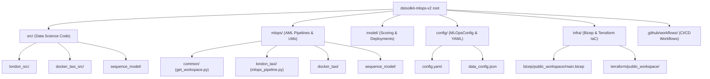
Sources: `README.md:7-15`, `config/config.yaml:1-50`

### Diagram: Operational Execution Workflow
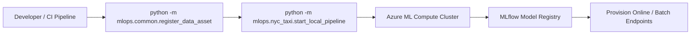
Sources: `README.md:37-75`, `docs/how-to/GettingStarted.md:1-8`

---

## 1.1. Getting Started & Local Development

Setting up a local development environment involves configuring environment variables, establishing a workspace via DevContainers or Conda, and executing pipelines locally or via automated triggers [README.md:31-75](). Developers can initialize their environment using `.env` configurations (`SUBSCRIPTION_ID`, `RESOURCE_GROUP_NAME`, `WORKSPACE_NAME`) and run registration scripts like `python -m mlops.common.register_data_asset` [README.md:39-73]().

For detailed instructions on configuring your `.env` file, launching via VS Code DevContainers, setting up Conda environments, and running pipelines locally using `start_local_pipeline`, see [Getting Started & Local Development](#1.1).

Sources: `README.md:31-75`, `docs/how-to/GettingStarted.md:1-77`

---

## 1.2. Repository Layout & Onboarding a New Model

The codebase organizes responsibilities into `src/` for pure data science scripts, `mlops/` for Azure ML pipeline definitions and component wiring, `model/` for serving scoring assets, and `config/` for centralized yaml parameters [README.md:7-15](), [docs/how-to/OnboardingNewModel.md:1-26](). Onboarding a new model type requires defining execution properties in `config/config.yaml`, writing step scripts under `src/`, creating pipeline wrappers in `mlops/`, and adding scoring scripts under `model/`.

For a complete walkthrough of directory conventions and the step-by-step procedure to introduce a new model into the factory, see [Repository Layout & Onboarding a New Model](#1.2).

Sources: `README.md:7-15`, `docs/how-to/OnboardingNewModel.md:1-96`

---

## 1.3. Project Governance & Contributing

Model Factory maintains strict code quality and security standards through pre-commit hooks, linting configurations, standard licensing terms (`LICENSE.md`), and clear vulnerability reporting guidelines (`SECURITY.md`) [README.md:27-29](). Contributions follow a standardized pull request validation workflow and adherence to project codes of conduct.

For details on licensing, contribution workflows, security policies, and code linting setups, see [Project Governance & Contributing](#1.3).

Sources: `README.md:27-29`, `CONTRIBUTING.md:1-50`, `SECURITY.md:1-30`

---

# Page: Getting Started & Local Development

# Getting Started & Local Development

<details>
<summary>Relevant source files</summary>

The following files were used as context for generating this wiki page:

- [.devcontainer/base/requirements.txt](.devcontainer/base/requirements.txt)
- [.env.sample](.env.sample)
- [.vscode/launch.json](.vscode/launch.json)
- [docs/how-to/GettingStarted.md](docs/how-to/GettingStarted.md)
- [docs/how-to/OnboardingNewModel.md](docs/how-to/OnboardingNewModel.md)
- [docs/how-to/TestInitialSetup.md](docs/how-to/TestInitialSetup.md)
- [mlops/common/naming_utils.py](mlops/common/naming_utils.py)
- [mlops/common/pipeline_job_config.py](mlops/common/pipeline_job_config.py)
- [mlops/common/pipeline_utils.py](mlops/common/pipeline_utils.py)
- [mlops/docker_taxi/src/mlops_pipeline.py](mlops/docker_taxi/src/mlops_pipeline.py)
- [mlops/docker_taxi/start_local_pipeline.py](mlops/docker_taxi/start_local_pipeline.py)
- [mlops/london_taxi/start_local_pipeline.py](mlops/london_taxi/start_local_pipeline.py)

</details>


## Purpose and Scope
This page details the developer setup and local environment configuration required to run, debug, and test Azure Machine Learning (AML) pipelines within the Model Factory (`dstoolkit-mlops-v2`) repository. It covers environment variable provisioning via `.env`, containerized development using devcontainers and pip requirements, IDE integration via VS Code launch tasks, and local pipeline execution leveraging entry-point scripts such as `start_local_pipeline.py`.

---

## 1. Environment Variables & Configuration Setup
Model Factory relies on Azure Machine Learning workspaces and cloud resources. Before running pipelines locally, you must configure your local environment variables.

### The `.env` File
Copy `.env.sample` to `.env` in the repository root and populate the required Azure identifiers:
* `SUBSCRIPTION_ID`: Azure subscription ID hosting the AML workspace.
* `RESOURCE_GROUP_NAME`: Name of the Azure resource group.
* `WORKSPACE_NAME`: Name of the target Azure ML workspace.
* `BUILD_BUILDID`: Defaults to `"local"` for local development runs [/.env.sample:1-5()].

Additional infrastructure parameters required by provisioning workflows and configuration classes are documented in `docs/how-to/GettingStarted.md` [docs/how-to/GettingStarted.md:35-46(), docs/how-to/GettingStarted.md:67-78()].

Sources: `[.env.sample:1-4](), [docs/how-to/GettingStarted.md:35-46](), [docs/how-to/GettingStarted.md:67-78]()`

---

## 2. Dependencies & Development Containers
Python dependencies required for Azure ML SDK v2 operations (`azure-ai-ml`, `azure-cli`, `azure-identity`), MLflow integration (`mlflow-skinny`, `azureml-mlflow`), and testing (`pytest`) are defined in `.devcontainer/base/requirements.txt` [/.devcontainer/base/requirements.txt:1-25()]. 

Developers can utilize VS Code Devcontainers, which automatically provision an environment containing the CLI tools and Python packages specified in `.devcontainer/base/requirements.txt`. Alternatively, create a local Conda or virtual environment and install the requirements via:
```bash
pip install -r .devcontainer/base/requirements.txt
```

Sources: `[.devcontainer/base/requirements.txt:1-25]()`

---

## 3. VS Code Launch Tasks & Debugging
The repository provides pre-configured debugging profiles in `.vscode/launch.json` [/.vscode/launch.json:1-51()]. These configurations enable interactive debugging of data registration and local model pipeline execution.

### Launch Configurations and Inputs
The launch tasks use dynamic input pickers (`build_environment` set to `pr` or `dev`, and `wait_for_completion` set to `True` or `False`) to pass runtime arguments to the modules [/.vscode/launch.json:52-73()].

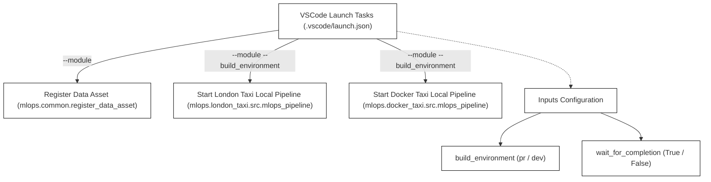
*Figure 1: VS Code Launch Task Architecture mapping launch targets to Python modules.*

Sources: `[.vscode/launch.json:1-73]()`

---

## 4. Running Pipelines Locally via `start_local_pipeline`
Local pipeline execution is initialized through model-specific wrapper scripts (e.g., `mlops/london_taxi/start_local_pipeline.py` and `mlops/docker_taxi/start_local_pipeline.py`), which invoke `prepare_and_execute` [/.vscode/launch.json:30-50(), mlops/london_taxi/start_local_pipeline.py:1-6(), mlops/docker_taxi/src/mlops_pipeline.py:117-179()].

### Execution Flow
When a local pipeline script runs:
1. `mlops_pipeline.prepare_and_execute()` initializes `MLOpsConfig` with the target environment (`pr` or `dev`) [mlops/docker_taxi/src/mlops_pipeline.py:129()].
2. It instantiates the pipeline job configuration class (e.g., `DockerTaxi` extending `PipelineJobConfig`) [mlops/docker_taxi/src/mlops_pipeline.py:134-143(), mlops/common/pipeline_job_config.py:4-39()].
3. It delegates execution to `prepare_and_execute_pipeline()` in `mlops/common/pipeline_utils.py` [mlops/docker_taxi/src/mlops_pipeline.py:145(), mlops/common/pipeline_utils.py:161-187()].
4. `prepare_and_execute_pipeline()` authenticates via `DefaultAzureCredential`, retrieves compute targets using `get_compute()`, and submits the Azure ML pipeline job via `MLClient.jobs.create_or_update()` [mlops/common/pipeline_utils.py:168-187()].

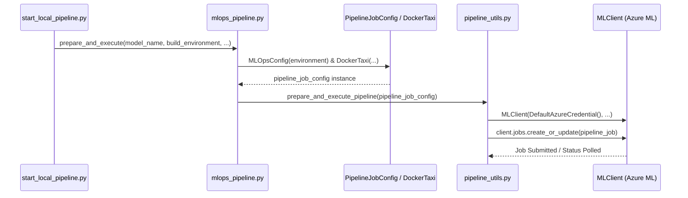
*Figure 2: Sequence flow of local pipeline execution bridging natural language invocation to `pipeline_utils.py` and `MLClient`.*

Sources: `[mlops/london_taxi/start_local_pipeline.py:1-5](), [mlops/docker_taxi/src/mlops_pipeline.py:117-179](), [mlops/common/pipeline_utils.py:161-187](), [mlops/common/pipeline_job_config.py:4-38]()`

---

# Page: Repository Layout & Onboarding a New Model

# Repository Layout & Onboarding a New Model

<details>
<summary>Relevant source files</summary>

The following files were used as context for generating this wiki page:

- [.azure-pipelines/infra/bicep/infra_provision_bicep_pipeline.yml](.azure-pipelines/infra/bicep/infra_provision_bicep_pipeline.yml)
- [.azure-pipelines/infra/terraform/infra_provision_terraform_pipeline.yml](.azure-pipelines/infra/terraform/infra_provision_terraform_pipeline.yml)
- [.github/copilot-instructions.md](.github/copilot-instructions.md)
- [README.md](README.md)
- [docs/how-to/GettingStarted.md](docs/how-to/GettingStarted.md)
- [docs/how-to/OnboardingNewModel.md](docs/how-to/OnboardingNewModel.md)
- [docs/how-to/TestInitialSetup.md](docs/how-to/TestInitialSetup.md)

</details>


## Purpose & Scope
This page establishes the directory conventions for the `dstoolkit-mlops-v2` codebase and outlines the step-by-step engineering procedure required to onboard a new machine learning model type into the Model Factory framework. The architecture relies on Azure Machine Learning (AML) SDK v2, declarative YAML components, and a centralized configuration pattern managed by `MLOpsConfig`.

Sources: [README.md:1-18](), [.github/copilot-instructions.md:1-11]()

---

## Directory Conventions

The repository is structured into distinct functional domains separating infrastructure, machine learning orchestration, core model logic, configuration, and testing.

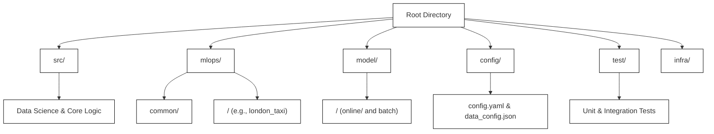
*Figure 1: High-level repository layout tree.*

### Key Directories
*   `src/`: Contains core data science and data processing code that operates independently of Azure ML deployment wrappers.
*   `mlops/`: Houses Azure ML pipeline orchestration scripts, component definitions, and execution wrappers. It includes `mlops/common/` for shared utilities and per-model modules (e.g., `mlops/london_taxi/`, `mlops/nyc_taxi/`, `mlops/docker_taxi/`) [README.md:7-14]().
*   `model/`: Stores deployment assets, including online and batch scoring scripts (`score.py`), environment specification files, and sample request payloads [README.md:8]().
*   `config/`: Holds global runtime configurations, notably `config/config.yaml` and `config/data_config.json` [README.md:43]().
*   `test/`: Contains the unit and integration test suite executed via `pytest` [.github/copilot-instructions.md:35]().

Sources: [README.md:7-15](), [.github/copilot-instructions.md:6-10]()

---

## Step-by-Step Process to Onboard a New Model Type

To integrate a new model type into the Model Factory, developers must configure execution parameters, define AML components, implement the pipeline orchestrator, and set up scoring assets.

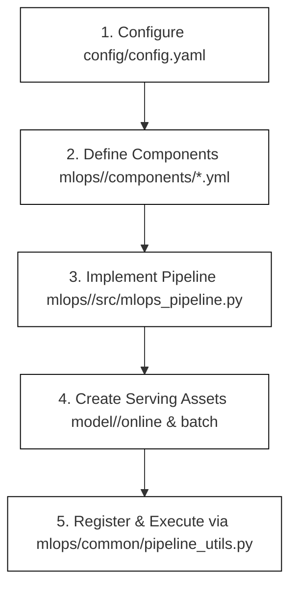
*Figure 2: Natural Language Space to Code Entity Space for Model Onboarding.*

### Phase 1: Define Global Configuration Entries
Add pipeline and deployment configurations to `config/config.yaml`. Configuration blocks must follow the environment-suffixed convention (e.g., `_<env>` like `_pr` or `_dev`) so they can be resolved by `MLOpsConfig` [docs/how-to/OnboardingNewModel.md:43-94](), [.github/copilot-instructions.md:38]().

1.  **Pipeline Config**: Define `cluster_name`, `cluster_size`, `conda_path` or `dockerfile_path`, and `dataset_name` under `pipeline_configs` [docs/how-to/OnboardingNewModel.md:47-55]().
2.  **Deployment Config**: Define online and/or batch parameters (such as `score_file_name`, `endpoint_name`, `deployment_name`, and `deployment_vm_size`) under `deploy_configs` [docs/how-to/OnboardingNewModel.md:60-94]().

Sources: [docs/how-to/OnboardingNewModel.md:17-94](), [.github/copilot-instructions.md:21-23]()

### Phase 2: Create Azure ML Components
Under `mlops/<model>/components/`, create reusable YAML step definitions (e.g., `prep.yml`, `transform.yml`, `train.yml`, `predict.yml`, `score.yml`, `register.yml`) [docs/how-to/OnboardingNewModel.md:95](), [.github/copilot-instructions.md:25](). These components reference the shared base environments or custom Docker build contexts.

*   *Gotcha*: Do not hardcode environment names inside component YAMLs if pipeline code overrides them dynamically using `comp.environment = environment_name` [.github/copilot-instructions.md:25](), [.github/copilot-instructions.md:39]().

Sources: [.github/copilot-instructions.md:25](), [.github/copilot-instructions.md:39]()

### Phase 3: Implement Pipeline Construction Logic
Create `mlops/<model>/src/mlops_pipeline.py` adhering to the standard pipeline builder pattern [docs/how-to/OnboardingNewModel.md:95](), [.github/copilot-instructions.md:24]().

*   Load components using `azure.ai.ml.load_component` [.github/copilot-instructions.md:25]().
*   Construct the pipeline graph (connecting prep, train, register steps) inside a class or module matching existing examples like `LondonTaxi.construct_pipeline` [.github/copilot-instructions.md:25]().
*   Provide a local execution entry point `mlops/<model>/start_local_pipeline.py` that invokes `prepare_and_execute(...)` [.github/copilot-instructions.md:19]().

Sources: [.github/copilot-instructions.md:24-27]()

### Phase 4: Package Model Scoring and Serving Assets
Create the deployment package under `model/<model>/` [README.md:8](), [.github/copilot-instructions.md:29]():
*   `model/<model>/online/score.py`: Implements `init()` and `run(mini_batch)` or online request handling.
*   `model/<model>/batch/score.py`: Batch scoring entry point.
*   Conda environment specifications or Dockerfiles required for model inference.

Sources: [.github/copilot-instructions.md:29]()

### Phase 5: Register and Validate
Execute the data registration step if a new dataset is introduced [README.md:72]():
```bash
python -m mlops.common.register_data_asset --data_config_path config/data_config.json
```
Run the newly created model pipeline locally to verify the end-to-end integration [README.md:74]():
```bash
python -m mlops.<model_name>.start_local_pipeline --build_environment pr --wait_for_completion True
```

Sources: [README.md:72-74](), [.github/copilot-instructions.md:15-18]()

---

# Page: Project Governance & Contributing

# Project Governance & Contributing

<details>
<summary>Relevant source files</summary>

The following files were used as context for generating this wiki page:

- [.pre-commit-config.yaml](.pre-commit-config.yaml)
- [CODE_OF_CONDUCT.md](CODE_OF_CONDUCT.md)
- [CONTRIBUTING.md](CONTRIBUTING.md)
- [LICENSE](LICENSE)
- [SECURITY.md](SECURITY.md)
- [SUPPORT.md](SUPPORT.md)
- [pyproject.toml](pyproject.toml)

</details>


## Purpose and Scope
This document outlines the governance, licensing, contribution workflows, security policies, and automated quality gates governing the `dstoolkit-mlops-v2` repository (Model Factory). It establishes the operational contract between contributors and maintainers, defining compliance checks, static code analysis configurations, and vulnerability reporting procedures.

Sources: `CONTRIBUTING.md:1-76` [CONTRIBUTING.md:1-75](), `LICENSE:1-21` [LICENSE:1-21]()

---

## 1. Licensing & Legal Framework

The codebase operates under a multi-license model comprising the MIT License, Mozilla Public License 2.0 (MPL 2.0), and BSD-3-Clause [LICENSE:1-42](). Third-party dependency licenses are audited and enforced using `pylic` configuration within `pyproject.toml` [pyproject.toml:1-16]().

### License Compliance Architecture
The `pylic` tool inspects installed packages against an explicit whitelist of safe open-source licenses and ignores internal or known operational dependencies that lack standard metadata [pyproject.toml:1-25]().

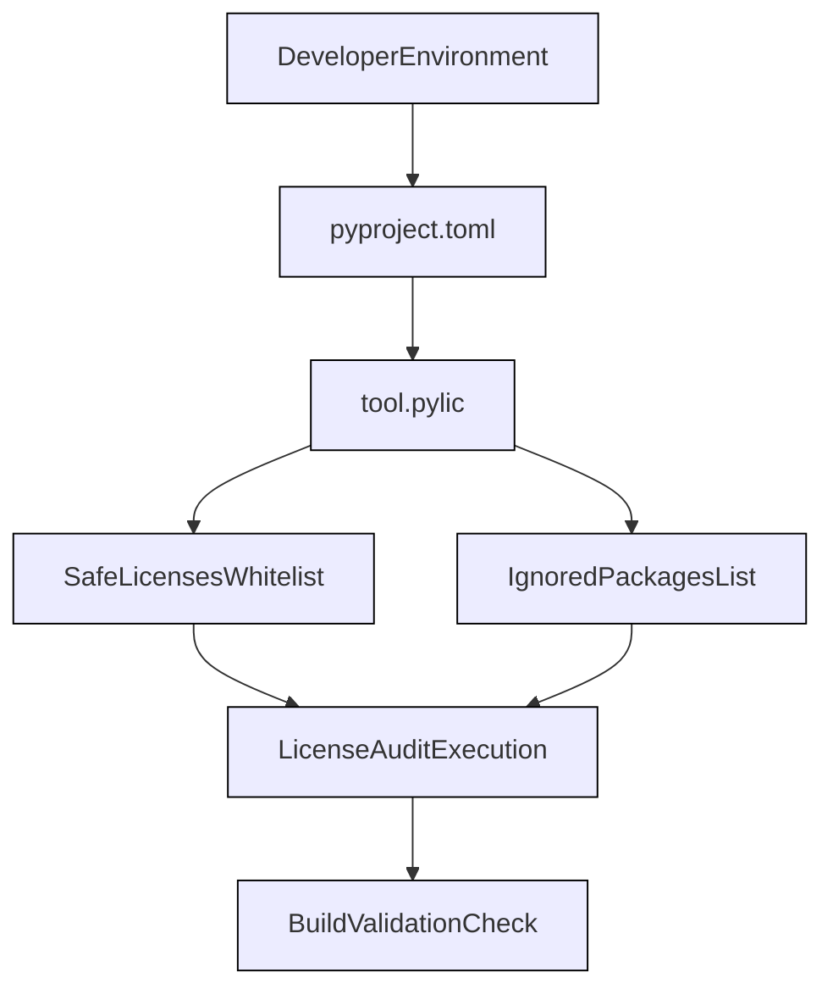
*Figure 1: License audit pipeline configuration mapping tool definitions to compliance enforcement.*

Sources: `pyproject.toml:1-25` [pyproject.toml:1-25](), `LICENSE:1-42` [LICENSE:1-42]()

---

## 2. Contribution Workflow & Pull Request Lifecycle

Contributing to Model Factory requires following a structured lifecycle managed via GitHub forks, feature branching, and automated validation gates [CONTRIBUTING.md:1-62](). 

### Contribution Flow
1. **Fork & Clone**: Fork `dstoolkit-mlops-v2` and clone locally using standard git commands [CONTRIBUTING.md:6-16]().
2. **Environment Setup**: Install dependencies including Conda, Python 3.8, and Azure ML SDK v2 [CONTRIBUTING.md:21-23]().
3. **Branching**: Create a descriptive feature branch `git checkout -b [branch-name]` [CONTRIBUTING.md:24-30]().
4. **Validation**: Execute local tests, linting, and pipeline builds before pushing [CONTRIBUTING.md:35-37]().
5. **Pull Request**: Open a PR targeting the `develop` branch [CONTRIBUTING.md:48-52](). PRs require passing build validation and maintainer review [CONTRIBUTING.md:52-55]().
6. **CLA Integration**: Automated bots verify Contributor License Agreement (CLA) status upon PR submission [CONTRIBUTING.md:69-73]().

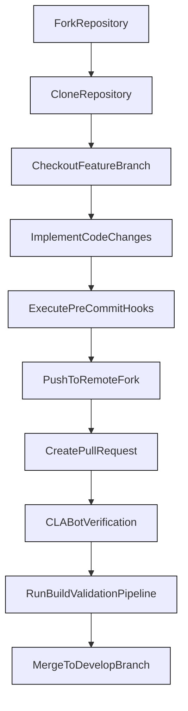
*Figure 2: Natural language to code entity space mapping for the contribution lifecycle.*

Sources: `CONTRIBUTING.md:1-73` [CONTRIBUTING.md:1-73]()

---

## 3. Code Quality, Linting & Pre-Commit Hooks

To maintain consistent coding styles and prevent regressions, the repository enforces strict linting and formatting standards configured in `.pre-commit-config.yaml` [`.pre-commit-config.yaml:1-14`].

### Configured Pre-Commit Hooks
* **Black (`ambv/black`)**: Opinionated code formatter enforced at version `24.1.1` [`.pre-commit-config.yaml:2-5`].
* **Flake8 (`PyCQA/flake8`)**: Style guide enforcement at version `7.0.0` [`.pre-commit-config.yaml:6-9`].
* **isort (`timothycrosley/isort`)**: Import sorting utility at version `5.13.2` [`.pre-commit-config.yaml:10-14`].

Sources: `.pre-commit-config.yaml:1-14` [`.pre-commit-config.yaml:1-14`]()

---

## 4. Security, Support & Code of Conduct

### Security Vulnerability Reporting
Security issues must not be reported via public GitHub issues [SECURITY.md:9-11](). Vulnerabilities should be submitted directly to the Microsoft Security Response Center (MSRC) via [https://msrc.microsoft.com/create-report](https://msrc.microsoft.com/create-report) or encrypted via PGP email to `secure@microsoft.com` [SECURITY.md:12-16](). Reports should include detailed reproduction steps, affected file paths, and potential impacts [SECURITY.md:19-28]().

Sources: `SECURITY.md:1-42` [SECURITY.md:1-41]()

### Support Policy
Support for Model Factory is community-driven and restricted to issues tracked via GitHub Issues [SUPPORT.md:1-11](). 

Sources: `SUPPORT.md:1-12` [SUPPORT.md:1-11]()

### Code of Conduct
All participants must adhere to the Microsoft Open Source Code of Conduct (`CODE_OF_CONDUCT.md`) [CODE_OF_CONDUCT.md:1-9](). Inquiries or concerns can be directed to `opencode@microsoft.com` [CODE_OF_CONDUCT.md:9]().

Sources: `CODE_OF_CONDUCT.md:1-10` [CODE_OF_CONDUCT.md:1-9](), `CONTRIBUTING.md:74-76` [CONTRIBUTING.md:74-75]()

---

# Page: Configuration System

# Configuration System

<details>
<summary>Relevant source files</summary>

The following files were used as context for generating this wiki page:

- [config/config.yaml](config/config.yaml)
- [config/data_config.json](config/data_config.json)
- [mlops/common/config_utils.py](mlops/common/config_utils.py)
- [mlops/london_taxi/src/mlops_pipeline.py](mlops/london_taxi/src/mlops_pipeline.py)
- [mlops/sequence_model/src/mlops_pipeline.py](mlops/sequence_model/src/mlops_pipeline.py)
- [model/london_taxi/batch_test_data/london_taxi.csv](model/london_taxi/batch_test_data/london_taxi.csv)
- [model/london_taxi/online_test_data/sample-request.json](model/london_taxi/online_test_data/sample-request.json)

</details>


## Purpose and Scope
The Configuration System provides a centralized, configuration-driven approach for managing Azure Machine Learning (AML) environments, pipeline definitions, deployment parameters, and data assets within `dstoolkit-mlops-v2`. Instead of hardcoding infrastructure or pipeline parameters, the platform relies on `config.yaml` [config/config.yaml:1-178] and `data_config.json` [config/data_config.json:1-45], parsed and resolved at runtime by configuration utility classes in `mlops/common/config_utils.py` [mlops/common/config_utils.py:9-147].

This page serves as a high-level parent overview of the configuration system. For granular implementation details, schema breakdowns, and data registration workflows, please refer to the child pages:
- [config.yaml and MLOpsConfig](#2.1)
- [Data Assets & Registration](#2.2)

---

## Configuration Architecture Overview

The configuration framework bridges raw environment variables, YAML configuration files, and dataset registration manifests into structured Python objects utilized by AML pipeline builders and deployment scripts.

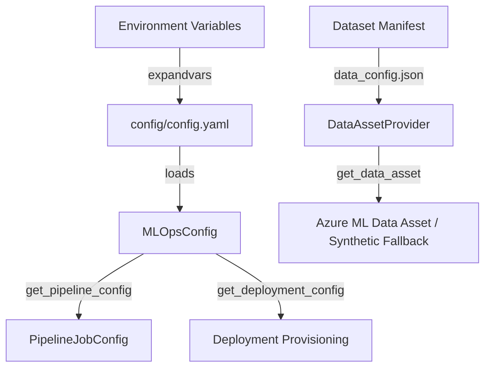
*Figure 1: Configuration Flow from Environment and Files to Pipeline Execution.*

Sources: [config/config.yaml:1-178](), [mlops/common/config_utils.py:9-147](), [config/data_config.json:1-45]()

---

## Core Configuration Components

### 1. `config.yaml` Structure
The primary configuration file located at `config/config.yaml` [config/config.yaml:1-178] defines four primary sections:
- **`aml_config`**: Core Azure subscription, resource group, and workspace identifiers utilizing environment variable expansion (e.g., `${SUBSCRIPTION_ID}`) [config/config.yaml:2-6].
- **`environment_configuration`**: Base container images and build identifiers like `${BUILD_BUILDID}` [config/config.yaml:7-10].
- **`pipeline_configs`**: Per-model and per-environment pipeline specifications (clusters, conda paths, dataset bindings, and synthetic fallback parameters) [config/config.yaml:11-71].
- **`deployment_configs`**: Online and batch scoring configurations, endpoint names, VM sizes, and scoring script directories [config/config.yaml:72-178].

### 2. `MLOpsConfig` Utility Class
Defined in `mlops/common/config_utils.py` [mlops/common/config_utils.py:108-147], the `MLOpsConfig` class loads the YAML configuration, processes environment variables via `os.path.expandvars`, and provides helper methods such as `get_pipeline_config(pipeline_name)` and `get_deployment_config(deployment_name)` scoped to active execution environments (e.g., `pr`, `dev`).

### 3. `DataAssetProvider` & `data_config.json`
Data asset definitions are cataloged in `config/data_config.json` [config/data_config.json:1-45] and registered via utility scripts. At pipeline construction time, `DataAssetProvider` [mlops/common/config_utils.py:9-106] handles fetching registered data assets from Azure ML, offering automatic synthetic data fallback when assets are absent or local testing is enabled.

Sources: [config/config.yaml:1-178](), [mlops/common/config_utils.py:9-147](), [config/data_config.json:1-45]()

---

## Code Entity Mapping

The diagram below connects natural language concepts of configuration management to their concrete code entities within the repository.

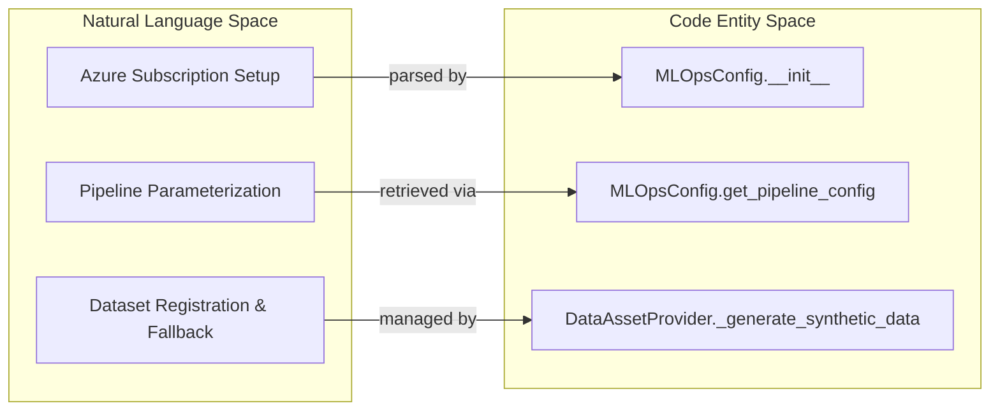
*Figure 2: Mapping configuration concepts to codebase classes and methods.*

Sources: [mlops/common/config_utils.py:9-147]()

---

## Child Pages

- [config.yaml and MLOpsConfig](#2.1) — Detailed schema breakdown of `aml_config`, `environment_configuration`, `pipeline_configs`, and `deployment_configs`, alongside programmatic usage of `MLOpsConfig`.
- [Data Assets & Registration](#2.2) — Comprehensive guide to `data_config.json`, `register_data_asset.py`, dataset workflows, and `DataAssetProvider` synthetic fallback behavior.

---

# Page: config.yaml and MLOpsConfig

# config.yaml and MLOpsConfig

<details>
<summary>Relevant source files</summary>

The following files were used as context for generating this wiki page:

- [config/config.yaml](config/config.yaml)
- [mlops/common/config_utils.py](mlops/common/config_utils.py)
- [mlops/london_taxi/src/mlops_pipeline.py](mlops/london_taxi/src/mlops_pipeline.py)
- [mlops/sequence_model/src/mlops_pipeline.py](mlops/sequence_model/src/mlops_pipeline.py)
- [vars.json](vars.json)

</details>


## Purpose and Scope
This page details the configuration-driven MLOps system in `dstoolkit-mlops-v2`, focusing on the master configuration file `config/config.yaml` and the resolution utility class `MLOpsConfig` defined in `mlops/common/config_utils.py`. It outlines the schema for Azure ML workspace settings, environment configurations, pipeline options, deployment targets, and how runtime environment interpolation and environment-suffix lookups work.

Sources: `config/config.yaml:1-10`(), `mlops/common/config_utils.py:108-148`()

---

## Master Configuration Schema (`config.yaml`)
The master configuration file `config/config.yaml` defines all operational parameters across environments (`pr`, `dev`, etc.). It is partitioned into four primary top-level blocks:

1. **`aml_config`**: Contains core Azure subscription identifiers, resource group names, and Azure Machine Learning workspace names [config/config.yaml:1-6]().
2. **`environment_configuration`**: Defines base container images (e.g., `mcr.microsoft.com/azureml/openmpi4.1.0-ubuntu22.04`) and build metadata references such as `${BUILD_BUILDID}` [config/config.yaml:7-10]().
3. **`pipeline_configs`**: Stores per-model and per-environment execution specs (e.g., `london_taxi_pr`, `sequence_model_dev`). Each entry specifies cluster names, regions, VM sizes (`cluster_size`), conda or Docker build paths, target dataset names or URI folders, and synthetic data fallback parameters [config/config.yaml:11-71]().
4. **`deployment_configs`**: Defines online and batch endpoint provisioning settings (e.g., `london_taxi_batch_pr`, `sequence_model_online_pr`), including scoring directories, entry script names (`score.py`), instance counts, VM sizes, and traffic allocation rules [config/config.yaml:72-178]().

Sources: `config/config.yaml:1-178`()

---

## `MLOpsConfig` Implementation & Resolution Logic
The `MLOpsConfig` class in `mlops/common/config_utils.py` handles loading, environment variable interpolation, and dynamic configuration retrieval.

- **Initialization & Environment Interpolation**: The `__init__` method loads environment variables via `load_dotenv()`, opens `config/config.yaml`, and evaluates shell-style environment variables using `os.path.expandvars` before passing the stream to `yaml.safe_load` [mlops/common/config_utils.py:113-121]().
- **Dynamic Attribute Access**: The `__getattr__` magic method maps top-level YAML keys directly to class attributes [mlops/common/config_utils.py:123-125]().
- **Pipeline Configuration Resolution**: `get_pipeline_config(pipeline_name)` appends the active environment suffix (e.g., `_pr`) to the requested pipeline name (e.g., `london_taxi`) to look up keys in `self.pipeline_configs`, raising a descriptive `KeyError` if the configuration is missing [mlops/common/config_utils.py:127-136]().
- **Deployment Configuration Resolution**: `get_deployment_config(deployment_name)` similarly resolves deployment keys by appending the active environment suffix [mlops/common/config_utils.py:138-147]().

Sources: `mlops/common/config_utils.py:108-148`()

---

## Data Asset Resolution and Synthetic Fallback
The `DataAssetProvider` class collaborates with pipeline configurations to locate registered Azure ML data assets or seamlessly fall back to local synthetic data generation [mlops/common/config_utils.py:9-106]().

- **Asset Retrieval**: `get_data_asset()` attempts to fetch the latest registered data asset from Azure ML using `ml_client.data.get()` [mlops/common/config_utils.py:46-48]().
- **Synthetic Fallback**: If the asset is not found and `allow_synthetic_fallback: true` is set in `config.yaml`, `_generate_synthetic_data()` invokes model-specific synthetic data generators (such as `save_synthetic_data()` for sequence models) and returns a local directory path [mlops/common/config_utils.py:50-81]().

Sources: `mlops/common/config_utils.py:9-106`(), `config/config.yaml:28-31`()

---

## Architecture & Configuration Resolution Diagrams

### Configuration Loading and Resolution Flow
```mermaid
graph TD
  A["config/config.yaml"] -->|Reads raw YAML & expands env vars| B["MLOpsConfig.__init__"]
  B -->|Stores parsed dict| C["MLOpsConfig._raw_config"]
  C -->|Access top-level keys| D["AMLConfig & EnvironmentConfig"]
  C -->|get_pipeline_config(name)| E["Pipeline Config Dict"]
  C -->|get_deployment_config(name)| F["Deployment Config Dict"]
  E -->|Passed to| G["DataAssetProvider"]
  G -->|Azure ML Client Data Get| H["Registered Data Asset"]
  G -->|If missing & allow_synthetic_fallback=true| I["Synthetic Data Generation"]
```
Sources: `config/config.yaml:1-178`(), `mlops/common/config_utils.py:108-148`()

### Natural Language Space to Code Entity Space Mapping
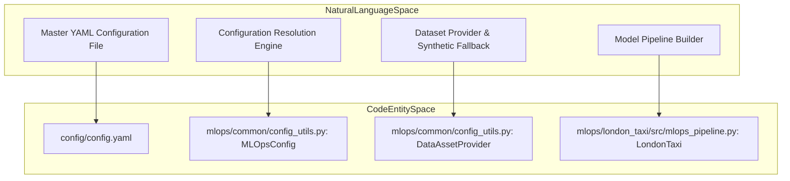
Sources: `config/config.yaml:1-178`(), `mlops/common/config_utils.py:9-148`(), `mlops/london_taxi/src/mlops_pipeline.py:74-114`()

---

# Page: Data Assets & Registration

# Data Assets & Registration

<details>
<summary>Relevant source files</summary>

The following files were used as context for generating this wiki page:

- [.azure-pipelines/london_taxi_ci_pipeline.yml](.azure-pipelines/london_taxi_ci_pipeline.yml)
- [.azure-pipelines/nyc_taxi_ci_pipeline.yml](.azure-pipelines/nyc_taxi_ci_pipeline.yml)
- [.azure-pipelines/register_data_assets.yml](.azure-pipelines/register_data_assets.yml)
- [.github/workflows/register_data_assets.yml](.github/workflows/register_data_assets.yml)
- [config/data_config.json](config/data_config.json)
- [mlops/common/register_data_asset.py](mlops/common/register_data_asset.py)
- [model/london_taxi/batch_test_data/london_taxi.csv](model/london_taxi/batch_test_data/london_taxi.csv)
- [model/london_taxi/online_test_data/sample-request.json](model/london_taxi/online_test_data/sample-request.json)
- [src/sequence_model/common/synthetic_data.py](src/sequence_model/common/synthetic_data.py)
- [src/sequence_model/predict/predict.py](src/sequence_model/predict/predict.py)

</details>


## Purpose and Scope
This page details the data asset management architecture within the `dstoolkit-mlops-v2` platform. It covers declarative data configuration via `config/data_config.json`, programmatic registration using `mlops/common/register_data_asset.py`, CI/CD automation through the GitHub Actions workflow `.github/workflows/register_data_assets.yml`, and runtime synthetic data generation routines used as fallbacks when external datastore files are absent.

---

## 1. Declarative Data Configuration (`data_config.json`)

The platform defines all trackable datasets in a centralized JSON manifest located at `config/data_config.json`. Each entry specifies the dataset's purpose, local path, Azure ML asset name, and description.

```json
{
    "datasets": [
        {
            "DATA_PURPOSE": "pr_data",
            "DATA_PATH": "mlops/london_taxi/data",
            "DATASET_NAME": "london_taxi_pr_data",
            "DATASET_DESC": "this dataset is for pr validation only"
        },
        ...
    ]
}
```[config/data_config.json:1-45]()

### Dataset Schema Attributes
* `DATA_PURPOSE`: Categorizes the workflow usage (e.g., `pr_data`, `batch_test_data`, `training_data`).
* `DATA_PATH`: Local directory or file path within the repository where the raw data resides before upload/registration.
* `DATASET_NAME`: Unique name assigned to the registered Azure Machine Learning data asset.
* `DATASET_DESC`: Human-readable description stored alongside the asset metadata in Azure ML.

Sources: `config/data_config.json:1-45`

---

## 2. Programmatic Registration (`register_data_asset.py`)

The registration script `mlops/common/register_data_asset.py` reads `data_config.json`, establishes an authenticated connection to the Azure ML workspace, and iterates through the dataset definitions to create or update `uri_folder` data assets.

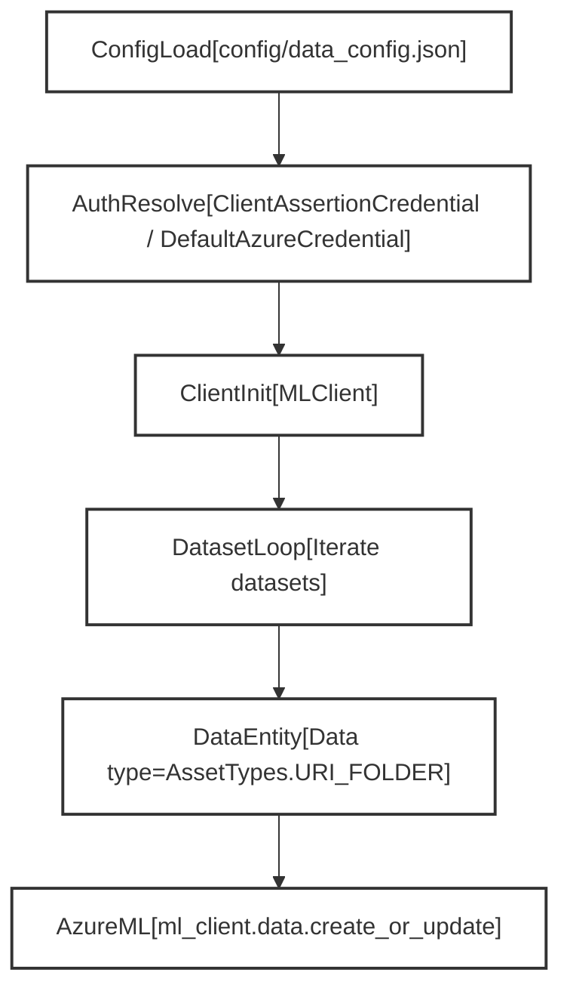
*Figure 1: Code Entity Space mapping for `register_data_asset.py`.*

### Authentication & Client Initialization
The script configures environment authentication for Azure Storage (`AZURE_STORAGE_AUTH_MODE = "login"`) [mlops/common/register_data_asset.py:31-32](). It attempts to use Workload Identity via `ClientAssertionCredential` if `AZURE_FEDERATED_TOKEN_FILE` is present, falling back to `DefaultAzureCredential` [mlops/common/register_data_asset.py:40-47](). An instance of `MLClient` is then instantiated using workspace configuration parameters from `MLOpsConfig` [mlops/common/register_data_asset.py:34,49-54]().

### Asset Creation Logic
For each dataset element parsed from the config file, a `Data` entity is constructed with `AssetTypes.URI_FOLDER` [mlops/common/register_data_asset.py:69-79]() and registered via `ml_client.data.create_or_update(aml_dataset)` [mlops/common/register_data_asset.py:82]().

Sources: `mlops/common/register_data_asset.py:1-93`

---

## 3. CI/CD Orchestration: "Register Datasets" Workflow

The GitHub Actions workflow `.github/workflows/register_data_assets.yml` automates dataset uploads and versioning in Azure ML. It is triggered via `workflow_dispatch` [.github/workflows/register_data_assets.yml:1-5]() and performs explicit preflight checks against the workspace default datastore (`workspaceblobstore`) [.github/workflows/register_data_assets.yml:41-72]().

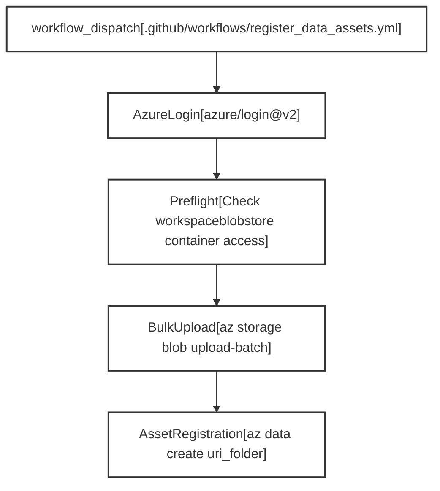
*Figure 2: Workflow execution pipeline linking natural language pipeline triggers to Azure CLI execution steps.*

### Workflow Execution Steps
1. **OIDC Authentication**: Logs into Azure using workload identity credentials (`ARM_CLIENT_ID`, `ARM_TENANT_ID`, `SUBSCRIPTION_ID`) [.github/workflows/register_data_assets.yml:6-29]().
2. **Preflight Validation**: Queries the default `workspaceblobstore` account and container names using `az ml datastore show` and verifies AAD storage container read/write access [.github/workflows/register_data_assets.yml:52-71]().
3. **Bulk Upload & Registration**: Iterates over `config/data_config.json`, uploads source folders to container paths (`datasets/<NAME>/<TS>`) via `az storage blob upload-batch`, and registers them as `uri_folder` data assets via `az ml data create` [.github/workflows/register_data_assets.yml:111-150]().

Sources: `.github/workflows/register_data_assets.yml:1-159`, `mlops/common/register_data_asset.py:1-93`

---

## 4. Synthetic Data Fallback (`synthetic_data.py`)

When runtime environments lack pre-registered datastore assets or require isolated unit testing, sequence models rely on programmatic synthetic data generators located in `src/sequence_model/common/synthetic_data.py`.

```python
def generate_synthetic_text_data(
    num_sequences: int = 100, sequence_length: int = 20
) -> List[List[str]]:
    vocabulary = [
        "the", "quick", "brown", "fox", "jumps", "over", "lazy", "dog",
        ...
    ]
    sequences = []
    for _ in range(num_sequences):
        sequence = [random.choice(vocabulary) for _ in range(sequence_length)]
        sequences.append(sequence)
    return sequences
```[src/sequence_model/common/synthetic_data.py:9-35]()

### Save & Train/Test Split
The `save_synthetic_data` function generates a corpus from a predefined vocabulary, splits it into an 80/20 train/test ratio, and serializes them into `train.pkl` and `test.pkl` under the target dataset directory [src/sequence_model/common/synthetic_data.py:38-70]().

Sources: `src/sequence_model/common/synthetic_data.py:1-71`

---

# Page: MLOps Orchestration Layer (mlops)

# MLOps Orchestration Layer (mlops)

<details>
<summary>Relevant source files</summary>

The following files were used as context for generating this wiki page:

- [.vscode/launch.json](.vscode/launch.json)
- [config/config.yaml](config/config.yaml)
- [mlops/common/config_utils.py](mlops/common/config_utils.py)
- [mlops/common/naming_utils.py](mlops/common/naming_utils.py)
- [mlops/common/pipeline_job_config.py](mlops/common/pipeline_job_config.py)
- [mlops/common/pipeline_utils.py](mlops/common/pipeline_utils.py)
- [mlops/docker_taxi/src/mlops_pipeline.py](mlops/docker_taxi/src/mlops_pipeline.py)
- [mlops/docker_taxi/start_local_pipeline.py](mlops/docker_taxi/start_local_pipeline.py)
- [mlops/london_taxi/src/mlops_pipeline.py](mlops/london_taxi/src/mlops_pipeline.py)
- [mlops/sequence_model/src/mlops_pipeline.py](mlops/sequence_model/src/mlops_pipeline.py)

</details>


The `mlops/` directory contains the core orchestration logic responsible for defining, configuring, and submitting Azure Machine Learning (AML) v2 pipelines. It acts as the bridge between high-level configuration declarations in `config/config.yaml` [config/config.yaml:1-178]() and concrete execution steps running on Azure compute targets.

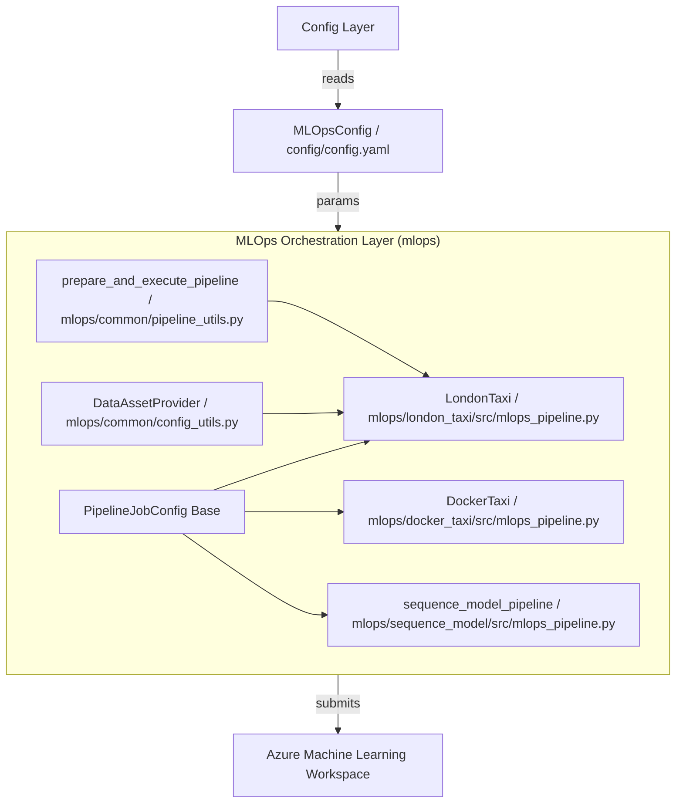
*Sources: `config/config.yaml`, `mlops/common/config_utils.py`, `mlops/common/pipeline_utils.py`, `mlops/london_taxi/src/mlops_pipeline.py`*

---

## 3.1. Common Azure ML Utilities

The orchestration layer relies on a shared set of utility modules located under `mlops/common/`. These modules encapsulate boilerplate operations for resolving AML workspaces, provisioned compute clusters, reusable software environments, unique naming conventions, and run metadata tracking. 

For full technical details, implementation specifics, and RBAC handling, see [Common Azure ML Utilities](#3.1).

*Sources: `mlops/common/config_utils.py`, `mlops/common/naming_utils.py`, `mlops/common/pipeline_job_config.py`, `mlops/common/pipeline_utils.py`*

---

## 3.2. Pipeline Definitions per Model

Each model type (`london_taxi`, `docker_taxi`, and `sequence_model`) implements its own pipeline entrypoint script named `mlops_pipeline.py`. These scripts define the Directed Acyclic Graph (DAG) of component execution using the AML SDK v2 `@pipeline` decorator. Components are loaded dynamically from per-model YAML files [mlops/london_taxi/src/mlops_pipeline.py:96-103]() and wired together via strongly-typed input/output bindings.

For detailed DAG structures, component YAML wiring, and dataset ingestion steps, see [Pipeline Definitions per Model](#3.2).

*Sources: `mlops/london_taxi/src/mlops_pipeline.py`, `mlops/sequence_model/src/mlops_pipeline.py`, `mlops/docker_taxi/src/mlops_pipeline.py`*

---

## 3.3. Execution Environments (conda & Docker)

Pipeline steps and online/batch endpoints execute inside isolated environments configured via Conda specifications or custom Docker images. The orchestration layer maps environment references defined in `config.yaml` to these runtime definitions, ensuring reproducibility across local development runs and cloud deployments.

For detailed breakdown of conda specs, requirements files, and container build contexts, see [Execution Environments (conda & Docker)](#3.3).

*Sources: `config/config.yaml`*

---

# Page: Common Azure ML Utilities

# Common Azure ML Utilities

<details>
<summary>Relevant source files</summary>

The following files were used as context for generating this wiki page:

- [.vscode/launch.json](.vscode/launch.json)
- [mlops/common/get_compute.py](mlops/common/get_compute.py)
- [mlops/common/get_environment.py](mlops/common/get_environment.py)
- [mlops/common/get_run_metadata.py](mlops/common/get_run_metadata.py)
- [mlops/common/get_workspace.py](mlops/common/get_workspace.py)
- [mlops/common/naming_utils.py](mlops/common/naming_utils.py)
- [mlops/common/pipeline_job_config.py](mlops/common/pipeline_job_config.py)
- [mlops/common/pipeline_utils.py](mlops/common/pipeline_utils.py)
- [mlops/docker_taxi/src/mlops_pipeline.py](mlops/docker_taxi/src/mlops_pipeline.py)
- [mlops/docker_taxi/start_local_pipeline.py](mlops/docker_taxi/start_local_pipeline.py)

</details>


## Purpose and Scope

The `mlops/common/` directory provides a suite of reusable utility modules designed to abstract and standardize interactions with Azure Machine Learning services. These utilities form the backbone of the MLOps orchestration layer, handling routine operations such as workspace connection, compute cluster provisioning with automatic managed identity configuration, environment compilation (via Conda or Docker contexts), dynamic naming conventions, metadata extraction, and role-based access control (RBAC) assignments.

This page documents the internal mechanics, implementation details, and functional flows of each core utility module.

---

## Workspace and Environment Management

### Workspace Access (`get_workspace.py`)

The workspace utility provides a centralized function to authenticate against Azure using `DefaultAzureCredential` and retrieve a reference to an Azure Machine Learning workspace instance via the Azure ML Python SDK (`azure-ai-ml`) [mlops/common/get_workspace.py:1-41]().

*   **Key Function**: `get_workspace(subscription_id: str, resource_group_name: str, workspace_name: str)` [mlops/common/get_workspace.py:13-]
*   **Behavior**: Instantiates an `MLClient` with default credentials and calls `client.workspaces.get(workspace_name)` [mlops/common/get_workspace.py:27-34]().

Sources: [mlops/common/get_workspace.py:1-41]()

### Environment Provisioning (`get_environment.py`)

The environment utility handles the creation or update of Azure ML execution environments, supporting both Conda-based specifications and custom Docker build contexts [mlops/common/get_environment.py:1-73]().

*   **Key Function**: `get_environment(...)` [mlops/common/get_environment.py:14-24]
*   **Parameters**:
    *   `conda_path`: Path to a Conda specification YAML file [mlops/common/get_environment.py:21]().
    *   `docker_context_path` & `dockerfile_path`: Path to local/remote Docker contexts and associated `Dockerfile` [mlops/common/get_environment.py:22-23]().
*   **Implementation**: Utilizes either `Environment(image=..., conda_file=...)` or `Environment(build=BuildContext(...))` depending on provided arguments, invoking `client.environments.create_or_update()` [mlops/common/get_environment.py:49-64]().

Sources: [mlops/common/get_environment.py:1-73]()

---

## Compute Provisioning and RBAC Handling (`get_compute.py`)

Compute target management is handled by `mlops/common/get_compute.py`, which ensures compute clusters exist with proper system-assigned managed identities and necessary RBAC role assignments for data and workspace access [mlops/common/get_compute.py:1-176]().

### Core Functions

*   `_get_or_create_compute_target(...)`: Checks for an existing AML compute target using `client.compute.get()`. If absent, provisions a new `AmlCompute` cluster with a `SystemAssigned` identity [mlops/common/get_compute.py:120-164]().
*   `_assign_storage_role(...)`: Evaluates the compute instance's managed identity `principal_id` and assigns required data plane roles on the workspace storage account [mlops/common/get_compute.py:82-118]().
*   `get_compute(...)`: Top-level orchestrator that fetches or creates the cluster and triggers role assignment enforcement [mlops/common/get_compute.py:166-176]().

### RBAC Handling & Propagation

To ensure batch scoring and pipeline execution can securely interact with Azure Storage and AML workspaces, the utility programmatically invokes Azure CLI (`az role assignment`) via subprocess calls if existing assignments are missing [mlops/common/get_compute.py:18-80]().

The assigned roles include:
1.  **Storage Blob Data Contributor** on the workspace storage scope [mlops/common/get_compute.py:101]()
2.  **Storage Table Data Contributor** on the workspace storage scope [mlops/common/get_compute.py:102]()
3.  **Storage Queue Data Contributor** on the workspace storage scope [mlops/common/get_compute.py:103]()
4.  **AzureML Data Scientist** on the AML workspace resource scope [mlops/common/get_compute.py:113]()

Because Azure RBAC changes are asynchronous, `_ensure_role_assignment` includes built-in sleep delays (e.g., 30 to 120 seconds) to allow token and permission propagation before downstream pipeline steps execute [mlops/common/get_compute.py:43-80]().

Sources: [mlops/common/get_compute.py:1-176]()

---

## Naming Conventions (`naming_utils.py`)

To prevent naming collisions across parallel branch deployments and experiments, `mlops/common/naming_utils.py` generates standardized resource names [mlops/common/naming_utils.py:1-81]().

*   `generate_experiment_name(model_name: str)`: Combines the model prefix with the active Git branch name (retrieved from `BUILD_SOURCEBRANCHNAME` or local `git rev-parse`) [mlops/common/naming_utils.py:8-28]().
*   `generate_model_name(model_name: str)`: Appends branch identifiers to establish unique registered model names [mlops/common/naming_utils.py:31-50]().
*   `generate_run_name(build_id: str)`: Constructs run identifiers prefixed with `run_` using `BUILD_BUILDID` [mlops/common/naming_utils.py:53-65]().
*   `generate_environment_name(environment_name: str, environment_version: str)`: Formats environment references for AML pipelines (`azureml:name:version`) [mlops/common/naming_utils.py:68-81]().

Sources: [mlops/common/naming_utils.py:1-81]()

---

## Pipeline Job Configuration and Metadata

### Base Pipeline Configuration (`pipeline_job_config.py`)

`PipelineJobConfig` serves as the foundational data class for configuring pipeline jobs across different model architectures (e.g., London Taxi, Docker Taxi, Sequence Models) [mlops/common/pipeline_job_config.py:4-38]().

*   **Attributes**: Stores `environment_name`, `build_reference`, `published_model_name`, `dataset_name`, `build_environment`, `wait_for_completion`, `output_file`, and `model_name` [mlops/common/pipeline_job_config.py:31-38]().

Sources: [mlops/common/pipeline_job_config.py:1-38]()

### Run Metadata Extraction (`get_run_metadata.py`)

Used predominantly in CI/CD pipelines to query job outcomes and export references for downstream reporting [mlops/common/get_run_metadata.py:1-82]().

*   **Key Function**: `get_run_metadata(subscription_id, resource_group_name, workspace_name, run_id, output_file_name)` [mlops/common/get_run_metadata.py:16-54]
*   **Behavior**: Queries `client.jobs.get(run_id)` and serializes attributes such as `job_url` (Studio URL), `aml_display_name`, `aml_run_name`, `aml_run_id`, and `aml_name` to a JSON output file [mlops/common/get_run_metadata.py:41-54]().

Sources: [mlops/common/get_run_metadata.py:1-82]()

---

## Utility Interactions and Execution Flow

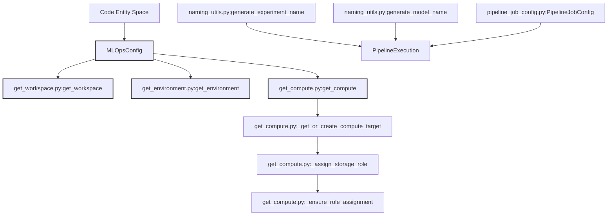
*Figure 1: Relationship between utility modules and pipeline orchestration inputs.*

Sources: [mlops/common/get_workspace.py:13-36](), [mlops/common/get_environment.py:14-66](), [mlops/common/get_compute.py:166-176](), [mlops/common/naming_utils.py:8-50](), [mlops/common/pipeline_job_config.py:4-38]()

---

## Managed Identity & RBAC Provisioning Sequence

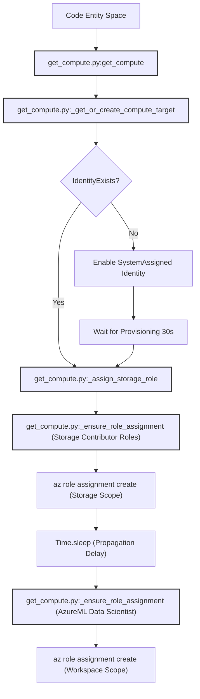
*Figure 2: Execution sequence for compute cluster creation and RBAC propagation.*

Sources: [mlops/common/get_compute.py:82-164]()

---

# Page: Pipeline Definitions per Model

# Pipeline Definitions per Model

<details>
<summary>Relevant source files</summary>

The following files were used as context for generating this wiki page:

- [config/config.yaml](config/config.yaml)
- [mlops/common/config_utils.py](mlops/common/config_utils.py)
- [mlops/docker_taxi/components/train.yml](mlops/docker_taxi/components/train.yml)
- [mlops/london_taxi/components/predict.yml](mlops/london_taxi/components/predict.yml)
- [mlops/london_taxi/components/prep.yml](mlops/london_taxi/components/prep.yml)
- [mlops/london_taxi/components/register.yml](mlops/london_taxi/components/register.yml)
- [mlops/london_taxi/components/score.yml](mlops/london_taxi/components/score.yml)
- [mlops/london_taxi/components/train.yml](mlops/london_taxi/components/train.yml)
- [mlops/london_taxi/components/transform.yml](mlops/london_taxi/components/transform.yml)
- [mlops/london_taxi/src/mlops_pipeline.py](mlops/london_taxi/src/mlops_pipeline.py)
- [mlops/sequence_model/components/train.yml](mlops/sequence_model/components/train.yml)
- [mlops/sequence_model/src/mlops_pipeline.py](mlops/sequence_model/src/mlops_pipeline.py)
- [mlops/sequence_model/start_local_pipeline.py](mlops/sequence_model/start_local_pipeline.py)
- [setup.cfg](setup.cfg)

</details>


## Purpose and Scope

This page covers section 3.2 of the MLOps orchestration layer (`mlops/`), detailing how machine learning pipelines are defined, constructed, and executed for different model types (`london_taxi`, `docker_taxi`, and `sequence_model`). It explains the pipeline graph definitions using the Azure Machine Learning (AML) DSL (`@pipeline`), how individual component YAML files wire CLI entry points to pipeline inputs/outputs, and how configuration-driven parameterization (`MLOpsConfig`) and data providers (`DataAssetProvider`) manage assets and synthetic fallbacks.

Sources: `[config/config.yaml:11-41](), [mlops/london_taxi/src/mlops_pipeline.py:1-22]()`

---

## London Taxi Pipeline (`london_taxi`)

The London taxi regression pipeline chains six discrete data and model processing stages: preparation, transformation, training, prediction, scoring, and model registration.

### Pipeline Graph and Wiring (`london_taxi_data_regression`)

The graph is defined using the `@pipeline` decorator in `[mlops/london_taxi/src/mlops_pipeline.py:27-72]()`. It sequentially wires component outputs to subsequent inputs:
1. `prepare_sample_data` consumes raw data (`pipeline_job_input`) and produces `prep_data` `[mlops/london_taxi/src/mlops_pipeline.py:40-42]()`.
2. `transform_sample_data` takes `prep_data` and outputs `transformed_data` `[mlops/london_taxi/src/mlops_pipeline.py:43-45]()`.
3. `train_with_sample_data` takes `transformed_data` and outputs `model_output`, `test_data`, and `model_metadata` `[mlops/london_taxi/src/mlops_pipeline.py:46-48]()`.
4. `predict_with_sample_data` takes the trained model and test data, outputting `predictions` `[mlops/london_taxi/src/mlops_pipeline.py:49-52]()`.
5. `score_with_sample_data` evaluates predictions against the model, generating a `score_report` `[mlops/london_taxi/src/mlops_pipeline.py:53-56]()`.
6. `register` consumes model metadata and score reports to register the final artifact in the Azure ML registry `[mlops/london_taxi/src/mlops_pipeline.py:57-62]()`.

### Configuration and Construction (`LondonTaxi`)

The `LondonTaxi` class inherits from `PipelineJobConfig` and implements `construct_pipeline(self, ml_client)` `[mlops/london_taxi/src/mlops_pipeline.py:74-115]()`. It queries the latest registered dataset asset using `self.dataset_name`, dynamically loads component definitions from `mlops/london_taxi/components/`, attaches the designated compute/environment settings, and invokes `london_taxi_data_regression` `[mlops/london_taxi/src/mlops_pipeline.py:92-109]()`.

Sources: `[mlops/london_taxi/src/mlops_pipeline.py:27-115]()`

---

## Component YAML Definitions (`london_taxi`)

Each step in the London taxi pipeline is governed by a declarative command component YAML file located in `mlops/london_taxi/components/`. These components map inputs and outputs to underlying python modules under `src/london_src/`.

### Component Manifest Table

| Component File | Name Property | Command Invocation |
| --- | --- | --- |
| `prep.yml` | `prepare_taxi_data` | `python -m src.london_src.prep.prep --raw_data ${{inputs.raw_data}} --prep_data ${{outputs.prep_data}}` `[mlops/london_taxi/components/prep.yml:1-18]()` |
| `transform.yml` | `taxi_feature_engineering` | `python -m src.london_src.transform.transform --clean_data ${{inputs.clean_data}} --transformed_data ${{outputs.transformed_data}}` `[mlops/london_taxi/components/transform.yml:1-18]()` |
| `train.yml` | `train_linear_regression_model` | `python -m src.london_src.train.train --training_data ${{inputs.training_data}} --test_data ${{outputs.test_data}} --model_output ${{outputs.model_output}} --model_metadata ${{outputs.model_metadata}}` `[mlops/london_taxi/components/train.yml:1-24]()` |
| `predict.yml` | `predict_taxi_fares` | `python -m src.london_src.predict.predict --model_input ${{inputs.model_input}} --test_data ${{inputs.test_data}} --predictions ${{outputs.predictions}}` `[mlops/london_taxi/components/predict.yml:1-21]()` |
| `score.yml` | `score_model` | `python -m src.london_src.score.score --predictions ${{inputs.predictions}} --model ${{inputs.model}} --score_report ${{outputs.score_report}}` `[mlops/london_taxi/components/score.yml:1-21]()` |
| `register.yml` | `register_taxi_model` | `python -m src.london_src.register.register --model_metadata ${{inputs.model_metadata}} --model_name ${{inputs.model_name}} --score_report ${{outputs.score_report}} --build_reference ${{inputs.build_reference}}` `[mlops/london_taxi/components/register.yml:1-23]()` |

Sources: `[mlops/london_taxi/components/prep.yml:1-18](), [mlops/london_taxi/components/transform.yml:1-18](), [mlops/london_taxi/components/train.yml:1-24](), [mlops/london_taxi/components/predict.yml:1-21](), [mlops/london_taxi/components/score.yml:1-21](), [mlops/london_taxi/components/register.yml:1-23]()`

---

## Sequence Model Pipeline (`sequence_model`)

The sequence model pipeline (`mlops/sequence_model/src/mlops_pipeline.py`) handles specialized sequence-based deep learning workflows, consisting of training, prediction, scoring, benchmarking, and registration stages.

### Pipeline Topology and Flexible Data Assets

The `sequence_model_pipeline` coordinates steps via `gl_pipeline_components` `[mlops/sequence_model/src/mlops_pipeline.py:35-80]()`. Unlike the London Taxi pipeline, `construct_pipeline` leverages `DataAssetProvider` to support flexible loading and automatic synthetic data fallback when registered assets are missing in development or PR environments `[mlops/sequence_model/src/mlops_pipeline.py:82-169]()`.

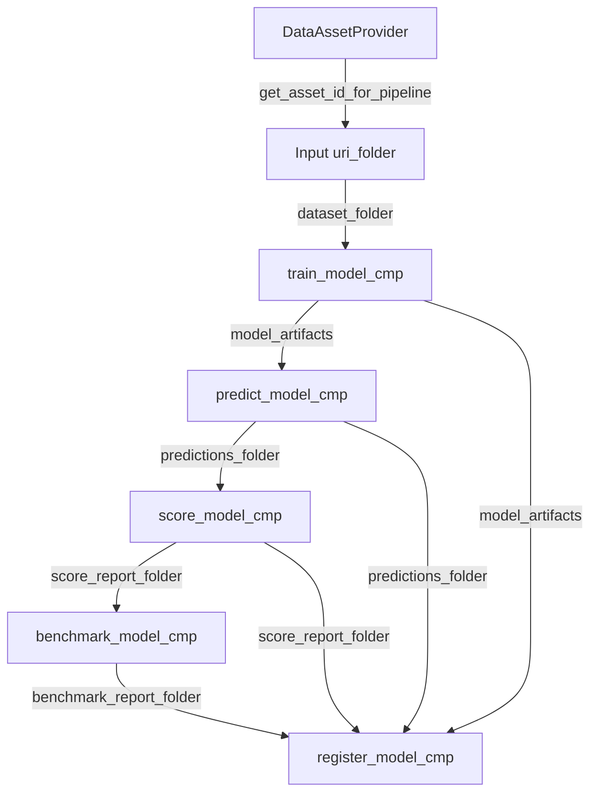
*Figure 1: Sequence model component graph execution flow.*

Sources: `[mlops/sequence_model/src/mlops_pipeline.py:35-169](), [mlops/common/config_utils.py:9-106]()`

---

## Component Wiring Architecture (Natural Language to Code Entity Space)

The following diagram bridges conceptual pipeline steps to their concrete Python modules and component YAML definitions in the codebase:

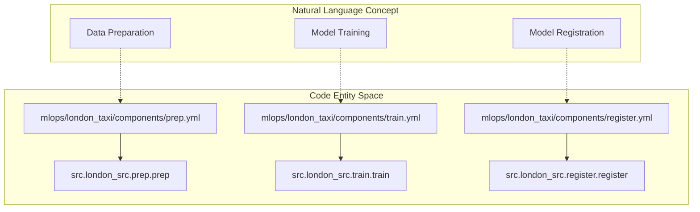
*Figure 2: Association of pipeline concepts to component YAMLs and Python module entry points.*

Sources: `[mlops/london_taxi/components/prep.yml:1-18](), [mlops/london_taxi/components/train.yml:1-24](), [mlops/london_taxi/components/register.yml:1-23](), [mlops/london_taxi/src/mlops_pipeline.py:27-72]()`

---

# Page: Execution Environments (conda & Docker)

# Execution Environments (conda & Docker)

<details>
<summary>Relevant source files</summary>

The following files were used as context for generating this wiki page:

- [mlops/common/environment/README.md](mlops/common/environment/README.md)
- [mlops/common/environment/training_requirements.txt](mlops/common/environment/training_requirements.txt)
- [mlops/docker_taxi/environment/requirements.txt](mlops/docker_taxi/environment/requirements.txt)
- [mlops/london_taxi/environment/conda.yml](mlops/london_taxi/environment/conda.yml)
- [mlops/sequence_model/environment/conda.yml](mlops/sequence_model/environment/conda.yml)
- [mlops/sequence_model/environment/reqs.txt](mlops/sequence_model/environment/reqs.txt)
- [model/docker_taxi/online_environment/conda.yml](model/docker_taxi/online_environment/conda.yml)
- [model/london_taxi/online_environment/conda.yml](model/london_taxi/online_environment/conda.yml)
- [model/sequence_model/online_environment/conda.yml](model/sequence_model/online_environment/conda.yml)

</details>


## Purpose and Scope
This page details the execution environments used across the `dstoolkit-mlops-v2` codebase for model training, pipeline execution, and online/batch model serving. It covers the structure and pinning strategy of Conda specifications (`conda.yml`), pip requirements files (`requirements.txt`, `reqs.txt`), and online scoring environments (`model/<type>/online_environment/conda.yml`). These environments ensure reproducibility and compatibility between local development, Azure Machine Learning (AML) compute targets, and containerized deployments.

---

## 1. Conda Specifications for Training & Pipelines (`conda.yml`)
Model pipelines define their runtime requirements using Conda specification files. The primary training environment across models uses a named environment `prs-env` running Python 3.10 with pinned packages to ensure MLflow and Azure ML SDK v2 compatibility.

For example, the London Taxi training pipeline specifies its dependencies in `mlops/london_taxi/environment/conda.yml:1-17`:
- Python runtime: `python=3.10` [mlops/london_taxi/environment/conda.yml:5-5]()
- Core ML ecosystem: `numpy==1.26.4`, `scikit-learn==1.3.2`, `pandas` [mlops/london_taxi/environment/conda.yml:9-11]()
- Tracking & Cloud SDKs: `mlflow-skinny==2.14.3`, `azureml-mlflow==1.60.0`, `azure-ai-ml>=1.30.0` [mlops/london_taxi/environment/conda.yml:12-14]()
- Security & Credentials: `azure-identity>=1.15.0`, `azure-keyvault-secrets>=4.7.0` [mlops/london_taxi/environment/conda.yml:15-16]()

Similarly, the Sequence Model defines a richer environment including Natural Language Processing (NLP) libraries and development tools under `mlops/sequence_model/environment/conda.yml:1-33`, incorporating dependencies such as `nltk`, `tqdm`, `pyyaml`, `flake8`, and `black` [mlops/sequence_model/environment/conda.yml:20-32]().

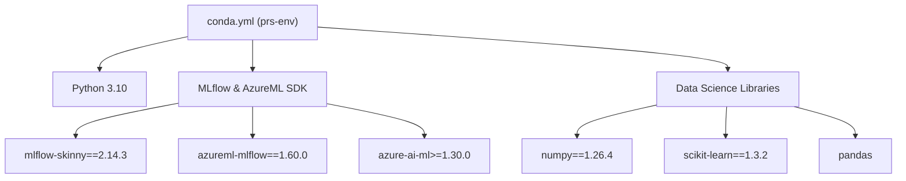
*Sources: `mlops/london_taxi/environment/conda.yml:1-17`, `mlops/sequence_model/environment/conda.yml:1-33`*

---

## 2. Requirements & Pip-based Environments (`requirements.txt`)
Alternative execution workflows, such as the `docker_taxi` variant and lightweight platform validation jobs, utilize flat `requirements.txt` files instead of full Conda specs. 

The `docker_taxi` training environment (`mlops/docker_taxi/environment/requirements.txt:1-11`) defines the minimal pip packages required for building custom Docker container contexts:
```text
azure-ai-ml>=1.30.0
azure-identity>=1.15.0
azure-keyvault-secrets>=4.7.0
mlflow-skinny==2.14.3
azureml-mlflow==1.60.0
pandas
numpy==1.26.4
python-dotenv
scikit-learn==1.3.2
azureml-inference-server-http
Werkzeug==2.3.8
```
[mlops/docker_taxi/environment/requirements.txt:1-11]()

For more extensive pipeline tasks, `mlops/sequence_model/environment/reqs.txt:1-29` includes legacy AzureML v1 compatibility pins alongside modern SDK packages.

```mermaid
graph TD
    Reqs["requirements.txt"] --> Core["Azure SDK: azure-ai-ml, azure-identity"]
    Reqs --> Track["MLflow: mlflow-skinny==2.14.3, azureml-mlflow"]
    Reqs --> Serv["Serving: azureml-inference-server-http, Werkzeug"]
    Reqs --> Data["Data: pandas, numpy==1.26.4, scikit-learn"]
```
*Sources: `mlops/docker_taxi/environment/requirements.txt:1-11`, `mlops/sequence_model/environment/reqs.txt:1-29`*

---

## 3. Online Scoring & Serving Environments (`model/<type>/online_environment/conda.yml`)
When models are registered and deployed to online managed endpoints, they require dedicated serving environments that bundle HTTP inference servers alongside model dependencies.

- **London Taxi Serving**: `model/london_taxi/online_environment/conda.yml:1-17` includes `azureml-inference-server-http` and `Werkzeug==2.3.8` to power the Flask/Werkzeug inference routing layer in Azure ML online deployments [model/london_taxi/online_environment/conda.yml:16-17]().
- **Docker Taxi Serving**: `model/docker_taxi/online_environment/conda.yml:1-19` adapts to curated platform base images, commenting out conflicting plugins and leveraging image-provided `azureml-mlflow` plugins [model/docker_taxi/online_environment/conda.yml:11-13]().
- **Sequence Model Serving**: `model/sequence_model/online_environment/conda.yml:1-19` includes specialized text processing dependencies like `tqdm`, `nltk`, and `pyyaml` for tokenization and inference parsing [model/sequence_model/online_environment/conda.yml:15-18]().

```mermaid
graph TD
    OnlineConda["online_environment/conda.yml"] --> InfServer["azureml-inference-server-http"]
    OnlineConda --> WebServer["Werkzeug==2.3.8"]
    OnlineConda --> MLflow["mlflow-skinny==2.14.3"]
    OnlineConda --> ModelDeps["Model Specific Libraries (e.g., nltk, numpy)"]
```
*Sources: `model/london_taxi/online_environment/conda.yml:1-17`, `model/docker_taxi/online_environment/conda.yml:1-19`, `model/sequence_model/online_environment/conda.yml:1-19`*

---

## 4. Version Rationale and Dependency Management
To prevent artifact logging failures and dependency resolution conflicts across Azure ML clusters, environment versions are centrally documented and governed.

The shared training requirements file (`mlops/common/environment/training_requirements.txt:1-16`) establishes project-wide baselines:
- Python runtime: `3.10.x` [mlops/common/environment/README.md:3-3]()
- MLflow tracking: `mlflow-skinny==2.14.3` [mlops/common/environment/README.md:4-4]()
- AzureML plugin: `azureml-mlflow>=1.6.3,<2.0.0` [mlops/common/environment/README.md:5-5]()
- Numerical libraries: `numpy==1.26.4`, `pandas==2.2.3` [mlops/common/environment/README.md:6-7]()

As outlined in `mlops/common/environment/README.md:1-15`, maintaining strict alignment between `mlflow==2.14.3` and `azureml-mlflow` prevents plugin-to-constructor mismatches during AML run logging. If curated environment images introduce conflicts, training scripts implement a local fallback to pickle models when `mlflow.log_model` encounters upstream environment errors [mlops/common/environment/README.md:13-13]().

```mermaid
graph TD
    Guide["mlops/common/environment/README.md"] --> Py["Python 3.10 Stability"]
    Guide --> ML["MLflow 2.14.3 Pin"]
    Guide --> Num["Numpy 1.26.4 & Pandas 2.2.3"]
    Guide --> Fallback["Local Pickle Fallback on MLflow Error"]
```
*Sources: `mlops/common/environment/training_requirements.txt:1-16`, `mlops/common/environment/README.md:1-15`*

---

# Page: Data Science Code (src)

# Data Science Code (src)

<details>
<summary>Relevant source files</summary>

The following files were used as context for generating this wiki page:

- [docs/how-to/DSScriptInputsAndOutputs.md](docs/how-to/DSScriptInputsAndOutputs.md)
- [docs/how-to/DataScienceScripts.md](docs/how-to/DataScienceScripts.md)
- [docs/media/aml_inputs_and_outputs.png](docs/media/aml_inputs_and_outputs.png)
- [docs/media/nyc-folder.png](docs/media/nyc-folder.png)
- [docs/media/test-folder.png](docs/media/test-folder.png)
- [src/london_src/predict/predict.py](src/london_src/predict/predict.py)
- [src/london_src/prep/prep.py](src/london_src/prep/prep.py)
- [src/london_src/register/register.py](src/london_src/register/register.py)
- [src/london_src/score/score.py](src/london_src/score/score.py)
- [src/london_src/train/train.py](src/london_src/train/train.py)
- [src/london_src/transform/transform.py](src/london_src/transform/transform.py)

</details>


## Purpose and Scope

The `src/` directory contains all data science source code, including data preparation, feature transformation, model training, batch prediction, scoring, and model registration scripts. Each model type (`london_src`, `docker_taxi_src`, and `sequence_model`) adheres to a shared step contract defined by Azure Machine Learning (AML) component configurations, command-line arguments via `argparse`, and experiment tracking via MLflow. 

This page provides a high-level architectural overview of the shared step contract and script layouts. For granular implementation details, refer to the child pages:
- [London Taxi Pipeline Steps](#4.1)
- [Docker Taxi Variant](#4.2)
- [Sequence Model](#4.3)

Sources: `docs/how-to/DataScienceScripts.md:1-134()`, `docs/how-to/DSScriptInputsAndOutputs.md:1-55()`

---

## Shared Step Contract & Architecture

Model pipelines execute as a sequence of discrete script components. Each script acts as a standalone CLI application that accepts data inputs and output paths through arguments, processes the payloads using Pandas/Scikit-Learn/PyTorch, and records metrics and models via MLflow.

```mermaid
graph TD
    sub5 ["Natural Language Space"]
    sub6 ["Code Entity Space"]

    sub5_1["Raw Data Ingestion"] --> sub6_1["src/london_src/prep/prep.py:main"]
    sub5_2["Feature Transformation"] --> sub6_2["src/london_src/transform/transform.py:main"]
    sub5_3["Model Training"] --> sub6_3["src/london_src/train/train.py:main"]
    sub5_4["Batch Prediction"] --> sub6_4["src/london_src/predict/predict.py:main"]
    sub5_5["Model Scoring"] --> sub6_5["src/london_src/score/score.py:main"]
    sub5_6["MLflow Registration"] --> sub6_6["src/london_src/register/register.py:main"]
```
*Figure 1: Bridging pipeline stages to entrypoint functions across the codebase.*

Sources: `src/london_src/prep/prep.py:16-49()`, `src/london_src/transform/transform.py:21-53()`, `src/london_src/train/train.py:23-61()`, `src/london_src/predict/predict.py:22-41()`, `src/london_src/score/score.py:21-61()`, `src/london_src/register/register.py:131-165()`

### MLflow Integration & Tracking Contract

All model training and evaluation scripts interact with MLflow to maintain reproducibility, log metrics (`mlflow.log_metric`), and persist model artifacts (`mlflow.sklearn.log_model` or equivalent framework loggers).

```mermaid
graph TD
    sub3 ["Tracking & Registration Concept"]
    sub4 ["Code Symbol Execution"]

    sub3_1["Active Run Initialization"] --> sub4_1["src/london_src/train/train.py:train_model"]
    sub3_2["Model Artifact Logging"] --> sub4_2["src/london_src/train/train.py:mlflow.sklearn.log_model"]
    sub3_3["Artifact Verification"] --> sub4_3["src/london_src/register/register.py:_artifact_exists_for_run"]
    sub3_4["Model Version Registration"] --> sub4_4["src/london_src/register/register.py:mlflow.register_model"]
```
*Figure 2: Mapping tracking concepts to MLflow utility functions.*

Sources: `src/london_src/train/train.py:118-154()`, `src/london_src/register/register.py:43-129()`

---

## Model Pipeline Implementations

### 4.1 London Taxi Pipeline Steps
The `london_src` package implements a classical tabular machine learning pipeline using `scikit-learn` Linear Regression on NYC/London taxi datasets. It steps through preparation (`prep.py`), feature engineering (`transform.py`), model fitting (`train.py`), inference (`predict.py`), evaluation (`score.py`), and registration (`register.py`).

For implementation details, see [London Taxi Pipeline Steps](#4.1).

Sources: `src/london_src/prep/prep.py:1-190()`, `src/london_src/transform/transform.py:1-169()`, `src/london_src/train/train.py:1-186()`, `src/london_src/predict/predict.py:1-135()`, `src/london_src/score/score.py:1-122()`, `src/london_src/register/register.py:1-190()`

### 4.2 Docker Taxi Variant
The `docker_taxi_src` package reuses the London Taxi modeling logic but executes inside a custom Docker build context environment rather than a standard curated conda environment. This allows custom OS-level package installations and specialized runtime configurations.

For implementation details, see [Docker Taxi Variant](#4.2).

Sources: `docs/how-to/DataScienceScripts.md:1-134()`

### 4.3 Sequence Model
The `sequence_model` package implements a deep learning sequence-based model. It incorporates custom tokenization (`tokenizer.py`), neural architecture definitions (`seq_model.py`), synthetic sequence data generation, benchmarking scripts, and extended MLflow tracking modules (`mlflow_ext`).

For implementation details, see [Sequence Model](#4.3).

Sources: `docs/how-to/DataScienceScripts.md:1-134()`

---

# Page: London Taxi Pipeline Steps

# London Taxi Pipeline Steps

<details>
<summary>Relevant source files</summary>

The following files were used as context for generating this wiki page:

- [src/london_src/predict/predict.py](src/london_src/predict/predict.py)
- [src/london_src/prep/prep.py](src/london_src/prep/prep.py)
- [src/london_src/register/register.py](src/london_src/register/register.py)
- [src/london_src/score/score.py](src/london_src/score/score.py)
- [src/london_src/train/train.py](src/london_src/train/train.py)
- [src/london_src/transform/transform.py](src/london_src/transform/transform.py)

</details>


This page details the technical implementation of the `london_src` data science pipeline. The pipeline implements a standard supervised regression workflow divided into six sequential execution steps: data preparation, transformation, training, prediction, scoring, and registration. Each step is structured as a standalone CLI script configured via arguments and integrated with MLflow for tracking and artifact management.

---

## Pipeline Architecture & Data Flow

The pipeline consumes raw multi-vendor taxi data, processes through cleaning and feature engineering, fits a scikit-learn Linear Regression model, evaluates predictions, and registers the validated model artifact in MLflow.

```mermaid
graph TD
    RawData["Raw Data CSVs"] --> Prep[src/london_src/prep/prep.py]
    Prep -->|green_prep_data.csv yellow_prep_data.csv merged_data.csv| Trans[src/london_src/transform/transform.py]
    Trans -->|transformed_data.csv| Train[src/london_src/train/train.py]
    Train -->|model.sav test_data.csv model_metadata.json| Pred[src/london_src/predict/predict.py]
    Pred -->|predictions.csv| Score[src/london_src/score/score.py]
    Score -->|score.txt| Reg[src/london_src/register/register.py]
    Train -->|MLflow Run URI| Reg
    Reg -->|Registered MLflow Model| ModelRegistry[(MLflow Model Registry)]

    subgraph "Pipeline Steps"
        Prep
        Trans
        Train
        Pred
        Score
        Reg
    end
```

**Sources:**
- `src/london_src/prep/prep.py:16-129`
- `src/london_src/transform/transform.py:21-156`
- `src/london_src/train/train.py:23-169`
- `src/london_src/predict/predict.py:22-119`
- `src/london_src/score/score.py:21-104`
- `src/london_src/register/register.py:131-164`

---

## 1. Preparation Step (`prep.py`)

The preparation step reads raw input CSV files corresponding to green and yellow taxi vendors, normalizes vendor-specific column names to a unified schema, removes null records, and merges the datasets.

### Key Functions
- `main(raw_data, prep_data)` [src/london_src/prep/prep.py:16-49] — Discovers files in the raw data directory, extracts green and yellow data frames, and invokes `data_prep`.
- `data_prep(green_data, yellow_data, prep_data)` [src/london_src/prep/prep.py:51-129] — Applies column mapping and filtering dictionaries via `cleansedata`, concatenates the cleaned data frames, and serializes outputs (`green_prep_data.csv`, `yellow_prep_data.csv`, `merged_data.csv`).
- `cleansedata(data, columns, useful_columns)` [src/london_src/prep/prep.py:152-173] — Strips out null rows (`dropna(how="all")`), renames columns using mapped definitions, and subsets to `useful_columns`.

**Sources:**
- `src/london_src/prep/prep.py:16-173`

---

## 2. Transformation Step (`transform.py`)

The transformation step applies geographic boundary filters, cleans feature anomalies, extracts granular datetime features, and removes statistical outliers.

### Key Functions
- `main(clean_data, transformed_data)` [src/london_src/transform/transform.py:21-53] — Loads prepped CSV files from the input path, executes `transform_data`, and outputs `transformed_data.csv`.
- `transform_data(combined_df)` [src/london_src/transform/transform.py:62-156] — Performs the following operations:
  - Casts coordinate columns to `float64` [src/london_src/transform/transform.py:74-81].
  - Filters records within specified latitude/longitude bounds [src/london_src/transform/transform.py:83-92].
  - Replaces missing `store_forward` flags with `'N'` and missing distances with `0` [src/london_src/transform/transform.py:97-105].
  - Parses `pickup_datetime` and `dropoff_datetime` into granular fields (`weekday`, `month`, `monthday`, `hour`, `minute`, `second`) and drops raw timestamps [src/london_src/transform/transform.py:111-144].
  - Converts `store_forward` to binary indicator (0 for 'N', 1 otherwise) [src/london_src/transform/transform.py:146-148].
  - Filters out records where `distance <= 0` or `cost <= 0` [src/london_src/transform/transform.py:150-153].

**Sources:**
- `src/london_src/transform/transform.py:21-168`

---

## 3. Training Step (`train.py`)

The training step splits transformed data into training and testing partitions, trains a scikit-learn `LinearRegression` model, logs parameters and metrics via MLflow, and saves the trained model artifact and metadata.

### Key Functions
- `main(training_data, test_data, model_output, model_metadata)` [src/london_src/train/train.py:23-61] — Reads input CSV files, calls `split`, persists test data, and triggers model training.
- `split(train_data)` [src/london_src/train/train.py:63-115] — Isolates the target variable `cost` from feature columns, encodes categorical columns using `.cat.codes`, and splits data 70/30 using `train_test_split` with `random_state=42`.
- `train_model(train_x, trainy)` [src/london_src/train/train.py:118-153] — Fits a `LinearRegression` model under an active MLflow run (`mlflow.start_run`), logs the model artifact (`mlflow.sklearn.log_model`), exports model metadata containing the `run_id` and `run_uri`, and serializes the model binary (`model.sav`) via pickle.
- `write_test_data(test_x, testy)` [src/london_src/train/train.py:155-169] — Combines test features and targets and writes `test_data.csv`.

**Sources:**
- `src/london_src/train/train.py:23-169`

---

## 4. Prediction Step (`predict.py`)

The prediction step loads the serialized model and test dataset, computes batch predictions, and writes out an evaluation dataset containing both predicted and actual costs.

### Key Functions
- `main(model_input, test_data, prediction_path)` [src/london_src/predict/predict.py:22-41] — Orchestrates loading test data and generating predictions.
- `load_test_data(test_data)` [src/london_src/predict/predict.py:44-92] — Reads test CSV files, separates target values (`testy`) from feature matrix (`test_x`).
- `predict(test_x, testy, model_input, prediction_path)` [src/london_src/predict/predict.py:95-119] — Loads the model from `model.sav`, generates predictions, assigns `predicted_cost` and `actual_cost` columns, and writes `predictions.csv`.

**Sources:**
- `src/london_src/predict/predict.py:22-119`

---

## 5. Scoring Step (`score.py`)

The scoring step reads predictions, computes regression metrics (Mean Squared Error and Coefficient of Determination $R^2$), logs metrics to MLflow, and exports a score report JSON.

### Key Functions
- `main(predictions, model, score_report)` [src/london_src/score/score.py:21-61] — Loads prediction data frames and the pickled model, invoking `write_results`.
- `write_results(model, predictions, test_data, score_report)` [src/london_src/score/score.py:66-104] — Calculates MSE and $R^2$ using scikit-learn metrics, logs `scoring_mse` and `scoring_r2` to MLflow, and writes a structured score dictionary (`mse`, `coff`, `cod`) to `score.txt`.

**Sources:**
- `src/london_src/score/score.py:21-104`

---

## 6. Registration Step (`register.py`)

The registration step reads run metadata and score reports, validates the presence of required MLflow artifacts, registers the model version under the target model name, and applies evaluation tags.

### Key Functions & Diagnostic Lifecycle
- `main(model_metadata, model_name, score_report, build_reference)` [src/london_src/register/register.py:131-164] — Coordinates package version printing, MLflow tracking URI configuration, metadata ingestion, metric extraction, diagnostic validation, and model registration.
- `_ensure_artifact_or_exit(run_uri)` [src/london_src/register/register.py:95-113] — Validates artifact existence; exits with code `2` if the `model` artifact is missing.
- `_register_and_tag(run_uri, model_name, tags)` [src/london_src/register/register.py:116-129] — Registers the MLflow model and applies performance tags (`mse`, `coff`, `cod`, `build_id`), exiting with code `1` on failure.

```mermaid
graph TD
    Start[main] --> ReadMeta[_read_json model_metadata]
    ReadMeta --> ReadScore[_read_json score.txt]
    ReadScore --> Diag[_print_registration_diagnostics]
    Diag --> CheckArt[_ensure_artifact_or_exit]
    CheckArt -->|Artifact Exists| RegModel[mlflow.register_model]
    CheckArt -->|Missing Artifact| ExitErr2[sys.exit 2]
    RegModel -->|Success| SetTags[_set_model_tags]
    RegModel -->|Exception| ExitErr1[sys.exit 1]
    SetTags --> Complete[Registration Successful]

    subgraph "src/london_src/register/register.py"
        Start
        ReadMeta
        ReadScore
        Diag
        CheckArt
        RegModel
        SetTags
    end
```

**Sources:**
- `src/london_src/register/register.py:11-164`

---

# Page: Docker Taxi Variant

# Docker Taxi Variant

<details>
<summary>Relevant source files</summary>

The following files were used as context for generating this wiki page:

- [mlops/docker_taxi/data/greenTaxiData.csv](mlops/docker_taxi/data/greenTaxiData.csv)
- [model/docker_taxi/online/score.py](model/docker_taxi/online/score.py)
- [model/london_taxi/online/score.py](model/london_taxi/online/score.py)
- [src/docker_taxi_src/prep/prep.py](src/docker_taxi_src/prep/prep.py)
- [src/docker_taxi_src/register/register.py](src/docker_taxi_src/register/register.py)
- [src/docker_taxi_src/score/score.py](src/docker_taxi_src/score/score.py)
- [src/docker_taxi_src/train/train.py](src/docker_taxi_src/train/train.py)
- [src/docker_taxi_src/transform/transform.py](src/docker_taxi_src/transform/transform.py)

</details>


## Purpose and Scope

The `docker_taxi_src` variant implements an end-to-end MLOps pipeline for the New York/London taxi fare prediction task, mirroring the business logic of the standard London Taxi pipeline while introducing a custom Docker build context execution environment. This variant exercises custom container image provisioning for Azure Machine Learning (AML) job steps and online/batch serving endpoints, bypassing default curated Conda environments.

Sources: 
- `src/docker_taxi_src/train/train.py:1-186` ()

---

## Pipeline Step Implementation Details

The `docker_taxi_src` pipeline is structured into five distinct script-driven execution stages managed via command-line arguments: preparation, transformation, training, scoring, and registration.

### 1. Data Preparation (`prep.py`)
The preparation script reads raw green and yellow taxi CSV datasets, maps vendor-specific columns to a unified schema, removes null records, and concatenates them into intermediate outputs [src/docker_taxi_src/prep/prep.py:1-128]().

*   **`main(raw_data, prep_data)`**: Orchestrates directory file enumeration, reading CSV files via `pandas`, and passing dataframes into `data_prep()` [src/docker_taxi_src/prep/prep.py:16-49]().
*   **`data_prep(green_data, yellow_data, prep_data)`**: Defines column mappings for green (`vendorID`, `lpepPickupDatetime`, etc.) and yellow (`vendorID`, `tpepPickupDateTime`, etc.) datasets, cleans them using `cleansedata()`, and exports `green_prep_data.csv`, `yellow_prep_data.csv`, and `merged_data.csv` [src/docker_taxi_src/prep/prep.py:51-128]().
*   **`cleansedata(data, columns, useful_columns)`**: Strips null records and subsets datasets to retained feature columns [src/docker_taxi_src/prep/prep.py:154-174]().

Sources:
- `src/docker_taxi_src/prep/prep.py:1-192` ()

### 2. Data Transformation (`transform.py`)
The transformation step filters geographical anomalies, normalizes features, and extracts granular temporal components from timestamps [src/docker_taxi_src/transform/transform.py:1-166]().

*   **`main(clean_data, transformed_data)`**: Loads prepped dataframes and passes the merged dataset to `transform_data()` [src/docker_taxi_src/transform/transform.py:18-50]().
*   **`transform_data(combined_df)`**: Enforces bounding box filters on pickup/longitude/latitude coordinates (New York/London limits), converts data types, derives temporal features (`pickup_weekday`, `pickup_hour`, etc.), drops raw datetime attributes, and filters out zero-cost/distance outliers [src/docker_taxi_src/transform/transform.py:59-166]().

Sources:
- `src/docker_taxi_src/transform/transform.py:1-176` ()

### 3. Model Training (`train.py`)
The training step fits a scikit-learn `LinearRegression` model, logs parameters and metrics via MLflow, and exports serialized artifacts and run metadata [src/docker_taxi_src/train/train.py:1-185]().

*   **`main(training_data, test_data, model_output, model_metadata)`**: Loads training data chunks, calls `split()`, writes out test partitions, and triggers training [src/docker_taxi_src/train/train.py:23-61]().
*   **`split(train_data)`**: Separates target label (`cost`) from feature columns, encodes categorical columns using `.cat.codes`, and splits data into training/testing partitions via `train_test_split` [src/docker_taxi_src/train/train.py:63-115]().
*   **`train_model(train_x, trainy)`**: Executes `LinearRegression().fit()`, logs models using `mlflow.sklearn.log_model()`, dumps the active run URI to metadata JSON, and saves the binary model (`model.sav`) [src/docker_taxi_src/train/train.py:118-153]().

Sources:
- `src/docker_taxi_src/train/train.py:1-186` ()

### 4. Model Scoring (`score.py`)
The evaluation script compares model predictions against actual outcomes to compute error metrics [src/docker_taxi_src/score/score.py:1-121]().

*   **`main(predictions, model, score_report)`**: Loads test predictions and unpickles the model file from `model.sav` [src/docker_taxi_src/score/score.py:21-61]().
*   **`write_results(model, predictions, test_data, score_report)`**: Calculates Mean Squared Error (MSE) and Coefficient of Determination ($R^2$), logs metrics using `mlflow.log_metric()`, and writes performance output to `score.txt` [src/docker_taxi_src/score/score.py:66-104]().

Sources:
- `src/docker_taxi_src/score/score.py:1-122` ()

### 5. Model Registration (`register.py`)
The registration script registers the MLflow model version with strict fail-fast diagnostics and custom version tagging [src/docker_taxi_src/register/register.py:1-189]().

*   **`main(model_metadata, model_name, score_report, build_reference)`**: Reads run metadata URIs, parses scoring metrics from `score.txt`, generates diagnostic traces, validates artifact existence, and registers the model [src/docker_taxi_src/register/register.py:131-165]().
*   **`_ensure_artifact_or_exit(run_uri)`**: Checks if the required `model` artifact exists under the given MLflow run; exits with status code `2` if missing [src/docker_taxi_src/register/register.py:95-113]().
*   **`_register_and_tag(run_uri, model_name, tags)`**: Calls `mlflow.register_model()` and applies custom tracking tags (`mse`, `coff`, `cod`, `build_id`) [src/docker_taxi_src/register/register.py:116-129]().

Sources:
- `src/docker_taxi_src/register/register.py:1-190` ()

---

## Pipeline Execution Flow Diagram

```mermaid
graph TD
    A["RawDataDir"] --> B["prep.py: main()"]
    B --> C["CleanDataDir"]
    C --> D["transform.py: main()"]
    D --> E["TransformedDataDir"]
    E --> F["train.py: main()"]
    F --> G["ModelOutputDir & ModelMetadata"]
    E --> H["score.py: main()"]
    G --> H
    H --> I["ScoreReportDir"]
    I --> J["register.py: main()"]
    G --> J
    J --> K["MLflowRegistry"]

    subgraph "Docker Taxi Code Space"
        B
        D
        F
        H
        J
    end
```
Sources:
- `src/docker_taxi_src/prep/prep.py:16-49` ()
- `src/docker_taxi_src/transform/transform.py:18-50` ()
- `src/docker_taxi_src/train/train.py:23-61` ()
- `src/docker_taxi_src/score/score.py:21-61` ()
- `src/docker_taxi_src/register/register.py:131-165` ()

---

## Custom Docker Build Context Environment

Unlike standard configurations that rely on managed Conda environments, the Docker Taxi variant packages its runtime dependencies via a custom container build context. 

### Online Inference Scoring Script (`model/docker_taxi/online/score.py`)
When deployed to online endpoints, the model is initialized within the custom container context using standard joblib deserialization:

*   **`init()`**: Resolves `AZUREML_MODEL_DIR`, loads `model.pkl` via `joblib.load()`, and configures logging [model/docker_taxi/online/score.py:9-21]().
*   **`run(raw_data)`**: Parses incoming JSON requests, converts payloads to `numpy.array`, performs inference via `model.predict()`, and returns results as lists [model/docker_taxi/online/score.py:23-37]().

Sources:
- `model/docker_taxi/online/score.py:1-38` ()

### Component to Code Entity Mapping

```mermaid
graph LR
    subgraph "Natural Language Space"
        LS1["Data Preparation"]
        LS2["Feature Transformation"]
        LS3["Model Training"]
        LS4["Model Scoring"]
        LS5["Model Registration"]
        LS6["Online Inference Serving"]
    end

    subgraph "Code Entity Space"
        CE1["src/docker_taxi_src/prep/prep.py::main"]
        CE2["src/docker_taxi_src/transform/transform.py::main"]
        CE3["src/docker_taxi_src/train/train.py::main"]
        CE4["src/docker_taxi_src/score/score.py::main"]
        CE5["src/docker_taxi_src/register/register.py::main"]
        CE6["model/docker_taxi/online/score.py::init"]
    end

    LS1 --> CE1
    LS2 --> CE2
    LS3 --> CE3
    LS4 --> CE4
    LS5 --> CE5
    LS6 --> CE6
```
Sources:
- `src/docker_taxi_src/prep/prep.py:16-49` ()
- `src/docker_taxi_src/transform/transform.py:18-50` ()
- `src/docker_taxi_src/train/train.py:23-61` ()
- `src/docker_taxi_src/score/score.py:21-61` ()
- `src/docker_taxi_src/register/register.py:131-165` ()
- `model/docker_taxi/online/score.py:9-21` ()

---

# Page: Sequence Model

# Sequence Model

<details>
<summary>Relevant source files</summary>

The following files were used as context for generating this wiki page:

- [src/sequence_model/benchmark/benchmark.py](src/sequence_model/benchmark/benchmark.py)
- [src/sequence_model/common/mlflow_ext.py](src/sequence_model/common/mlflow_ext.py)
- [src/sequence_model/common/seq_model.py](src/sequence_model/common/seq_model.py)
- [src/sequence_model/common/synthetic_data.py](src/sequence_model/common/synthetic_data.py)
- [src/sequence_model/common/tokenizer.py](src/sequence_model/common/tokenizer.py)
- [src/sequence_model/predict/predict.py](src/sequence_model/predict/predict.py)
- [src/sequence_model/register/register.py](src/sequence_model/register/register.py)
- [src/sequence_model/score/score.py](src/sequence_model/score/score.py)
- [src/sequence_model/train/train.py](src/sequence_model/train/train.py)

</details>


## Purpose and Scope

The `src/sequence_model` package implements an end-to-end n-gram sequence prediction pipeline within the `dstoolkit-mlops-v2` architecture. It handles synthetic data generation, vocabulary tokenization, n-gram model training, evaluation, scoring, benchmarking, and model registration via Azure ML and MLflow. 

---

## 1. Core Utilities & Data Generation

The sequence model relies on dedicated utility modules for synthetic dataset generation, token mapping, and n-gram probability estimation.

### Synthetic Data Generation
Synthetic text data is generated via `src/sequence_model/common/synthetic_data.py`, which populates a predefined vocabulary and splits data into training and test sets [src/sequence_model/common/synthetic_data.py:9-70]().
- `generate_synthetic_text_data()`: Creates a list of token sequences using random word choices from a static vocabulary list [src/sequence_model/common/synthetic_data.py:9-35]().
- `save_synthetic_data()`: Splits generated sequences 80/20 into `train.pkl` and `test.pkl` within the target data path [src/sequence_model/common/synthetic_data.py:38-70]().

### Tokenization (`Tokenizer`)
The `Tokenizer` class in `src/sequence_model/common/tokenizer.py` manages vocabulary indexing, handling special tokens `[EOS]` and `[UNK]`, and encoding/decoding textual data [src/sequence_model/common/tokenizer.py:8-113]().
- `train(corpus)`: Builds word-to-index (`words_to_i`) and index-to-word (`i_to_words`) mapping dictionaries [src/sequence_model/common/tokenizer.py:50-77]().
- `tokenize(corpus)`: Converts a sequence of strings into integer tokens, mapping out-of-vocabulary words to `[UNK]` [src/sequence_model/common/tokenizer.py:78-95]().

### N-Gram Model (`NgramModel`)
The `NgramModel` class in `src/sequence_model/common/seq_model.py` computes conditional probabilities of token sequences using maximum likelihood estimation over n-grams [src/sequence_model/common/seq_model.py:8-169]().
- `count(corpus)`: Counts occurrences of n-grams up to `max_ngram_length` [src/sequence_model/common/seq_model.py:97-125]().
- `train()`: Calculates probabilities for unigrams and higher-order n-grams [src/sequence_model/common/seq_model.py:161-169]().
- `predict(prior_tokens, top_n)`: Returns the top-n most likely succeeding tokens given prior context [src/sequence_model/common/seq_model.py:45-46]().

Sources:
- `src/sequence_model/common/synthetic_data.py:1-71`
- `src/sequence_model/common/tokenizer.py:1-114`
- `src/sequence_model/common/seq_model.py:1-169`

---

## 2. Pipeline Execution Steps

The sequence model pipeline executes distinct modular CLI scripts for training, predicting, scoring, benchmarking, and registration.

```mermaid
graph TD
    A["SyntheticDataGen: synthetic_data.py"] -->| "train.pkl / test.pkl" | B["TrainingStep: train.py"]
    B -->| "model_dict.pkl / tokenizer.json" | C["PredictionStep: predict.py"]
    C -->| "predictions.npy" | D["ScoringStep: score.py"]
    D -->| "score_report.json" | E["BenchmarkStep: benchmark.py"]
    E -->| "benchmark.json" | F["RegistrationStep: register.py"]
    F -->| "Azure ML Model Registry" | G["Model Registry"]

    sub-class1["src/sequence_model/common/synthetic_data.py"]
    sub-class2["src/sequence_model/train/train.py"]
    sub-class3["src/sequence_model/predict/predict.py"]
    sub-class4["src/sequence_model/score/score.py"]
    sub-class5["src/sequence_model/benchmark/benchmark.py"]
    sub-class6["src/sequence_model/register/register.py"]
```
*Sources: `src/sequence_model/common/synthetic_data.py:38-71](), [src/sequence_model/train/train.py:53-163](), [src/sequence_model/predict/predict.py:56-198](), [src/sequence_model/score/score.py:48-146](), [src/sequence_model/benchmark/benchmark.py:186-222](), [src/sequence_model/register/register.py:141-177]()`*

### Training (`train.py`)
- **Inputs**: `--dataset_folder`, `--model_artifacts`, `--model_config` [src/sequence_model/train/train.py:57-75]().
- **Behavior**: Loads training data (`train.pkl`), instantiates and trains `Tokenizer`, tokenizes the corpus, fits `NgramModel`, and serializes artifacts (`model_dict.pkl`, `tokenizer.json`, metadata) [src/sequence_model/train/train.py:133-163]().

### Prediction (`predict.py`)
- **Inputs**: `--dataset_folder`, `--model_artifacts`, `--predictions_folder`, `--model_config` [src/sequence_model/predict/predict.py:60-90]().
- **Behavior**: Loads the trained model and tokenizer, reads test data (`test.pkl`), and generates top-n token predictions saved as `predictions.npy` [src/sequence_model/predict/predict.py:115-198]().

### Scoring (`score.py`)
- **Inputs**: `--predictions_folder`, `--score_report_folder`, `--model_config` [src/sequence_model/score/score.py:52-74]().
- **Behavior**: Compares predicted top-n tokens against ground truth tokens across test sequences to compute accuracy metrics, writing results to `score_report.json` [src/sequence_model/score/score.py:116-143]().

### Benchmarking (`benchmark.py`)
- **Inputs**: `--model_config`, `--score_report_folder`, `--benchmark_report_folder` [src/sequence_model/benchmark/benchmark.py:31-44]().
- **Behavior**: Validates scoring metrics against threshold criteria defined in `model_config.yml` and compares against prior model versions in the workspace. Outputs `benchmark.json` [src/sequence_model/benchmark/benchmark.py:186-220]().

### Registration (`register.py`)
- **Inputs**: `--model_config`, `--model_name`, `--score_report_folder`, `--model_artifacts`, `--benchmark_report_folder`, `--predictions_folder` [src/sequence_model/register/register.py:28-63]().
- **Behavior**: Consolidates evaluation artifacts, model binaries, and prediction folders into an `artifacts/model_registration/` directory and registers a custom model asset with Azure ML using `MLClient` [src/sequence_model/register/register.py:68-134]().

Sources:
- `src/sequence_model/train/train.py:1-164`
- `src/sequence_model/predict/predict.py:1-199`
- `src/sequence_model/score/score.py:1-147`
- `src/sequence_model/benchmark/benchmark.py:1-222`
- `src/sequence_model/register/register.py:1-178`

---

## 3. MLflow Extension & Configuration

### MLflow Tracking Integration (`mlflow_ext.py`)
`src/sequence_model/common/mlflow_ext.py` provides wrapper functions around standard MLflow calls to standardize experiment logging, parameter tracking, and metric propagation across pipeline components [src/sequence_model/common/mlflow_ext.py:1-152]().
- `init_run()`: Initializes MLflow tracking, configures local/remote URIs, autologging, and logs combined command-line arguments and job configurations [src/sequence_model/common/mlflow_ext.py:13-48]().
- `log_propagated_metrics()`: Records metrics to both the active run and its parent run context [src/sequence_model/common/mlflow_ext.py:122-138]().

```mermaid
graph TD
    subgraph "Execution Context"
    CLI["Command Line Arguments"] --> InitRun["mlflow_ext.init_run()"]
    Cfg["Job Configuration YAML"] --> InitRun
    end

    subgraph "MLflow Operations"
    InitRun --> AutoLog["mlflow.autolog()"]
    InitRun --> LogParams["mlflow.log_params()"]
    InitRun --> SetTags["mlflow.set_tags()"]
    end

    subgraph "Metric Propagation"
    Score["score.py"] --> LogProps["mlflow_ext.log_propagated_metrics()"]
    LogProps --> ActiveRun["Active Run ID"]
    LogProps --> ParentRun["Parent Run ID"]
    end
```
*Sources: `src/sequence_model/common/mlflow_ext.py:13-48](), [src/sequence_model/common/mlflow_ext.py:122-138]()`*

Sources:
- `src/sequence_model/common/mlflow_ext.py:1-153`

---

# Page: Deployment & Serving

# Deployment & Serving

<details>
<summary>Relevant source files</summary>

The following files were used as context for generating this wiki page:

- [mlops/common/deployment/provision_batch_deployment.py](mlops/common/deployment/provision_batch_deployment.py)
- [mlops/common/deployment/provision_batch_endpoint.py](mlops/common/deployment/provision_batch_endpoint.py)
- [mlops/common/deployment/provision_online_deployment.py](mlops/common/deployment/provision_online_deployment.py)
- [mlops/common/deployment/provision_online_endpoint.py](mlops/common/deployment/provision_online_endpoint.py)

</details>


The Deployment & Serving layer bridges registered Azure ML models from the model registry to operational online (real-time managed) and batch endpoints. This section covers how configurations defined in `config.yaml` drive endpoint and deployment provisioning, how scoring scripts are executed inside container environments, and how models undergo validation, promotion, and artifact cleanup prior to production release.

Since this is a parent page, high-level summaries and architectural pointers are provided below. For deep technical walkthroughs, refer to the respective child pages.

## 5.1 Endpoint & Deployment Provisioning

Provisioning in the MLOps pipeline separates endpoint creation from deployment creation. Online and batch endpoints are provisioned via dedicated scripts (`provision_online_endpoint.py` and `provision_batch_endpoint.py`) using `MLClient` and configuration retrieved through `MLOpsConfig`. Deployments (`provision_online_deployment.py` and `provision_batch_deployment.py`) bind the registered model, scoring code, compute targets, and container environments (such as `prs-env`) to those provisioned endpoints.

For complete details, including parameter inputs and retry logic configurations, see [Endpoint & Deployment Provisioning](#5.1).

*Diagram: Provisioning Architecture & Code Entities*
```mermaid
graph TD
    A[MLOpsConfig] --> B[provision_online_endpoint.py]
    A --> C[provision_batch_endpoint.py]
    A --> D[provision_online_deployment.py]
    A --> E[provision_batch_deployment.py]
    B --> F[ManagedOnlineEndpoint]
    C --> G[BatchEndpoint]
    D --> H[ManagedOnlineDeployment]
    E --> I[ModelBatchDeployment]
    H --> J[MLClient]
    I --> J[MLClient]
```
Sources: `mlops/common/deployment/provision_batch_deployment.py:76-169` [mlops/common/deployment/provision_batch_deployment.py:76-169](), `mlops/common/deployment/provision_online_deployment.py:1-174` [mlops/common/deployment/provision_online_deployment.py:1-174](), `mlops/common/deployment/provision_online_endpoint.py:68-132` [mlops/common/deployment/provision_online_endpoint.py:68-132](), `mlops/common/deployment/provision_batch_endpoint.py:67-130` [mlops/common/deployment/provision_batch_endpoint.py:67-130]()

## 5.2 Scoring Scripts & Serving Environments

Model serving relies on specialized scoring assets located under individual model directories (`model/<type>/online` and `model/<type>/batch`). These directories house the entrypoint `score.py` scripts (implementing initialization and execution hooks) along with custom Conda environment configurations (`conda.yml`) and sample test payloads used for validation.

For complete details on execution runtimes and payload schemas, see [Scoring Scripts & Serving Environments](#5.2).

*Diagram: Serving Runtime Structure*
```mermaid
graph TD
    K[ModelDirectory] --> L[online_score.py]
    K --> M[batch_score.py]
    K --> N[conda_environment_yaml]
    K --> O[sample_test_payloads]
    L --> P[ManagedOnlineDeployment]
    M --> Q[ModelBatchDeployment]
```
Sources: `mlops/common/deployment/provision_batch_deployment.py:141-168` [mlops/common/deployment/provision_batch_deployment.py:141-168](), `mlops/common/deployment/provision_online_deployment.py:1-174` [mlops/common/deployment/provision_online_deployment.py:1-174]()

## 5.3 Model Promotion, Testing & Artifact Cleanup

Before models transition to downstream stages or production, they undergo validation via test suites (`run_test_model_on_aml` and `run_test_batch_deployment`). Successful models are tagged using `approve_model` to designate governance approval. Additionally, workspace hygiene is maintained via automated routines that query and clean up stale registered models and unused run artifacts.

For full validation workflows and cleanup routines, see [Model Promotion, Testing & Artifact Cleanup](#5.3).

Sources: `mlops/common/deployment/provision_batch_deployment.py:99-130` [mlops/common/deployment/provision_batch_deployment.py:99-130](), `mlops/common/deployment/provision_online_deployment.py:1-174` [mlops/common/deployment/provision_online_deployment.py:1-174]()

---

# Page: Endpoint & Deployment Provisioning

# Endpoint & Deployment Provisioning

<details>
<summary>Relevant source files</summary>

The following files were used as context for generating this wiki page:

- [mlops/common/deployment/provision_batch_deployment.py](mlops/common/deployment/provision_batch_deployment.py)
- [mlops/common/deployment/provision_batch_endpoint.py](mlops/common/deployment/provision_batch_endpoint.py)
- [mlops/common/deployment/provision_online_deployment.py](mlops/common/deployment/provision_online_deployment.py)
- [mlops/common/deployment/provision_online_endpoint.py](mlops/common/deployment/provision_online_endpoint.py)

</details>


## Purpose and Scope
This page details the provisioning scripts and configuration workflows responsible for deploying registered machine learning models to Azure Machine Learning online (real-time managed) and batch endpoints. The provisioning framework utilizes the Azure Machine Learning Python SDK (`MLClient`) and is driven by the centralized MLOps configuration system (`MLOpsConfig`). 

The scope covers four core orchestration scripts located under `mlops/common/deployment/`:
* Online endpoint creation (`provision_online_endpoint.py`) [mlops/common/deployment/provision_online_endpoint.py:1-132]()
* Batch endpoint creation (`provision_batch_endpoint.py`) [mlops/common/deployment/provision_batch_endpoint.py:1-130]()
* Online model deployment (`provision_online_deployment.py`) [mlops/common/deployment/provision_online_deployment.py:1-332]()
* Batch model deployment (`provision_batch_deployment.py`) [mlops/common/deployment/provision_batch_deployment.py:1-214]()

Sources: 
- `mlops/common/deployment/provision_online_endpoint.py:1-133`
- `mlops/common/deployment/provision_batch_endpoint.py:1-131`
- `mlops/common/deployment/provision_online_deployment.py:1-333`
- `mlops/common/deployment/provision_batch_deployment.py:1-215`

---

## 1. Endpoint Provisioning Workflow
Endpoint provisioning establishes the control plane routing targets (either `ManagedOnlineEndpoint` or `BatchEndpoint`) before any model artifacts are bound to compute resources. 

### CLI Arguments and Inputs
All endpoint provisioning scripts accept three standard command-line arguments parsed via `argparse`:
* `--model_type`: The registered model type identifier (e.g., `london_taxi`, `sequence_model`) [mlops/common/deployment/provision_online_endpoint.py:71-73](), [mlops/common/deployment/provision_batch_endpoint.py:70-72]().
* `--environment_name`: The target deployment environment (`dev`, `test`, `prod`) [mlops/common/deployment/provision_online_endpoint.py:74-78](), [mlops/common/deployment/provision_batch_endpoint.py:73-77]().
* `--run_id`: The Azure ML pipeline run identifier that generated the model [mlops/common/deployment/provision_online_endpoint.py:79-82](), [mlops/common/deployment/provision_batch_endpoint.py:78-81]().

### Endpoint Entity Creation
The scripts initialize `MLClient` using `DefaultAzureCredential()` and pull deployment properties via `MLOpsConfig.get_deployment_config()` [mlops/common/deployment/provision_online_endpoint.py:89-112](), [mlops/common/deployment/provision_batch_endpoint.py:88-112](). 

```mermaid
graph TD
    A["main()"] --> B["MLOpsConfig(environment=env_type)"]
    B --> C["MLClient(DefaultAzureCredential, ...)"]
    C --> D["config.get_deployment_config()"]
    D --> E{EndpointType}
    E -->|"Online"| F["ManagedOnlineEndpoint(...)"]
    E -->|"Batch"| G["BatchEndpoint(...)"]
    F --> H["wait_for_endpoint_ready()"]
    G --> H
    H --> I["create_with_retry()"]
```
Sources: 
- `mlops/common/deployment/provision_online_endpoint.py:68-129`
- `mlops/common/deployment/provision_batch_endpoint.py:67-127`

---

## 2. Deployment Provisioning & Compute Binding
Once endpoints exist, specific model versions are attached to managed compute infrastructure through `provision_online_deployment.py` and `provision_batch_deployment.py`.

### Batch Deployment Architecture
`provision_batch_deployment.py` resolves the latest registered model version matching `generate_model_name(model_type)` [mlops/common/deployment/provision_batch_deployment.py:108-127](), provisions or validates batch compute targets using `get_compute()` [mlops/common/deployment/provision_batch_deployment.py:132-139](), and constructs a `ModelBatchDeployment` entity [mlops/common/deployment/provision_batch_deployment.py:147-168]().

Key configuration components for batch deployments include:
* **Environment (`prs-env`)**: Built from `deployment_conda_path` and `deployment_base_image` [mlops/common/deployment/provision_batch_deployment.py:141-145]().
* **CodeConfiguration**: Specifies `score_dir` and `score_file_name` [mlops/common/deployment/provision_batch_deployment.py:153-155]().
* **ModelBatchDeploymentSettings**: Configures `instance_count`, `max_concurrency_per_instance`, `mini_batch_size`, `output_action` (`BatchDeploymentOutputAction.APPEND_ROW`), and `BatchRetrySettings` [mlops/common/deployment/provision_batch_deployment.py:157-167]().

```mermaid
graph TD
    A["Model Discovery: ml_client.models.list()"] --> B["Compute Provisioning: get_compute()"]
    B --> C["Environment Config: Environment(prs-env)"]
    C --> D["ModelBatchDeployment Entity"]
    D --> E["ml_client.begin_create_or_update()"]
    E --> F["deploy_with_retry()"]
```
Sources: 
- `mlops/common/deployment/provision_batch_deployment.py:97-169`

---

## 3. Resilience, Retries, and Diagnostics
Because Azure ML control plane operations frequently experience concurrent operation conflicts (`ResourceExistsError`), all provisioning modules implement exponential backoff retry wrappers and diagnostic collection hooks.

### Retry Logic and Error Handling
* `wait_for_endpoint_ready()` polls endpoint `provisioning_state` every 30 seconds up to a maximum wait time (default 600s) [mlops/common/deployment/provision_online_endpoint.py:15-39](), [mlops/common/deployment/provision_batch_endpoint.py:15-39]().
* `create_with_retry()` catches `ResourceExistsError` or operation conflicts, applying an exponential backoff factor (`initial_delay * (2 ** attempt)`) [mlops/common/deployment/provision_online_endpoint.py:42-65](), [mlops/common/deployment/provision_batch_endpoint.py:42-64]().
* `_dump_deployment_diagnostics()` and `_fetch_and_save_async_operation()` extract detailed failure payloads from Azure async operation URIs when online or batch deployments enter `Failed` or `Canceled` states [mlops/common/deployment/provision_online_deployment.py:22-115]().

Sources: 
- `mlops/common/deployment/provision_online_endpoint.py:15-65`
- `mlops/common/deployment/provision_batch_endpoint.py:15-64`
- `mlops/common/deployment/provision_online_deployment.py:22-165`
- `mlops/common/deployment/provision_batch_deployment.py:24-73`

---

# Page: Scoring Scripts & Serving Environments

# Scoring Scripts & Serving Environments

<details>
<summary>Relevant source files</summary>

The following files were used as context for generating this wiki page:

- [.vscode/settings.json](.vscode/settings.json)
- [model/docker_taxi/batch/score.py](model/docker_taxi/batch/score.py)
- [model/docker_taxi/batch_environment/conda.yml](model/docker_taxi/batch_environment/conda.yml)
- [model/docker_taxi/online/score.py](model/docker_taxi/online/score.py)
- [model/docker_taxi/online_test_data/sample-request.json](model/docker_taxi/online_test_data/sample-request.json)
- [model/london_taxi/batch/score.py](model/london_taxi/batch/score.py)
- [model/london_taxi/batch_environment/conda.yml](model/london_taxi/batch_environment/conda.yml)
- [model/london_taxi/online/score.py](model/london_taxi/online/score.py)
- [model/sequence_model/batch/score.py](model/sequence_model/batch/score.py)
- [model/sequence_model/batch_environment/conda.yml](model/sequence_model/batch_environment/conda.yml)
- [model/sequence_model/batch_test_data/sequence_model.csv](model/sequence_model/batch_test_data/sequence_model.csv)
- [model/sequence_model/online/score.py](model/sequence_model/online/score.py)
- [model/sequence_model/online_test_data/sample-request.json](model/sequence_model/online_test_data/sample-request.json)
- [src/docker_taxi_src/score/score.py](src/docker_taxi_src/score/score.py)
- [src/docker_taxi_src/train/train.py](src/docker_taxi_src/train/train.py)
- [src/docker_taxi_src/transform/transform.py](src/docker_taxi_src/transform/transform.py)

</details>


## Purpose and Scope
This section details the scoring implementation and runtime serving environments for online and batch model deployments across model types (`london_taxi`, `docker_taxi`, and `sequence_model`). Scoring scripts define the inference contract required by Azure Machine Learning (AML) managed endpoints and parallel run steps (PRS). They handle artifact deserialization, runtime environment diagnostics, request parsing, and model execution via standard `init()` and `run()` entrypoints.

---

## Online Scoring Architecture & Implementation
Online endpoints invoke `score.py` scripts located under `model/<type>/online/`. These scripts expose an initialization hook and a request execution hook.

For `london_taxi`, the online scoring script initializes logging and loads the scikit-learn model from the `AZUREML_MODEL_DIR` environment variable [model/london_taxi/online/score.py:19-41](). The `run` function processes JSON payloads, converts input features into a NumPy array, invokes prediction, and returns serialized outputs [model/london_taxi/online/score.py:43-66]().

```mermaid
graph TD
    A["Client Request"] --> B["run(raw_data)"]
    B --> C["json.loads(raw_data)"]
    C --> D["numpy.array(data)"]
    D --> E["model.predict(data)"]
    E --> F["result.tolist()"]
    
    subgraph "Initialization Lifecycle"
        H["init()"] --> I["_setup_logging()"]
        I --> J["joblib.load(model_path)"]
        J --> K["Global model cached"]
    end

    classDef default stroke:#000,fill:none;
```
*Diagram 1: Online scoring execution flow linking client payload parsing to model prediction.*

**Sources:**
- `model/london_taxi/online/score.py`

---

## Batch Scoring & Parallel Run Step (PRS) Implementation
Batch scoring scripts under `model/<type>/batch/` handle high-throughput, distributed batch inferencing using Azure ML Parallel Run Step (PRS). 

The batch scoring lifecycle consists of:
1. **`init()`**: Executes upon worker startup. It queries the Azure instance metadata service to log managed identity diagnostics, reads environment configuration, and loads model binaries (and tokenizers for sequence models) into memory [model/london_taxi/batch/score.py:10-53](), [model/sequence_model/batch/score.py:13-54]().
2. **`run(mini_batch)`**: Iterates over assigned file paths within the `mini_batch` list, executes domain-specific data loading (e.g., pandas CSV reading or text stream tokenization), executes predictions, and accumulates structured outputs into a `pd.DataFrame` [model/london_taxi/batch/score.py:55-81](), [model/sequence_model/batch/score.py:56-89]().

```mermaid
graph TD
    subgraph "Worker Initialization"
        AA["init()"] --> AB["Query Metadata Service"]
        AB --> AC["Load Model via joblib/NgramModel"]
    end

    subgraph "Batch Processing"
        BA["run(mini_batch: List[str])"] --> BB["Iterate over file paths"]
        BB --> BC["pd.read_csv() or Text Stream"]
        BC --> BD["model.predict()"]
        BD --> BE["Append to results DataFrame"]
    end

    AA --> BA

    classDef default stroke:#000,fill:none;
```
*Diagram 2: Batch inference execution pipeline across PRS workers.*

**Sources:**
- `model/london_taxi/batch/score.py`
- `model/docker_taxi/batch/score.py`
- `model/sequence_model/batch/score.py`

---

## Serving Environments & Conda Specifications
Serving and batch execution environments define the runtime dependencies required by scoring scripts. These are declared as Conda environment configuration files (`conda.yml`) stored in `model/<type>/batch_environment/` or online environment folders.

The sequence model batch environment (`prs-env`) specifies Python 3.10 along with core data science and NLP packages, as well as `azureml-core` and dataset runtimes [model/sequence_model/batch_environment/conda.yml:1-16](). Similarly, the london taxi batch environment defines pinned versions of `numpy`, `scikit-learn`, and pandas [model/london_taxi/batch_environment/conda.yml:1-12]().

| Environment Name | Target Path | Key Dependencies | Purpose |
| :--- | :--- | :--- | :--- |
| `prs-env` | `model/sequence_model/batch_environment/conda.yml` | `python=3.10`, `tqdm`, `nltk`, `azureml-core==1.60.0` | Sequence model batch execution [model/sequence_model/batch_environment/conda.yml:1-16]() |
| `prs-env` | `model/london_taxi/batch_environment/conda.yml` | `python=3.10`, `numpy==1.26.4`, `scikit-learn==1.3.2` | London Taxi batch scoring [model/london_taxi/batch_environment/conda.yml:1-12]() |

**Sources:**
- `model/sequence_model/batch_environment/conda.yml`
- `model/london_taxi/batch_environment/conda.yml`

---

## Sample Test Payloads & Inference Data
To validate online endpoints and batch scoring pipelines locally or post-deployment, sample test payloads are provided alongside model configurations.

- **Online Test Payloads**: JSON payloads structured for HTTP request bodies, such as `sample-request.json` providing input tokens for the sequence model [model/sequence_model/online_test_data/sample-request.json:1-3]().
- **Batch Test Data**: CSV or text files located under `batch_test_data/`, such as `sequence_model.csv` containing multi-line input sequences for distributed file-based batch scoring [model/sequence_model/batch_test_data/sequence_model.csv:1-3]().

**Sources:**
- `model/sequence_model/online_test_data/sample-request.json`
- `model/sequence_model/batch_test_data/sequence_model.csv`

---

# Page: Model Promotion, Testing & Artifact Cleanup

# Model Promotion, Testing & Artifact Cleanup

<details>
<summary>Relevant source files</summary>

The following files were used as context for generating this wiki page:

- [.github/workflows/cleanup_model_artifacts.yml](.github/workflows/cleanup_model_artifacts.yml)
- [docs/design-decisions/ModelPromotion.md](docs/design-decisions/ModelPromotion.md)
- [docs/how-to/ModelFactoryAssetMgmt.md](docs/how-to/ModelFactoryAssetMgmt.md)
- [docs/media/cleanup-registered-models.png](docs/media/cleanup-registered-models.png)
- [docs/media/conceptual-overview.png](docs/media/conceptual-overview.png)
- [docs/media/dataset-lifecycle.png](docs/media/dataset-lifecycle.png)
- [docs/media/delete-job-types.png](docs/media/delete-job-types.png)
- [docs/media/delete-model-artifacts.png](docs/media/delete-model-artifacts.png)
- [docs/media/get-model-artifacts.png](docs/media/get-model-artifacts.png)
- [docs/media/github-workflows.png](docs/media/github-workflows.png)
- [docs/media/model-factory-workflow.png](docs/media/model-factory-workflow.png)
- [mlops/common/deployment/approve_model.py](mlops/common/deployment/approve_model.py)
- [mlops/common/deployment/delete_registered_models.py](mlops/common/deployment/delete_registered_models.py)
- [mlops/common/deployment/get_registered_models.py](mlops/common/deployment/get_registered_models.py)
- [mlops/common/deployment/run_test_batch_deployment.py](mlops/common/deployment/run_test_batch_deployment.py)
- [mlops/common/deployment/run_test_model_on_aml.py](mlops/common/deployment/run_test_model_on_aml.py)

</details>


## Purpose and Scope
This section covers the post-registration lifecycle phases within the model factory architecture: model promotion through version tagging, validation testing for both online and batch deployments, and automated registry cleanup workflows for obsolete model artifacts.

Sources: `mlops/common/deployment/approve_model.py:1-51` [mlops/common/deployment/approve_model.py:1-51](), `mlops/common/deployment/run_test_model_on_aml.py:1-54` [mlops/common/deployment/run_test_model_on_aml.py:1-53](), `mlops/common/deployment/run_test_batch_deployment.py:1-76` [mlops/common/deployment/run_test_batch_deployment.py:1-75]()

---

## Model Approval and Promotion Tagging (`approve_model.py`)
Once a model is successfully trained and registered, promotion to production readiness is managed via the `approve_model.py` script [mlops/common/deployment/approve_model.py:1-51](). 

### Implementation Details
The script accepts a `--model_type` argument, instantiates `MLOpsConfig` [mlops/common/config_utils.py](), and connects to the Azure Machine Learning workspace using `DefaultAzureCredential` and `MLClient` [mlops/common/deployment/approve_model.py:24-31](). It retrieves the MLflow tracking URI from the workspace, configures MLflow, and queries the model registry for the latest model version [mlops/common/deployment/approve_model.py:35-43](). Finally, it applies a metadata tag (`stage: ready_for_production`) to that specific model version [mlops/common/deployment/approve_model.py:45-47](). Downstream continuous delivery (CD) workflows evaluate this tag to trigger production deployment.

```mermaid
graph TD
    Start["CLI Execution"] --> ParseArgs["parse_args: --model_type"]
    ParseArgs --> LoadConfig["Load MLOpsConfig"]
    LoadConfig --> InitClient["Initialize MLClient"]
    InitClient --> GetTrackingURI["Get mlflow_tracking_uri from Workspace"]
    GetTrackingURI --> MLflowClient["Initialize mlflow.tracking.MlflowClient"]
    MLflowClient --> SearchVersions["client.search_model_versions"]
    SearchVersions --> SetTag["client.set_model_version_tag stage=ready_for_production"]
    SetTag --> End["Promotion Complete"]

    classDef default fill:#fff,stroke:#333,stroke-width:1px;
    class Start,End default;
```
*Figure 1: Model Approval and Promotion Data Flow.*

Sources: `mlops/common/deployment/approve_model.py:14-48` [mlops/common/deployment/approve_model.py:14-48]()

---

## Online Endpoint Testing (`run_test_model_on_aml.py`)
Validation of deployed online scoring endpoints is handled by `run_test_model_on_aml.py` [mlops/common/deployment/run_test_model_on_aml.py:1-53]().

### Key Functions and Logic
* **Arguments**: Requires `--model_type` and `--environment_name` (e.g., `dev`, `test`, `prod`) [mlops/common/deployment/run_test_model_on_aml.py:10-20]().
* **Configuration Lookup**: Resolves online deployment settings via `config.get_deployment_config(deployment_name=f"{model_type}_online")` [mlops/common/deployment/run_test_model_on_aml.py:34]().
* **Invocation**: Uses `ml_client.online_endpoints.invoke` passing the target `endpoint_name`, `deployment_name`, and payload `request_file` path defined in the environment configuration [mlops/common/deployment/run_test_model_on_aml.py:43-47]().

Sources: `mlops/common/deployment/run_test_model_on_aml.py:8-53` [mlops/common/deployment/run_test_model_on_aml.py:8-53]()

---

## Batch Endpoint Testing (`run_test_batch_deployment.py`)
Asynchronous batch deployments are tested via `run_test_batch_deployment.py` [mlops/common/deployment/run_test_batch_deployment.py:1-75]().

### Execution Flow
1. **Config & Client Initialization**: Loads environment configuration and establishes an `MLClient` instance [mlops/common/deployment/run_test_batch_deployment.py:28-35]().
2. **Dataset Resolution**: Retrieves the test dataset reference from the batch deployment configuration (`config.get_deployment_config`) and wraps it in an AML `Input` object [mlops/common/deployment/run_test_batch_deployment.py:37-43]().
3. **Job Invocation & Monitoring**: Invokes the batch endpoint (`ml_client.batch_endpoints.invoke`), streams job execution logs (`ml_client.jobs.stream`), and inspects the parent/child scoring job status [mlops/common/deployment/run_test_batch_deployment.py:45-56]().
4. **Artifact Download**: Re-authenticates to prevent token expiration during long-running batch executions, then downloads scoring results via `fresh_ml_client.jobs.download` [mlops/common/deployment/run_test_batch_deployment.py:63-71]().

```mermaid
graph TD
    CLI["python run_test_batch_deployment.py"] --> Config["MLOpsConfig(environment_name)"]
    Config --> Client["MLClient Initialization"]
    Client --> GetConfig["get_deployment_config: {model_type}_batch"]
    GetConfig --> GetDataset["ml_client.data.get test_dataset_name"]
    GetDataset --> InvokeBatch["ml_client.batch_endpoints.invoke"]
    InvokeBatch --> StreamJob["ml_client.jobs.stream"]
    StreamJob --> ReAuth["Re-authenticate fresh_ml_client"]
    ReAuth --> Download["fresh_ml_client.jobs.download output_name=score"]

    classDef default fill:#fff,stroke:#333,stroke-width:1px;
    class CLI,Download default;
```
*Figure 2: Batch Endpoint Testing and Result Download Flow.*

Sources: `mlops/common/deployment/run_test_batch_deployment.py:11-72` [mlops/common/deployment/run_test_batch_deployment.py:11-72]()

---

## Model Artifact Lifecycle Management (`get_registered_models.py` & `delete_registered_models.py`)
To prevent storage bloat and maintain governance in the Azure Machine Learning model registry, utility scripts identify and remove obsolete model artifacts based on a clean-up threshold date.

### Identification (`get_registered_models.py`)
* Connects to the legacy Azure ML workspace using `Workspace.get()` [mlops/common/deployment/get_registered_models.py:52-55]().
* Lists all registered models via `Model.list(ws)` [mlops/common/deployment/get_registered_models.py:57]().
* Filters models where `model.created_time.date() < clean_up_date` and prints candidates for deletion [mlops/common/deployment/get_registered_models.py:37-41]().

### Deletion (`delete_registered_models.py`)
* Iterates through models matching the date threshold filter and invokes `model.delete()` on each artifact [mlops/common/deployment/delete_registered_models.py:38-44]().

Sources: `mlops/common/deployment/get_registered_models.py:1-61` [mlops/common/deployment/get_registered_models.py:1-60](), `mlops/common/deployment/delete_registered_models.py:1-64` [mlops/common/deployment/delete_registered_models.py:1-63]()

---

## Automated Cleanup Workflow (`cleanup_model_artifacts.yml`)
Model artifact cleanup is automated via the GitHub Actions workflow `.github/workflows/cleanup_model_artifacts.yml` [.github/workflows/cleanup_model_artifacts.yml:1-63]().

### Workflow Parameters and Steps
* **Trigger**: Workflow dispatch (`workflow_dispatch`) with inputs for `date` (format `YYYY-MM-DD`) and `jobType` (choice of `getModelArtifacts` or `deleteModelArtifacts`) [.github/workflows/cleanup_model_artifacts.yml:4-18]().
* **Authentication**: Logs into Azure using OpenID Connect (OIDC) via `azure/login@v2` with `id-token: write` permissions [.github/workflows/cleanup_model_artifacts.yml:30-46]().
* **Execution**: Installs job requirements and conditionally executes either `mlops.common.get_registered_models` or `mlops.common.delete_registered_models` [.github/workflows/cleanup_model_artifacts.yml:51-63]().

```mermaid
graph TD
    Trigger["workflow_dispatch (date, jobType)"] --> Login["azure/login@v2 (OIDC)"]
    Login --> SetupPython["actions/setup-python@v4"]
    SetupPython --> InstallReqs["pip install execute_job_requirements.txt"]
    InstallReqs --> CheckJob{"jobType check"}
    CheckJob -- "getModelArtifacts" --> RunGet["python -m mlops.common.get_registered_models"]
    CheckJob -- "deleteModelArtifacts" --> RunDelete["python -m mlops.common.delete_registered_models"]

    classDef default fill:#fff,stroke:#333,stroke-width:1px;
    class Trigger,RunGet,RunDelete default;
```
*Figure 3: GitHub Actions Cleanup Workflow Architecture.*

Sources: `.github/workflows/cleanup_model_artifacts.yml:1-64` [.github/workflows/cleanup_model_artifacts.yml:1-63]()

---

# Page: CI/CD Automation

# CI/CD Automation

<details>
<summary>Relevant source files</summary>

The following files were used as context for generating this wiki page:

- [.azure-pipelines/templates/platform_ci_pipeline.yml](.azure-pipelines/templates/platform_ci_pipeline.yml)
- [.github/workflows/london_taxi_cd_pipeline.yml](.github/workflows/london_taxi_cd_pipeline.yml)
- [.github/workflows/london_taxi_ci_pipeline.yml](.github/workflows/london_taxi_ci_pipeline.yml)
- [.github/workflows/platform_cd_workflow.yml](.github/workflows/platform_cd_workflow.yml)
- [.github/workflows/platform_ci_workflow.yml](.github/workflows/platform_ci_workflow.yml)
- [.github/workflows/sequence_model_ci_pipeline.yml](.github/workflows/sequence_model_ci_pipeline.yml)
- [.github/workflows/storage_access_cleanup.yml](.github/workflows/storage_access_cleanup.yml)

</details>


## Purpose and Scope
This page provides a high-level overview of the CI/CD automation pipelines driving build, validation, training, and deployment within the Model Factory (`dstoolkit-mlops-v2`) codebase. The platform utilizes GitHub Actions as its primary automation engine, supported by legacy Azure DevOps templates during the migration phase. 

For deep technical implementation details, consult the child pages linked throughout this document.

Sources:
- [.github/workflows/platform_ci_workflow.yml:1-18]()
- [.azure-pipelines/templates/platform_ci_pipeline.yml:1-11]()

---

## Platform CI/CD Workflows
The core execution logic is centralized in platform-level workflow templates that handle multi-stage orchestration, such as `platform_ci_workflow.yml` and `platform_cd_workflow.yml`. These workflows manage Azure Workload Identity authentication, conditional storage network access toggling for secure data stores, and cleanup routines.

```mermaid
graph TD
    sub:PlatformWorkflow ["Platform CI/CD Workflows"]
        ci["Platform CI Workflow<br>`.github/workflows/platform_ci_workflow.yml`"] --> storage["Enable Storage Access<br>`enable-storage-access`"]
        ci --> val["Build Validation<br>`build-validation`"]
        ci --> ml["Execute ML Job Pipeline<br>`execute-ml-job-pipeline`"]
        
        cd["Platform CD Workflow<br>`.github/workflows/platform_cd_workflow.yml`"] --> train["Execute Training Job<br>`execute-training-job`"]
        cd --> meta["Run Metadata Extraction<br>`get_run_metadata`"]
        cd --> deploy["Deploy Online<br>`deploy-online`"]

        cleanup["Storage Access Cleanup<br>`.github/workflows/storage_access_cleanup.yml`"] --> restore["Restore Storage Restrictions<br>`az storage account update`"]
        
        ci -.->|triggers cleanup| cleanup
```
*Figure 1: Platform CI/CD Workflow Execution Structure bridging natural language concepts to workflow files.*

For details, see [Platform CI/CD Workflows](#6.1).

Sources:
- [.github/workflows/platform_ci_workflow.yml:1-153]()
- [.github/workflows/platform_cd_workflow.yml:1-100]()
- [.github/workflows/storage_access_cleanup.yml:1-142]()

---

## Build Validation & Agent Setup
Before running Azure ML pipelines, changes undergo build validation to ensure code quality, lint compliance, and dependency resolution. The platform leverages composite actions like `configure_azureml_agent` and executes validation jobs spanning Docker containers and native virtual environments.

For details, see [Build Validation & Agent Setup](#6.2).

Sources:
- [.github/workflows/platform_ci_workflow.yml:72-78]()

---

## Per-Model CI/CD Entry Workflows
Individual model types (`london_taxi`, `docker_taxi`, `sequence_model`) define their own entrypoint CI/CD workflows. These per-model files define path-based triggers (e.g., listening to changes in `src/london_src/` or `mlops/london_taxi/`) and delegate execution by calling the core platform templates.

```mermaid
graph LR
    sub:EntryTriggers ["Model-Specific Entry Workflows"]
        lt_ci["London Taxi CI<br>`london_taxi_ci_pipeline.yml`"] -->|calls| plat_ci["Platform CI Template<br>`platform_ci_workflow.yml`"]
        lt_cd["London Taxi CD<br>`london_taxi_cd_pipeline.yml`"] -->|calls| plat_cd["Platform CD Template<br>`platform_cd_workflow.yml`"]
        seq_ci["Sequence Model CI<br>`sequence_model_ci_pipeline.yml`"] -->|calls| plat_ci
```
*Figure 2: Per-Model CI/CD Pipeline Delegation mapping model entry points to platform templates.*

For details, see [Per-Model CI/CD Entry Workflows](#6.3).

Sources:
- [.github/workflows/london_taxi_ci_pipeline.yml:1-43]()
- [.github/workflows/london_taxi_cd_pipeline.yml:1-40]()
- [.github/workflows/sequence_model_ci_pipeline.yml:1-36]()

---

## Legacy Azure DevOps Pipelines
To support legacy enterprise environments, the codebase retains Azure DevOps pipeline definitions and templates under `.azure-pipelines/`. These mirror the GitHub Actions stages but are deprecated and scheduled for removal.

For details, see [Legacy Azure DevOps Pipelines](#6.4).

Sources:
- [.azure-pipelines/templates/platform_ci_pipeline.yml:1-55]()

---

## Branching Strategy & Testing
The platform enforces strict branch protection policies on `main`. Pull requests require successful build validation, unit testing under `test/`, and security scans before merging.

For details, see [Branching Strategy & Testing](#6.5).

Sources:
- [.github/workflows/london_taxi_ci_pipeline.yml:12-21]()
- [.github/workflows/sequence_model_ci_pipeline.yml:4-13]()

---

# Page: Platform CI/CD Workflows

# Platform CI/CD Workflows

<details>
<summary>Relevant source files</summary>

The following files were used as context for generating this wiki page:

- [.azure-pipelines/templates/platform_ci_pipeline.yml](.azure-pipelines/templates/platform_ci_pipeline.yml)
- [.github/workflows/deploy_online_only.yml](.github/workflows/deploy_online_only.yml)
- [.github/workflows/platform_cd_workflow.yml](.github/workflows/platform_cd_workflow.yml)
- [.github/workflows/platform_ci_workflow.yml](.github/workflows/platform_ci_workflow.yml)
- [.github/workflows/storage_access_cleanup.yml](.github/workflows/storage_access_cleanup.yml)
- [.gitignore](.gitignore)
- [test_model_discovery.ps1](test_model_discovery.ps1)

</details>


## Purpose and Scope
This page details the platform-level Continuous Integration (CI) and Continuous Deployment (CD) workflows defined for Model Factory (`dstoolkit-mlops-v2`). These workflows—principally `.github/workflows/platform_ci_workflow.yml`, `.github/workflows/platform_cd_workflow.yml`, and `.github/workflows/storage_access_cleanup.yml`—orchestrate end-to-end model validation, training job execution, continuous deployment, and network security hardening (such as dynamic storage account access toggling) [.github/workflows/platform_ci_workflow.yml:1-153](), [.github/workflows/platform_cd_workflow.yml:1-175](), [.github/workflows/storage_access_cleanup.yml:1-142]().

---

## 1. Platform CI Workflow (`platform_ci_workflow.yml`)

The platform CI workflow is designed as both a standalone workflow (triggered via `workflow_dispatch`) and a reusable workflow (`workflow_call`) that per-model entry workflows can invoke [.github/workflows/platform_ci_workflow.yml:1-48](). It uses OpenID Connect (OIDC) via `id-token: write` to securely authenticate against Azure without storing long-lived credentials [.github/workflows/platform_ci_workflow.yml:49-62]().

### Workflow Inputs and Environment
The workflow accepts several parameters to control execution behavior:
* `exec_environment`: Target execution environment string (default: `"pr"`) [.github/workflows/platform_ci_workflow.yml:6-8]()
* `model_type`: Target model type identifier (e.g., `london_taxi`, `sequence_model`) [.github/workflows/platform_ci_workflow.yml:9-11]()
* `is_docker`: Boolean flag determining whether Docker is used for build validation [.github/workflows/platform_ci_workflow.yml:12-14]()
* `enable_storage_public_access`: Boolean flag to temporarily lift storage account network restrictions during training job execution [.github/workflows/platform_ci_workflow.yml:15-17]()

### Job Topology
The CI workflow comprises five interconnected jobs:

```mermaid
graph TD
    sub5["GitHub Actions Runner Space"]
    sub5 --> trigger["workflow_dispatch / workflow_call"]
    
    trigger --> job1["enable-storage-access"]
    trigger --> job2["announce-storage-skip"]
    
    job1 --> job3["storage-access-join"]
    job2 --> job3
    
    job3 --> job4["build-validation"]
    job4 --> job5["execute-ml-job-pipeline"]

    style job1 fill:#fff,stroke:#000,stroke-width:1px
    style job2 fill:#fff,stroke:#000,stroke-width:1px
    style job3 fill:#fff,stroke:#000,stroke-width:1px
    style job4 fill:#fff,stroke:#000,stroke-width:1px
    style job5 fill:#fff,stroke:#000,stroke-width:1px
```
*Sources: [.github/workflows/platform_ci_workflow.yml:63-153]()*

1. **`enable-storage-access`**: Conditionally executes if `enable_storage_public_access` is `true`. It authenticates via `configure_azureml_agent` and updates the Azure Storage Account via `az storage account update` to set `--default-action Allow` and `--public-network-access Enabled`, waiting 15 seconds for propagation [.github/workflows/platform_ci_workflow.yml:64-94]().
2. **`announce-storage-skip`**: Executes if `enable_storage_public_access` is `false`, logging diagnostic guidance regarding RBAC and private endpoint configurations [.github/workflows/platform_ci_workflow.yml:104-114]().
3. **`storage-access-join`**: A join job with `if: ${{ always() }}` that synchronizes execution paths regardless of whether storage was opened or skipped [.github/workflows/platform_ci_workflow.yml:115-124]().
4. **`build-validation`**: Depends on `storage-access-join` and calls `build_validation_workflow.yml` to run linting, unit tests, and image building [.github/workflows/platform_ci_workflow.yml:95-103]().
5. **`execute-ml-job-pipeline`**: Configures the Azure ML agent and triggers the Python MLOps orchestration script via `execute_shell_code`:
   ```bash
   python -m mlops.${{ inputs.model_type }}.src.mlops_pipeline \
       --build_environment ${{ inputs.exec_environment }} \
       --wait_for_completion True
   ```
   [.github/workflows/platform_ci_workflow.yml:125-153]()

Sources: [.github/workflows/platform_ci_workflow.yml:1-153]()

---

## 2. Platform CD Workflow (`platform_cd_workflow.yml`)

The platform CD workflow (`platform_cd_workflow.yml`) automates training execution, run metadata extraction, and continuous deployment of registered models to online endpoints [.github/workflows/platform_cd_workflow.yml:1-175]().

### Execution Stages
1. **`execute-training-job`**:
   * Checks out code and configures the Azure ML agent [.github/workflows/platform_cd_workflow.yml:20-29]().
   * Optionally toggles storage public network access if requested [.github/workflows/platform_cd_workflow.yml:30-46]().
   * Executes the standard MLOps pipeline script, outputting the Azure ML Run ID to `run_id.txt` [.github/workflows/platform_cd_workflow.yml:47-58]().
   * Reads the run ID into GitHub environment variables (`RUN_NAME`) and queries run metadata using `mlops.common.get_run_metadata` into `metadata.txt` [.github/workflows/platform_cd_workflow.yml:59-81]().
2. **`deploy-online`**:
   * Triggers conditionally when `vars.IS_ONLINE_DEPLOYMENT == 'True'` and depends on `execute-training-job` [.github/workflows/platform_cd_workflow.yml:82-89]().
   * Copies model-specific common scoring files (`src/${{ inputs.model_type }}/common/*`) to `model/${{ inputs.model_type }}/online` [.github/workflows/platform_cd_workflow.yml:101-110]().
   * Runs storage configuration diagnostics (`az storage account show`) and tests Azure Active Directory (AD) blob access mode login (`az storage container list --auth-mode login`) [.github/workflows/platform_cd_workflow.yml:111-131]().
   * Discovers the latest published model name using `naming_utils.generate_model_name`, lists matching models via `az ml model list`, and executes an AD-auth model download smoke test (`az ml model download`) [.github/workflows/platform_cd_workflow.yml:132-175]().

Sources: [.github/workflows/platform_cd_workflow.yml:1-175]()

---

## 3. Storage Network Access Toggling and Cleanup

To comply with enterprise security baselines while supporting training jobs that require broad data egress or ingress, the platform supports temporary public network access toggling on the Azure Storage Account. Because multiple parallel CI runs may interact with the storage account simultaneously, `storage_access_cleanup.yml` manages safe reversion [.github/workflows/storage_access_cleanup.yml:1-142]().

### Cleanup Workflow Architecture (`storage_access_cleanup.yml`)

```mermaid
graph TD
    sub1["GitHub Webhooks"]
    sub1 --> trig["workflow_run: Platform CI Workflow (completed)"]
    
    trig --> jobClean["cleanup-storage-access"]
    
    jobClean --> stepCheck["Wait for Other Workflows (gh run list)"]
    stepCheck --> stepRestore["Restore Storage Network Restrictions (az storage account update)"]
    stepRestore --> stepVerify["Verify Storage Access Disabled (az storage account show)"]
    stepVerify --> stepSummary["Log Cleanup Summary"]

    style jobClean fill:#fff,stroke:#000,stroke-width:1px
    style stepCheck fill:#fff,stroke:#000,stroke-width:1px
    style stepRestore fill:#fff,stroke:#000,stroke-width:1px
    style stepVerify fill:#fff,stroke:#000,stroke-width:1px
    style stepSummary fill:#fff,stroke:#000,stroke-width:1px
```
*Sources: [.github/workflows/storage_access_cleanup.yml:1-142]()*

### Implementation Details of Cleanup Logic
* **Trigger**: Activated automatically upon the completion of any `Platform CI Workflow` run [.github/workflows/storage_access_cleanup.yml:1-7]().
* **Concurrency Guard**: Polls GitHub CLI (`gh run list`) up to 60 iterations (30-minute timeout at 30-second intervals) to verify that no other active `platform_ci_workflow.yml` or `storage_access_cleanup.yml` instances are running against the same commit SHA and branch [.github/workflows/storage_access_cleanup.yml:34-88]().
* **Restoration**: Once all concurrent runs finish (or timeout is reached), it updates the storage account to restrict access [.github/workflows/storage_access_cleanup.yml:89-98]():
  ```bash
  az storage account update \
    --name ${{ env.STORAGE_ACCOUNT_NAME }} \
    --resource-group ${{ env.RESOURCE_GROUP_NAME }} \
    --subscription ${{ env.SUBSCRIPTION_ID }} \
    --default-action Deny \
    --public-network-access Disabled
  ```
* **Verification**: Queries current properties (`publicNetworkAccess` and `networkRuleSet.defaultAction`) to ensure storage restrictions are successfully enforced [.github/workflows/storage_access_cleanup.yml:100-121]().

Sources: [.github/workflows/storage_access_cleanup.yml:1-142]()

---

## 4. Legacy Azure DevOps Pipelines (`platform_ci_pipeline.yml`)

Prior to GitHub Actions adoption, pipeline logic was defined via Azure DevOps templates. The legacy template `.azure-pipelines/templates/platform_ci_pipeline.yml` mirrors the build validation and training execution stages [.azure-pipelines/templates/platform_ci_pipeline.yml:1-55]().

```mermaid
graph TD
    sub2["Azure DevOps Agent Space"]
    sub2 --> stage1["stage: build_validation"]
    stage1 --> jobBV["build_validation_pipeline.yml"]
    
    sub2 --> stage2["stage: execute_training_job"]
    stage2 --> jobExec["Execute_ml_Job_Pipeline"]
    
    jobExec --> stepPy["execute_python_code.yml (mlops_pipeline.py)"]
    jobExec --> stepCancel["AzureCLI@2 (az ml job cancel on condition: canceled())"]

    style stage1 fill:#fff,stroke:#000,stroke-width:1px
    style stage2 fill:#fff,stroke:#000,stroke-width:1px
    style jobBV fill:#fff,stroke:#000,stroke-width:1px
    style jobExec fill:#fff,stroke:#000,stroke-width:1px
    style stepPy fill:#fff,stroke:#000,stroke-width:1px
    style stepCancel fill:#fff,stroke:#000,stroke-width:1px
```
*Sources: [.azure-pipelines/templates/platform_ci_pipeline.yml:1-55]()*

The legacy Azure DevOps pipeline features an explicit cancellation handler (`AzureCLI@2`) that parses `run_id.txt` and invokes `az ml job cancel` if a user cancels the pipeline mid-execution [.azure-pipelines/templates/platform_ci_pipeline.yml:39-55]().

Sources: [.azure-pipelines/templates/platform_ci_pipeline.yml:1-55]()

---

# Page: Build Validation & Agent Setup

# Build Validation & Agent Setup

<details>
<summary>Relevant source files</summary>

The following files were used as context for generating this wiki page:

- [.amlignore](.amlignore)
- [.devcontainer/base/Dockerfile](.devcontainer/base/Dockerfile)
- [.devcontainer/base/README.md](.devcontainer/base/README.md)
- [.devcontainer/base/devcontainer.json](.devcontainer/base/devcontainer.json)
- [.devcontainer/docker_taxi/devcontainer.json](.devcontainer/docker_taxi/devcontainer.json)
- [.github/actions/configure_azureml_agent/action.yml](.github/actions/configure_azureml_agent/action.yml)
- [.github/requirements/build_validation_requirements.txt](.github/requirements/build_validation_requirements.txt)
- [.github/requirements/execute_job_requirements.txt](.github/requirements/execute_job_requirements.txt)
- [.github/workflows/build_validation_workflow.yml](.github/workflows/build_validation_workflow.yml)
- [.github/workflows/infra_provision_bicep.yml](.github/workflows/infra_provision_bicep.yml)
- [infra/bicep/README.md](infra/bicep/README.md)
- [mlops/docker_taxi/environment/Dockerfile](mlops/docker_taxi/environment/Dockerfile)
- [mlops/london_taxi/components/predict.yml](mlops/london_taxi/components/predict.yml)
- [mlops/london_taxi/components/prep.yml](mlops/london_taxi/components/prep.yml)
- [mlops/london_taxi/components/register.yml](mlops/london_taxi/components/register.yml)
- [mlops/london_taxi/components/score.yml](mlops/london_taxi/components/score.yml)
- [mlops/london_taxi/components/train.yml](mlops/london_taxi/components/train.yml)
- [mlops/london_taxi/components/transform.yml](mlops/london_taxi/components/transform.yml)
- [setup.cfg](setup.cfg)

</details>


## Purpose and Scope

This page documents the continuous integration (CI) build validation mechanics, linting standards, test execution environments (native vs. Docker), requirement dependency separation, and reusable composite actions defined within the `microsoft/dstoolkit-mlops-v2` repository. The build validation pipeline guarantees that all pull requests and workflow dispatches undergo rigorous static analysis, unit testing, and artifact publishing prior to MLOps pipeline orchestration.

---

## 1. Build Validation Workflow Topology (Docker vs. Native)

The core build validation orchestration is defined in `.github/workflows/build_validation_workflow.yml` [.github/workflows/build_validation_workflow.yml:1-146()]. This reusable workflow accepts inputs `image_name`, `model_type`, and `is_docker` [.github/workflows/build_validation_workflow.yml:5-18()] to branch between a native GitHub-hosted runner execution and a custom Docker container validation path.

### Execution Path Selection

- **Native Execution (`run-unit-tests`)**: Executed when `is_docker` is `false` [.github/workflows/build_validation_workflow.yml:101-103()]. Runs directly on `ubuntu-latest` by checking out the code, setting up Python, loading build validation requirements, running `flake8`, and executing `pytest` with coverage [.github/workflows/build_validation_workflow.yml:104-146()].
- **Docker Execution (`run-unit-tests-docker`)**: Executed when `is_docker` is `true` [.github/workflows/build_validation_workflow.yml:24-26()]. Cleans up runner disk space, builds the target model's container from `mlops/${{ inputs.model_type }}/environment/Dockerfile`, and mounts the workspace to run linters and tests inside the isolated container runtime [.github/workflows/build_validation_workflow.yml:65-94()].

```mermaid
graph TD
    A["WorkflowTrigger: build_validation_workflow.yml"] --> B{"Evaluates: inputs.is_docker"}
    B -- "true" --> C["Job: run-unit-tests-docker"]
    B -- "false" --> D["Job: run-unit-tests"]

    C --> E["actions/checkout@v5"]
    E --> F["actions/setup-python@v5"]
    F --> G["Load build_validation_requirements.txt"]
    G --> H["Run flake8 Linting"]
    H --> I["Disk Cleanup /usr/share/dotnet & docker system prune"]
    I --> J["docker build: mlops/${model_type}/environment/Dockerfile"]
    J --> K["docker run --mount type=bind src=. dst=/workspace"]
    K --> L["pytest --junitxml=junit/test-results.xml"]

    D --> M["actions/checkout@v4"]
    M --> N["actions/setup-python@v5"]
    N --> O["Load build_validation_requirements.txt"]
    O --> P["Run flake8 Linting"]
    P --> Q["pytest --junitxml=junit/test-results.xml"]

    L --> R["Publish Test Results: actions/upload-artifact@v4"]
    Q --> R

    classDef default fill:#fff,stroke:#333,stroke-width:2px;
    class A,B,C,D,E,F,G,H,I,J,K,L,M,N,O,P,Q,R default;
```

**Sources:** `.github/workflows/build_validation_workflow.yml:1-146()`, `mlops/docker_taxi/environment/Dockerfile:1-36()`

---

## 2. Linting and Testing Configuration

Code formatting and static analysis are strictly enforced via `flake8` [setup.cfg:1-7()], using configurations specified in `setup.cfg`. Unit testing and code coverage utilize `pytest` alongside plugins for mocking and XML/Azure DevOps test reporting [.github/requirements/build_validation_requirements.txt:1-15()].

### Flake8 Configuration Rules

The linter ignores specific docstring and line-break warnings while enforcing code complexity thresholds:
- `ignore = D104 W503` [setup.cfg:2()]
- `exclude = __pycache__, .venv, test` [setup.cfg:3()]
- `max-complexity = 10` [setup.cfg:4()]
- `max-line-length = 120` [setup.cfg:5()]

```mermaid
graph LR
    S["Source Files src/"] --> F["flake8 Linter"]
    S --> P["pytest Runner"]
    CFG["setup.cfg"] --> F
    REQ[".github/requirements/build_validation_requirements.txt"] --> P
    REQ --> F
    F -->|Exit Code 0| T["Lint Pass"]
    P -->|XML Coverage| U["junit/test-results.xml"]

    classDef default fill:#fff,stroke:#333,stroke-width:2px;
    class S,F,P,CFG,REQ,T,U default;
```

**Sources:** `setup.cfg:1-7()`, `.github/requirements/build_validation_requirements.txt:1-15()`

---

## 3. Requirements Files & Environment Dependency Management

The repository maintains isolated requirements lists depending on whether the job is validating code via CI checks or executing Azure Machine Learning (AML) jobs.

| Requirements File | Target Context | Key Packages Included |
|-------------------|----------------|-----------------------|
| `.github/requirements/build_validation_requirements.txt` | CI Build Validation & PR checks | `flake8`, `pytest`, `pytest-cov`, `pytest-mock`, `mlflow-skinny==2.14.3`, `azure-ai-ml>=1.30.0` |
| `.github/requirements/execute_job_requirements.txt` | AML Execution & Orchestration | `azure-ai-ml==1.30.0`, `azure-identity==1.16.1`, `mlflow-skinny==2.14.3`, `mldesigner==0.1.0b4`, `marshmallow==3.20.2` |

**Sources:** `.github/requirements/build_validation_requirements.txt:1-15()`, `.github/requirements/execute_job_requirements.txt:1-10()`

---

## 4. Composite Actions & Agent Configuration

To standardize runner bootstrapping across GitHub workflows, the repository defines a composite action located at `.github/actions/configure_azureml_agent/action.yml` [.github/actions/configure_azureml_agent/action.yml:1-73()].

### Composite Action Execution Flow

1. **Input Debugging**: Validates length and format presence for `arm_client_id`, `arm_tenant_id`, and `subscription_id` [.github/actions/configure_azureml_agent/action.yml:22-48()].
2. **Cache Purging**: Clears residual Azure CLI and MSAL caches (`msal_http_cache.bin`, `msal_token_cache.bin`, `service_principal_entries.bin`) to prevent authentication token collisions on self-hosted or persistent runners [.github/actions/configure_azureml_agent/action.yml:49-57()].
3. **Azure Authentication**: Executes `azure/login@v2` using OIDC workload identity parameters [.github/actions/configure_azureml_agent/action.yml:58-64()].
4. **Environment Setup**: Provisions Python via `actions/setup-python@v5` and upgrades `pip`, installing execution dependencies from `execute_job_requirements.txt` [.github/actions/configure_azureml_agent/action.yml:65-73()].

```mermaid
sequenceDiagram
    participant GH as "GitHub Workflow"
    participant ACT as "configure_azureml_agent/action.yml"
    participant AZ as "Azure CLI / login@v2"
    participant PY as "Python Environment"

    GH->>ACT: Invokes composite action with ARM inputs
    ACT->>ACT: Debug inputs & print masked ID snippets
    ACT->>ACT: Clear ~/.azure/*.bin token caches
    ACT->>AZ: azure/login@v2 (OIDC Service Principal)
    AZ--conf-->ACT: Authentication established
    ACT->>PY: actions/setup-python@v5 (versionSpec)
    PY->>PY: python -m pip install --upgrade pip
    PY->>PY: pip install -r execute_job_requirements.txt
    ACT-->>GH: Runner ready for MLOps orchestration
```

**Sources:** `.github/actions/configure_azureml_agent/action.yml:1-73()`

---

# Page: Per-Model CI/CD Entry Workflows

# Per-Model CI/CD Entry Workflows

<details>
<summary>Relevant source files</summary>

The following files were used as context for generating this wiki page:

- [.github/actions/execute_shell_code/action.yml](.github/actions/execute_shell_code/action.yml)
- [.github/workflows/docker_taxi_cd_pipeline.yml](.github/workflows/docker_taxi_cd_pipeline.yml)
- [.github/workflows/docker_taxi_ci_pipeline.yml](.github/workflows/docker_taxi_ci_pipeline.yml)
- [.github/workflows/london_taxi_cd_pipeline.yml](.github/workflows/london_taxi_cd_pipeline.yml)
- [.github/workflows/london_taxi_ci_pipeline.yml](.github/workflows/london_taxi_ci_pipeline.yml)
- [.github/workflows/sequence_model_cd_pipeline.yml](.github/workflows/sequence_model_cd_pipeline.yml)
- [.github/workflows/sequence_model_ci_pipeline.yml](.github/workflows/sequence_model_ci_pipeline.yml)
- [mlops/sequence_model/components/benchmark.yml](mlops/sequence_model/components/benchmark.yml)
- [mlops/sequence_model/components/predict.yml](mlops/sequence_model/components/predict.yml)
- [mlops/sequence_model/components/register.yml](mlops/sequence_model/components/register.yml)
- [mlops/sequence_model/components/score.yml](mlops/sequence_model/components/score.yml)

</details>


### Purpose and Scope
This page documents the per-model continuous integration (CI) and continuous deployment (CD) entry workflows implemented in GitHub Actions for the Model Factory (`dstoolkit-mlops-v2`) platform. It covers the specific configurations, trigger criteria, path filtering logic, and input propagation mechanisms for `london_taxi`, `docker_taxi` (Custom Object Detection), and `sequence_model`, detailing how these per-model entry points delegate execution to centralized platform templates.

Sources: 
- `[.github/workflows/london_taxi_ci_pipeline.yml:1-44]()`
- `[.github/workflows/docker_taxi_ci_pipeline.yml:1-57]()`
- `[.github/workflows/sequence_model_ci_pipeline.yml:1-36]()`

---

## 1. Workflow Architecture & Platform Template Delegation

The Model Factory architecture separates model-specific triggers and path scopes from core execution logic. Each model type (`london_taxi`, `docker_taxi`, `sequence_model`) provides dedicated CI (`_ci_pipeline.yml`) and CD (`_cd_pipeline.yml`) workflow files. These files act as thin wrappers that define:
1. **Event Triggers**: `pull_request`, `push` to `main`, `workflow_dispatch`, and `workflow_call`.
2. **Path Filters**: Restricting execution to files modified within specific `mlops/`, `model/`, `src/`, and `test/` subdirectories.
3. **Template Parameters**: Passing specific values for `model_type` and `is_docker` to the reusable core workflows (`platform_ci_workflow.yml` and `platform_cd_workflow.yml`).

```mermaid
graph TD
    subgraph "Model Entry Workflows"
        LTCI["london_taxi_ci_pipeline.yml"]
        DTCI["docker_taxi_ci_pipeline.yml"]
        SMCI["sequence_model_ci_pipeline.yml"]
        LTCD["london_taxi_cd_pipeline.yml"]
        DTCD["docker_taxi_cd_pipeline.yml"]
        SMCD["sequence_model_cd_pipeline.yml"]
    end

    subgraph "Platform Templates"
        PCW["platform_ci_workflow.yml"]
        PCD["platform_cd_workflow.yml"]
    end

    LTCI -->|uses with model_type: london_taxi| PCW
    DTCI -->|uses with model_type: docker_taxi| PCW
    SMCI -->|uses with model_type: sequence_model| PCW

    LTCD -->|uses with model_type: london_taxi| PCD
    DTCD -->|uses with model_type: docker_taxi| PCD
    SMCD -->|uses with model_type: sequence_model| PCD
```
*Figure 1: Delegation topology from model-specific entry workflows to core platform templates.*

Sources: 
- `[.github/workflows/london_taxi_ci_pipeline.yml:1-44]()`
- `[.github/workflows/docker_taxi_ci_pipeline.yml:1-57]()`
- `[.github/workflows/sequence_model_ci_pipeline.yml:1-36]()`
- `[.github/workflows/london_taxi_cd_pipeline.yml:1-40]()`
- `[.github/workflows/docker_taxi_cd_pipeline.yml:1-33]()`
- `[.github/workflows/sequence_model_cd_pipeline.yml:1-33]()`

---

## 2. London Taxi Workflows

The London Taxi model pipelines manage standard tabular processing and regression tasks via native Python environments (`is_docker: false`).

### London Taxi CI Workflow (`london_taxi_ci_pipeline.yml`)
The CI pipeline triggers on pull requests targeting `main`, manual dispatches, or external workflow calls. It scopes checks using explicit path filters across the London taxi directory tree.

- **Triggers**: `workflow_dispatch`, `pull_request` (branch `main`), `workflow_call` [`[.github/workflows/london_taxi_ci_pipeline.yml:3-23]()`].
- **Path Filtering**: `.github/**`, `mlops/common/**`, `mlops/london_taxi/**`, `model/london_taxi/**`, `src/london_src/**`, `test/london_taxi/**` [`[.github/workflows/london_taxi_ci_pipeline.yml:15-21]()`].
- **Permissions**: Requires `id-token: write` and `contents: read` to support OIDC workload identity federation with Azure [`[.github/workflows/london_taxi_ci_pipeline.yml:34-36]()`].
- **Job Execution**: Invokes `run-ci-workflow` using `.github/workflows/platform_ci_workflow.yml` with `exec_environment`, `model_type: london_taxi`, and `is_docker: false` [`[.github/workflows/london_taxi_ci_pipeline.yml:38-43]()`].

### London Taxi CD Workflow (`london_taxi_cd_pipeline.yml`)
The CD pipeline executes continuous deployment routines upon pushing changes to `main` or via manual triggers.

- **Triggers**: `workflow_dispatch`, `push` (branch `main`), `workflow_call` [`[.github/workflows/london_taxi_cd_pipeline.yml:2-20]()`].
- **Path Filtering**: `mlops/common/**`, `mlops/london_taxi/**`, `model/london_taxi/**`, `src/london_src/**`, `test/london_taxi/**` [`[.github/workflows/london_taxi_cd_pipeline.yml:14-19]()`].
- **Job Execution**: Invokes `run-cd-workflow` using `.github/workflows/platform_cd_workflow.yml` with `exec_environment: dev` and `model_type: london_taxi` [`[.github/workflows/london_taxi_cd_pipeline.yml:36-40]()`].

Sources: 
- `[.github/workflows/london_taxi_ci_pipeline.yml:1-44]()`
- `[.github/workflows/london_taxi_cd_pipeline.yml:1-40]()`

---

## 3. Custom Object Detection Workflows (`docker_taxi`)

The `docker_taxi` model workflow handles custom containerized workloads where build validation and training environments depend on a custom Docker build context.

### Custom Object Detection CI Workflow (`docker_taxi_ci_pipeline.yml`)
- **Triggers**: `pull_request` (branch `main`), `workflow_dispatch`, `workflow_call` [`[.github/workflows/docker_taxi_ci_pipeline.yml:3-31]()`].
- **Inputs**: Supports `exec_environment`, `model_type`, and `is_docker` (default: `true`) [`[.github/workflows/docker_taxi_ci_pipeline.yml:15-30]()`].
- **Path Filtering**: Scoped to `.github/**`, `mlops/common/**`, `mlops/docker_taxi/**`, `model/docker_taxi/**`, `src/docker_taxi_src/**`, and `test/docker_taxi/**` [`[.github/workflows/docker_taxi_ci_pipeline.yml:7-13]()`].
- **Job Execution**: Calls `platform_ci_workflow.yml`, resolving `is_docker` dynamically: evaluates to `true` during pull requests or reads the input parameter for manual dispatches [`[.github/workflows/docker_taxi_ci_pipeline.yml:52-57]()`].

### Custom Object Detection CD Workflow (`docker_taxi_cd_pipeline.yml`)
- **Triggers**: `push` (branch `main`), `workflow_call` [`[.github/workflows/docker_taxi_cd_pipeline.yml:3-13]()`].
- **Job Execution**: Dispatches `platform_cd_workflow.yml` with `model_type: docker_taxi` [`[.github/workflows/docker_taxi_cd_pipeline.yml:29-33]()`].

Sources: 
- `[.github/workflows/docker_taxi_ci_pipeline.yml:1-57]()`
- `[.github/workflows/docker_taxi_cd_pipeline.yml:1-33]()`

---

## 4. Sequence Model Workflows

The sequence model pipeline orchestrates sequence-based processing, evaluation, benchmarking, and registration tasks.

### Sequence Model CI Workflow (`sequence_model_ci_pipeline.yml`)
- **Triggers**: `pull_request` (branch `main`), `workflow_call` [`[.github/workflows/sequence_model_ci_pipeline.yml:3-14]()`].
- **Path Filtering**: Restricted to `.github/**`, `mlops/common/**`, `mlops/sequence_model/**`, `model/sequence_model/**`, `src/sequence_model/**`, and `test/sequence_model/**` [`[.github/workflows/sequence_model_ci_pipeline.yml:7-13]()`].
- **Job Execution**: Invokes `run-pr-workflow` referencing `.github/workflows/platform_ci_workflow.yml` with `model_type: sequence_model` and `is_docker: false` [`[.github/workflows/sequence_model_ci_pipeline.yml:29-35]()`].

### Sequence Model CD Workflow (`sequence_model_cd_pipeline.yml`)
- **Triggers**: `push` (branch `main`), `workflow_call` [`[.github/workflows/sequence_model_cd_pipeline.yml:3-13]()`].
- **Job Execution**: Calls `platform_cd_workflow.yml` with `model_type: sequence_model` and `exec_environment: dev` [`[.github/workflows/sequence_model_cd_pipeline.yml:28-33]()`].

Sources: 
- `[.github/workflows/sequence_model_ci_pipeline.yml:1-36]()`
- `[.github/workflows/sequence_model_cd_pipeline.yml:1-33]()`

---

## 5. Parameter Propagation and Code Entity Mapping

The integration between the model wrappers and platform workflows relies on strict schema inputs (`model_type`, `exec_environment`, `is_docker`).

```mermaid
graph LR
    subgraph "Code Entities (Workflows)"
        LT["london_taxi_ci_pipeline.yml"]
        DT["docker_taxi_ci_pipeline.yml"]
        SM["sequence_model_ci_pipeline.yml"]
    end

    subgraph "Parameters Passed"
        P1["model_type: london_taxi<br/>is_docker: false"]
        P2["model_type: docker_taxi<br/>is_docker: true"]
        P3["model_type: sequence_model<br/>is_docker: false"]
    end

    subgraph "Target Platform Job"
        CI["platform_ci_workflow.yml"]
    end

    LT --> P1 --> CI
    DT --> P2 --> CI
    SM --> P3 --> CI
```
*Figure 2: Mapping model entry workflow files to platform CI workflow parameter contracts.*

Sources: 
- `[.github/workflows/london_taxi_ci_pipeline.yml:38-43]()`
- `[.github/workflows/docker_taxi_ci_pipeline.yml:52-57]()`
- `[.github/workflows/sequence_model_ci_pipeline.yml:29-35]()`

---

# Page: Legacy Azure DevOps Pipelines

# Legacy Azure DevOps Pipelines

<details>
<summary>Relevant source files</summary>

The following files were used as context for generating this wiki page:

- [.azure-pipelines/docker_taxi_cd_pipeline.yml](.azure-pipelines/docker_taxi_cd_pipeline.yml)
- [.azure-pipelines/docker_taxi_ci_pipeline.yml](.azure-pipelines/docker_taxi_ci_pipeline.yml)
- [.azure-pipelines/london_taxi_cd_pipeline.yml](.azure-pipelines/london_taxi_cd_pipeline.yml)
- [.azure-pipelines/london_taxi_ci_pipeline.yml](.azure-pipelines/london_taxi_ci_pipeline.yml)
- [.azure-pipelines/nyc_taxi_cd_pipeline.yml](.azure-pipelines/nyc_taxi_cd_pipeline.yml)
- [.azure-pipelines/nyc_taxi_ci_pipeline.yml](.azure-pipelines/nyc_taxi_ci_pipeline.yml)
- [.azure-pipelines/register_data_assets.yml](.azure-pipelines/register_data_assets.yml)
- [.azure-pipelines/requirements/build_validation_requirements.txt](.azure-pipelines/requirements/build_validation_requirements.txt)
- [.azure-pipelines/requirements/execute_job_requirements.txt](.azure-pipelines/requirements/execute_job_requirements.txt)
- [.azure-pipelines/templates/build_validation_pipeline.yml](.azure-pipelines/templates/build_validation_pipeline.yml)
- [.azure-pipelines/templates/configure_azureml_agent.yml](.azure-pipelines/templates/configure_azureml_agent.yml)
- [.azure-pipelines/templates/platform_cd_pipeline.yml](.azure-pipelines/templates/platform_cd_pipeline.yml)

</details>


### Purpose and Scope
This section details the legacy Azure DevOps pipeline configurations located in the `.azure-pipelines/` directory. Although Azure DevOps is fully retired as the primary CI/CD platform in favor of GitHub Actions, these template definitions, per-model pipelines, and requirements files are retained for historical and reference purposes until their scheduled removal on `2026-01-31` [/.azure-pipelines/register_data_assets.yml:1-1](), [/.azure-pipelines/nyc_taxi_ci_pipeline.yml:1-1]().

---

## 1. Directory Overview and Architecture

The legacy pipeline architecture is structured around centralized templates in `.azure-pipelines/templates/` that accept parameters from model-specific entrypoint YAML files (`_ci_pipeline.yml` and `_cd_pipeline.yml`) for different model variants such as `london_taxi`, `nyc_taxi`, and `docker_taxi` [/.azure-pipelines/london_taxi_ci_pipeline.yml:1-25](), [/.azure-pipelines/docker_taxi_ci_pipeline.yml:1-28]().

```mermaid
graph TD
    sub5["Code Entity Space"]
    sub5 --> A["nyc_taxi_ci_pipeline.yml"]
    sub5 --> B["london_taxi_ci_pipeline.yml"]
    sub5 --> C["docker_taxi_ci_pipeline.yml"]
    sub5 --> D["register_data_assets.yml"]
    
    A --> E["templates/platform_ci_pipeline.yml"]
    B --> E
    C --> E
    
    sub6["CD Pipelines"]
    sub6 --> F["london_taxi_cd_pipeline.yml"]
    sub6 --> G["nyc_taxi_cd_pipeline.yml"]
    sub6 --> H["docker_taxi_cd_pipeline.yml"]
    
    F --> I["templates/platform_cd_pipeline.yml"]
    G --> I
    H --> I
    
    D --> J["mlops.common.register_data_asset"]
```
*Figure 1: Mapping of legacy entrypoint YAML files to platform templates.*

Sources: 
- `[/.azure-pipelines/register_data_assets.yml:1-26]()`
- `[/.azure-pipelines/nyc_taxi_ci_pipeline.yml:1-25]()`
- `[/.azure-pipelines/london_taxi_ci_pipeline.yml:1-25]()`
- `[/.azure-pipelines/docker_taxi_ci_pipeline.yml:1-28]()`
- `[/.azure-pipelines/docker_taxi_cd_pipeline.yml:1-24]()`
- `[/.azure-pipelines/london_taxi_cd_pipeline.yml:1-26]()`
- `[/.azure-pipelines/nyc_taxi_cd_pipeline.yml:1-26]()`

---

## 2. Continuous Delivery (CD) and Execution Flow

The continuous delivery workflow is encapsulated in `templates/platform_cd_pipeline.yml`, executing sequential stages: training, job completion polling, online/batch deployments, manual review, and model tagging [/.azure-pipelines/templates/platform_cd_pipeline.yml:1-170]().

```mermaid
graph TD
    sub1["Natural Language Space"]
    sub1 --> S1["Execute Training Job"]
    sub1 --> S2["Wait for AML Job Completion"]
    sub1 --> S3["Deploy Online Endpoint"]
    sub1 --> S4["Deploy Batch Endpoint"]
    sub1 --> S5["Manual Approval"]
    sub1 --> S6["Apply Production Tag"]

    sub2["Code Entity Space"]
    sub2 --> J1["mlops.${model_type}.src.mlops_pipeline"]
    sub2 --> J2["AzureMLJobWaitTask@1"]
    sub2 --> J3["provision_online_endpoint / provision_online_deployment"]
    sub2 --> J4["provision_batch_endpoint / provision_batch_deployment"]
    sub2 --> J5["ManualValidation@0"]
    sub2 --> J6["mlops.common.deployment.approve_model"]

    S1 --> J1
    S2 --> J2
    S3 --> J3
    S4 --> J4
    S5 --> J5
    S6 --> J6
```
*Figure 2: Bridging CD stage descriptions to underlying python modules and Azure DevOps tasks.*

The CD execution flow details:
1. **Training Trigger**: Invokes `mlops.${model_type}.src.mlops_pipeline` with `--build_environment` and outputs the run ID to `run_id.txt` [/.azure-pipelines/templates/platform_cd_pipeline.yml:17-23]().
2. **Metadata Reading**: Extracts the run metadata using `mlops.common.get_run_metadata` [/.azure-pipelines/templates/platform_cd_pipeline.yml:38-40]().
3. **Job Polling**: Uses the `AzureMLJobWaitTask@1` task on a server pool (`pool: server`) to block until the Azure ML job resolves [/.azure-pipelines/templates/platform_cd_pipeline.yml:47-61]().
4. **Deployment**: Conditionally provisions online endpoints/deployments or batch endpoints/deployments and executes test validation scripts [/.azure-pipelines/templates/platform_cd_pipeline.yml:63-139]().
5. **Governance**: Pauses via `ManualValidation@0` utilizing the run metadata instructions before invoking model tag updates [/.azure-pipelines/templates/platform_cd_pipeline.yml:140-170]().

Sources:
- `[/.azure-pipelines/templates/platform_cd_pipeline.yml:1-170]()`

---

## 3. Build Validation and Agent Configuration Templates

The pipeline infrastructure relies on reusable configuration and test templates to standardize agent execution.

### Build Validation Pipeline (`templates/build_validation_pipeline.yml`)
Provides two separate jobs based on the `is_docker` boolean parameter:
- **Docker-based Validation (`Build_Validation_Pipeline_Docker`)**: Builds the container image specified by `image_name`, runs `flake8`, and executes `pytest` with coverage reporting inside the container mount (`--mount type=bind,src=.,dst=/workspace`) [/.azure-pipelines/templates/build_validation_pipeline.yml:14-48]().
- **Native Python Validation (`Build_Validation_Pipeline`)**: Sets up Python 3.10, caches pip dependencies via `Cache@2`, lints with `flake8`, and executes `pytest` on the native agent host [/.azure-pipelines/templates/build_validation_pipeline.yml:49-90]().

### Agent Configuration (`templates/configure_azureml_agent.yml`)
Configures the execution agent by provisioning Python 3.10, setting up pip caching directories, and executing an `AzureCLI@2` task to install `execute_job_requirements.txt` [/.azure-pipelines/templates/configure_azureml_agent.yml:1-28]().

Sources:
- `[/.azure-pipelines/templates/build_validation_pipeline.yml:1-90]()`
- `[/.azure-pipelines/templates/configure_azureml_agent.yml:1-28]()`

---

## 4. Requirement Dependencies

The execution and validation jobs rely on pinned dependency manifests stored within the `.azure-pipelines/requirements/` path.

| Requirement File | Purpose | Key Dependencies |
|------------------|---------|------------------|
| `execute_job_requirements.txt` | Runtime dependencies for submitting Azure ML jobs and interacting with SDKv2. | `azure-cli==2.64.0`, `azure-ai-ml>=1.30.0`, `azure-identity==1.16.1`, `mlflow-skinny==2.14.3`, `azureml-mlflow==1.60.0` [/.azure-pipelines/requirements/execute_job_requirements.txt:1-8]() |
| `build_validation_requirements.txt` | Linting, code coverage, and unit test requirements. | `flake8==6.1.0`, `pytest==7.1.2`, `pytest-cov==3.0.0`, `azure-ai-ml>=1.30.0` [/.azure-pipelines/requirements/build_validation_requirements.txt:1-13]() |

Sources:
- `[/.azure-pipelines/requirements/execute_job_requirements.txt:1-8]()`
- `[/.azure-pipelines/requirements/build_validation_requirements.txt:1-13]()`

---

# Page: Branching Strategy & Testing

# Branching Strategy & Testing

<details>
<summary>Relevant source files</summary>

The following files were used as context for generating this wiki page:

- [docs/how-to/BranchingStrategy.md](docs/how-to/BranchingStrategy.md)
- [docs/how-to/InfrastructureDesign.md](docs/how-to/InfrastructureDesign.md)
- [test/london_taxi/test_london_to_delete.py](test/london_taxi/test_london_to_delete.py)
- [test/sequence_model/test_sequence_model_to_delete.py](test/sequence_model/test_sequence_model_to_delete.py)

</details>


## Purpose and Scope
This section details the branching governance, Pull Request (PR) validation flow, and unit test directory structures defined in `dstoolkit-mlops-v2`. It outlines how code flows from development branches to the `main` branch, how continuous integration (CI) validates changes, and how the `test/` directory is organized to support model validation.

---

## 1. Branching Topology & Policies

The repository follows a Git branching model centered around `dev` and `main` branches. Sub-branches (such as feature engineering branches and hotfixes) are branched from `dev`. 

- **`dev` Branch**: The integration branch where developers merge feature work and execute local or staging validation pipelines.
- **`main` Branch**: The production-ready branch. Any changes applied to `main` must be done strictly via a Pull Request. Approved PRs to `main` trigger continuous integration and deployment processes across environments (DEV, TEST, PROD).

```mermaid
graph TD
    DevBranch["dev"] -->|FeatureBranch| SubBranch["feature/engineering"]
    SubBranch -->|PullRequest| MainBranch["main"]
    MainBranch -->|TriggersCI| CIWorkflow["platform_ci_workflow"]
```

**Sources:** `docs/how-to/BranchingStrategy.md:1-26`, `docs/how-to/InfrastructureDesign.md:1-9`

---

## 2. Pull Request (PR) Validation Flow

Continuous Integration (CI) execution occurs during the Pull Request phase prior to merging code into `main`. The validation flow executes static code analysis (linting), unit tests, data checks, and pre-publish validations for Azure Machine Learning (AML) pipelines.

```mermaid
graph TD
    PR["PullRequestInitiated"] --> BuildVal["build_validation_workflow"]
    BuildVal --> LintCheck["Run Linting"]
    BuildVal --> PyTest["Run pytest Suite"]
    PyTest --> TestFiles["Execute test_london_print and test_sequence_model_print"]
    LintCheck --> MergeDecision{"Checks Passed?"}
    PyTest --> MergeDecision
    MergeDecision -->|Yes| MergeAllowed["Merge to main"]
    MergeDecision -->|No| Blocked["Block PR"]
```

**Sources:** `docs/how-to/BranchingStrategy.md:19-26`

---

## 3. Unit Test Layout (`test/`)

The `test/` directory mirrors the model architecture patterns in the repository. Unit tests are partitioned by model types to validate standalone execution elements, print/utility functions, and model-specific sanity checks.

Key file implementations located in the test directory include:
- `test/london_taxi/test_london_to_delete.py`: Validates base printing and setup execution for the London Taxi pipeline variant using `test_london_print()` [test/london_taxi/test_london_to_delete.py:1-6]().
- `test/sequence_model/test_sequence_model_to_delete.py`: Validates base printing and setup execution for the sequence model variant using `test_sequence_model_print()` [test/sequence_model/test_sequence_model_to_delete.py:1-6]().

**Sources:** `test/london_taxi/test_london_to_delete.py:1-7`, `test/sequence_model/test_sequence_model_to_delete.py:1-7`

---

# Page: Infrastructure as Code

# Infrastructure as Code

<details>
<summary>Relevant source files</summary>

The following files were used as context for generating this wiki page:

- [.github/workflows/infra_provision_terraform.yml](.github/workflows/infra_provision_terraform.yml)
- [docs/how-to/BranchingStrategy.md](docs/how-to/BranchingStrategy.md)
- [docs/how-to/InfrastructureDesign.md](docs/how-to/InfrastructureDesign.md)
- [infra/terraform/public_workspace/main.tf](infra/terraform/public_workspace/main.tf)
- [infra/terraform/public_workspace/provider.tf](infra/terraform/public_workspace/provider.tf)
- [infra/terraform/public_workspace/terraform.tf](infra/terraform/public_workspace/terraform.tf)
- [infra/terraform/public_workspace/terraform.tfvars](infra/terraform/public_workspace/terraform.tfvars)
- [infra/terraform/public_workspace/variables.tf](infra/terraform/public_workspace/variables.tf)

</details>


## Purpose and Scope

The **Infrastructure as Code (IaC)** module of Model Factory automates the provisioning of Azure cloud resources required to run MLOps pipelines and host Azure Machine Learning (AML) workloads. The platform supports standard public network configurations [docs/how-to/InfrastructureDesign.md:6-6] and provides two parallel IaC paths: **Terraform** and **Bicep**. 

This parent page provides a high-level architectural overview of the resources provisioned and introduces the two deployment paths. For exhaustive implementation details, see [Terraform public_workspace](#7.1) and [Bicep public_workspace](#7.2).

```mermaid
graph TD
    subgraph "NaturalLanguageSpace"
        A["AzureMLWorkspace"] --> B["TrainingComputeCluster"]
        A --> C["BatchComputeCluster"]
        D["AzureStorageAccount"] --> E["WorkspaceDatastores"]
    end
    subgraph "CodeEntitySpace"
        F["infra/terraform/public_workspace/main.tf:azurerm_machine_learning_workspace.adl_mlw"] --> G["infra/terraform/public_workspace/main.tf:azurerm_machine_learning_compute_cluster.training"]
        F --> H["infra/terraform/public_workspace/main.tf:azurerm_machine_learning_compute_cluster.batch"]
        I["infra/terraform/public_workspace/main.tf:azurerm_storage_account.stacc"] --> J["infra/terraform/public_workspace/main.tf:azurerm_machine_learning_datastore_blobstorage"]
    end
    A -.-> F
    B -.-> G
    C -.-> H
    D -.-> I
    E -.-> J
```
*Sources: [docs/how-to/InfrastructureDesign.md:1-8](), [infra/terraform/public_workspace/main.tf:25-158]()*

---

## Azure Resources Architecture

Both IaC paths provision an identical set of core Azure foundational services required for MLOps orchestration:

1. **Resource Group**: A dedicated container (`azurerm_resource_group.rg`) managing all deployed assets [infra/terraform/public_workspace/main.tf:2-6].
2. **Azure Machine Learning Workspace**: The central AML instance (`azurerm_machine_learning_workspace.adl_mlw`) configured with system-assigned managed identities and public network access enabled [infra/terraform/public_workspace/main.tf:69-87].
3. **Storage Account**: Provisioned without shared access keys (`shared_access_key_enabled = false`) to enforce identity-based datastores [infra/terraform/public_workspace/main.tf:25-34], featuring dedicated containers and file shares for workspace blobs, files, artifacts, and working directories [infra/terraform/public_workspace/main.tf:36-58]. Associated datastores are linked to the AML workspace [infra/terraform/public_workspace/main.tf:89-120].
4. **Key Vault & Application Insights**: Secure secret management (`azurerm_key_vault.akv`) [infra/terraform/public_workspace/main.tf:16-23] and telemetry collection (`azurerm_application_insights.aml_appins`) [infra/terraform/public_workspace/main.tf:8-14].
5. **Container Registry**: An Azure Container Registry (`azurerm_container_registry.acr`) instance to build and store custom execution environments [infra/terraform/public_workspace/main.tf:60-67].
6. **Compute Clusters**: Dedicated CPU/GPU clusters for model training (`azurerm_machine_learning_compute_cluster.training`) and batch scoring (`azurerm_machine_learning_compute_cluster.batch`) with configurable autoscaling rules [infra/terraform/public_workspace/main.tf:124-158].
7. **RBAC Role Assignments**: Security bindings linking workspace managed identities and compute clusters to storage blob contributor roles [infra/terraform/public_workspace/main.tf:160-170].

*Sources: [infra/terraform/public_workspace/main.tf:1-170]*

---

## IaC Deployment Paths

The repository offers two choices for provisioning infrastructure:

### 1. Terraform (`infra/terraform/public_workspace`)
The Terraform path uses the HashiCorp AzureRM provider (`~> 4.0`) [infra/terraform/public_workspace/terraform.tf:1-8] configured with OIDC authentication (`use_oidc = true`) [infra/terraform/public_workspace/provider.tf:1-17]. Remote state is managed via an Azure Storage account dynamically prepared by GitHub Actions workflows [pkg: .github/workflows/infra_provision_terraform.yml:103-120]. Token replacement is applied to `terraform.tfvars` prior to execution [pkg: .github/workflows/infra_provision_terraform.yml:77-101].

For complete details, variables, module structure, and remote state management, see [Terraform public_workspace](#7.1).

*Sources: [.github/workflows/infra_provision_terraform.yml:1-140](), [infra/terraform/public_workspace/provider.tf:1-17](), [infra/terraform/public_workspace/terraform.tf:1-8]*

### 2. Bicep (`infra/bicep/public_workspace`)
An alternative native Azure Resource Manager template structure using modular Bicep scripts to provision storage accounts, key vaults, container registries, application insights, and AML workspaces. 

For deployment steps, module decomposition, and parameterization, see [Bicep public_workspace](#7.2).

*Sources: [docs/how-to/InfrastructureDesign.md:1-8]*

---

# Page: Terraform public_workspace

# Terraform public_workspace

<details>
<summary>Relevant source files</summary>

The following files were used as context for generating this wiki page:

- [.github/workflows/infra_provision_terraform.yml](.github/workflows/infra_provision_terraform.yml)
- [infra/archive_provider/update_provider.tf](infra/archive_provider/update_provider.tf)
- [infra/terraform/public_workspace/main.tf](infra/terraform/public_workspace/main.tf)
- [infra/terraform/public_workspace/provider.tf](infra/terraform/public_workspace/provider.tf)
- [infra/terraform/public_workspace/readme.md](infra/terraform/public_workspace/readme.md)
- [infra/terraform/public_workspace/terraform.tf](infra/terraform/public_workspace/terraform.tf)
- [infra/terraform/public_workspace/terraform.tfvars](infra/terraform/public_workspace/terraform.tfvars)
- [infra/terraform/public_workspace/variables.tf](infra/terraform/public_workspace/variables.tf)

</details>


## Purpose and Scope

The `public_workspace` Terraform module is responsible for provisioning the complete infrastructure stack required to support Azure Machine Learning (AML) workflows within the `dstoolkit-mlops-v2` Model Factory framework [infra/terraform/public_workspace/readme.md:1-16](). This includes the foundational Azure Resource Group, Application Insights, Key Vault, Azure Container Registry (ACR), a secure Storage Account configured with identity-based access, the Azure Machine Learning workspace with associated datastores, and scalable CPU training and batch compute clusters [infra/terraform/public_workspace/main.tf:1-170](). 

This page details the underlying Terraform resources, input variables, tokenization workflows used in CI/CD, remote state configuration, OIDC authentication, and RBAC / cleanup mechanics.

---

## Module Architecture & Core Resources

The module configuration is anchored in `infra/terraform/public_workspace/main.tf`, which defines the hierarchy of dependent Azure resources. The Azure Provider version `~> 4.0` is specified in `infra/terraform/public_workspace/terraform.tf:1-8]`.

### Core Services Provisioned
1. **Resource Group (`azurerm_resource_group.rg`)**: Serves as the logical container for all deployed infrastructure [infra/terraform/public_workspace/main.tf:2-6]().
2. **Application Insights (`azurerm_application_insights.aml_appins`)**: Configured with `application_type = "web"` to telemetry-track AML runs [infra/terraform/public_workspace/main.tf:8-14]().
3. **Key Vault (`azurerm_key_vault.akv`)**: Provisioned with a `premium` SKU and linked to the current tenant config for secure secret management [infra/terraform/public_workspace/main.tf:16-23]().
4. **Storage Account (`azurerm_storage_account.stacc`)**: Standard LRS storage where `shared_access_key_enabled = false` is strictly enforced to mandate identity-based access [infra/terraform/public_workspace/main.tf:25-34]().
5. **Storage Containers & File Shares**: Explicitly creates `workspaceblobstore`, `workspacefilestore`, `workspaceartifactstore`, and `workspaceworkingdirectory` [infra/terraform/public_workspace/main.tf:36-58]().
6. **Container Registry (`azurerm_container_registry.acr`)**: Basic SKU registry with admin access enabled for building custom environment images [infra/terraform/public_workspace/main.tf:60-67]().
7. **Machine Learning Workspace (`azurerm_machine_learning_workspace.adl_mlw`)**: Main AML workspace configured with system-assigned managed identity, public network access enabled, and v1 legacy mode explicitly disabled (`v1_legacy_mode_enabled = false`) [infra/terraform/public_workspace/main.tf:69-87]().
8. **AML Datastores**: Binds the storage containers and file shares directly to the workspace as managed datastores (`azurerm_machine_learning_datastore_blobstorage` and `azurerm_machine_learning_datastore_fileshare`) with `service_data_auth_identity = "WorkspaceSystemAssignedIdentity"` [infra/terraform/public_workspace/main.tf:89-120]().
9. **Compute Clusters**: Provisions dedicated training (`azurerm_machine_learning_compute_cluster.training`) and batch (`azurerm_machine_learning_compute_cluster.batch`) CPU clusters with configurable auto-scale min/max nodes and idle duration policies [infra/terraform/public_workspace/main.tf:124-158]().
10. **Role Assignments**: Associates managed identities with necessary data-plane roles such as `AzureML Data Scientist` and `Storage Blob Data Contributor` [infra/terraform/public_workspace/main.tf:160-170]().

```mermaid
graph TD
    subgraph "NaturalLanguageSpace"
      RG["Resource Group"] --> AKV["Key Vault"]
      RG --> ST["Storage Account"]
      RG --> ACR["Container Registry"]
      RG --> APP["Application Insights"]
      ST --> DS["AML Datastores"]
      DS --> MLW["Machine Learning Workspace"]
      AKV --> MLW
      ACR --> MLW
      APP --> MLW
      MLW --> CLUSTERS["Training & Batch Compute Clusters"]
    end

    subgraph "CodeEntitySpace"
      CodeRG["azurerm_resource_group.rg"] --> CodeAKV["azurerm_key_vault.akv"]
      CodeRG --> CodeST["azurerm_storage_account.stacc"]
      CodeRG --> CodeACR["azurerm_container_registry.acr"]
      CodeRG --> CodeAPP["azurerm_application_insights.aml_appins"]
      CodeST --> CodeDS["azurerm_machine_learning_datastore_blobstorage"]
      CodeDS --> CodeMLW["azurerm_machine_learning_workspace.adl_mlw"]
      CodeAKV --> CodeMLW
      CodeACR --> CodeMLW
      CodeAPP --> CodeMLW
      CodeMLW --> CodeClusters["azurerm_machine_learning_compute_cluster"]
    end

    Sources: infra/terraform/public_workspace/main.tf
```
*Sources: [infra/terraform/public_workspace/main.tf:1-170]()*

---

## Variables & tfvars Tokenization Workflow

The module's input parameters are defined in `infra/terraform/public_workspace/variables.tf`, covering resource naming conventions, region locations, service principal object IDs, and compute cluster sizing parameters [infra/terraform/public_workspace/variables.tf:1-116]().

### Variable Tokenization
To support dynamic deployments across different environments and CI/CD pipelines, `infra/terraform/public_workspace/terraform.tfvars` uses token placeholders wrapped in `#{TOKEN}#` syntax [infra/terraform/public_workspace/terraform.tfvars:1-16](). 

The GitHub Actions workflow `.github/workflows/infra_provision_terraform.yml` performs token replacement prior to executing Terraform commands [payload via `.github/workflows/infra_provision_terraform.yml:77-101]()`:

```mermaid
graph TD
    GH["GitHub Actions Env Vars"] -->|"(cschleiden/replace-tokens@v1)"| TFVARS["infra/terraform/public_workspace/terraform.tfvars"]
    TFVARS -->|Input Parameters| TF["Terraform Execution Plan"]
    
    subgraph "CodeEntitySpace"
      Workflow[".github/workflows/infra_provision_terraform.yml"] --> Tokenizer["cschleiden/replace-tokens@v1"]
      Tokenizer --> TargetFile["infra/terraform/public_workspace/terraform.tfvars"]
      TargetFile --> ModuleVars["infra/terraform/public_workspace/variables.tf"]
    end

    Sources: .github/workflows/infra_provision_terraform.yml, infra/terraform/public_workspace/terraform.tfvars
```
*Sources: [.github/workflows/infra_provision_terraform.yml:77-101](), [infra/terraform/public_workspace/terraform.tfvars:1-16](), [infra/terraform/public_workspace/variables.tf:1-116]()*

---

## Remote State & OIDC Authentication

The Terraform backend and Azure provider are configured to use Azure Resource Manager (azurerm) with OpenID Connect (OIDC) authentication enabled [infra/terraform/public_workspace/provider.tf:1-16]().

### Provider Configuration
* **Backend**: Configured for `azurerm` with `use_oidc = true` [infra/terraform/public_workspace/provider.tf:3-6]().
* **Provider Features**: The `azurerm` provider features block explicitly sets `purge_soft_deleted_workspace_on_destroy = true` under the `machine_learning` block, ensuring that soft-deleted workspaces are fully purged when destroyed [infra/terraform/public_workspace/provider.tf:8-16]().

*Sources: [infra/terraform/public_workspace/provider.tf:1-16](), [infra/terraform/public_workspace/terraform.tf:1-8]()*

---

## RBAC & Cleanup Workflow

Deploying and tearing down infrastructure securely requires appropriate Azure Role-Based Access Control (RBAC) assignments and state preparation steps handled in the GitHub Actions automation workflow [.github/workflows/infra_provision_terraform.yml:103-140]().

### Workflow Execution Steps
1. **State Storage Setup**: Creates or updates the Terraform state resource group and storage account with public network access enabled for remote state locking and storage [`.github/workflows/infra_provision_terraform.yml:103-119`]().
2. **Blob Container Initialization**: Provisions the `terraform` container within the state storage account using Azure CLI login authentication [`.github/workflows/infra_provision_terraform.yml:120`]().
3. **Service Principal Role Assignment**: Assigns the `Storage Blob Data Contributor` role at the storage account scope to both the client ID (`ARM_CLIENT_ID`) and service principal object ID (`SERVICE_PRINCIPAL_OBJECT_ID`) to guarantee state read/write capabilities [`.github/workflows/infra_provision_terraform.yml:122-140`]().

```mermaid
graph TD
    Login["Azure Login (OIDC)"] --> StateSetup["Azure CLI: Create TFState Storage & Container"]
    StateSetup --> AssignRole["Assign Storage Blob Data Contributor Role"]
    AssignRole --> TokenReplace["Replace Tokens in terraform.tfvars"]
    TokenReplace --> Init["terraform init"]
    Init --> Plan["terraform plan"]
    Plan --> Apply["terraform apply"]

    subgraph "CodeEntitySpace"
      WF[".github/workflows/infra_provision_terraform.yml"] --> CLI["az storage account create"]
      CLI --> RoleAssign["az role assignment create"]
      RoleAssign --> TfVars["infra/terraform/public_workspace/terraform.tfvars"]
      TfVars --> MainTf["infra/terraform/public_workspace/main.tf"]
    end

    Sources: .github/workflows/infra_provision_terraform.yml, infra/terraform/public_workspace/main.tf
```
*Sources: [.github/workflows/infra_provision_terraform.yml:103-140](), [infra/terraform/public_workspace/main.tf:1-170]()*

---

# Page: Bicep public_workspace

# Bicep public_workspace

<details>
<summary>Relevant source files</summary>

The following files were used as context for generating this wiki page:

- [.azure-pipelines/infra/bicep/infra_provision_bicep_pipeline.yml](.azure-pipelines/infra/bicep/infra_provision_bicep_pipeline.yml)
- [.azure-pipelines/infra/terraform/infra_provision_terraform_pipeline.yml](.azure-pipelines/infra/terraform/infra_provision_terraform_pipeline.yml)
- [.github/actions/configure_azureml_agent/action.yml](.github/actions/configure_azureml_agent/action.yml)
- [.github/workflows/infra_provision_bicep.yml](.github/workflows/infra_provision_bicep.yml)
- [README.md](README.md)
- [infra/bicep/README.md](infra/bicep/README.md)
- [infra/bicep/public_workspace/main.bicep](infra/bicep/public_workspace/main.bicep)
- [infra/bicep/public_workspace/modules/appinsights.template.bicep](infra/bicep/public_workspace/modules/appinsights.template.bicep)
- [infra/bicep/public_workspace/modules/containerregistry.template.bicep](infra/bicep/public_workspace/modules/containerregistry.template.bicep)
- [infra/bicep/public_workspace/modules/keyvault.template.bicep](infra/bicep/public_workspace/modules/keyvault.template.bicep)
- [infra/bicep/public_workspace/modules/mlworkspace.template.bicep](infra/bicep/public_workspace/modules/mlworkspace.template.bicep)
- [infra/bicep/public_workspace/modules/storage.template.bicep](infra/bicep/public_workspace/modules/storage.template.bicep)

</details>


## Purpose and Scope
This page details the Bicep Infrastructure-as-Code (IaC) templates and modules used to provision an Azure Machine Learning public workspace and its dependent platform services (`storage`, `keyvault`, `containerregistry`, `appinsights`, and `mlworkspace`). Note that this Bicep implementation is deprecated in favor of Terraform, but the files are retained for reference [infra/bicep/README.md:1-23]().

Sources: [infra/bicep/README.md:1-23]()

---

## 1. Main Template Architecture (`main.bicep`)

The root Bicep deployment orchestrator is configured with a subscription-level target scope (`targetScope = 'subscription'`) [infra/bicep/public_workspace/main.bicep:1-1](). It declares parameters for the resource group, location, storage SKU, and resource names [infra/bicep/public_workspace/main.bicep:3-32](). 

The template first provisions a resource group (`Microsoft.Resources/resourceGroups`) [infra/bicep/public_workspace/main.bicep:33-37]() and subsequently invokes modular resource deployments scoped to that resource group:
- Storage Account via `storage.template.bicep` [infra/bicep/public_workspace/main.bicep:40-50]()
- Key Vault via `keyvault.template.bicep` [infra/bicep/public_workspace/main.bicep:53-60]()
- Application Insights via `appinsights.template.bicep` [infra/bicep/public_workspace/main.bicep:63-70]()
- Container Registry via `containerregistry.template.bicep` [infra/bicep/public_workspace/main.bicep:73-80]()
- Azure Machine Learning Workspace via `mlworkspace.template.bicep` [infra/bicep/public_workspace/main.bicep:83-94]()

### Architecture Diagram: Resource Provisioning Topology

```mermaid
graph TD
  subgraph SubscriptionScope ["Subscription Scope"]
    MainBicep["main.bicep"] --> RG["rg (Microsoft.Resources/resourceGroups)"]
  end

  subgraph ResourceGroup ["Resource Group Scope"]
    RG --> STG["stg (storage.template.bicep)"]
    RG --> KV["kv (keyvault.template.bicep)"]
    RG --> AI["appInsightsResource (appinsights.template.bicep)"]
    RG --> ACR["containerRegistryResource (containerregistry.template.bicep)"]
    
    STG --> MLW["mlworkspace (mlworkspace.template.bicep)"]
    KV --> MLW
    AI --> MLW
    ACR --> MLW
  end
```
Sources: [infra/bicep/public_workspace/main.bicep:1-94]()

---

## 2. Bicep Infrastructure Modules

The workspace architecture relies on five core modules located in `infra/bicep/public_workspace/modules/`.

### 2.1 Storage Module (`storage.template.bicep`)
Provisions a general-purpose v2 storage account (`Microsoft.Storage/storageAccounts@2022-09-01`) configured with HTTPS traffic enforcement and specified access tiers [infra/bicep/public_workspace/modules/storage.template.bicep:1-22]().

### 2.2 Key Vault Module (`keyvault.template.bicep`)
Deploys a standard Azure Key Vault (`Microsoft.KeyVault/vaults@2022-07-01`) with template deployment access enabled (`enabledForTemplateDeployment: true`) and an empty access policies array [infra/bicep/public_workspace/modules/keyvault.template.bicep:1-24]().

### 2.3 Container Registry Module (`containerregistry.template.bicep`)
Deploys an Azure Container Registry (`Microsoft.ContainerRegistry/registries@2023-01-01-preview`) using the `Basic` SKU with admin user authentication enabled [infra/bicep/public_workspace/modules/containerregistry.template.bicep:1-18]().

### 2.4 Application Insights Module (`appinsights.template.bicep`)
Provisions an Application Insights component (`Microsoft.Insights/components@2020-02-02`) of kind `web` for tracking telemetry [infra/bicep/public_workspace/modules/appinsights.template.bicep:1-14]().

### 2.5 Machine Learning Workspace Module (`mlworkspace.template.bicep`)
Deploys the Azure Machine Learning workspace (`Microsoft.MachineLearningServices/workspaces@2022-12-01-preview`) [infra/bicep/public_workspace/modules/mlworkspace.template.bicep:35-53](). 
- Explicitly enforces a `dependsOn` relationship on the storage, key vault, application insights, and container registry resources [infra/bicep/public_workspace/modules/mlworkspace.template.bicep:38-43]().
- Configures a `SystemAssigned` managed identity [infra/bicep/public_workspace/modules/mlworkspace.template.bicep:44-46]().
- Binds dependent resource IDs (`keyVault`, `applicationInsights`, `containerRegistry`, `storageAccount`) in its resource properties [infra/bicep/public_workspace/modules/mlworkspace.template.bicep:47-52]().

Sources: 
[infra/bicep/public_workspace/modules/storage.template.bicep:1-22](),
[infra/bicep/public_workspace/modules/keyvault.template.bicep:1-24](),
[infra/bicep/public_workspace/modules/containerregistry.template.bicep:1-18](),
[infra/bicep/public_workspace/modules/appinsights.template.bicep:1-14](),
[infra/bicep/public_workspace/modules/mlworkspace.template.bicep:1-53]()

---

## 3. Deployment Workflow & CI/CD

Infrastructure deployment can be executed via GitHub Actions or legacy Azure Pipelines using Azure CLI subscription-level deployments.

### 3.1 GitHub Actions Workflow (`infra_provision_bicep.yml`)
The workflow `[DEPRECATED] ModelFactory-Bicep-Deployment` runs on `workflow_dispatch`, logs into Azure using OIDC workload identity (`azure/login@v2`), and executes an `az deployment sub create` command against `infra/bicep/public_workspace/main.bicep` [.github/workflows/infra_provision_bicep.yml:1-66]().

### 3.2 Legacy Azure DevOps Pipeline (`infra_provision_bicep_pipeline.yml`)
The deprecated pipeline performs equivalent subscription deployments using the `AzureCLI@2` task [.azure-pipelines/infra/bicep/infra_provision_bicep_pipeline.yml:1-43]().

### Diagram: Bicep Deployment Pipeline Flow

```mermaid
graph TD
  Start["Workflow Dispatch"] --> Checkout["Check out repository code"]
  Checkout --> Login["Azure Login (OIDC / Service Principal)"]
  Login --> Deploy["Azure CLI Deployment (az deployment sub create)"]
  
  Deploy --> MainBicep["infra/bicep/public_workspace/main.bicep"]
  MainBicep --> CreateRG["Create Resource Group"]
  CreateRG --> ModStorage["Deploy storage.template.bicep"]
  CreateRG --> ModKV["Deploy keyvault.template.bicep"]
  CreateRG --> ModAI["Deploy appinsights.template.bicep"]
  CreateRG --> ModACR["Deploy containerregistry.template.bicep"]
  
  ModStorage --> ModMLW["Deploy mlworkspace.template.bicep"]
  ModKV --> ModMLW
  ModAI --> ModMLW
  ModACR --> ModMLW
```
Sources: 
[.github/workflows/infra_provision_bicep.yml:1-66](), 
[.azure-pipelines/infra/bicep/infra_provision_bicep_pipeline.yml:1-43]()

---

# Page: Glossary

# Glossary

<details>
<summary>Relevant source files</summary>

The following files were used as context for generating this wiki page:

- [.azure-pipelines/templates/platform_ci_pipeline.yml](.azure-pipelines/templates/platform_ci_pipeline.yml)
- [.github/workflows/platform_cd_workflow.yml](.github/workflows/platform_cd_workflow.yml)
- [.github/workflows/platform_ci_workflow.yml](.github/workflows/platform_ci_workflow.yml)
- [.github/workflows/storage_access_cleanup.yml](.github/workflows/storage_access_cleanup.yml)
- [config/config.yaml](config/config.yaml)
- [docs/how-to/GettingStarted.md](docs/how-to/GettingStarted.md)
- [docs/how-to/OnboardingNewModel.md](docs/how-to/OnboardingNewModel.md)
- [docs/how-to/TestInitialSetup.md](docs/how-to/TestInitialSetup.md)
- [mlops/common/config_utils.py](mlops/common/config_utils.py)
- [mlops/common/get_compute.py](mlops/common/get_compute.py)
- [mlops/common/get_environment.py](mlops/common/get_environment.py)
- [mlops/common/get_run_metadata.py](mlops/common/get_run_metadata.py)
- [mlops/common/get_workspace.py](mlops/common/get_workspace.py)
- [mlops/london_taxi/src/mlops_pipeline.py](mlops/london_taxi/src/mlops_pipeline.py)
- [mlops/sequence_model/src/mlops_pipeline.py](mlops/sequence_model/src/mlops_pipeline.py)

</details>


## Purpose and Scope

This page provides comprehensive technical definitions for codebase-specific terms, configuration parameters, orchestration constructs, and architectural patterns used across the `dstoolkit-mlops-v2` repository. Each term is tied directly to its implementation files, classes, and configuration schemas to assist developers, data scientists, and platform engineers in navigating the codebase.

---

## 1. Architectural & Platform Concepts

### Model Factory
The overarching architectural design pattern and codebase repository purpose (`dstoolkit-mlops-v2`). It standardizes the operationalization (MLOps) of Azure Machine Learning models by combining Infrastructure as Code (IaC), reproducible data pipelines, automated build validation, and multi-environment CI/CD workflows (`[docs/how-to/GettingStarted.md:1-8]()`).

### model_type
A string identifier representing the active machine learning use case or model variant being executed. Supported values in the reference repository include `london_taxi`, `docker_taxi`, and `sequence_model`. It dictates config loading, script paths, and directory resolution (`[.github/workflows/platform_ci_workflow.yml:9-11]`, `[config/config.yaml:27]()`).

### exec_environment
The target execution environment or stage (e.g., `pr`, `dev`, `ci`, `cd`) used to resolve environment-specific configuration blocks from `config.yaml` (`[.github/workflows/platform_ci_workflow.yml:6-8]`, `[config/config.yaml:12-71]()`).

### Platform CI/CD
Unified pipeline workflows implemented in GitHub Actions (`platform_ci_workflow.yml`, `platform_cd_workflow.yml`) and Azure DevOps templates that orchestrate build validation, pipeline execution, storage network security toggling, and deployment (`[.github/workflows/platform_ci_workflow.yml:1-154]`, `[.github/workflows/platform_cd_workflow.yml:1-175]()`).

### Build Validation
A pre-execution validation stage in the CI/CD pipeline that verifies dependencies, executes unit tests, performs code linting, and optionally builds Docker images prior to submitting Azure ML pipeline jobs (`[.github/workflows/platform_ci_workflow.yml:95-103]()`).

### OIDC / Workload Identity Federation
A token-based authentication mechanism allowing GitHub Actions or Azure DevOps pipelines to authenticate securely against Azure Resource Manager without storing static credentials or secrets (`[.github/workflows/platform_ci_workflow.yml:49-51]`, `[docs/how-to/GettingStarted.md:15]()`).

```mermaid
graph TD
    A["platform_ci_workflow.yml"] -->| "Inputs: model_type, exec_environment" | B["build_validation_workflow.yml"]
    B -->| "Validates code & tests" | C["execute-ml-job-pipeline"]
    C -->| "Invokes module" | D["mlops.model_type.src.mlops_pipeline"]
    
    classDef default stroke:#333,fill:#fff;
```
*Sources: [.github/workflows/platform_ci_workflow.yml:1-153](), [config/config.yaml:12-71]()*

---

## 2. Configuration & Data Layer

### MLOpsConfig
A Python utility class responsible for loading `config.yaml`, performing environment variable substitution via `os.path.expandvars`, and providing helper methods (`get_pipeline_config`, `get_deployment_config`) to extract targeted configuration blocks (`[mlops/common/config_utils.py:108-148]()`).

### DataAssetProvider
A wrapper class that manages asset retrieval from Azure ML (`ml_client.data.get`) and implements automatic fallback to synthetic data generation if registered datasets are missing or when running isolated validation checks (`[mlops/common/config_utils.py:9-106]()`).

### Synthetic Fallback
A resilience mechanism enabled via `allow_synthetic_fallback: true` in `config.yaml`. When active, if a referenced Azure ML dataset cannot be found, `DataAssetProvider` generates mock data (e.g., pickle files for sequence models) locally under `outputs/synthetic_data` (`[config/config.yaml:28-31]`, `[mlops/common/config_utils.py:58-86]()`).

### uri_folder
An Azure ML data asset type representing a folder path stored in a datastore, passed as an `Input` parameter to pipeline component definitions (`[mlops/london_taxi/src/mlops_pipeline.py:106]()`).

### workspaceblobstore
The default blob storage datastore associated with the Azure ML workspace, referenced during pipeline job configurations (`[mlops/sequence_model/src/mlops_pipeline.py:167]()`).

```mermaid
graph TD
    A["MLOpsConfig"] -->| "Parses" | B["config.yaml"]
    B -->| "Provides pipeline config" | C["DataAssetProvider"]
    C -->| "Dataset exists" | D["AzureML Data Asset (uri_folder)"]
    C -->| "Dataset missing & allow_synthetic_fallback=true" | E["_generate_synthetic_data()"]
    
    classDef default stroke:#333,fill:#fff;
```
*Sources: [config/config.yaml:12-41](), [mlops/common/config_utils.py:9-148]()*

---

## 3. Orchestration & Serving Models

### Component YAML
A declarative YAML file defining a discrete step in an Azure ML pipeline (e.g., prep, transform, train, predict, score, register), specifying its inputs, outputs, command script, and environment (`[mlops/london_taxi/src/mlops_pipeline.py:101]()`).

### Batch vs Online Deployment
* **Online Deployment**: Real-time HTTP scoring endpoints backed by managed virtual machine instances (`deployment_vm_size`) running a scoring script (`score.py`) for low-latency inference (`[config/config.yaml:93-106]()`).
* **Batch Deployment**: Asynchronous, cluster-backed job processing designed to score large datasets stored in blob storage in parallel chunks (`mini_batch_size`) (`[config/config.yaml:73-92]()`).

### approve_model
A governance and promotion step or tag applied to registered models in Azure ML/MLflow, designating them as approved for production staging or automated deployment workflows.

```mermaid
graph TD
    A["mlops_pipeline.py"] -->| "Loads component" | B["component.yml"]
    B -->| "Executes training & registration" | C["Azure ML Registered Model"]
    C -->| "CD Workflow" | D{ "Deployment Target" }
    D -->| "IS_ONLINE_DEPLOYMENT" | E["Online Endpoint (score.py)"]
    D -->| "IS_BATCH_DEPLOYMENT" | F["Batch Endpoint (score.py)"]
    
    classDef default stroke:#333,fill:#fff;
```
*Sources: [config/config.yaml:73-173](), [mlops/london_taxi/src/mlops_pipeline.py:101-114]()*

---

## Terminology Quick Reference

| Term | Category | Primary Code Entity / File | Description |
| :--- | :--- | :--- | :--- |
| `Model Factory` | Architecture | Repository Root | Solution template for Azure ML operationalization. |
| `model_type` | Configuration | `[config/config.yaml:27]()` | Discriminator for model workflows (`london_taxi`, etc.). |
| `exec_environment` | Pipeline | `[.github/workflows/platform_ci_workflow.yml:6-8]()` | Environment selector (`pr`, `dev`). |
| `MLOpsConfig` | Python Class | `[mlops/common/config_utils.py:108-148]()` | YAML configuration parser and resolver. |
| `DataAssetProvider`| Data Management | `[mlops/common/config_utils.py:9-106]()` | Resolves Azure ML datasets with fallback support. |
| `uri_folder` | Azure ML | `[mlops/london_taxi/src/mlops_pipeline.py:106]()` | Folder-type dataset reference. |
| `workspaceblobstore`| Infrastructure | `[mlops/sequence_model/src/mlops_pipeline.py:167]()` | Default workspace blob storage datastore. |
| `Component YAML` | Orchestration | `[mlops/london_taxi/components/prep.yml]()` | Step definition file for Azure ML pipelines. |

*Sources: [config/config.yaml:27-167](), [mlops/common/config_utils.py:9-148](), [mlops/london_taxi/src/mlops_pipeline.py:101-106]()