<!-- source: DeepWiki mcp.deepwiki.com · repo microsoft/farmvibes-ai · page 4.1 Data Ingestion Workflows · fetched 2026-10-26 -->

# Data Ingestion Workflows

<details>
<summary>Relevant source files</summary>

The following files were used as context for generating this wiki page:

- [docs/source/docfiles/markdown/WORKFLOW_LIST.md](docs/source/docfiles/markdown/WORKFLOW_LIST.md)
- [src/vibe_core/vibe_core/cli/helper.py](src/vibe_core/vibe_core/cli/helper.py)
- [src/vibe_core/vibe_core/data/products.py](src/vibe_core/vibe_core/data/products.py)

</details>


## Purpose and Scope

This page documents the data ingestion workflows in FarmVibes.AI, which are responsible for downloading and preprocessing raw data from external sources. These workflows fetch data from satellite imagery providers, weather APIs, soil databases, and other geospatial data sources, transforming them into standardized formats for downstream processing.

For information about workflows that process ingested data (e.g., computing indices, time series aggregation), see [Data Processing Workflows](#4.2). For agricultural application workflows that combine ingestion and processing, see [FarmAI and ML Workflows](#4.3). For details on how to submit and monitor these workflows, see [Running Workflows](#5.2).

## Overview

Data ingestion workflows serve as entry points to the FarmVibes.AI platform, bridging external data providers with the internal data model. Each ingestion workflow typically follows a multi-stage pattern:

1. **List/Query**: Identify available data products that match user-specified geometry and time range criteria
2. **Download**: Fetch the identified data products from remote sources
3. **Preprocess**: Convert raw data into standardized raster formats, apply cloud masking, or perform other quality enhancements
4. **Output**: Produce `DataVibe` objects (products, rasters) ready for downstream workflows

All ingested data conforms to the data model hierarchy defined in [Data Models](#3.3), ensuring interoperability across workflows.

Sources: [docs/source/docfiles/markdown/WORKFLOW_LIST.md:1-15]()

## Data Source Categories

FarmVibes.AI ingests data from six major categories of sources:

| Category | Data Sources | Primary Use Cases |
|----------|--------------|-------------------|
| **Satellite Imagery** | Sentinel-1, Sentinel-2, Landsat, NAIP, MODIS, AirBus | Crop monitoring, vegetation indices, change detection |
| **Weather Data** | ERA5, CHIRPS, GridMET, TerraClimate, Herbie, GFS, Ambient Weather | Climate analysis, precipitation tracking, forecasting |
| **Elevation & Terrain** | DEM (Digital Elevation Models) | Topography analysis, conservation practices detection |
| **Land Cover & Soil** | CDL, gNATSGO, SoilGrids, USDA Soil, Esri LULC | Crop classification, soil properties, land use mapping |
| **Forest Monitoring** | ALOS, GLAD, Hansen GFC, GEDI | Deforestation detection, forest extent, canopy height |
| **Agricultural Services** | Azure Data Manager for Agriculture (ADMAg), Prescriptions | Field management, prescription data integration |

Sources: [docs/source/docfiles/markdown/WORKFLOW_LIST.md:16-113]()

## Product Type Architecture

### Product Type Hierarchy

Each data source has a corresponding product type that encapsulates metadata about available data. These types inherit from `DataVibe` and serve as intermediate representations between list/query operations and download operations.

```mermaid
graph TB
    DataVibe["DataVibe<br/>(Base Class)"]
    
    subgraph "Satellite Products"
        LandsatProduct["LandsatProduct<br/>tile_id, asset_map"]
        NaipProduct["NaipProduct<br/>tile_id, year, resolution"]
        ModisProduct["ModisProduct<br/>resolution"]
        AirBusProduct["BingMapsProduct<br/>url, zoom_level"]
    end
    
    subgraph "Weather Products"
        Era5Product["Era5Product<br/>item_id, var, cds_request"]
        ChirpsProduct["ChirpsProduct<br/>url"]
        HerbieProduct["HerbieProduct<br/>model, product, lead_time_hours"]
        ClimatologyLabProduct["ClimatologyLabProduct<br/>url, variable"]
    end
    
    subgraph "Terrain Products"
        DemProduct["DemProduct<br/>tile_id, resolution, provider"]
    end
    
    subgraph "Land Cover Products"
        CDLProduct["CDLProduct<br/>(Crop Data Layer)"]
        GNATSGOProduct["GNATSGOProduct<br/>(Soil Data)"]
        EsriLandUseLandCoverProduct["EsriLandUseLandCoverProduct<br/>(9-class LULC)"]
    end
    
    subgraph "Forest Products"
        AlosProduct["AlosProduct<br/>(Forest/Non-Forest)"]
        GLADProduct["GLADProduct<br/>url, tile_name"]
        HansenProduct["HansenProduct<br/>asset_url, layer_name"]
        GEDIProduct["GEDIProduct<br/>product_name, start_orbit"]
    end
    
    DataVibe --> LandsatProduct
    DataVibe --> NaipProduct
    DataVibe --> ModisProduct
    DataVibe --> AirBusProduct
    DataVibe --> Era5Product
    DataVibe --> ChirpsProduct
    DataVibe --> HerbieProduct
    DataVibe --> ClimatologyLabProduct
    DataVibe --> DemProduct
    DataVibe --> CDLProduct
    DataVibe --> GNATSGOProduct
    DataVibe --> EsriLandUseLandCoverProduct
    DataVibe --> AlosProduct
    DataVibe --> GLADProduct
    DataVibe --> HansenProduct
    DataVibe --> GEDIProduct
```

Sources: [src/vibe_core/vibe_core/data/products.py:22-385]()

### Key Product Type Implementations

#### LandsatProduct

The `LandsatProduct` class [src/vibe_core/vibe_core/data/products.py:59-98]() represents Landsat imagery with band-specific asset tracking:

- **Attributes**: `tile_id` (str), `asset_map` (Dict[str, str])
- **Methods**: 
  - `add_downloaded_band()`: Associates a band name with a downloaded asset file
  - `get_downloaded_band()`: Retrieves the `AssetVibe` for a specific band
- **Usage**: List operators output `LandsatProduct` instances, download operators populate `asset_map`, and preprocessing operators access bands via `get_downloaded_band()`

#### Era5Product

The `Era5Product` class [src/vibe_core/vibe_core/data/products.py:120-129]() encapsulates ERA5 weather data requests:

- **Attributes**: `item_id` (str), `var` (str - variable name), `cds_request` (Dict - Climate Data Store API parameters)
- **Purpose**: Stores CDS API query parameters for hourly or monthly estimated weather variables
- **Related Workflows**: `weather/download_era5`, `weather/download_era5_monthly`

#### HansenProduct

The `HansenProduct` class [src/vibe_core/vibe_core/data/products.py:204-337]() provides structured access to Global Forest Change data:

- **Attributes**: `asset_url` (str), `asset_keys` (list of layers: treecover2000, gain, lossyear, datamask, first, last)
- **URL Validation**: Enforces expected URL format with regex validation [src/vibe_core/vibe_core/data/products.py:219-233]()
- **Helper Methods**: `extract_tile_name()`, `extract_last_year()`, `extract_version()`, `extract_layer_name()` parse structured information from URLs
- **Properties**: Computed properties for `tile_name`, `last_year`, `version`, `layer_name`

#### HerbieProduct

The `HerbieProduct` class [src/vibe_core/vibe_core/data/products.py:347-365]() represents weather forecast data:

- **Attributes**: `model` (e.g., 'hrrr', 'gfs'), `product` (e.g., 'sfc', 'prs'), `lead_time_hours` (int), `search_text` (regex for GRIB2 files)
- **Integration**: Uses the Herbie Python package for downloading forecast observations
- **Documentation**: https://herbie.readthedocs.io/

Sources: [src/vibe_core/vibe_core/data/products.py:59-365]()

## Workflow Pattern Architecture

### Standard Ingestion Pattern

Data ingestion workflows typically follow a three-stage pattern that can be composed or executed as individual steps:

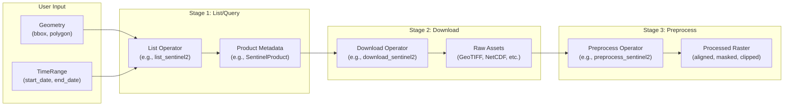

### Workflow Variants

Different ingestion workflows offer various levels of preprocessing:

| Workflow Type | Example | Description |
|---------------|---------|-------------|
| **Basic Download** | `naip/download_naip` | Lists and downloads tiles without preprocessing |
| **Preprocessed** | `sentinel2/preprocess_s2` | Full pipeline: list → download → align → mask |
| **Enhanced Masks** | `sentinel2/preprocess_s2_improved_masks` | Adds ML-based cloud/shadow mask improvement |
| **Ensemble Masks** | `sentinel2/preprocess_s2_ensemble_masks` | Uses ensemble of 5 cloud segmentation models |
| **Download + Merge** | `bing/basemap_download_merge` | Downloads tiles and merges into single raster |
| **Cloud Removal** | `spaceeye/spaceeye` | Advanced preprocessing with cloud removal inference |

Sources: [docs/source/docfiles/markdown/WORKFLOW_LIST.md:60-88]()

## Satellite Imagery Workflows

### Sentinel-2 Ingestion

Sentinel-2 workflows provide optical imagery with multiple preprocessing options:

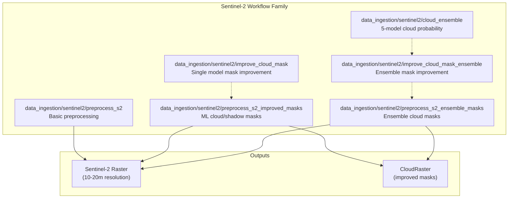

**Key Workflows**:

- `sentinel2/preprocess_s2` [docs/source/docfiles/markdown/WORKFLOW_LIST.md:68](): Downloads and preprocesses Sentinel-2 L2A imagery for input geometry and time range
- `sentinel2/preprocess_s2_improved_masks` [docs/source/docfiles/markdown/WORKFLOW_LIST.md:72](): Adds ML-based cloud and shadow mask improvements
- `sentinel2/preprocess_s2_ensemble_masks` [docs/source/docfiles/markdown/WORKFLOW_LIST.md:70](): Uses ensemble of 5 cloud segmentation models for robust masking
- `sentinel2/cloud_ensemble` [docs/source/docfiles/markdown/WORKFLOW_LIST.md:62](): Computes cloud probability using ensemble approach

Sources: [docs/source/docfiles/markdown/WORKFLOW_LIST.md:60-73]()

### Sentinel-1 Ingestion

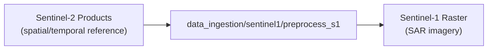

**Workflow**: `sentinel1/preprocess_s1` [docs/source/docfiles/markdown/WORKFLOW_LIST.md:60]()

**Description**: Downloads and preprocesses Sentinel-1 SAR imagery that intersects with input Sentinel-2 products. Uses S2 products as spatial/temporal reference for alignment.

**Use Cases**: All-weather monitoring, crop moisture assessment, flood detection

Sources: [docs/source/docfiles/markdown/WORKFLOW_LIST.md:60]()

### Landsat Ingestion

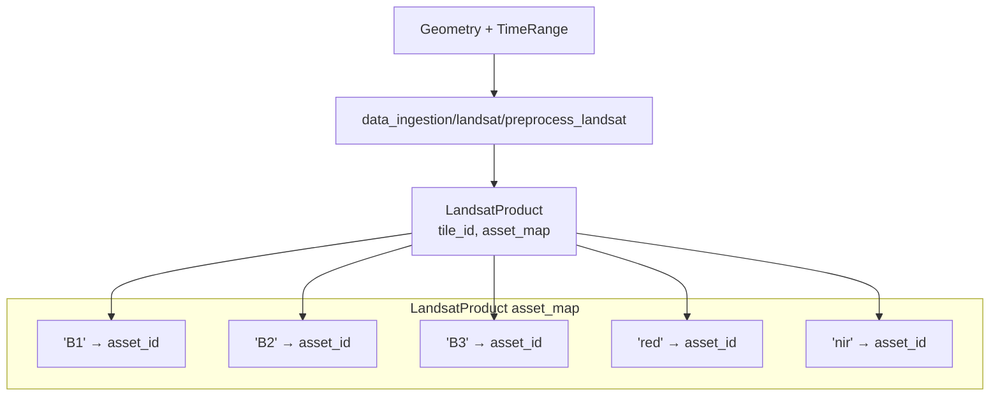

**Workflow**: `landsat/preprocess_landsat` [docs/source/docfiles/markdown/WORKFLOW_LIST.md:50]()

**Description**: Downloads and preprocesses Landsat tiles (8/9 satellites) that intersect with input geometry and time range. Populates `asset_map` with band-specific assets.

**Key Features**:
- Multi-band asset management via `LandsatProduct.asset_map`
- Methods: `add_downloaded_band()`, `get_downloaded_band()` [src/vibe_core/vibe_core/data/products.py:68-97]()
- 30m resolution multispectral imagery
- Long temporal archive (1970s-present)

Sources: [docs/source/docfiles/markdown/WORKFLOW_LIST.md:50](), [src/vibe_core/vibe_core/data/products.py:59-98]()

### Other Satellite Workflows

| Workflow | Data Source | Resolution | Use Case |
|----------|-------------|------------|----------|
| `naip/download_naip` | National Agricultural Imagery Program | 0.6-1m | High-resolution crop analysis |
| `modis/download_modis_surface_reflectance` | MODIS Terra/Aqua | 250-500m | 8-day surface reflectance |
| `modis/download_modis_vegetation_index` | MODIS Terra/Aqua | 250m | 16-day NDVI/EVI products |
| `airbus/airbus_download` | AirBus commercial imagery | 0.5-1.5m | Premium high-resolution imagery |
| `airbus/airbus_price` | AirBus catalog | N/A | Pricing quotes for imagery |

Sources: [docs/source/docfiles/markdown/WORKFLOW_LIST.md:22-57]()

## Weather Data Workflows

### Weather Data Sources

FarmVibes.AI integrates multiple weather data providers, each optimized for different temporal/spatial scales:

```mermaid
graph TB
    subgraph "Historical & Reanalysis"
        ERA5Hourly["data_ingestion/weather/download_era5<br/>Hourly global reanalysis (1940-present)"]
        ERA5Monthly["data_ingestion/weather/download_era5_monthly<br/>Monthly aggregated reanalysis"]
        CHIRPS["data_ingestion/weather/download_chirps<br/>Precipitation with station data"]
        GridMET["data_ingestion/weather/download_gridmet<br/>Daily surface meteorology (1979-present)"]
        TerraClimate["data_ingestion/weather/download_terraclimate<br/>Monthly climate (1958-present)"]
    end
    
    subgraph "Forecast Data"
        GFS["data_ingestion/weather/get_forecast<br/>NOAA Global Forecast System"]
        Herbie["data_ingestion/weather/download_herbie<br/>Multi-model forecast (HRRR, RAP, GFS)"]
        HerbieForecast["data_ingestion/weather/herbie_forecast<br/>Forecast observations"]
    end
    
    subgraph "Station Data"
        AmbientWeather["data_ingestion/weather/get_ambient_weather<br/>Personal weather station network"]
    end
    
    subgraph "Product Types"
        Era5ProductType["Era5Product<br/>item_id, var, cds_request"]
        ChirpsProductType["ChirpsProduct<br/>url"]
        HerbieProductType["HerbieProduct<br/>model, product, lead_time_hours"]
        ClimatologyLabProductType["ClimatologyLabProduct<br/>url, variable"]
    end
    
    ERA5Hourly --> Era5ProductType
    ERA5Monthly --> Era5ProductType
    CHIRPS --> ChirpsProductType
    Herbie --> HerbieProductType
    HerbieForecast --> HerbieProductType
    GridMET --> ClimatologyLabProductType
    TerraClimate --> ClimatologyLabProductType
```

Sources: [docs/source/docfiles/markdown/WORKFLOW_LIST.md:96-113](), [src/vibe_core/vibe_core/data/products.py:120-186]()

### ERA5 Weather Data

**Product Type**: `Era5Product` [src/vibe_core/vibe_core/data/products.py:120-129]()

**Workflows**:
- `weather/download_era5`: Hourly estimated weather variables from ECMWF reanalysis
- `weather/download_era5_monthly`: Monthly aggregated weather variables

**Attributes**:
- `item_id`: Unique identifier for the ERA5 data item
- `var`: Variable name (e.g., '2m_temperature', 'total_precipitation')
- `cds_request`: Dictionary containing Climate Data Store (CDS) API request parameters

**Resolution**: 0.25° × 0.25° (approximately 30km)

**Variables**: Temperature, precipitation, wind, pressure, humidity, radiation, soil moisture

Sources: [docs/source/docfiles/markdown/WORKFLOW_LIST.md:98-100](), [src/vibe_core/vibe_core/data/products.py:120-129]()

### Herbie Weather Forecasts

**Product Type**: `HerbieProduct` [src/vibe_core/vibe_core/data/products.py:347-365]()

**Workflows**:
- `weather/download_herbie`: Downloads forecast data using Herbie package
- `weather/herbie_forecast`: Downloads forecast observations

**Attributes**:
- `model`: Model name ('hrrr', 'hrrrak', 'rap', 'gfs', 'gfs_wave', 'rrfs')
- `product`: File type ('sfc' for surface, 'prs' for pressure, 'nat' for native, 'subh' for subhourly)
- `lead_time_hours`: Forecast lead time in hours
- `search_text`: Regular expression for GRIB2 index file search

**Integration**: Uses the Herbie Python package (https://herbie.readthedocs.io)

**Use Cases**: Short-term weather forecasting, agricultural decision support

Sources: [docs/source/docfiles/markdown/WORKFLOW_LIST.md:104-112](), [src/vibe_core/vibe_core/data/products.py:347-365]()

### CHIRPS Precipitation Data

**Product Type**: `ChirpsProduct` [src/vibe_core/vibe_core/data/products.py:101-110]()

**Workflow**: `weather/download_chirps`

**Description**: Climate Hazards Group InfraRed Precipitation with Station data - accumulated precipitation

**Attributes**:
- `url`: Download URL for the CHIRPS product

**Resolution**: 0.05° (approximately 5km)

**Temporal Range**: 1981-present, daily/monthly aggregations

Sources: [docs/source/docfiles/markdown/WORKFLOW_LIST.md:96](), [src/vibe_core/vibe_core/data/products.py:101-110]()

## Geospatial Reference Data Workflows

### Elevation and Terrain Data

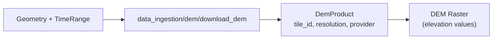

**Workflow**: `dem/download_dem` [docs/source/docfiles/markdown/WORKFLOW_LIST.md:36]()

**Product Type**: `DemProduct` [src/vibe_core/vibe_core/data/products.py:23-38]()

**Attributes**:
- `tile_id`: Identifier for the DEM tile
- `resolution`: Spatial resolution in meters
- `provider`: Data provider name

**Use Cases**: Topography analysis, watershed delineation, conservation practices detection, slope/aspect calculation

Sources: [docs/source/docfiles/markdown/WORKFLOW_LIST.md:36](), [src/vibe_core/vibe_core/data/products.py:23-38]()

### Land Cover and Crop Data

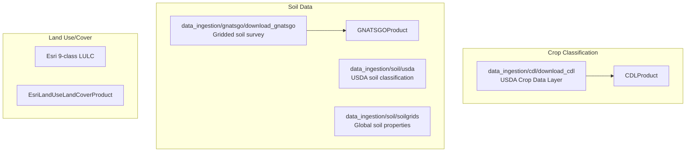

**Crop Data Layer**:
- Workflow: `cdl/download_cdl` [docs/source/docfiles/markdown/WORKFLOW_LIST.md:34]()
- Product: `CDLProduct` [src/vibe_core/vibe_core/data/products.py:113-117]()
- Description: USDA crop classification maps for continental USA (30m resolution)
- CDL Download URL pattern: [src/vibe_core/vibe_core/data/products.py:13-19]()

**Soil Data**:
- `gnatsgo/download_gnatsgo`: Gridded National Soil Survey Geographic Database [docs/source/docfiles/markdown/WORKFLOW_LIST.md:46]()
- `soil/usda`: USDA soil classification raster [docs/source/docfiles/markdown/WORKFLOW_LIST.md:76]()
- `soil/soilgrids`: Global digital soil mapping from SoilGrids [docs/source/docfiles/markdown/WORKFLOW_LIST.md:74]()

**Land Use/Land Cover**:
- Product: `EsriLandUseLandCoverProduct` [src/vibe_core/vibe_core/data/products.py:340-344]()
- Description: Esri's 9-class global land use/land cover dataset

Sources: [docs/source/docfiles/markdown/WORKFLOW_LIST.md:34-76](), [src/vibe_core/vibe_core/data/products.py:113-344]()

## Forest Monitoring Workflows

Forest monitoring workflows ingest data from specialized forest change detection products:

```mermaid
graph TB
    subgraph "ALOS Forest Extent"
        ALOSDownload["data_ingestion/alos/alos_forest_extent_download<br/>Forest/non-forest tiles"]
        ALOSMerge["data_ingestion/alos/alos_forest_extent_download_merge<br/>Download + merge to single raster"]
        ALOSProduct["AlosProduct"]
    end
    
    subgraph "GLAD Forest Extent"
        GLADDownload["data_ingestion/glad/glad_forest_extent_download<br/>Global forest extent tiles"]
        GLADMerge["data_ingestion/glad/glad_forest_extent_download_merge<br/>Download + merge to single raster"]
        GLADProduct["GLADProduct<br/>url, tile_name"]
    end
    
    subgraph "Hansen Global Forest Change"
        HansenDownload["data_ingestion/hansen/hansen_forest_change_download<br/>Download + merge forest change layers"]
        HansenProduct["HansenProduct<br/>asset_url, layer_name, tile_name, last_year, version"]
    end
    
    subgraph "GEDI Canopy Height"
        GEDIDownload["data_ingestion/gedi/download_gedi<br/>Full GEDI products"]
        GEDIRH100["data_ingestion/gedi/download_gedi_rh100<br/>Extract RH100 variable"]
        GEDIProduct["GEDIProduct<br/>product_name, start_orbit, stop_orbit"]
    end
    
    ALOSDownload --> ALOSProduct
    ALOSMerge --> ALOSProduct
    GLADDownload --> GLADProduct
    GLADMerge --> GLADProduct
    HansenDownload --> HansenProduct
    GEDIDownload --> GEDIProduct
    GEDIRH100 --> GEDIProduct
```

### ALOS Forest Classification

**Workflows**:
- `alos/alos_forest_extent_download`: Downloads ALOS forest/non-forest tiles [docs/source/docfiles/markdown/WORKFLOW_LIST.md:26]()
- `alos/alos_forest_extent_download_merge`: Downloads and merges into single raster [docs/source/docfiles/markdown/WORKFLOW_LIST.md:28]()

**Product Type**: `AlosProduct` [src/vibe_core/vibe_core/data/products.py:132-136]()

**Description**: Advanced Land Observing Satellite forest/non-forest classification at 25m resolution

Sources: [docs/source/docfiles/markdown/WORKFLOW_LIST.md:26-28](), [src/vibe_core/vibe_core/data/products.py:132-136]()

### GLAD Forest Extent

**Workflows**:
- `glad/glad_forest_extent_download`: Downloads GLAD forest extent tiles [docs/source/docfiles/markdown/WORKFLOW_LIST.md:42]()
- `glad/glad_forest_extent_download_merge`: Downloads and merges tiles [docs/source/docfiles/markdown/WORKFLOW_LIST.md:44]()

**Product Type**: `GLADProduct` [src/vibe_core/vibe_core/data/products.py:189-201]()

**Attributes**:
- `url`: Download URL for the GLAD product
- `tile_name`: Extracted from URL (property method)

**Description**: Global Land Analysis and Discovery forest extent data

Sources: [docs/source/docfiles/markdown/WORKFLOW_LIST.md:42-44](), [src/vibe_core/vibe_core/data/products.py:189-201]()

### Hansen Global Forest Change

**Workflow**: `hansen/hansen_forest_change_download` [docs/source/docfiles/markdown/WORKFLOW_LIST.md:48]()

**Product Type**: `HansenProduct` [src/vibe_core/vibe_core/data/products.py:204-337]()

**Key Attributes**:
- `asset_url`: URL of the Hansen product
- `asset_keys`: ['treecover2000', 'gain', 'lossyear', 'datamask', 'first', 'last']

**Properties** (computed from URL):
- `tile_name`: Geographic tile identifier (e.g., '20N_090W')
- `last_year`: Latest year in dataset (e.g., 2022)
- `version`: Dataset version (e.g., 'v1.10')
- `layer_name`: Specific layer (e.g., 'treecover2000', 'lossyear')

**URL Pattern**: `https://storage.googleapis.com/earthenginepartners-hansen/GFC-{year}-v{version}/Hansen_GFC-{year}-v{version}_{layer}_{tile}.tif`

**URL Validation**: Regex-based validation [src/vibe_core/vibe_core/data/products.py:219-233]()

**Static Methods**:
- `extract_tile_name()` [src/vibe_core/vibe_core/data/products.py:258-271]()
- `extract_last_year()` [src/vibe_core/vibe_core/data/products.py:274-286]()
- `extract_version()` [src/vibe_core/vibe_core/data/products.py:289-301]()
- `extract_layer_name()` [src/vibe_core/vibe_core/data/products.py:304-316]()

**Use Cases**: Deforestation monitoring, forest gain/loss analysis, year-over-year change detection

Sources: [docs/source/docfiles/markdown/WORKFLOW_LIST.md:48](), [src/vibe_core/vibe_core/data/products.py:204-337]()

### GEDI Canopy Structure

**Workflows**:
- `gedi/download_gedi`: Downloads full GEDI products [docs/source/docfiles/markdown/WORKFLOW_LIST.md:38]()
- `gedi/download_gedi_rh100`: Downloads L2B products and extracts RH100 variable [docs/source/docfiles/markdown/WORKFLOW_LIST.md:40]()

**Product Type**: `GEDIProduct` [src/vibe_core/vibe_core/data/products.py:151-165]()

**Attributes**:
- `product_name`: GEDI product identifier
- `start_orbit`: Starting orbit number
- `stop_orbit`: Ending orbit number
- `processing_level`: Processing level (e.g., 'L2B')

**Description**: Global Ecosystem Dynamics Investigation - LiDAR-derived canopy height and structure

**Use Cases**: Forest height estimation, biomass calculation, canopy structure analysis

Sources: [docs/source/docfiles/markdown/WORKFLOW_LIST.md:38-40](), [src/vibe_core/vibe_core/data/products.py:151-165]()

## SpaceEye Cloud Removal Workflows

SpaceEye is a specialized data ingestion and preprocessing system that generates cloud-free daily imagery by combining multiple Sentinel-2 observations with ML-based interpolation:

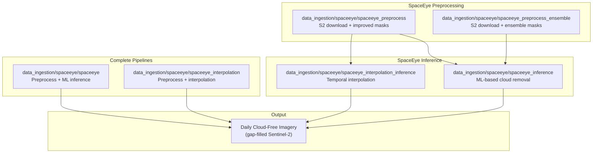

**SpaceEye Workflow Family**:

1. **Preprocessing Workflows**:
   - `spaceeye/spaceeye_preprocess` [docs/source/docfiles/markdown/WORKFLOW_LIST.md:86](): Downloads S2 + improved cloud masks
   - `spaceeye/spaceeye_preprocess_ensemble` [docs/source/docfiles/markdown/WORKFLOW_LIST.md:88](): Downloads S2 + ensemble cloud masks

2. **Inference Workflows**:
   - `spaceeye/spaceeye_inference` [docs/source/docfiles/markdown/WORKFLOW_LIST.md:80](): ML-based cloud removal given S2 data and masks
   - `spaceeye/spaceeye_interpolation_inference` [docs/source/docfiles/markdown/WORKFLOW_LIST.md:84](): Temporal damped interpolation

3. **Complete Pipelines**:
   - `spaceeye/spaceeye` [docs/source/docfiles/markdown/WORKFLOW_LIST.md:78](): Full ML-based pipeline
   - `spaceeye/spaceeye_interpolation` [docs/source/docfiles/markdown/WORKFLOW_LIST.md:82](): Full interpolation-based pipeline

**Key Features**:
- Daily temporal resolution from multi-day Sentinel-2 observations
- Cloud and shadow removal using ML models
- Gap-filling for occluded pixels
- Ensemble-based or interpolation-based approaches

**Use Cases**: Time series analysis requiring cloud-free imagery, daily vegetation monitoring, crop growth tracking

Sources: [docs/source/docfiles/markdown/WORKFLOW_LIST.md:78-88]()

## Azure Integration Workflows

### Azure Data Manager for Agriculture (ADMAg)

FarmVibes.AI integrates with Microsoft's Azure Data Manager for Agriculture for field-level data:

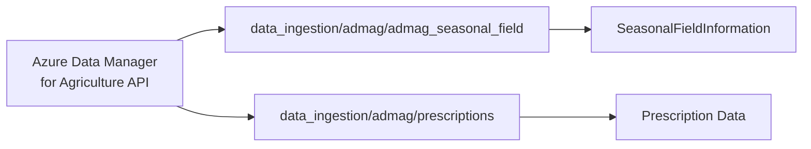

**Workflows**:
- `admag/admag_seasonal_field` [docs/source/docfiles/markdown/WORKFLOW_LIST.md:18](): Generates `SeasonalFieldInformation` using ADMAg
- `admag/prescriptions` [docs/source/docfiles/markdown/WORKFLOW_LIST.md:20](): Fetches prescriptions from ADMAg

**Integration Points**: These workflows serve as input to farm management workflows like `farm_ai/agriculture/heatmap_using_classification_admag`

**Use Cases**: Field boundary management, prescription data integration, multi-season field analysis

Sources: [docs/source/docfiles/markdown/WORKFLOW_LIST.md:18-20]()

## User Data Ingestion Workflows

User data workflows enable custom data integration into the FarmVibes.AI system:

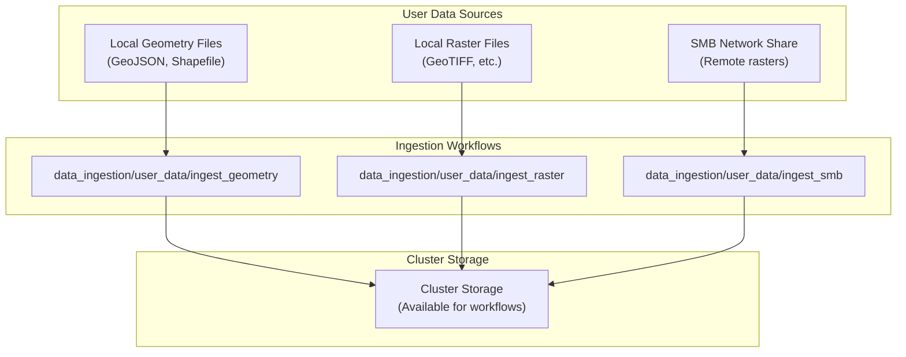

**Workflows**:
- `user_data/ingest_geometry` [docs/source/docfiles/markdown/WORKFLOW_LIST.md:90](): Adds user geometries into cluster storage
- `user_data/ingest_raster` [docs/source/docfiles/markdown/WORKFLOW_LIST.md:92](): Adds user rasters into cluster storage
- `user_data/ingest_smb` [docs/source/docfiles/markdown/WORKFLOW_LIST.md:94](): Adds rasters from SMB share into cluster storage

**Purpose**: Enables custom datasets to be used alongside standard data sources in workflows

**Use Cases**: 
- Integrating proprietary field boundaries
- Using custom imagery or derived products
- Accessing organizational data repositories

Sources: [docs/source/docfiles/markdown/WORKFLOW_LIST.md:90-94]()

## Basemap and Reference Imagery

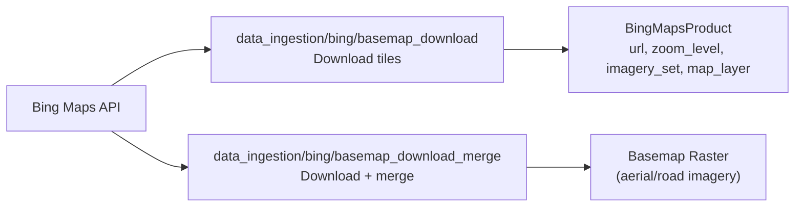

**Product Type**: `BingMapsProduct` [src/vibe_core/vibe_core/data/products.py:368-385]()

**Attributes**:
- `url`: Download URL for the product
- `zoom_level`: Map zoom level (int)
- `imagery_set`: Type of imagery (e.g., 'Aerial', 'AerialWithLabels', 'Road')
- `map_layer`: Specific map layer
- `orientation`: Image orientation (float)

**Workflows**:
- `bing/basemap_download` [docs/source/docfiles/markdown/WORKFLOW_LIST.md:30](): Downloads individual basemap tiles
- `bing/basemap_download_merge` [docs/source/docfiles/markdown/WORKFLOW_LIST.md:32](): Downloads and merges into single raster

**Use Cases**: Visual reference, road network context, SAM segmentation input

Sources: [docs/source/docfiles/markdown/WORKFLOW_LIST.md:30-32](), [src/vibe_core/vibe_core/data/products.py:368-385]()

## OpenStreetMap Integration

**Workflow**: `osm_road_geometries` [docs/source/docfiles/markdown/WORKFLOW_LIST.md:58]()

**Description**: Downloads road geometry for input region from OpenStreetMap

**Output**: Vector geometries representing road networks

**Use Cases**: Transportation analysis, accessibility mapping, infrastructure planning

Sources: [docs/source/docfiles/markdown/WORKFLOW_LIST.md:58]()

## Complete Workflow Catalog

The following table provides a comprehensive reference of all data ingestion workflows:

| Category | Workflow Name | Primary Data Source | Output Type |
|----------|--------------|---------------------|-------------|
| **Satellite - Optical** | `sentinel2/preprocess_s2` | Sentinel-2 | Raster (10-20m) |
| | `sentinel2/preprocess_s2_improved_masks` | Sentinel-2 + ML masks | Raster + CloudRaster |
| | `sentinel2/preprocess_s2_ensemble_masks` | Sentinel-2 + Ensemble | Raster + CloudRaster |
| | `landsat/preprocess_landsat` | Landsat 8/9 | LandsatProduct (30m) |
| | `naip/download_naip` | NAIP | NaipProduct (0.6-1m) |
| | `modis/download_modis_surface_reflectance` | MODIS | ModisProduct (250-500m) |
| | `modis/download_modis_vegetation_index` | MODIS | ModisProduct (250m) |
| **Satellite - SAR** | `sentinel1/preprocess_s1` | Sentinel-1 | Raster (10m) |
| **Commercial** | `airbus/airbus_download` | AirBus | Raster (0.5-1.5m) |
| | `airbus/airbus_price` | AirBus Catalog | Pricing Info |
| **Weather - Historical** | `weather/download_era5` | ERA5 Reanalysis | Era5Product |
| | `weather/download_era5_monthly` | ERA5 Monthly | Era5Product |
| | `weather/download_chirps` | CHIRPS | ChirpsProduct |
| | `weather/download_gridmet` | GridMET | ClimatologyLabProduct |
| | `weather/download_terraclimate` | TerraClimate | ClimatologyLabProduct |
| **Weather - Forecast** | `weather/get_forecast` | NOAA GFS | Forecast Raster |
| | `weather/download_herbie` | Multi-model | HerbieProduct |
| | `weather/herbie_forecast` | Herbie | HerbieProduct |
| **Weather - Station** | `weather/get_ambient_weather` | Ambient Weather | Station Data |
| **Elevation** | `dem/download_dem` | DEM | DemProduct |
| **Crop/Soil** | `cdl/download_cdl` | USDA CDL | CDLProduct |
| | `gnatsgo/download_gnatsgo` | gNATSGO | GNATSGOProduct |
| | `soil/usda` | USDA Soil | Raster |
| | `soil/soilgrids` | SoilGrids | Raster |
| **Forest** | `alos/alos_forest_extent_download` | ALOS | AlosProduct |
| | `glad/glad_forest_extent_download` | GLAD | GLADProduct |
| | `hansen/hansen_forest_change_download` | Hansen GFC | HansenProduct |
| | `gedi/download_gedi` | GEDI | GEDIProduct |
| | `gedi/download_gedi_rh100` | GEDI L2B RH100 | GEDIProduct |
| **Cloud Removal** | `spaceeye/spaceeye` | Sentinel-2 + ML | Daily Cloud-Free Raster |
| | `spaceeye/spaceeye_interpolation` | Sentinel-2 + Interp | Daily Cloud-Free Raster |
| **ADMAg** | `admag/admag_seasonal_field` | ADMAg API | SeasonalFieldInformation |
| | `admag/prescriptions` | ADMAg API | Prescriptions |
| **Basemaps** | `bing/basemap_download` | Bing Maps | BingMapsProduct |
| | `bing/basemap_download_merge` | Bing Maps | Merged Raster |
| **User Data** | `user_data/ingest_geometry` | Local Files | Geometry |
| | `user_data/ingest_raster` | Local Files | Raster |
| | `user_data/ingest_smb` | SMB Share | Raster |
| **Roads** | `osm_road_geometries` | OpenStreetMap | Vector Geometries |

Sources: [docs/source/docfiles/markdown/WORKFLOW_LIST.md:16-113]()

## Workflow Execution Example

The following example demonstrates executing a data ingestion workflow using the Python client:

```python
from vibe_core.client import FarmvibesAiClient
from vibe_core.data import DataVibe
from shapely.geometry import Point
from datetime import datetime

# Initialize client
client = FarmvibesAiClient()

# Define area of interest and time range
geometry = Point(-93.5, 42.0).buffer(0.01)  # Small region in Iowa
time_range = (datetime(2023, 6, 1), datetime(2023, 6, 30))

# Submit Sentinel-2 ingestion workflow
run = client.run(
    workflow="data_ingestion/sentinel2/preprocess_s2",
    name="iowa_june_s2",
    geometry=geometry,
    time_range=time_range
)

# Monitor execution
run.monitor()

# Retrieve outputs
output = run.output
rasters = [item for item in output if isinstance(item, DataVibe)]
```

For detailed information on workflow submission and monitoring, see [Running Workflows](#5.2) and [Monitoring and Debugging](#5.3).

Sources: [src/vibe_core/vibe_core/cli/helper.py:1-119]() (for client execution patterns)

---

