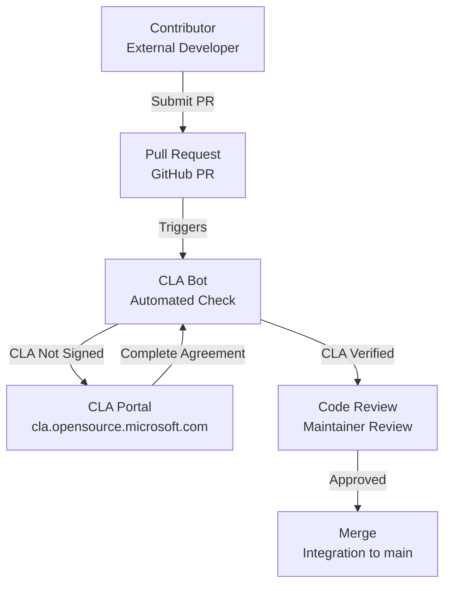
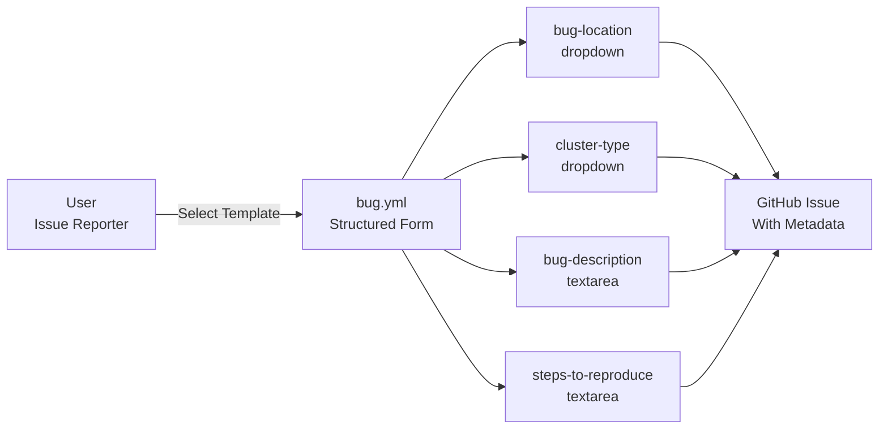
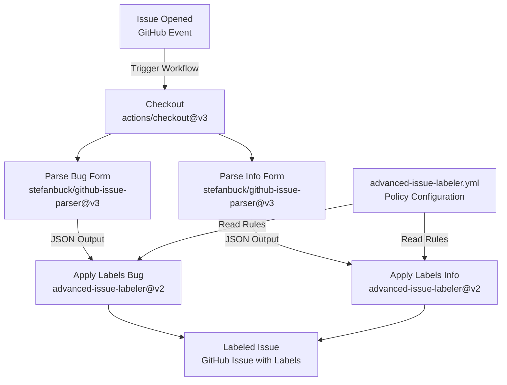
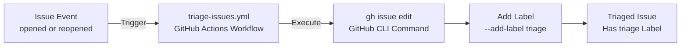
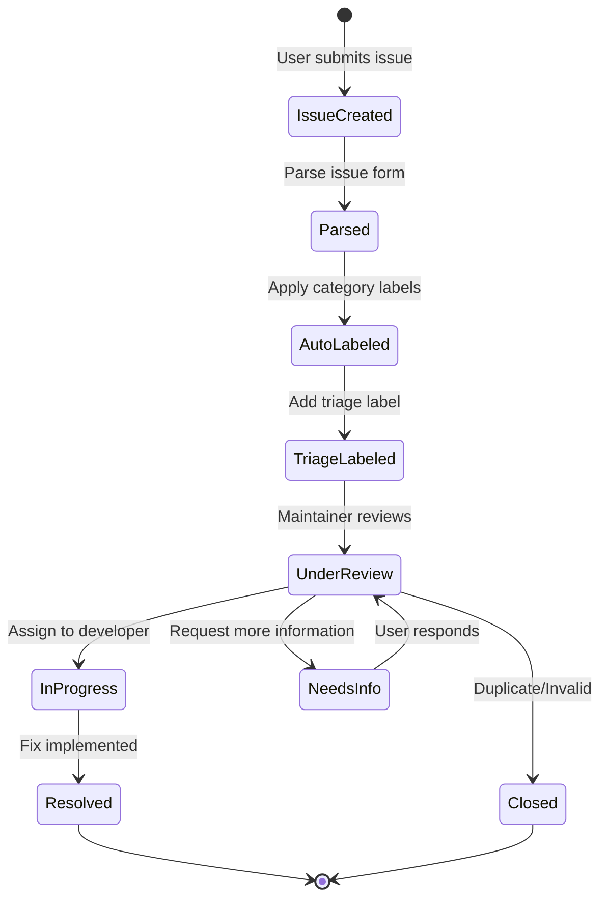

<!-- source: DeepWiki mcp.deepwiki.com · repo microsoft/farmvibes-ai · page 7.1 Contributing and Issue Management · fetched 2026-10-26 -->

# Contributing and Issue Management

<details>
<summary>Relevant source files</summary>

The following files were used as context for generating this wiki page:

- [.github/ISSUE_TEMPLATE/bug.yml](.github/ISSUE_TEMPLATE/bug.yml)
- [.github/ISSUE_TEMPLATE/info.yml](.github/ISSUE_TEMPLATE/info.yml)
- [.github/advanced-issue-labeler.yml](.github/advanced-issue-labeler.yml)
- [.github/workflows/issue-labeler.yml](.github/workflows/issue-labeler.yml)
- [.github/workflows/triage-issues.yml](.github/workflows/triage-issues.yml)
- [README.md](README.md)

</details>


## Purpose and Scope

This document explains the contribution process for FarmVibes.AI and the automated issue management system. It covers contributor requirements, issue templates, automated labeling policies, and triage workflows. For information about the documentation build and deployment process, see [Documentation System](#7.2). For testing and development environment setup, see [Testing and Environment Setup](#7.3).

---

## Contribution Process

FarmVibes.AI welcomes contributions from the community through pull requests and issue reports. The contribution workflow follows standard Microsoft open source practices with automated quality checks and licensing agreements.

### Contributor License Agreement (CLA)

All contributors must agree to the Microsoft Contributor License Agreement before their pull requests can be merged. The CLA declares that contributors have the right to grant Microsoft the rights to use their contributions.

**Process:**
1. Submit a pull request to the repository
2. CLA bot automatically checks if you have signed the agreement
3. If not signed, the bot decorates the PR with instructions
4. Follow the bot's instructions to complete the CLA at https://cla.opensource.microsoft.com
5. The CLA is valid across all Microsoft repositories using this system

**Code of Conduct:**
The project follows the [Microsoft Open Source Code of Conduct](https://opensource.microsoft.com/codeofconduct). Contributors should review the Code of Conduct FAQ or contact opencode@microsoft.com with questions.



**Diagram: Contribution and CLA Workflow**

Sources: [README.md:128-139]()

---

## Issue Reporting System

FarmVibes.AI uses structured issue templates to collect detailed information from users. Two primary templates are available: bug reports and information requests. These templates are implemented as YAML form configurations that create structured GitHub issues with predefined fields.

### Issue Template Overview

| Template | File | Labels | Purpose |
|----------|------|--------|---------|
| Bug Report | `bug.yml` | `bug` | Report errors, crashes, or unexpected behavior |
| Additional Information | `info.yml` | `question` | Ask questions, request features, or seek clarification |

### Bug Report Template

The bug report template (`bug.yml`) collects specific information to help maintainers diagnose and resolve issues efficiently.

**Template Structure:**

| Field ID | Type | Label | Required | Options |
|----------|------|-------|----------|---------|
| `bug-location` | dropdown | In which step did you encounter the bug? | Yes | FarmVibes.AI setup, Management script, Workflow execution, Notebook execution, Documentation, Other |
| `cluster-type` | dropdown | Are you using a local or remote cluster? | No | Local cluster, Remote (AKS) cluster |
| `bug-description` | textarea | Bug description | No | Full error message, log file content, VibeWorkflowRun.reason field |
| `steps-to-reproduce` | textarea | Steps to reproduce the problem | No | Workflow/notebook name, parameters, input geometry, time range |

**Log File Guidance:**

The bug description field instructs users to include log files from the FarmVibes.AI storage path:
- **Linux/macOS:** `~/.cache/farmvibes-ai/logs`
- **Windows:** `C:\Users\<username>\.cache\farmvibes-ai\logs`

Users should also include the `VibeWorkflowRun.reason` field for workflow execution errors.



**Diagram: Bug Report Template Data Flow**

Sources: [.github/ISSUE_TEMPLATE/bug.yml:1-62]()

### Information Request Template

The information request template (`info.yml`) handles questions, feature requests, and general inquiries about FarmVibes.AI.

**Template Structure:**

| Field ID | Type | Label | Required | Options |
|----------|------|-------|----------|---------|
| `info-topic` | dropdown | Topic | No | General question, Feature request, Documentation, FarmVibes.AI setup, Management script, Notebook, Workflow, Local cluster, Remote (AKS) cluster |
| `info-request` | textarea | Ask away! | Yes | User's question or request |

The template automatically applies the `question` label and allows users to select multiple topics if their inquiry spans multiple areas.

Sources: [.github/ISSUE_TEMPLATE/info.yml:1-36]()

---

## Automated Issue Labeling

FarmVibes.AI implements an automated labeling system that categorizes issues based on the structured data submitted through issue forms. The system uses GitHub Actions to parse issue content and apply appropriate labels according to a policy configuration file.

### Labeling Policy Configuration

The labeling policy is defined in `advanced-issue-labeler.yml` and specifies rules for mapping issue form fields to GitHub labels.

**Policy Structure:**

```yaml
policy:
  - template: ['bug.yml', 'info.yml']
  - section:
      - id: [field-id]
        block-list: ['excluded-values']
        label:
          - name: 'label-name'
            keys: ['field-value']
```

### Label Mapping Rules

The following tables show how field values map to GitHub labels:

**Bug Location Mapping (`bug-location` field):**

| Field Value | Applied Label | Notes |
|-------------|---------------|-------|
| Documentation | `documentation` | Issues with docs or guides |
| FarmVibes.AI setup | `FarmVibes.AI setup` | Installation or configuration problems |
| Management script | `management script` | Issues with `farmvibes-ai` CLI |
| Notebook execution | `notebooks` | Problems running example notebooks |
| Workflow execution | `workflows` | Workflow runtime errors |
| Other | None | Blocked by `block-list` |

**Cluster Type Mapping (`cluster-type` field):**

| Field Value | Applied Label |
|-------------|---------------|
| Local cluster | `local cluster` |
| Remote (AKS) cluster | `remote cluster` |

**Information Topic Mapping (`info-topic` field):**

| Field Value | Applied Label | Notes |
|-------------|---------------|-------|
| Feature request | `enhancement` | New feature proposals |
| Documentation | `documentation` | Documentation questions |
| FarmVibes.AI setup | `FarmVibes.AI setup` | Setup-related questions |
| Management script | `management script` | CLI-related questions |
| Notebook | `notebooks` | Notebook-related questions |
| Workflow | `workflows` | Workflow-related questions |
| Local cluster | `local cluster` | Local deployment questions |
| Remote (AKS) cluster | `remote cluster` | Remote deployment questions |
| General question | None | Blocked by `block-list` |

Sources: [.github/advanced-issue-labeler.yml:1-41]()

### Labeling Workflow Implementation

The automated labeling is implemented through the `issue-labeler.yml` GitHub Actions workflow, which triggers when new issues are opened.



**Diagram: Automated Labeling Workflow Architecture**

**Workflow Steps:**

1. **Trigger:** Workflow activates on `issues.opened` event
2. **Checkout:** Clone repository to access template files
3. **Parse Bug Template:** Use `stefanbuck/github-issue-parser@v3` to parse `bug.yml` template and extract structured data
4. **Parse Info Template:** Use `stefanbuck/github-issue-parser@v3` to parse `info.yml` template and extract structured data
5. **Apply Labels:** Use `redhat-plumbers-in-action/advanced-issue-labeler@v2` to apply labels based on policy configuration
6. **Result:** Issue is automatically labeled with relevant category labels

**Workflow Configuration:**

```yaml
name: Bug and Info issue labeler
on:
  issues:
    types: [ opened ]
permissions:
  contents: read
  issues: write
  actions: read
```

The workflow requires `issues: write` permission to add labels to issues and `contents: read` to access the repository files.

Sources: [.github/workflows/issue-labeler.yml:1-37]()

---

## Triage Workflow

All new and reopened issues are automatically assigned a `triage` label to indicate they need initial review by maintainers. This ensures no issue is overlooked and establishes a clear queue for maintainer attention.

### Triage Labeling Implementation

The triage workflow is implemented in `triage-issues.yml` and uses the GitHub CLI to add the triage label.



**Diagram: Triage Label Workflow**

**Workflow Configuration:**

| Property | Value |
|----------|-------|
| Name | `Triage issue labeler` |
| Trigger Events | `issues.reopened`, `issues.opened` |
| Permissions | `issues: write` |
| Command | `gh issue edit "$NUMBER" --add-label "triage"` |

**Environment Variables:**

- `GH_TOKEN`: GitHub Actions secret token for authentication
- `GH_REPO`: Repository identifier from context
- `NUMBER`: Issue number from event context
- `LABELS`: `triage` (hardcoded)

**Triage Process:**

1. User opens or reopens an issue
2. Workflow triggers immediately
3. GitHub CLI adds `triage` label to the issue
4. Maintainers see issues in triage queue
5. After review, maintainers remove `triage` label and take appropriate action

This two-stage labeling approach (automated categorization + triage flag) allows maintainers to quickly identify both the issue category and whether it has been reviewed.

Sources: [.github/workflows/triage-issues.yml:1-18]()

---

## Issue Lifecycle Summary

The complete issue lifecycle in FarmVibes.AI involves multiple automated steps and human review:



**Diagram: Issue Lifecycle State Machine**

**Automated Steps:**
1. **IssueCreated:** User submits bug report or information request using structured template
2. **Parsed:** `issue-labeler.yml` workflow parses form fields using `stefanbuck/github-issue-parser`
3. **AutoLabeled:** `advanced-issue-labeler` applies category labels based on `advanced-issue-labeler.yml` policy
4. **TriageLabeled:** `triage-issues.yml` workflow adds `triage` label

**Manual Steps:**
5. **UnderReview:** Maintainer reviews issue and determines action
6. **InProgress:** Maintainer or contributor begins work on fix
7. **NeedsInfo:** Maintainer requests additional details from reporter
8. **Resolved:** Fix is merged and issue is closed
9. **Closed:** Issue is closed as duplicate, invalid, or completed

This automated system reduces maintainer workload by ensuring all issues are properly categorized from the moment they are created, allowing maintainers to focus on resolution rather than organization.

Sources: [.github/workflows/issue-labeler.yml:1-37](), [.github/workflows/triage-issues.yml:1-18](), [.github/advanced-issue-labeler.yml:1-41]()

---

